# 现代语言学词典

A DICTIONARY OF LINGUISTICS AND PHONETICS

〔英〕戴维·克里斯特尔编

A DICTIONARY OF LINGUISTICS AND PHONETICS

# YUYANXUE

À DICTIONARY OF LINGUISTICS AND PHONETICS

DICTIONARY OF LINGUISTICS AND PHONETICS

# 现代语言学词典

(第四版)

〔英〕戴维·克里斯特尔 编

沈家煊译

商务印书馆

2000年·北京

图书在版编目(CIP)数据

现代语言学词典/(英)克里斯特尔 编，沈家煊译

-北京.商务印书馆 2000

ISBN 7-100-03055-2

Ⅰ现 Ⅱ ①克 ②沈 Ⅲ语言学-词典

N HO-61

中国版本图书馆CIP数据核字(2000)第14039号

所有权利保留。

# 未经许可，不得以任何方式使用。

XIÀNDÀI YÜYÁNXUÉ CÍDIÅN

现代语言学词典

〔英〕戴维·克里斯特尔 编

沈家煊译

商务印书馆出版

(北京王府井大街36号 邮政编码100710)

商务印书馆发行

中国科学院印刷厂印刷

ISBN7-100-03055-2/H·772

2000年12月第1版 开本 850×1168 1/32

2000年12 月北京第 1次印刷印张 141/2 插页 1

印数4000册

定价 24 00 元

## 译者前言

这本词典(第四版)原名《语言学和语音学词典》，考虑到国内刁惯(语音学视为语言学的一部分，见phonetics“语音学”条)并征得作者同意，译本取名《现代语言学词典》。加上“现代”二字是为了与传统的语文学相区别，还有一层意思是这一版的内容反映了现代语言学的面貌，各个新领域和新理论的术语也都予以收录，如生成语法的“最简方案”，非线性音系学，语音识别和合成，等等。

对国内读者来说，语言学不仅面临“无穷尽的术语泛监”，还有术语译名极其混乱的问题。举例来说，aspect就有“体”、“态”、“貌”、“时态”、“时相”等多种译名，经常跟 voice,tense,mood, phase的译名相屁淆;sentence和utterance的函乂很不一样，但经常都译作“句子”，不少人将utterance译作“话语”，一则不甚确切，一则又跟discourse的通用译名重合。又语里“个”，“条”，“张”等称作“量词”，国外则称作class1-fiers(类符)，而国外的“量词”(quantifiers)是指“所有的”、“有些”这类逻辑量词。为避免屁淆，写作中不得不在术语后加外文压明。但即便这么做，对不知其确切函乂的人来说仍然无济于事。这个译本并不奢望对目前术语的译名起规范的作用——这样做的条件似乎还不成孰。首先把每个术语的函乂和使用范围弄清楚，这是翻译这本词典的王要动机。这个译本尽量避免将不同的概念译作同一名称，例如同样指音的长短，duration是声学和语音学的概念，length是语音学但王要是音系学的概念，译名也有区分；又例如，都是指“陈述”，但statement是从功能上着眼，declarative是从形式上着眼，indicative是从语气上着眼，译名也作相应区分。另一方面，能够统一的尽量统一。例如语言不同层次都有抽象单位和实体的对立，如“音位”(phoneme)和“音子”(phone)的对立，翻译时尽量用“位”和“子”来统一，但有时又不能不照顾既定的译名，如morpheme已刁惯译作“语素”，不便再改。希望这个译本对将来术语的最终规范能有一点促进和帮助。

这本词典的一个特点是术语之间的互参：一个术语的释又中涉及的其他术语都用特殊字体排印，可在相应词条下查阅其释乂。原文的黑体词条和术语，译文也用黑体；原文释乂中用大写字母排印的术语，译文用楷体；原文加引号(单引)的术语和名称，译文也加引号(双引)标出。为便于查阅，词典最后增加了“又英术语对照表”。这张对照表对术语的又译英也会有参考价值。

本词典1978年出第一版(国内有译本《语言学和语音学基础词典》，方立等译，北京语言字院出版社)，经三次修订和增补，现在这个版本共收1400个王词条，释乂中又含1400个黑体术语，1200个加引号的特殊名称，因此共对当今语言学文献中常出现的4000个术语作出了说明，数量比第一版增加一倍，是迄今为止最全面详尽、最新的一部语言学词典。

由于译者水平所限，疏漏不妥之处恳请细八的读者随时指正，以便再版时修正。

1999年10月

## 第一版序

开始考量此项任务，我发现我们所操之语言词汇丰富而无条理，充满活力而无规章：目之所及，到处是困惑有待解决、混淆有待清理；无公认选择原则而须在无穷变异中作出选择；无确定检测标准而须觉察种种不纯洁成分；无著名经典作家或公认权威之认可而须对表达方式决定取舍。

塞缪尔·约翰逊

《英语辞典》序言

[一门学科]不成孰的一个标志就是无穷尽的术语泛滥。感到不满的读者提出疑问：语言学家使用的术语是否带有某种神奇的符咒力量，而当语言学家死去时那些术语也就一起被埋葬。

德怀特·鲍林木

《语言要略》第554 页

当今需要的自然是对20世纪语言学和语音学术语作一基于历史原则的、词典式的综述；为此目的可采用一些得到公认的方法，这些方法已使像《牛津英语词典》和《梅里安韦氏词典》这类优秀词书得以编纂出来。周密细致地考察各种背景的文本，逐条抄录新词新义，据此建成一个初步体现各种用法类型的连贯系统：这些步骤是编纂较大型的通用词典通常采取的步骤，而且它们照样也适用于本词典这样的专门词典。毋庸置言，这是一项艰巨的任务，一项语言学家和语音学家多次开了头但从未完成的工作。据我所知，在加拿大、英国、日本和美国，曾有过多次这样的尝试，有个人的也有集体的，但似乎都以失败告终。估计既有组织上也有经费上的原因。我本人也曾两度开始这样一项工作，出于同样的原因两次都未成功。因此对一部适当的语言学词典的紧迫需求一如既往，而要满足这一需求，必须具备语言学专业知识、时间、物质资源和经费等多方面的条件，从目前来看这些条件还无法一一具备。

同时我们该如何对待鲍林杰和其他许多人所哀叹的“无穷尽的术语乏滥”现象呢？又该如何对待语言学和语音学术语的“两类”消费者提出的查询呢？这肯定是当今语言学家不得不面对的一个特殊难题——语言学的发展尽管还不成熟，但这个学科对学术界和大众都有巨大的吸引力；因此术语不仅仅是专业语言学家和语音学家的问题，这些人只是少数，当今还有许许多多的人出于私人的或职业的原因也对语言学产生不仅是偶然的兴趣。有时有这样的说法，意思是这种局外的兴趣是不成熟的，但这样的说法毫无意义，因为这种兴趣实际存在，以真正的、负责的、批评的形式存在着，它要求语言学界作出同样负责的反应。本词典首先就是为满足大众对了解语言学术语的要求，也许以后有一天会出现对语言学术语的完整的学术性的评价。

上述需求主要来自这样一些人，他们在从事自己的行业时明确意识到语言是其专业的组成部分，并且近年来越来越感到语言学对自身行业的重要影响。这些人包括两部分，一部分来自教学和语言冶疗行业，如外语教学和言语矫正，一部分来自也包括语言学在内的那些学术领域，如心理学、社会学、文学批评、哲学等。还有日益增多的专攻语言学的学生，特别是正在上语言学导论课的研究生或同等在职学生。此外还有学习语言学和语音学的大学本科一年级的各类学生。因此本词典的目的是提供一部工具书来帮助上述初学者勉力对付语言学术语，也正是出于这一目的本词典最初起名为《……初级词典》。

## 收录范围

读者对象一经确定，收词释义的范围问题变得比较简单。事实证明，并非全部语言学术语和各种学派都对上述这些人有同等的吸引力或用处。有些术语的使用(或滥用)要比其他术语频繁得多。例如，competence“语言能力”、lexis“词汇”、generate“生成”、structuralism“结构主义”、morphology“形态学”、prosody“韵律”等是这些学生开始接触语言学时经常遇到的一小部分术语，如果不收是不可想象的。另一方面,anthropophonics“人类语音学”、allolog“词尾变体”、bahuvrıh1“性状复合词”，hyperplexon、paraphonology“副音系学”等则不大会对我所针对的读者构成任何问题，因为他们在最初接触语言学概念时不会遇到这些术语。同样，有些语言学理论和描写与其他的相比普及程度要高得多，例如最明显的是生成语法，还有(英国的)韩礼德式语言学和夸克的参考语法。语音学的术语也很普遍，属特别汪意的首选之列。相反，像语符学或层次语法的一些具体术语，虽然与语言学理论思想的形成有很大关系，但对上述读者的一般意识并无直接影响。因此本词典虽然收录了这些不太普遍的理论中一些较重要的理论术语，但并不作详细说明。同样，70年代中期以后提出的理论术语也未收录。但又见以下第二和第三版序]但愿大家跟我一样认为，本词典的收录偏向在应用性和导论性论著中早已存在的那些术语，而本词典还填充了一些空档，对某些方面问题的介绍更加完整和系统化(例如许多导论书只是有选择地说明一些区别特征，本词典则对这一方面作系统说明)。

因为心目中存有上述这些背景的读者，收录范围问题还从另一方面得到简化：只有在20世纪语言学和语音学影响下产生的术语和涵义才予收录。本词典因此有别于近年来出版的几部词典，它们的目的似乎是覆盖有关语言、个别语言和信递的整个领域，包括语言学和语音学。我的态度不妨概括为：不必收录alphabet“字母表”、abbreviation“缩写”、acronym“缩略词”这些名称，因为任何一部好词典都会照例说明它们的一般涵义；作为名称，它们并不是语言学思想发展的产物。同样，像 reinforcement“强化”、rhyme-scheme“押韵格式”、runıc“如尼文字”等名称虽然比较专门，但其专用范围属于语言学以外的概念框架，这类词因此也不在本词典收录之列。同样不收的还有语言和语系的专名(例如汉语，印欧语)和相关研究领域的名称(如汉语语言字)。另一方面，我用大量篇幅收录语言学家使用的许多“看似无关紧要的”术语，表面是日常用词，但经多年的语言学论争已转化出专门涵义，例如form“形式”、function“功能”、feature“特征”、accent“口音”、word“词”、sentence“句子”等。这些名称也许正因为看上去不像专门术语，在入门阶段却造成特殊困难。本词典给这些术语以特别关注，就像关注phoneme“音位”、bilabial“双唇音”、adjunction“附接”、morphophonemıc“形态音位[学]的”、hyponymy“上下义关系”这类明显的专门术语一样。

为保持词典内容的连贯性，收录范围还有几条限制。具体而言，以下四类术语未予收录：

(a)传统语言研究(即20世纪以前)的术语，除非已成为语言学和语音学注意的焦点。例如不收传统修辞学术语，如anaptyxis“衬音”、prosiopesis“词首省略”、alliteration“头韵法”等。同样，传统语法描写的详细术语大多也不单独列条(但有不少在较大的条目内提及)，例如masculine“阳性”、feminine“阴性”、neuter“中性”(但在 gender“性”条内说明)。

(b)本当属于其他学科的术语，除非语言学或语音学已引入一种特殊涵义或一种新的用法。例如声学语音学借用物理学的许多术语(如spectrum“频谱”、amplitude“振幅”等),因不具特殊涵义而不予收录。同样的原则也适用于信息论的术语(例如noise“噪音”)，听觉学的术语(例如audiogram“听力图”)，属于语言的逻辑和哲学分析的具体术语。另一方面，在阐述由乔姆斯基创立的语言学思想时从哲学、逻辑学和数学引入的一些术语，已成为语法学和语义学思想的基本术语(axiom“公理”、algorıthm“算法”、proposition“命题”、calculus“演算”等)，其中较重要的在收录之列。

(c)主要与应用语言学研究各领域有关的术语，如外语教学(例如transfer“转移”)和语言病理学(例如 aphasia“失语症”)。

(d)比较语文学的传统术语(例如 umlaut“元音变化”、ablaut“元音交替”)。

本词典不收专有名称，个别涉及主要学派发展过程的除外，例如Chom-skyan“乔姆斯基式的”、Bloomfieldian“布龙菲尔德式的”、Prague School“布拉格学派”。

根据以上原则，本词典第一版只收词条1000多一点(粗体词目)。

词条内还有一些包含词目在内的专门短语，也有1000条之多(以粗体出现)。「第二和第三版的统计数见下]

## 释义和编排

甚至到现在我仍然怀疑本书以“词典”作书名是否合适。每个词条的定义部分，就本身而言，并不像人们预期的那样明晰，因此不得不另外附加许多话加上一些例子来说明术语的要义。大部分词条因而包含广泛的信息，诸如术语使用的历史背景、一个术语与相关领域其他术语的关系等。由于对语言学术语的发展缺乏权威性的研究，我时常不得不在论述一个术语时加入自己的理解，但我希望这种缺陷已由每个词条末尾列出的参考书目加以弥补。所列出的是少数几本基本教科书的有关章节[第四版不再列出，见后序]。我采用的是几部公认较好的导论书，还有几部程度较高的教科书。这些参考书目一般不是术语的原始出处，只是方便读者从中获取进一步的信息，即有关术语获得其意义的理论背景，因此只注明相关章节而未注明页码。

每个词条自成一体，即不必参照其他条目就能对一个术语作出完整阐释。我也未采用在一个词条后加“见某某条”的习惯做法。大量术语互相依赖(competence“语言能力”～performance“语言运用”，deepstructure“深层结构”～surface structure“表层结构”等)，但如果将所有信息置于一个条目下，另一个只注“见某某条”，这种编排带有任意性，也使读者颇感沮丧。我宁愿按这样的原则编排，即当大多数读者心中只带着一个有疑问的术语打开词典时，应能得到尽可能直接的满意解释。我因此在 competence 条下解释“语言能力”，在 performance条下解释“语言运用”，等等。由于这些术语互相依赖，这样处理必然意味着某些重复：至少 performance一语的要点也须在 competence 条下提及，反过来也一样。如果本词典是从头到尾的读法，这种重复显然是一种缺点;但是词典的用法不同于教科书。虽然这样编写的结果篇幅多少比采用“见某某条”的习惯做法长，我仍然相信查询的方便和条目的连贯

带来的好处更多。

每个词条内，有定义的主要术语(及其主要屈折变体)用粗体字印刷。其他术语和短语，与词目的释义关系不大的，都加引号。在本词典其他地方定义的术语用小号大写字母印刷—但只限词条内的首次出现，或作为专门术语在对词条的理解很重要的位置出现。

## 致 谢

我很幸运，我系里有几位同事不惜花费时间全部或部分阅读词典稿样，建议我如何处理上面提到的一些问题，指出哪些地方我个人的倾向和介入过于明显。他们的意见使我获益匪浅，我多么希望在编写过程中我们有更多的时间来深入探讨大量的理解疑点。这些讨论更坚定了我的想法，做好这项工作确是当务之急。我要感谢他们坚持不懈的努力，同时也表示歉意，如果我在修改时没有适当对待他们的意见的话。我真希望我的所有谬误已经得到全部改正，实际当然不是，对那些留存的错误责任由我自负；同时也欢迎读者对不足之处提出意见，以便再版时考虑改进。在此容我特别感谢罗恩·布莱辛顿、保罗·弗莱彻、迈克尔·加曼、阿瑟·休斯、弗兰克·帕尔默、艾琳·沃伯顿等人给予的所有帮助。最后要感谢我的妻子为我打印全部手稿(好些还不止一次)，她现在还说喜欢这项工作：她的支持和鼓励对我是多么的重要。

戴维·克里斯特尔

1978年12月于雷丁

## 第二版序

与其他形式的出版物相比，词典最易过时。就本词典而言，第一版的过时已很明显，虽然离现在还只有五年。过时主要不是体现在已经收录的，而是体现在未予收录的。几年前在一部语言学和语音学的初级词典中会显得不合适的题目，现在成了必不可少的候选条目，因为课程和教科书中遇到它们的机会越来越多。我仍然采用我自己制定的“三年”标准——只收录三年之后仍然在谈论的！但即便严格按照这条标准，也得新增加125条粗体词目或缩写，词条内另增100条左右的粗体术语；还有100个左右的词条考虑到新的涵义而作了扩充。也许会令人惊奇，我居然未能发现一个术语因为不再使用而可以删除的。总之，就词条数而言，第二版比第一版多出六分之一。不会老是这样继续下去吧？不好说。

具体而言，新增词条可以说大多是反映(相对)晚近的发展，如70年代后期的转换语法(例如过滤条件、约束、X-杠句法)，一些取代转换语法的语法(例如合一表征语法、概化短语结构语法)，音系学理论，语用学，话语分析和篇章语言学。出乎意料的是，语音学领域几乎找不到什么可增加的。感谢评论人和同事的批判眼光，指出第一版中一些不应有的缺略和不一致，现已一并补正。对词条中的一些措词也作了大量修改，希望这些修改使词典用起来更加得心应手。我还稍许扩充了参考书目，但没有改变只举引第二手资料的原则，虽然有的评论人对此提出批评。这是为教学目的的举引而不是词典学的举引，只是为指引学生扩大阅读范围，而不是要提供术语历史上的原始出处，后者要有更大的词典才能做到。[第四版已取消参考书目，见后序。]

因此，我由衷感谢那些评论人、同事和我的学生为改进本词典而提出的各种建议，特别要感谢K.V.T.巴特、科林·比格斯、乔治·鲍西埃、雷内·德文、杜辛·加波罗夫谢克、杰拉尔德·盖兹达、弗朗西斯科·戈梅斯·德马托斯、拉斯·赫默然、罗德尼·赫德尔斯顿、尼尔·史密斯、艾琳·沃伯顿、约翰·伍德、沃尔博加·冯·拉弗勒·恩格尔等人。鉴于他们的评论，加上我自己再次在语言学杂志上对术语的细细搜罗和捕获，我比以往任何时候更加坚信，如我在第一版序里提及的，必须有一个重大项目来编纂一部基于历史原则的术语大词典。术语的规范化现在跟过去一样是一项紧迫的任务——现在也许更为紧迫，因为像语义学和语用学这些领域正在朝多个方向发展。最使我担忧的是正在不断创造的新的、特异的术语一—许多作者似乎不知道过去已有术语和涵义指的是相同的现象。本词典只是一本入门词典，但希望能继续引起人们对上述问题的重视，并为问题的解决作出些许贡献。

读者可能已注意到，经出版者提议，词典的标题中去掉了“初级”一词。这一改变并不反映程度或范围的改变，只是因为没有一本可比的“中级”词典也就不必加“初级”一词。我同意去掉，因为当初加这个词只是为了强调它的普及性(见第4页)，既然本词典现已广泛使用，这一强调大概也就不必要了。

戴维·克里斯特尔

1984年10月于霍利赫德

## 第三版序

是的，会继续下去的。（回答第二版序第一段最后我自己提出的问题)第二版以来的五年中我继续密切注意新术语和新涵义，这次还借助了季刊《语言学摘要》的索引和定期出版的各种语言学大全的收录。这一版又增加了300条新术语、缩写或涵义，其中三分之二以上需要另列词条。给予特别关注的是管辖与约束理论的术语和体现当前音系学研究特点的大量新增术语，特别是节律音系学和自主音段音系学的术语。全部旧词条又重读一遍，参照当前的发展有所修订。参考书目新增了若干辅助读物。为方便读者新增了国际音标表，见词典正文前一页。

词典的篇幅在增大—比我原来预期的大得多。为节省篇幅，我放宽了第一版强调的词条独立自足的原则，采用了一些“参看”和“见某某条”的做法。还增加了“文书”互见词条的数量，这样可直接查到所有词目后括号里的粗体术语——前两版有的查不到，例如以non-“非-”起头的术语(如 non-factive“非叙实的”,non-restrictive“非限制性的”)不单列条，结果有的读者显然误以为这些术语没有收录。

篇幅的增加还引起一个后果，要召唤增援部队，事实证明这是必要的。主要是伊娃·雅沃斯卡，她和鲍勃·博斯列一起通读了句法理论的词条，除提供管辖与约束理论术语补充材料的草稿外，还提出许多更新内容的建议。他们的帮助已证明是无法估价的，对他们为这一版作出的贡献我谨表衷心感谢。

最后，还是欢迎对本词典的增订和修订提出各种建议。

戴维·克里斯特尔

1990年4月于霍利赫德

## 第四版序

与前三版相比，这新一版的编写一方面比较容易，一方面又比较难。任何一个词典编纂者都会极大地得益于相关领域综述性著作的出现，而语言学在90年代肯定已证明是一个综述的年代———值得注意的有《语言学国际大全》(OUP，1992)和《语言和语言学大全》(珀格蒙，1993)，这些大全是新术语和新涵义的宝贵资料。还有一个有用的资料来源是“布莱克韦尔语言学手册”系列，主要是音系学和语义学方面的。我又浏览了近年来《语言学摘要》索引以搜寻新术语。这里有必要提及这些著作的帮助并对它们的作者表示感谢。

这是好的、容易的一面。不好的、难的一面是，对本词典这种小规模项目而言，有范围如此广泛的资料可资利用，结果发现了大量的新词新义——这一版新增了600余条。仅非线性音系学一个领域就增加了好几十条，语义学条目的增加量大致相同。当然不是所有这些新术语都适合收入。经常是一个术语只是为某一模型的特定目的而临时创造的用法(例如为许多制约和条件临时设立的名称)，它的生命期也许不超出它首次出现的那篇文章(往往还只是一篇工作论文)。只有那些除创立者外别人也继续使用、并确实已规约化的术语，本词典才予收录。但是有时不易知道一个术语使用的广泛程度。时尚随处都在，一个术语在1996年出现在每个人的口头并不意味着1997年还照样如此。因此我在收录时相当谨慎，作为粗略的衡量标准，一个术语我必须见过两次、其中一次为非创立者所用，才予收录。当然，一些主要的手册帮助我对用法的普遍程度作出适当的判断，读者来信也给我帮助，有的信中指出了一些遗漏。

这是一项微妙的平衡工作，我也意识到我的有些决定带有任意性。无论如何，这一版的篇幅已大大增加，新增约15%。本词典现共收

1400余个术语作为主词条，词条内另含1400个粗体术语。特殊涵义和特殊搭配(一般为置于单引号内的短语)，加上用法提示又增加出1200个名称。因此这一版总共对语言学和语音学4000个术语的专门用法作出了说明。从这一版新增粗体术语中选列一些术语如下，读者可以体会到新术语的基本风貌：bootstrapping“自推”， bracketing para-dox“加括两难”,charm“粲”,cognitive metaphor“认知隐喻”,connection-ism“连接主义”,de dicto/de re“涉名/涉实”,defaults“缺省值”,discourseattachment“话语附加”,dynamic semantics“动态语义学”, feature geome-try“特征构架”, greed“自贪”, grinding“碾磨”, hidden Markov model“隐蔽马尔可夫模型”,interactional sociolinguistics“互动社会语言学”, lamb-da“兰姆达算子”, ludlıng“游戏语”, mınımalıst programme“最简方案”，non-linear phonology“非线性音系学”,optimality theory“优选论”, perco-lation“弥散”，procrastinate“拖延”，qualia“物性”，under-specification“不完全赋值”,unıfication“统一”。

回顾第一版序言，我发现我已收录原先声明不收的术语。但是，时代在变化。例如，言语合成和识别的进展已使一些基本的声学术语更经常地出现在语言学家面前，也常有人要求我增加收录这方面的术语。同样，对语言学思想史的兴趣也在增长，这也促使我收录部分传统语法的核心术语。但是这个新版不仅仅是增加一些新条目，词条内也作了许多修改来照顾理论上的新发展。新版还大大增加了互见词条的数量，这样就容易查到隐藏在长词条内的术语。事实证明继续在一个词条后列出它一般出现的教科书或进一步阅读的参考书目，这种做法过于麻烦。有的读者要求我列出各术语确切的创立者等有关信息，但是(除个别情形外)实际证明要作这种简略的概括是极其困难的。只有完备的历史阐述和直接引证才能完成这项任务——实现这个目标跟20年前本词典第一版编写的时候一样还是遥遥无期。

戴维·克里斯特尔

1996年2月于霍利赫德

<table><tr><td rowspan=1 colspan=1>内破音</td><td rowspan=1 colspan=1>挤喉塞音</td><td rowspan=1 colspan=1>边通音</td><td rowspan=1 colspan=1>国基</td><td rowspan=1 colspan=1>边擦音</td><td rowspan=1 colspan=1>華</td><td rowspan=1 colspan=1>触音或闪音</td><td rowspan=1 colspan=1>蟹若</td><td rowspan=1 colspan=1>曾音</td><td rowspan=1 colspan=1>破裂音</td><td rowspan=1 colspan=1></td><td rowspan=12 colspan=1>辅音</td></tr><tr><td rowspan=1 colspan=1>gg</td><td rowspan=1 colspan=1>d</td><td rowspan=1 colspan=1></td><td rowspan=1 colspan=1></td><td rowspan=1 colspan=1></td><td rowspan=1 colspan=1>0g</td><td rowspan=1 colspan=1></td><td rowspan=1 colspan=1>B</td><td rowspan=1 colspan=1>3</td><td rowspan=1 colspan=1>d9</td><td rowspan=1 colspan=1>双唇音</td></tr><tr><td rowspan=1 colspan=1></td><td rowspan=1 colspan=1></td><td rowspan=1 colspan=1></td><td rowspan=1 colspan=1>C</td><td rowspan=1 colspan=1></td><td rowspan=1 colspan=1>J&lt;</td><td rowspan=1 colspan=1></td><td rowspan=1 colspan=1></td><td rowspan=1 colspan=1>3</td><td rowspan=1 colspan=1></td><td rowspan=1 colspan=1>唇齿音</td></tr><tr><td rowspan=3 colspan=1>3P</td><td rowspan=3 colspan=1>一</td><td rowspan=3 colspan=1>1</td><td rowspan=3 colspan=1>r</td><td rowspan=3 colspan=1>一G</td><td rowspan=1 colspan=1>8Q</td><td rowspan=3 colspan=1>J</td><td rowspan=3 colspan=1>1</td><td rowspan=3 colspan=1>u</td><td rowspan=3 colspan=1>1p</td><td rowspan=3 colspan=1>齿音齿龈音齿龈后音</td></tr><tr><td rowspan=1 colspan=1>S2</td></tr><tr><td rowspan=1 colspan=1>Jw</td></tr><tr><td rowspan=1 colspan=1></td><td rowspan=1 colspan=1>1</td><td rowspan=1 colspan=1></td><td rowspan=1 colspan=1>1</td><td rowspan=1 colspan=1></td><td rowspan=1 colspan=1>sZ</td><td rowspan=1 colspan=1>1</td><td rowspan=1 colspan=1></td><td rowspan=1 colspan=1>u</td><td rowspan=1 colspan=1>1b</td><td rowspan=1 colspan=1>卷舌音</td></tr><tr><td rowspan=1 colspan=1>3f</td><td rowspan=1 colspan=1>0</td><td rowspan=1 colspan=1>y</td><td rowspan=1 colspan=1>一</td><td rowspan=1 colspan=1></td><td rowspan=1 colspan=1>3f</td><td rowspan=1 colspan=1></td><td rowspan=1 colspan=1></td><td rowspan=1 colspan=1>u</td><td rowspan=1 colspan=1>Cf</td><td rowspan=1 colspan=1>腭音</td></tr><tr><td rowspan=1 colspan=1>Xβ</td><td rowspan=1 colspan=1>X</td><td rowspan=1 colspan=1>r</td><td rowspan=1 colspan=1>m</td><td rowspan=1 colspan=1></td><td rowspan=1 colspan=1>x人</td><td rowspan=1 colspan=1></td><td rowspan=1 colspan=1></td><td rowspan=1 colspan=1>β</td><td rowspan=1 colspan=1>X6</td><td rowspan=1 colspan=1>软腭音</td></tr><tr><td rowspan=1 colspan=1>b3</td><td rowspan=1 colspan=1>b.</td><td rowspan=1 colspan=1></td><td rowspan=1 colspan=1></td><td rowspan=1 colspan=1></td><td rowspan=1 colspan=1>x又</td><td rowspan=1 colspan=1></td><td rowspan=1 colspan=1>R</td><td rowspan=1 colspan=1>N</td><td rowspan=1 colspan=1>b0</td><td rowspan=1 colspan=1>小舌音</td></tr><tr><td rowspan=1 colspan=1></td><td rowspan=1 colspan=1></td><td rowspan=1 colspan=1></td><td rowspan=1 colspan=1></td><td rowspan=1 colspan=1></td><td rowspan=1 colspan=1>uS</td><td rowspan=1 colspan=1></td><td rowspan=1 colspan=1></td><td rowspan=1 colspan=1></td><td rowspan=1 colspan=1></td><td rowspan=1 colspan=1>咽音</td></tr><tr><td rowspan=1 colspan=5></td><td rowspan=1 colspan=1>hh</td><td rowspan=1 colspan=3></td><td rowspan=1 colspan=1>2</td><td rowspan=1 colspan=1>声门音</td></tr></table>

国际音标表(修订至1989)

承蒙国际语音学会同意复制
<table><tr><td colspan="14">变音符</td></tr><tr><td rowspan="2">0</td><td rowspan="2">nd 不带声</td><td rowspan="2">，</td><td rowspan="2">大圆唇</td><td rowspan="2">3</td><td rowspan="2">w 唇化</td><td rowspan="2">twdw</td><td rowspan="2">鼻化</td><td rowspan="2">ê</td><td rowspan="2">连弧表示</td><td rowspan="2"></td><td rowspan="2">塞擦音和双重发音可用两个音标上加</td><td rowspan="2"></td><td rowspan="2"></td><td rowspan="2">kp ts</td></tr><tr><td></td></tr><tr><td>带声 4</td><td></td><td>st</td><td>小圆唇</td><td>?</td><td>J</td><td>腭化</td><td>tj d n</td><td>鼻除阻</td><td>超音段 dⁿ</td><td>主重音</td><td></td><td>声调和词重音</td><td></td><td></td></tr><tr><td>h</td><td>送气</td><td>thdh</td><td>前伸</td><td>u</td><td>Y</td><td>软腭化</td><td>tY dY</td><td>1 边除阻</td><td>d</td><td>次重音</td><td>,founə&#x27;tison 平调</td><td></td><td>曲拱调</td><td></td></tr><tr><td>..</td><td>呼气带声</td><td>ba</td><td>后缩</td><td>i</td><td>5</td><td>咽化</td><td>tfds</td><td>无可闻除阻</td><td>：长 d ，半长</td><td>e: e&#x27;</td><td>é或特高 é 1高</td><td></td><td>ě或A 升 ê V降</td><td></td></tr><tr><td></td><td>嘎吱带声</td><td>ba</td><td>央化</td><td>ë</td><td>～</td><td>软腭化或咽化</td><td></td><td>1</td><td>U</td><td>特短 ě</td><td>ē  中</td><td></td><td>é 7</td><td>高升</td></tr><tr><td></td><td>舌唇</td><td>! d</td><td>x 中央化</td><td>ě</td><td>4</td><td>升高</td><td>e ↓</td><td>=带声齿龈擦音）</td><td></td><td>· 音节间断 Ji.ækt</td><td>è  低</td><td></td><td>ē低升</td><td></td></tr><tr><td>齿 n</td><td></td><td>1d</td><td>成音节</td><td>1</td><td>+</td><td>降低</td><td>ęβ</td><td>=带声双唇通音）</td><td></td><td>次(音步)群 主(语调)群</td><td>è」特低</td><td></td><td>ë 升降等</td><td></td></tr><tr><td>u</td><td>舌头</td><td>td</td><td>不成音节 n</td><td>e</td><td>1</td><td>舌根前伸</td><td>e</td><td></td><td></td><td>连系(无间断)</td><td>↓ 降阶</td><td></td><td></td><td></td></tr><tr><td>舌叶 0</td><td></td><td>Ig</td><td>L 带r音</td><td>3</td><td>▶</td><td>舌根后缩</td><td>e</td><td></td><td></td><td>全应升 全应降</td><td>↑</td><td>升阶</td><td></td><td></td></tr></table>

<table><tr><td colspan="3">其他符号</td></tr><tr><td>M</td><td>不带声唇软腭擦音</td><td>O 双唇吸气音</td></tr><tr><td>W</td><td>带声唇软腭通音</td><td>1 齿吸气音</td></tr><tr><td>4</td><td>带声唇腭通音</td><td>！ 齿龈(后)吸气音</td></tr><tr><td>H</td><td>不带声会厌擦音</td><td>キ 腭齿龈吸气音</td></tr><tr><td>f</td><td>带声会厌擦音 1</td><td>齿龈边吸气音</td></tr><tr><td>7</td><td>会厌破裂音 i</td><td>齿龈边闪音</td></tr><tr><td>CZ</td><td>齿龈腭擦音</td><td>6 同时发∫和X</td></tr><tr><td>3</td><td>附加中央元音</td><td></td></tr><tr><td></td><td>塞擦音和双重发音可用两个音标上加</td><td>kp ts</td></tr><tr><td>连弧表示</td><td></td><td></td></tr><tr><td></td><td></td><td></td></tr></table>

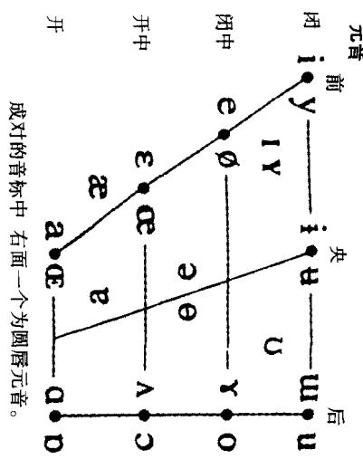

## A

A 有时作形容词(adjective)的缩写(特别是在生成语法中)，有时作副词(adverb)或状语(adverbial)的缩写(特别是在结构王义传统内写的语法中)。在管辖与约束理论中代表王目(argument)。

abbreviation(1)缩写，缩写词日常使用的这个名称在语言字中成为构词研究的一个术语。词的缩写有几种不同方法首字母缩写词(inıtialism,alpha-betisms)可读出每个构词成分首字母的单独发音，例如TV“电视”，COD“货到付款”;缩略词(acronyms)能按单一的词读出，如NATO“北大西洋公约组织”，laser“莱塞，激光”，截短词(clpped forms,clippings)是将较长的词截去一部分，通常截去结尾部分，如 advertisement“广告”截短为 ad，有的截去起首部分，如plane“飞机”，也有同时截去首尾两部分的，如flu“流行性感冒”;截搭词(blends)是两个词各取一部分组合在一起，如 sitcom“情景喜剧”，motel“汽车旅馆”。

(2)(abbreviatory)缩略的 在语言字和语音字中用在缩略规约(abbrevia-tory convention)这一短语中。这个短语指形式分析中任何一种将含有共同成分的几条规则合并起来的手段(参看BRACKETING(2)加括法条)，目的是使表述更为经济。

abducted 外展 见 VOCAL CORDS 声带条。

A-binding A 约束，A-bar-binding A 杠约束见 BINDING THEORY 约束理论条。

ablative夺格 在用屈折形态表示语法关系的语言里，指名词短语(通常是单个名词或代名词)所取的一种形式，一般用来表达各种处所或工具意义。英语不像拉丁语有“夺格”标记，而是采用其他手段(特别是介词 with,from,by)来表达这些意念,例如 He did it wrth his hands“他用手干的”。

ablaut 元音交替 见 GRADATION(2)元音差变条。

abrupt 突发(音) 有时用于音系学的区别特征理论，常见于短语突发除阻(abrupt release)。这个短语指一个音突然除阻，没有像破裂辅音中的擦音所有的那种声学湍流。其对立木语是用来描写塞擦音的延缓除阻。

absolute(1)独立成分传统语法描写使用的术语，有时也用于一般语言字，指与句子其他部分相分离或以反常方式连接的句子成分。英语在句首位置可以独立使用副词和形容词，例如，However,he arrved later“然而，他到得更晚”，Happy,she went to sleep“欢欢喜喜地，她入睡了”。拉丁语里有“夺格独立成分”这样的离心构式，例如 hoc facto 已经这样做之后’。

(2) 绝对[共相] 语言学理论中指一类语言共相。绝对共相(absolute u-niversal)是所有语言毫无例外具有的共同现象，对立的术语是相对共相。

(3) 绝对[年代学] 见 RELATIVE(3)相对[年代字]条。

absolutive 通格 用于某些语言的语法描写，这些语言，如爱斯基摩语和格鲁吉亚语，有作格系统。这种格系统中，及物动词的宾语和不及物动词的王语在形式上一致(即由同一格表示)，这个一致形式称为“通格”及物动词的主语则称为作格”。

accent(1)口音一个人的发音特占所产生的兑体听觉效果，人们据此能辨识他是什么地方或什么社会地位的人。语言宇文献中这个术语仅指发音，因此有别于万言，后者还指语法和词厂。地域口音(regional accents)可以指一个国家内任一地区乡村或城市居民的口音(如英格兰西南部诸郡口音，利物浦口音)，也能指操同一语言的不同民族群体的口音(如美国口音，澳大利亚口音)，还能指我们对其他语言的印象(外国口音，斯拉夫口音)。社会口音(social accents)与说话人的文化和教育背景有关。在传统的社会等级制度分明的国家，例如印度和日本，社会等级差别反映在语言中，口音常常是社会等级的标志。在英国，最能说明这种标志的例子是一种不分地域的中性口音，与公学教育和相关职业领域相联系，例如政府文职人员法院、宫廷、英国广播公司(BBC)等，因此有“女皇英语(标准英语)”，“BBC英语”之类的名目。柠准发音(RP)是给这种口音起的名称。由于它在地域上是中性的，用标准发音说话的人有时被看作“没有口音”。其实这样的说法会引起误解语言学家强调，每个人都有口音，尽管口音可能不表明地域来源。“土腔”这个常用词指与标准发音偏差很大的口音。

(2)(-ed,-ual,-uation)重读，重音(重读的，重音的，重读(度)) 使语流中某个词或音节突出的强调方式。经常谈及的是重读的(accented)音/词/音节，短语/句子的重读模式(accent(ual) pattern)。常见于节律(见 METRICS节律字条)的讨论，指一行诗句的“节拍”——即重读音节与非重读(unaccented)音节的交替。不过，任何口语体都可以按音节重读的相对程度即重读度(accentuation)来描写，例如，可以说一个政冶家说话时“重读很厉害”。

技术上说，重读不仅跟音响有关，而且跟音高和音延有关，尤其跟音高有关比较动词 record (I'm going to record the tune“我打算给曲子录音”)和名词record(I've got a record“我已得到一张唱片”), record 和 record 之间词重音(word accent)的对立是由两个音节在音响、音长音高变化上的差别来实现的。音高重音(pitch accent)的概含也用于某些语言的音系分析中，指词内音调的分布受限制的情形(例如日语)。这三个变项的类似运用还见于句重音(sentenceaccent)这一概念，也叫“对比重音”。句重音是语言分析的一个重要方面，特别是语调分析，因为它能影响一个句子的可接受性、意义或预设。例如Hewaswearng a red hat “他当时戴着一顶红帽子”可以听成是对同句 Was he wearng ared coat?“他当时是不是穿着一件红上衣?”的回答，而 He was wearing a red hat他当时戴着一顶红帽子'则是对 Was he wearng a green hat?“他当时是不是戴着一顶绿帽子?”的回答。STRESS“重音”这个名称经常用来指这种对比(如wordstress“词重音'和 contrastive stress“对比重音”)。音高重音也可作类似分析参看PITCH音高条)。

一种语言各类重音的完整系统有时称作重音系统(accentual system),是音系字研究的一部分。新造词“重音学”指专对重音的研究，有时见于欧洲的语言学文献。

acceptability（un-acceptable）可接受性(不可接受的） 操本族语者判定的语言数据在本族语中可能存在的程度。“可接受话段”是指其用法被认为是许可或正常的话段。实际上判断一个话段的可接受性可能十分困难。不同的操本族语者常常对一个话段是否正常或是否许可作出不同的判断。一个原因是由地域和社会背景、年龄、个人喜好等差异造成的直觉或语感差异。一个话段在一种万言中可能正常，而在另一种方言中可能是不可接受的(unacceptable)，例如Ⅰ ain't，I be,1 am“我是”的不同说法。语感在很大程度上还取决于人们从小所受的教育和在多大程度上相信语言的某些形式是“正确的”，而某些形式是“错误的”.不少人就认为规定性语去所批评的某些句子是不宜接受的，例如Ⅰ wll go tomorrow“我明天去”(代替 I shall go .), Thıs is the man I spoke to“这是我跟他说话的那个人”(代替 to whom I spoke)。但对语言学家而言，这样的话段都是可接受的，只要有一部分居民在说话和书写时一贯使用它们。问题在于确定哪些部分的居民在哪些场合使用哪些话段。在一种方言内，一个话段可能在一个语境中是可接受的，在另一语境中则是不可接受的。

语言学已设计出几种调查语言数据可接受性的技术。这些技术通常采用实验的方式，要求操本族语者对一组组话段作出评判，这些话段包含对其可接受性有所疑问的语言特征。这类实验称作可接受性测试(acceptability test)。必须有某种公认的类似这样的技术来判定可接受性，因为人们说出的许多话段，其作为句子而成立的地位是有疑问的，在口语中尤其如此。例如在一批数据取样中，有人说 I think it's the money they're charging is one thing“我认为是他们要收取的费用是一回事”。语言学家的任务是确定这个话段是说话人一方犯的错误，还是属于言语系统的正常特征，如果是后者，还得确定这个特征是属于个人的还是属于某个社会群体的；如此等等。这样的调查必然规模庞大，涉及大量受访人和大量句型，费时费力，因此实际不大进行。

被认为不可接受的话段用星号标示;如果是勉强可接受的(marginally ac-

## 4 accessibility

ceptable),通常用问号标示，例如

\*the wall was arrived before “那堵墙过去被到达过”

? the wall was arrived before by the army sent by the king “那堵墙过去被国王派遣 的军队到达过”

这种习惯的标示法还用来标示不合语法或勉强合乎语法的句子。但是，在语言学理论中有必要区分句子的可接受性和合语法性。根据一种语言的语法规则，一个句子也许在语法上正确，然而由于各种原因却是不可接受的。例如，由于反复运用一条规则，一个句子的内部结构会变得过于复杂，超出了说话人的处理能力:这种语言运用的局限可用多重嵌套这样的例子来说明，Thus is the malt thatthe rat that the cat killed ate“这是那只猫咬死的那只老鼠所吃的麦芽”，其可接受的程度要比 Thus is the malt that the rat ate“这是那只老鼠所吃的麦芽”低得多，尽管事实上两句的语法操作相同。在生成语言学理论中，可接受性的差异是按语言运用来分析的；合语法性则是语言能力的问题。

accessibility可及性(1)原为心理学术语，心理语言学用来指说话人从记忆中提取一个语言单位的难易程度。可及性问题在“话到嘴边说不出”和“舌头打滑”等口误现象中很明显，也反映在人们对复杂性程度不等的结构作出反应的时间差异上。

(2)在关系语法中用在短语可及性等级(accessibility hierarchy)中，指一个假设的线性序列，它表示名词性成分间的依存关系并控制句法规则的适用性。在这个等级序列中，每个成分要比位于其右边的成分在适用句法规则上更为自由。例如，充当主语的名词性成分被认为比充当直接宾语的名词性成分“更可及”；而直接宾语又比间接宾语更可及；依次类推。这个概念已应用于几个不同的语法领域(例如关系小句的构成，反身代词的使用，量词等)，但这项原则的全面应用还有待进一步探索。

accidence词形变化大多数传统语法承认词形变化是与句法平行的一个主要分支，它指能表达语法意义的词结构的变形，诸如格、时、数、性的变化。以英语为例, walk,walks, walkıng, walked 之间的差异或 boy, boys, boy's, boys'之间的差异和变化原因，都放在语法的词形变化部分里描写。语言字里这个术语很少使用，因为同类现象在形态字的名目下处理，被视为与其他几个构词方式并行的一个构词方式。

accommodation(accommodate)(1)调适社会语言字的一种理论，旨在解释人们为什么使自己的说话风格变得跟听话人的说话风格比较接近或差别更大。例如，人们使自己的说话模式跟听者的说话模式会聚，其原因不一，有的想使自己更加认同于听者，有的是为获得社会的赞同，有的只是为了提高交互作用

的信递效率。

(2)接纳 语义字术语，指听话人为理解一个句子而跟说话人持有相同的前提(“预设接纳”)。说话人预设一组前提，并假定已向听话人提供足够的线索，便于他得出正确的释义。例如，句子“我能把你介绍给我的女儿吗？”预设“我有一个女儿”。由于预设是可从句子中提取的，预设的“接纳”没有什么困难。

accusative （accusativity，un-accusative）受格（受格性，非受格） 在用屈折形态表示语法关系的语言里，指名词短语(通常是单个名词或代名词)充当动词的宾语时所取的形式。以拉丁语为例，“我看见那个人”是Video homunem而不是\*Video homo;这里的 hominem称作“受格”形式。语言宇家强调，在没有这种词形屈折变化的语言里，使用“受格”这样的术语使意思不明。以英语为例，一个词是否是动词的宾语通常取决于词序，如句子 Dog bites postman“狗咬邮递员”，动作的接受者显然是邮递员。有的传统语去因此会说这里的postman“邮递员”是受格，但是这个词用作宾语跟用作主语(Postman bites dog“邮递员咬狗”)并没有任何形式上的变化。语言学家因此认为使用这个术语会引起误解，在这样的语境中应避免使用。英语中唯一有真正受格形式的是某些代名词，例如 He hıt him“他打他”,She saw her“她看见她”, The man whom I saw“我看见的那个人”，但即便如此，不少语言学家宁愿使用一个中性术语，如“宾格”，以免与传统语法的含义混淆。“受格”语言经常与作格语言对举；作格动词有时也称作非受格(unaccusative)动词。

acoustic domain analog 声学特征模拟器 见 SPEECH SYNTHESIS 言语合成条。

acoustic feature/cue声学特征/提示特征 指从物理上分析的语音特性，如基频，振幅，谐波结构等。声宇语音字从事这类分析，并可用这类特征给语音作声学分类，如按元音的共振峰结构给元音分类。有助于在语流中识别一个语音的声学属性叫做声学提示特征(acoustic cues)。在雅可布逊和哈勒的音系字区别特征理论中，声学特征是定义各种二项对立(它们构成一种语言的音韵系统)的主要手段。

acoustic phonetics（acoustic(s)）声学语音学(声学(的)) 语音字的分支，又称声学(acoustics),研究口耳之间传递的语音的物理属性。这种研究完全依靠仪器和技术，九其是电子仅器和技术。具备物理学和数学的基础知识是从事这个领域高级研究的先决条件。它对语音学家的重要性在于，声学分析能为语音调查提供明确的、客观的数据—话语的物理“事实”。正因为如此，为了证实发音或听觉语音字作出的分析，人们经常引用声学证据。另一方面，也不可过分依赖声学分析，因为这种分析受机械性能的限制(例如，必须精确校准测量仪器)，分析的结果本身也住往可以作多种解释。有时声学分析和听觉分析实际上互相抵触，例如，语调研究中听到的一个语音是升调，而声学数据却表明这个音的基频是平稳的。遇到这种情况，就由语音学家来决定更应该注重哪一方面的证据。这类问题是用物理(即声学)办法解决好还是用心理(即听觉)办法解决好，如何消解这两方面的明显矛盾，这还是一个长期悬而未决的问题。

acquisition（acquire）习得；获得（1)在儿童语言发展的研究中，指学会一种语言的某一方面和最终学会整个语言的过程或结果。这个研究的领域通常称作儿童语言习得(child language acquisition)。这方面的研究提出习得过程分若干“阶段”的假设，这些阶段按年月顺序定义，或参照行为的其他方面，通常被认为对一般儿童都适用。有大量的计论是针对语言习得过程中采用的学习策略的性质的，还涉及确定一个结构已经习得的标准。有些理论家区分“习得”和“发展”，前者指学会一条语言规则(语去、音系、语乂规则)，后者指在不断扩大的语言和社会环境中进而运用这条规则。有些理论家并不明确区分语言学习的这两个方面，两个术语互换使用。生成语言学中，语言获得机制(language acquis1-tion device,简称 LAD)这一术语用来指儿童有获得语言结构的天赋素质这样一种语言学习模型。这一观点通常与其他一些观点相对立，后者把语言获得或者看作模仿一学习的过程，或者看作认知能力发展的反映。

(2)“习得”还用来指学会一门外语“外语”或“第二语言”习得因而有别于“第一语言”或“母语”刁得。这种情形下‘习得”有时跟“学会”对立前者被视为一种下意识的、自然的过程，它是达到外语流利表达的主要动力，后者则被视为一种有意识的过程，它监测习得的进展并引导说话人的语言运用。

acrolect(-al)高势语(的) 有些社会语言字家在研究克里奥耳语的形成时用来指一种有声望的或柠准的语言变体(或万语)，其他变体可与之作比较。高势语与中势语和低势语相对而言。

acronym 缩略词 见 ABBREVIATION 缩写条。

across-the-board phenomena 全面扩散现象用于语言字各个分支，指某些效应适用于某个指定的语言系统或子系统的全部。具体而言，在语言刁得研究中它指一种音系发展的观点，这种观点认为，当儿童引进一个新的发音时，新音扩散到见于成人言语的所有包含这个音的词。举例来说，如果//和j/两个音开始都发作[j]，后来又习得[1]，这个[1]将只用于成人语言中包含//而不包含j/的词。当然这并不是说这一变化是瞬间发生的。在生成语法中，这个术语还用来指影响并列结构中全部组构成分的现象。

actant 主价语 指配价语去中由动词的配价决定的功能单位；与旁价语(cir-

constant)相对立。例如，王语和直接宾语都属于主价语。

active主动态对态作语去分析的术语，指句子、小句或动词的一种形式。从语乂字看，取这种形式时，语法王语相对动词而言一般是动作者，例如，Theboywrote aletter“男孩写了一封信”。主动态与被动态对立，有时也对立于其他动词形式，如希腊语中的“中间态”。

actor-action-goal 动作者一行动一目标 对句型作语法和语义分析时，这个短语用来描写许多语言中阵述式的典型的功能序列。例如，在句子John saw aduck“约翰看见一只鸭子”中，John“约翰”是动作者，saw“看见”是行动，a duck“一只鸭子”是目标。语言中还有几种其他“偏爱”序列，例如威尔士语的无行记序列是“行动一动作者一目标。这个短语使用广泛，但常遭批评，因为像“动作者”这种名称的语义内容并不总是跟语法事实一致，例如 The stone moved“石头动了”，句子的主语几乎完全不同于上述John那种意义上的“动作者”。

actualization(actualize)实现 有些语言学家用来指抽象语言单位的物质表达，例如音位由作为音子的语音实体来“实现”，语素由语子来“实现”。任何底层形式可以视为由相应的实体来实现。用得更广泛的同义术语是REALIZATION(实现)。

acute锐音[性] 雅可布逊和哈勒在其音系字的区别特征理论中确立的语音特征之一，用来描写发音部位的变异；相对立的特征是钝音[性]。锐音在发音和声字上定义为·在声道的中间部位发音，在高频部分集中声学能量。[+锐音性]语音的例子有前元音，辅音中的齿音、齿龈音、腭音。

additive bilingualism 增益双语现象 见 BILINGUALISM 双语现象条。

address称呼一般用法是指“在直接的语言交往中指称某人的方式”，现已成为社会语言字的一个重要研究方面。对称呼语(forms of address, terms of ad-dress)的分析涉及不同社会环境中不同类型的参与者，提出的规则是为了解释说话人对称呼语的选择，例如在教名、职称、亲昵的代词之间作出选择。一些社会心理学的概念，诸如“权势”和“共聚”，被认为是理解称呼系统(address sys-tem)的特别重要的因素，称呼系统就是一个说话人或群体使用的规则系统，它支配诸如 tu“你”和 vous“您”形式(T形式和V形式)的选择使用。

adducted 内收 见 VOCAL CORDS 声带条。

adequacy（adequate）充分性（充分） 在语言字理论中用来评价语法编写成功水准的一条标准。基于这一概念已区分出几种不同的充分性。外部充分性(external adequacy)是按一部语法在多大程度上与数据(对语法而言属于“外部”)相吻合来作出评判，内部充分性(internal adequacy)是根据语法的“内部”特性，如简单性和精致性等，来作出评判。换一个角度，如果一部语法能生成希望得到的某个句子集合，就说这部语法具有弱充分性(weak adequacy);如果一部语法不仅能做到这一点，还能给每个句子指派正确的结构描写，就说这部语法具有强充分性(strong adequacy)。另一个角度区分语法取得成就的三个级别·一部语法如能生成某个语言样品(语料)的全部数据，能正确预测哪些句子是合式的，就已达到观察充分性(observational adequacy);一部语法如能超越这个水准，对一种语言的说话人的语感(语言能力)作出描写，就已达到描写充分性(descriptive adequacy)，如果在几部都已达到描写充分性的语法之间，还能确立一些基本原则来作出选择，那就已达到解释充分性(explanatory adequacy)。

adessive近处格语法描写中用来指一类表达“在”或“附近”义的屈折形态。近处格见于芬兰语和其他一些语言中，与向格、离格和其他几种表示“局部”时空义的格并存。

adjacency 邻接性见 ADJACENT 邻接条。

adjacency pair 邻接对 社会语言字分析会话互动过程的术语，指两个参与者之间的单个“刺激一反应”序列。对邻接对的分析是注意它们在引发、维持、结束会话的过程中所起的作用(例如打招呼、告辞、转移话题的各种习惯做法)；有人认为，邻接对是研究信递文化人类学的一个重要的方法论概念。

adjacency principle 邻接原则 管辖与约束理论中规定补语次序的一条原则。这条原则规定，能接受格标记的补语位于不能接受格标记的补语之前，从而使前者与相关短语的中心语相邻接。以英语为例，这条原则保证动词和它的宾语名词短语之间不能插人其他组构成分，例如 John read a book yesterday“约翰昨天读了一本书”，\* John read yesterday a book “约翰读了昨天一本书”。

adjacent（adjacency）邻接的(邻接性） 这个词按其一般意义应用于语字的多个方面，特别是应用于语言的各种生成模型，专门指表征式中成分与成分之间相邻。例如，有的音系字模型要求满足“定域条件”.音系规则只适用于某一音层上相邻的两个成分。以特征构架为例，一个音层上的表征式如果特征与特征或节点与节点相邻就称作邻接(adjacent)，如果中间有其他成分隔开就称作非邻接(non-adjacent)。推而广之，处于不同音层上的特征如果连接到两个邻接的根节点，有时也可算作邻接。在节律音系字中，“节律定域原则”规定，各条规则只能应用于节律结构中同一层面或邻接层面上的成分。另见 ADJACENCY RAIR邻接对，ADJACENCY PRINCIPLE 邻接原则条。

adjective(adjectival) 形容词(形容词性的[成分]) 在词的语法分类中用来指规定名词属性的一大类词。从形式的角度，英语通常凭借四条标准来定义形容词·能在名词短语中出现并充当“定语”，例如 the bng man“高大的人”;能在动词后或“表语”位置上出现，如 the man is big“那人个儿大”,he called it stupnd“他称之为愚蠢’，能受程度副词(如 very“很’)的前修饰，如 the very big man“很高大的人”;能用在比较级和最高级形式中，或通过屈折变化(例如 big，bigger,biggest大，较大，最大”)，或借助迁说法(例如 interesting, more interesting,most interesting“有趣，较有趣，最有趣')。然而并非所有的形容词都满足这四个标准(例如amajor question 一个主要问题'中的 major“主要”不能在表语位置上出现，\*Thequestion is major“这个问题主要”)。形容词分小类的问题已证明是十分复杂的。语法中使用“形容词”这个木语有广义和狭义两种。最广义的形容词包括限定词和名词之间的所有成分，有如 the vicar's fine old Englısh garden char“那个牧师的精致的英国老式花园坐椅”，但不少语言学家宁愿将形容词限于那些满足大部分或全部标准的词(上例中只包括fine“精致”和old‘老式”)，而称其余的词为“类形容词”或形容词性成分(adjectivals)。形容词也可充当短语(形容词短语ad-jective phrases)的中心语，如 that's very important“那非常重要”。有时称某些类型的小句(如 he's the man I saz“他就是我看见的那个人”)具有形容词性的功能。

adjoin 附接 见 ADJUNCTION 附接条。

adjunct(-ival) 附接语(附接性的[成分]) 语法理论用来指一个构式中的可有可无或次要的成分。附接语可以去掉而不影响构式其余部分结构的完整性。句子层次上最明显的例子是状语，例如 John kıcked the ball yesterday“约翰昨天踢那只球”。可以说 John kıcked the ball“约翰踢那只球”，但不能说\*John kıckedyesterday“约翰昨天踢”。其他一些成分如呼语和形容词，在各种描写中被归人附接性成分(adjunctival)。许多附接语也能分析成附连至短语中心语的修饰语(如形容词和某些副词)。这一术语也可按十分狭窄的涵义使用，例如在夸克语法里用来指状语的一个子类。在X杠句法中，附接语是短语范畴的主要成分之一(其他主要成分是中心语、补语、指定语)。

adjunction（adjoin）附接 指转换语法中的一项基本句法操作，即一条将某些结构成分置于邻接位置的规则，目的是规定这些结构在较大的单位里如何搭配。经典的转换语法区分几种不同类型的附接。姐妹附接(sister-adjunction)指两个成分在一个节点之下形式上附接，因而成为这个节点的两个姐妹组构成分。例如，在动词短语的一种形式操作中，否定小词“姐妹附接”到情态和时成分，如以下(1)所示。（一个不同的然而相关的形式操作是所谓的母女附接(daughter-adjunction)。)乔氏附接(Chomsky-adjunction)是这类形式操作的另一种方式，目前的管辖与约束理论只承认这一种附接。乔氏附接是将一个成分附接至一个节点，在这个节占之上立即拷贝出这个节点，由这个拷贝节点统制附接的成分。按这种分析法，否定小词可以像(2)那样处理。这样能保证凡是发生于情态成分wll的变化也都发生于 not。例如，缩约形式 not(n't)必须和情态成分在一起，一旦情态成分移位的话，例如 won't he,can't he等。因此有人认为这项操作能做到其他操作无法做到、或无法经济地做到的语言字上有意又的概括。在最近的管辖与约束理论中，移位规则只涉及(乔氏)附接或替换。另见STRAY离群单位条。

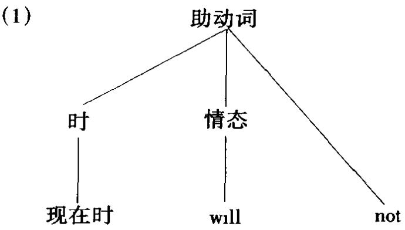  
(2)

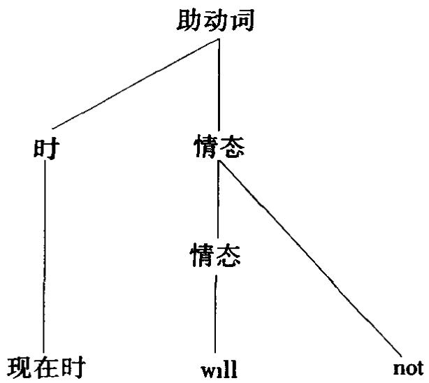

adnominal 定语 有些语法字家用来指名词短语中修饰名词的成分(由 AD-VERBIAL 状语类推而来)，诸如形容词、介词短语和“领属”名词等，例如 the bighat“大帽子”, the hat in the box“箱子里的帽子”, the vicar's hat “牧师的帽子”。这个术语也用来指一类关系小句(例如 the car which he bought“他买的车")。

adstratum 接加层 有时用于社会语言学，指一种语言跟一种相邻语言接触后产生的一些特征。语言的会聚过程会逐渐形成一个语言地域。这个术语意在跟下位层和上位层对照，后两者是指一种语言受某些相邻语言的影响而结果是与

相邻语言的差异更加明显。

adultomorphic（adultocentric）成人形态分析(成人中心分析） 在语言习得研究中这两个名称有时用来指搬用成人语言的分析法来分析儿童言语。例如把allgone“都没了”说成是一个省略句，或用国行音行来描写婴儿的咿哑学语声。当然，要为儿童言语设计一套基本上或完全摆脱成人价值观的术语或标记法是很困难的，但是，有人坚持认为，引入过多的成人假设，结果把儿童并不具备的语言知识说成是儿童具备的，这种做法应尽量避免。

Adv 或 ADV副词(adverb)或状语(adverbial)的缩写，常用于生成语言学研究。

advanced tongue root 舌根前伸 见 ROOT(2)舌根条。

advancement 升级关系语去的术语，指一类改变关系的变化过程。跟某个动词有某一语法关系的一个名词短语变成跟这个动词持有另一种在关系等级上较高的语法关系，例如，将宾语变为主语的过程。

adverb(ial)副词(状语) 词的语法分类中用来指一组内部不纯一的词，其最常见的功能是说明动词的行动方式。英语里许多(但不是全部)副词用词尾ly作标志，例如 quickly“很快地”，比较不加ly的soon“不久”。句法上，可以将副词与how“怎样”、where“哪里”、when“什么时候”、why“为什么”起头的提问相联系，并作相应的分类，如分为“方式”副词、“地点”副词、“时间”副词，等等。然而这样一来，副词与副词短语(adverb phrases)、介词短语、名词短语、副词小句(adverbclauses)在功能上的等价也就十分明显，例如，A:When is she going?“她什么时候去?”B;Now“现在”/ Very soon“很快”/ In five minutes“五分钟后”/ Next week“下星期”/ When the bell rings“钟声一响”。“副词短语”(常略作 AdvP)是以副词作中心语的短语，例如 very slowly“很慢地”， quite soon“很快地”。状语(adver-bial)这个术语广泛用作涵盖上述五类副词性成分的一个统称。“副词”因而是词的一种类别(与名词、形容词等并行)，而“状语”是小句结构的一种成分(与主语、宾语等并行)。伏语承担的句法角色有多种，其中修饰动词传统上认为是最主要的。语言研究中也强调状语充当句子修饰语或句子连接语的功能，例如However“然而”/Moreover“此外”/ Actually“实际上”/Frankly“老实说”Ⅰ thinkshe was rght“我认为她是对的”。还有其他几类在分布和功能上很不一样的词也归在副词(状语)的名目下，诸如程度副词(如very“很”，awfully“非常”)和否定小词(如 not“不”);但语言研究常为其另立词类。另见MANNER(3)万式、QUANTIFIER量词、RELATIVE(1)关系语诸条。

adversative 转折语 语法和语义字中指表达对昭或对立情状的词语。转折义的表达有好几种语法方式，如借助连词(but“但是”)、状语(however“但是”，ne-vertheless“不过”, yet“然而’, in spite of that“尽管如此”,on the other hand“另一方面”)、介词(despite“尽管’,except“除之外”,apart from“除非”,notwithstanding尽管”)等。

aerometry量气术 语音字里指测量言语过程中的气流，也叫电子量气术(electroaerometry)。已设计出好几种仪器，如电子量气仪(electroaerometer)，来提供这类数据，用一个特制的面罩能分开测量口和鼻进出的气流。

affect(ive)情感义(情感的) 有时在语乂宇中作为意乂分类的术语之一，指意又中的态度成分，例如词项所包含的感情联想(或内函)(如 a youth/youngsterstood on the corner有个年轻人/小伙子站在拐角处’)或语调所表达的态度(或“情感”)。情感义(affective meaning)通常与认知又相对立。可替换术语有感情乂和态度义。

affected 承事 有些语言字家按格或参与角色给句子作语法或语义分析时使用的术语，通常指不引起动作发生(由动词代表)的一个实体(有生的或无生的)，但又以某种其他方式直接参与发生的动作。典型的承事由直接宾语充当，例如kicked the ball“我踢那只球”。受事、宾格、目行三个木语有时也按这种意义使用，但也常作其他解释。

affirmative肯定式 语法描写中用来指一类不带否定标记的句子或动词，也就是说，肯定式表达一个断言。与肯定式对立的一“极”是否定式，涉及这-对立的语法系统通常在极性这个名目下讨论。

affix(-ation，-ing）词缀(添加词缀) 只能用来附加于另一个语素（词根或词千)的各类构形成分的统称，也就是说，词缀是一类“粘附”语素。一种语言词缀的数目有限，根据它们相对于词根或词干的位置一般分为三类附加于词根/词干开头处的前缀，例如 unhappy“不高兴”;附加于词根/词干之后的后缀，如 happiness“幸福(名)”，附加于词根/词干内部的中缀。不太常用的术语有“外接缀”(circumfix)或“双缀”(ambif1x),指前缀和后缀的组合(例如 en light en“启发”)。语法或词厂信息附加于词干的构词过程叫做添加词缀(affixation)，包括“添加前缀”、“添加后缀”、“添加中缀”。从另一个角度出发，词缀可分为屈折和派生两类。有人提议以一个词内词缀的数目多少作为区分语言类型的标准之一，即所谓的词缀指数(affix(ing)index)。那些主要通过词缀来表达语法关系的语言称作词缀语(affixing languages),有“前缀语”(如班图语)和“后缀语”(如拉丁语和希腊语)。

生成语法在用公式表示规则时，“词缀”这一术语除了指ing，be,have之外还指“现在时”和“过去时”这样的概念。生成语法中的词缀跳越(affix-hopping)

是一条将一个词缀附接于语符列中适当构形成分的强制性转换规则词缀跳跃并越过相邻的动词，例如 ing + go 变为 go + ing。词缀形态学(affixal morpho-logy)认为，唯一许可的形态变化是词干加词缀的组合(其他变化，如元音差变或删除都属于音系字的范围)，这一限制在非词缀形态学(non-affixal morpholo-gy)中不存在。

affricate(-d,affrication）塞擦音（塞擦，塞擦的）按发音万式给辅音分类的术语，指声道完全闭塞处后面的气压逐渐除阻释放时发出的音；初始的除阻产生一个破裂音，但随后的分离慢得足以产生听得见的摩擦声，于是这个音也有了擦音成分。但是摩擦的音延通常不像单独的擦音那么长。如果摩擦音延确实十分短，就用塞擦(affrication)这个术语。在某些英语万言如伦敦方言里，可听出塞擦的(affricated)破裂音，如[t]和[d²],听觉上极短的摩擦成分在记音时用上角符标示。这就成了破裂和摩擦的结合，相当于一个塞擦音。英语里只有[t]和[d]两个音以这种方式除阻，如 chıp“薄片”中的 ch[tʃ],just“公正”中的][d3]。德语的例子是[pf-]pfennig“便士”和[ts]zu“到”。塞擦音在语音字里容易定义，但在音系分析中要确定一个破裂音成分加擦音成分的序列是一个功能单位还是最好分析为两个分离的单位，却常常是一个问题。例如英语[tʃ]可以在词首、词中、词尾三个位置出现，容易与其他音位形成对立，如chup“薄片”/sip“啜饮”，rncher“较富”/rpper“撕裂者”，patch“补钉”/pat“轻拍”。而[tr]虽然能在词首和词中出现(trp“旅行”/sip“啜饮”，petrol“汽油”/petal“花瓣”),却不能在词尾出现。还有[tθ]只能在词尾出现(eighth“第八”/eight“八”)。语音上这三个音都可以看作塞擦音，但从音系上讲，对那两个分布受限制的音是否可以有效地认定为塞擦音，就会有不同的意见。

agentive(agent-less）施事[格](无施事的） 语法描写中用来指一类形式或构式，它在句子中的典型功能是指定某一行动得以产生的“施动者”或手段。在有些语言里，这个术语用作名词的一个格，与宾格等并行。英语里这个术语特别跟被动式相关，被动式里施事可以出现也可以不出现(无施事(agentless))，例如the man was bitten [by a snake],那个人被[蛇]咬了。英语的主动式,施事通常是语法主语，但在某些句子里(常常也在其他一些语言里)，施事这一功能需作较复杂的说明,例如像 The window broke “窗子碎了”(参看作格条)和 We ran the carout of petrol“我们开车开到汽油用尽”。“施事”(后来也写作 agent)在好几种语言理论中有特殊的地位，例如在格语法和管辖与约束理论中，施事格的定义跟上述的类似，但又被视为一套固定的语乂格或角色(题元角色)中的一个，与宾格、与格等并行。与格语法有关的论述中还使用反施事这一术语。

agglutinative（agglutinat-ing,-ion）粘着语（粘着，粘着的） 比较语言学用结构标准(与历时标准相对)确立的一种语言类型，集中体现在词的特点上。在粘着语(agglutinative或 agglutinating languages)里，词通常是一个语子线性序列，有如英语的dis/establish/ment“废除”，因此与孤主语和屈折语对立。跟其他分类一样，类别的区分兑是不能一刀切：不同的语言多多少少显示出“粘着”的特性。具有较大粘着程度的语言包括土耳其语和日语。

AGR 一致标记 管辖与约束理论中AGREEMENT的缩写，特别指限定小句里屈折(INFL或I)范畴的一致关系特征。

agrammatism 语法缺失症语言病理学惯用的术语，指失语症中的一类言语产生故障，具有句法结构呈电报式、功能词和屈折形态丢失、语法范围全面缩小等特征。语言理解也可能同时有问题。语法缺失症已引起神经语言字和心理语言字的关注，成为对大脑语言处理机制研究的一部分。过去通常把语法缺失症(语法项目的丢失)和语法错乱症(paragrammatism,语法项目的错误替换)区分开来，但经常是同一患者程度不等地同时表现出这两种症状，因此现在认为这种区分只是遮盖而不是澄清这一现象的性质。

agreement 一致关系语去理论和描写的传统术语，指两个成分之间的一种形式关系，即一个词的形式需与另一个词的形式相对应。以拉丁语为例，成分间的一致关系十分重要，由于缺乏固定的词序，一致关系是表达各种语法关系的主要手段之一。语言学文献中一直倾向于用协调来指一致关系，但最近在生成语言字里“一致关系”一词又重新露面并有新的应用范围。在管辖与约束理论中，限定动词的人称、性、数的一致标记(agreement marking，缩写 AGR)在约束理论和格理论中起重要作用。在概化短语结构语法中，控制一致原则（controlagreement principle,CAP)是一条以语义为基础的支配一致标记分布的原则。

airstream mechanism气流机制语音字术语，指一种生理过程，它提供言语音产生的能源。空气通过这一机制的运动吸入或吁出，分别产生内吸和外呼气流。气流运动的主要发动器是肺(肺气流)，它是人类产生绝大多数语音的基础。“声门”气流机制，顾名思义，是利用声门(声带之间的间隙)的运动提供能源(见GLOTTAL声门音条)。“软腭”气流机制，也顾名思义，是舌后贴着软腭运动产生气流(见VELAR软腭条)。还可以利用声道其他可移动部位来引发空气振动，如利用双颊或食道，但这些不是正常的语音产生方法。利用双颊会产生“口腔”声(有唐老鸭声的效果)；“食道”声是教那些喉被手术切除的人说话的语音特点。

Aktionsart 词形体 见 ASPECT 体条。

alethic真势[情态]原为模态逻辑术语，有些语言宇家在分析语言的情态动词和相关结构时用来构建理论框架。真势情态(alethic modality)关涉到命题的必然真或偶然真，例如像 The car must be ready 这种包含情态动词的句子，按真势情态理解意思是“根据已知情况(如汽车已停在门口)汽车显然已准备好”。真势情态有别于认识情态和义务情态，上面这个句子按认识情态理解意思是“汽车想必已准备好了”，按义务情态理解意思是“汽车必须准备好”。

algorithm 算法 语言字和语音字应用控制论和计算科学中通用的这个术语，指为执行一项复杂操作而设计的一个程序，即将其分解为一系列精确规定的简单操作，例如计算机程序的流程图。语言学对这一思想的主要运用见于生成语法的一系列分析性陈述。

alienable 可让渡的 语去分析中指一类在某些语言(如汉语)中形式上有行记的领属关系。如果领属物被视为只与领有者有临时的或非必然的依赖关系，那就说它是“可让渡的”，如果它与领有者的关系是永久的或必然的，它就是不可让渡的(inalienable)。可让渡领属关系(alienable possession)在英语里形态上没有明显标记,但语义上的对立是存在的，如 the boy's book“男孩的书”(可让渡的)和 the boy's leg“男孩的腿”(不可让渡的)。

allative向格 语去描写中用来指一类屈折形态，表达的是“向”或“朝”某处运动的意思。向格见于芬兰语和其他一些语言中，与入格、近处格和其他几种表示“局部”时空义的格并存。

allo--变体 语言字通用的—个前缀，指一个语言单仁任何在形式上可见到但并不影响其在语言中功能特性的变异。见到的形式变异在语言学上没有区别作用，即不涉及意义的改变。例如，书写语言由一系列字母或字位组成，但每一个字位可以有多种写法，取决于语境字体选择手写变化等因素。例如“字母A”可有A,α,a,a等多种形式，每种可能的形式是一个抽象的字位(A)的字形变体它们都是同一字位〈A>的字位变体(allographs)。不管 cat“猫'这个词写成 cat，cAt,还是cat等，这个词的身份保持不变(尽管这些不同写法的可接受程度不等)。

音系字最早确立这种关系，即音位变体(allophones)与音位的关系。一种语言的音位是抽象的单位，它们具体的语音形式取决于许多因素，特别是相对于句子中其他音的位置(参见 COMPLEMENTARY DISTRIBUTION 互补分布条)。例如英语音位/t/通常的发音部位在齿龈(如eight“八”)，但也可以在齿的部位，如eighth“第八”，这是由于受后头th音的发音部位的影响。因此说此例的/t/音位有齿龈音和齿音两个变体。每个音位原则上总是可能有许多变体，因为言语社会中存在各种各样有个人特占的发音(参看FREE自由变异条)。教科书通常说明一些主要变体，即明显受语言或社会(如口音)环境制约的变体。从术语学的角度看，以上现象也可称作同音位变体(allophonic variant)，有时也简单称为“语音变体”(phonetic variant)或“子音位变体”(sub-phonemic variant)。音位变体与音位之间的关系是一种实现关系：音位变体是音位的“实现”。音位变体之间的差异可以用音韵规则来说明。

比昭音位/音位变体的区别，随后语法中也确立了变体的概念，语言中许多语素以不同的形式出现，这也取决于它们出现的环境。例如英语里表示复数的语素有几种不同的变体形式 cap- caps“帽子”,log- logs“圆木”,force- forces“力量”,mouse-mice“老鼠”,sheep-sheep“羊”，等等。每一个变体形式—caps不带声的[s],logs带声的[z],mice的不规则形式，等等—称作复数语素的语素变体(allomorph)，也称作语素交替形式(morpheme/morphemic alternants)。

与“-变体”(allo)有关的主要术语，如上所述，都与以“-位”或“一素”(eme)结尾的术语对立，这种“位”与“变体”的关系是语言分析的一条重要解释性原则。自本世纪30年代引入“-变体”这一术语以来，提出的其他类似的位与变体的关系当然还不少，例如时位变体(allochrone)，指一个最小时长单位，音长位(CHRONEME),指最小音长单位的非区别性变体，身势位变体(allokine)，指一个身势位(KINEME)即身体运动的最小单位(如一个手势或一个面部表情)的非区别性变体，义位变体(alloseme)，指一个意义的最小单位即又位(SEMEME)的非区别性变体。但结果表明这些都不像音位变体和语素变体那么有用。将这一术语用于语言分析的其他方面，及进而用于一般的行为分析(如给舞蹈、歌唱、辨味、运动的单位分类)究竟会有多大的收益，这还是个有争议的问题。

alphabetism 首字母缩写词见 ABBREVIATION 缩写条。

alphamovement（α movement）阿尔法移位（α移位）移位阿尔法(MOVE ALPHA)的可替换术语。

alphanotation阿尔法(α)标记法生成语言宇的一种惯用的记音法，可以通过引入一个变项来简化规则的表述。例如在生成音系字中，当两组特征之间可以互相推导时，为避免对每个特征出现的条件不得不作单独的表述，就使用这种标记法。例如，为说明一种语言里的带声破裂音总是圆唇音，而不带声破裂音总是非圆唇音，可以用一个变项α来代表[+带声]\~[+圆唇]和[-带声]\~[-圆唇]这两种可能有的关联，从而把两条规则合并为一条，即[α带声]⇒[α圆唇]。这种方式的音系研究中，这种标记法还有一些新的发展，包括利用其他的变项。

alternating 交错(用于节律音系学) 见 METRICAL GRID 节律栅条。

alternation(alternant)交替(交替形式） 语言字用来指一个语言单仁可以互相替换的形式或变体之间的关系。表示交替关系的常用符号是\~。例如音系宇中，像 telegraph“电报”～ telegraphuc“电报的”， receive“接待”～reception“招待会”这种成对词中相关的两种元音音质有时就描述为交替形式，就像一个音位的不同音位变体。然而这个术语在形态字中最为流行，“语素交替形式”是语素变体的另一名称，有几种不同的交替类型。例如，“音韵制约的交替形式”可用复数语素的各种形式(/s/,/z/,/z/)为例来说明，这些形式可以根据前头的音韵环境来预测(即“形态音位交替形式”)。“语法制约的交替形式”没有这种有规律的预测性，交替形式的出现完全取决于周围环境出现的具体语素，例如英语过去分词的各种形式(frozen“冰冻”，jumped“跳跃”等)。异千交替是另一类交替，指一个语素跟词形变化表中的其他形式缺乏任何有规律的音韵对应，例如go“去(现在)”\~went“去(过去)'。句法中交替关系的例子见于各种语法范畴，如时范畴(现在时～过去时～将来时)。

alveolar齿龈;齿龈音 按发音部位给辅音分类用的术语，指舌叶(或舌犬和舌叶一起)顶住齿龈隆骨(alveolar ridge,或 alveolum,指上齿后面的突出软骨)发出的音。英语中有好些音在齿龈部位发出—[t],[d],[1],[n]，[s],[z]。在齿龈隆骨稍靠后、几乎与硬腭交界的部位发出的音叫做后齿龈音(post-alveolar)。英语red“红”、trp“旅行”、drill“操练”等词中的r音就是在后齿龈部位发出的音。

alveo(lo)-palatal 龈腭音 按发音部仁对语音作语音字分类用的术语，指舌前在硬腭稍靠前、接近于齿龈的部位发出的音。国际音标中只有两个龈腭音，擦音[ε]和[z]，在波兰语和其他一些语言中出现。

ambifix 双缀，二缀见 AFFIX 词缀条。

ambiguity（ambiguous）歧义[性](歧义的) 语言字按一般意义使用这个术语，指一个词或句子表达不止一个意乂，但又区分出几种不同类型的歧义。近年来讨论最多的一类是语法(或结构)歧义(grammatical/structural ambiguity)。短语结构歧义是指同一构式可以指派不止一个组构成分结构，例如 new housesand shops 可以分析为 new [ houses and shops]“新的[房屋和商店]”，又可以分析为[new houses] and shops“[新的房屋]和商店”，前者是房屋和商店都新，后者只是房屋新。转换歧义是指不同的语乂表达式只有将歧义句与不同的结构联系起来才能显示出来。例如 Visiting speakers can be awful 这个句子可以转换成 It isawful to visit speakers“访问演说家是可怕的”，也可以转换成 Speakers who visitare awful“来访的演说家是可怕的”。可作两种以上结构理解的句子称作多重歧义(multiply ambiguous)。通过分析来揭示句子的歧义叫做句子的消歧。不是由句子的语法分析而是仅由个别词项的多重意义引起的歧义称作词汇歧义(lexical ambiguity),例如 Ⅰ found the table fascinating“我发觉那张桌子/图表很迷人”(参看polysemy一词多义条)。语义学的讨论有时区分“歧义”和“模糊”

歧义的句子是有不止一种结构，而模糊的句子则是多种理解的范围不可确定(即不能用句法或音系字木语来说明)。例如 He didn't hit the dog“他没有打狗”这个否定句，其不确定的含义是个模糊问题，因为不可能说明它究竟涉及多少种不同的底层结构，如不清楚它的意思是“他打了，但打的不是狗”还是“他虐待狗，但没有打”。另参看SCOPE辖域条。

ambisyllabicity（ambisyllab-ic,-ify，-ification）音节两栖性（音节两栖[的]，音节两栖化)几种非线性音系字模型(特别是节律音系字)的一条原则，在一种语言的底层音节划分中，它允许元音间辅音兼属两个邻接的音节，同时又不违背这种语言的音节模板结构。

amelioration 词义改良 历史语言字术语，指一种语乂演变类型，即词项失去原先的贬损函义，与词义共化相对。例如mischievous一词已失去原先很强的“为害的”涵义，变为现在温和的“调皮”义。

amplitude 振幅 原为物理声学木语，现用于声字语音字，指声波中的空气粒子相对一静止点来回运动的幅度。振幅越大，声音的音强越大，(伴随其他因素，如基频和音延等)感觉的响度也越大。

anacoluthon另续传统修辞学术语，有时见于会话的语言字研究文献，指一个句子预期的语法序列出现句去断裂，例如一个句子以一个构式开头，但未说完就续说另一构式，如 The man came and ——are you listening?“那个人来了而—你在听吗？”作为语言运用特征的一个研究方面，“另续”现象在最近的语言学研究中特别受到重视，而这些特征通常被排除在语言的语法之外。

analogy类推，类比历史和比较语言字术语，也用于语言刁得，指使一种语言的语法中的例外形式变得整齐规则的过程。例如，英语构成名词复数的规则模式会对不规则形式产生影响，可见于儿童早期话段对不规则形式的处理，例如mens,mans,mouses.这些形式是儿童根据规则模式“类推”出来的。万言也常有类推过程在起作用，而柠准语一直加以抵制，例如用goed/seed/knowed代替went/saw/knew“去/看见/知道(过去时)'。这种类比当然也常见于外国人学英语时的语误。“类推创造”是语言演变历史的主要倾向之一，例如古英语中过去时为不规则形式的那些动词后来变为以规则的 ed形式结尾，例如 healp变为helped“帮助”。

analysable(un-)可分析的(不可分析的) 生成语法用来指语符列适用于转换的那种特性。一个语符列如果符合转换规则的结构描写，它就是可分析的”，因而转换规则适用于它。例如，被动式规则(在一种公式中)适用的条件是符合这样的结构描写·NP- Aux - V- NP。就这条规则而言，像 the boy is kickıng theball“男孩在踢那只球”这样的语符列就是“可分析的，而 the boy has gone“男孩已离去”则不符合这条规则的结构描写，因而是不可分析的(unanalysable)。

analysis-by-synthesis 综合分析说一种言语感知理论，王张听话人有一个内在的、针对特定语言的机制，它对输入言语的反应是先选择某些声字提示特征，然后尝试综合成一个输入的复制品。达到这一步，综合过程实际已完成对输入的分析。这一理论认为，这样一个程序的优卢是能够解释听话人如何分辨由说话人或语境等因素的差异而造成的信号在声学上的变异。

analytic(ity）分析的(分析性）（1)分析语(analytic languages) 比较语言字按结构标准(而不是历时标准)确立的一种语言类型。标准注重词的特占“分析”语所有的词都没有变形(句法关系主要通过词序表达)。分析语常与纪合(或多式纡合)语对举而言，后者包括粘着语和屈折语，它们的词一般包含多个语素。东南亚有多种语言在词的结构上表现出分析性。跟其他任何分类一样，这里的类别也不是一刀切每种语言多多少少都有分析性的特征。

(2)分析命题/分析句(analytic proposition/sentence) 语义字术语，“分析”一词的意思主要源自逻辑和哲学。指使语法形式和词汇意义必然真的命题/句子，例如 Spinsters are unmarried women“老处女是未婚女子”。分析命题/句与综合命题/句对立，后者的真假是根据经验标准判定的。

anaphor照应语最近的管辖与约束理论使用的木语，指一类名词短语没有独立的指称，只能指称句子的某个其他组构成分(即它的先行语)。昭应语包括反身代词(如 myself“我自己”)，相互代词(如 each other“互相”)，名词短语语迹。与代名语和词厂名词短语(指称语)一起，照应语是约束理论的一个特别重要的组成部分按这一理论，照应语必须在它的管辖语类内受约束。这个术语的应用范围比传统术语复指语狭窄。

anaphora（anaphoric）复指(复指的，复指语） 语法描写中用来指一个语言单位从先前某个已表达的单位或意义(先行语)得出自身释义的过程或结果。复指(anaphoric reference)是标明正在表达的和已经表达的两者所指相同的一种方式。例如句子 He did that there“他在那儿干的那个”,其中每个词都起复指作用(即都是复指替代语（anaphoric substitutes)，简称复指词（anaphoricwords)) 先前的句子也许是 John painted thıs picture in Bermuda约翰在百慕大群岛画的这张画”，应答句中的每个词都与上文中的一个对应单位有复指关系。复指也称作上指，与下指(指称后面出现的词语)对立，有时也与直指或外指(直接指称语言外的情号)对立。但这个术语有时涵盖上指和下指两种功能。另见ZERO零形式条。

anaptyxis（anaptyctic） 加插[音](加插的） 用于比较语文字，有时也用于音系字，指一种类型的添音，即一个额外的元音添插在两个辅音之间，也是一种增音现象。加插元音(anaptyctic vowels)也称作寄生元音(parasite vowels)或梵插元音(svarabhakt1 vowels,因常见于梵语)，例如，英语某些方言的 film“电影”读作[filəm]。

anchor(-ing，-ed)锚位(锚定) 非线性音系字借用这个词的通常意思指某个单位所依赖的那个单位。例如，根节点被称作用来定义一个音段的各个特征的“锚位’。A音段如果联接至B音段，则B音段是A音段的“锚位”。一个未“锚定”的单位可称作孚存单位。“锚定”在韵律形态字中有特殊的含义对重叠作音系分析时，“锚定”是一个制约条件，对基础成分(B)和重叠成分(R)之间的关系施加结构限制，即在R+B序列里，R的起首成分须与B的起首成分相同，而在B+R序列里，R的收尾成分须与B的收尾成分相同。

animate（in-，-ness)有生的(无生的，有生性) 对词(特别是名词)作语法分类时用来指其指称对象是人和动物的那个子类，与无生命的实体和概念相对立。某些语言用形态手段来区分有生性(animateness)和无生性，就跟性的区分一样。英语里这种区分大多是语义上的区分，只有在人称代词和关系代词上有一定的形态表现(he/she/who与it/which的区别)。再有像表示“老”的形容词，elderly“上年纪的”是有生的，antique“古旧的”是无生的。而old“老”是中性的，可以是有生的也可以是无生的。

antecedent 先行语有些语法学家借用传统语法的这个术语指句子中的一个语言单位，句中的另一个单位(通常是后出现的)据此而得出自己的解释(复指)。特别是人称代词和关系代词回指或复指它们的先行语，例如 The car uhich wasparked it was“停放的那辆车 它是”。

anterior龈前[音] 乔姆斯基和哈勒在其音系字的区别特征理论中确立的语音特征之一，用来描写发音部位(腔特征)的变异。龈前音从发音上定义为在口腔腭龈部位前面用制流发出的音。唇辅音和齿辅音都是[+龈前]音(缩写为[+ant])。与之对立的是非龈前音(non-anterior),指不通过这样的制流发出的音，如软腭音、喉音和元音，它们都称作[－龈前]([-ant])。

anthropological linguistics 人类语言学语言字的一个分支，用人类学的理论和方法研究与人类文化模式和信仰有关的语言变异。例如，研究如何根据语言特征确定一个居民区(通常是原始的)的某一成员所归属的社会、宗教、职业或亲属群体。人类语言学与人类文化语言字和社会语言字有一定程度的交又，反映了人类学、民族学、社会学这些相关学科研究兴趣的部分重叠。也称作语言

人类学(linguistic anthropology)。

anthropophonics人类语音学 波兰语言学家让·波得瓦·德库德奈(1845一1929)提出的名称，指对人类发音器官产生语音的物理潜能所作的研究。包括对不同民族或不同人种的声道和个别发音器官作物理比较，从而确定解剖学上的差异(如舌的大小)是否有语音宇或音系字的后果。性别差异和年龄变化也在研究之列。这一领域的一般目标之一是想弄清，在人类演化进程中，个别语言的语音选择可能基于哪些原则。并非所有的语音学家都接受这一术语，不少人认为其研究主题只是语音学的一个组成部分。

anticipation先置 有些理语言字家用来指一类口误，即后面的一个语言单仁被提前说出，例如 catch the ball“抓住球”被说成 batch the call“分批处理呼叫”。

anticipatory（1)逆同化（anticipatory（或 regressive）assumilation） 语音字和音系字给同化分类的术语之一，指一个音由于后面一个音的影响而发生变化，例如 hot cakes“执糕”中的[t]被同化为[k]。与之对立的是顺问化和聚结同化。

(2)先协同发音(anticipatory coarticulation)最常见的一类协同发音，发某一音时不涉及的一个发音器预先朝话段中后面一个音的目标发音动作的方向移动。例如元音后头接一鼻辅音时可听到元音的鼻化，这是因为在发元音时软腭为发后头的鼻辅音预先下移。

(3)先行 it (anticipatory ut) 语法中有时用来指外置的 it,它对应于句子中稍后出现的一个成分，例如 It was nice to see her“见到她令人高兴”。这个先行 it(或“先行王语”)也称作“外置 it”或“先备 it”，区别于 It was raining“当时在下雨”中的支撑词it或假位it等。“先行”一词有时还用来指存在句中的 there(先行 there (anticipatory there)，例如 There were several people in the room“房间里有好几个人”。

antipassive 逆被动态 语去中用来描述作格语言(如迪耳巴尔(Dyurbal)语)的一类态，在功能上对应于非作格语言的被动态。作格语言的小句话题通常是受事，不是动作者(如英语)，而递被动态的构式用于那些选用动作者作话题的情形。逆被动态的形式比对应的作格形式复杂，动词带有一个派生的词缀标记。

antonym(y)反义词(反义关系) 语义宇研究意义对立关系的一个术语。“反又关系”与同义关系、下乂关系、不相容性等一起是有些语义分析承认的一组涵又关系。这个术语最一般的意思是统指各种类型的语义对立，下面再从不同角度分小类，例如区分程度反义词(graded antonyms)和非程度反义词(ungradedantonyms)，前者如 big“大”\~small“小”，有程度差别，后者如 single“单身”～marned“已婚”，非此即彼。有的语言学家(如英国的约翰·莱昂斯(1932一))用这一名称限指特定的一类对立关系，即程度反义词，而非程度反义词则称为相反词语义分析究竟应该区分多少种有用的对立关系，这是个有争议的问题，因此在使用“反义词这个木语时必须持谨慎态度。

aorist(ic）不定过去时(完成体) 有些语言的语法描写用来指动词的一种与众不同的过去时或体的形式，其功能主要是表达不明确的完结、持续或重复。例如，古希腊语的不定过去时王要是一种直阵语气的过去时，而在其他语气中表达体意义。某些现代语言(如保加利亚语)的传统语法用这一名称限指完成的过去时。在对体作跨语言的计论时aoristic有时用来指“完成体”。

A-over-A A冠 A 诺姆·乔姆斯基提出的一个木语(见《语言与心理》，1968),用来指施加于某些语法转换操作的一个条件。A冠A原则或条件(A-over-Aprinciple/condition)规定，如果一种转换适用于形式为[、[A]A]、的结构，那么对于任何一个语类A，这种转换必须适用于A语类的最大短语。例如John kept the car in the garage 这个句子有歧义，一个意甲是“约翰在车库里收藏那辆汽车”，一个意巴是“约翰收藏车库里那辆汽车”(“玛丽收藏大街上那辆汽车”)。可以用疑问句来消歧，例如 How much did the car in the garage cost?“车库里那辆汽车花多少钱?”只与第二种意思相关，即只与短语 in the garage“车库里”属于一个更大的名词短语的句子相关。A冠A原则规定，任何适用于car“汽车”的转换操作一定也适用于garage“车库”。《语言与心理》一书还以其他构式为例说明这样一种条件的必要性。但是，这条原则在应用时遇到好几类例外，它的普遍适用范围要比原先预期的窄。

aperiodic 非周期的 见 PERIOD 周期条。

aperture间隙[度]各种模型的非线性音系字用这个木语描写发音开口度的对比。例如在杠子音系字里，间隙度是一个代表开口度的缺值特征(粒子)，用符号[a]表示。元音高度的区别由若干间隙度粒子的组合来描写例如，[a]与腭音[1]组合得出开口度较大的腭元音，如[e]。在音系学的收缩模型里，间隙度指施加于元音(VOCOID，包括一般元音(VOWEL)和骨音)的收缩程度，它支配元音的高度特征。间隙度是给元音(vocoid)分类的两个王要参项之一(另一个为发音部位),上位节占叫做间隙度节点(aperture node)。在有的模型里，曲拱音段被分析为由间隙度节占组成的序列。一般认为间隙度分三类完全没有口腔气流(如口腔塞音)，足以产生气湍流(如擦音)，不足以产生气湍流(如口腔响音)。

apex(apic-al，-o) 舌尖(舌尖音，舌尖的) 语音字指舌的顶端(又叫TIP)。有几个语音的发音靠舌尖，如颤音[r]和某些齿音变体(即“舌尖齿音”(apico-dental))。这些音因此可划归舌尖音(apical)。

aphaeresis（aphesis,aphetic）首音割弃（首元音割弃） 比较语文字术语，有时也用于现代音系字，指一个词首音的删除，常与内音割弃和尾音割弃相对而言。例如历史上knıfe“小刀一词/k/音的丢失，I've‘我有”这种缩约形式的形成。首元音割弃(aphesis)是首音割弃的一种——词首非重读元音的丢弃(gain‘又”)。

apico -舌尖的 见 APEX 舌犬条。

apocope尾音割弃 比较语文字术语，有时也用于现代音系字，指一个词结尾音的删除，常与首音割弃和内音割弃相对而言。例如在 snakes and ladders‘蛇和梯子’和 cup of tea一杯茶 这样的短语中, and “和 读作/an/,of 读作/ə/。

apodosis结果小句传统语法术语，现在也见于语义字，指条件复句中表达结果或后果的王要小句，与条件小句(protasis)相对。在句子 We shall get in if wequeue“如果我们排队我们就能进去”中，we shall get in“我们就能进去’是结果小句，f we queue‘如果我们排队”是条件小句。

appellative 通称名 见 EPONYM 名祖条。

appendix 附音 见 FXTRASYLLABIC(1)超音节的条。

application（applicab-le,-ility）（1)适用（适用的，适用性）有些语言学家用来指语言和非语言实体语言和环境之间存在的总体关系。‘适用”二个语言单位就是可在一个特定的语境里使用它，可以说一个单位“适用’于那个语境。例如，一个词项适用于一系列不同的语境(没有一个是其正常外延或指称对象的组成部分)，例如heap“堆”一词适用于一辆汽车一所房子一座雕塑等。这个术语对翻译特别有用，一对表面上等同的词结果证明有不同的适用范围；例如法语 merci“谢谢”的用法不同于英语的 thank you‘谢谢’。如果不同语言的两个词项适用的语境完全对应，就说它们的适用范围相同。

(2)适用语法(apphcational grammar) 俄罗斯语言学家芳姆扬(S KSaumjan,生于1916年)提出的一种范畴语去。这种语法的基本单位是项(α)和句(β)。

applicative 双系式 语法木语，指某些语言中的一类双宾语构式(大致相当英语的直接/间接宾语构式)。动词的双系词缀将一系列不同角色，如受益者和处所，实现为宾语。双系式可以分析为一种态，注意的隹占在宾语的类型而不在王语与宾语的关系。双系式广泛见于诸班图语言。

applied linguistics 应用语言学 语言字的一个分支，主要关心的是如何应用语言学理论、方法和成果来阐释其他经验领域遇到的语言问题。应用语言学发

## apposition

展最充分的分支是外语教学，有时这个名称似于只指这个领域。但是近年来出现了好几个其他应用领域，包括语言故障的语言学分析(临床语言字)、母语教育中的语言使用(教育语言字)、词典字的发展、翻译和风格字等。应用语言学与语言学其他交又学科分支，如社会语言字和理语言字的分界不明确，特别是因为后者关心的好些问题步及地道的“应用’研究(如国家语言政策的制订)得出的实际结果。另一方面，随着这些分支逐渐建立起各自的理论基础，“纯理论”和“应用’之间的区别越来越明显，例如，现在经常遇到将某一类研究归入“应用儿理语言学”的情况。另见 PRAGMATICS语用宇条。

apposition(al) 同位语(同位的) 某些语法描写模型中仍然保留的传统术语，指处于同一语法层次上的组构成分组成的一个单位序列，这些单位的指称相同或相似。例如，句子 John Smith, the butcher, came in“约翰·史密斯，那个屠夫，走了进来”里有两个名词短语，它们的指称相同，句法功能也相同(可以略去其中任何一个而不影响句子的可接受性，例如 John Smith came in“约翰·史密斯走了进来”/ The butcher came in“那个屠夫走了进来”)。但是在定义同位语这个概念时存在许多理论和方法上的问题，因为有好几种构式它们只符合上述标准的一部分，并且牵涉其他语又和句法问题，如标题和其他名称(the number six“数目六”,my friend John“我的朋友约翰”等)。有时同位关系小句(appositive rela-tive)用作非限制性关系小句的替代术语。

appropriate(ness）得体(得体性）语言字，特别是社会语言字、语用字、风格宇，借用这个名称的一般意巴来指一个语言变体或形式被认为适用于或可用于某个社会情景。例如，省略或缩约形式(如I'l1“我将”，isn't“不是”，goung tolunch？“去吃午饭?”)适用于相对非正式的会话情景；像 thou“汝”、vouchsafe“赐予”这种形式适用于某些宗教场合。这个术语主要是针对语言的规定描写中正确性这一术语，后者的含乂太绝对，语言形式要么正确要么错误，不考虑人们对不同场合的不同期待。在语用学里，句子的得体条件一般叫做适宜条件。

approximant [无擦]通音 有些语音字家按发音万式给语音分类时一般使用的术语，相当于按其他研究方法定义的无擦连续音，即[w]，[j]，[r]，[1]四音及所有的元音。这个名称是基于牵涉的发音过程，即一个发音器向另一个发音器靠近，而间隔变狭的程度又不足以产生听得到的摩擦声。在有的分析中，[h]也算作无擦通音(即后头元音的不带声对等音)。

arbitrariness(arbitrary) 任意性(任意的) 一般认为是给人类语言定义的一个属性(与其他符号系统的属性对立)，指语言形式与其指称的外界实体之间没有任何自然的对应关系。例如，table“桌子”一词中没有任何东西反映桌子的形状等特性。音和义之间的联系是“任意的”，或按经典的传统说法，是“约定俗成”的。但是，语言中有些词部分或完全具有象似性，它们确实反映语言外部世界的特性，例如象声词 splash“啪(溅水声)”，murmur“嘁嘁喳喳”，mumble“咕哝”等。

arbitrary reference 任指 生成语法特别是管辖与约束理论使用的术语，与某些不定式用大代语 PRO 代表的不言自明的王语有关。例如 It's easy PRO toannoy John“约翰这人容易招他生气”里，不定式有一个空位 PRO主语不受控制(即不与句中其他某个名词短语同指)，而是理解为“任何人”。这种指称就是任指。

arboreal树状的生成语言字有时用来描写树形结构。在节律音系字里，树状栅(arborealgrıd)是对节律树的一种修改，中心成分与其母成分节点在垂直方向上配列，结果形成一个有如栅状的中心成分层级构型。

arc弧关系语法的惯用术语，指一个句法单位(或支配语)与构成其关系结构的诸实体之间存在的一种有方向的依存关系。“关系网络”中的“弧”用曲线箭头表示；也可用依存关系树来表示依存关系。弧也是各种网络语法的一个重要手段。先在弧对与弧对之间假设各种关系，然后这些弧对再在“弧对网络”内互联(如弧对语法(arc-pair grammar)),本世纪 70 年代中期提出的一种形式化的关系语法)。

archiphoneme 原音位音系字术语，指一种处理中和现象(即在词的某些位置上音位的对工消失)的方法。例如，在首辅音/s/之后出现的破裂音没有对工关系(如没有与skin“皮”对立的\*sgmn)，音系学家面临的问题是如何分析这些词中的第二个成分。选用清音/skin/来记音或者选用浊音/sgin/来记音都会赋予这个成分本身不具有的对立性。布扛格字派音系学家尼古拉·特鲁别茨考依(1890—1939)提出的解决办法是为此建立一个新范畴，他称之为原音位，并用一个新的符号来标记。有时使用一个大写字母，例如/sKm/。也有人提出分析这一现象的其他方法，如采用形态音亿的分析法。

archistratum原层语 社会语言字有时用来指一种占优势的语言变体，一个社团从中汲取文化或智识方面的词汇。例如，古典阿拉伯语是整个伊斯兰世界的原层语。

area(1)地域(地域的) 万言学用来指任何根据语言特点划分的地理区域。研究不同“地域”的语言特点——分析它们的歧异形式和历史渊源——叫做地域语言学(areal linguistics)。语言的地域分类(areal classification)建立不同的地域类型(areal types)或语群(groups),诸如斯堪的纳维亚诸语言，受伦敦方言影响的诸方言等，这是由于相邻言语社团接触的结果可能使某些共同的语言特点表现出来。地域分类经常不理会纯粹按历史依据作出的分类。在一个地域内，经常可以找出一个中心地域(focalarea)—语言特点从这个中心扩散到整个地域(伦敦就是这样一个中)。另有儿种重要的地域用不同木语表示，如过渡地域(transitional area)是两个相邻地域的中间地带，残余地域(relic area)是保存早期发展阶段语言特占的地域。语言的地域差异与语言使用的非地域(nonareal)差异相对立，后者如男性和女性言语的差异，某些社会语言变体之间的差异。德语术语Sprachbund(语言联盟)也表示“语言地域”的意思并广为使用。

argument 主目 谓词演算使用的木语，也常见于语义字理论的讨论，指一个名称与其所在的简单命题之间的关系。例如,对命题 the boy is naughty 男孩很顽皮”而言，theboy‘男孩”是命题的一个“主目’。在格语去里，每个底层命题都分析为一个谓词加上一组无次序的王目槽，每个主目槽按其与谓词的语义(“格”)关系加上标签。在最近的生成语法中，主目用来指句子中任何一个名词短语位置(即王语、宾语等功能位置)。在管辖与约束理论中，主目是配有题元角色的词语，可以指派一个题元角色的位置叫做主目位置(A(rgument)-position)。在形态操作过程中保持主目结构叫做承继(inheritance)，例如由动词派生而来的带ing的名词容许承继源动词的所有主目(如 the putting of the ladder against thewall “梯子靠着墙的放置')。优先主目结构(preferred argument structure)体现语言的一种可论证的话语倾向，指某种优先使用的句法结构例如，实词性名词短语倾向于充当不及物动词而不是及物动词的主语。

arrangement 配列 语言字用这一术语指语言成分按其相对位置或分布组成的任何序列，例如音节和词内各音位可能有的组合序列，词和句子内各语素可能有的组合序列。配列是语言描写中项目与配列模型的一个基本概念。

article 冠词 词的语法分类中指限定词的一个子类，其主要作用是区分名词的不同用法。例如英语the/a。许多语言没有冠词系统(如俄语)。有冠词系统的语言通常部分按语义标准部分按语法标准区分两类冠词[有]定冠词(definite)和不定冠词(indefinite,或 non defınite)。冠词可以位于名词前(如英语)，也可以位于名词后(如瑞典语)。另见ZERO零形式条。

articulation(articulat-e,-or(y))（1)发音[过程](发音,发音器,发音的)语音字一般术语，指在喉以上声道内改变气流以产生各种语音时发生的生理运动。语音按发音器官的发音部位和发音万式分类。通常考虑的因素有气流机制的性质声带的动作软腭的位置、口腔中的其他器官—特别是舌和唇。产生一个语音时步及的发音器官的任何一个具体部分称作发音器(articulator)。发音器分两类‘王动”发音器是发音器官中可运动的部分，如双唇、舌和下腭，“被动”发音器是声道中不能运动的部分，但为主动发音器提供运动的参照点，如上

腭和上齿。

近年来，利用各种仅器技术对发音过程进行的研究强调，不应把发音过程视作一个个单独发出的语音形成的序列，而应视作一个语音产生的连续体。这一原理由于使用语音记音法而被遮掩了。例如，记作[kæt]给人有三个离散音段的印象，被避掩的是音段与音段之间的过度，即几个发音器同时运作，逐渐从一个发音位置移向下一个发音位置。虽然可以设计出反映这种连续变化(动态)参项的记音法，但是形式过于复杂，不像音段记音法那样一目了然。

发音过程可以分几种类型。大多数语音的产生只有一个发音占，但语音也可以通过两个发音点产生(协同发音)，这又有两种发音可能性一种是两个发音占对一个语音的产生作出同等的贡献(“双重发音”或“并列协同发音”)，一种是一个发音点为主导发音占(王要(协同)发音”)，另一个的制流作用则较小(“次要(协同)发音”)。次要发音的例子有腭化、软腭化、咽化和唇化。

(2)双层组构(double articulation) 短语 double articulation 除指“双重发音”外还有一个用法，与法国语言学家马丁内(Andre Martinet,生于1908 年)的语言理论有关。他用这个术语指语言构造分为两个结构层次言语可先分析成一系列有意义的语言形式(即语素、词等)，这是“第一'层组构，这些单位然后又能进而分析成一系列无意义的语音单位(即音仁)，这是“第二”层组构。使用更广泛的对等术语是结构双层性。

articulator-based feature theory基于发音器的特征理论 音系字一种新发展的特征理论，用一系列独立运作的发音器(唇、舌前舌体、舌根软腭、喉)来模拟言语，这些发音器用不同音层上的节点来表示。发音器特征也叫做“部位”特征，因为它们都归并在特征层级的部位组构成分之下。唇舌冠、舌背三个节占代表单值特征。发音器约束特征(articulator-bound features)指依赖某一特定发音器的特征，它们进一步指定发音器形成的收缩的性质(例如舌大和舌叶发音在舌冠节占下能用特征[龈前]和[长阻]来区分)。发音器自由特征(articula-tor-freefeatures)(或“制流特征”)并不受限于特定的发音器，它们可脱离具体的发音器来指明语音的制流程度(例如[+连续]音表示一股连续气流通过口腔中心，不管主要制流发生的部位)。这一理论的主张者认为这种模型的优占之一是能按发音部位和制流方式对元音和辅音的发音过程作出统一的说明，例如，在一个模型里，像后、高低这样一些特征与舌体特征一样都连接在舌背节点下，圆唇特征连接在唇节点下。

articulator model 发音器模型 一种旨在将语音字和音系字合并在一个模型里的理论，为支配个别发音器官运动的肌肉活动提供特征分析。这一理论于本世纪80年代发展起来，对后来形成的几种音系学观念，特别是特征构架理论，产生过影响。

## articulatory analog

articulatory analog 发音模拟器 见 SPFFCH SYNTHF SIS 言语合成条。

articulatory phonetics 发音语音学 语音字的一个分支,研究发音器官如何产生(“发出)语音。其描写木语不少来自解剖学和生理学，因此有时也称作“生理语音学”。这个领域传统上一直是训练语音学家的主要内容，发音器官的运动大致在观察手段的可及范围内并受调查者的控制。例如，国际音行采用的语音分类法就是基于发音变项。近年来，观察和测量诸如舌、唇、腭和声带等运动的仅器和技术已有很大发展，如腭位图仪能显示舌与腭的接触，电子量气仅能测量通过口和鼻的相对气流，电子肌动图仪能测量说话时肌肉的运动。利用这些技术比利用传统的视觉和动觉方法能更细致地了解发音过程。

articulatory phonology 发音音系学 一种旨在将语音字和音系宇结合起来的理论，利用定义为“音姿”的基本对比单位—发音事件的抽象单位，有内在的时间度维。话语被模拟成一系列音姿组织而成的型式(“群集”)，其中的音姿单位可以在时间上部分重叠。结果得出的音系结构是一个基于发音过程的自然音类的层级，可用来描写特定语言的音系结构并解释音韵变异。

articulatory setting 发音定式 语音字里指说话时禾取和保持的由所有发音器共同形成的总体型式，也称作语音定式(phonetic setting)。发音定式能解释语言之间和万言之间某些明显的音质差别，例如带有特殊的鼻音声或圆唇的程度极高。有时用发声定式(phonatory setting)指一种特殊的发音定式喉取一种习惯定式，结果产生像低声耳语或嘎吱声的嗓音音质。“发音定式”一般用来指言语音段链产生过程中的各种协调倾向，发音器官的某一特定型式因而得以保持。因此这个术语除了指与副语言特征和音质有关的非音段效应外，还涵盖协同发音、同化、元音和谐等音段特征。

artificial language 人工语言，人造语 为某一特定目的而发明的语言。人工语言包括那些为加速国际信递而设计的语言(一种辅助语，如世界语)，编程语言(如 BASIC语言),人工智能用于跟计算机或机器人交谈的语言(如 SHRDLU语言)，有学习困难的人使用的简化语言(如 Bliss语码)。

ascension 升档关系语法术语，指一类改变关系的变化过程，即属于一个较大名词短语的名词短语变得具有先前为那个较大名词短语所具有的语法关系。

ascriptive 归属句 语法分析时用来指 The cat is angry “猫很生气”这类句子， 其动词性成分之前和之后有一种归属和等同关系但又不能互换(不同于可以互 换的等式句，比较\* Angry is the cat “很生气猫”和 Freda is the leader “弗雷达是 头儿”/ The leader is Freda “头儿是弗雷达”)。Freda is a doctor “弗雷达是个医 生”这类句子有时也称作归属句，但分析起来较成问题。

aspect(ual，-izer) 体(体的，标体语) 对动词作语法描写的一个范畴(其他范畴有时和语气)，主要指语法所标记的由动词表示的时间活动的长短或类型。完成体和未完成体的对工是研究较深入的一种“体”对立，见于许多斯拉夫语言例如俄语有完成体/未完成体的对立——前者常指动作的完成，后者表示动作持续，不指明完成(比较完成体形式 on pročital“他读完了”和未完成体形式 on cital他过去常读/当时正在读)。英语动词短语有一种形式区别通常分析为体的区别动作的进行体(或‘持续体”)和‘非进行体”(或简单体)的对立。Ⅰ waslıving“我当时活着”和Ⅰ have been living“我至今一直活着”的对立，以及助动词 have的其他用法，也常按体来分析，但是对这种分析是有争议的。其他英语构式有时也按体来分析，例如惯常体(如用 used to“过去常常”)。其他语言里还能见到其他的体区别，例如“反复体”或重复体”(指动作习惯性地反复)，“起始体”或“开始体”(指动作的开始)。体对立有时被视为一般的语乂对立，但有时又限指那些语言中已经语法化了的对立形式。与此相关，术语上还经常用词形体(Aktion-sart,德语，复数 Aktionsarten“动作种类”)来区别于体;体指已经语法化的对立，词形体指已经词汇化的对立(特别在斯拉夫语语言学里指用派生形态表示的体对立)。标体语(aspectualizer)有时(在生成语法里)用来指标记体关系的构形成分。另见REALIS现实[情态]条。

Aspects model/theory《要略》模型/理论 这个常用缩略语指诺姆·乔姆斯基 1965 年著作《句法理论要略》(Aspects of the Theory of Syntax)所阐述的一种生成语法的模型，也称作打准理论。与此大体相似的模型叫做《要略》类模型。

aspiration（aspirated)送气(送气的） 语音宇木语，指发音过程中听得见的呼气声，如某些种类的破裂辅音除阻时的情形。通常在音标上角用小号字符[]表示。例如英语pin[phin]“别针”，在说出这个词时用手背贴近嘴就可感觉到送气。明显与其对立的是bun“垃圾箱”，说这个词时没有送气感觉。有些语言，如印地语，送气不送气的对立既适用于清塞音也适用于浊塞音，因此有四项对立[p-],[ph],[b-],[bh]。在某些语音环境里送气效应有变化，例如英语破裂音后头跟/1,r,w,j/诸音时,送气使这些辅音清化,如 please“请”,twice“两次”,queue“排队”。在首辅音/s/后头，送气不送气的对立完全消失，如[spin]。除破裂音以外其他音也可送气，但不太常见。较细致的分析还区分前送气(pre-aspiration，辅音前送气)和后送气(post-aspiration,辅音后送气)，苏格兰高卢语和其他一些语言这两种送气都有。

ASR“自动言语识别”(automatic SPEECH recognition)的缩写。

assign（ment）指派 生成语言学术语，指规则的运作；规则给句子指定或“指派”结构。通过重写规则，一个成分语符列展现为一系列阶段，每个阶段对应于

## assimilation

一对加柠括号，例如

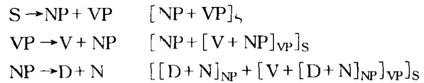

以这种方式名词短语动词短语等结构可以被指派给任何适用这些规则的句子,例如[[the man][saw[the dog]]]“[[那个人][看见[那条狗]]]”。

assimilation 同化语音字的一般木语，指一个音段对另一个音段的发音施加影响，从而使两个音变得相似或相同。同化(及对立的异化)研究一直是历史语言学的重要内容，但在共时言语分析中一直未受重视，原因是传统观点把言语视为离散词的序列。如果想象言语是以“一次一个词”的方式说出的，其间的停顿对应于书写文字的间隔，那就几乎没有可能汪意到连续言语的同化和其他特征。但是如果转而分析一段段自然会话，就会发现同化是保持言语流畅和节奏的一个重要手段。

同化可分几种类型。有部分同化”和“完全同化”。例如，在日常口语中短语 ten bikes“十辆自行车的正常形式是/tem baiks/,而不是/ten baiks/,后者听上去有点“小心翼翼”的感觉。这个例子的同化是部分同化/n/受后大/b/的影响，吸收了它的双唇性变为/m/，但是没有吸收它的破裂性。而只有在说话人犯重感冒时才会说出/teb barks/。完全同化的例子是 ten mice/tem mais/“十只老鼠”，其中/n/受/m/的影响后也变为/m/。

另一种分类是按音的变化是受相邻音还是非相邻音的影响。常见的是前者，如上面例子所示，这属于‘邻接同化”。“非邻接同化”(或“远距离同化’)的例子是 turn up trumps‘交好运，其中 turn 的/ n/会受后头音的影响发作/ m/。这种同化也发生在元音和谐的语言里，词内一个部分的元音影响其他元音并使其发音相似，尽管元音与元音之间可能有其他音相隔。

还有一种分类是按同化的方向。有三种可能（a)逆同化(regressive或 an-ticipatory)，由于后头音的影响而发生音变，例如上面的 ten bikes,这类同化在英语齿龈辅音处在词尾位置时特别常见，(b)顺同化(progressive)，由于前头音的影响而发生音变，例如 lunch score“午饭记账”里的 s-受前头 ch 的影响发作/ʃ/，这类同化不太常见；(c)聚结同化(coalescent)，也叫相互同化(reciprocal)，音与音相互影响或客合，例如 don't you 发作/ dəuntʃu/——t 和 y 溶合成一个塞擦音。

在标准的生成音系字里，同化的描写借助特征拷贝的概念音段从相邻音段拷贝指定的特征。在非线性模型里，属于一个音段(触发音)的特征或节点被视为展连到一个相邻音段(目标音)。如果一条规则只是展连目标音中还未指定的特征(“特征填充”模式)，这种同化是无标记同化；如果规则应用于已经指定展连特征的音段(从而取代其原来的特征)，这是同化的“特征变化’模式。这种模型还可根据展连节占的身份进一步区分同化的种类如果是根节点展连，目标音段获得触发音段的全部特征，这叫全部/完全同化(total/complete assimilation)，如果是一个低一层次的节占展连，目标音段只获得触发音段的部分特征，这叫部分/不完全同化(partial/incomplete assimılation)，如果只是一个终瑞特征展连就只有一个特征展连，这叫单一特征同化(single-feature assimilation)。

association（associate）联想(联想的） 语言字论著经常按其一般意义使用这一木语，指一个词项引发的非语言感情(参看内函义条)或使人想起的一系列心理上有联系的词项(即涵义联想”)。但是有些语言字家按狭义使用这个术语。例如，索绪尔式的聚合关系概含被称作联想关系(associative relations)。有的语言学家用联想场(associative field)或联想群(associative group)来指形式或涵义有特定相似性的一组词项。

associationline 联接线 非线性音系字木语，指不同层面上的单位之间画的连线。这个概念的提出特别是为自王音段音系字提供一个连接不同音层的手段。从语音字的观点讲，联接线代表时间上的同时性，表明两个音层(如声调层和元音层)各自表示的特征之间时间上的联系。两个音层之间互相联接的音段叫做自由联接(freely associating)音段，不自由联接的音段在应用自主音段规则时都被忽略不顾。一条联接线一旦被确立，就按联接规约(association con-vention)来联系剩余的特征当未联接(unassociated)特征(例如元音和声调)出现在联接线的同一边时，它们以一对一的方式自动联接，从联接线向外辐射。实联接线表示早已存在的联接，虚联接线()表示应用规则之后的结构改变。联接线在给定的表征式里不容许交又(“不交又制约’)。联接线上打个×号(或类似符号，如=)表示这条线将被一条规则删除。音段外加圆圈表示这个音段不与面对音层的任何音段联接。例如，下图表示一个高声调从第一元音(属于规则的输入部分)到第二元音的转移。

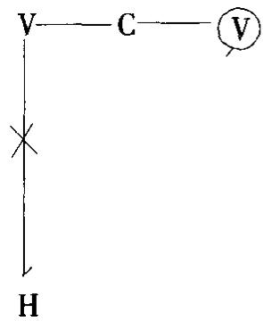

这种联接的转移叫做重新联接(reassociation)。一个单位联接至多个V或C槽叫做多重联接(multiple association)。由于自主音段音系学允许每个音层的成分数目不等，也不要求成分之间的分界重合，联接线这个概念因此起着十分重要

的作用。

asterisk(ed)星号，星标(标星号的)(1)语言字里不可接受的或不合语法的构式在起首处加星号标示，例如\* the man do been go。星标形式(asterisked form,或 starred form)是一种语言中不能出现的形式，例如\* walkedn't。

(2)在X杠句法里，星号是一个用来标明一个范畴的成员为任意数目(包括零)的操作符。例如，YP\*表示“任何类型任何数目的短语”。

(3)语言学理论中非构型语言称作W\*(W星号)语言。

(4)历史语言字用星号标示一个构拟形式，没有其存在的书面证据，例如为印欧语假设的音和词\*S, \*penk"e“五”等。

(5)早期的自王音段音系宇里，星号(也叫“星”(star))标示一个优先联接的音段，不受后面各条规则的修改。星号标记法还见于某些语调研究，星号标示的是重读音节的边界调 H\*，L\*。

asymmetric rhythmic theory 不对称韵律理论 节律音系字的一种，基于一个音步模板的总藏，其中抑扬格和扬抑格的交替形式不呈现对称性。复用抑扬格系统的音步，其成员的音延不均衡；复用扬抑格系统的音步，其成员的音延倾向于均衡。

asyndeton 无形连接 见 SYNDETON 有形连接条。

atelic 无终体 体的语法分析中用来指动作没有明显终止点的事件。无终动词包括 look“看”,play“玩”,sing“唱”(用于 he's singing“他在唱歌”的语境)等。相对立的是终结动词，有明显的终止点，如kıck“踢”。

ATN“增扩转移网络”(augmented TRANSITION NETWORK)语法的缩写。

ATR“前舌根”(advanced tongue root)的缩写。(见 ROOT(2)舌根条)

attenuative 衰减语法和语义宇有时用来指动词表达的状态或动作的质或量的降低(“有点儿”，“不太)。在有些语言(如匈牙利语)里衰减是体系统的一个形式部分。

attested证实的语言字用来指有现在或过去使用证据的语言形式。例如，历史语言字里的证实形式(attested forms)是有书证的形式，与通过演绎推导得出的“构拟形式”对立。在当代言语的研究中，这个术语指实际记录的用法，区别于语法中的假设或预测形式，或语言学家除语感外没有其他证据的形式。

atomic phonology 原子音系学 见 PHONOLOGY 音系字条。

attitudinal 态度义 语乂字有时用来给意乂分类，指意义中的感情成分，如通过句子语调或响度变化而表达的不同态度，愤怒讽刺等。在谈论韵律时，“态度乂’通常区别于语法意义。可替换术语为情感乂和感情义，相对立的术语是认知义和指称义。

attribute(attributive）（1)属性 原为听觉感知的术语，听觉语音字用来指凭感觉可区分的语音特性，例如音高、音响、音色等属性。

(2)定语(attribution) 语法描写中通常用来指形容词和名词出现在名词短语中心语的修饰语位置上时所起的作用。例如 the red chair“红的椅子”中的red“红的”,Jane's hat “简的帽子”中的 Jane's“简的”都有定语(attributive)功能。与此对立的是这些词的表语功能，如 the chair is red “椅子是红的”， the hatisJane's“帽子是简的”。有的语法描写模型将这个术语的用法扩展，还指一些补语结构，如 he is my uncle “他是我叔叔”,I called hum a fool “我叫他傻瓜”,这种用法还可包括上面提到的形容词用法(即在 she is happy“她很幸福”里，形容词相对 she“她”的语义作用是一种限定(attribution)作用。

audible friction 可闻摩擦 见 FRICTION 摩擦条。

auditory phonetics 听觉语音学语音宇的分支，研究人通过耳、听觉神经和大脑对语音的知觉反应。这是语音学里研究不太充分的领域，主要是因为一旦试图识别或测量对语音的心理和神经反应就会遇到许多困难。对耳的解剖和生理研究已很先进，如测量听觉的各种技术手段，而这类研究的临床应用现归在听觉学和测听术的名目下。但是将语音的各种知觉属性视为一个语音系统而作的纯理研究相对很少，这种语音分析与音系研究之间的关系还模糊不清。

augmentative指大词缀 形态字用来指表示一般“大”的意义的词缀(常有笨拙或难看的含义)。例如意大利语里的 one 和西班牙语里的 on(如 sillon“扶手椅”，比较silla“椅子”)。通常与指小词缀对立。

augmented transition network grammar 增扩转移网络语法 见 TRANSITION NETWORK GRAMMAR 转移网络语法条。

autohyponym 自身下义词 见 HYPONYM下乂词条。

autolexical syntax 自主词汇句法 本世纪 90 年代初友展起来的一种语法研究，提出通过词库的协调建立规则的自主系统。句法、语乂和形态三个模块(形式化为上下文自由的短语结构语去)通过一系列界面原则互相联系，这些原则限制各表征式之间结构差异的程度。一个词语必须满足每个模块的独立条件才是合式的。

automatic自动变形语言字用来指由语言的音系规则引发的形态变化。例

## automatic speech recognition

如.英语复数、领属标记动词的/s/\~/z/\~/z/交替方式是由音系规则自动决定的，以咝音结尾的形式后接/iz/,非咝清辅音后接/s/，非咝浊辅音后接/z/。较复杂的自动交替见于连读变音现象。

automatic speech recognition 自动言语识别见 SPEECH RECOGNITION言语识别条。

automaton（automata)自动化(自动机） 借自数学的术语，数学里指一套规则为计算目的的形式化。理论和计算语言字用来构筑一个参照系，给可以通过形式生成的语言分类(参看CHOMSKY HIERARCHY 乔氏等级条)。自动机(如计算机)可抽象地模拟为一系列输入、输出、状态和运算规则。自动机对输入带的运算一般是经由一系列“状态”(或“构型”)，每个状态通过“转移功能”(transitionfunction)与下一个状态连接。最一般的自动机就是所谓的“图林机”(以英国数学家艾伦·马西森·图林(1912—1954)的名字命名，他在1936年设计出一部以这种运算方式定义可计算数字的逻辑机)。最受限制的自动机种类是有限自动机(finite automata)，也叫“马尔可夫源”或“简单转移网络”，其构成是一些数目有限的状态和状态转移，加上一个只能以一次一个符号的方式单向读出的输入带。有限状态语言属于有限自动机一类。

autonomous 自主的（1)在讨论语言字作为一门科学的地位时使用的形容词，其含义是语言研究已有其自己的目标、理论和方法，不再依赖其他学科(如逻辑学、文学批评、历史学)学者的偶发兴趣。

(2)音系字里这个术语用来指不关涉语法(特别是词)结构的音位。这个意义上的自主音位(AUTONOMOUS PHONEME)与形态音位对立，或与生成语言学的系统音位对立，后两者的分析都允许参照严格的音位因素之外的其他因素。

(3)自主句法(autonomous syntax)是生成语法的行准理论提出的一个观卢，认为语法的句法部分独立于语义字(即是“自主的”)，决定句子合语法性的因素独立于决定句子意乂的因素而起作用。这一观点遭到生成语义字的攻击，但在现代语言理论中很盛行。

(4)自主语(autonomous speech)见 IDIOGLOSSIA 私自语条。

autosegment自主音段自音王段音系字用来指被认为是自主的、在其自己音层上表征的音段。这个概含特别用来指声调，声调被视为有独立地位的音段，独立于骨架层上表征的辅音和元音音段。

autosegmentalphonology 自主音段音系学最近的音系字理论使用的术语，指音系学中一种与严格的音段理论相对立的理论。音段理论把音系视作一系列表征式，其构成包括音段(或无序的特征集)的线性配列和依赖于形态和句法标准的界限。自主音段理论则把音系视作若于音层，每个音层由音段的线性配列组成，音层与音层通过联接线互相连接来表明协同发音的方式。这个理论最初是为处理声调现象而提出的，现经扩展用来处理其范围超过一个音段的其他特征，特别是元音和辅音的和谐现象。

aux 助动词(auxiliary)的通行缩写。

auxiliary(aux）（1)助动词 给动词作语法分类时用来指一组从属于主要词动词的动词，帮助区分语气、体态等等。英语的主要助动词是do,be和 have，例如 she is comung “她就来', does she know “她知道吗?”, she has taken“她已拿取”。情态助动词包括 can/could“能，会”，may/might“可以，可能”，shall/should“将/应该”，will/would“将，愿意”，must“必须，必定”, ought to“应该”， used to“过去经常”等。助动词类与词汇动词在语法上有好几方面的区别，例如有特殊的否定形式(如 isn't, hasn't, can't,但无\* walkn't)，可以和王语倒置(如 is he,does he, will they,但无\*walks he)。“边缘”或“半助动词”是具有助动词类一部分但不是全部特性的动词，包括 dare“敢”和 need“需要”。

(2)auxiliary language 辅助语 社会语言字用来指一种不同言语社区之间为信息交流、贸易、教育等目的而使用、但又不是任一社区本族语的语言。例如，英语和法语是非洲许多社区的辅助语，斯瓦希利语是东非部分地区的辅助语。这个意义的辅助语与“辅助语”的另一种用法无关，那种用法是指人造语言，如世界语。

avalent 缺价 见 VALENCY 配价条。

avoidance languages 避忌语 语言字上用来指跟对方交流有社会禁忌语的情形下允许使用的语言，有时也随口称作丈母语(mother-in-law languages)，这主要跟澳大利亚诸土著语有关，那儿某些亲戚之间有严格的禁忌语，例如男子和他丈母或姨丈之间。在迪耳巴尔语中，日常语言叫做古瓦尔语，避忌语叫做迪亚恩圭语，只要有应该避忌的亲戚在场就得使用这种语言。

axiom(atic)公理(公理的)原为逻辑学的一个分支公理学(axiomatics)的一个通用术语，语言字用来指一种理论假设为真的一组初始命题(或称公理(ax1-oms))。其他命题(称作“定理”）借助特定的推理规则(有时可称作“转换规则’)从这些公理推导出来。一个公理系统的完整表述包括一个“句法”部分，它确定命题的合式性，一个“词汇’部分，它列出系统的全部词项。主要是受了乔姆斯基式的语言形式化思想的影响，这些观含在语言学得到应用并已成为数理语言字的中心观念。生成语言学之前为了使有关语言的思想系统化，经常使用的是一个较弱的术语公设。一种属于非生成语言学的研究范式是公理功能主义(ax-

1omatic functionalism)，本世纪 60年代由 J WF 马尔德(1919)提出，在这一研究范式里，语言学在一个更广的符号字参照系内呈现为一个形式公理演绎系统。这个范式应用一个公设网络、各种辅助定义和相关的定理，对语言的一些核心方面，以及对通常在其他名目(如语用字)下处理的方面作出结构分析。

axis(1)语轴 语言字有时用来指语言分析的两个交又的方面，特别指瑞士语言学家菲迪南德·德·索绪尔提出的共时和历时两个方面。这两个方面的区别被描写为“并时轴”和“接续轴”的区别。同样，组合关系和聚合关系的区别也可用语轴来称别(“组合轴”，‘链接轴”等)。

(2)轴心语 在某些语法分类模型中指向结构的第二个成分(另一个是引导语),例如 in the garden“在花园”,see the car“看见那辆气车”。

## B

baby-talk（BT）宝贝儿语 语言习得研究将通常意义上的这一名称加以引申，用来指成人对幼龄儿童说的话，它表现出一系列在语言字上有区别性的特点。宝贝儿语的内涵因此要比常用的表示亲昵的发音和语词(如doggie“小狗儿”，then“那时”发作/den/音，等等)广得多，其主要特点被描写为句子结构的简化和通过语言相互影响的特殊方式(例如将儿童说的句子扩展成完整的成人形式，如Dadda gone →Yes, daddy's gone“对，爸爸走了”)。对宝贝儿语、或对“语言输入”的研究在本世纪70年代初成为语言习得研究的关注焦点，这是受了社会语言宇的具体启发。这个术语在心理语言字现已不太常用，因为它听上去限于婴儿(而不是一般幼龄儿童)，而且有歧义(是婴儿自己说的话还是对婴儿说的话)。近年来人们倾向于用妈妈语或更泛指的照看语(caregiver speech)取而代之。

back 后[音] 后部语音分两类：(a)口腔后部发的音；(b)用舌后部发的音。在许多情形下这两条标准重合后元音同时有两种“后”的意思，如英语hard“硬”，talk“讲”,show“出示”，got“得到”里的元音；后辅音也一样，如go“去”，car“汽车”，way“路”开头听到的音。但是在喉或咽发出的后辅音如[h]，“后”只有(a)的意思。按传统的语音宇分类，后元音对立于前元音和央元音。

按传统分类，在口腔后部发的音区别于在前部发的音；用舌后部发的音也区别于靠前用舌大和舌叶(或舌前)发的音。在乔姆斯基和哈勒提出的区别特征分析法中，用龈前(ANTERIOR)指“前”，用舌冠指“舌尖/舌叶”。各类后音作为一个整体，其术语都体现一类腔特征(具体说是舌体特征)，与其对立的是非后(nonback)音，即舌头不从中性位置后缩的音。对后元音和后辅音有意识地加以控制比较困难，因为人对口腔后部相对缺少感觉。

backchannelling反输语用宇和社会语言字研究互动过程中听话人的行为时使用的木语，指听话人以反馈方式对说话人的反应。反输信号包括各种单音节反应词(mhm“呣”),简短词语(I guess so“想是这样”),话段重复，接续完句，以及非语言提示(如占头，汪视变化)。

back-formation逆构词法形态字的历史研究用来指一种反常的构词法，即语言中一个已经存在的较长的词删除一个想象中的词缀后得出一个较短的词。例如，edit“编辑(动)’由editor“编辑者”衍生而来，而不是相反。这种派生的发生猜想是由于说本族语者看到editor与其他正常派生而来的词之间存在类比关系，例如 credit “放款”/creditor “放款人”,inspect “检查”/inspector“检查员”, act“扮演”/actor“演员”，每例中的名词由动词派生而来。而edit的派生过程正好跟预想的派生模式相反，所以叫“逆构词法”。

backgrounding 背景语 见 FOREGROUNDING前景语条。

backlooping反回法位语法术语，指较高层次的构式反过来纳入较低层次构式的槽位中，例如在名词短语内反包一个关系小句(如 the lady who was talking“正在讲话的那位女士·”)，有时也称作回反(loopback)。反回区别于跳层和套层。

bar 杠 X杠句法中给句法范畴分类的方式。最常见的零杠(zero-bar)语类是词层次上的范畴，单杠(single-bar)和双杠(double-bar)语类是短语层次范畴。单杠和双杠语类通常在范畴符号上加杠表示(例如N,N)。其他表示杠的方式有加撇(如N,N)，加数码(如N1,N2或N,N²)等。零杠语类有时用NO或N°表示。在概化短语结构语法里，杠是一个多值范畴特征，可以取值0，1，或2。另见PROJECTION 投射和 VARIABLE(3)变项条。

barrier语障管辖与约束理论术语，指其界限能限制某些现象的语类。语障是阻止移位和管辖这两个句法操作的节点，一个语障阻止管辖，两个语障阻止移位。移位不能跨越一个语障以上，这条原则称作邻接原则。A如是B的“阻止语类”，A就视为B的语障。A要成为阻止语类，A必须不接受词C(L)语类的题元标记，A还必须统制B。除了屈折短语IP之外，任何语类都可以是语障。其他节点也能成为B的语障，如果它们统制非词汇标记的节点，或者统制离B最近的管辖语(“最小限度条件”)。继乔姆斯基《语障》一书出版(1986)之后，语障的概念在句法理论中变得越发重要。音系字也有语障，指一个语符列中阻止音系规则应用于该语符列的任何单位(例如界限符号，音段等)。

base(basic)基础(基本的)（1)词基 形态字用作词根或词干的替换术语，指一个词内可以对其进行操作的任一单位，如可以添加词缓的词根或词干。例如unhappy“不高兴”的基础形式(base form)是 happy“高兴”，如果再在 unhappy上添加 ness，整个 unhappy就被视作附加新词缀的词基。但是有的分析法将“词基”等同于“词根’，即把词的所有词缀都去掉后剩下的部分。按这种分析法，happy 是其所有派生形式——happiness‘高兴(名)”,unhappy“不高兴(形)”, unhappiness不高兴(名)'——的基础形式(最大公因子)。

(2)basic form基本形式 在较抽象的语法(形态学和句法)研究中，基本形式指为使一系列形式互相联系(即互为变体)而建立的一个抽象单位。例如，一个语素的基本形式或典范形式可以定为它的交替形式之一(例如语素man“人(单数)”的基本形式或“基本交替形式”是语子man,以某种方式派生出men“人(复数)”),也可以是两个形式共同的底层单位(例如单位[mVn],man和 men两者都通过某种元音(V)交替派生而来)。同样，句法中一个句子也可视为基本形式，其他句子由此派生而来(例如王动句是被动句的基本形式，肯定式是否定式的基本形式)。相关联的结构也可看成是由一个共同的底层形式派生而来。生成语法就是最充分地利用了这种分析法的潜能。应该明确，这种意义上的“基本”与语言教学中所说的“基本”不一样，后者的涵义(可能除以上涵义外)还指词汇中的基本词汇容易学习，或者是对信递更有用。

(3)base component 基础部分 生成语法的行准模型里，基础部分是句法组成部分的两大子部分(sub-components)之一，另一个是转换(子)部分。在诺姆·乔姆斯基的《句法结构》(1957)里，用的是“短语结构部分”这个所指相同的术语，这个部分指定语法的全部短语结构规则。《句法理论要略》(1965)同样区分基础部分和转换部分，但两者在整个理论中起的作用有所变化。在《要略》里基础部分包含一个“范畴”子部分(指定各个语类，S,NP,VP等)和一个‘词汇”子部分(由全部词条组成，词条又由“有生”、“人类”这样的特征组成)。这几个部分的信息合起来指定句子的深层结构。在生成语法的后几个版本里，基础部分的作用又有新的修改，以调整句法和语乂字之间的关系。另毋NIVERSAL普世的条。

basilect(al)低势语(的) 有些社会语言字家在研究克里奥耳语的形成时用来指一种离声望高的语言(“母体语”(matrilect)或高势语)最远的语言变体(或万语)。低势语还与介于中间的语言变体(中势语)对立。

beat 节拍，拍 有些节律音系学家用来指节律栅中第二或更高层面上的栅标记，底层面上的标记叫做半(节)拍(demibeats)。这一区别部分对应于强形式/弱形式或重读/非重读的区别与一较高层面上的节拍重合的节拍或半节拍是强形式，否则就是弱形式。

behaviourism行为主义心理学的这一学派(研究可观察和可测量的行为)对语言字的影响在美国语言学家伦纳德·布龙菲尔德的著作中最为显著。这种影响具体表现在布龙菲尔德派的语言学家坚持严格的发现程序，特别是把意又解释为参与者在特定环境里相互间可观察到的刺激和反应。行为主义(或“机械主又’)在解释语言方面的局限性(特别与美国心理学家BF 斯金纳(1904—1990)的著作相关)在本世纪50年代受到诺姆·乔姆斯基的批评，乔氏当年的著作是语言学灵王义发展的先声。

benefactive 受益者，受益格 有些语去分析法用来指一种格形式或构式，它在句子中的功能是表示“为了”或“为了的利益”的概念。英语中这种“意想中的接受者”常通过 for 介词短语来引入,例如 I've got a book for you“我有一本书给你”。

bidialect(al)ism 双方言现象，双方言制 这个术语最一般的意思是指一个人或一个社团熟练掌握一种语言的两种方言，不管是地域方言还是社会方言。已经有所研究的“双方言”情形有好几种，了解最多的情形之一是从一种非正式的言语变体转换到正式的变体(双言现象)。这个术语特定的意思是指社会语言字和教育语言字提出的一条原则，即不同方言在语言字中的地位相等，各有适合自己使用的社会背景。这条原则对学校的教育方针特别重要，因为学校里一种语言的非标准和行准变体之间的差异常能导致很大的冲突。双方言制建议，操非标准方言和操标准方言一样应在教育过程中受到鼓励，同时建议培养儿童语码转换的能力。相比之下，这样做的结果是提高了儿童对其语言各种变体的理解和掌握程度。

bidirectionality 双向性 见 ITERATIVITY复用性条。

bilabial双唇音 按发音部位给辅音分类分出的一类音，即双唇合拢发出的音。例如英语pun“别针”，b1n“垃圾桶”，mat“地席”等词开头的辅音，非英语的双唇音如威尔士语mhen“我的头”的开头辅音。这个术语只指辅音发音，元音发音时双唇的积极运动用圆唇和展唇来说明。只由一片唇充当主要发音器的常用语音只有唇齿音。“单唇音”不算一个术语；“四唇音”只是诙谐语，是语音学家对接吻发声的谐称。

bilateral 双边的（1)布扛格字派音系字用来指一类对工，即双边对立，区别于多边对立。例如英语/t/和/d/的对立是双边对立，因为这两个音是系统中仅有的两个齿龈/破裂音单位，而且仅由一个特征带声与否来区别。多边对立则不一样，例如/t/和/v/的对立，因为涉及同一组特征的对立还有其他可能性，如/d/和/f/的对立。

(2)双边音 空气从舌头两边同时逸出的边音，如[1]的通常发音过程。与

## bilingual

“单边音”对立。

bilingual(ism) 双语的,操双语者(双语现象，双语制) 这个木语的一般意思一人能说两种语言—为语言研究提供一个前理论的参照系，特别是为社会语言字和应用语言字(外语或第二语言教学)的研究。研究的重点一直是“双语现象”或“双语情景”存在的各种类型和程度。双语现象的定义取决于如何设定操双语者的资格，即必须达到多大的流畅度(不管是跟操单语的操本族语者比还是放宽要求跟只是基本掌握第二语言的人比)才算数。还有几种不同标准的区分，如复合双语现象和并列双语现象的区分(根据操双语者在多大程度上视两种语言在语义上对等或不对等)，按学习两种语言的各种方法所作的区分(是在儿童时期同时学会的还是先后学会的)，按语言系统运作的各种抽象层面所作的区分——是双语现象还是双万言现象还是双言现象。特别重要的是双语现象的研究如何联系社会、心理、民族(如威尔士语和佛兰芒语的情形)诸因素的分析，如联系不同语言的社会地位，不同语言对说话人认同于某一民族或群体的影响。在增益双语现象或“雅”双语现象中，一个多数民族掌握第二语言并不构成对其第一语言的威胁(例如说英语的加拿大人学会说法语)；在减损双语现象或“俗”双语现象中，第二语言逐渐取代第一语言(常发生于少数民族语言)。

bimoraic 双莫拉的 见 MORA 莫扛条。

binaryfeature 二分特征 可按两个互相排斥的可能性给语言单仁分类的特性，如音系学里有或无声带振动，圆唇或非圆唇。二分特征是音系学各种区别特征理论的一条主要组构原则，二分对立的习惯柠记法是在方括号内用+/-号，例如将一个音描写为[+带声]或[-带声]。生成语法对词项作语法和语义分析时也建立二分特征，采用同样的习惯标记法，例如名词可以有[+普通][-普通]之类的特征。二分特征与“单值”和“多值”(或“n值”)特征对立。例如，最近音系学中的“单值成分理论”用单值成分(例如[圆唇])来取代二分特征(如[+/-圆唇])。

二进制或二分法(biarity或binarism),原义跟信息论中的二进制编码原理相关，但它在语言学中的地位常有争议，因为音系、语法和语义中的各种可能有的语言成分是否分析为一系列二项选择(binary choices)最合适，这一点并非总是很清楚。例如直接成分分析法采用二分法将句子不断地一分为二，但有时不可能确定应该在何处二分，例如有的形容词序列(如 nice old red chair“精美的古旧的红椅子”就无法确定应分析为 nice + old red“精美的 +古旧的红”还是 niceold+red“精美的古旧的+红”)。有人认为二分分叉是标准的短语柠记分又方式。采用二分特征有时可将其中一个特征视为中性的、无标记特征，另一个视为肯定的、有标记特征。

bind(ing)约束管辖与约束理论木语，指形式上制约或“约束”某些句子成分的一系列条件。可区分两类约束A-约束(A-binding)和 A-杠约束(A-bar-bind-ing,A-bindung)。前者指一个语类(照应语)与一个A位置(王目位置)上的统领名词短语同行，后者指一个语类(如WH移位语还这样的变项)与一个A杠位置(主语、宾语介词宾语以外的位置，例如小句开头由wh短语占据的位置)上的统领语类同标。从前者到后者的延伸(或推广)叫做泛化约束(generalizedbinding)。不受约束的成分是自由成分。约束理论(binding theory)是管辖与约束理论的几个(子)理论之一，主要处理名词短语在句子中的分布，决定它们能够或必定与其他名词短语同标的条件。名词短语分为照应语、代名语、指称语三类。约束理论的三条原则——约束条件A,B,C—分别是(a)照应语在其管辖语类内受A约束，(b)代名语在其管辖语类内不受A约束；(c)照应语在任何地方不受 A 约束。约束承继原则(binding inheritance principle)是将概化短语结构语去的音步特征原则重新按中心语驱动短语结构语去的框架来解释。

binomial 二项式 原为数学术语(指两个成分通过加号或减号连接构成的式子)，有时词厂字用来指两个成分搭配而成的习语，例如 spick and span“崭新的”,rack and ruın “毁灭”。

biolinguistics 生物语言学 语言字正在发展的一个分支，研究人类语言发展和使用的生物学前提，既着眼于整个人类的语言发展史，也着眼于个人的语言发展。也称作 biological linguistics。着眼的两个方面要回答的共同问题有语言的基因遗传，语言产生的神经生理模型，人类和其他物种解剖上的相似性，语言行为病理形式的发展(见 CLINICAL LINGUISTICS 临床语言字条)。

bioprogram(me) hypothesis 生物程序假说 克里奥耳语研究的一个假说，认为克里奥耳语是在新形成的殖民地要塞或种植园上成长的儿童发明的。这些儿童据说只听到周围结构高度简化的皮钦语，于是利用其天赋语言能力将皮钦语转化为一种自然语言。由德莱克·比克顿提出的这一假说据称能解释各种克里奥耳语的相似性和简单性：彼此相似是因为应用的天赋能力是普世的，比较简单是因为只有最基本的语言结构得到表征。按这一观点，克里奥耳语的研究对深入了解普世语法的性质有特殊作用。

biopositionality双位表征 某些非线性音系字模型里，辅音或元音音长的表征出现在表征音系音量的那个音层(如CV层，X层)上的两个位置。长辅音或长元音被表征为一个连接至两个音量单位的根节点。

biuniqueness 双唯一性某些音系学理论的一条原则，它规定任何音仁序列由唯一的音子序列来表征，反过来也一样。换句话说，音子和音位之间有一对一(或“可颠倒”)的对应关系。例如，在bun“垃圾箱”一词里，两个分析层面之间的关系可表示为

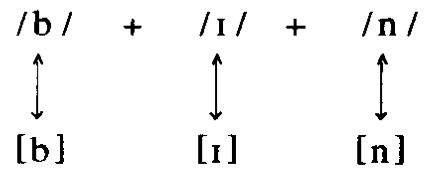

但是在好些情形里上述直接的对应关系不适用，音位是对应的唯一音类这一原则因而不成立。这类情形(参看OVERLAPPING交叠条)里，一个音子根据语境被指派给不止一个音位。双唯一条件(biuniqueness condition)及其所依赖的线性条件和恒定条件，遭到生成音系学家的严厉批评，这种批评是他们对分类音位学总体批评的一部分。

bivalent 二价，双价 见 VALENCY 配价条。

black English vernacular 黑人土话英语 见 VERNACULAR 土话条。

blade 舌叶 舌大和舌央之间的部分，当舌处于中性位置时舌叶处在齿和齿龈隆骨的对面。也称作LAMINA。好几个语音，如[t]和[s]，发音时要用舌叶。

bleaching 词义淡化 语乂字有时用来指一个词由于语义演变而发生可觉察的意义损失或弱化。例如，you know“你知道”和Ⅰ mean“我是说”现用作语用小品词。

bleeding（bleed,counter-）裁切(反裁切） 生成语言学分析规则次序时使用的术语，原用于历时音系字。指规则与规则之间的功能关系，与馈给对立。裁切关系是指一条规则(A)取消一个结构表征式，不然另一条规则(B)就会应用于该表征式。裁切的结果是减少可生成形式的数目。如果规则B是“X→Y”的形式,那么规则A必须是“W→非X”的形式。这种情形下，规则A叫做相对于B的裁切规则(bleeding rule)，这两条规则的线性次序叫做裁切次序(bleedingorder)。如果两条规则应用的次序相反，就说 A反裁切(counter-bleed)B。反裁切的结果是一种不产生后果的交互作用，即一条规则未能发挥其减少另一条规则适用形式的潜能。

blend(ing）截搭式(截搭)见于语法和词厂构式的一种变化，即两个按语言规则通常不共现的成分合并而成一个语言单位(截搭式(blend))。语法中有句法截搭式(syntactic blends)，例如 It's his job is the problem “这是他的工作是问题所在”是由两个句子 It's his job “这是他的工作”和 Hıs job is the problem “他的工作是问题所在”合并而成。词汇中“截搭”是通过缩写构成新词的常见手段(并非都变成标准形式)，例如 brunch“晚吃的早餐”(由 breakfast“早餐”和 lunch“午餐”截搭而成), Interpol “国际刑警组织”(由 international“国际”和 police“警察”截搭而成),Eurovision“欧洲电视节目交换制”(由Europe“欧洲”和 television“电视”截搭而成)。某些心理语言宇家也用这个术语来指一种类型的口误，即两个目标词容合为一，例如 swurse 是 swear“咒骂”和 curse“诅咒”截搭的结果。另见LOAN借用语条。

block(-ed，-ing)堵塞 经典转换语法所用术语，指阻止应用一条转换规则。如果一条规则由于短语行记的某个具体特性而不能应用于一个派生过程，就说这条规则被“堵塞”。这一木语也用于管辖与约束理论，即以形式手段来定义语障这一概含。A 如要成为堵塞语类(blocking category),A 不能有一个词汇(L)语类指派的题元标记，A还必须统制B。

blocklanguage 块语 有些语法描写用来指在有限的信递语境中使用的缩略结构。块语尽量利用词和短语，少用小句和句子。常见例子有Nosmoking“禁止吸烟’，Exit 出口”, One way“单行道”，还有“标题语言”，如 Prme Ministershock“首相震惊事件”。

Bloomfieldian(ism)布龙菲尔德式的(布龙菲尔德主义) 指体现美国语言学家伦纳德·布龙菲尔德(Bloomfield，1887—1949)语言研究方法特点的，或指这一方法的拥护者。这一方法以布氏1933年出版的著作《语言论》为代表。布龙菲尔德主义(Bloomfieldianism)专指本世纪30年代中至 50年代主要在美国兴起的一股思潮，曾对结构语言学的形成产生影响。其主要特点是用行为主义的原则研究意义，在确立语言单位时坚持严格的发现程序，兑体上关心语言学的自王地位和科学性(行为王义意义上的)。生成语法得以产生的强大动力是对布龙菲尔德主义的反动。虽然布龙菲尔德主义已不再流行，它的一些方法仍为田野研究广泛采用。

Boolean 布尔[代数] 数理逻辑里指一种以乔冶·布尔(1815—1864)命名的代数，用逻辑符号来代表集合与集合之间的关系。现广泛用于计算语言学和某些种类的语义字，用来阐明由三个基本逻辑算子and“和”、or“或”、not“非”连接的各种命题。在处理互相排斥的交替形式如二分特征时，布尔代数特别适用。

bootstrap(ping)自推，自展儿童语言刁得研究中提出的一种发现程序，儿童藉此根据其对语言使用的观察作语义和句法的推导。在“语义自推”中，儿童被认为是利用语义信息来推导句法——例如，知道一个动词的部分意义(如give“给”涉及一个给予者一件给予物、一个接受者)能帮助儿童推导出一些语义角色，进而推导出它们的句法实现。在“句法自推”中，儿童利用句法和形态信息来推导语义—例如，对不熟悉的词先利用屈折线索区分词的类别，进而初步推导出词义。这个术语源自神话故事(拜伦·孟乔生抓住靴襻把自己推举而起，从而获救)和计算科学(指用一个短小程序从外盘上加载一个长程序到计算机上，从而使这个长程序能够操纵计算机)。

borrow（ing）借用(借用形式） 比较和历史语言学用来指一种语言或万言从另一种语言或方言接收过来的语言形式，这种借用形式(borrowings)通常称作“借词”(例如英语 restaurant‘饭店”，bonhomie“温和”,chagrin“懊恼”等词都借自法语)。借词有几种不同的类型(参看LOAN借用语条)。语音和语法结构也可以借用，但不太常见，例如上列借词带有法语或准法语口音，一些欧洲语言中也常见英语语法的影响，如名词借用英语复数后缀 s(drnks“饮料”,ski lifts“滑雪吊索”，goals“目标”，girls“女孩”)。

bottom-up 自下而上 语言字好几个分支用这个术语泛指这样的程序或模型.从一个层级中最小的功能单位开始逐次组合成较大的单位。与此对立的是自上而下(top-down)，即从高层次单位开始逐次分析到最小单位。例如，就语去而言，从语素或词开始的模型是“自下而上语法”，从句子、小句或某种话语单位开始的模型是“自上而下语法”。这一区分还用于好些其他方面篇章语言学的语篇结构分析和风格宇，某些非线性音系宇的理论和方法，阅读技能的教学(从音还是从整个词开始)，以及心理语言字的心理处理模型。

bound(1)粘着 用于语素分类，与自由相对。粘着语素(bound morpheme)或粘着形式(bound form)是不能作为单用的词独立出现的语素或形式，例如英语的各种词缀de-(表“取消”等义的前缀)，tion(构成抽象名词的后缀)，ize(表“使化”等义的及物动词后缀)等。

(2)受约束 管辖与约束理论中约束(子)理论的术语，指若干组构成分因同柠而在形式上相关联。X如是一个与一统领王目同行的主目，则X受约束。相对立的是自由。有的组构成分(具体说是照应语)必须在其管辖语类内受约束(A约束)，有的组构成分(变项和指称语)必须自由，不然就是不合式的结构。变项必须受A杠约束，即与一个A杠位置上的统领成分同标。

(3)固化的 见 FORMULAIC LANGUAGE 公式语言条。

boundary-symbol/-marker 界限符号/标记 转换语法用来表示结构单位之间界限的符号。例如一个语符列内部各成分之间用(+)标示，语符列的界限用(#)标示 # the + man + pres + have + en + kıck + the + ball # “那个人已踢了那只球”。这个概念在某些音系字模型中十分重要，因为音系规则适用域可用音韵界限符号来表示。界限强度可以定量，由出现的符号数目多少来表示。一条给定的音系规则只规定其适用的最小界限强度。

boundary tone 边界调 在有的语调分析法中，指通常置于短语组构成分边界的声调。一般认为高(H)调和低(L)调具有区分边界的重要作用，它们有断言、提问、续说这样一些功能。星号用来标示在重读音节上实现的声调(H\*，L\*),%符号用来表示一个声调与一短语的边界音节相联接(H%，L%)。边界调的概念适用于多种语言，它把几种通常单独处理的效应(如核心调，音节重音，音高重音)归在一起处理。受边界调支配的话段叫做语调短语。还有一种“中间”边界调，位于一个组构成分内的某些位置，标记一个中间层次短语的边界。

bounded foot 限长音步 见 FOOT(1)音步和 BOUNDEDNESS 限长条。

boundedness限长节律音系字中的一个音步形状参项，它支配重音的分布。限长音步(boundedfeet)包含的音节不超过两个，重音与重音之间的距离，重音与词边界之间的距离都有限。非限长音步对长短或重音分布都没有限制。

boundingtheory 界限理论 管辖与约束理论的一个(子)理论，它设定移亿规则适用域的界限。其主要原则是邻接原则，即任何移位操作不能跨越一个语障以上。在扩展的标准理论和早期的管辖与约束理论里，阻碍移位的语障称作界限节点(bounding nodes)，通常认为是名词短语(NP)和句子(S)。

bracketing（brackets）加括法(括号）（1)语言学用来显示一个成分语符列内部(层级)结构的技术，与数学和符号逻辑中用的方法类似。以句子The catsaw the kıng“猫看见国王”为例，凭语感可以切分出来的部分每一部分都可以用一对括号来标示。例如把 the cat“猫”和 the king“国王”区分开来就会得出[thecat][saw][the kng]这样的表征式。每对括号可以附加一个标签，标明其存在的语法原因(“加标”括号)，例如

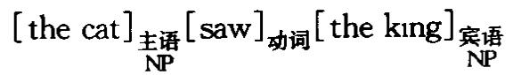

在较复杂的分析中，加括号对的次序也明确表示出来，例如短语结构语法的分析(标签从略):

句子单位[ the cat saw the kıng]

主语/谓语(或 NP + VP)[[the cat][saw the kıng]]

动词/宾语(或 V+ NP)[[the cat][saw][[the king] ]]

显然，句子越复杂，括号的层层叠套就越难读懂。克服这一困难最惯用的方法是画树形图。

(2)撰写语法时许多惯用的缩略法使用括号。生成语法广泛采用以下几种括号来合并规则：

(a)圆括号(parenthesis notation 或 round brackets)( )括起的是非强制性成分，例如涉及 D(Adj)N的规则表示可以出现两种结构，DN和D Adj N。

(b)曲括号(brace notation 或 curly brackets){}括起的是可交替成分，例Adj如步及D N的规则表示在两个结构中只选一个，或D Adj N或 DNN。生N成语法以外的其他研究用曲括号标示语素或形态音位形式。

(c)方括号(bracket notation) [ ]要求同一横行上的成分互相匹配，例如 [A] [C] 读作“A变为C”，“B变为D”。[B] LD

(d)尖括号（angled brackets notation) 生成音系字用< 〉表示非强制性  
特征之间相互依存的关系，例如 +A + C 读作“特征 A变为特征C，L( + B) L< + D>  
特征B如果出现就变为特征D”。生成语法以外的其他研究用尖括号标示字位。

(3)在语音字里括号主要有两种用途.方括号括起的是音段的语音记音或区别特征(例如[+钝音性])，双斜杠//括起的是音亿记音。

(4)方括号也用来括起语法或语乂层面上的特征，例如[+普通]，[-可数]，[+男性]，[-女性]等。

bracketed grid 加括栅 见 METRICAL GRID 节律栅条。

bracketing paradox 加括二难 生成音系字术语，用来指两种不一致的规则序次都有存在的理由。语素语符列[ABC]包含一个次语符列[AB]，一条规则可应用于这个次语符列，尽管相应的形态组构成分结构[A[BC]]中[A B]不是一个合式的组构成分。讨论较多的一个例子是ungrammaticality“不合语法性”一词的组构，形态上表征为[[un[grammatical]AD]ADj]ity]N。由于 un“不-”是附加于形容词(ADJ)而不是名词(N)的前缀，应该表示出它在附加后缀ity“-性”之前已先行附加于词干。但是从音系学讲，情形正好相反，表征式必须是[un[[grammatical]ity]1]2,因为后缀 ity 触发词干中的重音转移(和其他变化)，因此必须先行附加；un并不引发这样的变化，所以应该随后附加。

branch(ing)分又 语言字用来指构成树形图(见下页)的递降的线性连接。生成这种树的短语结构规则有时称作分叉规则(branching rules)。图上 S,第一个NP,VP三个节占是分叉节点(branching nodes),其他节点是非分又(non-branching)节点。有人认为二分分又是短语柠记的标准分又法。另见 BINARYFEATURE二分特征条。

breathgroup呼气群 在一次呼吸内产生的一截话段。说话时在何处吁吸和如何呼吸，这对语言字家很重要，因为呼吸方式会使话段出现一系列停顿，而停顿应与音系、语去、语义等结构联系起来。在每个呼气群内也可能存在某些规律，例如突显或节奏有可预测的模式，因此有些研究者用这一概念来研究语言的韵律(虽然像语调单位这样的术语使用更广泛)。最近这个术语还用来指识别婴儿最早发声串单位的一个手段。

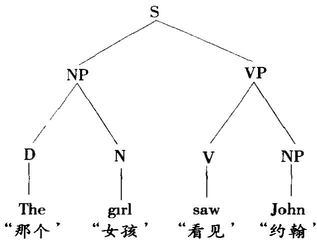

breathy呼气声按发音和听觉标准给音质作语音字分类的一个木语，指让大量气流通过稍许开放的声门时产生的发声效果。这一声效有时也称作沙沙声(murmur)。有些说话人确实有不正常的呼气声音质，是其说话的一个永久性特征。对语言学分析特别有意义的是呼气声效果可能起对比作用，因而传递一种副语言意义整个话段可能受这种影响，例如以十分震惊的口气说出Ohreally！“哦，真的!”。“呼气声”有时也用作音系特征，如古加拉提语的元音有呼气声和非呼气声的对立。

broad宽式[记音法]语音字记音法的一种。“宽式”记音法不如“窄式”记音法记得详细。

BT 语言刁得研究中有时用作BABYTALK宝贝儿语的缩写。

buccal 口腔的;颊腔音 发音语音字偶而用来替换同义的 ORAL(如 buccal cavity“口腔”)，但经常用来指在颊腔内发的音。大众熟悉的“颊腔声”是唐老鸭的说话声。

bunching 舌隆起 发音语音学术语，指一种舌姿势发音时舌体抬高绷紧，如发闭元音(例如[1]，[u])和在腭－齿龈区发擦音(例如[ʃ])时的情形。

bundle特征束 音系字用来描述一种关于音仁的概念：布扛格字派把音位视作“一束”语音区别特征。例如英语音位/s/可视为齿龈性、摩擦性和清音性等特征组合的结果。

burst突发 声字语音字木语，指发某些音时声学能量突然达到瞬间的峰值，例如破裂音的除阻阶段和发某些闪音和颤音时都有突发。

## C

C 最近的管辖与约束理论用作COMPLEMENTIZER行句语的缩写，早先文献中一般缩写成COMP。这个缩写表达这样一种观含标句语是短语语类的一个中心语，大体上与名词、动词形容词、介词等相类似，有相关联的单杠和双杠语类C和C。C通常称作CP,是语法分析的最大单位(起始符号)，相当于早期管辖与约束理论、词厂功能语法和概化短语结构语法中的S。

CA 通常用作 CONVERSATION ANALYSIS“会话分析”和 CONTRASTIVE analysis“对比分析”的缩写。

calculus 演算 见 PREDICATE(2)谓词和 PROPOSITION 命题条。

calque 仿造语（源自法语 calquer“影描”） 比较和历史语言学用来指一类借用形式，即将借用的词或短语的语素组构成分逐项翻译成自己语言的语素。这种“借译语”的例子:英语 power poltics“强权政冶”和 Superman“超人”分别借译自德语的 Machtpoltık 和 Ubermensch。

canonica典范的 语言字和语音字借用这个词的一般意思来指为比较目的举引为规范或标准的语言形式。以音系字为例，一种语言(或作为整体的语言)语音的正常的音节组合方式常称作“典范”模式，例如辅音-元音(CV)或CVC结构是“典范音节”模式，自动言语识别中的平均波形可描述为典范波形”。在形态字，这个术语有时用来指一种语言语素的典型音韵形态(例如波里尼西亚语的CVCV)，有时用来指举引一个语素时选用的基本形式(例如用s代表英语复数语素)。在句法中，有人假设有典范结构(如典范词序)，如主语-动词一宾语结构，不过这里用的是“典范”一词的引申义。某些社会语言字和心理语言学的研究将会话(面对面交谈等)过程中人与人相互间的正常位置称作“典范相遇”或“典范定向”。另见 TEMPLATE模板条。

CAP 用作 CONTROL AGREEMENT PRINCIPLE“一致控制原则'的缩写。

capacity[生成]能力 生成语言学术语，指语法的生成力。如果若于部语法能生成一个相同的语符列(句子)集合，就说它们具有相同的“弱生成能力”。如果它们还能给这些语符列指派相同的结构描写，孰说它们具有相同的“强生成能力'。

cardinal 基数词 某些语去描写中仍然保留的传统术语，指1,2,3等构成的一类数词；与序数词(第一，第二等)对立。

cardinal vowels 基本元音 英国语音字家丹尼尔·琼斯(1881—1967)设计的一套标准参考点，为识别一种语言的全部元音提供一种精确的手段。基本元音建立在发音和听觉的双重标准上。舌的高度在理论上分出四个等级(a)舌抬起而不产生可闻摩擦的最高位置；(b)舌能达到的最低位置，(c)和(d)，介于最高和最低之间的两个位置，将中间区域在发音和听觉上作等距离划分。用舌的前部但不圆唇，可产生四类主要(primary)元音，从高到低依次用符号[1，e]，ε]，[a]表示。用舌的后部又能产生四类主要元音，从低到高用[a]，[5]，[o]，[u]表示，最后三个是圆唇音。这八个主要元音还能依次用数字1一8表示。

改变舌的位置，又产生一个元音类的次要(secondary)系列·前元音变圆唇，从高到低产生[v],[ø],[∞],[E];[p]是对应于5号基本元音[a]的圆唇音，[A]，[x].[u]是分别对应于6,7,8号基本元音[5],[o],[u]的非圆唇音。次要系列的数字编码为9至16。另有两个基本元音代表舌的央部能达到的最高点，非圆唇的用[]表示，圆唇的用u]表示，数码分别为17和18。整个系统通常用“基本元音图”或“基本元音四边形”来展示，目的是提供一个直观的关于舌运动程度和方向的大致写照。附加连线能帮助划出各央元音发出的区域。必须强调，基本元音不是真实的元音：它们是不变的参照点(可在录音上获得)，必须机械模仿才能学会。一旦学会后，语音学家就能用它们来给一种语言的所有元音定位，或比较不同语言、不同万言的元音。他们可以确信每个元音一定落在基本区域界限之内的某个位置。然后可以用支音符更精确地描写元音的位置，例如元音下面加一钩表示发音比基本值要开一些(如o])，下面加一点表示发音要闭一些(如[e])。

就区分元音发音区的最佳方式，还有人提出过几种其他方案，但丹尼尔·琼斯的系统仍是使用最广泛的系统。

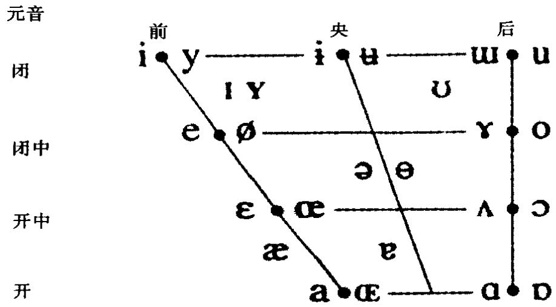  
图中符号成对出现，右边的一个代表圆唇元音。

caregiver /caretaker speech 照看语 见 MOTHERESE 妈妈语条。

Cartesian linguistics 笛卡尔语言学 有些语言学家用来指凡是受到法国哲学家R笛卡尔(1596—1650)和保尔-罗瓦雅尔字派语法字家影响的语言字理论或方法。生成语言学有关语言共相的论述跟笛卡尔关于语言与思维关系的观占有某种吻合。对语言学巴想史的这种见解，最初由诺姆·乔姆斯基表述出来(参看《语言与匕理》(1968))，但一直有争议。

case格(1)分析词的类别(或相关短语)时用这一语法范畴来识别句子中词与词之间的句法关系，例如王格受格等等的对立。传统的分类是根据词的形态变化(一组变化形式构成一个词形变化表)，如拉丁语法。(拉丁语 puella，puellampuellae，puella，“女孩”的单数格形式，分别为王格/呼格，受格，属格/与格，夺格。)这些形式可按各自的语义范围来分析，例如主格主要是句子语法王语的格，属格跟领有、归属这样的概含有关。对于缺乏形态变化的语言，传统意义上的“格”不适用。例如，英语中唯一有形态标记的格形式是属格(如boy's“男孩(单数)的”boys'“男孩(复数)的”)，其他形式都不加词尾标记，它们的格“意义'用介词(如 with a boy “跟男孩”, to the boy “对男孩”)或词序(如 cat chases mouse“猫追鼠”/mouse chases cat“鼠追猫”)表达。语言学导论书花了大量篇幅来说明这一点，特别是批评传统的英语语法坚持用格来分析英语的名词。某些语言有格的高度复杂的形态系统(例如有人认为芬兰语可以分析出16种格)，还有一套同样复杂的描写术语(如区分在内格，离格，入格等)。

(2)Case grammar 格语法 指美国语言学家查尔斯·菲尔摩(1929—)于本世纪60年代在生成语法的总框架内设计的一种语法分析方法。这种方法主要反对标准理论的句子分析法，后者主张按NP，VP等进行分析，忽视王语、宾语这样的概念。然而，如果汪意各种句法功能就会发现一些重要的语乂关系，而用其他方法则很难或不可能发现。例如这样一组句子The key opened the door“钥匙打开了门”,The door was opened by/with the key“1被/用钥匙打开了”，The door opened “门打开了”, The man opened the door with a key “那个人用钥匙打开了门”，不管其表层语法结构如何变化，有几个语义角色却“稳定不变”：每一句都是key“钥匙”为工具，door“门”为动作的受事，等等。格语法用一个受形式逻辑谓词演算的影响而建立的模型将这一见识形式化句子的深层结构包括两个组构成分，一个是情态(与整个句子相关的时、语气、体、否定等特征)，一个是命题(以动词为中心，结构成分可能充当的各种语又角色依动词而定，属于格范畴)。使用“格”这个名称是因为其所指跟这个名称的几种传统意义相似(见以上(1))，但是格语法所说的格是深层结构的格，与表层形态或句法上的任何成分没有系统的对应关系。格语法最初建立六个格(施事格，工具格，与格，使成格，处所格，宾格)，并给出规则说明它们如何组合来界定动词的用法，例如像open“打开”这样的动词可以带一个宾格和一个工具格(如 The key opened the door),也可再带一个施事格(如 The man opened the door with a key)。后来又提出其他一些格(原格，目杠格，反施事格)，有些格重新加以定义或命名(感事格，结果格)，有几个格成为特别研究的对象，据称它们比其他的格更基本(尤其是表处所和方位的格)。例如格理论的一种——万亿主义—认为，像 there is a table“有一张桌子”, the table has legs“桌子有腿”, the table's legs “桌子的腿”等等结构每一个都可以分析出一个底层的方所特征。这种关于语言结构的观含在形式化时遇到的问题一直很多，到70年代中期格语法的吸引力已不如先前，但是它对以后出现的好几种理论在术语和分类上已证明还是有影响力的。

(3)Case格 字母C大写，指一个抽象概含，区别于上面(1)描述的形态上有标记的格。抽象格(Case)或深层格(deep Case)即使在名词短语缺乏形态格的语言(例如汉语)里也存在，一般认为当同类特征出现时它们与形态格对应。格理论(Case theory)是管辖与约束理论的几个子理论之一它处理抽象格的指派和形态体现，限制词厂名词短语在 S结构的分布。结构格(structural Case)在 S结构指派给各名词短语，内在格(inherent Case)在 D 结构指派给各名词短语。格标记规则(Case-markıng rules)将结构格指派给某些名词短语位置(例如宾格，这个位置的名词短语受一个及物动词或介词管辖)。格过滤条件(Casefilter)限制能以这种方式生成的各种句子的范围，强制被动式应用移亿规则，阻止状语在动词和它的宾语之间出现。这种意义上的格理论必须与上面(2)概述的明确区分开来。

cataphora（cataphoric） 下指（下指的，下指语） 有些语法字家用来指一个语言单位指下文另一个单位的过程或结果。下指(cataphoric reference)是标明正在表达的和即将表达的两者指称相同的一种方式。例如，I saıd thus/the following“我说了这些/以下的话”, thus“这些”和 the following“以下的”的意义必须由下文或下面的语境来决定。Here is the 9 o'clock news “现在请收听 9点新闻”,这里的 here“这里”也起下指作用。下指词(cataphoric words)或下指替代语(substitutes)通常与复指(上指)词(指称上文)对立，有时也与外指词(直接指语言外情景)对立。

categorical perception 音类感知 语音字和心理语言字术语，指在区别和标记声字语音连续体上的项目时对一批非连续点的感知。被试人只感知到刺激中那些被标记为分属不同音类的项目之间的差异。

category（categor-ize,-ization,-ial,recategorize）范畴，语类（范畴/语类化，范畴/语类的，重新范畴/语类化）语言字在各种抽象层次上使用的通用术语。在最一般的意义上，范畴化(categorization)指人类将经验组织成各种一般概念及相关语言符号的整体过程。对这一过程的语言学研究(属语义学)与哲学家和心理学家的研究部分重叠。在语法领域里，范畴化指确立一组用于语言描写的分类单位或特性，它们的基本分布相同，并在语言中始终以一个结构单位出现。在语言演变过程中，一个单位的所属范畴可能发生变化(重新范畴化(re-categorization))。有的理论中范畴(category)一词指类本身，如名词、动词、主语、谓语、名词短语 动词短语等(相应的缩写符号称作范畴符号(categoryymbols))。再具体一些，“范畴”又指定义这些一般单位的特征例如名词范畴包括数、性、格、可数性这样一些范畴；动词范畴包括时、体、态等范畴。这后一层意巴上的范畴叫做语法范畴(grammatical categories)，常与王语、宾语、补语这种语法功能或功能范畴(functional categories)区分开来。

虽然这两种意义上的“范畴”都很常用，但个别理论按特定的涵义应用这一术语。其中最明显的也许是各种范畴语法(categorial grammar)理论赋予这一术语的新地位。“范畴语法”是本世纪50年代由几位语言学家和逻辑学家(特别是语言学家耶霍希瓦·巴尔·希勒尔(生于1915))发展起来的一类形式语法。发展最成熟的一种只用两个基本“范畴”，句子和名词，进行操作，其他范畴都由此派生而成；操作都以这些范畴的句法分布为依据。

在阶与范畴语法中，“范畴”主要用来指类、系统、单位、结构这些概念，这种语法认为这些概念是最基本的。在生成语法中，语法中的整套短语结构规则可称作范畴部分或语类部分(categorial component),即语法基础部分中负责指定S,NP,VP这样一些语类的部分。范畴规则或语类规则(categorial rule)是将一个语类扩展到其他语类中的规则。此外，有些生成语法模型中范畴特征或语类特征(category feature)用来指一类上下文特征，它们是一种句法特征，负责指定一个词项可以在深层结构的某些位置出现的条件。一个词项一经引人短语行记(取代相应的空(假位)符号,如[ + N]，[+ Det]，[+ V]等),语类特征就指定哪一个节点将是直接统制这个词项的节点。范畴变项或语类变项(category vari-able)是代表任何词汇语类的符号。这个模型中一个相关术语是严格次范畴化或严格次语类化(strict sub-categorization)，指用各种特征对深层结构的词项选择进一步施加限制。另见 EMPTY(1)空[成分]，GOVERN(2)管辖，HIGHERCATEGORY 高层语类条。

catenative 链接动词 有的语法在描写动词短语时用来指支配另一个词厂动词不定式的词汇动词，如以下句子中的斜体动词可作如此分析·she lzkes to go“她喜欢去”,she wants to see “她要看”,she hates waiting “她计厌等待”。生成语法中这类构式称作控制构式和提升构式。

causative使役式 语法描写术语，指句子交替形式之间的因果关系。例如，The cat klled the mouse “猫杀死了老鼠”和 The mouse died “老鼠死了”这一对句子的联系在于及物动词kill“杀死”可视作不及物动词die“死”的“使役”形式，意为“使·死”(The cat caused the mouse to die “猫使老鼠死去”)。同样，某些词缀起使役作用，例如 domesticize“驯化”中的ize“-化”(=“使成为驯养的”)。有些语言(如日语、土耳其语)里这种关系有明显的形态结构，词缀能系统地区分动词的使役用法和非使役(non-causative)用法(如“使 吃”和“吃”，前者相当于英语she makes hum eat“她使他吃”)。有些语言学家也试图将使役这一概含系统地应用于英语，将其视作一个抽象的底层范畴，由此派生出一组“表层”动词(如kıll和 die)。

cavity腔(1)语音字里指解剖上定义的声道中的任何空腔，它是影响语音特性的主要因素。主要的几个腔是(a)食道腔，从食道延伸到胃，只用于非正常的言语产生，如在喉切除手术之后，(b)肺腔，由肺和气管组成，是语音的正常来源，(c)咽腔，从喉到软腭与喉头背部接触的地方；(d)口腔，由整个口内腔体组成，是改变喉部发出的音的共鸣的主要手段;有时称作颊腔，(e)鼻腔，由鼻和咽的软腭关闭处以上部分构成。

(2)在乔姆斯基和哈勒的音系宇区别特征理论中，腔特征(cavity features)是语音分析的五个主要方面之一(其他四方面是大音类特征，发音万式特征，声原特征，韵律特征)。归在腔特征名目之下的各类特征都分析为对工特征，包括舌冠、龈前、舌体特征(高/低/后)，圆唇、长阻、窄紧、声门收缩、欠间隙(鼻音和边音)。有些特征构架模型采用口腔节点(oral cavity node)这一术语，指口腔收缩这一发音概念。口腔节点在根节，点和部位节点之间表达，因此统制部位节点和[+/-连续]节点。

C-command c-统领 通常作 constituent command“组构成分统领”的缩写。见COMMAND(2)统领条。

CD 作COMMUNICATIVE dynamusm“信递动力作用”的缩写，布扛格字派术语。

ceneme（1)(cene-matics，-tics)音位符(位符学，非位符学) 法位学术语，指语言音系的最小单位。位符学(cenematics)和非位符学(cenetics)指位符分析的两个层面，分别对应于音系学和语音学。

(2)oenemic 形符研究文字系统时指只表示语言形式的符号，与字符(plereme)对立，字符还表示意义。形符主要分两类·音节形符(如日语的假名)和字母形符。各种形符系统对基本单位的使用更经济，通常被认为代表文字发展的较先进的阶段。

centre(central-ize，-ization）（1)央，舌央(央化） 舌上面介于前和后之间的部分，专门用来发“央元音”(也叫“中性”元音)，例如asleep“睡着”一词的开头音和sofa“沙发”一词的结尾音[ə]。从某种意义上讲，与语音学定义基本元音的那些理论上的发音极端的元音相比，实际语言的元音全都一定程度地央化(cen-tralized).但是这个术语通常用来指这样的情形，即通常在元音区边缘发出的元音变为在接近口腔央部发出，例如baoon and[=and]eggs“熏咸肉和鸡蛋”在日常口语中变为baoonəndeggs。还可听到这种央化(centralization)以几种不同的程度呈现。例如，明显的“央化元音”在几种英国城市万言中很常见。一个双元音如包含一个滑向口腔央部的骨音，就可称作“央化”双元音。

(2)[音节]中心 音节中最响的部分可称作音节“中心”(或节核),例如boot[but]“长统靴”一词中的[u]。

(3)中心词 有些类型的语法短语中几个词依赖于一个中心成分(向心结构)，这个中心成分常叫做短语的“中心词”。

centre-embedding 中心嵌套 见 SELF EMBEDDING 自嵌套条。

centum language K类语 指一种类型的印欧语言，原始印欧语的软腭塞音/k/保留在诸如拉丁语 centum“百”这样的词中，与 S 类语(satem language)对立，后者/k/音变为诸如阿维斯陀语satem“百”这类词中的齿龈擦音/s/。凯尔特语、罗曼语、日耳曼语都属于K类语；波罗的-斯拉夫语和印度－伊朗语属于S类语。

chain 链(1)speech chain言语链信递研究中“链”用来描写一种模型，这种模型把信递行为表示为传信人和接收者之间一系列互相联系的阶段。就言语链而言，这种模型通常区分这样一些阶段语音产生的心理、神经、生理和解剖诸阶段；传输的声学阶段，语音接收的解剖、生理、神经和心理诸阶段。

(2)movement chain 移位链在管辖与约束理论中，一个移亿组构成分与其同柠语还一起构成一个移位链。

(3)音变链历史音系字中指发生一系列音变的情形，上一音变影响下一音变。可以有两种方向的变化。变化过程从发音维度的上端或前端开始，链上留出的空槽由其他音从下面拉上来填充，这是拉变链(drag chain)。变化过程从链的下端或后端开始，每个音将下一个音“推”出原来的位置，这是推变链(pushchain)。英语历史上的元音大交替通常举引为这种连锁变化(简称链变(chainshift))的典型例子。

(4)小句链句法中用来指某些语言中小句与小句的组合方式不太适用并列与主从关系的区别。在小句链语言(clause-chaining language)，如属巴布亚语的霍华语里，相继小句的王语是否相同由动词屈折形态表示(参见SWITCHREFERENCE 变指条)。

(5)chaining对答链 社会语言字指会话中前后相继的提问/回答序列。

chain/choice 链接/选择有些语言字家用这一对术语指语言组织的两个主要语轴，相当于组合(链接’)和聚合(“选择”)关系。“选择”的这种意思要比某些语义字计论中提到的选择’的意思窄得多。语义学里一个广泛持有的概含有意义”是基于说话人/听话人从一系列语言交替形式中作出选择’的能力，交替形式使负载信自的对立成为信递的前提。

charm(-ed，-less)粲(有粲，无粲)管辖音系字借自粒子物理学的术语，用来指组成音系音段的各原始成分能否互相组合的特占。音段可以是正向有粲(charmed,如元音)或负向有粲(如破裂音)，也可以是中性的(无粲(charm-less)，如流音)。有粲音段可以管辖其他音段，无粲音段可以受管辖。正向有粲音段不可出现在非核心位置，负向有粲音段不可出现在核心位置。

chart(1)国际音标表 语音字指“国际语音学会”给语言的各种音分类并列出的一览表，简称“IPA表’。见本词典前附表。

(2)联接图自王音段音系字用来指一对音层及将其联系起来的一组联接线。

checked（1)抑[音]雅可布逊和哈勒在其音系字的区别特征理论中确立的语音特征之一，用来描写次发音过程—这里指喉化。抑辅音从发音和声学两方面定义为伴随喉活动发出的音，并在短时间内出现急速的能量释放。挤喉音和内破音因此是[+抑]音。对立的术语是非抑(unchecked),适用于所有非喉化音，其声学上的特点是在较长时间内释放的能量较低。

(2) checked syllable 抑音节 这里“抑’是闭的替换名称，抑音节就是以辅音结尾的音节,抑元音(checked vowel)就是出现在抑音节中的元音。

checking核对，核查（1)有时用于语法描写，指疑问尾句的一个次类：核对尾句(checking tag)是颠倒主小句动词肯定或否定值的尾句，其功能是要求证实或“核对”，例如 he's comung, 1sn't he“他就来，是不是”。其他类型的尾句称作“拷贝”尾句。

(2)在最简万案中指一种程序，它负责确定一个词厂成分在其用于句子结构某一位置前是否具备合适的特征。这种基本关系能使一个成分甲通过核查另一个成分乙的各项特征而准许成分乙。被核查的一组位置称作核查域(checkungdomain)。

cherology（chereme）势系学(势位） 语言字有时用来指手势语研究。“势系学”是比照phonology音系学’仿造的术语，指研究手势语中的最小对比单位(势位(cheremes))。各种手势可分析为一些特征，如做手势时手势空间的位置，手的型式，活动手的动作等。

chest pulse 胸搏 语音字术语，指从肺里呼气时胸部相关肌肉的收缩。在产生强调言语时，胸搏“加强”或“加重”。在解释音节产生的理论中，“胸搏论”认为胸搏是一个解释性的中心概含，但这一观点也存在好些问题。

child language acquisition 儿童语言习得 见 ACQUISITION 刁得条。

choise [二项]选择 见 BINARY FEATURE 二分特征条。

chômeur无业语关系语法术语，原为法语词，表示“失业”。指一个名词性成分，它在小句中的作用被另一个名词性成分取代(或“篡夺”)。缩写为cho。例如，在被动句里，底层王语可视作主语功能被王动句的直接宾语篡夺，其结果是主动句的主语被降级为无业语。关系语法用改变关系的规则(而不是短语标记之间的转换)来考察这些结构，期望能对这类规则作出更带普世性的阐述。

Chomskyan（Chomskian）乔姆斯基式的 指体现麻省理工学院现代语言和语言学教授(艾弗拉姆)诺姆·乔姆斯基(Chomsky,1928—)主张的语言学原理的特点的，或指这些原理的拥护者。以转换一生成语法著称的乔氏语言结构理论，1957年因其专著《句法结构》的发表而使语言字研究革命化。以后，他关于语言学专门论题的著作主要有《当前语言学理论的一些问题》(1964)和《句法理论要略》(1965)。后者为生成理论指出一个新的方向并在数年内成为正统理论。乔氏的主要音系学著作是与莫里斯·哈勒合著的《英语音系》(1968)，本词典称之为“乔姆斯基和哈勒”。乔氏后来语言学思想的发展见诸著作的有《语言的反思》(1976),《规则与表征式》(1980),《语言知识》(1986),《语障》(1986),《最简方案》(1995)。

到60年代中期，乔姆斯基开始强调语言对研究人类心灵所起的关键作用。他认为语言学应视为认知心理学的一个分支，这一观点主要在《语言与心理》(1968)中作了论证。正是他思想的这一方面广泛吸引了语言学以外的读者，特别是在哲学界和心理学界。

乔姆斯基还积极涉足政冶，就美国在印度支那、中东和中美洲的介入有广泛著述，如《美国强权和新官僚》(1969)，《致命的三角》(1983)，《逆潮流而动》(1985)。

Chomsky-adjunction(-adjoin）乔氏附接 转换语去中的一类句去操作，指将某些结构成分置于邻接位置的规则，旨在规定这些结构在较大的单位中如何匹配。“乔氏附接”成分是指按如下方式附接的组构成分A：通过复制一个直接统制A和B两者的新节点B,A被附接到B上。

Chomsky hierarchy 乔氏等级 指生成形式语言的能力逐次增加的一系列形式语法种类(如诺姆·乔姆斯基借用自动机理论的概念所论证的那些)。3类(Type 3)语法是有限状态语去(也叫“右向线性语法”);2 类(Type 2)语法是上下文自由语法;1类(Type 1)语法是上下文敏感语法;0 类(Type 0)语法是递归语法或循环可数语法。

chroneme(chrone)音长位(音长子) 有些音系字家用来描写语音音长有音系对工差异的抽象单位。元音和辅音都可能表现出音长的音位对立长元音和短元音的对立见于德语，长辅音和短辅音的对立见于立陶宛语。英语中元音长短的差异，如bit“一点”和beat“打”，同时有音质的差异，因此音长位这个术语对它不适用。使用这一术语的人把音长的非亿单位称作音长子(chrone)。

chunk(ing)语块(切块)心理语言字用来指将一个话段切分成若干单位(语块(chunks))以便有效地处理该语段。例如，利用韵律将一个数字序列切成块会有助于记忆(试比较/3,7,4,1,9,8,5,7,6,2/与/3,7,4,1,9/8,5,7,6,2/)。在言语矫治和外语教学中切块也是一种教学方法。

circonstant 旁价语 配价语法术语，指非必需的依附单位，不由动词的配价决定，与主价语(actant)相对。例如修饰语和状语的多数用法都属于旁价语。

circumfix 外接缀 见 AFFIX 词缀条。

circumscription（circumscribe）标界韵律形态字术语，指一条核心原则“韵律标界”(prosodic circumscription)。这条原则主张,形态操作适用的域由韵律标准来界定(除传统承认的形态标准外)。例如在添加词缀时，指派一个前缀给词基的操作传统上纯粹依据语法标准，而韵律标界是根据韵律来界定词基形式。这一概念有助于从韵律特征对中缀插入位置之类的现象作出解释。另见TEMPLATE(2)模板条。

citationform引用形式，注音形式 在论述中语言单位被单独引用时的形式。特别指一个词单独说出而不在连续言语中的发音形式。

citation引语，引文 语言宇按其一般意思用来指为引用或参照目的而使用的话段或一段篇章。词典字中，引文条(citation slips)用来提供词典选用或安排词条的佐证。

clashing 抵触(用于节律音系学) 见 METRICAL GRID 节律栅条。

class(-ification，-ifier)（1)类，类别(分类[法],标类语素，类符) 语言字和语音字按其一般意思用来指一组共享某些形式和语又特性的实体。最广泛的用途是将语素分为不同的形式类或形类(form-classes)，将词分为不同的词类(word-classes)(其他句法单位不常用类来指称)。有时将词分为两大类：开放类和封闭类。类裂现(class cleavage)有时用来指一个词可分析为分属不同的类，例如 It's your round “轮到你了”和 round the corner“在拐角处”中的 round “一轮，绕过”。有的语法字家称可数名词为“类名”。在韩礼德式语言字中，“类”有特殊地位，是该理论承认的四大范畴之一(其他三个是结构，单位和系统)，任何一组项目只要在结构中有相同的操作可能性就构成一个类，例如“名词性词组”这个类可以在小句结构中充当王语、宾语等。

有一些语素其功能是指明项目所属的形式或语又类，这些语素有时称作标类语素或类符（classifiers)，例如英语ly是副词的标类语素，ess是“女性”标类语素。用标记将词项归入不同的语义类是不少语言(如汉语(量词)、越南语、霍皮语)的一个重要特占，有时分类的依据很出乎意料，有按形状、大小、颜色、动静、生命度、状况等等分类的。

分类法(classification)是结构主义语言学的一个特点，音子分类而成音位，语子分类而成语素，等等。这种对语言的分类学的研究法有明显的局限，这是生成语言学兴起的一个重要原因。然而，自然类的概念是最近某些音系学模型的重要概念，例如，在特征构架模型中，同一类特征归并在一起列在类节点(classnodes)之下。

(2)阶级 社会语言宇中，阶级方言(class dialects)有时用来指对应于社会等级区分的语言变体，有时也称作“社会方言”。

classeme 类义子 有些欧洲语言宇家(如尤金·高塞优(生于1921))用来指不同语义场的词项共享的较抽象的语乂特征，例如有生/无生，成人/儿童。这种类义子与一个特定层面上不可再分解的语义特征(义子)不同，后者限于某一个语义场，例如table“桌子”可从“腿的数目”、“形状”等特征加以识别。

classifier(1)标类语素，类符 见 CLASS(1)类条。

(2)类符 手势语研究中指用作一类事物(如运载工具”)代名语的手势符。

clause(clausal)小句(小句的) 有的语法模型用来指小于句子但大于短语、词或语素的语法结构单位。传统分类将小句分为主句(maun clause)和从句(subordinate clause)，也叫主导句(superordinate clause)和从属句(dependentclause),例如 The girì arrived/after the rain started “开始下币后女孩到了”。有的语法根据动词所取形式将小句分为定式小句和不定式小句，有时还作进一步区分(如缩简的“无动词”小句，例如 When ripe, these apples will be lovely“熟了这些苹果就好看了”)。更细致的分类还考虑小句在句子中的功能，如充当状语、名词或形容词。也可将小句分析成结构的形式成分，如王语、动词宾语、补语和状语。派生的术语有·wh-小句(wh-clauses)，如 I wonder when they wrll leave“我不知道他们将何时离去”，that-小句(that-clauses)，如They decided that thejourney was too far“他们认定旅程太远”,小小句(small clauses)，管辖与约束理论用来指既不包含定式动词也不包含不定式 to 的小句，如 I saw [hum do it]“我看见「他做来着]”。主流生成语去不从形式上区分小句和句子两者都用符号S/S表示(或用IP/CP这样的对当符号)。有的语法字家利用核心小句(kernelclause)的概念这类小句能独立成句子，结构完整无省略，是陈述句，非祈使句、疑问句或感叹句，是肯定句而非否定句，就小句所有的题元系统而言是无杼记的。要注意的是，核心小句并不等同于早期生成语法的“核心句”概念。另见CHAIN(4)小句链，SERIAL VERB 连动式条。

clause-mate 小句伙伴早期生成语法术语，指短语柠记内句子结构成分之间的一种关系。两个成分如果受一完全相同的S节点统制，它们就互为小句伙伴。例如在下面展示的树中，

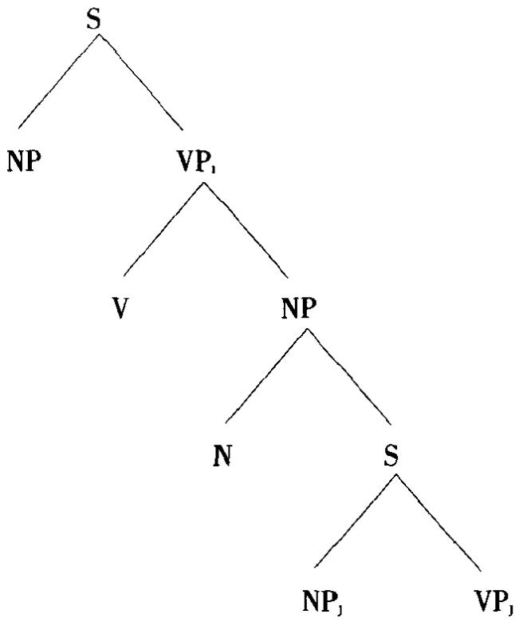

NP和VP两个成分互为小句伙伴，同样还有NP和 VP，但是NP,不是VP的小句伙伴。在计论转换规则的特性时这一概含使论述变得较为经济，例如选择限制只适用于小句伙伴。

clausewall小句墙非离散语法术语，指小句与小句之间存在的不同程度的依存关系。阻隔两个小句的小句墙如果较高，两个小句的独立程度也较高；反之，小句墙较低，独立程度较低。

clear 清晰常用来指一种边音变体，凭印象其共鸣是[1]音质前元音的共鸣，如英语元音和/j/之前/1/的标准发音，例如leap“跳”，lamp“灯”。与糊余l对立。

cleft sentence 分裂句 语法描写用来指一种构式，即一个小句被分成两部分，每一部分有自己的动词。例如，句子 Mary is drivıng a new car “玛丽在开一辆新车”有多种“分裂”方式，如 It's Mary who is driving a new car “在开一辆新车的是玛丽”, It's a new car that Mary is drving “玛丽在开的是一辆新车”。这些变体影响句子内强调成分的分布，并与语调突显模式密切相关。分裂句及相关的假分裂句在转换语法中受特别重视，因为它们引出许多派生问题。

click(1)吸气音 按发音万式给辅音分类用的术语，简而统之指一系列用软腭气流机制(见 VELAR 软腭条)发出的音。英语中表示斥责、不耐烦的“tut tut”有吸气音，某些方式的接吻声表示欣赏的声音、驾驭马的吆喝声等也有吸气音。某些语言(如祖鲁语，豪萨语)里，吸气音具有音仁的地位。吸气音的范围包括双唇音[]，齿音[1](原标为[n])，齿龈音[1](原标为[C])，边音[Ⅱ](原标为[5])。与吸气音的协同发音称作“吸气音伴”。

(2)咔嗒声心理语言字的言语知觉与理解实验中，收听者一只耳朵注意收听言语的同时，向他的另一只耳朵输入一个言语外的突发声字噪音，即一个“叶嗒声”。例如，通过改变咔嗒声在言语语法结构中出现的位置，可以推知大脑感知和组织语法单位的方式。在一组实验中，当味嗒声出现在语法成分交界处时，被试人回忆咔嗒声就出现在那个位置；但是咔嗒声如果出现在一个组构成分的中间，被试人则倾向于回忆咔嗒声出现在接近成分交界的位置。（这种效应叫做“咔嗒声移位”)这类发现因此可以解释为组构成分界限具有知觉或认知现实性。

cline斜坡 韩礼德式语言字术语，指可能有无穷多等级区分的连续体，例如升调和降调之间音高有一系列可能的对立，时间等级上也可划出各种程度的对立。这一术语最初用于阶与范畴语法，现扩展到语言学其他领域。这其实没有多大必要，因为有同义的“连续体”在。

clinical linguistics临床语言学,病理语言学有时用来指将语言宇理论、方法和描写结果应用于分析语言故障的医疗条件或环境。这种应用需要语言学家与言语病理学家/治疗专家、听觉矫治专家和其他专家协同配合，对口头或书面语言的产生和理解故障作出评估、诊断和矫正。当然，这类故障除出现于临床环境外也出现于教学环境。值得注意的是心理语言字、神经语言字、语言习得研究都与临床语言学有关系。

clipped form 截短词 见 ABBREVIATION 缩写条。

clitic(-ize，-ization)附着形式(附着，附着法) 语法木语，指一个形式像一个词，但不能单独成为一个正常话段，而是在结构上依附于构式中相邻的词。(“clitic”源自希腊语，意指“依靠”。)例子有英语 be“是”的缩约形式如I'm“我是”和he's“他是”等。英语、法语等语言中的冠词有时也称作附着形式：像the这个形式不能独立成一话段，虽然操本族语者还是称之为一个词。这种附着词可以分为前附词(proclitics)(依附于后一个词,如冠词)和后附词(enclitics)(依附于前一个词，如意大利语和西班牙语中某些代名词在动词形式尾的附着(cliticization)。这两种附着方式也分别称作前附(proclisis)和后附(enclisis)。

close闭(1)闭元音根据基本元音系统对元音的垂直舌位作四度区分，“闭”指其中一度。其他三度是半闭”、“半开”、“开”。指发元音时舌运动不引起可闻摩擦而能达到的最高位置，例如[ı]和[u]的发音英语中最闭的元音是有如seat“坐位”和shoot‘射击二词中的元音。直接在“闭”之下的发音区叫做半闭(half-close)或中闭(mid-close),如[e]和[o](英语中最接近的是分别在有如 say“说”和so“如此’二词中的元音)。在元音的三度区分制中，最高的一度称作“高”元音(另二度为低'和“中”)。

(2)闭音渡 给音度分类的术语，指词内音与音之间正常的过渡。“闭音渡”与“开”或“加”音渡对立。

(3)闭颌位给颌亿分类的术语，指上下齿比正常状态闭得紧时颌的位置，与“开”颌位对立。

closed 闭的，封闭的 (1)封闭类(closed class) 给词作语法分类时用来指语言中假设的两大词类之一，另一类是开放类。封闭类的成员是固定和有限的。不像“开放类”的词项，封闭类不能经常增加新词项。代名词、介词、连词、冠词等都是封闭类词或封闭系(closed system)词，“系”在这里是表示类的成员是限定的，并且有独立的意义和用法。

(2)闭音节 音节结构可以分两类，一类音节以辅音结尾，叫闭音节；与之对立的是开音节，以元音结尾。闭音节有时也称作抑音节或阻音节。

closure 闭塞 语音字用来指主动和被动发音器之间的接触阻碍口腔和/或鼻腔气流的发音动作。“完全闭塞”见于破裂音、塞擦音、鼻音，以及喉和软腭气流机制。“间隙闭塞”见于滚音、闪音和触音。“部分闭塞”见于边音。有的语音学家将擦音归入“部分”或“不完全”闭塞。声道变窄而发音器不接触，通常称作制流。

cluster辅音丛分析连续言语时用来指音节首音和尾音位置出现的辅音邻接序列，例如英语 bread“面包”的首音[br],best“最好的”的尾音[st]。并非所有可能的辅音组合都在一种语言中出现，例如英语音节的起首不允许有与[δ]，[t]，[cs]或[z]结合的辅音丛。首辅音丛最多可有三个辅音，如[spr],[spl]，[skw];尾辅音丛最多可有四个辅音，如glımpsed [mpst]“瞥见”和 twelfths[1fθs]“十二分之一”。另见REDUCE缩减条。

coalesce(nce）聚结（1)语言字、特别是历史语言学用来指原来区分的几个语

## coarticulation

言单位合并在一起。一个音位的不同音位变体可以聚结，不同的音位和不同的语素也可以聚结。现代英语/3/音，很多场合是/z/和/j/聚结的结果，例如occasion‘场合,measure‘度量，再像 formation“形成”这样的词，可将其中的词缀分析为ate+ tion的聚结。类似的术语有并合，合并，容合和中和。

(2)(-nt)聚结的 语音字和音系宇用来给同化分类的术语。聚结同化(co-alescent assimılation)(又叫相互同化”)是指两个相邻的发音动作互相影响，例如在 could you你能吗？”这样的短语中[d]和[j]互相容合而成[s]。

coarticulation 协同发音 以同时或部分重叠的方式涉及声道中不止一个点的发音过程，例如西非诸语言中经常听到的并列塞音[]，[bg]，[bt]和[bd]。先协同发音(anticipatory coarticulation)是指发某一音时不涉及的一个发音器预先朝发出话段中后面一个音所需的发音动作(即其目行)移动。例如英语shoe‘鞋”中的sh，通常发作圆唇音是受下一个[u]音的影响。协同发音也有一个音保留先前一个发音动作特占的情形。另见ANTICIPATORY(2)先协问发音条。

cocktail party phenomenon 鸡尾酒会现象 一种日常现象，理语言字作为言语知觉理论的一部分对其作科学研究。指一种选择收听过程，即在同时听到几个会话时能做到有意识地庄意其中一个而忽略其余几个。

coda节尾，韵尾语音字和音系字术语，指可以跟在音节核(节核)后头的成分，例如/kap/中的/p/。有时区分“简单”节尾(只含一个音段)和“复杂”节尾(含多个音段)。限制音段或特征在节尾位置出现的条件称作节尾制约(coda con-straints)。

code 代码;语码 这个名称的一般意思是一个信号系统转换成另一个信号系统的一组习惯方法。代码主要是符号宇和信递理论而不是语言字的研究对象。像“编码”和“解码”这类概含有时也见于语音字和语言学，但是将语言视作一种“代码”的观点并不占主导地位。这一术语在社会语言字很常见，主要用作指称任何涉及语言的信递系统的中性名称，社会语言学家因此不必非使用万言语言或语言变体这些在其理论中有特殊含义的术语。例如，称作语码转换(code-switch-ung)的语言行为有这样一些操双语者(根据谈话对象和谈话地点)在英语的村准形式和地方形式之间转换，威尔士部分地区威尔士语和英语之间的转换，职业用语和日常用语之间的转换，等等。代码混合(code-mixing)指一种语言中的语言成分转换到另外一种语言中。另一方面，有些社会学家和社会语言学家给“语码”下一较狭窄的定义，例如按互通性来定义(如秘密团体或职业群体的语言)。但是这一术语最广泛的特殊用法见于英国社会学家巴兹尔·伯恩斯坦(生于1924)所阐述的信递代码理论。他提出的精制码和有限码的对立是其关于社会系统性质的理论的组成部分，它主要关心的是人们如何利用语言提供的各种手段来传递各种意义以及传递意义的明确程度。

codification(codify）编集成典 语言规划(语料规划)使用的术语，指系统编写一种语言变体(一般是社会的行准语)的使用规则和惯用法。给一种语言编集成典的成果包括正字法和正音法，语法，词典，语体手册和用法指南等。

cognate(1)同源语，同源词 历史上与另一语言或语言形式有同一来源的语言或语言形式，例如西班牙语意大利语、法语、葡萄牙语是“同源语”，pere和padre等“父亲”是“同源词”或同源形式。

(2)“同源”也用来描写某些类型的句法关系“同源宾语”是与支配它的动词 历史上来源相同的宾语(不太严格地说，是语乂上依赖动词所表达的动作的宾 语),例如 to run a race “参加赛跑”,live a good lıfe “过好日子”, ask a question “间 一个问题”，同源的王语－动词一宾语序列的例子是 Employers employ employees “雇主雇用雇工”这样的句子。

cognise 识知 见 COGNIZE 识知条。

cognitive（meaning）认知义 语义字有时用来指一种类型的意义，即与词项的外延义和句子的命题内容直接相关的那种意义，相当于凭知识所作的客观解释，与感情意义或主观解释相对立。可替换术语有外延义和指称乂，对立术语有情感乂和内涵乂。

cognitive grammar 认知语法一种将语言视为认知能力不可分割的一部分的语言字理论，视语言为将结构赋予认知内容的手段。原先称作空间语法(space grammar)。按这一理论，语言的基本功能是象征，即用语音来象征概含化的过程。语法被视为该理论中有内在意义(或“象征性”)的组成部分，起连接语义部分(视同概含部分)和语音部分的作用。形式和意义的配对建立起神经活动各种既定(或“固定”)方式(“单位”)之间的联系，这些“单位”是给词语划分范畴的模板。每种单位(语义的、语音的、象征的)对应于结构的一个方面，而合式词语是由一系列单位按“规约”构建而成的。语法类和构式被分析成象征结构的构型·基本的区分是“名词性成分”(表示事物，如名词短语)和“关系词语”(表示关系，如动词、介词、形容词、小句)，语法规则被描述为抽象的“结构图式”。另见COGNITIVE SEMANTICS 认知语义字条。

cognitive metaphor 认知隐喻指一种隐喻理论，认为隐喻在人类语言和认知中起必不可缺的作用，各种形式的语言活动，包括日常会话，都是通过隐喻来体现世界观的(“概念隐喻”)。高层次的概念，如使役、时间、情感等，被视为在语乂上植根于身体所经验的各种低层次概念域中，例如把生命看作旅程，有“生命旅途”的说法，把因果关系看作家族关系，有“现代物理学之父”的说法。“诗学隐喻”被视为日常隐喻的延伸或新的组合。这种理论因此与隐喻的传统理论大相径庭，后者区分字面意乂和比喻意义，只关注隐喻的修辞和文学语境，因此在对语法和语义结构作出全面的语言学解释方面被认为不起多大作用。

cognitive semantics 认知语义学一种语义字理论，认知语法的组成部分。这一理论将意义等同于概含化—属于心理经验一部分的各种结构和过程。主张意义包括百科知识，不承认语言世界和语言外世界有明确分界，凡是有关一个实体的任何知识都可能成为这个实体意义的一部分。词项因此通常是多义的，可分析为一系列相关函又构成的网络。这一理论的一个中心思想是概含内容的“识解”(construed)方式一个词项的识解取决于好几方面的因素，包括其所在的“认知域”(如空间、时间、颜色等)和视角与显著度的变化。

cognize 识知 诺姆·乔姆斯基建议用这个术语取代一般的“知道”(know)。他认为说话人不仅识知他意识到的语言事实(如某一句子作某一解释)，而且识知得出这些事实的心理上有表征的规则和处于这些规则底层的天赋原则。

coherence 连贯 一般意义上的这个词应用于话语分析，指话语组织的一条主要的假设原则，用来解释一席口头或书面语言(篇章，话语)底层的功能联系或一致性。它牵涉到研究这样一些因素语言使用者对世界的知识，作出的推理，持有的假设，以及利用言语行为进行信息传递的方式。这种意义上的连贯通常与衔接相对，后者指语言形式在表层结构分析层面上句法或语乂的连接方式。

cohesion(cohesive(ness)）(1)粘聚(粘聚的，粘聚性) 语去常用此术语指作为语法单位的词的一个定义特性。按粘聚标准，正常言语不能在词内插入新成分，它们只能插在词的边界处。这一标准的可替换名称是“不间断性”。粘聚标准对英语很适用(除了像 abso-bloomung lutely“十足该死的”这样的例子),但用于有中缀的语言必须加以修改。

(2)衔接(衔接的，衔接性) 有些语言学家用来指构式中大于语素的单位捆绑在一起这一特性，例如“冠词+名词”。按这种用法，任何词组只要充当一个较大单位的组构成分就可以说它是内部衔接的。在韩礼德式的语法分析中，衔接是一个重要概念，指将句子或话语较大单位的不同部分联系起来的话段或篇章的表层结构特征，例如代名词、冠词和某些副词的相互参照功能(如The manwent to town Houever, he did not stay long“那个人去镇上了,但是他没在那儿久留”)。衔接通常与篇章的底层连贯相区别。

co-hyponyms 并列下义词 见 HYPONYM下义词条。

co-indexing（co-index）加同标(同标） 最近的生成语言学理论用此术语指给一系列组构成分指派相同的下角字母或数字；有时也标在上角。具体讲，这些字母或数字标明那些组构成分在句子深层结构中的身份相同。例如在深层结构I persuaded Mary1 PRO1 to leave“我劝玛丽₁PRO1 离去”中，下角数字表明 Mary玛丽”与PRO(按规约代表不定式主语)同标(同指)，因此是leave“离去”的王语。“加同标”也用于移位规则的语还理论。

collapse 叠合 生成语法术语，指两条规则在标写法上合而为一，使说明更简单更概括。例如 NP→DN 和 NP→D Adj N 两条规则用一条 NP→D（Adj) N 规则来取代，这里的括号表示形容词可有可无。

collective 集合[名词] 语法描写指一类名词，表示的是一组实体的集合，形式上不同于有明显数对立的名词(有的语言这两类名词有形态区别)。集合名词(collective nouns),如 government“政府”,army“军队”,club“俱乐部”,jury“陪审团”，public“公众”等，语法上可分几个小类，但共同的特点是能以单数形式或与单数动词或与复数动词同现，意思也相应有所差别名词或作一个集合的整体理解或作许多个体的集合理解(试比较 the committee is wrong“委员会错了”和 the committee are wrong“委员会都错了”)。有些语言里，“集合”(与非集合(non-collective)对立)指一种复数的构成，即若干个体被视作一个凝聚的集合，例如复数后缓 A附于house“房屋”可能表达“村庄”的概念(集合)，而后缀B则可能指任何一群房屋(非集合)。

colligation（colligate)搭连 弗斯式语言宇术语，指一些词因进入组合语法关系的方式相类似而归为一类的过程或结果。例如，有一些动词都带某一类补语构式，就说这些动词与那类构式“搭连”，如 agree“同意”，choose“选择”，decline “拒绝”,manage “设法”等动词与 to-不定式搭连(colligate)，不与 ing 形式搭连，如 I agree to go“我同意去”， \*I agree going。搭连通常与搭配相对。

collocation(colloc-ate,-ability）搭配(搭配词，可搭配性） 某些语言学家(特别是弗斯式的)用于词厂字，指个别词项之间习惯性的同现。例如，auspicious“吉利的”与occasion“场合”event“事件”、sign“征兆”等词“搭配”，letter作“字母”解与alphabet“字母表’、graphıc“书写的”等词搭配，作“信件”解与 postman“邮递员”pillarbox“邮筒”等词搭配。可见搭配是词汇的一种组合关系。这种关系在语言字上多多少少可以预测(例如 spick 和 span 总是连在一起， spick andspan“崭新的”，其搭配的可预测程度高于letter和pillar box)。这就使搭配有别于函乂联想，后者一般有特异的联系(例如由 mother in law“丈母”联想到 huppopotamus“河马”)。有的词没有特殊的搭配限制(collocational restrictions)，如the(定冠词),of“的”,after“在后”,in“在…里”这类语法词。相反，有许多词的搭配限制完全可预测，如 eke + out(eke out“弥补··的不足”)和 spick + span,它们通常算作成语、套语等。搭配的另一重要特征是说明形式(而不是语义)的同现，例如 green“绿，(脸色)发青”而不是 blue“蓝”或 red“红”与jealousy“妒忌”搭配，尽管两者在指称上并无联系。两个“搭配”的词项互为搭配词(collocates)。词项的搭配能力称作可搭配性（collocability）或搭配范围（collocationalrange)。另一个相关概含是“语义韵律”，参见SEMANTICS语义学条。搭配限制类似于生成语法中的选择限制。

colouring（colour）带音色(音色) 语音字用来指元音由于受附近某个音的影响而产生音质上细小而可察觉的变化。例如，元音受后头一个r类音(最常见的是卷舌音)共鸣的影响而带“r音色”，后头带/h/能带“h音色”。

combinatorial 结合 指语言单仁互相“结合”成较复杂的构式这一基本功能。例如，辅音和元音的“结合特性”或“结合关系”可用来定义音节(元音为节核，辅音为界音)。这种意义上的结合是一种组合关系，与聚合这种对比关系相对立。

command（1)命令[句]给句子功能分类的术语，这种分类有时按语法标准有时按语义字或社会语言宇标准定义。句法上命令句一般没有主语，动词为祈使式，例如 Come here!“到这儿来!”。语义上命令句主要用来令某人做(或不做)某事。从言语行为的观点看，命令功能可用其他形式来表达，例如 that boy willstand up“那个男孩必须站起来”，也可用一种支配性语调来表达。命令与句子其他三大功能相对立阵述，提问，感叹。语法计论中命令句通常按形式称作“祈使句”。

(2)统领 最近的生成语法中用于短语组构成分统领(constituent-com-mand)，一律缩写作 c-统领(c-command),还用于短语最大统领(maximal-com-mand)，一律缩写作m-统领(m-command)。在短语标记中，一个成分如高于其他一些成分而又不统制那些成分，则说这个成分c统领那些成分。在下述情形下说组构成分 X m 统领 Y 统制 X的第一最大投射也统制 Y,而 X 不统制 Y, Y也不统制 X。例如以下树中，N m 统领 Det,虽然 N 并不 c 统领 Det

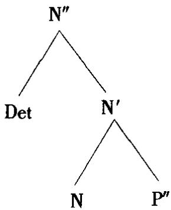

以下树中，V不m 统领N，虽然 Vc统领N。

c统领是阐释管辖的一个重要概念。

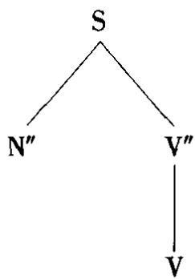

comment(1)评述 语义字和语法术语，是对句子结构作传统的主语/谓语二分之外可采用的另一种二分法，即二分为话题/评述。句子的话题是作为说明对象的人或物，评述则是句子中对话题进而作出说明的部分。在句子 The book wason the table“书在桌子上”中, the book“书”是话题，其余部分是评述。英语没有明显区分话题和评述的标记，不像有的语言借助小品词、词序对立或屈折形态来表明两者的对立。有些语言学家用主位/述位的术语指一种类似的对立。

(2)插评句(comment clauses) 夸克语法承认的一类小句，指一种可有可无的结构，其功能是对另一小句作添插性的评述。英语有各种各样的插评句，例如 you know“你知道”, to be honest“老实说”, they say“有人说”, generally speaking“一般而言”等。其中有一些已成为会话中填充性的刻板语，有多种复杂功能，如you see“你看”,mund you“听着”,I see“我明白”等。

commissive 承诺语言语行为理论术语，指说话人对将来的行为作出承诺的一类话段,例如 Ⅰ promise“我答应”/ I guarantee“我保证”.·。

common（1)普通的 语法描写用此术语指一个语法范畴的无行记形态。例如，英语名词属格以外的形式可称为“普通格”形式。同样，如果一种语言只有一种性的对立(如阴性对阳性/中性)，或离开语境无法确定性别(如法语enfant“小孩”)，就可用“普通性”称之。传统语法中，“普通名词”是从语义上定义的名词的一个次类(指“一般概念”)，与专有名词(个体的名称等)对立。语言学的研究一般强调这些次类之间的形式差别(如使用不同的冠词)。

(2)共同的 某些社会语言宇和风格字研究用共同核心或共核(commoncore)这一术语指为一种语言的所有变体、万言等所共有的一系列语言特征。例如英语thou“汝”的用法就不属于共核部分，因为它只限用于某些方言和宗教语境。

communication(communicat-e，-ive）信递（信递的，交际的）行为研究的一个基本概念，用作语言字和语音字研究的参照框架。信递指信息源和接收者之间借助一个信号系统传递和接收信息(或“消息”)的过程。就语言信递而言，信息源和接收者都应理解为人，信号系统是一种语言，对信息的反应(或承认收妥)这一概念至关重要。理论上讲，如果收到的信息跟发送的信息完全一样，就说信递已经实现。但实际上必须考虑到各种干扰因素或“噪音”会降低传输的效率(例如听不懂的发音，词的特异联想等)。还必须考虑到信息传递过程中不同的控制程度说话人有目的地选择信号的同时总是伴随着传递“自身无法控制”的信号，例如某些音质作为信号是表示说话人得了感冒，很疲劳，上了年纪，是男性等。对信递各个方面的科学研究有时称作信递科学(communicationscience):这一领域包括语言学和语音学，它们的各个分支，以及相关学科(如声学、解剖学)的应用。

人类的信递可借助任何一种可资利用的感觉方式(听觉、视觉等)，对信递活动中这些方式的区别的研究属于符号字。研究者特别是心理学家经常区分言语(verbal)和非言语信递(non-verbal communication)，分别指信递的语言和非语言特征(后者包括面部表情、身势等，人的和动物的都在内)。但是这里verbal一词有歧义，暗指语言基本上是个“语词”问题，所以这个术语对语言学家的价值有限，他们通常也不按这种涵义使用这一术语。

术语communicative常按狭义理解为“交际的”，例如用在短语交际能力(communicative competence)中，与“语言的”(linguistic)相对而言。语言能力(linguistic competence)是操本族语者对自己语言形式构造的知识，而交际能力则是对自己语言在什么场合下使用得体的意识。这种强调功能适宜性的意思也体现在外语教学领域的一些术语中，如交际语法(communicative grammar),交际教学大纲（communicative syllabus）等。信递动力作用（communicative dy-namism),简称 CD)是现代布扛格宇派语言宇理论(见 FUNCTIONAL SENTENCEPERSPECTIVE功能句子观条)的一个基本概念。按这一理论，每个话段被视作一个逐渐展开意乂的过程，话段的各个部分对整体信递效果作出各不相同的(“动态的”)贡献。一个话段的某些部分对意义的贡献很小，因为它们只表达已经传递过的信息，这种“主位”部分的CD值被认为是最低的，相反，“述位”部分的CD值最高，因为是推进信递过程的新信息。介于两者之间的还有其他一些部分。

commutation 代换某些音系宇家用来指用语音替换显示对立性。最常见的术语是代换测试(commutation test)，指系统地利用最小对的替换方法来建立音亿。某些语言字理论按狭义使用这一术语例如语符宇中代换与“替换”相对，只指聚合体成员间的一种关系。

comp 为COMPACT“紧实[音]”，COMPLEMENT“补语”,COMPARATIVE“比较的”的缩写;在最近的生成语言字中写作 Comp 或 COMP,为 COMPLEMENTIZER 行句语的缩写。

compact 紧实[音] 雅可布逊和哈勒在其音系学的区别特征理论中确立的语音特征之一，用来描写发音部位的变异，相对立的特征是散音。紧实音从发音和声学两方面定义为制流发生在口腔较前部分，声宇能量相对集中在语音频谱中央较狭窄的部分。例如，开元音有[+紧实]特征(缩写为+comp)；高元音和中元音有[-紧实特征([-comp])。在乔姆斯基和哈勒的系统中紧实变为低。

comparative(1)比较的用来描述语言字的一大分支，其主要任务是对不同语言(万言，语言变体等)或一种语言不同历史状态的特点作比较说明。19世纪的比较分析都是历史比较，学者从事调查的是像梵语、希腊语、拉丁语这些语族之间的联系，假设它们有共同的祖先(即衍生出这些语族的原始语言)，以及研究导致当今各语群形成的变化过程。这种研究后来称作比较语文学(comparativephilology)，或简称语文字，有时也称作比较语法(comparative grammar)。比较法(comparative method)这个名称专指标准的语文学比较法，即比较同原语言的一组形式以确定它们之间是否有历史联系。如要有这种联系，就再据此推断这些同源语的祖先的特卢(这一过程叫“比较”或“内部”构拟)。

20世纪初，语言学从汪重历时语言分析转向共时语言分析，虽然并不排斥历史研究，这个时期的比较语言学一般关心的是活的语言之间结构对应的理论和从事实际分析，不管它们的历史如何，目的是区分一般的语言类型(“类型比较”或“类型语言学”)和最终确立人类语言的普世特性。

(2)比较级 语法描写中说明形容词和副词三种比较程度及其适用范围的术语之一。比较级形式(comparative form)用于两个实体之间的比较，一头与最高级———两个以上实体之间的比较——对立，一头与原级———不含比较意思——对立。英语的比较级可用屈折形式(er)和迁说构式(more)两种方式表达，例如 nicer“更美好”，more beautiful“更美丽”。可跟在比较级后头的构式叫做“比较小句”或“比较句”,如 He is bigger than I am“他比我高大”。

compensatory lengthening 补偿延音 音系字里指一种效应，即一个音段的删除伴随另一个音段(通常是相邻的一个)音长的增加，从而保持音节音量不变。典型的情形是一个音节尾音段失去后一个元音相应延长，例如古英语gos“鹅”，由日耳曼语gans失去鼻音后前头的元音延长而成。这种现象对承认音节音量作用的音系学理论(如自主音段音系宇)很重要。

competence 语言能力 语言学理论特别是生成语法用此术语指说话人对自己语言的知识，即已经掌握的规则系统，他们据此能说出和理解无限多的句子，识别语法错误和歧义。语言能力是一种理想化的语言概念，被视为与语言运用的概念相对立，后者指言语中一个个具体的话段。索绪尔式的语言(LANGUE)和言语(PAROLE)的对立与这种对立相似，但是语言能力和语言(langue)的定义有重要差别。按乔姆斯基的观点，生成语法以前的语言学都专注于语料的语言运用而不是底层的语言能力。作为一般概念，这一对立已被广泛接受，但也遭到批评，一些语言学家认为两者之间的界限并不像所定义的那样明显。在确定某一言语特征(如一个语调和话语特征)究竟是语言能力还是语言运用问题时往往会有困难。

一种特别强列的批评是基于有人提出的交际能力(communicative compe-tence)的思想，这一思想注重操本族语者说出和理解适宜于当时所处语境的句子的能力，即为了在不同的社会背景下有效地交流信息说话人所必须具备的知识。交际能力因此涵盖语言行为的各种社会因素，包括说话人和听话人之间的关系、说话时间和地卢引发的限制等环境因素。虽然没有明说，但如果说话人确实意识到这些制约的话，那就可以进而提出，语言理论的目标应包括对这类因素作出的明确说明，因为这些因素在一个社团中具有系统性，而又并不限于纯形式的结构分析(如“语言”能力的概念)。这一观卢为不少人所接受，但是究竟如何对这种广泛意义上的语言能力作出精确的定义和描述，至今的研究进展不大。最近提出的一个类似概念是语用能力(pragmatic competence)。另见GRAMMAR(5)语法，PRAGMATICS语用字条。

complement(-ation)补语(补足) 语法功能分析的木语，指句子或小句结构的一个主要组构成分，传统上与“补足”一个动词表示的动作有关。因此按最宽泛的意思补语的范围非常广，包括谓语中除动词之外的所有必需成分，如宾语(如 She kicked the ball“她踢那只球”)和状语(如 She was in the garden“她在花园里”)。有些文献中补语的定义较狭窄，例如只指接在动词to be(或类似动词)后起“补足”作用的结构。按这种分析法，She kıcked the doctor“她踢那个医生”分析为主语-动词-宾语，而 She is a doctor“她是个医生”分析为主语-动词-补语。补语有时再细分主语补语(subject complement)和宾语补语(obiectcomplement),前者如 She is a doctor,后者如 She called me a fool “她叫我傻子”。还有各种补语小句(complement clauses),这个概念有时理解为任何种类的从属小句，有时只理解为一种从属小句(如 be后头的小句，例如 That is what Isand那就是我所说的”)。但是，语言分析中补足(complementation)这个概仓的界限仍然不清楚，还存在好些悬而未决的问题，例如短语动词中的小词(如comein“进来”)是否算作补语。在生成语法中，补语是零层面语类的一个姐妹组构成分。动词以外的语类有时也说它带有补语，例如 a student of physics“一个物理学的学生”中的 of physics“物理学的”是 student“学生”的补语。在 X-杠句法中，补语与附接语相对而言(比较 a student with long haur“一个长头发的学生”)。另见Wh条。

complementary（1)互补 主要用于音系宇互补分布(complementary distri-bution)这个术语，指一对音在某一语音环境中互相排斥。例如，英语中//音位的不带声音位变体[1]出现在首音/s-/之后，如sleep“睡觉”，而带声音位变体在这个位置受排斥；相反[1]用在前头不带/s/的首音位置。因此说[1]和[1]在这个环境中呈“互补分布”。形态字也比照使用这一术语，指一对形式在语法环境中的分布(例如英语复数语素的交替形式)。

(2)(complementarity)(相反) 语义字术语，指两个词项之间的一种涵义关系。相反词(complementary terms或 complementaries)显示的意义对立关系如single/marned“未婚/已婚”，boy/girl“男孩/女孩”这样成对的词。“未婚”是“已婚”的“相反词”，反过来也一样。这种关系中肯定一个词项等于否定另一个词项一个实体不可能同时是两者。相反关系的特点是两者之间缺乏等级或程度差别(如 boy 和 girl之间不是一个渐变的连续体，没有\*less boy“不太男孩”，\*very boy“非常男孩”的说法)。相反词因此可以与反义词相对立，后者有时专指对立项之间有程度变化(如 big“大”，bigger“较大”, very big“很大”对立于 smal“小”，smaller“较小”等)。相反词也不同于反成词，后者互相预设对立项的存在(例如 husband/wife“丈夫/妻子”)。有人喜欢用语义矛盾的术语指称这种相反关系。

complementizer（缩写为 Comp,COMP,C）标补语；标补位；标句语 生成句去术语，指用来标记一个补语性嵌套句的从属连词，例如I said that he was leaving“我说他要走了”中的that。在X杠句法中指小句(S)结构的一个位置，用COMP或C表示，可由(举例来说)一个标补语或小句首的 WH短语来填充。在管辖与约束理论中，COMP(或C)是一个零层面语类，其最大投射C(或CP)跟起始符号一样是最高层的语法构式。这种理论中，wh移位，举例来说，是一种移到C的指定语位置的移位。

complete feedback 完整反馈 见 FEEDBACK反馈条。

complex(ity)复杂(性) 这个词按一般意思用于语言字，既指语言单位内部的形式结构也指使用或学习这些结构时心理上的困难程度。造成复杂性的各种因素是心理语言字的一大课题，这些因素既与成人的语言理解和产生有关，也与儿童语言习得有关。一个中心问题是认知和语言结构中难度不等的层次之间互相作用的性质是什么，特别是这种互相作用如何影响儿童语言中不同型式出现的先后次序。但是至今还无法证明可以用纯粹语言学的术语来定义衡量复杂性的独立标准(例如用句子派生过程中转换的次数，或用规定一个语言单位所需的特征的数目等，参看SIMPLICITY METRIC 简单性度量条)。这主要是由于对语言学度量标准的性质有争议，也由于其他心理因素引起的干扰，如语言使用者的注意力和动机的干扰。

这个术语还有几种狭又的用法(大多与“简单”对照使用)，例如“复杂句”(两种意思·或指包含不止一个小句的句子，或指由一个主句和至少一个从属句组成的句子).“复杂介词”(由不止一个词组成的介词)，“复杂词”或“复合词”(包含一个自由语素和至少一个粘着语素)，“复杂调”(有两个不同音高变化的语调核心)，“复杂塞音”(有两个发音点的破裂音)，“复杂节核”(有两个不同元音音质的音节核心)，“复杂音段”(某些特征理论模型中指有两个或更多同时口腔声道收缩的音段)，等等。在生成语法中，“复杂NP”是指带一个小句作补语或作附接语的名词短语(前者如 the assumption that the engine is working“引擎在工作的假设”，后者如 the assumption that he made“他提出的假设”)。经典转换语法中的“复杂NP制约”规定，复杂名词短语中的任何成分都不能提取，换言之，这样的短语是句法岛。

complex symbol 复杂符号 某些生成语法模型(参看 ASPECTS《要略》模型条)用此术语指短语柠记中自身有内部结构的符号。由一组不分次序的句法特征组成，如[+名词]，[+抽象]，[+有生]等，有的模型还加上这组特征所指定的语素。例如

+名词   
+人类   
-专名   
man“人”

component(ial）（1)语法组成部分(组成部分的） 生成语言学用来指组成一部生成语法的几个主要部分。在诺姆·乔姆基斯的《句法结构》(1957)中区分三个组成部分：短语结构部分(生成一个底层语符列的集合)，转换部分(以各种强制的和非强制的方式作用于语符列，从而引人语义变化)，形态音位部分(将每个句法语符列转变为音系单位组成的语符列)。在《句法理论要略》(1965)中，这一模型有重大改变。短语结构部分变为基础部分(base component)，它生成表示句子深层结构的底层短语行记，即生成所有跟语义相关的语法概念。基础部分又包含两个子部分(sub-component)·语法的语类部分和词汇部分。然后对那些短语标记进行两种操作(a)用语义部分(semantic component)的规则(这部分在《句法结构》模型中没有对当部分)对其作出语义解释，(b)通过转换部分(transformational component)(主要包含强制规则，非强制规则现改由基础部分规则的选择来处理)将其转变成表层结构。最后，音系部分(phonologicalcomponent)作用于表层结构，为其提供语音解释。

(2)[语义]成分 语义字指用来分析词项涵又的不可再分的特征，例如gurl“女孩”一词可分析为由“人类”、“女性”、“儿童”等语义成分构成。成分分析法(componential analysis)是本世纪 50 年代从一些美国人类学家设计的亲属词汇的分析法发展而来的。主张这种方法的人认为，所有词项都可以用一批数目有限的语又成分(或“语又特征”)来分析，它们很可能具有普世性。确实，有好些成对成组的词项证明这种分析法的长处，例如boy/gurl“男孩/女孩”，man/woman“男人/女人”，ram/ewe“公羊/母羊”之间的对应关系可用[+男性]对[-男性]或[-女性]对[+女性]来说明。但是至今提出的各种语义成分分析法存在好些问题，例如，对所有词项来说二分分析法是否都适用，语义成分是否真的具有普世性，语义成分取这个值而不取那个值有何依据(如上例应该用[+男性]还是用[-女性]来分析)等。

一般意义上的“成分分析法”指任何将语言单位分析为成分的方法，不管是音系宇、语法学还是语义学。这在欧洲的语言学尤其常见。按这种观点，布扛格宇派的音系分析跟词与词形变化形态学一样都是用的成分分析法。

(3)单项成分 某些最近的音系学理论(如依存音系字)使用的术语，指用一个“单项”(unary)成分而不是一个二分对立来表示的语音特征。这个术语在“单项成分理论”中有特殊地位。

composition(-al(ity),de-compos-e,compos-ite) 组构(组构的，组构性，分解）语言字用此术语指语言结构的层级模型，即大单仁视作由小单位“组构”而成。例如，语去分析中，句子、小句、短语、词、语素之间的关系有时被描述为一种组构(composition)关系，也称成分组构或级的关系，即高一层级的单位可分析(可分解(decomposable))为低一层级的单位。然后可以进一步分析这些结构的组构意义(compositional meaning)。各种组构模型常见于阶与范畴语去、法仁语法、层次语法和短语结构语去。就构词方式而言，“组构”即按一般意义指“复合过程”，有时也按狭义指某一特定类型的复合。在转换语法中，短语动词(例如 switch on“接通(电流)”，take off “脱掉”)可称作组构动词(compositeverbs)。语义学中“组构”指个别词的意义组合起来可构成较大单位的意义，即整体意义是部分意义相加的总和。这一概念在蒙塔古语法和其他一些语法中十分重要。

compound(ing）复合（1)描写语言学广泛使用的术语，指一个语言单位由一些成分组合而成，这些成分在其他场合有其独立的功能。复合这个概念特别常见于“复合词”(由两个或更多个自由语素组成，如“复合名词”bedroom“卧室”，rainfall“降雨量”，washing machine“洗衣机”等)和“复合句”(由两个或更多个主要小句组成);但这个术语也用于其他场合，如“复合动词”(如 come in“进来”)，“复合时”(由一个助动词+词汇动词组成)，“复合主语/宾语”等(即小句成分由一个以上的名词短语或代名词组成，如 the boys and girls shouted“男孩女孩们都喊叫起来”中的主语)，以及“复合介词”(如 in accordance with“按照”)。

(2)有的语言学家用此术语给双语现象分类。复合双语者(compoundbilinguals)是那些给两种语言的对应词汇单位赋予相同意义的操双语者——与

## comprehension

并列双语现象对立，后者不这样赋予相同意义。

comprehension 理解 这个词的一般意思用于语言字，指听懂看懂和解释口头和书面语言的能力，与之相对的是产生。在心理语言字中，对言语理解过程的分析是一个重要课题，包括这样一些具体问题儿童在语言习得过程中使用的策略，成人在解释不同类型的句子(如歧乂句，否定句，疑问句)时使用的不同策略，在对句子和话语作出解释的过程中语言外情景的作用和认知因素(如记忆、注意和知觉)的作用。

computational linguistics 计算语言学 语言字的一个分支，用计算技术和概含来阐释语言学和语音字问题。已开发的研究领域包括自然语言处理，言语合成，言语识别，自动翻译，编制语词索引，语法的检测，以及许多需要统计分析的领域(如文本考释)。

computational system 计算系统 最简万案的术语，指句子组合过程(派生)所需的一系列操作。计算包括词项之间的句法组合，表征式的逻辑形式和语音形式的构建。计算系统组建各种结构的过程是：从读数集选取一些成分并以各种方式将其组合成一个个次树；这些次树又最终组合(“合并”)成一个树。计算过程受各条经济原则的制约，如最短距离移位、拖延和自贪制约等。

conative 意动 有些语言学家用来指一种一般的语言功能—使语言在听话人身上产生跟说话人的意愿一致的效果，例如各种指令功能(如命令、呼语)，但其确切的意思需参考相关理论所承认的其他功能，尤其需参考经常作出的三分对立，即意动功能、表情(个人的)功能和指称(情景的)功能。

concessive让步语 语法术语，指表达“让步”义的词或构式。尽管有从属小句(让步小句(concessive clause))表达的意思，王要小句表达的意思仍然有效。英语使用最广的让步标记是 although“尽管”和 though“虽然”。

concatenation系连语言结构的形式表达、特别是生成语法使用的术语，指形成成分语符列的过程，这些成分被视为有线性的前后相继关系，例如X+Y+Z或X·Y^Z(即X与Y“系连”或“链接”，依次类推)。

concord 协调语法理论和描写用来指成分之间的一种形式关系，即一个词的形式需与另一个词的形式相对应。例如英语，单数主语与动词现在时第三人称单数形式同现；拉丁语形容词和名词之间有数、性、格的协调。这种形式对应传统上称作一致关系(如形容词与名词形式上“一致”)。在语法论述中协调常与管辖的概念相对立。

condition 条件 语言学用来指在评价一种理论、一部语去、或一种分析法时被认为需要考虑在内的任何因素，例如像外部充分性、概括性、简单性这样一些条件。这个术语具体指进行某种分析之前任何必须符合的标准。例如在系统语法中，入列条件规定某一语法系统能够运作所必须满足的结构条件。在转换语法中，为转换规则提供输入的结构描写规定规则能起作用前必须满足的条件。最近，转换语法还用这个术语指制约转换的各种因素，如制约移位规则的因素。例如，一个条件是规定移位的组构成分只能由一个空语类替换，另一个条件是规定移位的组构成分在原处留下一个与自身同柠的语还。“岛条件”是说，王语和附接语但不包括补语是岛，即组构成分可以从补语短语中提取出来，但不能从主语/附接语提取出来。自本世纪70年代后期起，转换的条件大多已由对各层面的表征式附加的条件所取代，例如约束理论(对表层结构和/或逻辑形式附加的一系列条件)已取代70年代提出的语法规则的几项条件。另见ENTRY(2)入列条件，FELICITY CONDITION 适宜条件和 NOMINATIVE 主格条。

conditional条件句 语去描写用来指语义上表达假设或条件的小句。英语中条件句由 if“如果”， unless除非”和其他几个连词引入(例如if John asks, telhım“如果约翰问起，告诉他·”)。“条件时”(用 would,should)这个传统语法概含在分析英语时通常按体或情态动词的形式来理解，而在许多其他语言(如法语)中有专用的形态标记。

conditioned /conditioning 有条件的/条件作用 语言字用来指一个语言单位部分或完全受上下文制约时所取的形式。例如英语音系字，齿龈/t/音位在后跟/0/时一定变为齿音，如 eighth“第八”，即[t]是/t/的一个条件变体(condi-tioned variant)，在形态音位字中，不定冠词 a 如后跟一个元音就变为 an。“一变体”这个概念可最简明地表达音系和语去的“条件作用”，有时也用其他术语来指同一现象，如“上下文/位置/组合/自动”变体等。“条件作用”有时还用来指社会/文化环境对语言形式选择的影响(“环境条件作用”)。

configuration 构型(1)(-al)(构型的) 用来指生成语法的标准模型，与语法的各种关系理论相对立。标准模型中，短语标记被视作各句法语类以线性序次排列的组群(“构型”)。

(2)一般性地用于语言字和语音字，指任何形式上可识别的成分配列。例如，有人用来指构成一个语调曲拱的声调序列(“声调构型”)，也用来指依赖于某一动词的一系列句法功能，如格语法中的“格构型”。另见AUTOMATION自动化条。

configurational languages 构型语言 词序和组构成分的层级结构比较固定的语言，例如英语和希伯莱语。构型语言与非构型语言相对立。这两种语言类型在管辖与约束理论中都有许多讨论，两者由一个参数变化来决定。但对这

种类型区别的理解不是毫无争议。

congruence(congruent)重合（重合的) 语言字用来指在一个平面（音系宇、语法宇、语乂字)上作出的分析与在另一平面上作出的分析相一致。句子是平面重合(congruence of levels)达到最大程度的单位，因为每个平面的识别标准在句子上大致重合除了某些例外，句子在语法、语义和音韵上都是一个自主单位，而词的概念重合的程度就低一些音韵(和正字法)、形态、句法和语义标准常常在词的识别和分类上互相冲突。

conj 常用作CONJUNCTION“连词”或“并列连词”的缩写。

conjoin(ing，-ed)并联(并联的) 生成语法术语，指两个或多个句子、短语或词并列(“并联”)的构式。并联区别于嵌套。小句与小句通过and“和”、but“但是”等词的连接是并联(例如 The man fed the cat and the lady fed the dog“男人喂猫，女人喂狗”)。

conjugation（conjugate） 动词变形组(动词变形） 语法的传统术语，指屈折语中有相同形式变化的一类动词。例如，拉丁语动词分属四个变形组。“第一变形组”通常以动词 amare“爱”为例，其主动直防现在时的词尾形式为amo, amas，amat,amamus,amatis,amant(分别为“我/你/他－她/我们/你们/他们”等人称)。“第四变形组”动词以 audıre“听见”为例，有不同的变形，分别为 audio,audıs, audit,audimus,auditis,andiunt(人称同上)。这个术语在现代语言字分析中(在谈论词类时)不太常用，但还见于语言宇史学的研究中。

conjunction（conjunct）连词;连接(连接副词，并连语） 给词作语去分类时指一个词项或过程，其主要功能是把词或其他构式连接起来。这种起“连接”作用的词项通常分作两类并列连词(如and“和”，or“或”，but“但是”)和主从连词(如because“因为”，when“当·时”，unless“除非”)，也分别称作“并列连词”和“主从连词”。某些状语(其主要功能是连接)有时也称作“连接成分”(conjunctive)或称“连接副词”(conjuncts)，例如 however“然而”，moreover“此外”，indeed“确实”。转换理论(如形式逻辑)也谈论连接，通常称为并联转换；并联的成分也可称作并连语(conjuncts)。

conjunctive合取 生成音系宇术语，指一条影响规则序次的原则。合取序次(conjunctive ordering)见于括号标记法，表示从一组交替形式中强制选择其中Y一个。如果一个规则序列用这种标记法缩略表示，例如XZ>P表示(a)XYP，(W)(b)XZP或(c)XWP,那么这个规则序列就构成一个合取序次，(a)(b)(c)三条规则必有一条适用。合取序次区别于析取序次。

connected speech 连续言语 语言字用来指分析为连续序列的口说语言，如日常的话段序列和会话。使用这个术语的目的是要与许多传统的语言学研究相区别，后者主要研究视作孤立的语言单位，如一个个音、词或短语。研究者现已认识到，这些单位用在连续言语中会发生重要变化，如同化和省音，例如在boysand girls“男孩和女孩”这种短语中的 and“和”变为/n/。

connection 联系 某些弗斯式语言学家用于短语联系重现(renewal of con-nection)中，指一种分析因可以预测而证明有效基于一组数据(S)作出的分析又运用于另一组数据(S2)，结果发现也完全适用，因为S2与原先为S假设的抽象单位的释示单位相一致(即存在“联系重现”)。

connectionism（connectionist）连接主义（连接主义的） 指将一种基于数字计算而不是符号操作、模拟认知功能的计算框架应用于语言字。设计的连接网络(connectionist network),又称神经网络(neural network)，模拟假设在大脑中起作用的各种结构和过程网络的处理单位叫做“神经元”(抽象意义上的)或“节点”，每一个单位从与其连接的其他单位获取信息，从而(按某一数字公式)或被激活或被抑制。神经活动的方式代表网络处理的数据。一项特定的解释(如对言语输入数据的解释)很可能取决于许许多多相关单位的活动方式(所谓“分布表征”)，这些相关单位的特性只能用统计分析得出。由于所有处理单位的计算是共时进行的，这种处理又叫做平行分布处理(parallel distributed pro-cessing)。这种理论与借助一套规则来转换表征式的句子处理理论相对立，它也不承认说话人有生成意义上的内在化语法这一观念。连接主义的应用领域包括·语言使用的非离散和统计特性的模拟，心理语言字、神经语言字和计算语言字(如自动言语识别)的语言处理研究。

connective（connect-ivity，-or）连接词（连接，连接性，连接成分） 给词作语法分类时指在任何层面上其功能主要是连接语言单亿的词或语素。连词是最明显的一类连接词(如 and“和”,or“或”，while“正当时”，because“因为”),但多种副词也可视作连接词(“连接副词”，如 therefore“因此”，however“但是”，nevertheless“然而”),还包括一些动词(系词 be“是”，seem“好像”等)。有一类离心结构也称作“连接”构式，例如 was happy‘是幸福的”，stayed quiet“保持安静”，其中第一个成分是连接成分，第二个是作谓语的定语。另见ZERO零形式条。

connotation(connotative)内涵[义](内涵的) 语义字给意义分类的术语之一，与外延[乂]相对。主要用来指一个语言单亿特别是一个词项所表达的、或属于这个单位的意义的情感联想(个人的或社团的)。外延义则相反，是指一个语言单位与其所指的非语言实体之间的关系。（传统的哲学术语“内涵”和“外延”，跟这里的含又很不一样这里两者的区别大致相当于函乂和指称乂的区别，前者是关于词语与命题之间的对等关系，后者是关于词语所指的外界状态和真值。)例如，词项December“十二月”的内涵义可能包含“坏天气”、“黑得早”等意思(至少对北欧是这样)，或包含“聚会”、“圣诞节”等意思。“内涵义”的可替换术语有情感乂和感情乂。

consonant(al) 辅音(辅音的)语音分出的两大类音之一，另一类是元音。辅音可从语音字和音系字两方面来定义。语音上讲，发辅音时声道闭塞或变窄，气流或被完全阻塞或受阻到产生可闻摩擦的程度。辅音的发音过程比较容易感受，因此最易于用发音部位和发音方式来描写。此外，辅音的语音学描写通常还包括声带振动的方式(见VOICING带声条)，还常包括音长、气流机制和气流的方向(外呼音和内吸音)。从音系上讲，辅音是在音节的界音位置起作用的单位，或单独出现，或以音丛出现。

通常情形下，语音标准和音系标准互相重合·例如[f]是辅音，因为有可闻摩擦声又在界音位置出现，如fat“胖”,leaf“叶子”。但是,对于[1]，[r]，[w]，[j]这几个音，两种标准发生抵触。音系上讲它们是辅音，因为它们在音节中的作用与[f]，[p]等辅音相同,例如lıp“唇”，np“撕”,wet“湿”，yet“然而”。但是语音上讲，它们又缺乏上面定义的摩擦声·它们有类似元音的特点。这样的音因此常叫做“半元音”或半辅音(semi-consonants)(参看 APPROXIMANT 无擦通音条)。

一个术语要做两件事情(语音描写和音系描写)，麻烦由此而起。已经提出的术语上的解决办法有好几种，大家最熟悉的一种是美国语言学家KL 派克(生于1912)提出的，即仍用 consonant 指音系层面上的辅音，改用CONTOID指语音层面上的辅音(与VOCOID元音相对)。这样[p]同时是音系和语音层面上的辅音，而[1]等是音系上的辅音语音上的元音。

辅音的(consonantal)既按一般形容词使用，又在音系学的区别特征理论中有专门的地位，“辅音的”和非辅音的(non-consonantal)是用来分析语音的主要类特征之一。在这种分析中，辅音或从发音上定义或从声学上定义发出时在声道中央受较大阻塞，声学能量较低。非辅音不受这种阻塞，声学能量较高。上述音系意义上的辅音可分析为具有特征[+辅音]，而元音则为[-辅音]。

consonant harmony 辅音和谐 见 HARMONY 和谐条。

conspiracy（conspire）协作 生成音系字木语，指一组规则可视为共同起作用，或互相“协作”，共同产生一个特定结果；如果用单一的规则就不可能或不能经济地说明这一结果。

constant恒常[对立] 布扛格字派音系字确立的一种对工，与可中和的对立相区别。恒常对立是两个对立成员都能在所有可出现的位置上出现，例如，一种语言中凡是/p/可以出现的位置，对立的/b/也可以出现。而像英语中/t/和/d/的区别是可中和的，因为在某些位置两者的对立消失(如首音/s/后出现的/t/)。

constative陈叙语言语行为理论的一个基本术语，指用作描写陈述的话段，可以用真值来分析。“陈叙话段”与施行话段相对立，后者的功能是“做事”而不是“陈说”。

constituent(constituency） 组构成分(成分组构) （1)语法分析的一个基本术语，指一个语言单位，在功能上它是一个较大构式的组成部分。根据直觉和形式(如分布)标准，一个句子能分析成一系列组构成分，如主语+谓语，名词短语+动词短语等。这种分出的单位又可进一步分析出各自的组构成分(例如名词短语可分为限定词+名词)，这种成分分析法(constituent analysis)可以不断运用直到不能再分出更小的成分为止。在任何层次上一个构式分出的主要成分称作这个构式的直接成分(immediate constituents(ICs))。这种分析最终得出的不能再分的成分称作最终成分(ultimate constituents(UCs))。例如，分析句子The clock has stopped“钟停了”，直接成分是 the clock“钟”和 has stopped“停了”(这两个成分加什么行签那是另一个问题)。然后 the clock 又可分为 the(定冠词)和 clock 两个直接成分， has stopped 分为 has 和 stopped 两个直接成分。最后stopped 再分为 stop 和 ed(过去分词后缀)。整个分析过程常用树形图来表示.

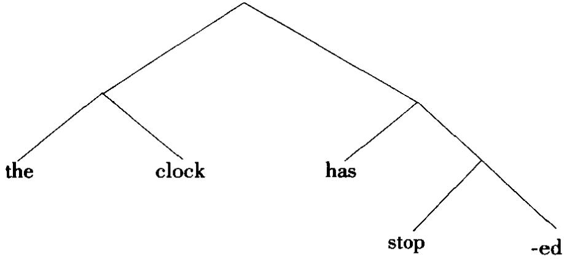

这种成分结构(constituent structure)也可用括号来表示,每一层分析可在构式的适当位置加一对方括号,例如[[the clock][has stop[ ed]]]。一种语法如果完全以这种方式分析句子，即对句子作结构层级分析，有时就称之为成分结构语法(constituent-structure grammar)。在经典的生成语言学，这种分析由语法的短语结构部分承担。这种语法有时也称作成分组构语法(constituency grammar)。成分句(constituent sentence)指嵌套句。成分基础(constituent-base)语法应与不区分组构成分的语法区别开来，后者如依存语法和单词语去。

直接成分分析法的局限是语言学文献经常讨论的问题，特别是因为转换语法有较强的生成力。例如，直接成分分析法不能对形式上相连系的一组句子(如王动句和被动句)之间的关系作出明确的说明，也不能说明好几类构式的歧义(一个经常讨论的例子是 it is too hot to eat“天太热，吃不下/太烫，不能吃”)。但大多数语法系统都采用这种或那种直接成分分析法。另见C-STRUCTURE成分结构条。

(2)非线性音系字术语，用来描述一组特征，通常一起以一个单位的功能在音系规则中起作用。这种理论中，音段用一个各节点型式的层级来表征，那些处于中间层级的节点是组构成分，而终端节点是特征值。各成分通过联接线归并成组构成分。只有形成组构成分的特征组才能在音系规则中共同起作用。这种理论采用生成语法通常使用的树形术语：依附成分被视为高一层级的成分节点的“子节点”，被视为同一层级其他节点的“姐妹节点”。

constraint（constrain）制约 语言字，特别是生成语法，用此术语指限制规则应用的条件，目的是保证生成的句子都合式。例如，生成音系宇区分“并存”制约和“序列”制约：前者规定特征同现的限制，例如一个音段不能同时为[+高]和[+低]；后者规定特征序列的限制，例如一种语言是否允许辅音丛。生成句法有好几种必须施加的制约以防止派生不合式的短语标记，如规则序火的各种制约。例如，“表层结构”制约(过虎条件或“输出条件”)指表层结构的某一特性是决定哪些短语标记合式的条件，如凡是包含一个内部界限符号的短语标记都没有资格充当合式的表层结构。其他例子包括岛制约和并列结构制约。最近的生成语法研究试图找出适用于多类派生过程的制约(即解释力更强的制约)，这一倾向不同于本世纪60年代只提出局部适用的制约。这种新的“制约”有别于“过滤条件”·前者是影响一个派生过程中两个连续短语标记的条件，后者是影响结构单一层面(即某一组规则的输出)的条件。

这个术语在生成语言学还有一般的意思，与理论构建有关。每种语言学理论都要受制约，这是为了限制可能有的语法的种类。从这层意思上讲，语言学的主要目标可以说是提供一种受最大制约的、解释最充分的理论。

constriction(constricted)收缩(收缩的) 发音语音字的一般术语，指声道的变窄。不同种类和不同程度的收缩是从发音上给音质分类的依据。“收缩的”一词有时要按狭义理解，指喉化音。“收缩”在最近的音系理论特别是某些特征构架模型中已成为一个十分重要的概念。收缩模型(constriction model)试图将元音(VOCOIDS,包括元音(vowels)和骨音)的描写和辅音的描写用收缩特性统一起来；收缩特性包括收缩程度(constriction degree)和收缩位置(constrictionlocation)两个参项，前者是辅音的连续节点、元音的间隙节点，后者是部亿节点，辅音用“C-部位”表示，元音用“V部位”表示，都用涉及的主动发音器来定义。在特征层级中收缩用一个独立的节点表示，收缩程度和收缩位置是收缩节点下相联系的两个独立节点。例如，舌背音(舌的后部形成收缩)的定义同样适用于辅音和元音，从而辟免传统上作“两种口形”的描写。现已提出的三种主要的对应是唇辅音与圆唇或唇化元音的对应：舌冠辅音与前元音的对应，舌背辅音与后元音的对应。

construction（construct）构建，构式(构建）（1)语言字中“构建”一词最一般的意思是指一个语去单位内部组织的整个过程，例如，一个句子由一系列语素通过一组规则“构建”而成。“构式”的意思较具体，指组构过程的组合结果，即某种组构型式，其定义为一种语言的语法中有独立功能的单位序列，如主语+动词+宾语(小句构式)，限定词+名词(短语构式)。“构式”更具体的意思是指一种组构型式的某一实例，即一个语符列，如 the + man + is + walkıng“那个人在走路”。正是这后一种意义上的构式可用直接成分分析法分析为一系列组构成分。互有句法关系的组构成分可说成互有“构建关系”。同形异构(constructionalhomonvmitv)指一个语法序列在组构型式(如由一部短语结构语法定义的)上有不止一种解释。用较传统的语法术语讲，这个序列有“结构歧义”。例如，menand women in coats “穿外套的女人和男人”可以分析成 men and[women in coats]“男人和穿外套的女人”也可分析成 men and women[un coats]“穿外套的男人和穿外套的女人”。

(2)心理语言字中，“构建”一词常用于理解理论，指“构建”一个句子释义的心理过程，组构的基础是识别各相关成分和各意义层次并将其互相联系起来的能力。

construe（construal）组配;识解 语法分析的传统术语，指形式上将词配置成组构关系的过程，也指对这种关系的研究和解释。在最近的生成句法中，这一术语又获得新生，用来定义应用一条转换规则(组配规则(rules of construal))后某几类组构成分(如先行语和照应语)之间形成的关系。这个术语在“认知语义学”中作“识解”解，见COGNITIVE SEMANTICS认知语义字条。

consultant [接受语言调查的]合作人 见 INFORMANT[语言调查]受访人条。

contact(1)接触社会语言字术语，指语言或万言之间地理上相邻接或社会上相邻近(因而互相影响)的状况。“接触状态”的结果在语言上有各种体现，如借词的增多，音系和语法模式的演变，语言形式的混合(如克里奥耳语和皮钦语)，以及各种双语现象的普遍出现。从狭义上理解，同一批人(即操双语者)如果交替使用两种语言，就说这两种语言互相“接触”。接触语(contact language)或接触土话(contact vernacular)有时也用来指皮钦语。

(2)contact clause直接小句 某些语法学家用来描写不用关系代词的那类关系小句，即小句与中名词直接“接触”(例如 the book Ⅰ bought“我买的书”)。也叫直接关系小句(contact relative)。在生成语法中，这类小句没有显性行句语，也没有显性WH短语。

content(ive)内容，实义(实义词) 这个词的一般意思指词语的意义，用于语言字不带任何理论倾向，但有的语言学家赋予它专门意思，即将语言分为两个平面，一个“内容平面”和一个“表达平面”(类似于索绪尔式的符号的意义和形式的区分)。有些给词分类的理论用这个术语具体指一类词，即实义词(contentwords)或实词(contentives)，即含有可表述的词厂意义的词。实际上语言中绝大多数词是实词，只有少数功能词或虚词，其主要作用是表达语法关系。可替换术语有词汇词和充实词。

context(-ual-ization）上下文;语境（上下文/语境的，上下文/语境化）（1)语言字和语音字的一般术语，指一个话段(或篇章)中与集中汪意的一个单位相近或邻接的部分。一个单位(例如一个音，一个词)的出现与否部分或完全取决于它的上下文，上下文由这个单位的各种关系，即与其组合成一个序列的其他特征来说明。这个术语的日常用法与此相关，例如说“把一个词放在上下文里看”，以便澄清它实际表达的意义，如词典中词条的例释。以这种方式提供上下文叫做上下文化(contextualization)。一般认为，词只有在上下文里才能看出它的意义。

生成语言学用公式表示规则时，从形式上规定上下文是它的一个重要特点。各种形式可按其是否只出现在特定的上下文或是否独立于上下文而分作两类，前一类适用“上下文敏感/制约/依赖”规则，后一类适用“上下文自由”规则。上下文自由语法(context-free grammar)是所有规则不管上下文全都适用的语法，即所有规则都是“将X重写为Y”的类型，不需指定其他条件。上下文敏感语法(context-sensitive grammar)包含一部分“A→B/CD”类型的规则，其中的斜杠表示“在·上下文里”，水平底线表示结构中A重写为B的位置，此例中这个位置介于C和D之间。某些生成模型(参看ASPECTS《要略》条)中，上下文特征(contextual features)指一个词条包含的一类(二分)特征(其他种类的特征是内在特征和规则特征)，这类特征提供关于一个词项可以在一个深层结构表征式哪些位置出现的信息。上下文特征分为三类：语类特征，严格欠语类化特征，选择特征。

语音、语法等变体，凡是其现次取决于上下文的，有时称作上下文变体(con-textual variants)，也叫“条件变体”，例如音位变体(参看 ALLO--变体条)。按这种方式所作的分析有时称作上下文分析法(contextual analysis)。有的学者用CO-TEXT上下文本指上下文，CONTEXT指下面(2)的语境。

(2)指语言单位有系统地使用于其中的语言外世界的特征，即语境。“情景”

一词也用作这个意巴，如有复合术语情景语境(situational context)。按最广义的理解，情景语境包括一个篇章或话段的全部非语言背景，包括直接使用于其中的情景，也包括说话人和听话人对已经说了些什么的知识和任何相关的外部信含或预设。按狭义理解，语境指直接可观察到的同时存在的情景。语乂宇和风格字通常还将意义进一步区分为两类，一类是指称乂和清感义，一类是语境义(contextual meaning)，后者指一个语言单位在社会语境中传递的某种用法信息，例如是否用于“有限的”场合(如作社会诙谐语用，或用于宗教场合)，是否与说话人的年龄、性别或阶级等因素有联系。

(3)情景语境(context of situation)是弗斯式语言学理论的一个专门术语，源自人类学家布罗尼斯拉夫·马林诺夫斯基(1884一1942)的著作。按这种理论，意义被视作一个多重现象，其各个侧面一端与外部世界的特征相联系，一端与语言分析的不同平面，如语音字语法和语义学，相联系。情景语境指在这些不同平面上分析一个话段时被视为相关的外界特征的兑和。

(4)还有其他一些相关涵义。例如，一般术语话段语境(context of utter-ance)有时用来指有系统地决定话段的形式、意乂或得体性的全部因素(即包含上述(1)和(2)两种涵义)。“语境”一词还用于韩礼德式语言学，但按狭义理解，指语言组织中将语言形式与语言外情予联系起来的一个中介层，因此实际相当于语乂学。

continuant 连续[音]乔姆斯基和哈勒在其音系字的区别特征理论中确立的语音特征之一，用来描写发音万式的变异。连续音从发音和声学两方面定义为声道不完全闭塞时发出的音。所有元音和擦音有[+连续]特征(缩写为[+cont])。雅可布逊和哈勒的理论中与连续音对立的术语是断续音；在乔姆斯基和哈勒后期的系统中，对立的是非连续音(non-continuant)或塞音·这些音发出时声道完全闭塞，因此声学上有一个无声特性，例如破裂音[一连续][一cont]。有时也用间断音这一术语。

continuity hypothesis 连续性假说 见 DISCONTINUOUS(3)断续条。

continuous 持续体/时 对动词形式作语去描写的术语，指时间或延续方面的一种对立，因此时而作为时时而作为体来对待。这种对立通常是指“持续”或进行体(例如Ⅰ am going“我正要去”)和非持续体(non-continuous)、简单体或“非进行体”(例如Ⅰgo“我去”)之间的对立。语言学家倾向于按体来分析，因为涉及的意义由延续、完成和时间等特征复杂地交织在一起，但是传统语法只称“持续时’等，其涵义就有点过于简化之嫌。

contoid 辅音 美国语音学家肯尼思·派克(生于1912)发明的术语，用来区分语音字和音系字的辅音(CONSONANT)概念。一般所说的辅音在语音上定义为声道的完全闭塞，或变窄到足以产生可闻摩擦，音系上则定义为在音节界音位置发挥其功能的单位。但是有些情形下这两条标准并不重合，例如[1]，[r]，[w]和[j]等音，在音节中的功能有如辅音，而在语音上又有如元音。为处理这类情形，派克建议对所有语音分别作语音学和音系学两种定义·“contoid”指语音学描写的辅音，定义如上，“consonant”保留作音系学描写的辅音。对立的术语是(语音)元音(VOCOID)。

contour曲拱（1)超音段音系字术语，特别是遵循美国传统的音系学家用来指一个话段中音高、声调或重音的一种独特的构型。可区分几种不同的曲拱，例如“主要”、“次要”、“终端”曲拱等，它们与语调分析中的主要型式相关，生成音系学有重音曲拱(stress contour)的概念，指通过转换循环而指派的一个重音序列。声调的升调和降调有时称作曲拱声调(contour tones)。曲拱声调系统见于某些声调语言(例如泰语)，其重要特征是声调变化的方向而不是声调的相对高低(曲拱声调语言与音域声调语言对立)。

(2)某些非线性音系字模型中，指属于一个层级特征表征式中一个音段的一些不同特征构成的序列。这种音段(例如塞擦音，先鼻化塞音)称作曲拱音段(contour segments)。这种音段表现出音系的边缘效应，因为这样一个音段相对一边的音段来说似乎具有[+F]特征，而相对另一边的音段来说似乎又具有[-F]特征。

contraction（contracted）缩约(缩约的） 语言宇用来指音系上缩减一个语言形式，使它附接于一个邻接形式，或指一个形式序列容合成一个单一形式。第一类缩约形式(contracted form)或缩约(contraction)的例子有如英语Ⅰ have“我有”缩约为 I've, have not“没有”缩约为 haven't, 以及 WANNA 缩约。第二类的例子有如法语\*de le 和 \* de les 分别缩约为 du 和 des(部分冠词单数和复数)。

contradictory 矛盾[关系]语乂宇有时用来指两个词项之间的一种涵乂关系。“矛盾词”(或“矛盾项”)是意义对立的一种，例如male/female“男性/女性”和single/marned“未婚/已婚”的对立。由于这个术语在逻辑学中有专门用法(指两个命题之间的一种关系，即不能同时为真不能同时为假)，有些语义学家倾向于用相反来指语言字中的这种对立关系。

contrafactive 反叙实 指一类动词—补语构式，补语小句表达的命题被预设为假。例如 I wish John would go“我希望约翰会去”，预设事实上约翰还没有去。反叙实动词通常用来区别于叙实动词和“非叙实”动词。

contrary反对[关系]语义学有时用来指两个词项之间的一种涵乂关系。“反对词”(或“反对项”)是意义对立的一种，例如 big/httle“大/小”,happy/sad“高兴伤心”。由于这个术语在逻辑学中有专门用法(指两个命题之间的一种关系，即不能同时为真但可同时为假)，有些语义学家倾向于用反义来指语言宇中的这种对立关系。

contrast(iv-e,-itv)(1)对立(对立的，对立性) 语言字用来指单位之间的一种差别，特别是能在一种语言中区别意乂的差别。这种性质的差别也称作区别性的、功能的或有意义的差别。对立原则被认为是语言分析的基本原则，这一点可用音位、区别特征、语素等概念为例来说明(特别是音位概念)，它们都可以在某个分析平面上用“最小对立单位”来定义。音系字的对立有如英语/p/和/b/的对立，带声和不带声的对立，语法的对立有如不同屈折词尾的对立，各种可供选择的词序的对立。许多语言学家用OPPOSITION对工表示相同意思，但有的语言学家另行定义这个术语，只指单位之间聚合关系的对立(contrast则保留作组合关系的对立)。

(2)对比 对比分析(contrastive analysis(CA))这个名称代表一种普遍使用的语言调查方法，特别是在应用语言字的某些领域，如外语教学和翻译。对两种语言作对比分析就是找出两者的结构差异，然后加以研究，因为这种差异可能正是外语学习的困难所在(干扰或“负转移”)。对比分析假说(contrastive ana-1vsishvpothesis)就是说 这些差异是造成外语教学困难的原因，因此它们限制学习者的学习进程。这一假说曾经有很大影响(导致语言教学中的各种听说领先法)，但到本世纪80年代已受到严重挑战。这是两方面研究的结果，一是对中间语性质的研究，一是对学习者个人在学习任务中自身认知努力的研究。对比分析属于共时分析；对一种语言两个历史阶段的“对比”研究另有名称，如比较或历史语言字。

contrastive accent 对比重音 见 ACCENT(2)重读条。

contrastive stress 对比重音 见 STRESS 重音条。

control(1er)控制(控制语) 管辖与约束理论的一个子理论(控制理论(controltheorv))使用的术语。“控制”决定抽象的代名成分大代语PRO的指称潜能。例如，一个PRO如是一个嵌套不定小句的王语，那么在promise“答应”这样的动词之后就说它受王要小句主语(它的控制语(controller))的“控制”，在persuade“说服”这样的动词之后就说它受该动词的宾语的控制(而“非主语控制”)，比较：I1 promised John PRO1 to go“我1答应约翰 PRO1 去”和 I persuaded John2 PRO2 togo“我说服约翰，PRO去。PRO还有其他用法“不受控制”(即为任意指称，不与先行语NP照应的指称)。控制句(control sentence)包括经典转换语法中的等同名词短语删除句，这类句子通常与提升句对立。有时控制构式也称作链接动词构式。

control agreement principle(CAP） 控制一致原则 概化短语结构语去术语，指用来说明一致关系现象的一条原则。

convention(al) 规约(规约的) 语言字按一般涵义使用这一术语，指语言使用中的任何常规或惯例(例如在告别时使用某些惯用语的“规约”)，或指构建一个语言模型时的习惯做法(例如用//来标写音位是一种“规约”)。但按狭义理解，“规约”指语言表征式和其意义之间联系的任意性.词项table“桌子”和桌子这件东西之间的联系是“规约的”或“约定俗成的”；其传统的哲学含义可追溯到柏拉图时期。

conventional implicature 规约隐涵 见 IMPLICATURE 隐涵条。

converge(nce）会聚（1)社会语言字术语，指万言与方言之间变得相似(或“会聚”)的变化过程。会聚经常是一种非标准方言受行准方言的影响，但这种影响也可以反过来，例如当前英语的标准发音正受影响发生变化。地理上相邻的言语社区有时称作“会聚地域”。相反的效应是所谓分化。“会聚”一词在当今的历史语言学研究中也很通用，它指的是一种合并形式，这种形式在一个语言的历史上一度是对工的。

(2)最简方案的术语，“会聚”是指一种派生过程，一个结构描写既可在语音形式层面上作出解释，也可在逻辑形式层面上作出解释。发生会聚的条件是语音表征式无任何语义信息，而语义表征式无任何语音信息。如果这两个条件不能满足，就说派生过程有撞碰(crash)。

conversation analysis（CA）会话分析 语言字和相关学科用来指一种研究会话的序列结构和连贯(按日常意思理解)的方法，这种方法通常采用人类文化字方法论的技术。“会话分析”研究实际会话的录音来确定人们通过语言而交互作用时系统地利用了哪些特性。这种研究基本上属于经验性的、归纳式的研究，通常与以演绎法为特点的话语分析相区别。

conversational implicature 会话隐涵 见 IMPLICATURE 隐涵条。

conversational turn 会话话轮 见 TURN 话轮条。

converse(ness) 反成[关系]语义学经常用来指两个词项之间的一种涵义关系。反成词(converse terms)是意义对立的一种，例如 buy/sell“买/卖”，parent/chuld“父母/子女”,employer/employee“雇主/雇员”,above/below“上/下”的对立。buy“买”是sell“卖”的“反成”词，反过来说也一样。这种对立关系特别用来定义社会角色的相互关系、空间关系以及其他一些关系，关系的双方意义上互相依存，一对中的一个成员预设另一个成员的存在。就这一点而言，“反成”关系与相

反关系对立，后者没有这种对称的依存关系，也与反义关系的特定涵又对立，因为反义关系有程度差别。

conversion 类转 研究构词方式的术语，指一个词项未加词缀就变为属于另一词类的派生过程，例如动词类转为名词 smell“气味/嗅”，taste“味道/尝”，hut“一击/打击”，walk“走姿/走”，bottle“瓶/装瓶”，brake“闸/刹车”，形容词类转为动词 dirty“脏/弄脏’,empty空/倒空”，lower“较低/降低”。有些语法区分“完全类转”和“部分类转”，后者指只禾纳另一类词的部分特卢(例如rich“富/富人”)。英语中用来指同一现象的常见术语有“零形派生”和“功能转移”。

co-occur(rence) 同现 语言字和语音字用来指一种语言按其语法和词汇规则允许的、单位之间组合关系上的结合。例如，a(不定冠词)与boy“男孩”同现，但不与information“信息”同现，eke“增加”与out“出”同现，不与in“入”同现。同现的制约称作“同现关系”或“同现限制”，经常用上下文敏感规则或组配规则的形式来说明。涉及的依存关系可以是单向的(如副词与动词同现，反过来则不一定),双向的(如及物动词和宾语)，互相排斥的(如 a不能与 an在同一名词短语中同现)。

co-operative principle 合作原则 最初为哲学家 H P 格赖斯(1913—1988)使用的术语，现常用于语言字对会话结构的研究。简单地讲，合作原则是指会话双方在交谈时试图互相合作，具体讲，说话人力图传递足够的信息、真实的信息、相关的信息、明晰的信息(分别为“适量准则”、“质真准则”、“相关准则”、“方式准则”)。听话人一般总是假设说话人遵循这些准则。说话人也可能违背这些准则(如说谎、讽刺等)，但会话的进行是基于说话人不会违背这些准则的假设。于是可以从已经说出的话推导出没有说出的意思(即会话隐函)，但对这种推导的一致性和普遍性的程度还存在一定的争议。

co-ordination(co-ordinat-(iv)e,-ing,-or）（1)并列(并列的，并列连词）语法分析用此术语指将若干通常有相等句法地位的语言单位(例如小句、短语、词)连接起来的过程或结果。(就此而言，并列连接有别于王从连接，后者连接的成分地位不相等)。并列小句(co-ordinate clauses)有如这样的句子Johnwalked and Mary ran“约翰走(而)玛丽跑”，连接的标志是 and“而”，即并列连词(co-ordinating conjunction或 co-ordinator)。没有明显的标志也可将构式分析为并列构式(这种现象有时称作“无形并列”),例如 There was an awkward, depressing silence“出现了令人尴尬的、使人压抑的沉默”，其中两个形容成分的“并列”可用插入and“和”一词来检测。生成语法中的并列结构制约(co-ordinatestructure constraint)是指:没有一条规则能作用于并列结构中的并连语，并连语中的任何一个成分都不受规则的影响。

(2)并列(co-ordinate)有时还用于双语现象的分类。“并列双语者”是指给两种语言的对应词汇单位赋予部分不同或完全不同的意义的操双语者。这种双语现象有别于复合双语现象，后者赋予的意义被认为是相同的。

Copenhagen Sclhool 哥本哈根学派 指本世纪 30 年代中期一群组成哥本哈根语言学界的语言字家，他们提出一种称为语符字的语言学理论和方法。主要是通过他们的理论家路易斯·叶姆斯列夫(1899—1965)的著作，这一学派为这一语言学理论奠定了哲学和逻辑基础，其形式化的程度在生成语法出现之前是最高的。

copula(tive)系词(系词的)语法描写用来指连系动词，即没有多少独立意义、其主要功能是连系小句结构其他成分(特别是主语和补语)的动词。英语中主要的连系动词是 be“是”，例如 She is a doctor“她是个医生”，“系词”只指这一个动词;但还有不少其他动词也具有相似的功能，例如 She feels angry“她感到愤怒”，that looks nice“那看上去挺好”, he fell ill“他病倒了”。

copying(copy)复写，拷贝 转换语法的框架内指一种基本的句法操作，即将短语标记中一个组构成分复制后添写到短语标记的某个其他部分。例如，从Heis a doctor“他是个医生”这样的句子派生出疑问尾句的规则是，将动词“复写”到句子的右边(并将肯定式变为否定式);尾句主语是主要主语的代词复写形式，置于复写动词的右边。这样生成的句子就是 He is a doctor, isn't he？“他是个医生，是不是？”动词是助动词或系词时才复写动词，如果是一般动词就要用动词的替代形式 do(例如 John knows the answers, doesn't he?“约翰知道答案，是不是?”)。生成语言学之外，有些语言学家用复写尾句(copy tags)指疑问尾句的一个子类，即尾句动词保持主要小句动词的肯定式或否定式(另一个子类称作核对尾句),例如 He's comung, is he？“他要来，是不是？”

core 核心，核(1)(non-)(非核心）在核心语法(core grammar)这个名称中，“核心”在最近的生成语言宇中指一组普世的语言学原则，可用来描写语言中发现的所有无标记语法原则。符合这些原则的规则是核心规则(core rule)，不符合这些原则的规则是非核心规则(non-core rule)。可以为具体一种语言制定核心语法，也可以为一般语言制定核心语法(即“核心语法理论”)。

(2)在共核(common core)这个术语中，“核”指为一种语言的所有变体共享的一组语言特征。

(3)韵核 在音系宇中，有时用来指音节结构中包括节核和节尾的组构成分，通常称作韵基(如节律音系宇)。

(4)在角色与参照语去中，用来指分析小句结构的两个基本概念之一，与外围(periphery)对立。核心层包括核心动词和相关联的主目。

co-referential(ity）同指 语言字特别是生成语法用来指一个句子中两个组构成分的指称相同。例如，在句子Ⅰ saudⅠ would leave“我说过我要离去”中，两个王语同指，在 He sald he would go“他说过他要去”中两个主语是否同指不清楚，因为第二个he“他”可以指其他人。这种区别可用指称标引(同标)来表示，例如She sard she would go“她，说过她要去”(同指)和 She sard she would go“她说过她要去”(“不同指”)。

co-representational grammar 合一表征语法 本世纪 70 年代发展起来的一种取代转换语法的语言学理论，旨在将表层结构直接与语义结构相联系。这种理论认为，只需一个结构就能“同时表征”一个句子内部关系的句法和语义两个方面。单一的表层句法结构平面只包含类属关系、线性序列和名词短语层级的信息；语义结构只包含谓词及其主目之间各种关系的信息。

coronal 舌冠[音] 乔姆斯基和哈勒在其音系字的区别特征理论中确立的语音特征之一，用来描写发音部位(腔特征)的变异。舌冠音从发音上定义为舌叶从中性位置上抬而发出的音。齿龈音、齿音和腭龈音等辅音都有[+舌冠]特征(缩写为[+cor])。与之对立的是非舌冠音，指舌叶保持中性位置发出的音，如唇音和软腭音等辅音有[-舌冠]特征([cor])。这个术语在后来的音系理论特别是各种非线性模型中继续使用。例如，在基于发音器的特征模型中，“舌冠”指以舌面前作为主动发音器的单值节点。在基于收缩的模型中，“舌冠”指由舌面前形成的收缩。舌冠化(coronalization)用来表示舌冠辅音与前元音之间的几种关系(参看PALATALIZATION 腭化条);例如，在前元音之前，软腭辅音变为舌冠音，或龈前音变为舌冠音的过程。

corpus（corpora）语料，语料库（1)指收集的一批语言宇数据，或为书面文本或为言语录音的转写，可用作语言学描写的出发点，也可作为验证语言假说的手段(语料库语言学(corpus linguistics))。“限于语料的”语言宇描写成为一些语言学家，特别是生成语法宇家的批评对象，他们指出语料库有它的局限(例如，只是语言运用的样品，还需要一种超出语料而投射到整个语言的手段)。对一种新语言作田野调查，或从事历史研究，这也许很难超出研究者收集的语料(即语料是“封闭的”而不是“可扩展的”)，但如果研究的是语言学家可经常从操本族语者(语言学家自己也可能是操本族语者)那儿获取的语言，研究方法就必然是“基于语料的”而不是“限于语料的’。语料库是一种计算语言字的基础。计算机语料库(computer corpus)是一大批机器可读文本的结集。本世纪 80 年代以来建立的语料库的规模越来越大(特别是英语)，既用于开发自然语言处理的软件，又应用于词典编纂、言语识别和机器翻译等。

(2)社会语言字术语，用来指两种主要的语言规划中的一种，即语料规划(corpus planning)。语料规划与如何选择规范和将规范编集成典有关，如选用一种语言变体作为国语，改革一种拼写法，开展使用平实语言或无性别歧视语言的运动，制订扫盲计划等。与之对立的是地位规划(status planning)，与一种语言相对于其他语言的地位有关。因此，地位规划更关心的是选定一种语言会有什么样的社会和政冶含义，以及语言态度民族认同、国际用途、少数民族权利等问题。例如，加拿大法语和英语的相对地位、官方文件中使用这两种语言的法律规定等问题是地位规划的问题，而在加拿大中小学中选择法语的哪一种变体作标准来教并提供相应的教材，这是语料规划问题。

correct(ness) 正确(正确性) 语言宇中批评对语言取规定态度时经常使用的术语。传统语法学家对各种用法作出要么“对”要么“错”的判断，而现在取而代之的是对观察到的语言用法事实作出描写。后一种态度不涉及价值判断，并用语言在各种社会环境中的相对得体性来取代绝对的正确性观念。同样，用正确性来评价语去(如用某种判决程序)也已让位给考虑不同语法的不同目的和相对优劣(如用某种评价程序)。另见 ACCEPTABILITY可接受性条。

correlation 相关 布扛格字派音系宇用此术语指两个语音系列之间有系统的联系。例如，英语清擦音系列和浊擦音系列之间有是否带声的“相关”；是否带声因此是“相关标志”。

correlative 关联式 语法中指使用一对连接词的构式。英语中的关联式有如either or “或者 或者·”, not only but also “不仅·而且 ”, 1fthen“如果那么”等。

correspond(ence）对应（1)语言字用来指有亲缘关系的语言之间词或结构上的任何形式相似。例如，英语fish“鱼”和拉丁语picis“鱼”两个词的语音结构有可阐明的联系，根据英语历史上发生的语音演变的性质，可证明/f/和/p/之间(以及其他音之间)存在系统的对应关系。

(2)语乂字讨论中经常遇到的概念，源自哲学上对真值的通行观点，即一个命题为真的必要充分条件是它表示能证实它的实际事态。意乂的经典对应理论(correspondence theory)认人为，语言形式和它表示的实体之间有直接的联系，有存在的象声词为证(如 splash“扑通”，murmur“咕哝”)。但由于语言中绝大多数词在“词”与“物”的关系上表现出任意性，这种观点因此也叫做对应谬论(corres-pondence fallacy)。

(3)对应假说(correspondence hypothesis)在本世纪 60 年代引起许多心理语言字的关注，特别与语言刁得研究有关。按照这个假说，一个句子的语去派生过程中使用的规则序列对应于言语产生和言语知觉的心理过程的序列。有几项实验似能证明这一假说：说话人处理派生过程较复杂的句子所花费的时间要比处理较简单的句子来得长(例如处理被动句比王动句时间长，否定句比肯定句时间长)。然而到60年代后期，进一步的实验已难以证实这一假说，方法论的问题也提了出来(例如除转换历史外如何区分由长度产生的和由意义产生的效应)，对涉及的转换的观念也发生了急剧的理论转向。结果，对应理论现已不再是一种有影响的研究模式。

cost成本 生成音系字以隐喻方式借此术语计论音系分析的相对简单性或自然性。增加分析的复杂程度(如增加特征或规则)被说成是增加分析的成本，反之亦然。这里涉及的原理实为一般原理，有时结合“收益递减”的概含来讨论建立的语言单仁的类越多，每一类涵盖的数据就越少，这样虽然能提高语去处理例外的能力，概括性却相应降低。因此如何在概括性和描写细节的深度之间取得某种平衡，分析中最低成本的截止点在哪里，这是个大有讨论余地的问题。

co-text 上下文本 某些英国语言宇家使用这个术语，为的是消除CONTEXT语境一词的歧义，后者既指语言环境又指情景环境。办法是用“上下文本”指语言环境即上下文，context只指情景环境。

count(un-count-able，-ability)可数的(不可数的，可数/不可数性） 对名词作语法分类的木语，与“不可数的”或集合(名词)相对。传统语法经常提到“可数/不可数性”的区别，但这种区别现已成为对名词短语作语言字分析时注意的焦点，因为这种区分能解释名词相对冠词和量词这样一些语项的分布状况。可数(countable)名词是表示语言处理为离散实体的名词,可与a(不定冠词),many“多个”，two“二”，three“三”等形式共现；不可数(uncountable或 non-count)名词则作为连续的实体看待，没有自然的边界，与much“许多”，some“有些”这样一些形式共现。这种对立见于 a boy“一个男孩”对\*much boys“许多男孩”，\*an information“一个信息”对much information“许多信息”。有不少名词有可数和不可数两种用法，例如 a cake/many cakes/much cake“一块蛋糕/多块蛋糕/许多蛋糕”。

counter-agent 反施事 后期格语去术语，用来指妨碍一个动作实现的势力或阻力。

counter-bleeding 反裁切 见 BLEEDING 裁切条。

counter-example 反例 语言字和语音学按一般意思使用这个术语，指构建或遭遇一个能证明某一假说为假的数据，从而导致对一种分析加以修正。跟其他科学的情形一样，一个提出的反例究竟是真正的反例还是表面上看是反例实质不是(即可以重新分析使假说得到挽救)，这是一个经常讨论的问题。

counter-factual违实句 语法和语又字用来指一类完全表示假设的条件句， 例如 If she had taken the train,she would have arrived on time“她要是真的坐了火 车的话就不会迟到了”。违实句或“非现实”陈述句通常与“现实的”条件句对立， 后者如 If she took the train, she will have arrived on time“她要是坐火车就不会迟 到”。这两类句子可结合叙实性这一概含来讨论。

counter-feeding 反馈给 见 FEEDING 馈给条。

counter-intuitive(ness)反直觉 指违背操本族语者或语言宇家的直觉、难以置信的分析。例如，认为阵述句由疑问句派生而来的分析就不如疑问句由陈述句派生而来的分析来得自然，这种感觉可多少得到实验的证明(例如用反应时间的长短来证明)。但是要以系统的、可验证的方式从操本族语者那儿获取直觉反应，这样做并不容易，也不常这么做；此外，循环论证的危险也很明显，特别是操本族语者和语言学家为同一人时(这种情形常见于理论语言学家的论著)，因为作为操本族语者的直觉很容易受作为语言学家的分析目的的左右而发生偏差。对反直觉标准的内在问题，有人(英国语言学家安格斯·麦金托什(生于1914))用讽刺的口吻总结如下“凡是不符合我的理论或目的的统统要反对，别让我解释为什么！”

covered窄紧[音] 乔姆斯基和哈勒在其音系学的区别特征理论中确立的语音特征之一，用来描写发音部位的变异(腔特征)。这是一种权宜的分类，指咽变窄变紧、喉抬高而发出的音，如某些西非语言的紧元音可以有此特征。与之对立的是非窄紧音(non-covered)，即咽不变窄紧时发出的音。

covert隐性的（1)语言字分析用此术语指语言形式之间不能在一个句子的表层结构观察到、而只有在一批句子的相互关系中才能呈现的关系。与隐性关系对立的是显性关系。隐性关系的例子有可替换性(如词类的概念的确立)和转换对等。“隐性WH移位”是音韵空项的移位，如管辖与约束理论中的THAT关系小句或比较句发生的移位。

(2)最简万案术语，用来描述一个子系统即隐性部分(covert component);这个子系统继拼出操作之后继续进行句子的计算，最终得出逻辑形式。最简方案中与之对立的是“音系部分”，这个部分最终得出语音形式的表征式。

(3)社会语言宇术语，用来分析语言形式负载社会声望的方式隐性声望(covertprestige)是属于土话方言的形式得到正面评价,强调社群的共聚性和地方特性。这种声望是隐性的，因为它通常在社群的成员之间表现为一种潜意识，与显性声望不同，后者有声望的形式是由有权势的社会机构公开推崇的。

最近的管辖与约束理论中为COMPLEMENTIZER PHRASE 标句语短语的缩写，即指标句语C的最大投射(C)。CP是语法分析的最大单位(起始符号)，相当于早期管辖与约束理论、词汇功能语法和概化短语结构语法中的S。

C-place 辅音部位 见 PLACE[发音]部仁条。

cps 周/秒 见 CYCLE(3)周期条。

crash 撞碰 见 CONVERGE 会聚条。

creak(v)嘎吱声(带嘎吱声的) 根据发音和听觉语音字标准对音质作语音字分类的术语，指只由声带的一端极缓慢地振动所产生的发声效果。有些说话人带有不正常的嘎吱声音质是其永久的说话特征。这种音质对语言学分析的特别意义在于，嘎吱声效果加上对比力度可用来传递一种副语言意义：例如在英语行准发音中常用附带的嘎吱声来表示一种轻蔑，例如以极低的音高说出OhⅠdon'tknow“噢，我不知道”。“嘎吱声”有时还具有音系学的性质，例如豪萨语中存在带嘎吱声的破裂音和不带嘎吱声的破裂音的对立。带嘎吱声的音也称作“喉化音”。

creativity(creative) 创造性(创造性的) 这个术语按其通常意思应用于语言宇，指语言使用者说出和理解无穷多句子的能力，大部分句子他们都从来没有听到过或使用过。作为语言的一个特性，创造性是指型式的“开放性”和能产性，即一组数目有限的语音、结构等能用来产生数量无限多的句子。与动物信递的研究结果相对照，语言的创造性被视为人类专有的一个特性，因为创造新句子不是动物信递系统的特性。创造性这一概念在有关语言的讨论中有很长的历史，但自从乔姆斯基特别加以强调以来已成为当代语言学的一个重要特征。研究者感到，语言学研究的主要目的是要解释这种创造能力，为此提出了生成规则这样一些理论构件。但是，应该注意避免将“创造性”与艺术或文学中的创造性混为一谈，后者主要与想象力和原创性有关。

creole（creolize,de-creoliz-ation） 克里奥耳语(克里奥耳语化，非克里奥耳语化） 社会语言字术语，指一种皮钦语已变成一个言语社团的母语，例如在牙买加、海地、多米尼加以及世界上其他一些前殖民地。克里奥耳语化(creoliza-tion)的过程将皮钦化语言的结构和语体范围加以扩展，结果得出的克里奥耳化语(creolized language)在形式和功能的复杂性上与其他语言相当。非克里奥耳语化(decreolization)是指标准语开始对克里奥耳语施加影响，结果出现一个后克里奥耳语连续体。

criteria 标准 语言字和语音字中使用这个术语与证明一种分析或描写是否有理有关，即为什么以某种特定方式进行语言分析。标准的产生可以出自对分析目的的一般考虑(例如，是纯语言研究还是应用性研究，是理论的还是描写的，是共时的还是历时的)，也可以出自对某个问题可能涉及的各种具体因素的考虑。例如，在划分词类时，须决定是采用纯语言学标准(Iınguistic criteria)(如音系、语法、语义等标准)还是另须参照非语言学标准(non-linguistic criteria)(如逻辑的、意含的、美学的标准)。语言学一般强调两条原则·标准必须明确，标准必须尽量以形式(如语法形式或语音形式)为依据。这个术语的使用还与语法理论的充分性等级相关(“充分性标准”)。

critical linguistics 批评语言学 语言字正在发展的一个分支，旨在揭示口头和书面文本中隐藏的权势关系和意识形态。批评语言学家批评语言学的主流对形式主乂过于关汪，忽视充分的社会阐释，遮掩思想意识和政治问题。研究的论题包括文本的社会环境语法的产生、语言政策等。近年来这个概念还扩展到语用字和社会语言字这样一些领域，特别是扩展到话语研究。批评话语分析(cri-tical discourse analysis)是一种分析视角，研究的是话语事件和社会政治、文化因素之间的关系，特别是话语在社会中如何在意识形态上受权势关系的影响和自身又如何影响权势关系。

cross-over 跨越 生成语法术语，指一条限制某些名词短语移位转换(如被动式、反身代词、TOUGH移亿)的原则。早先对这条原则的阐述是，如果结果会导致一个名词短语跨越另一个同指的名词短语，转换就不适用于相关的短语行记。例如，“跨越制约”或“跨越原则”可用来解释为什么被动化转换不适用于Johnwashed humself “约翰清洗自己”这样的结构，因为其底层结构为 John washedJohn,“约翰，清洗约翰，”，如要派生出被动式 John, was washed by John,“约翰，被约翰清洗”就会违反跨越制约。后来的阐述对这条原则的应用提出了更具体的制约。

cross-sectional 横面的 这个术语按其一般意思应用于儿童语言习得的研究，指语言发展过程研究的两个主要方法之一。横面研究是比较某一给定时间一组同龄或不同龄儿童的语言。这种方法与纵向研究对立，后者是追踪研究一个或一组儿童在一段时间内语言习得的进程。

cryptophasia 私隐语 见 IDIOGLOSSIA 私自语条。

c-structure c-结构词厂功能语法中作组构成分结构的缩写。主要是指句子的表层结构，与F结构(功能结构)相对立，后者是用主语和宾语这样的语法功能对句子作出的分析。

cue 提示特征 见 ACOUSTIC FEATURE 声宇特征条。

culminativity(culminative)达顶性(达顶的)节律栅理论使用的术语，指限制每个实词只能包含一个重读音节的音步形状参数。这是由韵律层级的性质决定的，也是由穷尽性条件决定的，这个条件规定每个音节都须包含在节律结构内。一般地说，任何一种使某些音节更为突显的变化都可称作达顶(culmina-tive)变化。

cultural transmission 文化传承 一般认为是定义人类语言的一个特性(有别于其他符号系统的特性)，指说一种语言的能力是通过学习而不是遗传一代一代地传承下来的。这并不是否认儿童生来具有某种语言天赋，而只是强调人类语言和动物信递系统的差异，前者在环境中学习起很大作用，后者本能起主要作用。

cupping舌凹[音]语音字有时用来指舌可作出的一种横面发音动作。具体指舌体在发音时持凹陷状，即舌的中线比两边稍为下降。舌凹效应在发卷舌辅音时很常见。舌凹音可与舌勾音相对立。

CV，CVC，... (1)辅音和元音组成的序列的缩写，专门用来描写一种语言中存在的音节类型。例如，对英语音位配列法的说明应包括如下信息节首可以有CCCV，如 splice“拼接”，节尾可以有 VCCC,如 sixths“六分之一”。

(2)CV 也是 CARDINAL VOWEL 基本元音的缩写。

CV phonology CV音系学 音系字用来指一种模型，它在原先为自王音段音系字所承认的音节层和音段层之外再增加一个辅音(C)元音(V)层。增加这个音层后就可以在骨架层取消特征[成音节]。

CV rule CV 规则 见 ONSET(1) 节首音条。

cycle(cylic-al，-ity)循环，周期，周(循环的，循环性）（1)转换生成语去的一条原则，即允许规则按次序反复应用于符合某种结构描写的短语行记的组成部分，而不是对整个短语结构作一次性应用。这种规则应用方式称作循环(cyclic)应用，整个应用过程称作转换周期(transformational cycle)或遵循循环原则(cyclic principle)。这条原则的形式化要求规则先应用于短语标记中嵌套最深的底层句子(第一周期)，然后应用于较高层次的句子(第二周期)，最后到达母句。按这种观点，规则每一次在短语标记某一层次的应用不可参考较高层次的信息。这条原则可以对含有“重复”成分的句子(例如 The man seems to wantto try a second tume“那个人看来想要试第二次”)作出不太复杂的分析。已经有多种不同的循环规则(cyclic rules)被提出来，例如“最后循环”规则是只应用于派生过程中最高层次的规则。在转换语法后来的版本中，循环转换规则的数目减少(最终减到只剩一条(阿尔法)移亿规则)，其适用性也受好几个条件的限制(如邻接条件指定王语条件、有时王语条件等)。扩展的柠准理论还分出一类后循环规则(post-cyclic rules)，指循环转换已经完成后应用的转换规则，可以用来处理倒置 英语中疑问词置于句首(例如 Where did John say that he was going?“约翰说他要去哪儿？”)或疑问尾句的构成这样一些现象。接续循环(successivecyclıc)分析是将表面上无界限的移位过程分析为一连串有界限的移位，例如What dıd you say that you would do?“你说你要做什么来着?”中, WH 移位规则被接续应用，每一次应用都跨越一个屈折短语界限。

在生成音系宇中，乔姆斯基和哈勒制定循环原则是为了说明重音对比相对词和句子内的元音音质而发生的变异。他们认为，一个词的主重音和一个多音节词的其他重音的位置都可以用一个话段各音段的音韵结构来作出解释。按这种观点，一个句子的表层结构可视作一个以各种方式加括的构形成分的序列，括号反映的是指派给句子的语法结构，如句子、名词短语、动词短语等，例如[[the[elephant]][[kıck[ed]] [the [ball]]]]“那只象踢那只球”。循环原则要求音系规则首先应用于不含括号的最大语符列，一旦应用后，这个语符列两边的括号就被抹去。音系规则然后再应用于由此得出的不含括号的最大语符列，最内层的括号又被抹去。依次继续直至所有的括号都被抹去为止。为使这种循环程序起作用，已有多种类型的规则被设计出来，如“复合规则”和“核心重音规则”，两者都是规定如何给句子的各种组构成分指派程度不等的主要重音(前者应用于复合语项，后者应用于短语中的语项序列)。后来的音系学理论中有严格循环条件(strict cycle condition(SCC)),指支配循环规则正当应用的条件，主要是规定循环规则只适用于派生出来的表征式。

(2)语义字有时用来指两个词项之间的一种涵义关系(不相容关系的一种)。词汇循环(lexical cycles)，(也叫“循环词集”),是互相接续而无固定端点的词项集合，例如一周的七个周日和一年的十二个月份。与此不同的是“顺序”排列，有固定端点，例如军阶。

(3)物理学研究声音使用“周[期]”这一术语，声学语音字也用来指波形中的一个空气粒子以静止点为中心的一个来回运动(振荡)。频率的测量过去经常用周/秒(cycle per second(cps))作单位，但现已改用赫兹(Hertz(Hz))。

## D

D 作 deep“深层”一词的缩写，主要用于D-结构即深层结构；又作 DETERMINER限定词的缩写，用于DP(限定词短语)。

DA 通常作 DISCOURSE ANALYSIS 话语分析的缩写。

DAF 通常作 delayed auditory FEEDBACK“延缓听觉反馈”的缩写。

darkl 糊涂l 一个出自印象但很常用的术语，指各种边音，其共鸣是有[u]音质的后元音的共鸣，例如标准英语/1/在元音后、辅音前、和自身成音节音时的发音，如pull“拉”，alter“改变’，bottle“瓶”等。与清晰l相对。这种音质也可以称作‘软腭化”//(参看VELAR 软腭条),记作[t]。

data 数据 这个木语按其通常涵义用于语言字，指作为研究题材的各种现象(即语言行为)。但是对这种行为的性质存在两种截然不同的观点，通常被认为是互相对立的。传统的观点认为语言数据只是指可观察到的口说和书写的言语，特别是指收集在语料库中的录音材料；相反，生成语言学理论认为语言数据还应包括可作为分析素材的语言使用者对语言的判断(语感)。这两种对立的观点引发许多争议(与行为王义和心灵主义两种哲学的基本分歧有关)，问题至今仍很突出。一方批评可观察的数据缺乏可靠性和普遍性，另一方则批评心灵主义的数据缺乏可验证性和客观性，都不足以作为语言系统的证据。在语言习得中，“主要语言数据”这个术语是指儿童从父母、兄弟姐妹等那儿接收的语言输入。

dative 与格 在用屈折形态表示语法关系的语言里，与格是名词短语(通常为单个名词或代名词)所取的一种形式，一般表示间接宾语关系或与英语中 to或for表示的意义相类似的意义。但是不同的语言与格的使用方式有许多差异。英语自身并无与格形式，而是用介词和词序来表达间接宾语的概念，例如 he gave abook to the boy“他送一本书给男孩”或 he gave the boy a book “他送给男孩一本书”。在经典的转换语去中，与格移位转换(dative movement transformation)就起联系这类双及物构式的作用。这个术语在格语法中有特殊地位，指受动词的状态或动作影响的有生物(后来称作感事)。常用的可替换术语是接受者。

daughter 女儿[节点],子[节点] 用来表示短语行记中两个节点之间的关系。如果一个节点X直接统制另一个节点Y,就说X为Y之“母”，Y为X之“女”。

daughter adjunction 母女附接 见 ADJUNCTION 附接条。

daughter-dependency grammar 母女依存语法一种基于句去特征和依存关系的语去分析理论。按这种理论，只有一个句法表征层面，不需要转换。节点之间的“垂直”组构成分关系称作“母女依存”关系，“水平”依存关系(如主语、动词等成分间的关系)称作“姐妹依存”关系。这一理论中所有节点都是一些二分特征的组合(而不是转换语法早期模型中的单元语类)。分类规则规定哪些特征可以组构成语类，依存规则(dependency rules)规定这些语类可以出现在哪些结构里。所有的组构成分都用相对的核心一外围概含来定义对任何两个组构成分而言，一个是核心，一个是外围成分。句法功能的概含(例如主语，话题)指派给节点，其主要功能是决定表层结构的词序。

Davidsonian semantics 戴维森式语义学 见 SEMANTICS 语义字条。

death[语言]肖亡 见 LANGUAGE 语言条。

debuccalized（debuccalization）非口腔化的（非口腔化） 有些非线性音系字模型使用的术语，指缺少口腔部位特征的辅音，如声门塞音或[h]。这种辅音形成的过程称作非口腔化(debuccalization或 deoralization),例如[t]>[?]，[s]>[h]。

declaration 宣告语 言语行为理论术语，指由于说话人说出而使外部世界产生一个新情景的话段，例如 Ⅰ name this shup/child“我现在命名这条船/这个孩子为”,I resign“我现在辞职”。

declarative陈述式对句子作语法分类的术语，通常视为与祈使式、疑问式等对立。指作出一个陈叙时通常采用的动词形式或句子/小句类型，例如the manis walkıng“那个人正在走路”。有时也称作“直陈式”。

declension[静词]变形，变格 传统语法的术语，指屈折语中一类名词、形容词或代词以一组相同的形式出现。例如拉丁语的“第一变格”是指名词单数的各种变格，词尾为 a，am或 ae(例如 insula“岛”， poeta“诗人”)。另有四种变格带不同类型的词尾，还有一些名词的变格是不规则的。这个术语不常见于现代语言宇的分析(转而谈论“词类”)，但还常见于语言字史字的研究。

declination 递降 见 DOWNSTEP 降阶条。

decode 解码 见 CODE 代码条。

deconstruction 解构 见 LOGOCENTRISM 语言中心主义条。

decreolization 非克里奥耳语化 见 CREOLE 克里奥耳语条。

de dicto/de re 涉名的/涉实的 原为哲学和逻辑学术语，语义宇用来分析句子表达的一些情态意义，如“可能”或“X相信·”。De dicto(拉丁语“涉言的”)指通过语言而不是通过经历语言所指称的情景而获取的知识。如果我从未去过毛里求斯，我仍然可以说“我知道毛里求斯是个好地方”，因为我听别人说起过。De re(“涉事的”)指通过经历情景本身而不是通过听别人的语言叙说获取的知识(如曾去过毛里求斯)。这种区别有助于阐明一些句子的两种可选的逻辑释义，例如“P相信Y是个医生”(a)存在一个个体Y,P相信Y是个医生，(b)不一定存在一个个体Y,但P相信Y是个医生。（a)是现实中存在一个Y(涉实释义)，(b)是P相信什么的问题(涉名释义)。

deep structure 深层结构 转换语法的一个重要理论术语；与表层结构相对。“深层结构”(或“深层语法”(deep grammar))是一个句子的抽象句法表征式—结构组织的一个底层层面，它规定支配句子如何理解的所有因素。（这个基本概含在一些不同的理论背景上也称作D结构，底层结构，基础结构，深远结构，起始结构。)这个层面提供的信息能使我们区分同一表层形式的句子可有的两种释义(即句子有歧义)，例如， Flyıng planes can be dangerous,其中 flyıng planes 与两个底层句相联系，一个是 Planes whuch fly，整句的释又是“飞着的飞机会很危险”，一个是To fly planes，整句的释义是“开飞机会很危险”。深层结构还能把表层形式不同而底层意乂相同的句子联系起来，例如把王动结构与被动结构联系起来，如 The panda chased the man“熊猫追那个人”和 The man was chased bythe panda“那个人被能猫追”。转换语法可从其中一个结构派生出另一个，也可以是两个结构都从一个更抽象(“更深层”)的底层结构派生而来。这种句子中的各种语法关系项因此可称作“深层王语”、“深层宾语”等(与“表层主语”等对立)。还可以计算出一项转换操作所在层面的“深度”，具体是看这项操作之前派生过程有几个阶段。有人还试图将转换深度这个概念与一个句子的复杂性对应起来。

在有些生成语法研究中，深层结构的作用受到质疑。有人认为在表层结构和意义之间确立一个独立的底层句法结构层面没有必要，反而会引起误导(参看GENERATIVE SEMANTICS 生成语义学条)。这个术语也可以按“底层结构释义”这个一般意思使用，不必局限于转换语法的专门定义。实际上美国语言学家查尔斯·霍基特(生于1916)使用这一术语在先，乔姆斯基式的应用在后。

default 缺省的，默认的这个术语按其通常涵义应用于语言字和语音字，指一个先期指定的值在满足某些条件时自动引人到分析中。例如，在音系宇的某些最近模型里，它用来指操作一条规则的无柠记方式。一个恰当的例子是激进的不完全赋值理论。按这种理论，每一个特征都有一个值(音系上的活动值)在词汇表征式中标定，另一个值则由缺省规则(default rule)或缺省赋值(defaultspecification)在某个稍后阶段填入，具体是给这个特征指派一个无标记值。缺省规则可由某条音系规则激活而起作用，也可在整个派生过程中保持钝态。在某些语乂字的词汇分析，如某些型特征结构模型中，这个概含也很重要。

defective不完全的(1)传统语法的术语，用来描写一些词不遵循它们所属的那个类的全部规则。例如，英语情态动词的变形是不完全的，因为它们不完全具有动词通常具有的屈折变形\*musted“必须”，\*cans“能”，\*shalling“将”等。由于这个术语含有贬义，因此已不常见于现代语言字分析(经常代之以不规则形式或规则的例外)，但仍见于语言字史字的研究。

(2)音系学中用来描写一个型式未能显示它所属的那个类的全部特性。例如，一个“不完全分布”的音段不像它所属的类的其他成员那样在所有可能的环境中出现(例如英语/h/的分布与其他擦音相比是不完全的，因为它不能出现在音节尾)。

deficit hypothesis 亏差假说 社会语言字和教育语言字用来指一种观点，即某些儿童，特别是少数民族或工人阶级背景的儿童，缺乏足够宽广的语法构式和词汇，因此不能表达复杂的思想，而这又是在学校学习取得成功所必须的。在当今的知识界氛围中，这是个不受欢迎的假说，与之对立的是差别假说(differencehypothesis)，按这种假说，这些儿童使用的语言只是有别于中产阶级儿童的语言，虽然其社会地位较低。差别假说认为所有万言本质上是平等的，都能表达各种复杂的思想，尽管操非行准方言的儿童可能缺乏同样的机会和动机在要求很高的教育环境中充分使用其语言。

defining（non-defining）限定的(非限定的） 见 RELATIVE关系小句条。

definingvocabulary 定义词汇 在应用语言字的好几个方面，指一批固定的、用来给其他词下定义的词。常见于外语教学、阅读教学、词典学等方面的论述。当今有好几种为非本族人编写的词典只含数量有限的词汇，如2000个词，目的是用它们来定义全部词条。

definite(ness)有定的(有定性）语法和语义字用来指一个具体的、可识别的实体(或一类实体);通常与无定的(也叫“非有定的”，但不常用)对立。英语中的有定性一般用定指的限定词(如thus“这”，my“我的”)来表达，特别是用定冠词the。有定名词短语常称作有定摹状词(definite descriptions),特别见于哲字语言字文献中，其所指对象不仅从其名称识别，还根据详细到足以与所有其他所指区别开来的描摹,例如 the present Queen of England “当今英国女王”。

defooting 音步消除 见 FOOT(1)音步条。

deforestation 砍除 生成音系学提出的一条原则，指任何规则应用于一个音系循环之前，这个循环域内的所有韵律结构都须抹除。提出这条原则是为了处理那些由于添加词缀而须作出派生形态变化的词(例如 sensation“轰动”，sensationality“轰动性”)。

degenerate foot 弱化音步 见 FOOT(1)音步条。

degree级指一个语去范畴，用来指明形容词或副词比较的程度。通常区分为三级，即原级、比较级、最高级，有时还分出其他一些级，如“等同级”(equativedegree)(例如 as big as“跟 一样大”)。英语使用形态和句法两种手段来表达级，例如 bigger/biggest“较大/最大”,more fascinating/most fascinating“较迷人的/最

迷人的”。

deixis(deictic) 直指[词](直指的) 语言字理论用来指语言中这样一些特征，它们直接指示一个话段说出时的情景在人称、时间或处所方面的特点，其意义因而相对那个情景而言，例如now/then“现在/那时”，here/there“这儿/那儿”，I/you“我/你”,this/that“这/那'都是直指词(deictics)或外指词。这个术语也用来指话语中指上下文词语的词(分别称作复指(上指)和下指)，例如that“那”，thefollowng“下述的”，the former“前者”等，这些词有时称作话语直指词(discoursedeixis)或篇章(text)直指词，它们应区别于社会直指词(social deixis),后者表示与参与者角色(说话人和听话人等)相关的社会差别，常见于代名词、谦敬语、呼语和不同形式的称呼语等。现已证明直指这个概念在语言字的好几个领域都很有用，特别是在语用宇和语言习得研究方面，有的研究者认为儿童习得直指语项是语言早期发展的一个重要标志。

delayed 延缓的 乔姆斯基和哈勒在其音系字的区别特征理论中确立的语音特征之一，用于短语延缓除阻(delayed release),用来描写发音万式的变异，指明语音除阻的性质。延缓除阻音从发音和声字两方面定义，即在发出时除阻逐渐发生，缓慢到足以产生一个类似于擦音的音，如塞擦音。所有塞擦音都有[+延缓除阻]([+ del rel])特征。这种除阻对立于瞬时或突发除阻，后者指除阻突然发生，不产生擦音的声字湍流，如破裂音。

deletion（delete）删除 指转换语法框架内的一项基本操作，即将一个输入的短语标记中的一个组构成分消除。例如，在经典的转换语法中，“删除”用来解释祈使句(底层句子的主语和助动词被删除，如 You wrll kıck the ball“你得踢那只球”变为 kıck the ball“踢那只球”)。这个术语的其他应用还见于对假位符号的转换处理和几种具体的转换操作(例如等同名词短语删除)。已经提出的删除转换的形式制约有好几条，特别是删除的成分必须是可复原的，也就是说，删除转换必须标明要删除的成分，并在输出的短语标记中明确标明删除产生的效果。如果不是这样的话，就会产生一些不幸的后果，例如一个表层结构就会跟无数多个深层结构发生联系，如 He's been hut“他挨打了”就可派生自 Someone/John/Abullet hut hum“有人/约翰/一颗子弹打(中)了他”。

delicacy(delicate）精度[阶](精细的) 韩礼德式语言学术语，用来指将该理论各范畴互相联系起来的几个分析阶之一，即分析的精细程度不断增加的那个维度。例如，小句的分析“精度”不断增加先分出肯定句和疑问句两类，疑问句又细分为几种提问类型，如此等等。这一理论的另外两个分析阶是级阶和释示阶。

delimitative时限语法和语义字有时用来指动词表达的状态或活动持续的时间有限(即“不多一会儿”)。在有的语言(如俄语)里，有无时限的对立是体系统形式标记的一部分。

delinking 断连 见 SPREADING(2)展连条。

delta 德尔塔 指某些转换语法模型(参看ASPECTS《要略》条)使用的△符号，表示生成深层结构过程中的假位成分。德尔塔符号(delta symbols)的作用是在起始短语标记(前词汇结构)中标明后来插入词项的位置，然后词汇插入规则用复杂符号来取代每一个“空位”德尔塔，每个复杂符号包括一系列将用来定义语法深层结构的句法特征。

demibeat 半节拍，半拍 见 BEAT 节拍条。

demonstrative 指示代词见 PRONOUN代名词条。

demotion降级 关系语法术语，指一类改变关系的变化过程，即与某动词有一种特定语法关系的名词短语与该动词的语法关系发生变化，变化后的语法关系在关系层级中处于较低的层次。例如主语降级变为宾语。

denasalized 鼻音消失 见 NASAL鼻音条。

denominal 名转的 语去中指原本是名词的词在句子结构中转而作其他用，例如 the garden fence“花园篱笆”中的 garden“花园”可描述为“名转形容词”。

denotation(denotative)外延[义](外延的) 语义字术语，用来给意义分类；与内涵[乂]对立。“外延义”指一个语言单位(特别是词项)与其所指的非语言实体之间的关系，因此相当于指称义。例如，dog“狗”的外延义是它的词典释义“犬属四足动物”等，它的内涵义可以包括“朋友”、“助手”、“竞争”等。

dental齿音 语音字按发音部位给辅音分类的术语，指舌大和舌边顶住齿背发出的音。“舌尖齿音”(apico-dental)的名称更为明确，但在描写齿音时不常用，ap1co-来自APEX，也指舌尖。齿音通常接触的是上齿，如某些英语万言(如爱尔兰英语)中的[d]，[t],[n](这与标准发音的[d]和[t]的齿龈发音相对立),但发音时舌也可同时与上齿和下齿接触，如 thun“薄”一词中的 th [0]和 thıs“这”中的th[∂]。其实发[θ]和[∂]时舌尖通常稍许介于上下齿之间，因此用齿间音这个术语更为精确。如果发音时舌尖靠近上齿后部接近齿龈隆骨的部位，可用“后齿音”这一术语。“齿龈间音”(denti alveolar)是在上齿和齿龈隆骨交接处发出的音。“齿音发音”的音标是[]，如上所示置于相关辅音音标的下面。

deontic 义务[情态] 原为模态逻辑术语，语言宇用来作为分析语言中情态动词和相关结构的理论框架的一部分。义务情态(deontic modality)与逻辑上的义务与允许有关，例如含情态动词的句子 The car must be ready，意为“汽车必须准备好”。义务情态与真势情态、认识情态相对立，按后两种情态理解，上面这个句子的意思分别是“汽车显然已准备好”和“汽车想必已准备好”。

deoralization 非口腔化 见 DEBUCCALIZATION 非口腔化条。

dependency grammar 依存语法 形式语法的一种，本世纪 50 年代由好几位语言字家(特别是法国语言学家卢西恩·德斯尼埃尔(1893—1954))发展而来。这种语法在构式的各成分之间建立各种类型的依存关系，用来解释各种语法关系;句法结构的表示采用依存树(dependency trees)—一群互相连接并标明句法夫系的节点。每棵树包含一个支配语和一组依附语(dependents)，每个依附语与支配语有特定的关系。例如，一个小句中，动词被视为支配语，依附语是那些名词短语，它们由属于动词的配价指派各种值。在 on the box“在箱子上”这种介词短语中，介词支配名词，名词又支配冠词。依存关系通常用弧线表示，弧线连接的是词(而不是组构成分)。对每一类单位都可进人的支配和依附关系的陈述称作依存规则(dependency rules)。在最近的几种语法理论(如母女依存语法)中，依存关系的概含十分重要。“依存关系”这个术语还在几种理论框架中用来指短语之间的关系，如无界依存理论。

dependency phonology依存音系学 音系字的一种理论，利用依存语法的一些原则来建立一个音段内部关系结构的模型。音节被视为一个依存关系结构，有一个支配成分(或中心成分)和若干依附成分(或修饰成分)。一个成音节成分(元音或成音节辅音)是每个音节必须有的最小成分，其他成分处于边缘，受成音节音的支配。依存关系的层级用依存图(dependency graph)作纵向表示，支配成分为“零级”，其他层级为“一级”“二级”等，例如cat这个音节的依存图为：

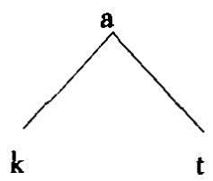

(零级)

(一级)

一个音段内部，各特征都被视为单项特征，通常称为“单项成分”(component)。依存关系的概念也已为其他非线性音系宇模型所采纳，用来表示任何一种不对称的关系，特别是涉及音段内部结构的。例如在节律音系字中，中心成分可视为强弱音段序列中较突显的那个音段；辅音的响音和非响音的不对称、辅音音丛内部的不对称可同样看待。在特征构架理论中，不同音层上的特征之间存在依存关系(“特征依存”或“依存音层序次”)。

dependent 依附小句 语法分析的常用术语，用来给小句分类。依附小句与王要小句对立，与从属小句同义。这个术语在依存语去中有特定用法。

depth hypothesis 深度假说 本世纪 60 年代初由美国语言学家维克特·英格夫(生于1920)提出的一种假说，用来解释两类语言构式，即左分叉(如the man'shat“那个人的帽子”)和右分又(如 the hat of the man“那个人的帽子”)构式之间的心理差异。他认为左分又构式增加句子的心理复杂性(或转换“深度”)，因为这类构式的心理处理比右分又构式要占用较多的短时记忆空间。这一假说遭到基于各种考虑的批评，特别是其他一些重要的构式，如自嵌套构式，使问题更加复杂化。

de re 涉实的 见 DE DICTO/DE RE 涉名的/涉实的条。

derivation(-al,derive(d))派生(派生的) (1)形态字术语.指构词的两大种类或过程的一种(即派生形态学(derivational morphology))——另一种为屈折构词—有时也称作派生学(derivatology)。这些术语也适用于构词用的两种类型的词缀。大致上讲，派生过程的结果得到一个新词(例如nation“民族”→national“民族的”)，而屈折过程的结果是得到同一个词的不同形式(例如 nations“民族(复数)”，nationals“国民”(复数))。但是这种区分并不十分明显(例如如何分析英语中的 ly)。派生词缀(derivational affixes)改变其粘附的语素的类(例如添加后缀，tion为构成名词的派生后缀)；它们通常比屈折形式与根语素挨得近，例如 nation al ize + ing/ s/ d。它们一般有独立的可陈述的词厂意义(例如mun-“小-”,sub-“次-”)，虽然这种意义并非处处容易识别(例如 er)。根语素与派生词缀的组合称为词干，即屈折形式附加于其上的成分；关于这个问题的文献中有好几种分类方式。

(2)生成语法术语，指一组形式上可识别的阶段，构成从起始符号到终端语符列的句子生成过程，即一整套已经应用的短语柠记规则、转换规则等。派生结构(derived structure)限指应用一条转换规则后输出的短语标记的形式。

(3)历史语言字术语，指一种语言或一个语言形式的起源或历史发展过程。例如，可以说一种语言的一个音、一个词(参看ETYMOLOGY词原字条)或一个结构从其相应的早期形式“派生”而来。

derivedenvironment 派生环境 在音系宇的某些模型中用来指应用某些音系规则的制约或条件。派生环境制约/条件(derived environment constraint/condition)是指某些种类的规则(如强制性中和规则)只适用于派生环境，即通过形态组合或通过音系规则派生而成的环境。表现这种制约的域具有循环性。

description(descriptive,-ism,-ist）描写（描写的，描写主义，描写主义者/的）语言字按这个术语的一般涵义用来指语言学追求的主要目标中的一种，即对某一特定时间的某一特定语言或方言的各种型式或用法作出全面的、系统的、客观的、精确的说明。这个定义表明，“描写”一词在若干方面与语言学研究的其他观念相对立。强调客观性、系统性等是为了与许多传统语法的规定王义相对昭.描写语言学(descriptive linguistics)的目的是如实地描写语言的用法，不是规定语言应该符合某种想象中的理想状态。强调某一特定时间是为了与历史语言字相对照，后者的目的是证明语言的演变过程，而描写语言学的目的是对某一时间的语言作共时描写(不一定是当前时间，可描写任何时期的语言型式)。强调“一种”语言是为了区别于比较语言字，后者的目的已如其名称所示，也为区别于一般语言字，其目的是对作为整体的语言作理论表述。当然，不应该忘记这些不同的研究分支之间互有联系描写是分析的结果，而分析必然以一组理论假设为基础。但是对描写语言学来说理论只是手段而不是目的，即理论是描写语法(descriptive grammar)的产物(或其组成部分音系字、词厂、句去、形态宇的产物)。一种研究路子如果以上述意义上的描写为特点，就称作描写主义(des-criptivism),其提倡者称作描写主义者(descriptivists)。语言学的这个术语常用来指本世纪50年代后期、“生成主义”之前美国的人类学和结构主义的研究。在生成语法中，描写充分性(descriptive adequacy)这个名称又给“描写”这个术语增添了新的一层意思，即对操本族语者的语言能力作出说明(而不仅仅是像早先的“描写”那样说明语料数据)。

desiderative意愿式对句子作语法分类的术语，通常视为与直陈式、祈使式等语气对立。意愿式指用来表达意愿的动词形式或句子/小句类型，大致可翻译为“我想要 + 句子”,但经常已词化,例如 to want to eat“想吃东西”→to hunger“渴望”。

designated terminal element （DTE）指定终端成分 节律音系字术语，指一个语符列中最突显的成分，它只受更强的(s-)节点的统制。例如，egg“鸡蛋”是短语 the hard boiled egg“者老的鸡蛋”中的 DTE。

destressing 重音清除 见 STRESS 重音条。

det 或 DET 通常作 DETERMINER 限定词的缩写。

deterioration词义贬化 历史语言宇用来指语义演变的一种类型，即一个词项发展出一种不如意的意思，也叫词义恶化(pejoration)，与词乂改良对立。例如，notorous一词原又“昭著’，现在是“臭名昭著”的意思。

determiner(det,DET,D)限定词 有些语法描写模型用来指一类语项,其主要作用是与名词共现并表达多种语乂对立，如量或数的对立。冠词，如果出现在一种语言中，是限定词的一个主要小类(例如英语the/a);英语中具有限定词功能的其他词还有 each/every“每个”，thus/that“这个/那个”,some/any“一些/任何”等，这些词的分布都包括冠词的位置，如 the/this/somecake“这块/一些蛋糕”。有的语言字家将这一术语的应用扩展到名词短语中其他词类(如形容词、前限定词)，有时甚至包括句子其他部分中的修饰语。有的生成语法理论中，限定词被视作中心语，与名词组合得出一个限定词短语(determiner phrase(DP))。

developmental linguistics 发展语言学 语言字的一个分支，研究儿童的语言习得。这种研究就是用语言学理论和方法来分析儿童语言数据，以便对语言发展的模式作出精确的描写，并对遇到的正常和不正常现象作出解释。这种研究既可针对个别语言，也可以是探寻普世性。就解释的任务而言，特别关注各种非语言因素的作用，如认知、社会背景、实验任务的性质等等，因此这种研究越来越带有交又学科的性质。由于特别注重心理因素，这种研究有时也称作发展心理语言学(developmental psycholinguistics)。

deverbal动转的 语法术语，指一个成分原本为动词但在句子结构中转而作他用。例如在 the singing policeman“唱着的警察”中,singing“唱着的”可描写为“动转形容词”。

deviance(deviant)偏差(偏差的) 语言字分析用来指一个句子（或其他单亿)不符合语法的规则(即不合式)。偏差句通常在句首标以星号，例如\*Is theybe goingo

device设置生成语言字从数学借用这一术语，指专门用来进行分析的一个抽象设计。从这一意义上讲，一部语法可视为生成各种句子的设置。这个术语有时也见于儿童语言研究.按乔姆斯基的观点，儿童生来具有一个“语言习得设置”(LAD)，能使儿童根据提供给他们的言语数据对句子作出正确的语法分析。

devoiced 清化音 见 VOICE 嗓音条。

dia-关于方言的一个常用前缀，由术语万言(DIALECT)派生而来，用于语言字研究指任何须参照方言的情形。方言语言学(dia-linguistics)有时用来指对某一言语社团中使用的各种方言和语言的研究。变体语(diatype)，某些社会语言宇家用来指一种按其用途或目的定义的语言变体，因此与方言(dialect)不同，方言是按地域或社会群体定义的语言变体。变体语也称作语言变体或语域。方言制式(diasystem)是一个形式关系的网络，它表示处于两种或多种方言底层的一个假设的共同语言系统，可用作展现各方言结构差异的框架。采用的标记法包括显示结构对应关系的公式，例如

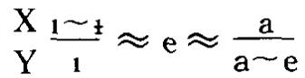

其中X和Y代表两个地域，\~表示只与一种方言有关的对立，≈表示与两种(或多种)方言有关的对立。在这种框架中，可以分出不同的方言制式单位例如，方音子(diaphone)是一个抽象的音系单位，用来表示不同方言语音系统之间的对等关系，例如方音子/ei/(如英语mate“伙伴”中的音)可在不同方言中实现为[ei]，[an]等;方语子(diamorph)则显示形态单位之间的对等关系。

diachronic历时的由瑞士语言学家菲迪南德·德·索绪尔提出的语言研究两大时间维度之一，另一维度为共时研究。“历时语言学”是从语言的历史发展的角度来研究语言，例如，古英语和近代英语之间发生的演变可以从音韵、语法、语义几方面研究(“历时音系字/句法学/语义学”)。可替换的术语是历史语言字。早期的语言历史研究，即所谓的比较语文宇，在研究内容上与历时语言学并无差别，差别只在于目的和方法。历时语言学更注意将共时描写作为历史研究的前提，更注意历史研究对一般语言学理论的意义。

diacritic 变音符 语音字中附加在一个音标上改变其音值的记号，例如各种重音符(等)、清化符[]和鼻音化符[\~]。在生成音系字中，在构形成分的派生过程中引人变音特征(diacriticfeatures)，用来说明音段表面上的例外行为。例如由一条重新调整规则引人特征[D]，用来处理诸如momentary“瞬息间的”(比较规则的 elementary“基本的”)这类词重音模式的例外。特征[+D]可在派生过程的一个早期阶段临时插入。另见FEATURE特征条。

diagramming 图解 见 PARSING(1)分解条。

dialect(-al，-ology）方言(方言的，方言学)一种语言地域上或社会上有自身特点的一种变体，可从一批特殊的词和语法结构来识别。口说的方言通常带有独特的发音或口音。只要说一种语言的人数相当多，尤其当人群之间有地理上的阻隔，或有社会等级的差别时，就会有方言产生。一种方言可能成为一种语言的官方或标准形式而占主导地位，这种方言也就通常成为书写对象。

“方言”和“语言”的区别似乎很明显·方言是语言的细分。语言学(特别是社会语言学)已做的工作是指出两者之间关系的复杂性。一般认为，如果不能互相理解，那就是说的两种不同的语言。但是汉语的所谓“方言”(北方话、广东话等)在口说时也不能互通。(但它们用的是同一种书写形式，这是仍然称之为“汉语方言”的主要原因。)还有一种相反的情形瑞典人、挪威人和丹麦人一般能够互通，但由于各有其自己的历史、文化、文学和政治体制，因此有理由说各有自己的语言。

对各种形式的方言，但主要是对地域方言的系统研究称为方言学(dialec-tology),或“语言地理学”，或方言地理学(dialect geography)。传统的方言学研究始于19世纪后叶，方法是用询问表和采访录音(近期才采用)作详尽调查。地域上有差异的词(包括形式、函义或发音的差异)是关注的中心，将这些词收集起来绘制成地图编纂成集就成为方言地图集(dialect atlas)或“语言地图集”。如果发现有好些区别性语项都属于某一个地域，就有根据说存在一种方言。通常可以将这些语项的使用在图上标出，用线条画出它们的使用范围(同言线)，当有“一束”这样的同言线重叠在一起时，就可以假设存在一条方言边界(dialectboundary)，由此可以展示一种方言到哪儿为止，另一种方言从哪儿开始。在同言线束的一方，有一大批词在形式、涵义和发音上与另一方的对等词有系统的差异。方言边界通常不十分明确，但上述原则大致管用。这种传统的方言学方法最近得到结构方言学(structural dialectology)方法的补充，后者试图展示不同方言一组组形式之间的关联模式。用这种方法得出的结构对应关系的系统称作“方言制式”(diasystem)。方言测量学(dialectometry)是方言分析的一种统计方法，本世纪70年代发展起来，用来测量一个方言区内若于个方言点之间的语言学上的“距离”，具体是在大量的语言特征取样中计算对立的数目。

能识别一个人来自什么地方的方言称作地域方言(regional dialects)，但也用其他名称，如“本地”(local)、“本土”(terntorial)、“地理”方言等。有人认为这种方言正在逐渐消失，但这只发生在某些农村地区。城市方言正变得越加明显，特别是由于集合型大城市的增长。在像纽约和伦敦这样的大城市里，可以分出不同的地域方言区，如布鲁克林区和东伦敦区。

能识别一个人所处社会地位的方言称作社会方言(social dialects)或阶级方言(class dıalects)。近年来也用 SOCIOLECT 社会万言的名称。有些语言在社会性差异上区分很细，如区分阶级、职业、年龄、性别等差异，这些语言就有很明显的社会方言的差别。英语中这种差别不很重要，但仍有一些词汇、语法和发音上的用法有社会基础，例如aun't，曾一度是识别工人阶级也是识别上层阶级(例如彼得·温莎勋爵)的标记。地域方言学一般不注意这类变体，它们现今属于社会语言字的研究范围。社会方言学(social dialectology)是应用方言学的方法来研究社会结构，着重研究社团成员资格如何影响方言能力。

“方言”一词有时还用来指一种语言所经历的一个语言学上有特点的历史阶段，可用历史(historical)或时间方言(temporal dialect)称之，例如伊丽莎白时期的英语，17世纪的英国英语等。“方言”一词还用来指某一职业群体的独特语言(职业方言(occupational dialect)),但近来已改用其他名称来指这类社会方言(如语域，支体语，语言变体)。用“方言”来指发展中国家无文字记录的语言(如说“非洲有许多方言”)虽然常见，但语言学并不提倡。

方语子，方音子，方言制式，变体语见DIA关于方言的条。

DICE 作 DISCOURSE IN COMMON SENSE ENTAILMENT 常识衍推话语的缩写。

difference hypothesis 差别假说 见 DEFICIT HYPOTHESIS 亏差假说条。

differential 差示法 见 SEMANTICS 语义学条。

diffuse散[音]，散疏 雅可布逊和哈勒在其音系字的区别特征理论中确立的语音特征之一，用来描写发音部位的变异；与紧实[音]对立。散音从发音和声字两方面定义为制流发生在口腔很后的部位；在频谱非中央部分集中的声学能量较低。闭元音和前辅音有[+散]特征(缩写为[+diff])，中元音或低元音、腭辅音或软腭辅音有[－散]特征([-diff])。在乔姆斯基和哈勒的系统中这一特征为高所取代。

diffusion 扩散 见 LANGUAGE 语言条。

diglossia（diglossic）双重语体(双重语体的）社会语言学术语，指一种语言的两种很不一样的变体在整个言语社区中共现并各有其社会功能的情形。两种变体都达到某种程度的行准化，操本族语者觉得可以任意选择，一般还各有自己的名称。社会语言学家通常以高层(H)和低层(L)变体称之，大致相当于正式性的差别：高层变体在学校里学习，一般用于教堂、广播节目、严肃文学等，因此享有较高的社会声望，低层变体用于家庭谈话和其他不太正式的场合。双重语体的例子有希腊语(高层：纯正希腊语;低层：通俗希腊语)，阿拉伯语(高层 古典阿拉伯语；低层：阿拉伯白话)，德语的某些方言(高层·标准德语；低层.瑞士的瑞士德语)。

digraph 合成符 语音字/音系字和字形字/字亿字用来指一个字形单位由两个符号组合而成，在系统中起一个成分的作用，例如英语标准发音cat“猫”中的元音符[æ]，某些英语词的古典拼写法 æ或 œ(例如 encyclopaedia“百科全书”，jonomatopoeia“象声词”)。

diminutive指小词缀 形态字用来指表示一般“小”的意义的词缀，不管是按字面还是比喻(带有亲昵义)理解。例如意大利语中的ino,葡萄牙语中的 zinho,英语中的-let。这个术语常与指大词缀对照使用。

diphthong(-al，-ization，-ize) 二合元音，双元音，复元音(二合元音的，二合元音化)语音字按发音万式给元音分类的术语，指音节中音质有一次明显(可觉察的)变化的元音，如英语beer“啤酒”，tume“时间”，loud“大声”中的元音。相关的术语有单元音和三合元音，前者听不出音质变化，后者能听出两次这样的变化。二合元音或“滑动元音”通常按两个成分哪一个较响分为不同的语音类“降式”(或“下降”)二合元音是第一个成分重读，如上列英语例子，“升式”(或“上升”)二合元音是第二个成分重读，如英语cue[knu]“提示”可作如是分析。

“二合元音”还可按其他标准分类，例如按滑动的程度(如是“宽”还是“窄”)，按滑动的方向(是否滑向中央，即以央元音结尾)等。二合元音化(diphthon-gization)这一术语用来描写一个单元音变为二合元音的过程，如发生在历史或万言演变中。二合元音的记音符号是用元音滑动的两个极端位置来表示，如fine“美好”中的元音记为[ai]。

direct 直接的(1)语去分析用来指能在小句结构中起作用的两种宾语成分之一,即直接宾语(direct object)，另一种是间接宾语(indirect object)。两种宾语之间的关系可用句子 The man gave the boy a book“那个人给男孩一本书”来说明，其中 a book“一本书”是直接宾语(那个人给的什么?), the boy“男孩”是间接宾语。直接宾语对小句结构更为重要，间接宾语需有直接宾语做参照(不能说\*The man gave the boy“那个人给男孩”)。不是所有的语言学理论都作这种区分，例如在生成语去(特别是关系语法和词厂功能语法)中，不带to的间接宾语被视作直接宾语。

(2)直接与间接的对立也用来区分个人言语表达的两种主要方式.直接言语(direct speech)指直接使用实际的话段，不带任何语法修饰，例如“Is he coming?”John asked“约翰问他来吗?'”是直接问句(direct question)，而 John askedif he was comung“约翰问他来不来”是间接问句(indirect question)。

directionality 方向性（1)节律音系字术语，指决定音步构式重音域扫描方向的参项。这种扫描可以从右到左，从右边缘开始，也可以方向反过来。这个概念同时适用于树和节律栅。

(2)语义字术语，指一个词项两种涵义之间的关系，其中一种可证明是从另一种派生而来，例如 violin“小提琴手”(如 She is first violn“她是第一小提琴手”)从violn“小提琴”派生而来。涵义的引申方向一般是从规约的引申为不太规约的，但这种方向性常不太明显。

directive(1)指令语 有些言语行为的分类法用“指令语”指一类目的是使他人为说话人做某事的话段。指令语采用的语言字手段可以是语法的(如命令句)、语义的(合适的词汇，如please“请”)、音韵的(如说服性的语调模式)。

(2)(director,directed)（引导语，受导语) 有些语法分类模型用来指一类离心构式，其起首成分称作“引导语”，“受导成分”为轴心语。例如，在kicked theball“踢那只球”中,kicked“踢”是引导语， the ball“那只球”是轴心语;在 in the box“在箱子里”中，in“在··里”是引导语(或“引导小词”),thebox“箱子”是轴心语。

disambiguate 消除歧义，消歧 语言字特别是转换语法用来指一种分析法，它能证明一个歧乂句有几种可供选择的结构解释，如采用指派括号或指明转换关系的方式。例如，句子 It is too hot to eat 可以这样来“消除歧义':将它与不同的句子联系起来,如 The food is too hot to eat“食物太烫,不能吃”, The weather istoo hot to allow eating天气太执,吃不下”, The girl is too hot to eat anything“女孩很激动，不想吃’。

discontinuous断续，非连续(1)断续音雅可布逊和哈勒在其音系字的区别特征理论中用来指声道完全闭塞一下后发出的音，如破裂音。与之对立的是连续音，如擦音、元音等。

(2)（discontinuity)(断续性）在语法分析中，断续性指一个构式由于插入另一个语法单位而断开。断续构式(discontinuous constructions)或断续组构成分(constituents)的例子有某些短语动词中的小词可与词汇成分断开，如switch on“打开”→swrtch the light on“把灯打开”,某些语言中的双重否定系统(法语 ne pas,威尔士语 nid ddim,等),英语问句形式中助动词和主要动词的分离(如 is he comung？‘他来吗?”)。有些分析者还利用“断续语子/语素”的概含，如阿拉伯语的词根形式靠包含的一些辅音识别，辅音之间都由一个元音隔开(例如 k t b“写”)。断续语法(discontinuous grammar)是一种形式王义的逻辑语法，它能只用一条语法规则说明分离很远的组构成分之间的关系，这类语法有几种不同的类型(如外置语法，缺空语法，静态断续语法等)。

(3)在语言刁得研究中，这一术语指主要由美国语言学家罗曼·雅可布逊提出的一种观点，即儿童咿呀学语时发出的声音与后期的音系发展没有直接联系。这一观点与“连续”假说相对立，后者认为语音是从咿呀学语声中逐渐择取出来的。这个术语还在儿童语言习得研究(特别与音系字相关)中用来描写一种情形，即新学到的东西(例如习得一条新的音系规则)干抗已经获得的能力，从而引起言语产生的发展过程中出现短暂的失调。

discourse话语 语言字用此术语指一段大于句子的连续语言(特别是口语)。但是这个宽泛的定义有好几种不同的应用。从最一般的意义上讲，一段话语是语言学中具有前理论地位的一个行为单位它是一些话段的集合，构成各种可识别的言语事件(无需参昭其语言学上的结构，如果有这种结构的话)，例如一次会话，一个笑话，一次布道，一次禾访等。话语功能的分类，特别是参照题材、情景、说话人行为等类型的分类，通常属于社会语言字的研究范围(特别是对原始社会的研究)，如区分对话和独白，或(更具体地)区分演讲、仪式、侮辱、叙述等等。近年来一些语言学家试图发现话语的语言学规律(话语分析(discourse analysis)或DA)，也采用语法、音系宇和语乂字的标准(如衔接、复指、句子间连接性等)。这种分析特别关注话语标记(discourse markers)——序列上划分言语单位的依附成分，例如英语的Oh“哦”，well“噢”，Imean“我是说”等。现已发现，句子与句子之间存在语言学上有重要意义的依存关系，但是这些依存关系究竟系统化到什么程度，是否足以建立高于句子的语言单位，这还不很情楚。话语分析的方法论和理论取向(重点放在合式性和支配单位序列的规则上，不管是口说语还是书面语)常与会话分析相对立。也有人使用话语语法(discourse grammar)这个术语，他们试图发展一种新的关于自主形式语法的生成王乂观念，其中包括功能和信递之类的原则。有些语言学家从一个更宽的、心理语言字的角度来研究话语，认为话语是人们语言互动过程中支配其行为表现的一个表达和理解的动态过程。也有的语言学家从社会语言字的角度，强调话语的目的和功能。这些研究重点使话语分析有别于“篇章语言学”，如果认为后者是对支配篇章结构的原则作形式说明的话。但是话语分析和篇章语言学两个领域之间确有很多重叠之处(例如两者都强调衔接的概念)，从原则上区分两者的做法还不成熟。

语义学中有时借用逻辑术语论域(universe of discourse),指一个言语事件关涉的实体、话题、情景等等的范围。按这一意思，举例来说，可以预测布道的论域(一般)不同于商业广告的论域。另见 FORMULAIC LANGUAGE 公式语言，MANNER(2)话语万式，MODE(1)语式诸条。

discourse attachment 话语附加 语义字和话语分析用来指一个模拟过程，即模拟利用语用知识来推断两个给定话语组构成分之间的修辞关系。在某一话语结构理论的框架内，基于读者的背景知识，“话语附加”表示出处于一个篇章底层的各种修辞关系。

discourse in common sense entailment (DICE) 常识衍推话语 一种话语附加理论，用一种称为“常识衍推”的逻辑来处理遇到互相矛盾的知识资源时作出推理的能力。它提供一种逻辑后承关系来解决话语理解过程中可供利用的知识资源互相矛盾的问题，因而能解释为什么语言的语符列能在不同的话语语境中作不同的理解。

discourse representation theory 话语表征理论 一种语义字理论，试图扩展模型论式语乂字，以便处理由句子组成的序列，特别是能处理超出句子界限的照应关系。这个理论的中心是一个称作话语表征结构(discourse-representa-tion structure(DRS))的语义表征的直接层次。起始的一个DRS通过句子句法结构的算法派生而成。然后用其他规则决定如何充实这个起始DRS来识别各种照应关系。切分话语表征理论(segmented discourse representation theory)是DRS的延伸一种以语义为基础的话语结构理论，用来表示进入一个篇章的各命题之间存在的修辞关系。

discovery 发现 语言字用此术语指一种分析程序。发现程序(discovery pro-cedure)是一套可自动或“机械地”应用于一个语言样品的技术，可借此得出正确的语法分析。致力于开发这种程序是许多布龙菲尔德式语言学家工作的特点，但在早期生成语法的阐述中遭到强列批评。生成语法认为，永远不可能有把握地识别导致语言学家作出某种分析的全部因素，寻找这样的发现程序也是不可取的，因为对一种分析法本身的评价可以不涉及得出这种分析的手段。

discrete(ness)离散的(离散性) 被认为是定义人类语言的一个特性(与其他符号系统的特性相对立)，即一个信号的成分可分析为有确定的边界，成分与成分之间没有连续的过渡。缺乏“离散性”的系统称为“连续”或非离散(non-dis-crete)系统(参看NON DISCRETE GRAMMAR 非离散语法条)。这个术语主要用于语音宇和音系字，指一个个有相对明确的边界、可从声字、发音或听觉上来定又的语音。言语诚然是一个连续的音流，但是一种语言的说话人能够将这个连续体切分成数量有限的离散单位，它们一般相当于这种语言的音位。这些单位的边界可对应于可识别的声学或发音特征，但又经常不对应。语音学中最小的离散单位称作音子。

disharmony,disharmonicity 不和谐，不和谐性 见 HARMONY 和谐条。

disjunction(disjunct(ive)）析取[式](外接语，析取的，转折的)“析取”原为形式逻辑术语，现用于语言学好几个领域特别是语义字的理论框架，指将两个命题联系起来使其具有“或 或·”关系的过程或结果，例如(Either)Mary is late orJohn is early“或者是玛丽迟到或者是约翰早到”。析取关系通常可作相容的(n-clusive)和不相容的(exclusive)两种理解。相容析取是，如果两个命题有一个为真或两个同时为真，析取式就为真；不相容析取是，只有当两个命题中有一个为真(但不同时为真)时析取式为真。因此，按不相容析取理解，上述析取式就为假，因为玛丽迟到和约翰早到可同时为真；而按相容析取理解，上述析取式就为真。

在有些语法描写中，这个术语调整为指主要功能是对结构间对比或比较关系加以标记，使用的是or“或者”和but“但是”这样的“析取”或“转折”语项。(有的语法，如夸克语法，按一种非常狭窄的意思使用disqunct这个术语，指状语的一个小类，即外接语(如 seriously“当真说”，frankly“坦白说”,really“确实”等)，在句法和语义上与连接语、附加语、附接语相对立。上述两种析取关系通常称作“相容or”和“不相容or”。在生成语法中，这个概念用来指影响规则序次的一条原则。析取序次(disqunctive ordering)见于括号标记法，标明非强制性成分。如果一个规则序列按这一概念缩写(例如X→Y/Z(P)Q,它表示规则序列(a)X→Y/ZPQ和(b)X→Y/ZQ)，那么这个序列就形成一个析取序次块，即·如果(a)适用，(b)就不适用。析取序次有别于合取序次。

displacement(displaced)移置性(移置的)被认为是定义人类语言的一个特性(与其他许多符号系统的特性相对立)，指语言可用来指称远离当前说话情景的语境(也就是语言可以‘移置”)。例如，如果某人说“我当时很害怕”，这个说话人不见得现在还害怕，而动物的叫喊似乎兑是与当前具体情景(如危险或饥饿)相关，无法与人类的移置言语(displaced speech)相提并论(除非人为地训练动物，如在黑猩猩身上做的某些试验)。

dissimilation异化 语音字和音系字的一个通用术语，指一个音段对另一个音段的发音施加影响，结果导致两个音变得不相似或不相同。这种变化主要见于历史语言字的研究，异化效果在很长一段时期内才表现出来(例如英语plgrm“香客”源自拉丁语 peregnnus,第一个r“异化”为1)，但是也可以有共时异化，例如人们有避免发一连串相同音的倾向(可体会绕口令的困难，如 Will will willıngly)。跟相反效应的同化一样，异化也可按发音部位、程度和变化方向分类。

distinctive(ness) 区别性的(区别性) 语言字用此术语指任何能在音系 语法或语乂单位之间形成对工的言语(或文字)特征。这种对立也可称之为在功能上“相关”或有效用的“相关’。这个木语主要用于音系学，见于短语区别性特征(distinctive feature),指某些语言学家承认的可用来解释语言语音系统组织的最小对立单位。区别性特征可视作音位定义的组成部分，也可视作一个取代音位概念的概念。前一种观卢见于布扛格宇派，音位被视为一束语音区别性特征例如英语音位/p/可视为双唇、带声、破裂等一系列特征组合的结果。其他音位至少在一个这样的特征上有别于/p/。然而，在音系学的区别特征理论中，音位并不是一个相关的解释单位像p，b这样的符号只不过被视为某一组特征的方便的缩写形式。音系分析的最小单位是特征而不是音位。按照这种理论，用特征取代音位，就可以对一种语言各语音之间的关系作出其他方式无法作出的概括。此外，由于特征是语音单位，因此便于作语言内部的比较(如历时比较和方言比较)和跨语言的比较，最终能比音系学的音位理论更容易对音系共相作出说明。

区别性特征的分析者认为，采用这种分析比用传统的音标来描写音系有几个好处，后者把话段描写为音段的序列。例如，原来以为只要有一套为数不多的抽象特征(十来个)的对工就足以对各种语言中的音系对立作出说明如果是这样的话就不必在语音上作详细的分类，如国际音柠表所作的分类那样，音段在音系中的地位反而没有表示出来。事实证明，随着分析的语言数量的增加，需要的特征数目也要大量增加。另一个好处是，有人认为，辅音和元音可以用同一套语音特征来描写(不像传统的双口”描写，用来描写元音的一套术语——高、低等—与用来描写辅音的一套术语—双唇、腭等——很不相同)。

采用这样的分析系统可以对各种语言的语音系统作出很具体的预测。例如，采用如下所述的雅可布逊和哈勒的系统，可以在音系上对辅音系统作出前/后对立的二度区分，对元音高度作出三度区分。然而由此可得出一个语言共相，即没有一种语言允许其音系内部的对立超过这个数目。当然，这只是根据经验得出的结论，近年来研究者致力于进一步调查这些结论并对所需的特征总藏的性质作出修正。

区别性特征分析法有两大影响较大的理论，一为罗曼·雅可布逊和莫里斯·哈勒在其《语言纲要》(1956)中提出的理论，一为诺姆·乔姆斯基和莫里斯·哈勒在其《英语音系》(1968)中提出的理论。雅可布逊与哈勒的理论建立的是成对的特征，主要从声宇上定义(如可从频谱上看出)，部分参照发音标准。例如，他们的特征包括元音性/非元音性、辅音性/非辅音性、紧实/散疏、钝/锐、鼻腔/口腔、断续/连续、粗糙/圆润、窄口/宽口或舌低、带声/不带声。这种理论着重强调的是底层特征对立的性质，而不在描写每个特征的语音实现的范围。相比之下，乔姆斯基与哈勒的理论更注意区分底层特征的语音实现，建立的是另一个特征分类系统。原先的一部分特征得以保留（如带声、辅音性、紧实、连续鼻腔、粗糙等)，一部分加以修改，还增加了一些新特征，其中有的与原先的特征重合(如响/阻塞、延缓/瞬时除阻、龈前/非龈前、舌冠/非舌冠、长阻/非长阻、成音节/不成音节等)。将这些特征应用于各种语言并非没有争议，近年来已有人提出一些其他建议，如需增加一些特征，如双唇。

在最近的音系学理论中，特征以其自身的地位成为任意的中心，并被广泛接受为音系表征式的基本单位。有的模型(如依存音系字)采用单项(单值)分析而不是二分去，认为前者优于后者。然而，除了特征识别和特征定义的问题，最近的研究还集中于音系表征式内部特征组织的性质，视其为非线性音系宇的一部分。具体而言，特征构架(feature geometry)理论着重考察特征之间的非线性关系以及各特征归并为功能类的层级配列方式。已经设计出几种形式主义的方法来处理某一音系环境中各特征之间的关系，还相应提出了一些新的术语。例如在研究同化时，一条规则如果只展连未在目标中标定的特征，就称它以特征填充(feature-filling)的方式起作用;如果一条规则应用于已被展连特征所标定的音段(因而取代其原有值)，就称它以特征改变(feature-changing)的方式起作用。

distinguisher辨义成分 这个术语有的生成语言字家用于词项语义成分的二分法(有争议)。“辨义成分”是指区别同音同形词不同意义的语义成分，这种成分在语言中不成系统，也就是不能对选择限制和其他限制作出一般的说明。最初按这种方式分析的一个例子是bachelor“学士/单身汉”，其辨又成分之一是[被授予学位]。成系统的语义成分(例如[年老][男性][有生])称作行义成分。

distributed 长阻[音]乔姆斯基和哈勒在其音系学的区别特征理论中确立的语音特征之一，用来描写擦音的发音部仁的变异(腔特征)。长阻音从发音上定又为·制流沿气流方向延伸较长一段距离，如双唇擦音和腭龈擦音。与之对立的是非长阻[音](non-distrıbuted)，即制流长度较短的擦音，如齿擦音和卷舌擦音。

distributed representation 分布表征 见 CONNECTIONISM 连接主义条。

distribution(al) 分布(分布的) 语言字用这个一般术语指一个单位(如音亿、语素或词)可以出现的全部上下文或语言环境。按分布理论，每个语言单位有其特有的分布。分布分析(d1strıbutional analysis)描写较小单位在较大单位中出现的各个位置，如音位在音节或词中的分布，词在句子中的分布。分布的思想最初从音系字而来，后来又扩展到其他语言学单位。按某些理论，分布的概念成为一条重要的解释性原则，借此可以在将语音归并为音位时不考虑其所在的词的意义或语法特性—甚至不考虑语音上的相似性。例如，按这一原则，英语[h]和[n]可视为同一音位的不同成员，因为两者出现的环境从不重合。在音位音系学中，一个最重要的长用不衰的木语是互补分布(complementary distribu-tion)，指相关语音(或音位变体)出现在互相排斥的环境中这样一种格局，如英语/t/音位的齿音变体和齿龈音变体，例如 enght/eighth“八/第八”。(在生成音系学中，对这种分布的说明是通过公式化的音系规则。)

disyllable(disyllabic) 双音节(双音节的) 语音字和音系宇术语，指由两个音节构成的一个单位。“双音节”形式有别于单音节、三音节等形式。

ditransitive双及物有些语言字家用来指能带两个宾语的动词，例如give“给”(I gave hum a book“我给他一本书”)。双及物动词通常与“单及物”动词(如kick“踢”)对立。

divergence分化 社会语言字术语，指一种万言演变过程，即方言之间变得更不相似(即“分化”)。这种变化(有时称作“方言化”)只有在一个言语社区内地理或社会联系消失的情形下才发生；这种情形下信递的渠道很少，沟通很困难，一般不存在一种行准方言。相反的变化称作会聚。“分化”一词也常见于历史语言字研究，指一个形式分裂为两个对立单位。

DO 有时作 DIRECT OBJECT 直接宾语的缩写。

docking 泊定 见 FLOATING浮游条。

do-deletion/insertion/supportdo-删除/插入/支撑生成句法字的一组规则，决定空成分助动词do的使用。“do-插入”或“do-支撑”是将动词do插入一个结构的某一位置，作为句子派生过程的组成部分。例如某些类型的疑问尾句，从句子 It wants cleaning“它需要清扫”派生出尾句时需引人一个 do,即

doesn'tit“是不是”。它主要用于时标记没有动词构形成分可附接的情形，如疑问句中的时变形(例如 did X happen“X有没有发生”)。“do-删除”是指原先为某一句子而生成的一个do被删去。

domain域(1)适用域 有些语言字家将这一词的一般意义加以引申，用来指任何一个语言学理论构件适用的范围。例如，一部语法某一条规则的适用“域”是指这条规则适用的一系列结构。在生成语言学中，这个术语专门指树形图中从任一节点派生出来的组成部分，即该节点统制的结构。还有其他几方面的应用，如“循环域”见于音系宇(即音系规则适用的那些词内组构成分，“和谐域”见于元音或辅音的和谐理论。

(2)有些语义字用来指某一语义场的一组词语(如颜色词和亲属称谓)所覆盖的经验范围，即经验“域”。

(3)社会语言字术语，指通常受一组共同行为规则制约的一组制度化了的社会情景；例如家庭的情景“域”是房子，宗教的情景“域”是教堂。这个术语在分析涉及多位参与者的多语现象时被认为特别重要，因为它将个人选择和语言话题的变异与广阔的社会文化规范和社会互动中的期待心理联系起来。

domination(dominate,-ance)统制 生成语言字术语，指树形图中节点与节点之间的一种垂直关系(“X统制Y”)。如果X和Y之间没有任何中介节点，就说 X“直接”统制 Y。例如，在句子 The king saw the cat “那个国王看见那只猫”的树形图中，节点T和N直接受NP统制，第一个NP直接受S“句子”统制，

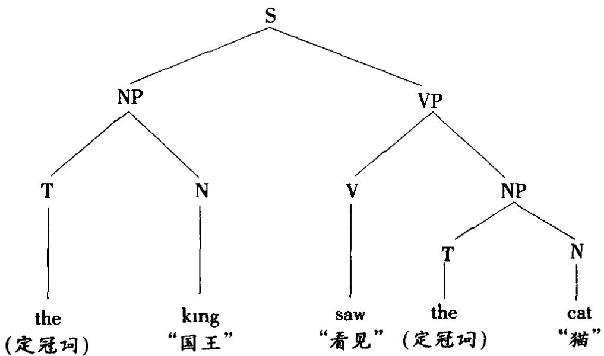

第二个NP直接受VP统制。用统制的概念可以这样来区分王语和宾语之类的概念：主语是直接受“句子”统制的NP(名词短语)，宾语是直接受VP(动词短语)统制的NP。另一个概念是“穷尽”统制：一个节点A穷尽统制一个语符列，当且仅当A只统制这些语符而不统制其他语符。一个节点A如果直接统制节点B而不统制其他节点，也说A穷尽统制B。统制(dominance)这个“垂直”维度应与水平”维度的概含居前相区别。直接统制规则（ummediate-dominancerules)是一部概化短语结构语法的组成部分之一。这个概念在几种音系字模型里也很重要。例如在近期的节律音系字中，音步统制(foot dominance)是决定音步位于中成分哪一边的-个参项在“左统制”音步中，所有的左节点是统制节占，所有的右节点是隐退节占。在手势语的音系分析中，“统制”用来指主要用哪一只手从语言学上讲一个手势或者是左手统制或是右手统制，视其作单手手势时一般用左手还是右手。

donkey sentence 驴子句 一类有疑难的句子，典型例子是 Every man whoowns a donkey beats it“每个拥有一条驴子的人都揍它”,其中的代名词 it 必须认作依赖于名词短语a donkey-条驴子”，而这个短语的辖域又不可大于 every“每个”表达的全称量词的辖域。这类句子在话语表征理论中有详细研究。

dorsal(dorsum) 舌背音(舌背) 语音字有时用来给语音分类，指用舌后或舌背与口腔顶接触发出的音，如软腭音(即“舌背－软腭音”)或腭音(即“舌背腭音’)。有的作者将舌的其他部位也归在“舌背”之下。这个术语在最近的音系字理论中占特殊地位，特别是在各种非线性模型中。例如，在基于发音器的特征理论中，“舌背”指以舌体为主动发音器的单值节点。在基于收缩的模型中，“舌背”定义为由舌后形成的收缩。

double articulation 双层组构 见 ARTICULATION(2)组构条。

double-bar 双杠 在X杠句法的最普及的版本中，指一个完整的短语语类(一个零层次语类的最大投射)。与单杠语类相对立，后者是一个“小”短语语类。

doublebase 双基[转换] 生成语法早期模型区分的一类转换规则，这类规则在操作时有两个或多个终瑞语符列的输入。双基转换也称作概化转换，与“单基”(single-base)转换相对立，后者只涉及一个语符列。

double filled COMP filter 双填标补语过滤条件 扩展的标准理论中提出的一种过虑条件，用来排除\*Ⅰ wonder who that John saw“我不知道约翰看见谁”这类句子，其中两个语项(who和 that)都占据行补语位置。

downdrift 下漂 见 DOWNSTEP 降阶条。

downgrading(downgraded)降级(降级的)有些语言字家用来指一种语法变化，即语法层级中的一个单位套嵌在一个较低层面的单位内。例如，小句don't care“我不在乎”用作一个词，套嵌在句子 That's a very I don't care attitude“那是一种我满不在乎的态度”内，也就是已经“降级”(参看RANK SHIFT级移

条)。

dowmstep(-ped)降阶(降阶的)声调语言的音系字使用的术语，指适用于两个高调音节中第二个音节的声调降低过程。一个降阶的高调比前头一个高调稍低，但又不低到等于一个低调的程度。降阶广泛见于非洲语言。相反的效应叫升阶(upstep)，但不太常见，是指几个连续的高调依次变得更高。降阶在音系上具有对比性，通常有别于下漂(downdrnft)，后者指整个语调单位中低调后头的各高调依次逐渐降低。这种效应一般称为“调域降低’或“基调降低”。递降(de-clination)常用作下票的等同语，但还有一个较一般的语音学上的用法(“F渐降”)，指整个话段的音高逐渐降低、音高范围逐渐变窄，造成这种结果的部分原因是说话人逐渐用完肺部吁气，声门处的气压因而降低。当然，这种效应并不限于声调语言。

DP 作 DETERMINER PHRASE 限定词短语的缩写。

drag chain 拉变链 见 CHAIN(3)音变链条。

DRS 在话语表征理论中作 DISCOURSE REPRESENTATION STRUCTURE 话语表征结构的缩写。

drum language 鼓声语 语言字里这个术语用来描述用鼓声来模拟部分言语特征(主要是声调和节奏)的一类语言。信号主要由一些简短的、公式化的话段组成，但可用来构筑很复杂的信递系统，特别见于非洲，村庄内和社区之间都使用。

D-structure D结构 最近的转换语法用此术语表达一个取代深层结构的概念。D-结构通过语还和大代语PRO这类空成分与S-结构(表层结构)相联系。

DTE 节律音系字用作 DESIGNATED TERMINAL ELEMENT 指定终瑞成分的缩写。

dual 双数 见 NUMBER 数条。

dualism(dualist)二元论(二元论的) 指一种意义理论，即假设语言形式和其指称的实体、事态等(即所指)之间有一种直接的双向联系。意义的二元论通常与三元论对立，后者假设存在一种三元联系，即形式、所指和涵义三者的联系。

duality(of patterning/structure）[模式/结构的]双层性一般认为是定义人类语言的一个特性(有别于其他符号系统的特性)，指语言在结构上由两个抽象层面组成。在第一个较高的层面，语言可分析为一系列(有意义的)单位(如语素、词)的组合，在另一个较低的层面，语言可分析为本身没有意义、但组合起来形成意义单位的一系列音段的组合。这两个层面有时称作双层组构，即一个

“主要”组构层和一个“次要’组构层。

dummy假位语言字用此术语指，为保证产生一个合乎语法的句子，需在一个结构或一种分析中引入的形式语去成分。“假位成分”除形式作用外没有任何意义——它们在语义上空虚，例如 there were many people at the club“俱乐部里有许多人”中的 there,t's raining“在下雨”中的 it。当这个成分处于语法对立的位置时就称作“假位载体”，例如问句形式中的do是一个“假位助动词”，它表达动词短语在时/数上的对立(do/did you know“你现在/当时知道吗”，do/does heknow“他知道吗”)。一些涉及零形式的概念(如“零形语素”)也可视为不同种类的假位成分。在转换语去中，“假位符号”有时引入句子的深层结构，以便利各类句子的派生，但它们从不出现在句子的表层结构；例如各种界限符号或德尔塔(△)符号，它们充当词项(规定为复杂符号)的“定位语”。在管辖与约束理论中，假位指位于A位置(通常为主语位置)而未赋予题元角色的成分，它们也称作“虚位成分”(expletives)。

duration 音延 语音字术语，指一个音或音节的发音所花的时间长度。音延的相对“长”和“短”用时间单位，如毫秒(msec)来测量。言语中语音的绝对音延在很大程度上取决于说话时的兑体语速。研究中需考虑音延的问题包括节奏（参看ISOCHRONY 均长节律条)、辅音的发音(参看 VOICE ONSET TIME 嗓音起始时间条)和音度。

durative(durativity）延续体(延续性） 语法分析中指一种体，即一个事件延续一段时间(参看CONTINUOUS 持续体,PROGRESSIVE 进行时条);与之对立的是“非延续体”或瞬间体。

dynamic动态的(1)语法分析中指动词用法的两大体范畴之一，与静态的相对立。区分的标准主要是句法标准；例如，动态动词有进行时形式(如I'm running“我正在跑”，He's playıng“他正在玩”)，可用于祈使句(如 Run！“跑!”)。动态动词的语乂范围很广，包括活动、过程(例如change“变化”，grow“成长”)，身体感觉(例如feel“感到”，hurt“刺痛”)等。

(2) 某些社会语言字家用来指一种语言观(动态语言学(dynamic linguis-tics)),即将时间维度引入语言变异的研究中：各共时状态被视为产生和影响这些状态的演变过程(“波”)，可用演变的相对速率和方向等概念来定义。以类似方式引入时间维度的还有参项语音字(动态语音学(dynamic phonetics))和研究发音的几种当代仪器和技术，如肌动力(肌运动)学和空气动力(气流)学。不引人时间维度的研究就是“静态”研究。接纳参项语音学原则的音系学理论称作动态音系学(dynamic phonology)。

(3)音系字有时用来指音高有变化的声调，如升调或降调。动态声调通常与

静态声调相对立。

(4)(dynamism)(动力作用) 功能句子观所用术语，见于短语“信递动力作用”，按这种理论，一个话段是一个逐渐展开意义的过程，话段的每个部分对整个信递效果作出各不相同的(“动态的”)贡献。

(5)用来指语义字的一种形式理论，这种理论将一个句子的意义刻画为这个句子改变语言使用者信息状态的潜能(动态语义学(dynamic semantics))。这种理论与“静态”模型相对立，后者视意义等同于句子的真值争件内容。一个信自状态被视为一组可能性——对某种语言词语的各种可能的外延义和这些词语各变项(照应语)的可能值所作的信息编码。这些状态又用来定义词语的信息变化潜能———即由于说出一个句子而引起信自状态发生变化。这种分析是一个连续过程，随着新话语信息的增加和某些可能性的消除，信息状态逐渐延伸，句子释义不断更新，因此这种理论又称作更新语义学(update semantics)。这种理论特别适用于阐释代词问指。

dynamic time warping 动态时间调整 见 SPEECH RECOGNITION 言语识别条。

## E

e 生成语法中作没有音韵内容的语类(即缺位)的缩写。

ear-training辨音训练法 语音字宇的一项技术，训练立志从事这一学科研究的实践者如何区分和识别人类的全部语音。相应的训练发出语音的技术叫做发音训练法。

echo(non-)回声句(非回声句) 有的语法描写，特别是夸克语去，用来指一类全部或部分重复另一说话人刚说出的话的句子。这种“回声句”包括“回声问句”(例如 A·I saw a ghost “我看见一个鬼”。B:You saw what?“你看见什么?”)和感叹句(例如 A:Have you been to the office?“你去过办公室吗?”B Have I beento the office!“我去过办公室吗!”)。不是这种回声的问句有时称作非回声(non-echo)问句。

eclectic(ism)折中的(折中主义) 这个一般术语应用于语言字，主要指某些描写模型把几种语言学理论的特卢结合在一起。例如，夸克语法就是折中的语法，因为它利用了结构主义、转换理论和其他理论的概念和方法。折中理论的长处是能为语言提供多角度的精辟见解，其主要弱点是难以建立一个前后一致的理论框架将各个描写部分有机地联系起来。

ECM 管辖与约束理论中作 EXCEPTIONAL CASE MARKING 特殊格柠记的缩写。

economy经济标准 语言字的这条标准是指，在同等条件下，一种分析法应尽量简短，使用的术语应尽量少。这一标准能够量化为解决某一问题所使用的形式构件(如符号规则等)的数目。语言学研究的大多数领域都或明或暗地使用这一标准。这一奥卡姆剃刀的运用是生成语法提出的各种分析法评价标准的一个主要特征(参看 EXPLANATORY ADEQUACY 解释充分性条)，并已成为最简万案的中心原则。特别在生成音系字中，一般认为优选的分析法是总体上较简单，即使用较少特征和规则的分析法。另一方面，也有人认为，这种量化涵义上的较简单的解决办法并不总是在直觉上更可接受，也并不总能使我们作出最能增长见识的语言字上有意义的概括。

语言学的经济标准实际操作很困难在分析的某一方面加以简化可能导致其他方面的复杂化。在作出完整的描写之前，任何关于经济标准的建议都是临时性的。但是生成理论仍认为，这个概含有重要的理论意义，并已作出几种尝试来对这一概含的内容作出形式上的阐释，例如提出简单性度量的概含。

关于表述的相对经济性，一个简明的例子见于生成语法的一些起首规则。如果按以下序号应用三条规则就是经济的

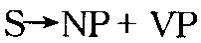

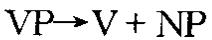

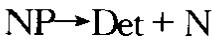

如果不是这样排序，譬如说，在规则(2)之前先应用规则(3)，就会发现规则(3)  
中的NP将重写规则(1)引入的NP,而规则(2)中的NP仍需要扩展,结果是还需  
要增加一条规则(4)，具体如下(为明确起见加下标).(1)S→NP1}+VP (2)NP1→Det + N(3)VP→V+NP2 (4)NP2→Det + N

很明显，从经济标准看，第一种序次比第二种仇越。

ECP 管辖与约束理论中作 EMPTY CATEGORY PRINCIPLE 空语类原则的缩写。

-ed form -ed形式 英语语法描写用来指动词的简单过去时形式，例如Iwalked “我走”， she jumped“她跳”。实际不一定以 ed 形式结尾(例如Ⅰ ran“我跑”，she saw“她看见”)，这只是个帮助记忆的手段，主要为简明地书写规则。但ed 词尾也是过去分词的常用形式(例如 she has walked“她走过了”)，使用时应留意这种潜在的歧乂。

edge 边缘 某些非线性音系字模型用这个词的日常涵义来指发生在一个语言单位边界处(如一个词或音节的开头或结尾)的音系效应。例如，有的模型谈论边缘效应(edge effect),即某一音段的表现相对其一边的音段似有特征[+ F]，相对另一边的音段似有[-F]特征，如前鼻化塞音。不显示这种效应的音段就称作具有“反边缘效应”，如塞捽音的分析，其特点相对后头的音段有如塞音，或相对前头的音段有如擦音，或两头的效应都有。有的模型将边缘标记参项(edge-marking parameter)用于节律结构:在一个标记序列的一边加一括号(即在一语符列最左边一个成分的左边加一左括号，或在最右边一个成分的右边加一右括号)。短语边缘突显(phrase edge prominence)制约是指·边缘组构成分比不处于边缘的组构成分显要。韵律形态字在分析重叠时，音系制约规定，两个成分(即原形式和重复成形)必须共含一个边缘成分—在添加前缀的重叠中是首成分，在添加后缀的重叠中是尾成分。

educational linguistics教育语言学 有时用来指应用各种语言字理论、方法描写结果来研究本族语的教学，包括学校或其他教育环境中口语或书面语的教学，还可更宽泛地指所有教学环境。也称作教学语言学(pedagogical linguis-tics)。具体研究的问题包括阅读和写作，口音和万言，听说能力(参看ORAL口语的条)，课程中的语言变体，学校中语言学和语法等等的教学。

egressive 外呼音 语音字给语音分类的术语，指所有用外向移动的气流机制发出的音。与之对立的音类是内吸音，内吸是不常见的发音方式。绝大多数语音都是由肺部的空气(肺气)外呼而发出。少数几个辅音是用喉部产生的内吸气流发出这些音称为挤喉音或声”音(见GLOTTAL声门的条),如[t,s,tʃ]。

ejective 挤喉音 语音字按发音万式给辅音分类的术语，指用声门气流机制发出的那个系列的音。空气在口腔或咽腔压缩，同时声门先持关闭状态，然后再开放。挤喉破裂音在语言中很常见(如非洲和美洲的许多语言，如奇楚亚语和阿姆哈拉克语)，挤喉擦音也有所见。这类音的标记法是在相关音段的上角加小号声塞音音标，或加撇号，如[p]，[s]。挤喉音也称作“声”音，有时也称作“声化”音。

elaborated 精制[码] 社会学家巴兹尔·伯恩斯坦(生于1924)使用的木语，指语言使用的两种变体(或语码)之一,即精制码(elaborated code)，另一种是限制码。这种区分是关于社会系统和社会规则的性质的一般理论的一部分。据称，精制码用于较为正式的场合和受过教育的人们中，其意义的表达不怎么依赖于语言外的语境(如身势或共同信仰)，并允许说话人在表达时发挥个人的创造性，使用各种语言交替形式。从语言学上讲，精制码的特卢是使用较高比例的从属小句、形容词、代词“我”和被动式等。相反，限制码则缺乏这些特征。精制码与某些类型的社会阶级背景之间的相关性，以及它在教育环境中的作用(例如，习惯于使用限制码的儿童在以使用精制码为常的学校中能否取得成功—遇到这种情形又如何对待)使这一理论引起许多公开计论和争论，对两种语码的区分也已提出各种新的解释。

## E-language

E-language E-语言 为 externalized language 外表化语言的缩写。诺姆·乔姆斯基用来指一个理解为独立于人的心灵特性的句子集合；从这一意义上讲E语言与Ⅰ语言对立。这一术语包含的概含是视语言为一个与意义配对的话段或形式的系统，它是语法旨在描写的对象。

elative 离格 语法描写术语，指一类表达“离开(移出)”某一处所的屈折形态。离格见于芬兰语和其他一些语言，与向格、近处格及其他几个表示“局部”时空义的格并存。“离格’常与夺格对立—从里到外和从外到里的对立。

electroaerometry 电子量气术见 AEROMETRY量气木条。

electrokymograph(-y，-ic)电子记波仪(电子记波术，电子记波的） 发音语音宇使用的一种仪器，可记录言语过程中口腔和鼻腔气流的变化。电子记波术(eletrokymography)使用一种能区分两类气流的面罩和能测量气流量和气流速的相关设备，并以可见的方式将测量结果记录下来(电子波形图(electroky-mogram))。

eletromyograph(-y,-ic)(EMG)电子肌动观察仪（电子肌动观察术，电子肌动观察的）语音宇用来观察和记录言语过程中肌肉收缩的仪器。电子肌动观察术(eletromyography)应用电极(表面垫板或针)测量声道中的肌肉，并分析得到的可见电子肌动痕迹(电子肌动图(eletromyograms))。

electropalatograph(-y,-ic)(EPG) 电子腭位观察仪(电子腭位观察术，电子腭位观察的）发音语音字用来连续记录言语过程中舌和腭之间接触的仪器。电子厅位观察术(electropalatography)使用一种包含几个电极的人造腭，记录实际发生的接触：记录结果是可见的电子腭位图(eletropalatogram)。

element 成分 语言字中的这个术语有时按一般涵义理解，指“组成部分”，但经常按狭义理解，特别在语去分析中，专指一个层级中某一单位的直接成分。例如，主语/动词等是小句结构的功能成分；词缀是词结构的形式“成分”。

elicitation(elicit)诱发 语言字和语音宇用来指从说话人(语言调查受访人)那儿获取可靠语言数据的方法，这种数据或为实际说出的话段，或为对这些话段的判断(如对其可接受性的判断)。已经设计出几种巧妙的“诱友术”，以间接和对方意识不到的方式获取(“诱发”)这种信息，例如要求受访人执行某种语言任务，表面上跟当前的目的无关，但能揭示出分析者直接关心的特征。

elision 省音 语音字和音系字用来指连续言语中语音的省略。辅音和元音都可省略，有时整个音节也可省略。非重读语法词，如and“和”和of“的”，特别容易省音，例如 cup of tea “一杯茶”省掉 f 变为 cuppa tea, boys'n'gurls 是 and 省掉了a和d。多音节词中，非重读音节里的元音和辅音在正常语速的会话中经常省略，例如 camera/kamrə/“昭相机”，probably/problı/“大概”，February/febri/“二月”等。复杂的辅音丛也经常省音，例如 twelfths/twelθs或/twelfs/“十二分之一”。可以证明存在多种复杂的省音模式。

传统修辞学很关心省音现象，因为省音与构造符合格律、读起来顺溜的句子有关。修辞学的术语中，词首位置的省音称作首音割弃，词中间位置的省音称作央音割弃，词尾位置的省音称作尾音割弃。类似的分类适用于对立的添音现象。

ellipsis(elide,ellipt-ed，-ical) 省略(省略的) 语法分析术语，指一个句子出于经济、强调或风格的原因省去结构的一部分，省去的部分在仔细考察语境后可以恢复。传统语法把省略成分说成未出现但“可理解”的成分，但语言宇分析一般较严格地限制这个概念，强调句子中“省略的”部分必须可以明确地指明。例如,在对话序列 A: Where are you goung?“你要去哪儿?”B To town“去镇上”中,B 句的“完整”形式可以从 A 句推算出来(I am gong to town“我要去镇上”)。而对Thanks“谢谢”，Yes“是的”这样的句子，完整的句子形式可能是什么一般不清楚(例如是 Thanks is due to you“应该谢谢你”, 还是 Ⅰ give you thanks“我谢谢你”?);对这种情形一般不用“省略”称之。使用“省略”构式是日常会话的一个重要特征，但支配这类构式使用的规则还缺乏深入研究。省略构式有时也称作缩减构式、缩约构式或“缩略”构式。

elsewherecondition 别处条件词厂音系学术语，指两条操作原则在派生过程的某一点发生冲突时，操作范围较受限制的那条原则优先起作用。例如，如果一种语言所有阻塞音都不带声，而所有塞擦音都带声，那么就某一龈腭塞擦音而言后一陈述优先于前一陈述。后一陈述因较具体而优先，前一陈述则较一般，只适用于那条具体陈述不适用的地方，也就是在“别处”才适用。

embed(-ding，-ded)嵌套(嵌套的）生成语法术语，用来指一个句子包含(“嵌套”)在另一句子中的过程或组构方式，即形成一种句法主从夫系。“嵌套”有别于并联(并列)。一个名词短语中包含一个关系小句，这是嵌套的例子，如The man who has a sutcase is in the bar“那个带一只手提箱的男人在酒吧里”。从派生过程来看，先有句子 The man has a suitcase“那个男人带一只手提箱”，它又嵌套在母句 The man is in the bar“那个男人在酒吧里”中。嵌套小句也可以是补语，如 the discussion of his new book“对他的新书的讨论”。从“嵌套”又衍生出自嵌套(或“央嵌套”)的概含。

EMG 见ELECTROMYOGRAPH(Y)电子肌动观察仪(电子肌动观察木)条。

emic /etic 位/非位 这对术语用来代表研究语言学数据的两条对立的路子。

“非位”的路子是对语言的各种物理模式加以描写，尽量不考虑它们在语言系统中的功能。相反，位”的路子充分考虑各种功能关系，建立一个由抽象对工单位组成的封闭系统作为描写的基础。“位”(emic)一词实际是从音位(phoneme)和语素(morpheme)这些术语派生而来，eme指涉及的最小区别性单位。例如，对语调如作“位”的分析，就只描写音高变化模式中那些被一种语言用来表示意义的特征，而按“非位”的路子，对音高变化的描写要细致得多，不管描写的特征是否被这种语言用来表示意义。位与非位的区分在美国语言学家肯尼思·派克(生于1912)的语言理论，即法位字中是一个重要特征。

emotive 感情义 语义字有时用来给意义分类的术语。一个词语的‘感情义”是指它在听话人身上产生的感情效果，如宣传演讲和广告语言的“感情成分”。可替换术语有情感又和内函乂，对立的木语有认知乂和指称义。

emphatic consonant 强势辅音 音系字中指一类辅音，特别见于诸闪语(阿拉伯语的研究较多)，发音的部位在声道的咽腔或小舌区，或者在这两个部位有协同发音(如咽腔化和软腭化)。强势常扩散到邻接的音段序列，这种现象因此被广泛分析为词结构中的韵律成分或“长”成分。

empty 空，虚（1)空[成分] 某些语法描写用来指引入一个结构以保证其合语法性的无意乂成分。例如nt有空成分的用法，如句子it's rainung“正在下币”，存在句中的 there 有时也视作空成分(如 there are mice in the larder“藏肉柜中有老鼠”)。这类成分也称作虚代词或假位成分。在生成语法中，空成分(空节点(empty nodes))在短语标记中表示为由假位成分或空语类(empty categories)填充的德尔塔(∆)。空语类包括小代语pro、大代语 PRO、语还(管辖与约束理论)，还有概化短语结构语去中的斜杠语类。

(2)虚[词] 有时用来对词作语法分类，指语言中假设的两大词类之一，即虚词(empty words)，另一类是实词。虚词被认为是没有词厂意乂的词，其功能只是表达语法关系，例如英语的 to“到”，the(定冠词),in在 里”，of“的”。这种区分遭到批评，因为大多数语法词多少也有意义，极少的词(如果真有的话)才确实没有任何词汇意义。但这个术语仍在使用，虽然不像其他几个术语(如语去词，功能词)用得广。

(3)虚[语子] 用于形态字虚语子(empty morph)这个名称,指不能指派给任何语素的形式特征。英语中一个讨论较多的例子是children“儿童(复数)”一词，一种可行的分析法是将其分析为词根 chuld“儿童(单数)”加上复数后缀 en(如oxen“公牛(复数)”中的后缀)，剩下的那个/r/就视作一个虚语子，因为没有它这个词在形态学平面上就没有得到穷尽的分析。

empty category principle（ECP）空语类原则 管辖与约束理论的管辖子理论中的一条原则。它要求一个语逐受严格管辖，即或受一词厂语类管辖，或受一同行引语类(即其先行词)的管辖。

enclitic 前附着形式 见 CLITIC附看形式条。

encode 编码 见 CODE 语码条。

endearment,term of 示亲语 社会语言字术语，指视相互关系为亲密关系的人们之间使用的称呼语。英语的例子有love“亲爱的”，dear“亲爱的”，honey“宝贝儿’，mate伙计’等。这类形式也可以不对称地使用，即只有一个参与者使用(如在商店里顾客用而售货员不用，或反过来售货员用而顾客不用)。

endocentric 向心[构式] 语法分析按分布标准将句法构式分为对立的两类，向心构式和离心构式。向心构式是指一些句法上相联系的词的组合，其中一个词的功能相当于整个组合的功能(即组合内有一个可确定的“中心”或中心语，其分布与整个组合相同)。向心构式包括名词短语和动词短语(按传统定义)，其中组构成分项从属于中心语，例如 the big house“大房子”， The cake with icing“带糖霜的蛋糕”, will be going‘将要去”等，还包括某些并列构式，如 boys and girls“男孩和女孩”。

endoglossic 内核语 社会语言字木语，指一个地理区域内大多数(或所有)人口用作本族语的语言，与之对立的是外层语(exoglossic)。例如，英语对大多数澳大利亚人和英国人而言是内核语，但对加拿大魁北克省人和新加坡人而言是外层语。

endophoric（(endophora）内指的(内指） 有些语言字家用来指那些有助于描述篇章结构的衔接关系；与之对立的是外指关系，后者不起衔接作用，并需参照语言外的情予来理解。内指关系分为复指(上指)关系和下指关系两类。

-en form -en形式 英语语法描写术语，指动词的过去分词形式，例如Ⅰ havetaken“我已取”。用en表示只是为了帮助记忆，便于简明地书写规则，实际并不都以 en 结尾。以 ed 结尾的也很常见，功能相同(例如 Ⅰ have walked“我已走过”)，可视为可替换符号。

engineering(linguistic)[语言]工程 见 LANGUAGE 语言条。

entailment 衍推原为形式逻辑术语，现常用于语乂字研究。指一对句子之间存在这样的关系：第一个句子为真，则第二个句子必真。例如“我能看见一条狗”和“我能看见一只动物”，不可能断言第一句而又同时否认第二句。最近的语义学讨论中，衍推成为与预设对立的概念，因为两个句子中任何一个为假都会引起不同的后果。例如，如果“我能看见一条狗”为假，衍推的概念要求“我能看见一只动物”或真或假，但预设的概含要求第一个句子为假时第二个句子必真，例如“他已不再买录像带”预设“他买过录像带”。

entry 条目;入列（1)lexical entry 词条 语法描写用来指正式列入词库或词典中的关于一个词项的累积的结构信息。一部词典可视为许多词条的集合。

(2)entry condition入列条件 系统语法中入列条件指某一语法系统进入正常操作所必须满足的条件。例如，为了操作包含陈述句一疑问句一祈使句的选择系统，人列条件要求输入必须是主要小句。整个语言被视为由这类系统构成的网络。

environment 环境(1)语言字和语音宇通用术语，指一个单仁处于汪意中心时其所在话段(或篇章)中在其附近或与其邻接的某些部分。语言环境的特征会影响话段某一位置上某一单位的选择，从而限制其现次或分布。例如，音系字中，一个辅音音位是否是圆唇的，这取决于在其语音环境中是否存在一个圆唇元音。因此说语音受其环境的“制约”。在语法中有类似用法；例如一个语素的出现可能取决于其环境中已有另一语素出现，如 cran 只在 berry 的语法环境中出现(共同构成cranberry“越橘”)。近年来，上下文一词广为使用，指上述语言环境。符号/(用于 A→B/C,表示在 C的上下文中将 A 重写为 B)叫做环境杠(en-vironment bar)。另见 DERIVED ENVIRONMENT 派生环境条。

(2) linguistic environment 语言环境 指与作出某一观察相关的社会语言字环境。例如，在语言刁得研究中，可以说某一结构在两岁时出现，“不管儿童的语言环境是什么”，即不管儿童在其社会环境中听到的是哪一种语言。术语语境有时也作如是用。

epenthesis（epenthetic)增音(增音的） 语音字和音系字术语，指在一个词内额外加入一个音的插音现象，通常分为前增音和加插音两类。增音现象在历史演变和连续言语中都很常见(例如 incredible“难以置信的”读作[igkredrbl])。

EPG 作ELECTROPALATOGRAPH(Y)电子腭仁观察仪(电子腭仁观察木)的缩写。

epicene 通性名词，中性名词原为传统语法术语，现见于社会语言字，指一个名词无需改变形式可用于两种性别。源于希腊词epikoninos“通用”，曾在拉丁语法和希腊语法中指不管性别用同一种性的名词(例如拉丁词vulpes“雄狐/雌狐”，英语则为fox/vixen)。英语的例子有teacher“教师”和doctor“医生”。现认为这个概念跟语言与性别关系的计论有关。

epistemic 认识[情态]原为模态逻辑术语，有些语言学家用来构建分析语言中情态动词和相关结构的理论框架。“认识逻辑”关心的是这样一些陈述句的逻辑结构，它们断定或蕴含相关命题是已知的或信含中的。例如句子The car mustbe ready中的must按认识情态动词理解，句子表示“汽车想必已准备好”。认识情态与真势情态和义务情态对立；按后两种情态理解上面这个句子分别表示“汽车显然已准备好”和“汽车必须准备好”。

eponym（ous）名祖(名祖的） 某物(如一种发明物或一个场所)据以命名的某个人的名字，也叫通称名(appellative)。例如 cardigan“卡迪根式开襟毛衣”，buro“伯罗笔(圆珠笔)”，sandwich“桑德威奇面包(三明治)”。有些国家的地名也有名祖(华盛顿，悉尼(西德尼)，高尔基市)。

equative(equational)（1)等同句(等式的） 语法分析用来指一类句子，其中动词将两个名词短语置于一种等同关系，例如Jo is theleader“乔是头儿”。这样将两个成分连系起来的动词可称作等式动词(equational verb)，即有“等同”功能的动词，英语中通常为系动词be的一种形式。有的语言(如俄语)有系动词不出现的等式句，像尚古电影中的套语(hum Tarzan“他，人猿泰山”等)。

(2)等同级有的语法描写在分析形容词或副词的比较用法时分出一种“等同”级，例如 as big as“跟 一样大”。

equi NP deletion 等同名词短语删除 经典转换语法中的一条强制性规则，常略为等名删除(Equi)，即在一个句子的补语小句中删除一个名词短语，它与同一句子主要小句中的另一名词短语意义相同(同指)。例如 John wants to see thefilm“约翰要看那部电影”，其中see“看”的底层主语是John“约翰”。在后来的理论中，这种转换被取消，这些构式连同提升构式一起被称作控制句。在管辖与约束理论中，未出现的主语分析为大代语PRO。

equipollent（1)等值对立 布扛格字派音系字分出的一类对工，有别于缺值对工和级差对工。等值对立是对立的成员在逻辑上被视为等值，既没有程度差别也没有二分特征例如，按尼古拉·特鲁别茨考依的观点，/p/与/k/之间的区别不能分析为一个语音连续体上的差别，也不能将/p/分析为“非软腭音”或将k/分析为“非双唇音”。

(2)双值特征 最近某些音系学模型用来指两个值都需要的特征(参看BINARY二分特征条)。与缺值特征对立。

equivalence（non-equivalent）等价（非等价的）指两部语法的生成力相等。能生成同一句子集合的两部语法是“等价”或“弱等价”语法。能生成同一短语标记集合的两部语法是“强等价”语法，即不仅能生成相同的句子，而且能给每个句子指派相同的结构描写。在结构加行或加括法上显示差异、或生成不同句子集合的两部语法称作非等价(non-equivalent)语法。这个术语也用于句法和语乂字的其他方面，如“分布等价”(两个单位的分布相同)，“语义等价”(即同义夭系)。

erasure 抹除 见 STRAY离群单位条。

ergative(ergativity）作格（作格性） 对某些语言，如爱斯基摩语和巴斯克语，作语法描写时需要有一个术语来描写这样一类构式，其及物动词的宾语与不及物动词的王语有相同形式(即同格)。及物动词的主语称作“作格”，而不及物动词的主语和及物动词的宾语一起称作通格。在某些语言里，这种格标记只见于一部分情形，其他情形禾用受格标记模式(分裂作格性(splıt ergativity))。例如，尤卡坦-马雅语中，完成时的不及物动词主语和及物动词宾语都用通格标记，而及物动词的主语用作格标记，未完过去时只有及物动词的宾语用通格标记，及物和不及物动词的王语都用作格标记。有些语言字家也将“作格性”这一概含用于英语和其他语言，虽然这些语言里作格关系的形式标记不太明显。按这种做法，像 The window broke “窗子打破了”和 The tree broke the window “树打破了窗子’这样的句子也分析为“作格关系”broke‘打破”作不及物动词的王语与作及物动词的宾语形式相同，动作的施事因此类似于“作格主语’。作格动词也称作非受格动词，特别见于夫系语法。

error语误(1)心理语言字术语，指自发言语或书写中由于执行大脑发出的神经肌肉指令发生故障而犯的错误。这种语误因此有别于传统的语误概念，后者是指语言使用者缺乏达到一组实在的或想像中的表达标准的能力。理语言学的语误分几种类型。“说者语误”是在执行上述指令的定时或顺序上发生故障，导致语音和语素的增添删减或替换，这类语误在所谓“舌头打滑”的口误现象(有的心理语言学家称之为大脑滑交”)中最为明显，也见于日常语言中的起说失误、停顿和结巴等。“听者语误”在语言刁得过程中最为明显，如儿童对成人的句子作错误分析(例如，成人 He's got hıs hat on“他戴上他的帽子了。”儿童Where's hus hat on？“他的帽子戴哪儿了?”),也常见于语言历史，即新形式产生于对旧形式的重新分析或“再分析”(例如 a napron→an apron“一条围裙”)。但是言语产生和言语知觉‘语误”的差别有时很难划分，特别是后者的唯一证据经常就来自前者。因此“语误”这个术语应谨慎使用，特别是语言习得研究中很容易将其与教学上的“语误”概含(如批改作文中的语误等)相混淆。

(2)error analysis 语误分析 指语言教学中运用语言字提供的任何原则和方法，对外语学习者产生的不可接受的形式加以识别、分类和系统解释的方法。所持的假设是，语误系统地反映学习者达到的语言能力水平，与“差错”不同，差错是学习者有能力改正的语言运用中的失误。

esophageal 食道的，食道音 OESOPHAGEAL 的异体词。

essential conditions 本质条件 见 FELICITY CONDITIONS 适宜条件条。

essive存格 语法描写用来指一类表示存在状态的屈折形态。存格见于芬兰语和其他一些语言，与近处格在内格及其他几个格一起表达“当时”、“当地”的意义。

EST 通常作 EXTENDED STANDARD THEORY 扩展的柠准理论的缩写。

état de langue 语言状态 瑞士语言学家菲迪南德·德·索绪尔引入语言字的一个术语，指语言被视为处在某一时点上的状态，不管其早先或以后的历史如何。语言状态因此是共时语言学研究的主要对象。

ethnolinguistics (ethnography of communication/speaking) 人类文化语言学(信递/言语人类文化学) 语言字的一个分支，结合民族类型和行为的研究来研究语言。这个术语在一定程度上与人类语言字和社会语言宇重叠，反映了相关学科民族学、人类学、社会学—的共同兴趣所在。信递人类文化学(ethnography of communication)或言语人类文化学（ethnography ofspeaking)两个术语已被社会语言学家用来指这样一种语言研究，即识别有哪些语言外因素构成信递的社会基础，重点在描写语言的交互作用。从事这方面研究的人称为“人类文化语言学家”。人类文化语义学(ethnosemantics或 ethno-graphic semantics)进一步禾用人类学研究认知科学的方法来研究不同文化环境中意义的结构方式(例如亲属关系和颜色的表达，言语事件的话语结构等)和文化制约语义变异的原则。

ethnomethodology（ethnomethodologist） 人类交往方法论（人类文化学方法论者）指本世纪70年代初期美国社会学开展的一次运动，后来导致语言字中会话分析的发展。这个运动反对以往社会学研究占主导地位的演绎和定量方法，主张将重占放在社会结构的一般问题上，研究人们自身(用ethnic“民族的”一词称之有点奇怪)在从事社会(因而也是语言)交往时禾用的手段(等于“方法”)。重卢研究个人对其交往的体验、理解和陈说。人类交往方法论者的数据因此来自自然会话的录音及其转写。

ethnopoetics 民族诗学 指研究土生民族采用的各种口头艺木形式(包括诗歌)。研究重点在口头艺术话语的语言表达效果和结构衔接特征，以及转写和书面表达的方法。特别关注的是如何识别“诗行”、节律和其他反复出现的语言特征或风格字特征，同时参昭口头文学的分类。另见POETICS诗字条。

etic 非位 见 EMIC 位条。

etymology(etymo-n,-logical) 词源学(词源，词源[学]的） 传统上指研究词的形式和意义的起源和历史。词源学的方法源自语言宇(特别是语乂字)，因此可视为历史语言字的一个分支。一个词的来源称作词源(etymon)。俗词源学(folk etymology)是指根据形式或意义上的某种联系假设一个词有某一词源，但事实上这个词的派生过程不是如此，例如 spit and image 变为 spitting umage“简直一模一样的人”。词源谬见(etymological fallacy)是指认为一个词早先的(或最古老的)意义才是其正确意义的观点(例如认为history“历史”的“真实”意义是“调查”，因为这是其古希腊语词源的意义。这种观点虽然常见，但是语言学家的态度却与此对立，他们强调应该按现代词现有的意义，而不是按其在语言早期某个状态可能有过的意义来描写词义(“最古老的”状态实际不可知)。

eurhythmy(eurhythmic) 良好节律(良好节律的)节律音系字提出的一条解释节律栅的原则，指明哪些栅是可能的或更可取的。具体说，这条原则保证语符列最终得出更可取的栅构型(周期性)，例如英语的重读音节有保持特定间隔的倾向(参看概念较宽泛的术语均长节律)。一个节奏结构的各个值可以通过一组良好节律规则从节律栅计算出来；例如，这些规则可能要求栅标记在各个音层都保持相同间隔，从而有利于有规律的交替。这条原则作为一种评价标准的地位还有争议。

evaluative 评估[情态] 语义字术语，指一类情态，即命题表达说话人对正在说的话的态度(如惊讶、遗憾等)。例如默诺默尼语有一对后缀表达“不管我们怎么想X总会发生”和“不管我们怎么想X总不会发生”这样的评估概念。

eventive事件成分有些语言宇家用格或参与角色对句子作语去或语义分析时，常用此术语指句中某个表达动作的成分，而连带的动词则意义比较“虚灵”，例如 The invasion happened in 1944“入侵发生于 1944 年”(事件主语), They arehavng a row“他们在吵架”(事件宾语)。

evidential(ity)传信[情态](传信性) 语义字术语，指一类认识情态，断言的命题可能遭到听者的质疑，因此需要加以证明。传信构式表达说话人根据可供利用的证据(而不是根据可能性或必要性)对一个命题深信不疑。传信情态给句子增添这样的意义，如“我亲眼所见”，“我亲耳所闻”，“(虽然我不在场)我有相关证据”，“我从某人处获知如此”等，从而造成细微的意义差别。土尤卡语(巴西)有一个包含五种传信情态的复杂系统；英语一种也没有，而是依靠各种判断(即各种伴有怀疑的命题，但与质疑和证据无关)。

exceptional case marking（ECM）特殊格标记 管辖与约束理论术语，跟某些动词及其出现的构式有关。一般用来指经典转换语法中主语提升至宾语的那类提升动词，它们带某种类型的小句补语(例如, Mary believes Bill to be a fool“玛丽相信比尔是个傻瓜”， Mary considers Bll a fool“玛丽认为比尔傻瓜一个”)。这类动词的特殊性在于它们能给补语不定式小句或小小句的名词短语主语指派(宾)格。

exclamation（exclamatory）感叹（感叹的） 给句子功能分类的术语，有时按语法标准有时按语义或社会语言宇标准来定义。传统上感叹句指任何富有感情的话段，通常缺乏完整句子的语法结构，带有强烈的语调，例如Gosh！“天哪！”Good grief!“哎呀!’等。在夸克语法中，感叹句(exclamatory sentences)的定义较狭窄，专指以what或how起头、后头王语和动词不倒置的构式，例如What a fool he was!“他多傻呀!”How nice!“多好呀!”这类句子有时也称作 ex-clamatives(感叹句)。语义上讲，其主要功能是表达说话人的感情——这种功能也可用其他语法手段表达，例如 What on earth is she doing?“她到底在干什么?”(她在干什么其实很明显)。感叹通常与其他三大句子功能相对立，它们是陈述、提问、命令。

exclusive（1)排外式 与包容式对立，指代名词中第一人称代词只包含说话人不包含说话对象(或其他人)，例如we“我们”=“我，没有你”。

(2)不相容[析取] 语义字借用形式逻辑的术语，指两种析取中的一种，另一种是相容析取。不相容析取为当且仅当两个命题中有一个为真时析取式为真。就“现在正发生的或为X或为Y”而言，不可能是X和Y正同时发生。

exhaustiveness 穷尽性语言字的一条分析原则，目的是在一个数据集合中，并最终在整个语言中说明全部的语言学上的对工。经常被引证为语言学遵循的三大科学原则之一，另外两条是逻辑上一致和经济。

exhaustivity尽纳 节律音系字术语，指一个音步形状参项，它要求一个词的每一个音节都必须包含在节律结构中。

existential存在句 语法描写中给小句或句子分类的术语。存在句的结构以非重读词 there开头，后接动词be的一种形式，从而表达存在的意思。例如there's plenty to do “有许多事要做”,there are three cats on the wall“墙上有三只猫”等。这类句子和其他句子(比较 three cats are on the wall “有三只猫在墙上”，the wall has three cats on it “墙有三只猫在上头”等)的关系在语言字特别是生成语法中引起特殊兴趣。已经区分出几种不同类型的存在句(有的不用there和be 的形式，如 she has a meal ready“她已准备好一顿饭”, there exist several suchfigures“存在几个这样的人物”)。“存在”与其他语乂范畴(如处所和领属)的关系被认为是调查普世语法功能的一个重要方面。另见QUANTIFIER量词条。

exocentric 离心[构式] 语法分析按分布标准将句法构式分为对立的两类，向心构式和离心构式。离心构式是指一些句法上相联系的词的组合，其中没有一个词的功能相当于整个组合的功能(即组合内没有一个可确定的“中心”或中心语)。英语中王语+谓语这种基本句子结构按此定义属于离心构式(“述谓离心构式”),因为其中没有一个部分能够替换整个句子结构，例如 the manfell“那个人跌倒了”既不能被 the man“那个人”也不能被fell“跌倒了”单独替代。其他离心构式包括‘引导构式”，如介词 +名词短语序列(如 on the table“在桌子上”)，整个序列的状语功能不相当于它的任何一个组成部分，动词+宾语序列(如kıckthe ball“踢那只球’)；‘连接构式”，即连接成分后跟一个定语成分(如 seemed angry“看上去很生气”)。

exoglossic 外层语 见 ENTOGLOSSIC 内核语条。

exophora（exophoric） 外指(外指的） 有些语言字家用来指一个语言单位直接指称(即直指)一个话段的语言外情景的过程或结果，例如there那儿”，that“那个”，her“她”都是外指词。“外指”，通常与内指对立，后者包括复指(上指)和下指两类。

expansion（expand）扩展一种语法变化，即将一新成分加于一构式而不影响其基本结构，例如名词前加形容词，动词前加助动词。在生成语法中，重写规则有时也称作“扩展规则’，因为事实上一个符号被“扩展”成一个代表其组构成分结构的语符列(例如VP→V+NP)。这个术语也可泛指任何一种将一初始语言扶态加以扩展的变化，例如历史语义字中，一个词早先的意义可以“扩展”为涵盖一系列所指(如现代英语的gay“欢快的，鲜艳的，淫荡的，同性它者等”)。社会语言学中，一种语言或语言变体可用于新的情景，从而“扩展”其影响(如通过借词)。

experiencer 感受格，感事 格语去的后期版本中这个格(早先用与格)指受感于动词表达的动作或状态的实体或人，如 The dentist heard a bang“牙医听到嘭的一声”,The book interested her“那本书使她感兴趣”。

experimental phonetics 实验语音学 见 PHONETICS 语音字条。

explanatory解释的 生成语言字用来指编写语法所达到的一个水准。在比较几种可替换的、都达到描写充分性(即能说明操本族语者的语言能力)的语法时，如果能确立一些基本原则来评判其优劣，那就已达到解释充分性(explana-tory adequacy)。已经提出好几条标准来使这一概念形式化，研究最多的一条是相对简单性。

expletive 虚位管辖与约束理论中可替换假位成分的术语。

explicit(ness)明确(明确性)指语言字所作阐述的一个特点，特别指生成分析的一个主要目标，即一条规则的全部特性及其运作的各种条件都有精确完整的规定。从这一意义上讲，明确的描写有别于传统语法的几种描写，后者经常是模棱两可的，或需借助操本族语者先有的知识才可理解(如将名词定义为人、物、处所的名称，这得由语言使用者来判定某一词项是否合格)。

exponent（exponence）释示的(释示）层级语言字分析的一个概念，指较高分析层面的语言单位与较低层面的单位之间的对应关系。例如，可以说词由音系单位(如音位)作为其“释示”成分，而音系单位又由语音特征作为其“释示”成分。相当的术语是表征。按这一涵义，抽象单位由其他抽象单位或具体单位来阐释。

这一术语的另一用法是强调或限指任何一个(任何层面上的)抽象单位的有形表达，例如语子是语素的释示，音子是音位的释示，某一构形成分(如-s)是一种句法范畴(如“复数”)的释示，词项going是词位go“去”的释示。显然有多种可能的释示关系(如可用来说明释示成分的“溶合”或“交搭”)。这种涵义的“释示”在韩礼德式语言学理论中有其特定的地位(参看 SYSTEMIC grammar系统语法条)，专指几个分析阶中的一个，即释示阶，它将这一理论的各种范畴互相联系起来，即设定这些范畴和原始数据之间的关系。例如，词项table“桌子”是名词类的一个实例(“释示”成分)。这一理论的另外两个分析阶是级阶和精度阶。

expression（1)词语 这一术语按其一般涵义用于语言字，指作为一个单仁对待的成分语符列，可以作为分析和讨论的对象。词语有语法和词厂两方面的特点，也可从这两方面来定义。例如词语sobeit“就那样吧”既可分析为一个形类序列又可分析为一个词项序列。词语又可分析其语义特性，如哲学和逻辑学所作的语义计论(分析“指称”和“述谓”词语)，语言学现在也越来越重视语义研究。另见 INDEXICAL(2)指标条。

(2)表达 见于索绪尔式的二分对立，即表达(或形式)与内容(或意义)的对立。“表达”在这里指语言形式的各个方面，即其语音和语法序列。按狭义理解，“表达”只指实体这个语言结构层面，即音系字和字系字。或以语音实体或以字形实体实现的抽象形式单位有时称作表达成分(expression elements)，例如，表达成分/s/在语音上实现为[s]，在字形上实现为s,ss等。在功能语法中，表达规则(expression rules)在句子生成的最后阶段起重要作用。

expressive 表情[义]，表情语 语义字有时用来给意乂分类，词语的表情义(expressive meaning)既指其情感内容也指任何体现使用者个性或个人创造性的特点(如许多诗作语言)。表情义常与描写义和“社会”义对立。与“表情义”有叠合的其他术语有情感义、内涵义、感情义。“表情语”一词用于言语行为理论，指说话人表达其感情的一类话段，例如I apologize/sympathuze/regret“我道歉/表示同情/表示遗憾”。

extended standard theory（EST) 扩展的标准理论 本世纪 70 年代初期发展起来的一种生成语去模型，源自诺姆·乔姆斯基在《句法理论要略》(1965)中阐述的理论(行准理论)。“扩展”主要体现在语义规则的范围上，乔姆斯基认为有些语义规则现应允许表层结构作为操作的输入。与语义学有关的表层结构特征包括重音和语调的各种功能、量化的各个方面、提供句子预设信息的句子焦点等。换言之，不再是仅由深层结构决定句子的语义表征。这一观点后来又有发展，认为就语义学而言深层结构的概念也许可以干脆取消，这是由于表层结构的概念有了新的发展。(另见 REVISED EXTENDED STANDARD THEORY修正的扩展标准理论条。)

extension(1)(-al)外延(外延的)哲学和逻辑学术语，现常用来构建语言字中语义学的理论框架；指一个词适用的一类实体。例如，flower“花”一词的外延(或“外延义”)是由这一词指称的所有实体的清单，包括水仙花、蔷薇花、倒挂金钟等。“外延”与内涵对立，后者只包括语词的定义特性。

(2)引申 历史语言字用来给语义演变分类，指一个词项意义的扩展，与缩窄对立。例如拉丁词virtue原义“男子气概”(vur“男子”)，现对两性都适用(“美德”)。

extensive 松连式 有些语法分析用来指结构成分之间的语义连系不紧密的结构，如主语和宾语(例如 he stroked the dog“他抚摩那条狗”)，直接宾语和间接宾语(例如 he gave me a letter“他给我一封信”)。松连动词(extensive verbs)包括及物和不及物动词，与紧连动词(如be“是”)对立。

external adequacy 外部充分性 见 ADEQUACY 充分性条。

externalized language 外表化语言 见E-LANGUAGE E 语言条。

extralinguistic 语言外的 按最一般的意思理解，这一术语指与语言使用相关的外界的(即非语言的)一切东西—即“语言外情景”。“语言外特征”这一术语既有一般用法，指这类情景的任何特性，又专指无法用语言学术语明确分析的信递特性，例如身势、音调等。有的语言学家称前一类特征为元语言特征；有的称后一类特征为副语言特征。

extrametricality超节律性 节律音系字的一条原则，它允许某一语符列中的某些成分在指派节律结构时不算数，即重音指派规则忽略不计这些成分；也称作超韵律性(extraprosodicity)。有人提议英语中的超节律性包括辅音超节律性(consonant extrametricalıty)(适用于词的尾辅音)，名词超节律性(noun extra-metricality)(适用于某些类名词的尾音段，如 museum“博物馆”和 elephant“大象”),形容词超节律性(adjective extrametricality)(适用于某些形容词后缀)三类。超节律性只限于外围成分，能使分析避免一些位于词边缘的罕见或未知的音步类型，也便于处理外围音节的无重音性，并标出重音规则的例外。

extraposition（extrapose）外置 语法分析用来指将一成分从其正常位置移至(即“外置”于)句子末端或接近末端的位置这一过程或结果。例如，That theboy came in late upset the teacher“孩子迟到使老师心烦”变为 It upset the teacherthat the boy came in late,后一句中引入的 t 称作外置 it (extrapositive nt)。

extraprosodicity 超韵律性 见 EXTRAMETRICALITY 超节律性条。

extrasyllabic(ity)超音节的(超音节性)自主音段音系宇术语，有两种不同但相联系的用法。

(a)指在词尾位置出现但按在词内部似乎适用的原则不能成音节的音段，这种音段现称作终端音(termination)或附加音(appendix)。还需要一些额外说明来增加或消除有关在词尾位置出现的限制。由于这种情形反映词尾音段的稳定状态，有时也称作破格超音节性(licensed extrasyllabicity)，与下面所述的临时超音节性对立。

(b)用来指音节划分程序中辅音未能成音节、并要等到派生过程的稍后阶段才附接于某一音节的情形。这种不稳定状态常称作临时超音节性(contingentextrasyllabicity)，以区别于(a)所述的较一般的概念。

extrinsic 外在的 生成语法术语，指施加于规则序次的一类制约(与允许规则按任意序次应用的情形对立)。外在序次(extrinsic ordering)是指规则序列的理据只是出于某一语言的事实而不是出于逻辑方面.之所以按这种序次完全是为了保证只生成合乎语去的句子。不少人认为外在序次在语法转换规则的组织过程中起特别重要的作用，但是对这类制约的性质颇多争议，如应该有多少种外在序次，有序序列中的规则可应用多少次。外在序次与内在序次对立。

## F

face面子 语用字和互动社会语言学术语，用来分析礼貌现象。正向面子(posi-tive face)是显示与对方认同的愿望;负向面子(negative face)是不要冒犯对方的愿望。这些因素能用来分析互动中存在的亲和关系，例如，说话人会重新措辞以免得罪对方。面子有助于解释不同类型的互动风格，如表示疏远、敬重、友好等；所提出的面子的普世性问题成为当前研究的一个课题。

factitive 使成[式，格] 语法描写用来指表示原因导致结果这种动作的构式或形式(通常为动词)。例如，make“制成”，kıll“杀死”，choose“选择”,elect“选举”等动词可称作使成动词”。早期格语法中这一术语有特殊地位，指动词的动作结果这个语乂格，与施事格、与格等对立(后来的格语法改用结果格)。

factive（factivity）叙实的(叙实性）给动词分类的术语，指带一补语小句的动词，而说话人预设这个小句表达的命题为真。例如，know“知道”，agree“同意”,realize“意识到”等都是“叙实动词”说出句子 she knows that the cat is in thegarden“她知道猫在花园里”时，说话人预设猫在花园里。“叙实谓词”还包括动词以外的其他词类：例如形容词和名词构式也能表示“叙实性”，如it's surprisingthat he left“很奇怪，他走了”,1t's a shame that he left“真丢人,他走了'。相反，非叙实(non-factive)构式并不要求说话人预设补语小句表达的命题为真，例如believe“相信”, thunk“认为”等,如 she thinks that the cat is in the garden“她认为猫在花园里”。反叙实(contrafactive)构式预设补语小句表达的命题为假，例如 wish“但愿”, pretend “假托”等，如 I pretended the cat was in the garden“我假托猫在花园里”。

falling/fal（1)降调 给语言学中音调分类的术语，指音调从相对较高到相对较低的变化。各种降调(例如“高/低降调”，“降－升调”)见于语调系统和声调语言的研究。

(2)降式 二合元音分为两类，降式和升式；降式二合元音是第一个成分比第二个成分突显。

family(sub-）语系(语族) 历史语言字研究用来描写语言间关系的发生宇模型。一个“语系”是一群派生自同一祖先或“亲本”的语言，例如印欧语系由梵语、希腊语、拉丁语等“子”语言组成，都从原始印欧语衍生而来。一个语系内不同的语群可称作“语族”(如意大利语系的罗曼语族)。谱系树(family tree)是19世纪比较语文宇家设计的，用来表示语言间的亲缘关系。随着比较研究的范围扩展到更多的可能有亲缘关系的语言，“语系”一词的用法也越来越广泛，有时指不可能证明有亲缘关系的情形。虽然用法有很大差异，现在倾向于避免用它指关系很疏远或祖语不明确的语言群体。这种情形现常用“语群”(phylum,复数phyla)称之，更不确定的语群则以“宏语群”称之。因此许多学者现称“澳大利亚(土著语)语群”，虽然流行用法的“语系”仍有人用。语群内认为有关系的群体有“子语群”、“语支”等各种称名，无固定用法。也有称语系为“语族”的。

fatherese 爸爸语 见 MOTHERESE 妈妈语条。

favourite(non-）偏爱句(非偏爱句）有些语言宇家用来给句子类型分类，指一种语言中最能产的句型。英语中主语+谓语(NP+VP)句型是偏爱(或主要)句型.其他句型称作非偏爱(non-favourite)(或次要)句型。

feature 特征 语言字和语音字用此术语指口说或书写语言中任何典型的或显著的特性。特征可按语言分析的各个平面分类，例如“语音/音系/语法/句法特征”，也可按描写维度分类，例如“声字/发音/听觉特征”。在最一般的层面上，特征可分为语言(或“语言内”)特征和“非语言”(语言外或元语言)特征。在最具体的层面上.某些类型的特征可作为理论的最小单位，如音系学的区别特征(dis-tunctivefeature)理论。在生成语法分析中，特征与词在词库中按其语法特性的分类有关。如[有生]、[普通]、「男性]、「可数]等。这类特征跟音系特征一样通常被视为二分特征，分析为[+有生]，[-有生]等。同样，语又特征也可以二分，如spinster“未婚女子”可分析为[+人类]、[+成人]、[+未婚]、[+女性](或-男性])。也存在非二分(“单值”和“多值”)特征。特征有时也称作成分(component)，特别见于语义分析。最近一些语法理论中，特别是短语结构语法，语法范畴定义为一些可应用于规则的特征赋值(feature specifications)——即有序次的项目对，由一个特征和一个特征值组成。作为这种方法的一部分，这种理论还要求说明“特征同现限制”和“特征赋值缺省”。最近的语义理论还从几个不同方向发展了特征这一概含，特别是用特征结构(feature structure)这一术语指以层级方式构成的词汇信息的类型。这里的特征(例如push“推”一词可表征为“动因”、“变化”、“强力”等)被视作情态算子，它们标记一个栅格框架中节点与节点之间的弧。另见 CONTEXT 上下文，DIACRITIC 变音符，DISTINCTIVE FEATURE区别特征，SYNTAX句法诸条。

featuregeometry 特征构架 非线性音系字中指音系表征式中特征组织方式的一种模型。特征构架理论特别关注特征之间的非线性关系，及特征组成一个功能类层级配列的方式。特征值配列在不同的音层(层次、平面、层)上，互相之间可形成各种非线性关系。同时，特征还组成层级配列，配列上的每个组构成分在音系规则中只充当一个单位。已提出的特征理论模型有好几种，如基于发音器的特征理论，收缩理论，不完全赋值理论。

feedback反馈 信递理论的专门术语，引申为指信息发送者从接受者那儿获取反应的过程，发送者借此检查信递的效率。就语言而言，有些语言字家认为反馈是定义人类语言的一个特性(与其他符号系统的特性对立)，即说话人能监视自身的语言运用(通过自我观察和观察对方的反应信号)。术语完整反馈(com-plete feedback)通常用来指这种特性，即将反馈视为语言的一个“设计特征”。在语音字中，说话人意识到自己发出的音也称作反馈；这种反馈可以是听觉的(通过耳朵)动觉的(通过对发音动作的内部知觉)、振动性的(通过骨传导)。迟延听觉反馈(delayed audıtory feedback, DAF)指言语传输过程中在口与耳之间人为引入一个迟延，使信号到达耳朵比正常情形稍迟一些。某些长度的迟延会使正常说话的流畅度发生显著变化，反过来，这种技术有时也可用来改进说话结巴的人的言语。

feeding（feed,counter-）馈给(反向馈给） 生成语言字分析规则序次时用的术语，最初用于历时音系字。指规则之间功能关系的一种，与裁切对立。馈给关系是指一条规则(A)的应用得出一个适用于另一条规则(B)的结构表征，从而增加(“馈给”)可生成的形式的数目。如果规则B为X→Y,则规则A必须是W→X的形式。这种情形下，规则 A称作规则 B的馈给规则(feeding rule),这些规则的线性序次则称作馈给序次(feeding order)。如果规则按相反序次应用，就称A反向馈给(counter-feed)B。反向馈给的结果是形成不起激发作用的关系，即一条规则未能实现其潜能来增加适用另一条规则的形式数目。

feet 音步(复数) 见 FOOT 音步条。

felicity conditions 适宜条件 言语行为理论木语，指言语行为如要达到其目的必须满足的条件。已提出的适宜条件分好几种。“预备条件’指实施某一言语行为的人这么做的资格(例如不是人人有资格收罚款，施洗礼，逮捕人等)。“真诚条件”指言语行为必须真诚(例如不说假话)。“本质条件”指说话人对某一言语行为后某种信念或行为的保证(例如在索取某物后须接受该物)。例如，分析间接请求时已提出的适宜条件包括：说话人相信对方有能力满足自己的请求，存在充分的理由提出这一请求等。一个话段如果不满足这些条件就不能有效地充当间接请求的言语行为，例如 wll you drve？“你愿意开车吗?”这句话，如果说话人明明知道对方还没有学会开车，就是一个不适宜的请求；如双方互相意识到这种不适宜，就会对这句话作不同的理解(如理解为开玩笑、讽刺等)。这样的话段称作不适宜(infelicitous)话段。

field(1)[语义]场 语义字术语，指将一种语言的词汇视为相互关联的词汇网络系统，而不是一些独立词项的总藏。语义场(semantic fields)理论或场理论(field theory)本世纪 30年代创立于欧洲(特别归功于乔斯特·特里埃尔(生于1894)和后来的约翰·韦斯格伯(生于1899))。这一理论先分出不同的概念场(如颜色，亲属关系等)，然后用词项来指称按函乂关系网络分析得出的每个场的各个特征。这个网络于是构成语义(或“词汇”)场的词汇结构。那个时期的语义学文献中对这个概念有多种不同的理解。

(2)field of discourse 语场 韩礼德式语言学术语，简称“场”，指按主要内容区分的语域，如化学、宗教、广告等“语场”。

(3)fieldwork 田野工作 也称田野调查(field study)，按其通行意思用于语言宇，指从语言调查受访人处获取语言数据(通常在其故乡环境)的原则和程序。

(4)[分布]场 法位字术语，指语言单位的分布范围，与作为粒子(物理上的离散项)或波(变体形式)的语言单位相区别。

filled pause 有声停顿 有些语言字家用来指非沉默的停顿，即由 er“呃”、erm“晦”等犹豫的声音或发声串“填充”的停顿。

filler填充项有些语言宇分析模型，特别是法位宇，用此术语指可在结构中某一位置或槽位填入的形式。

filter 过滤;过滤条件(1)最初在生成语法的行准理论(参看ASPECTS《要略》条)中阐述的一种变化，指派生过程中只有某些基础短语行记被转换成表层结构，其他的都被实施的各种制约(如由非词汇转换所规定的)“过滤”掉。在管辖与约束理论中，过滤起更重要的作用，它指阻止生成不合语法句子的一类条件。过滤条件干脆规定，凡是X类型的结构都不合式。过滤条件又称作“输出制约”或“表层结构制约”。例如，已提出的“FORFOR过滤”条件规定，任何包含forfor序列的表层结构都不合语法;这就阻止生成的句子中出现 hope for“希望”这样的动词与 for + 不定式补语一起使用，如生成\* She is hoping for for John to win这种不合语法的句子(比较 What she is hoping for is for John to win“她所期望的是让约翰赢”)。

最近的讨论中注重区分“过滤”和“制约”；过滤只应用于作为某一组规则的输出的那个结构，而制约应用于派生过程中两个相继阶段。过滤是对理论构建的一般限制，更具普世性，限制程度更强，制约则是对具体规则应用的限制。例如，过滤堵塞句子(S)的生成，不管生成这个句子时已应用了哪组规则，而制约则堵塞特定的一组规则应用后生成S(因此允许S通过应用其他规则组生成S)。

(2)见 SOURCE(2)原声条。

filteredspeech 过滤言语 语音宇中指通过过滤器(只允许某些频率的信号通过的器具)过滤而改变其声学特性的言语。产生的这种失真言语常用来研究言语知觉，例如确定某些频率去掉后语词的识别还可达到什么程度。

fina】尾[成分] 常用来指一个语言字单仁的最后一个成分，最常见于音系字。例如，音位/t/出现在cat“猫”一词的“尾位”；英语表复数的语素出现在词的尾位。其他位置称作首位和中间位。

finite定式的 给动词和小句作语法分类的术语。定式动词(短语)是能在一独立句子(或主要小句)中单独使用的动词形式；它可以有时和式的形式对工。动词的非定式(non-finıite)形式则只在依附小句中独立使用，并缺乏时和式的对立。除不定式和分词(ing 和 en 形式)外的所有形式都是定式的，例如 is walking正在走”，have walked已走，walks“走(一般现在时)”。包含一定式动词的小句是定式小句(finite clause)(它们在英语中总是包含一个王语，除非是命令句)，不然就是非定式小句(例如 walkıng down the street“沿着街走”, to kıck theball“踢那只球”)。

finite-state grammar（finite-state language）有限状态语法（有限状态语言) 诺姆·乔姆斯基在其《句法结构》(1957)一书中讨论的一类语法，用来说明一种简单的生成机制。有限状态语法生成句子的过程是“从左至右”先选择一个起始成分，然后其他各成分出现的可能性完全由其前面成分的性质来决定。例如，要生成句子 The cat saw the dog“猫看见狗”,语法从指定第一个词开始(即在可能出现在英语句子中第一个词位置上的全部词中选出一个)，然后从这个“起始状态”出发指定下一个词(即在可能出现在the(定冠词)之后的全部词中选一个)，依次类推，直到实现句子的“最终状态”。乔姆斯基证明这种极简单的语法不能说明句子形成的许多重要过程，如对 The boys who saw John are going“看到约翰的男孩正要去”这样的断续构式而言，boys“男孩”与 are之间的语法关系无法用有限状态语法来处理。乔姆斯基还讨论了其他几种可替换的语法，它们从几个不同的方面来改进上述模型(参看 PHRASE STRUCTURE GRAMMAR 短语结构语法和 TRANSFORMATIONAL GRAMMAR 转换语去条)。有限状态语法也叫做“单向线性语法”、“正则语法”和“3 类语法”(参看 CHOMSKY HIERARCHY乔姆斯基层级条),这类语法生成有限状态语言(finite-state languages),按照自动机理论，这类语言组成最小一类可数的无限语言。

first language 第一语言 见 LANGUAGE 语言条。

Firthian 弗斯式的 指体现詹姆士·鲁珀特·弗斯(Firth)(1890—1960)的语言字理论特点的，或指这种理论的追随者。弗斯，伦敦大学普通语言学教授(1944—1956),对英国语言学的发展，特别是语言学“伦敦学派”的形成有重要影响。这一学派的中心观念是多系统主乂，对语言分析的基本观点是，语言型式的说明不能仅靠一个分析原则和范畴的单一系统(单系统语言学)，而要靠在某一描写层次上给不同的部位建立不同的系统。其他重要观念还包括·意乂的语境理论，特别强调情景和社会语境；韵律(相对于音位)音系字；搭配理论。弗斯讲授的内容发表的较少,他的许多思想已由一批新弗斯式(neo-Firthian)学者加以发展，其主要理论家为 M A K 韩礼德，1965 至1970年任伦敦大学普通语言学教授。（参看HALLIDAYAN韩礼德式的条)。

fis’phenomenon fis现象 语言习得研究中一个常用术语，指儿童拒绝接受成人对其错误发音的模仿。这个名称源自本世纪60年代初对这一行为的最先报导，之后还出现过几个其他的类似名称(如wabbut现象)。调查者指着一儿童的玩具鱼说这是他的/fis/，模仿儿童的发音；儿童却拒绝接受成人的发音/fis/,尽管事实上儿童自己就是这么发音的。这种现象被解释为幼儿发展的语言能力中知觉能力要强于产生能力的证据，有些调查者还得出结论说，儿童大脑中存储的实际是成人的音系形式。

fission分裂最近的一些音系字模型中，“分裂”指用来表示单元音和双元音之间关系的两种形式变化之一。具体而言，在粒子音系字中，分裂指一个根节点裂变为两个节占的过程，可用来描写双元音化和其他种类的“裂变”现象。

fixed固定的(1)语言字和语音字用来指一个语言单位的结构保持不变的一面；与自由的对立。常见于一些短语，如“固定重音”(总是落在词内某一音节上的重音，如威尔士语总是落在倒数第二个音节)，“固定词序”(词序不能自由变化而不改变意义，如英语的词序)。另见 FORMULAIC LANGUAGE 公式语言条。

(2)固定[辅音] 见 LATENT CONSONANT 替在辅音条。

flap(ped)闪音(一闪的) 语音字按发音万式给辅音分类的术语，指两个发音器官之间一次快速接触(不包括声带振动)而发出的音。常见于r类音的发音，如英语very“非常”一词中的r，发音时舌大对着齿龈隆骨作“一闪”的发音动作(记作[c])。语音上闪音主要与颤音对立，后者涉及多次振动。有的语音学家一贯区分闪音和触音，理由是发闪音时发生接触的发音器接触后又回到静止位置，而发触音时不发生返回，接触方式类似于极快速的塞音发音。这种区别见于豪萨语和泰米尔语，但并不常见。

flat(1)平铺语言字用来指组构成分没有层级关系的结构。例如，语法理论中，句子如果缺乏NPVP构型就是平铺结构。词序自由的非构型语言可分析为平铺结构的语言。音系字中，对cat“猫”一词作平铺分析得出c+ a+ t,不考虑节首音、韵基这类可能有的中介概含。

(2)窄口[音]雅可布逊和哈勒在其音系字的区别特征理论中确立的语音特征之一，用来描写圆唇音，与之对立的是宽口[音]。窄口音从发音和声字两方面定义，即发音时开口较窄，伴随软腭化(参看VELAR软腭音条)，声学上频谱的高频部分减弱。圆唇音都有特征[+窄口]，如卷舌音、软腭化音和咽化音(参看PHARYNX咽条)，非圆唇音为[-窄口]，如所有缺乏这些次发音动作的音。

(3)见 SLIT狭口音条。

floating(floation）浮游的(浮游)（1)生成语言字术语，指一个成分与派生过程中的某个位置没有固定的联系。具体而言，在某些非线性音系学模型中用来指一个单位与韵律结构的某个较高层面不相联接(即未得到韵律准许)。例如，潜在辅音(如法语连音)没有骨骼槽，因此是浮游的，而固定辅音是锚定的。“浮游声调”是指在应用一条音系规则后与某一音节分离的声调，分离后与表征式中任何一个负载声调的单位都没有联系。术语“泊定”有时用来指一个浮游单位重新附联于一个表征式的过程：例如，一个浮游声调如果被指派给一个早已负载一声调的元音或一无声调元音，它就“泊定”在一个音节上。在自王音段音系字中，“浮游语迹”这一术语有两种用法一指一个语素，其底层表征由只在声调音层上的音段组成；一指一个音段，它在派生过程的某一点上与任何元音都不相联接(由于某一元音被删除)。

(2)生成句法用此术语指句子结构中能从一个位置移至另一个位置的成分。最常见的例子是“浮游量词”，如 all“所有的”， both“两个都”，例如 Both the carshave been painted “两辆汽车都漆过了”/ The cars have both been painted “汽车两辆都漆过了”。

focal area 中心地域 见 AREA 地域条。

focus焦点 有些语言字家在分析句子时区分两种信息，一种是说话人已设定的信息，一种是他们在信递中最关注的信息，即“焦点”。这一意义上的“焦点”与预设相对立。(旧信息和新信息的对立是一种类似的区分。)例如，在句子It wasMary who came to tea“来喝茶的是玛丽”中,Mary“玛丽”是焦点(如语调所示)。考虑这些因素是考察句子间关系的一个重要方面：上面这个句子不可能作为问句 What did Mary do？“玛丽干了什么?”的回答，只能是 Who came to tea？“谁来喝了茶？”的回答。

folk etymology 俗词源学见 ETYMOLOGY 词原字条。

foot 音步 (1)(de-)(音步消除) 语音学家和音系宇家用来描写语言中表现均长节律的节奏单位，即这类语言的重读音节在整个话段中有大致相同的间隔。这个术语原用于诗行节律结构的传统研究，对重读/非重读音节序列的多种有规律的模式有详细的分类(例如“抑扬格”是非重读+重读()模式；“扬抑格”是重读+非重读(/)模式，“扬扬格”是连续两个重读的模式，“扬抑抑格”是/；“抑抑扬格”是/)。在一般的音系学意义上，音步用来描写重音合拍语言的任何话段，不仅仅是诗行。按照音系学理论，一个话段的节奏首先按语调单位分析，语调单位再作音步分析，例如/the man is walkıng in the garden/ “那个人在花园里散步”是由三个音步组成的一个音调单位。在几种非线性音系字模型中音步特别重要，如在节律音系字中音步指节律结构的一个底层单位(即重音音步(stress-foot))，由若干音节韵基组成,组配成音韵词的组构成分。音步分为“左中心”(最靠左的韵基重读)和“右中心”(最靠右的韵基重读)两类。长度不超过两个音节的音步是限长音步(bounded foot);只含一个音节的音步称作退化音步(degenerate foot);从一个表征式删除一个音节有时称作音步消除(defoot-ing)。在后期的节律音系学中，音步统制(foot dominance)是一个音节形状参项，它决定中心位于音节的哪一边·左统制音步是所有的左节点为统制节点，右节点为隐退节点，右统制音步则情形相反。在韵律形态宇中，音步是由莫扛、音节、音步、(韵律)词构成的韵律层级中的一员。

(2)用于短语音步特征原则(foot-feature principle),概化短语结构语法的术语，指一条支配特征分布的原则，它表达某些组构成分缺失或必须受某个成分约束的信息(参看BINDING约束条)。

foregrounding（foreground)前景化(前景） 风格字(特别是诗字)术语，有时用于语用字和话语分析，指在话语中相对突出某个成分，好比在背景上凸现出一个人物轮廓(话语的其余部分称作背景(background))。这种突出常偏离语言学规范，偏离规范或突出的特征称作已“前景化”。例如运用韵脚、头韵、节律等手段是在音系字层面上的前景化。

foreign language 外语见 LANGUAGE 语言条。

forensic linguistics 法律语言学指用语言字技术调查罪行，语言数据可充当证据。例如利用语法或词汇标准鉴定警察的陈述。法律语音学(forensicphonetics)常被视为一个独立的领域，处理的问题包括说话人识别、嗓音鉴定、说话人画像、录音磁带增强、录音磁带鉴定、有争议话语的解码等。

form(al)形式(形式的) 语言宇中使用最广泛的术语之一,所表达的意义也极广。主要用于以下方面·

(1)形式(form)相对意义/功能(meaning/function)按最一般的涵义，“形式”指对语言的音系和/或语法所作的抽象描写，与意乂相对；如用于“语言形式”、“语法形式”等。较具体的涵义是指语言单位的音系/语法/词汇特点，如句子、语素、词亿、名词等都称作语言形式(linguistic forms)。这里“形式”常与功能相对：例如对名词短语这一单位可以从形式和功能两个角度进行研究(如形式是其内部句法结构，功能是其在小句中充当主语、宾语等角色)。再具体一些，“形式”指一个语法范畴的某一实例，如用于“对be,seem,have等形式的分析”。一组形式如果表现出相似的或相同的语法特征就构成一个形类(formclass).例如walk“走”，come“来”,see“看见”是动词这个形类的成员，因为它们有相似的形态特点和句法分布。用来识别单位和类的音系/语法标准称作形式标准(formal criteria)。“形式”在这里与传统语法从“意念”出发相对立，后者试图用一些普世的概念来描写语言单位，如将句子定义为“表达一个完整思想的词语”。

(2)形式(form)相对实体(substance) 这里的“形式”指口说或书写语言的整体组织或结构，与语言的物理实现即语音和字形实体相对立。按这种意思，语义结构属于形式，与语法和音系学/字系字一起是抽象语言系统的组成部分。

(3)形式(form)相对实体(substance)和意义(meaning) 韩礼德式语言学理论构建的语言模型包括三个独立层面：“形式”层(包括语言的语法和词汇组织)与实体层和语境层相对立。

(4)[实现]形式(form)一个语言单位的各种实现称作这个单位的“形式”，即处于聚合关系的一组成员。例如，动词walk“走”的形式有 walk，walkıng，walks等。

(5)[理论]形式 一种语言理论的重要特点，特别是用逻辑或数学的术语作形式化表述的，称作“理论形式”。在生成语法中，语言理论的形式特点受到特殊关注，九其是“形式共相”的概念。形式语义学(formal semantics)指(用真值条件等标准)对一个逻辑系统的分析，如命题演算—已应用于自然语言研究(参看 MONTAGUE GRAMMAR 蒙塔古语法条)。

(6)formal(ity)正式的(正式性) 风格字和社会语言字术语，正式(for-mal)与非正式(informal)、“亲密”、“熟悉”等对立，一起构成一个词语表达的“正式性”系统。“正式”是一般认为适宜于社交正式场合的一个语言层面。

formalist 形式论的 风格字术语，指任何一种视篇章为研究的形式对象的理论，认为篇章的内部结构可以客观地从形式上识别。这类理论主要是东欧的结构语言字家提倡的。

formalize（formalism，formalization）形式化（形式描述，形式化） 语言宇的一种阐述特点，特别是生成分析追求的目标。指支配一种分析法的规则、原则、条件等能以精确和严格的方式界定。任何一种形式化(formalization)最终都应能用逻辑或数学术语对一种语言分析作出形式解释并制定演算方法。对语言某一方面的这种意义上的“形式化”解释与“非形式”的解释相对立。形式化过程中使用的某一特征或一组特征称作形式描述(formalism)。

formant共振峰声宇语音字术语，对元音、类似元音的音、元音与邻接音之间的过渡特征的分类有重要价值。一个共振峰是一次声学能量的集中，反映声道改变形状时出自肺部的气流在其中振动的方式。对任何一个元音而言，空气同时以多种频率振动，一些占主导地位的频率合起来产生有别于其他元音的音质。每个主导频带构成一个共振峰，在语音的频谱仪上明显地记录为一道深粗黑线。三个主要共振峰可作为元音描写的基础“第一共振峰”频率最低，“第二”和“第三共振峰”依次较高。其他共振峰对语言分析不太重要。共振峰可与元音的发音描写(如基本元音图所示)联系起来。例如，元音由低向高移动(如 sat→set→seat)，第一共振峰的频率依次降低。对于辅音可以建立类似的相关性例如，从软腭辅音发出的过渡音，第二和第三共振峰变得非常接近。

formation rule 构成规则 生成语义字模型用此术语指一组生成句子语义表征式的起始规则。

formative构形成分形式上可识别的、不可缩减的语法成分，可用来构建较大的语言单位，如词和句子。现常用于生成语法，作为语素的替代术语，指句子表层结构表征式中的终端成分。构形成分可按其在句子结构中的作用分为几类，例如“屈折构形成分”(即屈折词尾等)，“词汇构形成分”(即能使一个词项派生出另一词项的形式，如 tion)。

form of address 称呼语 见 ADDRESS 称呼条。

formulaiclanguage 公式语言 某些语去的理论和描写研究用来指缺乏正常句法或形态特点的话段。（也可按字面理解为“包含公式的语言”或特殊符号，如见于科学论文。)像 God save the Queen“上佑我主”， The more the merrier“人越多,越开心”,How do you do？“你好”, Many happy returns“福寿无疆”等句子在语言中不以通常方式与其他句子(例如 Few happy returns“幸福很少重复”，Howwll you do？“你要干什么?”)形成对立。这种固化结构常用于有限的社交场合，也称作“凝固”、“固定”、“冻结”、“预制”、“陈规”词语。这个术语不限于指个别语句，还可指较大的口说或书写事件。公式话语(formulaic discourse)指为某一特定社会目的而使用的任何固定形式的词语，如互相间的招呼语，跳绳时的押韵语，婚礼致辞等，与自由话语(free discourse)对立。

form word 形式词有时用作给词分类的术语，指主要或只起语法作用的词，例如冠词、代名词、连词等。其他几个术语也表示同一概念(如功能词、语法词、功能符)；它们都与语言中的词汇词对立，后者负载主要的语乂内容。

fortis张音 语言宇按发音万式给辅音分类的术语，指用较强的肌动和呼吸力度发出的辅音，相对较弱的称作弛音。紧音和松音的区分与此相似。有时用“强音”和“弱音”的名称来指这种对立，但容易产生歧义。英语里不带声辅音([p]，[t]，[f]，[s]等)一般用较强的发音动作发出(而对应的带声辅音相对较弱)；当带声和不带声的区别减小时，经常是只有发音强度维持辅音间的对立。“张音”词有时也用来泛指强力发音的元音，但这不是标准用法。

fortition增强 音系字木语，指在历时或共时意义上加强一个音的总的力度，与减弱(lenition)相对。典型的增强例子有擦音变为塞音，无擦通音变为擦音，带声音变为不带声音(如德语词尾阻塞音的清化)。

fossilized（fossilization）（1)固化的(固化）语法和词厂学用来指语言中一类已不再有能产性的构式。例如，英语中的固化句子有 So be it“就那样吧”，Long live the Queen“女皇万岁”, Least said, soonest mended“多说反坏事”等。固化的词项有 goody goody“伪善的”， hocus-pocus“哄骗”等重叠形式和多种类型的成语。

(2)僵化的(僵化) 指外语习得中，对一种语言形式的使用未能达到目标语的标准，而又维持在这个水平上停滞不前，这种形式于是成为学习者固定的用法错误，即成为学习者中间语的组成部分。

frame 框架 某些语法描写模型用来指一类语项可出现于其中的结构上下文。例如,She saw\_\_box“她看见箱子”这一框架提供限定词(the(定冠词), a(不定冠词)，my“我的”等)使用的环境。有关的术语有句法框架(syntacticframe)和替换框架(substitution frame)。生成语法中，次语类化框架(sub-categorization frames)用来规定一个词项所带姐妹组构成分的范围。格语法中，规定动词的结构上下文的格配列称作格框架(case frame)。这种理论中列于动词词条中的简短说明称作框架特征(frame features),它们标明各种动词可以插入的各种格框架。语乂字理论中，框架指一些表达结构，表达的是有关陈规事件或情景的知识，专门规定这类情景的组成部分或参与者所承担的角色。

free自由的这个术语在语言宇的应用方面很广，指音系或语法特征缺乏某类形式制约。例如，“自由形式”或“自由语素”是可以单独用作词而无须形态修饰的最小语法单位(与粘着对立)；“自由词序”指一种语言的词序可以改变而不会造成意义变化(与固定对立)；“自由重音”指多音节词的主重音没有固定位置；“自由话语”是不包含任何公式语言的口说或书写词语，与“公式话语”对立。生成语言学的约束理论中，这个术语用来指不受约束的组构成分，即在形式上不借助同标与一C-统领主目相关联。

这个术语的主要用途见于音系学中的自由变异(free variation)这一名称，指在一给定环境中一个音和另一个音之间的可替换性，替换后不会改变词的意义;例如sit“坐”这个词读出时破裂音可以除阻也可不除阻，enther“两者中任一的”一词可读作/i/也可读作/aið/。这些同一音位的不同实现称作“自由变体”(与见于互补分布的“环境变体”相对立)。传统的音韵学研究认为自由变异是一个不太重要的方面，但最近的社会语言字研究认为，自由变体需要描写和统计其出现的频率，因为选择这个而不是那个变体可能有社会学的意义，如有时人们“选择”一种谨慎的而不是“随意的”说话风格。

“自由变异”这个术语有时经类推而用于语法和语义宇，如说同义词语有“自由变异”的关系。

frequency频率 原为物理声学术语，现用于声字语音字，指单位时间(每秒)内声带振动完整周期的数目。现用赫兹(Hz)测量，取代过去的“每秒周”。一个语音频率的增加与听觉上音高的增加相对应。另见FUNDAMENTAL基[频]条。

frequentative重复体 语法研究有时用来给动词分类，指表示动作的重复。有些语言(例如俄语)中，这类动词有形态标记，但在英语中这种意义通常用表重复的状语来表达,如 again“又”，regularly“经常”,often“常常”等。

fricative 擦音 语音宇按发音万式给辅音分类的术语，有时也叫 SPIRANT(擦音)，指两个发音器官十分靠近，以至空气从其间通过时产生可闻摩擦声。两个发音器官之间并非完全闭塞(不然就产生破裂音)，只是发生制流或间隙变窄。英语有好几个擦音，包括带声和不带声的，如fın“鳍”[f]，van“货车”[v],thun“薄”[0],ths“这”[∂],sin“罪孽”[s],zoo“动物园”[z],shıp“船”[∫],measure“测量”[3]，hoop“箍”[h]。英语的其他擦音只能在有限的语境或言语风格中听到，如腭擦音[c];其他语言还能听到几个其他擦音，如威尔士语或德语中的不带声软腭擦音[x],阿拉伯语中的不带声咽擦音[n]，西班牙语中的带声双唇擦音[ß]。用摩擦方式发出的音的范围比任何其他语音都广。擦音是有潜能延长音延的音(如ss-s);从这一点看，擦音的对立面(即没有摩擦的连续音)可称作无擦连续音。“擦音化”(spurantization)这一术语有时用来指从其他一类发音方式得出擦音的过程。

friction摩擦语音学术语，指声道发生收缩从间隙发出的音。有可闻摩擦(audible friction)出现是辅音的语音学定义的一部分;元音的语音学定义是无擦。可按摩擦产生的解剖部位给摩擦分类，如双唇摩擦，咽摩擦；声门以上的摩擦可称作声门上摩擦。

frictionless(continuant) 无擦[连续音] 语音宇按发音方式给语音分类的一般术语，指作用像辅音但又缺乏大多数辅音发音时有的闭塞或摩擦的语音。按标准发音，/r/常以这种方式发音，无可闻摩擦。从语音宇的观点看，凡是元音或类似元音的音实际上也都是“无擦”音和“连续音”，但这个术语通常限于指起辅音作用的音。因此除了/r/的多种变体外，所有鼻音和边音也都归入这类音。按标准发音，齿龈后音/r/常以这种方式发音，无可闻摩擦，常专门称作“齿龈后无擦连续音”。有的语音学家用术语无擦通音指无擦连续音。

front(-ing，-ed)前[音](前移，前移的） 语音字将前部语音分作两类（a)在口腔前部发音的音，即口腔前音(与后音对立)；(b)用舌的前部(或舌叶)发音的音。同时满足两个条件的前音有前元音，如see“看见”，bit“一点儿”，pet“宠物”，cap“帽子”中的元音，还有一些前辅音，如 two“两”，do“做”，see“看见”,zoo“动物园”.thıs“这”,thin“薄”这些词中的首音。像pay支付”和bay“海湾”这类词中的辅音只是(a)意义上的前音。须注意，传统语音学分类中前元前与央元音和后元音对立。在语音系统的区别特征分析中，(a)意义上的前音称作龈前音，(b)意义上的前音称作舌冠音。

分析音系时有时宜使用前移(frontung)这一术语，指历史音变和儿童习得语言时常发生的一种变化，即一个音(或一组音)的发音部位比一般接受的成人标准靠前。在比较同一音位的前后两个变体时可将其中一个分析为“前移”(fronted)音。例如英语/k/音位有前和后两个变体(如 key“钥匙”和 car“汽车”中的[k]音)，因为受后继元音的影响。类比的术语“后移(的)”(backıng/backed)则不常用。

fronting前置 转换语法术语，指任何将一个语符列中间或末尾位置的组构成分移置到起首位置的转换。例如，“wh前置”规则将一个WH-短语(如where“哪里”，whıch books“哪些书”)从底层的非起首位置移至起首位置(比较John walked there“约翰走到那儿”→John walked where →Where did John walk“约翰走到哪儿”)。

frozen expression 凝固词语 见 FORMULAIC LANGUAGE 公式语言条。

FSP 通常作 FUNCTIONAL SENTENCE PERSPECTIVE 功能句法观的缩写。

f-structure f-结构 词厂功能语法中作功能结构(functional structure)的缩写，指一个句子用主语和宾语这类语法功能表示的表征式。与之对立的是C结构(组构成分结构)，即句子的表层结构。

full 实[词];完整的 给词作语法分类时有时假设语言中的词分为两大类，实词和虚词。所谓“实词”是包含词汇意义的词(例如 table“桌子”，man“人”，go“去”，red“红”等)，“虚词”则只有语法作用。这种区分已遭到批评，主要是因为“实”和“虚”的界线并不像设想的那么明显。像whle“当时候”，but“但是”，ın“在里”这些词虽被认为是语法词，但显然都有某种可独立陈述的意义。

这个术语还见于对语法单位类型的说明，如“实动词”(即动词短语中的词汇动词)，“完整句”(full sentence)(即由王语和谓语构成的整句)，“完整谓语”(见于功能语法)。

function(al)功能(功能的) 语言字中使用最广泛的术语之一，相应的意义范围也很广。主要用于以下三方面。

(1)一个语言形式和其出现的语言型式和系统中其他部分之间的关系。例如，语法中，名词短语的“功能”是可以在小句结构中充当主语、宾语、补语等，这些功能按分布来定义。这类句法功能(syntactic functions)也叫“句法关系”或语法关系”，是语言学分析多种模型的一个重要特征，这些模型包括布扛格字派、语符字、关系语法、词汇功能语法等理论，功能分析(functional analysis)和功能语言学(functional lınguistics)两个术语常用来指将功能概含视为中心概含的理论(参看 FUNCTIOVAL SENTENCE PERSPFCTIVE 功能句子观和 FUNCTIONAL GRAMMAR 功能语法条)。在管辖与约束理论和短语结构语法中，语法功能是按一个组构成分在小句结构中的位置来定义的一些概含，在关系语法和词汇功能语法中，它们是一些基元。对语法现象的功能解释也见于交际语法和基于话语的语法。“功能”一词较具体的用法是指在一语言系统内有区别性或对比性的成分，如音系字的定义之一是功能语音学(functional phonetics)。另见AXIOM 公理和 CATEGORY 范畴条。

(2)在一个系统中对一种语言学对工的利用有时称作这种对立的功能负荷(functional load)或功能收益(functional yield)。这个术语常用于音系学，例如，可以说英语/p/和/b/对立的功能负荷比/ʃ/和/3/对立的高·前一对立区分许多最小对比对，而后一对立只区分少量的最小对比对。这种定量判断利用多条标准，如词内出现对立的位置，词在语言中出现的频率等。

(3)语言在社会或个人语境中所起的作用也称作“功能”(社会功能(socialfunction))。例如，语言用来(即其“功能”是)传递思想，表达态度等等。语言还可用来识别具体的社会语言字情景，如不拘礼节或关系亲密，或体现科学和法律之类的语言变体.这种情形下，举例来说，可以说科学语言的“功能”是以一定的方式表达一定的经验样式。语言的社会功能可具体分为好几类，特别见于韩礼德式语言学，也与语用字和言语行为理论相关。对句子功能的传统分类法介于语法理论和言语行为理论之间句子的“功能”被描述为阵述、提问、命令等。叙述学中这个术语用于分析由一类或多类角色参与的那类活动的情节，如“恶棍危害家庭成员”。另见NARRATIVE叙述文条。

functional grammar 功能语法 本世纪 70年代创立的一种语言字理论，用来替代转换语法提出的抽象的、形式化的语言观。功能语法转而持一种语用字观点，将语言视为一种社会互动。这种理论将语言互动视为合作活动的一种形式，并集中说明支配这种互动的规则和支配作为这种活动工具的语言表达的规则(包括句法、语乂和音系规则)。这种理论中，谓词被视为“谓语”的基本成分，它以“谓词框架”的形式在词库中列出并规定其所带王目(施事、目标等)的数目。从谓词框架出发，在各主目位置插入合适的词语就形成“核心谓语”。“完整谓语”的形成是在核心谓语上增加附目(如万式、处所等)。句法功能(从语义上解释)和语用功能然后指派给谓语的各个成分，并通过“表达规则”在句子中表达出来(表达规则处理格、一致关系、词序和语调等问题)。

functional sentence perspective（FSP） 功能句子观 语言学布扛格学派的当代提倡者提出的一种语言字分析理论。主张按包含的信息来分析话段(或篇章)，话段各组成部分的作用按其对整个话段的语乂贡献来评价。“信递动力作用”这一概含的提出是为了衡量一个结构内这些不同平面的贡献，特别与述位和王位这两个概念有关。

functional structure 功能结构 见 F STRUCTURE F 结构条。

function word 功能词 有时将语言的词分为两大类，功能词的作用主要或完全是语法上的，例如冠词、代名词、连词等都是功能词，还有几个可替换的名称(如形式词，语去词，功能符，虚词)；另一类是词词，它们负载主要的语乂内容。

functor功能符有时用来给词分类，指主要或全部起语法作用的词或粘着语素，例如介词、冠词、代名词、连词等。有几个所指大致相同的名称(如功能词、语法词、形式词、虚词)，都与语言中的词汇词相对立，后者负载主要语义内容。

fundamental（frequency）基[频]原为物理声学术语，现用于声字语音字，指一个复杂声波中最低的一个频率(其他频率称作“谐波”)。“基频”即F0(“F零”)对语调的研究特别重要，语调中基频与涉及的音高变化之间有相当紧密的对应关系。

fusion 溶合 某些最近的音系字模型中指一类说明各种特征聚结过程的规则，也叫合并(merger)，与分裂(fission)相对立。具体说，在粒子音系字中，溶合是将两个根节点合并为一个的过程，可为单元音化提供一种解释机制。

fusional（fuse,fusion）溶合[语](溶合） 比较语言字分出的一种语言类型，用的是结构(而不是历史)标准，特别是词的结构特点。溶合语(fusional lan-guages)中，词一般包含一个以上的语素，但这些语素与词包含的线性语子序列之间并无一一对应关系。拉丁语和梵语这类语言代表这种类型，也称作屈折语。例如，拉丁语amıcus“朋友”这个形式除词根外“溶合”了男性、王格和单数三个特征，这种溶合方式使词极难在形态上作切分(除非采用词与词形变化技术)。跟其他类似的分类一样，分出的类型没有绝对的分界不同的语言多多少少都表现出一些“溶合”特性。

与上述分类无关，这一术语还用来指一个语言单位(特别是词)内若干释示成分的合并;例如，took一词是take“取”+过去时的“溶合”；语音在一些种类的同化中也可以“溶合”。

future tense将来时 语去中一种指将来时间的时形式，如法语J’irar“我将去”。英语没有将来时的屈折形式，而是用多种其他方式来表示将来时间，如用情态动词 will/shall,表将来时间的状语(tomorrow“明天”，next week“下星期”)，以及 be about to“即将”这样的动词。传统语法中 wll/shall 形式通常称作“将来时”，但许多语言学家认为这会引起误解，因为这些形式除将来时间外还表达几种其他意义(如在 Stones will sink in water“石头会沉入水中”里表示无时间限制)。传统语法还进一步将 wll/shall have 的用法称作将来完成时(future per-fect tense),指“过去的将来”。

fuzzy模糊，弗晰原为数学术语，有些语言字家用来指分析一个语言单位或型式时涉及的不确定性。例如，有人认为有一些词项最好视为代表这样一种语义范畴：一个不变核心带一个可变(即“模糊”)边界，它因此具有在适当语境适用于广泛实体的灵活性。在确定cup“杯子”和glass“玻璃杯”的所指范围时遇到的困难就是这种不确定性经常引证的例子。其他使语言带有“模糊性”的词项有sortof“有几分地”,rather“相当”，quite“很”等(参看SQUISH粘糊条)”。本世纪70年代初提倡的弗晰语法(fuzzy grammar)，其生成的句子在合乎语法性上能达到规定的程度。这个概念在非离散语法中特别重要。

## G

gap 缺位 语言宇用此术语指在一个关系型式的某一位置期待其出现而没有出现的语言学单位。多用于语义字，例如cousin“表兄弟/姐妹”一词没有男性和女性的区别(比较 brother“兄弟”/sister“姐妹”,uncle“叔父”/aunt“婶娘”)，这是“词汇缺位”。音系“缺位”或“音系空洞”的例子是一种语言有/p/与/b/,/t/与/d/的对立却没有相应的软腭音对立，即只有/k/没有/g/。句法“缺位”的例子见于底层直接宾语的位置，如 Who did you invite —？“你邀请了谁？”一般假设缺位包括语音空的语类(用符号e表示)。寄生缺位是指一个句法缺位的出现依赖于句子结构中先前存在另一个缺位。另见PATTERN型式条。

gapping缺空 生成语法提出的术语，指并联小句中一个重复动词不出现，即在缩减小句中出现一个“缺位”，例如 she went to London and he to New York“她去伦敦，他去纽约”。

GB 管约论，GOVERNMENT BINDING THEORY 管辖与约束理论的缩写。

geminate(gemination)叠音 语音学和音系宇术语，指一个语素内两个相同邻接音段构成的序列，例如意大利语/notte/“夜”。由于音节的划分，一个叠音序列不能简单地视为一个“长”辅音，记音去上的差别常能显示这一点，例如[ff]是叠音，[f]是长音。叠音的特殊表现是一些非线性音系学理论特别关注的问题，成为如何表示音量现象这种讨论的一部分。那些不能用增音元音分开的长音段(“真正的”叠音，由多重联接表示)被认为是显示出叠音的“不可分割性”或“完整性”。那些只有结构的一个部分符合结构描写因而不适用某些规则的长音段被认为是显示出叠音的“不可改变性”。真叠音与“假”叠音或“貌似真实的”叠音相对立，后者是两个相同音段通过形态系连而相邻接。

gender 性 语法范畴之一，用来分析具有阳性/阴性/中性、有生/无生这类对工的词类。语言宇对这一概含的讨论一般集中在区分自然的性(naturalgender)和语法的性(grammatical gender),前者指真实世界各实体的性别，后者与性别无关，但对表示句子内词与词之间的语法关系起重要作用(如形容词与名词有一致关系)。法语、德语、拉丁语等语言的性系统是语法性质的，如用冠词的不同形式来显示(例如le(阳性)和la(阴性)),或用不同名词形式显示(例如以-a结尾的名词为阴性)。语法的性不是英语的特征，虽然英语的某些部分可用语法的性来分析(例如代名词之间的关联 he/she“他/她”与 who/whose“谁/谁的”等同现，而it“它”与which“哪一个”同现)。英语的性对立总的来说是自然的性，即 he指男性、雄性动物等。少数例子的另类用法(如shıp“船”用she称代之)是引起语言学家兴趣和执列计论的问题。

genealogical classification 谱系分类法 见 GENETIC CLASSIFICATION发生学分类法条。

general（1)一般的，普通的，普遍的 对语言字的一个常用描写术语，强调语言研究中语言学理论和方法的普世适用性。一般语言学(general linguistics)因此偏重于语言的理论、描写和比较研究。有时这个名称与带有交又学科或应用性质的语言学分支(如社会语言字，应用语言字)相对立。一种类似的用法见于一些早期语言研究(如保尔－罗瓦雅尔语法)所说的普遍语法(general gram-mar),在生成语言学中这个名称有“普世语法”的涵义。一般语音学(generalphonetics)强调语音分析方法适用于所有人类语音。但是一般语义学(generalsemantics)却与现代涵义上的语言学毫无关系，指的是本世纪 30年代美国学者艾尔弗雷德·科兹别斯基(1879—1950)发动的一场哲学运动，旨在使人们认识词与物之间约定俗成的关系从而改进信递系统和提高思维的清晰度。

(2)(-ize(d),-ity,-ization)概括的(概括性，概括) 某些语言分析和描写说明所具备的特点，即适用于一种语言广泛的数据，并用较抽象的词语表达出来。一个说明如果只适用于个别单位(例如词项、音、构式)，或一个不大的单位类，就称其“缺乏概括性”。语言学家的目标是对语言数据作出概括(generalization)，限制条件要尽量地少(例如例外、使用语境的限制)，而且对操本族语者来说这种概括是有意义的(即是语言字上有意乂的概括)。同样，语言学理论也应尽量“概括”，即尽量作出普遍适用于人类各种语言的描写。在这种一般理论内，“概括”

一词还有几种具体应用，如用于概化短语结构语法，用于自然生成音系宇的“真概括条件”—一条制约，规定所有规则都须以尽量直接和透明的方式对所有表层结构形式之间的关系作出概括。如传统生成音系学所要求的那样，音系规则应将一些表层形式而不是一组抽象的底层形式互相联系起来。

(3)泛化(generalization)用于语言习得研究，指儿童将其最初使用的一个语言特征推广到一类项目。例如在习得一个动词加词尾ing后，通过“泛化”将这一特征应用于整个动词类。过度泛化(overgeneralization)是指儿童将一个特征的泛化超过了成人语法的限度，如将规则的复数词尾也应用于不规则形式，例如\*mouses“老鼠”，\*sheeps“羊”。

(4) generalized transformation 概化转换 生成语法一些早期模型承认的一类转换规则，规则的输入有两个或两个以上的终端语符列。有两类概化转换并联转换处理并列关系，嵌套转换处理王从关系。

GeneralAmerican通用美国英语指美国英语大多数人的口音，很少反映或不反映说话人的地域背景。例如，大多数电台和电视播音员操这种口音，内部也有少许变异，但一般认为东部(新英格兰)或南部背景口音的应首先排除在外。

generalized phrase-structure grammar (GPSG) 概化短语结构语法种用来取代转换理论的语言宇理论。GPSG在较弱的程度上相当于一类上下文自由短语结构语去(PSG)。GPSG中没有转换，句子的句法结构是一个单一的短语标记。此外，传统的PSG中语类行签(如NP,S)没有内部结构，而GPSG中语类是一组可应用规则的赋值特征(由一个特征加一个特征值配对组成)。GPSG采用的不是短语结构规则，而是独立的直接统制和线性居前规则。这些规则与各种一般原则、特征同现限制、特征赋值的缺省标定等相互作用，共同决定哪些局部树(即由一个节点及其一个或多个子节卢构成的树)是合式的。这种理论能作出一些用短语结构规则无法作出的概括。GPSG还采用元规则，藉此从一些直接统制规则派生出另一些直接统制规则。GPSG的一个重要分支是中心语驱动短语结构语去。这种理论的进一步概括称作概化的概化短语结构语法(gen-eralized generalized phrase-structure grammar, G²PSG)，它将中心语特征规约、音步特征原则、控制一致原则、以及特征缺省值标定系统都纳入一个机制内，这是对标准GPSG的特征同现限制机制的扩充。

generative（generate,generation,generativist）生成的（生成，生成主义的，生成主义者)(1)原为数学术语，诺姆·乔姆斯基在其《句法结构》(1957)一书中首次用来指一部语法界定(即规定范围)一种语言中合乎语法的句子集合这种能力。具体而言，生成语法(generative grammar)是一组形式规则，它将一个有限的句子集合投射到构成整个语言的可能无穷多的句子的集合；投射以一种明确的方式进行，即给每个句子指派一组结构描写。继乔姆斯基最初讨论的三类生成语法——有限状态语法、短语结构语法、转换语法之后，还已提出几种可能的生成语法模型。近年来，这一术语还用来指乔姆斯基的理论以外的几种不同类型的理论，例如弧对语法，词功能语法，概化短语结构语去。生成语言学有两大分支:生成音系学(generative phonology)和生成句法学(genera-tive syntax)。术语“生成语义学”也有人用，但涵义不同(见以下(2))。另见PHONOTACTICS音仁组配法条。

(2)生成语言字理论内部生成语义学(generative semantics)这一学派是本世纪70年代初由几位美国语言学家(主要有乔治·莱考夫(生于1941)、詹姆斯·麦考利(生于1938)、保尔·波斯塔尔(生于1936)和约翰·罗斯(生于1938))创立的;其观点是一部语法的语义部分是派生句法结构的生成基础。分析的过程首先是提供一个句子的语义表征式，它是规定合式表层结构的产生条件所需要的唯一层面。随后应用的句法规则仅是解释性的，中间没有其他层面。这种理论显然与乔姆斯基等人的观点(标准理论)形成对立，后者认为除一个语义分析层面外还需要深层结构这样一个句法层面。因此“生成语义学”中的“生成”其涵义比整个“生成语法”的“生成”要狭，因为前者主要与那些对语义学持不同的解释性观点的模型形成对立。这一理论的提倡者称作“生成语义学家”。

generic 类指，通指 语法和语义分析用来指一个词干或命题表示一类实体，例如, The bat is an interesting creature“蝙蝠是一种有趣的动物”, Bats are horrid“蝙蝠令人厌恶”, the Englhsh/French “英国人/法国人”, the poor/rich/good“穷人/富人/好人·”。

genetic classification 发生学分类法 历史语言字术语，指按共同起源这一假说给语言分类;也叫谱系分类法(genealogical classification)。在发生学上有联系的语言有一共同祖先。这个描写术语与人类亲缘关系的谱系树有关。语言间非发生学的联系也可以用比较语言学的方法来建立。

GenevaSclhool 日内瓦学派(1)语言学中指那些发展了瑞士语言学家菲迪南德·德·索绪尔的学说的语言学家。索绪尔1906至1911年期间在日内瓦大学执教语言学。像查尔斯·巴利(1865—1947)这些学者进一步阐释了索绪尔的理论，并将其运用于一些新的领域，如文学语言。

(2)语言习得研究中指那些发展了瑞士心理学家让·皮亚杰(1896一1980)的学说的人。他们特别关心设计一些实验方法来将皮亚杰对儿童语言发展的观察结果扩展到多种语言的、范围更广泛的数据和语境。

genitive 属格 在用屈折形态表示语法关系的语言里名词短语(通常为单个名词或代名词)所取的一种形式。属格一般表示领属关系(例如 the boy's book“男孩的书”)或其他类似的“紧密”联系(例如a summer's day“夏季的一天”);但各种语言中属格的使用有很大差异。这个名称还可指形式上与属格形式有关的构式，如英语中带of的“后修饰”属格构式，例如thecarof thegeneral(→Thegeneral'scar)“将军的汽车”。英语语言字特别关心属格词尾的分布引起的问题。例如 a book of my brother's “我兄弟的一本书”, the hat of England's King “英国国王的帽子”。

genre语体 社会语言字、话语分析、风格字中一个公认的通用术语，用于文艺批评，指文学作品可辨认的类别(如诗歌体，侦探小说体)。引申为指任何形式上可区分的、得到一定程度公认的语言变体，不管是口头的还是书面的，例如商业广告、笑话、布道等语体。一种语体在语言使用上表现出一些可辨认的特点，特别是跟主要内容、目的(如叙述、讽喻、讽刺)、篇章结构、论证形式、正式程度等有关。还可分出不同的次语体(subgenres)，如小说的不同语体，新闻报导的不同语体。

geographical linguistics 地理语言学 按地域分布研究语言和万言有时统称为地理语言学，但方言学和地域语言学这两个名称更为常用。“地理方言”是“地区方言”的可替换术语。

geolinguistics 地缘语言学 语言宇的一个分支，研究全世界语言的地理分布，同时参照语言的政冶、经济、文化地位。按狭义理解，语言学用这个名称指一种理论和方法，即将万言地理学、城市方言学和人类地理学的发现结合起来作有社会语言学意义的方言学研究，特别是用语言学变项这一概念考察新兴形式在某一地理区域内的扩散。

geometry 构架 见 FEATURE 特征,TONE(1) 声调，TREE 树诸条。

gerund 动名词 见 PARTICIPLE 分词条。

gesture音姿 音系字术语，指标定一个音段某一特点的特征矩阵。例如，一个“口腔音姿”标定所有的声门上的特点(如发音部位和发音万式)，而“咽腔音姿”标定发声活动的特点。依存音系学尤其借重这一概念，将音姿分为“音类的”、“发音的”、“起始的”三类。音姿下面还可分出次音姿(subgestures);例如,起始音姿可细分为声门制流、气流方向、气流源三个次音姿。另见ARTICULATORYPHONOLOGY发音音系字、TIER音层条。

ghost segment 无形音段 音系字术语，指表征式中具有音系效果但从不在表层结构出现或只在有限环境出现的音段；也称作虚影音段(phantom segment)。例子有波兰语的极短元音和英语的增音元音。

given旧信息，已知信息 有些语言字家按信息结构将话段分作两部分，旧信息和新信息。(焦点和预设的对立是一种类似的区分。)“旧信息”指先前的语境已经提供的信息，而“新信息”顾名思义不是预先已提供的。旧信息在音调单位内通常相对不重读，例如在序列 A What are you lookıng at？“你在看什么?”B I'mlookıng at a book“我在看一本书”中，除最后一个短语外其余部分都是旧信息；在A What are you doıng?“你在干什么?”B I'm lookıng at a book“我在看一本书”中，上下文表明只有句子的第一部分是旧信息。但是当新信息在韵律上“铺展”到整个音调单位时问题就变得复杂，如 your cousin's had a baby“你的表妹生了个孩子”，因此用这两个术语所作的分析也不无争议。

glide 滑音 语音字术语，指发音器官移向或移离某一发音动作的过度音(分别为滑入音(on-glide)和滑离音(off-glide))。例如，tune“曲调”一词的发音，有时能听到滑音[]，即[tun]。二合元音有时称作“滑元音”。

global 全应[规则] 本世纪70年代初生成语言字理论使用的术语，指一类规则(即全应规则(global rule))扩展并适用于全部派生过程或若干部分的派生过程，因而不能用一般的转换操作作出令人满意的说明，因为后者只界定一个派生过程中个别短语行记或邻接短语标记对的合式条件。全应规则(或“全应派生制约”)因此与传统意义上的短语结构规则和转换规则相对立它们界定一些非邻接短语标记中对应节点各构型的合式条件。音系字、句法字、语义字中有好几个问题都用这些术语来分析(例如格一致关系，缩略形式，对比重音的位置等)。

glossematics 语符学 本世纪 30 年代中期主要由哥本哈根语言学会的路易斯·叶姆斯列夫(1899—1965)及其同行提出的一种语言理论(哥本哈根宇派)。这个新创名称反映了这一学派试图发展一种新理论的首创性，这种新理论将不仅适用于语言，还适用于一般的人文科学(“符号学”，研究一般的符号系统；参看SEMIOTICS符号字条)。按这种观点，语言被视作符号系统的一种，其特点只有通过与其他非语言的符号系统(如逻辑系统，舞蹈系统)作比较才能澄清。语符学理论的哲学和逻辑基础，特别是叶姆斯列夫在其1943年发表的《语言理论纲要》中作形式化阐述的，是将语言视为一个纯演绎系统，这是这一理论的最具特色之处。这种系统建立的最小的恒定单仁称作语符。

glosseme 语符 语符字用来指这种理论建立的抽象的最小恒定形式，它们是在语言宇各个分析领域作出解释的基础。

glossogenetics 语言发生学 语言字有时用来指语言起源和发展方面的研究，既指儿童也指人类的语言发生。除语言学外还涉及许多其他学科，包括生物学，人类学，心理学，符号学，神经学和灵长目动物学。

glossolalia（glossolal-list，-ic）嘟囔语（嘟囔式的） 有些语言字家用来指“大舌头说话”的现象，如各种宗教团体成员的念祷方式。从社会语言宇的角度看，嘟嚷语有其独特的功能，充当说话人信仰或皈依证据的标志，但缺乏通常的指称意义。其语言结构形式与普通语言很不一样，较简单而多重复(尽管有人认为说话人是在发出一种真实的但不为人知的语言)。书面的嘟嚷语称作嘟文(glossographia)。

glottal(-ic,-ize,-zation,glottis)声门音（声门的，声门化，声)按发音部仁给辅音分类的术语，指在喉部由于声门(glottis)即两条声带的间隙闭塞或变窄而发出的音。声门完全闭塞后的可闻除阻声称作声门塞音(glottal stop)，记音为[?]。英语常用这个音，例如出现在用力发出的元音前，如 are you“是不是你”，或出现在两个邻接元音之间，如co-operate“合作”。在某些口音的英语(如受伦敦方言影响的)里声门塞音具有音位地位，用在行准发音发不带声破裂音(特别是[t]和[k])的某些位置，例如 bottle“瓶子”/bp21/代替/bpt1/。声门处还可产生各种程度的可闻摩擦，如低声耳语时，又如英语的[h]音。由声带振动方式而引起的其他声门效应也是语音的一个重要特征，如带声和音高变化，呼气声和嘎吱声。

声门化(glottalization)这个术语泛指任何同时涉及声门收缩的发音，特别是声门塞音。英语中声门塞音常以这种方式来加强词尾的不带声破裂音，如What？“什么?”[wot?]。但是，如果声门的打开推迟到声门化音除阻之后，就会产生一种不同的语音效果。这种在声门闭塞时发的音，不直接涉及来自肺的气流。空气在闭塞声门以上的口腔和咽腔里压缩，在仍摒住呼吸时除阻.在这种声门(glottalic)气流机制内产生的音称作挤喉音。这种音也称作“声门(glottalic)音”或声门化(glottalized)音(后一术语常限指声门特征是次发音动作的音)。记音时在上角加声门塞音符或加撇，如[p]，[t]，[s]。英语中这类音只有风格字上的意义(如Ⅰthunk“我认为”可用一种清脆快速的腔调说出，在 thınk“认为”一词中产生一个挤喉音[k])，但是在盖丘瓦语和豪萨语这样的语言里挤喉辅音用作音位。另一类涉及声门气流机制的音称作内破音。

在乔姆斯基和哈勒的音系字区别特征理论中，声门收缩音(glottal con-strictions)是为描写发音部位变异(腔特征)而建立的音类之一。声门收缩音的形成如上述语音那样，是声门偏离其中性位置而变窄的结果。

glottochronology语言年代学 语言字用来指衡量一些语言从一共同来源分离出来的分离程度。采用的一种称之为词厂统计学的方法，可以研究一些假设有亲缘关系的语言共同具有某些基本词(同原词)的程度，并由此推断各语言分离后的时间跨度。涉及的理论和方法用途有限，而且颇多争议。

GLOW 欧洲生成语言学学会(Generative Linguistics of the Old World)的首字母缩略词;该学会本世纪70年代由一批欧洲语言学家建立，每年在不同的大学中心聚会。起先是将扩展的行准理论的追随者团结在一起，现在则转而面向管辖与约束理论。

goal目标有些语言字家对句子作语法分析时用来指受动词表示的动作影响的实体，例如 the cat caught a mouse“猫逮住一只耗子”。另有几个术语所指相同，如“受事”，“接受者”。在意义的各种方位主义理论中，一个实体从一个“源点”出发经由“路径”到达“目标”。格语法中“目标”指事物移动到达的处所。

God'struth 绝对真理观 本世纪 50年代造出来的一个名称，用来指一个假设的语言宇家在描写语言数据时所持的两种极端心理状态之一；另一种是随意变幻观。持“绝对真理观”的语言学家在描写语言数据时期望语言有一种“真实”结构有待发现。所持假设是，如果分析程序合乎逻辑和前后一致，从同样的数据总是可以得出同样的描写结果，任何不确定性都是由分析者的观察不当或逻辑失误造成的。与此对立的随意变幻观不持这样的假设。

govern 支配;管辖(1)支配(-ment)(支配关系) 语法分析术语，指一类句法连结，即一个词(或词类)要求另一个词(或词类)取某一特定的形态。例如，可以说拉丁语里介词“支配”名词，因为要求名词必须带某一格形式(例如ad“到”加受格)。因此“支配”这个概含不太适用于英语这样的语言，因为英语的格词尾很少。如果说 the man kıcked the ball“那人踢那只球”中kicked“踢”“支配”the ball“那只球”，这种说法只是在不严格的语义关系上才正确(即便如此，仍然可以争论这种支配概念是否有效，因为如考虑其他成分之间的关系，九于任何一对成分，例如tbe man“那人”和kicked“踢”，都可以说存在某种支)。这个术语一般与一致关系相对立，后者指一个词所取的形式要求另一个词取对应的形式。

(2)(-ed,un-,-or)管辖(受管辖，不受管辖，管辖语) 生成语法(参看 ASPECTSMODEL《要略》模型条)术语，受管辖（governed)和不受管辖(un-governed)用来指一条规则是否有词厂例外。例如，并非所有的主动及物句都有被动式(如 They have a car“他们有辆汽车”，The hat suits you“这顶帽子很适合你”)，因此说被动化规则“受管辖”。不受管辖的规则有如反身代词化(例如Ishaved myself“我给自己刮脸”等)。在较近的生成语法中，决定一个组构成分是否管辖另一个的条件变得更加明确。当几个可能的节点c统领一个组构成分时，管辖语(governor)是树形中这些节点的最低一个(即“最小”节点)，条件是没有名词短语或S杠(参看X杠句法的规约)介于其间。例如，在表示looked atJohn“看着约翰”的树形图(见下页图)里，looked“看”和 at 两者都c统领John“约翰”，但只能说 at“管辖”John(looked John不存立)，也就是说, at 是管辖节点(governing node)。管辖节点包括名词、动词、形容词、介词、时、领属语。

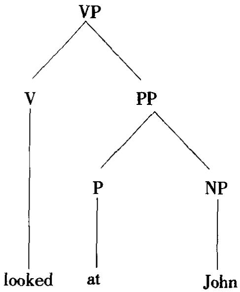

就管辖与约束理论而言，管辖语类(governing category)是指保持约束关系的最小结构(名词短语或句子)。X 为 Y的管辖语类，其中 X为 N,V,A,P或AGR，当且仅当X和Y受完全相同的最大投射(完整短语语类)的统制。当一空语类受一同标语类管辖时，就说它“受先行词管辖”(这对空语类原则很重要)。另见BARRIER语障，GOVERNMENT BINDINGTHEORY管辖与约束理论，GOVERNMENT PHONOLOGY 管辖音系字诸条。)

(3)支配(-or)(支配语) 依存语法术语，支配语(governor)指依存树中的上位节点，它“支配”或“控制”一组“依附”节点。支配语与依附语的每一次组合都确定一种特定的句法关系。例如，动词被视为出现在小句结构中的各名词短语的支配语，而每个动词/名词短语组合指明一种句法关系，如主语、间接宾语等。在短语 up the tree“在那棵树上”中， up“在 上”支配 tree“树”，而 tree 又支配the(定冠词)。由于这里的“支配”可能与(1)意义上的“支配”相混淆，有的语言学家用“控制语”取代“支配语”。

government-binding theory 或 government and binding theory (GB)管辖与约束理论(管约论)一种语法模型，其前身是扩展的行准理论，再往前是经典转换语法。这一理论假设句子有三个结构层面，D-结构，S结构，逻辑形式。S结构派生自D-结构，逻辑形式派生自S结构，都是通过一种转换，即移位α其基本含义是将任一成分移至任一位置。各种所谓的子理论与移位α互相作用，保证只生成正确的结构。主要的子理论有：X杠理论，题元理论，格理论，约束理论，界限理论，控制理论，管辖理论等。由于这些子理论互相作用的方式，管约论常被描述为一种“模块”理论。管约论的提倡者认为，一些本质上相同的句法原则在所有语言中都起作用，虽然在不同语言中所取的形式可能稍有差别。出于这一理由，管约论常被称为“原则加参项”理论。

government phonology 管辖音系学 一种非线性音系字，管辖关系是其中一个重要概含。也称作基于管辖的音系学(government-based phonology)或管辖与粲音系学(government and charm phonology)。“管辖关系”在这里用中心/非中心关系———两个骨架位置之间的二分不对称关系——来定义。音节结构内的某些音段被视为具有管辖(governing)特性，并与管辖骨架位置相联接。其他音段是可管辖的(governable)音段，并与填充受管辖音(governees)的骨架位置相联接。中心/非中心关系被视为一种局部关系(即两个邻接音段之间的关系)和定向关系(中心-节首)。音节组构成分因此定义为中心-节首管辖域。超越组构成分边界的管辖关系称作“成分间管辖”。严格管辖(proper govern-ment)是一种较强的管辖关系，它规定管辖音自身要受管辖，并且严格管辖的管辖域不能再包含一个管辖域。这一理论受管辖与约束理论的影响，主张用原则加参项的办法来制约音系学。

government theory 管辖理论 管辖与约束理论的几个子理论之一。其主要原则是空语类原则，它限制移位可以发生的位置，即规定语还须与一个词汇语类或一个同柠语类相联系。

GPSG 作 GENERALIZED PHRASE STRUCTURE GRAMMAR 概化短语结构语法的缩写。

gradability((un)gradable)级差性((非)级差的) 语法和语义字用来指词项之间有比较可能性的涵义关系。语义学中级差(gradable)词语的典型例子是big/small“大/小”，hugh/low“高/低”这样的对立（参看反义词条)。非级差(ungradable)词语的例子有 single/married“单身/已婚”,north/south“北/南”等。语法中这一术语用来指可用来衡量比较意义的各种语法修饰关系，例如 a piece/bit/chunk of“一片儿/—点儿/块”, a very/slightly/extremely“一个非常/稍许/特别的”。

gradation(1)级差关系 语法中指形容词或副词用于程度比较的词语时若干形式之间的关系。语言一般有原级、等同级、比较级、最高级这些形式，采用形态(如英语-er(比较级)，est(最高级))或句法(如more“更”,most“最”)手段来表达。

(2)[元音]差变 历史语言字术语，指由根元音变异形成的动词若干形式之间的关系，如 sing,sang,sung(“唱”的原形、过去时和过去分词形式)，较明确的名称是元音差变(vowel gradation)或元音交替(ablaut)。

gradience斜坡性 有些语言宇家用来指语言中某些方面在一组分析范畴之间没有明确的分界。语音连续体是一个很明显的例子(如语调的升与降之间有多种可能的对立)，但也常见于语乂学(如颜色词、级差反乂词这种连续体的研究)

和语法(词类之间的界线不能一刀切，例如有 rich“富的”，London“伦敦”，smokıng“抽烟”，someone“某人”这些类似名词的词存在，名词这个类就很难界定)。

gradual级差对立布扛格字派音系字区分的一类对工，有别于缺值对工和等值对工。级差对立是指语言中程度的差别可用某种标度来衡量，例如一种语言有四个前元音//,/e/,/e/,/a/,(按尼古拉·特鲁别茨考依的观点)不宜用缺值对立(如“高”与“低”的对立)来分析元音高低的四个程度。

grammar（gramma-tical-ize,-rian）语法（语法的，语法化，语法学家）语言宇的一个重要术语，其所指涵盖广泛的现象。可以区分几种不同类型的语法。

(1)描写语法(descriptive grammar) 首先是对见于一个言语或文字样品(如取自语料库或从操本族语者那儿引发)的语言作系统的描写。然后根据各人的理论背景，可以进一步对作为一个整体的语言作出一些陈述；只要这些陈述是明确的并能预测说话人的语言能力，就可以说这部语法已具备“描写充分性”和生成性。按老的传统，“描写”语法与规定语法或规范语法相对立，后者试图建立一些规则，规定语言在社会或风格上的正确用法。对一种语言句法和形态作全面描写的语法称作参考语法(reference grammar)或“语法手册”(如本世纪一些北欧语法学家编写的语法，先有丹麦的奥托·叶斯帕森(1860—1943)，近有伦道夫·夸克等(见 QUIRK GRAMMAR 夸克语法条))。

(2)理论语法(theoretical grammar) 不限于研究个别语言，而是以语言数据作手段对语言本身的性质、并对成功的语言分析所需的各种范畴和程序提出一些理论见解。这种见解包括区分“深层语法”和“表层语法”，提出“语法范畴”和“语法意义”的概念，研究“语法关系”(即动词与其依附语之间的关系，如某成分的“主语”、“直接宾语”等)。如果集中研究语言形式(结构和分布等)，这样的语法可称作形式语法(formal grammar)，与“意念语法”相对，但形式语法也可指用逻辑和数学的形式化方法来分析语言。

(3)其他有关语法的通用概念历时语法和共时语法的对立，看分析中是否引入历史维度。比较语法(comparative grammar)指结合理论和描写方法对不同语言(或一种语言的不同状态)的形式加以比较。“教学语法”是专门为教学一种语言(外语)而编写的语法，也有为提高对母语的认识而编写的。

(4)传统语法(traditional grammar) 有人想用这一名称概括前语言学时代语法研究的各种态度和方法。“传统”一词因此可指许多不同的时期，如指古罗马和古希腊的语法学家，文艺复兴时期的语法，(尤其)指18和19世纪欧洲和美国的各派语法。这一名称常有批评的含义(“不科学”)，尽管现代语言学的先声已见于不少早期语法。批评主要是针对作者不强调语言的描写性研究而是提出一些规定和禁用条文。

(5)按狭义理解(即按语言学的传统涵义和通行的理解)，语法指语言结构的