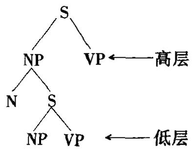
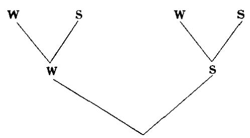
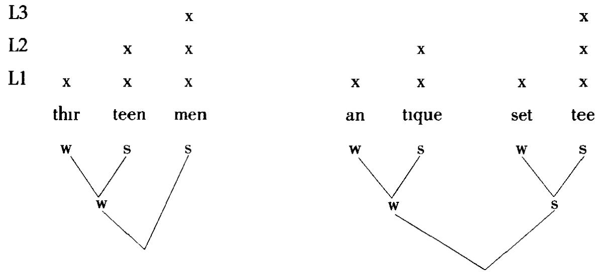
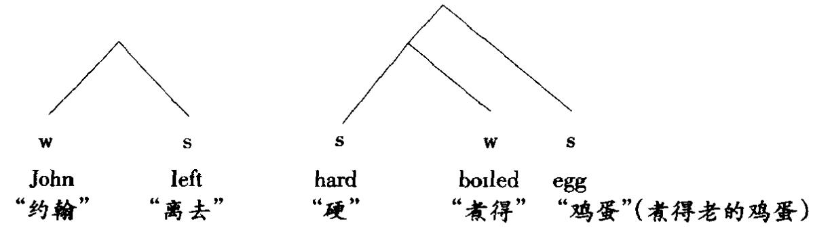
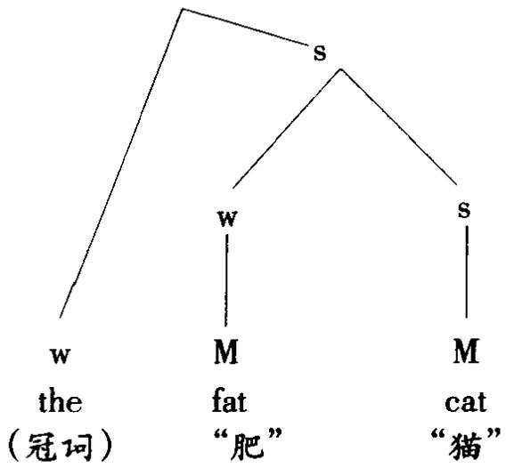
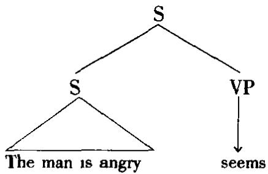
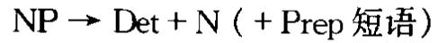
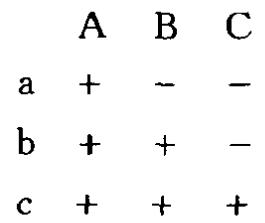
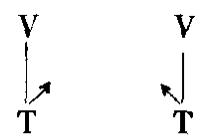

一个层面，可独立于音系宇和语乂字进行研究，通常包含句法学和形态字两个分支。按这一涵义，语法是研究词与构词成分如何组合起来形成句子。这与广义的语法相对立，后者被视为一种语言结构关系的整个系统，如层次语法、系统语法、(特别是)生成语法这些名称所示。广义的“语法”除句法外还包括音系学和语义学，传统上三者被视为三个独立的语言平面。这种涵义的“一部语法”是一个生成机制，生成一种语言所有句子的有限说明。如果一部语法能界定说话人掌握的全部规则，这就是一部体现说话人语言能力的语法(语言能力语法(com-petence grammar))。如果一部语法只能说明说话人实际使用过的句子(如见于一个输出样品或语料库),这就是一部语言运用语法(performance gram-mar)。但是心理语言字对语言运用语法的研究还要进一步，企图界定进人言语产生和知觉过程的各种心理、神经和生理阶段。如果不局限于个别一种语言，而是试图确立一般人类语言的固有(普世)特性，这种研究追求的目标是一部普世语法(universal grammar)。

语法的研究者称作语法学家(grammarian)，他们从事语法分析(grammati-cal analysis)(这里 grammatical“语法的”一词没有合式性的含义，有别于作合乎语法解的同一形式)。当有必要在分析中明确某些实体属于语法这个描写平面而不是属于其他(如语义、音韵)平面时，“语法[的]”一词经常用作定语，如“语法范畴”(如性、格、态)，“语法的性”(对立于“自然的性”)，“语法构形成分/项目/单位”(如屈折词尾)，“语法主语/宾语”(对立于“逻辑”或“语义”主语/宾语·)，“语法词”(对立于词词)。当一种语义对立用语法形式来表示时，就说它是语法化了的(grammaticalized或grammaticized)。另见 AMBIGUITY歧义，APPLICATION(2）应用，ARC弧，CONSTITUENT组构成分，CORE核心，DIS-COURSE话语，FUZZY 模糊，GENERAL(1)一般诸条。

grammaticality((un)grammatical(ness))合语法性(合乎语法，不合语法)语言宇用来指一个句子(或句子的组成部分)与一种语言的一部特定语法所定义的一系列规则相一致。通常在一个不合语法的(ungrammatical)句子前加一星号，表示它无法用语法的规则来说明。实际操作时，要判定一个句子是否合乎语法可能有困难,例如对 The bus he got off was a red one“他下来的那辆汽车是红色的”这样的句子，操本族语者会作出不同的判断。生成语言学所持的观卢是，首先建立一部语法在那些明显合乎语法的句子和明显不合语法的句子之间划一道分界线。这一步完成后，可以调查不确定的情况，确定它们是否能纳入现有的语法而无需作进一步的修正。如果能够纳入，这些句子就被确定为合乎语法，语法就承认这些句子。如果不能纳入，就这部语法而言它们就被确定为不合语法。

这种涵义的“合乎语法”有一个可替换术语，即合式(对立于不合式):语法判定各个句子是否“合式”。这种判断与句子的意义或可接受性毫无关系。按这种观点，一个句子可以是合式的但却是毫无意义的(如乔姆斯基的著名例子Colourless green ideas sleep furiously“无色的绿色巴想愤怒地睡觉”);一个句子也可以是合适的但却是不可接受的(可能是由于风格上不适宜)。

须强调的是，“合乎语法”一词没有任何社会价值判断的含义，因此与这个词的通行用法对立。按通行说法，一个句子如果与标准语言的准则不一致(如双重否定的用法，例如Ⅰ haven't done nothing“我什么也没干”)，就规定它不合语法。语言学里这一术语没有任何规定的含义。

graph 字子 有些语言字家用来指一段文字或印刷品中最小的离散片断。这个名称仿照语音字中的音子这一概念。例如目前这一行英文字(原文为Thepresent lne )由t,T,h,e等字子以及标点符号组成。通过语言学分析将这些字子归并为字位是字系字的研究范围。

grapheme(graphemics）字位(字位学) 一种语言文字系统的最小对工单位。例如，字位a实现为几个字位变体A，a,a等，可视其为一些处于互补分布的单位(如大写的A限用于句子开头位置和专有名称等)，或视其为自由变异(如不同风格的书法，就跟音位分析一样。“字位分析”是字位学(graphemics)或字系宇的研究任务。

graphetic(s)字形的(字形学) 有些语言宇家仿照语音学(phonetics)用这个名称指分析书写或印刷的语言的字形实体。例如，理论上可以确定一套普世的字形特征来构成各种区别性字形。书写媒体还有几种特性对信递也产生相当的影响，例如颜色、书写或印刷体的大小、间隔等。字形学显然与书写法(graphics)和排印术有某种重叠(事实上“书写法”有时用来指字形学)。迄今为止用这些术语对篇章所作的分析极少，字形学与字系宇之间的关系也不甚清楚。

graphic substance 字形实体 有些语言学家用来指语言的书写或印刷形式，并视其为一组物质上可定义的视觉特征，即纸面上的标记。口说语言的对应术语是语音实体。对这些字形特征的语言学分析有时称作字系字，与音系字对应。

graphology(graphological)字系学(字系[学]的） 有些语言字家用来指对语言文字系统的分析仿照音系学。“字系”分析所关心的是确立视觉语言的最小对比单位—定义为字位、字位特征，或不用术语位，采用的是与音系分析相似的方法。这种涵义的字系学与通过书法分析来确定书写者的心理特卢毫不相关，虽然一般人常用同一名称指后一类分析。

grave 钝[音] 雅可布逊和哈勒在其音系学的区别特征理论中确立的语音特征之一，用来描写发音部位的变异；与锐[音]相对。钝音从发音和声字两方面定义为声道内边缘部位发音，在较低频段集中声学能量。后元音、唇辅音和软腭辅音有[+钝]特征；前元音和齿音、齿龈音、腭音等辅音有[一钝]特征。

greed 自贪 最简万案术语，指一条通用的经济制约，即规定一个成分只有为满足其自身的要求时才可以移位。例如，一个项目只有当其形态特性在派生过程中无法用其他方式满足时才可以移至某一特定位置。一个成分如果移位的唯一原因是满足其他某个成分的要求就不可以移位。

grid 栅 见 METRICAL GRID 节律栅条。

grinding（grinder，ground)碾磨(碾磨器，碾磨的）语义字术语，有时用来分析涵义的引申变化，特别是从可数名词引申出不可数名词。比喻源自一种“普世碾磨器”，例如能将a chicken“一只鸡”碾磨成集合名词 chicken“鸡肉”。分析“碾磨名词”是为了确定语言中哪些类型的名词允许概念上的碾磨(例如动物的肉)，并确定不同语言采用不同的语法手段来表示碾磨现象的程度。

groove(-d，grooving)舌沟[音](沟化) 语音宇有时用来指一类擦音，发音时舌沿其中线稍许下凹(即“沟化”)，气流通过时产生一个频率高于其他擦音的音。英语中[s],[z]，[ʃ]，[3]是“舌沟擦音”。狭口(或“窄口”)擦音(例如[f]，[θ])没有这种舌沟。另见CUPPING舌凹音条。

group（1)词组 韩礼德式语法使用的术语，指级阶上介于小句和词之间的一种单位。例如，在句子 The car was parked in the street“汽车停放在马路上”中, thecar“汽车”是“名词性词组”, was parked“停放”是“动词性词组”,in the street“在马路上”是“状语词组”。大多数其他理论中短语是个等同的术语。另见PREPOSITION 介词,STRESS 重音，TONE GROUP调群诸条。

(2) group genitive 词组领属式 英语中一类构式的通用名称，即一个属格词尾附加于一个名词短语的最后一个成分，名词短语包含后修饰语和并列构式，例如， the University of London's grant“伦敦大学的助学金”，Morecambe andWise's humour“莫康比和怀斯式幽默”。

guttural 喉咽[音] 某些特征构架模型用来指一个建议中的节点，它代表在喉和上部咽腔之间发出的构成一自然类的语音(声门音，咽音，小舌音)。有的理论用特征[喉咽]来描写这类音，有的则用[咽]特征。一般人常用guttural(粗嘎声)一词指多后辅音的听觉印象(或指多含这类音的语言)，但这种用法(例如说“威尔士语是一种粗嘎声很重的语言”)在语音宇或语言字里没有任何地位。

## H

H 双重语体中hugh“高层’语言变体的缩写，音系字中 high“高”声调的缩写。

habitual惯常体 对体作语法分析的术语，指一种活动被视为持续一段时间的情状。英语过去时有一惯常体，即used to“过去惯常于”;此外惯常义常用词汇表达，如often“经常”、frequently“常常”等状语。许多惯常用法表达重复动作(Ivisited aunt regularly“我时常去看望姑母”),这种功能常被描述为反复体，而惯常体常不表示反复，如 A castle used to stand at the top of that cliff“那悬崖上过去一直立着一座城堡”。

half-close 半闭 见 CLOSE(1)闭条。

half-open 半开 见 OPEN(1)开条。

Hallidayan 韩礼德式的 指体现英国语言字家迈克尔·亚力山大·柯克伍德·韩礼德(Hallidav)(生于1925)的语言学理论的特点的，或指这一理论的追随者。韩礼德的早期思想大多可追溯到R 弗斯的教导，因此韩氏的理论常称作“新弗斯式的”。他对语言的独创观含，阶与范畴语法，1961年以论文形式发表，其中包含一个分为实体、形式(语法和词汇(lexis))、语境三个平面的语言结构模型，一个分为三个阶(级阶，释示阶，精度阶)和四个范畴(单位，类，结构，系统)的语法理论模型。最后两项的重要作用使这一理论获另一名称—“系统-结构理论”。本世纪70年代，“系统”的概念成为韩氏另建的一个称为“系统”语法的模型的中心概念这里的语法被视为一个由若于类系统相互联系而构成的网络，入列条件决定从每个系统内部可作哪些选择，随着分析的深入这些选择也变得更为具体(“精度”更高)。韩礼德式理论应用范围很广，如篇章分析(参看COHESION衔接、STYLISTICS 风格字(REGISTER 语域)、ACQUISITION语言习得诸条。

hand configuration 手势构型 有些手势语的音系模型用来指一个由手势形状和方向表示的独立音层。

haplology掉音音系字术语，共时的和历时的研究都用来指发音相似的语音序列中某音的省略，例如 cyclısts“骑自行车的人”发作/saiklis /,lıbrary“图书馆”发作/aibri/等。有些心理语言字家用此术语指“舌头打滑”现象中这类省音口误，例如 runnıng jump“跑着跳”说成 rump。

hardconsonant 硬辅音 对某些语言作语音描写时常用来指凭印象感觉的缺乏腭化的辅音。俄语有几个这种硬(对立于软)辅音。俄语里符号(硬音符)标

示前头的辅音缺乏腭化。

hard palate 硬腭 见 PALATE 腭条。

harmonic谐波声学语音字术语，指伴随一基本频率的有规律的(周期性的)波形，有助于识别复杂音调，也称作陪音(overtone)。谐波都是基频的整数倍；例如，基频如为200Hz，谐波则为400Hz,600Hz,等。谐波按序编号，语音学里编号从基频的第一增倍开始(就上例而言400Hz是“第一谐波”，600Hz是“第二谐波”，依次类推)。基频与其各谐波振幅的组合决定一个音的音调特点和音质。

harmonic phonology和谐音系学音系字的一种理论，它区分三个并行的表征层面.形态音位层(“M层”)，词/音节配列层(“W层”)，语音层(“P层”)。每个层面的描写是靠一组合式条规(“配列”法)和一组无序次的“层面内”规则，这些规则共同决定某一输入表征式必须遵循的路径，从而与配列法保持最大程度的一致。这种最大程度的合式性称作“和谐”。各层面间通过“层面间”规则互相联系。这种理论放弃了生成语法关于组织结构的传统观念，即不再认为各表征层面之间是前后相继的(如派生过程中各步骤的序次)。

harmony（harmonic,dis-）和谐（和谐的，不和谐） 音系宇术语，指一个音系单位的发音方式受同一词或短语中另一单位的影响(即与其“和谐”)。一个类似的概念是同化。和谐分为辅音和谐(consonant harmony)和元音和谐(vowelharmony)两大类。典型的元音和谐，如见于土耳其语和匈牙利语，一个词内的全部元音共享某些特征——例如，都用舌前部位发出，或都是圆唇音。受一种和谐方式影响的元音子集称作和谐音集(harmonic sets)。不和谐(disharmony)或不和谐性(disharmonicity)是指A音集的一个元音用于(如通过添加后缀)通常只含音集 B的词，,从而形成一个和谐岛(harmonic island)(如果是透明的)或一个新的和谐段(harmonic span)(如果是晦暗的)。和谐起作用的那个范围(通常是词)称作和谐域(harmonic domain)。

hash叉线符符号#，有时也称作“双叉符”，生成语言字常用来表示一个音韵词(phonological word)的边界。

head 中心，中心语(1)(-ed)(带中心的) 对某些短语类型(向心短语)作语法描写时用来指在分布上等同于整个短语的那个中心成分。这类构式有时称作带中心(headed)构式(对立于无中心(non-headed)构式)。中心语还决定短语或句子中其他成分之间的各种一致关系或支配夫系。例如，名词短语a big man“一个大个男人”的中心语是man“男人”，是这个词项的单数形式决定同现的动词单数形式，如is“是”，walks“走”等。又如动词短语has put“已放置”的中心语是 put“放置”,是这个动词决定句子后面出现的宾语和状语(例如 put it there“把它放在那儿”)。在 men and women“男人和女人”这样的短语中，两个名词都可以是中心语。自本世纪80年代以来，这一术语已扩展到构词分析，如复合词的中心是决定整个词的语法特性的那个成分。在概化短语结构语法中，这个术语的用法较抽象，指能用来识别一个赋值特征丛集(如N,V,AUX,PER(人称)，斜杠)的一个设置，这个丛集中相关联的特征是为实现某一特定目的所必需的。这一理论中的中心语特征规约(head-feature convention)指一条原则，它决定一个短语各组构成分的特征赋值，即规定一个母范畴的中心语特征与任一充当中心语的子范畴的特征相同。中心语参项(head parameter)是生成句去的一条原则，特别与普世语法相关，它确定中心语在短语内的位置。具体说，每种语言的中心语在所有短语中都处于同一边.中心语居前语言(head-first languages)以英语为代表，例如 kıck the ball“踢那只球”(动词在动词短语中位于名词短语的左边)和in the box“在箱子里”(介词在介词短语中位于名词短语的左边);中心语居后语言(head-last languages)以日语和韩语为代表，中心语都位于右边(如韩语 Seoul eseo“在汉城”)。在节律音系学里，左中心音步(left-headed foot)是最左边的韵基重读的音步；右中心音步(right-head foot)是最右边的韵基重读的音步。按照中心加标记的节律标记去，区分这两种音步是将代表音步组构成分的节点在构架内置于中心之上(即重读韵基之上)，即：

(2)有些调群结构分析法用“中心段”(head)指介于第一个重读音节和核心调之间的音节序列;例如，在调群/there's a com pletely new arrangement/“有一个全新的安排”中，中心段是 pletely new a。

head-driven phrase-structure grammar(HPSG) 中心语驱动短语结构语法一种句法理论，汲取了概化短语结构语法、范畴语法和其他一些理论的重要见解。一个重要特点是各范畴包含与其组合的其他范畴的信息。其结果是只需要为数极少的几条规则，所有重要的句法和语义操作都由包含在词条中的信息驱动。例如，一条规则就足以说明所有的“词汇范畴+补语”结构。另见BINDING约束条。

headword 首词 见 LEMMA(1)词目条。

heavy(1)重块头 生成语法用来分析一类名词短语，指一个相对较长或较复杂(“块头大”)的组构成分，例如，比较\*John considers stupid my frends“约翰认为我的朋友笨”和 John considers stupid many of my best frends“许多我最好的朋友约翰认为他们笨”。在经典转换语法中，重块头名词短语后置称作重块头NP后

移(heavy NP shift)。

(2)重[音节] 见 WEIGHT 音重条。

hedge 模棱语(名词/动词) 按其一般涵义(“模棱两可”)用于语用字和话语分析，指一批表示不确定概含或限定条件的词语。例如 sort of“有几分地”，more orless“多多少少”，I mean“我是说”,approximately“大致上”,roughly“粗略地”等。

heightened sub-glottal pressure 声下增压 乔姆斯基和哈勒在其音系字的区别特征理论中确立的声原特征之一，用来描写声门下压力的变化，如见于各种语言(如印地语)的送气塞音。

Hertz 赫兹 见 CYCLE(3) 周期条。

hesitation 支吾按说话时结巴、支吾的一般涵义用于语言宇，特别是心理语言宇将“支吾现象”分类并计论其对语言处理过程的意义。支吾的种类分为沉默、有声停顿(例如英语 er“呃”，日语ano“嗯”)、音节延长(例如 w e-ll“好-吧”)、重复(例如the-the-thing“那一那-东西”)等等。支吾在言语中的分布决不是随意的，一般假设它们出现在说话人正在计划新话段的位置上。由于支吾与语法、语义等组构成分之间的分界有多种不同程度的重合，因此言语产生过程可能有不止一个计划层次(如句法、语义、互动等层次)。

heterography 非形音对应文字 见 HOMOGRAPHY(2)形音对应文字条。

heterorganic 异部位音 见 HOMORGANIC 同部位音条。

heteronym(y) 准同音形词(准同音形) 语义分析有时用来指词(词亿)的部分同音形，即意义不同，但只在一种媒体形式(语音或字形)上相同。例如同形词row“划船”和 row“吵嚷”，或同音词 threw“扔”和 through“通过”。

heuristic 探试的 原为控制论常用术语，语言宇和语音字用来指一种具体的调查方式，它是整个发现过程或问题解决过程的组成部分。语言学中这一概含主要见于分析程序的讨论，这种讨论中布龙菲尔德式的发现程序与生成语法的形式分析相对而言。这一术语也以不太严格的涵义作“工作假设”解，据此假设可提出或取消对事件的某种解释。例如，对话语这个概念很难下一个形式的或操作的定义，但是可以视其为一个“探试手段”，用作一个理论前概念，从而使研究得以进行。

hiddenMarkov moder隐蔽马尔可夫模型自动言语识别中指一种方法，它将一个词的频谱模型视为二个声学事件的马尔可夫模型(见 MARKOV PROCESS马尔可夫过程条)。一个词及其各种变体形式的发音可视为一个随机过程：在一个事件序列(这里发音被模拟为横贯言语频谱的一个个连续的“片断”)中，每一步骤的概率取决于前面一些步骤的输出。这个过程每一次应用于一个词，就能在这个模型的限度内产生一个稍许不同的声学赋值。一旦一个言语识别器装备了马尔可夫模型来识别它包含的语词，它就可以用这些模型来评价新的言语事件的特性。说出一个词并将其输入识别系统，这个声学事件可当作一个“隐蔽”马尔可夫模型的输出来处理。模型的输出是可见的(即这个事件)，而模型本身是不可见(隐蔽)的，识别器的任务是重建这个模型。

hierarchy（hierarchical）层级，等级(层级的，等级的） 原为分类字术语，语言字用来指任何一种将语言单位分出一系列上下相继的层次或级别的分类去。层级结构(hierarchical structure)见于语言学的各个分支，例如句子可分析为直接成分，词库可分析为详细程度递增的一些语乂场(如《罗杰特分类词典》)。层级中的包容关系也见于语言结构的分析，如可以说话语由句子“组成”，句子由小句或短语组成，后者又由词组成，词则由语素组成。这个术语在关系语法中有特殊地位，见于“可及性等级”一语；也用于格语法(“格等级”)。在某些非线性音系字模型中，“韵律层级”表明莫扛、音节、音步和词之间的关系。另见CHOMSKYHIERARCHY 乔氏层级,STRUCTURE 结构，SONORITY 音响诸条。

high(1)高[音]乔姆斯基和哈勒在其音系学的区别特征理论中建立的语音特征之一，用来描写发音部位的变异(腔特征)。高音是一类舌体特征，从发音上定义为舌高于其中性位置时发出的音；闭元音和腭/软腭辅音都有[+高]特征。与之对立的是非高(non-high)[-高]或低，指舌不如此抬高发出的音，如开元音和前辅音。

(2)高层语 指双重语体中较正式的那种变体；与“低层语”对立。

higher category高层语类生成语法术语，指一个语类引入句子派生过程要早于同一语类的另一次引人。在派生过程的树形图表征中，语类的首次引入比再次引入处于树中较高的层次。例如，在派生 the idea that the man will resignsurprises me“那人将辞职的设想令我吃惊”这样的句子时，可采用如下的(部分)树形图：

这个句子中，“高层动词”是 surprise“令人吃惊”，“高层小句”或“高层句子”是the

## historical linguistics

1dea surprises me“那个设想令我吃惊”。可替换术语有母句和“主导句”。“低层”动词/小句的常用名称是嵌套。

historical linguistics 历史语言学 语言字的一个分支，研究作为整体的语言和各种具体语言随时间的发展过程；也叫历时语言学。研究的材料与比较语文字相同，即语言各先前状态的现存记录，但方法和目标却不一样。历史语言学利用共时语言学各学派的方法(包括社会语言宇和心理语言学的方法，特别是在研究语言演变的原因时)。因此这个分支下又有一些次分支，如“历史音系字/形态学/句法学”等。历史语言学还旨在将其发现与一般语言学理论联系起来。

hocus-pocus 随意变幻观 本世纪 50年代造出来的一个名称，用来指一个假设的语言字家在描写语言数据时所持的两种极端心理状态之一，另一种是绝对真理观。持“随意变幻观”的语言学家在描写语言数据时预期自己将对数据加以组织以便显示各种结构型式。按这种观点，不同的语言学家在描写同一批数据时由于背景、语感、程序等差别就会作出不同的描写。与此对立的“绝对真理观”则旨在证明数据中确实存在一种无可争议的底层结构。

hodiernal 当时式 指一个语法范畴，标明一个情状离说话时刻有多远(源自拉丁词 hodie“今天”);与之对立的是先时式(prehodiernal)。例如许多班图语言中有一个动词形式用来表示“今天”的事件，另一个形式表示“今天以前”的事件，不管是否与当前有关。

hold(ing）(1)[位姿]保持 用来描写某些类语音的发音动作，即发音器官在一段可确定的时间内保持其姿势，如在发破裂音或长辅音时的闭塞阶段(参看LENGTH音长条)。

(2)定式手势 对手势语作音韵分析时，指一个静态的功能单位；也称作定位手势(location)。定式手势有别于动态单位，后者称作移位手势(move-ments)。

holophrase(holophras-tic,-is)独词语(独词的，独词表达)语言习得研究用来指一种仅由一个词组成、语去上无结构的话段，它是儿童语言习得最早阶段的特点。典型的独词语(holophrastic)有dada“爸爸”，allgone“都不见了”，more“还要”，there“那儿”等。理论上的争论集中在这种话段在多大程度上可分析为句子(“独词句”)，或句子的缩略形式，其他成分则靠语言外情景来“理解”(例如 dady 的意思是 there is dady“爸爸在那儿”, there is“在那儿”是通过手势或声调等表示的)。独词表达(holophrasis)有时也见于成人话语，其内部缺乏结构上的对立，如 thanks“谢谢”，please“请”,sorry“抱歉”等。

homograph(-y，-ic)（1)同形词(同形异义，同形异义的）语乂分析用来指词(即词位)的拼写形式相同而意义不同。同形词是问音形词的一类。同形异义(homography)的例子有 wind“风”和 wind“上弦”。由这种同形而引起的歧义称作同形抵触(homographic clash)或“同形冲突”。

(2)形音对应文字(homography) 指形和音之间一一对应的一类文字，如见于语音转写法，或某些语言经系统设计的字母表。这类文字对立于非形音对应文字(heterography)，如英语、法语等语言的拼写系统。

homonym(-y，-ic)同音形词(同音形异义，同音形异义的) 语义分析用来指词项的形式相同而意乂不同。“同音形异义”的例子有bear“熊；承受”，ear“耳朵；穗'。此二例语音和字形都相同，但也有部分同音形(或准同音形)的，即只有一个媒体相同，语音相同是同音词，字形相同是同形字。由同音形引起的歧义(不管是无意的还是有意策划的，后者如谜语和双关语)称作同音形抵触(homonymic clash)或“冲突”。语义分析中，理论上如何区别同音形词和多义词(一个形式多种意义)一直是引起诸多讨论的一个问题。另见CONSTRUCTION构式条。

homophene 同口形词 对聋哑人交谈作语言字研究的术语，指视觉上口形相同的词。例如 fan“扇子”和 van“货车”。

homophone（homophon-y，-ic)同音词（同音异义，同音异义的） 语义分析用来指词(即词位)的发音相同而意义不同。“同音词”是同音形词的一类。同音异义(homophony)的例子有 threw“扔”/through“通过”,rode“骑”/rowed“划船”。由同音而引起的歧义称作同音抵触(homophonic clash)或“同音冲突”。

homorganic 同部位音 语音字给语音分类的术语，泛指在同一发音部位发出的音，如[p]，[b]，[m]。各有其不同发音部位的音可称作异部位音(heterorga-nic)。发音部位邻近因而互相有所联系的音有时另立一类，称作“邻部位音”(contiguous)。

honorific 谦敬语 对某些语言(如日语)作语法分析时用来指一些句法或形态标记，它们表达不同层次的礼貌或尊敬，尤其跟言谈参与者的相对社会地位有关。有几种欧洲语言的代名词系统表现出这类对立，例如法语tu“你”和 vous“您”，西班牙语 tu“你’和usted“您。

hortative 劝告情态 对动词作语法分析时用来指表示劝告、告诫这类情态意义，例如英语中的 let us 构式(let us pray“让我们祈祷吧”)。

HPSG 作 HEAD-DRIVEN PHRASE STRUCTURE GRAMMAR 中心语驱动短语结构语法的缩写。

## hypercorrection

hypercorrection 矫枉过正 语言字用此术语指一种语言形式超越说话人认作目标语的语言变体的某一标准，也称作纠正过头(overcorrection)或模仿过头(hyperurbanism)。这种现象常发生在一个操非行准万言的人试图学标准方言说话但“学过了头”，结果说出标准方言里不存在的形式。例如在说cap“帽子”，mat“地席”等词时用一长音/a/取代短音/æ/。类似的现象见于第二语言的学习。

hypernasality 鼻音过重 见 NASAL 鼻音条。

hypernym 上义词 见 HYPONYM下乂词条。

hypersememic 超义位层层次语法区分的层次之一，它处理语言的概念或指称特性。

hyperurbanism 模仿过头 见 HYPERCORRECTION 矫枉过正条。

hypocoristic 爱称 语言字用来指表亲昵的名称或小名(例如称 Harold“哈罗德”为Harry“哈里”)。爱称和类似现象受到某些非线性音系字模型(特别是韵律形态字)的特殊重视，这些模型以爱称为例来证明模板分析和相关程序的合理性。有一种理论认为爱称是将一名称投影到最小词模板的结果。

hyponasality 鼻音不足 见 NASAL 鼻音条。

hyponym(y)下义词(上下义关系) 语乂字术语，指词项之间的一种函义关系。“上下义关系”是指词项间具体和一般的关系，即具体义“包含”在一般义之中(具体义是一般义的“下义”)。例如，cat“猫”是anumal“动物”的下义词，flute“笛子”是instrurent“乐器”的下义词,chair“椅子”是 furniture“家具”的下义词。每一上下义关系中有一上位词(有时称作上义词(hypernym或 hyperonym))，据此可定义相应的下义词，有如通行的词典释义(“猫是一类动物，”)。同一上位司之下的几个下义词称作并列下义词(co-hyponyms)，例如flute“笛子”，clarinet“单簧管”，trumpet“小号”。为自身的下义词的词称作自身下义词(autohy-ponym)，即同一词项既作上位词又作下位词，例如 cow“牛；母牛”在一个层次上与horse“马”对立，在一个较低层次上则与bull“公牛”对立(实际上“母牛是牛的一类”)。上下义关系区别于其他一些涵义关系，如同乂关系，反乂夫系，整体部分夫系。

hypophonemic 下音位层层次语法分出的一个层次，它描写话段的语音特性。

hypotactic（hypotaxis）主次构式的(主次关系） 传统语去分析的术语，常见于描写语言字研究，指各种依附构式，特别是那些用从属连词连接的组构成分。“主次构式”与并连构式相对立，后者是不用连词只用标点/语调的并列。主次关系(hyptaxis)的例子 The keeper laughed when the dog barked “狗吠叫时看守人大笑”(比较 the keeper laughed, the dog barked “看守人大笑;狗吠叫”)。

Hz 赫兹 见 CYCLE(3)周期条。

## I

I 最近的管辖与约束理论用作INFLECTION 屈折成分的缩写，原先用 INFL。

LA 形态字通常作 ITEM AND-ARRANGEMENT 项目与配列描写模型的缩写。

iamb抑扬格节律宇的传统术语，指只由一对非重读+重读音节组成的诗行节奏单位(如leader“领袖”),也称作抑扬音步(iambic foot)。在节律音系宇中，这一术语用作表现这种节奏结构的右统制限长音步的非正式名称。

iambic reversal 抑扬颠倒 见 REVERSAL 颠倒条。

IC 通常作 IMMEDIATE CONSTITUENT 直接成分的缩写。

iconic(ity)象似(象似性) 有人认为是某些符号系统但不是语言的定义特性，指符号的物质形式与符号所指实体的特点有密切的对应。这是动物信递的正常状态，例如在一种引起恐惧的环境里某一种喊叫声表达恐惧。语言中只有少数语项可以说具有这种直接的象征(“象似”)特性，例如cuckoo“布谷鸟的咕咕叫声”和growl“狗的嗥叫声”这样的象声词。

ID 概化短语结构语法用作 IMMEDIATE DOMINANCE 直接统制的缩写。

idealization(ideal-ize)理想化(理想的)语言字用来指语言字家为了作出一种尽可能一般适用的分析，对其原始数据中的某些多变因素忽略不计的程度。理想化是生成语言学的一个重要假设，因为它是语言能力这一概含的基础。按这一假设，语言学的主要目的是说明一个“理想的”说话人/听话人在一个理想的(即同质的)言语社会中使用的语言，他对它的了解是完美的，在实际使用中不受记忆限度、注意力分散和语误的影响。为了作出概括性的说明某种程度的理想化是不可避免的，但是在实际从事分析时哪些因素可以忽略不计，这个问题常有争议。

ideational 概念[功能] 语义宇有时用来给意乂分类，指说话人对外部世界的认知，或指(按行为定义的)在语言中反映出来的外部世界客观上可验证的事态。

语言的这种表达内容的功能，即概念功能(ideational function)常与人际(或社会)功能、表情功能和篇章功能相对立。类同的术语有“观念”功能和认知功能。

ideophone（ideophonic）象声语（象声的） 语言字和语音字有时用来指任何用声音生动表示概念的词语，如拟声词。在班图语语言学中，这个名称指一个由语音象征词组成的词类。

idioglossia 私自语 语言字有时用来指一种自创言语形式，其意义只为创造者所知，也叫自创语(autonomous speech)或私隐语(cryptophasia)。例如，双胞胎之间有时自发使用一种独特的信递形式，常称作“享生语”(但肯定只是当地母语的一种变异形式)。

idiolect个人方言语言字用来指一个说话人个人的语言系统，即个人的万言。一种方言可视为对大量个人方言作出分析后的抽象。有的语言学家按狭义使用这一术语，指见于某一时间某一语言变体中的个人言语习惯。

idiom(atic)成语(成语性的)语法和词厂字用来指一个词的序列在语义上经常也在句法上受限制，其功能因而相当于一个单位。从语又上看，序列中各词的意义加起来并不得出整个“成语”的意义。从句法上看，这些词通常不能有其在其他语境中有的变化，例如 it's raining cats and dogs“正在下倾盆大雨”不能换说成\* it's raining a cat and a dog/dogs and cats 等。由于其缺乏内部对工性，有的语言学家称成语为“现成话段”。另一个可替换术语是“惯用搭配”。引起诸多讨论的一个问题是成语惯用性的程度和种类·有些成语容许一定程度的内部变化,跟其他成语相比可部分按字面理解(例如it's worth her whule“值得她花费精力”/the job will be worth my whıle“这项工作将值得我花费精力”)。生成语法中成语构式被用来测试关于结构的一些假设。例如，在句子某些位置出现“成语块”可作为区分控制句和提升句的依据。

idiophone 个人方音 有的语言字家用来指可辨识为属于某一个人万言的语音。

I-language I-语言 内在化语言(internalized language)的缩写。乔姆斯基最早使用这一术语，指作为个人心理一部分的语言，个人掌握这种语言的知识，学习者所习得的、说话人-听话人所使用的都是这种语言。与之对立的是E语言(外表化语言)。

illative 入格 语法描写术语，指一类表达“进入”或“朝向”某一处所的屈折形态。入格见于芬兰语和其他一些语言，在芬兰语中与向格、离格以及其他几个表示“局部”时空义的格并存。

il1 formed（ill-forraedness) 不合式(不合式性) 语言字特别是生成语法用来指句子的不合语去性(不合式性’或偏差)。一个句子如不能由一部语法的规则生成就是不合式的，如能够这样生成就是合式的。这-木语对句法、语义字和音系字同样适用。

illocutionary 示意[言行]言语行为理论木语，指说话人通过说出的一个话段所实施的行为，即示意言行(illocutionary acts),或称示意语力(ıllocutionaryforce)。示意言行的例子有许诺命令请求、洗礼命名、宣布逮捕等。这一术语与发话言行(“说话”行为)和取效言行(按在听话人身上产生的效果来定义的言语行为)相对立。

imitation模仿 按其通常涵又用于语言刁得研究，指儿童照其周围听到的语言学着说话的行为。这个概念具有双重意义。首先，已经证明模仿本身无法说明语言发展的事实(尽管一般人的观卢相反，认为儿童通过模仿父母而学会语言）像\*mouses老鼠(复数)’\*wented“去(过去时)”这种形式，\*Me not likethat我不喜欢那个”这种句子，都表明儿童身上发生了某种内部构建过程。其次，儿童在实际模仿时表现的技巧与他们在自发言语产生过程中表现的技巧在一些重要方面常有区别。模仿与言语产生和理解的关系问题是语言习得研究中实验和描写的重点之一。

immediate constituent（IC）直接成分 语法分析术语，指一个句法构式内部任一层次上一个大的划分分出的成分。例如，在分析句子 The boy is walkıng“那个男孩在走路”时，直接成分是 the boy“那个男孩”和is walking“在走路”，它们又各有自己的直接成分(the + boy“那个 +男孩”, is + walkıng‘在 + 走路”),类似的分析进行到分出最小的组构成分为止。整个分析程序称作直接成分分析法(immediate-constituent analysis)或“[组构]成分分析法”，是布龙菲尔德式结构主义语言学的一个重要特征。

immediate dominance(1)直接统制生成语言宇术语，指短语行记内节占之间的一种关系节点A直接统制节点B，当且仅当不存在一个节点C同时统制B并受A统制。

(2)immediate dominance(ID) rule 直接统制规则 概化短语结构语法的一类形式为X→Y,Z'的规则。它规定X可以统制Y和Z,但不规定Y和Z的相对次序。ID规则与线性居前规则及各种一般原则一起生成经典类型的短语柠记。

imperative 祈使式 给句子作语法分类的术语，通常视为与直陈式、疑问式等语式对立，指一般用来表达命令的动词形式或句子/小句，例如Go away！“走

开！”

imperfect tense 未完过去时 语法术语，指某些语言中的一种时形式，表达在过去持续或继续的意义。拉丁语有未完过去时amabam“我当时正在/常常爱”。

imperfective 未完成体 对体作语法分析的术语，指一种动词形式，用来标记对一个情状内部时间结构的观察方式。未完成体与完成体对立，后者将情状视作一个整体，不管其内部的时间对立。这两种体的对立常见于斯拉夫诸语言的语法。

impersonal 无人称的 见 PERSON人称条。

implicational scaling 蕴涵级差 指一种语言变异模型，旨在说明各种变化在人口中扩散的差异。个人的变异用新旧规则的交替来表示，个人之间的变异被视作规则总藏的差异。可用一张蕴涵关系表来显示规则在人口中的扩散。这种模型不同于变项规则模型，后者将可变性视为规则本身的特性。

implicational universal 蕴涵共相 见 UNIVERSAL 共相条。

implicature 隐涵 这一术语最初见于哲学家 H P 格赖斯(1913—1988)的著作，现常用于语言宇对会话结构的研究。会话隐涵(conversational implica-ture)指根据某些支配会话效率和正常可接受性的合作原则，从话段的形式推导出来的隐涵义。例如句子 There's some chalk on the floor“地上掉了些粉笔”可理解为“你该把它拣起来”。讨论的隐涵义分为好几类，涉及语言和逻辑表达之间的关系和影响话段得体性的条件。具体说，隐涵分为一般(generalized)隐涵和特殊(particularized)隐涵两类，前者不受特定语境的限制，后者要求有特殊的语境。还有一种对立是会话隐涵(或非规约(non-conventional)隐涵)和规约(conventional)隐涵，前者是根据会话准则推导出来的意义，后者不是靠这些准则推导而只是以约定俗成的方式与某些词语相联系。已提到的后者的例子有：话段首的 Oh“喔”、therefore“所以”、even“甚至”和 yet“然而”等词的用法，还有Heis an Englishman, therefore he is brave“他是个英国人，所以他很勇敢”这种序列。但是对这些问题还缺乏深入的语言学研究，有些观点也多有争议。

implosive 内破音 语音学按发音万式给辅音分类的术语，指可以用口腔气流朝里运动的气流机制(内吸气流)发出的一系列破裂音。口腔里形成一完全闭塞，就像任何破裂音一样，但闭塞处后头的空气不是压缩并向外除阻，而是喉部发生向下运动，口腔内的空气随之变得稀疏。闭塞破裂时空气随着声门的打开同时朝口腔里吸，使肺部空气得以产生某种声带振动。正是这些运动的结合产生内破辅音那种“空洞”声的听觉效果。这类辅音通常是带声的，并在信迪语和伊博语等语言中具有音位地位。它们的记音法是在辅音音标上加一右向小钩，如[g]，[d]，[6]。可替换术语是“内吸塞音”和“吸气塞音”。没有对立的术语“外破音”(explosive)。

inalienable 不可让渡的 语法分析术语，指某些语言(例如汉语)中有形式标记的一类领属关系。如果领属项被视为与主领者之间有一种恒久的或必然的关系，这种关系就称作“不可让渡的”领属关系(例如 the dog's head“狗头”，thetown centre“镇中心”),不然就是可让度的领属关系。

inanimate 无生的见 ANIMATE有生的条。

inceptive,inchoative 起始体 对动词作语法分析的术语，指一类指明动作开始的体关系。在有“起始体”形态标记的语言里，这种体的意乂译成英语大致相当于 be about to “即将”或 be on the point of “正要 之际”,例如拉丁语的 escere。起始体有时与终结体对立。

inclusion（inclu-ded，-sive）（1)包含(包含的）一种语义关系，具体指上下乂关系这种涵乂关系；例如说“小卧车”是一种“车辆”就是说小卧车这一类车“包含”在车辆这个类之内。

(2)语法分析中内含的(uncluded)主要用来指作为一个构式的组构成分出现的语言形式，即它处在“内含位置”。例如，小句 parked in the street“停放在马路上的”处于句子 The car parked in the street was a Hillman“停放在马路上的汽车是一辆‘登山者’”的内含位置。

(3)就代名词而言，包容的(inclusive)与外排的对立，指说话人和听话人(或说话人和其他人)都包括在内的第一人称代词，例如we“我们”=“我和你(们)”。

(4)相容的语义学借用的形式逻辑术语(与不相容的对立)，指一类析取关系，即相容析取：一个析取式的两个命题有一个或两个同时为真，则析取式为真。“正在发生的或为X或为Y”这个析取式如按相容析取理解，就容许X和Y同时发生(两者“相容”)。

(5)inclusive language兼容语 社会语言字一个使用越来越普遍的术语，指词语的使用避免与某些特定社会群体相联系的社会陈式，特别是跟种族地位和性别有关的。例如，像spokesman“发言人”这类名词，虽然一般是通指，但也可作排他理解，即只指男发言人，如用兼容语就代之以spokesperson。

incompatibility（incompatible）不相容性（不相容的）语义字术语，指词项之间的一种涵乂关系，即一组词项如果选用其中一个就排除使用其他各个(除非用于反驳)。颜色词是研究得最多的例子：说一辆汽车是“红”的，它就不可能是“绿”的，“蓝”的等等，这种对立的词项就是互相“不相容的”。对不相容性的研究不如其他涵义关系(如反义夭系和同义夫系)，但有些语言学家已指出，多成员(而不是二分)词集有多种类型，如级阶(例如军阶)、量级(例如优劣判断)和周期(例如四季)等。

incorporating多式合成语 比较语言字有时用结构标准(而不是历时标准)、特别是按问的特点分出的一种语言类型。“多式综合语”或多式合成语(incor-porating languages)词的形态较长较复杂，如许多美洲印第安语特有的构式，英语中也偶有所见，如新创词anti/dis/establish/ment/aran/ism/s“各种反国教制度废除主义”。但是有些语言学家宁愿将这类构式看作粘着语和容合语两种特点的复合，而不在语言类型学上另设这一类。跟类似的分类法一样，这里分出的类也不是绝对明确的·各种语言多多少少都表现出一些“多式合成”的特点。

incoiporation（incorporate）组并 研究构词方式的术语，泛指一个词（特别是动词)内部的任何一种形态成分。代名词和小词属可以组并的成分之列，但这个术语以指名词组并(noun incorporation)为主，即一个名词词干组并到一个动词内构成一个复杂动词。组并能承担几种不同的功能，如缩小动词的语义范围，改变句子的信息结构等。语言学理论对组并讨论较多，因为组并相对词库(可按派生过程处理)和句法(可按移位转换的结果处理)的地位还不明确。

indefinite(ness)无定的(无定性) 语法和语义学用来指一个实体(或一类实体)无法具体识别，与有定的相对。英语中无定性通常用不定冠词a或不定代词(如one“一个(任何)人”，some“一些(任何)人”)来表达。“非有定”常作“无定”的同义词用，但有的语言学家区分“非有定”和“无定”两种指称。但是，有定和无定的区分不能一刀切，因为有许多语言的和语言外的语境变项在起作用。

indeterminacy（indeterminate）不确定性(不确定的） 语言字用来指语言学研究的种状态，即指操本族语者对什么是合乎语去的或可接受的不太确定，或互相有分歧，或指语言字家对不同类型的结构界线应该如何划定不太确定或互相有分歧。不确定性对那些力图毫不含糊地界定合语法性的语言学理论(如生成语法)来说是一个很大的难题。非离散或弗晰语法特别关注不确定性问题，已提出几种分析概念(如斜坡性，粘糊)来处理这一现象。

index 指数;标引 见 INDFXING 标引条。

indexical(1)(indices)标志性的(标志） 有些语言字家用来指体现语言使用者个人特点(生理的、心理的、社会的)的言语或书写特征，如音质或书法特征。这个术语较一般的用法是指可辨识一个群体成员的那些特征，如地域、社会、职业的“标志”。

(2)(indexicality)指示的(指示性) 这个哲学术语有时用于语言字(单用或用于短语指示词语(indexical expression)),指语言中那些直指某一话段的情景特占的特征，这些词语的意义因此视情景而定。语言学家更倾向于称这些特征为直指特征。

indexing（index,indices）加标(标引） 按其通常涵义用于生成语言字，指加在句子中一组项目上的数字或字母，表示指称的异同。更明确的名称是指称标引(referential indices)。在最近的论著中，加标规则(indexing rules)给句子中的名词短语指派数字或字母标引，以保证表示出正确的同指语乂关系——这个指派过程现称作加同行。限制加标规则应用的条件称作约束条件。

indicative 直陈式对句子作语法分类的术语，常与祈使式、虚拟式等语气对昭使用。指表示陈叙和提问的动词形式或句子/小句类型，例如 the horse is walking“马在走”。如只是指陈叙，可以用“陈述式”这一术语。

indirect 间接的(1)语法描写术语，指能在小句结构中起作用的两类宾语成分之一，即间接宾语(indirect object),另一类为直接宾语。传统上认为间接宾语有与格功能。英语中间接宾语一般位于直接宾语之前(例如 the woman gave theboy a book“女人送给男孩一本书”),但也可以位于直接宾语之后(例如the woman gave a book to the boy“女人送一本书给男孩”)。这种传统用法适用于双及物构式中的“接受者”名词短语，不管它出现在什么位置。与此对照，生成语法(特别是关系语去)有限制地使用这一术语，只指介词(通常为to)的补语，如Thewoman gave a book to the boy。在关系语法中，间接宾语可以升格变为直接宾语，而原来的直接宾语变为无业语。

(2)直接与间接的对立也用来区分言语的两种主要方式:间接言语(indirect speech)或间接引语(reported speech)指将某人说的词语从属于主要小句动词的 构式,例如 she sad that she had a cold “她说她感冒了”,而“直接言语”则为 I have a cold “我感冒了”。

(3)给言语行为分类时，间接言语行为(indirect speech acts)指一个话段的语言形式不直接反映其信递目的，例如I'm feeling cold“我觉得冷”可用来要求别人关上门。如果某人说这句话就是按字面要表达他觉得冷，那就是一种直接言语行为，即断言。

inessive 在内格 语法描写用来指一类表达位于某一处所之内这一意义的屈折形态。在内格见于芬兰语和其他一些语言，与近处格、向格及其他几个表示“局部”时空义的格并存。

infelicitous utterance 不适宜话段 见 FELICITY CONDITION 适宜条件条。

infinitive(infinitival) 不定式(不定式的) 这个传统术语指动词的非限定形式，常作为无柠记或基础形式(原形)引用，例如walk“走”，kick“踢”，但有些语言有句法或形态标记。英语不定式可以单独用也可以与小词 to连用(带to不定式(to infinitive)),例如 he saw her go“他看见她去了”和 he wants to go“他要去”的对立。不带 to的形式有时称作光杆(bare)或零形不定式(zero infini-tive)。在管辖与约束理论中，不定式小句(infinitive（infinitival)） clause)用来指含带 to 不定式的构式。

infix(-ing.-ation)中缀(添加中缀)形态字术语，指加在一个词根或词干内的词缀。添加中缀(nfixation)不见于欧洲语言，但在亚洲语言、美洲印第安语和非洲语言中很常见(例如阿拉伯语)。

INFL 早期管辖与约束理论用作INFLECTION屈折成分的缩写，后来代之以I。

inflection（al）（inflexion(al)，inflect）屈折（屈折的）（1）形态字术语，指构词的两大范畴或过程之一(屈折形态学(inflectional morphology)),另一范畴是派生。这对术语也适用于构词的词缀。屈折词缀表示语法关系，如复数、过去时和领属关系，它们不改变所附词干的语法类。相关的词一起构成一个词形变化表，例如 walk“走”(原形)， walks(第三人称单数现在时)，walked(过去时)。可以说一个词有过去时、复数等“屈折”形态。传统的(前语言学的)语法研究中常用 accidence(词形变化)指屈折变形。

(2)inflection(INFL,I)屈折成分 管辖与约束理论术语(起先用缩写INFL，后改用I)，指涵盖多种语法特性的一个抽象组构成分，特别是包含时，人称和数(后两者合在一起另称一致关系特征，即AGR)。在x杠理论中，I类似于词汇语类N,V,A和P,因为它是一个零层次语类，有两个短语投射I和I。Ⅰ是I 的最大投射，通常称作屈折短语(inflection phrase,IP)。在早期管约论和其他一些理论中I'等同于S。

(3)inflecting language 屈折语(也作“inflectional”或“inflected”language)指比较语言字根据结构(而不是历时)标准、特别是根据词的特点建立的语言类型之一。屈折语的词用形态表示语法关系：一般包含不止一个语素，但不像粘着语那样语素和语子线性序列之间有一一对应关系。在像拉丁语、希腊语和阿拉伯语这些语言里，词的屈折形式可表示好几种形态对工，例如，拉丁词amo“我爱”，这一形式同时表示时、王动式、第一人称单数、直陈式。这种“溶合”特性使这类语言也称作容合语，也是分析中采用词与词形变化模型的理据。跟其他类似的分类法一样，这里分出的类也不是绝对明确的：各种语言多多少少都表现出屈折的特点。

informant [语言调查]受访人 指为语言学分析提供数据的人,通常为一种语言的操本族语者。语言字家也可自己充当受访人，但通常是借助一批受访人来构建或证实自己的理论假设，受访人可望为正在调查的语言提供一个有代表性的样品。在对过去未曾研究过的语言作田野调查时，受访人的地位特别重要。现已设计出多种复杂的技木来从受访人那儿诱发相关而又自然的数据。受访人对句子可接受性的判断称作语感(特别在生成语法中)。自本世纪80年代以来，有的语言学家喜欢用[接受语言调查的]合作人(consultant)来称受访人，以体现调查工作的合作性质。

information信息语言字家从几方面利用这一基本概含，既按其一般涵义，又按源自信递的数学理论和统计学上阐释的意义。信息论(克劳德·香农和沃伦·韦弗在《信递的数学理论》(1949)一书中创立)的思想已应用于各个方面语音字(如分析声波各种特征负载的信息量)，语法(如研究句子各组成部分的可预测度)，语义字(如在分析语义对工时应用交替成分的“选择”这一概含，如动态语义学)。再如羡余的概念最初也是来自信息论。

有些语言学家按“信息”的一般涵义将其用作阐明消息结构的理论基础，他们假设，言语可视为一个“信息结构”，它表示出一个信息各成分的相对显著度，形式上有可识别的“信息单位”。语调是识别这类单位的主要标志。一个语调单位代表一个信息单位，核心调标记信息复点。许多句子是单一的信息单位，例如the box on the table is ready for posting/“桌子上的那只盒子/可以邮寄了/”,按上述观点如改变语调就会改变信息单位的数目，例如 the box on the table/ isready for posting/“桌子上的那只盒子可以邮寄了/”。即使保持一个语调单位，改变调性也会改变信息结构，例如 the box on the table is ready for posting/“桌子上的那只盒子可以邮寄了/”(是盒子不是信)。信息结构的深入分析很复杂，多争议。常见的一个步骤是进一步区分旧信息和新信息。禾用这种分析的人(如韩礼德式语言学家)通常将信息结构与王述结构和语法结构区分开来。

-ing form -ing形式 英语语法描写用来指动词以 ing结尾的形式，例如 going“去”,smokıng“抽烟”。这类形式不少可不加变形用作名词(例如 smoking 1s prohıbited“禁止抽烟”)，这个术语就是为英语的这一特点提供一个中性的描写名称，以避免使用“动名词”这种传统概念(最初是为拉丁语法提出的)。在经典的转换语法中，ing名词形式由相关动词形式转换而成。

ingressive内吸音 语音字用来给语音分类的术语，指所有通过内向移动的气流机制发出的音。与外呼音对立，后者是语音产生的通常方式。内吸音通常是附带发生的，例如在吸气时，接不上气时，遇疼痛或惊吓倒吸一口气时发出的声音。有些语言的音位系统里有内吸音，分为两类：内吸辅音，如[g]，[d]，[6]，由一股内吸气流结合声门振动发出；软腭辅音，包括[1]这种吸气音(如发“啧啧”声时)，由一股内吸气流加上软腭处的接触发出。

inherent feature 固有特征 某些生成语法模型(参看 ASPECTS《要略》条)用来指包含在词条中的一类(二分)特征(另两类特征是上下文特征和规则特征)，这类特征提供词项中很可能影响句子功能的重要特性的信息，例如[+人类]，[+抽象]，[+男性]等。这些特征在分析中的好几个地方都要涉及，如用来说明选择限制和某些非词汇转换。

inherit(ance)承继 用于语言宇多个方面，指信息从结构表征式的一部分传承到另一部分。例如，语乂字中，型和下位型(例如food“食物”和fish“鱼”)的关系是一种承继关系下位型承继了型的所有特性。在生成语法中，承继指在某些条件下保持原有的主目结构(例如，动词的名词化，如runnung“跑”，保持源动词的各个主目)。在一些非线性音系学模型里，信息可以在韵律层级的某些类单位之间承继。

initial首[成分]通常指一个语言单位的头一个成分，特别用于音系字。例如，音亿/k/出现在 cat“猫”一词的“首位”; the(定冠词)出现在短语 the big house“那所大房子”的首位。其他位置称作中间位和尾位。出现在这个位置的其他语言特征有时也用“首”称之，如“首重音”(指词的第一个音节重读)。

initialism 首字母缩略词 见 ABBREVIATION 缩写条。

initial symbol 起始符号 指生成语法中最初一个不加定义的项目，为早期短语结构语法采用，出现在第一条重写规则的左端。用符号Σ,S’或CP表示，代表句子，即这种语法承认的最高层次的构式。起始符号有与终瑞符号对立的含义，后者指出现在语法生成的终端语符列中的符号。偶而有人提出除句子外也可以有其他起始项目。

initiator(initiation)启动器(启动) 语音宇用来指充作空气运动源头的发音器官。肺是言语的正常启动器，但其他气流机制也可利用。从空气动力学的观点看，启动器的作用好比风箱或活塞的作用。

innate(ness)天赋的(天赋性) 这个哲学上的术语应用于心理语言字，指儿童生来就具有一种学习语言的先天机制。天赋说(innateness hypothesis)认为，儿童语法能力的快速发展及其复杂性只能用这样的假说才能解释，即儿童生来具有至少一部分关于人类语言普世结构原则的先天知识。这一观点很大程度上得到生成语言宇的支持(参看 ACQUISITION DEVICE 获得机制条)，但争议也很多，集中在可归属于儿童的早期语言知识的性质是什么，这种知识是否独立于其他因素(如认知)就能确立。

insert（ion）插入 转换语法框架内的一种基本句法操作，即在一个语符列中引入一个新的结构成分。具体的插入类型有·do-插人，否定(neg-)插入，there-插入(即在阵叙句的王语位置插入空成分 there,例如 there was a cat in the garden“花园里有一只猫”)，“词汇插入”(在语法结构的特定位置插入词项)。

instantaneous 瞬时[除阻]音系字的区别特征理论有时用来指语音的突然除阻，没有擦音的声字湍流，如破裂辅音的除阻。与用来描写塞擦音的延缓除阻对立。

institutional linguistics 行业语言学 语言字正在发展的一个分支，集中研究不同行业使用的语言，如法律、医药、教育、商业等。由于语言学的其他领域(如社会语言字，风格字)也研究这些内容，这一术语不太常用。

instrumental 工具[格] 在用屈折形态表示语法关系的语言里，这一术语指名词短语(一般为单个名词或代名词)所取的一种形式，表达“借助 手段”这类意思(如俄语)。这一术语在格语法中有特殊地位，指一无生实体在动词表示的动作中充当使成者的语又格(例如 the key opened the door“钥匙打开了”或 thedoor was opened with a key“用钥匙打开了”中的 the key“钥匙”),因此与施事、与事等对立。工具格还用于俄语的某些表述构式，例如 Ona krasivoy devushkoy“她是个漂亮姑娘”。

instrumental phonetics 仪器语音学 见 PHONETICS 语音字条。

intensifier(intensifying）程度副词（程度修饰的） 对词作语法分类时有时用来指一类副词，它们对句子中另一成分的意乂起增强或减弱的作用，例如very“很”,terrbly “非常”,definitely“肯定是”, hardly“不大”, kınd of “有点儿”等。

intension(al)内涵(内涵的)原为哲学和逻辑学术语，现常用来构建语言字语乂字的理论框架，指决定一个词语适用性的一组定义特性。例如“四条腿”、“平面”等特性定义 table“桌子”一词的内涵义;内涵定义(intensional definition)就以此为基础，例如“桌子是有四条腿、带一平面等等的东西”。内涵与外延对立。

intensity 音强 见 LOUDNESS 响度条。

intensive 紧连式 某些语法分析用来指一类结构，其成分之间语义上有紧密的等同关系，例如王语和补语等同(如 she is a dentist“她是个牙医”),宾语与补语等同(如 they called hum Fred“他们叫他弗雷德”)，或是同仁关系(如 John thebutcher“屠夫约翰”)。紧连构式(intensive construction)中的动词称作紧连动词(intensive verb)或“连系动词”。在管辖与约束理论中有些这样的构式被分析为小小句。与之对立的是松连式。

interaction互动 按“互相作用”的一般意思用于社会语言宇，指研究面对面信递中的言语(互动社会语言学(interactional sociolinguistics))。这种研究主要关注日常会话的规范和策略，其特点是对录音的会话作详细转写，特别注意传统会话分析忽略的一些特征，如韵律、面部表情、沉默、会话参与者之间的行为节奏模式等。与其他类型的会话分析相比，这种研究特别关注互动的社会因素，如参与者想保持礼貌(参看FACE面子条)的愿望，或承认双方权利和义务的愿望。

interchangeability互通性有人认为“互通性”是符号系统包括人类语言的一个定义特性，即指这种系统能让同一种类的成员互相传递和接收。有的动物信号则缺乏互通性，例如雌性动物的叫喊声不为同一种类的雄性所共有。

interclausal grammar 小句互联语法 见 ROLE AND REFERENCE GRAMMAR角色与参照语去条。

interdental 齿间音 语音字给辅音分类的术语，指舌大置于上下齿之间发出的音，如英语 th/0/和/δ/。

interface接口最简万案术语，描写该方案中分出的两个表征层面—逻辑形式(LF)和语音形式(PF)——的地位。这两个层面的作用是将各语言表征式与别处的解释连接起来LF与认知的各概念系统接口，PF与言语产生/知觉的发音和知觉系统接口。

interference干扰 社会语言字和外语教学用来指一种语言的说话人由于跟另一种语言接触而引入这种语言的语误；也称作负转移(negative transfer)，参看CONTRASTIVE(2)对比条。最常见的干扰来源见于外语学习过程，本族语成为学习的干抗。但干扰也出现在其他接触场合(如多语现象)。

interjection 叹词词类的传统分类法术语，指一类非能产的词，不与其他词类构成句法关系，其功能纯粹是表情感，例如 Yuk!“呸!”Strewth!“呀!”Blast！“该死!”Tut tut!“啧啧！”这类语项与其他类型的感叹语界限不很明确，后者可以包含一些指称义，也可以是不止一个词，例如 Excellent!“好极了！”，Lucky devil!“真是个幸运儿!”,Cheers!“干杯!”，Well well!“好啊!”对这类语项已提出的分析法有好几种，采用零句、公式语言这样一些概念。

interlanguage中间语指学习一种外语时学习者创造的一种语言系统，既不同于学习者的第一语言，也不同于正在习得的目标语。中间语反映了学习者正在发展的规则系统，是多种过程造成的结果，如受第一语言的影响(“转移”)，来自目标语的对比干扰，对新遇到的规则过度概括等。

inter-level 中介层 韩礼德式语言学术语，指介于该理论分出的两个主要层面之间的分析层面。按这一观点，音系字可视为连接音子/字子实体与语言形式的中介层。

interlingua(1)（1)中介语(中介语的） 机器翻译术语，指为加速从一种语言自动翻译成另一种语言而提出和构建的一个中介表征式。这种方法是为源语言提供一个高度抽象的表征式，它囊括所有为译成几种目标语所需的句法和语义信自。中介语通常为专门构建的形式语言，但也有人建议用其他人造语(如世界语)，而且理论上自然语言也可用作中介语。制定一个句法或语义共相的模型遇到不少困难，这就限制了这种方法的适用性。

(2)族际语(族际语的) 见 LINGUA FRANCA 法通语条。

intermediate(1)中间元音 语音字用来给元音音质分类，指介于两个邻近基本元音之间的一个元音。出现在基本元音区中央的元音有时也称作“中间元音”(参看 SCHWA 混元音条)。

(2)在X杠理论中，一个小”短语——大于词汇语类(零层次投射)而小于最大投射(通常为 X 双杠，或 XP)——称作中间投射(intermediate projection)。

internal adequacy 内部充分性 见 ADEQUACY 充分性条。

internalize内在化生成语言字术语，指说话人逐渐掌握其语言的结构知识的过程。这个术语主要用于语言习得研究，常说儿童将规则“内在化”，例如\*mans“男人”和\*muces“老鼠”这种复数形式的使用表明复数构成规则已被习得。按这种解释，语言能力可视作一个内在化规则的系统。

internalized language 内在化语言 见 LANGUAGE I 语言条。

internal reconstruction 内部构拟 见 RECONSTRUCTION 构拟条。

International Phonetic Association(IPA） 国际语音学会由一批欧洲语音学家(保尔·帕西(1859—1940)等)为促进语音宇研究于1886年成立的组织。1889 年该学会发表国际音标表(International Phonetic Alphabet)，其经修订和扩充的形式成为当今广泛使用的语音转写系统(参看TRANSCRIPTION记音法条)。另见本词典前附音标表。

interpersonal 人际[功能] 语义字有时用来给意义分类，指与确立和保持各种社会关系有关的那部分意义，例如社会角色、风格层面、个性表达等。有的学者将表情义也归人人际意义。另一种观点认为语言表达社会关系的词语是社会语言学或语用功能的问题，不属于语义学。

interpretive 解释[性]的 生成语言宇术语，指表征层面之间的一种联系方式。

其最初的定又可参昭生成语法的标准理论。该理论中，语义规则将句法深层结构与语义部分相联系，音系规则将句法表层结构与音系部分相联系，这两类规则都是解释性的’，即它们通过给各句法结构指派一个(语义或语音)表征式而对句法结构的输出作出解释，指派的表征式是句子据以得出意乂和发音的基础。诺姆·乔姆斯基等人持解释语义学(interpretive semantics)的观点，按这种观占，是句法这个层面包含语法所有的生成力。本世纪70年代初，这个术语被用来指这一类模型，与生成语乂学相对立，后者认为起解释作用的不是语义学而是句法。

interrogative疑问式对句子作语法分类的术语，常与陈述式相对。指一般用来表示提问的动词形式或句子/小句类型，例如 is he comung？“他来吗？”这种倒置词序，或使用“疑问词”(通常细分为疑问形容词，如whuch“哪个”，副词，如why“为什么”，代名词，如who“谁”)。

interruptability 可间断性 语法用来指词的一个定义特性，即作为一个语法单位，词出现的形式具有不可间断性(uninterruptability)。这一定义标准的正面名称是粘聚性。

interrupted 阻断[音] 音系学的区别特征理论有时用来指声道完全闭塞发出的音，如破裂音。与之对立的是连续音，用来描写擦音、元音等。

intervocalic 元音间[辅音] 语音宇用来指介于两个元音之间的一个辅音，如attack“攻击”中的/t/。这个位置上辅音的语音特卢常有别于其他位置的辅音，例如带声辅音的带声量一般稍大一些。

intonation 语调超音段音系字术语，指以特殊方式使用的音高型式或旋律。语调的研究有时称作语调学(intonology)。已提出的语调分析法有好几种有的分析法将音高型式描写为曲拱，并用作为音高音亿和语素的音高度来分析，有的分析法将音高型式描写为语调单亿或调群，进一步分析为核心调、调性等等的对立。一般区分语调的三个变项，即音高范围、高度和方向。有的分析法，特别是语用学，采用比语调单位更宽泛的概念，即语调短语划分（intonationalphrasing)，也就是对会话中语调组构成分作结构层级的分析。有时还确认一个语调短语(intonational phrase)的形式范畴指受两个边界调支配的一个话段。

语调在语言中有好几种功能。最重要的功能是充当语法结构的信号，所起的作用类似于书写的标点，但表达的对立要多得多。用语调可标记句子、小句和其他成分的边界，标记一些语法结构之间的对立，如提问和陈叙的对立。例如，有时常问“你是在问我还是在告诉我？”这种意义的变化通常用升调和降调来表示,例如,He's going,isn't he？“他要去了，是不是?”(=我是在问你)，与之对立的是He's going,isn't he!“他要去了，不是吗!”(=我是在告诉你)。语调的第二个作用是传递个人态度讽刺、疑惑、愤怒等都可用音高的对立及其他韵律和副语言特征来表示。语调在语言中还有其他作用，如作为社会背景的标志之一。

语调型式可视为一个不同音高度或“音调”组成的序列，但这个音调(tone)须与声调语言中的声调(tone)区分开来，后者指在词的层面上用音高来表示意义对立。

intransitivity 不及物性 见 TRANSITIVITY 及物性条。

intrinsic内在的 生成语法木语，指施加于规则序次的一类制约(对立于允许规则按任意次序应用的条件)。内在序次(intrinsic ordering)是指一个规则系统的形式或逻辑特性决定规则应用的序列一条规则(B)须在另一条规则(A)已应用后才能应用，因为A向B提供应用B所需的各个特性。内在序次与外在序次对立，后者指规则应用的次序不是出于形式一致性的考虑，换言之，规则在逻辑上可以任何序次出现，但(考虑到语言数据)为得到正确的输出必须施加某种序次制约。

intrusion插音 语音字和音系字偶而用来指在连续言语中添插一些音，这些音在单独说出的音节或词里是没有发音基础的。英语(行准发音)里最常见的例子是用作连音的/r/,添加在一个元音后，当后头跟的词也以元音起首时，而在这个位置插音并无历史依据(即拼写上不存在 r)。像 law(r) and order“法律和秩序”, Indıa(r) and Pakıstan‘印度和巴基斯坦”,词内的 draw(r)ıngs“图画”这类例子很常见，也引起不少批评，但经常听到这种形式(不排除批评者自己也这么说)表明，这种系连口音的倾向是根深蒂固的。还可听到其他插音，如在两个辅音之间插入一个非重读的昆元音，例如 athletics/a0əletrks/“体育运动”。

跟它的对立面省音一样，传统修辞学按插音在词中出现的位置将插音分作几类词首位置，称作前增音，词中间位置，称作加插音或插音，词尾位置，称作后增音。在对现代语言的语音分析中也经常提及“前增”元音或“加插”元音。

intuition(intuitive)直觉，语感(直觉的，语感的) 语言字用此术语指说话人对其语言的判断，特别是判断一个句子是否可接受，或句子之间如何联系。有时也称作默示知识或Sprachgefuhl(语感)。操本族语者的直觉总是语言分析的重要佐证之一，但在生成语法中直觉有特殊的理论地位，诺姆·乔姆斯基在其后期论著中将直觉也视为语法需作出说明的数据。在讨论直觉时，有必要区分操本族语者的直觉和语言学家的直觉—语言学家在研究自己的语言时容易将两者混淆。语言学家对其分析的精确性和精致性的直觉在性质上很不同于非语言学家的直觉，后者关心的是意义的异同和联系。

invariable 不变形词有时用来对词作语法分类，即将语言的词分为假设的两大词类，变形词和不变形词。不变形词(也作invariant)是使用时无形态变化的词，例如 under“在下”，but“但是”，them“他们”。变形词则有屈折变形，例如house/houses房子”(单/复数),sit/sat“坐”(现在/过去时)等。

invariance（invariant)恒定(恒定的）指某些音系字理论提出的一条原则，即每个音位被视为有一组确定的语音特征，每当一个音位出现时相应的一组特征也出现。与线性和双唯一性两个条件一起，恒定原则确立的音位分析观遭到生成音系字家的批评，这种批评是对分类宇性质的音位学总的批评的一部分。

invariant 不变形词 见 INVARIABLE 不变形词条。

inventory 总藏 语言字和语音字用来指一种语言中属于某一平面或描写领域的全部语项无序次的列举，例如，列出英语的全部音位就构成英语的“音位总藏”。

inversion 倒置 语法分析术语，指一种句法变化的过程或结果，即某一特定的组构成分序列被视为另一序列的颠倒。例如，英语构成问句的主要方式之一是将主语和助动词倒置，如 Is he going？“他去吗？”

IO 关系语法和其他某些语法描写模型用作INDIRECT OBJECT 间接宾语的缩写。

IP（1)形态字作 ITEM AND-PROCESS 项目与变化描写模型的缩写。

(2)X 杠理论作 INFLECTION PHRASE 屈折短语的缩写。

IPA 作 INTERNATIONAL PHONETIC ASSOCIATION 国际语音字会的缩写，也作该学会制定的国际音标表的缩写。

irrealis 不现实 见 REALIS 现实的条。

irregular(ity)不规则(不规则性) 语言字用来指一语言形式是某规则说明的型式的例外。例如，took“取”，went“去”，saw“看见”等动词是不规则动词，因为它们不遵循加ed构成过去时的规则。语法的任务是发现语言数据中的规则型式“不规则”形式的开列语法通常不管，而是将例外信息放到词典的词条里说明。

-ise/ize(-d,-isation/-ization） -化（-化的)（1)语音字用此后缀表示次要制流的发音动作，如 labialized“圆唇化”，velarization“软腭化”(参看SECONDARY ARTICULATION 次发音动作条)。例如，[t]描写为“腭化t”。对“-化”可作动态和静态两种解释一个音“唇化”可指(a)唇化的过程和(b)唇化的结果。

(2)历史语言学和社会语言学用此后缀指一个音从一个发音部亿变为另一发音部位。例如从[k]变为[c]或从[t]变为[c]可描写为“腭化”过程。这种涵义的“-化”应与上述(1)明确区分，因为[t]腭化为[t]跟[t]腭化为[c]很不一样。

island岛原为转换语去术语，指一个结构，其组构成分不能用任何移位规则从中移出，较一般的涵义是指一个组构成分，如超越其界限，两个成分之间的某些关系就不再保持。例如，关系小句的组构成分不能移出该小句·在句子Ⅰsaw theperson who bought my car“我看见那个天我汽车的人了”中，关系小句的组构成分如移到句子其他位置必然产生不可接受的句子，如\* I saw my car the personwho bought。其他可以算作岛的结构有名词补语小句(例如 The fact that Marywas angry surprised me“玛丽生气的事实令我吃惊”),王语名词小句(例如 Whatshe told me was this“她告诉我的是这个”),并列结构(例如 I saw Jules and Jim“我看见朱尔斯和吉姆了”)，还有适用A越A原则的各种构式。X杠句法里的岛条件规定，组构成分可以从补语短语移出，但不能从主语/附接语短语移出。另见 WH WH 词条。

iso-同一，等-万言字将此前缀用于表示可在地图(“语言地图”)上展示的各种语言信息的名称。使用最广的一个概含是同言线或等言线(isogloss,或isograph,isoglottic line),即在地图上划出的一条线，它标记某一语言特征使用范围的边界。一些(或“一束”)同言线如重叠在一起就表明存在一种方言的边界。可按语言特征的种类给同言线分类：同音线(isophone)是划定某一音系特征使用范围的线；同形线(isomorph)是划定某一形态特征使用范围的线，同词线(isolex)是划定某一词项使用范围的线；同义线(1soseme)是划定某一语义特征使用范围的线(如同一音韵形式的词项在不同地区表示不同的意又)。根据同一原则还有人提议作其他分类。上述名称也用isophonic/isomorphuc/“lines”表达。同文线(isopleth)是个更宽泛的概念，有些社会语言字家用来指参照社会文化特征划定某一语言特征使用范围的线。同言语(isolect)为某些社会语言学家用来指一种语言变体(或万语)与另一变体只有最小程度的差异(即一条同言线，不管是地域的还是社会性质的，就可将两者区分开来)。

isochrony／isochronism 等音长 语音宇和音系字术语，指某些语言的节奏特点。等音长是整个话段中重读音节之间的时间间隔都大致相同。根据听者知觉的等音长是“主观的”等音长，用仪器测得间隔相同的是“客观的”等音长，不过对这一术语作主观的解释较为现实。这一术语暗示，可以预言两个重读音节之间的若干非重读音节兑共都用同样长的时间读出。如果非重读音节多，发音速度就要快一些使时间够用。例如句子 The consequences of his action are several“他这一行动的后果有几个”，con之后五个音节的发音速度要比ac之后两个音节的发音速度快。一般认为等音长是英语的一个明显特点，英语因此称作重音合拍语言(与“音节合拍”对立)。英语和其他一些语言的这种节奏单位，即重读音节之间的距离，有的语音学家称作音步。这种理论并非没有批评，批评者怀疑这一原则适用的程度，因为言语中可听到多种语速变化。

isolated孤立对立 布扛格字派音系宇分出的一类对工，区别于平行对工。英语//和//的对立是孤立对立，因为没有其他音段也以这种特定方式对立，即带声唇齿擦音对立于带声边音。相反，/f/和//的对立是平行对立，因为英语中还有其他类同的对立，如/s/对/z/,/0/对/∂/等。

isolating(isolation)孤立语(孤立) 比较语言字按结构(而不是历时)标准特别是按词的特占确立的一种语言类型。孤立语(isolating languages)中所有的词都是不变形词(句法关系主要靠词序表示)。越南语、汉语和许多东南亚语言常引作孤立语的典型例子。与其他类似的分类法一样，这里分出的范畴也不是绝对明确的各种语言多多少少都表现出“孤立”的特点。一个可替换术语是分析语，被视为与紵合语(粘看语和屈折语)对立，后者的词包含不止一个语素。

isomorphism（isomorphic）同构（同构的） 指两个或多个结构的一个特性，即其组构成分在某一抽象层次上互相一一对应。例如，如果对每一个句法单在而言都有一个对应的语义单位，如王语+动词+宾语动作者+动作+目标，那么就说句法分析和语乂分析是同构的。同构现象也见于语言或方言之间，例如词汇中，一种语言X的亲属称谓与另一种语言Y的同构。

item项，项目，语项语言字用来指个别的语言形式，它被视为一个总藏的现次而不是一种分类的现次。例如，一种语言的词汇，如词典所列，可视为一批词项(词典中的词目)的集合。语去单位和音系单位也能以项目列出，但不太常见，因为这些单位更倾向于作类的分析。

item and arrangement（LA）项目与配列 指形态字用来分析词的一个描写模型(有时句法也用来分析较大的语去单位)。按这一模型，词语被视为若干语子(“项目”)组成的线性序列(“配列”),例如，,The boys kicked the ball“男孩们踢那只球”分析为 the + boy + s + kıck + ed + the + ball。一些有问题的例子，即序列这个概念不太适用的，成为本世纪40年代和50年代语言字讨论的一个主要内容，例如mice“老鼠”(复数)是否可描写为mouse“老鼠(单数)”+复数。可取代这种模型的其他模型主要有项目与变化模型和词与词形变化模型。

item and process（IP) 项目与变化 指形态字用来分析词的一种描写模型。按这一模型，词与词的关系被视为派生过程；例如，“项目”took“取(过去时)”由项目take“取(现在时)”通过一个元音变化的过程派生而来。有的语言学家用这个名称指任何在阐释中利用派生过程的模型，如生成语法；但这个术语最初只用

于形态学。

iteration（iterative)复用（复用的） 语言字有时用作循环的可替换术语，指在生成一个句子时反复应用一条规则。复用规则在音系字中最有用，某一规则(如元音和谐或重音指派)需在一个词或短语中反复应用。

iterative反复体对体作语法分析的木语，指一个事件反复发生，例如“跳几下”。这种涵义的反复体常与一次体对立。

iterativity(iterative)复用性(复用的） 某些节律音系字模型中指一个决定一个音步结构多大程度上可反复应用的参项。在非复用(non-iterative)系统中,词只有一个位于边缘的音步。在复用(iterative或双向(bidirectional))系统中，在词的一边指派有一个非复用音步，另一边指派有一个复用音步。

-ize -化 见 ISE/IZE- 化条。

## J

Jakobsonian 雅可布逊式的指体现美国语言字家罗曼·雅可布逊(Jakobson，1896一1983)语言理论特点的，或指这种理论的追随者。雅可布逊是布拉格字派的主要创立者，对当代语言学有重大影响。有两个术语特别跟他的名字紧密相连“雅可布逊式区别特征理论”指他与其他学者本世纪50年代中期对区别特征这一概念的利用，这种理论的区别特征主要用声字术语来定义。本词典提到这一理论时主要称为“雅可布逊和哈勒”(指R 雅可布逊与M 哈勒合著的《语言的基本原理》(1956))。在语言获得研究中，雅可布逊式假说(Jakobsonian hy-pothesis)是关于他预测的各种语音对工出现(在语言故障中是消失)的先后顺序。

jawsetting颌定位 语音字术语，给言语时颌(即下颌)所取的各种位置按特点分类。颌取中性位置时，在上下齿的咬合面之间刚能看到一个不大的纵向空隙。随颌定位“闭合”程度的增加，这个空隙逐渐消失，直到上下齿咬紧，“开放的”颌定位也可有几种不同的开放程度。

junction 附连式 见 NEXUS(1)组连式条。

juncture（1)音渡音系宇术语，指可用来划定语素、词、小句这类语法单仁边界的语音界限特征。最常见的音渡特征是沉默，但在连续言语中这个特征不太常见，常见的是对语法单位的开头和结尾处作种种变音。例如，词界的划分可借助音高、重音、音长等特征的结合，如 that stuff“那废物”和 that's tough“那个难对付”之间的潜在对立。按音段的音系转写去，两者都是/ðaetstf/,但说话时有一些语音变化能将其区分开来。说 that stuff时/s/的发音力度强，/t/不送气，而说 that's tough 时/s/较弱，/t/送气。快速说话时两者的区别可能消失 两者只有潜在的对工。

有人试图按不同方式给音渡分类。常见的区分是“开”音渡(或“加”音渡)和“闭”音渡，前者指沉默之前在一个词界处使用的特征，如上例所示，通常用加号(+>表示，后者指词内音之间正常的过度。为处理词内开音渡的特殊情形，如co-opt“增选”，可以用“内部开音渡”这一概念。处理这些可能性的一对更一般的术语是“开”过渡和“闭”过渡。

某些美国语言学家对大于词的语法单位作语调型式分析时，区分几种不同音渡“单杠”或“持平”音渡指音高型式在一话段内保持平调(记音时用单斜杠〈)或平箭头(→〉；“双杠”或“上升”音渡指音高型式在沉默之前上升(记音时用双斜杠(/)或升箭头(>)，“终端”、“双又”、“下降”或“消退”音渡指音高型式在沉默之前下降(记音时用双又(#)或降箭头()。

(2)渡连 角色与参昭语法术语，用来指语法中处理小句以下单位如何组合的那个部分。与此相关联的是组连理论——处理渡连内单位之间的句法关系。

jussive祈愿式有时用于动词的语法分析，指一类语气，常等同于祈使式(leave！“出发!”)，但在有的语言中两者需要区分。例如在阿姆哈拉语中，祈愿式动词变形用来表达祝愿(“愿上帝赐予你力量”)、祝贺等，并在形式上有别于祈使式。

## K

Katz -Postal hypothesis 卡茨-波斯塔尔假说 美国语言学家杰罗德·卡茨和保尔·波斯塔尔于1964年在其论著《语言描写的综合理论》中提出的关于转换特性的假说，对后来有关句法和语乂分析的关系的讨论有很大影响。这一假说的要点是，所有转换都不改变意义(即都是保持意乂的转换)。就诺姆·乔姆斯基在《句法理论要略》中阐述的语法模型而言，以上假说等于认为，只要两个句子意义有差别，它们的深层结构就有差别，因此，从深层结构的考虑出发，一个句子的语法意义可以演绎出来，然后为语乂部分提供输入。按这一观点，取消改变意义的转换后将简化语义规则的功能。当然，句法中有些方面存在这一假说的明显反例(如疑问尾句，连词的引人等)，引起后来对这一假说和其他动因类似的假说是否有效的许多讨论。为了使这一假说适用于那些反例，持这一假说的人花了很大力量来修订原来的分析(通常是在涉及的底层结构中添加额外成分)。

kernel核心[句]早期生成语法术语，指语法的短语结构规则生成的一类结构。这些规则的输出是一个“核心语符列”。从这个语符列不经过任何非强制性转换(如《句法结构》模型所定义的，例如否定或被动转换)生成的基本句子类型称作核心句(kernel sentence)——相当于语言中的简单主动肯定陈述句(SAAD)。有时也用核心小句(kernel clause)这一术语。

key(1)格调 有的社会语言字家用来给口头交往中各种变异分类，指言语行为的风格、方式或态度，例如一项言语行为可有嘲弄和严肃两种风格的对立。按狭义理解，有的语言宇家用“格调”指言语正式性的不同层次。有一种分析将言语分为五个格调“陈套”、“正式”、“磋商”、“随意”、“亲密”。

(2)基调 见 DOWNSTEP 降阶条。

kinesics（kine,-me)身势表达;身势学(势子，势位) 符号字用来指系统地使用脸部表情和身体姿势来传递意义，特别是与语言的结合使用(例如是微笑还是皱眉会改变一个句子的理解)。在语言获得研究中，这个概念出现在“发展”身势学的名目下。有的分析者搬用位与非位的概念，因而区分“势位”、“势子”和“势位变体”，但这些术语在多大程度上适用于描写“身势语”颇有争议，因为分析标准不像音系字那样明确，身势的转写法也引起一些理解问题。

kinetic 动势[声调] 音系字有时用来指音高范围发生变化的声调，也称作“动态”或“曲拱”声调，与“静态”或“平”调对立。

kinship terms 亲属称谓 指语言中用来表达家庭(可按广义和狭义理解)内部个人关系的词项系统。对这类词语的形式分析常采用[语义]成分分析法。

## L

L作双重语体中LOW低层变体的缩写，音系学中作LOW低调的缩写。

1abel(-led，-ling）标签(带标的，加标签)语去分析用来指给句子结构分析的成分和步骤加明确的标记。例如，句子Peopleran“人们跑”的主要结构划分可用加括去或树形图来表示，如[[people][ran]];如果再给括号加上(指派)结构描写，以上分析就变得更有意义，如[[people]N[ran]v]s,其中N=名词，V=动词,S=句子。这种标记法称作带标加括法(labelled bracketing)。在树形图中节点可同样加标。

labial(-ize，-ization)唇音(圆唇化) 语音字按发音部亿给语音分类的术语，泛指积极使用一片唇(如唇齿音[f])或两片唇(如双唇辅音[b]，圆唇元音[u])发出的音。一种空洞的涵乂是，所有口腔音都是唇音，因为气流总得通过双唇。一个音定义为唇音的重要条件是积极地利用唇。从唇的中性位置出发必须要有一个特殊的运动才有资格称为唇音，而圆唇是最常见最明显的特征。同样，圆唇化(labialization)这个术语泛指任何明显涉及圆唇的欠发音动作，如 coop“笼”的首音[k]，shoe鞋”的首音[∫]，它们因受后继元音[u]“圆唇化”的影响而圆唇化。圆唇化指两种情形，一种是圆唇成为辨识一个音的本质特征，如[u]的圆唇化，一种是圆唇只见于特殊环境，如上例的[k]，在kll“杀死”中没有圆唇化。圆唇化的变音符是[w]，加在主音标下，但加在上头的[w]也很常见。这一术语在最近的音系学理论中有特殊的地位，特别在各种非线性模型中。例如，在基于发音器的特征理论中，它指一个用唇作主动发音器的单值节点。在各种基于收缩的模型中，它定义为由下唇形成的收缩。另见 ISE/IZE－化条。

labio-dental(-ize,-ization）唇齿音(唇齿化) 语音字按发音部仁给语音分类的术语，指一片唇主动与齿接触发出的音。通常方式是下唇与上齿接触，如发[f]和[v]。相反的方式，即上唇与下齿接触，理论上是可能的，但未见于一般的语音分类。唇齿音也指唇接近于齿而不与齿实际接触发出的音，如[υ]，这是个介于[w]和[v]之间类似元音的音。另见 ISE/IZE －化条。

Iabio-velar(-ize，-ization) 圆唇软腭音(圆唇软腭化) 语音字按发音部仁给语音分类的术语，指在软腭(参看VELAR软腭音条)部位同时伴随圆唇发出的音。英语有一“圆唇软腭半元音”/w/,例如 well“井”，wasp“黄蜂”，有些口音发带wh的词时保持一个不带声音位/m/,因而 Wales“威尔士”和whales“鲸”形成对工。另见 ISE/IZE-化条。

LAD 通常作 LANGUAGE ACQUISITION DEVICE 语言获得机制的缩写。

1ag时延 声字语音字术语，用于研究首破裂辅音的带声起始时间，带声时延(voicing lag)指带声发生在破裂除阻(突发)之后，与“带声先导”对立。

1ambda(λ)兰姆达[算子](λ算子) 原为数理逻辑的术语，现在是形式语义字的基础概念之一。兰姆达算子(lambda operator)是在一个称为兰姆达抽象的过程中从一些表达式(例如那些表示真值的)构建另一些表示函数的表达式。将若干等价的兰姆达表达式联系起来的过程称作兰姆达变换(lambda conver-sion)。已设计出好几种兰姆达算法(lambda calculus)，它们是函数和逻辑的一般理论的组成部分，函数在这里定义为无序次对(图)的集合。这种算法已证明对语言学家很有吸引力，因为它能提供很强的系统使确切的意义和语义关系形式化，兰姆达的概念也使一些语言学理论，特别是蒙塔古语法和范畴语法，获益良多。

laminal(lamin-a(r)，-o) 舌叶音(舌叶的) 语音分类法用来指用舌叶与上唇、齿、或齿龈隆骨接触发出的音，如齿龈音(即“舌叶齿龈音”)或齿音(即“舌叶齿音)。

landing site 着陆处 见 MOVEMENT 移位条。

1anguage 语言这一名称的日常用法有好几种不同涵义，语言字小心地加以区分。在最具体的层次上，语言指在一特定情景中说话、书写、打手势(参看SIGNLANGUAGE手势语条)这些具体的行为，这是PAROLE(言语)或语言运用的概含。个人在特定时间和地卢使用的语言，作为其基础的语言系统称作个人万言，由此又扩展到对个人语言的全部(如“莎士比亚的语言”)作共时分析。言说/书写的某一变体或层次也可称作“语言”(如“科学语言”，“坏的语言”)，这又与社会语言字或风格字的限制性有关，这种限制性体现在“贸易语言”(参看PIDGIN皮钦语条)、“为专门目的的语言”教学(应用语言字)等名称中。在计算语言字中，一种语言变体可称为“子语言”。在“第一语言”、“英国语言”这样的名称中，“语言”的涵义是处于一个社会整个集体言说/书写行为背后的抽象系统(LANGUE(语言)的概念)，或是个人掌握的关于这个系统的知识(语言能力的概含)。在最近的乔姆斯基式语言学中，区分视作心理成分的语言(I语言)和视作独立于心理的语言(E语言)。语言这一概念可以有共时涵义(如“今日英语”)也可以有历时涵义(如“乔叟以来的英语”)。可以作高一层的归并，如“诸罗曼语”、“诸克里奥耳语”这样的名称。所有这些例子都可归在“自然语言”的名下，与各种人造系统相对立，后者或为阐释概念域(如“形式”、“逻辑”、“计算机”语言)，或为提高信递效率(如世界语)。

与这些个别语言、万言、语言变体等实例相对立，还有一个抽象意义上的“语言”，指使个人能学会和使用其语言的生物天赋，这已隐含在心理语言字“语言获得机制”的概念中。在一个同样抽象的层次上，“语言”被视为人类的一个定义特征——所有言说/书写系统的普世特性，特别体现在“设计特征”(如能产性，双层性，可学性)或“语言共相”(形式共相，实体共相等)的名称中。但是语言学并不随大众用“语言”指言说和书写以外的人类其他信递方式(虽然有“身势语”、“眼色语”这种名称)，因为这种行为方式属于另一种性质(如按照能产性和双层性的标准)。“语言”一般也不用来指自然界动物的信递(参看ZOOSEMIOTICS动物符号字条)。

“语言”一词还见于许多专门名称，大多不言自明，例如“语言教学”、“语言学习”、“语言演变”。但有些需稍作说明，例如第一语言(first language)指母语，有别于第二语言(second language)，即母语以外的一种语言，有专门用途，如用于教育和行政管理。第二语言又区别于外语(foreign language)，后者没有前者隐含的特殊地位，虽然两者的区分未得到普遍承认(尤其在美国)。语言实验室(language laboratory)用于外语教学，指有特殊装备的教室(一批隔音间内装有录音和回放设备，由一中央控制台监测)，使学习者能收听外语话段并立即作出回应。语言病理学(language pathology)(或言语病理学(speech pathology))是研究各种形式的非自愿的、不正常的语言行为，特别跟医疗条件有关。语言规划(language planning)用于社会语言学，指通过研究社会使用的各种语言或方言，制定其选择使用的符合现实的政策，力图解决社会的各种信递问题；也常称作语言工程(language engineering)。具体而言，从社会语言学的角度研究语言演变，结果产生了一系列术语试图保持某种语言的使用或传统形式，这称作语言忠诚(language loyalty)或语言保持(language maintenance);从使用一种语言逐渐或突然变为使用另一种语言称作语言转换(language shift);人们对自己语言或他人语言的感情称作语言态度(language attitudes)，一种语言停止被一个人或一个社会使用，这种情况的出现称作语言消失(language loss)或语言消亡(language death)(如果这一变化绝对不可逆转);一段时期内某一地区一种语言使用的增多称作语言扩散(language spread 或 language diffusion)。所有这些概念都是语言接触(language contact)的产物。

1anguage awareness 语言意识 主要用于教育语言字，指对自己或他人使用的语言作出明达的、敏感的、批判性的反应，包括意识到相关的术语(“元语言意识”)。本世纪90年代初好几个国家在学校的语言教学中开始采纳新的观点，促进语言意识的工作得到很大推进。

1angue 语言[系统]瑞士语言学家菲迪南德·德·索绪尔将此术语引入语言字，是为了区分LANGUAGE(语言)一词的几种涵义(另两种是LANGAGE(言语活动)和PAROLE(言语))。指一个社会的全体说话人共享的语言系统，通常与PAROLE(言语)对立，后者是个人在实际情景中的具体说话行为(参看COMPETENCE语言能力和 PERFORMANCE语言运用条)。

1arynx(laryng-eal(ization)-oscope,-ograph）喉（喉音，喉化，喉镜，喉记录仪）指气管含有声带的那个部分。解剖上的喉是一个肌肉和软骨组成的套架，其前部在成人男子脖子处明显凸出称为“喉结”。其功能有生物学和语言学两个方面。前者的功能是充当通向肺的阀门，关闭时能帮助用力。后者的功能是帮助产生几种不同的语音效果(例如带声、音高、耳语声、声门塞音，声门音):这些功能在声带条有详细说明。在喉部发出的语音有时称作喉音(laryn-geals)，这一名称已为某些非线性音系学模型采纳，在其特征层级中设有一个喉节点(laryngeal node),该节点包含一系列喉特征(laryngeal features)，代表声带的各种状态(例如展开与收缩，带声与不带声，紧与松)。喉化(laryngealiza-tion)指产生语音时在声带正常振动方式之外添加一些变化，如带嘎吱声。语言中喉化音有时与非喉化音相对之，如豪萨语。在喉内作检查的传统方法是利用喉镜(laryngoscope),以某种角度置于口腔的一面镜子，用这种技术已对声带活动作过多次高速摄影。光纤喉镜使检查更直接更灵便：光纤从鼻孔插入因此不怎么影响正常说话。喉记录仪(laryngraph)是记录声带振动的波形记录仪器，使用时将电极贴附在脖子的合适部位。另见ISE/IZE一化条。

1atent consonant 潜在辅音 音系字用来指只在某些条件下发的辅音，与总是能发出的辅音即固定(fixed)辅音相对。这一概念主要用于法语音系学，与连音现象有关。

Iateral(-1y)边音(边音的) 语音宇按发音万式给辅音分类的术语，指空气在口腔闭塞处的一边或两边流出而发的音，如各种Ⅰ音。空气在舌的一边释放产生单边音(unilateral)，在两边释放产生双边音(bilateral)。边音可以带声，如lady“女士”，pool“水池”，也可不带声，如play“玩”，[1]由于受前头不带声辅音的影响而清化为[1]。独立的不带声1音见于威尔士语的Ⅱ1,如Llandudno,但这里的1音带有较强的摩擦，因此最好描写为“边擦音”[t]。英语中后头跟Λ/的/t/和/d/常以“边流”方式发音，即所谓“边流破裂”现象·空气从舌两边逸出，舌与齿龈隆骨之间的闭塞保持不变，如bottle“瓶”，cuddle“拥抱”，在发这些词的结尾音节时舌前可完全不脱离接触点。

在音系字的某些区别特征理论中，“边音”专门与非边音(non-lateral)(即如上所述不以边流方式发的音)对立；为完整说明一种语言的音系，假设这一对立是必要的。例如在乔姆斯基和哈勒的理论中，“边音”被归入腔特征一类，与鼻音一起归在特定的次间隙名下。

law 规律，法则 见 SOUND CHANGE 语音演变条。

ax松[音] 雅可布逊和哈勒在其音系学的区别特征理论中确立的语音特征之一，用来描写发音万式的变异。松音是肌肉和运动放松发出的音，与紧音(参看TENSION紧[音]条)相比较短促和模糊。例如在元音区央部附近发出的元音(如 bit“一点儿”，put“放”)。

layer 音层 见 METRICAL GRID 节律栅条。

layering层次叠套有些语言宇家用来指直接成分分析法中各个层次构成一个相继的层级。在法亿语法中，指同一层次上一个法位构式包含另一个构式，例如 the car in the road“路上的汽车”,其中一个短语叠套另一个短语。这里层次叠套与层次回套和层次跳越对立。

Iead先导 声字语音字术语，用来描写首破裂辅音的带声起始时间的变化：带声先导(voicing lead)指带声发生在破裂除阻(突发)之前；与“带声时延”对立。

learnability可学性 有人认为是人类语言的一个定义特性(与其他符号系统的特性对立)，指任何一个正常儿童只要给予机会原则上就可习得任何一种语言。语言学还具体用来指对理想化的学习程序作数理研究，这些学习程序是习得各种语法所必需的(可学性理论(learnability theory)或“学习理论”)。由于重点放在从语言输入归纳出语法的方法，这种理论也称作“语法归纳”或“语法推导”。

1ect(al)方语(方语的) 有些社会语言字家用来指一个言语社会内有共同功能的一批语言现象的集合，但对这个集合的基础不加说明(例如不管方语是地域性的(参看DIALECT万言条)还是社会性的(参看SOCIOLECT社会万言条))。在语言变体的连续体上可以分出不同层次的功能同一，特别是分出低势语、中势语、高势语。将方语变异考虑在内的语去称作乏万语或多万语语法。

left-associative grammar 左联语法 计算语言字木语，指一类以线性组合正常序次运作的语去。这种语法以建立和取消配价为基础，旨在避免组构成分结构分析带来的不规则序次，因为它被认为会导致计算无效。左联分解器的特点是分解的过程比语言学的分析长一倍。

left-branching 左分叉 生成语去术语，指一类构式，其派生过程涉及的一系列结构操作会使树形图的左手方越来越复杂。涉及的一类规则可表示为X→(X) + Y。例如,短语 my frend's aunt's pen“我朋友的姑姑的笔”是一个“左分又”或“左递归”结构;它与右分叉结构对立，后者如 the pen of the frend of myaunt“我姑姑的朋友的笔”。在经典的转换语法中，左分叉制约/条件(leftbranch constraint/condıtion)规定，位于另一名词短语左分叉上的名词短语一律不得从那个名词短语移出。这一条件能解释\*How many did you read—books?“多少本你读了——书？”这种英语句子为何不可接受，因为一个AP违背上述条件从以books“书”为中心语的 NP移出。

left dislocation 左偏置语法描写用来指一类句子，其中有一个组构成分在首位出现，而其典范位置则由一指称相同的代名词或一完整的词厂名词短语填充，例如， John, I liked him/the old chap“约翰，我喜欢他/那老家伙”。在转换语去中，左偏置句与话题化句对立。前者分析为由基础生成，后者涉及移位。

left-linear grammar 左线性语法 见 LINEAR GRAMMAR 线性语法条。

lemma(1)词目 词汇字中指列在词典词条开头的词项；也称首词(headword)。词目实质上是一个抽象的表示，包括它可能适用的各种形式的词厂变异：例如动词 walk“走”包括 walkıng, walks, walked 等形式。

(2)句法语义词心理语言字指词在心理词库中的句法和语乂特性的表征。

词的语音形式被认为有单独的表征。证据来自言语产生过程中的各种语误，例如,误用发音相似而意义全非的词(如想说obliterate“涂抹”，结果说成llterate“文盲的”)，这表明正确的句法语义特征可能被激活而语音形式却不正确。

length(long）长度(长)（1)音长 语音字用来指音或话段的实际时长，音系字用来指音或音节在语言学上形成对立时的相对音延，也称作音量。有时“音长”只用于音系学，语音学上的称作“音延”。音系上元音和辅音通常都可以有“长”和“短”的对立。语言-般在音系上有一度的长短对立，但也可以不止一度。长元音(用变音符{]标写)见于阿拉伯语和芬兰语，长(或“双”)辅音见于立陶宛语和卢于达语。有时能见到元音增加一度音长对立(“超长”或特长”)。英语中所谓的长短元音区别(如beat“打”/bit“一点儿”)严格地讲不是音长对立，因为总是伴随音质的变化。另见 COMPENSATORY LENGTHENING 补偿延音，MORA莫扛，WEIGHT音重诸条。

(2)实际长度的概念还用于心理语言字、社会语言字和风格字对语法和词汇的研究，目的是使句子、词等单位的表面呈现的复杂性定量化。对句子长度(sentence length)、平均话段长度(mean length of utterance)等等的研究是计算句子或话段包含的组构成分词、语素、音节等的数量。这种定量法遭到许多语言字家的批评，因为语言单仁的长度与其结构或功能的复杂性并无必然联系。

Ienis 弛音 语音字按发音万式给辅音分类的术语，指与其他某些音(称作张音)相比肌肉和呼吸用力相对较弱发出的音。松音与紧音的区别用法相似。有时用“弱”和“强”来指这种对立，但容易引起歧义。英语中是带声辅音([b]，[d]，[v]，[z]等)一般用松弛的动作发音，而经常当带声不带声的区别减小时，只有发音的强度维持音的对立。“弛音”-词有时也不太严格地用来指发音较弱的元音，但这不是这个词的标准用法。

Ienition 减弱音系宇术语，指一个音的总体强度减弱，不管是历时还是共时意义上的；与增强(fortition)对立。典型的减弱例子有塞音变为擦音，塞擦音变为无擦通音，不带声音变为带声音，或一个音减弱到零。例如，诸凯尔特语言的首音音变涉及减弱，如威尔士语pen“头”变为ben“(他的)头”。

level（1)[分析]平面/层面 语言学的一个通用术语，指一般认为可作独立研究的结构组织的一个主要方面。得到最广泛承认的“分析平面”有音系字、语法字和语义字，但语音宇常与音系学分开，词汇字常与语义学分开，形态字与句法字分开作为语法学内的两个独立平面。有的语言学模型还分得更细，如单独分出一个形态音位字平面。类似的概念见于所有的理论，例如生成语法的各个组成部分，层次语法的各个层次。不仅对平面的数目而且对语言理论内各平面互相联系的方式都存在很大的意见分歧。例如，布龙菲尔德式语言学将分析视为一个单向过程，即从较“低”的层面语音学开始逐渐进入音系学、形态学、句法学等较“高”层面，最后到达语义学。按这一理论，不允许“层面混合”·例如音系学的分析不可参照较高平面的描写。在韩礼德式语言学中，音系学被视为一个中介层(inter-level)，它将音子/字子实体层面与语法/词汇形式层面连接起来。双层组构理论只分出几个主要层面。在确定一个语言单位时如果不同平面的分析标准相重合(如一种语言词的辨识，音系标准和语法标准往往重合)，有时就用术语“层面重合”称之。

(2)[表征]层面 生成语言学用来指句子派生过程中遇到的各种不同的表征式。例如，一般都承认深层和表层两个“表征层面”，就像承认系统音位和语音两个层面一样。语言学的操作，如转换，可说成在某些个“深度层面上”进行。在X杠理论中，各语类在零层面或词层面和在短语层面上分析。

(3)[结构]层次 指一个语言学层级内不同的结构层次，例如，可以说语法有句子、小句、短语、词、语素等不同层次(或级)。这一观念是去位宇的重要特征。在节律音系字中，节律树展示结构的不同层次(“韵律层次)。

(4)[充分性]层次 预期语言学可以取得进展的各种程度称作充分性“层次”(或“标准”)。

(5)度;平[调] 语音宇和音系字里，“度”可用来描写(a)话段或音节的音高程度，例如“平均音高度”，“四度音高区分”，(b)音的响度，例如“重音三度区分”。有的语调分析家用“平调”(level tone)指既无升也无降成分的核心调(如英语用厌烦或讽刺的口吻说really“真是的”)。“平重音”有时用来指复合词的两个词项都带主重音特征，例如 washung machune“洗衣机”。

(6)风格层 风格学和社会语言学常用“层”指适宜于某一类社会情景的表达方式，例如，“正式层”，“亲密层”。有时在正式性范围内细分出几个这样的风格层(例如“陈套”、“随意”、“慎重”等)。

1evelling(level)抹平(抹平的) 历史语言字术语，指一种语言学上的区别逐渐消失，使原来相对工的形式变得一致。例如，古英语的名词一般区分主格和受格，但在近代英语这种区别已被抹平，变为一个形式。

level-skipping层次跳越 法仁语去术语，指句去构式省略一个层次的变化。这种变化中，来自一个较低层次的填充形式用于一个较高层次的构式，如一个属格词尾(来自语素层次)附接于一个短语而不是词(例如 the King of Spain'sdaughter“西班牙国王的女儿”)。层次跳越与层火回套和层次叠套对立。

lexeme词位有些语言字家用来指一种语言语义系统的最小区别性单位。最初的目的是想消除词这个名称的歧义，即“词”可用于正字法/音系、语法和词厂多个层次。为制定一个更适宜于讨论语言词汇的术语，就用“词位”作为一个抽象单位，它是一系列语法变体(如 walk, walks, walking“走”(原形和变形)， bıg，bigger,biggest“大，较大，最大”)的基底形式。按这一定义，成语性的短语也应视作词位(例如 kick the bucket“翘辫子”(=“死亡”))。词位按惯例是在词典里作为词条单独列出的单位。

lexical-functional grammar(LFG）词汇功能语法指一种语言学理论，其中词库起中心作用，而各种语法功能被视作基元。句子的句法结构包括一个组构成分结构(c-结构(c-structure))和一个功能结构(f-结构(f-structure))，后者表示表层的各种语去夫系。按照这种语法，原先在转换语法中由句法部分承担的任务大多指派给词汇部分承担。

lexical noun phrase (lexical NP) 词汇名词短语（词汇 NP) 最近的生成语法用来指一类有音韵内容的名词短语(照应语，代名语，指称语)，它们对约束理论特别重要。与照应语和代名语不同，词汇NP在句子所有位置都自由，其指称一般独立于其他名词短语。与非词汇名词短语(大代语 PRO，小代语 pro，语迹t)对立。

1exicalphonology词汇音系学 一种将形态规则和音系规则置于同一个框架内的音系宇理论。这一理论是基于这样一种深刻见解：音系规则很大部分与构词规则一起以循环方式运作，共同确定一种语言的词项类。形态子理论“按层次排序”：词缀的区分不是靠界限标记(如早期音系理论)，而是靠将其划归词库的不同子集(加数字编号的“层次”)，其中各构词规则的区分对应于各音系规则的区分。音系子理论分为一个“词汇”(有时称作“循环”)组成部分和一个“后词汇”(有时称作“后循环”)组成部分，后者也称作“短语音系学”，因为其规则的运作超越词的界限并利用句法结构。

lexical representation language 词汇表征语言指语义学使用的一种模型，用来表征基本词条并描写成系统的词汇变化。“型”的概念被用来架构词条，即词条被表征为各种特征结构(“分型的特征结构语言”)，也用来说明词条如何借助语法规则或短语型所受的制约互相组合。这些型组织成一个概念层级，呈现为一个点阵框架，其顶部是最一般的型，底部则指明不一致的方面。这个模型不限于词汇表征(尽管名称如此)，也应用于组合关系的描写。

lexicon词库 按最一般的用法，这个术语与词汇同义。一部词典可视作一批词条集合而成的词库。词库在生成语法中有特殊地位，指一个组成部分，它包含一种语言各词项结构特性的全部信息，即语义、句法、音系上的具体标注。在后来的一些模型中(参看ASPECTS《要略》条)，这些特性以形式化的特征出现，放在方括号内，例如词类的特征包括名词[+N]等等。有了这个组成部分，短语标记

## lexicostatistics

的终端符号得以通过词汇转换直接与词库相连，例如，词库中标定为[+D]的任何词项都能附接于节占D,如此等等。心理词库(mcntal lexicon)是指我们头脑中储存的关于种语言各词项的知识的心理表征。

Icxicostatistics 词汇统计法 指语言年代字使用的一种方法，用来对假定有亲缘关系的语言一组组相关词项的变化速度作定量比较，从而推算这些语言分离后的时间差距。其他类型的词汇比较(例如为确定语言之间的互通性)也可用这个名称称之。

lexis(lexical(-ize,-ist)，ology，ography）词汇(词汇的(词汇化，词汇主义的)，词汇学，词典学）语言字用来指一种语言的语汇，常作形容词出现在各种专门短语中。词汇的单位一般称作词项(Iexicalitem)或词位。一种语言全部词项的总藏构成这种语言的词典或词库，后者是生成语法的常用名称.词项“在词库内”以 组词条(lexical entry)列出。种语言中各词项的组织方式称作词汇结构(lexical structure)或词汇系统(lexical system)。可用来识别某一语义场或词汇场(lexical field)(如亨调、颜色)内对立网络的一组词项也可称作“词汇系统”。共享某些形式或语义特征的一组词项称作词汇集(lexical set)。在一种语言某一词汇场内某一结构位置上缺少一个词项称作词汇缺位(1exicalgap)(例如 brother“兄弟”对 ster“姐妹”,son“儿子”对 daughter“女儿”，但 cousın“表兄弟/表姐妹”没有分别的词位区分“男”“女”)。作语言间比较时，可以说某种对立在一种语言里已词汇化(lexicalize)，在另一种语言里没有。前者是指对立用不同的词位来表示，例如澳大利亚诸土著语中有许多不同的词表示不同的“洞”。支配词项组同现的互相限制称作词汇选配(lexical selection)(例如有生名词与有生动词相匹配)。词汇密度(lexical density)是指不同词的数目(“词型”)与词的总数(词例”)之比，即“型－例比”，可用来测量文本的难度。

在语法结构的特定位置插入特定的词项称作词汇替代(lexical substitu-tion)或词汇转换(lexical transformation)，应用的是词汇插入规则(lexical in-sertion rules)。生成语法用词汇羡余规则(lexical redundancy rules)来简化词条的标定，例如省略标定那些可根据其他特征预测的欠语类特征。有的生成模型还接受所谓词汇主义假说(lexicalist hypothesis)，即认为有一类支配构词的词汇规则区别于整套句法转换规则。这个假说主要是不允许语法有语类改变规则，例如不允许动词或形容词转换成名词。生成语法文献中还能见到词汇句法(lexical syntax)和词汇音系学(lexical phonology)两个名称，前者指将句法规则并入词库的理论，后者指一种理论将音系规则转移到词库并与形态字合并。在较早的管辖与约束理论中，N，V和A(但没有P)是词汇语类，因其成员都是严格管辖语。在最近的管约论中，词汇语类包括N，V,A和P，而C和Ⅰ为非词汇语类。

词汇还可视作与语法对立，如“语法词”和词汇词(lexical word)的区别前者指唯一功能是表示语法关系的词(如英语的of“的”，to“到”,the(冠词)),后者指有词汇意义(lexical meaning)的词，即有语义内容的词，例如词汇动词(lexi-cal verb)(如相对于助动词)和词汇名词短语(1exical noun phrase)(相对于非词汇NP,如大代语 PRO)。类似的对立存在于词汇形态学(lexical morphology)和派生形态字。韩礼德式语言学对语法和词汇作理论上的区分，将其视为语言形式的两个子部分词汇的研究参照搭配这类形式概含，不用语义概含。词汇学(lexicology)有时用来指对一种语言词汇的兑体研究(名括其历史),对词义的心理语言学研究(如空间关系的语言表达)称作心理词汇学(psycholexicology)。词汇学区别于词典学(lexicography)，后者是词典编纂的技艺和科学。词典学因此可视作“应用词汇学”的一个分支。“词汇学家”这一名称不太常用，对词汇感兴趣的人一般也称为语乂学家。另见 AMBIGUITY歧乂，CYCLE(2)循环，STRESS 重音诸条。

LF 管辖与约束理论中作 LOGICAL FORM 逻辑形式的缩写。

LFG 作 LEXICAL FUNCTIONAL GRAMMAR 词厂功能语法的缩写。

liaison 连音，连读 音系字用来指语音间的一类过渡，即当一个词的后头为某一语境时在词尾引人一个音。连音是法语的一个明显特征，例如c’est“这是”后带一元音时结尾的t就发音。英语也能听到连音，以r字母结尾的词如出现在以元音起首的词之前，就常听到连音/r/,例如短语 here are“在这儿”中的 here“这儿”/hiə/常读作/hiər/。

licensing（Iicense-r）准许（主准成分） 最近的管辖与约束理论引入这一术语来阐述表征式的条件合式结构中的每个成分必须以少数几种方式之一获得批准。例如，一个指派语乂角色的成分如果在一些适当的句法位置有接受者，就说它已获准许；一个句法上定又的谓语获准许的条件是它有一个王语。

这个术语在自主音段音系学中用来分析音节结构。韵律准许(prosodic li-censing)是指所有音段必须是一较高层次单位(音节)的组成部分这一条件，不然它们就是偶然的超音节成分。自主音段准许(autosegmental licensing)的观点是，某些韵律单位是主准成分(licenser)，它们批准一组音系特征(自主音段)。音节这个节点是主主准成分(primary licenser)，节尾节点和某些词尾语素是次主准成分(secondary licenser)。一个给定的主准成分只能批准一个相关自主音段的一个现次。所有的自主音段必须在词层次上获准许，在这一层次上未获准许的成分将被删除。准许的概念还被用于其他一些非线性音系学模型。

light syllable 轻音节 见 WEIGHT 音重条。

line 线 见 ASSOCIATION LINE 联接线条。

linear(ity)线性的(线性)(1)语言字用来描述语言表征式的特点，即指一个一维的成分或规则的序列。所持的假设是，一组规则可排列成一个序列，在构建派生过程时可严格遵守这一序次而不会失去任何概括性(相对立的是一组无序次规则或一组以其他原则排序的规则，如一组同时应用的规则)。一般还认为，线性序次能以高度的概括性阐释以其他方式无法如此阐释的语法变化。

(2)音系字中线性(lınearity)是指一条组织原则，即一个音仁的每一现次与实现这一音位的具体音子序列(最小的只含一个音子)相联系。如果音位A位于音位B之前，那么音子A也位于音子B之前。线性因而是双唯一性的先决条件。线性原则遭到生成音系字家的批评，这是他们对分类音位学的总批评的一部分。

lineargrammar 线性语法 计算语言字术语，指一类语法只描写语符列的线性或非层级的方面，也称作规则语法(regular grammar)。如果规则的非终端符号是规则右手方最左边的符号,那就是一部左线性语法(left-linear grammar);如果是最右边的符号，那就是一部右线性语法(right-linear grammar)。例如，一部右线性语法的规则形式为 A→aB,B→b。另见 FINITE STATE GRAMMAR 有限状态语法条。

linear phonology 线性音系学 见 NON LINEAR PHONOLOGY 非线性音系字 条。

linear precedence rule（LP rule） 线性居前规则(LP 规则） 概化短语结构语法的一类规则，形式为X<Y，规定X必须在Y之前应用。与直接统制规则和各种一般原则一起，LP规则生成短语标记。

linear prediction线性预测法指言语合成和言语识别的一种技术，它以一种计算机可以处理的方式来表示声字语音字知识。在线性预测系数(linearprediction coefficient,LPC)合成法中，一个言语信号被定义为一组系数(预测因子)，它们试着从信号过去的时域值来预测信号。这些系数然后被用来产生一个信号频谱的表征式。这种方法是基于声道谐波的分析，因此特别有用，因为它能识别各共振峰位置(但有噪音特点的语音模拟不太精确)，从而产生高质量的合成效果。

lingua franca 法通语 社会语言字术语，也常用于日常语言，指一种辅助语言，用来使操不同本族语的人群之间得以进行日常交谈，有时也称作中介语(nterlingua)。英语是世界上最常用的法通语，其次是法语。但其他语言也广泛用作法通语。例如在东非，斯瓦希利语是法通语；在西非许多地方，豪萨语是法通

语。

lingual(linguo-) 舌音，舌的(舌-) 语音字有时用来给语音分类的术语，泛指用舌发出的音。例如，“舌滚音/颤音”是用舌大顶住齿龈隆骨发出的颤音[r]。舌-(linguo-)有时用作定义发音部位的前缀(例如“舌唇音”指舌与双唇接触发出的音，如发“咂舌”声)，但一般用较具体的前缀(例如舌大-，舌叶-)。

linguist 语言学家指语言字这一学科的研究者或实践者的正规名称。有时也用lnguistician(语言学家)称之，但职业语言学家自己从来不用。有讽刺意义的是，这个名称早先有精通多种语言的人这种涵义，现在仍然通行，有时因此产生混淆。

linguistic 语言的;语言学的 这一术语使用时必须小心，因为有歧义可以是(1)LANGUAGE语言一词的形容词，如见于“语言哲学”、“语言技能”、“语言少数民族”;(2)LINGUISTICS语言字的形容词，指体现语言学科学特点的理论方法，如见于“语言学分析”。然而像“语言直觉”这样的短语两种涵义都适用：(a)对语言的直觉，(b)如何对语言作语言学分析的直觉。同样，“语言地图集”可以根据也可以不根据语言学的方法或发现等。

linguistic anthropology 语言人类学 见 ANTHROPOLOGICAL LINGUISTICS人类语言字条。

linguistically significant generalization 语言学上有意义的概括 主要是生成语法用来指期望语法分析能提供的那类分析说明。语法的目标不仅仅是生成一种语言全部合乎语法的句子并只生成这类句子，而且在生成方式上应对操本族语者感到重要的那些关系作出经济而概括的表述。例如，一部语法如果王动句的生成独立于被动句，或问句的生成独立于陈叙句，也未能显示两者之间的联系，这部语法就失去了语言学上有意义的概括。这正是语言学分析中引人转换的原因之一。一部语法作出语言学上有意义的概括的程度是衡量这部语法充分性的标准之一。

linguistic atlas 语言地图集 见 DIALECT万言条。

linguistic determinism 语言决定论 见 RELATIVITY相关性条。

linguistic environment 语言环境 见 ENVIRONMENT 环境条。

linguistic geography 语言地理学 见 DIALECT 万言、GEOLINGUISTICS 地缘语言字条。

linguistic historiography 语言学史学 指研究语言学和语言学思想的历史。这一学科追溯古代语言思想的起源，利用希腊、罗马、印度、阿拉伯和其他地区的材料，然后研究中世纪的各种思想流派和随之出现的对发音、拼写、语法、词典宇和用法的“传统”阐释，一直到研究当今对抽象和具体语言的科学和通俗观占的萌芽。原则上所有的语言都在研究之列，但实际上大多数研究集中于欧洲语言，因为这些语言可引证的历史文献最多。这一学科还争论编史工作的方法论和哲学基础，包括它与科学史和科学哲学的关系。

linguistic philosophy 语言哲学 见 PHILOSOPHICAL LINGUISTICS 哲理语言字条。

linguistic relativity 语言相关性 见 RELATIVITY 相关性条。

linguistics语言学 指对语言的科学研究。作为一门纯理论的学科，语言学在近期获得快速发展，尤其在本世纪60年代已成为知晓度很高和广泛教授的一1学科。这部分反映了大众和专家对语言和信递研究与人类信仰和行为的关系更加感兴趣(例如对神学、哲学、信息论、文学批评的兴趣)，并意识到有必要分出一门独立的学科来充分研究各种各样复杂的语言现象，同时也部分反映了当今语言学内部自身的发展所产生的重大影响，这种影响主要来自美国语言学家诺姆·乔姆斯基及其同道，他们那些更为精细的分析技术和更有力的理论主张使语言学的领域和应用范围获得前所未有的拓展。

根据语言学家的注意中心和兴趣范围，语言学可区分一些不同的分支。其中一大区分是菲迪南德·德·索绪尔提出的历时语言学(diachronic linguistics)和共时(synchronic)语言学的区分，前者是研究语言的演变(也叫历史语言学(historical linguistics))，后者是研究任一给定时间语言的状态。如果目的是要确定一些一般原则来研究所有的语言，并且是要确定作为一种现象的人类语言的特点，那就称之为一般语言学(general linguistics)或理论语言学(theoreticallinguistics)。如果是集中于确立某一语言系统的事实，就称之为描写语言学(descriptive linguistics)。如果目的是发现不同语言之间的差异，特别跟语言教学有关，就称作对比语言学(contrastive linguistics)。如果目的主要是找出不同语言或不同语系的共同特点，就称作比较(或类型)语言学(comparative(或typological) linguistics)。

如果语言学的研究重点完全是或主要是历史方面的，传统上就称之为比较语文字(或单说语文字)，虽然世界上不少地方“语文学家”和“历史语言学家”两类人的背景和态度很不一样。结构语言学(structural linguistics)这一名称广为使用，有时有特定的涵义，专指本世纪40和50年代流行的句法和音系学的研究方法，强调的是为语言表层结构的分析提供发现程序，有时涵义较宽泛，指任何试图确立表层结构语言单位间关系系统的语言学分析系统。如果语言研究强调的是结构和单位的分类法，不考虑深层结构这类概念，有些语言学家，特别是生成语法学家，就用含有贬义的分类语言学(taxonomic linguistics)称之。

近年来，复数的语言科学(linguistic sciences)一语已被不少人用作语言学和语音字的统称，因为语音学被认为严格地讲属于前语言学研究。同样也有不少人认为语言学和语音学的区别并不像名称所示那么大，他们很乐意用单数的语言科学(linguistic science)作为统称。“语言学”仍是最通行的名称。

语言学与其他学科的交又已产生许多语言学的新分支，包括纯理论的和应用性的，如人类语言学(anthropological linguistics)，生物语言学(biolinguis-tics)，临床语言学（clinical linguistics)，计算语言学（computational linguis-tics),批评语言学(critical linguistics)，教育语言学(educational linguistics)，人类文化语言学(ethnolinguistics)，行业语言学(institutional linguistics)，数理语言学(mathematical linguistics),神经语言学(neurolinguistics)，哲理语言学(philosophical linguistics)，心理语言学（psycholinguistics)，数量语言学(quantitative linguistics),社会语言学(sociolinguistics),统计语言学(statistı-cal linguistics)等。如将语言学的发现、方法或理论原则应用于其他经验领域问题的研究,就称之为应用语言学(applied linguistics);但这一名称常限指研究外语教学的理论和方法。另见 AREA地域和CORPUS语料条。

linking（1)连系的，连系音 音系学用来指通常为发音容易而加在两个语言单位之间的一个音。英语中“连系音/r/”是最常见的例子，如car“汽车”一词在元音前时r发音;或加发一个书写时根本不存在的/r/音(例如 Shah of “(伊朗)的国王)”读作/ʃa:rəv/)。法语中连系音/t/加在动词第三人称疑问形式上，如果这个形式以元音结尾的话；例如：l a“他有”→at l“他有吗？”。句法中，系词be，有时还有seem“好像”，become“变成”等动词也可称作“连系”动词。

(2)(link-ed,de-,linkage)连系的(脱离，连系) 非线性音系学的多种模型用来指将单位(节点，特征，粒子等)在一个层级表征中联接起来的形式手段。一个单位不与一个音段相联接叫做脱离(delinking)。一个脱离的单位就单独出现在一个音层上。一个单位如与不止一个音段相连系(如见于各种同化，或某些叠音现象)就叫做多重连系(multiple linking或 multilinked)。为保证结构描写中各联接线的合式性，已提出多种限制条件，例如连系制约(linking con-straint)要求所有联接线都得到穷尽的解释。

LIPOC 作 language-independent preferred order of constituents“独立于语言的优先组构成分序次”的缩写。这是功能语法承认的一种语言倾向，即各组构成分按其范畴复杂性安排序次。

liquid 流音 给语音分类的术语，有些语音学家用来统指所有[1]和[r]类型的舌

大齿龈音。

little pro 小代语 pro 见 PRO 大代语条。

1-markingI-标记，词汇语类标记 最近的管辖与约束理论用来指一个充当V，N,A或P的补语的语类(“1标记”的语类)，区别于充当C或I的补语的语类。字母1代表 lexical category(词汇语类)。

1oan借用语，外来语 指一种语言或万言从另一种语言或方言借来使用的语言单亿(一般为词项)。借用分为几种类型借词(loan word)，形式和意义都被借用或“同化”，新语言的音韵系统作某些调整，例如sputnuk“[俄]苏联人造地球卫星”;混合借词(loan blend)，意义借用，形式只是部分借用，例如英语 restaurant“饭店”模仿法语的词尾读作/restər5/;变音借词(1oan shift)，意义借用，,形式按照本族语，例如 restaurant 读作/ restrənt/,借译词(loan translation)，语素逐个翻译的借词，例如 superman“超人”借自德语 Ubermensch,也叫仿造语。

loc 通常作LOCATIVE 处所格的缩写。

1ocal局部[转换]诺姆·乔姆斯基(在《句法理论要略》中)提出的一类转换，它只影响受单一范畴符号统制的一个次语符列规则的适用性因此取决于语符列的短语标记，而不仅仅取决于语符列各基本符号组成的序列。例如，音系宇中转换循环的规则如何用来指派重音，这取决于各构形成分在短语结构树中所属的语类(名词、动词、形容词等)。另见LOCALITY定域条。

1ocalism(1ocalist，-ic)方位主义(方位主义的） 指一种语言学分析理论，即认为(表示空间和时间的)方位词语对语法或语义分析来说要比其他词语更为基本，后者被视为由前者派生而来。按“方位主义的”观点，像时、体、领属关系和存在这样一些不同的范畴可解释为有共同的底层方位特征，最明显的例子是以下这种有联系的句子·John has a dog“约翰有一条狗”/John's dog“约翰的狗”, there are four legs on that table/that table has four legs“那张桌子上有四条腿”。

locality定域 音系字术语，特别用于一些非线性模型，指规则适用的范围。按一种阐述方式，定域条件(locality condition)规定，音系规则适用于某一音层上相邻接的两个成分。非线性音系学对定域特别关心，因为有能力处理非邻接音段(如见于元音和谐)是这种理论自称的主要长处之一。非线性原则使长距离规则能在某一表征层次上作用于相邻接的音段，尽管这些音段不一定在所有层次上都邻接。定域理论(localıty theory)将上述原则发展为音系邻接条件的一般理论，它可定义为一个普世定域条件(universal locality condition)和一条跨层定域(transplanar locality)原则，前者要求相关成分在一个层面内“定域”(“邻接参项”，然后它允许规则对相互作用的音段之间的最大距离施加进一步的制约)，后者禁止某些跨越特征层面的联系类型。

location 定位手势 见 HOLD 定式手势条。

locative(1oc)处所格，处所式 在用屈折形态表示语法关系的语言里，指名词短语(通常是单个名词或代名词)所取的一种形式，通常表达一个实体或动作的处所。英语没有处所格形式，而是代之以at“在”这种介词。表达处所意乂的结构也可称作处所式，例如 The woman was standing at a bus stop“那个女人正站在一个汽车站旁”中，at a bus stop“在一个汽车站旁”可称作“处所[式]短语”。有些语言宇家认为处所构式对发展语言学理论特别重要，并将“存在”、“领有”这类概念都解释为包含一个基本的处所特征。处所格在格语去中有特殊地位。

1ocus峰始点 声字语音字术语，指代表某一发音部位的一个共振峰的明显起始点，如频谱所示。识别元音的共振峰都朝特殊的方向弯曲，视与其邻接的辅音而定;但对任何单一的辅音而言，这些弯曲或过度都在这一辅音假设的自然频率范围内指向同一方向。这个假设的起始点就称作这个辅音的“峰始点”。

1ocutionary发话[言行]言语行为理论术语，指发出一个有意义话段的行为。这一术语的要义是与示意言行和取效言行对立，后两种行为都不仅仅涉及“说话”。

1ogical form（LF）逻辑形式 管辖与约束理论木语，指句子意乂的初始表征式，它是对格标记S结构作出语乂解释的结果。它包含诸如成分焦点和量词表征之类的信息。在语乂部分它由另一个语义解释层面加以补充，后者称作“完整语义表征式”，须靠它来确定诸如语用推理和句子得体使用的条件这类问题。

logocentrism（logocentric）语言中心主义（语言中心主义的） 文学风格字用来指以语言或词为中心看待文学或其他行为的观点。这一概念与结构主义的分析方法相联系，后者集中研究文本的语言，排斥分析作者的个性、社会环境和历史状况。本世纪60年代后期出现对这一观点的反动，称作后结构主乂，即将语言视为一个价值随非语言因素而变化的系统。多种观卢都提请人注意词的多重意义，强调心理过程对解释语言关系的作用，并否认文本理解的客观性。特别是雅克·德里达(1930一)提出的解构(deconstruction)方法旨在证明语言中心主又内在的矛盾和两难处境。

logophoric 话语代词 见 PRONOUN 代名词条。

London School 伦敦学派 见 FIRTHIAN 弗斯式的条。

## 212 long

Iong 长[音] 见 LENGTH 长度条。

longitudinal纵向的 按其一般涵义应用于儿童语言刁得研究，指研究语言发展过程的两大方法之一，即纵向研究。纵向研究跟踪一个或一组儿童在一段时间内语言习得的过程。这种方法与横面研究对立，后者比较某一时间同一或不同年龄的一组儿童的语言。

loopback（backlooping）层次回套 法仁语法术语，指在一个较低层次构式的槽位内插入一个较高层次的构式，例如在一个名词短语内包含一个关系小句(如 the girl who was talkıng“正在说话的那个女孩·”)。层次回套区别于层次跳越和层欠叠套。

1oss [语言]消失 见 LANGUAGE 语言条。

1oudness 响度 指一种听觉特性，可据此将音排成一个从轻到响的量级。响度是一个听觉语音特征，在某种程度上相当于音强(intensity)的各个声宇特征(用分贝(dB)测量)，后者在言语研究中是指空气压力变化造成的声带振幅的大小。但是响度(或“音量”)和音强之间并无直接的或平行的对应关系：除音强之外的其他因素也会影响我们对响度的感觉；例如，增加声带振动的频率会使一个音听上去比另一个音较响。

响度在语言学中的作用特别受音系宇家的关注，一般在重音的名目下加以研究。

low（1)低[音] 乔姆斯基和哈勒在其音系学的区别特征理论中确立的语音特征之一，用来描写发音部位的变异(腔特征)。低音是一类舌体特征，从发音上定义为舌降低到中性位置以下时发出的音；开元音和声擦音有[+低]特征。与之对立的是非低(non-low)[-低]或高，指舌不这么降低发出的音，包括中元音和闭元音，以及大部分辅音。

(2)低层语 指双重语体中不太正式的那种变体；与“高层语”相对。

lower category 低位语类 生成语法术语，指在句子派生过程中引入一个已在派生中使用过一次的语类。在派生过程的树形图表征中，稍晚引入的语类跟较早引入的语类(高仁语类)相比出现在树中稍靠下的位置。低位或嵌套句子(小句、动词短语、名词短语等)的例子有 the car which I lift in the street has beenstolen“我停在街上的汽车被偷走了”。曾经有人认为不存在降位转换，但最近的管辖与约束理论假设有降位操作。

lowering 舌位降低 见 RAISING(2)舌位升高条。

loyalty(language） [语言]忠诚 见 LANGUAGE 语言条。

LP 概化短语结构语法中作LINEAR PRECEDENCE线性居前的缩写。

ludic玩耍语 语言宇有时用来指主要功能是游戏的语言，如绕口令和世界各地儿童游戏时听到的顺口溜。成人也会玩耍语言，例如用一种滑稽的腔调说话，或扭曲词语以产生幽默效应。（参看LUDLING游戏语，VERBAL PLAY语言游戏条)。

1udling游戏语 给各种语言游戏(例如玩耍语言、言语伪装、秘密语言)下正式定义的术语;源自拉丁语ludus“游戏”+lıngua“语言”。研究重点在这类游戏显示的独特结构。具体说，跟普通语言相比其形态系统限于为数不多的变化(例如添加中缀，音节颠倒)，词缀极少(常只有一个)，增加的成分没有意义等。游戏语的变化被视为普通语言变化的延伸(参看 RESTRICTED LANGUAGE 受限语言条)，对它的研究已引起非线性音系字和形态学的重视，因为它常被引用来作为支持某一理论构建物(例如骨架层的概念)的证据。

## M

M 节律音系学作 MOT 韵律词的缩写;有时也作 MODAL VERB 情态动词的缩写。

macrolinguistic(s)宏观语言学的(宏观语言学)有的语言宇家，特别是在本世纪50年代，用来指一个特别宽泛的语言学研究领域，包括语言宇与语音经验和语言外经验的全面联系。宏观语言学分为三大次领域·前语言字(主要研究内容是语音学)，微观语言学(主要研究内容是音系字、形态字、句法学)，元语言字(主要研究内容是语言与交际行为所有语言外特征的联系，如包括现称为社会语言学的内容)。有的社会语言学家(如乔舒亚·菲什曼(生于1926))又区分研究内容宽泛的“宏观社会语言学”(如多语现象，语言规划)和作具体研究的“微观社会语言学”(如言语事件和会话分析)。

macro-phylum 宏语群见 FAMILY 语系条。

main 主要[小句]语法分析给小句分类的术语；与从属小句或依附小句对立。主要小句(mainclause)是一种独立的小句，即能单独成为一个句子。“主要”一词也用来指同类语项组成的序列中较重要的结构成员，例如“主要动词”(与助动词相对)。

maintenance [语言]保持 见 LANGUAGE 语言条。

major完整的；主要的（1)有些语言学家用来给句子分类，指一种语言中最能产的句子型式，即整句(major sentence)。英语中主语 + 谓语(NP + VP)型式是整句(或偏爱句),例如 The elephant is running“大象在奔跑”, A book is on thetable“有本书在桌子上”。其他型式的句子可称作零句。

(2)某些特征构架模型中“主要”与次要(minor)相对形成一种二分音系区别，相当于语音上主和次发音动作的对立。按这些模型，对涉及多重发音动作的辅音而言，只有一个闭塞度是区别性的(“主发音器”)，另一个是可预言的(“次发音器”)，因此其闭塞度无需在音系表征式中标定。

major class feature 主要音类特征 乔姆斯基和哈勒在其音系字的区别特征理论中提出的五大分类维度之一(其余四个为腔特征，发音万式特征，声原特征，韵律特征)。主要音类特征指由声道可开可闭的不同变化而发出的主要音类的特征，一共有三个，都用对工来定义.响音性与非响音性(阻塞音)，元音性与非元音性，辅音性与非辅音性。用这三对特征语音可分为元音、辅音、阻塞音、响音、骨音和流音这些主要音类。

mandibular setting 颌定位 见 JAW SETTING颌定位条。

manifest(ation)体现 有些语言学家用来指抽象语言单位的有形表现，例如音位由语音实体“体现”为音子，语素体现为语子。底层形式可视为有相应的实体体现。法位字中“体现”一词有特殊地位，指位(抽象)单位的非位(有形)表现(体现方式(manifestation mode))。除法位学外广泛使用的是实现一词。

manner 方式 (1)(of articulation)发音方式 对语音作语言字或音系字分类的主要参项之一，指语音产生时使用哪一种发音过程。辅音和元音通常靠发音方式来区分。辅音内部又按发音器官的闭塞类型可分为几种不同的发音方式。如果是完全闭塞，产生的是破裂音、塞擦音或鼻音。如果是部分闭塞，产生的是边音。如果闭塞断断续续，产生的是滚音(颤音)或闪音。如果是变窄而没有完全闭塞，产生的是擦音。在元音内部，分类是基于可区分的听觉音质的数目(纯元音，二合元音，三合元音)，软腭的位置和唇位类型(见ROUNDING圆唇条)。在发音方式上像元音而功能上像辅音的音划归半元音或无擦连续音。

这一术语在音系学的区别特征理论中有特殊地位，它是分析语音特征的五大维度之一(其余四个是王要音类特征，腔特征，声源特征，韵律特征)。归在这个名目下的特征都分析为对工，它们包括：连续，除阻特征(瞬时和延缓)，辅助动作(内吸和挤压)，紧。

(2)语式 有几位语言学家用此术语(全称为话语方式(manner of dis-course))给语言变体分类，指一项语言活动各参与者之间的关系，特别是指他们禾纳的正式性的层次(口语的，正式的，等等)。可替换术语有语体和语旨。

(3)manner adverbıals 方式状语语法描写通常分出的一类状语，例如 inan X manner/way“以 X 的方式”， quickly“很快地”, angnly“愤怒地”，都能回答how？“怎么样?”的问题。状语的其他几个语义类密切相关(例如工具和手段)，有时也归在方式的名下。有的生成语言学家认为方式状语特别重要，并提出这类状语与被动构式之间存在联系。

(4)方式准则 会话准则之一，它要求说话人在会话中说的话应该清楚明白，例如应避免模糊和歧乂。

map(-ping，-ped)映射,映像(映射的) 这个术语指科学研究中模型构建的一个特征，现应用于语言字和语音字的若干方面。映像(mapping)指一个情状的模型所定义的成分与情状本身的成分之间的对应关系。如果两者之间在某一抽象层面上呈一对一的对应，这种映像称作同构，如果只是表面的或部分的对应(也在某一抽象层面上)，称作“同形”(homomorphic)。例如，在句子结构表征的句法层面和语义层面之间可以评估两者同构的程度。转换语法中，这一术语专门用来指句子派生过程中的某一个阶段在形式上与后继的一个阶段相联系，例如一个输入短语通过一组转换被“映射”到一个派生短语柠记上。

marginal auxiliary 边缘助动词 见 AUXILIARY 助动词条。

margins 界音 统指形成一个音节边界的音段。例如，cup“杯子”一词，辅音[k]和[p]是音节的界音，与其中的元音相对，后者是音节的中心。

markedness（mark-ing，-ed)标记性(加标记，有标记的）指语言字的一条分析原则，即一对视作对工的语言特征被赋予正(有标记(marked))、负(无标记(unmarked))或中性的值。从最一般的涵义理解，这种区别是指某一语言特征的存在和不存在。例如，英语大多数名词有一形式特征标记复数，复数因此是“有标记的”，单数是“无标记的”。假设这种对立关系的原因很清楚，因为如果不是这样而是说对立的特征互相对称、没有方向性，那就不合直觉。直觉上人们倾向于将dogs“狗(复数)”分析为从dog(单数)派生而来，而不是方向相反——也就是说，一般说“dogs是 dog的复数”，不说“dog是 dogs的单数”。关于标记性的理论因此大多集中于如下问题将标记性的概含应用于语言的其他方面能在多大程度上符合人的直觉(试比较 prnce/princess“王子/公主”，happy/unhappy“高兴/不高兴”，walk/walked“走”(现在/过去时))。

最早使用这一术语的有布扛格字派音系宇一个音如具有某一区别性特征(例如带声)就是有标记的，如缺乏这一特征就是无标记的(这个无标记项是在对立中和时使用的一项)。在生成音系宇中，这一概念已发展成一条重要标准，借以从形式上判断解决音系问题的不同方法的自然性。来自现次频率、历史语言宇和语言习得的证据都被用来支持这一观点，即加标记是给语音特征指派共相值(可能是天赋的)的一条基本原理(这与布拉格学派只针对具体语言的音系学理论相对立)。每个区别性特征都被指派一个标记值，如[+带声]为有标记值，「-带声为无标记值。按这一观点，音段都可视作有标记或无标记特征的组合，因此可互相进行比较。例如，/a/是最大程度无标记的元音，因为它是[-高]、[-后]、[-圆唇],//则较复杂，因为是[+低]和[+圆唇]。最近的音系学理论(如不完全赋值理论)中，标记性具有特别重要的地位。根据特征的无标记值是相关发音器的正常和中性状态这一观点，有的理论提出，在底层表征式中只需出现一个值，另一个值可通过一条映现相关标记性说明的上下文自由规则来预测。例如，]→[-鼻音]这条规则表示，音段一般都是口腔音。这条规则只在缺乏鼻音值的音段中插入缺省值[-鼻音]。这种规则因此称作“基于标记性的上下文自由羡余规则”。

文献中还能见到对标记性概念的其他几种解释，其中“存在和不存在”的概念不那么适用。一种解释将标记性与现次频率相联系，例如说语调的降型式是无标记的，升型式是有标记的，因为前者更常见。另一种解释见于词项的语乂分析，一对词项被视为有标记项和无标记项的对立，因为一项较具体一项较概括(例如 dog/ bitch“狗/母狗”，后者在性别上有标记：可以说 male/female dog“公/母狗”，但bitch不能加这样的形客词)。第三个相关的涵义是指对立中一项的分布与另一项相比比较受限制较受限制的一项称作有标记项，有几种比较句能证明这一点，例如 How tall is John？“约翰有多高?”(How short is John？“约翰有多矮？”则不正常)。最近的生成语言学中出现了一种更一般的标记性理论(theoryof markedness),无标记性是指与所有语言中发现的一般倾向相一致的特性，有标记性则是违背这种一般倾向的特性，即为例外特性(相对共相)。另见AGREEMENT一致关系条。

marker 标义成分 有的生成语言学家将词项语义成分分为两类(有争议)，标义成分是指语言中成系统的词项意义成分，即词项之间的关系是成系统的，因为其他词项的分析也要参照这类成分。例如，[有生]是一个标义成分，因为[+有生]词项与[-有生]词项问现要受选择限制，如\*the stone slept“石头睡觉”。不成系统的语义成分称作辨义成分。

Markov process 马尔可夫过程 诺姆·乔姆斯基在《句法结构》中引入的术语，指对有限状态语法的数学描述。A A 马尔可夫(1856—1922)，俄国数学家，帮助建立随机过程理论，提出链接事件的概念(“马尔可夫链”)。另见AUTOMATION 自动化、HIDDEN MARKOV MODEL 隐蔽马尔可夫模型条。

mass物质[名词]对名词作语法分类的术语，与可数名词相对。物质名词是说话人看作连续实体、没有自然边界的名词(与可数名词可分离的“可数”性相对立);但这种区分不仅仅以语义为依据；与限定词、量词等等的同现对比型式也是重要依据，例如\* an anger“一个愤怒”和 some anger“一些愤怒”的对立表明 anger“愤怒”是一个物质名词。名词分为可数和物质并无逻辑原因一个概念在一种语言是可数的，在另一种语言可以是物质的，例如information“信息”在英语中是物质名词，在法语中是可数名词(des informations)。

matched guise 变语匹配法社会语言字采用的一种技术，用来获取关于无意识语言态度的信息。将一个能以两种“样式”说话的人说出的话(两种听上去肯定不同的口音、万言或语言)呈现给听者，让他按知识水平和社会共聚性的量级给言语评级。因为其他变项(如话题内容)保持恒定，这种技术对实验的控制力度要大于一般的社会语言学研究方法。

matching匹配管辖与约束理论术语，指约束(子)理论要求的一个条件。匹配条件规定，如果两个名词短语被指派相同的标引，其特征(数、性等)必须相一致。

mathematical linguistics数理语言学语言学的一个分支，研究语言的数学特性，通常采用统计学和代数之类的概念。有些概念也来自信息论(例如羡余和功能负荷这类概念的量化)和计算分析(例如利用各种算法)。数学概念的主要应用在于语言理论的形式化，如生成语言学的理论；但语言研究的其他一些领域也利用这些方法。对语项分布和频率的统计研究已得出一些经验法则和具体方法，如用于原作者的鉴定(参见STYLISTICS 风格宇中的风格统计法)和比较语言研究(参见 LEXICOSTATISTICS 词汇统计法条)。

matrix(1)矩阵 原为数学术语，用来指用行和列组成的实体(通常为符号)的矩形列阵;现用于语言学各分支作为描写或分析的辅助手段。例如音系学中，区别特征通常在一个矩阵内描写，其中列代表音段，行代表特征.矩阵的空格单元填人加号或减号(有时为零)，表示使用或不使用某一特征。

(2)母句 语言字特别是生成语法用来指一个句子嵌套其中的上位句子。例如 The student who shouted left“喊叫的那个学生离去了”,其中 The student left“那个学生离去了”是母句(matrix sentence),The student shouted“那个学生喊叫”是嵌套句。

(3)终语 见 SOURCE(4)原语条。

maxims of conversation 会话准则 源自哲学家 H P 格赖斯(1913—1988)论著的术语，现广泛用于语用宇研究。诸准则被认为是有效使用语言的一般原则，共同归在一条总的合作原则之下。共分出四条基本准则。质真准则(maximof quality)是指说话人对会话的贡献(即说的话)应该真实，具体说，不应说他认为是假的话，也不应说缺乏充分证据的话。适量准则(maxim of quantity)是指贡献的信息量应达到当前交流目的的要求，也不应过量。相关准则(maxim ofrelevance)是指贡献应与交流的目的相关。方式准则(maxim of manner)是指贡献应该清楚明白，尤其是应该条理简明，避免模糊和歧乂。基于这些准则的思想现已发展成夫联论。

m-command m-统领 常作 MAXIMAL COMMAND 最大统领的缩写。 见 COMMAND(2)统领条。

MDP 语言刁得研究中常作 MINIMAL DISTANCE PRINCIPLE 最短距离原则的缩写。

meaning(ful) 意义(有意义的) 这一基本概含在语言字中既指分析的数据又指分析的标准。语言学家研究意义，也用意义作标准来研究语言的其他方面(特别是通过对主性和区别性这类概念)。但是在语言内谈论“意义”必然牵涉到各种非语言因素，如思维、情景、知识、意图和用法。正因为这些概念之间没有明确的分界线，所以许多其他学科都跟语言学一起加入研究意义的行列，特别是哲学家和逻辑学家，但还有心理学家、社会学家、文学批评家、神学家等。跟其他学科不同，语言学家的主要兴趣是在日常言语中分析意义(而不是在文学范围或抽象推理等方面分析意义)，是作比较研究(比较意义在各种不同语言中的结构方式，关心意义如何随时间而演变)，是将意义与一种一般语言理论的其他组成部分(尤其是语法)整合起来。这些兴趣所在是语言学的意义研究，即语义宇的特点。最近几十年来，围绕语义学相对句法的地位问题，结合句子的派生过程，一直有争论(特别是在生成语法内)。

语言学和其他学科一样试图分析出几个因素，它们共同构成一个信息的整体释义或含义，因为这种分析提供一个基本角度，由此出发可辨识意义中专门属于语言内部的特性。这些因素——有时称作“意义的意义”——有各种不同的名称;虽然不可能概括这些名称的用法(因为它们在不同的理论中有不同的含义)，但它们集中围绕以下三大主题。如果以语言为一方，以外在于说话人及其语言的实体、事件、状态等等为另一方，强调的是两者之间的关系，使用的名称有“指称义/描写义/外延义/事实义/客观义”等。如果强调的是语言与说话人心理状态之间的关系，使用的名称有两组个人的、感情的方面用“态度义/情感义/内涵义/感情义/表情义”等名称，知识的、事实的方面用“认知义/概念义”等名称。如果强调的是语言外情景的变化如何影响语言的理解和解释，使用的名称有“语境义/功能义/人际义/社会义/情景义’等。“语境义”跟“篇章义’一样也用来指影响一个句子理解的某些因素，这些因素来自句子所在的话语或篇章的其余部分。

在语言学内部，语言学各平面对句子完整释义的作用常称作该平面的“意义”。主要的平面意义有“词汇意义”，即词项的意义；“语法意义”(或“结构意义”)，即语法结构的意义。这种分法被有些语言学家(如弗斯式的)进一步用来处理其他语言学平面，如有“语音意义”(参看SOUND-SYMBOLISM语音象征条)，“音系意义”(如诗词中头韵和尾韵的使用)。“语义意义”的名称可用于一切想强调语言单位的内容而不是形式或指称的场合。句子内容的某些方面也可成为关注的焦点，如有“命题意义”这一名称。“意义公设”是模型论式语义字使用的一个概念，它用一种对象语言(L)中分析为真的句子来描写词汇意义，由此对L的各种释义可能性施加限制。

meaning-changing（-preserving)改变意义的(保持意义的）早期生成语法在两类转换之间所作的理论区分。如果一项转换引起输入句子和派生句子之间意义的变化，就说是“改变意义的”转换，“意义保持的”转换则不发生这种意义变化(参看KATZ POSTAL HYPOTHESIS卡茨一波斯塔尔假说条)。前者的例子是从一个底层(陈述)结构通过 you 删除转换派生出祈使句(例如 you see“你看”→see“看”);这里陈述和祈使两种“意义”明显对立，而语法中出现这种对立是由转换引起的。另一方面，如果派生祈使句的底层结构已有“祈使性”的表征，那么应用you删除转换就不再改变结构的意义，而只是使一个早已存在的意义成分显形而已(即祈使性+see→see)。改变意义的转换的其他例子有否定词移位(例如 Not much shrapnel hut the soldier“没有多少弹片击中战士”和 Much shrapneldid not hit the soldier“许多弹片没有击中战士”)和主语提升(例如 It is certainthat nobody will pass the test“肯定没有人会通过测试”和 Nobody is certain to passthe test“没有人能肯定通过测试”)。

mean length of utterance (MLU) 平均话段长度 美国心理学家罗杰·布朗(生于1925)引入语言习得研究的一种测量标准，即按语素数量计算话段的长度。这一技术可用来证明儿童的话段长度随年龄的增长而增加。平均话段长度可作为研究句子结构复杂性发展的基准。

media1中间[成分]通常用来指一个成分出现在一个语言单位内首位和尾位之间的位置。主要用于音系字，例如音位/i/在词seat“座位”中出现在“中间位置”。

medium媒体研究信递的术语，指传递信息借助的功能上互不相同的手段。语言学中，基本媒体是指言语和文字，但也不排除其他(如歌唱)。这两种媒体，语言学一般认为言语是“主要媒体”，文字是“次要”或“派生”媒体；从结构上和功能上分析两者的差异是语言学的一个重要论题。“媒体”通常区别于“信道”(channel)，后者(如用于通信理论)指传递(口说或书写)信息的物质手段，如导线、空气、光等。

mellow圆润[音]雅可布逊和哈勒在其音系字的区别特征理论中建立的语音特征之一，用来描写发音部位的变异，与粗糙音对立。圆润音从发音和声学两方面定义为：发音时的收缩不太复杂，即“边缘平滑”，声学能量的频率较低、强度较弱；粗糙音则相反。例如，破裂音和鼻音属圆润音。

melodictier节律层非线性音系字的某些模型用来指韵律层级中的一个可表征发音音姿的层面，区别于骨架层或音节层。例如，一个长元音在节律层可分析为单一的单位，但在骨架层占据两个槽位；一个曲拱音段占据一个骨架槽位，但对应于节律层的两个发音音姿。这个表征层面还有其他几个名称(参看TIER音层条。)

mentalese 心理语言 语言字里指假设为“思维的语言”(language of thought,LOT)的一批概含或概含组合，在各方面有别于自然语言的语去。按这一假设，一个思想被视为一个有意图的心理状态，代表对世界的一些想法，包括思想者持有的各种信念、希望和命题态度。这种观点对计算语言学有特殊意义，因为心理过程可以模拟为心理状态和状态过渡的序列。

mentalism（mentalistic)心灵主义 语言宇里这一思想流派(心理状态和过程的存在独立于它们的行为表现，并可以解释行为)的影响在诺姆·乔姆斯基的著作中最为明显，特别体现在他的语言能力和天赋性的观念，和关于语言和心理关系的一般观点。就此而言，心灵主义语言学(mentalistic linguistics)与早先语言心理研究的行为王义相对立。

merge合并 最简万案术语，指用已构建的单位构建较大单位的操作。具体说，“合并”是将读数集中的词汇成分与部分树结合的过程。与移位一起，合并是树构建过程中的一个基本操作。

merger(merge）合并 语言字特别是历史语言字用来指原来可区分的语言单仁合在一起(即会聚)。如是两个音亿合在一起，常用音位合并(phonemicmerger)称之(对立的现象称为“音位分裂”)。例如，古英语/æ/和/e/两个元音在近代英语已合并为/i/,如meet“相会”和 clean“干净”。类似的术语有聚结、容合和中和。

meronym(y)部分义词(整体-部分关系) 语义字用来指词项间的一种涵义关系。“整体一部分关系”的例子有car“汽车”和 wheel“轮子”，leg“腿”和knee“膝盖”，后者是前者的“部分义词”。“X是Y的一部分”这种关系特别与“X是Y的一个种类”(上下乂关系)相对立。

mesolect(al)中势语(中势语的) 有些社会语言字家研究克里奥耳语形成过程时使用的术语，指介于高势语和低势语之间的中间语言变体(或万语)。由于这一术语涵盖的变体范围较广，经常还区分“上”中势语(即接近于高势语)、“下”中势语(即接近于低势语)和“中”中势语(即与高势语和低势语等距离);但是否能以非主观的方式作这些区分，这还有争议。

metagrammar 元语法 最近的语言宇理论用来指包含一组元规则的语去。

metalanguage(metalinguistic(s)）元语(元语言学的(元语言学)）（1)语言字跟其他学科相似，也用此术语指用以描写研究对象(即“对象语言”)的一种较高层次的语言一—这里的研究对象是语言自身，即各种语言样品、语感等，它们构成我们的语言经验。本词典的主要内容就是语言学元语(linguistic meta-language)。“元语言学”就是这种一般涵义上的对元语的研究。其他“元”的概含也经常遇到，如元规则和元话语。另见LANGUAGE AWARENESS语言意识条。

(2)元语言学(metalinguistics)这个术语在语言学内还有一个较专门的涵义，有些语言学家，特别在本世纪50年代，用来指语言系统与相关文化中其他行为系统之间的总体关系(参看类似术语CONTEXT OF SITUATION情景语境)。按这一观点，只有这种总体关系才能对语言形式的意乂作出完整的说明。

metadiscourse 元话语 话语研究术语，指组织和展现一个篇章时那些有助于读者理解或评估其内容的特征。元话语除包括模棱语(如perhaps“也许”)这种人际成分、态度标记(如 frankly“老实说”)和对话特征(如 see F1gure 1“见图 1”)外，还包括各种篇章组织特征(例如标题、间隔、first“首先”和next“其次”这种连接成分)。

metanalysis 变界分析 历史语言字有时用来指由于对一现存词边界的错误分析而构成一个新的词项，例如早期英语 a naddre“小毒蛇”被误听为 an adder,后者成了这个词的近代形式。变界分析是俗词原字的一种现象。

metaphony超音变音系字用来指影响词内非邻接元音的同化过程。这个名称因此涵盖元音和谐这类变化，还指一个元音受后一元音影响而改变音质这类音韵变化(“元音变化”)。这个术语既用于共时也用于历时研究。

metaphor 隐喻 见 COGNITIVE METAPHOR 认知隐喻条。

metarule 元规则最近的语言字理论用来指一类规则，它们根据语去中早已存在的其他规则的特性来定义某些规则。元规则在概化短语结构语法中特别重要，这种语法从一些直接统制规则派生出另一些直接统制规则。元规则能作出原先转换语法借助转换规则才能作出的概括，例如，王动句与被动句之间的联系可用一条元规则说明，它从主动VP的规则派生出被动VP的规则。有人认为，元规则实际上提供了一部语法，即元语法，它能用来生成另一部语法。

metathesis 换位 语言宇用来指句子成分的正常序列发生互换，通常指语音，但有时也指音节、词或其他单位。“换位”在历史语言学中很常见(例如古英语brıd变为 bırd 乌),但也见于语言运用中的语误，例如将ask‘问”说成 aks这种舌头打滑的口误和“斯波纳’现象(即首音互换，如 the dear old queen“亲爱的老女皇”说成 the queer old dean‘古怪的老院长”)。

metonym(y)转喻 语义字和风格宇用来指一种修辞格，即用一个实体属性的名称来指实体本身。转喻的例子有用 the bottle“酒瓶”指酒或喝酒，用 the violins小提琴”指小提琴手(The second violins are playıng well “那些第二小提琴手演奏得不错”)。

metric 度量 见 SIMPLICITY 简单性条。

metrical grid节律栅某些节律音系字理论采用的一种形式描述，能展示音节突显的层级模式，用列(表示相对突显度)和行(表示节奏结构)组成的图表示。每个音节在节律栅上指派有一个位置，强音节指派在栅中逐次增高的“音层’。例如 thirteen men“十三个人”和 antique settee“古董沙发椅”的栅分别为

在底层(L1)即底行，树的每个终端节点有一个栅定位符(用x表示)排成一行，这一层是栅的“终端集”。第二层用来反映 teen和 men 对立于 thr的相对强度，第三层用来反映men对立于teen的相对强度。位于同一层的栅成分是“邻接”成分。邻接成分是“交错的，如果在下一个较低层上与其对应的成分(如果有的话)不邻接(如 antique settee例)，邻接成分是“抵触的”，如果下一个较低层的对应成分邻接(如 thurteen men例)。对树与栅之间的关系现证明有争议有的音系学家认为两种形式描述等价，因此只需用栅表示(“自主”栅或“唯栅”音系学)，有的音系学家认为两者都需要，因为各有各的功能(树表示重音，栅表示节奏)。栅的构建借助一组参项(例如音量敏感度)。栅的节奏基础由完好栅(perfectgrid)规则提供在交错音节层标记之上加一个音步层标记。加括栅理论(bracketed grid theory)是节律栅中加入组构成分标记成分，后者用来对节奏的组构成分结构观点作形式阐述。已提出的标记法有多种。

metrical phonology节律音系学一种音系字理论，音系语符列用层级表征，使用音段、音节、音步、词这些概念(另参见 PROSODIC PHONOLOGY韵律音系宇条)。最初作为一种重音的层级理论提出，这一理论现已涵盖音节结构和音韵边界的整个领域。重音模式被认为至少是部分反映了句法和形态组构成分之间的突显关系。词和短语的底层节律结构可用节律树的形式表示，其节点反映姐妹组构成分之间的相对节律强度，如下例所示(w=弱，s=强)

音节突显模式也可用节律栅的形式来表示。这一理论后期的发展改用参项表示各种音系关系。

metrics(metrical) 节律学(节律[学]的) 这一术语的传统涵义——诗词格律研究——在语言字里解释为采用各种语言学技术，特别是属于音段和超音段音系学的技术，分析节律结构。在节律音系字中这一术语又发展出特珠的涵义。

microlinguistic(s)微观语言学的(微观语言学)有些语言字家，特别是在本世纪50年代，用来指语言字的一些主要领域，特别是音系字、形态字和句法字，这些领域被视为一些明确界定的研究领域，区别于前语言宇和元语言学。在这个参照系内，微观语言学可视作宏观语言宇的一个分支。这个术语更广泛的用法是区分对某一研究对象的两种互补的观点，一种是严格的语言学的观点，一种是较宽泛的观点。例如对意乂的研究，如是集中于外延义而不考虑社会语言宇等方面的因素，就可称之为“微观”(与“宏观”对立)语义学。

“微观语言学的”有时还以一种一般涵义用于上述参照系之外，指任何对语言数据作细致深入的分析。同样，“微观社会语言学的”(对立于“宏观社会语言学的”)有时也这么用。

mid 中[元音]语音宇将元音垂直方向的舌运动分为三度，另两度是高和低。中元音指在发音的上下居中区域发出的元音，如get“得到”，say“说”，go“去”，got“得到”中的元音。较高的中元音有时称作中闭(mid-close)音，较低的中元音称作中开(mid-open)音。另见 CLOSE(1)闭，OPEN(1)开条。

minimal(ity)最小的(最小限度) 语言学最近广泛使用的一个术语，特别用于计讨论表征式的形式特性。例如，生成音系学中，“词汇最小限度”是指底层表征式必须将用来区别词项的音韵信息减少到最低限度。“最小词”的概念为某些非线性音系字模型所必需。例如在韵律形态字中，“韵律词”必须满足最小限度条件(minimalıty condition)按照韵律层级，一个韵律词的任何一例必须至少包含一个音步，每个音步必须包含至少两个莫扛(在音量敏感语言中)或两个音节(在音质敏感语言中)。管辖与约束理论也定义一个最小限度条件(minimalitycondıtion)，用形式手段阐释受一种关系管辖的一个成分不能受另一个成分管辖这一观点，按照语障理论，如果一个节点直接统制一个成分最近的管辖语，这个节占就成为这个成分的语障。相关最小限度(relativized minimalıty)是一种观点，即算作管辖语的成分与受管辖的成分相关一个成分最小限度地管辖它的语延，如果没有离该语迹更近的其他典型的潜在管辖语。

minimal-distance principle（MDP）最短距离原则 心理语言字术语，指据称普遍适用于分析一类补语结构的一条原则，这类补语结构有如Mary wantsJum to go“玛丽要吉姆去”，其中补语小句的主语是Jım“吉姆”，即补语动词左边离得最近的一个名词短语。大多数带补语的动词遵循这一原则(例如lke“喜欢”，hope“希望”，make“使”)，因此特别在儿童语言研究中可用来解释补语和其他类似结构的习得过程中出现的明显不正常。例如， Mary promised Jım to go“玛丽答应吉姆去”，go“去”的主语是Mary“玛丽”这就违背了最短距离原则，因而可以假设儿童习得包含这类动词的结构会有较大困难，因为这些结构是一般规则的例外。

minimal free form最小自由形式美国语言学家伦纳德·布龙菲尔德引人语言字的术语，用来给词定义。这一术语可注释为“能独立成一话段的最小语言形式”。

minimalist program(me)(MP)最简方案 生成语言学思想的最新发展，强调语言学的目标是使有关语言的说明尽可能简洁和概括。所有的表征式和派生过程应尽可能经济，标准是提出的用来解释语言现象的设置数目应尽量少(“经济原则”)——这实际上是奥卡姆剃刀的具体应用。句子结构的表征中不应有任何美余的或多余的成分每个成分必须充当一个角色并得到解释(“完整解释原则”)。标准的管辖与约束理论区分的四个表征层面(D-结构，S结构，逻辑形式(LF),语音形式(PF))缩减为两个LF和PF，称作接口层面。从语音映射到意义，最低限度只需要一个词库和一个计算(句法)程序，后者赋予词汇成分以音系身份和语乂身份。语法模拟成一个包含一词项读数集的计算系统，对此可应用移位和合并两类操作来建立结构描写。所有的屈折词都在词库形成。操作受形态需要的驱动，具体查核各特征的适用性。经济制约，如拖延和自贪，用来比较有相同词汇资源的派生过程，抵制那些不符合制约条件的派生。派生过程最终分裂为语言表征式和语义表征式(继拼出之后)，两者必须会聚而产生合乎语法的句子。

minimal link condition 最小连系条件 见 MOVEMENT(1)移亿条。

minimal pair（test) 最小对比对[测试] 发现程序之一，音系字用来确定哪些音属于同一类即同一音位。两个词如果只有一个音不同就造成意义对立，那就构成一个“最小对比对”，例如 pun“别针”和 bın“箱子”，cot“吊床”和 cut“切割”。语言学家或操本族语者作出这种判断就称作“最小对比对测试”。一组词如果都只靠一个音的不同来互相区别，例如bıg“大”，pig“猪”，rng“装配”，有时称作“最小对比集”。

minor零散的;次要的(1)用些语言学家用来给句子分类，指能产性有限的句子，即零句(minor sentence)(例如 Please“请”,Sorry“对不起”)，或指缺乏语言中整句(或偏爱句)某些组构成分的句子(例如呼语，省略构式)。

(2)特征构架理论中指次发音动作(minor articulation)，见 MAJOR(2)主发音动作条。

minoritylanguage 少数民族语言一个国家内与人口其余部分相比数量很小的一群人使用的语言；也叫语言少数民族(linguistic minority或 languageminority)。说这种语言的人也可以是国家公民，但有其希望维护的与众不同的种族、宗教、文化特征。大多数国家在其疆域内有好几种少数民族语言。

misderivation误派生 有些心理语言宇家用来指一类舌头打滑的口误，即在一个词上添加一个错误的词缀，例如将 kıngshup“王位”误说成 kıngness。

mismatch 不合配 见 OVERLAPPING(2)交叠条。

mistake 差错 见 ERROR (2)语误条。

MIT Massachusetts Institute of Technology“麻省理工学院”的缩写，语言字用作生成语言学理论和方法的标签。“MIT学派”这一名称的出现是由于本世纪50年代后期以来诺姆·乔姆斯基及其同道在MIT从事的研究产生的重大影响。

MLU 作 MEAN LENGTH OF UTTERANCE 平均话段长度的缩写。

modal(ity)情态的(情态) 语法和语义分析术语，指由动词和相关范畴表示的语气的对立。英语中情态的对立主要借助助动词的一个子类，例如may“可以，可能”，wll“愿意”，can“能，会”。生成语法中这类助动词在短语结构规则中用符号M代表。情态动词有一组共同的形态和句法特性，区别于其他助动词，例如不带s，ing或 en等形式。格语去中，情态(modality)指句子深层结构的两大组构成分之一，另一个是命题。

mode(1)语式对语言变体作韩礼德式的分类时使用的术语，指决定语言在情景中所起作用的语言活动的媒体。语式(全称话语样式(mode of discourse))主要指言语和文字之间的选择(还可作进一步细分，如高声朗读，照本宣科等)，但也指体裁的选择(如新闻、评论、诗歌等)。与之对立的术语主要是语场和语体。

(2)法式 法位学术语，指这种理论区分的各个分析维度，例如有音韵、词厂、语法等不同的“法式”(它们构成理论的几个主要部分)，还有特征、体现、分布等不同的“法式”(用来处理语言描写的单位)。

model（1)模型 科学研究中的这一重要概念已应用于语言字和语音宇的好些方面。模型是指为一些概念或实体专门设计的表征，用来发现和解释它们的结构或功能。所有模型都涉及映射，即将模拟中的情景所识别的一组成分映射到一个新的概念域。例如，音系字家建立连续语流的组织模型，利用音位(即“音位分析模型”)或区别特征(即“区别特征模型”)这样的对立；语法宇家利用树形图、括号之类的手段建立句法结构的模型。语言学中最早使用这一术语的语言学家之一是美国的查尔斯·霍基特(生于1916)，在讨论形态字的描写模型时，他区分“项目与配列模型”和“项目与变化模型”(后来又有“词与词形变化模型”)。在生成语法和新发展的相关语言学理论中，“模型”一词常有“理论的形式表征”这一涵义，例如生成语法有“《句法结构》模型”和“《要略》模型”的对立。但有时“模型”一词又与“理论”同义，用法不完全一致。但是，现在人们已越发认识到模型在语言学研究中的作用，认识到它在提出可测试的假说时的重要性和局限性。

(2)典范 应用语言字的好几个方面按“典范”的传统涵义指某人或某物可充当达到某一语言水平的榜样。例如，外语教学可拿操本族语者或行准万言作为所学语言的典范；言语冶疗专家可拿自己作为语言故障病人的典范，英语教师在课堂上可拿某一段文字作为作文的典范。

modeltheoretic semantics 模型论式语义学 由理查德·蒙塔古(1930—1970)等人发展的一种真值条件语义字。一个模型相对一种语言来定义，并提供三类信息.(a)被认为是属于话语领域的个人；(b)任意数目的世界-时间配对；(c)语言中词项的各世界-时间配对的指称和外延值—如在所有可能世界内个人名称或其谓词的所指。在可能世界语义学(possible-worlds semantics)中句子的真值条件就是使句子成真所必须满足的条件。

modification(modif-y，-ier）（1)修饰关系(修饰，修饰语） 句法术语，指一个语法单位依附于另一个语法单位的依存关系，但不同的理论对这一术语使用范围的限制不一样。有的用来指任何一个向心短语内部的结构依存关系；例如，在 the big man in the garden “花园里那个高大的人”中, the big “那个高大的”和in the garden“花园里”都“修饰”man“人”，分别为前修饰和后修饰。有的语言字家只用来指前修饰结构例如，韩礼德式语法中上述短语的结构为M-H-Q，代表修饰语－中心语-限制语。传统语法里的修饰语限指依附于动词的状语，这种用法还时有所见。

(2)根变形态字术语，指一个形式的词根或词干内部的变化，如英语某些名词单数和复数的元音变化(man\~men“人”)，或指异干交替的变化。这种涵义或相关涵义上的“根变”也见于历史语言宇。

(3)变音因素语音字术语，影响声道气流的各种因素常称作变音因素(modifications)，例如软腭的运动、声门的闭塞度等。这一术语有时也用来指发出一种语言的音位时改变发音器官典型动作的因素，如韵律特征、次发音动作、语音间的过度等。

(4)变音标记(modifier) 语音学术语，指国际音标表中标明元音和辅音音质变化的全部变音符。

modular(-ity,module)模块的(模块性，模块) 这个术语在近来关于语言的论述中有两种稍许不同的用法。一种用法，特别是JA 福德在其《心灵的模块性》中提出的：心灵有模块性，即由若干不同的系统(模块(modules))组成，每个系统有自己的区别特性，如语言系统、视觉系统等。另一种用法，特别是管辖与约束理论提出，语言系统本身有模块性，即由若干不同的子系统组成，它们以特定的方式互相作用。

modulation（modulate) 调变 语言学有时用来指为获得某种态度或社会效果而在一个话段中引入的超音段变化，例如耳语和喊叫。

mono单一 语音字和语言字用此前缀来指某一语言学概念的单一体现，与多重体现相对。这种对立的例子有：单音节（monosyllabic)词（或 monosyllables“单音节词”)与多音节词，单语素(monomorphemic)词(即只由一个语素组成)与双语素词等;单系统(monosystemic)音系学(只包含一个音亿系统)与多系统音系学；单义词(monosemy)(只含一个意义)与多义词；等等。

monogenesis（monogenetic）单一祖语说（单一祖语[说]的）历史语言字的一种假说，即所有人类语言都源自一个祖语，与多祖语说(polygenesis)相对，后者认为语言在几个源地几乎同时产生。这两个术语也用来讨论各皮钦语或克里奥耳语之间的相似性.单一祖语说假设一种皮钦语通过移民扩散到其他地区，多祖语说假设一个社会产生的皮钦语独立于另一社会产生的皮钦语。

monophthong(-ize,-ization)单元音(单元音化） 语音学按发音方式给元音分类，指在音节内没有可觉察的音质变化的元音(纯元音)，如英语cart“手推车”，cut“切”，cot“小屋”里的元音。有音质变化的元音称作二合元音(或三合元音)。有的万言和历时研究中能见到单元音化(monophthongization)的术语，指元音音质由二合元音变为单元音的过程。

monosemy 单义性 见 POLYSEMY一词多又条。

monostratal 单层次的 语言宇理论有时用来指只包含一个表征层次(大致相当于转换语法中的表层结构)的语去。这是为了与各种生成语法相区别，后者承认不止一个层次——一般除表层结构外还有深层结构。

monovalent 单值的;单价的 见 PRIVATIVE(2)缺值的,VALENCY 配价条。

Montague grammar 蒙塔古语法 本世纪 70 年代中期的一场语言宇理论运动，推动力来自美国逻辑学家理查德·蒙塔古(1930—1970)的思想。这一理论将源自形式(逻辑)语言语乂研究的概念设置用来分析自然语言。这种语法包含一个句法部分和一个语乂部分，两者严格对应，即两个层面上建立的范畴一一对应。句法通过范畴规则引人，这类规则定义句法范畴并构建短语结构语法。对应的语义规则构建这些句子的命题解释，采用的是真值条件谓词逻辑的概念。这种理论已在好几个方面有所修改和补充，特别是关系到概化短语结构语法。显示蒙塔古影响的理论有时称作“蒙塔古式的”理论。

mood(modal，-ity）语气，语态(情态的，情态） 对句子/小句类型，特别是句中的动词，作理论和描写研究的术语。语气(或“情态”)指由动词词形变化表示的一组句去和语又对立，例如直陈语气(无柠记形式)、虚拟语气、祈使语气。语义上，这些对立涉及的意义多种多样，主要是说话人对语句事实内容的态度，如不肯定、明确、含糊、推测等。句法上这些对立可用动词的屈折形式或用助动词来表示。英语主要采用情态助动词(modal auxiliary)，例如 may“可以”， can“能”,shall“应该”,must“必须”等，但也用少许屈折形式(例如 If I were you“假如我是你的话”与 Ⅰ was “我是”的对立)。对情态动词(modal verb)的语义分析及对其在日常语言中分布的研究是近来语言字十分关注的一个问题，已有一些涉及必要性、可能性、必然性等概念的分类法。这些研究的结果对语言学以外的领域也有意义，例如，涉及这些概念的不同理论模型是逻辑学家主要关心的问题。另见 ALETHIC 真势[情态]，DEONTIC 又务[情态]，EPISTEMIC 认识[清态]诸条。

mora(-ic)莫拉(莫拉的) 节律字的传统术语，用来指节律的时间或轻重的最小单位，现用于非线性音系字的一些模型(如节律音系学和韵律音系学)，成为一个单独的音系表征层次。将音段分析成莫拉，这通常只适用于节核和节尾(韵基)，不适用于节首(“节首/韵基不对称”)。莫拉结构能说明其他模型用骨架层之类概含描写的许多现象。在韵律层级中，莫拉层用符号μ(“谬”)表示。莫拉计数(mora counting)的概念用来处理那些有重音节(二莫拉或双莫拉(bimora-ic))和轻音节(一莫拉或单莫拉(monomoraic))对立的语言，并处理各种类型的重音节之间的等价关系。例如，拉丁语中一个长元音等价于两个短元音或一个短元音加辅音。

morpheme（morph，-emics）语素，词素(语子，语素学)指语法的最小区别性单位，是形态宇最关心的对象。提出这个概念最初是为了在词之外另建一个单位，因为在比较不同语言时词证明很难作比较。而且词的结构可以相当复杂，需要有一个概念将词根、前缀、复合这类概念互相联系起来。语素因此主要被视作组合成词的最小功能单位。

语素通常分为自由形式(free forms)和粘着形式(bound form),前者可单独成词，后者不能单独成词，主要用作词缀。例如 unselfish“不自私”一词包含三个词素 un “不”、self “自我”和 ish(形容词后缀),其中 self 是自由形式， un-和 ish是粘着形式。只包含一个(自由)语素的词是单语素(monomorphemıc)词，与之对立的是多语素(polymorphemic)词。还可以区分“词汇”和“语法”语素，前者是语言中构建新词的语素，如复合词(例如blackburd“乌鸫”)中的语素和-shıp(表“情况”“状态”等)和1ze“-化”这类词缀；后者是用来表示词与其上下文之间语法关系的语素，如表复数或过去时的语素(即词的屈折形式)。能单独成词的语法语素称作功能词(还有其他名称)。

跟其他位的概念一样，语素或词素是抽象单位，在言语中实现为一些离散单位，称作语子(morph)。这种关系一般称作释示或实现。大多数语素实现为一个语子，如以上各例所示。但有的语素实现为多个语子，视其在词或句中的位置而定,这种交替的语子称作语素变体(allomorph)(参看 ALLO -变体条)或语素交替形式(morphemic alternants/variants)。例如 cots“小屋”、digs“出土物”、forces“力量”中用字母 s表示的复数语素，其变体在语音上分别表示为{s}，{z}和{-1z}(语素通常用曲括号括起)。此例中语素变体是受词的单数形式结尾语音的影响而造成的，这种变化称作“音系条件制约的”变化。考虑到这些因素来研究线性序列中语素的配列，这是语素配列学(morphotactics)。

将语素的观念应用于语言分析，这在本世纪40和50年代的后布龙菲尔德式语言学中特别常见，这种做法后来称作语素学(morphemics)，但也出现了一些分析上的困难。英语复数语素的分析是个例子。如果复数只是简单地添加在词根上，如以上诸例所示，语素和语子的对应是直接的；但像 mouse\~muce“老鼠”和sheep\~sheep“羊”的情形就较成问题。已经提出的解决办法有多种：例如，就 sheep 而言，可以承认有一个零语子(zero morph)表示复数，以保留“sheep+复数”这一概含，这里复数表示为∅。证明在“语素分析”中很重要的其他概含有

(1)空语子(empty morph),用来处理有的形式特征无法分派给词内任何一个语素的情形，

(2)混合语子(portmanteau morph),用来处理一个形式特征可分派给不止一个语素的情形。次语素(submorpheme)有时用来指作为语素一部分的经常出现的音义结合体，如 slimy 泥泞的”、slug“偷懒”等词中的 sl。

morpheme-structure rules/conditions 语素结构规则/条件 生成音系字术语，指一些旨在解决分析中羡余现象的办法。当两个音段同现时，对一个音段出现的某一特征的描写使得另一音段的某一特征赋值成为多余涉及的制约由语素结构(或“词汇羡余’)规则处理。例如，如果已知某一英语语素的首位是塞擦音，那就可以预测后接的一个音段是元音，因此可以在该语素的底层形式中将元音的有关特征(例如[－辅音性]，[+响音])留作空白，待派生过程稍后的某个阶段通过相关的语素结构规则自动填入合适的值。这种办法存在的几个问题后又导致改用语素结构条件(morpheme-structure conditions)来处理这类羡余现象，这种条件无需借助填空的办法就能较明确地说明制约音段对应关系的过程。

morphology（morphological)形态学(形态[学]的) 语法的一个分支，研究词的结构或形式，主要借助语素这一理论要素。传统上区别于句法字，后者研究组词成句的规则。一般分为两个领域屈折形式的研究(屈折形态学(unflec-tional morphology))和构词研究（词汇(lexical)或派生形态学(derivationalmorphology),两者的区分有时被赋予理论地位(二分形态学(spht morpholo-gy))。如果重点放在将词分析成语素的方法，特别如本世纪40和50年代美国结构主义语言学家所做的那样，就用语素学(morphemics)称之。这种意义上的“语素分析”是共时语言学研究的一部分，形态分析(morphological analysis)的涵义较宽泛，也指历时研究。形态分析可取各种方式，一种是对词中出现的语素和语素变体作分布研究(语素配列法(morphotactic arrangements)分析)，如描写各种项目与配列模型。另一种方式是确立一些形态变化（morphologicalprocess)或操作(operation)过程，将词形之间的关系视作一种取代关系(例如用took的/u/取代 take“拿'的/e1/),如各种项目与变化模型。

早期的生成语言学中，形态学和句法学不被当作两个独立的层面，语法的句法规则既适用于短语和句子，也适用于词的结构；形态的各种概念只是在句法部分的输出必须给以音系表征时才出现(通过形态音系规则)。自然形态学(natur-al morphology)旨在描写和解释构词法的普世倾向(例如倾向于从动词派生名词而不是相反)。韵律形态学(prosodic morphology)是关于决定语言形式的形态和音系因素如何相互作用的理论。在词缀形态学(affixal morphology)(和非词缀形态学(non-affixal morphology)不同)中，唯一允许的形态操作是词缀和词于的组合。近年来生成语言学越来越认识到由形态驱动的变化的重要性，例如在最简万案中形态特征起十分重要的作用。

morphophoneme形态音位指在分析的形态音亿层面上分出的基本单位。通常用大写字母外加曲括号表示，例如{F，{T{。建立这一单位的理由是存在这样的例子英语的某些复数形式有/f/和/v/的交替，如knufe\~knves“小刀”。然而一般英语词并无可预测的/f/\~/v/交替，只是在特定的语去上下文里才有可能。因此有人提出，建立一个形态音位{F(如见于{naF})就可以涵盖以上事实:在单数上下文里实现为/f/,在复数上下文里实现为//。每个形态音位符号因而代表出现在某一组语法环境内的某类音位。最近的语言学理论较多采用系统音位这一名称。

morphophonemics(morpho(pho)nology）形态音位学(形态音系学)语言学的一个分支，指对影响语素形式的音系因素加以分析和分类，或反过来，指对影响音亿形式的语法因素加以分析和分类。欧洲传统喜欢采用形态音系学(morphophonology或morphonology)的名称，美国传统喜采用形态音位学(morphophonemics)。有些理论中，形态音位学被视为介于语法和音系学之间的一个独立的语言结构层面(参看MORPHOPHONEME形态音亿条)。生成语法的早期版本中，形态音位规则(morphophonemic rules)是句子派生过程中分出的一个独立的组成部分，语素的终端语符列在这个部分转换成正确的音韵形式。后期的生成理论中标准的名称是系统音位字。

morphosyntactic(morphosyntax）形态句法的（形态句法）语言宇用来指一些语法范畴或特性，对它们的定义形态字和句法标准都适用，如在描写词的特卢时。例如，名词在数这一名目下的各种区别构成一个形态句法范畴：一方面，数的对立影响句法(例如单数主语要求带单数动词);另一方面，数的对立要有形态上的定义(例如复数加s)。像单数、完成时、直阵式、被动式、受格、第三人称这些传统特性都是形态句法范畴的例子。

morphotactics 语素配列学 见 MORPHEME 语素，TACTICS 配列去条。

mot(M)韵律词（法语mot作“词”解）节律音系字有时用来指指派给词汇范畴的词的一个韵律层次。例如短语thefat cat“那只肥猫”中有两个韵律词(见下页图):

mother 母[节点] 生成语法术语，指短语标记中节点之间的一种关系。如果一个节点X直接统制另一节点Y,则X为Y的母节点，Y为X的女儿节点。

motherese 妈妈语儿童语言习得研究的常用术语，指母亲对其幼儿的独特说话方式。其特点包括简化的语法、夸张的语调形式、词的指小形式(例如doggie“小狗儿”)、重复风格和扩展幼儿缩略语句的倾向等。也有人提出用爸爸语(fa-therese)这个相关概念，但两者现常归在较宽泛的概念照看语(caretaker speech或 caregiver speech)之下，后者除指父母外还指祖父母、保姆和其他照看人说的话。原先广泛用来指这种现象的术语宝贝儿语现在心理语言字中不再常用。

mother -in-law languages 丈母语 见 AVOIDANCE LANGUAGES 避忌语条。

motortheory 运动理论 语音学和心理语言宇术语,指一种言语知觉理论;这种理论认为，听话人的大脑构建一个说话人发音动作(“运动”)的模型。一般不把这种理论解释为在听人说话时必须(不出声地)“跟着说”—这种观点没有什么根据—但是，作为一种抽象的机制或模型，这种理论能解释声字信号特征和听者实际感知的音段之间的间接对应。

move alpha(move α) 移位阿尔法(移位 α) 管辖与约束理论术语，指唯一的一条普世移仁规则，它涵盖所有具体的移位规则；也称作阿尔法移位(alphamovement)。这条规则允许任何一个短语或词汇语类从句子的一部分移到另一部分，移位方式涉及替换或(乔氏)附接操作。这条转换规则的应用受界限(子)理论中邻接原则的限制，其输出还要经受管约论其他(子)理论说明的各种过滤条件和原则的鉴别。

movement(1)(move)移位 转换语法框架内的常用术语，指一类基本的转换操作。移位转换(movement transformation)的作用是将组构成分从短语柠记的一个部分移至(通常一次移一个)另一部分(“着陆处”)，如形成被动句的移位。可替换术语是重新排序或换位。有的理论中移位这一概念分为两类更基本的操作,即附接和删除。已使用的移位规则(movement rule)有两大类wh 移位和

NP 移位(如说被动句 The cup was put on the table“杯子被放在桌子上”是从“一was put the cup on the table ”通过 NP 移位派生而来)。不时还有人提出其他类似规则,如与格移位(用来处理 X gave Y to Z“ X 送 Y 给 Z ”和 X gave Z Y“X 送 Z Y ”之间的交替)和 though 移位(用来处理 good wrnter though she is“她虽然是个好作家”这类句子)，但究竟是否需要这些规则还有争议。所有规则都是一条普世规则(称作移位阿尔去)的具体反映，这种可能性已经提了出来。在近期的阐述中，被移位的语类在其原处留下一个空节点或语迹：这种理论称作“移位规则的语迹理论”。被移位的组构成分与其同行语迹构成一个移位链(movement chain)。在最简万案中,移位(move)是在构建树的过程中将成分移来移去的一种操作。移位受多种制约：一个成分只有最短距离的移位才可接受(最短移位(shortest move))，即必须移至最近的一个相关位置(最小连系条件(minimal link condition)),移位应推迟到绝对必需的时候(拖延原则);所有移位必须满足被移位成分自身的要求(自贪制约)。

(2)移动[手势] 见HOLD 定式[手势]条。

MP 作 MINIMALIST PROGRAM 最简方案的缩写;也在自然生成音系学术语“MP规则”中作 MORPHOPHONEMIC 形态音仁的缩写。

mu(μ) 谬 见 MORA 莫扛条。

multidimensional scaling多维级差法心理语言字应用的一种统计方法，对一些相关词项的意义作定量分析并界定这些词项适用的语乂空间。受访人给一组词项(如亲属称谓，颜色词)按其相似程度用数字评定等级，平均等级越是相似，这些词项在假设的空间中就挨得越近。研究者希望用这种归纳方法为这些词项组建立一些用其他方法无法得出的分类标准，并希望建立的语义结构模型比用传统分析技术得出的模型更有启发性。

multilateral 多边[对立]布扛格学派音系学分出的一类对主，区别于双边对工。英语/t/和/v/的对立属多边对立，因为有其他几种对立也涉及同一组特征，例如/d/和/f/。而/t/和/d/的对立则属双边对立，因为音系中只有这两个音是齿龈音/破裂音，两者又只由一个特征带声性来区分。

multilingual(ism)多语的(多语现象) 社会语言学术语，首先指一个言语社会使用两种或多种语言，其次指个别说话人有操多种语言的能力。这种涵义上的“多语现象”包括双语现象在内，但常与双语现象对立而言(因为强调一个社会或个人操不止两种语言)。有时还区分言语社会内部的多语现象(即为社会内部日常的交流需要)和言语社会外部的多语现象(即额外使用一种语言以便与其他民族交流，如使用法通语)。社会语言学的研究强调多语现象的常见性和复杂性一方面，几乎没有哪个言语社会是完全单语的(因为在其界域内总有语言少数民族群体存在)，另一方面，显示的多语能力在掌握语言的精通程度上有区别，又由于有关群体的人数社会地位、民族感情等因素，因此会产生各种不同的政冶、教育和社会问题。

murmur 沙沙声 见 BREATHY 呼气声条。

mutation音变 语言字特别是历史语言字用来指一个音的音质由于邻接语素或词的影响而发生变化。例如，在古英语发展时期，某些情形下//元音的影响造成其他元音朝闭元音的方向发生“音变”，例如\*foti变为feet“脚”。“音变”一词偶而也用于共时语境，如威尔士语各种首辅音在某些词之后的音变，例如pen“头”→fy mhen“我的头”。

mutual intelligibility互通性语言字使用的一条标准，指人们互相听得懂的能力。如果两种言语变体有互通性，严格地讲它们是同一种语言的不同万言，如果没有互通性，就属于不同的语言。这条标准貌似简单，实际使用有许多问题。两种变体可能有部分的互通性—如因为某些词汇相通。此外政治和文化因素也会介入，结果会将两种互通的变体视作不同的语言(例如瑞典语和丹麦语)，也会将两种不互通的变体视作同一种语言(例如所谓汉语的“各方言”)。

## N

N通常作NOUN名词的缩写。

narrative叙述文 按这个词的日常用法，语言字用于话语研究，即试图确立支配叙述性篇章结构的各种原则。叙述文可视作对过去经验的扼要重述，即用语言来构建一个事件(真实的或虚构的)的序列。对叙述文的结构研究称作叙述学(narratology)。给叙述文分出的结构成分有起始成分(如一个提要或故事的背景)和结束成分(如总结或叙述者的评价)等等。研究的重点在主题、情节、人物、角色、观点等，文学体叙述文的研究尤其如此。

narrow窄（1）窄式[记音]语音转写法分为两种类型，“窄式”记音比“宽式”记音更详细。

(2)窄[元音] 描写元音类型时指舌和唇姿势不变情形下咽部相对较窄发出的元音，与宽[元音]对立。

narrowing缩窄 历史语言字术语，用来给语又演变分类，指一个词项的意义由宽变窄；与引申相对。例如古英语mete“meat”泛指食物，现在限指一类食物

即“肉”。

nasal(-ized,-ization，-ity）鼻音(鼻化音，鼻[音]化，鼻音性) 语音字按发音万式给语音分类的术语，指软腭降低使空气得以从鼻腔逸出发声的音。辅音和元音都可用这种方式发音。鼻辅音的产生是口腔完全闭塞，空气全从鼻腔逸出。英语的例子有 ram“公羊”、ran“跑”、rang“铃响”[ram,ran,rap]的词尾辅音，闭塞的部位分别在双唇、齿龈和软腭。还可以有其他几种鼻音，例如腭部位鼻音[n]，如西班牙语mañana“明天”。也有不带声鼻音，如英语中[s]后头的鼻辅音，例如 small“小”,snooze“打瞌睡”。鼻元音或鼻化(nasalized)元音是空气同时从鼻腔和口腔逸出的元音，记音时用[\~]加在音标上方，例如[ā]。语言中鼻元音可与口元音对立，如法语和葡萄牙语。英语没有区别性的鼻元音，但元音常能听到鼻化(nasalization)，发生在受邻接鼻辅音的发音影响时，例如mat“地席”或hand“手”。像man“人”这种词中的元音发音时软腭可能始终下降，也是受上述影响。这种元音的鼻音性来自其他的音，因此称作“鼻化”元音，而“鼻元音”则指鼻音性是元音固有的基本特征。同样，“鼻化辅音”指正常是口腔辅音但受邻接鼻音的影响而以鼻音方式发出的音。塞辅音(有时还有塞擦音)发音时可以带一先鼻(pre-nasal)起始嗓音或后鼻(post-nasal)除阻，取决于软腭闭塞相对于口腔闭塞的时间：例如，斯瓦希利语有一系列先鼻化(pre-nasilized)塞音。与鼻化对立的是鼻音消除(denasalızed)，只适用于通常带鼻音成分的音(如鼻子堵塞时说话)。在某些临床条件下，如腭裂病人，会出现不正常的鼻化程度：鼻音过重(hypernasal)与鼻音不足(hyponasal)对立。

语言中还能听到其他鼻音效应。例如，破裂音后头如接一个同一部位发出的鼻音，除阻可经由鼻腔而不是口腔，结果产生一种“鼻破裂”的听觉效果，例如sudden“突然”发作[sadn]比[sadən]更常见。“鼻音味”不是一个有明确语音学定义的名称，泛指一个人说话或一种口音与正常口音相比带有较重的鼻音。

“鼻”与“口”的对立在音系学的区别特征理论中有重要地位，与其他二分对主一起对语音系统作出完整的说明。例如，在乔姆斯基和哈勒的理论中，这一对立属于腔特征一类，并与边音一起归在次间隙度这个名目下。另见ISE/IZE一化条。

native-speaker操本族语者 语言学用来指对他来说某种语言是“本族语”(也叫“第一语言”、“母语”)的人。其含义是，这种语言因为是儿童时期自然习得的，说话人对它的直觉因此最为可靠，他对这种语言使用方式的判断因此是可信的。所以在调查一种语言时，明智的做法是设法从“操本族语的”受访人那儿，而不是从作为第二语言或外语学会的人那儿(即便他们对这种语言很精通)获取信息。但确有不少人对一种外语的掌握有如掌握本族语，在双语现象中也能见到有人对两种语言都达到掌握本族语的程度。在世界上某些地区native“土著的”

一词有贬义色彩，上述木语就变得比较敏感。

natural gender自然的性 见 GENDER 性条。

natural generative phonology 自然生成音系学 见 PHONOLOGY音系字条。

natural kind terms自然类名 对名词作语义分析时，指一类所指实体有自然身份的通名(对立于人造的、抽象的和其他通名)。包括种属名(例如lion“狮子”)，涉及个体化的概念；还包括物质名词(例如water“水”)，不涉及个体化。两者的区别可用可分割性作标准来测试水被分割后每个部分仍可称作水而不改变意义；而一头狮子分割后的部分就不再是狮子。

natural language processing(NLP) 自然语言处理 计算语言字用来指对自然人类语言的篇章材料作计算处理。目的是设计出能自动分析大量口说(经转写)和书写语篇的技术，其效能要大致相当于人自己从事这项工作。这个领域是本世纪50年代机器翻译发展的结果，并受到人工智能研究的很大影响。最近的研究集中于设计“智能程序”(或“专家系统”)，这种程序能模拟人类行为的各个方面，如像人那样能利用其对世界的知识，能通过推理来理解和作出结论。至于对语言学的贡献。NLP能作详尽的句法、语义和话语分析，其规模要比以往任何研究的规模大得多，而且能利用目前可从计算机语料库获得的大量词汇数据。

natural morphology 自然形态学 见 MORPHOLOGY 形态学条。

naturalness /natural class 自然性/自然类 语言字(特别是生成语言学)理论引入这一概念，指一种分析法在语音上显得合理；与简单性标准一起被视为评价各种分析法的重要标准。一般认为，一种分析法要能对说话人的行为作出解释，就必须在语音上讲得通，例如，必须考虑发音动作的相对难易度这类因素。从形式上界定自然性的首要步骤之一是承认“自然类”这一概念。一组音段，如果说明整组所需的语音特征要比说明其中任何一个所需的特征少，这组音段就构成一个自然类。例如，英语中带声破裂音这组音段是一个自然类/b/,/d/，/g/共享带声、瞬时除阻、阻断三个特征，而要说明其中任何一个音则需要更多的特征(例如/d/还需舌冠特征)。

这种意义上的自然类适用于任何一组可这样证明具有最高公因子的音段；但是如此定义的标准还需要其他标准的补充，因为它过于宽泛(例如可以认为一种语言中全部的音构成一个自然类，因为它们都是肺外呼音)。已提出的其他相关标准有好几条，例如，一组音应出现在一些相同的音系规则中，共同经历相似的变化。此外，用特征来定义自然类也有一些困难，如较自然的解决办法不一定

是较简单的。因此自然性的概念又有发展，考虑到以下几方面的相对自然性.(1)音段(主要利用加标记的惯例)，(2)语音系统(计算其不同单位的相对复杂性，用所加标记值来定义)，(3)音系规则(根据某些音系变化较为常见、语音上比其他变化更在意料之中这种倾向性，例如/i/倾向于变为/u/而不是/u/,或根据某些类型的同化或音节结构较为常见)。这方面的研究还在继续。

natural phonology 自然音系学 见 PHONOLOGY 音系学条。

negation（negative)否定(否定的，否定式） 语法和语义分析中指一种变化或一种构式，一般表示对句子意义作部分或全部的反驳。英语语法中否定用“否定小词”not或n't(缩约形式)来表达。词汇中否定手段有好几种，如加前缀un，non等，或用deny“否认”这类词。有的语言在一个小句内用不止一个小词表示否定(如法语的 ne pas)。在同一小句内使用不止一个否定形式(如“双重否定式”)是某些英语万言的特点，例如I'm not unhappy“我不幸福”(这是风格上有标记的断言方式)和 I've not done nothung“我什么也没干”(这在标准英语中不可接受)。

最近语言宇特别感兴趣的一个问题是否定词的位置对句子结构的影响范围,例如 I thınk John isn't comung“我认为约翰不会来”和 I don't thunk John iscomung“我不认为约翰会来”这种否定辖域的变化既影响句子的语义分析也影响句子的逻辑结构。与否定式对立的一“极”是肯定式；一种语言在这方面的对立系统常称作极性对立。否定极项(negative polarity)指那些只在句子否定环境中出现的词或短语，例如I haven't got any books“我没有任何书”中的 any“任何”(比较\* I've got any books)。

negative transfer 负转移 见 INTERFERENCE 千扰条。

neo-Firthian 新弗斯式的 见 FIRTHIAN弗斯式的条。

neogrammarian(s) 新语法学派的(新语法学派） 指体现 19 世纪一种比较语文学学派的理论特点的，或指这种理论的追随者。这一学派的创始人是德国学者 K 布鲁格曼(1849—1919)和S A 莱斯基(1840—1916),其主要立场是语音规律不允许有例外(新语法学派假说(neogrammarian hypothesis))。其别名在德语中是Junggrammatiker“年轻语法学家”，这个名称体现一些年长学者的态度，他们虽然不一定抵制这一原则，但反对强力推广这一原则的做法。

neologism 新造词 见 NONCE 偶造词条。

nesting（nested)套置(套置的） 语言学用来指在一个向心短语结构内插入一个或多个语言单位(通常为短语或小句)。像 the table in the corner with the

candlesticks near the window窗户旁边放烛台的角落的那张桌子”这样的短语包含好几个递归“套置”的修饰语(参看EMBEDDED嵌套条)。

networkgrammar 网络语法 指从计算语言字和人工智能发展而来的一类语法，用以模拟语言的理解过程。网络(network)是一个句子的“状态与路径”表征式—“状态”是组建一个构式时引入新条件的一个个占，“路径”是状态与状态之间的过渡，取决于某一条件是否得到满足。已提出的网络语法主要有两类.程序语法和增扩转移网络语去。这些语法从一个篇章提取和存储信息，用得出的结果来决定其背后的语法和语义结构。语篇的语法分析称作分解，包含句法、语义和指称信息。这种分析方法除用文字和公式阐述外还借助图解(矩形圆、线等)。

neural network 神经网络 见 CONNECTIONISM 连接王义条。

neurolinguistics 神经语言学 语言字的一个分支，有时也称作neurologicallinguistics(神经语言学)。研究语言发展和使用的神经基础，试图构建一个大脑控制听、说、读、写和打手势等过程的模型。迄今为止主要的研究方法是假设一个“神经程序”分为若干阶段，以此来解释言语产生过程中观察到的各种现象，如时间上的发音协调，定序和其他特征。这种方法主要依靠两大领域的研究和发现，一是临床语言字对诸如失语症、发音困难、结巴等症状的研究，试图通过分析言语故障的各个阶段来推演出底层系统的性质；二是用参项发音语音学的方法来研究言语产生，特别是研究言语中出现的“正常”语误，如舌头打滑的口误和支吾。

neutral 中性的(1)语音字用来给唇位分类，指双唇保持放松状态时看上去的样子，不带圆唇，颌位中间偏下，如发pet“宠物”或bird“鸟”中的元音。中性唇位与展唇、开唇、圆唇等唇位对立。

(2)给元音分类的术语，指在元音发音区中央发出的松元音，舌持不前不后不高不低的中性位置。这种音质的元音最常见于asleep“睡着”、balloon“气球”中的第一个元音和mother母亲”、cover“覆盖”中的最后一个元音。中性元音通常称作混元音[ə]。可替换名称有“央”元音、“中”元音、“咕哝”元音等。

neutralization（neutraliz-e,-able）中和(可中和的）音系字术语，指两个音位的对工在某个环境消失的情形。例如，英语中送气(不带声)和不送气(带声)破裂音的对立通常很重要如 tup“梢”和dıp“浸”对立；但当破裂音前为/s/音时这种对立就消失或中和’，如 stop‘停止”skin“皮”speech“演说”，结果是英语中不存在/skin/和/\*sgin/这种成对的词。从语音字的观点看，中和的原因是发生于这个位置上/k/的语音变化：k/失去送气特征，物理上与/g/无法区分。

布扛格宇派最初阐释这一概念时将对工分为两类，一类是“可中和的”对立，一类是恒常对立。

new新信息 有些语言字家按信息结构将话段分作两部分，新信息与旧信息对立。(焦点和预设的对立是一种类似的区分。)“新信息”顾名思义不是由先前语境提供的信息，而“旧信息”则是已经获知的信息。在最明确的情形里，新信息可用语调单位内的语调重点来识别，核心音调(或主重音)表示焦点，例如，I'vegotthree books in my bag“我包里有 三本书”和 I've got three books in my bag“我'包里有三本书”。但是在参照先前语境确定新信息的范围时遇到一些问题，因此成为讨论的对象，例如 A. What can you see？“你能看见什么?”B: I can see threemen“我能看见'三个男人”，其中three显然是新信息的一部分，但却不负载核心音调。

nexus(复数nexi)(1)组连式 奥托·叶斯帕森(1860—1943)在其语法理论中使用的术语，指主语和谓语之间存在的那种连系(the dog barks“狗吠叫”);区别于附连式(junction),后者指主要词与附接语之间的连系(例如 the barking dog“吠叫的狗”)。从这个基本概念派生出其他几个概念，如“组连词”，“组连式问句”。

(2)在角色与参照语法中，“组连”是语法中描写小句以下单位之间句法关系的那个部分；组连理论与度连理论相联系。

NGP 作 NATURAL GENERATIVE PHONOLOGY 自然生成音系字的缩写。

NLP 作 NATURAL LANGUACE PROCESSING 自然语言处理的缩写。

no-crossing constraint 无交叉制约 非线性音系宇的一条约制，规定将一个音层上的两个成分与另一音层上的两个成分连系起来的联接线不可以交叉。下图中(a)成立，(b)不成立·

(a)音层 x A B

音层y C D(b)音层x A B音层y C D

node节点 生成语法术语，指树中作一次或多重分叉的点。经常用“家庭关系”的隐喻来计论节点。一个节点如直接统制另一个节点，就称作“母节点”；受统制的节点是“子节点”；如果两个节点直接受同一节点统制，它们是“姐妹节点”。一个节点在派生过程中与其母节点分离，就说它成了“孤儿”节点。树形图中最高的那个节点是“根”节点。不统制其他语类(即位于树的底部)的节点是终端节点(terminal nodes);相反，统制其他语类的节点就是非终端节点(non-terminalnodes)。节占的概含在各种特征构架模型中已取得特殊地位。另见BOUNDINGTHEORY界限理论，CONNECTIONISM连接王义，EMPTY(1)空节点,GOVERN(2)管辖诸条。

noise 噪音 声字语音字术语，指不规则(非周期性)振动(参看PERIOD周期条)形成的复杂声波。噪音是言语的一个重要特征，是几种辅音和嗓音音质(如擦音和呼气声)的声学定义的一部分。

NOM 作 NOMINATIVE 王格的缩写。

nominal(ization)名词；名词性成分(名词化)有些语法描写用作NOUN(名词)的替代语(例如 nominal group = noun group“名词组”)。按狭义理解指具有名词的部分而不是全部属性的词，例如 The poor are many“穷的多”中，短语的中心词没有复数形式(\*the poors)。名词化(nominalization)指从其他某个词类形成名词的过程(例如 red“红”+ ness),或指(特别在经典的转换语法中)从一个底层小句得出一个名词短语的派生过程(例如从 She answered the letter“她回复了那封信”得出 Her answering of the letter“她对那封信的回复”)。这一术语也用来给关系小句分类，指名词性关系小句(例如 What concerns me is her attitude“我关心的是她的态度”)。有的语言学理论按较宽泛的涵义使用这一术语，如认知语法，其中“名词性成分”(指“事物”，主要是名词短语)区别于表示关系的词语。

nominative(NOM)主格 在用屈折形态表示语法关系的语言里，主格指名词短语(常为单个名词或代名词)充当动词的主语时所取的形式。主格通常是语法词形变化表或词典中首先列出的形式，通常是无标记形式(参看OBLIQUE旁格条),例如拉丁语 homo“人”是主格单数形式(比较 homunem, hominis等)。这一术语也用于最近的生成语法，指在定式小句中指派给主语VP的那个格。主格岛条件(nominative island condition)是指一类制约，它限制语项在包含一个主格主语的小句内自由移位。在管辖与约束理论中，NOM格通过AGR指派给受Ⅰ管辖的NP，即指派给定式小句中的主语。

non-agentive 无施事[被动式] 见 PASSIVF 被动式条。

non-anterior 非龈前[音]见 ANTFRIOR 龈前[音]条。

non -areal 非地域的 见 AREA 地域条。

non-back 非后[音] 见 BACK后[音]条。

non-branching非分叉的见 BRANCH分又条。

non-causative 非使役的 见 CAUSATIVE 使役式条。

nonce 偶造语 指说话人只在一个场合有意识创造或偶然使用的语言形式，又叫偶造词(nonce word)或偶造组合(nonce formation),后者包含大于词的单位。偶造词语的使用有许多因素，例如，有的人一时记不起某个词，就生造一个大致相近的形式(最近听到一个自称学语言学学不出来的学生说出lnguustufied“被语言学家化”一语)，或者是受特定环境的制约而造出一个新形式(如报纸标题)。偶造组合偶而也被社会接受—这种情形下它们按定义就不再是“偶造的”(即只使用一次((n)once)的)，而是变成了新造词语(neologism)。

non-collective 非集合[名词] 见 COLLECTIVE集合[名词]条。

non-configurational languages 非构型语言指词序相当自由、组构成分结构看上去“平铺”的一类语言，如日语、诸达罗毗荼语和诸澳大利亚语；与构型语言对立。这两种语言类型在管辖与约束理论中都受到充分注意，那里非构型语言也称作 W\*(W-星)语言(W\*(w-star) languages))。

non-consonantal 非辅音的 见 CONSONANT 辅音条。

non-contituant 非连续[音] 见 CONTINOUS 连续[音]条。

non-continuous 非持续体 见 CONTINUOUS 持续体条。

non-conventional implicature 非规约隐涵 见 IMPLICATURE 隐涵条。

non-core rule 非核心规则 见 CORE(1)核心条。

non-coronal 非舌冠[音] 见 CORONAL 舌冠[音]条。

non-count 不可数的 见 COUNT 可数的条。

non-covered 非窄紧[音] 见 COVERED 窄紧[音]条。

non-defining 非限制性的 见 RELATIVE关系语条。

non-discrete 非离散的 见 DISCRETE离散的条。

non-discrete grammar 非离散语法 本世纪 70年代初由美国语言学家约翰·罗伯特·罗斯(生于1938)给一种语言字模型所取的名称，这种模型用来取代转换语法扩展的标准理论，后者将语言分析为一系列离散的对立(例如合乎语法对立于不合语法，规则的适用性对立于不适用性)。而在非离散语法中，诸如合乎语法性、规则适用性、类属关系等等概念都被视为程度问题。对存在的勉强合乎语法的句子、半合格句等等的解释被视为语言理论的主要目的，而且这种不确定性被视为语言能力的一个基本特征。这种模型采用的一些独特的木语(例如粘糊，类名词性，类小句性等)，有些人十分喜欢，有些人则感到难以接受。强调分析那些成问题的数据，这种做法受到欢迎，但这种模型在整个语言学中至今进展甚微，其理论价值也有争议。

non-distributed 非长阻[音] 见 DISTRIBUTED 长阻[音]条。

non -echo 非回声句 见 ECHO 回声句条。

non -equivalent 非等价的 见 EQUIVALENT 等价的条。

non -factive 非叙实的 见 FACTIVE 叙实的条。

non -favourite 非偏爱句 见 FAVOURITE 偏爱句条。

non-finite 非定式的 见 FINITE 定式的条。

non-headed 无中心的 见HEAD中心语条。

non-high 非高[音] 见 HIGH 高[音]条。

non -lateral 非边音 见I ATERAL 边音条。

non-linear phonology 非线性音系学 音系字的一类模型，它避免用线性表征式来表示词的音韵结构。这里的“线性”指将结构表示为一系列音段组成的严格的水平序列，每个音段(在垂直方向上)分析为一列无序次的特征，例如[s]有[-成音节]，[-带声]，[-鼻音]，[+舌冠]等特征。这种二维矩阵的一个公认弱占是不能处理适用域超出一个音段的特征(如某些声调特性和元音和谐)，另一个弱点是不能表示特征列内的结构关系(功能类或“自然”类)。因此又发展出各种非线性模型，如弗斯的韵律音系字和(本世纪70年代以来的)节律音系字、自王音段音系字、依存音系字等模型。在这些模型中，适用域超出一个音段的特征从特征矩阵中提出来在一个独立的层面(音层)上表征。当代音系学有许多种非线性模型。

non -low 非低[音] 见 LOW 低[音]条。

non-native varieties 非本族语变体 社会语言字和外语教学用此术语指言语社会中大多数说话人不以其作为母语的那种语言的各种变体。这个名称主要用于英语充当世界性语言的场合，具体指在印度新加坡和许多非洲国家发展起来的那些英语。

non -perfective 非完成体 见 PERFECT 完成时条。

non-primitive 非基元 见 PRIMITIVE 基元条。

non-productive非能产的见 PRODUCTIVE能产的条。

non -progressive 非进行时/体 见 PROGRESSING 进行时/体条。

non -restrictive 非限制性的 见 RESTRICTIVE 限制性的条。

non -rhotic 不带r音 见 RHOTIC 带r音条。

non-rounded 非圆唇[音] 见 ROUNDING 圆唇条。

nonsense 无意义词语 语言学和语音宇在好几个方面使用这一术语，其涵义要比日常使用的涵义窄。语音学中，指为辨音训练设计的一些语音序列(“无意义词”)。语言学中首先指语法可以生成(即合乎语法)而语义上不可接受的句子，例如\* The stone is sleeping “石头在睡觉”，\* He drank the car in a table “他在一张桌子里喝汽车”。这种无意义句常称作“语义异常”。这一术语也用于语法，指为识别能产语法单位而专门使用的词语。经常引用的是路易斯·卡洛尔《胡言乱语》一诗中的一些话，如 all mimsy were the borogoves,其中无意义词的词类身份很明确，如 mumsy是形容词，borogoves 是名词。这种方法也用于语言刁得研究，如用于要求儿童完成某一语言产生任务的实验，看他们是否已习得某一语法单位(如娃狗实验)。

non -segmental 非音段的 见 SUPRASEGMENTAL 超音段的条。

non -sibilant 非咝音 见 SIBILANT 咝音条。

non -sonorant 非响音 见 SONORANT 响音条。

non -standard 非标准的 见 STANDARD 标准的条。

non -strident 非粗糙音 见 STRIDENT 粗糙音条。

non -tense 非紧音 见 TENSE 紧音条。

non-terminal 非终端的 见 NODE节点,TERMINAL 终端的条。

non -verbal communication 非语言信递 见 COMMUNICATION 信递条。

non -vocalic 非元音性的 见 VOCALIC 元音性的条。

non -voiced 非带声[音] 见 VOICE 嗓音条。

non -volition 非意愿[动词] 见 VOLITION 意愿[动词]条。

no-ordering condition 无序次条件 见 ORDER(1)序欠条。

norm(ative)规范(规范的) 按其一般涵义用于语言字，指言语或书写的标准做法。“规范”可适用于言语社会里大小不等的群体，或适用于整个社会。例如，有几类科技英语使用无人称构式的频率要比会话英语高得多，这可视为显示风格差异的规范。不同群体的规范常有冲突，他们制订的规范法则(normativerules)也不一样(例如规定 whom(疑问/关系代词宾格), shall(第一人称将来时)，will(第二三人称将来时)的“正确”用法，坚持介词应位于句末)。一批这类规则的集合称作规范语法(normative grammar) 这类语法在 18 和 19 世纪特别流行，这一传统至今仍有不小影响。这种规定王乂关心的是维持一组想象中的语言学标准。与此相反，语言学家强调对社会的用法作如实描写，社会语言字家强调有必要考虑不同语言变体在不同情景中的相对得体性。

notation(al)标记法(标记[法]的) 语言字和语音字用来指言语的任何字形表征系统(如“音位标记法”，广为使用的术语是记音法)。特别用来指代表一种语言分析方法的一组符号，如生成语去中的“短语结构标记法”。这种涵义上的惯用分析法有助于某一分析的阐述，如规则阐述，常称作“标记手段”，例如生成句法用( )表示非强制性。另见 ALPHA NOTATION 阿尔法行记法，BRACKETING加括条。

notional意念的 许多传统语法分析的一个特点，即假设存在一些语言外范畴，各种语法单位据此而定义。最常见的意念定义有：名词是“人、事物或处所”的名称，动词是“表示动作的词”，句子代表一个“完整思想”，等等。系统地利用这种定义的语法是意念语法(notional grammar)。语言学对意念分析法持批判态度，因为对涉及的“意含”无法作出系统的、前后一致的阐释，因而代之以强调形式标准。

noun(N)名词 对词作语法分类的术语，传统的定义是“人、事物或处所的名称”，但“名称”和“事物”这种概念的模糊性(例如beauty“美丽”是不是事物?)导致语言字描写转而采用句法和形态宇的形式和功能标准来分析这类词。因此，用语言学的术语，名词是这样一些语项，它们有某些屈折形式(例如格或数)，有独特的分布(例如可跟在介词后但不能跟在情态动词后)，具有某些特定的句法功能(例如充当句子的王语或宾语)。名词一般分为普通名词和专有名词两类，并可从数、性格和可数性等方面来分析。

名词最常进入的构式或由名词作中心词的构式一般称作名词短语(nounphrase(NP))或“名词组。一个名词短语结构上最少由一个名词(或名词的替代成分，如代名词)组成。名词前和名词后的构式常分别称作前修饰语和后修饰语。还有不少派生概念，如复杂NP，重块大NP,NP移位等。名词组并(nounincorporation)见于某些语言(如诸易洛魁语),即一个通名(例如“车辆”)句法上并入一个动词，从而对受该动词支配的某一具体名词(例如“小汽车”)作交叉分类。另见 COLLECTIVE集合[名词]，INCORPORATION 组并，TRACE 语逐，WHWH词诸条。

NP 通常作 NOUN PHRASE 名词短语的缩写。

NP-movement NP移位 扩展的标准理论和早期的管辖与约束理论假设的两大类移位变化过程之一，另一类是WH移位。NP移位是将一个名词短语从一个主目位置移至另一个主目位置。被动式和(主语)提升句的形成涉及这类移位。哪些种类的NP移位是可行的，这主要由题元(子)理论和约束(子)理论决定，而格(子)理论则使NP-移位在某些情形里变为强制性的移位。

nucleus（nuclear）核心(核心的）（1)某些语调分析者，特别是那些英国传统的分析者，用来指一个语调单位中突显度最高的那个音节，突显通常由明显的音高变化造成。核心音节(nuclear syllable)也称作显调音节。在生成音系字中，类似的概念是核心重音(nuclear stress),相关的重音指派规则称作核心重音规则(nuclear-stress rule)。句子 The lady saw the tramp“那位女士见到过那个徒步旅行者”按正常的、非强调的语调说出时，最后一个词是核心，负载英语中可有的核心调之一。核心调(nuclear tone)是一个语调单位中最显著的音高变化。英语中核心调的分析法有多种，但大多承认这样一些对立：降调(用标在相关音节之上或之前)，升调，升降调^，降升调，平调。不排除其他对立，如上述调类内部还可细分，例如“高”降和“低”降调。

(2)语法和语乂字有时用来指简单句子的基本主语-谓语结构或NP-VP结构。核心谓语(nuclear predication)在功能语法中起重要作用。

null 空，零 生成语法应用这个数学术语，表示一般的空(EMPTY)和零(ZERO)的意义，如用于“空主语”(无音韵形式的组构成分，大代语PRO)，“空成分”。在最近一些音系学模型中，“空音段”是指一个音段有完整的表层赋值，但其行为有如缺乏(部分或全部)特征值。一个例子是增音元音，如果不分析为一个底层音段，而是分析为派生过程后来插入并附接于一个空部位占居成分的话。

number数 用来分析某些词类的一个语法范畴，这些词类有诸如单数(singu-lar)、复数(plural)、双数(dual)、三数(trial)、少量数(paucal)等等的对立，如英语的 boy 和 boys“男孩”(单/复数), he walks “他走”和 they walk“他们走”。这种对立一般与所指的现实世界实体的数对应，但语言宇讨论所关心的是提出这种一一对应关系时遇到的问题。例如，一个名词可能“看上去”是单数，但所指是多个实体(如 the committee are agreed “委员会意见一致”，参看 COLLECTIVE 集合[名词]条)。此外，将数与可数性的概含联系起来也有一些分析上的困难(如很难解释为什么没有\*a butter“一(块)黄油”这样的形式)。

numeration 读数集 最简万案术语，指为构建一个结构描写而从词库中提取的词项集合。计算系统从这个读数集选择一些成分并将其组合成结构。

## 0

object(ive)宾语(宾语的;宾格) 分析语去功能的术语，指句子或小句结构几大组构成分之一,传统上与动作的“接受者”或“目标”相关，如 The cat bit the dog“猫咬狗”。传统分析法区分直接宾语(direct object)和间接(indirect)宾语，以便处理 The teacher gave a letter to the girl “老师交一封信给女孩”/ The teachergave the girl a letter“老师交给女孩一封信”这类句子，它们在英语中靠介词和词序形成对立，在屈折语中靠不同的格来区分(一般直接宾语为受格，间接宾语为与格)。生成语法中，直接宾语简单称作“宾语”，与间接宾语相对。还有一种区分是“宾语属格”和“主语属格”，前者是属格对应宾语功能(如 the writing of thequestions “问题的书写”= X wrote the questions“某人书写问题”),后者是属格对应主语功能(如 the shouting of the people“人们的呼喊”= people shout“人们呼喊”)。语言宇的计论大多集中于如何参昭小句结构的其他成分(主语、补语等)澄清动作的“接受”这一概含，如何在表层和底层两种结构上区分各种不同的动词-宾语关系。成问题的句子有如 John is easy to please“约翰易于取悦”(其中John “约翰”是 please“取悦”的底层宾语),The plants are selling well “这些作物卖得很好”(其中作物实际是动作的“逻辑上的接受者”)。

屈折语的研究中，宾格(objective)可用作受格的替换术语，例如英语代名词的主语和宾语形式(如she\~her“她”)的对立有时就称作王格和宾格的区分。有些语言学家使用“介词宾语”这一名称，指 around the corner“在拐角处”中的名词短语。在格语法中，“宾格”有特殊地位，指语义上最中性的格，即指一个名词，其在动作中的角色由动词本身的语乂解释所决定。在管辖与约束理论中，宾格被指派给任何一个受一及物动词管辖的名词短语。另见APPLICATIVE双系式，RAISING 提升条。

object language 对象语言 见 METALANGUAGE 元语条。

obligatory 强制性的 诺姆·乔姆斯基在其《句法结构》(1957)一书中假设的两类转换规则之一，即强制性转换(obligatory transformation)，另一类是非强制性转换。强制性转换是指.如要得出合式的句子，在派生过程的某一阶段只要符合其结构描写就必须进行的转换；例如将词缀附加于基础形式的转换规则。转换语法后来的一些版本中，这一概念的范围有所变化，因为表层结构变成由深层结构通过强制性转换派生而来，而非强制性选择这一概念则为基础部分规则的选择所取代。

obligatory contour principle (OCP)强制曲拱原则 生成音系字的某些模型中，指一个表征式中不允许有两个相同的邻接成分这一原则。这条原则最初是为声调语言提出的，它排斥相同邻接声调的序列(例如高－高－低序列必须简化为高-低)。后来又扩展到音段音系学，特别是一些非线性模型，指不允许两个相同特征或节点在同一音层上邻接。如违背这一原则就要靠一些变化来处理，如异化或插入一个增音元音(如英语buses“公共汽车”这类复数形式中将两个舌冠咝音分开的元音)。

oblique 旁格 在用屈折形态表示语法关系的语言中指名词短语(通常为单个名词或代名词)所取的一种形式，是无行记格即王格以外所有其他词格形式的统称。

observational adequacy 观察充分性 见 ADEQUACY 充分性条。

obsolescence 废弃(1)历史语言宇术语，用来指一个词项的逐渐消失，原因是语言的演变或是外部世界已取消其使用的机会或动因。英语中的例子有过去指车辆的语词，如landau“四轮马车”和hansom“双轮双座马车”。这些词并未完全退出使用，如在陈旧车竞赛会上或其他特殊场合还时能听到，但大多数人已不再使用。一个完全退出一般使用的词称作废弃词(obsolete)。

(2)社会语言宇术语，指一种语言逐渐消失，发生在两代人之间的传承中止，操本族语者的人数收缩。

obsolete 废弃词 见 OBSOLESCENCE 废弃条。

obstruent 阻塞音 语音字给语音分类的术语，指由于收缩而阻碍气流从鼻或口腔通过的音，如破裂音、擦音和塞擦音。在乔姆斯基和哈勒的区别特征理论中，这一术语的涵义相同，但具有与响音构成音系对立的地位。

obviative 另指人称 语言字用来指某些语言(如一些北美印第安语)使用的一种第四人称形式。这一形式(代词的，动词的等)通常与第三人称对立，即用来指一个跟第三人称形式已指明的那个实体不同的实体，其一般涵义是“另一个他/它”。

occlusion（occlusive）闭塞时长(闭塞音） 语音字术语，指发破裂辅音时闭塞的持续时间。破裂音有时称作“闭塞音”。

OCP 作 OBLIGATORY CONTOUR PRINCIPLE 强制曲拱原则的缩写。

oesophageal 食道音 语音字用来指在食道或食道以下部位发出的音或嗓音，也拼写作 esophageal。食道发声术常用来教喉切除病人产生嗓音。

off-/on-glide 滑离/滑入音语音学用来指在两个音的过度点发音动作产生的听觉效果。滑离音(off-glıde)指发音器官离开一个语音的发音部位滑向下一个(或另一个)语音所要求的部位。滑入音(on-glide)则指发音器宫从前一个(或另一个)语音的发音部位进入发某一音的目柠部位。

offset 休止 见 ONSET(2)起始条。

onomasiology 名称汇编学 语义字有时用来指研究如何用语言形式表示一组组有关联的概念，例如在语词汇编中将词项按概念编排的各种方式。

onomastics专名词源学，专名学语义字的一个分支，研究专有名称的词原，如研究姓氏(“姓氏学”或“姓氏源学”)和地名(“地名学”或“地名源学”)的来源。不太严格的用法，onomastics 指姓氏学，toponymy 指地名学。

onset（1)起首成分；节首语音字和音系宇用来指一个语言单位的起首功能成分。特别用于描写音节结构，指节首音，但有时也用于其他方面，如指语调或节奏单位的起首成分。有时区分“简单”节首(只包含一个音段)和“复杂”节首(包含一个以上音段)。最大节首原则(maximal onset principle)或“CV规则”是指一个 VCV 序列，其音节划分普遍为 V CV。在莫扛音系学中，节首被认为与音节的音重无关(不同于韵基——即所谓的“节首/韵基不对称”)。

(2)起始[相] 语音字对音段作发音过程描写的术语。起始相(onsetphase)指音段起始时发音器官逐渐接近收缩的最大程度(“中间相”)。起始相具体与休止相(offset phase)对立，后者指发音器官朝下一个音段的中间相移动。

ontogeny(ontogen-tic，-sis) 个体发生(个体发生的) 语言字应用这个术语泛指个人语言按年月顺序的习得、发展和消退，与整个言语社会的语言发生(群体发生)相对立。这一术语主要见于儿童语言研究。

opaque（opacity）晦暗(晦暗性）（1)生成音系字术语，指某条规则适用于某一形式的程度不能在派生过程结束时在语音输出中看清。规则的晦暗性(opa-city)与规则的透明性相对立。

(2)生成句法字术语，指规定语法上下文的一组条件，在这个上下文中一个词语不可能自由。例如，在构式 They believe [each other are intelligent]“他们相信互相是理智的”中，eachother“互相”是晦暗上下文，不能与其外面的语项问标。这个结构不合式，因为照应语eachother由于受管辖语类(嵌套有时小句)的管辖必须受约束，但又不存在合适的NP使约束实现。相反，在They believe[each other to be intelligent]“他们互相相信是理智的”中,each other 是透明上下文;这里它可以与小句外头的一个NP(they“他们”)同标。

(3)语义学术语指称晦暗性(referential opacity)与指称透明性对立，指一个构式或上下文如用某些类型的同指词语替换后就不能保持其真值函项地位。

(4)非线性音系字术语，用来描述同化规则适用域的特点：在长距离同化(如元音和谐)时，插在当中的辅音或是晦暗的(opaque)或是透明的(transparent)。“晦暗”音段是同化规则正在展连的节点或特征已经作出描写的音段，因此阻止同化规则的应用；允许规则应用的音段是“透明”音段。如果元音A的一个特征能展连到元音B,因为介于其间的是音段P而不是音段Q，那么对于规则的应用P是透明的而Q是晦暗的。

open(1)开[元音](1)语音宇按基本元音系统根据舌垂直方向的移动对元音作四度分类，即“开”、“半开”、“半闭”和“闭”。发开元音时舌置于尽可能低的位置，即口尽量张开，如发[a]和[a]：,英语中最开的元音就是 cat“猫”和 cart“推车”这些词中的元音。离“开”稍靠上的发音区域称作半开(half-open)或中开(mid-open),如发[ε]和[5](最接近的英语元音分别为 get“得到”和got“得到(过去时)”中的元音)。对元音的三度区分中，最低的一组称作“低”元音(与“高”和“中”相对)。

(2)开[唇]给唇位分类的术语，指双唇看上去持张开较大的姿势，无明显的圆唇，如发part“部分”中的[a]音。开唇与展唇、圆唇和中性位置相对立。类似的概念用来给领定位分类。

(3)开[音节] 按音节结构的二分法，一类是开音节，以元音结尾，一类是闭音节，以辅音结尾。开音节有时称作“自由”音节。儿童音系发展的早期阶段，使用的能产性音节类型首先是开音节。开音节这种音节类型(辅音+元音)看来是语言的一个普世特征。

(4)开放[类]对词作语法分类有时用来指假设的两大词类之一，另一类是封闭类。开放类(open class)的成员原则上是不确定或无限多的，随着新思想新发明的出现新的词项会不断加入。名词、动词、形容词和副词属于开放类，而连词、代名词等属于封闭类。两者的区分并不如此绝对，例如英语中的介词类相对较开放(如有 in accordance with“按照”, on account of“因为”，还有不少其他形式)，在所谓的开放类内，也有几个封闭的小类，如助动词。尽管如此，“开放”和“封闭”的对立已被广泛接受。

(5)开放[词] 语言刁得研究用来指语法发展的双词句阶段中，双词构式的那个变项成分，即开放词，另一个成分称作中枢词。例如，在daddythere“爸爸那儿”,cat there“猫那儿”，drnk there“喝的那儿”这类双词句中，there“那儿”是中枢词(是一个小的“封闭 类的一员)，而 daddy爸爸’等等是一个开放类(openclass)的成员。

(6)开[音渡] 给音度或过度分类的木语，指沉默之前有助于确定一个词界的特征，也称作“加音渡’。开音渡”与“闭音渡”对立，“开过渡”与“闭过渡”对立。

operator（1)算子，运符 形式语义字木语，指一个符号或语词表示一个必须运作的变化过程。例如，像否定词和连词这类算子将一些句法(或语义)表达式变成另一些句法(或语义)表达式。“变项约束算子’将一个变项与一个表达式结合起来构成一个复合表达式，如全称量词和部分量词，或兰姆达算子的使用。

(2)操作词有的英语语法(特别是夸克语法)用来指用于一个动词短语中的头一个助动词。称其为操作词是因为它对小句的“操作”作用，如标记从陈叙到提问的变化。例如,在 The cat has been eating猫一直在吃食”中，has 是操作词(比较 Has the cat been eating?‘猫一直在吃食吗?”)。

(3)操作符角色与参照语法术语，可指一组形式项中的任何一个，它们都支配小句间构式中单位的行为。例子有影响动词的体，影响小句核心部分的情态，影响小句外围的时。

opposition 对立 语言字用来指单位之间语言学上有重要意义的区别。主要用于音系字，如语音区别特征之间的区别，某一特征有和无的区别，都称作对立。例如/p/和/s/之间的区别可视为两种对立，即发音部位对立和发音万式对立的结合。最初尝试给这种意义上的对立分类的理论之一是布扛格字派的区别性对立(distinctive opposition)理论，首先由尼古拉·特鲁别茨考依在其《音韵学原理》(1939)中阐明。分出的主要对立类型有以下四种：

(1)双边(bilateral)和多边(multilateral)对立例如英语/t/和/d/的对立是双边对立，因为英语音系中只有这两个单位是齿龈/破裂音，两者又只靠一个特征带声性来区分，而//和//的对立则是多边对立，因为对立的参项不止一个，例如还有/d/和/f/的相似对立。

(2)平行(proportional)和孤立(isolated)对立.英语/f/和/v/的对立是平行对立，因为英语中还有其他对立与其平行，例如/s/和/z/,/J/和/3/，而/v/和//的对立则是孤立对立，因为没有其他音段也以这种特定的方式对立，即带声唇齿擦音和带声边音的对立。

(3)缺值(privative)、级差(gradual)、等值(equipollent)对立：缺值对立是一种二分对立，其中一项因具有某一特征是有行记项，与其对立的一项(即无标记项)则缺乏这一特征，例如英语/p/和/b/的对立，级差对立是一种语言内的差别可在某种量级上分出不同的程度来，例如一种语言四个前元音//,/e/,/ε/，/æ/的对立，(按特鲁别茨考依的观点)不宜用缺值对立(如“高”和“低”)来分析元音的四个高度，等值对立是对立的两项可视作逻辑上互相等值，既不以级差也不以二分特征而对立，例如/p/和k/的区别，按昭特鲁别茨考依，不能分析为一个语音连续体上的差异，也不能将/p/视为“非软腭音”或将/k/视为“非双唇音”。

(4)恒常(constant)和可中和(neutralizable)对立：恒常对立指对立的两项在所有可能出现的位置上都对立，例如不管/p/在语言中哪儿出现，总是可以找到它与/b/的对立；英语中/t/和/d/的区别是可中和对立，因为在某些位置这种对立消失，实现为同一个音，如当/t/出现在首音/s/之后时，例如stick“手杖”不与\* sdıck 对立。

optative祈愿式 语法描写有时用来指一类表达愿望、希望或意愿的情态。主要从古希腊语得知这种情态。英语中祈愿式用情态动词或虚拟语气表示Maythey get home safely“愿他们安全到家”,Heaven help us!“愿上苍保佑!”

optimalitytheory 优选论 最近的音系宇理论中,特别是跟韵律形态字有关，指一种关干底层表征式和输出表征式之间关系的理论建议。按这一理论，一个输入表征式与一大类候选的输出表征式相联系，用各种过虑条件来评价这些输出并选取其中“最优的”一个(即最合式的)。选择是借助一组合式性制约条件：为了满足较高层级的制约条件，较低层级的制约可以违反。能通过最高层级制约检验的候选表征式就成为输出形式(如有两个不相上下的候选者还需借助一些专门的检测)。

optional 非强制性的 诺姆·乔姆斯基在其《句法结构》(1957)一书中假设的两类转换规则之一，另一类是强制性转换规则。非强制性转换(optional transfor-mation)可应用于派生过程的某一阶段，但本质上不是为了句子的合式性才应用这种转换，例如肯定句到被动句的转换，王动句到被动句的转换，陈述句到疑问句的转换。在转换语法后来的一些版本中，这一概含的范围有所变化，因为更多的结构规则被并人语法的基础部分，从而归强制性规则处理。少数几条处理风格交替形式的规则还是非强制性的。

ora】(1)口腔[音]语音字中与鼻音相对，或指“口腔”这个发音区域，或指在这个区域发的具体的音。一般口腔(口腔音)与鼻腔(鼻音)对立，但咽腔、食道和肺也不属于“口腔”。在音系字的区别特征理论中“口”专与“鼻”对立，为了完整地说明一种语言的语音系统，假设这一对立是必要的。某些特征构架模型引入“口腔节点”，它对应于口腔收缩这一发音上的概念，在表征式中置于根节点和部位节占之间，因而统制部位节占和[+/-连续]节点。

(2)口说的 指语言的口说形式，与书写形式对立。听说能力(oracy)一词是新造出来的，仿照lıteracy(读写能力)。但这个词主要用来讨论母语教学中的语言技能和课程，一般不用于语言宇和语音字的专业研究。

order(-ing，-ed) 序次(有序次的) (1)语言字用来指构成一个语言单亿线性序列或处于这一序列底层的关系型式。有时在可观察的形式成分配置序列(如用表层结构来定义)和假设的处于表层序列底层的抽象关系型式这两者之间不作区分：像“词序”、“语素序”、“主语一动词一宾语序”等就常这样处理。但是，通常在这两个分析层面之间作系统的区分，前者称作序列，后者称作“序次”。表层序列和底层序次之间不一定是一一对应的，这一点可从如下句子中看出Shetook off her hat“她脱下帽子”/ She took her hat off “她把帽子脱下”/Her hat shetook off“帽子她脱下了”等，其中同一个底层主语-动词-宾语序次实现为不同的表层序列。这一观念——存在一个抽象的底层成分序次，由此可派生出多种表层序列——是转换语法的一个深刻见解。在转换语法中，序次(ordering)这一术语还用来指一部语法以一定的次序应用多条规则，这条重要原则能防止生成不可接受的语符列，并使分析变得较为简单。已经有好几种具体的惯用序次被提出来（参看CYCLICAL循环的、LINEAR线性、CONJUNCTIVE合取的、DISJUNCTIVE析取的、BLEEDING 裁切、FEEDING 馈给、EXTRINSIC 外在和 INTRINSIC 内在序次诸条)。在自然生成音系宇中，无序次条件(no-ordering condi-tion)规定不允许有外在的规则序次。另见 BRACKETING PARADOX加括二难和RULE-ORDERING PARADOX 规则序次二难条。

(2)心理语言字中，叙述序次(order of mention)这一术语用来指一种语言使用法，即外部世界发生的事件序次用对应的话语语乂单位的序次来表达。例如,After John shut the door，he spoke “约翰关上门后开始说话”遵循叙述序次，而 Before John spoke he shut the door“约翰开始说话之前先关上门”则不遵循叙述序次。

ordinal 序数词 有些语法描写模型用来指“第一”、“第二”等这类数词，与基数词“一”、“二”等对立。

other-repair 他人修正 见 REPAIR 修正条。

output 输出 按其一般涵义用于生成语法，指在应用一条规则或一组规则后产生的一个句子。

overcorrection 纠正过头 见 HYPERCORRECTION 矫枉过正条。

overextension过度扩展语言习得研究用来指在词项中表现的、成人意义与儿童意义之间的一种关系。过度扩展是儿童词项的应用范围要比成人语言相应词项的广，例如dog一词用来指狗和其他一些动物。这一术语通常与扩展不足对立。

overgeneralization 过度概括语言习得研究用来指儿童将某一语法特征的使用扩展到超出成人语言使用的语境，例如将规则动词的过去时形式“过度概括”,结果得出\* goed, \* wented, \* goned 等形式。

overgenerate(overgeneration）过度生成 生成语言字用来指一条规则除生成合乎语法的结构外还生成不合语法的结构。

overlapping(overlap) 交叠(1)音系字术语，指一个音子可以指派给不止一个音亿(音位交叠(phonemic overlapping))。这一概念本世纪 40 年代由美国结构主义语言字家提出。音位的交叠(或“交叉”)可以是“部分的”也可以是“完全的”，前者指某一个音在一个语音语境中指派给音位A，在另一语音语境中指派给音位B;后者指在同一语境中相继出现的某个音有时指派给A，有时指派给B(参看NEUTRALIZATION中和条)。部分交叠的例子见于英语某些方言/r/和/t/的交叠，两者在不同的语境里都实现为触音[r]:在齿擦音后/r/→[c]，如through“通过”；在两个元音之间/t/→[r],如 bitter“苦味”。完全交叠的例子见于[ə]，这个音在大多数情形下可代替英语重读元音，当它们在非重读位置上出现时(例如 telegraph“电报”- telegraphy“电报术”,第一和第三个元音变为[ə])。完全交叠的概念一般不被接受，因为这将导致音位学出现不可接受的不确定性，从而破坏音位分析作为一个独立分析平面的原则，人们将无法仅根据发音来判断一个音子属于哪个音位。为了给同一音的不同现次保留音位的某种独立地位，于是有了“一旦成为一个音位，永远是个音位”的准则和双唯一性的概念(即音子与音位之间一对一的关系)。但是，即便是部分交叠也给恒定的概念带来不少困难，这个概念如乔姆斯基等人所争辩的是双唯一性假设的基础。很明显，仅仅考虑一个音子的语音特性并不总是可以预测它属于哪个音位。

(2)语言习得研究用来指在词项上表现的成人意义和儿童意义之间的一种关系。“交叠”意义或“交叠”，顾名思义，是指儿童某一词项的意义与成人的不完全一致(参看 OVEREXTENSION 过度扩展和 UNDEREXTENSION 扩展不足条)。如果完全没有交叠(“不合配”),那就是儿童词项与成人语言对应词项的意义毫不相关，例如有一个儿童用door“门”指“走路”。

overt 显性的(1)语言宇分析用来指语言形式之间的关系可从句子的表层结构观察到；与隐性的相对。显性关系的例子有词序、一致关系、音仁组配序列等。这个术语有时也用来指成分(如代语脱落语言中的“显性主语”)和变化(例如wh-移位)。

(2)社会语言字术语，指用来分析语言形式负载社会声望的方式：显性声望(overt prestige)是指形式因符合社会中有权势的群体或机构(如公学、广播电台、用法手册)所建议的规范而被看重，例如与标准英语相关的形式。这种声望之所以是显性的，是因为这种形式被公众公开认为是合乎社会愿望的。与之对立的是隐性声望，即本地话方言形式被看重，为的是强调本地的共聚和认同。

overtone 陪音 见 HARMONIC 谐波条。

## P

P（1)通常作PHRASE短语的缩写，用于 NP(=名词短语),VP(=动词短语),PP(=介词短语)等组合中。

(2)有时在各种句法理论中用作 PREDICATOR 谓词，PREPOSITION 介词和PARTICIPLE 分词的缩写。

(3)在自然生成音系字中，在术语“P规则”里代表 phonological“音系的”。

palatal(ization) 腭音(腭[音]化) 语音字按发音部仁给语音分类的术语，指舌前接触或接近于硬腭时发出的音。一般常举诸斯拉夫语言的例子来说明一系列腭音；德语中ich“我”是不带声腭音[c]的例子，英语中腭音只在有限的语境作为音亿变体听到，例如/k/通常被描述为软腭音，但当k出现于keep“保持”这类词时发音时常带较重的腭音，因为受后头前元音的影响。在cute[k]“伶俐”或huge[c]“巨大的”这类词中还能听到腭骨音。“腭音”有时用来指在硬腭区发出的元音或半元音(前闭塞元音)，如seat“座位”中的[1]或yet“然而”的首音[]，原先记作[]，但指辅音更为常见。

腭化(palatalization)是指任何用舌移向硬腭的发音动作。可用来描写上述k例的发音变化，但更常用的是描写次发音动作，即主要发音部位在口腔的其他部位。例如t音，正常发音在齿龈部位，但如果发音时舌上抬并向硬腭靠拢，就说它已“腭化”就[t]而言，当这个破裂音除阻后腭化最为明显，因为这时会在下一个主音起始前听到一个腭骨音。有一些语言，如俄语，有一组充当音位的腭化辅音。由于听觉效果不一样，常用软和硬来分别描写腭化和非腭化辅音的对立音质。(这两个名称与“硬腭”和“软腭”中的“硬”和“软”无关，即不是从解剖上命名的.参看PALATE腭条。)腭化的语音转写有几种方式，如[t]，[t]，[t]和[t']都能用来表示腭化的[t]。另见-ISE/IZE-化条。

palate（palatal,palatogra-phy,-m）腭(腭的，腭位观察术，腭位图） 构成口腔顶部的拱形多骨结构，是语音的常用发音部位。腭区的界定和分类并非没有争议，例如描写唇裂和腭裂这种病症类型的分类系统有好几种，互不相同。一种系统将整个口腔上部(包括双唇和齿龈)称作腭，因为这些共同构成一个胚胎学过程。但语音字所指的腭涵义要窄得多，只指从齿龈隆骨后开始到小舌之间的整个区域。腭分为两部分硬腭(hard palate)，即紧挨齿龈隆骨后面的不动的多骨区,和软聘(soft palate或 velum),为硬腭的延续，可动的多肉区，到小舌为止。只有在硬腭区发的音称作“腭”音；在软腭区发的音要称软腭音或小舌音。软腭对语音的产生特别重要，因为它受肌肉控制，使它能上抬(关闭咽腔的上部)以产生口腔音，或下放(使到鼻腔的通道打开)以产生鼻音。对软腭控制不好(可能由几种神经或解剖情状引起)会导致不正常的鼻腔共鸣或摩擦。

当舌与腭接触时很难看清或感受口腔内发生的情况。腭位观察术(palatography)是借助仪器来研究腭区的发音。已尝试用多种技术来产生舌与腭接触的精确图像——腭位图(palatogram)。早期采用的一种技术是在口腔顶部喷洒一层暗色粉沫质，然后发一个音，如果在腭或齿龈区，舌就会擦掉一些粉质然后给口腔顶部照相以确定发音部位。这种方法除不方便外，一个最大的缺陷是只能作静态观察，无法观察到连续言语时舌的运动情况。近来已设计出多种电子腭位观察技术，能连续记录舌与腭的接触。这种称作电子聘位观察仪(electropalatograph)的仪器，其潜能十分巨大，但研究仍处于初始阶段。

palato-alveolar腭龈音 语音字按发音部位给辅音分类的木语，指舌朝齿龈隆骨和硬腭之间区域同时运动发出的音：舌叶(或舌大和舌叶一起)与齿龈隆骨接触，同时舌前朝硬腭方向抬起。例如英语中 shıp“船”的 sh[∫]，treasure“财富”的s[3]。稍许改变舌的位置和形状还可在口腔的这一区域发出几个略为不同的音，例如龈腭音，这种音在有些语言，如波兰语中很重要。

pandialectal泛方言的主要用于方言学和社会语言字，指任何适用于一种语言所有方言的语言字特征、规则等。

panlectal泛方语的有些社会语言字家用来指一个通用的语法模型，它可将各种语言变体(或万语)互相联系起来，从而提供一个说话人被动语言能力的模型。与泛方语语法相比，多万语语法追求的目标相对低一些。

paradigmatic(paradigm)聚合[关系](聚合体;词形变化[表]) (1)语言字的基本术语，指在一特定上下文里一个语言单位具有的与其他单位的一组替换关系。聚合关系(paradigmatic relations)可建立在各个分析平面上，例如，在/1t/的上下文里相对于/b-/,/n-/等等而选择/p-/,在\_cake“蛋糕”的上下文里相对于a“一块”、this“这块”、much“许多”等而选择the(定冠词)。聚合关系与组合关系一起对语言系统内每个语言单位的特性作出陈述。有聚合关系的成分类常称作系统，例如“代名词系统”，“格系统”。受语法条件支配从一个词根或词干派生出来的所有形式称作词形变化[表](paradigm)。

(2)心理语言字术语，即聚合反应(paradigmatic response)，指人在听到一个刺激词后作出的一类联想反应，即联想的词与刺激词属于同一词类。这种聚合反应或联想(association)的例子有：由 boy“男孩”联想到gurl“女孩”，由 black“黑”联想到whute“白”。与此对立的组合联想则是联想词发生词类改变。

paradox 二难 见 BRACKETING PARADOX 加括二难和 RULE-ORDERING PARADOX规则序次二难条。

paragrammatism 语法错乱症 见 AGRAMMATISM 语去缺失症条。

paralanguage（paralinguistic)副语言(副语言的） 超音段音系宇术语，指不像韵律特征(特别是语调和重音)那样有系统变化的音调变化。例如，有控制的呼气声或嘎吱声、阵发特征(如说话时咯咯地笑)，和用次发音动作(如圆唇或鼻音化)产生的一些表示态度、社会角色或其他语言专有意义的音调。有的分析者扩大副语言的定义范围，将身势特征也包括在内；有人则将副语言特征排除在语言学分析之外。

## parallel distributed processing 并行分布处理 见 CONNECTIONISM 连接主义条。

parameter(parametric）参项，参数(参项的) 管辖与约束理论术语；“参项”标定一条语法原则在不同语言中体现的变化。最近的管约论提出，不再有传统意义上的语法规则，只有一些原则，它们在不同语言中的形式可稍有差别。例如，中心语参项决定中心语在短语内的位置(如英语为中心语居首，日语为中心语居尾)。格理论的邻接参项决定格的指派成分是否必须与其名词短语邻接(如英语位于左边，汉语位于右边)。代语脱落(即“空主语”)参项决定小句的王语是否可抑制。确定参项在特定语言中的数值称作参项定值(parameter-setting)。整个理论现称作普世语法的“原则加参项”理论，并已应用于句法之外，特别是用来描写音系关系。例如节律音系学后来一些模型承认有一系列支配节律音步表征方式的参项，如音量敏感度和方向性等。另见HEAD中心语条。

parametricphonetics 参项语音学 语音学的一种理论，将言语视为单一的生理系统，其中声道内的各种发音动作变项(或“参项”)被视为连续不断地运作，在时间维度上以各种方式互相作用而产生连续语流，听者则根据其语言的规则加以切分。这种理论因此与传统的语音理论相对立，后者预先将发音过程视为一系列发音“姿势”或片段，每一个可参照一组可分离的特征(发音部位，发音万式等)独立地定义。这种“静态”模型对立于动态的参项模型，后者已引起对神经语言学控制机制的性质的新兴趣。

paraphrase释义[句] 语言字用来指不改变一个句子或篇章的意义而变换其措辞形式的结果或过程。一个句子可以有多个释义句，例如 The dog is eating abone “狗在啃一块骨头”,A bone s being eaten by the dog “有一块骨头狗正在啃”, It's the dog who is eating a bone “正在啃一块骨头的是那条狗”等等。大多数语义学理论认为这些句子有一个共同的语义表征式(尽管可用焦点和预设来区别)。语言学家将句法释义作为一个重要手段来确立某些类型的转换关系。

parasite vowel 寄生元音 见 ANAPTYXIS 加插音条。

parasiticgap寄生缺位 最近的生成语法用来指句子中的一个句法缺仁，它只有在句子包含一个普通缺位时才可存在，因此说它依附于或“寄生”于普通缺位。以下例子包含一个寄生缺位 p 和一个普通缺位 e: Whıch film dıd he criticize ewithout seeing p?“哪部电影他没有看 p就批评 e?”寄生缺位只是因为有普通缺位才可能存在，因此以下句子不合语法.\* He criticized Henry V without seeing p“他没有看就批评亨利五世””。

paratactic（parataxis)并连构式的(并连关系） 传统语法分析的术语，常见于描写语言字，指一些同等地位的构式只是通过标点或语调并列在一起。“并连构式”与主次构式相对立，后者表达一种主从关系。并连关系(parataxis)的例子:She bought tea，coffee，eggs and milk“她买了茶、咖啡、鸡蛋、牛奶”，I came;Isaw;I conquered“我来了,我见到了,我征服了。”

paratone 语调列一个连贯的语调单位的形式序列，类似于书写中“段落”的概念。这一术语不太常用。

parole 言语 瑞士语言学家菲迪南德·德·索绪尔(1857—1913)引入语言学的术语，为了区分 LANGUAGE 语言一词的几种不同涵义(另两种是 langage(言语活动)和LANGUE语言)。指说话的个人在实际情景中说出的具体话段，区别于LANGUE语言，后者是言语社会集体使用的语言系统。类似的术语是语言运用。

paronym(y)同根词(同根关系) 语义分析有时用来指从同一词根派生的词之间的关系。特别用来指从另一种语言的一个词稍作改变后形成的词。例如法语pont“桥”和拉丁语pons是同根词，两者之间的关系是同根关系。

parsing(parse(r)）分解(分解程序)(1)传统语法指一种教学练习，即给单个句子分析出的语法成分一一加标签，如主语、谓词、过去时、名词、动词等；在美国也称作图解(diagramming)。然而语言字对标签不太感兴趣，而是更关心识别这些成分的分析标准和说话人如何通过这些成分将整个语言的句子联系起来。现代的形式描述语法已开始制定一些分解机制的特性，分解这一概念也已证明是计算语言学特别是自然语言处理的一个重要概念。

(2)分解(parse)是各种网络语去程序的一个重要特征，指根据句法、语义和指称信息对一篇章作语法分析(一次“分解”),用分解树(parse tree)的形式表示。

part 句法中有时用作 PARTICLE 小词的缩写。

participant role 参与角色(1)语言字特别是语用字用来指一次语言交往中可归于参与者的各种功能。典型的参与角色是说话人和受话人，但还可分出其他几种角色，如信息的接收者(区别于目标)，信息的来源(区别于说话人)。

(2)有时也用作语去术语，可替换格，指附于各小句成分的语乂功能，如施事、接受者承事等。

participle(participial) 分词(分词的) 传统语法术语，指从动词派生而来用作形容词的词，如 a laughung face“一张笑脸”中的 laughing“笑着的”。分词因此区别于传统概念动名词(gerund)，后者是从动词派生出来用作名词，如 smoking is forbidden“禁止吸烟”中的 smokıng“吸咽”。语言字中这一术语一般限于指不定式以外的动词非限定形式，即现在分词和过去分词，分别如Ⅰam going“我就去”和Ⅰhave walked“我已散步”，但即便如此人们仍强列倾向于避免使用传统名称“现在”和“过去”分词，因为它们有来自拉丁语的时间涵乂(例如不适用于Ishall be kıcked“我将被人踢”这样的被动句，其中的分词根本不表“过去”);现常用一组中性的术语代之，如 ING 形式或 ED/EN形式。

particle（1)小词，小品词语法描写用来指具有语法功能的不变形词项，特别指那些不容易归入词类标准分类的词；常缩写为PRT或 part。例如英语里的不定式标记to常称作小词，因为它尽管表面形式像介词，实际跟介词没有共同之处。同样，not的独特性也使有些人将它称作“否定小词”，短语动词中的附接单位也常称作“动词性小词”。

(2)粒子 去位字术语，指视为一个离散实体的语言单位，用一些特征来定义。与波(单位在语境中的可变性)和场(单位的分布)对立。

particlephonology粒子音系学 音系字的一种理论，集中分析音系音段的内部结构。例如，分析元音时，分出三个缺值特征(粒子(particle)).[a]代表开，[1]代表前，[u]代表圆唇，音段被视作由一个或多个粒子组成。例如元音[e]分析为[1]+[a]的组合。这种方法类似于依存音系字的方法，但在分出的基元的数目和元音高度的处理上存在差别。这一理论据称在处理同化这类变化和单元音与复合元音的关系上有独到之处。

partitive 部分量 语法和语乂字用来指一部分或小数量，例如 piece“一片”，ounce“一分”，bar“一块(肥皂)”等。有的部分量形式意义宽泛，几乎可用于任何一个可量化的词项(例如 some“一些”);有的则限用于某一个词项或很小的一组词项(例如 blade“一片”只能指草)。

part of speech 词类 传统术语，指词的语法类。大多数学校语法承认的主要“词类”是继承古希腊和罗马语法学家的论著，有名词、代名词、动词、副词、形容词、介词、连词叹词，经常还加上冠词和分词等。由于这些名称的传统定义很不明确(如使用模糊的意念标准)，加上定义的限定性(只反映拉丁语或希腊语的特占)，语言字家倾向于采用 word class(词类)或形式类这样的术语，后者是根据更有普世性的形式标准归并的。

passive(passiviz-e,-ation）被动式(被动化） 对态作语法分析的术语，指句子、小句或动词的一种形式，其语法主语一般是动词代表的动作的接受者或“目标”。与主动式对立，有时还与其他形式，如“中间式”(mddle)(如希腊语)对立。要对影响这些对立关系的各种制约作出完整的语言学说明是一件复杂的工作。例如，英语中有的主动句没有对应的被动句(如 The boy fell“男孩倒下了”,Theyhave a car“他们有辆汽车”),有的被动句没有明确的对应主动句(如 The housewas sold“房子已售出”)，等等。此外还有一个问题是典型的被动式(用动词tobe,如 She was pushed “她被推来着”)与其他类型的构式紧密相关(比较 She gotpushed“她被推着了”,She was interested“她感兴趣”)，有时很难划出一条分界线。像 Plums are selling well“李子正卖得旺”这种构式有时被描写为假被动式(pseudo-passive)。像 They were interested in history“他们对历史感兴趣”这种既有动词又有形容词特性的构式有时称作半被动式(semi-passive)。带一个施事的被动式是带施事被动式(agentive passive)(如 She was chased by the dog“她被狗追”)，与“无施事”被动式相对立，后者不需要(有时还不可能)带一个施事短语，因为说话人心目中没有一个动作的“实施者”(例如 The city is industral1zed now“这个城市现已工业化”)。生成语法中，句子从主动式转换成被动式称作被动化(passivization);使一个动词或句子经历这种转换也称作被动化(pas-sivize)。被动式可分两类·动词性的和形容词性的。

passive vocabulary 被动词汇 见 VOCABULARY 词厂条。

past anterior 前过去时 语法术语，指某些语言用来表示一个过去动作快速完成的时形式。例如，法语主要在叙述过去的叙述又中，在时间连词之后或当主要动词为历史过去时时，用“前过去时”取代过去完成时(pluperfect)。这种时形式的构成是用一个助动词的历史过去时加上一个词汇动词的过去分词 Des qu'elleeut mange, elle sortit“她一吃完就走了”。

past definite 限定过去时 见 PAST HISTORIC 历史过去时条。

past historic 历史过去时指语法中动词的一种过去时形式，在有些语言中用来指一个动作的完结；有时也称作限定过去时(past definite)，例如法语，这种时形式除在书面语中用来报告过去事件的完结外，还用于描述过去的叙述文Hier，Marie se leva et sortut“昨天玛丽起床后出门了”。

past perfect 过去完成时 见 PERFECT 完成时条。

past tense 过去时 语法的一种时形式，指先于说话时刻的动作时间。不同的语言在过去这段时间内作不同的区分，例如所指时间是最近的还是遥远的，动词是完结的还是未完结的。例如法语区分未完过去时、历史过去时、完成时、过去完成时、前过去时，此外还有将来和条件完成时。英语语法传统上也区分多种过去时，这是受了拉丁语各种描写模型的影响，但只有一种过去时用屈折形式表示(I walked“我走来着”),其他指称过去时间的方式有助动词(I have walked“我已走过”)和表过去的状语(yesterday“昨天”,last year“去年”)。

path 路径 生成语法用来指树形图中一系列不间断的分叉和节点，从顶端朝一个方向移动。有些语言学家也用这一术语作句子的语法分析.一个实体从源点到目标取一“路径”，例如 John rowed along the rver“约翰沿着河划”中 along“沿着”是路径。

patient 受事 有些语言宇家对句子作语法分析时用来指受动词的动作影响的实体，例如 The dog bit the man“狗咬那个人”。目标和接受者是可替换术语。

pattern 型式 一般涵义是“单位的系统配列”，语言学和语音学使用这一术语并无特殊涵义，但在某些场合附带有一定的理论涵义。例如，在语言教学中，型式练习(pattern drills)或“结构练习”是指用替换框架的方法练习某一结构。同样在音系学中，“型式”具体指语音系统中任何一个整齐的配列，例如，音位这样的单位可视为语音关系型式中的一个点。一般认为音位型式应该有规则性和对称性，一种分析如证明有型式一致(pattern congruity)的特性就被认为是可取的。例如，一个辅音丛是应该分析为一个还是两个音位，可取决于这个音丛与其他音位之间是否有平行的型式;例如按这一标准英语/t/和/dz/应分析为单个音位，因为塞音+擦音的分析法得不到系统其他方面的支持。“型式缺位/空位”这一名称常用来指破坏分析对称性的空档，例如一系列不圆唇元音除一个之外都对应于一系列圆唇元音。

paucal 少量数 见 NUMBER 数条。

Pause停顿 按其一般涵义用于语言字、语音学和心理语言字，用来对“停顿现象”的类型和分布作出确切的说明，并作出有关其在言语中功能的结论。一般区分无声停顿(silent pause)和有声停顿(filled pause)(如 ah“啊”， er“呃”等),还区分停顿的几种不同功能，如换气、标志语法界限，提供计划新言语的时间。停顿现象的研究对提出言语产生的理论特别重要。语去中潜在停顿(potentialpause)的概念有时用来确定语言中的单位，词——停顿倾向于出现在词的边界而不是词内。

PCF 语音稳固形式 见 PHONETICALLY CONSISTENT FORM 条。

peak 峰 语音宇和音系字术语，指相对较高的突显；与谷(valley 或 trough)对立。在节律栅理论中，峰(对立于谷)是节奏的突显。扬抑格节奏以一个左边缘峰或右边缘谷开始；抑扬格节奏则以一个左边缘谷或右边缘峰开始。另见SONORITY 音响条。

pedagogical linguistics 教学语言学 见 EDUCATIONAL LINGUISTICS 教育语言学条。

pejoration 词义恶化 见 DETERIORATION 词乂贬化条。

percentage symbol（%）百分比符号（%）某些语调音系学在分析边界调时，用此符号表示一个调与一个短语的边缘音节相联接(H%，L%)。

perception（perceptual）知觉(知觉的） 按其一般涵义用于语音学和心理语言学，指言语输入的接收和解码过程。这个过程要求听话者不仅参考言语信号中的声学提示特征，还要参考他自己对其语言音系的知识，才能对听到的信号作出解释。“知觉”通常与言语产生对立。

percolation(percolate)弥散 语法术语，指原与构式的中心语有关的一个特征变为与整个构式相关。主要用于生成形态宇对词作中心成分分析。例如goodness“善行，优良”一词，是词缀 ness给了整个词以名词地位(不是另一个形容词性的组构成分good“好”)。这个词缀因此必须视为中心成分并指派给名词类。结果是这个名词性“弥散”到了整个词(类似于一个短语的中心名词将名词短语的性质扩散到整个短语)。

perf 常作 PERFECTIVE 完成体的缩写。

perfect(ive)(perf) 完成时(完成体) 对动词形式作语法描写的术语，指一种时间或持续性质的对立，因此时而按时来描写(如“完成时”，“将来完成时”，“过去完成时”)时而按体来描写(如“完成体”，“非完成体”)。例如英语Ⅰgo“我去”和I have gone“我已去”的对立，或I have gone“我现已去”和I had gone“我当时已去”的对立(后者传统上称作过去完成时(pluperfect,现也作 past perfect))。语言学家倾向于按体来分析，因为有持续、完结、时间等意义特征形成复杂的交互作用。然而传统语法只是提及“完成时”等，其涵义因而有点过于简化。传统的“完成时”是指过去情状的一个事件被视为与当前相关；相反，完成体(perfec-tive)则是把一个情状作为一个整体看待，不管其可能有的时间对立。完成体因此对立于未完成体(imperfective)或非完成体(non-perfective)，后者注意情状的内部时间结构。术语“完成时”和“完成体”的区分常很模糊，因为写英语语法的人常用后者取代前者，多半是为了避免联想到传统涵义。但这样也会引起混淆，因为有些语言(如诸斯拉夫语)两个概念都需要。例如，在俄语和波兰语这样的语言里，完成体和未完成体的对立对动词分类很重要，而且形态上有形式标记。例如，动词“读”前加前缀πρo-(pro-)得出一个“完成体动词”，意义是(读的)动作已完成，不带这一前缀的“未完成体动词”则没有这一意义。

perfect grid 完好栅 见 METRICAL GRID 节律栅条。

performance（1)语言运用 语言字理论，特别是生成语法，用来指操本族语者说出的具体语言，即一组具体的话段，如见于某一语料库，类似于索绪尔式的言语(PAROLE)概念。这种涵义的“语言运用”对立于称作语言能力的理想化的语言概念。语言运用的话段包含各种与抽象规则系统无关的特征，如支吾和半截子结构等，它们由各种心理和社会因素对说话人造成的困难引起(例如记忆跨度，生理局限，如换气需要的停顿)。这些特征必须排除在语言的语法之外，后者只管句子构式的系统变化，这一观点可能含有语言运用特征不重要的意思，因此近年来遭到强烈批评，与语言运用语法(performance grammar)有关的因素现已引起很大注意，特别是心理语言字。另见GRAMMAR(5)语法条。

(2)发音训练法 语音宇的一项技术，用来训练立志从事这一学科研究的实践者如何控制声道发出人类语言的全部语音。相应的训练识辨语音的技术称作辨音训练去。

performative 施行句 哲学家JL 奥斯/订(1911—1960)提出的木语，现用于语法和语乂分析，它指这样一类句子，说出一个句子本身就是“实施”一个行动，例如 I apologize“我道歉”, I baptize you “我现命名你为”,I promise “我答应”等。最初是将施行话段(performative utterance)与阵述话段区分开来，后者是可作真值分析的描写性陈述，而施行句表达的活动是无法用真值分析的。施行动词(performative verb)(apologize“道歉”等)在言语行为理论中特别重要，因为它明确地标示出一个话段是哪一种示意言行。有些转换分析者甚至提出句子的“施行句分析法”，即底层结构中存在一个施行动词，例如Ⅰassertthat“我断言·”中有一个(可删除的)底层动词，但是采用这种分析法有无好处还有待进一步研究。

period(ic)周期(周期的) 原为物理声学术语，现用于声字语音字，指声波中一个压力变化周重复一次所需的时间。周期越短，给定单位时间内的周数越多，频率就越高。振动呈反复型式的波形是周期(periodic)波；不呈反复型式的是非周期(aperiodic)波。言语同时利用这两种波：元音利用周期波；擦音和其他一些音利用非周期波。

periodicity周期性 节律音系字术语，指一个节律栅中成分的反复出现。例如在 the car returned“汽车回来了”的节律栅中，最底下的一个层面成分出现四次(the-car-re-turned),比这高一个层面上，成分出现两次(car-turned)。这个概念有助于说明说话人对一个话段节奏结构的感觉。

peripheral(periphery) 外围的(外围)(1)按其一般涵义用于语言学，指在一个结构或表征式的边缘运作的单位或变化过程。例如，超节律性只限于一个语符列的外围成分，已分出几种不同的边缘现象。这一术语在诸澳大利亚土著语的音系研究中有特定的用法，指在口腔前或后的发音动作(区别于舌失和舌叶发音)，因此相当于非舌冠音。

(2)角色与参照语法术语，指用来分析小句结构的两个基本概念之一，另一个是核心(core)。外围层包含一系列非强制性的附接成分。

periphrasis（periphrastic)迂说法(迁说[法]的） 语法分析用来指用单独的词而不是屈折形态来表达同一语法关系。例如英语形容词的比较形式既用屈折法(例如 happier“较高兴”, happiest“最高兴”)又用迂说法(例如 more happy“较高兴”,most happy“最高兴”)，虽然大多数形容词只用其中的一种(比较\*more big “较大”，\* interestinger “较有趣”)。

perlocutionary 取效[言行] 言语行为理论术语，指一个话段对听话者的行为、信念、感情等产生一种特定效果的言语行为。取效言行(perlocutionaryacts)或语效(perlocutionary effects)的例子有恐吓、侮辱、取笑、同情、劝诱等话段。语效又可分两种：意想的语效和实际的语效(例如说话人可能想要说服X做Y,但实际效果是使X做Z)。取效言行与发话言行(即“说话”行为)和示意言行(即参照说话人的意图定义的行为)相对立。

permutation换位转换语法框架内使用的术语，指一类基本的转换操作。“换位转换”的效果是组构成分(一次一个)从短语柠记的一个部位移至另一个部位，如被动式的构成过程。可替换术语是移亿或重新排序。有些理论中这一概念分解为两个更基本的操作，即附接和替换。

perseveration 后滞心理语言字有时用来指一类舌头打滑的口误，即前面一个语言单位保持到后面，例如将 stop the car “拦住那辆车”说成 stop the star“拦住那个明星”。

person(al)人称(人称的) 语法描写的一个范畴，指一个情景中参与者的数目和性质。人称的对立是直指性的，即直接指向话段的情景特征。通常用动词和/或相关代名词(“人称”代词)来标示人称区别。一般分三种人称：第一人称(firstperson)，即说话人指称自己或通常包括自己在内的一群人(例如I“我”，we“我们”);第二人称(second person),说话人一般用来指称说话的接收者(例如 you“你，你们”);第三人称(third person),指称的是其他的人、动物、事物等(例如he“他”,she“她”,t“它”，they“他们/它们”)。人称还可作其他形式区分，如“包容的”we“咱们”和“外排的”we“我们”，正式的(或“谦敬的”)和非正式的(或“亲密的”),如法语vous“您”和tu“你”，男性的和女性的；有定的和无定的(如英语中的one“一个人”)，等等。还有几种风格上的有限用法，如we“朕，我们”，用作帝王或作者的自称。除人称代词外其他词类也可显示人称区别，如英语的反身代词和领属代词(myself“我自己”等，my“我的”等)。没有人称对立、通常以第三人称出现的动词构式称作无人称(impersonal)构式。与第三人称相对还可分出一种另指人称。

PF管辖与约束理论中作 PHONETIC FORM 语音形式的缩写。

phantom segment 虚影音段 见 GHOST SEGMENT 无形音段条。

pharyngeal(-ize,-ization,pharynx)咽音(咽[音]化，咽，咽腔) 语音字按发音部位给辅音分类的术语，指在咽腔(pharynx)(喉上部的管腔)发出的音。咽辅音见于阿拉伯语和其他一些语言。英语语音中没有咽音，但类似的效果见于演员对观众的高声耳语，如说hey“嗨”时带有“粗声粗气的”咽声。咽[音]化(pharyngealization)是指任何发音时涉及咽腔收缩的通用术语。例如“咽化”[s]是在发[s]音的同时伴随咽收缩的次发音动作，产生的听觉效果是带有某种中央的沙哑共鸣(记作[s])。咽化音的记音都是在音标中间加[\~]。另见GUTTURAL 喉咽音和 ISE/IZE- 化条。

phase 相 有些语法字家用来指(最初指英语中)动词短语完成时和未完成时的对立。这个术语意在跟体的进行体/非进行体的对立、也跟时和态的对立相区别。

phatic communion 寒暄交谈 人类学家布罗尼斯拉夫·马利诺斯基(1884一1942)首先使用的术语，后来许多语言学家用来指用语言营造一种气氛或保持社会接触而不是交流信息或思想(例如谈论天气或询问健康)。“寒喧语”(或语言的“寒喧功能”)对语言功能的社会语言学分析特别重要。

philology（philologist）语文学(语文学家） 指语言历史研究的传统术语，如18世纪后期以来“比较语文学家”所做的研究。这种研究包括作为文化、政治研究一部分的文本考证，有时还包括文学作品的研究(但英国除外)。

philosophical linguistics 哲理语言学 语言学中发展很不充分的一个分支；一方面研究语言对理解和阐明哲学概念的作用，一方面研究语言学理论、方法和观察结果的哲学地位。如果是哲学家而不是语言学家研究这些问题，就用语言哲学(linguistic philosophy和 philosophy of language)称之。当“哲理的”一词与语言学的各个领域名称连用时，通常是为了跟“语言学的”相对而言，例如“哲理语法(即意念语法，对立于描写语法)，“哲理语乂字”(研究诸如命题的真值等问题，而语言学的语义学认为这类问题不成其为问题而不予重视)。

philosophical semantics 哲理语义学 见 SEMANTICS 语义字条。

phon(a)esthetics（phon(a)esth-eme,-esia）语音美学(联觉音位，音义联觉）语言字有时用来指语音美学特性的研究，特别是个别音具有的语音象征属性。像语言中的[1]元音象征小(例如 teeny“极小的”，weeny“极小的”等)，这被视为语言音义间存在有限对应(“音义联觉”或“形乂联觉”)的证据，相关的语音单位称作“联觉音位”。风格宇中研究这种表情效果(如诗歌的拟声法)的分支称作语音风格学。

phonation 发声[活动]语音学通用术语，指其作用既非启动也非发音的喉部发声的活动。各种方式的声带振动(带声)是主要的发声活动；对发声类型(phonation types)的研究是为了说明喉部发声的各种可能性，如发呼气声和嘎吱声。有的语音学家将发声中的变音因素也归在这个名目之下，如由声带的长度、厚度、张力等变化而引起的变音，见于各种不同的音域(例如假声，女高音)。另见 ARTICULATORY SETTING 发音定式条。

phone 音子 语音学用来指语流(“连续音流”或语音实体)中可感知的最小离散音段。从音段音系学的观点看，音子是音仁的物理实现；一个音位的变体音子称作音仁变体。

phonematicunit 音律单位弗斯式韵律音系宇的两个分析范畴之一，另一个是韵律。音律单位包括辅音和元音，以线性序列出现，不能用韵律特性来描写。虽然这个名称看上去类似于音位，实际两个名称代表两个很不一样的概念。音律单位不像音位那样是用来将全部语音分析成由各种音韵对之构成的一个系统(这个系统对结构各部分都有效)，而某些纳入音位分析的特征也不在音律特征的分析范围之内(例如圆唇)。

phoneme(phonemic(s))音位(音位的，音位学) 按传统的音系字理论指一种语言语音系统的最小单位。确立这个概念的最初动因是想为语言中听到的无穷多的语音建立一些组织型式。人们意识到，言语中听到的各种音(或音子)的语音特征包含大量多余的细节，并非是辨别语言中各种意乂对立所必需的。音位的概念使语言学家能将一组语音卜相似的音子归并为同一底层单位，即将这些音子视为同一单位的变体或“成员”。因此说音子是音位的具体实现，那些变体就称作音位变体(allophones)(参看 ALLO- -变体条)。可以证明每种语言都靠有限数量的音位运作，有的语言只有15个音位，有的多达80个。这样分析的结果能得出一种语言的音位总藏(phonemic inventory)或音位结构/系统(structure/system)。没有哪两种语言有着完全相同的音位系统。

一组音如在语音上相似而又不出现在相同的环境(即呈互补分布)，或者虽出现在相同环境但互相替换并不引起意义变化(即为自由变异)，它们就可视为同一音位的变体。相反，一个音在词中被替换后如引起意义变化，这个音就可视为有“音位的”性质。在音位转写法(phonemic transcription)中，只有音位才用音标记录(与语音转写法不同，后者根据记音的目的对音位变体的细节作不同程度的标记)。音位符号置于两条斜杠之间，语音转写则用方括号，例如音位/d/有变体[d](齿龈带声音变体)，[d](齿龈不带声音变体)，[d](齿音变体)等，它们在英语词中出现在互补的位置上。换句话说，英语中不可能找到一对词，其意义的对立仅仅依靠这些特征的区别(这些区别在其他语言可能形成对立)。早期的音位研究着重转写法，这集中体现在一部音位学著作的副标题“将语言变为文字的技术”。一种语言的音位与字位之间不同程度上有规则的联系称作“音位-字位对应”。

在这个一般基础上，已发展出多种音位分析法(phonemic analysis)或音位学(phonemics)。布扛格字派将音位定义为一束抽象的区别特征或语音对工(如带声性、鼻音性)，这种方法后由雅可布逊与哈勒和生成音系字作了进一步发展。英国语音学家丹尼尔·琼斯(1881—1967)则将音位视作一“族”相关的音，不是一束对立。本世纪40年代美国语言学家注重制订分析程序，也强调音位的语音现实，特别注意语音在话段中的分布。除了定义问题，如果认为一种语言音系的所有方面都能用音位来分析——既能分析音段特征又能分析超音段特征，那么“音位学”就等同于音系学(=音位音系学(phonemic phonology))。这一观点在美国结构主义语言分析传统的后期发展中特别常见，采纳这种“音位原则”的语言学家因此被称作音位学家(phonemicists)。但是许多音系学家(特别是英国传统的)不喜欢用音位来分析超音段特征；近年来还发展出一些理论完全取消音位的概念(“非音位音系学”，如各种韵律和区别特征理论)。

音位小句(phonemic clause)主要是心理语言宇术语，与研究停顿的分布和功能有关，指处于单个语调曲拱内的一个语法结构，两端有音度作边界。音位层(phonemic tier)常用于自王音段音系学，指音段标定元音和辅音特征值的那个音层([±成音节]除外，这个特征在骨架层赋值)，也称作音段层(segmentaltier)。另见 AUTONOMOUS(2)自主的,MERGER 合并，ZERO零诸条。

phonetically consistent form（PCF）语音稳固形式 用于儿童语言习得研究，指一些可识别的、反复出现的、听上去有意义的发声，但又不完全等同于成人语言的词，也称作原始词(proto-word)和纯音词(vocable)(不常用)。顾名思义，语音稳固形式的发音有稳定性，但又不如词那样在语音上受控制。其意义也可能不是指称乂，而是与社会活动或情感状态有关。

phonetic form(PF)语音形式 管辖与约束理论术语，指语法的音系部分的输出，或指音系部分本身。这一术语在最简万案中的地位又有改变。

plhonetics（phonetic,-ian）语音学(语音[学]的，语音学家） 研究人类发音特点，特别是语音发音特占，并提出各种语音描写、分类和转写方法的科学。语音学一般有三个分支.(a)发音语音学(articulatory phonetics),研究发音器官如何产生语音(“发音”),(b)声学语音学(acoustic phonetics),研究口耳之间传递语音的物理属性，(c)听觉语音学(auditory phonetics),研究人通过耳、听觉神经和大脑对语音的知觉反应。仪器语音学(instrumental phonetics)是用各种物理设备，如测量气流或分析声波的仪器，来研究上述三个方面的任一方面。从事语音学研究的人称作语音学家(phonetician)。

语音学的各种范畴一般用源自其他学科的术语来定义，如解剖学、生理学和声学。例如，辅音的描写参昭发音的解剖部位(如齿音、腭音等)，或参照其物理结构(声波的频率和振幅特性)。由于这些分析方法对所有人类语音同等有效，不管是哪一种语言和哪一个说话者，语音学因此常称作一般语音学(generalphonetics)。这一名称反映了语音学家的目标是发现支配语音性质和使用的普世原则。实验语音学(experimental phonetics)的涵义相同，也反映这种“纯理”科学研究的一般性。

语音学的研究工作因此可分为两大类：(a)对语音发音、声学或知觉的一般研究，(b)对具体语言语音特点的研究。很明显，后一种意义上的研究还需要分出另一个维度，即研究语音在一种语言的发音系统中如何使用。语音学的这种“功能”研究通常在音系字的名目下进行。但是只要语音学家具体关注的是个别语言或方言(或语言、方言群)的研究，就可以认为语音学是语言字的一个分支。

正是由于语音学研究的这种双重性质才引起一个难题：语音学究竞是一门独立的学科还是应视作语言学的一个分支？从方法上讲，两者肯定很不相同，上述(a)类的语音学研究通常和语言学的分析目的没有什么关系。但是(b)类语音学研究显然是语言学研究的一部分，有人甚至认为是语言学不可或缺的基础。因此大学里相关的系由于传统、重点和目标的差别，有的称为“语言学系”，有的称为“语言学和语音学系”，但不要因为这种区别就以为前者不教语音学！一个折衷的办法是采用“语言科学(复数)”的名称，它包括语言学和语音学。

phonetic setting 语音定式 见 ARTICULATORY SETTING 发音定式条。

phonic substance 语音实体 有些语音宇家和语言字家用此术语指将言语视为一批可从物理上定义的声字、发音或听觉特性。这一概念的重要性在于语音实体是各种语言理论最终必须参考的经验数据。例如，对英语语音系统的说明似理应与语音事实(用声学、发音或听觉来定义的)充分相关，“语音实体”是概括这种物理层面研究的一个方便的名称。书写语言的类似术语是字形实体。

phonologize（phonologization）音位化 历史音系宇用来指原先是音仁变体的音由于失去其条件作用环境而具有对立地位(即成为音位)的变化过程。

phonology（phonolog-ical,-ist）音系学(音系[学]的，音系学家） 语言字研究语言语音系统的分支。人类发音器官所能发出的、并由语音学研究的各种各样的音中，每种语言只区别性地利用其中很小一部分。这些音被组织成一个各种对主的系统，根据不同的理论用音位、区别特征或其他这类“音系单位”加以分析。音系学的目的是揭示一种语言中区别性语音的组织型式，并对世界上各种语言音系的性质作出尽量概括的说明。换言之，音系学研究具体语言中的各种语音及其功能(因此常称作“功能语音学”)，还研究有哪些规则能说明使词和其他语言单位互相联系或对立的各种语音关系。从事音系学研究的人称作音系学家(phonologist)。

各种语言学理论对音系学持两种主要观点中的一种：(a)视为语言组织的一个平面，首先与语音字、语去字和语乂字相对立；(b)视为生成语法的一个组成部分(音系部分(phonological component)),与其他各个组成部分(早期生成语法是句法部分和语乂部分；最简方案是隐性部分)相对立。音系学内部通常有两个研究分支:音段音系学(segmental phonology)和超音段音系学(suprasegmen-tal phonology),前者将言语分析成离散的音段，如音位，后者也叫非音段音系学(non-segmental phonology)，分析那些超越一个音段的特性，如语调曲拱。还有一种区分是历时音系学和共时音系学，前者研究语言历史上语音演变的模式，后者研究不考虑历史演变过程的语音系统。实验音系学(experimentalphonology)旨在将实验语音学、实验心理学和音系学理论的研究结合在一起，对音韵现象作基于假设的研究(各种实验科学采用的标准研究法)。

音系学的历史大致可用音位观念的发展来说明。音位最初由布扛格字派和布龙菲尔德式音系学理论提出，后来又有其他一些不同观点，特别是生成音系学和韵律音系学都抵制音位这一概念。韵律音系学提出音律单仁和韵律两个概念。一些早期的生成音系学理论区分几个不同的表征层面(如系统音亿层和系统语音层)，但取消自王音位层。生成语法音系部分的任务是接收句法部分的输出，并只参照涉及的构形成分的表层结构特性对这一输出作语音上的解释。这些表层结构特性包括各构形成分音段(元音/辅音)结构的赋值(来自词库)和相关句法特征的赋值(来自句法规则)。音系部分的音系规则应用于音段表征式，遵循转换循环的原则。在循环结束时，所有标记结构关系的括号都被消除，重音得到指派，最终的成分语符列表征为一系列语音音段(用区别性特征定义)。

最近的音系学理论特别关心的问题是，音系规则在多大程度上可从共时语音学(主要是发音语音学)作出解释，其他制约(如句法、形态或历史的制约)在多大程度上需要用更抽象的概含作出解释。早期一些“抽象”音系学模型用不在语音表层实现的底层形式作为解决办法，因而与一些较“具体”的模型相对立。已经提出的取代传统生成音系学的理论有好几种。例如，自然音系学(naturalphonology)强调自然变化过程，即一组支配语言音系的普世的、强制性的、不可违背的规则。称之为“自然”是因为它们在语音学上是说得通的，即符合声道的属性，这可从它们在各种不同语言中表现大致相同这一点得到证明。自然音系变化过程被认为是天赋的，代表儿童在学习一种语言时必须遵守的制约。这些制约在发展的最初阶段只允许产生最简单的发音型式;随着儿童学会产生较高级的形式，这些制约必须加以修改或抑制。按这一理论，自然制约要与“习得的”规则区别开来，后者是后天学会的属于具体语言的规则。

近年来提出的音系学模型很多，如自然生成音系学(natural generativephonology(NGP))，它要求音系规则和表征式与表层语言形式直接联系。它在某些方面有别于自然音系学(特别是允许不太抽象的底层表征式存在)。其目的是对音系规则制定一些尽可能强的(普世)制约，它们都对语言的表层形式作出概括。原子音系学(atomic phonology)旨在对音系规则的应用制定最大限制的条件；这些限制然后用来构成音系变化(如清化)的“原子规则”，而变异则靠一些普世原则来预测。这种理论并不局限于语音解释，还借助于类型学的研究方法来确定对规则的制约。节律音系学(metrical phonology)这种理论强调音段、音节和韵律变化(如节奏和重音，见相关条目)之间的关系。自主音段音系学(autosegmental phonology)是生成语言学传统内的一种理论,其中音系特征被指派给大于音段的单位，如弗斯式韵律音系学(prosodic phonology)所做的那样(见相关条目)。音系级差分析(phonological scaling)是对音系的一种抽象说明，旨在根据普世的强度级差自动确定所有可能的结构位置上音段或音段类的行为。另见 ARTICULATORYPHONOLOGY发音音系学，DEPENDENCY PHONOLOGY 依存音系字，PARTICLE PHONOLOGY粒子音系字诸条。

phonological space音系空间 音系宇术语，指一个理论空间，可想象一个音韵对立的系统在其中运作。例如，影响一个元音系统的各种变化(如英语的元音大交替)可视为发生在一个空间里，其中像“上”“下”“前”“后”这类方位关系有音系学上的意义。

phonostylistics 语音风格学 见 STYLISTICS 风格字条。

phonotactics 音位组配法 音系字术语，指出现于一种语言中的各音系单位配列成序，即构成音系上合式的词。例如，英语中像/fs/和/fm/这种辅音序列不在词首位置出现，可以有的辅音+元音组合能出现的位置也有不少限制，例如//只在某些短元音/，æ，A，p/后出现。这些“序列制约”可用“音位组配规则”来说明。最近的音系学理论中，“生成音位组配法”的观点是，任何音系原则不得参照形态结构，任何对形态(例如添加词缀)敏感的音系型式都只在语法的形态部分表征，不在音系部分表征。

phrasal verb 短语动词 指由一个词厂成分加上一个或几个小词的序列构成的一类动词，例如 come in“进入”， get up“起来”,look out for“提防”等。可根据句法特点区分几个次类(例如小词可分为介词和副词两类)，不同的描写对“短语”的定义也有差别。但这种序列总体上语法和语乂的统一很容易用转换和替换标准来证明(比较 She got up at six“她六点起床”/She rose at six“她六点起床”/What time did she get up?“她几点起床的?”)。

phrase（phrasal)短语(短语的) 语法分析术语，指单一的结构成分，一般包含不止一个词而又没有一般小句具有的主语一谓语结构。传统上短语被视为结构层级的组成部分，介于小句和词之间；短语分多种类型，例如“副词短语”(如very slowly“非常慢地”，“形容词短语”(如 the house， old and derelict，“那座房子,又老又破，·”)，“介词短语”(如 in the morning“在早晨”)。生成语法中，这个术语的用途较广，分析初始阶段的一般描写(短语结构语去，短语行记，投射)和相关的分析单位(名词短语，动词短语)都要用到它。最近的管辖与约束理论中，小句是一类特殊的短语，如 CP = S，IP = S。另见 DETERMINER 限定词和WH WH 词条。

phrase-marker（PM）短语标记 生成语言学术语，指由语法规则指派的、用带标加括法表示的句子的结构表征。短语标记明确标定句子在派生过程的各个阶段的层级结构，并将其分析成语素或构形成分组成的线性序列。短语标记通常用树形图的形式表示。

phrase-structure(PS) grammar 短语结构语法 诺姆·乔姆斯基在其《句法结构》(1957)一书中讨论的一类语法，作为例子来说明一种生成机制。短语结构语法包含的规则(PS规则(PSrules))不仅能生成语言成分语符列，还能对语符列提供组构成分分析，因而比有限状态语法能提供更多的信息。但这类语法还不如转换语法的生成力强，因为后者更能显示句子之间某些类型的直觉联系，并能最终被证明更加简单。与此涵义相关，转换语法的“短语结构[组成]部分”指定句子的层级结构、其组构成分的线性序列，并间接指定(通过统制的概含)某些类型的句去关系。

乔姆斯基的短语结构语法(PSG)与早先语言学家采纳的直接成分分析法的主要区别在于，乔氏的模型形式化为一个生成规则的系统，并力图避免早先理论把重点放在发现程序上的做法。PSG最初的形式阐述是采用一组重写规则(这里不用缩写)，如

句子→名词短语+动词短语

动词短语→动词+名词短语

名词短语→限定词+名词

短语结构语法的分类有多种分法，主要的一种是分为上下文自由的(context-free)和上下文敏感的(context-sensitive)两类完全由上下文自由规则(其形式为“重写X为Y”，即不管上下文如何)组成的语法，其生成力要比包含上下文敏感规则(其形式为“在Z上下文里重写X为Y”)的语法弱得多。最近的语言学理论中已发展出几种与PSG等价的句法理论，但不采用PS规则，因而能作出一般PSG未能作出的概括。例如，有概化短语结构语法和中心语驱动短语结构语法。最简方案对这一概念作了重大简化(“空乏(bare)短语结构”)。

phylogeny(phylogene-tic，-sis) 种系发生(种系发生的） 这个一般名称用于语言学，指言语社会中的语言或历史文本所体现的语言在历史(或历时)上的发展和衰退。种系发生与个体发生相对立，后者研究个人语言的发展，如语言的习得。

phylum 语群 见 FAMILY 语系条。

pidgin(ize)皮钦语(皮钦语化) 社会语言字术语，指与其他语言相比语法结构、词库和风格范围都大为缩减的一种语言，它不是任何一个人的本族语。已这样缩减的结构称作已“皮钦语化”。皮钦语形成于两个互不相通的语言社团企图互相交流，每一方成功地接近于对方语言中较明显的特征。这种发展需要说话人有强烈的这样做的动机，因此各种皮钦语(pidgin languages)在经济发展地区特别兴旺也就不足为奇了，例如在东西印度群岛、非洲和美洲形成的基于英语、法语、西班牙语和葡萄牙语的各种皮钦语。皮钦语变为一个社会的母语后就成了克里奧耳语。

piedpiping随迁生成语言宇术语，指派生如下一类句子时涉及的变化过程.To whom did you turn for help?“你向谁寻求帮助?”,其中介词跟随 WH 名词短语宾语非强制性地移至小句头上——就像这个名称的原义是指一个童话中一群耗子跟随花衣魔笛手离开哈默尔恩市一样。随迁与流落对立，后者指介词留在原处不移走，如 Who did you turn to for help?

pitch 音高 指可用来将音从“低”到“高”排列成一个量阶的听觉属性。音高是一种听觉语音宇特征，在某种程度上对应于声学特征频率。频率在语音研究中是基于声带振动的完整周期数，用赫兹(Hz)测量，例如440Hz=440cps(每秒周)。一个音的频率可以用‘基频分析仪”或音高仪(pitch meter)来自动确定。但是音高和频率之间并无直接的或平行的相关频率以外的其他因素也会影响对音高的听觉(用称作噗的单位测量)。带声音较容易产生音高变化，因为声波较为规则。但不带声音也可听到音高对立，甚至低声耳语也可有降、升等音高变化的听觉印象，反映的是声道构型的变化。

语言学讨论的音高对音系字家特别重要，一般在语调和声调的名目下加以研究。但是音系学也用音高重音(pitch accent)这一术语来描写某些声调语言，这类语言中声调在词内的分布受很大限制(例如日语)。这一术语也已用于英语，有些英语音系模型将语调曲拱分析为一个或多个音高重音的序列，每个音高重音与词内一个重音突显音节相联系。

pivot 中枢词 本世纪60年代语言刁得研究开始使用这一术语，指一个原始词类，被认为体现儿童早期产生的双词组合的特占。对这些组合的分析表明，有少数几个词儿童使用频率极高，位置固定，例如 my daddy“我爸爸”，my car“我的汽车”,my drink“我的喝的”,shoe gone“鞋不见了”, car gone“汽车不见了”等。其中共用的成分被视为“中枢词”，句子的其余部分(“开放类”词)是依附成分，整个句子的结构或为中枢词+开放词，或为开放词+中枢词。出自多种原因这种分析已不流行(原因是它不能与成人语法结构联系起来，忽视了这类句子的语乂结构，似乎只适合于某些儿童的某些类型的句子等)。

place(of articulation) [发音]部位 语音字用来给语音分类的主要参项之一，指语音在发音器官里产生的位置。通常按水平的前后维度表示这一参项，但这样做的结果确实忽略了一些只能从横向上识别的变化，例如发音时用的是舌的一边还是两边(见LATFRAI边音条)。一般认为辅音的发音部位或发音“占”对应于一些主要的解剖部位，即唇、唇齿、齿龈、腭、软腭、小舌、咽、声等，但还有一些相关部位，如后齿龈和卷舌。与此类似，传统上元音的分类凭听觉标准，用的也是水平的前、后度和垂直的闭、开度；但由于跟解剖部位缺乏明显对应，谈论元音时就不如辅音那样常用发音“部位”或“点”的名称，除非使用不严格。但是，部位的概念，不管是辅音还是元音，在最近一些(非线性)音系宇模型中已成为一个显要概念有一个特定的部位节点(place node)可用特征层级表示，充当一个组构成分，辅音和元音(或类似元音)的特征组织在这个成分之下。例如，有些基于发音器的模型承认一个表示收缩位置的部位节点(不含语音内容)，用C部位(C-place)表示辅音，用 V-部位(V-place)表示元音(VOCOID)。有的理论将缺乏口腔发音目标部位的音段称作无部位(placeless)音，如声门塞音、混元音和[h]。另见 GESTURE音姿条。

plain 宽口[音];舌低[音] 雅可布逊和哈勒在其音系字的区别特征理论中确立的语言特征之一，用来描写发音万式的变异，根据对立的性质分别与窄口[音]或舌高[音]对立。这一特征从发音和声字两方面定义与窄口[音]对立，指开口较宽大、频谱上高频部分较强的音，如没有圆唇特征的音，与舌高[音]对立，指没有腭化特征的音。

plane(planar)平面(平面的) 某些非线性音系字和形态字用来指结构表征的一个自主维度。平面音系学禾用几个由此派生的术语：平面分离(planar segregation)允许单位在特定条件下出现在分离的不同平面上例如，辅音特征和元音特征可位于不同的音系平面上(因而辅音的[唇]特征与C-部位的联系所定义的平面区别于元音的[唇]特征与V部位的联系所定义的平面)。平面合并(plane或 planar conflation)将两个平面合并为一个表征平面。平面拷贝(plane copying)将一个平面的信息转移到另一个平面。

planning [语言]规划 见 LANGUAGE 语言条。

plateauing高升 自王音段音系字术语，指高-低-高元音序列变为高－高-高序列的一类规则。不管序列是在同一词内还是横跨不同的词，高升规则都适用。

pleonastic pronoun 赘代词 指使用没有名词指称的代名词，如 It seems thatMary has left“看来玛丽已离去”或 It's raining “下雨了”。这一术语源自修辞批评的传统名称赘语(pleonasm),即一类同义反复——为表达某一意义使用实际不必要的词。

plereme(1)义素 有的语言字家用来指语乂成分分析法中的最小意义单位——即通常所说的“语义特征”或“语义成分”。在语符学中，这一术语指有意义词语的最小单位(参看 MORPHEME 语素条)。

(2)(pleremic) 字符（字符的） 研究文字系统时指一个同时表示意义和形式的符号；与形符(cereme)对立。例子有埃及圣书字和汉字。

plosive（plosion)破裂音(破裂） 语音字按发音万式给辅音分类的术语，指声道中一处完全闭塞突然释放，在闭塞处后积聚的气圧冲出产生一个爆破声，所以称破裂音。英语的例子有[p,b,t,d,k,g,?]。“破裂”指空气除阻后向外流出。破裂辅音是塞辅音的一类。也可以用不同于肺气外流的气流机制产生内破音，即气流除阻后内向流动发出的音。

pluperfect 过去完成时 见 PERFECT 完成时条。

plurisegmental 跨音段的 有些语音字家用来指在一个话段中跨多个音段的

## plus juncture

发声效应，如一个语调曲拱。术语超音段的较为常用。

plus juncture 加音渡 见 JUNCTURE 音度条。

PM 生成语言字有时用作 PHRASE MARKER 短语行记的缩写。

pneumotachograph 肺气流测量仪作为语音字中量气技术的一部分，它是一种用来分开或同时测量口腔和鼻腔气流的仪器。它有一个面罩套住鼻和口，另接仪表监测气流。

poetics诗学语言字用来指运用语言学的理论和方法对诗歌进行的分析。但有些语言学家(如罗曼·雅可布逊)赋予这个术语以较广的涵义，将任何美学上的或创造性的使用口说或书写语言媒体都纳入语言的“诗学功能”内。另见ETHNOPOETICS 民族诗字条。

polarity（1)极性对立 有些语言字家用来指语言中的肯定/否定对工系统。“肯定极”和“否定极’的区别可用多种形式表示句法的(如英语中的not“不”)，形态的(如 happy“高兴”与unhappy“不高兴”)，词汇的(如 high“高”与low“低”)。

(2)反向性 有时用于声调语言的研究，指一个声调总是与前一个或后一个声调相反的情形，称作声调反向性(tonal polarity)。

politeness phenomena 礼貌现象 社会语言字和语用宇用来指调节社会行为规范的语言特征，与谦恭、和睦、尊敬、疏远等概念相关。这类特征包括使用特殊的话语标记(please“请”)，适当的语调和恰当的称呼形式(如选择亲密还是疏远代名词，用姓还是名称呼等)。

poly-多-见MONO-单-和以下POLY多-诸条。

polygenesis 多祖语说 见 MONOGENESIS 单祖语说条。

polylectal多方语[语法] 有些社会语言字家用来指一种建议中的语法模型，它能说明个人(也可引申到整个社会)使用的多种语言变体(万语)。提出这个术语是为了区别于那类不管地域和社会变异、假设语言为同质状态而进行分析的语法。多方语语法还与乏万语语法对立，后者将所有语言变体都考虑在内。

polysemy（polysem-ia，-ic,-ous）一词多义，多义性（一形多义，一词多义的)语义分析用来指一个词项有多种不同的意义，例如plain=“清楚的”，“朴素的”，“明显的”，与单义性(monosemy或 univocality)对立。语言词汇很大一部分是一词多义的(polysemic或polysemous)。语言字家面临的理论问题是如何区分一词多义或一形多义(polysemia，一个形式多种意义)和同音形异义现象(两个词项碰巧有相同的音韵形式)。已经提出的标准有好几条，如词原字标准(同音词的词源不同)，两个意义之间相关联的密切程度(同音词的两个意义联系疏远或没有联系，比较上述 plan一词的多种相关联的意义和同音词plane=“刨”，plane=“飞机”)。但所有这类标准都有分析上的困难，一词多义和同音形异义的区别因此始终是语言学不断计论的一个问题。

polysyllable(polysyllabic)多音节词(多音节[词]的) 语音字和音系字用来指一个词由不止一个音节组成。“多音节词”(polysyllable或 multisyllable)与单音节词对立。

polysynthetic 多式综合语 比较语言字有时用结构标准(而不是历时标准)并主要按词的特点分出的一种语言类型。“多式综合语”或“多式合成语”的特点是形态复杂，词形很长，如许多美洲印第安语特有的构式，有时也见于英语的新创词如 ant1/dis/establish/ment/anan/ism/s“各种反国教制度废除主义”。多式综合语与综合语、分析语对立。但有的语言学家宁愿将这类构式看作粘着语和容合语两种特占的复合，而不在语言类型学中另设一类。跟类似的分类法一样，这里分出的类也不是绝对明确的各种语言多多少少都表现出一些“多式综合”的特点。

polysystemic(ism)多系统的(多系统主义) 由JR 弗斯提出的一种语言字分析法；这种方法在结构的不同部位建立不同的语言系统，系统与系统之间不必相一致。这种方法主要是针对音系字提出的，在那儿称作韵律分析法。“多系统的”与“单系统的”对立，后者如音系学的各种音位理论，这些理论只使用一种基本音系单位(即音位)，音位的集合被视为唯一的对工系统，适用于语音线性序列的分析和转写，不管相关的语法或词汇结构如何。与此相反，多系统主义在音节、词和其他单位等结构的不同部位、并在词汇或语法的不同方面，根据需要建立不同的音韵系统。这种方法不怎么强调转写，相应地比较注重音系学与语言结构其他平面的联系。按昭这种方法，在一种语言词的起首位置为定义各种对立所需要的一组语音很可能与词的中间或结尾位置所需的很不一样。英语中没有多少证据证明有必要采取这种分析法(除一些偶有的对立外，如/n/和/h/，两者不在相同环境出现)，但有多种语言，如东南亚的不少语言，采用这种分析法很有成效。

popular etymology 俗词源学 见 ETYMOLOGY 词原字条。

portmandeau并合语子形态字术语，指一个语子可分析为不止一个语素的组合,如法语 au, aux( = \* a le, \* a les)等。

Port Royal 保尔-罗瓦雅尔学派 指17世纪的一群学者。他们聚集在凡尔赛以南的保尔一罗瓦雅尔女修道院，追随笛卡尔的思想，提出一种语言观，认为各种语法范畴和结构与思维的一些普世逻辑型式相联系(一部很有影响的著作是1660年出版C 兰斯洛和A 阿诺尔德等人撰写的《普遍唯理语法》)。这一学派的思想在本世纪60年代广为传播，当时乔姆斯基将自己关于语言与心理关系的思想与上述巴想在某些方面联系起来。

position（al）位置(位置的）（1)语言字用来指一个语言单位内功能上对工的部位，例如音节或词内的音位，词内的语素，句子内的词。一般经常谈及某一成分出现在高一级单位的首位、中间位或尾位。“位置变体”指一个语言单位(通常指音位或语素)由于上下文争件作用的影响而呈现的形式变异。另见ARGUMENT主目条。

(2)语音字用来指一个音的发音过程中各发音器官的配置各种发音器(唇舌等)根据其发音部仁和发音方式都处于一定的位置。

positional mobility 可移位性 语法常用来指词作为一种语法单仁的定义特性。按这条标准，复杂词的组构成分不能重新配列(例如 unsuccessful“不成功的”不能变换成 full un success等)，因而与可在句子内移位的独立的词不同，即词可在许多对立位置上出现。

positive（1)肯定式 语法描写用来指一类没有否定标记、即表达断言的句子或动词。肯定(positive或 AFFIRMATIVE)“极”与否定极对立，这种语法对立系统常称作极性对工。

(2)原级语法描写将形容词和副词的级分为三种，即原级、比较级、最高级，并说明各级的应用范围。原级是无标记项，没有比较的含义。英语中无形式修饰的形容词用作原级形式，这也是语言的一般情形。

possession 领属关系见 ALIENABLE可让度的条。

possessive pronoun 领属代词 见 PRONOUN 代名词条。

possible world semantics 可能世界语义学 见 MODEL THEORETIC SEMANTICS模型论式语乂字条。

post-后一语音字和语言宇常用的一个前缀，指一个序列中的相对仁置，与前-对立。语音学中指在一确认的发音部位稍靠后的地方发音，例如“后齿龈音”“后腭音”。但是“后元音”(post VOCALIC)和“后辅音”并不指发音点，而是指音在音节中出现的具体位置，即分别出现在元音和辅音之后。语法中这个前缀用于好几个名称，如后修饰，‘后限定词”，“后冠词”，“后动词”等。

post-alveolar 后齿龈音 见 ALVEOLAR 齿龈音条。

post-aspiration 后送气见 ASPIRATION 送气条。

post-creole continuum 后克里奥耳语连续体 社会语言宇术语，指一种行准语言对一种克里奥耳语施加影响的结果(两者都是同一语言的变体)。人们以标准语为目标改变自己所说的克里奥耳语，由此产生一系列变体，它们在标准语和克里奥耳语之间形成一个连续体。这个连续体不同部分有不同的名称，如高势语(与标准语很接近的受过教育的人说的变体)，低势语(与原克里奥耳语最接近的变体)，中势语(介于上述两种变体之间)。

post-cyclic后循环[规则] 转换语法扩展的行准理论分出的一类规则，指循环转换已告结束后应用的一类转换。后循环规则是为了处理疑问小句中王语和助动词的倒置这类情形，因为循环规则对这类情形看来不适用。

post-determiner 后限定词 见 POST后-条。

post-lexical 后词汇的 见 LEXICAL PHONOLOGY 词汇音系宇条。

postmodification（postmodify）后修饰语（后修饰）有些语法描写用来指一个短语(向心短语)中所有出现在中心语后头的语项，例如 The cars in thegarage are expensive“车库里的车都很贵”。英语中的后修饰结构主要有三类介词短语(如 the cars in the garage“车库里的车·”),限定(关系)小句(如 thecar which was in the garage“当时在车库里的那辆车”),非限定(不定式或分词)小句(如 the car parked in the street“停放在马路上的那辆车”, the carto buy“要买的那辆车·”)。

postposition（postpose）后置词(后置） 给词作语法分类的术语，指跟在名词短语(或单个名词或代名词)后头共同构成一个结构组构成分的一个封闭的词类。英语中类似的词类是前置词(介词)。许多语言经常使用后置词，如日语和印地语。英语 ago一词(如 two years ago“两年之前”)有时也划归后置词。

post-structuralism 后结构主义 见 LOGOCENTRISM语言中心主义条。

postulates 公设，假设语言学按这个术语在称作公理系统的逻辑分支中的一般涵义，用来指一种理论设定为真的一组最初的命题，根据这些最初的命题得出一些推理，这种方法称作“假设方法”(参看AXIOMATIC公理的条)。为了使关于语言的思想系统化，语言学已提出好几种“公设集”，其中数美国语言学家伦纳德·布龙菲尔德(生于1926)和伯纳德·布洛赫(生于1948)所阐释的最著名。

potential pause 潜在停顿 语法常用此术语指词作为一种语法单位的一个定义特性。按这条标准，正常言语中词的结构内部不会有停顿，但在词的边界处总

是有可能有(并经常出现)停顿。

power(ful) 生成力(生成力强的) 对各种语法作形式评价的术语，特别见于各种生成理论的讨论。根本上讲，语法A如能比语法B生成较多的语言（句子等)，就说语法A的生成力较B为强。经常还进一步区分“弱”生成力和“强”生成力。按“弱”生成力的概念，一部语法(或一条规则，或一组规则等)如比另一部语法生成较多的合乎语法的句子，那就说那部语法的生成力较强。按“强”生成力的概念，一部语法指派给这些句子的结构描写如能更有效地显示它们之间的联系，那就说那部语法的生成力较强。然而重要的是，一部语法的生成力不可过强，即不应生成不合语法的句子和直觉上不合理的结构描写，也不应对自然语言的特卢作出过于宽泛的描写(如将非语言系统的特征也包容进来)。因此语法模型内部必须确立一些形式制约，以各种具体方式限制语法的生成力，当前有不少讨论都集中于这个问题。

pr 有时作 PREPOSITION 介词的缩写。

pragmalinguistics 语用语言学 语用字研究有时用这一名称指从语言结构资源的观点研究语言的使用，这种研究对立于从社会情景出发考察语言使用条件的语用研究(有时称作社会语用字)。前一种研究可能从一种语言的代名词系统出发，考察人们如何选择不同的形式来表达一系列不同的态度和关系(如尊敬和亲密)。后一种研究可能从一种互动的参与者的社会背景出发，考察不同的因素(如年龄、性别、阶级)如何影响人们选择特定的代名词。

pragmatics 语用学 传统上用来指符号学的三大分支之一(另两个是语义字和语形字)。现代语言学用来指从使用者的角度研究语言，特别是使用者所作的选择、他们在社会互动中所受的制约、他们的语言使用对信递活动中其他参与者的影响。这个领域集中于语义学、社会语言字和语言外语境三者之间的“地带”，但与这些领域的划界一直不甚明确。目前还缺乏一种连贯的语用学理论，主要是因为它必须说明的问题是多方面的，包括直指、会话隐涵、预设、言语行为、话语结构等。部分是由于这一学科的范围太宽太广，因此出现多种不一致的定义。从狭窄的语言学观点看，语用学处理的是语言结构中有形式体现的那些语境，它们是使用者语用能力(pragmatic competence)的组成部分。相反，语用学最宽泛的定义是研究语义学未能涵盖的那些意义。就此而言，有的语义学家视语用学对立于真值条件语义字他们认为后者所遇到的困难(例如如何处理预设的概含)语用学可比较容易地克服。较为狭窄的定义是，语用学研究会话中语言运用的原则和实践，包括语言用去的各个方面、理解和得体性。迄今为止的研究特别关注言语中出现的各种语用小词(pragmatic particles)，例如 you know“你知道”，Imean“我是说”，sort of“有几分”，还有疑问尾句，它们对互动的语用性质起

着很重要的支配作用。

为了给语用学广泛的研究内容分分类，已经提出来好几个派生术语：语用语言学(pragmalinguistics)有时用来指接近于语言学“一端”的语用学，是从语言中可供利用的结构资源的角度研究有关问题。社会语用学(sociopragmatics)则相反，是从社会情景出发研究语言使用的各种条件。一般语用学(general prag-matics)研究支配语言信递作用的原则，特别是会话原则，这些原则可作为假设的语言共相来研究，也可只限于研究一些特定的语言。文学语用学(Iiterarypragmatics)是应用语用学的概含(特别与叙述文相关的)来产生和理解文学作品。应用语用学(applied pragmatics)集中研究对于成功的信递至关重要的那些场合遇到的各种互动问题，这些场合包括医生与病人的交谈、司法审判、咨询和外语教学。

Prague School 布拉格学派 指布拉格语言学会和受其影响的学者的观点和方法。这个学会成立于1926年，发起人是维伦·马泰休斯(1882—1946)，卡罗莱纳大学的英语教授，其成员包括罗曼·雅可布逊和尼古拉·特鲁别茨考依(1890—1938)等语言宇家。“布拉格式的”影响是广泛而持久的，见证于本词典不断提及这一学派。其主要观点是强调语言应分析为一批功能上相关联的单位构成的一个系统——这是索绪尔式影响的体现之一。具体而言，这一观点导致语音分析中语音宇和音系宇的区分，导致将音位分析为区别特征，还导致确立二分去、行记性、形态音位字等相关概含。自本世纪50年代以来，布拉格学派的思想已被广泛接受和得到发展，特别是在英语和诸斯拉夫语的句法、语乂字和风格字方面，可以约瑟夫·瓦海克(生于1909)，扬·弗巴斯(生于1921)等人的著作为证。需特别指出的是他们对功能句子观这一理论的阐述，按这一理论，句子是一系列功能上对立的组构成分组成的复合体。代表性读物有J瓦海克主编的《语言学布拉格学派读本》(1964),但最重要的是早先特鲁别茨考依的著作《音系学原理》Grundzuge der Phonologre (1939),1969 年有英译本 Princıples of Phonology。

pre前-，先-语音字和语言字常用的一个前缀，指序列中的相对位置；与后-对立。语音学中常指在一确认的发音部位稍靠前的地方发音，例如“前腭音”，“前软腭音”。但是“前元音”(pre-VOCALIC)和“前辅音”并不指发音点，而是指音在音节中出现的具体位置，即分别出现在元音和辅音之前；调群内的“前中心”也是指位置在中心之前；而“前送气”和“前鼻化”则是指时间在前。语言学中这一前缀还用于语法术语，如“前限定词”，“前冠词”，“前动词”，“前词汇的”，“前语言的”，“前修饰”等，当然还有前置词(介词)。

precede(nce)居前 生成语言字术语，指短语标记内一对节点之间的一类关系。短语标记中一个节点如出现在另一个节点的左边，就说那个节点“居前”；如果直接出现在节点X的左边，就说“直接居前”于X。在概化短语结构语法中，线性居前规则(linear precedence rule)取 X<Y 的形式(即 X必须居 Y前)。节占之间的“横向”前后关系应与竖向”的统制关系区分开来。

predeterminer 前限定词有些语法描写模型用来指名词短语中出现在限定词之前的一类语项，例如 all the people“所有的人”等中的 all “所有的'/ both“两个”/half“一半的”。

(1)分析语去功能的木语，指句子结构的一大组构成分，即传统的句子二分法中除王语外其他必需成分的兑和。例如， Sue walked “苏走路”/Sue kıcked theball “苏踢那只球”/ Sue went on holıday “苏去度假”等都可视作主语(苏) + 谓语结构。这些句子在离构式的分类中也称作“述谓”式。这跟哲学中将命题分析为主项和谓项(predication)(即对主项属性的“断言”)有多方面的联系；而最近的语言学计论则集中于句法和语义这两个分析平面有多大程度的对应(采用旧信息/新信息和话题/评述这类区分)。这两个分析平面之间的对应关系也是近来管辖与约束理论关心的主要问题之一。重占在无动词主谓构式，如Marthaconsiders Mary intelligent “马撒认为玛丽聪明”。主流分析法假设 Mary intellıgent是一个组构成分，即所谓的小小句。（这类组构成分的名称是个有争议的问题。)一种对立的分析法(即所谓主谓论)认为Mary“玛丽”和intelligent“聪明”是两个单独的组构成分。

功能语法中，这一术语有重要地位这里谓词被视为谓语的基本成分，在词库中以谓词框架(predicate frame)列出，在各王目位置插入合适的语项后就形成核心调语(nuclear predications)，核心谓语再加上附目（如万式和处所)就形成完整谓语(full predications)。

句法中较细致的分析有时区分词的表语(predicative)功能和“非表语”功能，例如 the house is big“房子很大”中的形容词是表语性的，而在 the bng house“大房子”中是充作定语。但禾用的描写模型不同，使用的术语也各不相同。有的理论家建议用谓词(predicator)指主语-动词－宾语构式中的动词性成分，即主语-谓词-宾语，以避免用“动词”既指功能又指形式(可说“主语用名词作为其释示，但不可说“动词用动词作为其释示”)。

(2)语言学还借用谓词演算(predicate calculus)逻辑系统中的概含来建立语法和语义分析的框架。逻辑演算以系统的演绎方式提出一组逻辑法则或真式在谓词演算中，表示简单命题内部结构的规则(特别是处理量化的规则)用形式标记法来表示(通常用公理的方式)。“谓词”是命题中提供有关个体或实体信息的词项，例如 the car is stolen/big/beautiful“那辆车偷走了/很大/很漂亮”:谓词被视为从名称构建简单命题的一种手段。一个简单命题因此可说成是其成分名称(一个或多个)的函项，这些名称则称为简单命题的王目。根据命题内包含主目的数目，谓词可分为“一元谓词”、“二元谓词”等，例如Jules saw Jum“朱尔斯看见吉姆”中的saw“看见”是二元谓词，Jules“朱尔斯”和Jim“吉姆”是这个谓词的两个主目。基于这一原理的多种模型被用于好几种语言理论，例格语法和依存语去。

predication theory 主谓论 管辖与约束理论的某些版本中的一个子理论，其中心原则是谓语必须有一个王语。这能解释像It's raining“下雨了”和It'spossible that John is ll“可能是约翰病了”这样的句子必须出现一个虚位或假位it。不仅是动词短语，像 John arrived drunk“约翰醉醺醺地到了”中的 drunk“醉醺醺地”也照样视为谓语。

prefabricated language 预制语 见 FORMULAIC LANGUAGE 公式语言条。

prefix(-ing，-ation)前缀(添加前缀) 形态字术语，指添加在词根或词干前起首处的词缀。添加前缀(prefixation)在英语中很常见，用来构造新词项(例如para“副-”,mun“小-”,un“不-”)，但英语词的屈折变化不用前缀。用前缀作屈折变化的语言有德语(如完成体前缀ge)，希腊语和许多美洲印第安语言(如阿萨巴斯卡语族)。

prehodiernal 先时式 见 HODIERNAL 当时式条。

pre-lexical 前词汇[阶段] 某些生成语法模型(参看 ASPECTS《要略》条)用来指深层结构二阶段生成过程的第一个阶段。在这个阶段，生成的短语标记中终端节点都用△(德尔塔)成分表示。在第二个阶段各词项才以复杂符号的形式插入这些位置(即“词汇转换”)。

prelinguistic(s）前语言[学]的(前语言学）（1)某些语言学家，特别在本世纪50年代，用来指语音的发音和声字研究，与音系字等严格的语言学研究(微观语言学)相对立。按照这个参昭系，前语言学是宏观语言字的一个分支。术语“前语言学的”有时还在这个参昭系之外指语言学分析开始之前需预先考虑的一些因素，如获取充分的数据样品。

(2)研究语言运用模型时，这个术语用来指言语产生过程中假设在语言组织阶段之前的一些阶段。一些心理因素，如认知、意识和注意，可视为这种意义上的前语言因素。

(3)语言刁得过程中，指儿童发出声串的过程中，语言型式出现之前的那个直接阶段称作语言发展的“前语言”阶段，指出生第一年的后半年中的大部分时间。

premodification（premodify）前修饰语（前修饰） 有些语法描写模型用来指出现在短语(向短语)中语之前的所有语项，例如 All those big red foreigncars have been sold“所有那些大型红色外国车都已售出”。英语中出现在前修饰位置的词类主要是限定词和形容词，但对这一复杂现象的完整描写还涉及其他几个词类，如量词和程度副词。

prep有时作 PREPOSITION 介词的缩写。

preparatory condition 预备条件 见 FELICITY CONDITIONS 适宜条件条。

preparatory it 先备 it 见 ANTICIPATORY(3)先行的条。

prepose 前置 生成语法术语，指句子中一个组构成分移至前大一个位置的移位,例如 Yesterday Ⅰ bought a bike“昨天我买了一辆自行车”是副词前置；Ithought they'd be complainıng，and complaining they were“我想他们会抱怨，他们也确实在抱怨”是动词前置。另见 WH WH词条。

preposition(al)（pr,prep）介词，前置词(介词/前置词的） 对词作语去分类的术语，指一般位于一个名词短语(常为单个名词或代名词)前并一起构成一个结构组构成分的一类词项。这样构成的介词短语(prepositional phrase,PP)或介词词组(prepositional group)可按分布来描写(如出现在一个名词之后，例如 the man in the corner“在拐角处的那个人”),也可从语义上描写(如表达领属关系、方向、处所)。像in accordance with“按照”这类介词序列常称作复杂介词(complex prepositions)。后置词指功能类似于介词(前置词)的小词，但置于名词之后，如日语。许多语言学家赞成对介词持较宽泛的观点。组成一个介词短语时,介词不仅可与一个 NP组合还可与另一个 PP组合(例如 since before breakfast“自早饭前以来”)，与一个小句组合(例如 since they finished the breakfast“自他们吃完早饭以来”),甚至不与任何成分组合(例如 Ⅰ haven't seen hum since“自那时以来我一直没见过他”)。按这种解释，可以说有“及物”和“不及物”介词之分。

prerequisites 前提 语言字用来指在某一语言学平面作分析所依赖的概念。主要用于音系宇程序的计论。本世纪40年代美国结构主义的观点是音系分析应只以语音标准为前提，后起的对立观点则强调“语法前提”的重要性，例如在应用最小对比对这类方法之前须预设已经确认的词和句子之类的概含。

prescriptive（prescriptiv-ism，-ist）规定的(规定主义，规定主义的） 语言字用来指任何试图对如何正确使用语言制定规则的做法。采用纯洁性、逻辑、历史或文学等标准，规定主义(prescriptivism)坚持用法规范，批评偏离规范的用法，旨在维护一些想象中的标准。英语的规定语法(prescriptive grammar)包括这样一些规定动词 be之后应该用主格Ⅰ,如It isⅠ“是我”；宾语功能的关系代词应用宾格的 whom,如 the man whom Ⅰ saw“我见过的那个人”;等等。有时区分规定规则和禁用规则，后者是禁止而不是批准某种用法的规则。语言学一般对规定主义的(prescriptivist)做法持批判态度，强调对用法作精确描写研究的重要性，强调在解释对语言所持的各种态度时应考虑社会语言学的变异。最近有人注意到应该客观地研究规定主义，将其视为一种社会文化现象。“规定的”一词有时用于社会语言学(如一个社会语言学上现实的语言规划纲要的“规定”)，但总的来说这个词在语言学中带有贬义。

prespecification（prespecify）先标定 韵律形态字宇在分析重复现象时用来指节律层的一个成分与模板位置之间的一类特殊关系。节律层上一个成分预先恒定地连接到一个模板位置，也就是不再用规则将这个成分连接到同一位置(即这个成分已“先标定”)。对节律恒定的各种解释并非都接受这一概念。

pressure 挤压[音] 乔姆斯基和哈勒在其音系字的区别特征理论中确立的语音特征之一，置于辅助动作的名称下，用来描写发音方式的变异。指朝外压出气流时声门或软腭(参看VELAR软腭音条)的发音动作，如挤喉音。另见 STOP塞音条。

presupposition（presuppose）预设 哲学使用的这个术语也见于语义字的计论，即指某一事态成立所必须满足的条件，或(与语言有关)指说话人说某一句子时持有的假设，与断言相对立。预设也可分析为两个陈述之间的一种特定的逻辑关系，与衍推对立。有些语言学家近来按狭义使用这一术语，在对句子作二分分析时将说话人认定的(即“预设的”)信息与其在信递中最关心的中心信息相对立；这种意义上的“预设”与焦点对立。(旧信息与新信息的对立是一种类似的对立。)例如,按“预设”的一种涵义，句子Where's the salt？“盐在哪儿?”预设盐不在说话人跟前，说话人认为有人可能知道盐在哪儿等。这种对信递环境中影响语句意义的各种因素的研究近年来越来越受到语言学家的重视，这类研究部分在语义字、部分在语用字的名目下进行。用这类术语来分析语言，有争议的问题很多，特别是预设的概念在多大程度上可以或应该限于某些逻辑或行为上可证明的因素。

prevarication误传 有人认为是人类语言的一个定义特性(与其他符号系统的特性对立），指语言能用来传递错误的信息，如说谎、反讽等。

primary articulation 主发音动作 见 SECONDARY ARTICULATION 欠发音动作条。

primitive(prime) 基元 按照科学研究中这个术语的一般用法，语音字和语言字用来指某些理论构建物被认为是一种理论所“给定”的，而理论阐释的目的是对其加以引申。由这种不加定义的术语表达的命题称作公设或公理。常被认作基元的术语有话段”，“可接受的”，“语音”，“有意义的”，“口腔”，“发声”，“区别性”等—但其中任何一个也可能成为研究中争论的隹占，如果是这样就不能被认作是基元。基元和非基元(non-primitive)术语之间的区别对语言理论的形式化特别重要，在生成语法中有很多讨论。在这种语法早期一些模型中，出现在句子结构描写中的术语都是基元术语，如“句子”，“名词短语”，“动词短语”，“+”，“→”(重写)，而像王语宾语、从属、并列等术语则是派生的或非基元术语。在X杠理论中，名词短语和动词短语都不是基元NP是以名词为中心语的短语，VP是以动词为中心语的短语，名词被定义为[+N，-V]，动词定义为[-N，+V]，而N和V等特征才是基元。最近的管辖与约束理论中，S不是基元，而IP是基元。主语等在转换语法和短语结构语法中是派生概含，但在夫系语法和词功能语法中是基元。

principal parts 主要变形 语法的传统术语，指决定一个动词属于哪个动词支形组的那些形式。这个概含是拉丁语法的重要概含，例如amo“爱”的主要变形有第一人称现在时直陈式(amo“我爱”)，不定式(amare)，第一人称完成时直陈式(amavi“我已爱”),还有一种“动名词”形式(amatum)。像 amo这类动词(“第一变形组动词”)因而能很快与属于其他变形组的动词区分开来。这一术语在现代语言字分析中不常用，但在语言宇史字中还会遇到。

principles 原则 最近的语法理论用此术语指范围比普通规则要宽得多的语法陈述，如管辖与约束(GB)理论的投射原则，概化短语结构语去的音步特征原则。原则在管约论中特别重要，这一理论现提出根本不存在传统意义上的规则，只有一些在不同语言中形式可稍有变化的原则。对一条原则可有多少种变化形式的规定称作参项。整个理论现称作普世语法的原则加参项(principles andparameters)理论。另见 PROJECTION 投射条。

privative（1)缺值[对立] 布扛格字派音系字承认的一类对工，区别于级差对立和等值对立。缺值对立是一种二分对立，一个成员因具有某一特征而视为有行记项，另一成员缺乏这一特征是无杼记项，如英语/p/和/b/的区别，后者因有带声特征是有标记项。

(2)(privativity)(缺值性) 非线性音系字最近某些模型，特别是不完全赋值理论用此术语指只能带一个值的特征，也称作单值(monovalent)性，与等值性对立。例如，鼻音性、送气、声门化等特征都被认为是缺值特征，因为影响这些特征的所有变化(例如同化)只参照其[+]值。缺值性在多大程度上可应用于其他(也许全部)特征，这是当前音系学争论的一个问题。

privilege of occurence 出现特权 语言宇用来指一个语项可以使用的形式环境。享有同样“出现特权”的语项属于同一类，例如black“黑”、nice“好”、bıg“大”angry“生气的”等都能在 the\_\_\_dog“那条\_\_狗”的上下文中出现。

pro [小]代语 管辖与约束理论术语，指非复指的零(音韵上空)代名词，区别于大代语PRO(见下条)。小代语通常与代语脱落语言中定式小句的王语位置相关联，可根据句子中出现的形态特征来识别。

PRO大代语管辖与约束理论术语，指某些不定式中由基础生成的王语，区别于小代语(见上条)。按管约论对名词短语的分类，大代语PRO既是代名语又是昭应语。它可受句内某个NP的控制，或可有任意指称前一种可能性的例子有John tred PRO to please Mary“约翰试图取悦玛丽”，其中 PRO 受 John“约翰”控制;后一种可能性的例子有 It is easy PRO to please Mary“玛丽易于取悦”。带PRO的构式称作控制构式，区别于提升构式。有的语法学家把两者都称作链接构式。在概化短语结构语法和词厂功能语法中，控制构式是指光杆的VP，不是指带一PRO主语的小句。

procedural grammar 程序语法 指一类网络语法，这类语法将分析视为一组理解话语的程序(即一组分析或构建一个构式的指令)，如在篇章中识别词，试着将词分析为构式的组成部分，并与已经得出的结论相比较等。

procedural semantics 程序语义学 见 SEMANTICS 语义学条。

procedure 程序 语言字用来指借以得出一种语言学分析或结论的特定方式。对语言学理论的目标所持的不同观点可通过程序提问的方式得以澄清；自乔姆斯基最初的阐述以来，有三类程序特别受到关注

(a)发现程序(discovery procedure):一种可自动或“机械”应用于一个语言样品并得出正确分析的技木。致力于制定这样的程序是许多布龙菲尔德式语言学家工作的特点，并在早期生成语法的阐述中遭到强列批评。生成语法认为，根本不可能有把握地找出使语言学家朝某一特定方向作出分析的全部因素；寻找这样的发现程序也是不可取的，因为对一种分析本身的评价可以不考虑得出这种分析的手段。

(b)决定程序(decision procedure) 一种可自动应用于某种语言的一系列语法并决定哪一种语法最好的技术。一般认为，按目前掌握的语言知识这个目标还不可能达到，语言学家只能满足于作出相对的即非绝对的决定，如下述(c)。

(c)评价程序(evaluation procedure):要在某一数据集的两种分析中选择其中较好的一种，这种程序能提供一些选择标准，如评定一种分析比另一种较简单、较合理或较精致。生成语言学已提出几种(有争议的)程序(参看SIMPLICITY简单性条)来使几种各有特点的描写形式化，从而对其作出精确的评价。

process变化过程指一种语言字描写方法，即将语言中的一些成分(结构等)视为另一些成分经受变化的结果。变化过程可以是实在的(如历时上已经证实的演变)，也可以是见于某一描写模型中的抽象关系系统的一部分(如单数名词通过复数化这一变化过程派生出复数名词)。这个概念是语言描写中项目与变化模型的基本概念，当代语言学有好些重要术语也都反映这种变化过程的研究方法，例如派生、重写规则、截搭式，还有许多以ization“-化”结尾的术语，如唇音化、被动化等。心理语言字中有不少讨论是关于一个语言学模型中见到的语言变化过程在多大程度上与心理性质的变化过程相对应(参看PERFORMANCEGRAMMAR 语言运用语法和 CORRESPONDENCE 对应假说条)。

processing处理，加工原为心理学术语，心理语言字和神经语言字用来指语言产生和理解过程中大脑里发生的一系列活动。任何一个语言平面都可以从处理的角度考虑(“词汇处理”，“音系处理”等)，而各种处理模型的目的就是表示出这些平面之间的输入/输出关系，不管是说和听还是读和写。类似的用法见于计算语言字，“处理”指语言信息的自动处理。

proclitic 后附词 见 CLITIC 附着形式条。

pro-constituent 代语成分最近的生成语言字的术语，通常缩写作 PRO 代语，类似于其他理论中的代形式，指替换句子中其他地方某一词项的成分。这个术语的应用视不同的语法模型而异。例如在管辖与约束理论中，大写的PRO(大代语)是指某些不定式中由基础生成的王语。

procrastinate拖延最简方案术语，指一条通用的经齐制约，即派生过程中所有的移位都应尽量往后推迟。任何一项操作只有在需要时才发生，而不是在此之前。按这条原则，将各种移位推迟到拼出之后进行的派生过程较为可取，因为这样移位的结果不会影响语音形式。

pro-drop代语脱落 管辖与约束理论术语，指一个决定小句的主语是否能抑制的参项。按这一涵义，意大利语属于代语脱落语言(pro-drop language),因为它可以有无主语句(例如E pericoloso“很危险”)，相反，英语是非代语脱落语言(non-pro-drop language)，上述意大利句子的英译是 It is dangerous。已提出的代语脱落语言的其他特点有，有丰富的动词一致关系系统，主语和动词的自由倒置等。代语脱落语言也称作“空主语”语言。

production（productive）产生(产生的） 按其一般涵义用于语音宇和心理语言学，指计划和实施言语行为的过程。言语产生(speech production)的研究不仅涉及说话时的神经解剖和神经生理活动，还涉及构建和测试大脑组织言语的神经控制模型。一种特定的研究方法是分析言语输出的某些特点(例如停顿、舌头打滑的口误、动态特征等)，据此可推断产生系统的特性。言语产生通常对立于言语知觉和言语理解。

productivity（productive，non-/un-）能产性（能产的，非/不能产的）语言字用这个一般术语指语言使用者产生和理解无穷多句子的创造性能力；特别与动物信递系统的“非能产性”相对立。这种涵义上的能产性因此被有些语言学家视为人类语言的设计特征之一。这一术语按狭义理解也用来指一种语言对某一特征或型式的利用。一个型式如在语言中反复使用，即不断出现同一型的不同例，则是能产的(productive)(例如英语过去时后缀 ed是能产的，因为它会自动指派给任何一个新的动词)。非能产的(non-productive)或不能产的(unpro-ductive)型式缺乏上述这种潜能,例如由 mouse“老鼠(单数)”变为复数 mice就不是能产的变形——新的名词不采用，而是用能产的S词尾型式。半能产的(semi-productive)形式是能产性有限或不常现的形式，如 un“不-，非-”这样的前缀有时候而不是总是能用来构成反义词，例如 happy“高兴”→unhappy“不高兴”，但 sad“伤心”→\* unsad“不伤心”。

pro-form代形式 某些语法描写模型用来统指句子中替代其他语项或构式的语项。代形式的典型例子是各种代名词(代形式这个名称就从它类推而成)，替代各种名词短语。其他代形式替代形容词短语(例如 John is very tall and so isMary“约翰个子很高，玛丽也是”中的 so“如此”)，替代动词短语(例如Ⅰ likefilms and John does too“我喜欢看电影，约翰也是”中的 do),甚至替代整个小句或句子(例如Ⅰ said so“我这么说的”中的 so“这么”)。因此经常能见到“代动词”、“代名词性成分”、“代处所词”、“代NP”这类术语。

prog 常作 PROGRESSIVE 进行时的缩写。

progressive(1)(prog)进行体/时 对动词形式作语法描写的术语，指时间或时长方面的一种对立，因此时而作时时而作为体来对待。通常区分的是“进行体”或“持续体”(例如Ⅰ am going“我正要去”)和非进行体(non-progressive)或“简单时”(例如】go“我去”)的对立。语言字家倾向于按体来分析，因为涉及的意义有延续、完成和时间等特征复杂地交织在一起，但是传统语法只称“简单时形式”等，所含的意义就有过于简化之嫌。

(2)顺[同化] 语音字和音系字用来给同化分类。顺同化(progressive as-similation)是一个音影响后头一个音，如在 Goodge Street“古奇街”这样的短语中，[s]在[d3]之后变为[∫]。顺同化对立于逆同化和聚结同化。

project（ion）投射 生成语言字术语，指一部语法对任何一组给定句子的分析经扩展后也适用于整个语言无穷多潜在句子的能力。这样做的主要手段是借助生成规则。某些生成语法模型中，“投射”的涵又较窄投射规则(projectionrules)是语乂部分的组成部分，其功能是对句法部分生成的每个构形成分语符列作出语义解释。管辖与约束理论的一条中心原则是投射原则(projectionprinciple)，它将各词条的特性投射到句子的结构，并且规定词项的次语类化要求必须在表征的各个层面上都得到满足。有了这条原则就不再需要有将词项与其补语组合起来的规则，要求在补语被移走后留下一个语还。在X杠句法中，短语投射(phrasal projection)或杠投射(bar projection)是指任何一个词层面上的语类几种不同的短语扩展类型单杠投射是投射为“小”X杠短语，双杠投射是投射为“大”X双杠短语。所有的完整短语(例如 AP,NP,PP)都是最大投射(maximal projection)——超出这些层面后属于中心语的词条特性就不再有影响力。另见 INTERMEDIATF(2)中间[投射]条。

prominence(prominent) 突显[度](突显的) 听觉语音字术语，指一个音或音节在其环境中比其他音或音节突出的程度。音长、音高、重音和固有音响等变化都是影响一个单位相对突显度的因素。音系宇按抽象意义使用这一术语，例如在节律音系学中它指节律树中两个组构成分之间的相对音重，用s值(“强于”)和w值(“弱于”)来定义。

promotion 升格(1)关系语法术语，指一类使一名词短语更加突显的改变关系的变化过程。在升级(advancement)变化中，一个与某个动词持有某种语法关系的NP变为与该动词持有另一种语法关系，后者在关系层级中的地位较高。在扩升(ascension)变化中，属于一个较大NP的一个NP持有的语法关系变为原由那个较大NP持有的语法关系。

(2)某些特征构架模型也用此术语指一个理论构建物(例如一个特征，一个发音动作)的地位由较低层次上升到较高层次的变化。例如一个次要的发音动作(如腭化)在某些条件下可获得王要地位。

pronominalization（pronominal,-ize）代名化（代名语）经典转换语去的术语，指用一个代名词取代一个词汇名词短语的规则。在生成语法较近的一些模型中，代名词由基础生成。在管辖与约束理论中，代名语(pronominal)在约束理论中用作有特殊重要性的一类名词短语(其他两类是照应语和指称语)。代名语包括人称代词、小代语和大代语。一个代名性的NP在其管辖语类内必须自由。

pronoun 代名词，代词 对词作语去分类的术语，指能用来取代一个名词短语(或单个名词)的一组封闭的词项。有多种不同的代名词，名称随不同的语法有所差异。人称代词(personal pronoun)包括Ⅰ“我”，you“你”等，有多种形式(例如I/me(主格/宾格),my/mune“我的”的形式则以领属代词(possessive pro-noun)称之。一般承认的其他类代名词有·指示代词(demonstrative pronoun)，例如 this/that“这/那”(某些用法)；疑问代词（interrogative pronoun)，例如who/which/what‘谁/哪个/什么”的某些用法；反身代词(reflexive pronoun)，例如 myself/yourself我自己/你自己”；不定代词（indefinite pronoun)，例如anyone/nobody“任何人/无人”，关系代词(relative pronoun)，例如who/whom/that“那[些]人/那个”；复指代词(resumptive pronoun)或影子代词(shadowpronoun),例如 John，I like him“约翰，我喜欢他”中的 hum“他”。话语代词(1o-gophoric pronoun)指代其言语或思想在话语中有表示的人。有的语言学家用“懒散代词”(lazy pronoun)的名称指代名词与其先行词之间的匹配不太切合(在非正式言语中很常见),例如在 X wears her hat every day of the week Y wears itonly on Sundays“甲一周的每一天都戴帽子，乙只是星期天戴”中，第二句中的 it“它”确切一些应该是hers“她的”(即“乙的”)。对一种语言中代名词分布情形的说明通常很复杂，常与代形式和直指这两个更一般的概念结合起来计论。

prop 支撑词;代替词 某些语法描写用“支撑词”来指一个引入某个结构以保证其合语法性的无意义成分，例如 it's a lovely day“天气真棒”中的 it。这类词有时也称作空成分，因为缺乏任何语义上独立的意乂。回指结构中前面出现过的成分的替换词有时也称作“代替词”(prop word),例如 he does“他是这么干的”中的 do“干”和 he's got one“他已得到一个”中的 one“一个”等。

proper专有[名词];严格的 主要用于对名词作语法分类，传统上专有名词与包括普通名词、抽象名词等在内的一组术语相对立，但语言字分析通常只与“普通名词”相对立。可替换术语专有名称(proper name)反映这个术语传统上是按语义定义的个别的人、处所等等的名称。现代语法旨在对上述对立作出形式上的说明例如，专有名词不能像普通名词那样与限定词同用，比较the/a boy“那个/一个男孩”和\*the/aLondon“那个/一个伦敦”。在管辖与约束理论中，严格管辖(proper government)指由词厂语类管辖的那类管辖。

proportional平行对立布扛格音系字分出的一类对工，区别于孤工对工。英语/f/和/v/的对立是平行对立，因为英语中还有其他类同的对立，如/s/对/z/，//对/3/;相反，/v/和//之类的对立是孤立对立，因为没有其他音段也以这种特定方式对立，即带声唇齿擦音对立于带声边音。

proposition(al)命题(命题的)原为哲学术语，在哲学中的地位有争议，语言宇常用来作语法或语乂分析。指形式为简单陈述句的一个陈叙，其主要内容构成一个意义单位。命题的分析涉及两个“项”.一个表达单一的动作或状态(谓词)，一个是限定这个动作或状态影响所及的一个或多个实体(“名”)。命题演算(propositional calculus)的逻辑系统于是可用作语法和语义各方面分析的框架。逻辑演算提供一组以系统演绎形式出现的逻辑法则或真式，在命题演算中，决定命题与命题各种组合关系的规则(通常为公理)由某种形式标记法来表示。特别注重的是分析那些用来构成这些组合关系(否定、合取、析取、蕴含等)的逻辑连接词，并分析“单一”或“复杂”命题可能有的各种真值。

语言学关心的主要是证明不同的语言形式如何能表达同一命题(例如Thecat ate the meat “猫吃了那块肉”,The meat was eaten by the cat “肉被那只猫吃了”等),一个语言形式又如何能分析为几个不同的命题(例如 Those nice red apples cost a lot“那些好看的红苹果很贵”包含三个命题：“那些苹果很贵”，“那些苹果好看”，“那些苹果是红的”)。“命题”的概含是格语去的基础，是句子两大底层组构成分之一(句子→情态+命题)每个命题分析为一个谓词加上若干相关的主目(即格角色)。语言学还关心句子的命题意义(propositional meaning)和句子的运用(如在各种言语行为情景中)两者间的区别。语言学家主要不是关心命题的真值评价，也不关心命题的指称或认知地位问题。命题态度(propos1-tional attitude)这个术语反映了这样一种观点命题不仅仅是真值的载体，而且还是使说话人得以表达信含、希望、怀疑等态度的手段，例如“A相信p”。如果p是相信的对象而q不是，那么p和q就不可能是同一命题。相关的动词称作“命题态度动词”，这类态度报导有助于为研究命题意义的性质提供一个参照系。另见ANALYTIC(2)分析[命题条。

proscriptive 禁用的 语言字家用来指试图制定一些正确性规则、强调语言不应该如何使用的任何做法。例如，认为“句子不应以介词结尾”的观点就是一条“禁用规则”。这类规范性质的说明通常是在规定语法的兑体背景上作出的。

prosodic phonology 韵律音系学 见 PROSODY 韵律条。

prosody（prosod-ic（feature)，-eme）韵律(韵律[特征]，韵位） 超音段语音宇和音系字术语，统指音高、响度、语速、节奏等变化。有时不太严格地用作“超音段”特征的同义语，但按狭义理解只指上述那些变项，其余的超音段特征称作副语言特征。狭义的“韵律”跟这个词的传统用法接近，即指诗行结构的特点和分析。语言字倾向使用韵律特征(prosodic features)这一名称，部分原因是为了与传统用法相区别。在最近一些音系学理论中，句子韵律(sentenceprosody)的名称用来统指语调、短语节奏型式和较一般的韵律短语切分特征。

在J R 弗斯提出的音系学理论(韵律音系学(prosodic phonology))中，韵律这一概念具有特殊地位，与音律单位相对立，后者是音段单位，如辅音或元音，而韵律素(prosodies)则是延伸于话段的特征(如谈及“句子韵律素”、“音节韵律素’等)——这一概含在最近的理论巴考中起更为重要的作用(见下并比较词汇学中“语义韵律的概念见SEMANTICS语义字条)。归在韵律名目下的不仅有音高、重音、音度型式等，还有各种欠发音动作特征，如圆唇或鼻音化，这些特征可用来说明音位组配限制或描写语法结构的特点(如“元音和谐”的概念)。弗斯韵律分析的另一特点是它的多系统原则.它允许在语法、词汇或音系结构的不同部位建立不同的音韵系统例如出现在词首位置的对立不一定跟出现在词尾的一致，这一事实在弗斯的分析中受到特别重视。

在音位音系学中，语言学上形成对立的韵律特征常称作韵位(prosodeme)。在生成音系学中，韵律特征被视为给语音分类的五大维度之一(其余四个是王要音类特征，腔特征，发音万式特征和音师特征)。最近，这一术语又用于非线性音系表征式起重要作用的一种形态字模型。采用源自自主音段音系字的标记法，这种模型所依据的观点是，有关一个形式内音段典范型式(韵律模板(prosodictemplate))的信息跟有关这一形式内出现的音段种类的信息分别在不同的层面上表示。在节律音系字中，节律树的诸结构层面之一是所谓的韵律层(prosodiclevel)。在韵律形态学(prosodic morphology)中，研究重点在决定语言形式的形态和音韵因素如何互相作用，韵律的概念也就变得更加重要，因为韵律被视为形态模式结构的决定因素。这种理论参照一个假说和一个概念，即韵律形态学假说(prosodicmorphologyhypothesis)（形态模式用韵律层级（prosodic hie-rarchy)的各级单位——莫扛、音节、音步和韵律词(prosodic word)———来定义)和韵律限制(prosodic circumscription)的概念(形态操作的适用域除受形态标准约束外还受韵律标准约束)。另一种解释是，P结构(p-structure)即“韵律结构'被视为句法部分和音系部分交互作用的一个层面，有其自身的由四个域组成的层级结构———音韵词，音韵短语，语调短语，话段；这个层级结构的特性由韵律层级理论(prosodic hierarchy theory)来规定(“层级”在这里指比韵律形态学中的层级高一级的组织结构)。大多数现代音系学框架都假设某种韵律层级模型。

protasis 条件小句见 APODOSIS 结果小句条。

prothesis(prothetic) 前增音(前增音的) 语音字和音宇系用来指一类插音，即一个额外的音插在词的起首处，是增音的一类。这种现象在历史演变(例如拉丁语 spintus→法语 esprit“精神”)和连续言语(例如 left turn“左转弯”读作/left t3:n/)中都很常见。

proto-原始一历史语言字用这个前缀指假设为证实形式/语言的祖先的语言形式/语言扶态，例如原始印欧语，原始罗曼语等。近来有些语言学家在语言习得研究中也开始仿用这一术语，指幼儿最初的语言系统，如“原始会话”、“原始句”等名称(参看 PHONETICALLY CONSISTENT FORM 语音稳固形式条)。

prototype 原型 语乂字和心理语言字用来指一个指称词语外延义的典型成员(参看REFERENT所指条)。例如，麻雀是乌的原型，而驼乌则不是(因为它有非典型特点，特别是不会飞)。这个概念在儿童语言刁得研究中特别有用，有助于解释复杂词项集(如各种椅子、喝水器皿、车辆等)中各相关词项出现的先后。原型语义学(prototype semantics)旨在制定一些标准来界定原型意义，特别关注“辐射集”中互有交叠的意义相关联的方式以及范畴成员资格和范畴边界的性质。

proxemics 体距学符号字术语，指研究人类信递时人体姿势、人体间距离和人体接触的变化。这种人际空间关系的变化常常因文化而异，并可从性别、年龄、亲疏、社会角色等因素加以分析。

PRT 句法中有时作 PARTICLE小词范畴的缩写。

PS(G)通常作 PHRASE STRUCTURE(GRAMMAR)短语结构[语法]的缩写。

pseudo-cleft sentence 假分裂句 语法描写用来指一种类似于分裂句的构式，即一个小句分成两个部分，每个部分有自己的动词；与分裂句的主要差别在于两个部分可分析为王要小句和从属小句的关系。例如，句子 You are a fool“你是个傻瓜”与假分裂句 What you are is a fool“你是什么,你是傻瓜”和“倒置”假分裂句 A fool is what you are“你是什么，傻瓜一个”相关。

pseudo-intransitive 假不及物的 见 TRANSITIVITY 及物性条。

pseudo-passive 假被动式 见 PASSIVE 被动式条。

pseudo-procedure 假程序 语言字和语音字有时用来指一种分析程序，假设能以某种方式运行但实际做不到，例如靠仔细查看频谱仪图上显示的声字型式就能确定音系差别的假设，无需参考意乂就可作语法分析的假设。

psycholexicology 心理词汇学见 LEXIS 词厂条。

psycholinguistics 心理语言学 语言字的一个分支，研究语言行为和假设为这种行为基础的心理过程之间的联系。可以有两种研究方向，一种是借助语言来阐述心理理论和心理过程(如语言在影响记忆、知觉、注意、学习等方面的作用),这种研究有时称之为心理学的语言学(psychological linguistics)，另一种方向是研究心理制约对语言使用的影响(如记忆限度如何影响言语产生和言语理解)。后者是语言学集中关心的问题，因为语言学认为这个分支主要是研究基于言语计划、产生、知觉和理解的心理过程。心理语言学发展最充分的分支是儿童语言刁得研究，但还有好些问题也很受关注(例如语言复杂性的概念，语言共相与认知共相的关系，阅读研究等)。另见 DEVELOPMENTAL LINGUISTICS 发展语言字条。

pulmonic肺的 语音字常用这个形容词来描写与肺相关的活动，例如肺气流机制指用肺引发言语产生的气流。大多数人类语言都有肺音。

punctual(ity)瞬间体(瞬间性）对体作语法分析的术语，指一个瞬时发生的事件，被认为没有时间上的延续，因此与延续体或持续体对立。

pure vowel 纯元音 语音宇用来指发出一个音节时觉察不到音质变化的元音，如 pot“罐”和pit“坑”中的元音。也称作单元音，与“滑元音”(参看GLIDE骨音条)或二合元音对立。

purism（purist)纯语主义(纯语主义的，纯语主义者） 语言字中这一名称带有贬义，指一个思想流派视语言需受保护，不应受外界因素的渗透而发生变化；外界因素包括来自其他万言或语言的压力(如借词)和由口语生发的变化等。语言学家认为这种“纯语主义的”思虑实无必要，因为语言不可避免会发生变化，变化正是反映了社会、文化和心理的发展。

push chain 推变链 见 CHAIN(3)音变链条。

## Q

Q 常作 QUESTION 提问和 QUANTIFIER 量词的缩写。

qualia structure 物性结构词汇语义字术语，指一种表征方式，建立在涵义与涵义之间的逻辑联系之上，由此得出名词和形容词的较丰富的语义表征。“物性”(单数为quale)指对事物特性的解释方式。这种研究路向可以解释为什么医院可以是一个机构或一座建筑，窗户可以是一个空隙或一个物体这样的问题。

qualification（qualifier,qualify）限定（限定语）句法术语，指一个语法单位与另一个语法单位之间某些种类的结构依存关系。例如，有些传统语法中，名词短语中的依附语项(如形容词、介词短语)称作名词的“限定语”。在韩礼德式语法中，这个名称则只用来指名词短语中中心语之后的结构 the car in thestreet“街上的那辆汽车”分析为M-H-Q,即修饰语-中心语-限定语。

quality(1)(qualitative)音质(音质的) 听觉语音学和音系字术语，指一个音特有的共鸣或音色，由这个音特有的频率范围所决定。元音和辅音的变异都可以用音质来描写，例如[]和[e]之间的区别可称作“音质”差异。这种涵义上的“音质”一般与音量或音长对立。嗓音也可描写为具有某种特殊的“音质”，但这种音质概含在语言学中没有地位(参看VOICE QUALITY)嗓音音质条。

(2)质真[准则]会话准则之一“质真准则”要求说话人在会话中说出的话一般应该真实，例如，不应该说自认为假的话。

quantal theory 量子理论 见 QUANTUM 量子条。

quantifier（quantification）（Q）量词，量项（量化）语义字或逻辑学术语，指一组表示数量对立的语项，如all“所有的”，some“有些”，each每个”等。这类语项中有一些其地位对构建逻辑系统有特别重要的意义，语义研究中也常见逻辑上全称量化(universal quantification)(即“对所有 X而言，情形是”)和存在量化(existential quantification)(即“对有些X而言，情形是”)的区别。在有些语法描写模型中，量词指一类在名词短语中分布受限制的表示数量对立的语项，例如 much/many“许多”，several“几个”,a lot of“许多”等。也可分出一类量化副词(adverbs of quantification)，如 usually“通常”,seldom“不常”等，特别见于语义研究。有些转换语言字家提出一条量词浮游(quantifier-floating)规则，用来处理句子中量词的游移特性，例如 All the people arrived 和 The peopleall arrived“所有的人都到了”中的 all“所有的，都”。量词提升(quantifier-rais-ing)是管辖与约束理论提出的一种变化，适用于从S结构到逻辑形式的映现，将有如everyone“每个人”这样的量化名词短语移至小句首的位置，从而使结构与逻辑上假设的结构相似。

quantitative linguistics 数量语言学 语言字的一个分支，用统计技木研究语言单位的频率和分布。这种研究有纯理论的和应用性的两个方面前者旨在就支配词、音等单位使用方式的统计规律提出一些一般原则，后者研究如何用统计方法来阐释语言学问题(如功能负荷，风格区别，作者鉴定等)。这种研究经常利用语料库。

quantity（1)(quantitative）音量（音量的） 音系字用来指语言学上有对立意义的音和音节的相对音延；也称作音长。这个术语特别用于元音和音节长度的历史研究，并与音质的概念相对立，但也用来指辅音，如有“长”辅音、“短”辅音的对立和叠音的概念。

(2)适量[准则] 会话准则之一.“适量准则”要求说话人在会话中说出的话一般应根据会话的目的提供适量的信息，例如应避免噜苏。

quantity sensitivity 量敏感性 节律音系字术语，指一个支配轻、重音节在音步终端节点中分布的音步形态参项。在对量不敏感的(quantity-insensitive)音步中，所有音节都作轻音节或都作重音节处理。在对量敏感的(quantity-sensi-tive)音步中，重音节不可出现在隐退位置并且重读。由量决定的(quantity-de-termined)音步是对量敏感的音步，附带的要求是统制终端节点必须统制重音节。量敏感性也可以用莫扛来形式化(如节律栅理论)。

quantum（quantal)量子区(量子的) 语音学有时用来指一个发音区，在这个区域内次发音动作的变化不会造成可觉察的听觉变化，但超出这个区域的细小变化就会产生重大声学变化。例如当一个收缩动作达到临界的横断面区时，会出现一个突然变化，如发音方式由无擦通音变为擦音。按这种理论，发音过程是人类进化的结果，能最大限度地利用声道产生这类变化的能力，这类变化因此对音系区别性的发展至关重要。这个概念是美国语音学家KN史蒂文斯提出的语音量子理论(quantal theory)中的重要概念。

question（Q）提问给句子功能分类的术语，通常用来诱导信息或回答。有时按语法标准定义，有时按语乂或社会语言学标准定义。句法上，英语提问句子的主语与动词短语的第一个动词倒置(是非问句，如 Is he going？“他去吗?”)，或以提问词(question word)起头(WH问句，如 Where is he？“他在哪儿?”),或以一个疑问尾句结尾(如 He's going，isn't he？“他去，是不是?”)。有人将语调上升的句子也算作一类提问句。语义上，提问句表达想获取更多信息的愿望，通常要求听者作出回答(“反问句”等是例外，如 Isn't that awful？“难道不可怕吗？”)。提问通常与句子的其他三种主要功能，即陈叙、命令、感叹相对立。语法讨论中通常称提问取疑问(INTERROGATIVE)形式。另见DIRECT(2)直接问句条。

Quirkgrammar 夸克语法 英语语言学家(查尔斯)伦道夫·夸克(Quirk)(1920一，夸克勋爵)及其同道创立的一种语法描写法，以本世纪70至80年代出版的一系列参考语法为代表，尤其是《英语语法大全》(1985)。这部语法是英语语法结构知识的综合，将多种描写法提供的信息综合在一起，有从实际语料中提取的大量实例，特别注重风格和地域的变体。采用的术语多为欧洲传统的参考语法使用的术语(小句、主语、动词、宾语等)，但也引人一些新术语，如评述小句，回声句，还有连接语、外接语、附接语的区分。

quotative 引用语 话语分析术语，指报导一段直接言语的形式(例如 she said，he goes“她说，他去”)。零式引用语(zero quotative)是报导直接言语时既不用报导动词也不提及报导人。

## R

R 约束理论中作指称语(referring-expression)一语中 referring“指称”的缩写(见R EXPRESSION指称语条)，也在节律音系字中作代表节律树中根(ROOT)节点或最高节点的符号。

radix(radical) 舌根(舌根音) 见 ROOT(2)舌根条。

raising(raise）（1)提升某些转换语法模型分出的一类规则。在“提升至宾语”或宾语提升(object-raising)规则中，一个由主要小句+补语小句组成的语符列(例如 he believes John to be honest“他相信约翰是诚实的”),其线性组构成分加括分析为补语小句的王语似经“提升”而变为高亿小句的宾语(即 he believes it+ John is honest 变为he believes John + to be honest）。在主语提升（subject - rai-sing)规则中，一个底层主语补语小句的主语被提取出来并“提升”为主要小句的主语。例如,要将 it seems that the man is angry“看来那个人生气了”与 the manseems angry“那个人看来生气了”联系起来，可以这样开始.

主语提升(与其他转换规则一起运作，这里从略)将theman“那个人”提取出来作seems“看来”的主语,得出(the man)(seems)(to be angry)。这类规则如何形式化的问题有争议，其适用范围也有争议(两者都是受管辖规则，只适用于一小类动词)。在管辖与约束理论中，经典转换语法中的主语提升为宾语的构式用特殊格标记来分析，主语提升构式用NP-移位来分析。在短语结构语法和词汇功能语法中，两者都被视为控制构式的类型。提升构式有时也称作链接动词构式。“提升”一词还常见于其他句法术语(例如“谓词提升”，“否定词提升”，“量词提升”等)。

(2)升高 语音字和音系字指影响舌位高度的垂直变化，与降低(lowering)相对。例如在研究元音和谐时，可以说一个元音由于后接一个高元音而“升高”(如由中变为高)。语言演变过程中，原来处于低位的元音可升高至较高的位置。

rank级 韩礼德式语言学中，这一术语用来指将理论的各个范畴互相联系起来的分析阶，即一个语言平面内各语言单位的层级排列。例如，语法级阶(rankscale)确立有包含关系的句子-小句一词组-词一语素(即句子由若于小句组成，依次类推)。这一理论的另外两个阶称作释示阶和精度阶。级移(rankshift)是指某个语言单位在级阶上向下“转移”，结果在一个较低级的(或同级的)结构上运作，例如包含在词组内的小句(如关系小句，例如 the lady who came inasked“走进来的女士问”)可称作“级移”小句。

rate语速按其一般涵义语音学和音系字用来指说话的速度；也称作TEMPO(语速)。不同的语言和不同的人发音的总体语速不同(用每秒多少个音节、词或停顿的发生率来测量)。但是在某个规范内，也可为取得特殊的语乂或社会效果而改变个人的语速，例如作“沉思”状的we el1“嗯-”说得非常慢。语速因此是超音段音系学对工性研究的一部分。

r-colouring 带r音色 见 RETROFLEX 卷舌音条。

readjustment rules重新调整规则指生成语法的一类规则，有助于将句法部分与音系部分联系起来。这类规则对表层结构作一些调整，具体是对某些构形成分参照其他构形成分作个别修改。例如，重新调整规则会针对构形成分“过去”(即过去时)一般用d来取代它；但遇到sing“唱”这样的成分，规则就给予一个特殊的特征赋值，以保证1变为a。

realis 现实[情态] 语言字中这个术语用于认识情态的研究在现实(realis)断言中，一个命题被强断定为真，说话人随时能用证据或论据来支持这一断言。与之对立的是非现实(urrealis)断言，命题只是弱断定为真，说话人不准备提供证据来支持这一断言。现实动词形式包括过去时(X did Y“X做了 Y”);非现实动词形式包括某些情态动词(X may do Y“X 可能做 Y”)。现实副词包括 fortunately“幸亏”和 sadly“不幸”，非现实副词包括 maybe“也许”和 hopefully“但愿”。

realisticgrammar现实语法最近的语言宇理论用此术语指任何一种追求心理现实性的语法分析法，即这样的语法分析有助于解释像理解和记忆这样一些语言行为。现实语法是为了区别于早先只凭直觉的形式语去描写，即旨在使一部转换语法“实现”为一个语言使用的心理模型的一部分，从而使这个模型真正代表使用者的语言知识。这类语法也是“可实现的”，即能界定明确的实现过程，将语法规则和范畴映现为由心理模型定义的运作变化和信息单位。人们希望通过这种方式，即除语言学标准外还借助心理语言学标准，使语法除有助于对互相竞争的形式语法作出评价外，还能对语言能力的性质提供更深刻的见解(参看ADEQUACY充分性条)。

realization(realize）实现（1)指抽象语言单仁的有形表现；例如音位由语音实体“实现”为音子，语素“实现”为语子。任何一个底层形式都可视为由相应的实体来实现。可替换木语有ACTUALIZATION(实现)，体现，释示和表征，但最后两个术语不限于物质层面的实现。

(2)实现语法(realization grammar) 有时用来指所有句子都从对应的语乂表征式派生而来的语法。在层次语法中，实现分析(realization analysis)是两种主要语言分析法的一种(另一种是配列分析)，包括四类基本操作“横向归并”,例如 d + o + g → dog“狗”，“横向分解”,例如法语 des 实现 de + les;“竖向归并”，两个或多个低层面的单位实现为一个高层面单位，例如复数语素的各种形式，“竖向分解”，指两个或多个高层面的单位实现为一个低层面单位，例如s同时实现复数和领属格。

reanalysis(reanalyse）重新分析(1)语言演变研究中指改变一个语言形式的结构或功能的演化。例如，当两个词聚结为一个复合词时，它们的独立地位就需重新分析为一个整体(hair“头发”名词+ cut“剪”动词→haircut理发”名词)。任何语言平面都涉及重新分析·例如一个词汇项(如一个主要动词)可演变为一个语法项(如一个助动词)，一种音系演变可能要求对一个词的音节划分作重新分析，或一个词的音段可指派给另一个词(英语 a naddre → an adder“一条蝰蛇”)。另见ANALOGY类推条。

(2)生成(特别是转换)语法用来指一个句法范畴序列被分析为一个单位，有 时也称作重新结构(restructuring)。例如，句子[Np the lady][v took][Np account] [pp of [NP his answer]]“那位女士重视他的回答”可重新分析为[Np the lady] [v took account of][Np his answer]。支配这类规则应用的因素还不太清楚。

reassociation 重新联接 见 ASSOCIATION LINE 联接线条。

recategorization 重新范畴化 见 CATEGORY 范畴条。

receivedpronunciation（RP）标准发音 指英国英语地域上中性的口音，历史上源自宫廷和公学中说的有声望的英语。这个名称中的“received”意为“普遍接受的”，说明其声望是社会因素而不是语言因素决定的。RP在语言学上并不比任何其他口音高级或低级，但是这种口音常与社会中教育程度较高的阶层相联系，在描写英国英语或向外国人教这种万言时也最常引用为规范。英国广播公司(BBC)最初采用RP作为播音口音，因为它是最容易被全国理解的发音，也最少遭受地域的批评，因此 RP常与“BBC英语”相联系。近年来 BBC英语大体上确实仍是有教养的英语，但也显示出不少地域变异，存在多种RP的变化形式(修改的标准发音(modified RP))。RP不再享有原先享有的高声望的社会地位。在许多人(特别是年轻一代)眼里，有地域特点的口音更有吸引人之处。当今的状况显然处于急剧变化之中。

recessive隐退的节律音系字术语，指音步内的非统制成分。在左统制音步内，所有右节点是隐退节点，在右统制音步内，所有左节点是隐退节点。隐退节点不分又。

recipient接受者 有的语言字家在按格或参予角色对句子作语法或语乂分析时，通常用来指动词表示的动作或状态涉及的被动的有生者(例如I gave you thecheque“我给你支票”)。接受者一般是直接宾语的角色，但其他成分也可充当——如 John has seen a vision“约翰见到一个幻象”这类句子中的王语。可替换术语有受事、与格、承事，但不同的理论对这些术语的用法不尽一致。

reciprocal 互相的(1)语音字和音系字用来指一类同化，即互相同化(或“聚结”同化):两个邻接的发音动作互相影响。例如[d]和[j]在 could you“你能否”这样的短语中溶合成[d3]。

(2)某些语法描写模型用来指一些表示相互关系的词类，例如“互相代词”，如 each other“相互”，“互相动词”，如 meet“相见”。在管辖与约束理论中，互相代词与反身代词和NP语还一起构成照应语类。

recognition 识别 见 SPEAKER RECOGNITION 说话人识别和 SPEECH RECOGNITION言语识别条。

reconstruct(ion）（1)构拟历史语言字和比较语又字使用的一种方法，即通过对证实语音和现存文本的分析，推导出一个代表现已不存在的、一个早期语言状态的假设的语音或形式系统(“原始语言”的“原始形式”)。这种比较构拟(comparative reconstruction)过程取决于是否存在完好的书面文献或几种已知有亲缘关系的语言。如果两者都不具备，如许多非洲语言和美洲印第安语，仍然可以假设它们的历史发展，即通过分析其当代状态的规律和不规律之处，推导出可能反映早期状态的底层形式——这种方法叫做内部构拟(internal recon-struction)。

(2)重构 管辖与约束理论术语，指发生在S结构映现为逻辑结构时的一种变化过程，即将某些组构成分移回到 D-结构的位置。重构允许 which picture ofherself did Mary buy？“玛丽买了哪一张她自己的画像?”这样的例子分析为一般的复指情形，即照应语受其先行语的C统领。

recoverable（recoverability）可复原的(可复原性）句法理论术语，指句子中被省略(或删除)的成分能参照语言的上下文得以恢复。在最近的生成语法中，用来指支配删除规则应用的一个条件，它规定只有没有语又内容的成员才可以删除。

recursive(-ness,recursion)递归的(递归性，递归) 生成语言学术语，指生成句子时能重复应用的规则，或指这样生成的结构，也指以这类规则为特占的语言。例如，英语名词前使用形容词的数目是不受限制的，可以修饰动词的副词数目也不受限制。这样的序列可在语法的相关部分通过重复(“递归”)应用合适的形容词或副词插入规则生成。这个概念的重要性在于递归规则是解释语言创造性的主要形式手段通过这种手段就可用一组有限的规则生成无限多的句子集合。能说明这种形式化过程的一个简单例子是如下的规则.

Prep 短语 → Prep + NP

这两条规则实际表明，原则上一个名词短语内跟在一个名词后头的介词短语的数量是不受限的，例如 the man in a coat on a bus with his wife “ 带着他妻子的汽车上的穿外套的男子”。这种现象也称作“复用’。这个木语还用来定义一种扩展了的转移网络语去——递归转移网络(recursive transition networks，RTNs)。

reduce(reduction）（1)弱化 音系字给元音分类的木语，指一个元音可分析为一个相关形式的元音的央化变体。例如，/pv/的发音在非重读时变为/av/，telegraph“电报”中的重读元音在相关的 telegraphy“电报术”中弱化/ teləgraf/→/təlegrəfi/。

(2)缩减 音系学用于跟音系规则有关的说明，指影响某些类型的语音序列的简化过程。最重要的一类缩减是辅音丛缩减(consonant-cluster reduction)，例如 clock“钟”变为/gok/,这在幼儿语言中很常见。

(3)缩减 语法术语，通常指一类小句(缩减小句(reduced clause))缺乏一个或几个成分，因此不能用作完整的、独立的构式，例如 to see the book“看那本书”。这类小句也可称作“缩略”句、省略句或缩约句，但不同的理论往往以不同方式区别使用这些术语。其他单位有时也用“缩减”称之，如缩减短语(例如phone's ringing“电话响了”)和缩减词(例如 it's hum“是他”)。

redundancy（redundant）羡余（羡余的） 原为信息论术语，现用来分析造成语言字中对立的各种特征。一个特征(语音的，语法的等)如果为识别一个语言单位所不必出现的，就是羡余的。例如，英语/p/和/b/的音位对立，如pun“别针和bun“垃圾箱”，可用是否带声、紧肌、送气三个特征来定义，但要界定这种对立实际只需要其中一个特征；一旦选择了其中一个(例如带声)，就此对立而言其余两个特征就是羡余的。不被认为是羡余的语音(语法、意义)特征是区别性特征。应该指出，可能出现影响一种分析的概括性的情形，例如，在词的其他位置，其他特征可能变得羡余程度较低(例如词尾位置的肌紧，如rp“撕”和nb“肋条”的对立)，而在有些言语变体(如公开演讲，或环境的噪音很大)中，为了使说的话可接受或可理解，说话人也许不得不利用所有可供利用的特征。

类似的原理也适用于语法和语乂字的羡余分析。例如，语法中像 The burdflies“乌会飞”这样的句子就有羡余成分，因为王语和动词都有单数标记：例如，理论上讲,英语只需使用 the burd fly 和 the birds fly 就可明确区分单数和复数。语义学中这个问题比较复杂一个词或短语的使用对一个人来说可能是完全不必要的(因而是羡余的)，对另一个人来说则可能产生细微的意义变化，因而是区别性的。在生成语言学中，羡余的概念已经用规则加以形式化，即能使描写形式简化的羡余规则(redundancy rules)。任何可根据其他特征预测的特征都可以说是羡余特征。例如，在生成音系宇中，当一个音段的某些特征是可以预测时(由于在某个同现音段中出现其他特征)，这些特征的赋值就是不必要的：这种羡余特征赋值在语素的底层表征式中以空白出现(随后用来插入羡余特征的规则称作“词厂羡余规则”或语素结构规则)。羡余规则在音系学的不完全赋值理论中也很重要。在生成句法字中，词汇羡余规则适用于次语类化(从而简化一个句法语类的特征赋值)和构词(从而使一个词类可派生自另一词类)这类变化。

有各种数学方法可用来证明语言分析中羡余的性质和程度。

reduplication（redupli-cate,-cative,-cant）重叠（重叠的，重叠成分）形态宇术语，指前缀/后缀形式反映词根的某些音系特点的一种重复。这种重复可见于希腊语，其词根的首辅音在一定的语去上下文(完成体形式)里重叠，例如/ lu'o/(λuω)“我丢失”变为/leluka/(λeλuκα)“我已丢失”。英语中最接近于这种重叠的是“重叠复合词”，如 helter skelter“手忙脚乱”和 shilly shally“犹豫不决”。重叠时涉及的音韵变化是韵律形态学的研究重点，这种形态学除区分添加前缀和添加后缀的类型外还区分重叠的基础形式和重叠成分(reduplicant)。

referent (referen-ce,-tial,referring）所指（指称，指称的）（1)哲理语言字和语义学术语，指与语言中一个词语相联系的外界的一个实体(事物，事态等):例如，table一词的所指是事物“桌子”。这一术语既用于意义分析的二分(例如“词\~物”对立)也用于意义分析的三分(例如“词～概念～物”)。已经指出的指称意义(referential meaning)这一概念的局限有几点有些词没有明确的所指对象(例如 the(定冠词),should“应该”，since“自从”);同一实体可成为多个不同词语的所指，它们都不是同乂词(例如指着一本书说 that is a book/the answer/my authority/a disgrace“那是一本书/答案/我的根据/一大耻辱”)。为避免这些局限，已提出一些其他术语，如外延(DENOTATION,EXTENSION)。语言学通常注意区分世界知识和语言知识 指称(reference)这个语言外的概念区别于语言内的概含涵乂，后者是词项之间和句子之间意义关系产生的特性。

(2)语法分析中，术语指称(reference)常用来说明语法单位之间存在的一种等同关系，例如代名词“指称”一个名词或名词短语。如果指称对象是话语中前面一个部分，就称作“回指”(或复指)；如果指的是话语中后面一个部分，就称

作“后指”(或下指)。在变指语言中，动词标明相继小句的主语是否相同。在管辖与约束理论中，指称语(referential expression,通常缩写作 R-expression)在名词短语的分类体系中有特殊意义。同样，任指(arbitrary reference)这一术语在这一理论中用来指大代语PRO代表的已知主语。

reference grammar 参考语法 见 GRAMMAR(1)语法条。

referential indices指称标引生成语法(自《要略》以来)使用的术语，指句子内加在一组项目上表明指称异同的标记。例如(a)The dog saw the dog“那条狗看见那条狗”和(b)The dog saw itself“那条狗看见它自己”两个句子,按一种分析法,都从同一底层结构 The dog saw the dog 派生而来。为标明两者的区别，句子(a) 可加标引为 The dog saw the dog,,而(b) 可加标引为 The dog, saw the dog。加相同指称标引的项目是同指项；指称标引不同的是“非同指”项。在较晚近的论著中，改用同标代替同指。

referring-expression 指称语 见 R EXPRESSION 指称语条。

eflexive(-ness,reflexiv-ity，-ization）（1)反身式（反身性，自反性，反身化）语法描写术语，指一个动词或构式的王语和宾语指同一实体。英语用反身代词表示这种关系(例如 he kicked himself“他踢他自己”),但有时不用代词动词就能表达反身意义(例如Ⅰshaved(myself)“我(给自己)刮脸”)。其他语言禾用各种形式表示反身义，如后缓、格词尾和词序。转换语法中，反身化(reflexi-vization)指在句中引入反身代词的规则——一种阐述法是改变宾语人称代词的句法特征，即当它与主语同指时由[- 反身]变为[ + 反身]，例如 she saw her“她看见她”→ she saw herself“她看见她自己”。在管辖与约束理论中,反身代词与NP语迹和大代语PRO一起都是由基础生成的照应语——NP的一类。

(2)自反性(reflexiveness,或reflectiveness,reflexivity)也被认为是人类语言的一个定义特性(对立于其他符号系统的特性)，指语言能用来“谈论”语言自身。这种元语的发展产生出的许多术语和概念正是本词典试图阐述的。如果一个语言形式用作引用形式，就说它作“自反”用，例如 The cat is a noun phrase“the cat(那只猫)是一个名词短语”。

regional accent 地域口音 见 ACCENT(1)口音条。

regional dialect 地域方言 见 DIALECT 万言条。

register(1)声域 语音字术语，指喉的一种特定生理构造产生的嗓音音质。声带的长度、厚度和紧度结合起来(在歌唱时)产生女高音、女低音、男高音、男低音等嗓音，并(在同一人身上)产生“头”声(假声)和“胸”声的差别。有的语音学家

从功能上将这一术语与言语相联系，指说话人可控制变化的发声类型(如嘎吱声和呼气声)。另见 DOWNSTEP降阶条。

(2)语域 风格字和社会语言字术语，指按其使用的社会情景定义的语言变体，例如有科技英语宗教英语、正式英语等语域。在韩礼德式语言学中，这个术语专门与按使用者特占定义的语言变体(即地域或阶级方言)对立，并细分为语场、语式、话语万式等。

register tone language 音域声调语言 肯尼思·派克(1912—)提出的术语，用来给声调语言分类。在音域声调系统(例如约鲁巴语)中，重要特征是音节的相对音高，而不是音高的移动方向。平调起中心作用，如果语言利用音高变化，降调或升调的终止卢等同于几个平调中的一个。音域声调语言对立于“曲拱声调语言”(例如汉语普通话)，后者的重要特征是声调滑动的性质而不是相对音高。也存在混合音域/曲拱声调系统(例如特里克语)。

regressive 逆[同化] 语音字和音系学给同化分类的术语。逆同化(regressiveassimilation)是一个音受后头一个音的影响而发生变化，例如 hot pies“热馅饼”中[t]变为[p]。逆同化与顺同化和聚结同化对立。

regular(ity)规则的(规则性)指语言形式符合一种语言的一般规则，即是可预测的。例如英语boy“男孩”、gurl“女孩”、dog“狗”这样的名词是规则的，因为它们遵循支配绝大多数名词的规则(例如都取s复数形式)；而像mouse“老鼠”和sheep“羊”这种名词是“不规则的”或“例外的”。传统语法从形态字上解释这一概念，例如“规则动词”是其变体形式跟某一类的绝大多数相一致的动词。语言学中这一术语既指形态也指句法的可预测性。历史语言宇中，规则性是一条重要原则，因为研究者试图证明不同语言之间和一种语言的不同状态之间存在系统的对应关系，并可概括地加以阐述。比较语文字家称这种总体对应为语音规律，19世纪后期曾对此产生许多争议，新语法字派认为语音规律不允许有其他规律无法解释的例外。力图把例外视为一般规则的变体(受地域、社会或其他因素的制约)，这是当代语言学的一大先入之见。

regular grammar常规语法 计算语言字术语，指一类语法只描写语符列的线性(非层级的)方面。这类语法只允许这样的规则·左首只有一个非终端符号，右首最多有一个非终端符号(例如名词，动词)和一个终端符号。另见FINITESTATE GRAMMAR 有限状态语法条。

reiteration 复用 对语言的衔接特点作韩礼德式分析的术语，指重复使用一个词项或一个同义词项，以此作为衔接篇章各部分的手段。例如在序列John saw acar The car was very oldWhat a monstrosity’he sard“约翰看见一辆汽车。那辆汽车十分陈旧。‘多可怕的东西!’他说。”中car“汽车”和monstrosity“可怕的东西”的复用。衔接还有其他的词汇手段，例如搭配。

relation(-s.-al)关系(关系的) 语音字和语言字使用的一般木语，指一种语言中两个或多个成分之间语言学上有意义的联系，如等值关系、对工关系、包含关系、管辖关系等。例如在语法分析中，从功能角色看名词与动词的各种关系可用王语、宾语、施事、补语等木语称之。这些“关系”概念对有些理论十分重要(例如格语法，夫系语去)，对有些理论不太重要(例如《要略》类型的语法)。语乂字中，意义相似或相反的词项之间的对应称作涵义关系(sense relations)，分为问乂关系和反乂夫系等。在最一般的层面上，“语言关系”分为组合关系和聚合夫系两类。个别理论(如认知语去)中还能见到这一术语的几种其他用法。

relational grammar 关系语法 本世纪 70 年代中期发展起来的一种生成语言字思潮，其中心概含是语法关系(如王语和宾语)而不是标准短语打记的范畴名(例如NP，VP)。按这种观点，各种转换被施加于无序次关系网络的一些操作所取代，这些操作作用于表明句子成分间语法关系的形式表征式，也作用于持有这些关系的若干句法平面。这种语法与其他生成语法模型有明显对立，后者强调NP和VP这类句去范畴和线性序次，句法关系只是通过派生来规定。

relative(1）(relativization)关系语(关系小句化） 语法描写用来指一类代词， 可在一名词短语内引人一个后修饰小句，进而指引人的整个小句。英语中的关 系代词(relative pronoun)有 who, whom, whose 和 that(参看 WH WH 词条)，如 用在 the man who went was“去的那个人是”这样的关系小句(relative clause)里。有时 when 和 where称作关系副词(relative adverbs),起连接关系 小句和主要小句的作用(例如 I remember the day(when) I first saw John“我记得 我第一次见到约翰的那一天”，I remember the street where I lived as a child“我记 得我童年时居住的那条街”)。关系代词和关系小句有几种详细的分类，如分为 涉名性的(adnominal)(例如 The answer which Ⅰ received“我收到的答复 ”),名词性的(nominal)(例如 What interests me is his motive“使我感兴趣 的是他的动机"),涉句性的(sentential)(例如 It's said she's back in the coun try which I just don't believe“据说她已回国——但我就是不信”),零(zero) 形式的或直接的(contact)(例如 There's the bus Ⅰ caught“那就是我赶上的那辆 汽车”)等。传统的和语言字的语法都普遍区分限制性(restrictive)或限定性 (defining)关系小句和非限制性(non-restrictive)或非限定性(non-defining)关 系小句 前者如 The Bible which I own was given to me by my grandmother“我拥 有的那本《圣经》是我祖母给的”，后者如 The Bible, which Ⅰ often read，is my favountebook“那本《圣经》我经常读，是我最喜欢的书”。在经典的转换语法中， 形成一个关系小句构式的变化过程称作关系小句化(relativization)。另见 RE SUMPTIVE 复述的条。

(2)relative universal 相对共相 最近的语言学理论用来指一类语言共相，体现的是语言的一般倾向，允许有例外；与绝对共相对立。

(3)relative chronology 相对年代学 历史语言字术语，指说明一系列语言演变之间时间关系的一种方式，即说一个演变发生在另一个演变之前。与绝对年代学(absolute chronology)相对，后者可以明确说明演变发生的特定年代。

relativity相关性 用来指一种有关语言和思维关系的有影响的观点，一般称作语言相关性(linguistic relativity)。最强形式的这种观点认为，语言决定人们感知和组织外部世界的方式。这种观点(“语言决定论”)最初是德国人类文化学家W冯·洪堡特(1767—1835)阐述的，到20世纪发展为所谓的萨丕尔-沃尔夫假说。

relativized minimality 相关最小限度 见 MININAL 最小的条。

release 除阻 语音字术语，指发音器官脱离一个发音点的一类动作，特别与破裂音相关。例如，英语的破裂音除阻时可以送气也可以不送气，也可为边音或鼻音(如 button“钮扣”和 bottle“瓶子”)。

乔姆斯基和哈勒在其音系宇的区别特征理论中区分延缓除阻和瞬时(或突发)除阻。

relevance theory 关联论 一种信递和认知理论，认为人类认知适合于达到最大的相关度(参看 MAXIMS OF CONVERSATION 会话准则条)。新信息如果与旧信息互相作用并产生各种语境效果，它就是关联的，而且语境效果越大就越关联。另一方面，处理新信息的心理投入越大，它就越不关联。这种理论认为所有信递行为都保证达到最佳关联度——即保证产生足够的语境效果而心理处理又无需过多的投入，对每个信递行为的解释都依据这一保证。

relexification 词汇重组 杜会语言学术语，指一种关于各皮钦语(和克里奥耳语)的起源和相互关系的理论。按照词汇重组假说(relexification hypothesis)，各种英语、法语、西班牙语等皮钦语都源自15世纪最初在西非广泛使用的一种皮钦语，即葡萄牙皮钦语，后来这种语言的语法保持不变，但吸收了其他欧洲语言的新词项。有人认为这种观点能够满意地解释各种皮钦语之间的语法相似，也能解释许多看来是源自西非或葡萄牙语的词汇相似(例如 savvy?可能源自sabe“知道”)。

relic area 残余地域 见 AREA 地域条。

remote structure 深远结构 生成语言字有时用来指通常称作深层结构的结构。

renewal of connection 联系重现 见 CONNECTION联系条。

reordering 重新排序(1)在转换语法框架内常用来指一类基本的转换操作。重新排序转换(reordering transformation)的作用是将组构成分从短语行记的一个部分移至另一部分(通常一次移一个)，如被动式的形成，否定成分和词缀的定位。可替换术语是移位或换位。在管辖与约束理论中，重新排序涉及附接或替换。

(2)这个术语也用于语言演变的转换分析，指为了解释各方言、形式等之间的歧异而必须假设的规则历史序列的差异。有关计论主要针对音系宇，并已提出各种规则序次关系的类型，例如有馈给和裁切规则序次的差别。

repair 修正（1)会话分析和话语分析用来指会话的参与者试图改正会话中一个实在的或想象中的差错(如误听或误解)。有的修正是自发(self-initiated)修正(不用听者提示说话人自行修正)，例如自发说出Ⅰmean“我的意思是”；有的修正是他发(other-initiated)修正(由听者促成的修正)，如使用 He said what?“他说什么？”这样的回声问。修正还可分为自我修正(self-repair)(说话人自我修正)和他人修正(other-repair)(听者加以修正)。

(2)音系字有时用来指改变一个表征式使其符合一个模型的结构原则。例如节律音系字中，有各种可供利用的方法来保证弱化音步得到“修正”(如延长，重新分解)。

repertoire(repertory） 总存 社会语言字术语，指可供一个说话人使用的各种语言或一种语言的各种变体，每一种都能使说话人承担某一特定的社会角色。这个术语也可统指一个言语社会内的各种语言变体。

replacive替换语子 形态字有时用来指假设的一个语子，可解释 man～men“男人(单\~复数)”，(take\~took“拿(现在～过去时)”这类不规则的内部交替。“替换语子'(replacive morph)可表述为 a → e等。对这种“解决办法”最近的形态学理论一般持怀疑态度。

represent(ation)表征(表征式）主要是生成语言字用来指生成一个句子时各相继分析平面之间的对应关系。语言数据在一给定平面上“表征”为一个成分构型(例如“语义/音系/深层结构/系统语音 表征式”)，语法的规则则将结构描写指派给这些表征式。例如，在一个语音表征式中，一个话段可分析为一个矩阵，其中各行加语音特征标签，各列代表相继音段。这个概念在最近的音系学理论中已成为计论的中心，有关表征式的性质和组织方式成为非线性音系字经常计论的问题。不同的理论可根据不同的表征原则加以区分，例如处理词的音位组配、音位交替或音位对工有不同原则；表征问题也是好几种模型、特别是不完全赋值理论的中心问题。

representative 表信语 言语行为理论术语，指说话人对一命题为真表示相信的一类话段，例如 I state/ hypothesize“我陈说/假设

resonance（resonate）共鸣 原为物理声学术语，声字语音学用来指由一发声源引发的声道内的气流振动。声道的主要共鸣腔(resonance chambers)有口腔、鼻腔和咽腔，这些腔以其不同的形状起到加强音源处某些频率的作用，从而产生一系列人类语音。

resonant 共鸣音有些语音字家用来指用较宽发音通道在声门处发出的语音，例如元音、边音、鼻音、无摩擦连续音等。区别特征理论中的类似术语是响音。就此而言共鸣音与阻塞音对立，后者的基本特点是闭塞或发音通道窄。

REST 通常作 REVISED EXTENDED STANDARD THEORY 修正的扩展析准理论的缩写。

restricted 受限的(1)社会学家巴兹尔·伯恩斯坦(生于1924)使用的术语，指语言使用的两大变体(或语码)之一，即受限语码(restricted code),用于关于社会系统和社会角色的一般理论；与精制语码对立。受限语码被认为用于不太正式的场合，强调说话人与某一群体的认同，更多地依靠语境来理解其意义(例如说话人之间共享较多的期望或假设)，缺乏风格变化等。按语言学分析，受限语码很大程度上可以预测如代名词、疑问尾句这类特征的出现比例相对较高，借助手势和语调来传递意乂等。相反，精制语码被认为缺乏上述特征。受限语码与某些社会阶级背景之间有无对应关系，它在教育环境中的作用又如何(例如习惯于使用这种语码的儿童在以精制语码为规范的学校中能否成功，以及应该采取什么对策)，这些问题使这一理论引起许多公开讨论和争论，对两种语码的区分也已提出多种不同的重新解释。

(2)受限语言(restricted language),有些语言字家(特别是弗斯式的)用来指为特殊信递目的使用的经缩减的语言系统，如宣传介绍或空中交通控制使用的语言。这个概念也可用“受限语境”来定义。

restrictive 限制性的 对短语作语去分析时用来指修饰结构与其中心语之间两种语义关系的对立。限制性修饰(restrictive modification)是从语言学上识别的中心语的身份取决于它的修饰语；如果不是这样，修饰语不是必要的，就用非限制性(non-restrictive)修饰称之。例如句子 Look at John's black dog“看约翰的黑狗”有两种意义·强调dog“狗”时，含义是约翰只有一条狗，碰巧是黑色的(即为非限制性修饰);如果强调black“黑”，含义是约翰有不止一条狗，要看的是黑色的一条(即黑色对识别那条狗至关重要，因此是限制性修饰)。语法中有好几个方面显示这种对立，如关系小句和同位构式。

restructuring 重新结构 见 REANALYSIS 重新分析条。

result(-(at)ive,-ing,-ant)结果语(结果格，结果的) 语法和语义字用来指 其意乂是表达后果或效果的小句或成分。语法中好些特征和用法用“结果的”称 之，例如结果状语(如 at last“终于”, as a result“其结果是”),某些定语构式(如 He became sad“他变得很伤心”)，结果宾语，即所指是由动词的动作才存在的宾语 (如 She's writing a letter“她在写一封信”),由连词 so 或 so that “因而”引出的结 果小句(如 I went so that I could see what was happening“我去了，因而见到发生 了什么”)。后期的格语法“结果格”取代了使成格，用来指作为动作或状态结果 的事物。

resumptive 复述的 语法分析术语，指一个成分或结构重复或以某种方式重 述先前一个成分的意义。主要的例子是复述代词(resumptive pronoun)(例如 Mary, I know her“玛丽，我认识她”)和复述关系小句(resumptive relative clause)(例如 The chairman announced the result, an announcement which had been long awaited“主席宣布了结果—一项等待已久的宣布”)。

resyllalbify 音节重新划分 见 SYLLABLE音节条。

retract(ed)后缩 语音字术语，指一个发音器朝后移动，特别是舌后向软腭移动。“后缩”音能在软腭化或前元音的央化中听到。

retroflex(-ion，-ed)卷舌音(卷舌，卷舌的) 语音宇按发音部位给辅音分类的术语，指舌大朝硬腭前部(即紧挨齿龈隆骨后)方向向后卷发出的音。不同的音和方言卷舌(retroflexion)的程度有很大区别。传统上与美国英语和许多乡村英国英语方言(特别是西南方言)联系在一起的r音音质是卷舌音的主要一类,这种音质也可在位于卷舌r音(retroflexed r)前的任何元音中听到(这样的元音称作“带r音色”或“r音化”)，因为在元音的发音还未结束时舌就开始向卷舌位置移动。其他常见的卷舌辅音有对应于[t][d]的[t][d]，见于许多印度语言，如印地语，也见于这些语言的操本族语者所说的英语。[n]，[1]，[s]，[z]等音也可以卷舌。

reversa】颠倒（1)有些心理语言宇家用来指一类舌头打滑的口误，即两个语言单位互换位置，例如 rabbits and chickens“兔和鸡”说成 chabbits and rickens。传统上这类口误称作换仁或斯波纳现象。

(2)节律音系字术语，指thirteen men“十三人”这类短语中弱节点和强节卢换位,结果\~∥/变为/\~/,也称作抑扬颠倒(iambic reversal),节奏规则(rhythmrule),或十三人规则(thirteen men rule)(以最初计论这种现象的例子命名)。颠倒的结果是节律栅的结构呈交替状而不是抵触状。

revised extended standard theory(REST) 修正的扩展标准理论 诺姆·乔姆斯基在本世纪70年代中期继采用移亿规则使用的语还规约后提出的扩展的柠准理论的修正版。“修正”包括以下几方面语法的基础部分现包含词厂假设和X杠规约，表层结构的概含又有浅层结构概含的补充(参看SSTRUCTURES结构条)，后者为语义规则提供输入(而不再像标准理论那样由深层结构提供)，有两个语义部分和两个语义表征平面(逻辑形式和完整语义表征式)；转换的描写生成力和数目大为缩减。

rewrite rule (rewriting rule) 重写规则 生成语去的一类规则，形式为 X→Y。箭头左边的符号代表单一的组构成分，箭头右边的符号代表一个或多个成分的语符列；箭头指示用Y取代(或“扩展”)X。这类规则习惯上读作“重写X为Y”。另见 PHRASE STRUCTURE 短语结构和 ENVIRONMENT 环境条。

R-expression 指称语 全称为 referring expression，指约束理论分出的三类名词短语之一，其他两类是照应语和代名语。按照约束理论的C原则，指称语必须自由。

rheme(rhematic)述位(述位的) 近年来布扛格字派的语言字研究中，“述位’与主位对立，一起在称作功能句法观的总体理论框架中用来分析仁息的结构。述位定义为句子中最能推进信递过程的那个部分(即信递动力作用最强的部分);换言之，述位表达除已经传递的信息外最大部分的新增意义。相反，主位的信递动力作用最弱。两者之间的过渡词语，既非“主位”也非“述位”，也有多种。

rhetoric(-ian.-al)修辞[学](修辞[学]的) 传统语言研究中指研究如何使口头和书面表达更为有效或更有说服力，特别是公开演讲的场合。传统修辞学家分出好几百种修辞格(rhetorical figures)，分门别类说明为取得特殊风格效果而组配语词的各种方式。其中有些概念仍为现代风格学研究所采用，如隐喻、直喻、拟人、佯谬等。但总的来说，古人的这些复杂术语现被认为太繁琐而不便继续使用，其拉丁/希腊语的最初涵义也被认为适用于现代语言的程度有限。然而修辞学研究在现代信递研究中又获得新生，研究的目的是要了解使辩论和说服得以成功的底层机理。也出现了一些特殊的应用方面：例如，对比修辞学(con-trastiverhetoric)的假设是，书面语篇(主要是正式的论说文)的组织在不同的语言里有很大差别。这是一种弱式的萨丕尔一天尔夫假说，涉及话语分析的应用。它的一个主要目标是教育上的(参看 CONTRASTIVE ANALYSIS 对比分析条）帮助外语学习者处理高级语篇的话语结构。

rhetorical question 反问 见 QUESTION 提同条。

rhotic带r音的 英语音系宇用来指某些万言或口音中元音后头的/r/发音，如 car“汽车”和 cart“手推车”中的 r。没有这个特征的语言变体是不带r 音的(non-rhotic)，如行准发音。出现在卷舌辅音后头的元音有时称作r音化(rhotacized)元音。

rhyme 韵基节律音系字术语，指音节结构中一个组构成分，包括韵腹(节核，非辅音音段)和韵尾(节尾，结尾的辅音音段序列);有时也称作 rime(用不太常用的美国拼写法来强调它在这一语境中的专门含义)或韵核。这个概念假设音节的这两个成分(节核和节尾)联系紧密，区别于节首(起首的辅音序列)。音节重音的指派只利用受韵基节点统制的语符列成分(即不管节首);这条原则称作韵基投射(rhyme projection)。

rhythm 节奏 按其一般涵义用于音系字，指言语中可感知的单仁突显的规律性;这种规律性可用重读对非重读音节、音节长度(长对短)或音高(高对低)等型式或这些变项的组合型式来说明。最有规律的型式，如多种诗歌中所见的，称作“节律”。

rhythm rule 节奏规则 见 REVERSAL 颠倒条。

right-branching右分叉 生成语法术语，指一类构式，其派生过程涉及的一系列结构操作会使树形图右手方越来越复杂。涉及的那类规则可表示为X→Y+(X)。例如,短语 the book of the wife of the major“ 少校的妻子的书”是一个“右分又”或“右递归”结构，它与 the major's wife's book“少校的妻子的书”对立，后者是左分叉结构并含有自嵌套的概念。

right dislocation 右移位 语法分析术语，指一类句子其中一个组构成分移至句尾位置，而其典范位置则由一同指的代词填充，例如I know her，Julie“我认识她，朱莉”，He's always late，that chap“他老是迟到,那老家伙”。

right -linear grammar 右线性语法 见 LINEAR GRAMMAR 线性语法条。

right node raising 右节点提升 生成语法术语，指一类有如 John lıkes， and Bll hates，writing letters“约翰喜欢而比尔讨厌写信”的并列构式。也称作共享 成分并列(shared constituent co-ordination)。有的语法理论用省略的概念描

写这类构式。

rim 舌边 舌的边缘，它与口腔顶部的接触程度能影响好几个音(如[s]和[1])的音质。

rime 韵基见 RHYME 韵基条。

rising/rise（1)升调 给语言字中音调分类的术语，指音高从相对较低到相对较高的运动。各种升调(例如“高/低升调”，“升-降调”)名称可见于语调系统和声调语言的研究。

(2)升式 二合元音分为两类，升式和降式，升式二合元音是第二个成分比第一个成分突显。

role角色按其一般涵义用于语言宇，指一个成分在句子或派生过程中的功能。特别用于分析各种句法或语义功能，如施事和处所格。另见THETA ROLE题元角色条。

role and reference grammar 角色与参照语法 一种功能取向的语去描写框架;按这一框架，语法结构取决于语义(即角色(role))因素和语用或语境(即参照(reference))因素的交互作用。描写重点在小句结构，分析为一个“核心”层(“核心”动词及其各王目)和一个“外围”层(例如附接语)，另加一个度连理论(处理小句以下单位的组合)和一个组连理论(处理渡连内单位的句法关系)。这些基本单位又在“小句关系语法”内用来分析各种语言中发现的各种小句、句子和更大的构式。这种语法以词汇为基础，不利用派生过程，通过建立语境条件来支配意义表征式与结构实现之间的配对。

roll(ed)滚音(滚音的) 语音学按发音万式给辅音分类的术语，也称作“滚”辅音或闪音；指一个发音器官急速轻拍另一发音器官发出的音(声带振动不包括在这个定义内)。好几种英语口音有一个齿龈滚音[r]，如见于威尔士语和苏格兰语。法语和德语是能听到小舌滚音[R]的那些语言中的两种。

root 根(1)词根 语言字常用术语(传统上用于历史语言字)，指词结构的一类成分。词根是词的基础形式，不能再作进一步分析，不然就完全失去其个性。换句话说，词根是将词内的词缀都拿掉后剩下的部分。例如meaningfulness“富有意义性”一词把-ing，ful，ness拿掉后就剩下词根mean“意指”。词根(有时称作radical)有几种不同的分类法。有“自由”语素和“粘着”语素之分，前者如mean(可单独成词)，后者如 ceive“拿取”(例如 receive“接收”，conceive“构想”，deceive“欺骗”)。从另一个角度，词根有“简单”和“复杂/复合”之分，前者不可再分析成若干组成语素，后者是几个简单词根的某种组合，如blackbird“乌鸫”，careful\*小心的”等，不过常用词干称之。从语乂的角度看，词根一般负载词的主要意乂部分。从历史角度看，词根是词的最早形式，虽然这一信息与共时分析无关(也不总与共时分析的结果相一致)。词根屈折(root-inflected)语言有时指屈折形态影响词根内部音系结构的一类语言，如阿拉伯语的词根定义为一个辅音序列(CvCvC)，中间元音的变化表示现在时、过去时这类语法差别。相反，像汉语这类语言则称作词根孤立(root-isolating)语言，即词根语素无形态变化，语法关系用其他手段，如词序来表示。

(2)舌根舌最靠后的部位，对着咽腔壁，通常不用于语音的产生；也称作radix(相应的发音动作因此称作radical(舌根的))。但提前的舌根发音动作要涉及舌根，这个动作扩展咽的前后直径，在有些语言(如非洲语言)中是元音和谐对立的一个区别性因素。

(3)根节点；根句生成语法有时用来指树形图中的顶端节点。在非线性音系宇中，根节点(root node)是层级中统制所有其他特征的一个节点，例如在节律音系宇中，它指节律树的顶端节点。在转换语去中也指一类只适用于完整句子结构不适用于嵌套句的转换，即根句转换(root transformation),例如在构成是非问句时，这类转换只作用于主要小句(例如 He said that there was trouble“他说有麻烦”→ Did he say that there was trouble?“他说有麻烦了吗?”)。

root-and-pattern 根与式 用来描写某些语言(特别是诸闪语言)的形态字术语，指一个稳定的辅音序列(“根”)出现在几个音段形状不同的相关词内；例如，从阿拉伯语katab“写”和 kaatib“正写”这两个形式中可识别一个根型式 k t b。这个概念已引起非线性音系学的特别关注，因为它是采用骨架层表征的动因。在这种音系学中，这一现象被描写为辅音根映射到各骨架模板，每个模板界定一个特定形态范畴的基本形状。

rounding(rounded) 圆唇(圆唇的) 语音字用来给唇位分类，指双唇呈圆唇的(rounded)外观;例如发[u]时的“闭圆唇”和发[5]时开口较大的“开圆唇”。基本元音图上的每个元音位置都有圆唇和不圆唇(unrounded)两个形式，例如[1]\~[y]，[e]\~[o]。事实上在分析元音和半元音的音质时唇位在音系字上有特别重要的意义。

圆唇/非圆唇对立在乔姆斯基和哈勒的音系学区别特征理论中有特殊地位，用来描写发音部位的变异(腔特征)，具体是唇位变化。“圆唇”音从发音上定义为双唇的间隙收窄，如[w][u]等音。相对立的是非圆唇(non-rounded)音，指双唇不这么收窄发出的音，如英语的前元音。

RP 作 RECEIVED PRONUNCIATION 柠准发音的缩写。

RTN 作RECURSIVE TRANSITION NETWORK’GRAMMAR“递归转移网络”语法

的缩写。

rule 规则语言字特别是生成语法用来指对语言成分或结构之间对应关系的形式说明。就生成规则(generative rules)而言，其含义不仅仅是对观察结果的总结性描写，生成规则还有预测性，是关于句子间关系的一个假设，适用于整个语言，并反映操本族语者的语言能力。按经典的解释，一部语法可视作一批重写规则的集合，能生成并且只生成一种语言的合乎语法的句子。规则可按其出现的语法组成部分分类(例如“音系规则”，“句法规则”，“词汇规则”等)。

已有几种不同的规则类型被区分出来。最基本的类型有：短语结构规则，形式为X→ Y，转换规则，形式为A⇒B,其中A和B 为结构成分语符列。在《句法结构》(1957)中规则分强制性和非强制性两类。其他经常引用的规则类型有递归规则、全应规则、移位规则、重新调整规则、变项规则、词汇插入规则、词汇羡余规则(见LEXIS词汇条)等。生成语法后期一些模型引入规则抽象(ruleschema)的概念，可以不必一—列出而对一组规则作概括说明，例如S→S，其中ⁿ指应用这一规则可得出的任何数目(大于1)的句子(如并列句，长短不限)。在概化短语结构语法中有直接统制规则和线性居前规则。管辖与约束理论已摆脱规则的概念，转向原则和参项。

规则的语言学涵义因此有别于传统的用法，后者视规则为正确用法的规定，如说“介词不可用于句子末尾”。语言学所说的“规则”没有任何规定或禁用的含义。另见CATEGORY范畴、CONSTRUE组配、CYCLE循环、NORM规范、NUCLEUS核心、PROJECTION投射、SANDHI连读变音、WORD FORMATION 构词诸条。

rule features 规则特征 经典转换语法(参看ASPECTS《要略》条)术语，指包含在词条中的三类(二分)特征中的一类(另两类为固有特征和语境特征)，提供有关应用非词汇转换规则(如被动化)时一个词项是否是例外的信息。这类特征用[-被动][一等名删除]等符号表示。一条规则如果有词汇例外就是受管辖规则(不然是不受管辖规则)。

rule-ordering paradox 规则序次二难 最近的音系字理论用此术语指违反早期生成音系学规定的规则序次一致性条件的情形。允许这种违反的模型在有的派生过程中要求A<B,在有的派生过程中要求B<A。

rule-to-rule规则对应 理论语言宇有时使用的术语，产生自蒙塔古语法，指对语言的一种观点，即“规则对应假说”，认为语法的每条句法规则都跟一条语义规则相联系，后者决定形式由句法规则规定的组构成分的意义。

## S

∑见 SIGMA 西格马条。

S 通常作 SENTENCE句子或SUBJECT 王语的缩写，有时在S结构这样的短语中作SURFACE 表层或 SHALLOW浅层的缩写。

S生成语法用作由从属连词或行补语引出的小句的缩写。最近的管辖与约束理论假设，这类小句由行句语(COMPLEMENTIZER)起首，因此用 CP表示(见CP条)。

SAAD 有时用来指语法生成的核心句，代表 SIMPLE ACTIVE AFFIRMATIVEDECLARATIVE简单王动肯定陈述句。

sandhi 连读变音 句法宇和形态字用来指两个语法形式并连时发生的音系变音。名称源自梵语词，意为“连接”。连读变音形式(sandhi forms)是在特定条件下(即已应用各种连读变音规则(sandhi rules))发生特定音变的形式。同化和异化是归在这一名目下的两类最常见的音变。提出连读变音这个概念的好处是能用一个很概括的名称包容各种不然很难联系起来的结构性音变。在连读变音形式很复杂的语言中，有时区分外部连读变音(external sandhi)和内部连读变音(internal sandhi)，前者是连读变音规则的作用超出词的界限，后者是规则在词内起作用)。另见TONE声调条。

Sapir-Whorf hypothesis 萨丕尔-沃尔夫假说 —种关于语言和思维关系的理论，由美国人类语言学家爱德华·萨丕尔(1884—1939)和本杰明·李·沃尔夫(1897—1941)阐述得最为明确。也称作语言相关性理论。按照这种假说，(用沃尔夫的话说)“我们用我们头脑中的语言系统·按照自然语言规定的方向分析自然界。”但是由不同语言造成的世界观的差异已证明极难阐释或用实验验证，成功的双语翻译这一事实也削弱了这种理论主张的力量；结果是萨丕尔-沃尔夫假说对当代心理语言字没有产生多少影响。

satellite附目功能语法去术语，指那些将一核心谓语变为完整谓语的成分。附目进一步规定句子表达的核心事态的特性，如方式、时间和处所。

satem language S 类语 见 CENTUM LANGUAGE K 类语条。

Saussurean 索绪尔式的 指体现菲迪南德·德·索绪尔(Saussure)(1857—1913)的理论特点的，或指这一理论的追随者。这一理论的诸原则主要见于其去世后出版的《普通语言学教程》(巴黎，1913)，由W 巴斯金首次从法文译成英文(纽约，1959)。索氏的语言观，即语言是一些互相定义的实体构成的一个系统，对好几个语言字学派产生过重大影响(如布扛格字派，日内瓦宇派，语符字)，他提出的各种理论上的区分大多已成为语言学研究的基础。其中主要的有这样一些对立概念语言(LANGUF)和言语(PAROLE)，组合夫系和聚合关系，共时和历时，能指和所指。

SC 生成语法用作 STRUCTURAL CHANGE 结构变化的缩写。管辖与约束理论用作SMALL CLAUSE小小句的缩写，特别是当语言学家在这个组构成分应取什么名称的问题上不想明确表态时。

scalar expressions 级差词语 语义学和语用字用来指其释义涉及级差的词语。级差词语包括逻辑量词(例如all“所有的”，some“有些”)、量化限定词(例如few“不多的”，half“半”)、量化时间词语(例如always“总是”，often“经常”)、级差副词(almost“几乎”,only“只”,more than“多于”)、级差谓词(例如 love“爱”， like“喜欢”;must“必须”，shall“应该”)。对如何认识这类级差的性质存在争议，有的视其为强度级差(例如 all 强于 some),有的视其为方向级差(almost 和 more than激活一个正向级差，而 only 和 less than“少于”激活的是负向级差)。

scale-and-category grammar 阶与范畴语法 英国语言学家 M A.K 韩礼德在本世纪60年代初创立的一种语言字理论。这一理论将语言结构视为在不同平面上起作用的互相交又的一组阶和一组范畴。分出的结构平面有以下几个。在实体平面，有形的言语和文字数据用语音实体或字形实体定义。将实体组织成语言学对工关系则在形式平面上进行；语法和词汇是分出的两个主要部分。音系字被视为连接实体和形式的“中间平面”。语境是另一个“中间平面”，连接形式平面和语言外的情景。按这种观点，语言分析从建立四个理论“范畴”单位、结构、类、系统—开始，然而将其与三个“阶”—级、释示、精度—联系起来。（这种涵义的“阶”应与音系学谈论的与强度有关的“阶”相区别。)到60年代后期，这一理论的相当部分为一个分析的系统模型所取代。

scansion（scan）韵律分析 有些非线性音系字模型用传统节律宇的这一术语(指诗句节奏分析)指言语某些节奏特性的分析。音系表征式可以通过“韵律分析”来确定其特性，特别是确定是否在特征层级的各个层面满足定域条件。有一种模型区分两类韵律分析最小韵律分析(munimal scansion)和最大韵律分析(maximal scansion)，前者是一条规则对包含一个目标节点/特征的层面作韵律分析，后者是一条规则对能接近一个目标节点/特征的最高层面的音节结构作韵律分析。在节律音系字中，韵律分析层面(Ievel of scansion)是良好节律作为音系学一个组成部分的最高的栅层面，通常比重音峰层面低一个层面。

SCC 作 strict CYCLE condition “严格循环条件”的缩写。

schwa/shwa（读作[fwa]),混元音 通常指中性元性[ə],见于英语 ago“以前'、amaze“使惊奇”这类词的开头，或 afterwards“后来”这类词的中间。混元音是英语中特别常用的元音，因为它是重读元音变为非重读时最常听到的元音，例如telegraph“电报'/teləgraf/变为 telegraphy“电报术”/təlegrəfi/。混元音也是元音在the（定冠词）a/an（不定冠词)、and“和”这类词中的通常发音。原为德语词的“schwa”在德语里指见于希伯来语的有这种央性的一个元音。

scope辖域 句法字、语乂字和语用字用来指受某个形式的意义影响的语言片断;按形式表述法，如果一个算子(O)与一个语言表达式(E)结合(E.O),E就是的“辖域”。例如，英语中否定的辖域一般从否定词延伸到小句尾为止，这就形成如下的语乂对立 Ⅰ delıberately didn't ask her“我故意不问她”（=“我没有问她”),I didn't delıberately ask her“我没故意问她”(= “我问了她，但不是故意的”)。状语、疑问形式和量词是必须参照辖域概含的一部分词语。由不同的辖域解释而导致的句子歧义有时称作辖域歧义(scope ambiguity)。

scrambling置换句法术语，指词序自由语言(如拉丁语)两个主要组构成分换位的规则；例如，语符列A+B+C+D可变为A+C+B+D。影响置换的因素(例如被置换的成分和这些成分移位的方向)可以是风格性质的。置换可分“短距离置换”(小句内)和不太常见的“长距离置换”(超出小句界限)。

SD 生成语法作 STRUCTURAL DESCRIPTION 结构描写的缩写。

secondary aperture 次间隙 乔姆斯基和哈勒在其音系字的区别特征理论中建立的一类语音特征，用来描写发音部位的变化(腔特征)。这类特征包括鼻音和边音特征，两者都定义为对工性的。

secondary articulation 次发音动作 一个音的发出如果涉及两个发音点，这一术语就指那个制流程度较小的发音点，例如唇化和腭化，与主发音动作(pri-mary articulation)对立。另见音系学中“主要”和“次要”的区别(参看MAJOR(2)主要条)。

secondary response 第二反应 伦纳德·布龙菲尔德引入语言字的术语，指人们谈论其语言时说出的话段。这个术语不仅指语言学中的元语话段，而且指大众对语言的不太严格但相当一致的评判性话语系统，例如说“语法很差”，“发音正确”等。第二反应区别于“第一”反应(语言使用本身)和第三反应(对第二反应的评价)。

second language 第二语言 见 LANGUAGE 语言条。

segment(-al,-ation,-ator)音段(音段的，音段切分，切音器);语段；字段语音字和语言字主要用来指语流中(物理上或听觉上)可识别的任何一个离散单亿。“音段切分”可采用物理标准或听觉标准前者声宇或发音变化点可识别为音段的边界，后者知觉上的音质或音量变化常显示出语言音亿单位的影响，可作为切分的依据。这一术语主要用于语音字，可感知的最小离散单位称作音子。一个音段的一个发音相内部，开头或结尾的特征称作次音段(subsegmental)特征(参看ONSET起始[相]条)。“音段”在生成音系宇里已变为一个抽象单位，指音系组织的心理单位—一系列最小单位之一，但不是以简单的线性方式串接在一起。在这种模型中并没有有形的实体被切分。

切音器(segmentator)是实验语音学使用的一种装置，可按不同的短小时间段回放言语录音，从而对分出的音段作更细致的研究。

音系学通常分两大范畴，音段和超音段(或“非音段”)音系学。音段音系学(segmental phonology)将言语分析为离散单位即音位(=“音段音位”)，音位与语音音段有相当直接的对应关系(有的理论用区别特征和韵律素分析)。超音段(suprasegmental)或非音段音系学(non-segmental phonology)分析言语中跨越不止一个音段的特征，如语调或(某些理论的)元音和谐。

以上术语通过类比也用于书面文本的研究，字子和字位是已经识别的一些“字段”。较高层次语言单位的分析，如语法的结构主义分析(参看IMMEDIATECONSTITUENT 直接成分条)，分出的语素或词等可称作“语段”。

segmental tier 音段层 见 PHONEME 音仁条。

# segmented discourse representation theory 切分话语表征理论见 DISCOURSE REPRESENTATION THEORY 话语表征理论条。

selectional feature/restriction/rule 选择特征/限制/规则 生成语去指一类上下又特征，即一类句去特征，它规定一个词项在深层结构可以出现在哪些位置的条件。选择特征规定某一语法上下文内允许的词项组合方式。这些限制的表述是借助一个邻接或相邻复杂符号(处于同一结构单位内，即必须是小句伙伴)的固有特征。例如，一个要求带有生主语名词短语的动词(\* the stone slept“石头入睡”)就有选择限制作为其特征赋值的一部分，如[+[+有生]]。

selective listening 选择收听 源自心理学选择注意的概念，心理语言学用来指人能挑取言语信号的某些方面而置其他方面于不顾。鸡尾酒会现象最能说明问题——人能够在几个同时发生的会话中有选择地收听其中一个。对影响这种能力的因素(如会话的语义内容，言语的速度)的分析得出的一些结论对发展言语知觉理论起十分重要的作用——例如，连续言语不能感知为一系列孤立的音段。

self-embedding自嵌套 生成语法用来指一类构式，其派生过程步及形式为X→Y +(X) + Z 的结构操作，也称作中心嵌套(centre-embedding)。自嵌套构式可用关系小句为例说明，如 The dog that the cat scratched ran away“猫抓伤的那条狗逃跑了”。这里关系小句的底层句子(The cat scratched the dog“猫抓伤那条狗”)嵌套在句子 The dog ran away“那条狗逃跑了”内。嵌套过程可不断继续下去，但随着嵌套次数的增多构式的可接受性会逐渐下降，试比较?The dogthat the cat that the man bought scratched ran away“那个男人买的那只猫抓伤的那条狗逃跑了”。这类问题已引起许多讨论，涉及解释语言行为需假设的心理机制，特别涉及句子形成的不同过程，如右分叉和左分叉构式的形成。

self-repair自我修正 见 REPAIR 修正条。

semantics(semantic,-ity)语义学(语义[学]的，传义性) 语言宇一大分支，研究语言的意义。这一术语也用于哲学和逻辑学，但其涵义不像语言学那么广，地位也不那么重要。哲理语义学(phılosophical semantics)考察词语与其所指的外界现象之间的关系，考虑这些词语可判断为真或假的条件和影响语言使用和理解的因素。语义学的历史可回溯到柏拉图和亚里斯多德的著作，近年来则有查尔斯·皮尔斯(1839—1914)、鲁道夫·卡纳普(1891—1970)和艾尔弗雷德·塔斯基(1902一1983)这类哲学家和逻辑学家的著作，专门归在符号字和语言哲学”的名目下。“逻辑”或“纯理”语义学是用分析的逻辑系统或演算来研究词语的意义，因此更接近于形式逻辑或数学而不是语言学。一种有影响的理论是戴维森式语义学(Davıdsonian semantics)(由英国哲学家唐纳德·戴维森(生于1917)提出)，这种语义学认为一种自然语言的真值理论构成这种语言的意义理论。任何一个句子的意义可从一些公理推导出来，这些公理给句子各组构成分指派语义特性，而句子结构之间通过有效的推理关系相联系。

语言学的研究重点在自然语言(而不是逻辑“语言”)的语义特性，为便于区别常用“语言语义学”称之(但本词典未采用，而是用不加限定的语义学’指这种语言学涵义的语义学)。然而不同的语言学家对意义的研究取向还是体现出一般哲学或心理学立场的影响。例如，伦纳德·布龙菲尔德的“行为主义”语义学是用心理学行为主义的方法研究意义，将意义研究限制在可观察可测量的行为。由于其结论是目前还无法从行为的角度对语义作出完整阐述，布氏的观点带有悲观色彩：部分出于这一原因，语义学在后布龙菲尔德式语言学中不受重视，只是从本世纪60年代起才受到应有的注意。

这里特别要提及的是结构语义学(structural semantics),这是用结构语言学的原则借助语义关系(semantic relations)的概含(如问义关系和反义关系这类涵义或“意义”关系)来研究意义。这里可用“语义意义”的名称来区别于“语法意义”。“语义空间”的语言结构方式也是生成语言学主要关心的问题，其中“语义”一词广泛用于语法的组织(一个组成部分称作语义部分(semantic compo-nent))，也用于句子分析(有语义表征式(semantic representation))和词项分析(有语义特征(semantic feature))。但是这种理论中句法和语义的关系是个有争议的问题。这种理论和其他理论用来区分意义特征的术语还有“语义标记/区别成分/特性”和(与上述涵义无关的)“语义成分”(参看COMPONENTIAL[语义]成分条)。语义特征假说(semantic-feature hypothesis, SFH)是用语义特征的概含研究语言刁得；按这一假说，儿童词项出现的先后次序受词项包含的语义特征的类型和复杂性支配。近年来还有人试图用句子语义表征式之间的真值函项关系来分析意义(真值条件语乂字，模型论式语乂字)。各种数学和计算模型的影响也很明显例如状态转移语义学(state-transition semantics)是用一个语言使用者的一系列状态和状态转移来分析自然语言的意义(参看AUTOMATA 自动机条)。

语义场(semantic field)理论是本世纪 30年代发展起来的一种理论，其观点是语言的词厂不是简单的独立词项的列表(如词典的词目所示)，而是组织成一些区域，即场，场内的词以各种方式互相联系互相定义。表示颜色的一类词常引作语义场的例子一个颜色词的确切意义只能参照频谱上分出的其他颜色的词才能理解。

语义学的其他方面包括词义的历时研究(词原字)，词的用法的共时分析(词字)，还有词典的编纂(词典字)。例如，在基于语料库的词汇学中，一个词如果一般与属于某一语义集的其他词同现，就称作具有语义韵律（semanticprosody);例如,utterly“完全地”经常与反面评价的词同现(如 utterly appalling“完全令人震惊”)。但“语义”一词还有多种其他用法。在短语语义鉴别法(se-mantic differential)中，“语义”实际跟语言学的语义学没有什么关系，是指心理学家设计的一种实验方法，用来发现说话人对不同词项的感情反应，从而了解语言概念组织中主要的情感因素。短语语义三角(semantic triangle)指 C K奥格登(1889—1957)和ⅠA 理查兹(1893—1979)在本世纪20年代提出的一种意义模型，这种模型认为意义本质上是语言形式、概含、所指构成的一种三角关系。短语程序语义学(procedural semantics)指心理语言字的一种理论，用一组心理操作来模拟“涵义”的概含，这组操作决定一个词项是否适用于一个实体、事态等。传义性(semanticity)一词的涵义广得多，被认为是语言(和其他符号系统)的一个很一般的定义特性，即指语言系统传递意义的能力，具体是通过系统的信号与外界特征的联系。另见GENERAL(1)一般的和PROTOTYPE原型条。

semasiology 符号学 见 SEMIOTICS 符号字条。

seme 义子 有些欧洲语言学家(如尤金·高塞优(生于1921))用来指在某一特定语义场内起作用的最小区别性语义特征，例如区别 cups“杯子”和 glasses“玻璃杯”的各种定义特性，如“带把儿”、“玻璃材料”等。按这种方法，义子与类乂子对立，后者是一般性质的特征，如“男性”、“有生”等。

semeiology 符号学 见 SEMIOTICS 符号字条。

semelfactive 一次体 对体作语法分析的木语，指一个事件只发生一次，如sneeze“打喷嚏”、knock‘敲”这类动词的动作经常发生的那样。一次体一般与反复体对立。

sememe(sememic(s)) 义位(义位的，义位学) 某些语义字理论用来指意义的最小单位，对有的人而言“义位”则等于意义特征，相当于某些理论中的“语义成分”或“语义特征”。义位学(sememics)一词被层次语法用来描写一个层次，即“义位层”(sememic stratum),这个层次处理词项之间的语义关系系统，区别于超义位层，后者是分析语言与外界关系的层次。这种语法中的义位结构学(se-motactics）是研究义位的序列配置方式。

semi-auxiliary 半助动词 见 AUXILIARY(1)助动词条。

semi-consonant 半辅音 见 CONSONANT 辅音条。

semilingual(ism）操半语者(半语现象） 社会语言字和语言教学有时用来指有些人已习得两种或多种语言，但哪一种都没有达到操本族语者的熟练水平。这种情形很容易发生在人们年龄不大时经常在不同国家间迁移。对半语现象还缺乏研究，而且有争议，因为它意味着有的人没有真正的母语，但确有人自称是操半语者。

semiotics(semiotic) 符号学(符号[学]的) 对信号系统(不管是自然的还是人造的)特性的科学研究。按其最古老的涵义，符号学指哲学内对一般符号和记号系统的研究（也称作 semiotic，semiology，semasiology，semeiology，sig-nifics)。这种研究把信递系统的语言学、心理学、哲学、社会学等特性放在一起研究。哲学家查尔斯·皮尔斯(1834—1914)、查尔斯·莫里斯(生于1901)和后期的鲁道夫·卡纳普(1891—1970)都认为符号学可分为三个方面：语义字研究词语和其所指或描写的外界事物之间的关系；语形字研究词语和词语之间的关系，语用学研究词语的意义和词语的使用者(也包括使用的社会情景)之间的关系。

近年来，符号学研究已逐渐应用于分析人类信递型式的各种感觉道，即听觉、视觉、味觉、触觉和嗅觉。这种涵义的符号学研究各方面进展的程度各不相同·重要的研究主要是人类学家、语言学家、心理学家和社会学家进行的。研究得最多的方面是发声－听觉方式的信递，主要是语音学和语言字的研究内容。视觉信递的研究称作身势字。触觉行为(及相关现象，如人之间的身体朝向和距离)的研究常称作体距字。信递的味觉和嗅觉系统的研究更多地与动物信递有关。符号学扩展到动物信递系统的分析称作动物符号字。

主要在欧洲，符号学(semiotic或 semiological)分析已发展到这样的程度，即试图将信递的各个方面都作为信号系统(符号系统(semiotic systems))来分析，除语言外还分析音乐、进食、衣着、舞蹈等。这个方面数法国作家罗兰·巴特(1915—1980)的影响最大。

semi -productive 半能产的 见 PRODUCTIVITY 能产性条。

semi-sentence 半合格句 有的语去字家用来指合语法性和可接受性成问题、但理解多半不成问题因此难以断定为不合语去的那类句子。例如在某些语境(例如诗歌)里一个在别处被判定为不合语法而拒绝接受的句子可能看上去是可接受的(如违背选择规则的 all the moon long“圆月儿长长·”)。

semi-vowel 半元音 按发音万式给辅音分类的术语，指这样一类音：功能上类似辅音但又缺乏通常与辅音相联系的语音特点(如摩擦或闭塞)，而语音学上讲其音质为元音音质，但由于实际出现在音节的界音位置，其音延要比典型的元音短得多。英语中常见的例子是[w]和[j]，如用于 wet“湿”和 yet“然而”。有的语音学家视这类音为无擦通音的一类。

semology意义学 层次语法分出的一大组成部分，包括两个层次系统：义亿字和超乂位字(或语乂字)。意义学负责对意义的说明，既作语义特征的说明，又说明指称义/认知义。

semotactics 义位结构学 见 SEMEME 义位条。

sense涵义 语义字在阐释意义这一概念时常常将“涵义”与指称义对举。指称义或外延又被视为语言外的—词语代表的外部世界的实体、事态等。而涵义则指语言内部的关系系统(涵义关系(sense relations))，即一个词项与其他词项相联系，形成同乂关系、反义关系等聚合关系和搭配的组合关系。

sentence句子 构成一种语言的语法的最大结构单位。句子有各种各样的定义，从传统语法较含糊的定义(如“一个完整思想的表达”)到当代语言宇分析的细致的结构描写。语言学对句子的定义大多受美国语言学家伦纳德·布龙菲尔德的影响，他用结构自主性或独立性来定义句子：句子“不作为一个语法构式包含在一个更大的语言形式内”。最近的研究试图发现更大的语法单位(话语或篇章单位)，但迄今为止的发现无法跟句子相比，句子的组构成分结构可从形式和分布上作出说明。

语言学有关句子的讨论集中在句子的识别、分类和概括三个问题上。句子的识别在书面语中较为简单，但在口语中常成问题，语调和停顿只能提供句子界限的不太明确的线索。句子结构的分类可用多种不同的方法进行，例如可用直接成分分析法这种二分组构成分分析程序，也可用韩礼德式的和其他语法的层级分析法(句子分析为小句的组合，小句又分析为短语的组合，依次分析下去)。同样，生成语法中也有句子结构分析的多种模型，在句子派生过程的方向问题上有对立的观占。有些分析问题是各种分析法共有的，例如如何处理省略句(或“句子片断”),如 To town“去城里”(回答 Where are you going？“你去哪儿?”);如何处理句子之间的互相参昭，如 She's writing“她在写东西”(“句子连接性”)，如何处理语言中零句或非能产句这些句子类型(如Yes“是的”，Please“请”，How do you do?“你好”)。

大多数分析者都同意有必要从功能上将句子分为陈叙、提问、命令、感叹等类型；也大多同意从形式上分为阵述句、疑问句、祈使句和感叹句等类型。大多数分析者还同意对“句子型式”分类，如分为简单句和复杂/复合句，前者只包含一个主语一谓语单位，后者不止一个。是把这种主谓单位称作小句、“简单”句还是用其他名称，这取决于各人的分析模型，但各种理论还都出现类似于这种单位的东西，如NP+VP，动作者-行动-目行，主语-动词-宾语等。同样，句子应分出多少种形式类型，又应该如何定义，这一问题也仍有争议。有些语言学家坚持有系统地区分句子和话段，前者是一个理论上的单位，由语法定义，后者是一个有形单位，是言语产生或语言运用的问题。按这种观点，话段可按句子来分析，但话段并不由句子“组成”。

sentence accent 句重音见 ACCENT(2)重读条。

sentential relative clause 饰句关系小句 修饰前头整个句子而不是单个名词的那类关系小句。例如 John loves flyıng—which amazes me“约翰喜爱飞行—这使我惊奇”。

sequence（sequencing）序列(定序） 按其一般涵义用于语音字和语言字，指一个话段或篇章内各单位可观察到的前后接续。这种序列可以是线性的，即依存关系存在于邻接单位的相继性(the-big cat is“那只-大一猫-是”),但也可以涉及非线性关系，例如被其他结构分开的词与词之间的一致关系。有时给一种特定的关系序列起一单独的名称，例如，传统术语“时序列”是指相继小句时形式之间有依存关系(例如 f he enters，he wll wn“如果他现在进入，他就会赢”,但不说\*he had won“他当时已经赢了”),分析对话中的“序列”型式(例如对话开始时互相问候的套话)是话语分析和篇章语言学的主要研究内容之一。有时使用定序(sequencing)这一术语，特别见于受心理学影响的研究，指相继结构之间互相施加影响(如见于某些言语障碍患者对一组语言单位的排序有困难)。这种用法的“定序”与语言教学中的“定序”涵义很不一样，后者指按程度级别向学习者提供学习项目的顺序。语言序列的结构属于组合关系分析的范围。序列常与较抽象的序次相对而言。

serial relationship 连续关系 语言宇有时使用而夸克语法经常使用的术语，指承认句法范畴之间有斜坡性的理论。在如下的矩阵中

B可称为与A和C有“连续关系”。一个类似的概念是句法截搭。

serial verb 连动式 句法中指一类构式，为小句或小句序列内几个动词或动词短语组成的序列，其中语项之间的句法关系不加标记。几个动词共享一个语义王目，但没有连词或屈折形式来标记并列或主从关系。例如，在约鲁巴语句子0ra eranje“他买肉吃”中，“肉”同时为两个动词的宾语。两个动词可以都是主要动词，也可以有不同的句法地位(如其中一个的功能接近于助动词或小词)。连动式不是英语的重要特征，但也见于I'll go see“我会去看”这类句子(参看CATENATIVE链接动词条)。

series 系列音 语音字和音系学用来指一组辅音至少有一个共同的语音特征，互相靠不同的发音部位区分。例如，带声破裂音“系列”包括[b]-[d]-[g]，鼻音系列[m]-[n]-[n]等。

set expression 固定词语 见 FORMULAIC LANGUAGE 公式语言条。

setting 定式 见 ARTICULATORY SETTING 发音定式条。

SFH 通常在语言刁得研究中作 SEMANTIC-FEATURE HYPOTHESIS 语乂特征假说的缩写(参看 SEMANTICS 语义字条)。

SGML 作 STANDARD GENERALIZED MARKUP LANGUAGE 通用标准行注语言的缩写。

shadow pronoun 影子代词 见 RESUMPTIVE PRONOUN 复述代词条。

shared constituent co-ordination 共享成分并列 见 RIGHT NODE RAIS ING右节点提升条。

shallow 浅层[结构] 生成语去的修正的扩展标准理论使用的术语，指一个区别于(句法)表层结构的表征层面。浅层结构与表层结构的区别主要在于它在语法中后继的形式操作不是音系规则而是其他某些类型—过虑、删除和风格等规则。有的生成语法学家在其论著中也用这一术语指循环转换的输出，而在修正的扩展标准理论中则指后循环转换的输出。在管辖与约束理论中，浅层结构称作 S结构(S-structure)。

sharp 舌高[音] 雅可布逊和哈勒在其音系字的区别特征理论中确立的语音特征之一，用来描写次发音动作——这里指腭化。“舌高”辅音从发音和声字两方面定义为发音时舌朝腭方向抬高，制流后有一较宽的区域，结果造成频谱上某些高频的强度增大。所有腭化辅音都有[+舌高]特征。与之对立的是舌低[音]，后者缺乏上述特征，因此相当于全部非腭化音。这个特征在乔姆斯基和哈勒的系统中未采用。

shift 链变;转换;变音;转移；替变；转变 见 CHAIN(3)音变链，LANGUAGE 语言，LOAN 借词，RANK 级，SOUND CHANGE 语音演变，SYNTAGMATIC(2)组合的诸条。

short 短[音] 见LENGTH(1)音长条。

sibilant(sibilance)咝音(咝音性) 语音字按发音万式给语音分类，指舌叶和齿龈隆骨后部之间狭窄的、有如舌勾的制流发出的擦音。这类音，如[s]和[ʃ]，有频率很高的咝咝声特征。缺乏这一特征的音称作非咝音(non-sibilant)。另见 STRIDENCY 粗糙性条。

sigma 西格马(Σ) 常在生成语法中用作起始成分的符号，代表句子，或在节律音系学中代表重音音步。

(σ) 节律音系学中代表音节的符号。

sign（1）（signif-y,-iant,-ié,-ics,-ication）符号，指号（表指，能指，所指，符号学，表指关系）这一名称在意义的哲学和语言字研究中有几种有限的应用。哲学着重讨论 sign“指号”、symbol“符号”、symptom“征号”、signal“信号”这些概念之间可能有哪些区别。有时sign泛指一切符号，如符号字（semiotics或significs)定义为“研究符号的科学”。语言学讨论中最常用的涵义是说词语(词、句子等)是其所代表的实体、事态等等(或其概念)的“指号”。这种指号与事物、指号与概念之间的关系传统上称作表指关系(signification)。使用语言符号(linguistic sign)一词是有时需要与其他类符号(如视觉和触觉)相区别。瑞士语言学家菲迪南德·德·索绪尔提出能指(signifiant,或 signıfier, significans)和所指(signifie,或 significatum,或“所指概念”)这对术语，并强调符号的形式和意义之间的任意性关系，这对以后的语言学讨论产生重大影响。

(2)手势 用于手势语(sign language)和手势系统(sign system)的名称

中，涵义很窄，指某些群体用来替代口说信递的手工信递系统。这些群体包括交通警、司机、禅宗和尚、电视演播导演等。但手势语主要指聋哑人的手势语。各种自然的和人造的聋哑人手势语(例如美国手势语，英国手势语，佩吉特一戈尔曼手势系统)的语言学特性在本世纪70年代受到语言学家的系统研究(参看CHEROLOGY势位字条)。

(3)(signficant)有意义的用于语言学，涵义很窄，指一个口头或书面特征的语言学地位一个特征如果是对比性的，即用另一特征替换后会引起意义改变，它就是“有意义的”。例如，带声和不带声的区别对英语许多辅音来说是有意义的；词序对许多类型的句子来说是有意义的。

significs 符号学 见 SEMIOTICS 符号字条。

silent pause 无声停顿 见 PAUSE 停顿条。

silent stress 无声重音 见 STRESS 重音条。

simple简单 有时用作语法分类的术语，特别给动词形式分类，指对立形式中的无标记项，例如“简单现在时”=现在时形式的非进行体(如Ⅰgo“我去”)，“简单时”=不带助动词的动词形式(如Ⅰ take/took“我拿(现在/过去时)”)，“简单过去时”=不带助动词的动词过去时形式(如Ⅰ took“我拿过”)。当代语言字一般回避使用这一术语，因为它引起不可取的心理联想，但有时仍使用简单句与复杂/复合句(包含一个还是多个小句)、简单谓语与复合/复杂谓语(是否只由一个动词组成)的对立。参看COMPLEX复杂条中其他方面的例子。

simplicity（metric) 简单性[度量] 生成语言字理论提出的一种度量标准，能给几种相竞争的语言学分析法自动指派一些因素来确定其中哪一种最令人满意。这里的简单性可从量上定义，视分析阐述中使用的理论构建单位(符号、规则等)的多少，也常称作经济标准。最广为使用的标准也许是为作出一种音系宇的概括所需要的特征数目；生成音系学家对如何更经济地作出这类概念作了许多思考，并采用各种缩写标记法，例如阿尔法标记法。但是这种度量标准所依据的简单性概念还需要在理论和方法上作进一步阐释。事实证明要对进入一种分析法的许多变项同时作出评价是十分困难的，特别是当分析对象更接近于整个语言时。对一个部分分析的简化可能导致意想不到的后果，使其他部分增加复杂性(或分析成本)。还可能经常发生这样的情形：操本族语者的成人和学说一种语言的儿童不总是在两个解决办法中选择较简单的一个。在研究简单性与其他直觉评价(如自然性)的关系问题上也没有多少进展。因此简单性及其形式化仍然是一个有争议的问题。

sincerity conditions 真诚条件 见 FELICITY CONDITIONS 适宜条件条。

single-bar 单杠 X 杠理论最广泛采用的模型中用此术语指一个短小的短语语类，区别于完整短语(双杠)语类。

single-base 单基[转换]转换语去一些早期模型分出的一类转换规则，这类规则操作的输入只含一个终瑞语符列。单基转换也称作单一转换，与双基转换对立，后者的输入涉及不止一个语符列。

singular 单数 见 NUMBER 数条。

singulary单一[转换] 转换语法一些早期模型分出的一类转换规则，这类规则操作的输入只含一个终端语符列。单一或单基转换与概化转换对立，后者的输入涉及不止一个语符列。

sister姐妹关系 生成语法术语，指短语柠记内节点与节点之间的一种关系。一组节点如果受同一(母)节点的统制就称作姐妹节点。

sister-adjunction(-adjoin）姐妹附接 经典转换语去的一类句去操作，指一条规则将结构的某些成分置于邻接位置，目的是为说明这些结构成分在较大的单位中如何配合。“姐妹附接”成分是指一个组构成分A附接到直接在一个母节点下的B。姐妹附接与乔氏附接相区别，后者是A通过创建一个新节点B而附接于B,这个新的B节点直接统制A和B。在管辖与约束理论中，唯一的一类附接是乔氏附接。

situation(al)情景(情景的) 语言字中这一术语一般用来指说出一个话段时语言外的背景，即指参与者的数目、正式性程度、正在进行的活动的性质等概念。语言学强调，为了对意义作出完整说明，有必要将语言置于情景中来研究。社会语言字主要关心语言内的系统变异与社会情景变异之间的对应关系，“情景”一词因此可按狭义理解，指语言使用背景中的社会性区别特征。这种涵义上的一个话段的情景意义(situational meaning)相当于这个话段的社会语言学意义，如宗教、政治、非正式“情景”的意义。

situation semantics 情景语义学 指本世纪 80年代发展起来的一种对语言作语义分析的理论，它取代基于可能世界的模型论式语乂字。这种理论主张一种比模型论式语义学内容更丰富的本体论，将性质、关系、事实、情景等都视作实在事物。句子被分析为不表示真值而是表示情景(由一个处所、一种关系、一个真值构成的一组事实)。与模型论式语义学相比，情景语义学也更关心句子的理解如何依赖于语境。

skeletal tier 骨架层 自王音段音系字术语，指音节结构内各单位表征为辅音和元音的那个音层，也称作 CV-层(CV-tier)或简称骨架(skeleton)。其意图是想将有关音段音长和配列的信息与有关发音特点的信息分开来表征。最初的阐述中，这个层面用特征[±成音节]标示，其中元音(V)为[+成音节]，其他单位(C)为[-成音节]，音段也可不标这一特征(用符号X表示)。如果从结构上理解这一对立，将其与音节内的位置对应起来，那末C位置是节首位置(只能出现不成音节的单位),V位置是节核位置(只能出现成音节的单位)，X位置是节尾位置(两种单位都能出现)。非线性音系字的其他模型中有类似的概念，例如韵律形态字中构成韵律层级一部分的音节表征层。另见X tier X音层条。

slash 斜杠 概化短语结构语法术语，指分析无界依存关系构式时使用的一个特征(用“斜杠”符号标示，如S/NP)，表示缺失某一范畴。

slip of the tongue 舌头打滑,口误 见 TONGUE SLIP 口误条。

slit狭口音 有的语音宇家用来指一类擦音，空气在发音器表面通过一条狭窄的水平开口除阻；也称作窄口音(flat)。这类擦音(例如[f]，[θ],[c])与舌勾擦音对立，后者发音时主动发音器形成一条凹沟(例如[s]，[ʃ])。

slot槽，槽位（1)语去分析术语，指一个构式中可以插入一类语项的位置。例如，在句子The chuldrenhome“孩子们家里”中，横线标出的“槽”可“填入”came“来”、are“在”、went“去”等——动词的一个子类。突出这种特点的分析法有时称作槽与填充项(slot-and-filler)模型。用槽来分析句子结构是去位字语法的一大特点，“槽”在那儿被用来识别一些填充项(例如“主语槽”，“宾语槽”)。

(2)自主音段音系字术语，指骨架层上一类成分。这些成分也称作V-槽(V-slot)和C-槽(C-slot),指元音和辅音如要实现的话必须联接的音段(参看(ASSOCIATION LINE 联接线条)。

sluicing截省句法用来指一类省略，即一个疑问词项被理解为一个完整的问句，省略的部分可从前文找回。删除后留下一个 WH 短语，如 Somebody just left，Guess who“有人刚离去，猜猜是谁”。

small clause 小小句 管辖与约束理论术语，指既不含限定动词又不含不定式to的小句，常缩写为SC。由于缺少C和I,其结构可定义为[NP XP],其中XP是一个 AP、NP 等。例如 John considered [Mary foolısh]“约翰认为[玛丽傻]',Maryconsidered [John a fool]“玛丽认为[约翰傻瓜一个]”, I want [ hum off my boat]“我要[他下我的船]”,I saw [hum do it]“我看见[他干了]”。

social accent 社会口音 见 ACCENT(1)口音条。

social dialectology 社会方言学 见 DIALECTOLOGY 方言宇条。

social function 社会功能 见 FUNCTION(3)功能条。

sociolect 社会方言有些社会语言字家用来指按社会标准(而不是地域标准)定义的语言变体(或万语)，例如与某一社会阶级或职业群体相联系的变体。

sociolinguistics 社会语言学 语言宇的一个分支，研究语言和社会间各方面的关系。社会语言学家(sociolunguists)研究的问题包括：从语言识别社会群体，社会对语言的态度，语言的行准和非标准形式，使用国语的型式和需要，语言的社会支体和层面，多语现象的社会基础，等等。这一分支的可替换名称是语言社会学(sociology of language),但有更注重上述问题的社会学而非语言学解释的涵义。

这个术语在一定程度上与人类文化语言字和人类语言学重叠，反映了这些相关学科——社会学、人类文化学、人类学——共同感兴趣的问题。万言的研究有时被视为社会语言学的一个分支，有时又区别于社会语言学，归在万言字名下，特别是研究重点为地域方言时。如果重点在面对面交往使用的语言，有关研究就称作互动社会语言学(interactional sociolinguistics)(参看 INTERACTION互动条)。社会学的语言学(sociological linguistics)有时区别于社会语言学，特别是在欧洲，因为那儿关心的是将语言视为社会学理论的一个组成部分。有时还分出社会历史语言宇，即研究特定语言、言语社会、社会群体内和个人的某些随时间演变的语言功能和变异类型。

sociopragmatics 社会语用学 语用字研究有时用来指研究社会情景如何支配语言的使用条件。与另一种语用学观点对立，后者从语言可利用的结构资源的角度研究语言使用(有时称作语用语言字)。

soft consonant 软辅音 一个凭印象起的名称，语音学描写有时用来指某些语言中腭化的辅音。俄语有几个这样的软(对立于硬)辅音，符号(“软符号”)表示前一个辅音已腭化(或“软化”)。

soft palate 软腾 见 PALATF 腭条。

sonagraph（sonogram）声谱仪(声谱） 最广泛使用的一种频谱仪的商标名称，其视觉显示称作“声谱”(参看 SPECTROGRAMS 频谱条)。

sonorant 响[音] 乔姆斯基和哈勒在其音系字的区别特征理论中确立的王要音类特征之一，用来描写发音万式的变化。响音从发音上定义为用相对不受阻的气流、声带取可自发带声位置时发出的音，例如元音、流音、鼻音和边音。与非响音(non-sonorant)或阻塞音对立，后者指有制流阻碍气流的音，如破裂音、擦音和塞擦音。类似术语是共鸣音。

sonority（sonorous）音响，响度(响的） 听觉语音字术语，指一个音相对其他音高、重音和音延相同的音的总体响度。语音各有其所谓的“固有音响”(nherent sonority),能解释有的音“传得远”的印象，例如[s]传得比[∫]远，[a]传得比[1]远。有人还试图用这一概含来定义话段的音节结构。例如在自王音段音系字(特别是节律音系字)中音响是个重要概念。在音响阶(sonority scale)或音响层级(sonority hierarchy)中，最响的成分指派有最高值，最不响的成分指派有最低值。音节的中心(节核)定义为音响最高的位置(音响峰(sonority peak))。研究者已注意到存在音响序列型式，从而导致音响定序概括(sonority sequenc-ung generalization)这样的观察结果任何一个音节中有一个音段构成音响峰，前头和/或后头跟着一个音响值逐渐下降的音段序列。视觉响度(visual sono-rity)的概念用于手势语各种特征的音系分析。

sortal(ity)种属词(种属性) 指一个词必定适用于某一个实体的特性在这个词中始终存在，例如，cow“母牛”是种属词(sortal)，而ll“有病的”不是。这个词源自sort“种类”。种属词包括自然类名(cow),人造物名词(car“汽车”),抽象名词(number“数”)。多词语项不包括在内(black and whute cow“黑白色母牛”)。

sound change/law/shift 语音演变/规律/替变 历史语言字术语，用来描写一种语言的语音系统在一段时间内的演变。语音演变(sound change)已分出多种类型，例如，演变是影响全部音位(如两个音位合并为一个，或一个音位分裂为两个)还是只影响一个音位的音亿变体。研究中特别注意的是可证明对语音演变起限制(或“制约”)作用的环境的性质。当一系列相关联的语音演变发生在一种语言历史的某一阶段时，这种演变称作语音替变(sound shift),例如元音替变(如中古英语和早期现代英语之间发生的元音大替变)或辅音替变(拉丁语和英语间的几种演变)。一系列有规则的演变传统上在比较语文学中称作语音规律(sound law)———有关这种“规律”的一个假说(新语法学派假说)是它们没有例外，即在一给定时间内在一特定语音环境中包含某一音的词都以同样方式演变，而任何不这样演变的音都可以用其他规律来解释。一些最初看上去是这类规律例外的情形，最终仍用基于这一假说的考察得到解释。

sound-symbolism 语音象征 符号学用来指语言形式和意义之间的直接联系：使用的音反映外部世界的特性，如拟声现象(例如cuck∞o“咕咕声(杜鹃叫)”，murmur“喊喳声”，crash“哗啦声”)和其他形又联觉形式(例如 slmy“粘滑的”，slither“滑动”这类词中的 sl(有“滑”义联觉))。

sound system 语音系统 指一种语言、方言等的音系，即语音上实现为各种对工的网络或系统。

source 源(1)声源 用在短语声源特征(source feature)中，指乔姆斯基和哈勒在其音系字的区别特征理论中分出的五大维度之一(其余四个是王要音类特征，腔特征，发音万式特征，韵律特征)。声源特征包括声门下增压、嗓音和粗糙音等特征对工。

(2)声源声宇语音字术语，指喉振动时的波形。其频谱多谐皮，随频率增高而逐渐降低。声道的各个共鸣腔，特别是舌和双唇的运动以过滤器的方式作用于喉声源(参看FILTERED SPEECH过虑言语条)，使某些谐波相对其他谐波得到增强。这两个成分结合起来称作元音产生的声源过滤模型(source-filtermodel)。

(3)源点研究信递时“源点”指一个消息的起源，与“终卢”相对。语义字中，这一术语具体用于意义的万位王义观一个实体取一“路径”，从“源点”到达“目标”。在格语法中，“源点”指某物移动的开始处所。

(4)源语历史语言字木语，指某一特征(如某一借词)来自某一语言，这种语言就叫“源语”(source language);接受这一特征的语言称作‘基语”(matrix language)。

(5)源语书面和口头翻译中，“源语”(source language)指某一信自的来源语言；翻译成的那种语言称作“目标语”(target language)。

space grammar 空间语法 见 COGNITIVE GRAMMAR 认知语去条。

证 语音宇和计算语言字对一言语样品作声学分析，以此推断说话人的身份(参看 ACOUSTIC PHONETICS 声字语音字条)。说话人验证(speaker verification)是对一言语样品作声学分析，将一设定的身份与计算机内存储的参照样品相比较和验证。例如，这项技术可用于公寓楼的自控门警系统。说话人认同(speak-er identification)是将一已知说话人的言语样品与一未知说话人处获得的样品相比较，以决定两者是否为同一个人。这项技术最常用于犯罪侦破，频谱的视觉分析(声纹)可用来调查录音上的说话人是否就是犯罪嫌疑人。

spec 作 SPECIFIER 指定语的缩写。

specialization 特化一般认为是人类语言这类符号系统的一个定义特性，指一个信号的使用和其引发的行为之间直接联系的程度。动物的信递被认为缺乏特化，因为一个信号引发一个行为，相反语言则高度特化，因为使用一个语言信号引起的一系列行为后果是很难预测的(经常是不可预测的)。

specification 指定，赋值 见 UNDERSPECIFICATION 不完全赋值条。

specified -subject condition 指定主语条件 扩展的柠准理论用来指应用转换或解释规则的一类制约，在管辖与约束理论中被约束理论的条件A和B所取代。这条制约规定，一个从属小句或名词短语如果包含一个指定主语(一个实词、NP、代名语或语迹，但不是大代语PRO)，其他(非主语)组构成分都不能移出那个小句。

specifier（spec） 指定语 短语结构的 X 杠理论中的一个语类。一般认为指定语与一个单杠语类组合，形成相关的双杠语类。例如，John is a student“约翰是一个学生”,a“一个”是名词 student“学生”的指定语；在 She is very happy “她非常高兴”中，she“她”是形容词happy“高兴”的指定语。指定语/中心语一致(spec/head agreement)是指一个短语的中语与占据该短语指定语位置的成分之间的一致关系。

spectrograph（spectrogram）频谱仪（频谱仪图） 声字语音字使用的一种仅器，能为一个话段语音的声学特征提供视觉表示。最早的“语声频谱仪”在感光纸上显示一个话段的三维视觉记录，即“频谱仪图”，其中水平维表示时间，垂直维表示频率，深色的相对集中表示音强。现在，频谱信息可用电子仪器产生并在屏幕上显示。

spectrum(spectra,-1）频谱(频谱的) 原为物理声学术语，声字语音字用来指能识别一个复杂声波的一组声学成分。作频谱分析时，图中一个轴向显示每个谐波的频率，另一个轴向显示振幅。有好几种设备能用来测量和显示频谱，但语音学最常用的是频谱仪。

speech 言语 这个术语基本上按其日常涵义用于语言字，指为语言学研究提供的主要数据。对这种数据主要有两种理解，是互补而不是对立的。一种理解是语音字的观点 言语被视为语言传输的媒介，即语言的口头媒介(spoken medi-um)或语音实体(与书写媒介对立)。正是按这种理解“言语”一词被用作实验语音学可利用的各种仪器的名称;例如言语延音器(speech stretcher)是将言语录音的速度放慢而其他方面不失真。言语科学(speech science)是研究言语产生、传递、接收过程中步及的所有因素；也称作诸言语科学(speech sciences)或言语与收听科学(speech and hearing science)。除了语音学，言语科学还包括与言语有关的解剖学、生理学、神经学和声学。

另一种理解是语言学的观点：“言语”是指口说语言(spoken language)(语言运用或言语(PAROLE))，除分析其语音外还可分析音系语法和语义。这一涵又的“言语”用于言语社会(speech community)这样的木语，指以一共享语言系统为特征的一个从地域或社会上定义的人类群体。言语行为这一木语的涵义也比名称所示的涵义较为抽象(见言语行为条)，实际不是指“言说行为”，而是指语言使用本身这种行动或在听者身上引发的行动(分别称作语言的示意言行和取效言行)。同样，言语事件(speech event)被视为分析言语互动的基本单位，强调的是会话参与者在构建交谈话语中所起的作用。

近年来，语音学和心理语言字越来越注意构建各种神经心理机制的模型，假设这些机制是言语行为的基础。这方面已形成言语分析的两大分支言语产生(speech production)研究说话行动的计划和执行，言语知觉(speech percep-tion)研究言语音流的感知和理解。言语识别(speech recognition)或言语接收(speech reception)用来指言语知觉解码过程的最初阶段,也指机器对言语的自动解码(自动言语识别(automatic speech recognition，ASR))。说话人识别(speaker recognition)是通过分析言语来推断说话人的身份或验证一个认定的说话人(说话人验证(speaker verification))。言语知觉和言语产生的整个活动称作言语处理(speech processing)。另见 DIRECT(2)直接[言语]、DISPLACED移置、LANGUAGE语言诸条。

speech act 言语行为 哲学家J L 奥斯汀(1911—1960)最早提出的术语,现广泛用于语言字，指一种结合人际信递中说话人和听话者的行为来分析话段作用的理论。“言语行为”不是“言语的行为”(意指言语(PAROLE))，而是指一种信递行为(发话言行)，其定义参照说话人说话时的意图(即话段的示意语力)和在听话人身上取得的效果(即话段的语效)。已经提出的言语行为的类别有指令语(说话人设法使听话人做某事，如请求、命令、要求)，承诺语(说话人对将来行动的承诺，如答应、保证等)，表情语(说话人表达感情，如道歉、欢迎、同情)，宣告语(说话人说的话产生一个新的外部情景，如洗礼命名、宣布结为夫妇、声明辞职)，表信语(说话人表明自己相信命题为真，如断言、假设)。用来表明说话人意图的言语行为所用的动词有时称作施行动词。一个言语行为要取得成功必须满足的条件称作适宜条件。

speech recognition 言语识别 语音宇和计算语言学指用计算机分析和识别人类言语；也称作自动言语识别(automatic speech recognition，ASR)。这项任务涉及将输入声学信号与一存储在计算机记忆内的词表(语音、音节、词等)相匹配。匹配个别语词的标准技术是拿输入信号与预存的波形(或波形的特征/参数)相比较(“模板匹配”)。计算机需要一段训练期，这期间它接收(一个或多个)说话人提供的一批口说语词的例词，将其平均后得出典范的波形。还需要考虑言语输入的可变语速，大多是采用“动态时间调整”技术，将输入信号的音段与模板中的音段匹配起来。ASR更富挑战性的目标是处理连续言语。这种处理需向计算机提供语音和音系切分的典型模式的信息，以及形态和句法信息。较高级的模拟方式，如各种连接王乂模型提供的方式，也已被采用。

speech synthesis 言语合成 语音学和计算语言学指用一个语言学上重要的

声字或发音特性的模型来生成人造言语信号。使用的设备称作言语合成器(speech synthesizer)。声域模拟器(acoustic domain analog)或终端模拟器(termunal analog)复制声道的声学特性作为其输出。声道用一个声原过滤模型表示，现已设计出多种设备以这种方式合成言语，如早期的信道音码器、基于频谱的共振峰合成器，和后来的线性预测系数(LPC)合成器。发音模拟器(articu-latory analog)复制喉与唇之间声道的解剖结构，前提条件是能够获得发声和发音参数的动态特性。另一种技术称作文语转换(text-to-speech)合成，即书面文本自动转换成对当的口语(参看 TEXT TO-SPEECH 又语转换条)。

speed(of speech) 语速 见 RATE 语速条。

spell-out 拼出 最简万案术语，指一项将一结构描写内的语音表征式与其他种类的信息区分开来的操作。“拼出”是区分语音形式(PF)与逻辑形式(LF)的理据。PF表征式中不允许有语义信息，而LF表征式中不允许有音系信息。在拼出之前发生的移位会影响句子的发音；发生在拼出之后的移位则不影响发音。

spirant(-ize,-ization)擦音(擦音化) 见 FRICATIVE 擦音条。

spoken medium 口头媒介 见 SPEECH 言语条。

Sprachbund 语言联盟 见 AREA 地域条。

Sprachgefuhl 语感 见 INTUITION 直觉条。

spread(ing）(1)展唇 语音字给唇位分类的术语，指双唇看上去挨得很近并向两边展开，如开口微笑时的姿势。展唇常见于闭元音，如see“看见”中的[1]，与中性唇位、开唇和圆唇对立。

(2)(-ing)展连某些非线性音系字模型的术语，指一个属于某一音段的特征或节点与一个邻接音段相联接(或连系)；一个特征或节点与一个音段取消联接叫做断连(delunkıng)。这一概念在同化和异化研究中特别重要，同化是展连的结果得出的表征式含有多重连系节点，异化是一个特征或节卢与一个音段断连，孤立的音段随后被删除。自王音段展连还能解释CV框架内的补偿延音。

(3)展连 自主音段音系字术语，指一类规则将一个声调的联接朝一定方向扩展，例如与一个起首元音联接的一个高调变为也与后头的元音联接(参看ASSOCIATIONLINE联接线条)。展连在自主音段规则中用一个箭头表示，右向箭大表示不受限的右向展连，左向箭头表示不受限的左向展连。

(4)language spread 语言扩展 指一种语言一段时间内在某一地区内使用越来越广;也称作‘语言扩散”(language diffusion)。

split ergative 分裂作格 见 ERGATIVE 作格条。

squish 粘糊 美国语言学家约翰·罗伯特·罗斯(生于 1938)于本世纪 70 年代早期引人语言学的一个术语，用来定义他的非离散语法的概念。它指一个词项的连续统，两端是动词和名词。各词项被视为显示不同程度的动词性或名词性，句去规则被视为以不同程度的能产性适用于连续统的不同部位。例如，在名词短语中用作前修饰语的名词介于名词类和形容词类之间(例如 the railway station“火车站”,the town clock“市镇楼大钟”),因为它们只适用一部分而不是全部应用于名词的规则(试比较 the town's clock“市镇楼大钟”，\* the towns clock“多幢市镇楼大钟”)。中间或模糊(“粘糊”)范畴是注意的中心。这种理论还不清楚的地方是，这类情形与分类中的其他问题究竟有多大的不同，是否足以以此为依据对语言学理论作重大修正。

Sstructure S结构 管辖与约束理论术语，用作表层或浅层结构的可替换概念；因包含与句子深层结构(或D结构)相关的空成分(如语还和大代语PRO)而变得内容较丰富。S结构是在应用转换和格规则之后，但又在应用删除规则和过虑条件之前产生的结构；它是语义解释规则的输入。它与表层结构的区别在于后者产生在删除和过滤之后，并是音系部分的输入。

stability稳定性自王音段音系字术语，指音系表征的音层自主原则产生的一种效应适用于一个音层上某一音段的操作不会影响任何与那个音段有形式联系的自主音段。例如，一个声调可以删除而与其对应的元音不被删除，反过来也一样。

standard(ization）标准[语](标准语化） 社会语言字术语，指一个言语社会内使用的一种高声望的语言变体。“标准语言/方言/语言变体”超越地域差异，提供一个统一的信递手段，因而也是一种制度化的规范，可用于大众传播媒介，向外国人教授语言等。不符合这种规范的语言形式或方言因此被称作次标准语(sub-standard)或贬义程度较低的非标准语(non-standard)——但这两个术语都不是要暗示其他方言形式“缺乏”语言学涵义上的“标准”。一个言语社会中一种标准语的自然形成(或社会将一种方言确定为标准语)称作标准语化(standardization)。

Standard Generalized Markup Language （SGML）通用标准标注语言计算语言字中指为文学和语言的计算研究当前正在设计的一种将文本转换成机器可读形式的方案，采用的是单一的编码系统(参看CODE语码条)。这种方案不需要研究者编写专用程序来将文本从一种编码格式转换成另一种格式。

standard theory/model 标准理论/模型 生成语言字用来指诺姆·乔姆斯基在其1965年的论著《句法理论要略》中提出的一种生成语法模型。这一模型的重要性在于，尽管后来乔姆斯基本人和他人作了广泛的修改并提出其他模型，它仍被许多人认为是关于转换语法的目标和形式的主要陈述。标准理论通常与乔姆斯基本人在后来著作中修正并提出的扩展的标准理论对立，与修正的扩展行准理论、管辖与约束理论以及生成语法的各种“非标准”模型(例如生成语义字)对立，后面这些模型都与《要略》模型有重大区别。

starred form 标星形式 语言字用来指不可接受或不合语法的语言构式，在头上加一星号\*标示，例如\*aboyhavegone“一个男孩都已去”。也可称作aste-riskedform。历史语言宇中，标星形式表示历史构拟形式，即未经任何书面记录证实的形式。在自主音段音系字中，“标星联接”是抵制规则作随后修改的联接。

state 状态(1)语言字用来指一种语言在一假设的时间或时段的状况，例如英语中古时期的状态，16世纪的状态，本世纪20年代的状态。语言的状态(参看ETAT DE LANGUE语言状态条)因此属于共时语言学的研究范围。

(2)见 STATIVE 静态[声调]条。

(3)见 AUTOMATION 自动化条。

statement陈叙给句子功能分类的术语，有时按语去标准有时按语义或社会语言字标准定义。句法上，英语的陈叙一般为一个主语后加一个动词构成的句子，例如 The train is comung“火车就要到了”。语义上，陈叙主要用来传递信息。陈叙通常与句子的其他三大功能相区别，即提问、命令和感叹。语法讨论中陈叙常从形式上称作陈述式或直阵式。

static（1)静态[声调] 音系学有时用来指音高范围不发生变化的声调；也称作平调(level tone)。静态声调通常与动态声调对立。

(2)见 STATIVE 静态的条。

statistical linguistics统计语言学 语言字的一个分支，研究统计方法在语言学理论和描写中的应用。这种研究包括分析语言单位在篇章中的出现频率和分布，目的是识别说话人或作者的区别性特点(如风格统计字);但也有人试图确立一些关于语言统计特点的一般规律，例如词的型(如词up“上”)和词的例(如词up在一样品中的实例数)之间的关系，语项在不同样品中的相对频率，用统计法使美余这类概念量化，等等。另见 QUANTITATIVE LINGUISTICS 数量语言学和UNIVERSAL普世的条。

stative（stat-ivity，-ic，state）静态的(静态性，状态）语法分类用来指动词使用的两大体范畴之一，与动态的对立。区别静态性(stativity)的标准主要是句法标准，例如，静态动词(stative 或 static verb)或状态动词(state verb)一般没有进行体形式(例如\*Ⅰ am knowing“我正知道”,He is concerning “他正在跟有关”)，也没有祈使式(例如\*know！“知道!”)。从语乂上讲，静态动词表示事态而不是活动，即表示关系(例如 be“是”，belong to“属于”,involve“涉及”，seem“看来”)或静止的知觉或认知过程(例如 know“知道”，mean“意指”,realize“意识到”，suppose“假定”)。这种两分法由于存在有静态和动态两种用法的动词(例如 smell“闻，闻到’)而变得复杂化。

status planning 地位规划 见 CORPUS(2)语料[规划]条。

stem 词干 语言字经常用来给词的结构内部各种成分分类。词干可以只由一个根语素(即“简单”词干，如man“人”)组成，也可由两个根语素组成(例如“复合”词干blackbırd“乌鸫”)，也可由一个根语素加一个派生词缀组成(即“复杂”词干,如 manly“男子气的”， unmanly“无男子气的”,manliness“男子气概”)。这些都含有一个共同概念，即词干是屈折词缀附接其上的成分。

stereotype(1)刻板语 有的语法宇家用来指一类词序列看上去像能产的语法结构，但实际是作为一个单位学会的，很少或没有能产性。谚语、语录、格言和一些类型的成语可归入刻板语。例如句子 Jack and Jıll went up the hill “杰克吉尔一块儿上山”可能由一个幼儿说出，但他还未达到在自发言语中说出并列式或过去时的阶段。刻板语在那些有语言障碍的人的言语里特别常见。

(2)常规[特征]语乂字有时用来指描写一个原型的一组特征。例如汽车的一个常规特征是有四只轮子。

stock 语族 见 FAMILY 语系条。

stop 塞音 语音字按发音万式给语音分类的术语，指声道完全闭塞发出的任何一个音，因此传统上包括破裂音类。鼻音和口腔音都可划入塞音，但塞音通常用来指后者。有时区分“简单”和“复杂”塞音，取决于闭塞发生在一个部位还是同时发生在两个部位(例如某些非洲语言里听到的协同发音[gb]，或同时伴随声1塞音的辅音)。塞辅音的其他分类涉及气流的方向，是内吸还是外呼·“内吸塞音”常称作吸塞音(suction stop),“外呼塞音”常称作挤压塞音(pressure stop)。

stranding(stranded) 流落[成分] 有的语去用来指一个成分在移出一个构 式后，或在构式的其他成分被移走后无所依附。例如介词短语中的名词短语被 移走后，剩下的介词常变为流落成分,如 Who did you give the book to？“你把书 给谁了?”; He asked her to arrive before six, but she dıdn't “他叫她六点前到,但 她没有”中的第二个小句省略后助动词did就变为流落成分。

stratificational（strat-um，-al) 层次[语法](层次，层次的) 美国语言学家西德尼·M兰姆(生于1929)创立的一种语言字理论，最初的阐述见《层次语法纲要》(1962)。这种理论构建的语言模型是几个相关联的结构层面(或“层次”)组成的一个系统。英语和许多其他语言可分出六个层次音系字部分包括超音位(或语音)和音位两个层次，语法部分包括语素和词位两个层次，意乂字部分包括乂位和超乂位(或语又)两个层次。每个层次的组织是一组“层次系统”，每个系统处理语言结构的一个方面，对这个方面的说明必须独立于其他层次上的结构。还分出两类型式组配分析(每个层次内的顺序配列型式)和实现分析(层次内较高和较低层面单位之间的关系型式)。每个层次采用对应的术语有“超音位/音位/语素/司位/又位/超又位”等系统，由相应的结构型式(如“超音位组配/音位组配”等)组成，用“超音位/音位”等来定义，并实现为“超音子/音子/语子/词子”等。

stray 离群[单位]各种非线性音系字模型用来描写一个单位(如音节 音段)不在表征规约内因此需要作特殊处理。例如，节律音系字中由于重音消除(参看STRESS重音条)而产生的离群音节需附接到词树的另一个节点(离群音节附接(stray syllable adjunction))。离群音段抹除(stray erasure)则是将不能纳人合式音节的音段删除，这项操作特别适用于辅音，并能解释音节缩短和辅音删除的一些类型。例如，hymn“赞美诗”/hymnal“赞美诗集”的情形有音段抹除，其中/mn/为不可接受的节尾序列。但是底层表征式/hum n/会得出一个不成音节的(unsyllabified)/n/,于是(在一种解决办法中)可用音段抹除来删除。

strength 强度 音系宇术语，指一些单位(音段或音段类)排列而成的一个(或多个)普世的音值阶音段在历时或共时变化中的行为据称可从其在此级阶上的地位推导出来。例如，按一种模型，这个强度阶上软腭音的级低于(“弱于”)齿音，齿音又低于唇音。这种模型试图根据各音段和各结构位置的强度阶来自动确定每个音段出现在任何位置上的概率，例如假设强音段会在强位置起主导作用，弱音段在弱位置起主导作用。但是这类音系阶的数目和性质问题目前还有争议。

stress(-ed,de-)重音(重读的，重音清除) 语音字用来指用力发出一个音节。通常区分重读(stressed)和非重读(unstressed)音节，前者比后者突显(记音时在上角加短竖线标记[])。这种突显一般归因于重读音节响度的增加，但音长、经常还有音高的增加也会造成突显的总体印象。“重音”一词的大众用法常等同于含糊的“强调”或“强度”概含。

从音系学的观点看，重音的主要功能是为句子内的强调或对比提供一种区别程度的手段(句重音(sentence stress)),例如 The bng man looks angry“那个大个子看来很生气’，对比重音(contrastive stress)常起这种作用。许多成对的词和词序列也可用重音变化来区分(词汇重音(lexical stress)或词重音(wordstress)),例如 An increase in pay is needed “需要增加报酬”和 I'm going to increase hıs pay “我将增加他的报酬”，对立在于/ıgkrı s/和/ kr s/,又如 blackbırd“黑的乌”和blackbird“乌鸦”。有一个分析问题近年来引起许多讨论，就是究竟需要分出多少种不同程度的重音，才能说明所有这些对立，才能展示从同一词根派生而来的若干词之间的相互联系，如telegraph“电报”，telegraphic“电报的”，te-legraphy“电报术”。按美国结构主义的传统，重音通常分为四度，并分析为重音音位，即(从最强到最弱)(1)主重音，(2)次重音，(3)再次重音，(4)弱重音。但是这种区分只适用于表示孤立的词，例如复合词elevator operator“电梯操作员”——这是最初用来证明这种分析有理的几个例子之一。

其他观点区分不同种类和不同程度的重音，最简单的一种观点只假设重读和非重读的对立，用其他因素(如语调和元音音质)来解释 elevator operator 这类序列。音系学的区别特征理论通过规则的重复应用(如“词汇”、“复合词”、“核心”重音等规则)给词内音节指派各种程度的重音。有的分析者坚持区分只涉及响度的语言学对立(称作 stress“重音”)和另外涉及音高的对立(称作ACCENT重音)。上面所举的例子他们都会认为属于 accent而不是 stress,因为它们通常涉及音高变化的对立。类似的问题也存在于声调语言的分析。

跨语言的比较研究中，值得注意的是重读音节落在词内的典型位置的变异。有的语言有一个“固定”重音，例如威尔士语，多音节词的重读音节几乎总是在倒数第二音节。其他语言，如英语，重音是“自由或“可移动”的。

节奏研究经常提到重音合拍语言的概念，这类语言的重音在一个话段内按大致有规律的间隔出现。用这种方式分析这样一种语言时有时用到无声重音(silent stress)的概念，指口语中一个重读音节虽被省略而仍能“感受”到;经常引用的例子是 thank you“谢谢”的缩略形式/kju/,被视为一个未说出的重读音节+一个非重读音节的组合省略后剩下一个非重读音节。组成一个节律单位并包含一个主重音的音节序列称作重音群(stress group)。节律音系学中重音音步(stress-foot)是一个语符列以一个重读音节作为第一个成分，后接用∑表示的零音节或不太重读的音节。重音音步中最突显的成分称作中心成分。需指出的是，这里所说的“音步”指一个底层单位，其语音解释随不同的理论模型而异。这种理论中的重音清除(destressing)是指取消音步构式中重音的一条规则。另见CONTOUR 曲拱条。

stress-timed 重音合拍 语音字的一个通用术语，用来描写一类语言的发音有特殊类型的节奏；与音节合拍对立。按这种对立，重音合拍语言是重读音节按一定的时间间隔出现，不管中间的非重读音节的数目多少，例如英语。这个特点称作等音长(isochronism或ISOCHRONY)。但是这种规律显然只在某些条件下成立，英语中的这种倾向性规律与其他语言，如其他日耳曼语言的规律有多大程度的相似，这一点还不清楚。

strict cycle condition 严格循环条件 见 CYCLE 循环条。

stricture 制流 语音字的通用术语，指一个发音动作程度不等地限制气流，可从完全闭塞到稍微收窄。另见 ARTICULATOR BASED FEATURE THEORY 基于发音器的特征理论条。

stridency 粗糙度 语音字根据听觉上感知的音高和响度来描写语音(特别是擦音)的一个量级，也称作咝音性(sibilance)。像[s]这类音的粗糙度较高，因为音高和音强都较高(高频部分集中较多能量)，像[f]这类音的粗糙度则低得多(低频部分集中较多能量)。

strident 粗糙[音]乔姆斯基和哈勒在其音系宇的区别特征理论中确立的声原特征之一，用来描写语音咝音性的变化。粗糙音从发音和声宇两方面定义为发音时制流较复杂，有频率和强度较高的特点，例如[f]，[s]，[ʃ]。对立的术语在雅可布逊和哈勒的模型中是圆润[音]，在乔姆斯基和哈勒后期的系统中是非粗糙[音](non-strident);这些音发音时制流不太复杂，有噪音的频率和强度较低的特点，如破裂音和鼻音。所有元音都为[一粗糙]。将音段划归这两个范畴时存在一些争议(例如[f]是属于+还是－粗糙)。

string 语符列 语言字特别是生成语法用来指一个有一定长度和结构方式的线性成分序列。形式分析允许语符列只由一个短成分组成，也可以不包含任何成分(参看语言描写中的 ZERO零形式)——空语符列。次语符列(substring)指语符列中任何一个本身是一个语符列的部分，例如以下句子可视作一个成分语符列 the + cat + sit + Past + on + the + mat “那只 + 猫 + 坐 + 过去时 + 在上 + 那块+ 地席”，,从中可分出几个次语符列，例如 the + cat, the + cat + sit + Past 等。

strong adequacy 强充分性 见 ADEQUACY 充分性条。

strong form 强式 一个词在连续言语中两种可能的发音中的一种，另一种是弱式。强式是词重读的结果。例如英语大多数语法词有强式和弱式两种发音，如 I want bacon and eggs“我要熏咸肉和鸡蛋”,I want bacon—and eggs“我要熏咸肉外加鸡蛋”。

structural(-ism，-ist)结构的（结构主义，结构主义的） 语言宇用来指任何种注重用结构和系统明确描写语言特征的语言分析方法(结构(structural)或结构主义语言学(structuralist linguistics))。一般的索绪尔式的结构主义思想已溶入语言学的每一个学派。但是结构主义还有一个较狭窄的定义，指的是布龙菲尔德式的方法，即强调话段(即乔姆斯基后来称作表层结构的)有形特征的切分和分类程序，不怎么考虑语言抽象的底层结构(乔姆斯基的深层结构)或其意又。正是这种强调遭到乔姆斯基式语言理论的强列批评，因此对生成语言学而言这个名称常带有贬义。

这一概念对语言学的贡献明显地体现在更一般的概含结构主义(struc-turalism)中，特别是法国人类学家克劳德·莱维-斯特劳斯(生于1908)等人的论著所阐述的。按这一概念，任何人类制度或行为(例如舞蹈、求爱、宗教)都被认为可用一个底层的关系网络来分析，而证明存在的各种结构都可归因于一些基本思维方式。其最重要的观点是，组成一个网络的各个成分除了它们之间持有的各种关系(等值、对立关系等)外没有其他存在的理由，而正是这种关系网络构成系统的各个结构。

语言学中“结构的”一词见于音系字、语法和语义字等好几个方面。结构[主义]语法(structral(ist) grammar),作为一般名称，在语法分析中多半已成一个过时概念，但作为其特占而强调的方法仍见于应用语言字研究的好几个方面(如外语教学中的结构练习)，“结构的”一词也常用来阐释一种语法模型而具有特殊地位，例如转换语法中的结构描写概念。结构语义学(structural semantics)在当代是一种有影响的主张，分析连接词位和连接句子的各种涵乂关系，但仍处于发展的初期。

structural ambiguity 结构歧义 语言字用来指一个构式在组构成分分析上有不止一种语法解释。一个经常引用的例子是 old men and women“年老的男人和女人”,其“结构歧义”表现在既可分析为[old men] and women“[年老的男人]和女人”(即只有男人年老)，也可分析为 old [men and women]“年老的[男人和女人]”(即男人和女人都年老)。生成语法中，这种现象有时称作“同形异构”(CONSTRUCTIONal homonymity)。

structural change(SC) 结构变换（主要用于经典)转换语法的术语，指应用一条转换规则涉及的一系列操作，即输入和输出短语标记之间的一系列变换。例如主动句转换成被动句，结构变换很复杂，涉及两个名词短语的重新排序，动词新形式的插入,施事加标记 by“被”等(如 The dog bit the cat“狗咬猫”变为The cat was bitten by the dog “猫被狗咬”)。

structural description（SD）结构描写（主要用于经典)转换语法的术语，指用带标加括法对一个终端语符列的分析。在转换分析中，SD为转换规则找出一个输入：它指明哪一个短语标记将受规则作用的影响，即指明哪一个能“满足”

或“符合”规则应用的条件。可替换术语是“结构分析”和“结构标引”。

structural dialectology 结构方言学 见 DIALECT 方言条。

structure 结构按其最一般的涵义，特别是按人类制度和行为的结构主义学说的定义，“结构”指一个符号系统的主要抽象特征。例如，语言是一个结构，其涵义是语言是互相关联的单亿组成的一个网络，各部分的意义只有参照整体才能确定。这种涵义上的“结构”常与“系统”同义(有时能遇到“结构系统”的名称，如说“语言是一个结构系统”，这实为同义反复)。较具体的“结构”是指整个这样的网络中可分离的一部分，如讨论某一语法领域(例如时，代词)的结构，这里的“结构”和“系统”不是同义词可以说某一特定“系统”的某个“结构”。

但是，这种聚合关系涵义上的“结构”使用的广泛性不及指组合关系的“结构”，后者是语言成分的某一特定序列型式，可参照相关理论区分的各个“结构平面”之一来定义，例如有“音系结构”、“句法结构”、“形态结构”、“语义结构”等。例如，小句结构可用主语、动词、宾语，或名词短语、动词短语这类成分的语符列来定义；音节结构可用辅音和元音的语符列来定义。一个结构内某一“位置”上一组语项的对立于是称作系统，例如韩礼德式语言学就是这样使用“系统”一语的，那儿“结构”有特殊的地位，是那种理论分出的四大范畴之一(其他三个是“单位”、“系统”、“类”)：结构这个范畴说明一个结构单位的现次如何由低一层次的单位现次组成(例如哪些种类的词组结构能构成哪些种类的小句结构)。按这种涵义，语素没有结构，因为是语法的最小单位。“结构”一语较狭窄的用法见于结构标引(structure index),有时用于转换语法指向一条转换规则输入的那个语符列的形式描写——也称作结构描写。结构保持(structure-preserving)制约是指强加的一个条件，即一个组构成分只能移入另一个结构类型相同的语类，后者且是独立生成的。凡适用这条制约的转换都称作“结构保持转换”。另见HIERARCHY 层级和 TREE 树条。

structural dependency 结构依赖 生成语言学的一条原则;按此原则，说话人的语言知识依赖于句子内成分间的结构关系而不是语项的线性序列。这条原则对“可能的语法规则”这一概念施加很强的制约，并且是普世语法理论的一个基本特征。

structure preservation 结构保持 词厂音系字的一条原则；按此原则，对一种语言的音段总藏可能包含的底层音段的制约，对自王音段互相联接的制约，始终都在音系学的词汇部分的整个派生过程中起作用。这些制约在音系学的后词汇部分被放弃。

stylistics(styl-e,-istic,-o-）风格学，语体学(风格/语体，风格/语体[学]的)

语言学的一个分支，研究语言在情景中不同用法(语言变体)的特征，并试图确立一些原则来说明个人和社会群体使用语言时的特定选择。一般风格学(gen-eral stylistics)研究一种语言内遇见的各种非万言变体的总和(或é存);文学风格学(literary stylistics)研究作为一种语体的文学作品和作家个人“风格”特有的各种变化。应用风格学(applied stylistics)常用来指研究语言在语境中的不同变体，特别是考察文学和非文学篇章的风格。风格型式的量化研究称作风格统计学(stylostatistics)或风格度量学(stylometry)——通常研究文学篇章的统计结构，常利用计算机。对语音的表达或美学功能的研究有时称作语音风格学(phonostylistics)。

“风格学”一词的使用有时有很广的涵义，包括研究所有随情景而异的语言变体，即包括地域、社会、历史方言等变异。但是风格(style)一词更常用的是一种十分狭窄的涵乂。不过日常使用的涵义特别广泛和模糊的“风格”并没有使其作为语言学术语的地位更富有吸引力。例如，在韩礼德式的语言变体分类中，风格(完整地说是“话语风格”)限指一项语言活动中各参与者之间的关系，特别是他们采纳的正式性程度(口语的，正式的等)。为有些语言学家使用的其他替换术语有话语万式和语旨，这多半是为了避免“风格”一语的歧义。在韩礼德式模型中与之对立的主要术语是语式和语场。用“竖向的”正式性层次来定义的一个类似的风格概念见于许多社会语言字的研究。在有的理论(如生成语法)中风格规则(stylistic rules)指起突出句子某一成分作用的非强制性规则。

sub-categorization（sub-categorize）次范畴化，次语类化 按其一般用法用于语言学，特别是生成语去，指一个句去范畴的进一步分类。在《要略》模型中，严格次语类化(strict sub-categorization)特征的功能是指定一类作用于深层结构动词(和其他成分)选择过程的限制。相关的概念包括语类特征和选择特征。动词语类按其在动词短语内的姐妹节点实现次语类化—不管它是否允许后带一个名词短语宾语。这个特性可用一个次语类化框架(sub-categorizationframe)来概括，它指定一个词项可带的姐妹组构成分的范围，如动词补足这类情形,例如 go“去”- [-NP], kıck“踢” + [- NP]。

subgenre 次语体 见 GENRE 语体条。

subgesture 次音姿 见 GESTURE 音姿条。

subjacency邻接 扩展的行准理论和管辖与约束理论使用的术语，指限制转换规则应用的一类条件，是约束理论的主要原则。邻接条件(subjacency condi-tion)规定，一个组构成分(在任何一次移位时)移位不能越过一个以上的节点。例如,在句子 The story that [[the quarrel about pay] was wrongs] is irrelevant“关于报酬的争吵是错误的说法不相关”中，括号标出组构成分边界NP和S的位

置。将短语 about pay“关于报酬的”移到 wrong“错误的”的右边是允许的，因为移位只跨越一个界限节点，但将这个短语移到irrelevant“不相关”的右边，按照邻接条件就不可以，因为跨越NP和S两个节点。有人认为可以将早先的几种制约都归在这个条件下，因为这样处理的结果据说更加概括和自然。

subject(ive) 主语(主格) 分析语法功能时使用的术语，指句子或小句结构的一大组构成分，传统上与动作的“实施者”相联系，如 The cat bit the dog“猫咬狗”。最古老的分析法将句子一分为二，即主语和谓语，这种分法现在仍然常用，但术语可能有变化；其他分析法将主语与一系列其他结构成分(宾语，补语，动词，状语等)相区分。语言学分析强调主语这一概念的复杂性，例如区分句子的“语法”主语和底层的“逻辑”主语，如 The cat was chased by the dog “猫被狗追”，其中 the cat“猫”是语法主语，the dog“狗”是逻辑主语。此外，并非所有主语都可分析为动作的施事，如 Durt attracts flies“污垢吸引苍蝇”和 The books sold wel“书卖得很好”这类句子。用表层语法特征来定义主语(即用词序或屈折形式标准)通常比较简单，但要确定主语的功能就比较复杂，因而引起近来许多讨论(例如夫系语法)。在生成语法中，主语有时定义为直接受S统制的NP。虽然NP一般是主语的实现形式，其他语类也可以充当主语，例如小句(S杠)，如 That oulfloats on water is a fact “油浮在水面是事实”,还有 PP，如 Between 6 and 9 wllsuit me“6到9点之间适合我”。“主语”一词还见于主语提升和指定主语条件这类术语。

在研究屈折语时，主格(subjective)可用作 NOMINATIVE(王格)的替换语，例如英语代名词主语和宾语形式的对立(如he\~hm“他”)有时称作主格和宾格的对立。有时也用“主语属格”一语(如 the playing of the musicians 音乐家的演奏= musicians play “音乐家演奏”)，,与宾语属格对立(如 the bulding of the house“房屋的建造”= X built the house“X 建造房屋”)。另见 COMPLEMENT 补语和RAISING提升条。

subjunct附从语夸克语法术语，指与附接语、外接语、并连语并列的一类状语。早期著作中“附从语”归在“附接语”类内，但后来感到它在语义和句法表现上有足够的特点可以取得与其他类状语“平等”的地位。附从语包括一系列与小句其他成分相比处于从属地位的状语，涉及好几个语类，如表示观点的(例如Morally，that is wrong“道义上那是错的”)，表示礼貌的(例如 Come in，please“请进”)，表示强调的(例如 actually“实际上”，frankly“坦白说”)。

subjunctive虚拟式语法给句子分类的术语，通常视为与直陈、祈使等式对立。指多种从属小句采用的动词形式或句子/小句类型，用来表达各种态度，包括假定、不确定、不肯定等。现代英语中最接近于虚拟式的例子是有如fshe