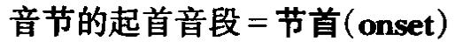
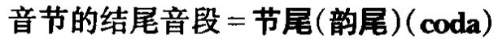
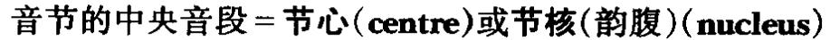
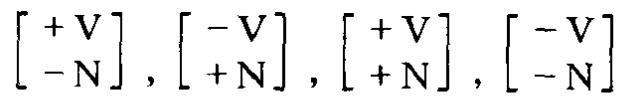
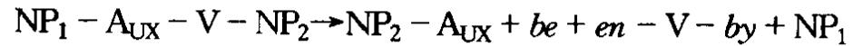
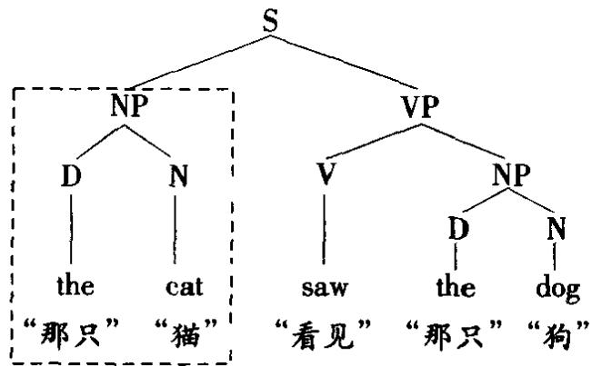
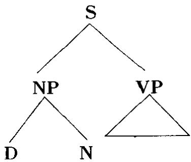
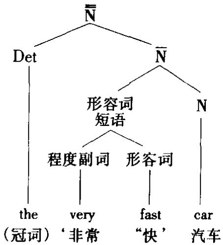

were going“要是她真去的话”(实际不去，比较 if she was going “要是她去”)这 类“假设”构式，某些惯用语(例如 So be it!“就那样吧”,某些以 that 引出的小句 (特别用于美国英语，如 Ⅰ insist that he go to town “我坚持他应进城”。不少语言 中虚拟式是比较能产的，例如法语。

sublanguage 子语言 见 LANGUAGE 语言条。

submorpheme 次语素 见 MORPHEME 语素条。

ubordination（subordinat-e,ing,-or）主从关系（从属语，从属的，从属连词)语去分析术语，指连接语言单位的一种过程或结果；使连接单位有不同的句法地位，一个依赖于另一个，一般是依赖于另一个的一个组构成分。从属语(subordinate)有时与王导语对立。(就此而言，主从连接区别于并列连接，后者连接两个等价单位。)从属小句(subordinate clause)的例子是 John left when thebus arrived“汽车一到约翰就走了”,连接标记是 when“当·时”,称作从属连词(subordinating conjunction 或 subordinator)。英语有许多从属连词，如 although“虽然”,since“自从”， because“因为”， while“正当·时”, after“在之后”。有的语法学家将某些从属连词分析为带句子补语的介词(如before“在之前”，since“自从”，until“直到为止”)。在向心短语中，“从属语”指修饰中心语的词语，例如 all the very b1g cars “所有那些很大的汽车”,其中 all the very big是 cars“汽车”的从属语，very“很”又是 big“大”的从属语。

subsegment 次音段 见 SEGMENT 音段条。

substance实体 语言字用来指用以构建语言的不加区分的原材料——言语的声波(语音实体)和书写标记(字形实体)。这里的“实体”对立于形式—语言加在实体上的抽象关系型式。在索绪尔式理论中，意乂也被视为有实体，即独立于语言存在的思想、感情等内存概念。但是现代语言学所指“实体”一般只限于语音和字形媒介(如韩礼德式理论中“实体”是一个独立的层面)。

sub-standard 次标准语 见 STANDARD 标准语条。

substantive(substantival)）（1)实体[共相] 语言字理论用来指一类语言共相，与形式共相对立。实体共相(substantive(或 substantival)universals)是语法为分析语言数据而建立的各种基元成分，例如生成语法中的S,NP，VP，+人类]，[+高]，各种关系模型中的主语，动词，宾语等。

(2)体词 有些描写语法给词分类时用体词(substantive)指名词类(传统上定义为“实体”，即人、处所、事物的名称)，也指那些功能类似于名词的语项，但缺乏名词的某些形式特点(如形容词的“体词功能”，如 the poor“穷的”， the rich

“富的”等)。代名词类也可归入体词类。

substitution(substitut-e,-able,-ability）替换(替换项，可替换的，可替换性）语言字用来指在一个结构内的某一位置用一个语项替代另一个的过程或结果。语法中发生这类替换的结构上下又称作替换框(substitution frame)，例如，Theis angry“那个很生气”，可以填人某一框内的有聚合关系的一组语项称作替换类(substitution class)。一个回指前头出现过的某一结构成分的词(例如 The man came in He was smıling “那个男人走了进来，他在微笑”中的代名词 he“他”)可称作替换词(substitute word)。在管辖与约束理论中，替换是两大类移亿之一(另一类是附接);它指被移语类按照结构保持制约取代一个同类的空语类。在语言教学中，为提高学习者这种替换能力的练习称作替换练习(substitution drills)或“型式练习”。

substrate(substratum) 下位层 社会语言字和历史语言字术语，指一种语言变体或一组形式已影响一个社会内占主导地位的变体或语言的结构或用法。下位层语言(substrate language)或语言下位层(linguistic substrate/substra-tum)特别见于一种语言因政冶或经济的优越性而强加于一个社会的情形，例如世界各地所说的许多种英语变体，它们都包含母语的一些特点，如印度和西非说的英语。相反的效应称作上位层。

substring 次语符列 见 STRING 语符列条。

subtractive bilingualism 减损双语现象 见 BILINGUALISM 双语现象条。

subtree 次树 见 TREE 树条。

suction 吸[音] 乔姆斯基和哈勒在其音系学的区别特征理论中建立的语音特征之一，归在辅助动作名下，用来描写发音方式的变化。指声门或软腭(参看VELAR软腭音条)部位气流朝内的发音动作，如内破音和吸气音。另见 STOP塞音条。

suffix(-ing，-ation) 后缀(添加后缀)形态学术语，指加在词根或词干后的词缓。添加后缀(suffixation或 suffixing)在英语中很常见，既用于新词项的派生(例如 1ze“-化”，tion(构成名词)),也用来表达语法关系(如 s,ed，ing 这类屈折词尾)。

superfix/suprafix超音缀 语音字和音系字用来指覆盖话段中不止一个音段的发声效应，例如音高、重音、音渡型式等，特别是从某一特定语法结构的角度来观察这类现象时。但现今广泛使用的替代术语是超音段成分。

superfoot 超音步 节律音系字术语，指节律树内统制最右端的两个音步和节点，用符号∑表示。例如在 reconciliation“和解”一词的树结构中，支配两个重音音步(Σ)cil 1 和 a tion 的节占就是一个超音步。

superheavy syllable 超重音节 见 WEIGHT 音重条。

superlative 最高级 语法描写中说明形容词和副词三种比较程度及其适用范围的术语之一。最高级形式用于两个以上实体之间的比较，与比较级——只在两个实体间比较，也与原级——不含比较意思，相对立。英语的最高级可用屈折形式(est)和迁说构式(most)两种方式表达(例如 biggest“最大”,most interesting“最有趣”)。

superordinate 主导语 语法描写有时用来指一个层级中高于另一个单位(从属语)的语言单位。例如，John saw where Mary lived “约翰看到玛丽住在哪里”中,John saw “约翰看到”(或 John saw X)是主导小句,而 where Mary lived “玛丽住在哪里”是从属小句。这一术语还用于语言学的其他方面，指较高层次的单位，例如指上下又关系中涵义较广的那个词项(flower“花”是tulıp“郁金香”、daffodil“黄水仙”等词的主导词)。

superstratum 上位层 社会语言字和历史语言学术语，指一种语言变体或一组形式，它已影响一个社会内不占主导地位的变体或语言的结构或用法。语言上位层(linguistic superstratum)通常是政治、经济或文化上占主导地位的结果，如历史上不同时期英语、法语、阿拉伯语等对世界其他语言的影响。上位层语言的影响，最明确的特征之一是使用的借词增多。

supplementary movements 辅助动作 乔姆斯基和哈勒在其音系宇的区别特征理论中确立的语音特征之一，用来描写发音方式的变化。辅助动作分为吸和挤压两类，是按发音时有两个同时闭塞时声门或软腭的动作是内吸还是外呼来区分的，如内破音、挤喉音、吸气音。

suppletion（suppletive）异干交替（异干替换词） 形态宇术语，指不能用一般规则说明两个语素间关系的情形，因为两个语素有不同的词根。异干替换词(suppletive)指语法用一个不相关的形式(即不同词根的形式)来填补一个词形变化表，例如 go“去”(现在时)的过去时形式 went,good“好”的比较级形式 better“较好”。

suprafix 超音缀 见 SUPERFIX 超音缀条。

supraglottal声门上 语音宇用来统指声道中声门以上的整个区域。

suprasegmental 超音段[的]语音字和音系字用来指覆盖话语中不止一个音段的发声效应，如音高、重音、音度型式等。“超音段”与“音段”一起被视为音系单位两个主要的对立音类。在美国结构王义理论中，超音段被分析为音位，超音段序列被分析为语素，但并非所有的音系学家都用位来分析这类特征。可替换术语有跨音段、非音段和超音缀。

surface structure 表层结构 转换语法的一个中心理论术语，与深层结构相对。句子的“表层结构”是句子的句法表征的最后一个阶段，为语法的音系部分提供输入，因此最接近于我们说出和听到的结构。用组构成分分析法来分析表层语素语符列是一种普世的分析程序，能揭示语言结构的许多重要事实，但它并不能揭示所有方面，例如它无法解释我们如何识别某些歧乂句，如何凭直觉将表层形式不同但基本意义相同的句子联系起来(例如 Cats chase mice“猫追耗子”和 Mıce are chased by cats“耗子被猫追”)。出于这些原因，语言学家在本世纪 50年代后期起假设句子有一个“底层”或深层结构——一个结构组织平面，所有决定结构解释的因素都在这个平面上定义和互相联系。标准的观点是，语法的操作过程是先生成一组抽象的深层结构，然后将这些底层表征式通过一组转换规则变换成表层结构。这种语法结构的二平面概念现仍被广泛接受，尽管最近一些生成研究对此提出不少批评。另一种观点是将表层结构与语乂表征层面直接联系，干脆绕过深层结构。近年来已引入一个经修正的概念即所谓S结构。“表层语法”一语有时用来非正式地指句子的表面特性。

svarabhakti vowel 加插元音 见 ANAPTYXIS 加插音条。

switch reference 换指一种显示小句链内小句成分(一般是王语)之间语义关系的手段。在一给定小句链内，除最后一个小句外每个小句的动词都在形态上指明其主语是与下一小句的主语相同还是不同(参看REFERENCE指称条)。换指标记见于澳大利亚一些土著语言。

syllable(syllab-ic,re-,-(if)ication,-ify) 音节(成音节的，音节划分/组构，音节重新划分，使成音节）指一个发音单位，通常大于单一的音而小于一个词。词的发音可以“一个音节一顿”，如 ne-ver the-less“然而”，一部好词典会标明书写时发生的这种音节区分(syllabic divisions),从而提供有关词内何处可加连字符的信息。简而言之，音节的概念对操本族语者来说是很实在的，并常以准专业术语用于日常会话(例如 Shall I put it in words of one syllable？“我用单音节词说出好吗？”)。音节划分(syllabification)指将一个词划分成若干音节；音节重新划分(resyllabification)指改变音节界限的重新分析。只含一个音节的词称作单音节(monosyllable);如含的音节不止一个就称作多音节(polysyllable)(或分别称作“单音节词”和“多音节词”)。

要给音节下个精确的定义并不容易，语音宇和音系学都有好几种理论试图澄清这个问题。从语音学的观点，有人尝试从付出的发音努力来定义一种语言的音节。由理学家RH斯特森提出的音节产生的“脉冲”或“运动”理论认为，每个音节对应于一次气压增强，肺部的空气以一系列胸腔脉冲释放出来，这种释放很容易感受和测量，特别在强调说话时。但当两个音节邻接时经常很难监测到这样的脉冲，如两个元音的共现，例如 going(是两个音节，但一般说只是一次肌动)。另一种语音学的尝试是从听觉上定义音节突显理论认为，一个语音语符列中，有些音的固有“音响”强于其他音，而每个音响“峰”对应于一个音节中心。元音的音响负载能力较强，因此最能代表音响峰。音响较弱的音是相对峰的“谷”，以通过闭塞和收窄产生的辅音为代表。这种理论提供的一般标准很有用，但并不总能明确指明相邻音节之间的边界，例如 busker“街头艺人”，用上述基于知觉响度的标准无法确定应将其划分为 bus-ker, bu sker 还是 busk er。即便将音响以外的其他声学特征(如音高或音长)纳入突显的概念，这个问题仍然存在，但最近一些音系学理论(特别是节律音系宇)试图专门解决这一问题。

这些语音学理论都试图给音节下一个适用于所有语言的定义，而从言语产生或知觉角度作出更有效的定义也是可能的。另一方面，音系学对音节的观点是集中于个别语言中语音如何结合起来产生典型的序列。按这种观点，语音通常分为两类，一类音能独立出现，或位于语音序列的中心；另一类音不能独立出现，或位于语音序列的边缘。前者包括[ı]，[a]，[u]等，一般称作元音；后者包括[p],[g]，[f]，[tʃ]这类音，一般称作辅音。辅音-元音(CV)序列看来是所有语言都有的一种型式：因为这个序列没有另一个辅音来“关闭”它，这类音节常称作开音节(open syllable)。CVC型式在英语中也很常见，这种型式一般采用以下一些术语：

一个有用的术语是音节的界音(或边缘)，统指起首音段和结尾音段。在节律音系学中，韵腹加韵尾被视作音节结构的一个组构成分，称作韵基(rhyme或rime);音系学还按音重来区分音节。

采用这样一类方法，音节可按语言中音段的功能来定义，例如，可以这样来识别可出现在音节边缘的各种音丛，如 CV(say“说”),CCV(play“玩”),CCCV(stray“迷路”)等。还可识别一些不寻常的音节，如由某些辅音单独构成的音节—如 button [batn]和 bottle[botl]这类词中的鼻音和边音，其中[]表示最后一个辅音是成音节辅音(syllabic consonant)。

音节的概念还广泛用于音系学的其他方面，与韵律和跨语言的节奏研究(参看 SYLLABLE TIMED language 音节合拍语言条)有关。在乔姆斯基和哈勒提出的区别特征理论中，成音节(syllabic)取代早先的“元音性”(vocalıc),指所有构成二个节核的音段。元音边音和鼻音为[+成音节]([+syll])，其他音段都为[-成音节]。

在较近的一些音系学理论中，音节的概念变得越发重要，特别是各种非线性音系字模型。这些模型中音节划分(和音节重新划分)被视为与表征问题相关派生过程中音节结构如何和在什么时候指派给语符列，音节划分又涉及哪些音系规则。在好几个模型中，有一个音节在其中起作用的韵律层级：例如韵律形态字中音节是一个高于莫拉而低于音步的层面。另见CODA节尾，ONSET(1)节首，TAUTOSYLLABIC同音节的诸条。

syllable-timed 音节合拍 语音宇的一个通用术语，用来描写一类语言的发音有特殊类型的节奏；与重音合拍对立。按这种对立，音节合拍语言是音节按一定的时间间隔出现，如法语；这一特点有时称作“等音节”。但是关于这类特性的精确定义或一般的适用性还缺乏研究，这样一种类型学的效用也是个有争议的问题。

synaesthesia 形义联觉 语义字用来指语言的形式和意义之间有直接联系。例如 sl-这个语音组合常给人以表达不愉快的感觉(如 slimy“粘滑”,slither“滑溜”，还有刘易斯·卡罗尔自创的slithy)。这种语音象征单位有时称作联觉音位。

synchronic 共时的 瑞士语言学家菲迪南德·德·索绪尔引入语言学研究的两大时间维度之一，另一个是历时维度。共时语言学(synchronic linguistics)是研究理论上处于一个时点的语言.描写语言的一个“状态”，不管正在发生哪些变化。例如，可以对乔叟的语言、16世纪的英语、现代英语分别作共时描写。大多数共时描写都是描写当代的语言状态，但作为历时研究的预备，其重要性自索绪尔以来一直得到重视。语言研究，除非另有特别说明，一般认为是指共时研究。

syncope 内音割弃 比较语文字术语，有时也用于现代音系字，指删除词内的一个元音；通常与首音割弃和尾音割弃对立。例如现代英国英语 secretary“秘书”一词发作/sekrtr1/,而美国英语发作/sekrteri/。有的作者将这一概念扩大，还指词内辅音的删除。

syncretism(syncretize) 融合 原为历史语言字术语(指失去屈折形态后两个形式的合并)，现常用于共时研究，指同一词位的两个形式合而为一，例如Iwalked“我走路”中的 walked（过去时形式)和 I've walked‘我已走过”中的walked(过去分词形式)。两个形式在这里发生“融合”或“中和”。

syndeton（syndetic）有形连接(有形连接的） 原为希腊修辞学术语，有时也用于现代语法，指用连词将一句法构式的几个部分连系起来，例如 They spokerapidly and quietly“他们说得快而轻”。与无形连接(asyndeton)对立，后者省略连词，主要是为了使表达形式更为经济或引人注目，如 They spoke rapidly, quietly“他们说得快轻”。

synonym(-y，-ous) 同义词(同义关系，同义的) 语义字用来指词项之间一类主要的涵义关系具有相同意义的词项是同义词，它们之间的关系是同义关系(synonymy)。说两个词项为同义词并不是说两者的意义完全相同，即可在所有语境中互换，内涵也完全相同——这种不大可能的情形有时称作“完全同义”。两个词项只要意义足够接近，可在某些语境里自由选用而不致使整个句子的意义产生差别，就可称作有同义关系。语言学对同义词的研究强调在确定一组词项是否是同义词时语境的重要性。例如在 What a nice of flowers“多好的鲜花”的上下文中，词项range“各色”,selection“优选”，choice“精选”等是同义词;但在 Herof knowledge is enormous“她的知识很广”的上下文中只有range“范围”能与另一组同义词(如 breadth“广度”)互换。与同义关系对立的涵义关系有反义关系、上下义关系和不相容关系。

syntagmatic 组合[关系]（1)(syntagm-a,-eme)（组合成分，组合法位）语言学的一个基本术语，最初由瑞士语言学家菲迪南德·德·索绪尔引入，指将言语视为(有时但不总是)以线性次序排列的组构成分语符列时言语的序列特性。构式中组构成分(“组合成分”)之间的关系一般称作组合关系(syntagmatic rela-tion)。有组合关系的组构成分的结合称作结构。组合关系与聚合关系一起对语言系统内语言单亿的身份作出说明。例如，英语音系字中/p/的功能可归纳为它与其他成分的组合关系(例如 p-it, nu p, a p-t )和聚合关系(例如 p-1t, b-1t,nit )。各个分析平面都可确立组合关系。但在法位语法中，组合法位(syn-tagmeme)一语有限定涵义，指语法层级中从其包含的成分(即法位)角度定义的单位；例如句子是其包含的小句的组合法位。

(2)心理语言字用来指听到一个刺激词后作出的一类联想反应，反应词与刺激词不属同一词类，并在句子中位于刺激词之前或之后。例如听到car“汽车”后的组合反应(syntagmatic response)或联想(association)是 drive“驾驶”，听到black“黑”后的组合反应是 sheep“羊”(black sheep“害群之马”)。组合/聚合转变(syntagmatic/paradigmatic shift)指见于儿童七岁左右发生的一种反应模式的变化，即由原先(主要是组合联想)的模式变为更接近于成人的主要是聚合联想的模式。

syntax(syntactic(s)) 句法[学](句法[学]的，句法组配学) 这个传统术语指研究语言中词组合成句子的规则。这种涵义的句法学与研究词结构的形态宇对立。另一种定义(回避“词”的概念)是研究句子结构成分之间的相互关系和组成句子序列的规则。按这种定义也可以说有“词的句法”。生成语言学中，句法部分(syntactic component)是语法的三大组成部分之一(另两个是音系部分和语义部分)，包含生成句法结构(syntactic structures)的各种规则(例如短语结构规则，转换规则)。这个组成部分内句法规则(syntactic rules)的确切性质随不同的语法理论而异。句法结构(型式或构式)可分析为句法范畴(syntacticcategories)或句法类(syntactic classes)的序列，分析的依据是构式内语项与语项的句法关系(syntactic relationship)。最近的研究将范畴分析为一组句法特征(syntactic features)，以使各范畴具有更大程度的概括性。例如，有人建议用V(动词性)和N(名词性)这两个特征将动词、名词、形容词和介词四个范畴分别分析为.

这种分析法称作基于特征的句法(feature-based syntax)。正的和负的次范畴化特征都可以用，可以单用也可以组合起来用，这取决于句法事实和提出的分析原则。整个句法领域的研究称作句法理论(syntactic theory)。研究句法的序列组配有时称作“句法组配学”(syntactics),但syntactics’一语原先指语形字，是符号字的三大部分之一(与语用学和语乂字并列)，因此可能引起混淆。现代语言学中syntax'一词的形容词是syntactic'，如以上各例；‘syntactical'现在听上去有点古雅味。另见 AUTONOMOUS(3)自主的，BLEND 截搭式，FRAME 框诸条。

synthesis 合成 见 SPEECH SYNTHESIS 言语合成条。

synthetic 综合的（1)综合[语] 比较语言字有时用结构标准(而不是历时标准)根据词的特点分出的一类语言，综合语(synthetic languages)的词一般包含不止一个语素(不像分析语的词一般都是单语素)。综合语一般又分为两类.粘着语和屈折语，有时又增加一类多式综合语。例如，拉丁语、希腊语、阿拉伯语、土耳其语都属综合语。跟其他类似的分类一样，这里的分类也不是十分明确的各种语言多多少少都具有某些“综合”的特点。

(2)综合命题/句(synthetic proposition/sentence） 语义字有时利用“综合”一词在逻辑学和哲学中的涵义，用“综合命题/句”指只能用经验标准验证真假的命题或句子，例如 It's raining “下雨了”，Those dogs are fierce“那些狗很凶猛”。与之对立的是分析命题/句，即无需参照外部标准、命题的内部形式就决定其必然为真的命题或句子。

system(-atic,-ic) 系统(系统的) 这个术语最一般的涵义是指语言组织的型式关系网络。因此语言作为一个整体就是一个系统(例如“英语的语言系统”等)，经常也是一个由分系统组成的层级系统。按一种观点，“语言系统”由音韵系统、语法系统语义系统组成，音韵系统又由音段系统和超音段系统组成，音段系统又由元音系统和辅音系统组成，等等。在这个总体框架内，“系统”又可用来指任何一组数目有限的、有形式和语乂联系的单位，单位之间既是互相排斥的(即同一系统的两个成员不能共现)又是互相定义的(即一个成员的意义只有参照其他成员才能确定)。例如，语言中的人称代词集合按上述标准就构成一个系统。首先，它的数目是限定的(英语中为Ⅰ“我”，you“你，你们”，he“他”，she“她”，1t“它”，we“我们”，they“他们”);这个系统是“封闭的”，即一般不增加新成员。其次，在结构的某一位置不可同时使用两个成员(如\*Ⅰ you came“我你来了”等)。第三，一个成员容易参照系统的其他成员来定义而不易独自定义，例如I“我”是“不是 you/he/she/it/we/they的代词”。其他“语法系统”包括限定词、时、式、介词、否定等系统。“系统”一般不用来指开放类，如名词、形容词句子等，除非是指这些名目下的一组语法形式关系，例如“名词系统”是指定义名词这个类的一组组合和聚合关系。这种分析原则上也适用于意义的研究，经常使用“语义系统”一语，但就目前的知识状态而言，一般很难按上述这样的标准来构建语义单位相互关系的模型。类似的问题有时也见于语法分析，有些方面很难作出完整的“系统”说明(例如状语，同位语等)，部分是由于这些概含具有不确定性。

在韩礼德式语言学中，系统的概念有其特殊的地位。在阶与范畴语法中，“系统”是这种理论分出的四大中心范畴之一(其他三个是单位、结构、类）“系统”是以类起作用的一组数目有限定、有聚合关系的语项。这种理论的后期发展即系统语法(systemic grammar)中，系统的概念成为一条重要的解释性原则，整个语言被视为一个“系统的系统”(system of systems)。这里 systemic一词不应与systematic(系统的)相混淆(不管是在一般还是专门涵义上；见下）系统语法旨在建立一个上述涵义上的各关系系统的网络，能用来解释整个语言中全部相关的语义选择。

形容词 systematic(系统的)在语言学中常按日常涵义使用，但在某些场合(一般与语音宇和音系宇相关)其定义较狭窄。如在生成语法中它指语法的音系部分区分的两个表征层面，即系统音位层和系统语音层，其含义是这两个分析层面与语法其他方面(例如语项间的形态关系)有系统的对应关系。

system architecture 体系结构 计算语言字的一个计算术语，指一组主导原则，它们定义一个语言处理系统的各项运作。体系结构规定这样一个系统的各个组成部分、各组成部分之间的结构关系、处理过程中控制信息从一个部分流向另一部分的方式等。

systematic phonemics 系统音位学生成音系字的一个表征层面，这个层面建立单一的底层形式，能用来说明与各种语法结构(例如词)相关的音系变化。例如在 divine“神的”～divinity‘神性”,obsene“猥亵的”\~obsenity“猥亵”这样成对的词中，显然存在某种有规律的关联，但又很难明确说明这种关联。乔姆斯基和哈勒在解决这个问题时认为，每对词中的根语素可指派单一的底层表征式(上述两例分别为/divin/和/obsen/),这个表征式和将其与表层交替形式相联系的规则一起，能对操本族语者对存在于语法和音系学之间的“系统”关联的语感作出说明。(这类规则经常也反映语言历史上发生的语音演变。)这些表征式的单位称作系统音位(systematic phoneme),以区别于传统音位音系学的“自主”音位，后者的确定无需参照语法结构。有的生成音系学家(如乔姆斯基和哈勒)喜欢用“音系的”指这个表征层，因为“音位的”一词使人联想到不可取的传统音位理论。

systematic phonetics 系统语音学生成音系字的一个表征层面，为发音的系统特征提供一种窄式记音去，即将归因于语言运用的特征排除在外。这个层面通过语法的音系部分的规则与系统音位字这一表征层面相联系。

## T

t 作 TRACE 语还的缩写。

T 作 TRANSFORMATION 转换的缩写，用于 T RULES(T 规则)这类名称中。另见T FORMS T 形式条。

tacit默示的生成语言字用来描写操本族语者对其语言的知识(即其语言能力)。指这样一个事实他们关于其语言的构建方式和功能的直觉很大程度上是无意识的；常用于默示知识(tacit knowledge)一语。

tactic(s)(taxis)组配的(组配法，组配学) 语音宇和语言字的一般术语，指任何一个语言平面上线性序列各单位的系统配列。基于这一概念的最常用的术语有语音组配法(phonotactics),处理语音的顺序配列；形态组配法(morphotac-tics),处理语素的顺序配列，句法组配法(syntactics),处理大于语素的语法单位的顺序配列。有的语言学理论赋予这方面的分析以特别重要的地位(例如层次语去分出几个不同的组配层面，对应于这种理论建立的各个层次，即“超音位组配”、“音位组配”、“语素组配”“词位组配”、“义位组配”、“超义位组配”。

tag (1)尾句 语法描写用来指一类疑问结构，即疑问尾句(tag question)，一般由一个助动词加一个代名词组成，附接在一个陈叙的结尾，用来传递一种否定或肯定意向。疑问尾句可以是固定不变的，如法语 n’est ce pas“是不是”和德语nicht wahr“是不是”，也可以是可变的，如英语。所有的疑问尾句，说出时的语调决定其功能，即“提问”和‘告诉”的对立，例如英语 she's late, 1sn't she？“她迟到了，是不是？”升调表示“我问你她是不是迟到了”，降调表示“我告诉你她迟到了，请你同意”。英语中除了语调，尾句的极性对工通常与主要小句的相反·肯定小句带否定尾句，否定小句带肯定尾句，例如 she's comung,isn't she“她要来，是不是”和 she isn't comung, 1s she“她不来，是不是”。有时也见到前后两个小句都是肯定式(she's coming,1s she“她要来，是不是”),偶尔见到两个都用否定式的(she doesn't know,doesn't she “她不知道，是不是”)。有的语法还承认一种陈叙尾句(tag statement),倒如 That was a lovely drink, that was “那杯酒真不错，是的”;He's a nuce man, is John“他是个很不错的人,约翰是的”。这类构式与They're all the same，these phoneticians!“他们都一个样，这些语音学家!”这些“增强”构式之间有某种紧密的联系。另见CHECKING核对和COPYING拷贝条。

(2)标注 计算机语料中附加在词上的语法标签，指明词所属的类。这种做法叫加标注(tagging)。标注可以人工加也可以机器自动加(后者已取得不同程度的成功)。

tagmemics((syn)tagmeme,tagma,-tics) 法位学([组合]法位，法子，法子学) 美国语言学家肯尼思·李·派克(生于1912)创立的一种语言字分析系统，“语言学暑假学院”曾用来训练语言学家。语言被视为由三个式组成，即音系、词汇和语法。音系音仁和词汇语素的对应关系又与语法法位(tagmeme)相对应。“法位”这个基本语法单亿由构式框架中的一个“功能槽”(functional slot)和可填入这个槽的一类可替换语项“填充形式”组成。法位身份的确定在于功能和形式的相关性，两者在分析中都有明确标记(如主语、谓语、中心语、修饰语等功能，代名词、名词短语、不定式等形式)。法位分析(tagmemic analysis)区分基本单位(法位)和非基本单位(最小非位单位，称作法子(tagma)，分析为法位的法位变体(allotagma))。法子的识别和分类属于法子学(tagmatics)的范围。将法位串连起来组成的构式称作组合法位(syntagmeme)。语法单位按层级组织成不同的层面(语素、词、短语、小句、句子等)。

这种理论任何一个层面上的语言描写单位都可同时分析为粒子(用特征定义)、波(用特征在不同语境中体现的各种变体的地位定义)和场(用特征的分布定义)。

tail 调尾 见 TONE GROUP 调群条。

tambre, tamber 音色 见 TIMBRE 音色条。

tap 触音 语音学按发音方式给辅音分类的术语，指用舌单次快速接触口腔顶部发出的音，与发音很简短的塞音相像。常见于美国英语wnter“作家”和 rder“骑车人”中的中间音/t/或/d/的发音。有的语音学家按不同的发音动作区分触音和闪音。

target（1)[发音]目标 语音字和心理语言字用来指一个假设的发音状态，可在言语产生的动态描写中作为参照点。在连续言语中，一个音的目标发音特征(例如齿龈音、带声)不一定完全实现，因为相继目标发音动作(target articulations)会产生预先的影响。目标模型设定一组理想化的发音位置和一组规则，后者参考发音速度、发音器之间的方向和距离来预测发音动作的实际型式。同样，已经建立的一些言语知觉的模型也采用听觉目标(auditory target)这一理论构建物，它能使听者从不同的口音、嗓音音质等等之中识别一些共同因素。

(2)目标语作为一种语言变化过程的终结的语言(或语言变体等)称作目标语(target language)，例如，笔译或口译成的语言，向外国人教授的语言(或语言变体等)。

(3)目标项转换语法中受一种转换影响的组构成分有时称作目标项(tar-get)。例如 WH 移仁的目标项可以是一个名词短语(如 How many parcels will hesend to London?“他将往伦敦寄多少个包襄?”),一个介词短语(如 In which bookdid you read about it?“你在哪本书中读到的?”),或某些其他短语。类似的用法见于生成音系字，一条规则可由一个音段(“触发音段”)引发而应用于另一个音段(“目标音段”)。

tautosyllabic 同音节的 音系学有时用来指可分析为属于同一音节的音段型式。例如，VCV的音节划分问题的讨论可以这样入手是VC还是CV序列最适宜分析为同一音节。

taxeme法素美国语言学家伦纳德·布龙菲尔德仿照音位引人的一个术语，指语法配列的最小单一特征。法素的例子有词序、一致关系、音高的语法功用、动作者-行动-目行关系的组构成分等。以约定俗成的语法单位出现的法素组合称作组配形式(tactic forms)(参看TACTIC 组配的条)。这种理论中的法素区别于法位，后者是语法形式最小的有意义的单位。

taxis 组配法，组配学 见 TACTIC 组配的条。

taxonomic（taxonomy） 分类[学]的(分类学） 这个生物系统学的术语按其一般涵义用于语言字，指语言学分析和描写的一种取向，即主要或只关心分类问题。分类的依据可以是历时的、地域的、类型学的、功能的，等等，分类的对象可以是语言特征、语项、单位、结构等实体，或全部语言、语言变体或万言。分类学的概念已有效地应用于语言学的许多领域(特别是社会语言学、历史语言学、语乂字)。但是生成语言学家一直强调分类学方法在语言分析中的局限性，他们批评结构王义(或“分类学的”)语言学过分依赖切分和分类程序。他们主要用这个名称来表明结构语言学在提供深层结构这样的解释平面方面无能为力。“分类音系宇”、“分类句法字”等名称用于生成语言学都一律含有贬义。

telegraphic speech 电报式言语 一种言语风格，其中功能词和屈折词尾一般都省略;也称作 telegrammatic speech。这个名称源自按字计费的电报是常用通信方式的时代，指一种书写风格(如 Send cheque Brghton“寄支票布赖顿”)，现仍用来指任何一种省略书写风格(例如报纸标题或招聘广告);但语言学中这个术语更常指见于幼儿言语的句子结构(me kick ball“我踢球”)和一种失语症(语法缺失症)中常见的各种缩减的语法表达式。

telic(ity）终结[体] 对体作语法分析的术语，指一个事件的活动有一个明显的终止点。终结动词包括fall“落下”，kıck“踢”，make“制作”等。终结动词与无终动词对立，后者表示的事件没有这种自然终止点，如 play“玩”(用于 the childrenare playıng“孩子们正在玩”)。

template(templatic）模板（模板的）（1)节律音系字术语，指一种语言中用来确定音节的基本结构可能范围的一个抽象的树结构。例如，对英语音节结构的一种有影响的阐述方式是作层级分析，即分析为节首+节核(韵腹)+节尾(韵尾)，后两个成分合在一起构成韵基，每个成分由两个音段组成。

(2)韵律形态字的一个重要术语，指加在可变音段材料之上的一个固定的音韵形状。模板在语法中定义，在派生过程中实现为韵律层级中的各种单位·莫扛、音节、音步、韵律词。目标模板可加在任何一个形态基础(例如词干、词、词缀)上。例如，重叠构式可能有一个前缀有一个不变的典范形状(如一个重音节)，但有一个可变的音段形状(取决于所依附的词基)。模板满足条件(tem-plate satisfaction condition)规定，模板制约条件的满足是强制性的，并且由一些韵律原则决定。这种理论与以模板形式的音段为主的理论相对立，见以上(1)。

(3)这一术语的一般涵义(“定为标准的一个型式，其他型式参照这个标准来衡量”)在语言字和语音字的一些特定领域有多种应用。例如，认知语法中，神经活动既定型式之间的联系可作为词语划分范畴的模板。在自动言语识别中，模板是存储的加标签的频谱(或频谱的关键特征)，对有待识别的信号的某种分析可与这个模板相匹配(模板匹配(template matching))。

tempo 语速 按其一般涵义用于语音字和音系字，指说话的速度；也称作 RATE(语速)。话段语速的对立与音高和响度变化一起是超音段语音学和音系学分析的现象，是整个节奏研究的一部分。

tenor 语旨 对语言变体作韩礼德式分类的术语，全称 tenor of discourse,指一项语言活动中各参与者之间的关系，特别指他们采纳的正式性的层次(口语的，正式的，等)。可替换术语有语体或语式。

tense(1)时 对动词作语法描写的一个范畴(与体和语气一起)，主要用来指动词表示的动作发生时间的语法标记。传统上“时”分为过去时、现在时、将来时，还常作其他区分(完成时，过去完成时等)。时与时间的关系一直是语言字着重研究的一个问题，但这种关系显然很难简单说清楚。时形式(即动词的形态变化形式)可用来表示时间以外的其他意义。例如，英语的过去时形式(如Ⅰknew“我知道”)在某些语境里可表示临时的意思(如Ⅰ wishⅠ knew“但愿我知道”——即“现在知道”)。时形式和时间之间也不是一对一的关系英语的现在时可用来指将来或过去，视语境而定(例如 I'm going home tomorrow“我明天回家”, Lastweek I'm walkıng down this street“上星期我正沿着这条街走·”)。此外，如果时定义为动词的形式，那么像英语这样的语言是否有将来时就成为有争议的问题:像Ⅰ will/shall go“我要/得去”这样的构式，许多人认为最好分析为情态助动词构式，表示的是其他的语法功能(如意愿或应该，但涉及将来)。英语有许多这样的问题，其他语言也一样，时形式如果存在也常有分析上的困难，因为时常与其他动词性功能(如体和语气)有交叠之处。经常需采用其他可替换名称(例如“过去时”和“非过去时”，“将来时”和“非将来时”，“现在时”和“遥远时”)。

(2)紧[音] 见 TENSION 紧条。

tensed(un-) 有时句(无时句) 生成语去术语，指动词表达时对立的小句(即定式小句)，与无时句(untensed)对立。扩展的行准理论中的有时句条件(tensedsentence(S) condition)规定，一个组构成分不能移出或移入一个从属的有时句。管辖与约束理论中这个条件被约束理论的条件A和条件B所取代。

tension（tense）紧(紧[音]） 语音字给语音分类的术语，指肌肉总体用力发出的音。与紧音的对立有多种名称，例如张音～弛音，紧音～松音。这种对立在音系字的各种区别特征理论中被认为特别重要，紧(tense)是为描写发音万式变化而建立的主要特征之一。紧音从发音和声宇两方面定义为：发音时肌肉较用力，(声门上)声道偏离静止位置(参看FORTIS张音条)的程度较大，分布的声学能量较强。例如元音[1]和[u]为[+紧];[]和[u]为[-紧]。对立的术语在雅可布逊和哈勒的系统中是松[音]，在乔姆斯基和哈勒后期的系统中也用非紧[音](nontense).它们发音时肌肉不太用力，动作不太大,较短较含混，跟央化元音一样分布的声学能量较弱。乔姆斯基和哈勒系统中声门下紧音用声门下增压特征来描写。

term of address 称呼语 见 ADDRESS 称呼条。

terminal终端生成语言字术语，用来指语法的句法部分的输出的某些特点。终端成分(terminal element)或终端符号(terminal symbol)指所有规则都应用后句子的句法表征式所采用的单位，即语素、构形成分、特征等，如the(定冠词)，en(后缀)，+，#，man“男人”。终端符号区别于非终端(non-terminal)或“辅助”成分，后者用于规则的阐述。前者一般用小写字母表示，后者一般用大写字母(如 NP,VP)。不统制其他语类的节点是终端节点(terminal node)。由终端成分组成的语符列称作终端语符列(terminal string)，即短语结构语法生成的最终语符列。

terminal analogs 终端模拟器 见 SPEECH SYNTHESIS 言语合成条。

termination 终端音 见 EXTRASYLLABIC(1)超音节的条。

tertiary response 第三反应 伦纳德·布龙菲尔德引入语言学的术语，指人们对关于语言的评价(第二反应)的评价。例如，有人说“那种方言真难听/纯朴”这是作出第二反应；如果对此加以批驳，那么对批驳依据的解释(实际也包括一般的感情反应)就成为第三反应。

tessitura 应用音域 原为音乐术语，有的语音学家用来指正常说话时一个人嗓音特有的音域或音高范围。人们常凭印象给个人的嗓音也给语言这样分类(如“音很高的”嗓音)。

test 测试 见 ACCEPTABILITY 可接受性，COMMUTATION 代换，MINIMAL PAIR最小对比对诸条。

text(-ual(ity),-ure,-linguistics)篇章，语篇(篇章的，篇章性，篇章语言学)语言学和语音学的一个前理论术语，指为分析和描写目的而记录下来的一段语言。需着重指出的是，篇章不仅指结集的书面材料也指口说材料(后者经某种转写)，例如会话、独白、仪式讲话等等。语义学有时用篇章意义(textual mean-ing)指分出的一类意乂，即影响一个句子理解的那些来自句子所在篇章其他部分的因素；例如一个剧本或一部小说的某一处出现的一个句子或词，其意义只有参照前文才能理解。

近年来，篇章研究已成为称作篇章语言学(textlinguistics)(特别在欧洲)的语言学分支的定义特征，“篇章”在其中有重要的理论地位。篇章被视为一类语言单位，有其可定义的信递功能，受连贯、衔接、信息度这类原则的支配，这些特点可用来从形式上定义起鉴别作用的篇章性(textuality 或 texture)的组构成分。根据这些原则篇章可分为各种类型，如路标、新闻报导、诗歌、对话等。篇章研究与话语分析名目下的研究有相当部分的重叠，有的语言学家认为两者没有什么区别。但名称的用法很不一致。有的语言学家区分“篇章”和“话语”两个概含，前者指有形的“产物”，后者指表达和理解的动态过程，其功能和运作方式的研究除用语言学的方法外还可用心理语言宇和社会语言字的方法。一种类似的区分是视“篇章”为适用于表层结构的概念，而“话语”为适用于深层结构的概念。但也有人持相反观点，“篇章”定义为一个抽象概念，而“话语”是这个抽象概念的实现。除这些理论区别外，还有一种倾向是视篇章为独白，通常是书面的，而且很简短(例如 no through road “此路不通”),而一般视话语为对话，通常是口说的，而且较长。

text-to-speech 文语转换 语音字和计算语言学术语，指一个言语合成系统能将语言约定俗成的文字表征转换成对应的语音表征。这样一个系统的运作过程是，先对一输人文本作形态和音系分析，分析时考虑到规则和不规则形式这类问题。然后字母一语音转换规则和其他一些专门特征生成词平面上的音系表征式，后者再转换成语音表征式(容纳连续言语的特征，包括句子韵律)。合成的实现靠一个基于规则的系统，输出由一个终端模拟合成器提供。

TformsT形式，熟近形式 社会语言宇的一个缩略术语，用于各种语言中称呼语的研究。根据法语中“你”的两个不同形式 tu“你”和vous“您”的对立，以及其他语言中类似的对立(如德语 du/Sie,俄语 ty/vy),第二人称动词和代名词形式可以有熟近(T)和正式(V)的对立。据此可提出有关各种语言使用的正式性系统的一些假设。

TG 通常作 TRANSFORMATIONAL GRAMMAR 转换语法的缩写。

that-clause that 小句有些语法描写模型用来指由 that 引出的依附陈述小句。 主要类型有王语小句，例如 That she wrote surprises me “她写作令我吃惊”；宾 语小句，例如 she said that she wrote “她说她写作”;同仁语小句，例如 your view, that she'll write,1s rubbish“你的观点，她将写作，全是废话”；主语补语小句，例 如 the trouble is that it won't happen “麻烦是这不会发生”;形容词补语小句,例 如I'm certain that he'll go“我肯定他会去”;that-关系小句，例如 The book that I sold“我出售的那本书”。有的情形下 that 可省略，例如 he said he would come“他说他会来”。

that -trace constraint/filter/phenomenon that-语迹制约/过滤/现象生成语法术语,最初用于扩展的标准理论，与\*Who do you know that 一 saw Bill?“你知道谁看见比尔？”这类构式有关，涉及将一王语从一个由柠补语引出的小句中提取出来。

theme（themat-ic，-ization）主题，主位;题元(主题/题元的，主题化）语言学用来分析句子结构(句子的主述结构(thematic structure))的术语；“主题”不是指句子的主要内容(“主题”一词的日常意乂)，而是指说话人如何表明主要内容的相对重要性，可定义为句子的第一个主要组构成分(句子被视为若干组构成分构成的语符列)。主题与语法功能成分之间不一定有对应关系(虽然英语的主题常与王语重合),例如 The man is coming “那个人就来”, His hair I can't stand“他的头发我受不了”, Smith her name was “史密斯，她叫”, Under no conditionwill he‘任何条件下他都不会”。将一个成分移到句首(“前置”)充当主题称作主题化（thematization)（有时也叫话题化)或主题前置（thematicfronting)。有的语言学家将这种分析与句子内容结构的其他分析法系统地区别开来，后者如分析为话题/评述，或从信息结构出发的分析。管辖与约束理论中，谓语的每个王目(主语或补语)都相对谓语而承担一个特定的题元角色(the-matic role)(也称作西塔角色),其定义参照一组数目有限的普世的题元功能thematic functions)或题元关系(thematic relations)。

近年来语言学的布扛格字派用“主位”对立于述位，类似于话题/评述的对立，但需参照功能句法观的理论框架来理解。按这种理论，主位定义为句子中对推进信递过程贡献最小的那个部分(即信递动力作用最小);换言之，主位除表达已经传递的意义外几乎不(或完全不)表达新的意义。相反，述位所起的信递动力作用最大。“主位”和“述位”之间有各种不同的过渡性词语。

theory 理论 见 AXIOM 公理，GRAMMAR(2)语法,LINGUISTICS 语言字，MODEL(1)模型，POSTULATES 公设，PRIMITIVE 基元诸条。

there -insertion there-插入 转换语法术语，指通过插入一个 there成分将成对句子联系起来的转换，例如 A baby is in the bath“一个婴孩在洗澡”→There isa baby in the bath“有一个婴孩在洗澡”。后一类句子常称作存在句。

thetarole西塔角色管辖与约束理论术语，指施事、受事、处所、原点、目标这类语义角色;也称作题元角色(thematic roles)。其他理论中常称作语义格。

theta theory题元理论 管辖与约束理论的几个子理论之一。其主要原则是题元标准(theta-criterion)，它规定每个主目只指派有一个题元角色，而每个题元角色只指派给一个主目。这个理论的主要作用是决定哪些位置适用NP-移任。

thirteen men rule 十三人规则 见 REVERSAL 颠倒条。

tier 音层 音系学的各种层级模型(参看 NON LINEAR PHONOLOGY 非线性音系学条)用来指一个音系表征层面。例如，自主音段音系学建立两个平行的音系音段层，每个音层为若干音段组成的语符列并代表一些发音音姿或声学音渡组成的序列。例如，对于声调语言，声调在一个音层上表征，这个音层只标明声调特征不标明其他特征，其他(非声调)特征在另一个音层上表征。特征不能在一个以上的音层上出现，因此音层可以用出现在其上的特征来定义，例如音位层、骨架层、X音层。不同的模型音层的数目不同。例如在粒子音系字中有五个音层.音节层、核心层、时标层、根层粒子层。不同的模型所用的术语也很不一致，例如处理发音信息的音层有“特征层”、“音姿层”、“节律层”、“音段层”、“发音层”等各种名称。

timbre音色指一种听觉特性，听者可凭此判断两个在音高、响度和音长上都相同的音还有什么差别。声学上讲，对音色的感觉来自产生一个音调时涉及的一组谐波。最好的例子是不同的管弦乐器特有的音色或“音调音质”，但个别音(如元音、擦音)或个别说话人的频率特点也可靠一组类似的音色来区别(作为嗓音音质特征之一)。有时拼写作tambre或 tamber。在音段研究中使用较广泛的可替换术语是音质，如元音音质。

timing（1)定时 语音字和心理语言字用这个通用名称指言语产生过程中对语音的发音和定序施加的时间制约。定时现象因此与音段和超音段语音学和音系宇的研究都有关系·肌肉动作的协调需要定时才能发出一个个音，音位组配序列的编程、节奏和语调的控制也需要定时。

(2)时标[音层] 有些音系字的层级模型用来指一个表征音层(但具体所指随理论而异)。例如，粒子音系字中，时标层(timing tier)表示音节音重(莫扛)，自主音段音系字中则指骨架层(参看X音层条)这个特定概念。

tip 舌尖 舌的顶尖部分，也称作APEX(舌大)，用来发少数几个语音，如颤音[r]。

tip-of-the-tongue phenomenon 话到嘴边现象 按其日常用法用于心理语言学，是这门学科研究言语产生理论时用实验调查的一种现象。实验证明，有话到嘴边说不出这种经验的人能够回忆词的某些一般特点，例如音节的数目和重音型式；另外某些语音音段相对而言比较容易回忆。这些结果表明，词在大脑的音系表征中各有不同的可及度，而且词结构的某些特征是独立于其他特征而存储的。

TMA 克里奥耳语研究中作 TENSE MOOD-ASPECT 时－ 语气 －体系统的缩写。

token 例 见 TYPE(2)型条。

tone (1)(-me,-mics,-tics,a-tonal-ity)声调;音调(调位,调位学,声调学，(非)声调的，(非)调性)音系字用“音调”来指一个音节的区别性音高。在研究语调时，一个音调序列构成一个曲拱或语调单位。在韩礼德式分析中，一个话段能切分成若干调群称作调性(tonalıty)。一个音调单位中最突显的音调可称作核心调。许多语言中，词负载的音调即声调是区别词的意乂的一个基本特征(词汇调(lexical tone)),例如汉语北京话的 mα 发平调是“妈”,降升调是“马”——这种语言四个对立声调中的两个。这类语言，即词义或语法范畴(如时)依赖于音高的，称作声调语言（tone languages)。负载声调的单位(例如音节、莫扛)称作载调单位(tone-bearing unit)。东南亚和非洲的许多语言都是声调语言，声调的组织有好几种类型。在这类语言中，邻接的声调会在语音和音系上互相影响，例如，一个词单独时为低调，但后面如接一个高调词就可能变为较高的调这种现家有时称作连读变调(tone 或 tonal sandhi)。非线性音系字模型中声调结构的组织(声调特征的性质和声调连系的位置)有时称作声调构架(tonalgeome-try)。在粒子音系字中，调性(tonality)指表示腭性和唇性的粒子，区别于间隙度。一种语言从非声调(atonal)语言变为声调语言的历史发展称作声调起源(tonogenesis)。

对声调语音特性的研究，从最宽泛的涵义上讲，可称作声调学(tonetics)。按照位的研究传统，对立的声调可作调位(toneme)分类，对调位的研究称作调位学(tonemics)。音系学的区别特征理论将声调特征分为“高”、“低”、“中”等。音高范围有变化的声调常称作“曲拱”调，“动势”(kınetic)调或“动态”调；音高不发生变化的声调是“静止”调或“平”调。另见CONTOUR曲拱，POLARITY(2)反向性，TONIC显调的诸条。

(2)单音声宇语音字中，指振动有足够的规律性、给人以一种音高感觉的音。缺乏这种规律性的音称作噪音。单音产生纯音(pure tone)的波形，其振动型式以固定的速率自行重复，这种音一般由电声源或音又产生。两个或多个不同频率的单音结合而成复音(complex tone)。大多数音，包括言语的音，都是复音，包含不同的周期波。

tone group/unit 调群/语调单位 有些语调分析家，特别是英国分析传统的，用来指话段中一个区别性的音高或音调序列。语调单位的一个重要特征是含有一个核心调，即序列中最突显的音调；视话段的长短核心调还可附带一些其他成分,例如中心(head)段(即介于第一个重读音节和核心调之间的音节序列);前中心(pre-head)段(即语调单位起首的非重读音节),尾(tail)段(即核心调之后的音节)。这些术语的所指可用例子说明.句子 the|man bought a new| clock|“那个男人买了一只|新的|钟|”中，竖线依次隔开前中心段/中心段/核心段/尾段。一个语调单位通常对应于一个小句或句子，但也可对应于任何一个语法单位，例如上面这个句子如果以特别烦躁的口气说出就会有几个语调单位，如the man| bought|a new| clock|。

tongue 舌(1)从语音学观点看，舌的重要性在于它是语音产生时使用得最多的发音器官—所有的元音和绝大多数辅音都靠舌发音(只有用唇或喉发的音除外)。舌的不同部位都用于这些音的发音，实际也证明按这些部位给语音分类较为方便。从前至后，通常区分舌大、舌叶(或舌前)、舌央(或“舌顶”)、舌后(或舌背)、舌根。沿舌中央的舌勾也起作用，有好几个语音靠改变其形状来区别。舌的动作很难从视觉或动觉上记录下来，但近来语音实验仪器的发展，如电子腭亿观察仪的诞生，已使精确显示许多舌的动作成为可能。

(2)在乔姆斯基和哈勒的音系字的区别特征理论中，舌体特征(tongue-bodyfeatures)是为描写发音部位的变化而建立的范畴之一(腔特征)。舌体的位置参昭三个特征来确定，这三个特征高、低、后——都被视为对工特征。

tongue-slip(slip of the tongue) 口误（舌头打滑） 按其通常涵义用于语音字和心理语言字，是言语产生理论研究的一种现象。口误看来不是没有规律的，例如出现在音节首的音段一般只干扰其他音节的首音段。这说明口误不仅仅是发音的语误，而是神经程序不正确的结果(也许可称为“脑误”)。口误分析能对支配言语的神经语言字因素的特性提出一些假设(参看ACCESSIBILITY可及性条)。

tonic(ity)显调[音节](调性) 有些语调分析家，特别是英国分析传统的，用来指一个语调单位中最突显的音节，突显的原因通常是音高有重大变化。按这种传统，显调音节(tonic syllable)也称作“核心音节”或“核心”。一个语调单位中大多数词都可以含一个显调音节，取决于想要表达的意义，但它的通常位置在序列的结尾处或接近于结尾处。试比较下列句子强调的不同部分The womanwas walkıng to town “那女人正步行进城”, The woman was walkıng to town “那女人正步行进城”，The woman was walking to town“那女人正步行进城”。调性(tonicity)的改变使句子有不同的含义(例如“是那女人而不是男人正步行·”)，这是对话信递的一个重要特点，能将听者的注意力特别引向句子的新信息。

top-down 自上而下 见 BOTTOM UP自下而上条。

topic话题(1)语义字和语去对句子结构的二分描写用话题/评述来取代传统的王语/谓语二分法。句子的话题是对其作出说明的那个实体(人、物等)，而对这个实体的进一步说明则是评述。这种区分的好处是能对句子之间的一些关系作出概括的说明，而这些关系被主语/谓语的区分(以及其他类似的对立)所掩盖。话题常与句子的主语重合(例如 A vrsttor / is comung to the door “一位来访者/来到门口”),但不总是重合(例如 There's the drrver /who gave you a lift “就是那个司机，他让你搭过车”)，而且话题即便是主语也不一定位于句首(例如John Smith my name is“约翰·史密斯，我的名字是”)。话题有时称作“心理主语”。有的语言用小词标示句子的话题(例如日语，萨摩亚语)。然而话题/评述的对立有时很难确定，因为有语调的影响(语调能标示“竞争的”信息)，还有不少句型的分析更成问题，如命令句和疑问句。话题化(topicalization)是指一个组构成分移到句首位置充当话题，例如 The answer I'll give you in a minute “答案我一会儿就给你”(参看LEFT DISLOCATION左偏置条)。

(2)(topic sentence)话题句 这个术语在对段落结构的传统研究中指引入段落主题的那个句子。语言学开始对这个概含和相关概念的研究还是不久前的事，但段落的篇章分析表明，段落结构的语义和句法要比上述这种简单的说明复杂得多。

total accountability 完全可解释性 语言字分析的一条原则，本世纪 40 年代进入结构王义的讨论，指在一个描写平面上作出的任何说明都可以在另一个平面上预测。这条原则的提出特别与音系宇和形态字的关系有关每个语子(因而每个音位)必定可由组成一个话段的语素和法位来决定。像空语子和并合语子这类概念需参照这条原则作特殊讨论。

tough movement tough移位 转换语法术语，指将一个名词短语从一个补语句子的谓语中移出的规则。tough“棘手的”代表一类形容词(包括hard“难”，easy“容易”,sumple“简单”, difficult “困难”等)，自诺姆·乔姆斯基讨论 John is eager/easy to please“约翰急于/易于取悦”这类成对的句子以来已成为计论的一个中心问题。像 The ball was easy for John to catch“此球易为约翰所接”这类句子被认为是通过 tough 移位从结构[its[ for John to catch the ball]s] was easy 派生而来，即通过一条将补语外置的规则(it was easy for John to catch the ball “要约翰接此球很容易”)。tough移位规则将外置补语中的非王语名词短语(即 theball“此球”)移出并用来替换整个句子开头的主语代名词(即it)。也有人对这条规则作其他阐述，这条规则的适用范围也有争议。

trace（t）语迹 本世纪70年代中期的转换语法用它来指一种形式手段，它标记一个组构成分在派生过程中通过转换移至另一位置前占据的位置。组构成分从那儿移出的那个位置称作语迹(在表征式中用t表示)，按该理论它受那个组构成分的“约束”。移走的组构成分和它留下的空节点有同行关系。例如，一条规则将一个嵌套小句的主语“提升”为主要小句的主语，语迹t就标示嵌套句主语的位置，如 it is certain {the man to come]→the man is certain t to come “那个人肯定 t 会来”。(另见 THAT TRACE CONSTRAINT that 语还制约条)管辖与约束理论区分两类语迹，一类是通过NP移位留下的名词短语语迹(NP traces)，如见于被动句和提升句，一类是通过WH移位留下的某些语类的语迹，即wh-语迹(wh-trace)，如见于wh问句、关系小句等。前者是照应语而后者是变项。语迹的分布受空语类原则的支配。已经有好几条支持移位规则语迹理论(trace theory)

的论据被提出来，例如，这一理论有助于说明影响表层结构语义解释的条件，能对句法规则的运作作出更带原则性的说明等。对语迹理论的适用范围(是否所有移位的组构成分都留下语迹)，以及这一理论提供的各种见识和引起的问题，都是引发争论的原因。另见FLOATING TRACE孚存语还条。

traditional传统的 语言字中这个术语跟语法相关(传统语法(traditionalgrammar))，常带有贬低的含义，指体现语言研究的前语言学时代特点的一套态度、程序和规定，特别指18和19世纪各种欧洲学派的语法。这类语法的特点包括强调正确性、纯语主义文学至上这类观点，采用拉丁语法模型和注重书面语等，与之相反，语言学关心的是描写的精确性(得体性、分析的标准、全面性、明确性等)。另一方面，当代语法分析的一些基本概含都源自20世纪前的语言研究传统，如层级、共相、词类等。“传统的”也用来指20世纪初由北欧一些语法学家编写的主要的描写性语法手册(如奥托·叶斯帕森的《基于历史原则的现代英语语法》(1909—1940)),甚至当今还用来指早期的生成语法！因此说这一术语有贬低含义还需谨慎。

transcription（-al,transcribe）转写[法]，记音[法](转写／记音的） 以系统的、前后一致的方式记录语音的方法，也称作“标记法”或“书写法”(scnpt)。主要有两种转写法语音的和音位的。方括号内是语音转写(phonetic tran-scription);双斜杠内是音位转写(phonemic transcription)。前者的转写是根据语音的发音/听觉特点，不管其在语言中的功能(有时称作印象(impression-istic)转写法)。后者只转写那些有语言功能的单位，即音位。音位变体转写法(allophonic transcription)再增加一些功能上的语音细节。音位转写看上去最简单，因为只表示出能说明意义差别的单位，例如/pun/“别针”，/pen/“笔”，/pæn/“平锅”。而语音转写的目的不是要判断语音在某种语言中的功能意义，而是要识别语音本身。例如英语pen“笔”一词的语音转写可以是[phen]，其中标明很细微的发音特征，如破裂音后的送气，元音的些许鼻化——这些特征本身不构成音位。如有必要，这种记音还可以更加细致，把语音的其他发音或听觉特征都记录下来。语音转写法较细致的一种称作窄式记音法(narrow transcrip-tion),不太细致的一种称作宽式记音法(broad transcription)。最宽式的记音只记录那些对应于语言中有功能意义的单位的语音音段，换言之，与音位转写对当，而有的语音学家确实用“宽式”指“音位”记音。但是原则上必须理解[pen]和/pen/两种记音记的是两种不同的实体：前者是宽式语音转写，表示一个具体的、物理的发音动作序列；后者是音位转写，表示一个抽象的功能单位的序列，并反映特定的理论观点。

还须记住的是，音位转写也有几种可行的方式，取决于分析者对哪些是显著对立特征的看法。例如 seat“座位”和 sit“坐”的对立可以记作/su:t/\~/sit/,也可记作/sit/\~/sit/前一种记法表明两个词的对工是由于元音音长的不同；后一种记法表明对立不是由于元音的音长而是音质，即/sit/用的是比/sit/较开的元音。还可以有第三种看法，/sit/\~/sit/,即认为音长和音质都有关系。所有这些转写法都有人使用。

任何一种转写法中(不管是语音的还是音位的)，每个可区分的音都有自己的“音符”。全部可供利用的音符称作“音标表”。这种音标表中使用最广泛的是国际音柠表。

音标常与字母表的字母相同，例如 bit“一卢儿”中的[b]，kettle“水壶”中的[k],但为了记录言语中听到的各种音还须创制许多新音标，如[门]表示 shup“船”中的 sh音，[θ]表示thun“薄”中的 th音。大多数元音不得不用新创音标表示，因为字母表中五个传统元音字母远不够用，而语音转写一般看上去“很陌生”，其原因多半出于此(参看基本元音系统中使用的各种音标)。见本词典前附音标表。

transfer(1)转移 指学习外语时学习者的第一语言对正在学习语言的影响。转移效应成为学习者的中间语的组成部分。

(2)转义 语义字用来指任何使同一词语指称不同类事物的变化。转义的概念包括各种修辞手段(例如隐喻)。

transformation（al）（transform）转换（转换的） 指一种形式语言学的操作，它能在结构表征的两个平面之间建立对应关系。转换规则(transforma-tional rule)(或称 T 规则(T rule)、转换(transformation 或 transform))是按某种规约将一个符号序列重写为另一个序列。规则的“输入”是结构描写(“结构分析”或“结构标引”)，它确定该规则适用于哪一类短语标记。这条规则然后对这一输入作某种结构变换，即实施一种或几种基本操作。移位(重新排序或换位)转换是通过对所含成分的重新排列来修改输入结构。将成分移至短语标记内附接位置的操作称作附接。插入转换是给输入结构增加新的结构成分(如成分复写，或在下述被动式转换中插入by“被”)。删除转换是从输入结构中消除成分。给这些转换起的名称不尽一致，对它们在理论中作为基本操作的地位也有不同意见。

有关转换规则操作方式的最早示例之一是将主动句转换成被动句，可具体阐述为：

(其中be是动词tobe的一种形式，en代表词汇动词的过去分词词尾。)按理论这条规则“作用”于第一个即底层的短语标记，将其变换成第二个即“派生”的短语标记。由该派生的短语标记产生的语符列然后又可随句子的进一步分析充作底层语符列并作进一步转换。指派给一个句子组构成分的一系列短语标记称作转换派生过程(transformational derivation)或转换历史(transformational his-tory)。

用转换这一概念进行操作的语法是转换语法(transformational grammar，TG)。这类语法最初由诺姆·乔姆斯基在《句法结构》一书中加以论述，并以此为例说明生成语法的生成力比有限状态语法或短语结构语法都要强。按这种观点，有许多类型的句子可以经济地派生而成，只要在短语结构语法的组构成分分析规则之外再补充将一个句子转换成另一个句子的规则。例如，上述被动化规则被认为在同一部语法内比分别生成主动句和被动句的程序更为简单，在直觉上也更令人满意。这些论据很有说服力，因此转换语法成为生成语法理论发展过程中最有影响的一类语法实际上整个领域现在有称为“生成语法”的，也有称为“转换生成语法”(或简称TG)的。

自其最初的纲要提出以来，已有好几种转换语法的模型陆续出现。标准模型以乔姆斯基的《句法理论要略》(1965)为代表，包括三个组成部分：(a)句法部分，包括一组基本的短语结构规则(有时也称作基础部分)和一组转换规则，前者与词汇信息一起提供句子的深层结构的信息，后者生成表层结构；(b)音系部分，将句法成分语符列变换成可发音的话段；(c)语乂部分，提供句子将使用的各词项的意义表征式。这几个组成部分以何种方式互相联系(特别是语义学和句法的关系)，实际已成为自《要略》以来不断争论的起因，也因此建立起一些其他分析模型(特别参看生成语义学和解释语义学之间的区别)。

这些发展的结果导致60年代和70年代转换的地位和分类发生很大变化。较早引入的一种区别是强制性与非强制性转换的区别，前者指为得出合式的句子而必须应用的规则，后者指派生过程中某一阶段可以应用的规则。另一方面，《句法结构》中各种转换的分类和术语在许多方面不同于《要略》，前者区分两类转换.单一转换(或单基转换)是规则只作用于一个终瑞语符列，概化转换是规则将两个或多个终端语符列组合起来，如并联转换和嵌套转换(分别处理并列关系和主从关系)。而在《要略》中还提出其他一些区分，其中有的取代前书中的区分。最重要的区分是，《要略》勾画的多种模型之一区分词厂转换和“非词汇”转换前者将前词汇结构转换成包含复杂符号的深层结构，后者将深层结构转换成表层结构。还有一种变化是转换的概括性有很大提高，最终概括为一条“移亿α”规则—基本上允许任何成分移至任何位置，唯一的限制是移位必须属于替换或附接两类，并必须满足邻接条件。

转换在生成语言学中的理论地位仍然是个有争议的问题，例如如何限制转换的能力，是否所有转换都必须是保持意义的(参看 KATZ POSTAL HYPOTHESIS卡茨·波斯塔尔假说条)。此外，也已有人提出与转换语法对立的各种非转换语法，如关系语去、词汇功能语法、概化短语结构语法等。但是转换这个概念的潜在成效仍在继续探索之中。另见CYCLE循环、REORDERING(1)重新排序条。

transition(1)过渡[音] 音系宇用来指两个相邻的音互相连系的方式。两个相继发音动作的联系可用多种方式来描写(参看GLIDE 骨音和LIAISON连音条)一种大体的分类是区分闭过渡(close transition)和开过渡(open transition),类似于闭音渡和开音度的区分。闭过渡是指相继两个音之间发音上是连续的，而开过渡则在发音上有中断，例如 ss序列，在 thus sort“这一种”中是闭过渡，而在this assortment “这种分类”中是开过渡。

(2)(-al,transient)过渡(过渡的,过渡特征) 声字语音字用来指发音器官在辅音的发音位置来回移动时产生的声学变化，特别见于破裂音。过渡特征(transients)可从频谱上明显看出，即相邻元音的共振峰朝前或朝后弯曲，取决于发的哪一个辅音。

transitional area 过渡地域 见 AREA 地域条。

transition network grammar 转移网络语法 指用图解模型显示可能有的各种表层结构型式的一类网络语法。这类语法经一些特征补充后能处理一致关系和序欠移置这类问题，称作扩展的转移网络语法(augmented transition net-work（ATN)grammar)。另见 AUTOMATON自动机条。

transitivity(transitive,intransitive) 及物性(及物的，不及物的)小句/句子的语法分析使用的一个范畴，特别指动词与结构中依附成分的关系。这个范畴的主要成员就是及物(transitive)和不及物(intransitive)，前者指动词能带一个直接宾语(例如 he saw the dog“他看见那条狗”),后者指动词不能带直接宾语(例如\* he went a ball“他去一只球”)。许多动词有及物和不及物两种用法(比较 we went a mule“我们走了一里路”和 we went “我们去了”),在有的语言中这种区别用形态来表示。动词与其依附成分之间较复杂的关系通常另行分类。例如能带两个宾语的动词有时称作双及物(ditransitive)动词，如 she gave me apensil“她给我一支铅笔”。还有一些动词的用法介于这些范畴之间，例如假不及物(pseudo-intransitive)构式(如 the eggs are selling well “鸡蛋卖得很旺”,其中施事是无需说明的— someone is selling the eggs “某人在卖鸡蛋”——与一般的不及物构式不同，后者不能有施事转换：we went“我们去了”不能说成\*someone went us“某人去了我们”)。有些语法学家区分及物和不及物介词。例如with“和 一起；用”是一个及物介词，总是带一个名词短语补语(宾语)，而 along“沿着”则是及物和不及物两可的：比较 She arnved with a dog“她和一条狗一起到达”，\*She arrived with “她和一起到达”,She was walkıng along the river “她正沿着河走”，She was walkıng along “她正顺着往前走”。

transparency（transparent）透明性（透明）（1)语言学的好几个方面指一种分析以直接明了的方式阐述事实。例如生成音系学中“透明性”指，某条规则应用于某个形式，而这可从派生过程最终得到的语音输出中看出。非透明规则称作晦暗规则。这一术语在语乂字和生成句法字中另有特殊涵义。

(2)见 OPAQUF(4)晦暗条。

tree（sub-）树，树形(次树)（1)生成语法采用的一种二维图形，能方便地显示由一组规则生成的句子的内部层级结构。树形图(treediagram)的“根”在图形顶部，为起始符号S。从这个顶点或节点出发，往下的分又对应于规则指定的各个语类(例如NP，VP)。树内各部分的关系用“谱系树”的术语来描写：如果两个语类从同一节点派生而来则构成“姐妹”节点；“子”节点从“母节点”派生而来。为单独论述而划出的树形图的一部分称作次树(subtree)，如下图中框出的部分。树的内部组织有时称作树构架(tree geometry)。在概化短语结构语法中，局部树(local tree)是深度有限的树，即树中除根节点以外的每个节点都是根节点的子节点。如下图中的SNP VP次树就是这种涵义上的局部树。在程序语法中，结构树(structure tree)或分解树(parse tree)是对一篇章应用分析程序后得出的结果。在计算机语料库研究中，一个经分解的语料库称作树库(tree-bank)。另见 DEPENDENCY GRAMMAR 依存语去、METRICAL GRID 节律栅条。

  
(2)历史语言字中，一个语系的成员之间的谱系关系也用树来表示。

triadic 三元论的用来指一种意义理论，即假设语言形式与其所指称的实体、事态等等(即所指)之间的关系是非直接的，即不是直接的二元对立关系(二元论)，而是还有第三元，对应于语言形式的心理概念或涵义。最著名的三元模型是C K 奥格登(1889—1957)和I A理查兹(1893—1979)在《意义的意义》(1923)一书中提出的“语义三角”。

trial 三数 见 NUMBER 数条。

triangle三角标生成语去采用的一种行记去，在短语标记中用来表示一个有复杂内部结构的组构成分，其细节与当前讨论的问题无关，如以下树形图：

trill(ed)颤音(颤[音]的) 语音学按发音万式给辅音分类的术语，也称作“颤”

辅音或滚音。“颤音”指一个发音器官急速轻拍另一个发音器官发出的音。（声带振动不在这个定义之内。)有几种英语口音有颤音r，如威尔士人和苏格兰人的口音。法语和德语以及其他一些语言是有一小舌颤音的语言。颤音也可伴有可闻摩擦，这样的颤音称作“擦颤音”。也可以有双唇颤音，如发“哆嗦”噪音brrr[B]，或模仿汽车引擎的声音。

triphthong(-al，-ization，-ize)三合元音(三合元音的，三合元音化） 语音学按发音万式给元音分类的术语，指一类元音在音节内音质有两次明显的变化，例如英语 fire“火”和 tower“塔”二词的通常发音/farə/和/tauə/。三合元音和较常见的二合元音的区别有时在语音上不太清楚。

trivalent 三价 见 VALENCY 配价条。

trochee扬抑格 节律字的传统术语，指一个诗词节奏单位仅由一对重读+非重读音节组成(如 Davıd“戴维”);也称作扬抑音步(trochaic foot)。在节律音系宇中，这个术语用作有这种节奏结构的限长左统制音步的非正式名称。另见IAMB 抑扬格条。

trough谷 见 PEAK峰条。

true generalization condition 真概括条件 见 GENERAL (2)概括条。

truncation(truncate)截短 音系学有时用来指在音系学上可预测的一种词的缩短。例如某些种类的爱称(宠物名)显示出有规律的截短。这种变化引起韵律形态学的特别注意，因为能作为例子说明模板映现和韵律行界这类变化。

truth-conditional semantics 真值条件语义学一种语义字理论，认为意义可定义为现实世界中一个句子可用来作一真陈述的一系列条件。这种理论区别于那些将意义定义为句子在信递中的使用条件的语义理论，如用言语行为或说话人对句子的信含来定义句子的功能(参看PRAGMATICS语用字条)。

Turing machine 图林机 见 AUTOMATON自动机条。

turn 话轮 社会语言字研究会话结构的术语：会话被视为会话话轮(conversa-tional turns)组成的序列，其中每个参与者对会话的贡献被视为互相协调作用和受规则支配的行为的一部分。支配轮番说话(turn-takung)的规则有的很明显(例如一次只能有一个人说话)，有的不太容易发现(例如小组讨论时决定下一个说话人的规则)。儿童如何学会支配轮番说话的规约，这是语言习得研究很关心的一个问题。

type类型，型(1）(-d)数理逻辑术语，形式语乂字(特别是兰姆达演算)用作基础概含之一。型论式(type-theoretic)语义学从数学角度考察自然语言的范畴句法，采用型层级这一概含作为语义结构的框架(如蒙塔古语法)。基本的(或原始的)型(例如“实体”，“真值”，“状态”)区别于派生的或复杂的型(例如各种函数型·一个例子是(a,b),即在 a域内带主目的所有函项适用于b域内的各个值)。词表征的好几种模型(特别是“型特征结构”)用型来指一个主导范畴。一系列型组织成一个格状框架，其中最一般的型置于顶端，不一致性则在底部表示。网格中的相似部分表示型与型之间的相容性。下位型(subtype)承继其所有上位型(supertype)的全部特性:例如在一个型特征层级中，下位型 sausages“香肠”的上位型是 food“食物”(“香肠是一种类型的食物”),即 sausages 具有 food 的型制约所规定的全部特性，再加上一些自身的特性。

(2)词厂研究测量词汇密度时使用的术语。型-例比率(type-token ratio)是在一个语篇样品中不同词(型(type))的全部数目与实际出现的词(例(to-ken))的全部数目的比率。

type 0/1/2/3 grammars 0/1/2/3 型语法 见 CHOMSKY HIERARCHY 乔氏层级条。

type -token ratio 型-例比率 见 TYPE(2)型条。

typological linguistics（typology）类型语言学（类型学） 语言字的一个分支，研究语言之间的结构相似性，不管其历史如何，总的目的是建立各种语言的合适的分类法或类型学。类型比较(typological comparison)因此区别于语言的历史比较——比较语文字和历史语言字的任务；类型比较的分类结果也不一定跟用历史方法作出的分类相一致。例如，从缺乏屈折形态变化这个角度看，英语在类型上更接近于汉语而不是拉丁语。19世纪初德国语言学家W冯·洪堡特(1768—1835)提出的一种类型分类，按结构标准将语言分为三大类：孤工语、粘着语、容合语，有时还增加一类多式纡合语。但是这种分类的形态学取向只是类型分析的一个方面，实际上类型分析可以在语言学的各个平面上进行(例如音系类型学，按辅音/元音总藏和系统、音节结构、超音段型式等进行分类，如“声调语言”、“吸气音语言”这种名称所示)。一旦考虑到类型比较可以有多种标准，那就不可能只有一种简单的分类法，而且语言之间的差异并不是十分明确

的，而只是程度有别而已。

## U

UC 通常作 ULTIMATE CONSTITUENT 最终成分的缩写。

ultimate constituent（UC）最终成分 结构主义的语法分析用来指用直接成分分析法得出的不可再分析的成分。例如，句子 The girls stopped the bus“姑娘们拦住汽车”，最终成分是 the(定冠词) + gurl“姑娘”+ s(复数) + stop“拦住”+ ed(过去时) + the(定冠词) + bus “汽车”。

unaccented 非重读的 见 ACCENT(2)重读条。

unacceptable 不可接受的 见 ACCEPTABLE 可接受的条。

unaccusative 非受格(特别是关系语法)用来指一类不及物动词，其主语来自相应的宾语。例如 The vase broke“花瓶打碎了”中的 break“打碎”就是一个非受格动词, the vase “那只花瓶”跟 John broke the vase“约翰打碎了花瓶”中的 thevase理解为同一东西，而它在后一句中是宾语。非受格动词也称作作格动词。

unanalysable 不可分析的 见 ANALYSABLE 可分析的条。

unary单值的 最近某些音系宇理论(如依存音系字，粒子音系学)使用的术语，指一种观点，即认为音段可以用单一成分(例如[圆唇]，[前])表示，而不用二分对立。这个术语在“单值成分理论”中有特殊地位。

unassociated 未联接的 见 ASSOCIATION LINE 联接线条。

unbounded dependency 无界依存 最近一些语法理论(如概化短语结构语法)用来指一类构式，其中两个组构成分之间持有某种句去关系而又不受这两个成分结构距离的限制(例如不受两个成分都须属同一小句的限制)。英语中有人认为分裂句、话题化句、WH问句和关系小句都是有这类依存关系的构式的例子;例如，一个话题或话题化成分可出现在主要小句的开头，而与其发生联系的构式可能隔开一个、两个或多个小句，如 Every page I read very carefully He saidI should read every page very carefully“每一页我都仔细读过，他说我应该仔细阅读每一页”。在管辖与约束理论中，无界依存关系用移亿来分析。在GPSG中，采用的是斜杠这一特征。这个术语在生成语法之外也用得越来越多。

unchecked 非抑[音] 见 CHECKED(1)抑[音]条。

uncountable 不可数的 见 COUNT 可数的条。

underextension扩展不足语言刁得研究使用的术语，指在词项上表现的成人和儿童之间的一类意义关系。扩展不足是儿童某一词项的应用范围比成人语言对当词项的应用范围窄，例如cat“猫”只用来指一只特定的猫。

underlying底层的 语言字用此术语指为解释一种语言的经验数据中存在的型式而假设的一个抽象的句子表征层面。底层形式(underlyingform)是生成语法的一个中心概念，即在句子的派生过程中分出一个底层结构(underlyingstructure)阶段。早期的转换语法中，底层短语标记(underlying phrase-mark-er)指一个句子的结构描写，是应用短语结构规则的结果；这个底层语符列(un-derlyingstring)然后充作转换规则的输入，从而产生“派生的”短语标记。后来，在《句法理论要略》的框架内，术语深层结构被用来专指底层结构，表层结构则通过转换由此派生而成。管辖与约束理论转而采用D结构一语。句子的各种底层表征式在多大程度上具有心理的现实性，这一直是一个有争议的问题。

underspecification(underspecify）不完全赋值，不完全指定（1)音系字最近一些特征理论用来指主张底层音系表征式应尽量省略信息的各种理论，即主张表征式的内容应作最低程度的指定，也就是“不完全赋值”。这种主张背离早期生成音系学“完全”赋值的概念：音系部分的输出必须包含完全赋值的二分特征矩阵。不完全赋值理论关心的是，在多大程度上音系表征式内出现的特征区别不应以[+特征]和[-特征]的二分选择出现，而应在[+特征]和不加任何标记之间选择。这种理论因此特别考察哪些特征值是可预测的，因而可以在表征式中不加指定而不致影响表层形式。

这种理论主要与词汇音系宇有关，但存在好几种不完全赋值的模型，区别在于对最简性的理解。在有限的(restricted)或对立不完全赋值(contrastive un-derspecification)模型中，只有美余特征在词汇上不加指定(例如英语的阻塞音赋有带声特征值，因为是对工性的，而响音不需指定此值，因为是羡余的)。这种模型对词项形式中不完全赋值的程度加以限制，即只省略那些根据普世的同现条件可以预测的特征值，而其他特征都不可以不完全赋值。这种模型对立于绝对不完全赋值(radical underspecification)模型，后者允许表征式在任何场合都只指定一个值。此外，只有当规则会给一个特征指派错误的值时赋值才是必须的。这种模型不仅在底层表征式中省去可根据同现条件预测的特征值，而且还省去那些可从上下文自由的标记性陈述中预测的特征值。默认规则指派无标记值。不完全赋值理论还可采取其他立场，例如任何情形下都不引入无标记值，因而所有特征都是有效的单值(缺值)特征。

(2)这一术语还用来指针对其他语言平面的某些模型，它们不要求对一种分析可能涉及的全部因素都加以指定。例如，语乂字有一些形式化模型不对逻缉结构的所有特征都赋值(例如在表示辖域歧义时)。

ungoverned 不受管辖的 见 GOVERN(2)管辖条。

ungradable 非级差的 见 GRADABILITY 级差性条。

ungraded antonyms 非程度反义词 见 ANTONYM 反义词条。

ungrammatical 不合语法的 见 GRAMMATICALITY 合语法性条。

unification（unify）统一 最近一些语法理论用来指一项中心操作，称作“基于统一的语法分析法”。统一就是把两种描写合并，得出一种更具体的而又与两种描写都一致的描写。例如一个名词在一种描写D1中可能只指定格而未指定可数性，而在D2中同一名词只指定可数性而未指定格。于是可将两种描写统一，结果是适用于原来任一种描写的操作也都适用于统一的描写。这种方法对语法分析的好处在于，能允许语法指定对语言的各项制约而无需说明应用这些制约的序次：不管完全指定一个范畴需要多少次统一，这些统一操作可以以任何序次进行。这种方法因而有利于计算机分解，因为它允许一个分解器先从部分描写开始，随着处理中的词库中词条的增加逐渐积累有关某个语法范畴的信息。

unified features 统一特征 指某些非线性音系字模型将辅音和元音两种部位特征合并在一个框架内。例如，按这种方法，唇音和舌冠音两个发音动作合并纳入舌冠音层。但是，辅音和元音保持各自的个性，因为辅音的部位特征受辅音部位节点的直接统制，元音的部位特征则受元音部位节点的直接统制。因此一个辅音的[唇音]特征与C-部位的关系所定义的平面不同于元音的[唇]特征与V部位的关系所定义的平面。

uniformitarian principle 一致原则 历史语言字和社会语言字应用历史学和地质学的这一概念作为在社会语境中构拟语言的一条准则。按这条原则，当代引起变异的语言动力与过去历史上起作用的动力相似；因此可以用基于当代观察的推理来分析语言的各个早期状态。

unilateral (articulation)单边[发音] 见 LATERAL 边音条。

uninterruptability 不间断性 见 INTERRUPTABILITY 间断性条。

unit 单位 按一般的、前理论的涵义，这个名称在语言宇和语音宇中常用来指任何一个作为探究对象的实体。但是在韩礼德式语言学中“单位”有特殊的涵义，指那种理论区分的四大范畴之一(其他三个是结构、类、系统)。单位是具有语法型式的一个语言片断，可在这些型式中作出语法选择。例如，句子这个单位由一个或几个小句单位的实例组成，依次类推(参看RANK级条)。在某些语法描写中，“单位名词”一语用来指可数名词。

universal(ity)普世的，共相(普世性)语言字、特别是生成语法，用来指据称是所有语言所共有的特性，而证明这种共相的有效性正是语言学理论的主要目标。有人认为语言学的最终目的是精确说明人类语法的可能形式，特别是说明这类语法形式上的限制，这样的语法可用普世语法(universal grammar)称之。因此在最宽泛的涵又上，语言共相(language universals)相当于人类语言的设计特征，有的语言学家认为这些特征包括双层性、创造性、自反性和移置性等。从这一意义上讲，共相提供关于人类语言本能的理论，即揭示生物学上必需的那些语言特性，揭示共相被认为是理解人类智能这项任务的重要一步。

生成语法文献中区分两大类共相，即形式共相(formal universals)和实体共相(substantive universals)。形式共相是为了使各种语法能够运作而必须施加于语法结构上的条件。这些条件包括语法组成部分的数目，规则的各种类型，序次规约(例如循环)，转换的各种类型，等等概含。实体共相则是一部语法的基元成分，是分析语言数据所必需的，例如NP，VP，[+钝音]，[+抽象]等。按其出现的语法组成部分，共相可分别称作“音系共相”，“语乂共相”(参看universalSEMANTICS普世语义字)，“句法共相”等。这些范畴中有一些可能实际见于每一种语言，但对实体共相而言这一点并不十分重要。需要满足的条件只是，它们是为作出跨语言的概括而需要由语言理论加以定又的概念，换言之，它们不是只为分析某一种语言而建立的概含，而是有一般的适用性。生成语言学中的普世基础(universal base)假说是指，所有语言都可以用同一套基本规则生成——但这些规则是视作基础句法部分的规则还是语义构成规则，这要取决于采纳哪一种理论(参看 STANDARD THEORY 标准理论和 GENERATIVE SEMANTICS 生成语义字条)。

已经提出的语言共相还有其他种类。数量研究提出统计共相(statisticaluniversals)的概含，即统计上的不变项，如不同结构的使用比率。蕴涵共相(m-plicational universals)是形式为“如果 X,那么Y”的概括性陈述，例如，如果一种语言的词序为某一类型，那么这种语言也有某一类型的动词结构。绝对共相(absolute universals)是所有语言都具备的特性，没有例外。相对共相(relativeuniversals)是语言的一般倾向，可能存在有其他规律支配的例外。

universal quantifier 全称量词 见 QUANTIFIER 量词条。

universe of discourse 论域 见 DISCOURSE 话语条。

univocality 单义性 见 POLYSEMY一词多又条。

unmarked 无标记的 用于语言宇有多种涵义，一般指相对于一个所谓的有标记特性而言比较中性、常见一般或在意料之中的语言特性。有些理论中无标记值也称作“默认”值，可以用一个范畴能够满足就必定满足、不能满足就不必满足这一条件来处理，例如格的默认值可能是受格。应注意到这一术语当前还用于核心语法和最近的音系宇理论(例如不完全赋值理论)。

unproductive 非能产的 见 PRODUCTIVITY 能产性条。

unrounded 非圆唇[音] 见 ROUNDING 圆唇条。

unstressed 非重读的 见 STRESS 重音条。

untensed 无时句 见 TENSED 有时句条。

unvoiced 不带声[音],清[音] 见 VOICE 嗓音条。

update semantics 更新语义学 见 DYNAMIC (5)动态的条。

usage 惯用法 统指一个社会的言语和书写习惯，特别是用描写方式提供的关于两种交替语言形式优选哪一种的信息。语言字家强调描写惯用法事实的重要性，这种描写是对语法理论的制约；这种强调与传统语法的规定态度相对立，后者制订的规则往往与人们实际的语言使用情况无关。描写研究中遇到的多种“惯用法层面”可以用几种方式作形式上的处理，例如加“惯用法标签”(如词典的词条加“俚语”、“航海”等标签)，或加关于优选的统计说明，或(在生成语言学中)借助变项规则。

utterance 话段 语言字和语音字用来指语言学理论未作任何假设的一个言语片断(与句子的概念对立，句子由一种语法理论定义)。大体上讲话段是一个物理上可定义的行为单位，可以用日常语言来定义。一个常用定义是“前后有一个无声阶段或发生说话人转换的一个言语片段”。但实际上要作出一个令人满意的定义已被证明十分困难。例如上述定义既适用于一个词的回答也适用于一次布道。有人试图用停顿、节奏、呼吸型式、音高变化等特征作出更明确的定义。书面语研究中的类似术语是篇章。另见CONTEXT语境条。

uvular(-ize,-ization) 小舌音(小舌化) 语音学按发音部位给辅音分类的术语，指舌后抵着小舌发出的音。标准法语的r是小舌音，这一音质也能在英语的一些地域万言中听到，特别是在英国东北部。记音符号是[R]。小舌破裂音见于阿拉伯语和其他一些语言，带声的和不带声的分别记作[q]和[G]。另见ISE/IZE-化条。

V 通常作 VERB 动词的缩写。另见 V FORMS V 形式条。

vagueness 模糊[性] 见 AMBIGUITY 歧义[性]条。

valency(valent）配价[权限](配价，价） 法国语言学家卢西恩·特思尼耶尔(1893—1954)提出的术语，对以后欧洲和俄国各种依存语法模型的建立有特别重要的影响。术语来自化学，语言字用来指句法成分相互之间可形成的各种联系的数目和类型。跟化学一样，一个给定元素(成分)在不同的环境中可有不同的配价。配价语法(valency grammar)提供一个句子的模型，其中包含一个基本成分(一般是动词)和若干依附成分(有主目、语词、补语、价(valent)等多种名称)，依附成分的数目和类型由动词固有的配价权限决定。例如，vanısh“消失”一词只带一个主语成分(即为一价或单价(monovalent)动词)，而 scrutinize“细看”带两个成分，一个主语和一个直接宾语(即为二价或双价(bivalent)动词)。不带任何补语的动词(例如 rain“下雨”)称作零价(zero valency)或缺价(ava-lent)动词。配价权限不仅处理合式句子中核心动词的价数，还处理可与不同动词组合的价的分类。例如，give“给”和put“放”一般都是三价(trivalent)动词，但give支配的价(主语，直接宾语，间接宾语)不同于 put支配的价(主语，直接宾语，处所状语)。动词在这方面的区别称作有不同的配价集(valency set)。配价的概念与格语法中格的概含相似，格有时也称作配价角色(valency role)。另见ACTANT 主价和 CIRCONSTANT 旁价条。

valley谷 见 PEAK峰条。

value(1)(valeur)价值 菲迪南德·德·索绪尔引入语言学的术语，指一个实体置于一个规则支配系统中考察时具有的功能特性。按索绪尔的观点，语言是一些独立语项组成的一个系统，其中每个语项的“价值”只取决于其他语项的同时存在，它们通过组合关系和聚合关系互相联系。这两个关系概念对后来结构语言学的发展起重要作用。

(2)值语法理论用于特征的指定，跟特征名一起使用。例如在特征指定式[V，-]和[杠,2]中，“-”和“2”分别是特征 V和“杠”的特征值(feature value)。多值(multi-valued)特征常称作“n值”特征。

variable(1)变形词 语去有时假设语言的词分为两大类，即变形词和不变形词。变形词是通过改变形式表达语法关系的词，如boy/boys“男孩”(单数/复数),walk/walking“走”(原形/ing 形式)， nice/nicer“好”(原级/比较级)。不变形词不管分布如何都不改变形式，如ın“在 里’，on“在 上”，and“和”。

(2)变项 美国语言学家威廉·拉波夫(生于1927)引人社会语言字的木语，指语言中最容易产生社会或风格变异，因而从长期看最容易发生演变的那些单位。音系的词汇的语去的各组变项可参照社会等级、年龄和性别等因素作定量描写，然后用变项规则(variable rules)的形式说明这种协同变异的结果。变项规则是经过修改的生成规则，因而能指明其适用的社会一地域条件。这个概念的提出主要与社会变异与语言演化之间有联系的假说有关。

(3)变项按一般涵又广泛用于语法和语乂宇，指一个数量项在一组值中可取任何一个值。例如，一个范畴变项(category variable)(例如 X)代表任何一个词层面的主要范畴(如 N,P,Adj);一个杠变项(bar variable)在 X 杠句法中代表X的任何一个层面的杠投射(如Xⁿ代表X⁰,X，X)。在管辖与约束理论中变项是约束理论的一个重要组成部分。

variant 变体 语言字用来指一个语言形式是在一给定上下文中一组交替形式中的一个。这个概念是构成“一变体”(ALLO-)这类术语的基础(如音位变体，语素变体等),例如过去时语素的各变体形式(variant forms)(/ t/,/d/,/id/等)。变体的选择可能受上下文制约，即条件变体(conditioned variants)，也可以没有可说明的条件，即自由变体(free variants)。

variation 变异 见 VARIABLE(2)变项，VARIANT 变体,VARIETY[语言]变体诸条。

variety[语言]变体 社会语言字和风格字用来指任何一个语言表达系统，其用法受情景变项的支配。有的语言变体，情景的区别性很容易说明，如许多地域变体和职业变体(例如伦敦英语，宗教英语)，而有的情景，如社会等级的研究，语言变体很难确定，因为涉及多个变项的交又(例如性别、年龄、职业等)。已经提出的语言变体的分类法有多种，涉及万言、语域、媒体、语场这样一些术语。有些社会语言学家对“语言变体”的定义较狭窄，只指一类情景独特的语言，即一种方言内部的一类特殊化的语言，例如用于职业目的的语言。

velar(-ic.-ization.-ize,velum)软聘音(软聘闭塞音，软聘化，软腭) 语音字按发音部位给辅音分类的术语，指舌后抵住软腭(velum，即腭的“缘膜”)发出的音。英语的例子有[k]、[g]和 sing“唱”中的ng[n]音。软腭擦音见于德语和希腊语及其他一些语言，不带声的和带声的分别记作[x]和[]。如果软腭上抬关闭鼻腔声道，就形成软腭闭塞”。

软腭音不同于软腭闭塞音(velaric)。“软腭闭塞音”指一种独特的语音产生方式：不是用肺部气流机制，而是用软腭位置闭塞产生的气流。舌后上抬抵住软腭，而由很靠前的双唇或舌的前部发音。这类音通常称作吸气章，在有些语言中有区别性作用，如祖鲁语，英语中发 tut tut“啧啧”声和其他几种声音时也能听到。

软腭化(velarization)泛指任何一种舌后部分移向软腭的次发音动作。当然一个音要“软腭化”，其主要发音部位必定在口腔其他部位；例如[z]音，一般在齿龈位置发出，但如在发音时舌后部分朝软腭处上抬，就说它已软腭化；结果是这个音带上独特的后(或“糊涂”)共鸣音。这个术语一般用于软腭辅音以外的其他辅音；也可以用于元音，但元音发音动作的这种变异一般用其他术语称之(如“央化”，“回缩”等)。软腭化可以是区别语音的一个基本特征，软腭化音与非软腾化(non-velarized)音对立，如阿拉伯语中的s就有这种对立(分别记作[s]和[s])。英语中软腭化取决于上下文音节尾的1,如cool“凉”，带有软腭共鸣，可与音节首的1比较，如leap“跳”，舌后在口腔里要靠前得多(接近硬腭)。凭听觉给软腭共鸣音起的不严格的名称是“糊涂音”(糊涂1等)，与指硬腭共鸣音的“清晰音”对立。表示软腭化辅音的符号是[\~]，置于字母中间，如[も]，[a][t]。有些英语方言，如英格兰中部方言(伯明翰，沃尔弗汉普顿等)，有几个软腭化音。另见 ISE/IZE-化条。

velum 软腭 见 VELAR 软腭音条。

ventricular膨胀带音 语音字用来指在两条膨胀带之间发出的音；膨胀带又称“假”声带，紧挨在真声带之上并与之平行。说话时一般用不到，但低声耳语和噪音中的膨胀带效应可以被听到;嗓音有时与声门音结合产生一个“双重”或“复音”(diplophonuc)嗓音。

verb(al)（V)动词(动词[性]的） 语法给词分类的术语，指一类传统上定义为表示“动作’或“行动”的词(这种描写在语言字中遭到批评，主要是许多动词并不明显表达“动作”涵义，例如seem“看来”，be“是”)。动词的形式定义指一个成分有时、体、态、语气、人称、数等形态对立。功能上动词定义为一个成分单独或与别的动词结合(即“动词短语”)用作句子的最小谓语，与王语同现，例如she/wrote“她写”。如果谓语还包含其他成分(例如宾语、补语、扶语),那么是动词而不是任何其他成分影响这些成分的选择和范围，例如，动词put“放”带一个宾语和一个处所状语，如 he put the book on the table“他把书放在桌上”。因此在许多语法理论中动词被视为句子结构最重要的成分。

动词短语(verb phrase)一语有两个涵义，传统上指几个动词组合在一起，其句法功能有如单个动词，例如 is coming“正来”， may be coming“可能要来”，get up to“赶上”等。这类短语(动词组(verbal group),动词丛(verbal cluster))中，一个动词是主要动词(词汇动词(lexical verb))而其他动词是从属动词(助动词(auxiliary verb),连接动词(catenative verb))。一个动词后如果带一个非动词性小词(形式上类似于介词或副词)一般称作短语动词(phrasal verb)。

生成语法中，动词短语(VP)的定义要宽泛得多，相当于句子的整个谓语，这可从短语结构语法将S扩展为NP+ VP中清楚地看出。

动词(verb)的形容词形式 verbal(动词[性]的)，常用于传统语法描写(但须注意不要将其与表示“言说”的 verbal 相混淆，如 verbal skill “语言技能”， verbal1ze“用词语描述”等)，例如“动词性名词”(形式或意义类似于动词的名词，如smokıng“抽烟”)，“动词性形容词”(形式或意义类似于动词的形容词，如interested“感兴趣的”)。另见 COMMUNICATION 信递，EXTENSIVE 松式，FACTITIVE使成式，MOOD 语气，PERFORMATIVE 施行句，SERIAL VERB 连动式诸条。

verbal duelling 语言争斗，舌战 社会语言宇术语，指在一个类似游戏的结构内竞争性地使用语言，参与者知道和使用共同的规则。属于语言游戏的一种—仪式性的对话，每个说话人试图说出更加独出心裁的话来压倒对方。例如古典史诗中武士之间仪式性的叫阵对骂，当今街头歹徒帮派之间的对骂。

verbal play 语言游戏 社会语言字术语，指或者在语言内部成分之间，或者在语言使用的社会或文化环境里，游戏般地操纵语言成分。也称作言语游戏(speechplay)。功能上属于玩耍语，包括游戏语、双关语、语言争斗、谜语和其他许多种类。

verbless 无动词小句 有些语法描写模型承认的一类小句(如夸克语去)，其中动词被省略(主语也常省去),例如 When re ady, we waited for the signal “准备好后我们等信号的发出”,Stay at home if posszble“如有可能尽量呆在家里”。一些传统转换语法模型用删除来派生这类结构。后来的生成语法将这些构式分析为由基础生成的构式——一类小小句。

vernacular土话，本地话 社会语言字术语，指一个言语社会的本土语言或万言，例如利物浦、伯克郡、牙买加等地的土话。自本世纪60年代以来，对美国“黑人英语”或“非洲裔美国英语”的研究成为多项语言学研究的重点。皮钦语有时也称作交往土话(contact vernacular)。土话通常被认为与标语语、去通语等对立。

Vforms V形式，正式形式 社会语言字的一个缩略术语，用于各种语言中称呼语的研究。根据法语中“你”的两个不同形式tu“你”和vous“您”的对工，以及其他语言中类似的对立(如德语du/Sie,俄语 ty/vy)，第二人称动词和代名词形式可以有正式(V)和熟近(T)的对立。据此可提出有关各种语言使用的正式性系统的一些假设。

via 连系规则 自然生成音系字使用的术语，指连系两个不同底层形式的(非生成)规则。例如,divıne“神的’/divinity“神性”通过一条/a/↔//规则相连系，但两个形式在词库中分别列出。

visibility（visible)可见性(可见的) 管辖与约束理论术语，指格过虑的许多内容可以从其中派生而来的一个条件。一个成分只有被指派格后对题元标记而言才是可见的。根据这个条件，一个名词短语只有处于指派有格的位置，或与这样一个位置相连系，才能接受一个题元角色(例如 there is a lamp in the room“房间里有一盏灯”，其中格从 there转移到 the room“房间”)。

vocable 纯音词 见 PHONETICALLY CONSISTENT FORM 语音稳固形式条。

vocabulary 词汇 语言字按日常涵义使用这一名称，而用lex起头的词(参看LEXIS词汇和LEXICON词库条)作为语言学的专木语。经常将词汇分为主动(active)词汇和被动(passive)词汇，特别在语言教学中前者指人们实际使用的词项，后者指自己理解但并不使用的词。另见 DEFINING VOCABULARY定义词汇条。

vocal-auditory channel 发声-听觉信道 信递研究的术语，指可用于传递和接收信息的人类感觉方式之一。它提供一个语音宇研究的框架，并且是语言字研究的主要内容(当然也包括书面语言)。

vocal cords/lips/bands/folds 声带 两条肌肉褶，从甲状软骨(喉结)前部内的同一点出发向后延伸到杓状软骨的前端。声带非常柔软灵活，可由相连的软骨和肌肉的联合活动而改变形状。两条声带之间的间隙称作声。

声带有多种功能。在言语中的主要作用是以一定方式振动而产生嗓音，这个过程称作发声。声带不振动时可取两个主要位置中的一个可以紧闭(“内收”)，如屏气时，然后释放而产生一个声门塞音；也可以保持开放(“外展”)，通过声门的气流产生可闻摩擦，如低声耳语和发[h]音。也可以以各种其他方式改变声带的振动方式，从而产生其他“发声类型”，如呼气声和嘎吱声。改变声带的厚度、长度和紧度也能产生不同声域的嗓音。最后，改变声带振动的速度和强度可在言语中产生音高和响度的变化。

从生理学的角度声带究竟如何运作，这一直是一个有争议的问题，至今还未完全弄清。最广为接受的一种理论认为，声带按空气动力学的原理振动，即唯一的动力是声带的弹性和声下气压之间发生的反作用，这种理论称作嗓音产生的“肌弹性”理论。另一种理论，提出于本世纪50年代，认为声带振动的动力来自周期性神经模拟和肌肉收缩；这种理论称作“神经时值”理论。

vocalic 元音性 生成音系字在音系学的区别特征理论中确立的主要类特征之一，与非元音性(non-vocalic)对立。这种理论中元音性语音可从发音和声学两方面定义为声道内空气流通自由，口腔内的最大收缩不超过[]和[u]音的收缩，声带的位置允许自发带声，声学上有一个明显界定的共振峰结构。非元音性语音不完全满足上述条件。另见VOWEL元音条。

vocalization 发声[串] 语言字和语音字用来泛指仅视作一串音的话段，与这串音的语言结构无关，实际上像“婴儿发声串”这样的音串可能根本不存在语言结构。“发声”一词有时按较狭窄的涵义使用，指声带振动发音，因此“任何一个带声音”都是一次“发声”。

vocal organs 发音器官 统指语音产生过程涉及的全部解剖特征，包括肺、气管、食道、喉、咽、口和鼻。

vocal tract 声道 语音字统指喉以上的整个气流通道，其形状是影响语音音质的主要因素。声道可分为鼻声道(软腭以上鼻腔内的气流通道)和口声道(口腔和咽腔区域)。这个术语有时还泛指全部发音器官，即还包括语音产生过程涉及的全部呼吸器官，即肺气管以及喉。

vocative呼格，呼语[格] 在用屈折形态表示语法关系的语言里，指名词短语(通常为单个名词或代名词)用作称吁语(包括称吁有生和无生实体)时所带的格形式。英语不用屈折形式表示，而是在某些位置用一个非强制性的名词短语，通常有独特的语调，例如 John, are you ready？“约翰，你准备好了吗？”

vocoid 元音 美国语音学家肯尼思·派克(生于1912)发明的一个木语，用来区分语音宇和音系字意义上的元音(VOWEL)。语音学上元音定义为没有闭塞或收窄程度不足以产生可闻摩擦的音。音系学上元音的功能是充当音节的中心。但是遇到[1]，[r]，[w]，[j]这些音，上述两个标准有抵触 这些音语音上类似元音，而功能上类似辅音。为避免可能引起的混淆，派克建议用VOCOID指按上述语音学标准定义的元音，而原来的VOWEL则指音系学意义上的元音。与元音(VOCOID)对立的是辅音(CONTOID)。自80年代以来，这个术语流行于音系学的各种特征构架模型，常用来指两大类音段中的一类(另一类是辅音(consonant))。

voice(voic-ing,-ed,-eless,de-,un-）（1)嗓音(带声[性],带声音，浊音，不带声[性]，不带声音，清音，清化音）语音字给语音分类的一个基本术语，指声带振动产生的听觉效果。声带振动时产生的音是带声音或浊音(voiced)，例如[b,z,a,1];声带不振动时产生的音是不带声音或清音(voiceless 或 unvoiced)，例如[p,s，h]。一个音通常带声，但如在特定的语音环境里带声程度减弱或完全不带声，就称作清化音(devoiced)(在音标下加一小圆圈)，例如 brb“围嘴儿”[bid],bed“床”[bed]词尾位置的带声破裂音带声性减弱。

这种对立在音系分析中被认为特别重要，在音系字的音位理论和区别特征理论中都用作分类的一个主要参项。例如，带声(vo1ced)是乔姆斯基和哈勒在其音系学理论中确立的声原特征之一。带声音从发音字上定义为声带所处位置能使其在气流下振动发出的音。与之对立的是非带声(non-voiced)或不带声voiceless)，指声带间隙过宽因而声带不可能振动的音。

噪音起始时间(voice-onset time, VOT)是语音字术语,指继闭塞开放后声带开始振动的时点。例如一个完全带声的破裂音，声带自始至终振动，一个不带声的不送气破裂音，带声开始前有一迟延(或时延)，一个不带声的送气破裂音，时延要长得多，取决于送气的量。各种类型的破裂音时延的长短随不同语言而异。

(2)态对句子或小句结构作语法描写的一个范畴，主要与动词相关，表达句子改变动词的主语和宾语之间的关系而又不改变句子意乂的方式。“态”主要分王动态和被动态，例如 The cat bit the dog “猫咬狗”和 The dog was bitten bythe cat“狗被猫咬”前一句的语法主语同时是动作者；第二句的语法主语是动作的目标，是“动作的对象”，因此是“被动的”。这两个句子在强调重点或风格上有所差别，这会影响说话人的选择，但在事实内容上两个句子相同。其他语言中还可能见到其他的态，例如希腊语有“中间”态(包括带反身意义的动词，如 She cutherself“她割她自己”)，而且有多种其他构式在语言中的作用跟这种态有关，例如“反身式”、使役式，“无人称’构式等。态的对立可由动词带形式标记表示(例如屈折形式，词序或使用特殊的助动词)，也可由句子其他部分表示(例如用被动“施事”);英语被动态可能同时步及上述三个因素，如 Ⅰ was kıcked by a bull “我被一头公牛踢了一脚”。

voice dynamics嗓音动态效应 有些语音字家用来统指除嗓音音质和音段特征之外的发声效应，例如响度语速、节奏、声域等。这些效应能区别不同的意乂和言语社会，因此被认为属于语言字的研究范围。

voice-onset time 嗓音起始时间 见 VOICE(1)嗓音条。

voiceprint(ing)声纹(声纹记录) 依靠频谱仪和类似仪器的输出来显示的个人的嗓音；系仿照“指纹”一语而来。有人认为每个人的嗓音跟指纹一样都不同于其他人；有一些司法案件也确实用声纹来作说话人认同的证据。但是，个人嗓音的频谱仪图虽然有一些与众不同的特征，并不总能确定无疑地识别一个人的身份。靠视觉很难比较和解释一组组频谱仪图特征，因此必须随时提醒这种显示技术的局限性。

voice/vocal qualifier 音饰 有的语言学家用于嗓音的副语言特征的分析。例如，借助“尖刺声”或“绷紧声”这类音质的发声效应来表达各种感情，如愤怒或讽刺——这些效应有时是个别语言所特有的。“音饰”一语有时用来泛指这些效应。

voice quality/set 嗓音音质/式样语音字用来指永久存在的、背景上的、能识别说话人的言语特征。所有的语音特征都能影响嗓音音质：个人的嗓音音质是音高、响度、语速和音色这些因素综合产生的结果。给许多音质起的名称往往是凭印象，因而不明确，例如“愉悦声”、“轻蔑声”、“沉闷声”等。术语问题还表现在这类名称既有非语言学的用法(如上所述)又有语言字或副语言字的用法，例如某人平时的嗓音没有所谓的“沉闷声”，但为了传递某种特殊的感情而故意带上这种音质。为界定后一类效应，可以采用音饰或“副语言特征”这样的术语，但“嗓音音质”一语也很常用。

volition(al) 意愿(意愿的) 对语法范畴作语乂分析的术语，指施事和动词之间的一类关系。意愿(volitional)动词或构式是动作在施事的选择下发生的动词或构式，例如 Mary left“玛丽离去了”。非意愿(non-volitional)动词或构式则是施事对动作不起决定性作用，例如 Mary slipped“玛丽滑倒了”。许多动词可作两种理解(例如X hut Y“甲击中乙”——是偶然的还是有意的?)。这个概念在分析某些助动词的意义时也起对比作用:例如，I wll go 中的 wll 作意愿义解时句子表示“我要去”；但 will 也可作其他义解，如表示动作很独特（They'l sitthere for hours“他们会在那儿连着坐上几个小时”)。

VOT 通常作 VOICE ONSET TIME 嗓音起始时间的缩写。

vowel(vocalic)元音(元音性) 给语音分类的两大范畴之一，另一个范畴是辅音。元音可从语音字和音系宇两方面定义。语音学上，元音是口腔内没有完全闭塞或收窄程度不足以产生可闻摩擦时发出的音；气流均匀地从舌中央上方逸出。如果空气只从口腔逸出，这样的元音是口元音；如果一部分空气同时从鼻腔逸出，这样的元音是鼻元音。此外，语音学给元音分类一般参考两个变项，第一个容易描写，第二个描写较困难：(a)双唇的位置—是圆唇、展唇还是中性；(b)舌上抬的部分和上抬的高度。

舌的较小动作就会在元音音质(vowel 或 vocalic quality)上产生明显的听觉差异。由于观察或感觉这些动作十分困难，元音的分类通常采用声学或听觉标准，辅之以详细的唇位。从视觉上表示元音位置的方式有好几种系统，例如有用“元音三角形”或“元音四边形”表示的基本元音系统。

元音通常都带声，但有些语言也分析出“不带声”元音，如葡萄牙语。从音系学的角度看，元音是充当音节中心的单位。有些理论中，vowel一词指音系平面上分析出来的元音，另用 vocoid指语音平面上的元音(对立于 contoid,即语音学上的辅音，区别于音系学上的辅音consonant)。作这种区分的原因是有一些音在发音上类似于元音，而在音节中的功能相当于辅音例如[r]音在语音上与元音很相像，但出现在音节边缘，如red“红”，car“汽车”。对这类音有时用“辅音(consonantal)功能的元音(vocoid)”称之比较明确。

在建立一种语言的元音系统(vowel system)时还可从其他几个方面给元音分类。一个标准是元音的时长(相对而言是“长”元音还是“短”元音)。另一个标准是发音过程中音质有无可觉察的变化。如果一个元音的音质保持不变，就称作纯元音(pure vowel)或单元音，例如标准英国英语 red“红”, car“汽车”,sit坐”,seat“座位”的发音。如果音质有明显变化，就称作滑元音(gliding vow-el)。如果包含两个听觉成分，这样的元音骨音称作二合元音，例如lıght“光亮”，say“说”，go“去”；如果包含三个成分，称作三合元音，例如fire“火”，hour“小时”(有些发音如此)。在音系学的区别特征理论中，元音性用作元音分析的主要特征。

然而还有一种元音的分类是按照发音时所需的肌肉紧度在极端位置发出的元音比较“紧”，在接近口腔中央位置发出的元音比较“松”，试比较seat“座位”和 sit “坐”, flute“笛子”和 foot “脚”。另见 ANAPTYXIS 加插音和 HARMONY 和谐条。

VP 通常作 VERB PHRASE 动词短语的缩写，特别用于生成语法的起始规则。

V-place V-部位，元音部位 见 PLACE 部位条。

## W

W\*languages W\*语言非构型语言的另一名称。

wanna -contraction wanna 式缩约 扩展的柠准理论和管辖与约束理论用来指从I want to go home“我想要回家”派生出 I wanna go home “我要回家”的变化过程。对wanna构式和类似变化过程的限制被认为是变化过程留下语逐这一观点的证据。

wave波，波形(1)历史语言字和社会语言字术语，指语言演变的一种动态模型：波形理论(wave theory)认为，言语变异从一特定语言地域向四周扩散，对邻接的语言影响最大，对较远的语言影响逐渐减小——就像水面波形从中心向四周扩散一样。

(2)法仁语去术语，指分析语言单位的一种方式：在“波”方式中，任何平面上的单位按其在不同语境——例如语素的或转换的变化过程———中体现的变体来分析。这种方式与按粒子和分布场分析单位的方式相对立。

weak adequacy 弱充分性 见 ADEQUACY 充分性条。

weakform 弱形式连续言语中一个词的两种可能发音之一，另一种是强形式。弱形式是词的非重读形式，如 cup of tea“一杯茶”中 of 的正常发音，也是大多数其他语法词的正常发音。英语中有若干词有不止一个弱形式，例如and“和”[ænd]可读作[ənd]，[ən],[n]等。

weather it 天气 it 有时用于语法理论指 It was raining “正在下币”这类句子中的虚位或假亿成分。“天气it”区别于先行it。

weight （1)音重 音系字术语，根据音节的音段组构区分音节突显的不同程度。音节在节律上可重(heavy)可轻(light)轻(或“弱”)音节是韵基只由一个短元音韵腹或后接一个不超过一个短辅音的韵尾组成的音节(音系学上的音长为一个莫扛)，重(或“强”音节)是任何其他类型的音节(音系学上的音长不止一个莫拉)。结构为CVVC或CVCC的音节有时称作“超重”音节。音重已成为非线性音系学多种模型的一个重要概念。另见 COMPENSATORY LENGTHENING 补偿延音条。

(2)轻重句法概含，指句子结构不同成分的相对长度/复杂性。例如，由小句充当的主语或宾语被认为比由词汇名词短语充当的重，后者又比由代名词充当的重。这种长度和复杂性的差异看来影响语言中成分的序次.例如，右分叉(VO)语言有短>长的线性化倾向，而左分又(OV)语言有长>短的线性化倾向。

well formed（well-formedness）合式的（合式性）语言字特别是生成语法用来指句子的合语法性(“合式性”)。一个句子如果能由一部语法的规则生成就是合式的，如果不能就是不合式的。这一术语对句法字、语义字和音系学同样适用。

wh-通常作wh-word(wh-词)的缩写，即指提问词(疑问词)或关系语项，如 what“什么；所的事物”,who“谁，的人”,whuch“哪一个;那一个”,when“什么时候;那时候”，why“为什么”，how“怎样”等。语言字一般用于wh-补语(wh-complements)，wh-移位(wh-movement)，疑同句（wh-问句（wh-questions))和关系小句(wh-关系小句(wh-relatives))。wh同句是语法对问句作细分类的术语，指用疑问词起头的问句。这种“特殊的”或“疑问词”问句与是非问句对立。这个术语常用于生成语去的有关论述。wh-名词短语(wh-NP)是由一个wh词引出的名词短语(例如 which car“哪一辆汽车”, what interest “什么兴趣”)。wh-移位(wh-movement)(wh-前置(wh-fronting 或 wh-preposing))用来指一条转换规则将一个wh-短语(wh-phrase即 wh-XP)移至句子的首仁置。例如，设句子 Who did you see ？“你看见了谁?”的深层结构为“ You 过去时 see who”,应用wh 移位规则后得出“Who you 过去时 see”。最近的生成语言学将几种其他转换也归入 wh移位。wh-岛(wh-island)是以 wh-短语起头的结构，但不能用转换规则将其中的任一成分移出(wh-岛制约(wh-island constraint))。最近的生成语言学还用类似于wh问句的分析方式来分析几种其他类型的构式，例如that关系小句和比较句，它们被称为都有无界依存关系。另见TRACE语还条。

whistle(d)-speech 口哨语 语言字用来指一种风格化的信递形式，即用口哨代替正常言语的音调。有些方言(如墨西哥的马萨特克语)里能见到用口哨语进行的很复杂的会话。一种类似的信递系统是鼓点语。

whiz-deletion whiz-删除生成语去有时用来指一条转换规则从一个关系小句中删除一个关系代词和相连的动词，从而产生一个后修饰短语，例如 the womanwho was in the street “那个街上的女人”变为 the woman in the street。

Whorfian 沃尔夫式的 指体现本杰明·李·沃尔夫(1897—1941)观点之特点的,或指这种观点的追随者，这种观卢主要包含在沃尔夫假说(Whorfian hy-pothesis)(也叫萨丕尔一沃尔夫假说)内，按这一假说，人类就外部世界形成的概念和范畴(全部或部分)取决于本族语言的结构。这种假设的强式不为大多数语言字家所接受。

wide 宽[元音] 对元音作分类描写的术语，指发音时舌和唇的构型与另一元音相同而咽腔较宽的元音；与窄[元音](narrow)对立。舌根朝前靠、喉部下降能产生这种效果。特威语和库阿语(西非)里元音有这种对立。

word 词 指操本族语者凭直觉普遍承认的一个表达单位，不管是口说语还是书写语。但是，与语言描写的其他范畴相比，或不同结构类型的语言相比较时，要对这个名称的用法取得一致有诸多困难。这些困难主要与词的识别和定义有关。例如，如何确定词的界限(像 washung machune“洗衣机”这类单位是两个词还是一个词，是应写作 washung machine的一个词吗?),又如何确定词的地位(the“定冠词”作为一个词是否与chaur“椅子”作为一个词的涵义相同?)。一般将词定义为“意义或概念单位”，但这个定义毫无帮助，因为“概念”这类名称很模糊。因此对词已提出几种理论上的区分。

通常区分“词”的三种主要涵义(名称可能不一致)：

(a)词是物理上可定义的单位，即一段书写(有空格作边界)或一段言语(识别较困难，但可借助音韵线索来识别边界，如停顿或音度特征)。这种涵义上的“词”常称作正字法的词(orthographic word)(指书写)或音系学的词(phono-logical word)(指言语)。用一个中性名称统指两者，称作词形式(word form)。

(b)较抽象的一种涵义是指处于一组显然是同一单位不同变体底层的那个公因子，例如 walk, walks, walkıng,walked“走”就是同一个“词”的不同变体。词亿是词汇的单位，并作为这样的单位在词典中列出。

(c)还有必要建立一个比较抽象的单位来表示词在一种语言的语法中如何起作用，而不加任何限定的“词”就有这种涵义(也可具体表达这种涵义，称作“语素宇/形态句法字/语法的’词，但“语法的词”还另有涵义)。因此词是一个语法单位，跟语素和句子有同类的理论地位。在层级分析模型中，句子(小句等)由词组成，词又由语素组成(最少为一个自由语素)。词序(word order)指一种语言中词的顺序排列。语言可根据其词序是相对“自由”(如拉丁语)或“固定”(如英语)来分类。

为识别言语中的词已提出几种标准(如有必要也可应用于书写语)。一个标准是各种语言单位中最稳定的单位；从其内部结构而言，一个复杂词的组构成分没有多少重新配列的可能性，而句子和其他语法结构的组构成分则相对具有位置可移性(试比较 disestablishment “既成状态废除”，dis-establish ment 的序列是固定的，而 all boys like gurls“所有男孩都喜欢女孩”序列可以有多种变化，如 boysall like gurls)。第二个标准是词的相对“不间断性”或粘聚性，即正常言语中词的内部一般不能插进新成分(包括停顿)，而在词的分界处总是有潜在的停顿。有一条标准自伦纳德·布龙菲尔德最早提出以来对语言学家的观点产生很大影响，即将词定义为“最小自由形式”，即独自能构成一个话段的最小单位(这一定义与句子对立，句子是大多数语法承认的最大自由形式)。按这一标准，possibılıty“可能性”跟possible“可能的”都是一个词(可以设想出使这类单位作为单一成分句出现的上下文，例如 Is that a probable outcome？“这种结局很可能吗?”Possible，“可能。”)，而ity不是一个词(任何词缀都不是)。但并非所有类似词的单位都符合这条标准(例如英语冠词a和the)，这些情形如何处理引起许多讨论。

对词的分类已经提出的方法有好几种，例如区分变形词和不变形词，区分语法词(功能词)和词汇词，区分封闭类词和开放类词，区分虚词和实词。在一个较具体的层面上，可通过分析一种语言中词显示的各种语法、语义和音系特征来建立词类(word-classes),并根据形式相似(如屈折形式和分布)标准将词归并成类。其结果类似于传统语法的 parts of speech(词类)，但 word classes 所指的词类范围较广，定义较精确，如除名词、动词等外还有小品词、助动词等，也不像传统的意念定义(例如，名词是“人、处所或事物的名称”)那样含糊。对词的结构和组成(构词法)的研究是形态字的范畴。对词在句子中的配列的研究是句法的范畴。“韵律词”的概念是最近一些音系结构理论的重要概念，同样重要的还有“最小词”(至少包含两个莫扛/音节的词)。

word accent 词重音 见 ACCENT(2)重读条。

word and paradigm(WP)词与词形变化 指一种形态学描写模型，将词视为基本分析单位，由一组变体构成一个词形变化表。这是传统的描写模型，如各种拉丁语法所示(例如 amo, amas,amat等构成词位 amo“爱”的词形变化表)。WP被认为与另外两种形态学分析模型相对立，项目与变化，项目与配列。与传统语言研究利用词形变化表的做法相反，当今语言学并不任意选择词的一个形式(“主导形式”)作为给定形式并由此派生词形变化的其他形式，而是在诸变化词形内确定一个公因子(词根或词干)，它相对各变体形式是中性的，并通过规则或其他手段派生出各变体形式。

word formation 构词[法] 最一般的涵义指构成词的整个形态变化过程，即包括屈折(表示语法关系的词形变化)和派生(表示词厂关系的词形变化)两大类。较狭窄的涵义，构词法只指派生过程，又细分为“组构”或“复合”(例如blackburd “乌鸫”由自由成分 black“黑”+ burd“乌”组成)和“派生”(例如 national“民族的”和 nationalize“民族化”由加粘着成分 al“的”和 ize“-化”组成)等小类。文献中还有几种其他的分类法。生成语法中，构词规则(word-formation rules)规定如何从一类词形成另一类词。

word grammar 词语法 一种语法理论，主张语法知识主要是关于词的知识，视依存关系为语法的中心关系，并认为成分组构只有对并列结构才是重要的。

word order 词序 语法分析用来指词在较大语言单位中的配置序列。有的语言(如英语)靠词序来表达构式内的语法关系；有的语言(如拉丁语)则词序比较灵活，因为语法关系由屈折形态表示。最近的生成语言学将词序比较固定的语言称作构型语言，而词序比较自由的语言则为非构型语言。

word stress 词重音 见 STRESS 重音条。

WP 通常作语法中WORD-AND-PARADIGN 词与词形变化这种描写模型的缩写。

wugs蛙狗 本世纪50年代为研究儿童如何学会形态变化的语言习得实验而发明的一个无意义词。画一只神话中的动物(一只“蛙狗”)给儿童看并告诉他Thus is a wug“这是一只蛙狗”。然后实验者指向另一张画片，说：“看，这儿又是一只。一共两只。”There are two\_“有两只\_”。如果儿童已学会加复数词尾，就会接着说 wugs;如果还未学会，就会说 wug。在一系列形态上下文中用几个这样的无意义词测试，就可获知语去语素习得的次序和时间阶段。

## X

X-bar（x)X-杠 生成语言学建立的一种语法分析系统，用来取代短语结构和词汇范畴的传统说明。按这个系统，一方面短语结构语法规则须受更多的制约(参看CONSTRAINT制约条)，另一方面须承认更多的短语范畴。具体而言，在名词短语内，似有必要承认一些大于名词而小于短语的范畴，例如短语 the veryfast car“那辆非常快的汽车”内的 very fast “非常快”或 very fast car “非常快的汽车”这样的中间范畴，它们在以往的短语结构模型中没有地位，而在X杠句法中由一X杠系统作形式上的区分，每个X杠等同于一个短语扩展层面。给定一词汇范畴 X,X⁰ =“无杠 X”(即“零杠”,范畴本身),X= 1 =“X 杠”=“X 单杠”;文=X²=“X 双杠”，X=X3=“X-三杠”；依次类推。例如，下面的树表示N的两个扩展层面(“N杠”和“N双杠”)

对应于 X 的每个杠范畴称作 X 的杠投射(bar-projection)。

以这种方式承认有中间范畴存在，其价值已被广泛接受，但需要承认的范畴的数目有多少，整部语法对范畴形成规则的概括能达到多大程度，这些问题还在不断讨论之中。

X-tierX-音层 自王音段音系宇术语，用来指[成音节]特征被消除的骨架层，这个音层上音段没有指定任何特征，因而与CV音层模型相对立；也称作时标单位(timing unit)或时标音层(timing tier)理论。这一理论的长处据称在于能取消美余(音节位置和一个位置是C还是V,这两者在功能上的部分重叠)。

## Y

yers 极短元音 斯拉夫语言(如波兰语)的音系字用来描写一类只在某些上下文中出现的十分短的元音。常用作说明无形音段的例子，其表征问题受到非线性音系宇的特别注意。

yes-no question 是非问句 给提问作语去分类的术语，指一种提问形式，合乎

语法的回答必须是 yes“是”或no“不是”。其形式标记是王语-动词词序的倒置，例如 is she going？“她去吗?”。这种“一般”或“倒置词序”问句与 WH 问句对立。

## Z

zero 零；零形式 语言宇某些领域用来指一种分析法设定的一个抽象单位，但在语流中没有任何有形的实现。使用的符号是0。例如英语形态学，由于语法系统要求将复数都分析为名词+复数，有的语言学家在分析不变形名词如sheep“羊”和deer“鹿”时也将其分析为名词+复数，只是这里的复数实现为零(零语子(zero morph))。这种“零形操作”也称作“等同操作”，即操作的输入和输出等同。同样，其他语法上下文中如果通常有一给定语素出现，在某些条件下它的不出现就称作零形式，例如零形不定式(zero infinitive)是指英语不定式动词前没有 to;零形冠词(zero article)是指一个名词前没有定冠词或不定冠词;零形连接成分(zero connectors)是指 he said he was coming “他说他就来”这类句子中省略的 that;零价(zero valency)是配价语法指不带任何补语的动词;零形关系小句(zero relative)是指省略关系代词的关系小句，如 the book I bought “我买的书”。在He's laughung,1s he“他在大笑，是不是”这类句子中，有的语言学家将句子的后半部分分析为动词短语is he laughung“他是不是在大笑”的缩减形式，并将缩减的部分称作零形复指(zero anaphora)。音系字的分析也利用零形式，例如将某些类型的音度视作零音位(zero phoneme),或在不同音节类型之间建立结构上的平行关系(一个 CV序列可视为CVC 序列，最后的C 为零)。

零特别见于生成规则的形式表述，指在给定上下文中删除的一个项目(“删除规则”的作用)。这类规则属于“在X-Y的上下文中重写A为零”一类(A→0/X-Y),对语去、语乂字和音系字都适用。在X 杠句去中，零层面(zero-level)或零杠语类(zero-bar category)是词汇语类。

很明显，引入零的概念(有时称作null(空)成分，借用自数学)目的是为了在某种分析中保持均衡性或对称性，或是为了作出较经济的说明。但引入这个概念也应谨慎，要有充分的理由，分析中引入太多的零会削弱分析的合理性。

zoösemiotics 动物符号学 符号字的一个分支，研究人类信递的哪些特征作为进化系列的最终成品，也为动物信递系统所共有，与“人类符号学”对立，后者研究只属于人类信递的特征。归在“动物符号学特征/系统”名目下的有嗓音音调的某些特征(参看 PARALANGUAGE副语言条)，脸部表情和身势等(参看 KINESICS 身势字和 PROXEMICS 体距字条)，以及几种似乎不与人类信号系统重合的动物信递机制(例如化学信号(信息素)和回响定位法)。

# 汉英术语对照表

(按音序排列)

## A

阿尔法(a)标记法 alpha notation阿尔法移位 alpha（α） movement爱称 hypocoristic

## B

爸爸语 fatherese  
百分比符号(%）percentage symbol（%）  
半(节)拍 demubeat  
半被动式 semu passive  
半闭 half-close  
半辅音 semi consonant  
半合格句 semu sentence  
半(节)拍 demubeates  
半开 half-open  
半能产的 semu productive  
半语现象 semılingualtsm  
半元音 semi vowel  
半助动词 semi auxılıary  
包含(包含的）inclusion（ınclu ded，-sive)  
包容的 inclusive  
宝贝儿语 baby talk，BT  
保持意义的 meaning-preserving  
保尔 -罗瓦雅尔学派 Port Royal  
背景 background  
背景语 backgroundıng  
被动词汇 passive vocabulary  
被动化 passiviz e( ation)  
被动式 passive  
本地话 vernacular  
本质条件 essential conditions  
本族语 native language  
鼻(音)化 nasaltzation  
鼻化的，鼻化音 nasalized  
鼻化辅音 nasalized consonant  
鼻化元音 nasalized vowel  
鼻破裂 nasal plosion  
鼻音 nasal  
鼻音不足 hyponasalıty  
鼻音过重 hypernasality  
鼻音消除 denasalized  
鼻音性 nasality  
鼻元音 nasal vowel  
比较的 comparative，comp  
比较法 comparative method  
比较构拟 comparative reconstruction  
(比较)级 degree  
比较级 comparative  
比较句 comparative sentence  
比较小句 comparative clause  
比较级形式 comparative form  
比较语法 comparative grammar  
比较语文学 comparative philology  
比较语言学 comparative linguistics  
闭(的)close(d)  
闭过渡 close transition  
闭颌位 close jaw position  
闭塞 closure  
闭塞时长 occlusion  
闭塞音 occlusive  
闭音渡 close juncture  
闭音节 closed syllable  
闭元音 close vowel  
避已语 avoıdance language  
边界调 boundary tone

边音(的）lateral(ly)

标星形式 starred form

边缘 edge

标义成分 marker

边缘标记参项 edge-markıng parameter

标引ındex，indices

边缘平滑 smooth edged

标吉性的（标志）indexical（ındices）

边缘效应 edge effect

标汪 tag

边缘助动词 margınal auxılıary

标准（语）standard

编集成典 codification（codify）

标准(语)化 standardization

编码 encode,encoding

标准 criteria

变格 declension

标准发音 recerved pronunciation，RP

变化过程 process

标准方言 standard dialect

变界分析 metanalysis

标准理论/模型 standard theory/model

一变体 allo-

标准语言 standard language

变体 varant

标准语言变体 standard variety

变体形式 varant forms

表层结构 surface structure

变体语 datype

表层结构制约 surface structure constraint

变项 vanable

表层语法 surface grammar

变项规则 vanable rule

表达 expression

变项约束算子 vanable binding operator

表达成分 expression element

变形词 varable

表达规则 expression rule

变异 vanation

表情（义）expressive（meaning)

变音 shuft

表情语 expressive

变音标记 modifier

表信语 representative

变音符 diacritic

表语 predicative

变音借词 loan shift

表征（式）represent(ation)

变音特征 diacrtic feature

表征层面 level of representation

变音因素 modifications

表指（关系）signufy（sigrufication)

变语匹配法 matched guise

别处条件 elsewhere condition

辨音训练法 ear training

宾格 objectuve

辨义成分 distingusher

宾语(的) object(ive)

标补语(标补位）complementizer，C，Comp， COMP

宾语补语 object complement

宾语槽 object slot

标记法(标记(法)的)notation(al)

宾语提升 object raising

标记手段 notational device

宾语属格 objective genitive

标记性 markedness

并存制约 simultaneous constraints

标记性理论 theory of markedness

并合语子 portmanteau

标界 curcumscription（circumscribe）

并连构式 paratactic construction

标句语 complementizer，C，Comp，COMP

并连构式的 paratactic

标句语短语 complementizer phrase，CP

并连关系 parataxıs

标类语素 classifier

并连语 conjuncts

标签 label

并联（的）conjoun(ing，ed)

标体语 aspectizer，aspectualizer

并列(的）co-ordination，co-ordinat-e(-ing)

标星联接 starred association

并列结构制约 co-ordinate structure constraint

并列连词 co-ordinator，co-ordinating conjunction  
并列下义词 co-hyponyms  
并列小句 co-ordinate clauses  
并列协同发音 coordinate coarticulation  
并行分布处理 parallel distributed processing  
病理语言学 clinıcal linguistics  
波,波形 wave  
波形理论 wave theory  
泊定 docking  
补偿延音 compensatory lengthening  
补语 complement，comp  
补语小句 complement clause  
补足 complement， complementation  
不变形词 invariable，invarant  
不成音节的 unsyllabıfied  
不带 r 音 non rhotic  
不带声(性)voiceless，unvoiced  
不带声元音 voiceless vowel  
不定代词 indefinite pronoun  
不定冠词 non article  
不定过去时(的)aonst(1c)  
不定式(不定式的）infinitive（infinıtival)  
不定式小句infinıtive（ınfinutival） clause  
不对称韵律理论 asymmetric rhythmic theory  
不规则(性)irregular(1ty)  
不合配 mismatch  
不合式（不合式性）ll formed（ll formedness)  
不合语法的 ungrammatical  
不和谐(的）disharmony，disharmonıcity(disharmonic)  
不和谐性 disharmonicity  
不及物介词 non transitive preposition  
不及物性 intransitivity  
不间断性 uninterruptabılıty  
不可分割性 ınseparabılıty  
不可分析的 unanalysable  
不可改变性 inalterabılıty  
不可间断性 uninterruptabılity  
不可接受的 unacceptable  
不可让渡的inalienable  
不可数的（不可数性）non count，un countable( abılty)  
不能产的 unproductive  
不确定性（不确定的）indetermnunacy（indeterminate)  
不适宜 infelicitous  
不适宜话段 infelicitous utterance  
不受管辖 ungoverned  
不完全 defective  
不完全赋值，不完全指定underspecification(underspecify)  
不完全同化 incomplete assimılation  
不现实 irrealıs  
不相容(析取）exclusive  
不相容性（不相容的）incompatibılıty（incompatible)  
不圆唇 unrounded  
布尔(代数) Boolean  
布拉格学派 Prague School  
布龙菲尔德式的(布龙菲尔德主义）Bloomfieldian(ism)  
部分闭塞 partial/incomplete closure  
部分交叠 partial overlapping  
部分类转 partial conversion  
部分量 partitive  
部分同化 partial assimılation  
部分义词 meronym  
部位节点 place node

## C

擦颤音 fricative trill  
擦音 fricative，spirant  
擦音化 spirantization  
裁切 bleed  
裁切次序 bleeding order  
裁切规则 bleeding rule  
参考语法 reference grammar  
参项(的)，参数(的) parameter(parametrc)  
参项定值 parameter setting  
参项语音学 parametric phonetics  
参与角色 particıpant role

承继 inhernt(ance)

承诺语 commisive

承事 affected

程度反义词 graded antonym

程度副词 intensifier

程度修饰的 intensifyıng

程序 procedure

程序语法 procedural grammar

程序语义学 procedural semantics

弛音 lenus

出现特权 privilege of occurrence

迟延听觉反馈delayed auditory feedback， DAF

除阻 release

持平音渡 sustained juncture

持续时 continuous tense

持续体/时 continuous

传统语法 traditional grammar

齿腭音 alveo(lo) palatal

齿间音 interdental

触音 tap

触发音段 trigger segment

处所格，处所式 locative(loc)

创造性（的）creativity（creative)

处理 processing

齿音 dental

纯理语义学 pure semantics

处所短语 locative phrase

传统的 traditional

传信(情态)，传信性 evidential，evidentialıty

齿龈，齿龈音 alveolar

传义性 semanticity

纯音 pure tone

齿龈后无擦连续音 post alveolar frictionless

纯语主义(的/者）purism（purist)

continuant

纯音词 vocable

齿龈间音 denti alveolar

齿龈隆骨 alveolar ridge，alveolum

重新联接 reassociation

重新排序 reorderng

重新排序转换 reordering transformation

重新调整规则 readjustment rules

重新分析 reanalysis(reanalyse)

齿龈性 alveolarity

充分性(充分的）adequacy（adequate)

唇齿音(唇齿化)labio-dental(ize，1zation)

重新结构 restructuring

抽缩程度 constriction degree

充分性标准 critera of adequacy

纯元音 pure vowel

重新范畴化 recalegor ize( ization)

充分性层次 levels of adequacy

重叠(的)reduplication( cate，cative)

词/音节配列层 word/syllable tactics level，

唇音 labıal

重叠成分 reduplicant

重写规则 rewrite rule (rewriting rule)

重叠复合词 reduplicative compound

重合(的)congruence(congruent)

重复体 frequentative

词 word

重构 reconstruc( tion)

词典学 lexicography

词干 stem

词根 root，radical

词根孤立 root isolating

词根屈折 root inflected

词汇（的）lexıs（lexical)，vocabulary

词汇表征语言 lexical representation language

词汇插入规则 lexical insertion rule

词汇场 lexical field

词汇重组 relexification

词汇重组假说 relexification hypothesis

词汇处理 lexical processing

词汇词 lexical word

词汇调 lexical tone

词汇动词 lexıcal verb

词汇功能语法 lexical fânctional grammar，

词汇构形成分 lexical formative

词汇化 lexicalıze

词汇集 lexical set

词汇名词短语 lexical noun phrase，lexical NP

词汇循环 lexıcal cycles

词汇形态学 lexıcal morphology

词汇意义 lexical meaning

词汇选配 lexical selection

词汇学 lexicology

词汇音系学 lexical phonology

词汇语类标记1markıng

词汇语素 lexical morpheme

词汇重音 lexical stress

词汇主义的/者 lexicalıst

词汇主义”假说'lexicalıst’hypothesis

呵汇转换 lexical transformation

词义淡化 bleaching  
词义恶化 pejoration  
词义改良 amelioration  
词与词形变化 word and paradigm，WP  
词语 expression  
词语法 word grammar  
词源 etymon  
词源谬见 etymological fallacy  
词源学，词源(学)的 etymology，etymological  
词重音 lexical stress， word stress/accent  
词缀 aff1x  
词缀跳越 affix hopping  
词缀形态学 affixal morphology  
词缀语 affxıng language  
词缀指数 aff1x(ing) index  
词组 group  
词组领属式 group genitive  
次标准语 sub-standard  
次发音动作 secondary articulation，minor articulation  
次发音器 minor articulator  
次范畴化 sub-categorization(sub-categorize)  
次间隙 secondary aperture  
次树 subtree  
次要(协同)发音 secondary(co-)articulation  
次要的 minor  
次要媒体 secondary medium  
次要元音 secondary vowels  
次音段 subsegment  
次音段特征 subsegmental  
次音姿 subgesture  
次语符列 substring  
次语类化 sub-categorization(sub-categorize)  
次语类化框架 sub-categorization frame  
次语素 submorpheme  
次语体 subgenre  
次重音 secondary stress  
次主准成分 secondary licenser  
从句 subordinate clause  
从属的 subordınating  
从属句 dependent clause  
从属连词 subordinator, subordinating conjunc

tion从属小句 subordinate clause从属语 subordinate粗糙(音)strident粗糙度 strdency存格 essive存在句 existential存在量化 existential quantification磋商的 consultative

## D

搭连 colligation (colligate)  
搭配，搭配词 collocation，collocates  
搭配范围 collocational range  
搭配限制 collocational restriction  
达顶性（达顶的）culmunativity（culmnative）  
大代语 PRO  
代 NP pro-NP  
代处所词 pro-locative  
代动词 pro-verb  
代换 commutation  
代换测试 commutation test  
代码 code  
代码混合 code muxıng  
代名词，代词 pronoun  
代名词系统 pronoun system  
代名词性成分 pro-nomunal  
代名化 pronommnalization(pronominalize）  
代名语 pronomunal  
代替词 prop， prop word  
代形式 pro-form  
代语成分 pro-constituent  
代语脱落 pro-drop  
代语脱落语言 pro-drop language  
带r 音的 rhotic  
带r音色 r colouring  
带 to 不定式 to-infinitive  
带标的 labelled  
带标加括法 labelled bracketing  
带声（串）vocalization  
带声(性）voicing，voiced

带声时延 voicing lag带声先导 voicing lead带声音 voiced带施事被动式 agentive passive带音色 colouring带中心的 headed戴维森式语义学 Davidsonian semantics单-mono-单边音 unilateral单层次的 monostratal单杠 single-bar单杠音渡 single bar juncture单基(转换) single base单价的 monovalent单莫拉的 monomoraic单数 singular单位 unit单位名词 unit noun单系统的 monosystemuc单系统音系学 monosystemic phonology单向线性语法 one sided linear grammar单项成分 unary component单项成分理论 unary component theory单一（转换）singulary单一特征同化 single-feature assimulation单一祖语说，单一祖语(说)的monogenesismonogenetic单义词 monosemy单义性 monosemy，univocalıty单音 tone单音节词 monosyllabıc word，monosyllable单音节的 monosyllabıc单语素词 monomorphemıc word单元音（化）monophthong(ize，ization)单值成分理论 unary component theory单值的 monovalent单值特征 unary feature当时式 hodiernal岛island倒置 inversion倒置假分裂句 inverted pseudo-cleft得体(性）appropriate(ness)

德尔塔 delta (∆)

递降 declnation

德尔塔(∆)符号 delta(∆) symbol

第二反应 secondary response

等一180-

第二人称 second person

等级（的）huerarchy（huerarchıcal）

第二语言 second language

等价 equivalence

第三反应 tertiary response

等名删除 Equi

第三人称 thurd person

等式的 equational

第一/第二/第三共振峰 first/second/thurd

等式动词 equational verb

等同操作 dentity operation

第一变形组动词 first conjugation verbs

等同级 equative (degree)

第一反应 first response

等同句 equative

第一人称 first person

等同名词短语删除 equi NP deletion

第一谐波 first harmonıc

等言线 isogloss，isograph, isoglottic line

第一语言 first language

等音长 isochrony，isochronism

颠倒 reversal

等值对立 equipollent opposition

典范 model

低(调) low, L

典范的 canonical

低(音) low

典范相遇 canonical encounter

低层语 low

电报式言语 telegraphic speech

低势语(的) basilect(al)

电子波形图 electrokymogram

低位语类 lower category

笛卡尔语言学 Cartesian linguistics

底层的 underlyıng

电子腭位观察仪(电子腭位观察术，电子腭位观察的） electropalatograph（-y，ic)，EPG

底层动词/小句 lower verb/clause

电子腭位图 eletropalatogram

底层短语标记 underlyıng phrase marker

底层结构 underlyıng structure电子肌动观察仪(电子肌动观察术，电子肌动观察的) electromyograph( y，ic),EMG

底层形式 underlyıng form

电子肌动图 eletromyograms

底层语符列 underlyıng string

抵触(的)clashing

电子记波仪(电子记波术，电子记波的)electrokymograph( y, ic)

地理语言学 geographical linguistics

电子量气术 electroaerometry

地名学 toponymy

电子量气仪 electroaerometer

地位规划 status planning

调变 modulation (modulate)

地域(地域的) area(1)

地域方言 regional dialects

调群 tone group

地域分类 areal classification

调尾 tail

地域口音 regional accent

调位 toneme

地域类型 areal type

调位学 tonemics

地域语言学 areal linguistics

调性 tonalıty，tonicity

地缘语言学 geolinguistics

调域降低 register lowerng

递归 recursion

掉音 haplology

递归的(递归性) recursive( ness)

叠合 collapse

叠音 geminate (gemunation)

RTNs

定冠词 defınite article

定时 tuming

定式 setting

定式的 finute

定式手势 holding

定式小句 finite clause

定位手势 location

定向 orientation

定序 sequencing

定义词汇 defiınıng vocabulary

定语 attributive，adnominal

定域 locality

定域理论 locality theory

定域条件 locality condition

动词(的)verb(al)，V

动词变形组（动词变形）conjugation（conju

动词丛 verbal cluster

动词短语 verb phrase，VP

动词性词组 verbal group

动词性的 verbal

动词性名词 verbal noun

动词性形容词 verbal adjective

动词组 verbal group

动力作用 dynamusm

动名词 gerund

动势(声调）kinetic（tone）

动势调 kinetic tone

动态的 dynamuc

动态调 dynamuc tone

动态时间调整 dynamıc time warping

动态音系学 dynamic phonology

动态语言学 dynamuc linguistics

动态语义学 dynamuc semantics

动态语音学 dynamuc phonetics

动物符号学 zoosemiotics

动转的 deverbal

动作者-行动-目标 actor action goal

冻结词语 frozen expression

嘟囔文 glossographua

嘟曦语（嘟囔式的）glossolalia（glossolallıst，

读数集 numeration

读写能力 hiteracy

独词句 one word sentence

独词语（独词的，独词表达）holophrase(holophras-tic, is)

独立成分 absolute

独立于语言的优先组构成分序次 language-independent preferred order of constituents,LIPOC

堵塞 block( ed， ing)

堵塞语类 blockıng category

度 level

度量 metrc

渡连 juncture

短(音)short

短距离置换 short distance scrambling

短语(的）phrase（phrasal），P

短语边缘突显 phrase edge prommnence

短语标记 phrase-marker，PM

短语动词 phrasal verb

短语结构(组成)部分 phrase structure component

短语结构标记法 phrase structure notation

短语结构语法 phrase-structure（PS）grammar, PSG

短语投射 phrasal projection

短语音系学 phrase phonology

段落 paragraph

断连 delınkıng

断续，非连续 discontinuous

断续构式 discontinuous construction

断续性 discontinuty

断续音 discontinuous

断续语法 discontinuous grammar

断续组构成分 discontinuous constituent

对比分析 contrastive analysıs，CA

对比分析假说 contrastive analysis hypothesis

对比修辞学 contrastive rhetoric

对比语言学 contrastive linguistics

对比重音 contrastive accent， contrastive stress

对答链 chaining

对立(对立的，对立性)contrast(iv e，ity)

对立 opposition

对立不完全赋值contrastive underspecification

对量不敏感的 quantity insensitive  
对量敏感的 quantity sensitive  
对象语言 object language  
对应 correspond(ence)  
对应假说 correspondence hypothesis  
对应理论 correspondence theory  
对应谬论 correspondence fallacy  
钝(音) grave  
多- poly  
多边（对立）multulateral（opposition)  
多重连系 multıple lınkıng，multilınked  
多重联接 multiple association  
多重歧义 multıply ambiguous  
多方语的 polylectal  
多式合成语 incorporating languages  
多式综合语 polysynthetic languages  
多维级差法 multidimensional scalıng  
多系统的(多系统主义)polysystemic(ism)  
多义性 polysemy  
多音节词 polysyllable，multısyllable，polysyllabıc word  
多音节(词)的 polysyllabıc  
多语的(多语现象)multılıngual(ism)  
多语素词 polymorphemic word  
多值特征 multı valued feature  
多祖语说 polygenesis  
夺格 ablative

## E

腭(的）palate（palatal)  
腭(音)化 palatalization  
腭位观察术 palatography  
腭位图 palatogram  
腭音 palatal  
腭齦音 palato-alveolar  
儿童语言习得 chıld language acquisition  
二分法 bunarsm  
二分特征 binary feature  
二分形态学 split morphology  
二合元音（的，化）diphthong（al，1zation，ize)  
二价 bivalent  
二进制 binarity  
二莫拉的 bımoraic  
二难 paradox  
二项式 binomual  
二项选择 binary choice  
二元论(的）dualısm（dualist)  
二元谓词 two-place predicate  
二缀 ambıf1x

## F

发话言行 locutionary act  
发生学分类法 genetic classification  
发声(串)vocalization  
发声(活动）phonation  
发声定式 phonatory setting  
发声类型 phonation types  
发声 － 听觉信道 vocal auditory channel  
发现 discovery  
发现程序 discovery procedure  
发音(过程）articulation  
发音部位 place of articulation  
发音层 articulatory tier  
发音的 articulat e (ory)  
发音点 point of articulation  
发音定式 articulatory setting，phonatory set

ting发音音姿 articulatory gesture发音方式 manner of articulation发音模拟器 articulatory analog发音器 articulator发音器官 vocal organs发音器模型 articulator model发音器约束特征 articulator bound feature发音器自由特征 articulator free feature发音训练法 performance发音音系学 articulatory phonology发音语音学 articulatory phonetics发展心理语言学developmental psycholınguistics发展语言学 developmental linguistics

法律语言学 forensic linguistics 范畴规则 categonal rule  
法律语音学 forensic phonetics 范畴特征 categorial feature  
法式 mode 范畴语法 categornal grammar  
法素 taxeme 梵插元音 svarabhaktı vowel  
法通语 lingua franca 方括号 bracket notation  
法位 tagmeme 方式 manner  
法位变体 allotagma 方式状语 manner adverbial  
法位分析 tagmemıc analysıs 方式准则 maxım of manner  
法位学 tagmemics 方位主义（的/者）localısm（localıst，ic)  
法则 law 方向性 directionality  
法子 tagma 方言(的） dialect( al)  
法子学 tagmatics 方言边界 dialect boundary  
反裁切 counter bleed 方言测量学 dialectometry  
反成(关系)converse(ness) 方言地理学 dialect geography  
反成词 converse terms 方言地图集 dialect atlas  
反对(关系)contrary 方言化 dialectalization  
反对词/项 contrares，contrary terms 方言学 dialectology  
反复体iterative 方言语言学 dialinguistics  
反回 backlooping 方言制式 diasystem  
反馈 feedback 方音子 diaphone  
反馈给 counter feeding 方语(的) lect(al)  
反例 counter example 方语子 damorph  
反身代词 reflexive pronoun 仿造语 calque  
反身化 reflexıvization 非/ 不能产的 non /un productive  
反身式(反身性)reflexive(reflexivity) 非本族语变体 non native varieties  
反施事 counter agent 非边音non lateral  
反输 backchannellıng 非标准的 non standard  
反问句 rhetorical question 非标准语 non standard  
反向馈给 counter feed 非长阻音non distrıbuted  
反向性 polanty 非程度反义词 ungraded antonym  
反叙实（的）contrafactive 非持续体 non continuous  
反义词(反义关系)antonym(y) 非词汇转换 non lexical transformation  
反直觉 counter intuitive(ness) 非词缀形态学 non affıxal morphology  
泛方言的 pandialectal 非粗糙(音） non strident  
泛方语的 panlectal 非代语脱落语言 non pro-drop language  
泛化 generalızation 非带声(音) non voiced  
泛化约束 generalızed binding 非等价的 non equivalent  
范畴（范畴化，范畴的）category（categor 非低 non lowize, ization, ial) 非地域的 non areal  
范畴变项 categoral variable 非定式的 non finute  
范畴部分 categoral component 非分叉的 non branchung  
范畴符号 category symbol 非分叉节点 non branchung node

非辅音的 non consonantal

非线性音系学 non linear phonology

非复用的 non iterative

非限定的 non definıng

非高 non hugh

非限制性的 non restrictive，non definung

非构型语言 non configurational languages

非响音 non sonorant

非规约隐涵 non conventional implicature

非形式的 informal

非过去时 non past tense

非形音对应文字 heterography

非核儿 non core

非叙实的 non factive

非核规则 non core rule

非言语信递 non verbal communication

非后(音) non back

非抑音 unchecked

非回声句 non echo

非意愿(动词) non voltion

非基元 non primitive

非音段(的) non segment(al)

非级差的 ungradable

非音段音系学 non segmental phonology

非集合名词 non collective noun

非龈前(音） non anterior

非将来时 non future tense

非有定 non definite

非紧(音) non tense

非语言特征 non linguistic feature

非进行时/体 non progressive

非语言信递 non verbal communication

非克里奥耳语化 non creoliz e( ation)

非语言学标准 non linguistic criteria

非口腔化的（非口腔化）debuccalized（debuc

非元音性的 non vocalic

calization, deoralization)

非圆唇 non rounded

非离散的 non discrete

非窄紧音 non covered

非离散语法 non discrete grammar

非正式的 informal

非连续音 non continuant

非终端(的)non terminal

非邻接的 non adjacent

非终端节点 non terminal nodes

非邻接同化 non contiguous assimilation

非重读的 unaccented,unstressed

非能产的 non productive

非周期(的）aperiodıc

非能产性 non productivity

废弃 obsolescence

非偏爱 non favourate

废弃词 obsolete

非偏爱句 non favourite

肺的 pulmonıc

非强制性的 optional

肺气流测量仪 pneumotachograph

非强制性转换 optional transformation

分布(的）distrbution(al)

非软腭音 non velar

分布表征 distributed representation

非舌冠(音) non coronal

(分布)场（distributional) field

非声调的 atonal

分布等价 distributional equivalent

非使役的 non causative

分叉 branch(ing)

非受格 unaccusative

分叉规则 branching rules

非双唇音 non bilabıal

分叉节点 branchung node

非咝音 non sibilant

分词（的）particıple（participial）

非同指 non co-referential

分化 divergence

非完成体 non perfective

分解 decomposition, parsing，parse

非位 etic

分解程序 parser

非位符学 cenetics

分解树 parse tree

非现实 urreals

分类（法）classification

分类(学)的 taxonomic

分类句法学 taxonomic syntax

分类学 taxonomy

分类音系学 taxonomic phonology

分类语言学 taxonomic linguistics

分裂 fission

分裂句 cleft sentence

分裂作格(性) split ergativ e( ty)

分析的(分析性)analytic(ity)

分析命题/分析句 analytic proposition/sen

分析语 analytıc languages

分型的特征结构语言 typed feature structure

风格 style

风格(学)的 stylıstic，stylo-

风格层 stylıstic level

风格度量学 stylometry

风格规则 stylıstic rules

风格统计学 stylostatistics

风格学 stylıstics

封闭的 closed

封闭类 closed class

封闭系 closed system

峰peak

峰始点 locus

否定 negation

否定插人 neg insertion

否定词提升 negative raising

否定的，否定式 negative

否定极 negative polarty

否定极项 negative polarity

否定小词 negative particle

弗斯 Firth

弗斯式的 Firthian

弗晰 fuzzy

弗晰语法 fuzzy grammar

浮游的(浮游）floating（flotation)

浮游量词 floating quantifier

浮游声调 floating tone

浮游语迹 floating trace

符号 sign，symbol

符号系统 semiotic system

符号(学)的 semiotic，semuological

符号学semasiology，semiotic(s)，semeiolo-

gy, semiology, significs

辐射集 radial set

辅音（的）consonant(al)，contoid

辅音部位 C-place

辅音超节律性 consonant extrametrcality

辅音丛（consonant）cluster

辅音丛缩减 consonant cluster reduction

辅音和谐 consonant harmony

辅助动作 supplementary movements

辅助语 auxılıary language

负向面子 negative face

负转移 negative transfer

附从语 subjunct

附加音 appendıx

附接 adjoın，adjunction

附接语(附接性的，附接性成分）adjunt(1

附连式 junction

附目 satellite

附音 appendıx

附着形式(附着，附着法)clitic(ize，ization)

复合 compound(ing)

复合词 compound（word）

复合介词 compound preposition

复合句 compound sentence

复合名词/动词 compound noun/verb

复合时 compound tense

复合双语者 compound bilinguals

复合主语/宾语 compound subject/object

复述的 resumptive

复述代词 resumptive pronoun

复述关系小句 resumptive relative clause

复数 plural

复写 copyıng（copy）

复写尾句 copy tag

复音 complex tone，diplophonic

复用（的）iteration（iterative），reiteration

复用系统 iterative system

复用性 iterativity

复元音 diphthong   
复杂(性）complex(ity)   
复杂/复合词根 complex/compound root   
复杂 NP complex NP   
复杂词 complex word   
复杂调 complex tone   
复杂符号 complex symbol   
复杂节核 complex nucleus   
复杂介词 complex preposition   
复杂句 complex sentence   
复杂塞音 complex stop   
复杂音段 complex segment   
复指（复指的，复指语）anaphora（anaphorc）， anaphonc reference   
复指词 anaphoric word   
复指代词 resumptive pronoun   
复指替代语 anaphorc substitute   
副词 A，adv，ADV，adverb   
副词短语 adverb phrase   
副词小句 adverb clause   
副语言（的）paralanguage（paralnguistic）   
赋值 specification

## G

嘎吱声(带嘎吱声的) creak(y)  
改变意义的 meaning changing  
概化的概化短语结构语法 generaltzed generalized phrase-structure grammar, G²PSG  
概化短语结构语法 generalized phrase structure grammar, GPSG  
概化转换 generalized transformation  
概括的（概括性，概括）general(ized，ity，ization)  
概念（功能）ideational（function）  
概含义ideational meaning  
干扰 interference  
感情义 emotive  
感受格，感事 experiencer  
感叹（的）exclamation（exclamatory)  
感叹句 exclamatory sentence，exclamative  
杠 bar

杠变项 bar varable杠投射 bar projection高(调)hugh，H高(音) hugh高/低升调 hıgh/low risıng高层动词 higher verb高层句子 higher sentence高层小句 higher clause高层语 hugh， H高层语类 higher category高升 plateauing高势语(的）acrolect（al)高位语类 higher category哥本哈根学派 Copenhagen School格 case， Case格标记规则 Case markıng rule格等级 case huerarchy格调 key格构型 configuration of cases格过滤条件 Case filter格框架 case frame格理论 Case theory格系统 case system格语法 Case grammar个人方言 idiolect个人方音 idiophone个体发生（的） ontogeny（ontogene-tic，sis）根 root根变 modification根层 root tier根节占 root node根句 root根句转换 root transformation根与式 root and pattern更新语义学 update semantics工具（格）instrumental工作假设 workıng hypothesis公理(的）axiom(atic)公理功能主义 axiomatic functionalısm公理学 axiomatics公设 postulate公设集 set of postulates

公式话语 formulaic discourse

公式语言 formulaic language

功能(的)function(al)

功能槽 functional slot

功能词 function word

功能范畴 functional category

功能分析 functional analysıs

功能符 functor

功能负荷 functional load

功能结构 functional structure

功能句子观 functonal sentence perspective, FSP

功能收益 functional yneld

功能义 functional meaning

功能语法 functional grammar

功能语言学 functional linguistics

功能语音学 functional phonetics

功能转移 functional shift

共核 common core

共鸣 resonance (resonate)

共鸣腔 resonance chambers

共鸣音 resonant

共时的 synchronıc

共时语言学 synchronıc linguistics

共同的 common

共同核心 common core

共相 universal

共享成分并列 shared constituent co-ordina

共振峰 formant

沟化 grooved，grooving

构成规则 formation rule

构词(法) word formation

构词规则 word formation rules

构架 geometry

构建 construction，construct

构拟 reconstruct(ton)

构式 construction

构形成分 formative

构型 configuration

构型语言 configurational languages

孤儿节点 orphaned node

孤立对立 isolated opposition

孤立语(孤立）isolating languages(isolation)

谷 valley, trough

骨架 skeleton

骨架层 skeletal tier

鼓声语 drum language

固定词序 fixed word order

固定词语 fixed expressions，set expression

固定的 fixed

固定辅音 fixed consonant

固定重音 fixed stress (accent)

固化的（固化）fossulized（fossulization)

固有特征 inherent feature

固有音响 inherent sononty

关联论 relevance theory

关联式 correlative

关系(的) relation( s， al)

关系代词 relative pronoun

关系副词 relative adverb

关系小句 relative clause

关系小句化 relativization

关系语 relative

关系语法 relational grammar

观察充分性 observational adequacy

观含功能 conceptual function

管辖 govern(ment),governing

管辖的 governing

管辖关系 government

管辖节点 governing node

管辖理论 goverment theory

管辖音系学 government phonology

管辖与粲音系学 government and charmphonology

管辖与约束理论 government and binding theory

管辖语 governor

管辖语类 governing category

管约论 government binding theory，GB

冠词 article

惯常体 habitual

惯用搭配 habitual collocation

惯用法 usage

惯用法标签 usage labels  
惯用法层面 levels of usage H  
光杆不定式 bare infinutive  
归属句 ascrptive 涵义 sense  
规定的 prescriptive 涵义关系 sense relations  
规定语法 prescriptive grammar 寒暄交谈 phatic communion  
规定主义（的／者）prescriptivism（prescrip 寒暄语 phatic language  
tıvıst) 韩礼德 Hallıday  
规范(的)norm(ative) 韩礼德式的 Hallıdayan  
规范法则 normative rules 行业语言学 institutional linguistics  
规范语法 normatıve grammar 合并 merge，merger  
规律 law 合成 synthesis  
规约(的) convention(al) 合成符 digraph  
规约隐涵 conventional implicature 合乎语法 grammatical  
规则 rule 合取 conjunctive  
规则抽象 rule schema 合取序次 conjunctive ordering  
合式的（合式性）well formed（well formed  
规则的(规则性）regular(ity)  
ness)  
规则动词 regular verb  
合一表征语法 co-representational grammar  
规则对应 rule-to-rule  
合语法性 grammaticalıty，grammaticalness  
规则对应假说 rule-to-rule hypothesis  
合作人(接受语言调查的)consultant  
规则特征 rule feature  
合作原则 co-operative principle  
规则序次二难 rule-ordering paradox  
和谐（的）harmony（harmonıc）  
规则语法 regular grammar  
和谐岛 harmonıc island  
滚音(滚音的) roll(ed)  
和谐段 harmonic span  
国际音标表 International Phonetic Alphabet,  
和谐音集 harmonic set  
IPA, chart 和谐音系学 harmonic phonology  
国际语音学会 International Phonetic Associa  
和谐域 harmonic doman  
tion, IPA 核查域 checkıng doman  
过度泛化 overgeneralization 核对，核查 checkıng  
过度概括 overgeneralization 核对尾句 checkıng tag  
过度扩展 overextension 核L，核 core  
过度生成 overgenerate (overgeneration) 核し（的）nucleus（nuclear）  
过渡（的）transitional 核(句）kernel（sentence)  
过渡（音）transition 核し层 nucleus tier  
过渡地域 transitional area 核心调 nuclear tone  
过渡特征 transient 核规则 core rule  
过滤，过滤条件 filter 核谓语 nuclear predication  
过滤言语 filtered speech 核し小句 kernel clause  
过去分词 past particıple 核心音节 nuclear syllable  
过去时 past tense 核心语法 core grammar  
过去完成时 pluperfect，past perfect 核心重音 nuclear stress

核し重音规则 nuclear stress rule颌定位 jaw setting, mandibular settıng赫兹 Hertz，Hz黑人土话英语 black Englısh vernacular恒常（对立）constant（opposition）恒定(的）invarance（ınvariant)横面的 cross-sectional横向分解 honzontal splitting横向归并 horizontal grouping宏观社会语言学 macrosociolinguistics宏观语言学的（宏观语言学）macrolinguist(s)宏语群 macro-phylum喉，喉音(喉化)larynx，laryngeal(ization)喉记录仪 larynxograph喉节点 laryngeal node喉镜 larynxoscope喉特征 laryngeal feature喉咽(音）guttural后- post后(音) back后鼻 post nasal后齿音 post dental后齿龈音 post alveolar后词汇部分 post lexical component后词汇的 post lexıcal后动词 post verb后腭音 post palatal后辅音 post consonantal后附(词）enclısis（enclitic）后附词 proclitic后冠词 post article后结构主义 post structuralism后克里奥耳语连续体 post creole continuum后送气 post aspiration后缩 retract(ed)后限定词 post determiner后修饰语（后修饰）postrmodification（postmodıfy)后循环(规则）post cyclıc(rule)后移（的）backıng（backed)后元音 post vocalic

后指 forward reference后滞 perseveration后置词(后置）postpositon（postpose)后缀 suffix呼格，呼语(格)vocative  
呼气群 breath group  
呼气声 breathy  
弧 arc  
弧对网络 arc pair network  
弧对语法 arc pair grammar  
糊涂(音）dark  
糊涂 l dark l  
互补 complementary  
互补分布 complementary distribution  
互动 interaction  
互动社会语言学 interactional sociolinguistics  
互通性interchangeabılity，mutual intelligıbıhty  
互相代词 recıprocal pronoun  
互相的 reciprocal  
互相动词 reciprocal verb  
滑离音 off glide  
滑入音 on glide  
滑音 glide  
滑元音 gliding vowel  
-化（-化的）ise/ize（d，isation/ization)  
话到嘴边现象 tip-of the tongue phenomenon  
话段 utterance  
话段语境 context of utterance  
话轮 turn  
话题 topic  
话题化 topicalization  
话题句 topic sentence  
话语 discourse  
话语标记 discourse markers  
话语表征结构 discourse-representation struc

ture话语表征理论 discourse representation theory话语代词 logophornc pronoun话语方式 manner of discourse话语分析 discourse analysıs，DA话语风格 style of discourse

话语附加 discourse attachment  
话语样式 mode of discourse  
话语语法 discourse grammar  
话语直指词 discourse derxıs  
环境 environment  
环境变体 contextual varants  
环境杠 environment bar  
换位 metathesis，permutation  
换位转换 permutation transformation  
换指 switch reference  
回返 loopback  
回声句 echo  
回指 back reference  
会话分析 conversation(al) analysis， CA  
会话话轮 conversational turns  
会话隐涵 conversational ımplicature  
会话准则 maxims of conversation  
会聚 converge(nce)  
晦暗（性）opaque（opacity)  
混合借词 loan blend  
混合语子 portmanteau morph  
混元音 schwa/shwa  
获得 acquisition （acqure)

## J

肌弹性理论 myoelastic theory  
鸡尾酒会现象 cocktail party phenomenon  
基本交替形式 basic alternant  
基本形式 basic form  
基本元音 cardınal vowels， CV  
基础(基本的） base（basic)  
基础部分 base component  
基础形式 base form  
基调 key  
基调降低 key lowerng  
基频 fundamental (frequency)  
基数词 cardınal  
基于发音器的特征理论 articulator based feature theory  
基于管辖的音系学 government based phonol

基于特征的句法 feature based syntax基于统一的语法分析 unufication based approaches to grammar基语 matrıx language基元 primitive(prme)及物介词 transitive preposition及物性（的）transitivity（transitive）级 degree, rank级差词语 scalar expressions级差对立 gradual(opposition)级差关系 gradation级差性(级差的）gradabılty（gradable)级阶 rank scale级移 rank shift极短元音 yers极性对立 polarty集合名词 collective noun挤喉音 ejective挤压(音)pressure挤圧塞音 pressure stop计算机语料库 computer corpus计算机语言 computer language计算系统 computational system计算语言学 computational linguistics记音(法)，记音(法)的 transcnbe（transcrıption) , transcriptional寄生缺位 parasitic gap寄生元音 parasite vowel加标 indexıng加标规则 ındexıng rule加标记 markıng加标签 labelling加标注 tagging加插(音)，加插的 anaptyxıs，anaptyctic加插元音 anaptyctic vowel, epenthetic vowel加工 processing加括二难 bracketing paradox加括法 bracketing加括栅 bracketed grid加括栅理论 bracketed grid theory加同标 co-indexing加音渡 plus juncture

颊定位jaw settıng，mandıbular setting

颊腔音 buccal

假被动式 pseudo-passive

假不及物的 pseudo-intransitive

假程序 pseudo-procedure

假叠音 fake/apparent germınation

假分裂句 pseudo-cleft sentence

假设 postulate

假设方法 postulational method

假设构式 hypothetical construction

假声带 false vocal cords

假位 dummy

假位符号 dummy syrmbol

假位载体 dummy carrier

假位助动词 dummy auxılary

价 valent

价值 value，valeur

尖括号 angled brackets notation

兼容语 inclusive language

减弱 lenition

减损双语现象 subtractive biılıngualism

简单 sumple

简单词根 sumple root

简单过去时 sımple past tense

简单句 simple sentence

简单塞音 simple stop

简单时 simple tense

简单现在时 sumple present tense

简单性(度量)simplicity(metnc)

简单主动肯定陈述句 sumple active affirma tive declarative, SAAD

间接的 indirect

间接宾语 indirect object，IO

间接问句 indirect question

间接言语 indirect speech

间接言语行为indirect speech act

间隙（度）aperture

间隙闭塞 intermittent closure

间隙度节点 aperture node

将来时 future tense

将来完成时 future perfect tense

僵化的(僵化）fossulized（fossılization)

降低 lowerng

降调 falling， fall

降级（的）downgradıng（downgraded），demotion

降阶(的) downstep( ped)

降式 falling，fall

交错(的)alternating

交搭 overlapping

交叠 overlapping (overlap)

交叠意义 overlapping meaning

交际（的）communication（communicative）

交际教学大纲 communicative syllabus

交际能力 communicative competence

交际语法 communicative grammar

交替(交替形式）alternation（alternant)

交往土话 contact vernacular

矫枉过正 hypercorrection

隹点 focus

教学语法 pedagogical grammar

教学语言学 pedagogical linguistics

教育语言学 educational linguistics

阶 scale

阶级 class

阶级方言 class dialects

阶与范畴语法 scale and category grammar

接触 contact

接触土话 contact vernacular

接触语 contact language

接触状态 contact situation

接加层 adstratum

接口 interface

接纳 accommodation(accommodate)

接受者 recipient

接续(语)轴 axis successions

接续循环的 successive cyclıc

节点 node

节核 centre，nucleus

节律层 melodic tier

节律学，节律(学)的 metrics，metrical

节律音系学 metrical phonology

节律栅 metrical grd

节拍，拍beat

节首/韵基不对称 onset/rhyme asymmetry

截短词 clipped form，clipping

节尾 coda

节尾制约 coda constraint

节L centre，nucleus

节奏 rhythm

节奏规则 rhythm rule

结构 structure

结构保持 structure-preserving

结构保持转换 structure preserving transfor

截省 sluicing

结构变换 structural change，SC

结构格 structural Case

结构标引 structure index

结构练习 structure dnlls

结构平面 structural levels

结构描写 structural description，SD

结构分析 structural analysıs

结构歧义 structural ambiguity

结构层次 level (of structure)

结构树 structure tree

结构方言学 structural dialectology

tural( ısm, ıst)

结构的(结构主义，结构主义的/者）struc

结构图式 constructional schema

结构系统 structured system

结构依赖 structural dependency

结构语言学 structural linguistics

姐妹附接 sister adjunction

结构意义 structural meaning

结构语义学 structural semantics

姐妹依存关系 sister dependency

结构主义语言学 structuralıst linguistics

结果的 resultant

结构主义 structuralism

结果格 result(at)ive

结构(主义)语法 structural(ıst) grammar

结果小句 apodosis

姐妹关系 sister

结果语 result

结合（的）combinatoral

结合关系 combinatonal relations

结合特性 combinatorial properties

截搭词 blends

解构 deconstruction

解释充分性 explanatory adequacy

截搭式(截搭）blend(ung)

解释(性)的interpretive，explanatory

解码 decode

截短 truncation (truncate)

解释语义学 interpretive semantics

介词 preposition，pr，prep， P

介词词组 prepositional group

介词短语 prepositional phrase，PP

界限符号/标记 boundary symbol/ marker

界限节点 bounding node

界限理论 bounding theory

界音 margins

借词 loan word

借译词 loan translation

借用(借用形式) borrow(ing)

借用语 loan

紧，紧（音）tension，tense

紧连动词 intensive verb

紧连构式 intensive construction

紧连式 intensive

紧实（音）compact，comp

尽纳 exhaustivity

进行体，进行时 progressive

近处格 adessive

禁用的 proscrptive

禁用规则 proscriptive rule

经济(标准） economy

经济原则 principle of economy

精度（阶）（精细的）delıcacy（delicate）

精制(码） elaborated（code)

(静词)变形，变格 declension

静态的 static

静态动词 stative，static verb

静态性 stativity

静止调 static tone

纠正过头 overcorrection

旧信息 given

居前 precede(nce)局部（转换）local（transformation）局部树 local tree矩阵 matrx句法(学）syntax句法(学)的 syntactic，syntactical句法部分 syntactic component句法范畴 syntactic category句法功能 syntactic function句法共相 syntactic universals句法关系 syntactic relationshıp句法规则 syntactic rule句法结构 syntactic structure句法截搭式 syntactic blend句法框架 syntactic frame句法类 syntactic class句法理论 syntactic theory句法特征 syntactic features句法语义词 lemma句法组配学/法 syntactics句重音 sentence accent,sentence stress句子 sentence句子长度 sentence length句子片断 sentence fragment句子型式 sentence pattern句子韵律 sentence prosody聚合(关系）的 paradıgmatıc聚合反应 paradigmatic response聚合关系 paradigmatic relations聚合体 paradigm聚结 coalesce(nce)聚结的 coalescent聚结同化 coalescent assimilation卷舌r音 retroflexed r卷舌音(卷舌，卷舌的) retroflex(1on，ed)决定程序 decision procedure角色 role角色与参照语法 role and reference grammar绝对不完全赋值 radıcal underspecification绝对共相 absolute universal绝对年代学 absolute chronology绝对真理观 God's truth

均长节律 isochrony

## K

咔嗒声 clıck咔嗒声移位 clıck displacement卡茨-波斯塔尔假说 Katz Postal hypothesis  
开 open  
开放类 open class开过渡 open transition  
开音渡 open juncture  
开音节 open syllable  
开元音 open vowel  
欣除 deforestation  
拷贝 copying(copy)  
可搭配性 collocatabılıty  
可分解的 decomposable  
可分析的(不可分析的）analysable（un）  
可复原的（可复原性）recoverable（recoverabılty)  
可管辖的 governable  
可及性 accessıbılıty  
可及性等级 accessıbılıty huerarchy  
可间断性 interruptabılty  
可见性(可见的）vısıbılıty（vısıble）  
可接受性 acceptability  
可接受性测试 acceptabilty test  
可能的语法规则 possible grammatical rules  
可能世界语义学 posstble-worlds semantics  
可让渡的 alenable  
可让渡领属关系 alienable possession  
可实现的 realızable  
可数的(可数性) count，count able(ability)  
可替换的 substitutable  
可替换性 substitutabılity  
可闻摩擦 audible friction  
可学性 learnabılıty  
可学性理论 learnabılity theory  
可移位性 positional mobılıty  
可中和的 neutralızable  
克里奥耳化语 creolized language  
克里奥耳语(克里奥耳语化)creole（cre

olize, ation)刻板语 stereotype客观义 objective meaning肯定极 positive polarty肯定式 affirmative，positive空 null, empty空成分 null element空乏短语结构 bare phrase structure空范畴 empty category空间语法 space grammar空节点 empty node空音段 null segment空语类 empty category空语类原则 empty category principle，ECP空语子 empty morph空主语语言 null subject language控制（语）control(ler)控制句 control sentence控制理论 control theory控制一致原则 control agreement principleCAP口腔(音) oral，oral cavity，buccal cavity口腔的 buccal，oral口腔发音姿势 oral gesture口腔节点 oral cavıty node口腔节点 oral node口哨语 whustle(d) speech口说的 oral口说语言 spoken language口头媒介 spoken medium口误 shp of the tongue, tongue-slıp口音 accent夸克Quurk夸克语法 Quırk grammar跨层定域 transplanar locality跨音段的 plurisegmental跨越 cross-over跨越原则 cross-over princıple跨越制约 cross over constraint块语 block language宽(元音）wide（vowel)宽口(音) plain

宽式（记音法）broad（transcrıption）  
框架 frame  
框架特征 frame features  
亏差假说 deficit hypothesis  
馈给 feeding，feed  
馈给规则 feeding rule  
馈给序次 feeding order  
扩散 diffusion  
扩升 ascension  
扩展 expansion，expand  
扩展不足 underextension  
扩展的标准理论 extended standard theory，EST  
扩展的转移网络语法 augmented transitionnetwork(ATN) grammar  
括号 brackets

## L

拉变链 drag chain  
兰姆达变换 lambda conversion  
兰姆达抽象 lambda abstraction  
兰姆达算法 lambda calculus  
兰姆达算子(λ算子) lambda(λ) lambda operator  
懒散代词 lazy pronoun  
类(类别) class  
类比 analogy  
类符 classtfier  
类节占 class node  
类裂现 class cleavage  
类名 class noun  
类名词性 nouniness  
类推 analogy  
类推创造 analogical creation  
类小句性 clausemateness  
类型 type  
类型比较 typological comparison  
类型学 typology  
类型语言学 typological linguistics  
类义子 classeme  
类指 generic  
类转 conversion 连系动词 lınkıng verb  
离格 elative 连系规则 via  
离群(单位) stray 连系音 lınkıng  
离群音段抹除 stray erasure 连系制约 lınkıng constraint  
离群音节附接 stray syllable adjunction 连续（音）continuant  
离散的(离散性) discrete(ness) 连续关系 seral relationshıp  
离L（构式）exocentric（construction） 连续性假说 continuity hypothesis  
礼貌现象 politeness phenomena 连续言语 connected speech  
理解（言语理解）comprehension 连音 liaison  
理论 theory 联接规约 association convention  
理论语法 theoretical grammar 联接图 chart  
理论语言学 theoretical linguistics 联接线 association line  
理想化（理想的）ıdealize，ıdealization（ıdeal 联觉音位 phon(a)estheme  
历时的 diachronıc 联系 connection  
历时语言学 diachronıc linguistics 联系重现 renewal of connection  
历史方言 historical dialect 联想（的）association（associate）  
历史过去时 past hustoric 联想场 associative field  
历史句法学 hustorcal syntax 联想关系 associative relations  
历史形态学 historical morphology 联想群 associative group  
历史音系学 histonical phonology 链 chain  
历史语言学 historical lınguistics 链变 chain shuft, shuft  
例 token 链接 chain  
粒子 particle 链接动词 catenative  
粒子层 particle tier 链接(语)轴 axıs of chain relationships  
粒子音系学 particle phonology 良好节律(的）eurhythmy（eurhythmuc)  
连词 conjunction，conj 量词 quantifier，Q  
连动式 serial verb 量词浮游 quantifier floating  
连读 liaison 量词提升 quantifier raising  
连读变调 tone sandhı 量化 quantification  
连读变音 sandhu 量化副词 adverbs of quantification  
连读变音规则 sandhı rule 量敏感性 quantity sensitivity  
连读变音形式 sandh form 量气术 aerometry  
连贯 coherence 量项 quantifier,Q  
连接（连接性，连接成分）connect(ivity， 量子理论 quantal theoryor) 量子区(量子的) quantum(quantal)  
连接 conjunction（conjunct） 邻部位音 contiguous  
连接成分 conjunctive 邻接 subjacency  
连接词 connective 邻接参项 adjacency parameter  
连接副词 conjunct 邻接对 adjacency paır  
连接网络 connectionist network 邻接条件 subjacency condition  
连接主义（的）connectionism（connectionust） 邻接同化 contiguous/contact assimulation  
连系的(连系）lınkıng，lınked（lınkage) 邻接性（邻接的）adjacency（adjacent）  
邻接原则 adjacency princıple  
临床语言学 clinıcal lınguistics  
临时超音节性 contingent extrasyllabicity  
零 null, zero  
零层面 zero-level  
零杠 zero-bar  
零杠语类 zero-bar category  
零价 zero valency  
零句 minor sentence  
零散的 munor  
零式引用语 zero quotative  
零形不定式 zero infinutive  
零形操作 zero operation  
零形复指 zero anaphora  
零形关系小句 zero relative  
零形冠词 zero article  
零形连接成分 zero connector  
零形派生 zero dervation  
零形式 zero  
零音位 zero phoneme  
零语子 zero morph  
领属代词 possessive pronoun  
领属关系 possession  
另续 anacolution  
另指人称 obviative  
流落（成分）strandıng（stranded）  
流音 lıqud  
路径 path  
驴子句 donkey sentence  
李生语 twın language  
伦敦学派 London School  
轮番说话 turn takıng  
论域 universe of discourse  
逻辑形式 logical form， LF  
逻辑语言 logical language  
逻辑语义学 logical semantics  
逻辑主语/宾语 logic subject/object

Technology, MIT马尔可夫过程 Markov process马尔可夫源 Markov sources矛盾（关系）contradictory矛盾词/项contradictones,contradictory terms锚位（锚定）anchor（ing，ed)媒体 medium蒙塔古式的 Montagovian蒙塔古语法 Montague grammar弥散 percolation (percolate)勉强可接受的 marginally acceptable面子 face描写(的)description(descriptive)描写充分性 descriptive adequacy描写义 descriptive meaning描写语法 descrptive grammar描写语言学 descriptive linguistics描写主义(的/者)description ism(1st)民族诗学 ethnopoetics名称汇编学 onomasiology名词 noun,nominal,N名词超节律性 noun extrametricality名词短语 noun phrase，NP名词短语语迹 NP trace名词化 nomınalization名词系统 noun system名词性成分 nomınal名词性词组 nomunal group名词组 nominal group名词组并 noun incorporation名转的 denomunal名祖（的）eponym(ous)明确（性）explicit(ness)命令(句）command命题(的）proposition(al)命题态度 propositional attitude命题态度动词 verbs of propositional attitude命题演算 propositional calculus命题意义 propositional meaning谬 mu (μ) 诊 mu (µ)

## M

妈妈语 motherese 模板(的）template（templatic)麻省理工学院Massachusetts Institute of 模板满足条件 template satisfaction condition

模板匹配 template matching   
模仿 umitation   
模仿过头 hyperurbanism   
模糊(性）vague(ness),fuzzy(fuzziness)   
模块的(模块性，模块）modular(ity，mod ule)   
模棱语 hedge   
模型 model   
模型论式语义学 model theoretic semantics   
摩擦 fnction   
抹除 erasure   
抹平(的）levelling(level)   
莫拉(的)mora(1c)   
莫拉计数 mora counting   
默认的 default   
默示的 tacit   
默示知识 tacit knowledge   
母(节点)mother node   
母句 matrix sentence   
母女附接 daughter adjunction   
母女依存关系 daughter dependency   
母女依存语法 daughter dependency grammar   
母体语 matrlect   
母语 mother tongue   
目标 goal， target   
目标发音动作 target articulation   
目标项 target   
目标音段 target segment   
目标语 target language

## N

内部充分性 internal adequacy   
内部构拟 internal reconstruction   
内部开音渡 internal open juncture   
内部连读变音 internal sandhu   
内含的 included   
内含位置 included position   
内涵(内涵的)intension(al)   
内涵定义intensional definition   
内涵义（内涵的）connotation（connotative）   
内核语 endoglossic   
内破音 implosive   
内容 content   
内收 adducted   
内吸音 ingressive   
内吸塞音 ingressive stop   
内音割弃 syncope   
内在的 intrinsic   
内在格 inherent Case   
内在化 internalıze   
内在化语言intermalized language，I language   
内在序次 intnnsic ordering   
内指的（内指）endophorc（endophora）   
能产的 productive   
能产性 productivity   
能指 signıfiant,signfier，signıficans   
逆被动态 antipassive   
逆构词法 back formation   
逆同化 anticıpatory（regressive） assimılation   
粘糊 squish   
粘聚，粘聚的（粘聚性）cohesion，cohesive (ness)   
粘着 bound   
粘着形式 bound form   
粘着语(粘着，粘着的）agglutinative（agglu tinat ing, ion) , agglutinating languages   
粘着语素 bound morpheme   
碾磨（碾磨器，碾磨的）grindıng（grinder， ground)   
凝固词语 bound expression   
女儿节点，子节点 daughter

## 0

欧洲生成语言学学会 Generative Linguisticsof the Old World, GLOW  
偶造词 nonce word  
偶造语 nonce  
偶造组合 nonce formation

## P

排外式 exclusive

派生(的) derivation( al)，derve(d)  
派生词缀 derivational affıx  
派生环境 derived environment  
派生环境制约/条件derived environmentconstraint/condition  
派生结构 derived structure  
派生媒体 derived medium  
派生形态学 derivational morphology  
派生学 derivatology  
旁格 oblique  
旁价语 circonstant  
陪音 overtone  
配价（权限）valency，valent  
配价集 valency set  
配价角色 valency role  
配价语法 valency grammar  
配列arrangement  
膨胀带音 ventricular  
批评话语分析 critical discourse analysıs  
批评语言学 critical lınguistics  
皮钦语(化) pidgin(uze)，pıdgın language  
匹配 matchung  
偏爱句 favourite  
偏差(的）deviance（deviant)  
篇章(语篇) text  
篇章的 textual  
篇章性 textuality，texture  
篇章意义 textual meaning  
篇章语言学 textlingustics  
篇章直指词 text deixis  
拼出 spell-out  
频率 frequency  
频谱（的） spectrum（spectra，1)  
频谱仪（图）spectrograph（spectrogram)  
平(调）level（tone）  
平均话段长度 mean length of utterance,MLU  
平均音高度 average pitch level  
平面(的） plane(planar)  
平面重合 congruence of levels  
平面(分析平面） level (of analysis)  
平面分离 planar segregation  
平面合并 plane（planar） conflation  
平面拷贝 plane copyıng  
平铺 flat  
平行对立 proportional opposition  
平行分布处理 parallel distributed processing  
评估（情态）evaluative（modalıty）  
评价程序 evaluation procedure  
评述 comment  
破格超音节性 licensed extrasyllabıcity  
破裂音（破裂）plosive（plosion)  
铺展 spread  
普遍的 general  
普遍语法 general grammar  
普世的(普世性) universal(ıty)  
普世定域条件 universal locality condition  
普世基础 unıversal base  
普世语法 universal grammar  
普通的 common，general  
普通格 common case  
普通名词 common noun  
普通性 common gender  
谱系分类法 genealogical classification  
谱系树 famuly tree

## Q

歧义(性)，歧又的 ambiguity，ambiguous  
祈使式 imperative  
祈使性 imperativeness  
祈愿式 jussive, optative  
启动器(启动）initiator(initiation)  
起始(相）onset（phase)  
起始音姿 initiatory gesture  
起始符号 inutial symbol  
起始体 inceptive，inchoative  
起始状态 mnitial state  
起首成分 onset  
气流机制 airstream mechanısm  
谦敬语 honorfic  
前- pre-  
前(音)front  
前鼻化 pre-nasalization前词汇的 pre-lexıcal前动词 pre-verb前腭音 pre-palatal前辅音 pre-consonantal前附（词）proclısıs（proclıtıc）前附着形式 enclhtic前冠词 pre-article前过去时 past antenor前景化（前景）foregrounding（foreground)前软腭音 pre-velar  
前舌根 advanced tongue root，ATR  
前送气 pre-aspiration  
前提 prerequisites  
前限定词 pre-determiner  
前修饰语(前修饰)premodification(premodıfy)  
前移(的）fronting（fronted)  
前语言(学)的(前语言学) prelinguistıc(prelınguistics)  
前元音 pre-vocalıc  
前增音（的）prothesis（prothetic）  
前增元音 prothetic vowel  
前置 fronting，prepose  
前置词(的)preposition(al)，pr，prep  
前中心 pre-head  
前缀 pref1x  
潜在辅音 latent consonant  
潜在停顿 potential pause  
浅层(结构）shallow  
嵌套(的）embed(dıng，ded)  
腔 cavity  
腔特征 cavity features  
强充分性 strong adequacy  
强等价 strongly equivalent  
强调 emphasis  
强度 strength  
强生成力 strong generative power  
强式 strong form  
强势辅音 emphatic consonant  
强音 strong  
强制曲拱原则 obligatory contour princıple,OCP

强制性的 obligatory

强制性转换 obligatory transformation

乔姆斯基式的 Chomskyan(Chomskian)

乔氏等级 Chomsky hierarchy

乔氏附接 Chomsky adjunction （ adjoın）

切分话语表征理论 segmented discourse rep

resentation theory

切块 chunkıng

切音器 segmentator

亲密 intımate

亲密层 intimate level

亲属称谓 kınshup terms

轻 light

轻音节 light syllable

清化音 devoiced

清晰(音)clear

清晰 1 clear l

清音 voiceless，unvoiced

情感义(情感的) affect(1ve)，affective mean ing

情景(的）situation(al)

情景义，情景意义 situational meaning

情景语义学 situation semantics

情态的(情态）modal(ity)

情态动词 modal verb，M

情态助动词 modal auxıliary

穷尽性 exhaustiveness

区别特征 distinctive feature

区别特征模型 distinctive feature model

区别性的(区别性) distinctive(ness)

区别性对立 distinctive opposition

区别性特征 distinctive feature

曲拱 contour

曲拱声调 contour tone

曲拱声调语言 contour tone language

曲拱音段 contour segment

曲括号 brace notation, curly brackets

屈折(屈折的)inflection(al)，inflect

屈折成分 INFL，I

屈折短语 inflection phrase，IP

屈折构形成分 inflectional formative  
屈折形态学 inflectional morphology  
屈折语 inflecting(ınflectional，inflected)language  
取效言行 perlocutionary act  
全部同化 total assumulation  
全称量词 universal quantifier  
全称量化 universal quantification  
全面扩散现象 across-the board phenomena  
全应(规则）global（rule)  
全应派生制约 global derivational constraint  
劝告情态 hortative  
缺价 avalent  
缺空 gapping  
缺省的 default  
缺省赋值 default specification  
缺省规则 default rule  
缺位 gap  
缺值对立 privative opposition  
缺值性 privativity  
群集 constellation

## R

让步小句 concessive clause  
让步语 concessive  
人称(的) person(al)  
人称代词 personal pronoun  
人工语言 artıfıcıal language  
人际（功能）interpersonal（function）  
人际义 interpersonal meaning  
人类符号学 anthroposemiotics  
人类交往方法论（的/者）ethnomethodology(ethnomethodologist)  
人类文化语言学 ethnolinguistucs  
人类文化语义学 ethnosemantics， ethno-graphic semantics  
人类语言学 anthropological linguistics  
人类语音学 anthropophonics  
人造语 artificial language  
认识[情态]epistemıc（modalıty)  
认知义cognutive(meaning)  
认知隐喻 cognitive metaphor  
认知语法 cognutive grammar  
认知语义学 cognitive semantics  
认知域 cognitive domain  
任意性（任意的）arbitrarness（arbitrary）  
任指 arbitrary reference  
日内瓦学派 Geneva School  
溶合 fusion，fuse  
溶合语 fusional language  
融合 syncretism(syncretize)  
入格 llative  
入列 entry  
入列条件 entry condition  
软腭 soft palate， velum  
软腭闭塞 velıc closure  
软腭闭塞音 velarıc  
软腭化 velarization，velanze  
软腭音 velar  
软符号 soft sign  
软辅音 soft consonant  
软化 softening  
锐音(性）acute  
弱充分性 weak adequacy  
弱等价 weakly equivalent  
弱化 reduce(reduction)  
弱化音步 degenerate foot  
弱生成力 weak generative power  
弱形式 weak form  
弱音 weak  
弱重音 weak stress

## S

萨丕尔-沃尔夫假说 Saptr- Whorf hypotheSIS  
塞擦音(塞擦，塞擦的）affricate（d，affrication)  
塞音 stop  
三合元音(的) triphthong(al)  
三合元音化 triphthongize，triphthongization  
三价 trvalent  
三角标 triangle

三数 tral

三元论的 tradıc

散(音),散疏 diffuse

嗓音 voice

嗓音动态效应 voice dynamics

嗓音起始时间 voice-onset time，VOT

嗓音音质/式样 voice quality/set

沙沙声 murmur

删除 deletion(delete)

闪音(一闪的)flap(ped)

上升音渡 rising juncture

上位层 superstratum

上位型 supertype

上下文(上下文的，上下文化) context(ual

ization)

上下文本 co-text

上下文变体 contextual variants

上下文分析法 contextual analysis

上下文敏感语法 context sensitive grammar

上下文特征 contextual features

上下文自由语法 context free grammar

上下义关系 hyponymy

上义词 hypernym，hyperonym

上中势语 upper mesolect

少量数 paucal

少数民族语言 minonty language

舌 tongue

舌凹(音）cupping

舌背音（舌背）dorsal（dorsum)

舌边 rm

舌唇音 lınguolabıal

舌低(音) plaun

舌高(音) sharp

舌根 root，radıx,

舌根前伸 advanced tongue root

舌根音，舌根的 radıcal

舌沟(音) groove

舌沟擦音 groove fncative

舌冠(音)coronal

舌冠化 coronalization

舌尖(舌尖音，舌尖的）apex（apic al，-o)，

舌尖齿音 apico-dental

舌隆起 bunchung

舌体特征 tongue-body features

舌头打滑 slip of the tongue

舌位降低 lowering

舌央 centre

舌叶 blade, lamuna

舌叶齿音 lamino-dental

舌叶齿龈音 lamuno-alveolar

舌叶音(舌叶的) lamunal (lamun a(r)，-o)

舌音(舌的，舌-)lingual (lınguo-)

舌战 verbal duelling

设计特征 design feature

设置 device

社会方言 social dialect，sociolect

社会方言学 social dialectology

社会功能 social function

社会口音 social accent

社会学的语言学 sociological lunguistics

社会义 social meanung

社会语言学 sociolinguistics

社会语言学家 sociolinguist

社会语用学 sociopragmatics

社会直指词 social derxıs

涉句性的 sentential

涉名的 de dicto

涉名性的 adnomunal

涉实的 de re

身势表达 kinesics

身势位变体 allokıne

身势学 kinesics

身势语 body language

深层格 deep Case

深层结构 deep structure，D-structure

深层语法 deep grammar

深度假说 depth hypothesis

深远结构 remote structure

神经程序 neural programme

神经时值理论 neurochronaxiac theory

神经网络 neural network

神经语言学 neurolingustics

神经元 neruon

慎重层 deliberative level

声学特征模拟器 acoustic domain analog

升档 ascension

声学提示特征 acoustic cue

升调 rising，rise

声学语音学 acoustic phonetics

升高 raising

声域 register

升格 promotion

声域模拟器 acoustic domain analog

升级 advancement

声源 source

升－降调 nsing falling

声源过滤模型 source-filter model

升阶 upstep

声源特征 source feature

升式 nsing，rise

省略(的） ellıpsis（elide,ellıpt ed，-ical)

生成的（生成，生成主义的/者）generative

省音 elision

(generate,generation, generativist)

诗学 poetics

生成规则 generative rule

诗学功能 poetic function

生成句法学 generative syntax

施事（格）agent

生成力(生成力强的) power(ful)

施行动词 performative verb

生成能力 capacity

施行话段 performative utterance

生成音位组配法 generative phonotactics

生成音系学 generative phonology

生成语法 generative grammar

施行句 performative

施行句分析法 performative analysıs

生成语义学 generative semantics

生成语义学家 generative semanticist

生物程序假说 bioprogram(me) hypothesis

生物语言学 biolinguistics，biological lmnguis-

十三人规则 thrteen men rule

tics

声带 vocal cords/lıps/bands

声道 vocal tract

时 tense

声调 tone

声调反向性 tonal polarity

声调构架 tonal geometry

声调起源 tonogenesis

时标层 tıming tier

时间方言 temporal dialect

时序列 sequence of tenses

声调学 tonetics

时标单位 turmung unıt

时位变体 allochrone

时限 delımtative

时延 lag

时标音层 timing tier

时一语气-体 tense-mood-aspect

声调语言 tone languages

声门的(声门) glottal (glottus)，glottalıc

声门下增压 heightened sub-glottal pressure

声门收缩音 glottal constrictions

声门上 supraglottal

声谱 sonogram

声门化 glottalize，glottalızation

声谱仪 sonagraph

识别 recognition

声门塞音 glottal stop

识知 cognise (cognize)

识解 construal

声纹(声纹记录)voiceprint(ing)

实(词) full

声学(的) acoustic(s)

实动词 full verb

实体 substance

实体共相 substantrve(substantival) universals

实现 actualızation (actualize)， realization (re

altze)

声学特征 acoustic feature

实现分析 realization analysıs

实现语法 realization grammar

实验音系学 expenmental phonology

实验语音学 experimental phonetics

实义 content

实义词(实词） content word(contentive) 受访人(语言调查的)informant  
食道的，食道音 esophageal，oesophageal 受格（受格性） accusative（accusativity）  
使成(式，格）factitive 受管辖 govermed  
使役式 causative 受管辖音 governee  
示亲语 endearment，terms of 受事 patient  
示意言行 illocutionary act 受先行词管辖 antecedent governed  
示意语力llocutionary force 受限的 restricted  
事件宾语 eventive object 受限语境 restricted context  
事件成分 eventive 受限语码 restricted code  
事件主语 eventive subject 受限语言 restricted language  
事实义 factual meaning 受益者，受益格 benefactive  
势位 chereme，kineme 受约束 bound  
势位变体 allokines 书写法 graphucs  
势系学 cherology 输出 output  
势子 kıne 输出制约 output constraint  
视觉响度 visual sonority 熟近形式 T forms  
饰句关系小句 sentential relative clause 熟悉 famuliar  
是非问句 yes no question 属格 genitive  
适量准则 maxım of quantity 属性 attrbute  
适宜条件 felicity conditions 述位（的）rheme（rhematic)  
适用(适用的，适用性）application（applcab- 述谓的 predicativele, ılty) 述谓离心构式 predicative exocentric construc  
适用语法 applicational grammar tion  
释示的(释示）exponent(exponence) 树,树形 tree  
释义(句）paraphrase 树构架 tree geometry  
收缩（的）constriction（constrcted） 树库 treebank  
收缩程度 constriction degree 树形图 tree diagram  
收缩模型 constriction model 树状的 arboreal  
收缩位置 constrction location 树状栅 arboreal grid  
手势 sign 竖向分解 vertical splittung  
手势构型 hand configuration 竖向归并 vertical grouping  
手势系统 sign system 数 number  
手势语 sign language 数据 data  
首(成分)inutial 数理语言学 mathematical lingustics  
首词 headword 数量语言学 quantitative linguistics  
首位 initial position 衰减 attenuative  
首音割弃(首元音割弃）aphaeresis（aphesis， 双边对立 bulateral oppositionaphetic) 双边的，双边音 bilateral  
首重音 initial stress 双层性 duality  
首字母缩略词 mnıtialısm，alphabetısm 双层组构 double articulation  
受导语(受导成分）durector,durected（direct 双叉符 hash，#ed element) 双叉音渡 double cross juncture  
双重发音 double articulation  
双重否定式 double negative  
双重音 diplophonic  
双重语体(的）diglossia（diglossic）  
双唇音 bulabıal  
双方言现象，双方言制 bidtalect(al)ısm  
双辅音 double consonants  
双杠 double-bar  
双杠音渡 double-bar juncture  
双基(转换） double base  
双及物 ditransitive  
双价 bivalent  
双莫拉的 bumoraic  
双数 dual  
双填标补语过滤条件 double filled COMP filter  
双唯一条件 buuniqueness condition  
双唯一性 biunuqueness  
双位表征 biopositionalıty  
双系式 applicative  
双向系统 bidirectional system  
双向性 bidirectionality  
双音节(的）disyllable（dısyllabıc)  
双语的(双语现象，双语制)bilıngual(1sm)  
双元音 diphthong  
双值特征 equipollent feature  
双缀 ambıf1x  
顺同化 progressive assumilation  
瞬时(除阻）instantaneous  
瞬时体(瞬时性）punctual(ity)  
说话人认同 speaker identification  
说话人识别 speaker recognition  
说话人验证 speaker verification  
说者语误 speaker's error  
私隐语 cryptophasia  
私自语ıdioglossia  
咝音（咝音性）sibilant（sibılance)  
思维的语言 language of thought，LOT  
斯波纳现象 spoonensm  
四度音高区分 four pitch levels  
松(音) lax  
松连动词 extensive verb  
松连式 extensive  
送气（的）aspiration（aspirated）  
俗词源学 folk etymology，popular etymology  
算法 algorithm  
算子 operator  
随迁 pied pıping  
随意变幻观 hocus pocus  
随意的 casual  
缩减 reduce （reduction）  
缩减小句 reduced clause  
缩略词 acronym  
缩略的 abbreviatory  
缩略规约 abbreviatory convention  
缩略句 abbreviated clause  
缩写，缩写词 abbreviation  
缩约（的）contraction（contracted)  
缩约形式 contracted form  
缩窄 narrowing  
所指 referent，signifie，significatum  
索绪尔 Saussure  
索绪尔式的 Saussurean

## T

他发修正 other initiated repaur   
他人修正 other repair   
态 voice   
态度义 attitudinal   
叹词 interjection   
探试的 heuristic   
探试手段 heuristic device   
套置（的）nesting（nested)   
特长 extra long   
特化 specialization   
特殊格标记 exceptional case markıng，ECM   
特殊隐涵 particularzed ımplicature   
特性 property   
特征 feature   
特征变化 feature changing   
特征层 featural tier   
特征赋值 feature specifications   
特征赋值缺省 feature-specification defaults

特征改变 feature-changing

特征构架 feature geometry

特征结构 feature structure

特征束 bundle

特征填充 feature-filling

特征同现限制 feature co-occurrence restnic

特征依存 feature dependency

特征值 feature value

提升 raising(raise)

提升至宾语 raising to-object

提示特征 cue

提问 question，Q

提问词 question word

题元(的）theme（thematic)

题元标准 theta crteron

题元功能 thematic function

题元关系 thematic relations

题元角色 thematic role

题元理论 theta theory

体(的) aspect(ual)

体词 substantive

体词功能 substantival function

体距学 proxemucs

体系结构 system architecture

体现 manufest(ation)

体现方式 manifestation mode

替变 shuft

替换 substitution

替换词 substitute word

替换框架 substitution frame

替换类 substitution class

替换练习 substitution drills

替换项 substitute

替换语子 replacive (morph)

天赋的(天赋性)unnate(ness)

天赋说 ınnateness hypothesis

天气 it weather it

添加词缀 affixation，affixıng

添加后缀 suffıxıng，suffixation

添加前缀 prefixing，prefıxation

添加中缀 infixıng，infixation

田野调查 field study  
田野工作 fieldwork  
填充项 filler  
条件 condition  
条件变体 conditioned variant  
条件句 conditional  
条件时 conditional tense  
条件小句 protasis  
条件作用 conditioning  
条目 entry  
调适 accommodation（accommodate）  
听觉目标 audttory target  
听觉语音学 auditory phonetics  
听说能力 oracy  
听者语误 hearer's error  
停顿 pause  
停顿现象 pause phenomena  
通称名 eponym，appellative  
通格 absolutive  
通性名词 epicene  
通音 approximant  
通用标准标注语言standard generalızedmarkup language, SGML  
通用美国英语 General American  
通指 generic  
同-ISO-  
同标 co-index  
同部位音 homorganic  
同词线 isolex  
同根词(同根关系) paronym(y)  
同构（的）isomorphusm（tsomorphic）  
同化 assimilation  
同口形词 homophene  
同时(语)轴 axis of sumultanerties  
同位关系小句 appositive relative  
同位语(同位的)apposition(al)  
同文线 isopleth  
同现 co-occur(rence)  
同现关系 co-occurrence relations  
同现限制 co-occurrence restrictrons  
同形词(同形异义，同形异义的)homograph(y, 1c)  
同形抵触 homographic clash  
同形线 isomorph，isomorphic line  
同形异构 constructional homonymity  
同言线isogloss，isograph，isoglottic line  
同言语isolect  
同义词(同义关系，同义的)synonym(y,ous)  
同义线isoseme  
同音冲突 homophonic conflict  
同音词(同音异义，同音异义的)homophone(homophon y, ic)  
同音抵触 homophonic clash  
同音节的 tautosyllabıc  
同音位变体 allophonıc variant  
同音线 isophone，tsophonic line  
同音形冲突 homonymic conflict  
同音形词(同音形异义，同音形异义的)homonym( y, ic)  
同音形抵触 homonymic clash  
同源宾语 cognate object  
同源词 cognate  
同源语 cognate languages，cognates  
同指 co-referential(ity)  
统计共相 statistical unuversals  
统计语言学 statistical linguistics  
统领 command  
统一unification（unıfy）  
统一特征 unufied features  
统制 domunaton（dominate，ance）  
投射 project(ion)  
投射规则 projection rules  
投射原则 projection principle  
透明的 transparent  
透明性 transparency  
突发(音) abrupt  
突发 burst  
突发除阻 abrupt release  
突显(度)，突显的 promunence，prominent  
图解 diagramming  
图林机 Turng machune  
土话 vernacular  
推变链 push chain

退化音步 degenerate foot 拖延 procrastinate 脱离 delınkıng

## W

蛙狗 wugs  
外表化语言externalized language，E-language  
外部充分性 external adequacy  
外部连读变音 external sandhu  
外层语 exoglossic  
外呼音 egressive  
外接语 disjunct  
外接缀 circumfıx  
外来语 loan  
外围的（外围）penpheral（periphery)  
外延（的）denotation，denotative，extension(al)  
外延义 denotation，extension，extensionalmeaning  
外语 foreign language  
外在的 extrinsic  
外在序次 extrinsic ordering  
外展 abducted  
外指（的）exophora（exophoric）  
外置 extraposition，extrapose  
外置 it extrapositive it  
完成时 perfect tense，perfect  
完成体 perfective aspect，perfective，perf  
完成体(的） aorist(1c)  
完成体动词 perfective verb  
完好栅 perfect grid  
完全闭塞 complete closure  
完全交叠 complete overlapping  
完全可解释性 total accountability  
完全类转 full conversion  
完全同化 complete assimulation  
完全同义 total synonymy  
完整的 full，major  
完整反馈 complete feedback  
完整解释原则 principle of full interpretation  
完整句 full sentence  
完整谓语 full predication  
完整性 integnty  
完整语义表征式 full semantic representation  
玩耍语 ludic  
网络 network  
网络语法 network grammar  
微观社会语言学 microsociolnguistics  
微观语言学的(微观语言学)microlngustc(s)  
违实句 counter factual  
唯栅音系学 grid-only phonology  
尾(成分)fınal,taul  
尾句 tag  
尾位 final position  
尾音割弃 apocope  
未联接的 unassociated  
未完成体 umperfective  
未完成体动词 umperfective verb  
未完过去时 imperfect tense  
位/非位 emuc/etic  
位符学 cenematics  
位置(的） position(al)  
位置变体 positional variant  
位姿保持 hold(ing)  
谓词 predicate， predicative，predicator， P  
谓词框架 predicate frame  
谓词提升 predicate-raising  
谓词演算 predicate calculus  
谓项 predication  
谓语 predicate，predication  
文化传承 cultural transmussion  
文学风格学 literary stylıstics  
文学语用学 literary pragmatics  
文语转换 text to-speech  
稳定性 stabılıty  
沃尔夫假说 Whorfian hypothesis  
沃尔夫式的 Whorfian  
无标记 unmarked  
无部位 placeless  
无擦（连续音）frictionless（contmuant）  
无擦通音 approxımant  
无粲 charmless  
无定的(无定性)indefunute(ness)  
无动词小句 verbless clause  
无杠 X X with no bars, X0  
无交叉制约 no-crossing constraint  
无界依存 unbounded dependency  
无人称的 impersonal  
无生的 inanumate  
无声停顿 silent pause  
无声重音 silent stress  
无施事的 non agentive，agentless  
无时句 untensed sentence  
无形连接 asyndeton  
无形音段 ghost segment  
无序次条件 no-orderung condition  
无业语 chomeur  
无意义词语 nonsense word  
无意义词语 nonsense  
无中心的 non headed  
无终体 atelıc  
物性 quale (qualıa)  
物性结构 quaha structure  
物质名词 mass noun  
误传 prevarcation  
误派生 misdervation

## X

西格马(Σ) sigma (∑)  
西塔角色 theta role  
吸（音）suction  
吸气音 click  
吸气音伴 click accompanuments  
吸气音语言 clck language  
吸塞音 suction stop  
析取(式），析取的 dısjunction，disjunctive  
析取序次 disjunctive ordering  
习得 acquisition（acqure）  
系词(的) copula(tive)  
系连 concatenation  
系列音 senes  
系统(的）system(atic，ic)  
系统的系统 system of systems  
系统一结构理论 system structure theory

系统音位 systematic phoneme

系统音位学 systematic phonemics

系统语法 systemic grammar

系统语音学 systematic phonetics

狭口音 sht

辖域 scope

辖域歧义 scope ambiguity

下降音渡 falling juncture

下漂 downdnft

下位层 substrate(substratum)

下位层语言 substrate language

下位型 subtype

下又词 hyponym

下音位层 hypophonemuc

下指（下指的，下指语）cataphora（cat

aphonc) , cataphorc reference

下指词 cataphonc word

下指替代语 cataphonc substitute

下中势语 lower mesolect

先-pre-

先备 it preparatory it

先鼻 pre-nasal

先鼻化 pre-nasılized

先标定 prespecification(prespecify)

先导lead

先时式 prehodiernal

先协同发音 anticipatory coarticulation

先行 it anticipatory ut

先行 there anticipatory there

先行语 antecedent

先置 anticipation

显调（音节）tonıc（syllable)

显性的 overt

显性声望 overt prestige

显性主语 overt subject

现成话段 ready made utterance

现实(情态) realis

现实语法 realıstic grammar

现在分词 present participle

线 lne

线性的(线性)lnear(ity)  
线性居前 linear precedence，LP  
线性居前规则 linear precedence rule， LP rule  
线性音系学 linear phonology  
线性语法 lınear grammar  
线性预测法 linear prediction  
线性预测系数 linear prediction coefficient，LPC  
限长 boundedness  
限长音步 bounded foot  
限定 attrbution  
限定（限定语）qualfication（qualıfier），qualfy  
限定词 determiner，Det， DET  
限定词短语 determiner phrase，DP  
限定的 defining  
限定过去时 past definite  
限制性的 restrictive  
限制性修饰语 restrictive modification  
羡余（的）redundancy（redundant)  
羡余规则 redundancy rule  
相 phase  
相对共相 relative universal  
相对年代学 relative chronology  
相反 complementarty  
相反词complementary terms，complementaries  
相关 correlation  
相关性 relativity  
相关准则 maxım of relevance  
相关最小限度 relativized minimalıty  
相互同化 reciprocal assımilation  
相容的 inclusive  
响（音）sonorant  
响的 sonorous  
响度 loudness, sononty  
向格 allative  
向心构式 endocentnc construction  
项，项目item  
项目与变化 item-and process，IP  
项目与配列item and arrangement，IA  
象声语(象声的)ideophone

象似(象似性)iconic(ity) 信号 signal  
消除歧义，消歧 disambiguate 信息 information  
消退音渡 fadıng juncture 信息单位 information unit  
小词 particle， part，PRT 信自结构 information structure  
小代语 pro， little pro 星 star  
小短语 small clause 星标形式 asterisked form，starred form  
小句（的）clause（clausal） 星号，星标(的）asternsk(ed)  
小句关系语法 interclausal grammar 行为主义 behaviourism  
小句互联语法 interclausal grammar 形符 cenemuc  
小句伙伴 clause-mate 形类 form class  
小句链 clause chain 形容词 adjective,A  
小句链语言 clause-chauning language 形容词超节律性 adjective extrametrcalty  
小句墙 clause-wall 形容词短语 adjective phrase  
小品词 particle 形容词性的(成分）adjectival  
小舌音(小舌化) uvular( ize，ization) 形式(的)form(al)  
小小句 small clause 形式标准 formal critera  
协调 concord 形式词 form word  
协同发音 coarticulation 形式共相 formal universals  
协作 conspiracy (conspire) 形式化 formalize，formalization  
斜杠 slash 形式论的 formalist  
斜坡 cline 形式描述 formalısm  
斜坡性 gradience 形式语法 formal grarmar  
谐波 harmoric 形式语言 formal language  
心理词汇学 psycholexicology 形式语义学 formal semantics  
心理词库 mental lexicon 形态变化 morphological process  
心理学的语言学 psychological linguistics 形态操作 morphological operation  
心理语言 mentalese 形态分析 morphological analysis  
心理语言学 psycholngustics 形态结构 morphological structure  
心灵主义mentalism 形态句法的（形态句法）morphosyntactic  
心灵主义语言学 mentalistic lhinguistics (morphosyntax)  
新弗斯式的 neo-Furthian 形态句法学的词 morphosyntactic word  
新信息 new 形态学，形态(学)的 morphology，morpho-  
新语法学派的（新语法学派）neogrammanan logical  
(s) 形态音位 morphophoneme  
新语法学派假说 neogrammaran hypothesis 形态音位层 morphophonemic level，M-level  
新造词(语）neologism 形态音位规则 morphophonemic rules  
信道 channel 形态音位学 morphophonemics  
信递（的）communication（communicative） 形态音系学 morpho(pho)nology  
信递动力作用 communucative dynamism 形态组配法 morphotactics  
信递科学 communication science 形义联觉 synaesthesia  
信递人类文化学 ethnography of communuca 形音对应文字 homography  
tion 型 type

型－例比率 type-token ratio  
型论式的 type-theoretc  
型式 pattern  
型式练习 patter drills  
型式一致 pattern congrurty  
姓氏学 anthroponymy，onomastics  
姓氏源学 antroponomastics  
性 gender  
胸搏 chest pulse  
胸搏论 chest pulse theory  
休止 offset  
休止相 offset phase  
修辞(学） rhetonc  
修辞(学)的 rhetoncian，rhetoncal  
修辞格 rhetoncal figures  
修改的标准发音 modified RP  
修饰关系（修饰，修饰语）modification(modif y, ier)  
修正 repair  
修正的扩展标准理论 revised extended standard theory, REST  
虚 empty  
虚词 empty words  
虚拟式 subjunctrve  
虚位 expletive  
虚影音段 phantom segment  
虚语子 empty morph  
序次 order，ordering  
序列 sequence  
序列制约 sequential constraints  
序数词 ordinal  
叙实的(叙实性）factive(factivity)  
叙述文 narrative  
叙述序次 order of mention  
叙述学 narratology  
宣告语 declaration  
选择 choice  
选择规则 selectional rule  
选择收听 selective listening  
选择特征 selectional feature  
选择限制 selectional restriction  
学习理论 learnung theory  
循环，循环的(循环性)cycle，cychc al(ity)  
循环词集 cyclıcal sets  
循环规则 cychc rules  
循环域 cyclıc domaın  
循环原则 cychıc princıple

##

雅可布逊 Jakobson  
雅可布逊和哈勒 Jakobson and Halle  
雅可布逊式的 Jakobsonan  
雅可布逊式假说 Jakobsonian hypothesıs  
雅可布逊式区别特征理论 Jakobsonian dıstinctive feature theory  
咽(腔）pharynx  
咽(音)化 pharyngeal ize( ızation)  
咽腔音姿 laryngeal gesture  
咽音 pharyngeal  
延缓除阻 delayed release  
延缓的 delayed  
延缓听觉反馈delayed auditory feedback,DAF  
延续体（延续性）durative（durativity)  
严格次语类化 strict sub-categorization  
严格的 proper  
严格管辖 proper government  
严格循环条件 strict cycle condition，SCC  
言语 parole， speech  
言语病理学 speech pathology  
言语产生 speech production  
言语处理 speech processing  
言语合成 speech synthesis  
言语合成器 speech synthesizer  
言语活动 langage  
言语接收 speech reception  
言语科学 speech science  
言语链 speech chain  
言语人类文化学 ethnography of speaking  
言语社会 speech communuty  
言语识别 speech recognition  
言语事件 speech event  
言语信递 verbal communication

言语延音器 speech stretcher

言语与收听科学 speech and hearing science

一般风格学 general stylıstics

一般隐涵 generalized implicature

一莫拉的 monomoraic

一致标记 AGR，agreement marking

又位（的）sememe（sememuc）

意愿(的）voltion(al)

意愿动词 volitional verb

意愿式 desiderative

音变 mutation

音变链 chain

音标表 phonetic alphabet

音步 foot (feet)

音步特征原则 foot feature principle

音步统制 foot dominance

音步消除 defooting

音层 layer，tier

音长 length (long)

音长位 chroneme

音长子 chrone

音调 tone

音渡 juncture

音段(的) segment(al)

音段层 segmental tier

音段切分 segmentation

音段音位 segmental phoneme

音段音系学 segmental phonology

音符 symbol

音高 pitch

音高仪 pitch meter

音高重音 pitch accent

音节 syllable

音节层 syllabıc trer

音节合拍 syllable-tumed

音位（的）phonerme（phonemic)  
音位变体 allophone  
音位变体转写法 allophonic transcription  
音位标记法 phonemic notation  
音位层 phonemuc tier  
音位分裂 phonemic split  
音位分析法 phonemuc analysıs  
音位分析模型 phoneric model of analysis  
音位符 ceneme  
音位合并 phonemuc merger  
音位化 phonologize(phonologization)  
音位交叉 phonemic intersection  
音位交叠 phoneric overlapping  
音位结构 phonemic structure  
音位系统 phonemic system  
音位小句 phonemic clause  
音位学phonemics  
音位学家 phonemicist  
音位音系学 phonemic phonology  
音位转写(法)phonemuc transcription  
音位-字位对应 phoneme-grapheme correspondence  
音位总藏 phoneric inventory  
音位组配法 phonotactics  
音位组配规则 phonotactic rule  
音系(学)的 phonological  
音系表征式 phonological representation  
音系部分 phonological component  
音系处理 phonological processing  
音系共相 phonological universals  
音系规则 phonological rules  
音系级差分析 phonological scaling  
音系结构 phonological structure  
音系空洞 hole in the pattern  
音系空间 phonological space  
音系缺位 phonological gap  
音系条件制约的 phonological conditioning  
音系学 phonology  
音系学的词 phonological word  
音系学家 phonologist  
音系意义 phonological meanung  
音响 sonority

音节划分/组构(使成音节)syllab(if)1ca tion, syllabify

音节两栖性（音节两栖(的)，音节两栖化) ambısyllabıcity (ambısyllab-ıic, ify, ifica tion)

音节区分 syllabıc dıvısion

音节重新划分 resyllabify，resyllab(if)ication

音类音姿 categorial gesture

音类感知 categorical perception

音量（的）quantity（quantitative)

音律单位 phonematic unut

音强 intensity

音色 timbre，tambre，tamber，colour

音饰 voice/vocal qualifier

音响层级 sononty huerarchy 优选论 optimality theory  
音响定序概括 sonorty sequencing generaliza 由量决定的 quantity determunedtion 游戏语 ludling  
音响峰 sonority peak 有标记 marked  
音响阶 sonorty scale 有粲 charmed  
音延 duration 有定的(有定性）definute(ness)  
音义联觉 phon(a)esthesia 有定摹状词 definite descriptions  
音城声调语言 register tone language 有生的(有生性)anumate( ness)  
音质（的）qualıty（qualitative） 有声停顿 filled pause  
音重 weight 有时句 tensed sentence  
音姿 gesture 有时句条件 tensed sentence（S） condition  
音姿层 gestural tier 有条件的 conditioned  
音子 phone 有限不完全賦值 restricted underspecification  
銀腭音 alveo(lo) palatal 有限状态语法 finite-state grammar  
龈前(音）anteror 有限状态语言 finute-state language  
引导构式 directive construction 有限自动机 finite automata  
引导语 director 有形连接(的）syndeton（syndetic)  
引申(的）extension(al) 有序次的 ordered  
引文条 ctation slip 有意义的 meaningful  
引用形式 citation form 有意义的 signıficant  
引用语 quotative 右分叉nght branchung  
引语，引文 citation 右节点提升 right node raising  
隐蔽马尔可夫模型 hıdden Markov model 右线性语法 right lınear grammar  
隐涵 umplicature 右移位 rnght dislocation  
隐退的 recessive 右中心 right headed  
隐性 wh-移位 covert wh movement 右中心音步 rnght headed foot  
隐性部分 covert component 诱发 elicitation，elicit  
隐性的 covert 诱发术 techniques of elicitation  
隐性声望 covert prestige 迁说法，迁说(法)的 periphrasis，perphrastic  
隐喻 metaphor 与格 dative  
印象转写法 ımpressionistic transcription 与格移位转换 dative movement transforma  
应用词汇学 appled lexicology tion  
应用风格学 appled stylıstics 语场 field of discourse  
应用音域 tessitura 语调 intonation  
应用语言学 applied languistics 语调单位 tone unit  
应用语用学 applied pragmatıcs 语调短语 intonational phrase  
影子代词 shadow pronoun 语调短语划分 intonational phrasing  
映射(的)，映像 map(ped)，mapping 语调列 paratone  
硬腭 hard palate 语调学 intonology  
硬辅音 hard consonant 语段 segment  
硬音符 hard sign 语法(语法的）grarmar(grammatical)  
优先主目结构 preferred argument structure 语法词 grammatical word

语法错乱症 paragrammatism

语声频谱仪 sound spectrograph

语法的词 grammatical word

语式 manner，mode

语法的性 grammatical gender

语素 morpheme

语法范畴 grammatical category

语素变体 allomorph，morphemic varants

语法分析 grammatical analysıs

语法构形成分/项目/单位 grammatical for

语素分析 morphemic analysis

语素交替形式 morpheme/morpheric alternants

语法关系 grammatical relations

语法化 grammaticalize 语素结构规则/条件morpheme-structure rules/conditions

语法化了的 grammaticalızed，grammaticized

语素配列法 morphotactic arrangements

语法歧义 grammatical ambiguity

语素配列学 morphotactics

语法前提 grammatical prerequisites

语素序 morpheme order

语法缺失症 agrammatism

语素学 morphemics

语法系统 grammatical system

语素学的词 morphemuc word

语法形式 grammatical form

语速 rate， tempo, speed of speech

语法学家 grammaran

语态(的）mood（modal)

语法意义 grammatical meanung

语体 genre, style

语法语素 grammatical morpheme

语法主语/宾语 grammatical subject/object 语体学（语体（学）的）stylıstics（stylıstic， stylo-)

语法组成部分(的) component(1al)

语文学(家） phulology（phulologist)

语符 glosseme

语误 error

语符列 string

语误分析 error analysıs

语符学 glossematics

语系 famuly，stock

语感(的）inturtion（intuitive)，Sprachgefuhl

语项 item

语迹 trace， t

语效 perlocutionary effect

语迹理论 trace theory

语言 language， langue

语境(语境的，语境化) context( ual ization)

语言(系统） langue

语境义 contextual meaning

语言保持 language maintenance

语块 chunk

语言变体 variety

语类(语类化，语类的)category(categor ize,

语言病理学 language pathology

语言的，语言学的 lnguistic

语类变项 categorial variable

语言地理学 linguistic geography

语类部分 categoral component

语言地图集 linguistic atlas

语类规则 categorial rule

语言发生学 glossogenetics

语类特征 categorial feature

语料，语料库 corpus (corpora)

语言符号 lınguistic sign

语言工程 language engineering

语料规划 corpus planning

语言共相 language universals

语料库语言学 corpus linguistics

语言关系 lnguistic relations

语码 code

语码转换 code-switchung

语言规划 language planning

语气(的）mood(modal)

语言环境 linguistic environment

语群 phylum(phyla)，group

语言获得(习得)机制 language acquisition de

vice, LAD

语言教学 language teaching

语言接触 language contact

语言决定论 linguistic determinism

语言科学 linguistic science(s)

语言扩散 language spread, language diffusion

语言扩展 language spread

语言联盟 Sprachbund

语言内特征 intralinguistic feature

语言能力（linguistic）competence

语言能力语法 competence grammar

语言年代学 glottochronology

语言人类学 linguistic anthropology

语言上位层 linguistic superstratum

语言少数民族 linguistic minority， language

语言社会学 sociology of language

语言实验室 language laboratory

语言态度 language attitudes

语言外的 extralınguistic

语言外情景 extralingustic situation

语言外特征 extralinguistic feature

语言系统 language system

语言下位层 lingustic substrate/substratum

语言相关性 linguistic relativity

语言学习 language learnung

语言学元语 lınguistic metalanguage

语言消失 language loss

语言演变 language change

语言学史学 linguistic hustoriography

语义场 field，semantic field

语言意识 language awareness

语言学 lingustics

语言游戏 verbal play

语义成分 semantic components

语言消亡 language death

语义部分 semantic component

语言语义学 linguistic semantics

语言运用 performance

cant generalization

语言形式 lınguistic form

语义标记 semantic marker

语义成分分析法 componential analysis

语义表征式 semantic representation

语言运用语法 performance gramrnar语言学标准 linguistic criteria语言哲学 linguistic philosophy，philosophy oflanguage

语义等价 semantic equivalent

语言学分析 lınguistic analysıs

语言争十 verbal duelling

语义(学)的 semantic

语言状态 etat de langue

语言直觉 linguistic intuntion

语言学家 lıngust， linguistician

语义共相 semantic universals

语言中主义（的）logocentrism（logocen

语言忠诚 language loyalty

语义关系 semantic relations

语言转换 language shift

语义鉴别法 semantic differential

语义结构 semantic structure

语言学上有意义的概括 linguistically signufı

语义空间 semantic space

语义三角 semantic trangle

语义特征 semantic feature

语义特征假说 semantic feature hypothesis

语义学 semantics

语义异常 anomalous

语义意义 semantic meaning

语义韵律 semantic prosody

语义主语/宾语 semantic subject/object

语音(学)的 phonetic

语音变体 phonetic variant

语音层 phonetic level，P level

语音定式 phonetic setting

语音风格学 phonostylıstics

语音稳固形式 phonetically consistent form,PCF

语音规律 sound law

语音美学 phon(a)esthetics

语音实体 phonıc substance

语音替变 sound shuft

语音系统 sound system

语音象征 sound symbolism  
语音形式 phonetic form，PF  
语音学 phonetics  
语音学家 phonetician  
语音演变 sound change  
语音意义 phonetic meaning  
语音转写 phonetic transcription  
语音组配法 phonotactics  
语用能力 pragmatic competence  
语用小词 pragmatic particle  
语用学 pragrnatics  
语用语言学 pragmalnguistics  
语域 register  
语障 barner  
语支 branch  
语旨 tenor， tenor of discourse  
语轴 axis  
语子 morph  
语族 stock,sub-famuly  
预备条件 preparatory conditions  
预设 presupposition(presuppose)  
预制词语 prefabricated expression  
预制语 prefabncated language  
域 domain  
元 meta  
元规则 metarule  
元话语 metadiscourse  
元音 vocoid  
元音（元音性）vowel（vocalıc)  
元音变化 umlaut  
元音部位 V place  
元音差变 vowel gradation  
元音和谐 vowel harmony  
元音间（辅音）intervocalic（consonant）  
元音交替 ablaut  
元音三角形 vowel trangle  
元音四变形 vowel quadrılateral  
元音系统 vowel system  
元音性 vocalıc  
元音音质 vowel/vocalıc quality  
元语 metalanguage  
元语法 metagrarmar  
元语言学的(元语言学）metalinguistic(s)  
原层语 archustratum  
原级 positive  
原始- proto-  
原始词 proto-word  
原始会话 proto-conversation  
原始句 proto-sentence  
原始形式 proto-form  
原始语言 proto-language  
原型 prototype  
原型语义学 prototype semantics  
原音位 archiphoneme  
原则 principle  
原则加参项 principles and parameters  
原子规则 atomıc rule  
原子音系学 atomic phonology  
圆唇（的）roundıng（rounded)  
圆唇化(的）labıalze(d)，labualızation  
圆唇软腭音（圆唇软腭化）lab1o-velar(uze，ization)  
圆括号 parenthesis notation， round brackets  
圆润(音)mellow  
源 source  
源点 source  
源语 source language  
远距离同化 distance assumulation  
约束 bind(ing)  
约束承继原则 binding imheritance princıple  
约束理论 binding theory  
运动理论 motor theory  
运符 operator  
韵核 core  
韵基 rhyme，nme  
韵基投射 rhyme projection  
韵律 prosody  
韵律标界 prosodic circumscription  
韵律层(次)prosodıc level  
韵律层级 prosodic hierarchy  
韵律层级理论 prosodıc huerarchy theory  
韵律词 prosodıc word ，mot,M  
韵律分析 scansion（scan）  
韵律分析层面 level of scansion  
韵律结构 prosodıc structure  
韵律模板 prosodıc template  
韵律素 prosodies  
韵律特征 prosodıc feature  
韵律限制 prosodıc circumscription  
韵律形态学 prosodıc morphology  
韵律形态学假说 prosodıc morphology hypothesis  
韵律音系学 prosodıc phonology  
韵律准许 prosodıc licensing  
韵尾 coda  
韵位 prosodeme  
蕴涵共相 umplicational universal  
蕴涵级差 implicational scalıng

## Z

载调单位 tone-beanng unit  
再次重音 tertiary stress  
再分析 reanalysıs  
在内格 inessive  
噪音 noise  
增扩转移网络 augmented transition network,ATN  
增扩转移网络语法 augmented transition network grammar  
增强 forttion  
增益双语现象 addıtive bilıngualısm  
增音（的）epenthesis（epenthetic)  
栅 gnd  
窄narrow  
窄(元音）narrow(vowel)  
窄紧(音) covered  
窄口(音) flat  
窄式记音法 narrow transcnption  
展唇 spread(ing)  
展连 spreading  
张音 fortıs  
丈母语 mother in law languages  
照看语 caregiver/caretaker speech  
照应语 anaphor  
折中的(折中主义) eclectic(ism)

哲理语言学 philosophical linguistics哲理语义学 philosophical semantics真诚条件 sincenty conditions真概括条件 true generalization condition真势(情态）alethuc（modalıty)真值条件语义学 truth conditional semantics振幅 amplitude征号 symptom整句 major sentence整体-部分关系 meronymy正确(性)correct(ness)正式层 formal level正式的(正式性)formal(1ty)正式形式 V forms正向面子 positive face正则语法 regular grammar正字法的词 orthographic word证实的 attested证实形式 attested form支撑 support支撑词 prop支配 govern(ment)支配语 governor支吾 hesitation支吾现象 hesitation phenomenon知觉（的）perception（perceptual)直陈式 indicative直接宾语 direct object，DO直接成分 immediate constituent，IC直接成分分析法 mmediate-constituent analySiS直接的 direct，contact直接关系小句 contact relative直接统制 immediate dominance，ID直接统制规则ımmediate dominance（ID） rule直接问句 durect question直接小句 contact clause直接言语 direct speech直觉（的）inturtion（ıntuitive）直指（直指词，直指的）deixıs（deictic）值 value职业方言 occupational dialect

指称（的）reference（referential，referring）  
指称标引 referential indices  
指称晦暗性 referential opacity  
指称意义 referential meanung  
指称语 referential expression，R expression  
指大词缀 augmentative  
指定 specification  
指定语/中心语一致 spec/ head agreement  
指定语 specifier，spec  
指定终端成分 designated termunal elementDTE  
指定主语条件 specified subject condttion  
指号 sign  
指令语 directive  
指派 assign(ment)  
指示词语 indexical expression  
指示代词 demonstrative（pronoun）  
指示的(指示性）indexicalty  
指数 index  
指小词缀 duminutive  
制流 strcture  
制约 constraint （constraun)  
质真准则 maxım of qualty  
智能程序 intelligent programs  
置换 scrambling  
中(元音）mud（vowel)  
中闭 mud close  
中和 neutralization (neutralize)  
中间（成分）medial  
中间平面 inter level  
中间式 muddle  
中间态 muddle（voice）  
中间投射 intermediate projection  
中间位置 medial position  
中间相 medial phase  
中间语 interlanguage  
中间元音 intermediate  
中介层 inter level  
中介语(的)interlingua(1)  
中开 mud-open  
中势语(的）mesolect(al)  
中枢词 prvot  
中心(音节的)centre  
中心head  
中心词 centre  
中心地域 focal area  
中心段 head  
中心嵌套 centre-embedding  
中心语 head  
中心语参项 head parameter  
中心语居后语言 head last languages  
中心语居前语言 head furst languages  
中心语驱动短语结构语法 head drivenphrase-structure grammar, HPSG  
中心语特征规约 head feature convention  
中性的 neutral  
中性名词 epicene  
中性元音 neutral vowel  
中中势语 mud mesolect  
中缀 mnf1x  
终点 destination  
终端 termnal  
终端成分 terminal element  
终端符号 termunal symbol  
终端集 termunal set  
终端节点 termunal node  
终端模拟器 termunal analog  
终端音 termunation  
终端音渡 terminal juncture  
终端语符列 terminal string  
终结(体）telic(ity)  
终语 matrix  
种系发生（的）phylogeny（phylogene-tic，sis)  
种属词(种属性）sortal(ity)  
重 heavy  
重读 accent，stress  
重读的，重音的，重读度 accented，accentual, stressed, accentuation  
重读模式 accent(ual) pattern  
重块头 heavy  
重块头 NP 后移 heavy NP shift  
重音 stress，accent  
重音合拍 stress tumed  
重音曲拱 stress contour 主要语言数据 prmary linguistic data  
重音群 stress group 主要元音 primary vowels  
重音三度区分 three levels of stress 主语 subject  
重音系统 accentual system 主语补语 subject complement  
重音清除 destressing 主语槽 subject slot  
重音音步 stress-foot 主语提升 subject raising  
周/秒 cycle per second，cps 主语属格 subjective genitive  
周期，周 cycle 主主准成分 prumary licenser  
周期(的) pernod(ic) 主准成分 licenser  
周期性 penodicity 助动词 auxılary，aux  
诸言语科学 speech sciences 注音形式 citation form  
主次构式 hypotactic construction 专家系统 expert system  
主次构式的(主次关系） hypotactic（hy 专名词源学 onomasticspotaxıs) 专名学 onomastics  
主从关系 subordination 专有名称 proper name  
主从连词 subordinator 专有名词 proper noun  
主导句 superordinate clause 转变 shuft  
主导形式 leading forrn 转换（的）transformation(al)(transform)  
主导语 superordinate 转换部分 transformational component  
主动词汇 active vocabulary 转换规则 transformational rule， T rule  
主动态 active 转换历史 transformational history  
主发音动作 primary artculation 转换派生过程 transformational dervation  
主发音器 major articulator 转换深度 transformational depth  
主格 subjective，nominative，NOM 转换生成语法 transformational generative  
主格岛条件 nominative island condition grammar, TG  
主价语 actant 转换语法 transformational grammar，TG  
主句 main clause 转换周期 transformational cycle  
主目 argument，A 转写(法),转写(法)的 transcribe（transcnp  
主目位置 A(rgumengt） position tion), transcrptional  
主述结构 thematic structure 转移 transfer， shuft  
主题(的)theme(themnatuc) 转移功能 transition function  
主题化 thematization 转移网络语法 transition network grammar  
主题前置 thematic fronting 转义 transfer  
主位 theme 转喻 metonym(y)  
主谓论 predication theory 转折的 disjunctive  
主要(小句）maun（clause) 转折语 adversative  
主要(协同)发音 primary(co-)articulation 状态 state  
主要变形 principal parts 状态动词 state verb  
主要的 major 状态与路径 state-and path  
主要动词 main verb 状态转移语义学 state-transition semantics  
主要媒体 prumary medum 状语 adverbıal,A,adv,ADV,  
主要音类特征 major class feature 状语词组 adverbial group

撞碰 crash 自上而下 top-down  
赘代词 pleonastic pronoun 自身下义词 autohyponym  
赘语 pleonasm 自贪greed  
准同音形词(准同音形） heteronym(y) 自推 bootstrap(ping)  
准许licensing，license 自我修正 self repair  
浊音 voiced 自下而上 bottom up  
着陆处 landıng site 自由变体 free variants  
子部分(语法组成的)sub-component 自由变异 free varation  
子音位变体 sub-phonernuc varant 自由词序 free word order  
子语群 sub-group 自由的 free  
子语言 sublanguage 自由话语 free discourse  
字段 segment 自由联接音段 freely associating segment  
字符（的）plereme（pleremuc) 自由形式 free form  
字位 grapheme 自由音节 free syllable  
字位变体 allograph 自由重音 free stress  
字位分析 graphemıc analysıs 自展 bootstrap(ping)  
字位学 graphemics 自主词汇句法 autolexical syntax  
字系学（字系学的）graphology（graphologt- 自主的 autonomous  
cal) 自主句法 autonomous syntax  
字形的(字形学) graphetic(s) 自主音段 autosegment  
字形实体 graphic substance 自主音段音系学 autosegmental phonology  
字子 graph 自主音段准许 autosegmental licensing  
自创语 autonomous speech 自主音位 autonomous phoneme  
自动变形 automatic morphological variation 自主语 autonomous speech  
自动化 automation 自主栅音系学 autonomous grid phonology  
自动机 automata 综合的 synthetic  
自动言语识别 automatic speech recognition, 综合分析说 analysıs-by synthesis  
ASR 综合命题/句 synthetuc proposition/sentence  
自发修正 self mnitiated repar 综合语 synthetic languages  
自反性 reflexiveness，reflectiveness 总藏 inventory  
自嵌套 self-embedding 总存 repertoure (repertory)  
自然的性 natural gender 纵向的 longitudınal  
自然类 natural class 族际语(的）nterlingua(1)  
自然类名 natural kınd terms 组并 incorporation(incorporate)  
自然生成音系学 natural generative phonolo- 组成部分(的)component(ual)  
gy, NGP 组构，组构的(组构性）composition，compo  
自然形态学 natural morphology sitional(ity)  
自然性 naturalness 组构成分 constituent  
自然音系学 natural phonology 组构成分统领 constituent command  
自然语言 natural language 组构动词 composite verb  
自然语言处理 natural language processing, 组构意义 compositional meaning  
NLP 组合(关系)syntagmatic(relation)

组合(语)轴 syntagmatic axis

左联语法 left associative grammar

组合/聚合转变syntagmatic/paradigmatic shift

左偏置 left dislocation

左线性语法 left lınear grammar

组合成分 syntagma，syntagm

左中心 left headed

组合法位 syntagmeme

左中心音步 left headed foot

组合反应 syntagmatic response 作格（作格性）ergative（ergativity)

组连词 nexus word

作格主语 ergative subject

组连式 nexus (nexi)

组连式问句 nexus question 0/1/2/3 类语法 type 0/1/2/3 grammar

组配 construe (construal) A 杠约束 A bar bındıng，A bundıng

组配规则 rules of construal A冠 A 原则(条件） A-over A prncıple（con组配形式 tactic form dition)

组配学，组配法 tactics，taxis A 约束 A binding

阻断(音)interrupted CV 层 CV tier

阻塞音 obstruent CV 规则 CV rule

最大节首原则 maximal onset principle CV 音系学 CV phonology

最大统领 maximal-command，m-command C-部位 C-place

最大投射 maximal projection C-槽 C-slot

最大韵律分析 maximal scansion c-结构 c structure

最短距离原则 minimal-distance principle， c-统领 c commandMDP D-结构 D-structure

最短移位 shortest move do删除/插入/支撑 do deletion/insertion/

最高级 superlative

最后循环规则 last-cyclic rules

最简方案 minimalist program(me)，MP

最小词 minimal word

最小的(最小限度）minimal(ity)

fis 现象fis’phenomenon

最小对比对(测试） minimal pair（test） FOR FOR 过滤条件 FOR-FOR filter

最小对比集 minimal set f-结构 f structure

最小对立单位 minimally contrastive units F零F0

最小节点 minimal node F0 渐降 F0 declination

最小连系条件 minimal link condition I-语言I language

最小限度条件 minimality condition -ing 形式 ing form

最小韵律分析 minimal scansion K类语 centum language

最小自由形式 minimal free form 1-标记 / markıng

最终成分 ultimate constituent，UC

MIT 学派 MIT School

最终状态 final state MP 规则 MP rule, morphophonemic rule

左递归 left-recursive m 统领m command，maxımal command

左分叉 left-branching NP-移位 NP-movement

左分叉制约/条件 left branch constraint/con-N-杠 N-bar

dition N-双杠 N-double-bar

n 值的 n ary

wanna 式缩约 wanna constraction

PS-规则 PS-rule

whuz-删除 whiz deletion

P 规则 P rule

wh 补语 wh complement

p-结构，p-structure

wh 词 wh word,wh

r音化 rhotacized

wh 岛 wh island

S结构 S-structure

wh 岛制约 wh island constraint

S类语 satem language

wh 短语 wh phrase, wh XP

that 小句that clause

wh 关系小句 wh relative

that 语迹制约/过滤/现象 that trace con

wh 名词短语 wh NP

straint/filter/phenomenon

wh 前置 wh fronting, wh preposing

there-插入 there insertion

wh 问句 wh questions

tough 移位 tough movement

wh 小句 wh clause

T 规则 T rule

wh 移位 wh movement

T 形式 T forms

wh 语迹 wh trace

V 部位 V place

X 单杠 X single bar, X1, X

V槽 V slot

V 形式 V forms

X 杠 X bar (X)

W\*(W 星)语言 W\*(w star) languages

X 三杠 X treble-bar, X3, X

wabbit 现象wabbit’phenomenon

X 双杠 X double bar, X², X

X 音层 X tier

'pdf\_generation\_missing\_pages": false

"total\_pixels": 1834846208,

Document generated by Anna's Archive around 2023-2024 as part of the DuXiu collection (https://annas-blog.org/duxiu-exclusive.html).

Images have been losslessly embedded. Information about the original file can be found in PDF attachments. Some stats (more in the PDF attachments)