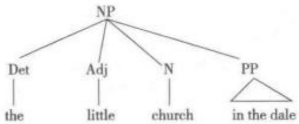

在短语“the little church in the dale”中，平铺结构分析将每个词项的语类标出，认为NP是由Det、Adj、N和PP按照线性序列排列而成。这种分析方法认为所有的词项都以NP为母节点，互为姊妹节。这种分析方法忽视了短语结构的层级性，无法体现语言的递归性，为绝大部分语言学理论所摒弃。

平调 level tone; static tone; punctual tone;stepping tone;register tone语音学术语。声调语言中的一种音调基本平直的调型。平调由音节上不变的水平音高所实现，没有向上或向下移动。汉语中又指平上去入四声中的平声调类。

平音 plain 音系学术语，亦称非降音(non-flat)。与降音相对。以频谱分析为基础的音位对立的区别性特征之一。降音表示在频谱中高频率成分的减弱，而非降音或平音则不具备这种特征。

评分者rater语言测试术语。指在口语、写作等产出性测试中，遵循一种既定评分标准，对被试进行评判的人。由于评分者在评分时易受个人偏好的影响，因而在评价过程中应采取相应措施提高其评估信度。

评分者培训rater training语言测试术语。语言测试学中指对评分者进行准备性的评分训练。一般以工作坊形式进行，主要介绍相关测试形式、评分标准、范例等；同时组织评分者进行试评，针对评分结果并讨论相关评分依据，只有其评分与参考分值相一致的评分者才能进行正式评分。在比较重要的考试中，还可以通过多人评阅等方式提高其信度。

评分者自身信度 intra-rater reliability; intrascorer reliability 语言测试术语。指一个评分者两次或多次对考生能力所作主观评定的一致性程度。如果两次或多次评定均为大致相同的评分，则评分者自身信度较高。

评估 assessment 语言教学术语，亦称评定。指对学习者的接受能力、学习效果或对一门课的教学质量、效果等所做的衡量。评估可以通过测试、观察、问卷、面谈等方法进行。

评价方法evaluation procedure句法学术语，亦称评价程序。衡量评价一种语法优劣的程序或方法。乔姆斯基认为普通语言学应该提供这样一套评价程序对语法的优劣进行测定。早期生成语法理论中的评价方法是考察语法的简单程度，语法应该越简单越好。伴随普遍语法理论的完善，评价方法要求每种语言的语法都体现普遍语法，或者说用普遍语法来解释语感。20世纪90年代后，乔姆斯基在最简方案中认为人类语言的设计应该是“自然选择的进化过程中接近完美无缺的产品”，评价方法也逐渐转到语言设计的完美性上面。

评价理论Appraisal Theory 话语分析术语。由马丁(James Robert Martin)和怀特（PeterWhite)于2005年提出，其理论基础是韩礼德的系统功能语言学。根据系统功能语言学理论，语言是一种可进行语义选择的网络系统，具有概念、人际和语篇三大元功能。评价理论是语言三大功能理论中人际功能的拓展和延伸，属于人际功能的范畴，是一套运用语言表达态度的资源体系。评价理论关注的是说话人如何在话语中建立自己的态度与立场的问题，表达对人或事物的观点、态度和推断；评价系统的核心是态度，态度的外部表现靠语言来表述；语言在该系统中是“手段”，通过对语言的分析，评定语言使用者对人物、地点、事物、事件、现象等的肯定或否定态度，同时以协商的姿态表明自己对事态的立场、观点和态度。评价理论的关注点是赋值，即语篇中被协商的态度类型、其中所涉及的情感力度以及价值来源和读者结盟的各种方式。整个评价理论的评价系统包括三大次系统：态度(attitude)、介入(en-gagement)和级差(graduation)。态度次系统的“态度”指说话者或文本的作者通过参照情感反应或特定文化决定的价值体系对参与者或过程做出的带有主体间性的反应。态度次系统包括情感(affect)、鉴赏(appreciation)和判断(judgment)，其态度意义可分为肯定和否定。介入次系统的“介人”指语言学意义上的“态度”介入，指人们使用语言表达态度的时候，要么单刀直人、直陈所思，要么假借他人的观点、思想或立场等间接地表达自己的思想、观点或立场。语言使用者用者利用介入手段调节对所说或所写内容所承担的责任和义务。语言使用者是否“介人”责任，主要通过投射(projection)、模糊词语(hedging)和情态(modality)等手段来评判。介入可以由自言和借言实现，自言意味着排除对话性(elide dialogism)，没有投射。级差次系统指态度的增加和衰减，通过语势(force)和聚焦(focus)来发挥作用，关注对态度介入的程度进行分级的资源。分级把所有评价的价值根据强度分出高低值，是跨越整个评价系统的资源。

评价系统 appraisal system神经语言学术语，指大脑对各种语言刺激进行评估的大脑系统，其评估内容包括新奇度、关联度、处理能力以及自我或社会形象等。语言教学术语。指行政机构、学校或者某些教学组织为了保障教学活动的正常有效实施，在适当时候对教师的工作表现进行定期检查和评估而建立的一整套程序。评价可分为上级评价、同事评价、学生评价和自我评价。正确的评价系统是进行有效监督和了解教学进展、保证和改进教学质量、总结教学规律的有力保障。

评判员间信度inter-rater reliability语言测试术语。指不同考官或评判员对考生的能力各自作出主观评价的一致性程度。如果不同评分人根据同一评分等级表对学生评定等级时，各自的主观评定大致相同，则可以认为该等级量表具有高度的评判员间信度。

评论分句 comment clause 句法学术语，亦称讲述分句。指对句子中其他分句进行评论的子句。例如：[1] This dictionary， I believe，is the one-off in the history of linguisties. [2] As for me, I'vemade tremendous effort to contribute to the book.例[1]中的“1 believe”，以及句[2]中的“as for me”。从句子结构上来看评论分句具有附加语(adjunct)或分离语(disjunct)的作用，故而有人认为其可有可无。

评注性副词evaluative adverb 语法学术语。指可以充当状语表达各种语气，也可以充当高层谓语对所表达的命题或述题进行主观评注的一种副词。例如：[1]你究竟是谁？[2]到底哪一个好？

迫不得已原则last resort 句法学术语。指柯林斯(Chris Collins)归纳的句法经济性原则之一:句法操作非到迫不得已时不要进行(Collins，2001)。换言之，只有在若不进行诸如移位、合并等有关的操作就会推导出不合语法的结构的前提下，才进行句法操作。徐烈炯(2009)将此情形称为“最后一招”，其典型的例子是“复指代词(resumptive pronoun)”的使用。例如：

[1] a. That's the girl [that I like].

b. " That's the girl [that I like her].

[2] a.That's the girl [that I don't know [what said]].

b. That's the girl [that I don't know [what she said]].

例[1a]中“like”后面的宾语位置必须为空(无论分析为“thegirl”移位还是有算子约束空位)，若如[1b]添上替补代词“she”，则句子不合语法。在例[2]中，因为存在关系从句孤岛，孤岛内的成分无法移出，空语类也无法回指孤岛外面的成分，若不增加一个有形的替补代词“she”，句子就不合语法，因此替补代词的增加是迫不得已原则的体现。

破格anomaly 语法学、句法学术语。指偏离 语法规则、语义上互不相容或自相矛盾，但在习惯上 能被容忍、甚至被认可的一种语言现象。例如：[1] More haste, less speed. [2] Aren't I? [3] more ea's.另如宾格“me”代替主格“I”，或者主格“who” 代替宾格“whom”，例如：[4]—Who's there?—Me. [5]Who do you want to see? 破格也可能导致变 异现象，产生不可接受的句子。例如：[6]This program is for musie-lovers who dislike music. [7] Mr. Black is killing phonemes.

破碎英语broken English指由于感情激动或出于低能、表达力差、心理因素等其他因素所致的支离破碎、断断续续的英语言辞。指语言水平低下、衔接连贯拙劣、前言不搭后语的英语。

破头 broken head 语音学术语。在冗长的渐降语调中，为了打破其单调性而又不破坏语调的完整性，在适当的地方另起一个头的做法。破头的重读音节的音高需要提到略低于第一重读音节的水平，书写上在破头处放一个↑'。例如：Theycameto call ↑ yesterday after'noon, 过长的语调头可以不止破一次： The 'old forge 'stood a ↑ little 'waya'part from the ↑ other 'house in the 'village.

破折号dash 语法学术语。一种标点符号， 书写形式为“—”，比连字号长(英语中占一个汉字的 长度，中文里占两个汉字的长度)，用以表示思维的 突然中断、分割成分或解释说明。例如：[1]He's running for reelection— if he lives until then. [2] Very few people in this class— three, to be exact have completed their projects. [3] She joined the chorus for only one reason— she loves to sing. 在 最后一个句子中，当破折号用于句末，而不是句子中 间时，可以由冒号代替破折号的功能。

普遍基础假设 universal base hypothesis转换生成语法的一种观点，认为一切语言都具有一套本质上相同的句法规则，语言的不同仅仅在于表层结构，而不在于深层结构。

普遍天赋主义 general nativism 生成语言学术语。指关于人脑的各种具体特性是生物遗传特性的理论。根据乔姆斯基的观点，儿童语言的发展是生物遗传的普遍语法原则发展的结果。

普遍唯理语法rational grammar参见“唯理语法”。

普遍唯理语法2 General and Rational Gram-mar参见“波尔-罗瓦雅尔语法”。

普遍语法universal grammar 生成语言学术语。指关于存在适用于任何人类语言的语法系统的假设，由乔姆斯基(1957，1965，1976)提出。乔姆斯基认为，人脑中存在一个习得语言的特别系统，即普遍语法(Universal Grammar)。普遍语法是建立在乔姆斯基等生成语言学家提出的“原则与参数理论”(P&.PTheory)基础之上的模型。原则与参数理论将普遍语法视为包括一套语法的原则和参数(principles and pararneters)。这套语法的原则和参数是所有人类的生物遗传属性。普遍语法对语言能力的描写是在无标记的核心语法(coregrammar)的假设上进行的。20世纪90年代该理论模型发展为最简方案(Minimalist Program；MP)模型。在儿童的母语习得过程中，普遍语法由理想初始状态(initial state)向稳定状态(steady state)发展。理想初始状态指儿童出生时大脑所处于的生物遗传状态；伴随他的成长，不断接触语言，有了一定的语言经验后，普遍语法不断发展，最终由理想初始状态达到稳定状态。普遍语法可以被外在语言环境所激发(trigger)，是语言发生的内在原因，并不是某种具体语言的具体语法(particular grammar)。普遍语法加上具体语言经验才构成具体语法。根据原则和参数理论，普遍语法有一套产生短语的普遍原则和限制原则运作的参数。普遍原则包括X阶标理论(X-bartheory)、格条件原则(case condition principle)、毗邻条件原则(adjacency condition principle)、扩展投射原则(extended projection principle)等。例如，根据格条件原则，一个名词短语(NP)的生成必须有格，而格只能由动词(V)或介词(Prep)分配到宾语的位置，或用助动词(Aux)分配到主语的位置。格条件原则表明一个名词短语只能出现在主语或宾语的位置上，即使移动时也只能移动到格分配的位置，否则就违反了该原则。再如，根据毗邻条件原则，一个格分配者和格接受者必须相互毗邻。这解释了为何动词与其直接宾语之间不能插入其他短语。例如：[1]Rita deposited the shopping on the table. [2] \* Ritadeposited on the table the shopping. 由于例[2]中的动词 deposited 和名词成分 the shopping 的位置分布违反了毗邻条件原则，因而不能给后者赋格，从而导致句子不成立。另一方面，虽然某些语言现象是人类语言所共有的，但有些语言现象是某些语言特有的。语言间存在的类似差异称为参数差异(para-metric variation)。参数随具体语言经验的变化而变化，为自然语言提供语言变异。参数值具有二元性(binary)，一种语言可能允许或不允许某种参数。参数可能性的选择称为参数设定(parameter setting)。例如，wh成分构成疑问句，一种参数是移动，另一种参数是不移动。英语属于wh移动语言(wh-movement language)，而汉语属于非 wh 移动语言(wh-in-situ. language)。另一种常见的参数是方向参数(directionalityparameter)，其参数值为右向(rightward)或左向(leftward)，英语的动词短语具有右向方位性(rightward directionality)，而日语的动词短语则具有左向方位性(leftward directionality)。参见“最简方案”。

普遍语法可及性accessibility of UG;avail-ability of UG语言习得术语。指就乔姆斯基提出的普遍语法的原则与参数理论是否适用于解释第二语言习得、限制母语习得的普遍语法是否也会限制二语习得过程而提出的一系列假设。其核心问题是：第二语言学习与母语习得是两个性质相同的过程，还是具有根本差异的过程。目前就这一问题观点可归纳为三大假设：直接可及说(direct accesshypothesis)、不可及说(no access hypothesis)和间接可及说(indirect access hypothesis)，一般统称为“普遍语法可及性三假说”。直接可及说认为：在二语习得过程中，二语学习者直接完整地利用普遍语法的原则和参数，包括母语中尚未体现的部分，一语习得中的根本性语言能力在二语习得中同样至关重要；学习者体察第二语言输入中的恒定属性，激活在母语中不起作用的那部分普遍语法原则，按普遍语法允准的值重新设置参数，学习者的语法完全由普遍语法确定。不可及说认为：基于一语习得和二语习得是完全不同的习得过程的假设，不可及说认为儿童一语习得与成人二语习得有根本性质的差异，即只有儿童一语习得者利用普遍语法，而否定普遍语法对成人二语习得的作用。儿童第一语言习得依赖的是天生语言能力，但是成人第二语言习得主要诉诸非语言策略和能力并依靠信息处理原则和问题解决策略。间接可及亦称部分可及(partial access)。间接可及说认为，二语习得者实际上有机会接受普遍语法的原则和参数的指引。但是，至少在二语习得的最初阶段，这种指引是通过第一语言语法进行的，有可能在第二语言输入接触的过程中，中介语的语法会经历重新构建和参数重置的过程。

此外，苏珊娜·弗林(SuzanneFlynn)还提出了与竞争模型(Competition Model)相关的双可及性假设。此假设认为成人二语习得者一方面继续基于普遍语法发展语言能力，但也会利用解决问题的普遍方法。这两者在第二语言习得中相互竞争，解决问题的方法阻碍了语言能力的完全习得。在青春期，当二语习得者达到了皮亚杰正式语言操作阶段(Pi-agetian stage of formal operations)时，会自动生成处理抽象语言现象的能力，而成人的这种解决问题的能力会干扰普遍语法的形成。该假说在一定程度上解释了为什么成人达不到本族语者语言水平的原因。

目前，“直接可及说”和“间接可及说”的概念已被“完全可及说(full access hypothesis)”所取代。从狭义上讲，完全可及说认为，不管第一语言的参数怎样设置，普遍语法都会在中介语语法中起作用。随着普遍语法可及性理论的发展，研究的热点开始从“普遍语法是否可及”或者“普遍语法对二语习得究竟起到什么样的作用”等问题，转移到对中介语语法性质更为细致的研究，尤其是中介语语法是否显示出自然语言所特有的性质。

普遍语言 universal language 亦称通用语言。指可以作为全世界一切言语社团间交流信息的通用媒介的语言。普遍语言包括如英语、法语等自然语言，也包括为便于国际间的交流而创造出的人工语言，如世界语(Esperanto)、国际辅助语(Interlin-gua)和新创语(Novial)等。但迄今为止，人工语言的实际使用远不如自然语言，它的普遍语性质尚处于理论阶段。

普遍主义universalism 语言哲学术语。指某些语言研究方法的总称。这些研究方法认为各种语言和一个最高的哲学系统中的逻辑系统之间存在紧密联系。例如，12世纪拉丁语经院语法或17—18世纪法国的波尔-罗瓦雅尔(Port Royal)语法就是这种观点的体现。

普通名词 common noun 语法学术语。指语言中非特定的人、地点或事物的名称，如字典、读者、书桌等。普通名词与专有名词(propernoun)相对，后者指特定的人、地点或事物，如伦敦、普京、特奥会(SOG)、世博会(EXPO)等。英语专有名词的第一个字母要大写，普通名词则不需要。普通名词包括抽象名词(abstract noun)、形容词代名词(adjecti-val noun)、动物名词(animate noun)、集合名词(col-lective noun)、具体名词(concrete noun)和可数名词(countable noun)等。

普通内在论 general nativism 参见“特定先天论”。

普通语言学general linguistics 指对各个语言学本体分支中的基本概念、理论、模式和方法进行研究的总称。普通语言学的研究范围主要包括语音学(phonetics)、音系学(phonology)、形态学(mor-phology)、句法学(syntax)、语义学(semantics)和语用学(pragmatics)等。诸如社会语言学(sociolinguis-tics)、心理语言学(psycholinguisties)、计算语言学(computational linguistics)、应用语言学(applied lin-guistics)、神经语言学(neurolinguistics)、自然语言处理(natural language processing)等属于跨学科的宏观语言学分支。

普通语义学 general semantics 亦称一般语义学。波兰裔美国哲学家、数学家阿尔弗雷德·考尔兹比斯基(Alfred Korzybski)提出。指语言的语义概念化，更多侧重于思想意识(ideological)而非语言学(linguistic)本身。斯图亚特·蔡斯(Stuart Chase)在其 1938年版《词语之暴政》(The Tyranny ofWords)中认为普通语义学研究说话者、语言和现实三者之间的关系，可以把人类从语言的“暴政”中解放出来。与唯物主义导向的反映论(reflection theo-ry)相对，普通语义学以为，由于现存的语言结构人类不能客观地构思(conceive)现实，因而经验的语言传递一直由某些抽象结构（abstractions）和符号(symbolizations)所决定。因此，出于教学考虑，有必要看透语言对现实的操纵(manipulations)和歪曲(distortions)，揭开语言可能掩盖现实的面纱。

谱系分类法 genealogical classification;ge-netic classification 语言类型学术语。指假定语言从共同祖先发展而来，然后根据语言的某些语音、词汇、语法规则之间有对应关系而对现有语言进行分类的方法。19世纪，欧洲的比较学派研究了世界上近一百种语言，发现有些语言的某些语音、词汇、语法规则之间有对应关系，有些相似之处，他们便把这些语言归为一类，称为同族语言；由于有的族与族之间又有些对应关系，又归在一起，称为同系语言，这就是所谓语言间的谱系关系。语言谱系关系通常用树形图(tree diagram)表示，叫做“语系谱(familytrees)”，其中“谱”取家谱的隐喻义，实际上是一种比较研究的方法。目前语言学界对语系、语族的分类还有争论，但主要语系有印欧语系、汉藏语系、阿尔泰语系、闪含语系、高加索语系等。以分布最广泛的印欧语系为例，其下细分为日耳曼(Germanic)、罗曼(Roman)、凯尔特(Celtic)、波罗的海(Baltic)、斯拉夫(Slavic)、印度一伊朗(Indo-Iranian)等语族。其中日耳曼语族分为：西语支，包括英语、德语、荷兰语等；北语支，包括瑞典语(Swedish)、挪威语(Norwe-gian)、冰岛语(Icelandic)等。罗曼语族包括意大利语、法语、西班牙语、葡萄牙语等。凯尔特语族分为：布立吞语支(Brythonic)、包括威尔士语(Welsh)、布列塔尼语(Breton)和戈依德尔语支(Goidelic，包括爱尔兰语、苏格兰语)。波罗的海语族包括：立陶宛语(Lithuanian)、亚美尼亚语(Latvian)。斯拉夫语族分为：东语支，包括俄语(Russian)、乌克兰语(Ukraini-an)和白俄罗斯语(Byelorussian):西语支，包括波兰语(Polish)、捷克语(Czech)、斯洛伐克语(Slovak)等；南语支，包括保加利亚语(Bulgarian)、塞尔维亚—克罗地亚语(Serbo-Croatian)、斯洛文尼亚语(Sloveni-an)、马其顿语(Macedonian)等。印度—伊朗语族分为：伊朗语支，包括波斯语(Persian)、普什图语(Pashto)、库尔德语(Kurdish)、奥塞梯语(()ssetian)

等;印度语支包括梵语(Sanskrit)、印地语(Hindi)、乌尔都语(Urdu)、孟加拉语(Bengali)、旁遮普语(Punjabi)等。印欧语系各语言均是屈折语；广泛利用词缀和词干元音音变来表达语法意义；名词和大部分形容词有格、性和数的变化；动词有时态、语态和语体的变化，主语和动词在变化中互相呼应。虽然世界上的语言大多都有较为明确的谱系归属，但还有一些语言的谱系归属不明，如日语和朝鲜语，一度被认为属于独立语言。

谱系关系affiliation 语言类型学术语，亦称语言隶属关系。指一种语言与其所属语系的始源语言之间在起源学上的亲缘隶属关系。例如，德语、英语都源于古日耳曼语，因此它们与古日耳曼语之间存在谱系关系。再如，汉语和藏语来自史前的原始汉藏语，属同出一源的亲属语言，与原始汉藏语存在谱系关系。

谱系树 family tree 语言类型学术语。19世纪由德国语言学家施莱歇尔(August Schleicher)提出的表示语言间亲缘关系的树形分枝图。基础语经过不断分裂，形成多种亲属语言，犹如树的主干长出各个分枝，各个分枝再长出多个枝头。例如，法语和西班牙语同属“罗曼语族”，都是从拉丁语发展而来，它们又同属于“印欧语系”，因为语言学家认为它们和其他许多欧亚语言一样源于同一个语言。原始犹他一阿兹特克语系的语言谱系树举例如下：

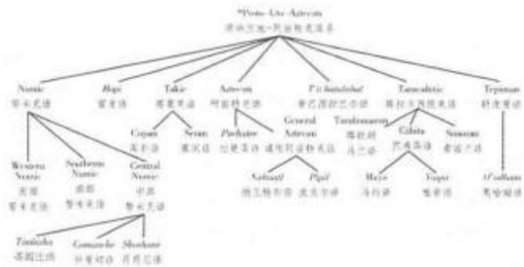

参见“谱系树理论”。

谱系树理论 family tree theory; genetic treetheory语言类型学术语。指对有共同来源的语言进行历史比较研究的理论。它着眼于语言在时间上有规律的发展，表现语言间类似于生物系族那样的异同关系。谱系树理论把具有共同来源的亲属语言分成不同的族系。在语言内部，又按关系的亲疏分成不同的语族和语支。同一语系内各个亲属语言的共同来源称为始源语。同一来源的语言在语音、语法和词汇方面都有共同的地方。谱系理论建立在对亲属语言之间的语音、词汇和语法对应关系的研究基础之上，系统的语言谱系研究始于19世纪历史比较语言学兴起之后。德国语言学家施莱歇尔(August Schleicher)提出的谱系树模式是谱系理论的一个重要发展。目前，在语言的谱系分类上还有很多争议，许多学者提出了多种不同的分类方案，少则8种，多则100多种。除对印欧语系的划分意见比较一致外，对其他语系的划分则存在很多分歧。

谱系说pedigree theory历史比较语言学术语。受生物学分类的启发，历史比较语言学设计出了有亲属关系的语言历史演变树形谱系图，认为世界语言具有共同的原始母语语言，有亲属关系的语言经过演变，产生了现在的各种不同的语言。

谱系语言学genetic linguistics 指研究语言谱系关系的一个语言学分支。语言中的谱系关系通常指属于同一语族的各语言之间的关系。为避免与生物学意义上的“生物基因”意义相混淆，语言学家常用“语言宗谱关系”(genealogical relationship)—词替代“语言谱系关系”(genetic relationship)这一术语。有宗谱关系的语言通常属于同一个语系，语言间关系通过比较语言分析法来确立。如果两种语言中的一种起源于另一种，或者两种语言均起源于同一语言，这两种语言具有谱系关系。例如，意大利语源自拉丁语，因此两者有谱系关联；西班牙语也源自拉丁语，因而西班牙语和意大利语也有谱系关系。语言接触而产生的语言之间的相互影响并不参与构成语言之间的谱系关系或者拉近谱系上属于远亲的语言之间的关系。例如，英语曾深受法语的影响，虽然两者同属印欧语系，但英语属于日耳曼语族，而法语属于拉丁语族;波斯语(属于印欧语系印度一伊朗語族)曾深受阿拉伯语(属于亚非语系的闪米特语族)的影响，但波斯语属于印欧语系的印度一伊朗语族，而阿拉伯语则属于亚非语系的闪米特语族；日语也曾深受汉语的影响，然而汉语属汉藏语系汉语族，日语的谱系归属尚不明确。混合语言、皮钦语和克里奥耳语一起构成特殊的语言谱系类，因为它们并非线性地或直接源于某一种单一语言。参见“比较语言学”。

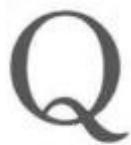

七行诗rhyme royal; rime royal 指诗歌中由七个五步抑扬格(iambic pentameter)的诗行组成的诗节(stanza)，其韵脚为ababbcc。例如，乔叟(Chaucer)的七行诗 Troilus and Criseyde;

The double sorwe of Troilus to tellen,

That was the king Priamus sone of Troye,

In lovinge, how his aventures fellen

Fro wo to wele, and after out of loye,

My purpos is. er that I parte fro ye.

Thesiphone, thou help me for tendyte

Thise woful vers, that wepen as I wryt.

七音步诗行 heptameter; septenary指由七个音步构成的诗行。英诗中指一行中有七重音的诗，多指十四音步的诗(fourteener)。英国诗人拜伦(Lord Byron)的 Youth and Age 为典型的七音步诗行，其节律构成可示意如下：

"Tis but | as iv y-leaves | around | the ruin'd| turret|wreathe,

All green | and wild|ly fresh | without, | but worn | and gray | beneath.

O could | I feel | as I | have felt, | or be | what I | have been,

Or weep | as I | could once | have wept | o'er man y a van|ish'd scene,

As springs | in des [erts found | seem sweet, | all brack| ish though | they be,

So midst | the with | er'd waste | of life, | those tears | would flow  to me!

齐普夫定律 Zipf's law 参见“计量语言学”。

tion 语言教学术语。指语言课堂教学中教师要求全体学生一起重复某一句型、单词等的操练方式。

歧义ambiguity语义学术语。指语言的任意性造成语言符号和意义之间缺少一对一关系，从而导致一个语言形式(单词、词组或句子)可能拥有数种不同意义的理解。歧义是自然语言的特性之一。根据其产生原因，可分为词汇歧义(lexical ambigui-ty)和语法、句法或结构歧义(grammatical，syntacticor structural ambiguity)两种。词的多义性(polyse-my)可导致歧义，词的同音同形异义性(homonymy)也可导致歧义。例如：[1] I need new glasses.[2]The ball was attractive,句[1]中“glasses”一词既可作“眼镜”讲，又可作“杯子或饮料”讲；句[2]中“ball”可作“球”讲，也可作“舞会”讲。诸如此类的多义词和同音同形异义词引起的歧义，可以通过语境的提供或改写释义的方式来消除。如上句[1]、句[2]可扩展为： [3] I need new glasses to see clearly. [4]The ball was attractive with nice music and a lot ofpeople.此外，语法、句法或结构的某些形式也往往导致歧义。例如：[5]We found him a humorousteacher. 这样的歧义可以通过语法结构的分析或根据语境的适当调整来消除，如句[5]可有[5a]和[5b]两种理解:[5a] We found him to be a humorousteacher. [5b] We found a humorous teacher for him.一般而言，在日常语言交际中，具体的语境和语音、语调在大多数情况下会帮助交流者正确把握语义，避免错误理解。在事实性和解释性写作的遣词造句中，歧义往往被视为一种错误；但在文学作品中，歧义则会有助于生成双关和双重句法，引起多重反映或联想，达到寓意丰富、表达微妙的修辞效果。参见“多义词”和“同音同形异义词”

歧义体 amphibology；amphiboly 语义学术语。指含义模棱两可、易产生歧义的语句或语言风格，特别是在语法结构方面。参见“歧义”。

祈求语气 optative mood 语法学术语，亦称祈求式或希求式。表示说话人对所说事物的情态，如愿望、意愿，常以动词的固有形式表现出来的语法特征，也伴随不同的形式变化，有别于虚拟式。英语里的祈求式往往借助情态动词或虚拟语气表示。例如:[1] May you be happy![2] (God) bless you![3] I wish I could fly.

祈使句 imperative sentence 语法学术语。指动词形式为祈使语气的句子，用来表示祈求、使役、期望、劝阻一类的意义，通常不带明显的主语。例如，汉语的“别说话”“请进”“祝你一路平安”“禁止吸烟”等，英语的“Give me the book."“Get out.”"Take care not to catch cold.""Look at what you'vedone.”等，均为祈使语句。祈使句的主语均被隐含地假设为第二人称。因为祈使应用于直接对话中，反身代词形式和反义疑问句中的人称代词可以证明主语的省略。受话人在场的事实往往通过使用呼语来表明。例如：[1] Batter my heart，three personedGod. 从语言得体的角度来说，纯粹的祈使句式使用得很少;除了在正式的权威性环境里或亲密的家庭圈子里以外，在其他场合使用来则过于草率甚至粗鲁。为礼貌起见，祈使句中有时带有诸如please或kindly之类的修辞成分，以减弱命令的语气，或者祈使句本身干脆由一个陈述句或疑问句来代替。例如:[2]Please put the cat out. [3]I wonder ifyou'd mind putting the cat out, please, [4] Couldyou put the cat out， please?从句[2]到句[4]，话语的礼貌程度逐一增强。

祈使意义imperative meaning 语义学术语。指要求对方做什么或不做什么的语用意义。前者具体表现为命令、请求、建议、劝告、号召、敦促、祝愿等；后者具体表现为警告、禁止、劝阻等。

祈使语mand指说话人命令、要求、请求受话人实施或完成某一行为的话语，其目的在于产生某种特定效果。美国心理学家斯金纳（BurrhusFrederic Skinner，1904—1990)在其著作《语言行为》(Verbal Behavior，1957)中用此概念来描述言语操作(verbal operant)的术语。祈使语是斯金纳在著作中所称的六种主要言语操作中的一种。斯金纳认为，祈使语的功能性关系指受缺失、满足或激励运作(motivating operations)所控制的一种言语行为形式。例如，当有人口渴时就要喝水、很大的敲门声可能是要求开门的祈使、仆人可能会回应孩子表示要牛奶的拍掌声等。拉马尔(Jennifer Lamarre)和霍兰(James Holland)在 1985 年从动态特性、扩展祈使语、迷信祈使语和神奇祈使语等方面对祈使语进行了研究。动态特性指祈使形式在缺失和刺激的控制下在能量水平上的变化，因此可理解为表现具有多重原因功能的变化;扩展祈使语指对物体或动物等不能刺激引发恰当反应的对象发出祈使，比如紧急中对即将伤及某人的物体或事件大声呼停“Stop!”;迷信祈使语指对无生命的物体的祈使，比如急于让一辆点火失灵的汽车赶快启动时，人们会说“Come on and start!”;神奇祈使语指想象的而实际上不可能或从未发生的祈使形式，如人们会说“能给我一百万英镑就好了!”但“百万英镑的好事”并没有发生在说话人身上。

祈使语气imperative mood动词的三种语气之一，指示说话人期望所说内容被对方执行的某种态度动词形式。例如：[1]Be quiet![2] Put iton the table.英语祈使语气无时态及完成式，但可用进行式。例如：[3] Be waiting for me at five. 某些语言中的祈使语气有两个时态，一是现在时，表示立即要执行的命令；二是将来时，表示延迟执行的命令。祈使语气一般有一定的句式，但有时可以改用其他语气形式的句子来表达意图或要求。例如：[4]Would you like some wine?

启动器 initiator 语音学术语。指充当空气发动源头的发音器官，如肺、软腭、喉、唇等，其中肺是发音时最常用的启动器。从空气动力学的观点看，启动器的作用好比风箱或活塞。

启发elicitation亦称诱发。指在语言研究的实地调查中从当地说本族语的人群获取可靠语言资料的做法。比如，在一个适当的语境中，引导和诱发本族语使用者使用和评议一句话以检验这句话的可接受性(acceptability)。采用间接调查，旨在避免受访人在对某些语段的“可接受性”进行判断时受到自我意识的干扰以致影响到结果。该做法表面上与调查目的无关，但更有可能揭示出分析者直接关心的特征。

启发功能heuristic function 参见“语言的发展性功能”。

启发技巧 elicitation technique 参见“引发程式”。

启发式heuristic 语言教学术语，与反启发式相对。在语言教学实践中指鼓励学习者通过经验或亲身经历进行学习。反启发式则指不遵循反复试验(trial and error)让学习者从失误中领悟并学会的原则，而是采取知识灌输的方法进行教学。

启发式教学法heuristics 语言教学术语。指以学习过程的客观规律为依据，充分调动学生积极性和主动性的教学思想和方法。与填鸭式教学法(cramming)相对立，启发式教学法主张运用诱导、类比、提示等方法促进学生思考，使其通过自身询问、体验、探索、发现等途径获取知识。语言学习中的启发法通常遵循一些自我感知的规律性操作原则(operating principle)，即运用语言学习者对目的语已有的句法结构知识来理解句子。例如，儿童在理解“Kate's doll”时可能运用的操作原则是：两个名词连用时第一个是拥有者，第二个是被拥有的东西。

启发性评估illuminative evaluation语言教学术语。一种教学评估方法，可用于语言教学评估。与量化性评估不同，启发性评估采用定性研究方法，评估结果多以描述性报告呈现，为教学改进提供更多参考信息，帮助制定和改良教学计划。启发性评估并不重视教学成果，而是试图对项目中课程教学的过程提供一个更为深入的了解，更注重对教学的执行情况和教学过程的评价，找出学生对教学法的真正反应及表现出的行为，作为改进的依据。因此，启发性评估的两大核心部分分别是“教学指导系统”(instructional system)和“学习环境”(learningmillieu)。前者包括教学计划、课程大纲，教学设备和教学方法以及以上各项在具体教学中的实施。学习环境主要包括学生学习和教师教学的硬件环境和社会一心理环境，是一个由文化、社会、教学机构和心理变量所构成的综合体。启发性评估所考察的问题包括：教学项目如何开展，项目受具体教学环境的影响，教学项目的优势和缺陷，以及教学对学生的智力发展和学业水平的影响等。具体评估由三个互有联系并重合的阶段构成：整体观察(encompassingobservation by investigators)、深入调查(further in-tensive inquiry)和解释阶段(explanatory stage)。评估中的数据来源包括观察、面谈、调查问卷、测试以及各类文件。

启蒙教学字母paedography;Initial Teach-ing Alphabet；ITA语言教学术语。指供教初学者识读英语而采用的一套拼读体系。此体系利用43个字母符号，试图通过减少英语拼写系统中的不规则现象来使英语更加容易识读。例如用whot代替what，liv代替live等。设计启蒙教学字母的目的是将其用作正常字母表的入门，而不是取而代之。

起点I-now-here-origo;I-now-here英语“origo”一词来自拉丁语，意为“起点”。指在言语情景中可以同时指代在人称、时间、空间层面上并列存在的话语成分。例如，1、you、yesterday、tomor-row、there、here在某一言语情景中可以同时指代不同的指称对象，属于I-now-here起点的词语。德国语言学家比勒(Karl Büler)于1934年出版的《语言的理论》(Sprachtheorie)中提出这一概念。

起句失误false start口语固有的一个特点。口语中的其他特点有犹豫不决、停顿、填充词(fill-ers)、后通道行为(back-channel behaviour)、重复和自我改正等。上述特点不出现于书面语。

起始符号initial symbol 句法学术语。指生成语法中最初一个不加定义的项目，为早期短语结构语法所采用，出现在第一条重写规则的左端。起始符号包括∑、S或CP，表示句子。起始符号与终端符号对立，后者指出现在语法生成的终端语符列中的符号。

语法学术语。用于对动词进行语法分析，指一类可以指明动作开始的体关系。在有“起始体”形态标记的语言里，这种体的意义译成英语大致相当于“beabout to”或“be on the point of".

起始语符列initial string 句法学术语。指仅有单一起始符号的语符列，重写规则从此处开始运用。起始语符列由成素(词汇成分和语法成分)和范畴符号组成的短语标记(phrase-marker)，可用的表达式为：∑=[P1，P2，P3……P]

气流 airstream 语音学术语，亦称呼吸流(breath stream)。指能够为发音器官发声提供动能的进人或呼出声道的气流。气流的产生源于肺部的呼吸运动，气流流经的通道包括气管、声门、口腔和鼻腔。如果气流在口腔和鼻腔经过时不受任何阻碍，那么发音器官发出的音为元音；如果气流在口腔和鼻腔受到阻碍，则发出辅音。

气流辅音breath consonant音系学术语，亦称清辅音。指只有气流克服阻碍形成噪音，但无声带振动的辅音，如[p]、[t]和[h]等。

气流机制 airstream mechanism 语音学术语。指人类用来发不同类型语音时空气动力的产生机制。所有人类语言均有用肺部呼气方式发音的气流机制，而用肺部吸气方式发音的气流机制则比较少见。通过吸气方式发音的音段称为内爆音(implo-sives)。比较常见的内爆音有双唇、齿龈和软腭内爆音，在国际音标中分别记作[6]、[d]和[g]。其发音过程可以描述为：在口腔中形成阻碍，将空气吸入肺中，释放阻碍，让空气通过内爆方式进入口腔。内爆音多见于非洲语言。根据产生气流的不同器官和方式，气流机制可以分为三种：首先是肺气流机制(pulmonic airstream mechanism)，以肺为气流的启动器官，通过肺的运动产生内吸或外呼气流，为语音的产生提供原动力；其次是喉气流机制(glottalic air-stream mechanism)，以喉为启动部位，通过声门的闭合收拢和声带的震动控制排向口鼻腔或吸入肺部的一小段气流，产生语音;第三是软腭气流机制(velaricairstream mechanism)，以软腭终端的小舌为启动部位，通过软腭的抬高与下垂控制气流流经口腔或鼻腔，分别形成口腔音和鼻腔音。还可以利用双颊或食道运动产生空气动力，但这两种气流机制很少见。

气流通道air passage 语音学术语。指为发音器官提供动能的气流所经过的腔道，包括气管、声门和咽腔，然后是口腔或鼻腔，如图所示。气流通道与人体自然的呼吸通道有所不同，正常的呼吸通道不经过口腔，而音系研究中涉及的气流通道主要是通过口腔作为气流到体外的通道，以鼻腔为气流到体外通道的鼻音在人类语言所使用的语音中所占的比例很小。此外，自然的呼吸通道是顺畅无阻碍的，但气流通道，尤其是从声门到口腔和鼻腔这一段，会受到各种各样的阻碍，以产生不同的音位。

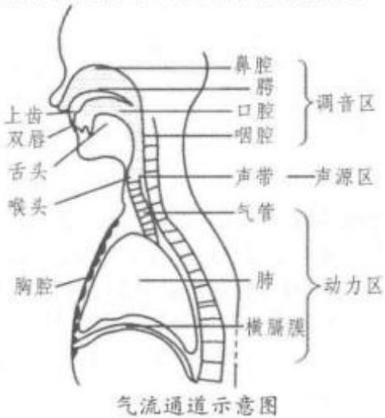

气群 breath group 语音学术语，亦称呼吸群。指一次呼吸内说出的话语。呼气结束形成停顿，以“气群一停顿—气群一停顿………”的形式形成语流。从社会功能角度看，话语均具有一定的意义，气群就是意义语调群的载体。一个意义语调群就是一个气群。然而一个气群不等于一个意义语调群，因为一口气通常可以说出一个以上的意义语调群。

气室 air chamber 语音学术语。指声道中可容纳气流作为语音产生动力源的相对独立的腔体，如口腔、鼻腔和喉腔等。

弃用obsolescence历史语言学术语。指词或词义被废弃而逐渐变得陈旧。例如，在英国英语中，radio已代替wireless，只有个别年长者仍在使用wireless一词。一个完全退出一般使用的词称为废弃词(obsolete)。②社会语言学术语。指一种语言逐渐消失，语言的传承终止，操本族语的人数减少。比如苏格兰盖尔语正在逐步变得过时，被英语所替代的趋势越来越明显。

迁移 transfer 亦称转移。①心理学中指已经习得的行为方式对将要习得的行为方式产生的正面的或负面的影响。②语言学习理论中特指第一语言或母语的语言特征迁移到目标语言中，从而促进或阻碍目标语言的学习。迁移分为正迁移(positivetransfer)和负迁移(negative transfer)两种。正迁移(positive transfer)可以促进目标语或第二语言的学习，而负迁移(negative transfer)则可能阻碍目标语或第二语言的学习。参见“语言迁移”。

谦恭复数 plural of modesty语用学术语。也作“社论式自称”(editorial we)，指在交际时指称自己用“我们”而不是用“我”，目的是拉近说话者与听者的距离，也是一种自谦的方式，即把自己与交际的另一方置于同一个平台上。例如，当大人让小孩上床睡觉时，通常会说“宝宝，我们睡觉了”，而实际上只是小孩睡觉。

前鼻化 prenasalization 语音学术语。指一个音段发音开始时有气流通过鼻腔，该音段(通常为辅音)与鼻音有相同的口腔发音部位，可以视为一个鼻音加辅音的辅音丛，也可以视为一个带有鼻音的辅音。例如，[mb]、[ⁿd]、[°g]可视为[mb]、[nd]、[ng]辅音丛。

前测 pre-test 语言教学术语。指学习之前进行的测验。通常学习之后还有个学习后测试(posttest)，用以与学习前的测验成绩进行比较，检测学生所取得的进步。还有一种理解是预先测试，指试题试用阶段的考试，以便根据考试的结果分析试题，在此基础上完善试卷。

前词递接 anadiplosis 参见“联珠”。

前词汇阶段pre-lexical 句法学术语。指在一些生成语法模型中生成深层结构的两个阶段的第一个阶段。此阶段生成标定句子派生过程各个阶段层级结构的短语标记(phrase-markers)，而短语标记中的终端节点都用△(德尔塔)表示。在第二个阶段，词项以包含句法特征(如[+名词]，[+抽象]等)复杂符号的形式插入相应位置。

前腭音 pre-palatal 参见“硬腭音”。

前行连锁练习forward chaining参见“顺连锁法”。

前喉塞塞音front implosive stop 参见“内爆塞音”。

前后倒置hysteron proteron 修辞学术语， 亦称逆序法，源自古希腊语。指将逻辑上应在靠后 的(hysteron)成分前置(proteron)。换言之，在语法 上将两个词或句子的正常语序颠倒处理，旨在突出 强调作用，吸引读者或听众注意力。例如：[1]born and bred → bred and born.[2] Let us die, and charge into the thick of the fight. [3] In a recipe that says that the oven should be preheated to 200℃ after it tells you to put the food in.

前化 fronting 音系学术语。指音段(尤其是元音)的发音部位向口腔前部或舌面前部移动的过程。例如，汉语普通话的元音/u/在舌面硬腭音后变成/y/就是前化。反义的过程为后化(backing)。

前景foreground 参见“前景化”。

前景化foregrounding文体学术语。与背景(background)，自动化(automation)和常规(con-vention)相对应，指在话语中相对突出的某个成分，好比在背景上凸现出一个人物轮廓(话语的其余部分称作背景 background)。前景化分为变异(deviation)和平行结构(parallelism)两大类型。俄罗斯布拉格结构主义学派理论家穆卡洛夫斯基(Jan Mukarovsky)强调文学作品中变异的方面。雅柯布逊(Jakobson)则将概念进一步阐发，强调前景化的平行结构。英国语言学家利奇区分了纵聚合前景化(para-digmatic foregrounding)和横组合前景化（syntagmatic foregrounding)，分别对应于变异和平行结构。前景化可出现在语言的音系学、形态学、句法学、语义学及语用学等各个层面。例如，运用韵脚、头韵、节律等手段是在音系学层面上的前景化。认知语言学术语。指借助语言表述中的强调手段达到对语言某一成分的突显，在认知语言学中，所谓突显(prominence)是指对语言所传达信息的取舍和安排。

根据认知语言学的观点，语言表达是一种具有动机性的行为，表达者的心理视点及动机在一定程度上控制着语言结构的最终布局。韩礼德曾从语言功能的角度将前景化界定为“有动机的突显”(prominencethat is motivated)。这一界定说明两点：一是语言结构中某一成分的前景化取决于表达者的动机；二是前景化在很大程度上就是突显信息(prominence)。

前景信息foreground information;foreground-ed information句法学术语，亦称凸显信息。句子信息结构中从背景信息引出的通常被认为是比较重要的新信息。

前舌背音pre-dorsal参见“舌背音”。

前提premise 指逻辑推理的前提，与语句或话语的“前提3或预设(presupposition)”既相关联又有区别。①语义学术语。指在确定句子的真值(truth value)与区分句子之间不同类型的逻辑关系时才讨论前提3或预设(presupposition)。语用学术语。根据斯珀伯(Dan Sperber)和威尔逊(DeirdreWilson)以及布莱克莫尔(Diane Blakemore)的观点，前提(premise)指导致言语行为意向形成的某种事件。它可以是先行的某一言语行为，也可以是先行的时间，还可以是正在进行和持续着的事件。前提(premise)属于语境因素，参见“预设”。

前提2prerequisites 音系学术语。用于描述音系分析程序的描述。根据20世纪40年代美国结构主义观点，音系分析应只以语音标准为前提，后来的对立观点则强调“语法前提”的重要性，如在运用最小对进行对比的方法之前必须预设已经确认的词和句子的概念。其实，音系学中的前提仍与预设无异。

前提3presupposition参见“预设”。

前提测试presupposition test参见“预设测试”。

前提分句 prolasis 句法学术语。具体指复杂条件句中的条件从句部分。

前文字阶段 preliteracy ①亦称识字前阶段。指儿童识字之前的语言发展阶段。②指存在文字记载之前的文化发展阶段。用于指称一些尚未形成其语言的书写形式的社会群体或文化。亦称前识解阶段。指对一些消亡或现存文化缺乏认知和识解的阶段。从无识解(illiteracy)到识解(literacy)，假定存在一个前识解阶段。其实直到19世纪末，由于缺乏书面文献，对一些文化的认知原本无识解的，仍然是无识解，并无所谓的前识解。

前限定词predeterminer参见“前置限定词”。

前序列 pre-sequence 话语分析术语。指说话者在交际时为了避免发生尴尬的情况而事先说些试探性话语。例如，在试图说服对方时，需要进行婉转的试探，以免对方拒绝接受而造成谈话双方的不愉快。参见“话语转换序列模式”。

前移fronting音系学术语。指历史音变现象，如音段(特别是元音)的发音部位向口腔前部移动的现象，如在希腊语、瑞德语和法语历史的不同时期里，在巴斯克语一些方言、英语的大多数苏格兰方言和一些美国方言里，历史上曾经有过/u/变成/y/的前化。再比如：因为受后继音的影响，/k/音位有前和后两个变体，如 key /ki:/和 car/ka:/。句法学术语。指为了强调，将单词或者短语放在从句或者句子前部的现象。例如：[1] I would really love totry that. [2] That I would really love to try (ob-ject fronted for greater prominence). 在句[1]中.“that”放在了动词后面，做宾语；为了强调“that”，在句[2]里，将其放在句首，出现前移现象。

前音front音系学术语。前部语音分作两类：(1)在口腔前部发的音，即口腔前音(与后音对立);(2)用舌的前部(或舌叶)发的音。同时满足这两个条件的前音有：(1)前元音，如英语的/i:/、/1/、/e/、//等音位；(2)一些辅音，如出现于英语词首的/s/、/z/、/θ/、/δ/等音位。该术语也是音系区别性特征之一。例如，英语中的元音/i:/、/1/、/e/、/æ/就具有[+前]的特征。

前语言学prelinguistics与音系学中严格的语言学研究(微观语言学)相对，尤其是在20世纪50年代被用来指对声音的发音和声学研究。按照这个参照系，前语言学是宏观语言学的一个分支。此概念有时还在这个参照系之外指语言学分析开始之前需预先考虑的一些因素，如获取充分的数据样品。②指对语言行为模式(performance model)进行研究的言语产出的假设阶段。从这个意义上来说，认知意识和认知注意力等心理学因素均可认为是前语言学范畴。在语言习得中，指儿童发声过程中出现语言形式之前的那个阶段。通常指出生第一年的后半年中的大部分时间。

前元音front vowel音系学术语。指发音部位在口腔前部的元音，如/ε/、/1/、/e/、/y/等都属于前元音。参见“亮元音”。

前增音prothesis语音学、音学系术语，亦称词首加音。指在词的起首处增加音段的现象，是增音的一类。这种现象常见于语言的历史演变。例如，法语词esprit、establir就是通过在拉丁语词 spiritus、stabilire词首加一个音/e/而形成的。

前黏着词 proclitic 形态学术语，亦称前附着词。指黏着词(clitic)的一种，以黏着语素的形式附在其后的主要语素上的语言单位。例如，法语中的J'和t'就是前黏着词，如Je t'aime [ftem](“我爱你”)。参见“黏着词”。

前照应 anaphora; anaphoric reference; back-reference语篇语言学术语，亦称前指、回指、逆参照。篇章中指下文的一个语言成分回指上文提到的另一语言成分，两者产生照应关系，与后照应或后指(cataphora)相对。照应是篇章的重要特征，它建立了篇章的关联。英语语篇的前照应通常涉及的语词包括：(1)第三人称代词(she，he，it，they);(2)定冠词(the);(3)指示代词(that);(4)不定代词(one);(5)动词(do);(6)在法律等正式文体中经常出现的省略现象等，如“the aforesaid”“the aforementioned”“the former”。参见“后照应”。

前指省略anaphoric ellipsis 语篇语言学术语。指将上文提及的人或事省略，以避免重复，也就是省略出现在上文中的先行项(antecedent)。例如：I'll remove the Christmas tree if you want (me to re-move the Christmas tree).句中括号里的内容为前指省略成分。

前指照应anaphora 参见“内部照应”。

前置preposing;fronting句法学术语。指 句子中一个组构成分移至前头一个位置的移位。通 过前置，对移位的成分加以突出或强调。例如：[1] Last week I finished my thesis. [2] They thought we'd be celebrating, and celebrating we were. 参见 “前移”。

前置词 preposition参见“介词”。

前置词补语 preposition complement 语法学术语，亦称介词宾语(preposition object)。参见“介词宾语”和“补语”。

前置词词组 prepositional group 语法学术语。意义等同于前置词短语，介词短语。参见“前置词短语”。

前置词短语prepositional phrase; PP 语法学术语，亦称介词短语或前置词组(prepositionalgroup)。介词短语是一项复杂的句子构成成分，可与不同的词类组合而形成不同的类别。介词可与名词组合构成“介词+名词词组(NP)”介词词组。例如：down the street;介词还可与副词组合构成“介词+副词”介词词组，如 since yesterday。介词短语在句中可充当状语、定语和宾语。例如：[1]Mark en-joys hiking in the mountains. [2] a little cottage inthe mountains [3] Mark keeps thinking a lot aboutthe mountains. 前两例中的“in the mountains”分别作状语和定语，第三例中的“about the mountains”为动词“thinking”的宾语。介词短语的内部结构及其在句中的功能和成分因不同的理论视角而得到不同的分析和解读。在X阶标(X-bar)系统中，PP语类被看成是P"词汇范畴的最大投射。PP可以包含限定词(specifiers)，如“right in front of her”和“waydown the street”中的 right 和 way 等。

前置词副词 preposition adverb 参见“副词小品词”。

前置限定词predeterminer 语法学术语，亦称前限定词。指在名词短语中出现在限定词之前的词，即名词短语中冠词或其他限定词前面的词或短语。在英语中，数量词 all， both，half，double， some,twice等均可作为前置限定词；短语 some of， manyof, a lot of 等也常常用作前置限定词。例如，在“both the boys”中，“both”为前置限定词，“the”为限定词;在“some of the teachers”中“some of”为前置限定词。

前置修饰语 premodifier 语法学术语。在有些语法描写模型中，指出现在短语(向心短语)中心语之前的所有语项。例如，在“All those cute littlered toy cars are made in China"中, "All those cutelittle red toy”整个部分都属于前置修饰语。在英语中，前置修饰语的词类主要为限定词和形容词，但要对这一复杂现象进行完整描述，还需涉及其他几个词类，如量词和程度副词也是研究前置修饰语所必需涉及的词类范畴。添加前置修饰语的行为和过程分别称作添加前置修饰语(premodify)和前置修饰(premodification)。参见“修饰语”。

前置序列 pre-sequences 参见“话语转换序列模式”。

前缀 prefix形态学术语。构词法中指位于词干、词根或词基(stem)前面的构词成分。前缀并不与某一固定的词类相关联，通常附着于动词和实词(substantive，即名词和形容词)两大类词之前。附着于动词之前的前缀有 be-、de-、dis-、en-、mis-、re-、under-等等;附着于名词和形容词实词之前的前缀有in-、im-、non-、un-等等。由此构成的新词也分别保留了其原先的词性，如 understand一misunderstand，polite—impolite。语素或词位(lexemes)通过转化(conversion)和派生(derivation)可形成不同词类的词。因而关于前缀存在着一个争议得问题，如encage、endear等词，是由于前缀en-使原有的名词或形容词动词化，还是由于名词或形容词词根的转化而形成了新的动词。这一问题至今仍未达成一致。另见“后缀”。

前缀法prefixation形态学术语。指把词缀加在词根(stem)前面的构词过程，如在understand前面加上 mis-构成 misunderstand;在 produce 前加人re-构成 re produce等。这种将词缀(affix)附着于词根之上以构成新的词是词汇构成的一个关键过程。对添加前缀的本质一直有所争议：从一方面来看，添加前缀与后缀法(suffixation)一样，是派生的一个主要类别：但从另一方面来看，添加前缀既不同于属于派生的添加后缀过程，也不同于合成构词过程，而应当被看作构词法的第三大类。

前缀语言prefixinglanguage语言类型学术语。指通过将前缀添加于词干、词根或词基的方法体现语法结构关系的语言，如班图语。参见“前缀”。

潜势potential语法学术语，亦称可能的。指一种言语语气(verbal mood)。这种状态可描绘一项是“可能的”还是“很可能的”的特定行为特征。印欧语言体系中没有单独的语法词项(paradigm)，主要借助虚拟语气来表达这种“可能的”和“很可能的”特性。

潜在辅音latent consonant语音学、音系学术语。与固定辅音相对，指原本存在、但仅在特定条件下才发声的辅音。例如，法语词末的辅音除了/ref1/等以外，其他辅音通常不发音；但其后的单词若以元音起始，词尾原本不发音的辅音则被激活而发音，如“bon appetite”。

浅层学习shallow learning 机器学习(ma-chinelearning)的一个发展阶段，指深度学习(deeplearning)出现以前的传统机器学习算法。20世纪80年代末期，由于人工神经网络的反向传播算法(backpropagation;BP)的发明，掀起了基于统计模型的机器学习热潮。利用BP算法可以让一个人工神经网络模型从大量训练样本中学习统计规律，从而对未知事件做预测。比起过去基于人工规则的系统，这种基于统计的机器学习方法在很多方面凸显出优越性。此阶段的人工神经网络，虽被称作多层感知机(Multi—layer Perceptron)，其实只是含有一层隐层节点的一种浅层模型，因而基于此模型的机器学习被称为浅层学习。浅层学习可以理解为单刀直入式的学习方法：给出一堆特征向量，经过一层模型直接获得结果。20世纪90年代，各种各样的浅层模型相继涌现，如高斯混合模型(Gaussian Mixture Model)、支持向量机(Support Vector Machine;SVM)、提升方法(Boosting)、最大熵方法(如逻辑回归logistic re-gression)等。这些浅层结构模型通常包含不超过一层或两层的非线性特征变换。通常来说，浅层学习可概括为下图的若干步骤：

浅层学习模型无论是在理论分析还是实际应用中都获得了巨大成功，在互联网领域得以广泛应用，如搜索广告系统的广告点击率预估、网页搜索排序、垃圾邮件过滤、基于内容的推荐系统等。然而，此类方法长期以来均难以达到令人满意的精确度，而且随着大数据时代的来临，浅层学习迎来新的技术挑战。一方面，大数据里包含的丰富信息维度使得浅层模型置身于欠拟合的状态，“大数据+浅层模型”不能深刻揭示海量数据里所承载的特征结构，因而无法充分发掘有价值的信息和知识；另一方面，浅层模型强调分类或预测为其主要职责，样本的特征需依靠人工经验来抽取，在模型选择正确的前提下，特征的好坏成为影响整个系统性能的瓶颈。2006年，计算机科学家欣顿(Geoffrey Hinton)、勒丘恩(Yann Le-Cun)和本齐奥(Yoshua Bengio)提出一种新的深度神经网络模型—深信度网络(deep belief net;DBN)，突破了深度学习的技术瓶颈，机器学习进入新时代。参见“深度学习”。

欠格 abessive case 语法学术语，亦称残缺格(caritive case)。语法中名词格的一种，用来表示某种东西的缺少或人的缺席。在乌拉尔语系芬兰一乌戈尔语族的语言中，这种格被称为欠格，在其他语言中，尤其是高加索语系的某些语言中，这种名词格被称为残缺格。在汉语中欠格与残缺格为可替换的概念。例如：芬兰语中的名词raha（钱)在词尾加上屈折词缀-tta/-ttä后变为rahatta（没有钱)，表示缺少或没有钱。

嵌入insert 亦称框架(frame)。表示说话人有意识地让听话人注意到某个情况作为句子的出发点，然后逐渐展开句子的其他内容。近似于韩礼德使用的主位(theme)和述位(rheme)，或话题(topic)和述题(comment)的概念。

嵌入分句embedded clause句法学术语。指将运用转换规则而得的结果插入(即嵌入)另一个句子的分句。参见“嵌套”。

嵌入句embeddedsentence句法学术语，亦称内嵌句。通过一定的句法手段嵌入另一个句子内部的句子。例如:The news that he had got marriedsurprised his friends,(他已经结婚的消息使他的友人感到惊奇）。参见“嵌套”。

嵌入体验 situated embodiment 认知语言学术语。体验认知(embodied cognition)的一种观点，由茨拉特夫(Jordan Zlatev)在其研究中提出。该观点认为因为体验出现在语言的语义结构中，所以它是一种嵌入(embedded)或者位于(situated)社会文化环境的实践。这种视角提倡把体验的物理空间层面和它的基本社会本质综合起来，究其本质体验是在人类社会中实践、互动和履行功能的结果。

嵌套 embed; embedding; embedded; em-bedment句法学术语，亦称嵌入。①指一个句子包含在另一句子中并形成主从关系的过程或组构方式。有别于并联(或并列)。例如：[1]The manwho has a suitcase is in the bar. [2] a, The manhas a suitcase. b. The man is in the bar. 从派生过程来看，先有句子[2a]，它又嵌套在母句[2b]中。由此通过一定的句法手段嵌入另一个句子内部而生成的句子称为嵌入句或内嵌句(embedded sentence)。②在转换生成语法中，指将成分(constituent)结构插入主句(matrix)的过程，即一个句子在另一句子中的出现。嵌套在理论上可以反复应用无限延伸。通过这种方式，传统句法中常见的主从句的区别就成了母句与分句(或嵌入句)的区别。

强调emphasis指用语言学手段、副语言手段(如语调、重音、停顿等)以及语言外手段(如表情、身势动作)突出词语意义或加强感情表露的做法。如果用高音调(pitch)或加重音(stress)读一个词或语句乃至语篇的某个部分，便表示对该词或该部分在话语中的特殊重要性加以强调。例如：[1]Give it to you，not to me.(强调“给的是你”。) [2]There is a saying: yesterday is history, tomorrow isa mystery, but today is a gift. That is why it iscalled the“present.”②指通过韵律(prosody)特征、选词或词序等来强调某种交际意图，使传递出的意思比实际表达出来的要多。例如：[3]Be a man![4] He has such charm ... 很多修辞手段可以帮助实现强调，如赘语(tautology，pleonasm)、陈词滥调(cliche)、明喻(simile)、反语法(litotes)、感叹词(in-terjection)以及感叹句(exclamation)等。

强调词 emphasizer 语法学术语。指起到宽 泛的强调作用的副词或副词词组。例如：[1]It actually worked. [2] I frankly detest him.

强调代词emphatic pronoun语法学术语，亦称强势代名词。人称代词的一种形式，强调发生行为或接受行为作用的是事物本身的代词。英语中这些代名词与反身代词形态相同，而法语则不尽相同。例如：[1]I mysel f cooked the dinner.（我亲自烧了这顿饭。)[2]Moi，je suis Français.(我嘛，我是法国人。）强调代词起强调意义或引起注意的作用。

强调句 emphatic sentence 语法学和修辞学术语。指句子具有或呈现的易于使人产生强烈印象的一种修辞手段，包括：(1)短句；(2)掉尾句(periodic sentence，亦称圆周句）；(3）对称句（balancedsentence)。短句因其简短易记，给人感受到的冲击力强，故而鼓动性的演说词多运用短句，易产生效果。掉尾句把次要的思想放在句子开头，句义的关键信息和完整性要听到句未才能得以揭晓。例如：[1] Though Mary was interested in music, she final-ly decided to study English.对称句中主要意义在后半段出现，前半句造成悬念引人入胜，使读者的兴趣和注意力保持到最后，因而是一种有效的强调方法。其平行对偶的结构、鲜明对立的意境，能使一个概念在人的心目中产生较强的印象。例如：[2]United, there is little we can't do; divided, there is lit-tle we can do.(同心同德则无事不可为，离心离德则无事可为。) [3] As my funds diminished， my hun-gergrew.(钱囊日渐瘪下，饥饿日益见长。)

强调肯定词 emphatic affirmative 语法学 术语。指用在肯定句中、与动词一同构成强调的助 动词“do”，在句中需要特别重读。例如：[1]Ido like strawberries. [2] You did do that well.

强调音emphatic 音系学术语，亦称强势齿音。指阿拉伯语发音时嘴里的舌头宽而平，舌头前部放低，所造成的咽化(或软腭化)发音。

强调重音emphatic stress音系学术语。逻辑重音和感情重音的统称。一般来说，与意念相关的重音为逻辑重音，而与感情相关的重音为感情重音。

强度修饰语intensifier； intensive语法学术语。用于修饰等级形容词、副词、动词或-ed分词的一类词。强度修饰语通常对句子中的另一成分的意义起增强或减弱的作用，如 particularly(特别地)、definitely(绝对地)、a bit(稍微地)等。

强发音forte articulation语音学、音系学术语。指由于情境或突出表现情感的需要而提高音段发音强度的现象。

强化 reinforcement刺激—反应理论(stim-ulus-response theory)中指反应出现后继发的、能决定同样的反应是否重现的刺激。美国心理学家斯金纳(Burrhus Frederic Skinner)认为语言行为就是“刺激一反应一强化”逐渐形成的过程。学习就是形成反应与反应之间的联系，而强化作为反应出现后的又一个刺激，对于再反应有决定作用。强化的方式主要包括正向强化和负向强化。前者亦称积极强化，即增强反应可能性，如对作出适当反应的个体立即给予奖励；后者亦称消极强化，即减少反应可能性，如惩罚和逃避性学习。在学习过程中，正向强化(如教师的赞许与支持)是鼓励学生产生所期待的、持久性行为变化的一种附加信号。

强跨越 strong crossover 句法学术语。参见“跨越”。

强烈劝告语气hortative mood指一种语 气表达范畴，包括恳请、告诫、敦促、劝告等。例如： [1] Let's unite![2] Let it be as it is!

强式strong form 音系学术语。指在一个连续的有声言语语段中一个词可能存在的两种发音中的一种，另一种是弱式(weak form)。例如：[1]Hecan (/kæn/) pay us, [2] He can (/kan/) pay us,例[1]中，重读的can即属强式，表示“他[一定]能付给我们”，强调万无一失的可靠性；例[2]即不重读的弱式，不再强调是否具备绝对的可靠性。同一词语的强式与弱式音质不同，发音时间长短各异。

强式动词 strong verb语法学术语。在语法中，有时指通过改变元音构成过去时和过去分词的动词，如 begin→began→begun，sing→sang→sung。

SMT 句法学术语。乔姆斯基(2000)提出的关于语言系统(linguistic system)和表现系统(perform-ance system)关系的论断。强式最简命题认为，语言是对语言机制必须满足接口条件的最优解答，是连接声音和意义的最优方式，是一种“完美”的设计。强式最简命题影响了语言系统中那些必要机制的推定。其中最重要的一个机制推定是合并操作(merge)，是强式最简命题论断下普遍接受的最基本句法操作。乔姆斯基(2009)和奥特(Ott Dennis，2009)认为合并操作是无限的(unbounded)，任何两个成分都可以合并，而阿德加(David Adger，2003)和斯特罗科(Thomas Stroik，2009)认为两个能够合并的成分必须具有能够相互匹配的特征。

强势代词 intensive pronoun 语法学术语。 指用来强调或确证事物本身的反身代词。在句中不 占据变元位置，仅用来强调另外一个明显的与它共 指的名词短语(NP)的反身代词。例如：[1]Hehimself told me so.(他本人这样告诉我的。)[2]Doing is itself learning.(践行本身就是学习。)

强送气rough breathing语音学术语。指古希腊语中的一种由强送气符所标记的、位于词首的/h/强送气音。如字母rho在古希腊语中表明一个单词以/h/强送气音开始。

强送气符 rough breathing symbol 音系学术语。一种代表强送气的附加符号，标记在一些单词的首元音上。在希腊语中该标记表明该首元音为送气音，或者置于ρ上标明该音不发音。字母rho在古希腊语中表明一个单词以/h/强送气音开始。

强特征 strong feature 句法学术语。指最简方案中特征的表征之一，可以造成显性移位(overtmovement)；与弱特征(weak feature)相对，同为句法结构中非终端节点所具有的属性。例如：[1]a.1care not for her. (莎士比亚英语)b. [πp I [τ [τcare, ] [vp not [v t, [pp for her]]]]]. [2] I don'tcare for her.(现代英语） 诸如例[la]的莎士比亚时代英语否定句，其句法结构如例[1b]所示，可以直接将动词移动至否定词not之前；而例[2]所示的现代英语，必须使用do加以支持。原因在于莎士比亚时代英语的 T 具有强动词特征(strong V-feature)，可以吸引动词进行V→T移位。现代英语的T不具备这种强动词特征，无法吸引动词做这种显性移位。乔姆斯基(1993)提出，强特征如果没有在显性移位中获得核查，也无法在LF层面进行隐性核查，将使得推导崩溃。

强制曲拱原则 obligatory contour principle音系学术语。在生成音系学的某些模型中，指一个表征中不允许有两个相同的邻接成分。这一原则最初针对声调语言提出，它排斥一个骨架层(skeletaltier)相同邻接声调的序列。例如，“高”“高—低”“低”“低—高”“低一高一低”等序列是允许的，但像“高一高”“高一低一高—低一低—高”这样的序列则不允许，因此，“高一高一低”序列必须简化为“高一低”。后来这一原则又扩展到音段音系学，特别是一些非线性模型，指不容许两个相同特征或节点在同一音层上邻接。假如违背这一原则，就要靠一些变化来处理，如异化或插入一个增音元音，可表现为buses、boxes等复数的发音。

强制性成分obligatory constituent句法 学术语。指为保持结构完整，不能从句子或其他构 成中去掉的成分，即不能从句法和语义结构中删除 的成分。与非强制性成分或任选成分(optional constituent)相对。例如：[1]She left quickly. 此句中主 语she和动词left两者均不可省略，因而属于强制成 分;副词“quickly”可省略而不影响句子结构，因而是 非强制性成分。又如：[2] a. She is writing a letter to her boyfriend. b. She is writing. [3] a. She gave her boyfriend a present, b. \*She gave her boyfriend. 句[2a]，[2b]均合乎语法，句[3a]属于规范的句子， 但句[3b]却是不完整的句子，因为相对于动词gave 来说，直接宾语“apresent”是强制成分，而[2]中的 write既是及物动词，也是不及物动词，所以不带宾 语也符合语法规范。

## 强制性转换 obligatory transformation

句法学术语。指在满足结构描写的前提下，若要生成合法的句子，需在派生过程某一特定阶段所遵循的规则，如在基础形式上附加词缀。在转换语法后期的一些版本中，因表层结构变成由深层结构强制性转换派生而来，此概念的范围也随之发生变化，而任意性选取(optional selection)的概念则被基础部分规则间的选择所取代。

强制语气obligative mood表示说话人对所说事物持强制态度的语气。在英语中用情态动词will、must、ought、may、can等表示。

乔姆斯基层级Chomskyan hierarchy计算语言学术语，亦称乔姆斯基谱系或乔姆斯基体系。指乔姆斯基于1956年提出用于描写形式语法表达能力的一个分类谱系，包括四个层次：(1)0型语法(无限制语法或短语结构语法)包括所有的语法。该类型的语法能够产生所有可被图灵机识别的语言。可被图灵机识别的语言是指能够使图灵机停机的字串，这类语言又被称为递归可枚举语言。递归可枚举语言与递归语言的区别在于，后者是前者的一个真子集，是能够被一个总停机的图灵机判定的语言。(2)1型语法(语境敏感语法)生成语境敏感语言。这种语法的产生式规则取如 αAβ→αγβ一样的形式。这里的A是非终结符号，而α，β和γ是包含非终结符号与终结符号的字串；α，β可以是空串，但γ必须不能是空串；这种语法也可以包含规则S→ε，但此时语法的任何产生式规则都不能在右侧包含S。这种语法规定的语言可以被线性有界非确定图灵机接受。(3)2型语法生成语境自由语言。这种语法的产生式规则取如 A→γ一样的形式。这里的A是非终结符号，γ是包含非终结符号与终结符号的字串。这种语法规定的语言可以被非确定下推自动机接受。语境自由语言为大多数程序设计语言的语法提供了理论基础。(4)3型语法(正规语法)生成正规语言。这种语法要求产生式的左侧只能包含一个非终结符号，产生式的右侧只能是空串、一个终结符号或者一个非终结符号后随一个终结符号；如果所有产生式的右侧都不含初始符号S,规则S→ε也允许出现。这种语法规定的语言可以被有限状态自动机接受，也可以通过正则表达式来获得。正规语言通常用来定义检索模式或者程序设计语言中的词法结构。

四种类型语法的主要特点可用图表归纳如下：

<table><tr><td rowspan=1 colspan=1>文法</td><td rowspan=1 colspan=1>语言</td><td rowspan=1 colspan=1>自动机</td><td rowspan=1 colspan=1>产生式规则</td></tr><tr><td rowspan=1 colspan=1>0型</td><td rowspan=1 colspan=1>递归可枚举语言</td><td rowspan=1 colspan=1>图灵机</td><td rowspan=1 colspan=1>无限制</td></tr><tr><td rowspan=1 colspan=1>1型</td><td rowspan=1 colspan=1>语境敏感语言</td><td rowspan=1 colspan=1>线性有界非确定图灵机</td><td rowspan=1 colspan=1>αAβ→aγβ</td></tr><tr><td rowspan=1 colspan=1>2型</td><td rowspan=1 colspan=1>语境自由语言</td><td rowspan=1 colspan=1>非确定下推自动机</td><td rowspan=1 colspan=1>A→γ</td></tr><tr><td rowspan=1 colspan=1>3型</td><td rowspan=1 colspan=1>正规语言</td><td rowspan=1 colspan=1>有限状态自动机</td><td rowspan=1 colspan=1>A→aBA→a</td></tr></table>

正规语言类包含于语境自由语言类，语境自由语言类包含于语境敏感语言类，语境敏感语言类包含于递归可枚举语言类。此处的“包含”都是集合的真包含关系，也就是说：存在递归可枚举语言不属于语境敏感语言类，存在语境敏感语言不属于语境自由语言类，存在语境自由语言不属于正规语言类。

乔姆斯基革命 Chomskyan revolution指由乔姆斯基引起并领导的语言学传统的历史转变，后来被约翰·莱昂斯(JohnLyons)称为“语言学研究的革命”。乔姆斯基于1957年出版其第一部语言学著作《句法结构》(Syntactic Structure)，从理性主义的立场反对描写语言学的经验主义，把语言学看作是与自然科学中的其他科学一样，可以从假设出发，进行推演并形式化，颠覆了此前在语言学界占主导地位的哈里斯一布龙菲尔德流派的主要思想。乔姆斯基在《句法结构》中论证了语法的生成能力，认为应该把语法看成是能生成无限句子的有限规则系统，从而创立了转换生成语法学说。

乔姆斯基嫁接Chomskyan adjunction参见“嫁接”。

## 乔姆斯基语言学 Chomskyan linguistics

指以美国语言学家乔姆斯基为代表的语言学流派。此流派从探索人类语言的本质、本原和使用出发，提出了一系列重要的假设和理论，并涵盖了句法、心理、认知、习惯等各个方面。其中“转换生成语法”(Transformational Generative Grammar)不局限于研究个别语言，而是要探索语言的普遍规律以最终揭示人类的认知系统和人的本质。“转换生成语法”分别经历了“经典理论”(The Classical Theory)、“标准理论”(The Standard Theory)、“扩展的标准理论”(The Extended Standard Theory)、“修正的扩展标准理论”(The Revised Extended Standard Theory)、“管辖约束理论”(The Government and Binding Theory)以及“最简方案”(The Minimalist Program)”等几个阶段。作为转换生成语法的出发点，“天赋假说”(In-nateness Hypothesis)提出人类天生具有一种学习语言的能力，即儿童生来就有基本的语法关系和语法范畴的知识，这种能力称为“语言习得机制”(Lan-guage Acquisition Device)。按照此观点，对语言或语言结构的研究能够揭示人脑的实质。因此使得语言学成为心理学的一个分支。乔姆斯基语言学在哲学上追随“理性主义”(Rationalism)，在心理学上追随“心灵主义”(Mentalism)。相对应地反驳了“经验主义”（Experientialism)和“行为主义”(Behaviour-ism).

桥梁动词bridge verb 语法学术语。指允许从限定性补语部分提取部分成分的动词，即转换生成语法中可以通过削删规则疏通S截阻，将支配关系延置其后 NP 的动词。例如：[1]Who do youthink met John? [2] Who do you whisper metJohn?

桥梁课程 bridge course 语言教学术语。指学术英语教学中，专门为英语水平有限的学生设计的学科知识性课程。桥梁课程的目的是为了帮助学生过渡到他们所学的正规学科课程。桥梁课程可由熟悉知识性课程的语言老师上，也可由比较熟悉第二语言教学的专业知识课老师上。它们通常紧跟在二语学习者的语言课后，而且不直接和本族语同一专业学习者的知识性课程一致。

桥音 bridge-sound; bridge phoneme 音系学术语。指为便于复合词的各部分之间发音，或使读音比较清楚或比较悦耳，在前缀与词根间、或词根与后缀(特别是屈折词尾)间插入的音。该音通常是元音，如英语的physi-o-logy，log-o-grarn，psych-o-linguis-和俄语的 --等。

切口slang 参见“俚语”。

钦定《圣经》英译本The AuthorizedVersion亦称詹姆斯国王版《圣经》(King James Version ofthe Bible;King James Version)。指17 世纪用英文翻译的基督教圣经，其语言是英国国王詹姆士一世所处时代英语的代表。英译本工作始于1604年，1611年由英格兰教会首次出版。此前的授权版本The Great Bible 是国王亨利八世执政时英格兰教会批准发行的。1604年1月，詹姆士国王一世召集汉普顿法庭会议，酝酿新的英语版本以纠正由英格兰教会中普鲁士派系指出的早期译本中存在的问题。国王给翻译学者下达指令，要求新的版本必须遵从教会学并反映英格兰教会的教会结构及其对于神职人员的要求，共有47位学者参与了翻译工作，译者都是英格兰教会神职人员。新约译自希腊文本的公认经文(TextusReceptus)，旧约译自马所拉抄本(Masoretic Text，即公元 8—11 世纪由马所拉学者们所保存的希伯来圣经经文)。新约外传译自公元前3世纪左右完成的希腊文本七十士(Septuagint)译本，其中最初二书是由拉丁通俗译本翻译的。钦定圣经英译本在英国普遍认为是最权威版本，并取代主教圣经版本成为英国教区教堂诵经台使用的标准版圣经。最早使用“钦定版”字样并特指该书的版本于1824年发行。1884年，以“国王詹姆士授权版”命名并得到出版。到18世纪上半叶，钦定圣经英译本作为唯一英译本在新教教会普及；18世纪下半叶，钦定圣经英译本取代拉丁版本成为英语世界学者的标准版经书。在世界大多数地方，钦定圣经英译本在印制方面没有版权限制。

侵入音intrusion 参见“外加音”。

亲密感 intimacy社会语言学术语。指使用特定形式的称呼语来表示亲密程度。例如：对社会地位较高的人按职务称呼(如“王经理”“李校长”)；对熟悉的同事、朋友加“老”“小”等称呼(如“小张”“老陈”)等。汉语中使用“你瞧”“那么”“有点”“你说是不是”“你看对不对”等，英语中使用well、youknow、say、sort of 等，均可表现不同的亲密感。

亲密交谈 intimate speech 社会语言学术语。关系亲密的人之间所使用的言语形式。亲密交谈具有的主要特征是：(1)很多言语含意是间接、隐含地传递的，因为共识程度较高；(2)无矫揉造作的语言形式。亲密交谈是一种用于具体语境的语言变体。就交谈正式程度而言，交谈可分为庄重交谈、正式交谈、协商交谈、随意交谈和亲密交谈。各交谈方式都有一定的语音、词汇和语法特点，以体现说话者对所谈问题的态度，以及说话者和听话者之间的社会关系。

亲昵语词endearment;term of endearment社会语言学术语，亦称示亲语。指表达讲话人与所提到的人或物之间亲密关系的词语，如英语dear、honey、kitty、doggy、piggy及其汉语译名“亲爱的”“宝贝儿”“猫咪”“小狗儿”“猪猪”等。英语还用-let，-ling等后缀构成表示亲昵意味的词语，如piglet（小猪）、houselet（小房子）、townlet（小镇）、duckling(小鸭)等。

亲属关系词family term; kinship terms指表示生物学上有关联的一组成员的词，既包括有血缘关系也包括有姻缘关系的词，如father（父亲）、uncle（叔叔/舅舅/姑父/姨夫）、cousin（堂兄弟/姐妹，表兄弟/姐妹）、father-in-law（岳父，公公）和mother-in-law(岳母，婆婆)等。

亲属关系术语学 kinship terminology指对亲属称谓词语的研究。称谓词语包括亲属称谓和社会称谓。亲属称谓是以本人为中心确定亲属成员与本人关系的名称，是由各代婚姻关系构成的男女双方血缘关系排列的亲属次序确定的，如爸爸、妈妈、叔叔、哥哥等。亲属称谓有两种，一种是有血缘关系的亲属称谓，如上所述；另一种是非血缘关系之间社会人的称呼，如大哥、大姐、大妹子等，这种称谓呈现一定的社交功能，是为了拉近彼此关系而采用。语言学家与人类学家已经对于亲属关系术语研究了一个多世纪。语言学家主要分析这些术语与其他术语的比较及联系；人类学家则将亲属关系看作是社会的一部分并分析它的文化背景成分。前一种观点认为亲属关系的名称就是语言中的一个分支或者部分;后一种看法则认为亲属关系术语就是不同文化背景下，人们以各自不同的方式联系在一起的形式。但是，两者都必须承认，亲属关系术语存在于所有语言之中，而且“亲属关系”这四个字的解释在所有语言中都是相近的。

亲属语言related language 历史语言学术语。指语言的谱系分类中有不同程度亲缘关系的语言，它们在语音、语法、词汇等方面具有明显的、成系列对应的特点。例如，英语和德语同为日耳曼语族的亲属语言，英语和法语同为印欧语系的语言，法语和意大利语同为罗曼语族的亲属语言，而汉语和藏语同属汉藏语系的语言。根据亲属关系的亲疏远近，可以把同一语系中的语言依次分为语族、语支、语群等。总体而言，原始语(母语)分化为不同的语族，一个语族又分化为不同的语支乃至语群，一个语支或语群再分化为不同的语言。

青年语法学派Young Grammarian;Jung-gramatiker亦称新语法学派。19世纪70年代，德国莱比锡大学的布鲁格曼(Karl Brugmann)、奥斯特霍夫(Hermann Osthoff)、德尔布吕克(Berthold GustavGottlieb Delbrück)、莱斯金（August Leskien)、保罗(Hermann Paul)等人建立的语言学派。他们对梵语和古希腊语的关系提出了新见解。例如，梵语中有些词形比古希腊语距离原始印欧语的原形更远；原始印欧语的词根并不都是单音节等。该学派受到19世纪历史比较语言学家格林(Jacob Ludwig CarlGrimm)和施莱格尔(August Wilhelm von Schlegel)等人的一些语言学思想的影响。例如，关于语音变化，新语法学派强调：(1)语音演变规律无例外；(2)类推在语音变化中起重要作用。参见“莱比锡学派”。

青蛙旋律论 Hey-Nonny-Nonny Theory参见“摹声说”。

轻动词light verb句法学术语。指存在于实义动词短语VP外层、本身几乎没有语义的动词。轻动词的语义主要靠其补足语提供，通常用v表示。例如：

[1] John—wa Mary—ni hanashi—o shita

John—话题Mary—向 谈话一宾助suru 过去式

(约翰跟玛丽谈话。)

[2][vp[域外论元][v′v[vp[直接宾语]vV[间接宾 语]]]]

如例[1]所示日语里的 suru（shita 是 suru 的过去式)并不对其宾语hanashi(谈话)做任何题元标记，而是对John 和 Mary做题元标记，suru本身没有意义，只起动词作用，并同其宾语一起构成谓语。英语中很多动词有轻动词的作用，如“takealook”中的take，“have a snap”中的 have 等。但英语中轻动词不等同于助动词，因为轻动词无法和主语换位构成疑问句，且轻动词不能像多重助动词那样堆叠。乔姆斯基(1995)将轻动词看作及物性谓语的核心，并提出及物性谓语有例[2]那样的结构。

轻名词light noun 句法学术语。轻名词可类比轻动词，指存在于实义名词NP外层、本身没有语义的功能性名词。轻名词的语义只能依靠其补足语部分的实义名词，通常记作nP。轻名词概念的提出可以帮助解释某些语言现象为何不符合语法。例如: [1] a. I heard something new. b. I heard newsomething, [2] a. I have a new book. b. I have abook new.岸本英树(Hideki Kishimoto)等认为，像轻动词需要移位至上层的IP中心语位置一样，轻名词也需要移位至 DP范围内数词短语NumP(Num-ber phrase)中心语处(Kishimoto，2000)。这样，例[1]的 something 上移至Num 位置，但例[2]中 book为实义名词，无法移至Num位置，从而句子例[2b]不合语法。

轻拍音 tap语音学术语。发此类音时主动发音器官很快地从静止位置离开，并轻轻地碰一下另一个被动发音器官，然后再回到开始的位置，与发音器官短暂接触的塞音相似。最常见的轻拍音是齿龈轻拍音[r].如美式英语 writer和 rider 中的中间字母t或 d 的发音。轻拍音有时被看作是不充分的颤音(trill)，但与颤音不同的是它只颤动一次而后者在发音器官之间迅速多次振动才形成的。

倾斜 skewness 统计学术语，亦称偏态。指统计中衡量非对称分布的手段。当低分比高分多时，呈正倾斜分布；当高分比低分多时，呈负倾斜分布。倾斜值等于0时分布形态与正态分布偏度相同。倾斜计算公式如下：

∑NY—Ysbunrs>0正偏差数值较大，为正偏或右偏。 skhetotess (N-1)33 beumes<0负偏差数值较大，为负偏或左偏。

倾斜分布skewed distribution语言测试术语，亦称偏态分布。在倾斜分布中，平均数(mean)、中数(median)和众数(mode)不重合。当平均数在众数和中位数右边，为正倾斜分布(positively skeweddistribution)；当平均数在众数和中位数左边，是负倾斜分布(negatively skewed distribution)。在语言测试中，曲线的倾斜和测试的难度相关。曲线越偏向右边，测试越难；反之，测试越容易。

清辅音 voiceless consonant 语音学、音系学术语。发音时声带不振动，由气流克服在喉上腔道遇到的阻碍而发出的辅音，与“浊辅音”(voicedconsonant)相对。几乎任何清辅音都可以有与之相对的浊辅音，即在发音动作中仅增加声带颤动而发成带有嗓音的浊辅音。例如：/p/—/b/、/t/—/d/、/f/—/v/、/s/—/z/(前者为清辅音，后者为浊辅音)。

清塞音 tenuis 语音学术语，亦称清塞音(voiceless stop)。如/p/、/t/、/k/，发清塞音时可以送气也可以不送气，但声带不振动。

清音的unvoiced，voiceless亦称不带音的。①语音学术语。指发音时声带不振动的。例如，[p]、[t]、[k]、[s]等都是典型的清辅音。与“浊音的(voiced)”相对。②音系学术语。指一种区别性特征，定义为“声带不振动的”，与“浊音的”相对。

清音化devoicing 语音学术语。指发音(通常是在发浊音)时，声带不振动，从而使发出的音完全或部分清化。发音时声带振动的音称为浊音。例如，英语中的元音通常是浊音，/den/中的/d/就是浊塞音；/zink/当中的/z/就是浊擦音。声带不振动的音称为清音。例如，/tin/当中的/t/就是清塞音；/sit/当中的/s/就是清擦音。浊化辅音的清化通常出现在英语的词尾。例如，/lid/当中的/d/就是清化辅音。

清元音 voiceless vowel 语音学、音系学术语。指发音时声带不振动，即不带嗓音的元音。元音本质上是浊音。清元音是具有一定元音位势的呼气音。只在少数语言中或语言变体中存在。

情感 affect语言习得术语。指对语言学习和语言使用可能产生影响的各种情感因素。这些因素包括内向、外向、羞怯、豪爽等个人的基本性格特征，对语言学习或使用所持的积极或消极的态度，以及面对语言学习或使用任务时所表现出的热情、冷漠、厌倦、焦虑、沮丧等即时心境。有理论认为情感状态主要是由语言学习者或使用者通过对任务的挑战性与自身能力进行主观评估决定的，当语言学习者或使用者认为自身能力低于任务的挑战性时，就会表现得焦虑或沮丧，而当其认为自身能力远高于任务的挑战性时，也通常表现得厌倦、冷漠。因此，只有为学习者提供既具有挑战性又不超出他们能力范围的任务，才能激发最积极有利的学习情绪。

情感变量affective variable 语言习得术语。指各种可能影响语言习得并与学习者个人情感相关的因素，如动机、态度、兴趣、焦虑、自信心等。学习者由于受到各种情感因素影响而表现出的心理状态大体可以划分为积极情感和消极情感。以焦虑为例，作为重要的情感变量之一，焦虑在外语学习中不仅可以决定语言过滤的多少，还可以在某种程度上影响语言学习的进度和质量。参见“情感过滤器假说”。

情感过滤affective filtering 语言习得术语。指当语言学习者选择某种特定的语言变体作为学习模仿对象时，其选择结果通常受到情感因素的影响。比如有部分语言学习者在所接触到的语言变体中，包括父母的语言、教师的语言、媒体的语言等等，会倾向于选择模仿同伴所使用的语言变体。

情感过滤器假说 affective filter hypothesis语言习得术语。克拉申(Stephen Krashen)二语习得的“五大假说”之一。根据情感过滤器假说，学习者的情感因素对语言习得是否能够取得成功起着极其重要的作用。消极的情感因素，如焦虑、恐惧、学习动机不足、缺乏信心或兴趣等被定义为过滤器，即情感障碍，会阻碍学习者对输入信息的吸收，从而降低语言习得的效果。情感过滤器假说有利于语言教学工作者和语言学习者充分认识情感因素在语言习得中的重要影响，利用情感中的有利因素提高学习者的学习效率，同时最大限度地避免和克服在语言习得中可能产生的不利的情感因素影响。参见“监控理论”。

情感荷载词 charged words 社会语言学术语。指具有一定程度隐含意义(褒义或贬义)的词语，一般与带有中性意义的词相对。例如，eccen-tric、athlete和 homosexual 是具有中性意义的词(neutral words)，与之对应的带有感情色彩的词分别是crazy、jock和fag。在可用中性意义词情况下用了与之对应的褒义或贬义词往往反映出说话者的某种态度及(或)其教育背景。带有感情色彩的词语可出现的范围很广，涵盖了社会生活的各个方面。一般来说，说话者，尤其是受过教育的人，比较喜欢用委婉语来代替中性词，尤其在指具有贬义的词语时。例如，用“unemployment benefit”来指dole，用“chem-ical dependency”来代替 drug addiction 等。

情感领域 affective domain 语言教学术语。教学课程设计时所制定的预期目标领域之一，指将学习者的学习态度、情感和价值观等情感因素纳人课程培养的目标之中。情感领域纳入课程培养的预期目标主要是考虑到学习者的情绪会对语言学习和使用产生积极或消极的影响，因此，在教学课程设计中尽可能激发学习者积极情绪，以期更好地实现教学课程的其他方面的目标。

情感目标 affective goal参见“情感过滤器假说”。

情感诉求pathos 修辞学术语。劝说机制作为西方修辞学研究的核心，主要围绕劝说模式或论证模式问题展开。论证模式包括理性(logos)、情感(pathos)和人格(ethos)三大因素，共同构成西方传统修辞学原则。修辞理性即指逻各斯，包括论辩，即论辩领域、偶然性与可能性、根据事实的争议、修辞推理、例证、推断、实践智慧、言语行为与言论等方面的研究;情感因素指演说论辩和劝说中对听众的情感诉求；人格因素指演说者的人格或道德操守和演说的可信度。修辞学自古崇尚以听众为中心的说法，当代统称为受众。其中，情感诉求是激发或控制听众心理反应的修辞力量，即感召力，可以根据或创造修辞情境以激发或控制听众的各种情感。情感是修辞反应的模式，是听众作出主观判断的表现，具有导向性。情感诉求通常在修辞者、听众和命题之间建立至关重要的联系，听众分析与修辞目的的关系成为情感力量的重要组成部分。

## 情感意义affective meaning; emotivemean-

ing①语义学、语用学术语。英国语言学家利奇(Geoffrey Leech)在其1974年版《语义学》中在对词汇意义进行分类研究时提出的词汇意义的一个类别。词汇的情感意义在词汇使用中不具有独立性，必须要依附于词汇的概念意义、内涵意义、搭配意义等，从而表达说话人的情感以及对听话者和所谈事物的态度。语言中的 Alas、Ouch、my god 等感叹词的主要功能就是表达情感意义，而另外一些含有褒贬意义的同义词语如 statesman/politician(政治家/政客)、resolute/obstinate(坚定的/顽固的)等也都带有较强的情感意义。②语义学术语。用于给意义分类，指语言单位所包含的与说话者的感情、意志、态度等有联系的意义。情感意义并不是一种独立的意义，而是通过音色、感叹词等手段来表达。例如，“She is only a child”中的 child，其概念意义是“孩童”，但其情感意义可以是“可爱的”“顽皮的”“吵闹的”“烦人的”等。参见“内涵意义”。

情节记忆episodic memory 心理语言学术语。指由个人经历和情节组成的那部分记忆。它是对一定的时间、地点及具体情境相联系的事件的识记、保持和再现。当一个人被问及过去某时间内曾做过的事情时，此人就会把那一段时间内所经历的事情一一回想，以便于从中截取所需信息。这种记忆的最大特点是具有情节性。虽然情节记忆经常处于不断变化的状态，保持的信息也常变化，不易提取，但情节记忆对保持个体的经历，积累和储存直接的经验起着重要作用。情节记忆与语义记忆(se-mantic memory)一同组成陈述性记忆(declarativememory)。

情景situation亦称非语言学语境。指话语或者文字意义所表达的外部世界的特征，即言语行为所依据的现实景况，如话题、交际参与者、正式程度、交际性质和目的等。情景包括场景(setting)和情节(episode)。除此之外，言语情景还包括前提、主观对言语行为将要激活的因素以及这些因素对预期效果的影响等。情景在为言语行为提供条件的同时，也对言语行为进行制约。

情景法 situational method 语言教学术语。指语言项目的选择、组织和展示均以情景(如在问讯处、在银行、在超市)为基础的语言教学方法。根据情景来选择、组织和练习语言，才符合情景法的要求。情景法课程或教科书的大纲叫情景法大纲。参见“情景语言教学法”。

情景分析 situation analysis;SWOT analy-sis;target situation analysis语言教学术语。主要指课程大纲开发中需求分析的一个方面。课程大纲开发中，需要识别可能会对课程执行产生正面或负面影响的因素。这些因素包括政治因素、社会因素、经济因素、机构因素以及管理因素等。

情景框 frame 认知心理学术语，亦称框架。指事件发生的典型模式或格式，表示一种抽象的知识结构。这种结构包含着与某一个情景有关的事件和行动序列的意义单位。例如，餐厅情景框的内容包括厨师、侍者、点菜、付款等，课堂情景框包括教师、教材、学生、课堂活动等。情景框能够帮助读者理解语言材料。情景框理论已广泛运用在阅读、记忆、理解等研究领域。

情景模型situational model功能语言学术语。语篇内容和知识运用相互作用的结果。最初表达由论元(argument)和述谓(predicate)组成的关系网络来体现，看其是否可以在真实世界中找到所指或者是否具有真值(truth value)。随后这种命题的内涵逐渐增加，包括情态、时态、修饰词语、指示表达、关联词、时间、地点、语言使用者等因素。

情景体 situation aspect 语义学术语，亦称情状体。指用来描写情景词项内在意义特征的词汇意义体，由史密斯(Carlota Smith)于1983年提出，与观点体（viewpoint aspect)相对。例如，英语动词contain的词汇意义决定了其表示持续状态的特征。观点体亦称视点体，指由助动词或动词的屈折变化表示的关于体态的意义特征，如英语动词的进行体和完成体。

情景型语码转换situational code-switching社会语言学术语。指由于改变话题、参与者等情境因素而引起的语码转换，意味着只有一种语言或语言变体适合在某个特定的情景中使用，讲话人需要改变自己的语言选择来适应情景因素的改变，从而最终维持讲话的适切性。通过语码转换，交际者可以成功地理解和把握情景。此概念与喻意型语码转换(metaphoric code-switching)相区别。后者指在情景不变的情况下，参与交际的人为了改变说话语气、重点或角色关系而采取的语码转换。社会语言学家甘柏兹(John Joseph Gumperz)于 1982 年《会话策略》中首次提出了以上两种语码转换。

情景意义 situational meaning; contextualmeaning功能语言学术语。指话语和发生话语的情景之间的关系。信息产生于一定的交际情景，情景对于理解文本非常重要。

情景语境 situational context; context of sit-uation功能语言学术语。语境的一种。指语篇产生时的时间、场景及参与者之间的关系等。韩礼德认为情景语境由场景、方式和交际者三个部分组成。海姆斯(Dell Hathaway Hymes)又进一步将情景语境细分为8个因素，即场景、角色、功能、意念、语体、重音和语调、语法和词汇以及语言辅助手段。

ing语言教学术语。指1930年至1960年间英国创立并广泛推行的一种语言教学方法。情景语言教学法以语法为基础，在教学过程中运用语法和词汇分级原理，通过情景提出新的教学项目并进行练习(如通过情景操练句型)，同时充分利用录音机、投影仪等视听教具，创立生动的情景，使学生身临其境地学习外语。此方法的学习理论是行为主义，主要原则有：(1)语言的学习是习惯的养成。必须避免错误，主张语言技能的展示先以口头方式，后以书面方式，以有效学习。(2)相对于分析而言，类比更有利于学习。(3)单词的含义只能在上下文语境中学习。此教学法认为口语是语言的基础，句型和结构是会话能力的基础。

情景语义学situation semantics 20世纪80年代诞生的一种新型语义理论，主张词语的意义是情景与(所指)内容之间的关系。换言之，词义并不指语义特征，而是指对情景特征的陈述。美国逻辑学家巴威斯(Jon Barwise)和佩里(John Perry)等人创立了此学说。

情景照应 situational reference指通过语言之外的情景来认定指涉对象，如“明天开会”。人们必须借助时间概念和知识才能确定“明天”这个

对象。

情态modality 语法学术语。指用来体现说话者对其所言的主观态度的句法语义范畴。情态是为了表达说话者主观上认为自己的所知、看法的真实(可能)性，或实现自己要求的强制(必要)性或意愿性如何，以及说话者假设的(或理想的)情境与现实世界是否相符的预测。情态范畴主要由情态动词或小句来体现。例如：[1]小明上学去了。[2]小明肯定上学去了。[3]小明可能上学去了。[4]我认为小明已经上学去了。四个例句的意义涉指同一个事件，但说话者对于句中描述的时间和真实世界的关系所持有的态度却有不同。句[1]采用的是客观陈述，说话者对事件的真实性确定无误；句[2一4]都增加了说话者的主观态度的表达，即情态。再如：[5]I may be wrong.(我可能错了。)“may”表示可能性。[6]You can smoke here.(你可以在这里吸烟。)“can”表示许可。[7]I can play the piano.(我会弹钢琴。)“can”表示能力。情态意义也可用其他方式表达。例如：[8]Perhaps I'm wrong.(或许我错了。)

情态从句modal clause 句法学术语。指在句法上起状语补足语作用的从属分句，用来表示被描述的事物在主句中如何发生。例如：Thedriversaved the lady's life by sending her to the hospital.句中的“by sending her to the hospital”可看作情态从句，用以说明主句中的主语“thedriver”如何帮助其救援对象“thelady”。情态从句通常用作方式从句（instrumental clause）、比较从句（comparativeclause)、关系从句(proportional clause)和限制性从句(restrictive clause)等的总称。

情态动词 modal verb 语法学术语，亦称情态助动词(modal; modal auxiliary verb; modal aux-iliary)。指本身有一定词义，可以表示说话人对所说动作和状态的情绪、态度或语气的助动词。情态动词具有的主要特点和功能包括：(1)不能单独在句中充当谓语，只能与其他动词原型共同构成谓语；(2)具有助动词作用，可用于构成否定句、疑问句及简单问答。以英语情态动词can为例，用can构成的否定句、疑问句和简单问答句分别如下：[1]She cannotunderstand what I said. (否定句)[2] Can you dome a favour?（疑问句）[3] Yes，I can,（简单回答)(3)英语中的情态动词在使用时后接动词原形，即不带to的不定式；(4)情态动词无人称和数的变化。英语中的情态动词主要有：can(could)，may(might), must, need, ought to, dare (dared), shall(should), will (would),had better 等。

情态动词四属性NICE properties与实义动词(full verb)相比较，英语中情态动词(auxiliaryverb)具有四个属性：(1)否定性(negative)，即情态动词具有否定形式，如 hadn't、can't;(2)倒装性(invert-ed)，即情态动词和主语的位置可以调换，形成倒装，如“Can he?”“Had he left?”;(3)编码性(coded)，即情态动词可以用于省略句或可通过语境理解的编码话语中，如“Yes，he can”“No，she won't”;(4)强调性(emphatic)，情态动词可以以强调方式确认陈述的真实性，如“She CAN do it.”和“He HAD left.”。英语词目名中NICE正是由negative、inverted、coded、emphatic四种属性的英文单词的首字母构成的缩略词。四属性的观点最初由英籍旅澳语言学家罗德尼·赫德尔斯顿(Rodney Huddleston)提出。

verb语法学术语。指用来表示情态的一类助动词。情态助动词除了表示语法意义以外，还表示说话人对另一个动词的行为或状态的看法或态度，通常用来表达可能、能力、允许、祈求、强制等语气，如英语中的may(可以，或许)、might、can(能够)、could、must(必须）、ought to（应该)等。与英语中的所有助动词一样，情态助动词也有其特殊的否定形式，可以通过语序颠倒构成疑问句；情态助动词处于非重读位置时，有轻读形式(weak form)，但情态助动词没有第三人称单数(现在时)的屈折变化。

区别词汇学 differential lexicology指对不同语言中的相似词(形态相同、读音相似)的词义进行分析和区别的研究。例如，car在英、法语中是相似词，但英语中car是汽车的意思，法语则是四轮大马车;英语“suggestions for improvement”对应的法语为“suggestions en vue”，英语“a suggestion of anaccent”则对应于法语的“une pointe d'accent”。

区别分析differential analysis 语言分析的一种方法，亦称区别语言学(differential linguistics)或对比分析(contrastive analysis)。用以揭示两种或更多的语言或方言的相同点和不同点，如对比语音体系或语法体系，在外语教学和翻译等应用语言学的某些领域中普遍使用。这种方法特别注重语言的变换、干扰和其中的对等关系，属于共时研究，因为它只注重研究有关语言的当代形式，而历史比较语言学则集中研究语言在不同时期的发展变化形式。

区别性功能distinctive function语音学、音系学术语。作为音位、音节、重音等所具有的三种功能之一，即区别不同音系单位的功能。

区别性特征 distinctive features音系学术语。经典生成音系学最重要的概念之一。生成音系学认为，音系分析的最小单位不是音位，而是区别性特征，音位由区别性特征组成，两个不同音位至少在一个区别性特征上形成对立(contrast)。例如，/p和/b/仅在[带声]([voICE])这一个区别性特征上形成对立，两者在音系学中被称为最小对比对(minimal pair);而/p/和/n/则在[鼻音]、[响音]、[舌冠]等多个区别性特征上形成对立。两个音位能够形成对立的区别性特征越多，说明其间差别越大。区别性特征的概念最初由布拉格学派的雅柯布逊(Ro-manJakobson)提出，但在当时并未得到重视，直到1968年乔姆斯基和哈勒(MorrisHalle)合著的《英语语音模式》(The Sound Pattern of English)出版以后才引起关注，并成为生成音系学的核心概念之一。书中提出的“区别性特征”的概念并不完善，存在的问题主要包括：区别性特征是偶值还是独值；区别性特征如何定义;数量是否有限制；区别性特征之间是各自独立还是相互关联；组成一个音位的特征是凌乱无序的还是规则有序的：等等。关于第一个问题，有些语言学家(如雅柯布逊、乔姆斯基和哈勒)提出区别性特征应呈偶值，在具体特征前用[±]符号标示：但是有些语言学家提出，有些特征(如发音部位)若用偶值标示，会造成数量的大量冗余。例如，/p/是双唇音(bilabial)，若用偶值特征标示，可作：+双唇]、[一鼻音]、[一边音]、[一流音]、[一舌冠]……若用独值特征标示，则一个辅音只需用一个特征“[双唇]”即可。关于区别性特征的定义，多数音系学家都同意从声学和发音两个角度进行定义。例如，元音性(VOXCALIC)、辅音性(CONSONANTAL)、连续性(CONTINUANT)等是从声学角度定义的区别性特征;鼻音性(NASAL)、边音性(LATERAL)、舌冠性(CORONAL.)等是从发音部位的角度定义的区别性特征；紧实性(STRIDENT)、粗糙性(CREAKY)、带声性(VOICED)等是从发音方式的角度定义的区别性特征。但是关于特征数量的问题至今尚有争议，基本的共识是在不同的语言中特征的数量有所不同。此外，在不同的环境中，区别性特征有“有标记(MARKED)”和“无标记(UNMARKED)”的区别。

关于区别性特征的排列，乔姆斯基和哈勒的观点是特征在特征矩阵中的排列是无序的，而且每个特征的地位都是平等的。但是这一观点一经提出就受到了猛烈的抨击。这些批评不断完善特征理论，使之得到了长足的发展，出现了两种重要的理论：不充分赋值（underspecification）理论和特征几何（featuregeometry)理论。不充分赋值理论认为特征矩阵(feature matrix)中有些特征是没有赋值的，这些没有赋值的特征主要有四种：非对立性(non-contras-tive)、无标记性(unmarked)、冗余性(redundant)和可预测性(predictable)等特征。这些特征可以不必出现在底层表征(underlying representation)中。特征几何理论着重考察特征之间的非线性关系，或层级配列关系。例如，克莱门斯(NickClements)认为，如果将音段作为根节点的话，下面可以分为喉部和喉部以上两个节点。喉部节点下有[紧(STIFF)]、[松(SLACK)]、[展(SPREAD)]、[缩(CONSTRICTED)]等终端节点，喉部以上节点下又可以分为位置节点和方式节点，位置节点下有[舌冠(CORONAL)]、[舌后部(BACK)]、[圆唇(ROUND)]等终端节点，方式节点下有[边音(LATERAL)]、[延续(CONTINUANT)]、[响音(SONORANT)]等终端节点。特征几何理论一经提出便受到广泛关注，目前仍在不断发展中。

音系学术语。布拉格学派音位学家特鲁别茨科伊(Nikolay Trubetzkoy)等人提出的关于音位是一束语音区别性特征(a bundle of DF)的理论。例如，/p/是[+双唇成阻]+[+闭塞]+[+无声带振动音]等一系列特征组合的结果，其他音位至少在一个这样的特征上有别于/p/。

区分度指数 index of discrimination语言测试术语。语言测试中，指表示试题对考生实际水平(好、中、差)的区分程度的指数。区分度指数能显示一份试卷总成绩好的考生是否每道试题都做得好。如果一道试题学习好的考生能做出，而学习差的学生做不出，这说明这道题的区分度高。如果一份试卷不管学习好或学习差的考生均考了高分，说明这份试卷区分度指数不高。

区分语态的派生形式banyan形态学术语。指在阿拉伯语(属于闪语语系)中一套典型地表达和区分语态的动词词根的派生形式系统。阿拉伯语的构词法有独特的规则，每一个词汇大都有其内部词根和派生关系上的屈折变化，通常一个词根可派生出若干含有不同时态的动词和不同含义的名词。例如：Kataba(他写了)，Yaktubu(他正在写)，Uktub(你写！命令式)，LamYaktub(他未写)，LaYaktubu(他不写)等各种派生动词。

区域area方言学术语，亦称地域。指在相同语言学特征的基础上划分的地理范围。由此形成语言的地区分类(areal classification)，如：斯堪的纳维亚地区语言(Scandinavian languages)，伦敦区方言(London-influenced dialects)等等。每种语言/方言区叫区域群(areal group)或区域型(areal type)。

区域分类法areal classification 参见“地域分类法”。

区域性变异 regional variation 参见“地域变体”。

区域性方言areal type 亦称地域性语言。指同一地区在语音和语法方面有共同特征的一组语言。这些语言具有共同特征不是因为谱系上的演化，而是由于地理位置的接近和言语集团的人们长期接触的结果。

区域语言学areal linguistics 语言学的一个分支，亦称地域语言学。指根据地理分布将语言划分为语言区，并研究同一语言区的各种语言在语音、词法、句法和语义等方面的共同点和不同点，以及各语言之间相互影响、相互扩散，从而建立方言的语言学分支学科。该学科主要有两种研究方法：(1)环境法(circumstantialist approach)，主张将同一语言区中各语言的共同点逐一列举，允许这些共同点包含因语言扩散引起的差异，但是拒绝包含能显示扩散特征的历史语言学证据；(2)历史法(historical approach)，主张寻找能显示扩散特征的具体的历史语言学证据。在实际研究中这两种方法通常互为补充。

屈折inflection;inflexion; flection；flexion形态学术语。指将词缀添加到词根或词干上，或者改变词的内部元音，以表明某种语法范畴或语法意义的词的变化形式，如希腊语、拉丁语和俄语中名词表示格的词尾。在英语中表示复数的词缀有-s或-es。如 hat/hats、tomato/tomatoes;表示属有的语素有-'s，如 boy's/boys';表示时态的语素有 do/did/done 或 study/studied.

屈折变化inflection形态学术语。形态学的三种描写模式之一。语素学(morphemics)提出之前西方语言学中常见的分析模式。这种分析方式以词为基本单位，主要强调词的不同形态变化之间的对比关系，而不是将词进一步切分为语素。例如，对“He works.”一句中的“works”的描写，强调其与第一、第二人称相对的第三人称形式，与复数相对的单数形式，与过去时相对的现在时形式，与被动语态相对的主动语态形式，与虚拟语气相对的陈述语气形式等等。词的各种可能的词形变化作为一个整体列人词形变化表(paradigm)。这种分析方法比较适用于词形变化丰富的语言。其他两种形态学描写模式为“项目与配列(item and arrangement)”和“项目与过程(item and process)”。

屈折词层inflectional layer 句法学术语。指具有屈折变化形式的各种动词。句法学上将情态动词、助动词、表示时态、体态等语素都看作是动词的屈折变化形式，将其定义为屈折词(inflection)，记作INFI或1。I投射成的短语称为屈折词短语(IP)。按照X阶标理论，IP出现在CP和VP之间，这层称为屈折词层。20世纪80年末90年代初，乔姆斯基将屈折词的特征进一步分解，分成时态特征和一致特征，各自按照X阶标结构投射成TP和

AgrP，这种观点称为屈折中心语分裂假说(Split IN-FLHypothesis)。1995年乔姆斯基又将一致分为主语一致和宾语一致两种。

ing形态学术语，亦称屈折后缀。指加在词基或词干上的屈折词尾，如chairs一词上的复数词尾-s。屈折词尾可体现性、数、格、人称、时态、语态、语气等范畴。参见“屈折词缀”。

屈折词缀inflectional affix形态学术语，亦称屈折后缀(inflectional suffix)或屈折词尾(flec-tional ending)。黏着语素的一种，不能独立成词，可和独立词组合表示词的性、数、格、人称、时态、比较级等语法范畴和语法意义。与派生词缀不同，屈折词缀的添加不能衍生新词。表示同一语法意义的屈折词缀在不同语音环境中会出现变体。如英语中表示复数的词缀-s，在清辅音之后发[s]，在浊辅音之后被同化为浊音[z]，在咝音之后由于异化的需要加入轻音，成为[iz]。

屈折范畴 inflectional category形态学术语。指与词干的屈折变化相关的语义句法功能，通常表现形式为词汇特征(如性)和语法特征(如数、格、时态等)。

屈折构形成分inflectional formative形态学术语。构形成分的一种，表示一个词的不同语法形式。构形成分指具有不同功能的语素类型。它们在形式上彼此区别，必须互相结合才能构成较大的语法单位，即词或句子的结构。根据在结构中的不同作用，可分为屈折构形成分、词汇构形成分和词干构形成分。英语中的屈折构形成分包括现在时第三人称单数动词后面所加的-s，构成动词现在分词和动名词的-ing。

屈折消失deflexion形态学术语。①指在历史或历时语言学中失去屈折变化的现象。例如，几个格的词尾可以合并成一个。②在共时语言学中词尾变化消失是指用别的手段来完成屈折词素的功能。例如，形容词的比较级可以通过加more来实现，而不是加词尾-er。

句法学术语。指涵盖多种语法特性的一个抽象组构成分，尤其指包含时、人称和数等特征。在X阶标理论中I类似于词汇语类N、V、A和P，因其为一个零层次语类，有两个短语投射I'和I。I是I的最大投射，通常称作屈折短语(inflection phrase，缩称IP)。在早期管辖与约束理论和其他一些理论中I”等同于S。

屈折形态学 inflectional morphology态学的一部分。指对词的屈折变化形式的研究。

## 屈折语inflexional language; flexional lan-

guage 语言类型学术语，亦称屈折型语言(in-flecting language; inflectional language; inflectedlanguage)。指比较语言学根据结构(而不是历时)标准、特别是根据词的特点建立的语言类型之一。内部屈折指词根中元音或辅音的交替，如英语footfeet,lend—lent。外部屈折例如英语名词单数形式后面加上后缀-s，构成相应的复数形式，如letters、lamps；动词不定式后加-ed，构成过去时态，如walked，called。其中，一个词缀可以同时表示几种语法意义，如英语动词reads中的-s，同时表示第三人称、单数、现在时；另一方面，同一语法意义可用不同的词缀来表示，如 desks、oxen 中的-s和-en都表示复数。在像拉丁语、希腊语和阿拉伯语这些语言里，词的屈折形式可表示几种形态对立。这种“溶合”特性使这类语言也称作溶合语，也是分析中采用词与词形变化模型的理据。跟其他类似的分类法一样，这里分出的类也不是绝对的:各种语言或多少或少都表现出屈折的特点。希腊语和拉丁语属屈折型语言，但屈折语言、黏着型语言之间没有明确的界限，有时屈折型语言和黏着型语言统称综合型语言。参见“溶合语”。

屈折中心语分裂假说 split-INFL hypothesis句法学术语。波洛克(Jean-Yves Pollock)在比较英法两种语言时，依据助动词和主要动词在否定句及含副词的句子中分布的不同提出的假说(Pollock1989)。屈折中心语分裂假说将屈折成分短语IP进一步分解为AgrP(一致性短语)和TP(时态短语)两个功能投射，AgrP还可进一步分解成AgrSP(主语一致性短语)和 AgrOP(宾语一致性短语)。分裂后的IP树形图如下所示：

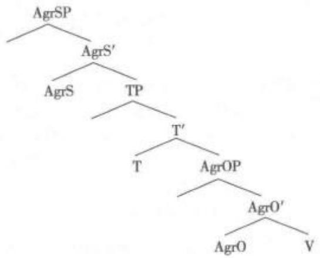

趋同提问convergent question 语言教学术语。指引导学生提供集中于中心主题的回答的提问。趋同提问一般要求存在一个正确答案，并引导学生就此做出简短的回答。趋同提问与趋异提问(divergent question)不同，后者一般没有所谓正确或错误的答案。而当教师试图重点讲解某些特殊技能或信息，或要求学生给出简短答案时，往往会运用趋同提问，如希望引导学生是否能在阅读过程中找出某一特定内容。

趋向共性universal tendencies参见“统计共性”。

趋异提问 divergent question 语言教学术语。一种促使学生提供不同的或趋异的回答的问题。例如，教师试图比较不同学生对某一话题诸多看法的时候，就会用到趋异提问。对于趋异提问，不存在正确或错误的答案。

渠道channel 指信息传递的方法和途径。语言中最常见的渠道有两种表现形式，即口语和笔记。通过言说，信息由具有意义的一组声音传递给听话者，并由听话者对这组声音进行分析；通过书写，信息则由文字传递出来，由读者进行解析并理解。

渠道能力 channel capacity 语言教学术语。指语言学习者在理解和生成话语中处理话语的能力，如通过记忆重现语言及规则并自由使用的能力。二语学习者的渠道能力随着其习得阶段的不断发展而日益增强。

曲音变化umlaut; vowel mutation音系学术语。指词根中的元音由于受到词缀中元音的影响而发生音变的现象。例如，在古代德语中，词语后缀中的高前元音[会使词根中的后元音[u]、[o]、[5]分别变为前元音[y]、[ø]、[∞]，现代德语中的某些单词也保存了这种音变。例如，德语单词sohn“儿子”的复数形式为söhne，词根中的后元音[o]变为前元音[σ]，原因是古代德语名词复数词缀中的[使词根中的[o]发生舌位前伸的音变。有些音系学家认为曲音变化是一种特殊的元音和谐(vowel harmony)，前者为词根中的元音被词缀中的元音和谐同化，而后者通常是词缀中的元音被词根中的元音和谐同化。

曲折声调 contour tone 语音学术语。指有音高变化的声调。曲折声调一般存在于声调语言中，如汉语、泰语。几种重要的曲折声调有升调、降调、降升调和升降调。有些语言，比如非洲的门德语，存在音高连续变化的曲折声调，如升降升或/和降升降调。

去鼻音化denasal 音系学术语。在鼻塞音或鼻元音中，使通过鼻腔的气流减少。这种现象可能由言语疾病所引发，也可能由感冒导致的鼻窦阻塞所引发。当感冒的人说话时，鼻腔通道仍旧作为共鸣腔在起作用，所以去鼻音化的闭塞音[]听起来就像一个浊化口腔音/b/;去鼻音化的元音[a]就像一个口腔元音/a/。

去边界化 debounding认知语言学术语。指 把一个可数客体(count entity)转变成物质客体 (mass entity)的语法操作过程。例如：[1]I have ten eggs. [2] After my fall there was egg all over my face. 例[1]中的鸡蛋(egg)是有边界的可数名词， 但在例[2]中借助于“There was”语法构式把可数名 词变成了物质名词，一个没边界的客体。去边界化 与语法操作过程提取(excerpting)相对。

去腭化 depalatalisation 音系学术语。指通常由于同化的影响，腭位音变为非腭位音的过程。例如，在波兰语中的音系操作过程中，腭位音位/c/、/j/和/n/，会分别变为非腭位音[t]、[d]和[n]，即/vilgoc/→[vilgotni].

去嗯化 de-umming 社会语言学术语。许多电台和电视的报道只有通过编辑才能够达到至臻完美的语音效果，甚至即时的采访和访谈中出现的瑕疵也可以在播出前进行掩盖，即通过编辑滤除过多的“嗯”或“啊”。这种滤除的技术就叫做去嗯化处理。

去方言化de-dialectalisation 社会语言学术语。指方言逐渐被通用标准语取代的语言演化现象。例如，丹麦、荷兰、挪威、瑞典和德国都是崇尚方言的国家。但近40年的社会语言学研究表明，由于农村城镇化、商品交易大型市场化以及农场的日益集约化和超大规模化造成农村人口向城市迁徙，丹麦方言使用人口大幅下降，通用标准语的使用比率日趋上升。由此可见，经济发展、信息与通信技术进步、乡村城市化和教育水平提高等现代化因素，对去方言化等语言现象具有重要作用。

去技能化 deskilling 语言教学术语。指因为缺乏使用或环境发生变化而失去原本具有的某种或某些技能的过程。在语言教学法中，指对教师在某些教学的重要方面的职责和参与移除的同时，只让其处理教学低水准方面的过程。一些教育家认为，对教科书过分依赖就会使教师“去技术化”，因为教科书替代了许多本应该由教师所完成的、有关教学的思考与计划制定任务。

去克里奥耳语化decreolisation社会语言学术语，亦称非混合语化。指克里奥耳语逐渐演化为词汇和语法固化的标准语，并与其原始标准语产生杂糅，从而变得更接近于原始标准语本身。例如，通过去克里奥耳语化，可使以英语为基础的克里奥耳语演变得更像标准英语本身。如果使用克里奥耳语地区的居民能够获得更多的标准语言的学习机会，就必定会出现没有教育背景或教育背景较差的人使用克里奥耳语，而具有良好教育背景的人使用标准语言的语言混杂现象。在牙买加或圭亚那等国家，使用以英语为基础的克里奥耳语和使用诸多标准英语变体的人数都很多；与去方言化现象类似，经济发展、教育普及、信息与通信技术进步和城市化等因素，对去克里奥耳语化进程具有关键性作用。参见“去方言化”。

去歧义化disambiguation句法学术语。通 过语言学分析来显示存在歧义的句子的实际不同的 词义或结构。例如，(1)词义性歧义。在“Thechick en is ready to eat.”中，“chicken”指的可能是“鸡肉”， 也可能是“小鸡”，因此我们必须通过添加附加成分 使之去歧义化：[1]The chicken is ready to eat; so please serve it. [2] The chicken is ready to eat: so please feed it.(2)结构性歧义。例如：[3]Flying planes could be dangerous, 此句意思可能是（a) Planes which are flying could be dangerous. 也可能 是(b) To fly planes could be dangerous. 因此，对于 存在结构性歧义的句子，必须对其深层结构进行重 组，才能够达到去歧义化的效果。

去石化defossilization 语言习得术语，亦称去僵化。指确定语言石化前的一种干预手段。对于石化的实证研究，有两种角度：产出角度(a productperspective)和过程角度(a process perspective)。从产出角度研究石化现象，会有一个去石化的过程。在借助外力和更多的输入条件下，如果学习者都没能改变先前的错误，这时被研究的石化结构才最终得以确认。过程角度则采用纵向研究法(longitudi-nal)，长期观察石化的形成过程。

去双音化degemination参见“非双音化”。

去习惯化dishabituation 指在习惯化形成以后，由于一种新刺激的引入，被试的反应水平再度提高的表现。婴儿的吸吮行为可作为习惯化与去习惯化的评估指标。首先给婴儿一个橡皮奶头供其吸吮，记下其吸吮频率的基线。当一个新异的刺激(如声音)出现时，婴儿将产生定向反射，可能表现为吸吮行为的中断或频率降低。同样的刺激如果反复呈现，婴儿的定向反射将逐渐减少直至完全消失，吸吮行为不再受刺激呈现的影响(习惯化)。如果这时又出现另一个新刺激，婴儿可能又产生新的反射行为，吸吮行为再次发生变化(去习惯化)。习惯化一去习惯化等研究方法的采用，对于揭示人类概念的发生及发展的实质具有重要意义。

去语法化degrammaticalization指语法成分在内容上愈加词汇化而愈少语法化的变化。通常用于语法化研究中，指涉及违背单向性原则的现象。

去语境化decontextualisation 语用学术语。指语言使用中缺乏真实语境信息而造成无法完全传达句子或声言意义的具体例子，如教科书中的范句、范文等。因此，许多语言教学法都主张，语言的教与学必须始终在特定的语境下进行。

去圆唇化unrounding音系学术语，指圆唇的音段演变为非圆唇的音段的音系过程，又称“唇化消失”。去圆唇化主要见于语音的历史变化和借词。例如，英语come/kam/中o发/a/的音就是去圆唇化的结果。

权威差距authority gap 社会语言学术语，亦称地位差别。指对话双方有较大的地位上的差别，如长辈与晚辈、上级与下级、显贵与平民、教师与学生之间，在这种情况下，对话宜采用正式的态度语体。根据约斯(MartinJoos)的研究，语言的态度语体变体(attitudinal variety)包括庄重体、正式体、商议体、随意体和亲密体五类。这些变体不仅可以通过词汇加以区别，而且表现出在语音、语法和节律上的不同，以体现不同的社会关系。在一定的权威差距情况下，正式语体的使用可以使会话双方保持一定的社会距离，是对话语言适度性的表现。

权威评估 authoritative assessment 参见“可靠评估”。

全包教学 inclusion teaching语言教学术语。语言教育中指针对所有学生而非部分学生的教学。

全部倒装full inversion 句法学术语。语序倒装的一种形式。指全部谓语出现在主语之前的语序。全部倒装需满足三个条件：(1)谓语动词为单词动词；(2)谓语动词为表示处所的不及物动词(如lie、stand、be等)或为不及物动词作及物动词(如come、go、fall、run等);(3)倒装后出现在句首的应为表示处所或方向的状语。例如:[1]There goes the bell.[2] Out rushed a missile from under the bomber.[3] Ahead sat an old woman, 全部倒装的句型结构的主语必须是名词，如果主语是人称代词则不能全部倒装。例如：[4]Here he comes， and away theywent.

全称量词universal quantifier 指形式逻辑研究中用于表示值域内所有成分的词语形式或符号特征。词语形式包括“所有”“每一个”“任何一个”“任意一个”“一切”等表示整体或全部意义的词语，如果转写为逻辑符号即为“A”或“∀”，仍然表示整体或全部的含义。参见“全称量化”。

全称量化 universal quantification 谓词逻辑中的一类量化词，作为一个逻辑常量，解释为“任何一个”或“所有”，表示一个命题函项能由论域中每一个成员来满足。通常用逻辑算子“∀”表示。参见“全称量词”。

全称意义generic meaning 参见“种属意义”。

全词法whole-word method; word method参见“整词教学法”。

## 全国文字改革会议 National Conference on

LanguageReform中国文字改革委员会和教育部联合召开的第一次文字改革会议。于1955年10月15\~23日在北京举行，与会者有来自全国除西藏外的28个省市自治区以及中央一级文字改革、教育、科学、作协、外交、邮电、新闻、广播、出版、民委、总政、全总、青年团、妇联等的代表共207人。这次会议的任务是通过《汉字简化方案》和推广普通话。中国文字改革委员会提出的《汉字简化方案修正草案》和《第一批异体字整理表草案》，在会上作了充分的讨论后修正通过。会议制订了普通话的定义：以北京语音为标准音、以北方话为基础方言、以典范的现代白话文著作为语法规范。并一致同意在全国大力推广普通话，首先从中小学和师范学校做起。举行这次会议的同时，中国文字改革委员会还举办了“中国文字改革文献资料展览”。会议通过八项决议：(1)建议中国文字改革委员会把修正后的《汉字简化方案》提请国务院审定公布实行。(2)要求各报刊和文化教育机关广泛宣传简化汉字，各级学校使用简化汉字；出版和印刷机关立即着手改铸铜模，迅速采用简化汉字，并按照《第一批异体字整理表》在出版物上废除异体字。(3)要求中国文字改革委员会继续简化汉字、整理异体字的工作，并继续向群众广泛征求意见，早日完成汉字的简化和整理工作。(4)建议中华人民共和国教育部首先对全国各地小学、中学、各级师范学校分别作出指示，大力推广以北京语音为标准音的普通话：并指示各级教育行政部门有计划地分批调训各级学校语文教师学习普通话。关于部队推广普通话办法，建议由中国人民解放军总政治部决定。(5)建议在全国各省市设立推广普通话的工作委员会，组织社会力量·特别是广播电台和文化馆站，大力提倡学习和使用普通话。(6)建议中国科学院和各有关高等学校合作，进行全国方言调查，编写普通话的教材和参考书，以便利各方言区人民学习普通话。(7)建议中华人民共和国文化部进一步推广报纸、杂志、图书的横排、横写。(8)建议中国文字改革委员会早日拟定《汉语拼音文字方案》草案，提交全国各界人士讨论并试用。

全降high-falling 参见“高降调”。

全局性错误 global error 语言习得术语。 外语或第二语言学习中，学习者在言语输出时所运 用的语言项目偏离本族语者的规范，而发生在句子 结构中的主要成分(major elements)的错误被称为 全局性错误，与局部错误(local error)相对。例如： [1] \*I like travel by air but my wife said so not that we should be late for check-in. 局部性错误指句子 结构的某一成分用错，但不至于引起理解上的困难。 例如:[2] \*If I received a letter from him I will give it to you immediately. [3]To summing up, they performed very well. [4] What the hell it is?

全局性问题global question 语言教学术语，亦称整体性问题。指在第二语言或外语阅读教学中，与篇章整体有关的概括性问题。全局性问题和具体问题(specific question)相对。具体问题检验学习者对阅读材料细节的把握。

全距 range 统计学术语。表明分布的离差(或离散度 dispersion of distribution)。在频率计算中，一个样本的全距就是它的观察材料的最小和最大的测量或观测值之间的差距。例如，一项测试中如果最高分数为93，最低分数为55，那么它的全距就是38。由于全距未涉及分数的分布状况，在统计中常与标准差(standard deviation)共同使用，互为补充。

## 全面扩散移位 across-the-board movement

句法学术语，简称ATB移位。移位操作的一种，指并列结构中某个句法成分从整个并列结构中移出的操作，由罗斯(John R. Ross)于 1967年最先提出。例如：[1][这只猫]，[camip老李昨天丢了e，老叶昨天找到了 ei ]。[2]Who; did you say [conjp that Car-rie likes e; and Sarah hates e]? 例[1]中的“这只猫”从并列短语ConjP中移出至句首；例[2]中的疑问词“who”从以“and”为中心语的并列短语中移出至句首位置。ATB移位的一个重要特点是，被移出的成分同时跟并列结构中的多个语缺(gap)同标，移位后形成的语链（chain）称为分叉语链（forkingchains)，仅出现于并列结构中。

## 全盘扩散现象 across-the-board phenomena

语言习得术语。在语言习得研究中，指儿童在习得一个新的发音时，该新音会扩散到所学语言中所有包含这个音的词。例如，儿童在语言习得之初，可能将/θ/和/d/两个音都发作/d/，但儿童一旦习得/θ/这个音后，就会慢慢扩散到所有包含/θ/音的单词中，对以前的/θ/、/d/部分现象作出纠正，对以后遇到的含有/θ/音的单词给出正确的发音。由此可见，全盘扩散现象是语言习得中音系的发展现象，当然，这种发展并非突变，而是渐变。在语言学研究中，全盘扩散的观点不仅用于语言习得研究，也适用于语言学研究的其他分支领域，如句法研究等。

全球性问题global issue 主要指在语言教学中把焦点放在对全球来说都很重要的问题上，如全球气候变暖、文明冲突、贫富差距、能源危机、人权问题等。有学者认为，语言教学不应仅传授语言技能，还应培养学习者的全球问题意识和提供解决全球问题的途径。

全弱化元音full weak vowel语音学、音系学术语。元音因音强减弱而完全失去个性所形成的中性元音，如英语中的could/kud/—/kəd/、us/as/—/as/、a /ei/—/a/和助动词 have /hæev/—/həv/等。

全新实体brand-new entity 语篇语言学术语。话语实体的一种，指在前面的语篇中从未提及的，由说话者提出，而对说话的对象来说却是前所未知的话语实体，典型地通过运用带不定冠词的短语引人到语篇中来，如“a guyI work with”就是一个全新项目。

全应规则global rule 生成语音学术语。指可以把不相邻的表达式联系起来的规则，由美国认知语言学家雷考夫(GeorgeLakoff)提出的术语，与局部规则(local rule)相对。局部规则只能把相邻的两个表达式联系起来，而不能超越局部范围把不相邻的表达式联系起来。雷考夫认为乔姆斯基的标准理论(Standard Theory)中的短语结构规则(phrasestructure rule)和转换规则(transformational rule)这样的局部规则还不够，有必要打破标准理论的限制，建立另一类作用范围更广、可以把不相邻的表达式联系起来的规则，这类规则称为全应规则。全应规则可以使语义和句法发生直接的联系，数量越多，转换就越少，语义和句法的关系就越直接。

全韵full rhyme; perfect rhyme 音韵学术语，亦称真韵(true rhyme; exact rhyme)。指从核心元音到末尾全部是相同音素的韵，必需满足两个条件：(1)相同的元音必须重读；(2)元音前的辅音必须不同。例如，fate /late、fan/ran、attitude /grati-tude、sending/bending等属于全韵，而leave /be-lieve以及部分同音异义词则属于同韵（identicalrhyre)或等韵(identities；identicals)。全韵与半韵(half rhyme; imperfect rhyme; lazy rhyme; approx-imate rhyme)相对。半韵指发音相近而非相同的韵，有时元音相同而辅音不同，有时辅音相同而元音不同，常见于说唱表演，如 hip-hop / rap、prosperous/dangerous等；home / none 则属于斜韵（slantrhyme)。参见“押韵”。

全自动高质量翻译fully automatic high-quality translation;FAHQT语言处理术语。指无需任何人工干预、全自动的、译文质量有保证的机器翻译。

全字母短句pangram指包含全部字母的句子。这样的句子通常用来进行英语字母打字指法的训练。例如：[1] The quick brown fox jumps overthe lazy dog. [2] Veldt jynx grimps Waqf zhobuck. 其中例[2]包括无重复的26个字母。

诠释理论interpréter pour traduire参见 “释意派理论”。

劝导行为persuasive修辞学术语，亦称劝说行为。指一种交际行为，使听话人被说服放弃自己的观点而采纳有悖于自己意愿的建议等。劝说话语一般经过详细计划，采用最有效可行的语言手段。劝导性言语一般用于论证性语篇（argumentativediscourse)、法庭辩论(legal defence)、政治宣传(po-litical propaganda)、学术答辩(academic defence)以及广告(advertising)。

劝服修辞persuasive rhetoric 修辞学术语。指说话艺术，是修辞的一种表现形式，旨在帮助语言使用者提高在特定情境中告知、劝说或鼓励受众的技巧。语言使用者利用有理有据的理由来支持或反对某种观点或事件。表明自己观点的方法很多。例如逻辑论证、援引典故、巧设譬喻、类比推理等。古希腊劝服修辞的原型根据其“缘由”可分为三种：(1)法庭演说(forensic rhetoric)，多涉及已发生的事故，如犯罪、产权纠纷等，以控诉与辩护的方式在法庭上进行辩论，通过对这些事件进行论证，指控某人或为某人辩护，从而达到主持正义的目的；(2)典礼演说(epideictic rhetoric)，常见于节日庆典、集会、社团活动和喜丧仪式，多具有对特定人、事、物的赞扬与褒奖；(3)审议演说(deliberative rhetoric)，涉及政府或民间团体未来的决策，常以劝服的方式来讨论提议与决策的优点或缺点。由于希腊人经常参与政治，无论是为了辩护自身的政治主张或是试图劝服别人，争取认同，都需要面对各种团体或一般民众，以演讲的方式发表个人意见，这就是审议演说的起源。它相当于当今政府官员或议员在某些审议场合(如议会或提案)所发表的演讲。

缺规anomie;anomy语言习得术语。用以描述外语学习过程中学习者的心理状态，指外语学习者在从自己的母语出发向目的语过渡的过程中逐渐疏远原有语言和文化，同时对新的语言和文化又缺乏真实自信的感觉，此时往往会产生的一种不安定或不满的情绪，而这种精神上的焦虑、迷茫、规范缺失等在一定程度上会影响学习者的成效。尤其当学习者语言能力达到高层次时，这种缺规或失范感会更强烈，甚至会导致学习者寻求说母语的机会以求放松。

缺省推理 default reasoning参见“默认推理”。

缺陷 defective 通常认为，在一套完善的书写系统中，每一个音素往往代表一个音位。反之，如果一套书写系统使用几个音素(如两个辅音)来代表一个音位，这套书写系统就存在缺陷。

缺陷动词 defective verb参见“不完全动词”

群内交际intragroup communication社会语言学术语。指群体内部成员之间的交际。在某些多种族国家或社团内，一个民族或种族群体除了通用的官方语言外，还使用一种语言(本族语或非本族语)作为群体内部所有成员的交际工具。例如，有些美籍墨西哥人在美国部分地方讲西班牙语。

## 群体间交际 intergroup communication

社会语言学术语。指不同群体之间的交际，特别是社会、种族、阶层或语言不同的群体之间的交际。群体间的交际通常通过族际通用语，即两个群体的说

话者都懂的语言进行。例如，在使用多种语言的印度尼西亚，其官方语言印度尼西亚语是团体间交际中最常用的语言。

## 群体语言学习法 community language learn-

ing语言教学术语，亦称咨询学习法(counsellinglearning)。指通过小组咨询(group counselling)等互动评估形式帮助学习者进行学习的一种二语式外语教学法。最早由美国芝加哥洛约拉大学(LoyolaUniversity Chicago)心理学教授罗杰斯(Carl RansonRogers，1902—1987)提出，由其同事柯伦(CharlesArthur Curran，1913—1978)发展并建立此理论。群体语言学习法中的“小组(group)”即“群体(com-munity)”。在教学过程中采取群体学习的形式。它以现代心理学为基础，强调学习者情感的需求与满足对学习的促进作用。群体学习法中的学习者被称为当事人(client)，教师则被称为顾问(counselor)。顾问一般不直接参与群体活动，只是在必要时为当事人判断对错，作出提示，决策下一步学习目标、主要内容和方法，提供帮助和指导。“安全感”(securi-ty)、“注意—表达”(attention-expression)、“记忆—反思”(retention-reflection)和“辨识”(discrimination)是这种学习方法的基本内核。

群体语言研究phylogeny参见“个人语言研究”。

# R

让步从句concessive clause 语法学术语。 指其信息与主句或独立句(independent clause)所包 含的信息相反的从属从句(dependent clause)。让步 从句一般由 although、though、while等词引导。例 如: [1] Although we've been taught English for more than ten years,we cannot communicate with English native speakers freely. [2] I'm busy with studying while she's busy with playing.另外，由 “although”等引导的让步从句的语义与由“but”连接 的并列句语义相似，如例[1]还可说：[3]We've been taught English for more than ten years, but we cannot communicate with English native speakers freely.与汉语的“虽然……但是……”的表达习惯 不同，英语中“although”和“but”不是关联词(correlative words)，两者不能同时出现在一句子里。

## 人本主义教学法humanisticapproach

语言教学术语。指以语言学习者为本进行语言教学的一种教学理念。人本主义教学法遵循下列四个原则：(1)发展人的价值观；(2)加深对自我和他人的认识：(3)提高对人类情感的敏感性；(4)使学生积极参与到学习活动中，促使其学习。集体语言学习法(community language learning)，整体语言教学法(the whole language teaching and learning)和以学生为中心的方法(learner-centered approach)都体现了人本主义的教学法。

人称 person 语法学术语。动词的形态学范畴，表示动词变位的形式，分为发话者(第一人称，单数和复数)、受话者(第二人称，单数和复数)以及作为陈述话题的人、物、事(第三人称，单数和复数)。人称还可作其他形式区分，如第一人称复数分为“涵盖的”(即包含受话者)和“不涵盖的”(即不包含受话者)，正式的(或谦敬的)和非正式的(或亲密的)，男性的和女性的、有定的和不定的(如英语中的one)，等等。除人称代词外其他词类也可显示人称区别，如英语的反身代词和物主代词(myself，my)，没有人称对立，通常以第三人称出现的动词构式称作无人称(impersonal)构式。

人称不定式personal infinitive 语法学术语。指葡萄牙语、加利西亚语和萨丁尼亚语等所包含的一种不定式形式，具有人称和数的屈折变化。例如:[1] Mary saw the boys shut the door. [2]Mary saw the boys to-shut-3 PL the door.句[1若按葡萄牙语图解则为[2]，句[2]中的不定式第三人称复数与“the boys”一致。

人称词尾 personal ending语法学术语。指在某些语言中(如德语、拉丁语等)，动词词形随人称和数的变化而变化并保持一致。例如，“Shesays,”中的 She 与 says 一致。

人称代词 personal pronoun 语法学术语。指用以代表人称这一语法范畴的一系列代词。英语中的人称代词可指说话者，如I、we;听话者，如you;或其他人或物，如he、she、it、they等。根据用法可分为三种：(1)前指人称代词，即被指代成分位于人称代词之前；(2)后指代词，即被指代成分位于人称代词之后；(3)外指代词，即被指代成分位于句子之外。分别见用例：[1]Philip is looking for hisknife, which he desperately needs. [2] Before shesaid anything, Caroline thought about it a long time.[3] Caroline is glad that he is coming. 各种语言人称代词的用法不同，但有一点是相同的，即人称代词及其指代的成分拥有一致的所指，而且它们不出现在同一分句中。如果它们出现于同一分句中，则人称代词以反身代词代之。另外，一般语言里，代词(包括人称代词)用于篇章指代时大多位于其指代成分之后，因此后指代词化很少出现，而且较之于前指代词化受到更多的限制。在早期的生成转换语法里，人称代词是通过代词转换手段派生而来的，即在所指一致的前提下把一个“完整”的名词短语替换成一个代词，而在新的生成理论指导下，约束理论认为人称代词是不转换的。

人称动词 personal verb 语法学术语。与无人称动词(impersonal verb)相对。这些动词有自己真正的主语，可以表示某人的具体行为、某地发生的事件或某物状态，可用第一、第二、第三人称，词形随人称的变化而变化。而无人称动词只用于第三人称单数。

人称移情等级体系 Person Empathy Hierarchy参见“言语行为移情等级”。

人称指示语person deixis 语用学术语。指示语的一种，是对编码于言语活动中的参与者或相关角色的符号指称，与地点指示语、时间指示语等密切相关，在各指示语中占据主体与核心地位。人称指示语可分为三类：(1)发话人(speaker或addressor)，即第一人称；(2)受话人(hearer或 addressee)即第二人称；(3)旁听者(bystander / third party)即第三人称。人称指示语通过公开或隐私的人称代词把话语中涉及的人或物与说话者、听话者或第三者联系起来，表明彼此间的关系。指示语反映了语言和语言系统中语境的关系，被认为是语言和语境之间关系最明显最直接的语言反映，是连接语义学与语用学的关节点。人称指示语在不同的语境中，同属于一个指称，却往往含义不同。按照莱昂斯(JohnLyons)的观点，指示语境是以讲话者的立场为中心的，也就是所说的以自我为中心特征。英语中的第一人称“1”指的是事实上的讲话者。而讲话者的责任或者更概括一点来讲，言语行为的执行者的责任在谈话过程中是在谈话者之间传递的。第一人称是讲话者的语法化，像英语中的“I”“we”和汉语中的“我”“我们”“咱们”等等；而第二人称则是我们对于讲话者所对的一个或多个讲话对象的编码，像英语中的“you”、汉语中的“你”“你们”“您”等等；第三人称则是对言语所涉对象除一二人称之外的人或事物的编码，像英语中的“she”“he”“they”，汉语中的“她”“他”“她们”“他们”，等等。一般情况下人称指示语的指代是既定的，即严格遵守人称指示语的分类，且与现实中的所指目标之间有着严格的对应关系的用法。但是在特定的语境环境下，讲话者为了达到某种特定的语境效果或者情感目的，常常有意地替换人称代词的指代，打破常规用法。按格赖斯(HerbertPaul Grice)关于合作原则遵守和违反的论述，人称指示语的这种“非常规用法”应属于说话者有意地不去遵守某一准则，而让听话人越过话语的表面意义去推倒其中的语用含义。

## 人工神经网络 artificial neural network参见“神经网络”。

人工语言 artificial language ①亦称人造语言。主观设想作为不同言语社团通用交际工具而创造的非自然语言。人造语言没有“社团”及“本族语说话人”，全靠人为推广。历史上曾经创造出来的人造语言主要包括通用语(Universal Sprache)、沃拉普克语（Volapük）、世界语（Esperanto）、蒙多语(Mundolingue)、习语中性语(Idiom Neutral)、伊多语(Ido)、世界伊多语(Esperantido)、国际语(Interlin-gua)和创新语(Novial)等，但只有世界语保持至今。参见“国际辅助语”。计算机程序使用的抽象符号或数字代码(code)系统的总称，如ALGOL(算法语言)、Fortran(公式翻译程序)等。

人工智能 artificial intelligence;AI 指利用计算机模拟人类智力活动的研究领域。即在分析人脑思维机制的基础上，利用电子计算机和各种电子设备模拟人脑的信息处理过程，包括图形识别、学习过程、探索过程及环境适应等理论和技术。语言学中可模拟语言、记忆、推理及创造能力，以了解人类说话、记忆、思维及创造性行为的方式，从而对这些领域的研究提供新的理论及途径。如机器翻译即是模拟人脑对外族语言的接收、理解、分析和用本族语表达的过程。人工智能的发展也为新一代机器翻译中的语义分析建立了基础。

人工智能法AI-based approach计算语言学的重要研究方法之一，指在语言研究中使用计算机模拟人的智能去分析和生成自然语言。

tion 属于机器翻译(machine translation)研究范畴。机器翻译是指利用计算机技术将一种自然语言翻译成另外一种自然语言的过程，包括文本机器翻译和语音机器翻译两种基本形式。自然语言作为人类思想感情最基本、最直接、最快捷的表达工具是人们赖以进行沟通和交流的媒介。在信息化、国际化时代背景下，机器翻译的开发和研究是大规模和高效地处理和实现不同领域之间和各种自然语言之间通信和交流的重要途径。建立在人工智能、认知科学、思维科学、语言学、数学等多学科领域基础之上的机器翻译研究已经成为信息社会对计算机技术最具挑战的课题之一，属于国际前沿领域。从目前的发展来看，鉴于全自动机器翻译始终无法实现对翻译质量的确保，与人工翻译质量仍然相差较远，不可能完全取代人工翻译，人工辅助下的半自动翻译即已称为现行机器翻译的基本运作模式。人机互助翻译指针对多语种信息，让计算机粗略处理一遍，通过人工干预对自动生成的译文进行筛选、评优和编辑等细加工过程，最终得到与人工翻译结果最相近的最优译文的翻译方法。它认为人与机器翻译系统之间是互补、互助，而非互相竞争的关系，在机器翻译研究中实现人机共生(man-machine symbiosis)，人机互助的翻译方法明显优于单纯人工翻译，同时比追求全自动的高质量翻译(full automatic high quali-ty translation，缩称FAHQT)更现实和可行，能切实保证翻译速度和质量。参见“机器翻译”。

人际功能 interpersonal 功能语言学术语。语言的功能之一。韩礼德的系统功能语言学理论论述了语言的三大功能，即概念功能(ideational)，人际功能(interpersonal)和语篇功能(textual)。语言的人际功能认为人们用语言进行人际交往(如打招呼、说客套话、互相道贺、致谢等)，目的在于交流感情，建立或保持一定的人际关系，谈话内容本身并不一定重要。书面语中，语言的人际功能表现在因作者(说话者)与读者(受话者)地位、处境、状态的不同，作者往往通过语气、情态、对所谈命题的有效判断等达到交际目的。如在陈述中要求对方承担义务，在命题中表达个人意愿等。表达人际功能的语言标志包括第一人称代词“I”和第二人称代词“you”、称呼语、指示成分以及提问和指示等言语行为。

人际交往interpersonal communication亦称人际交流或人际沟通。有关人际交往的定义有两种不同的观点：语境观和发展观。根据语境观，人际交往指涉及的参与者，参与者的身体距离，运用的感知渠道，并且是即时反馈交际信息，该观点不考虑参与者的人际关系；根据发展观，人与人之间存在不同的关系，人际交往是指互相认识一定时间的人之间的交际，且更重要的是，参与者互相把对方看作独特的个体，而非单纯的社会角色扮演者。人际交往可以实现获取信息、建立互相环境、确立自己的身份、满足人际交往需要等重要的日常交际功能。

人际修辞interpersonal rhetoric 语用学术语。人际交流中追求理想交际效果的言语行为准则之一，是利奇(Geoffrey Leech)语用学理论对格莱斯会话合作原则的延伸。利奇在其1983年版《语用学原理》(Principles of Pragmatics)中提出，语用原则包括语篇修辞(textual rhetoric)和人际修辞，其中人际修辞强调合作和礼貌原则，间接的言语行为也是人际修辞策略，可缓和冒犯与不礼貌的气氛。例如：[1] If I were you, I'd be careful where I put that cig-arette end.[2]坐……请坐……请上坐；茶……上茶……上好茶。除合作原则和礼貌原则，交际双方应遵循的其他修辞原则还包括反讽原则(Irony Prin-ciple)、逗乐原则(Banter Principle)、有趣原则(Inter-esting Principle)和乐观原则(Pollyara Principle)。中国古代语言生活中的避讳制度也常被语言学者视为一种人际修辞。避讳的常用方法有改字、空字、缺笔、同音替代等，常常涉及改姓、改名、改官名、改地名等领域，甚至出现辞官的现象。

人际意义 interpersonal meaning 语义学术语。指语言中反映人与人之间的社会关系、说话人社会身份、语体特点、说话者个性等方面的意义。譬如，某些人谈吐文雅，多使用礼貌语言；另外一些人则出言粗俗，多使用俚语甚至詈词。这些特点可反映出一个人的教育程度、文化素养等特点。有学者认为这种意义不属于语义学而属于社会语言学研究范畴。参见“人际功能”。

人际隐喻 interpersonal metaphor 功能语言学术语。在系统功能语法理论框架中，语法隐喻(grammatical metaphor)可以分为概念隐喻(ide-ational metaphor)、人际隐喻(interpersonal meta-phor)和语篇隐喻(textual metaphor)。而人际隐喻又包括情态隐喻(metaphor of modality)和语气隐喻(metaphor of mood)。系统功能语法认为，形式和意义之间并不存在着一对一的关系，一种形式可以表达一种以上的意义，一种意义也可以由两种或更多的形式体现。用投射小句来替代情态副词或情态动词以表达情态意义，是用不同的形式表达了同一情态意义，在语法层上形成了一个隐喻结构，称为情态隐喻。例如：[1] John is probably ill. [2] Johnmust be ill. [3] I believe John is ill. [4] It's likelythat John is ill. 例[1]—[2]用情态副词和情态动词表达可能性，例[3]-[4]用用投射小句结构“]be-lieve ...”“It's likely that ...”表达近似的情态意义，例[3]—[4]是例[1]—[2]的情态隐喻结构。情态隐喻表达客观和主观情态意义，其主客观性与话语的礼貌程度存在着一定的关联。从一种语气域向另一种语气域转移的变异现象，称为语气隐喻。例如：[5] Do you have time to help me? [6] I wonder ifyou have time to hep me. 例[5]用疑问语气表达“提问”功能，属常规对应；例[6]用陈述语气表达“提问”功能，是一种语气的转移，属变异现象，用不同的语气表达了同一功能，称为语气隐喻。

人际语境 interpersonal context 语用学、功能语言学术语。语言情境的一种。指参与交际的双方根据角色间社会心理距离构建的交际情景。按照交际角色间的社会心理距离，人际语境可以分为亲密的、个人的、疏远的、公共的几种情况。人际语境与语言语境、情景语境一起成为确定名称指称主要依赖的三种语境。

人类发音学 anthropophonics 亦称发音生理学。指发音语音学(articulatory phonetics)的一个分支，研究人类发音器官在正常生理活动中能发出的全部声音(并不考虑这些声音是否都用于语言)及其发音机制。其中包括对不同民族或人种的声道和个别发音作物理对比，以及性别差异和年龄变化所带来的影响等，试图弄清在人类进化过程中某些语言的语音选择可能基于哪些原则。波兰语言学家博杜恩·德·库尔特内(Baudouin de Courtenay，1845—1929)率先使用的术语。

人类符号学anthroposemiotics符号学(semiotics)的一个分支，研究人类交际的所有系统，包括自然语言，也包括可听的、可视的各种交际形式，如体态语、手势语等非语言交际形式，还包括哨语、鼓语以及诸如莫尔斯码(Morse code)等其他替代形式。广义的人类符号学还包括所有的全球性表达系统，如艺术、科学、文学、宗教和政治等人文科学的学科。参见“植物符号学”。

语言学的一个分支。①指探究语言和文化之间关系的跨学科研究，利用人类学的理论与方法，联系言语社区的社会结构、文化类型、风俗习惯及意识信仰等来研究语言的使用和变异等，如不同文化背景下的亲属称谓体系、颜色术语，不同社会和文化活动中人们的交际方式。人类语言学与人类文化语言学以及社会语言学的研究领域具有交叉性，包含了人类学、民族学、社会学以及语言学等领域的研究的交叉与重合。自博厄斯和萨丕尔以来，人类语言学家都强调指出：语言与其社会环境是不可分割的，必须把语言学看作一门社会科学。某些语言学家用来指对没有书写系统和文字传统的、并几乎没有早期学术研究的语言的研究，早期的研究者通常运用实地调查(field work)的方法直接从当地人那里获得语言材料，如对东南亚地区、非洲地区的一些语言和北美印第安语言的研究。

人名 anthroponym;personal name 指人的姓名，包括名、姓和附加名，也指人类群体(如民族)的名称和神话中出现的姓名等。

人名地名变体 allonym 指人名或地名的其他称谓形式。例如，君士坦丁堡(Constantinople)和斯坦布尔(Stambul)是伊斯坦布尔(Istanbul)的变体。“英国诗歌之父”是英国14世纪的伟大诗人乔叟(Chaucer)名字的变体。

人名学 anthroponymy; name study 名称学(onomastics)的一个分支，属于语义学研究范围。指人名的起源、发展和分布状况及其结构、种类和意义等。人名研究可以为语言、语系、方言地理以及历史等领域的历史发展提供重要信息来源。社会语言学、心理语言学、语用学和篇章语言学都对人名的社会历史研究予以特殊的关注。人名学对人名进行研究，如人名的起源、含义等。古时英国人取名遵循一条重要的原则：不许重名，至少在本地区如此；带有“Mac”或“Mc”前缀的英国姓氏说明该姓氏的人是苏格兰人的后代，而带有“()”前缀的姓氏说明该姓氏的人是爱尔兰人的后裔。

人造语言 artificial language 参见“人工语言0”。

认识词汇 recognition vocabulary 语言教学术语，亦称消极词汇(passive vocabulary)。指学习者能够认识、理解的词语，与积极词汇(active vocabulary),即学习者能够运用的词汇相对。一般而言，本族语者的消极词汇远远超过其积极词汇。参见“积极词汇”。

认识论epistemology 亦称知识论。一种哲学论题，探讨人类认识的本质和结构、认识与客观实在的关系、认识的前提和基础、认识发生和发展的过程及其规律、认识的真理标准等问题。英文episte-mology源自希腊文èπtaτημη(知识，epistéme)和λóγoζ(理论，logos)二词的结合。在对世界是不是可以被认识的问题上，分为可知论与不可知论两派。可知论主张思维与存在的统一性，认为世界是能够被认识的。所以，一切唯物主义反映论都是可知论，彻底的唯心主义，也属于可知论；而不可知论则否认思维和存在的统一性，否认人能认识世界或能彻底认识世界，其代表人物是休谟和康德。在知识来源问题上，也分为两派，理性主义者认为知识来源于心理的理性，以柏拉图、笛卡儿和莱布尼茨为代表；与此相对的是经验主义，认为知识来源于经验，以洛克、休谟等人为代表。康德试图调和这两派，认为知识来源于把先天直觉与知性和表象的结合。概括地说，唯心主义认识论否认物质世界的客观存在，坚持从意识到物质的认识路线；不可知论否认客观世界可以被认识;唯物主义认识论认为物质世界是客观实在，强调认识是人对客观实在的反映，认为世界可以认识。辩证唯物主义的认识论则进一步把实践作为认识的基础，把辩证法运用于认识论。当代西方认识论由英美哲学支配，属于经验主义认识论。随着语言哲学的发展，言语和意义受到重视。在认识论与心理学的关系上，知觉、记忆、想象、他人的心灵和错误成为主要论题；而认识论与科学哲学的关系上，归纳和先天知识也受到关注。1950年，瑞士心理学家皮亚杰(Jean Paul Piaget)创立发生认识论(ge-netic epistemology)，反对传统的认识论，认为知识来源于动作(活动)，并据此创立儿童发展心理学，革新了传统认识论的结构、体系和研究方法，把认识论与心理学紧密结合起来，既丰富了科学认识论的内涵，又促进了儿童心理学、认知心理学、思维心理学。

认识逻辑epistemic logic 亦称认知逻辑。哲学逻辑中的一种特殊形式，对形式逻辑的逻辑表达和逻辑算子进行补充。有广义狭义之分。广义的认识论逻辑研究与感知、知道、相信、断定、理解、怀疑、问题和回答等相关的逻辑问题，包括问题逻辑、知道逻辑、相信逻辑、断定逻辑等；狭义的认识论逻辑仅指知道和相信的逻辑，简称“认知逻辑”，引入相应的算子，把“认为”“知道”这样的表达纳入语义分析中，对形式逻辑的逻辑表达和逻辑算子进行了补充。认知逻辑纷繁复杂，涉及学科领域众多，在自然语言的逻辑语义学中起关键的作用，在人工智能方面有十分重要的应用前景。

认识情态epistemic modality 模态逻辑术语。认识情态“把所有的命题纳入其视野，表达出说话人对话段中命题的真值或潜在真值的评价”(By-bee &. Pagliuca,1985)，即认识情态关涉说话人对命题真实性状态的判断。例如：[1]He must surely bethere by now.(说话者认为他现在必然在那里。)[2] It may have been lost.(说话者认为东西可能丢了。)[3] The train might be late.(说话者认为火车很可能晚点了。）认识情态和真势情态、义务情态对立。例如：[4] The dinner must be ready. 由于must一词的存在，按认识情态，句[4]的意思是“晚饭想必已准备好了”；而按真势情态和义务情态理解，该句就表示“晚饭显然已经准备好了”或“晚饭必

须准备好”。

认同关系过程identifying relational process功能语言学术语。功能语法区分两种关系过程，即认同关系过程与修饰(attributive)关系过程。认同关系过程的两个参与者分别是被认同者(identified)和认同者(identifier)。判断认同和修饰关系过程的简单办法是看两个参与者在句中的位置是否可以互换：如果可以互换，则属于认同关系过程，如不可互换，则属于修饰关系过程。例如：[1]Helen is theboss, [2] The boss is Helen. [3] Helen is a fa-mous writer. [4] \*A famous writer is Helen. 其中句[1]可以转换成句[2]，即“the boss”和“Helen”在句中的位置可以互换，这一过程即属认同型关系过程；句[3]中的“Helen”和“a famous writer”位置不可互换，即句[4]原则上不能成立，因而句[3]的两个参与者构成的表达过程为修饰型关系过程。

认同者identifier功能语法中涉及认同型关系过程的两个参与者之一，另一个为被认同者(iden-tified)。例如：[1]Helen is the boss. 句中 Helen是被认同者，theboss是认同者。认同型的两个参与者常可互换。又如：[2] My name is Edward.[3]Edward is my name. 两句中被认同者可以都是 Myname，认同者可以都是Edward。但是，在特定的情景下，句子中被认同者与认同者互换后，尽管语法依然正确，表达的意思却会发生变化。例如：[4]A：Pat is her brother. B: So you met Florence's sister?A: No, Pat's her 'brother.[5]A: Pat is her broth-er. B: What is her brother called? A: Her brother'sPat. 在例[4]对话中，说话人B听到Pat，但是没听清 brother，以为 Pat 是女性；从说话人 A 的回应中可知被认同者是Pat，认同者是brother。例[5]更换了情景，被认同者和认同者也发生了变化：听到“brother”，但未听清“Pat”，Pat成了认同者：B知道Florence有一个兄弟，A在回答B的问题时，把这个兄弟“认同成”Pat。一种辨别被认同者与认同者的实用方法是看句子的哪一部分重读。重读的部分往往是认同者，因为新信息往往要重读，而认同者通常是第一次提到，被认同者通常已经提到过或者谈话者已经知道。

认知cognition心理学术语。指从低级的物体感知(object perception)到高级的做决定(decisionmaking)等一系列心理过程(mental process)，如注意、记忆、语言理解与产出、计算、推理、解决问题、做决定等等。认知包括有意识的、下意识的、自然的或人工的心理过程。许多学科都研究认知，如心理学、哲学和语言学等，但视角不同。在语言学领域，认知主要从经验、凸显和注意的角度研究意义结构的表

征和建构。

认知变元 cognitive variable 语言习得术语，亦称可变认知因素。指与动机、个性、态度、情感等情感变因(affective variables)相对，对学习(尤其是语言学习)在多大程度上获得成功(degree of success)所产生影响的包括智力、记忆力、分析能力、注意力等在内的认知因素等。相关研究包括语言学习者个体特征与教学法之间的关系。其他相关变因还包括同情心(empathy)、语言学能(language appti-tude)等。

认知策略 cognitive strategy 语言习得术语。指(语言)学习过程中学习者处理和加工信息的方式，是学习策略的一大重要构块。认知策略是学习和思考过程中一种集中注意、组织信息、细化内容、熟悉使用和检索知识、最终发现、发明或创造性的策略机制。笼统来说，认知策略指信息的编码、储存、提取和运用等认知过程，具体来说包括学习中采用重复、定义和扩展、模仿、翻译、归类、推导、重组、想象等方法和技能。学习策略的另一大重要构块还包括元认知策略(metacognitive strategies)。元认知策略指信息处理和加工过程中对认知过程的知识和观念以及对认知行为和活动的调节和控制，是对认知的认知。元认知策略包括自我计划和组织、自我注意引导、选择性注意、自我管理、自我监控以及自我评估学习效果等内容。

认知承诺cognitive commitment 认知语言学术语。认知语言学的两个基本承诺或原则之一，语言结构应该反映从其他学科，特别是从其他认知科学如哲学、心理学、人工智能和神经科学等学科发现的人类认知成果。因此认知承诺秉承语言和语言组织应该反映人类一般的认知原则(cognitiveprinciple)，包括认知机制和过程，而不是语言特有的，如射体一界标反映的图形一背景理论等。这一点与形式语言学(formal linguistics)把语言能力与一般认知能力割裂开不同。认知承诺事关认知语言学属性，也是与形式语言学的分野之一。认知语言学的另一个基本承诺是一般性承诺(generalisationcommitment).

认知发展 cognitive development 语言习得术语。指人类从婴儿成长到成年过程中复杂表征和去语境化思想(representational &. decontextual-ized thought)的形成过程。心理学家与语言学家对认知发展和语言习得之间的关系持有不同观点。有人认为语言发展的前提是非语言认知知识(non-lin-guistic cognitive knowledge)的发展与形成；有的则认为认知发展与语言习得毫不相关。皮亚杰(JeanPaul Piajet)持第一种观点，认为去语境化概念(de-contextualized concepts)的形成是语言发展的必要条件。维果茨基(Vygotsky)则认为语言习得必须基于正常化认知活动(regulated cognitive activity)的发展。因此杜雷(Heidi Dulay)和布尔特(Marina Burt)提出，因其认知发展更为成熟，成年人在第二语言习得方面较之儿童更占优势。一些相反的观点却提出了大量的证据证明即使在正常认知能力缺失的情况下，复杂的语言能力仍能得到发展，并且某些语言能力在那些被认为是其基础的认知能力发展前就已形成。因此，对于认知能力发展与语言能力发展之间到底是否存在某种因果关系，目前的语言学界仍存有疑问。

认知法cognitive approach语言教学术语。一种教学法理论，指语言学习不是简单的形成习惯的过程，而是学习者积极的智力活动过程。认知法强调学习者在学习过程中有意识地组织学习材料，重点放在语法学习上。语言练习应是有意义的语言运用。教师应鼓励学习者将语言中抽象的语法规则内化为自身具有创造性地(creative)运用语言的能力。在20世纪70年代，认知法一度颇为流行，但其自身却并未形成有系统的教学法理论，因而很快被同样反对单纯形成习惯(如听说法)的交际法语言教学(communicative language teaching)所取代。

认知范畴 cognitive category 认知语言学术语。指人类对事物进行分类的心理过程，即范畴化(categorization)的产物。范畴的认知观认为，典型是一种心理表征，是认知的参照点，认知范畴的典型并非固定不变，而是根据环境的变化而变化，并依赖于人们的认知模型(cognitive model)和文化模型(cultural model)。认知范畴最为典型的著名研究是20世纪六七十年代人类学家柏林(Brent Berlin)和凯(Paul Kay)对颜色范畴的实验研究。此项研究发现颜色的范畴化不是任意的，而是基于焦点色(focalcolour)。心理学家罗施(Eleanor Rosch)在此基础上发现颜色范畴中的焦点色比非焦点色在认知上更突出，儿童更易准确记忆并较早习得。在此研究结果基础上，罗施论述了原型(prototype)的概念，亦称典型，并找出了鸟、水果、蔬菜、交通工具等十个范畴的原型。认知范畴这一概念广泛应用于语言、句法、语义、语用、语言习得、失语症等方面的研究，并取得了不少成果。

认知方式cognitive style参见“认知类型”。

认知符号法 cognitive code approach指第二语言教学的一种手法，由美国著名心理学家卡罗尔(Joe Barry Carroll)教授于 20 世纪 60 年代中期提出。20世纪60年代科学技术飞速发展，国际间的政治、经济、军事、科技各个领域的激烈竞争，要求大量能够直接进行国际间科技文化交流的高水平人才，以培养口语能力为主的听说法已不适应这种形势发展的需要，外语教学界要求用新的方法代替听说法的呼声越来越高；此时，美国的心理学、教育学、语言学等基础理论学科也有了很大的发展。这就为创立新的外语教学法体系提供了坚实的基础。在这种背景下，认知符号法便应运而生。认知符号法的主要内容认为语言学习是主动的心理活动而并非简单形成习惯的过程。认知符号教学理论主要以现代“完型理论”(gestalt theory)以及“转换生成语言学”(transformational linguistics)为理论基础。它强调二语学习者在学习过程中学习和应用语法的积极作用。它主要目的是帮助学习者提高语言能力(com-petence)。语言学基础是乔姆斯基的转换生成理论，其“语言习得机制”假说被用来解释语言学习过程，区分了语言能力和语言行为；心理学基础是皮亚杰的发生认识论和布鲁纳的学科结构论、发现学习论等；认知法的教育学原则是“学生中心论”。此外，按照完型理论，语言学习是伴随着不断理解(understanding)的整体性(holistic)活动；同时，语言学界对句法关系的关注，诸如“核心句”(kernel sentences)理论，似乎为整体学习理论及认知意识(cognitiveawareness)提供了一种解释。虽然认知符号法自身并未形成一种具体的教学方法，但交际教学法却着实采用了一些认知符号原则。

认知经济性cognitive economy 认知语言学术语。指认知过程中，认知主体倾向于以最少认知努力(cognitive effort)来提供最大信息量的原则，即人们往往使用包含最大语言信息量的语言项目来达到认知目的。这些语言项目往往属于基本层次范畴(basic level categories)，最适合人类的认知需求(cognitive needs)。基本层次范畴所包含的属性是某一范畴所有成员均享有的，且这些属性最易记忆和理解，所以人们通过基本层次范畴对其各成员进行理解，如掌握了“狗(dog)”的概念，就可对博美、边牧、哈士奇等具体种类进行认知。认知经济性往往是通过表示概率(probabilistic)的线索效度(cue va-lidity)来表达的。线索效度在基本层次范畴是最大化的，因为基本层次范畴共享有最多可能的属性，而同时在这一层次与其他范畴共享特征的程度是最低的。这就意味着基本层次范畴拥有最大化的共享细节，同时与其他范畴之间的区别也是最大的，这就导致了最佳认知经济性(optimal cognitive economy)。

认知科学cognitive science 语言学术语。指对思维(mind)及其过程(process)进行跨学科研究的科学，主要研究什么是认知、认知的作用以及认知的工作方式，包括对智力(intelligence)和行为(be-haviour)的研究，特别是信息在神经系统和机器内如何被表征、处理和转化的。认知科学由多个研究学科组成，如心理学、神经科学、人工智能、语言学和人类学等等。

认知类型cognitive style语言习得术语，亦称认知方式、认知风格。指人们在认知活动中所偏爱的信息加工方式。认知方式可按场依存型(fielddependence)与场独立型(field independence)、冲动型与沉思型以及具体型与抽象型三种对立统一的方式进行分类。场依存型学习者对客观事物的判断常以外部的线索为依据，其态度和自我认知易受周围环境或背景(尤其易受权威人士)的影响，往往不易独立地对事物做出判断；场独立型的学生对客观事物的判断常以自己的内部线索(经验、价值观)为依据，他们不易受周围因素的影响和干扰，倾向于对事物的独立判断。冲动型的学生在解决认知任务时，急于给出问题的答案，他们不习惯对解决问题的各种可能性进行全面思考，有时问题还未搞清楚就开始解答，其认知问题的速度虽然很快，但错误率高；沉思型学生在解决认知任务时，总是谨慎、全面地检查各种假设，在确认没有问题的情况下才会给出答案，但冲动型学生在运用低层次事实性信息的问题解决中占优势。具体型学生在进行信息加工时，善于比较深入地分析某一具体观点或情境，但必须向其提供尽可能多的有关信息，否则很容易造成他们对问题的偏见；抽象型学生善于对认知任务进行联想、类比、推理和归纳。

认知模型cognitive model 认知语言学术语。指在对事物的认知过程中，存在于大脑中关于该事物的知识基础(knowledge base)，即与该事物属同一领域的相关认知表征（cognitive representa-tion)。认知模型是一个内在一致的(coherent)、大体上非语言知识的结构。认知模型是人们经历并存储在记忆中的、关于某一事物的一组背景(contexts)或背景网络(context network)。这里的背景指词汇概念(lexical concept)在人脑中所唤起的认知范畴或心理概念以及概念之间相互作用的认知表征。认知模型和各种内在一致的、以多模块概念客体形式存在的各种知识体系有关，各知识体系是感知模拟(perceptual simulation)的基础。认知模型包括与具体客体(specific entities)有关的知识，如以下是对“on thebeach(在海滩上)”的认知模型(如图)。

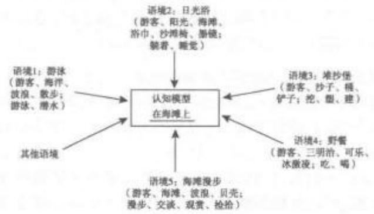

认知模型也包括与各种抽象客体(abstract entities)有关的知识，如幸福、品味、生活等等。抽象知识可以在各种细节程度不同的层面上操作，稳定且是动态，不断在个人经历和环境间进行互动。认知模型还包括与各种程序(procedural knowledge)有关的知识体系，如文化背景，不同的文化环境中赴餐馆就餐的程序不同。认知模式是开放的，对其描述不可能穷尽，只能选择；认知模式不是孤立的，而是相互联系构成网状结构;认知模式因个体经历不同而有主观性特点。认知模式对于理解词汇概念在意义构建过程中起作用的方式非常必要。为便于描述，认知语言学家假想认知模型是许多人共有的大致相同的知识，所以认知模型具有一定程度的理想性。认知模型依赖于认知主体的个人经历和文化环境，事实上一直处于不断修改、更新的过程中，受到了语言和非语言知识与环境互动的调和影响。认知模型的各个组成部分之间不是孤立的，而是互相联系的。如果在一些情况下遇到完全陌生且找不到合适的认知模型事物，人们往往会提取(callup)相似的经验，并迅速为该事物建立一个认知模型。

认知学术语言能力 cognitive academic lan-guage proficiency;CALP语言教学和测试术语。指在校学生习得一种新语言时所体现出的两种语言能力之一，与基本人际交往能力(basic interper-sonal communication skill;简称 BICS)相对，由卡明斯(Jim Cummins)提出。后者指完成其他与学习知识无直接联系的、日常交际又必需的语言能力。在二语教学中认知学术能力反映的是通过第二语言完成分析、评价、综合、推测等课堂任务的语言能力，是一种与学习相关的、正式的学术语言词汇能力。卡明斯认为，学生通常需要在没有其他帮助(如语境)的前提下独立完成多数课堂任务，这对学生的认知要求很高；学习者的基本人际交往能力不能代表其学术语言认知能力，学生往往可以流畅地就日常话题交流，但其学术语言能力却可能很低。卡明斯认为学术语言能力很难用考试成绩来检测其教育相关性和结构效度(construct validity)，而需要通过不同的测试方法才能衡量。如果学习者第一语言的认知能力无法达到最低阈值，获得二语学术语言能力会有很大困难。

认知隐喻cognitive metaphor参见“隐喻”。

认知语法 cognitive grammar 认知语言学术语。指兰艾克(Ronald Langacker)自 20 世纪 70年代以来逐步发展的、集中体现在其《认知语法基础I》和《认知语法基础Ⅱ1》两部著作中、用认知方法研究语法的理论框架。这也是目前认知语言领域最详细、最全面的语法研究理论，在语法的认知方法研究(cognitive approaches to grammar)中也最有影响。认知语法希望建立一些有关认知机制和原则的模型，而这些机制和原则为不同复杂程度的语言单位的形成和使用提供理据并放行。兰艾克认为，语言知识在说话者的脑海中表征为象征组配(symbolicassembly)的库藏(inventory)，形成词汇—语法连续体(lexicon-grammar continuum)。象征组配包括简单象征组配(simple)和复杂象征组配(complex)，它们构成语法的基本单位。认知语法秉承象征论断(symbolic thesis)，语言形式具有常规的象征意义。一个表达式只有经常使用，并经历“牢固”(entrenchment)过程，才能获得语言单位的地位。因此语言单位是基于使用形成的，它与脑海中的概念系统和百科知识联系在一起，并作为一个整体储存起来。在使用过程中，语言单位获得了规约性(convention)，但规约性也是一个程度的问题。语言单位的牢固性和规约性是认知语法基于其第二个重要论断基于用法论断(usage-basedthesis)的直接结果，所以认知语法有时也被称为语法的基于用法模型(usagebased model)。牢固的象征组配作为知识清单储存于大脑，但其内容的储存并非任意，而是构成多重包含关系的结构网络，如词素构成词、词构成短语、短语构成句子等。兰艾克把这一套互相联系和重叠的关系视为结构网络，称之为网络模型(network model)。兰艾克认为语义是语言的基础，句法是语义内容的重组和象征化，而语义存在于人的概念化(conceptualisation)过程中，语义结构就是概念结构。句子结构取决于语义结构，语言表达式的内容不仅取决于它的概念内容，还取决于这一概念内容是如何被观察、感知和理解的。兰艾克详细论述了意象(imagery)和识解(construal)关系，特别是识解的四种参数：选择(selection)、视角(perspective)、凸显(salience)和抽象(abstraction)，并还基于图形一背景理论提出了射体—界标(trajector-landmark)，动作链(action chain)等理论。认知语法目前有两个发展方向：一是自身的不断完善，提出新观点，解决新问题，涉及更多的语言层面如语篇：二是跨学科的探讨和验证，如语言习得、神经语言学和计算语言学，等等。

认知语言学 cognitive linguistics 语言学的一个分支，有广义和狭义之分。广义的指20世纪50年代末在美国发展起来的跨学科研究流派，主要研究在语言与知识的获得与使用中的思维过程，反对行为主义和刺激一反应理论，分析人类在思维、信息储存、话语理解和产出过程中所使用的认知策略，从而揭示思维的结构和组织。广义的认知语言学包括形式学派和意义学派。一般把认知语言学的形式学派称为第一代认知语言学，把意义学派称为第二代认知语言学。目前人们提到的认知语言学一般指狭义的意义学派，即第二代认知语言学。20世纪70年代末到80年代，许多语言学家认识到以乔姆斯基为代表的转换生成语法的局限性，开始从新视角研究语言现象。认知语言学实质上是对形式语言学的对抗。认知语言学的哲学基础是经验现实主义，亦称体验哲学(embodied philosophy)，认为概念结构的形成和理解都建立在身体经验之上。认知语言学把意义、概念过程和体验经验及其相互作用置于语言和思维研究的重要地位。认知语言学秉承三个重要理论观点：否认大脑的自动语言能力;语言知识产生于语言运用；从概念化视角理解语法。认知承诺(cognitive commitment)和一般性承诺(generalisati-on commitment)是认知语言学的两个重要指导原则，即语言应该反映人类一般的认知机制和过程，发现的认知原理应该适用于人类语言所有方面。认知语言学有三种主要的研究方法：经验观(experientialview)、凸显观(prominenceview)和注意观(atten-tional view)。经验观认为，研究语言不应该建立在以内省为基础制定的逻辑规则和提供的客观定义上，而是要采取现实、经验的方法。认知过程和方式虽然抽象，但会在日常语言中留下痕迹，为此我们可以从日常语言中分离出反映认知过程和方式的信息来解释语言现象。经验观认知语言学家主要关注范畴化(categorization)、原型(prototype)、概念隐喻(conceptual metaphor)和概念转喻(conceptual me-tonymy)等。凸显观主要关注图形一背景(figureground)理论在语言研究中的运用，如概念化(con-ceptualization)、射体—界标(trajector-landmark)、焦点调整(focal adjustment)、意象图式(image schema)等。注意观涉及主体在组织信息时注意力的分配问题，如框架(frame)等。认知语言学目前两个主要的分支为认知语义学(cognitive semantics)和认知语法(cognitive grammar)。其主要代表人物包括雷考夫(George Lakoff)、菲尔默(Charles Fillmore)、兰艾克(Ronald Langacker)、福柯涅(Gilles Fauconnier)和泰尔米(Leonard Talmy)等。

认知语义学 cognitive semantics 认知语言学术语。认知语言学的一部分，关于语言中编码的经验与概念系统(conceptual system)和语义结构(semantic structure)之间关系的研究。认知语义学感兴趣的三大问题是：什么是词位(lexeme)意义？什么是句子意义?有意义的单位如何组合成一个完整的句子?它们分别对应于词汇语义学(lexical se-mantics)，结构语义学(structural semantics)和意义合成性(compositionality)。认知语义学寻求从两个方面挑战传统语义理论：第一，提供一个超越真值一条件(truth-condition)理论的不同句子意义观；第二，提供一个超越经典范畴理论的词汇意义观。认知语义学把语言看成人类一般认知能力的一部分，因此只能从人们概念空间里世界的组织方式来描写世界。认知语义学把语言作为认知现象调查的透镜(lens)，因此对大脑中和语义研究有关的知识表征模型感兴趣。实际上，认知语义学把意义研究分成意义建构(meaning construction)和知识表征(knowl-edge representation)，或者说概念化(conceptualiza-tion)和概念结构(conceptual structure)。语义学和语用学在认知语义学中的区别并不明显。认知语义学认为，词汇的意义是概念性的，对应于不同个体脑海中的概念，与百科知识有关。意义不是固定的，而是约定俗成(conventionalization)和识解(construal)的问题。语言识解的过程和我们处理百科知识和感知涉及的心理过程相同。从认知的角度研究语义的方法包括认知词汇语义学(cognitive lexical seman-tics)和百科语义学(encyclopaedic semantics)。认知语义学的主要理论包括：合成理论(BlendingTheo-ry)、概念隐喻理论(Conceptual Metaphor Theory)、框架语义学（Frame Semanties)、心理空间理论(Mental Spaces Theory)、词汇概念和认知模型理论(Lexical Concept and Cognitive Model Theory) 以及原则一词多义(Principled Polysemy)理论等等。认知语义学的主要观点体现在九个方面:语义经验观、语义概念观、语义百科观、语义原型观、意象图示观、隐喻观、寓比观、象似观和认知模型与激活理论。语义经验观是指意义的感知以经验为基础，即意义是通过体验，特别是通过感知和肌肉运动能力而得到的。人们在经验和行为中形成了概念和范畴，语义与概念、范畴同时形成。语义概念观是指语义等同于概念化、心智结构和象征结构。认知语义学家认为语义形成的过程就是概念形成的过程，语义实际上就等于概念。语义百科观认为在进行语义分析时，应采用百科式的语义分析法，根据认知语义学家的观点，语义根植于语言使用者和接受者的百科知识体系之中，因此语义就与人们的主观认识、背景知识、社会文化等因素密切相关。语义原型观认为语义范畴不是通过标准一特征模型或由必要和充分条件决定的成员身份而确定，而是建立在原型、家族相似和范畴内部成员之间主观关系的基础之上，原型是非典型实例范畴化的参照，因此语义具有不确定性、可变性、动态性、相对性和多样性。意象图示观认为认知模型主要是意象图式，而非命题，最重要的语义结构是意象图式结构。人类通过在现实世界中的身体经验(如感知环境、移动身体、发出动力、感受力量等)形成基本的意象图式，然后利用这些基本意象图式来组织较为抽象的思维，从而逐步形成语义结构。隐喻观指抽象的语义主要以空间概念为基础跨域隐喻而成。寓比观认为寓比是语言的起源，语义是通过投射、混合、联结等方式将多个空间进行融合的复杂运算。象似观认为语言符号在语音、词形、句法结构等方面与其所表达的意义之间存在象似性。认知模型和激活理论认为要理解一个词的意义，就要把这个词放到有关的认知模型中去理解；此外，一个词的词义的确定不是通过词义的简单组合来实现，而是通过互相作用激活相关认知域、知识框架以及整合(Integration)来实现。认知语义学是建立在对传统语义理论的批判之上，强调基于身体的经验和想象以及人类在认知过程中与周围世界的相互作用，把注意力真正转向人类认知推理，即对隐喻、换喻、寓比、百科观、意象图式的推理性研究。

任务task语言教学术语。指语言教学中为理解和使用语言而设计的活动。例如，学生一面听录音指令一面画出一张地图，便可称之为任务。任务设计包含诸如目标、步骤、顺序、进度、结果、策略决定、评估、参与程度、材料和语言等方面，均会影响语言教学的效果。任务可以分为语言型任务和非语言型任务。通常教师在教学中所布置的任务不一定仅仅只包含语言型任务，非语言型任务也是教学中必不可少的内容。在教学过程中，教师必须向学生详细说明拟完成的任务是什么，因为任务超越了单纯为练习而练习的目的，所以，语言教学中运用各种各样的任务可以使语言教学更富有交际性，使交际教学法能更加顺利地开展，这也正符合交际教学法的要求。

任务内行为on-task behaviour语言教学术语，亦称专心行为。指上课或从事学习活动时，学习者针对某堂课或学习活动所采取的行为。例如，课堂上老师要求学生阅读课文，就所阅读内容进行讨论，并根据讨论内容写一段话，那么学生这堂课上会集中全部注意力完成任务。学生根据老师要求所进行的学习行为即为“任务内行为”。有时候学生可能并未全身心投入学习任务，出现一些与任务无关的行为，如起立、交头接耳、查看手机短信、信手涂鸦等，即“任务外行为(off-task behaviour)”，也称为“分心行为”。有效率的教师的教学目标应该尽量延长学生任务内学习行为，使学生的学习机会最大化。

任务外行为off-task behaviour 参见任务内行为。

任务型教学大纲task syllabus;task-basedsyllabus;procedural syllabus语言教学术语。指围绕具体的交际性任务，而不是围绕语法或者词汇而制定的教学大纲。任务教学大纲建议语言学习者运用语言完成各种任务。例如，通过打电话来获取信息，根据一张图讲出图中的信息，根据口头指令或录音指令画出地图，或根据目的语发出的命令完成各种行为，或用目的语向别人提出请求、作出承诺、发出邀请或下达命令等。任务教学法被认为是学习语言比较有效的方法，因为它以学习和运用语言为目的，而不是仅仅为了学习语言项而学习语言。任务教学大纲源于印度语言学家普拉布(N.S.Prabhu)在20世纪70—80年代在印度南部推行的一项教学实验。普拉布实验的核心假设是：着重语义的理解可以有效地促进和推动对结构的掌握。实验遵循“以习得为基础(acquisition-based)”的教学理念，即只要接触目标语并“参与到自然的交际场景中”(Stephen Krashen，1977)，学习者就能习得目标语。这一实验产生两个结果：其一是在教学中废除了语法功能项目大纲(linguistic syllabus)，用任务型教学大纲作为替换，即在教学大纲中废除语法功能项目，课堂教学内容按照所要进行的任务(tasks)来设定，对其中包含的语法功能项目不作预先设定。普拉布认为，如果希望在课堂上创造一个“自然的(natural)”交际环境，就不能在教学中设定任何预先确定的语法功能项目；换言之，如果教学围绕某个语法功能项目大纲来进行，就不可能在课堂上实现自然交际。结果之二是，在课堂教学中废除如操练(drilling)和改错(error correction)之类强调形式却忽略意义的教学程序，只在偶然产生的自然交际环境中才进行这类程序，即当学习者有意识地、积极地寻找对一项语言点的解释时，可以自然地进行一些有关这一语言点的操练。废除了对语法功能项目的操练后，课堂上教师的职责就类似于母语学习中父母的角色，因为父母从不让孩子进行语言点的操练，也很少改正孩子的语言错误。普拉布实验还对其他类似于母语习得的情景进行了模拟。例如，学习者常在不经意的情况下被要求用第二语言或外语来发表观点或实现交际目的，他们可以像母语使用者那样创设(incubate)属于自已的第二语言。普拉布用实例演示了在实验中所推行的任务类型，这些例子被收录在普拉布(1987)附录5的“学校课程表(School Timetables)”中。所录例证代表了三个层面的任务：(1)按照教学内容或描述来创建课程表；(2)比较这样确立的课程表，确认不同科目课程的频率(或不同学生交换共享材料的可能性);(3)根据现有课堂课程表来为不同科目的教师创建其各自的课程安排。每一节课围绕一项任务展开，任务的完成总包含一段由学习者依靠自身努力达到某一既定目标的“持续时段(a sustained period)”(如 15 分钟等)，这样的努力是对心智的一种“合理挑战(reasonablechallenge)”(RIE，1980)。课堂的其余时间则由前任务(pre-task)和后任务(post-task)的活动组成，前者自然导入所需要的语言功能项目，后者则对整个任务实施的效果进行评测并达到巩固的目的。实验的开始阶段由于班级较大、师生对新方法不熟悉等因素的限制，效果并不理想，但经过一段时间的试验后取得了一定的成功。贝雷塔和戴维斯(1985)对这一实验进行了正式评估，认为试验组较传统教学组而言在某些测试上表现更优，但在语言功能项目的使用和调遣方面实验组不及传统教学组的表现(Pra-bhu，1987)。总的来说，普拉布的任务型教学大纲与“过程教学大纲(process syllabus)”有一个共同特点，即两者均以“过程方式为核心(means-focused)”(Breen，1983)，而传统的大纲则以“目标为核心(ends-focused)”，教授规定的语言功能项目。任务型教学大纲也有别于当时甚为流行的“意念/功能教学大纲(notional/functional syllabuses)”，而前者则可在对任务的完成过程中实现对结构的掌握，更能顺应当时印度国内的语言教学需求。另外，普拉布还认为，所谓的“交际教学法(communicative methodol-ogy)”本质上是语法操练的一种隐性形式，诸如像“信息空缺(information gap)”，在表面上看是以所传递的信息为核心的(message-focused)，但本质上仍然是以形式为核心(form-focused)，其结果不能导致语言的自由产出(free language production)，只能导致对所授语言点的复制(reproduction)。相比之下，任务型教学大纲是“促成交际的(communication-al)”，这与“交际性的(communicative)”有别，而且普拉布并不热衷于在其实验中进行小组活动或配对活动(group work / pair work)，他更强调教师与学生之间以及学生与任务之间的互动。

对普拉布的任务型教学大纲的批判(Brumfit，1984；Johnson，1982等)主要认为，这种方法会导致错误的、洋泾浜式的语言。虽然在母语习得过程中类似错误的用法可以得到纠正，但普拉布的实验并未提供足够证据证明在第二语言和外语习得中这种错误用法也会得到自然的更正。另外，这种大纲对测试也造成了一定困难，由于没有明确和既定的语言项目，对教学内容和成效的评估便缺乏了科学依据和统一标准。但是，尽管存在这样和那样的问题，任务性教学大纲还是为语言教学提供了一个新的方向和路径。

任意性arbitrariness亦称规约性。语言的一种重要特征。指语言符号与它们所指代的现实或虚拟世界中的事物或概念之间无必然联系。例如，“桌子”一词无论从“形”或“声”看，都没有丝毫表征“桌子”的形状或其他本质特点的因素。此类指称是偶然的、约定俗成的。由于“任意性”，同一事物在不同语言中有不同的语言形式与之相对应，如汉语中的人，在英语中是person，在俄语中是yeoek，在法语中是 personne，而在德语中是Mensch。然而，虽然语言在本质上是任意的，但是这并不意味着所有的语言符号都是任意的，最好的例证就是拟声词，如“汪汪”“咩咩”等。语言的任意性反映了语言的复杂性，但也正是这种属性为人类创造新的语言符号和表达方式提供了无限的可能性。

任指空语类 PRO arbitrary PRO 句法学术语。参见“控制理论”。

日常语言学派 ordinary language school ofphilosophy分析哲学的一支，亦称语言分析学派或日常分析学派。日常语言学派是第二次世界大战后产生于英国剑桥大学并占统治地位的语言哲学流派，战后在牛津盛行，亦称“牛津学派”或“牛津一剑桥学派”。其创始人是摩尔(George EdwardMoore，1873—1958)，奠基人是维特根斯坦(后期)，代表人物有赖尔(Gilbert Ryle)、奥斯丁(John Aus-tin)、斯特劳森（Peter Strawson)、哈特（HerbertHart)以及厄姆森(James Opie Urmson)等；后流传到美国，代表人物有布莱克(Marx Black)等。日常语言学派认为“形而上学”和科学认识中的错误不在语言本身，而是人们不了解日常语言的规则和方法，违反了常识，错误地解释了语言而造成的；而日常语言是丰富多彩、清楚明白的，与人们生活休戚相关，远非人工语言所能比拟和代替的，因此是人们可靠的工具。以此为基础，该学派秉承“哲学研究应从日常语言的用法入手”的原则，注重研究语言的实际用法，避免概括性的结论，并致力于研究语言的意义与使用的关系，试图通过合理的语言来克服传统哲学的思辨性和抽象性，使哲学世俗化、具体化和社会化。20世纪60年代后日常语言学派逐渐衰落，但至今在英美等国仍有影响。

日常语言哲学ordinary language philosophy分析哲学的主要支派之一，亦称语言分析哲学。着重研究如何通过分析日常语言解决哲学问题，把语言哲学的任务看作是对产生哲学困惑的日常概念的澄清。20世纪30年代中叶出现于英国，并盛行于50年代，起始于批评罗素的理想语言哲学以及对维特根斯坦前期哲学和逻辑实证主义的某些解释，主要受摩尔和维特根斯坦后期哲学思想的影响，也有观点认为维特根斯坦是日常语言哲学的主要创始人或首要代表。日常语言哲学的主要观点包括：(1)认为日常语言预设了实在的结构，因而研究这种语言也就是理解可能存在的语言之外的世界的有效方式，因而必须关注日常语言中的意义、范畴、蕴涵、语法形式或逻辑形式、功能、用法和区别，必须像传统所做的那样揭示语言结构的性质。(2)重视语言分析。将其看作是哲学的首要的、甚至唯一的任务，强调自然语言中概念的丰富性以及概念之间的细微区别，认为概念能够完成多种多样的功能，可以充分满足使用者的不同需要。日常语言哲学学派分为剑桥学派和牛津学派。剑桥学派形成于20世纪30年代中叶，以剑桥大学为中心基地，主要代表人物是威斯顿(John Wisdom);牛津学派形成于 20 世纪 40 年代，发展的高潮时期是50年代，以牛津大学为中心基地，代表人物有赖尔、奥斯汀、斯特劳森等人。赖尔和奥斯汀都把词的意义看作这个词所完成的功能或所起的作用，反对把意义看作某种抽象实体。赖尔还认为意义的体现者是词或短语，而不是语句。斯特劳森强调词和语词使用的区别以及语句和语句使用的区别，认为意义是语词或语句的功能，指称是语词的使用的功能，真值是语句的使用的功能。他还指出，谈论词或语句的意义，不是谈论它们在特定场合下的使用，而是谈论在一切场合下正确地把词运用于指称某事物，或者把语句用做断定某事物时所应当遵循的惯例。牛津学派比剑桥学派的影响更大，他们全部接受了维特根斯坦关于反对构造人工语言、关于哲学的任务主要是研究自然语言中词和语句的日常用法等观点，部分地接受了他关于哲学问题仅仅产生于哲学家违背语言的日常用法、关于哲学问题的解决只是对语言的日常用法等观点，牛津学派比维特根斯坦更加强调研究日常语言本身的细致区别。

日耳曼语音变化 Germanic sound shift参见“第一次语音演变”。

日耳曼语语言学Germanic linguistics指对英语、德语、荷兰语等日耳曼语的语言加以描写和探讨研究的总称。参见“日耳曼语”(世界主要语言部分）。

日记研究 diary study 语言习得、语言教学术语。指对语言学习或教学经历所做的第一手记述，即在个人日志中做定期、坦诚的详实记录，然后分析行为再发生的模式(recurring patterns)或突出事件(salient events)。包括两个层次的工作：(1)定期坦诚地记日记；(2)在记日记的同时，反复阅读日记，找出带有普遍性的突出问题，并对其进行分析和研究。

日内瓦学派Geneva School 亦称皮亚杰学派。为瑞士心理学家皮亚杰(Jean Paul Piaget)所创立。此学派以研究儿童认知发展为主要内容，通过对儿童科学概念以及心理运算起源的实验分析，探索智力和认知机制的发生发展规律。日内瓦学派最初活动可以追溯到20世纪20年代皮亚杰在巴黎比纳实验室工作期间所进行的儿童心智研究。1950年他发表了三卷本的《发生认识论导论》，标志着发生认识论体系的建立。皮亚杰在日内瓦大学任职时召集了一批志同道合的儿童心理学家，形成了日内瓦学派的基本队伍。1955年，皮亚杰又在日内瓦大学创立了发生认识论国际中心，邀集各国心理学家及其他有关学科的学者进行跨学科合作研究。发生认识论的基本观点是：(1)由于科学知识处于不断的演化之中，因而我们不能静止地看待认识论问题；(2)人类知识的形成，既不是外物的简单复制，也不是主体内部预成结构的独立显现，而是包括了主体和外部世界在连续不断的相互作用中建立起来的一系列结构；(3)客观知识从属于这些结构，认知结构的发展标志着儿童智力水平的提高和逻辑范畴与科学概念的深化。皮亚杰的主要贡献在于：(1)提出了对儿童心理发展研究影响深远的基本概念，如图式、同化、顺应等；(2)提出了影响儿童心理发展的四要素：机体的成熟因素、个体对物体作出动作时的练习和习得经验的作用、社会环境、对心理起决定作用的平衡过程；(3)皮亚杰将儿童认识的发展分为四个阶段:第一阶段是感知运动阶段(0—2岁);第二阶段是前运思阶段(2—7岁)；第三阶段是具体运思阶段(7—12岁);第四阶段是形式运思阶段(12—16岁)。

日文汉字 kanji 指书写日文时所使用的汉字。出于历史的传统习惯，日语书写时是汉字和假名混合使用。汉字用来表示主要的实义词，如名词、动词和形容词，假名主要用作词缀、连词和其他语法形式。日文汉字的写法基本上与中文使用的汉字大同小异。但有百余个汉字由日本人利用六书自创，这些汉字称为“国字”或“和制汉字”。《诸桥大汉和辞典》是最大的日文汉字字典，共记载接近5万个汉字，不过在战后的现代日文中常用汉字大约只有数千个，其中法定规范汉字约两千个。日文汉字的读法分音读、训读两类，而且大部分日文汉字都有音、训二读。音读指源自中国的读音，与中文的汉字发音近似，另可细分为吴音、汉音、唐音三类。训读是与中文读音无关联的汉字读法，是为了标示原来存在的日文词汇而加上相联系的汉字，由此解决原本日文词汇有音无字的现象。为了表示汉字的发音，书写日文时可以在汉字旁注上假名，表示汉字的读法。这种近似中文注音或拼音的标记，在日文叫做“读假名(読みがな，yomigana)”或“振假名(ふり)がな，furigana)”，常见于幼儿书籍、日语学习者书籍中，或用来表示不常用汉字或日本人姓名的发音。

溶合fusion语法学术语。语言单位内若干成分的合并。如took一词是“take十过去时”的溶合。语音在一些种类的同化中也可以溶合。

溶合分词fused participle语法学术语。指动名词和它前面的以宾格形式而非所有格形式出现的名词短语。

溶合复合词fusedcompound 语法学术语， 亦称原形派生词(primary compound)。由非派生词 干组合的复合词，如 bed+room→bedroom。

溶合句 fused sentence; run-on sentence 句法学术语。指两个或两个以上的句子没有适当的 标点符号或连接词而溶合在一起。例如：However， she is lack of education, she is lack of confidence, she represents the bottom class people in the society.

溶合语 amalgamating language; inflected/inflectinglanguage形态学术语，亦称屈折语言(inflexional or flexional language)。根据形态分类(morphological classification)的语言类型之一。溶合语就其语法关系不是词序，而是屈折变化，其主要特点是词内有专门表示语法意义的内部屈折变化词缀。词缀(affix)并不具有独立身份，与词根(root)或词基(base)紧密结合在一起，并溶合为词的一部分。一个屈折变化形式往往可以表示一个以上的范畴意义，如拉丁词lingua中的-a表示阴性、单数和主格。在阿拉伯语等词根屈折或溶合语(rooted-inflected/fusional/fusing language)中，词根中的元音分布是不同的，类似于英语中的元音变化，即通过词根的语音变化来表达词的语法意义，如feet是foot的复数，sang和 sung分别是 sing的过去式和过去分词。在梵语或拉丁语等词干屈折语(stem-inflected lan-guage)中，表示不同功能的后缀附加到不变的词基上，如拉丁动词amare有以下变位：amo(我爱)、amas(你爱)、amat(他爱)等。在格鲁吉亚语等组合屈折或溶合语(group-inflected or amalgamating lan-guage)中，词缀和词基紧密地结合在一起。根据形态分类，除溶合语外，其他语言类型有孤立语(isolating/formless language)、黏着语(agglutinative/agglomerative language)、多式综合语(polysynthetic/incorporating language)等。

融合1fusion认知语言学术语。(1)指构式语法中的动词参与者角色(participant roles)与构式的论元角色(argument roles)结合成一体的过程。这一过程受到语义一致性原则(Semantic CoherencePrinciple)和对应原则(Correspondence Principle)的制约。(2)指词汇概念和认知模型理论(LCCMThe-ory)中提出的词汇概念合成(lexical concept integra-tion)的两个分过程之一。融合是第二个成分合成的过程，包括两个要进一步连续发生的整合(integra-tion)和解释(interpretation)过程。

融合2integration 社会语言学术语。与借用(borrowing)一起构成语言相互影响的两种主要类型，一般指不同语言接触时，语言结构或语言成分的“化合”，即由一种语言在结构上向另一种语言扩散、渗透，由表层到深层，使该语言从量变到质变从而产生一种新系统的过程。语言融合包括两个最本质的特征：(1)融合的前提是必须有两个同时存在的语言相互之间发生直接的接触；(2)融合必须经过双重语言制的过程。语言融合一方面会导致语言数量的变化，即语言融合的时候，通常是其中某一种语言成为胜利者，保留自己的语法构造和基本词汇，并且按自己的内在规律继续发展，另一种语言则逐渐失去自己的本质而逐渐衰亡；另一方面，相接触的不同语言反而在结构上互相渗透、扩散，在相互影响下各自丰富、发展。

融合教学法 integrated approach参见“整体教学法”。

融入型动机integrative motivation 语言习得术语。加德纳(Robert Gardner)和兰伯特(Wal-laceLambert)1972年提出的外语学习(第二语言学习)的动机分类之一。他们将影响外语学习动机分为融入型动机(integrative motivation)和工具型动机(instrumental motivation)两种。融入性动机指学习一门语言不是为了通过某项考试或谋求一份好职业等某一具体目的，而是为了能融入目标语国家文化并参加社团活动，能够同该语言的本族语者进行交际与交流等社会性目的。它反映出学习者对目标语国家的人民和文化的个人兴趣。

冗文涩语bafflegab;gobbledegook 指冗长而难懂的话。20世纪50年代由弥尔顿·史密斯(MiltonSmith)首创，当时主要是用来批评美国的物价稳定局(Office of Price Stabilization; OPS)所用的官僚语言。

冗余规则redundant rule参见“羡余规则”。

冗余性redundancy 参见“羡余性”。

冗语 pleonasm 语义学术语。一种语义重复现象，如在含义已经非常清晰明了的短语或句子中插入一个多余的语项。例如，“six p. m. in the eve-ning”亦属于谬误或背理(solecism)现象。但是，正如其他一些比喻修辞用法一样，冗语可加强陈述句的语气。例如：He said he did see it himself，withhis own eyes，另一个语义重复现象为同义反复(tau-tology)，亦称重言或类语叠用，即重复同一个词或句子。诸如“Kids are kids.”之类的表达即属于冗语现象，目的是强调所要表述的内容，并加强语气。参见“同义反复”。

冗赘tautology 参见“同义反复”

如尼字母rune;runic亦称茹恩字母、鲁纳字母、茹尼克文字。一种古代北欧文字的字母，据传由拉丁字母和希腊字母改变而成。该字母的基本笔形都是直线，便于在木石上雕刻，故常用作铭文字母及神符符号。每个如尼字母表示一个特定的语音，并以其名称的第一个字母命名；同时每个符号具有一个概念价值，如g表示Gabe(赠品)，n表示 Not(困苦)，s表示Sonne(太阳)。rune一词来源于早期的盎格鲁撒克逊词，意指秘密(secret)或神秘(mystery)。最早的如尼字母出现于斯堪的那维亚半岛(公元2世纪初)，至今已发现将近5000件碑文，其中3000件在瑞典。古英格兰的日耳曼移民最早也使用这种字母，后来该字母被罗马拉丁字母取代。

辱骂性语言abusive language 指用来侮辱受话者的词或短语。辱骂性语言具有侮辱性和贬损性，可以发泄说话人的不满、厌恶等情绪，表达对他人人格、名誉等的侮辱和损害，如汉语中的“混账东西!”和英语中的“son of a bitch”等。

入格illative case 参见“推论格”。

入流音 on-glide 语音学术语，亦称滑入音或首流音(initial glide)。指后响二合双元音起首的滑音，如汉语读音[ja]、[wa]中的[j]、[w]。

入门测试admission test 语言测试术语，亦称筛选测试。指在课程学习开始之前对学习者实施的测试，用以帮助判断哪些受试对象在课程学习中更具成功的可能性，或者用以确定接受哪些受试者作为课程学习的授课对象。

软腭 soft palate; velum 发音语音学术语。发音器官之一。软腭呈半垂直状态悬于口、咽腔之间，是口腔上膛后小半部，硬腭后面部分，比硬腭软。它不仅是软腭音的发音器官，而且是调整气流进入口腔或鼻腔的工具(下垂可挡住口腔，使气流进入鼻腔，上抬则堵住鼻的通道)。如图：

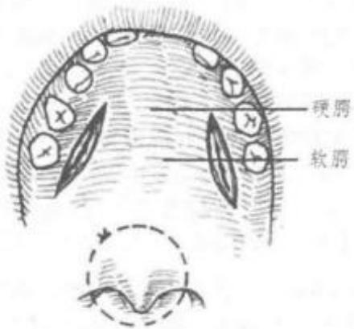

软腭封闭velic closure语音学术语。指发音时软腭上拾阻止气流进入鼻腔而形成的完全封闭。

软腭化velarization 语音学、音系学术语。指发非舌后辅音时舌后向软腭抬高的补充发音动作。像发后元音一样，舌后的抬高使软腭化的辅音具有较低的音色。例如，英语词call中的[+音就是被软腭化了的音。

软腭化音velarized语音学、音系学术语。指发音时舌后向软腭(velum)抬起，俗称含糊的(音)(dark)，如英语词well中[的发音。

软腭气流velaric air-stream语音学术语。指由舌后与软腭的相对运动形成的气流，可帮助除阻或加强共鸣。一些非洲语言的吸气音(click)就是由软腭气流产生的。软腭吸入气流，用来发出表示烦恼的音，通常写作tut-tut。

软腭气流机制 velaric air-stream mechanism参见“气流机制”。

软腭清擦音achlaut 语音学术语。指发音部位在舌根、发音方式为擦音的清辅音。例如，苏格兰盖尔语中“loch”中“ch”的发音，国际音标写作[x]或[x]。

软腭音 velar语音学、音系学术语，亦称舌背音(dorsal)。用舌后部接触或接近口腔后部的软腭(velum)而发出的语音。例如，英语中king /kın/中的/k/和get /get/中的/g/就是软腭音，更确切地说是软腭塞音(velar stop)。当舌面用作发音器官时，发出的语音可以叫做舌面软腭音(dorso-velar)。根据发音部位的不同，这类音又可以分为：前软腭音(pre-velar)，即发音时舌背朝向软腭的前部；中软腭音(medio-velar)，即发音时舌背朝向软腭的中部；以及后软腭音(post-velar)，即发音时舌背朝向软腭的后部。

软辅音soft consonant参见“硬辅音”。

软件software教育技术学术语。指用于教育系统物质设备上的录像带、录音带、硬盘、软盘、光盘以及影视光盘等。

软音 soft 音系学术语。一种不专业的音系学术语，表示一个字母的两种不同读音之一，反义词为硬音(hard)。例如，英语字母c和g有发塞音[k]和[g]以及发擦音[s]和[d3]两种情况，前者通常称为硬音，后者通常称为软音。

软音符号 soft sign 语音学术语。软音符号(b)在词里表示它前面的辅音是软辅音，如MaTb。软音符号()还有分音作用，表示它前面的辅音字母和后面的元音字母要分开读，如b。

软音化softening参见“腭化”。

锐音 acute 语音学术语。指雅柯布逊(Ro-man Jacobson)和哈勒(Morris Halle)在其音系学的区别特征理论中确立的区别性特征之一，发音时发音部位在声道的中间部位，声学能量主要集中在高频部分。属于锐音的语音有前元音以及辅音中的齿音、齿龈音和腭音等。在音系学中，锐音的概念与钝音(grave)相对立。

锐音符 acute accent 语音学术语。指书写时标在元音字母上方的变音符号(diacritic mark)，标示元音字母在音高、重音、声调等方面的特点。例如，法语中的锐音符“、”放在字母a、e、u等上方写为à、è、ù，标示这些元音字母为开元音，而锐音符“”则表示它们为闭元音。

瑞尼森框架 Rennison framework音系学术语。一种用堆积的层次之间的可视关系代替管辖的音系学的独值特征理论，由瑞尼森(John Renni-son)(1987,1991)开创。

若布伦黑话Jobelyn;Jobelin 社会语言学术语。中世纪巴黎下层社会所用的风格低下的语言变体。法国15世纪抒情诗人维永(Francois Villon)笔下多有此种用例。此词在法语中的本意是“乞丐”或“歹徒”。

弱变化 weak change 形态学术语。日耳曼语言中通过添加后缀构成语法形式，与由内部元音变化构成语法形式的强变化相对。如：名词boy加后缀-s构成复数形式称为弱变格(weak declension);动词talk加后缀-ed构成过去式称为弱变位(weakconjugation)。弱变化的名词、动词分别称为弱变化名词、弱变化动词。

弱等值关系weak equivalence 语法学术语。具有相同弱生成能力的两种或多种语法之间的关系。句子生成能力相同的两种或多种语法具有等值关系，如果它们能生成相同的句子，就具有弱等值关系；如果不仅生成相同的句子，而且还能为这些句子提供相同的结构描写，就具有强等值关系。

弱辅音 lenis; weak consonant 语音学、音系学术语。指辅音(consonant)的一种，发音时肌肉松弛，它与强辅音(fortis，strong consonant)相对，后者发音时肌肉紧张。英语中浊辅音通常是不送气的，如/b/、/d/，因而称作弱辅音；而清辅音则通常是送气的，如/p/、/t/，因而称作强辅音。强弱辅音的区分1932年由英国语音学家克鲁辛格（EtskoKruisinga)提出，体现在发音时由口腔气流强度不同所引起的、明显的压力大小的区别。成对的清/浊辅音，比如/s/、/z/，其区别不仅仅在于发音时声带的振动与否，更在于发音时气流的强弱和喉头肌肉的用力程度。就发音的强度、爆破的强度、噪音的强度和气流的长度等方面而言，“清”辅音都强且长于“浊”辅音。例如，发/p/时的爆破声明显比发/b/时要大。清辅音/t/在词首和词尾都应有较强的爆破力，而浊辅音/d/在词尾应该轻化。

弱化 lenition；reduction； weakening语音学、音系学术语。指一个音段或一串音段由较强的音变为较弱的音的现象。可分为辅音弱化和元音弱化。辅音弱化表现为发音阻力减小，清辅音变为浊辅音，塞音、塞擦音变为擦音，送气音变为不送气音等。如在拉丁语ripa(河岸)发展到法语rive的过程中/p/弱化为/v/。元音弱化比较普遍，即一个元音在非重读位置上变为相关形式元音的央化变体(具体包括前后元音变为央元音，复合元音变为单元音等)。例如，/əuv/的发音在非重读时变为/əv/；telegraph/teləgra:f/(电报)中的重读元音在相关的telegraphy/telegrəfi/(电报术)中弱化。情态动词could /kud/在“We could go to see the film this eve-ning.”中经常会弱化为/kəd/。又如，汉语普通话“喇叭”/lāba/发成/labə214/，“叭”字的声母清辅音变浊，元音也变得含混。

弱化元音 lenis vowel; reduced vowel语音学术语。指一个被弱化的元音，如photograph中的/əu/和/a:/在 photography 中变为[ə]。在英语句子中如果一个单词在语意表达上处于次要地位，不被重读，则其中的元音变为弱化音(如长元音变短元音)或者完全消失。

弱接口论 weak interface position 语言习得术语。二语习得中关于隐性知识和显性知识、内隐式学习和外显式学习(implicit / explicit learningand knowledge)之间关系的一种观点。弱接口论认为，如果在隐性知识发展过程的恰当时间输入显性知识，那么显性知识也可以被成功地整合到隐性知识系统中；显性知识也可能有助于学习者在处理语言输入时注意到语言规则，从而促进隐性知识的发展。两者之间的接口主要呈三种观点：无接口说(no-interface position)，强接口说（strong interfaceposition)，和弱接口说。隐性知识和显性知识之间的接口问题是二语习得研究的热点话题之一。参见“接口”。

弱跨越 weak crossover 句法学术语，亦称弱约束受阻效应。指较弱的一种约束受阻现象，与强约束受阻效应相对立。例如：She; thinks that Johnloves heri句中 she 和 her 可以异指，意思是一个姑娘认为John爱另一个姑娘；也可以同指，意思是一个姑娘认为John爱她自己，即代词her受主句主语she约束。但是，在对 her 提问产生的wh-问句中,如“Who; does she think that John loves ti ?", her原来所处位置移位留下的语迹t和主句主语she只能异指，不再受she约束，两者之间的约束关系受阻。同样，在“His;mother loves himij”中，his和him可以异指，也可以同指。但是，在“Who; doeshis mother love ti?”中，语迹 t和 his 只能异指，两者之间的约束关系受阻。但是，两个例句中所呈现的约束受阻效应程度不同，前者为强约束受阻效应，后者为弱约束受阻效应。参见“跨越”。

弱祈使语气 apocopated mood; jussive 语法学术语，亦称祈愿语气。动词语气的一种，常等同于祈使语气(imperative mood)，但在有些语言中两者需要区分，如闪语族(Semitic languages)。有时用于动词的语法分析，指一类语气，与祈使语气共同使用，两者意思相联系，如“leave!”但在有的语言中，它们的意思有所不同。例如，在阿姆哈拉语中，弱祈使语气动词变形用来表达祝愿(“愿上帝赐予你力量”)，祝贺等，并在形式上有别于祈使语气，并不是指向受话人的祈使句，而是表示对第三人称的命令请求或祝愿祝贺，其效果比祈使语气弱。叶斯柏森(OttoJespersen,1860—1943)首次使用此术语，莱昂斯(JohnLyons)用它表示句子的命令和请求功能。例如：Will you keep quiet(，please)? 就语法中的语气而言，弱祈使语气可以被当作是祈使式或是疑问式。

弱生成能力 weak generative capacity句法学术语。在生成语法中，与强生成能力(stronggenerative capacity)相对。弱生成能力生成某种语言的句子集合；强生成能力生成一套语言结构描写系统。如果一种语言理论T给出一类语法“G1，G2，G3…”，其中G1 弱生成语言L1的句子集合并强生成语言L1的结构描写系统∑1;G2弱生成语言L2的句子集合并强生成语言L2的结构描写系统∑2,那么(L1,L2……)就构成语言理论T的弱生成能力，而(∑1，∑2……)就构成语言理论T的强生成能力，两者构成语言理论T的整个生成能力。具有强生成能力的理论必定具有弱生成能力，反之不然。例如，有限状态语法(finite state grammar)可以生成的句子，语境自由语法(context-free grammar)都能生成，反之，语境自由语法能生成的句子，有限状态语法不一定可以生成。也就是说，语境自由语法的弱生成能力大于有限状态语法。

弱式词汇论假说weak lexicalist hypothesis形态学术语。与强式词汇论假说(stronglexicalisthypothesis)相对，认为屈折形态学(inflectional morphology)和派生形态学(derivational morphology)有着根本不同：派生形态学属于词库范畴，而屈折形态学则属于句法范畴。强式词汇论假说则认为两者没有原则上的区别，在生成语法框架内它们都属于词库，而非句法。

弱式读音weak form语音学术语。英语部分词类(大多数人称代词、所有格代词、关系代词、助动词、be、have、冠词、部分介词和连接词等等)在非重读位置的不完全读音形式。弱式读音常见于两种情形：(1)元音弱化，如“could/kud/→/kəd/”“shall/Jæl/→/∫əl/”等；(2)元音或辅音脱落如“must/mast/→/mas，ms/″“and/aend/→/ən，n/”等。这些词在句中通常不重读，用弱式。

弱特征weak features 语法学术语。指现代标准英语中限定动词由于在人称、数的一致关系方面少有变化而具有的弱一致性特征。现代标准英语中，除动词第三人称词尾加-s以外，其他人称的单、复数形式都同动词原形；而在早期的现代英语中，动词有丰富的人称和数的词尾变化，如同其他词形变化丰富的欧洲语言。例如：[1] Thou sayst true.[2] She taketh most delight in music, instrumentsand poetry. 此二例录自莎士比亚作品原著中，其中动词say带有单数第二人称词尾-st,take 带有第三人称单数词尾-th，是当时英语构词的显著特征。生成语法认为，具有弱特征的现代标准英语限定动词不能移位到主语之前，而具有强特征的早期现代英语限定动词能移位到主语之前。例如：[3]Heardyou this?[4] Did you hear this? 其中，句[3]为早期现代英语的说法，而现代标准英语只能采用句[4]的说法。强特征与弱特征的另一个表现是，早期现代英语中可以省略主语，因为早期现代英语限定动词的词尾可以表示人称，而现代标准英语则不行，例如: [5] Hast any more of this? [6]Have youany more of this?

弱央元音 shwa；schwa 语音学术语。指国际音标中的/ə/音。发音时口腔各个部分都保持自然状态，肌肉松弛，仅舌中部微微上升，是最不用力的模糊元音。该元音几乎就是声带振动的嗓音，人在犹豫时往往会发出这种声音。在英语中，弱央元音为各种元音弱化的极限。shwa一词来自希伯来语。

弱意词 diminisher语法学术语。指在相当 程度上降低动词作用力的一类副词及短语副词。例 如:[1]1 partly agree with you. [2] I admired his courage to some extent. 常用的降低程度的词语有 mildly, moderately, partially, partly, slightly, somewhat, in part, in some respects, to some extent, a little,least(of all)等。

弱重音weak stress 音系学术语。美国结构主义学派提出的四种不同程度重音中最弱的一种，属于词重音。参见“词重音”。

#

萨丕尔—沃尔夫假说Sapir-Whorf hypothe-

sis亦称沃尔夫假设(Whorf hypothesis)，语言决定论(linguistic determinism)或语言相对论(linguis-tic relativity)。指一种关于语言与文化或语言与思维之间关系的学说。由美国人类语言学家沃尔夫(Benjamin Lee Whorf)与其老师萨丕尔(Edward Sa-pir)提出，故称之为萨丕尔—沃尔夫假说。此理论又分语言决定论和语言影响论，即强势和弱势两个版本。其中强假设的观点是语言决定思维，语言类型不同，思维模式便不同，因此，操不同语言的人对世界的认识也就不同。后者不同于前者的是，认为语言影响思维，受不同类型语言的影响，人们的思维和对世界的认识方式也不一样。沃尔夫把这种观点称作“语言相对论”(linguistic relativity)。

塞擦affrication 语音学术语。指在释放一个破裂音的基础上在同一发音位置产生一个简短的弱擦音的发音方式。换言之，塞擦是塞音发生音变而产生擦音的过程。例如，塞擦音/ts/和/tʃ/与清塞音/t/有相同的发音位置，不同的是前两者以塞擦的方式发出，而后者以塞音或者说爆破的方式发出。

塞擦爆破音affricated plosive 语音学术语。指塞擦化了的爆破音，即在释放爆破音的基础上在同一发音位置上产生一个简短的弱擦音的发音方式，使爆破音发生一定的音变。例如，英语中的塞擦音/ts/和/dz/在伦敦方言中的发音位置听起来就与送气音/t/和/d/相同，属于微带擦音的爆破音。

塞擦音affricate 语音学术语。按照发音方式对辅音进行分类产生的一个类别，指在发音时声道首先处于完全封闭的状态阻塞来自肺部的气流，然后再逐渐除阻释放压力，在压力得以释放的初始除阻瞬间会产生一个破裂音，但在随后的缓慢除阻过程中发出的擦音，因以该方式发出的辅音同时具有塞音和擦音的特点，故而称为塞擦音。在英语的语音中，塞擦音的初始除阻产生的只有/t/和/d/两个音，如/tJ/、/d3/、/ts/、/dz/、/tr/、/dr/等。

塞音 stop 语音学、音系学术语，亦称爆破音(plosive)。指发音器官在口腔中形成阻碍，然后气流冲破阻碍而发出的音。以英语为例，塞音有6个，即/p/、/b/、/t/、/d/、/k/和/g/。但在某些情况下，发塞音时，气流不必冲破阻碍，而只是发音器官在口腔中形成阻碍，并稍作停顿——即做好要发出这个塞音的准备，但不把音发出来。这样的发音过程叫做

“不完全爆破”。

三段论syllogism修辞学术语。逻辑学概念，由古希腊亚里士多德首先提出。三段论是由两个直言判断作为前提和一个直言判断作为结论而构成的推理，其中包含有(而且只有)三个不同的项指一种修辞论证方法，由一个大前提(major prem-ise)、一个小前提(minor premise)及由这两个前提得出的结论(conclusion)组成。例如：大前提 All boyslike sports. 小前提 Johnis a boy. 结论 John likessports.

三数trial指表示“三个”的数的范畴。某些西南太平洋地区的语言具有三数的范畴。

三元论 triadic theory 语义学术语。一种意义理论，即假设语言形式与其所指称的实体、事态等(即所指)之间的关系是非直接的，不是直接的二元对立关系(二元论)，而是还有第三元，即对应于语言形式的心理概念或涵义。最著名的三元模型是奥格登(Charles (gden)和理查德兹(Ivor Rechards)在《意义的意义》(1923)一书中提出的“语义三角”。参见“语义三角”。

三字母一音trigraph语音学术语。三个字母组合在一起发一个语音，如德语中的sch发为[门]。

散布音distributed 音系学术语。乔姆斯基和哈勒(Morris Halle)在其音系学的区别特征理论中确立的语音特征之一，用来描写擦音的发音部位的变异(声腔特征)。散布音指通过声道收缩发出的辅音，这种收缩沿着声道顺气流的方向伸展到一定的长度，如双唇音/w/、/m/(=/hw/)等。与非散布音(non-distributed)相对立。非散布音也是指通过声道收缩发出的辅音，但这种收缩沿着气流的方向只有很短的伸展，如齿擦音和卷舌擦音。

散句 loose sentence 与整句(full sentence)相对。指句式灵活而富有变化的句子，形式长短不一。从语言的交际功能看，散句是它的自然形态，也是基本形态。散句能使语气舒缓，舒卷自如。人们平时说话、写文章，主要用散句。参见“整句”。

散音 diffused 音系学术语，亦称散疏。雅柯布逊(Roman Jacobson)和哈勒(Morris Halle)在其音系学的区别特征理论中确立的语音特征之一，用以区别发音部位的不同。散音从发音和声学两方面定义为：制流发生在口腔很后的部位，在频谱非中央区域集中的声学能量较低。闭元音和前辅音有[+散]特征(缩写为[+DIFF])，中元音或低元音、腭辅音或软腭辅音有[一散]特征(缩写为[-DIFF])。在乔姆斯基和哈勒的系统中这一特征为高(high)所取代。

高元音，如/i:iu:u/及腭前辅音(唇，齿，齿龈等辅音)如/t d n m p b f v w T s z/均具散音性质。散音与聚音(compact)相对立，它们是以频谱(spectrogram)分析为基础的区别性特征音系学中的一对根本对立的概念。

嗓音voiced 语音学术语，亦称浊音、带音。指喉部的声带紧张并相互靠拢形成窄缝，在气流的冲击下颤动而发出的乐音。例如：英语中的元音通常都是浊音。在特定的语音环境里，一个音的带声程度减弱或完全消失，这一现象称作清音化(devoicing)(在音标下面加一小圆圈)。英语中浊辅音的清音化一般出现在词尾位置。例如，bed发成/bed/，lid发成/1d/。

嗓音开始时间 voice onset time; VOT 语音学术语。指继闭塞解除后声带开始振动的时点。例如，一个完全带声的破裂音，声带自始至终振动；一个不带声的不送气破裂音，带声开始前有一时间上的推迟；而一个不带声的送气破裂音，推迟的时间要长得多。

扫读scanning 语言教学术语，亦称快读。阅读教学中一种快速阅读的模式。指阅读中眼球快速移动旨在寻找某个特定的信息。

色彩类推 analogy with regard to colours语义学术语。指通过色彩联想产生新词语的过程，如“black list → white list"“blackout → brownout""blue-collar→gray-collar/pink-collar"等。

ing 指由僧侣保存下来的某些埃及文献中的正式书写字体。该文字体系与象形文字体系一起发展而来，主要用芦苇毛笔蘸墨水在纸莎草纸上写成。因为埃及的象形文字初期主要为了歌颂法老和天神，文字最初由僧侣使用且通常被刻在神庙的墙上和宗教纪念物上，古希腊人称之为“圣书”。从埃及象形文字演变出一种简化的速写形式，成为僧侣体。公元前7世纪左右，僧侣体又演变出一种书写速度更快的草体文字，通常用于日常公文的写作，称之为世俗体。这三种字体虽然日趋简化，但其内部的基本结构并无改变。古埃及的象形文字由表意符号，表音符号和限定符号三部分构成。表意符号是用图形表示词语的意义，特点是图形和词义有密切的关系。例如，表示“水”就画三条波纹线，画一个五角星就代表“星”的概念，后来表意符号还表示动作，如“吃”即一个人把手放在嘴里。表音符号虽然原来表意，但已取得了音值。猫头鹰的图形用作音符时，读[m]音，已失掉“猫头鹰”的含义；表示门门的图形符号代表[s]音；另一个表示小山坡的符号则表示[k]音。限定符号即在表音符号外加一个新的纯属表意的图形符号，置于词尾，表示这个词的范畴。限定符号本身不发音。例如，在象形文字中，“犁杖”和“朱鹫”的音符完全相同，都由两个辅音组成，读音为hb，区别词义的方法是在hb后分别加上表示“犁杖”和“朱鹫”的限定符号。当这三种符号结合起来就成为一个完整的句子。古埃及文字没有声母，被视为一种拼音文字。公元前600年前后，表音符号已趋于规范化，形成24个单辅音，大批双辅音和3个辅音符号。有专家认为这一时期埃及象形文字的单辅音符号实际上已是字母的萌芽。埃及人创造出了24个表音符号，这是目前所知人类历史上最早创造的标声符号，但还不是真正的字母文字。后来的腓尼基人(Phoenician)在埃及24个表音符号的基础上，创造出世界最早的字母文字。古希腊人又在腓尼基的22个字母(全是辅音)的基础上，增加了元音字母，形成了希腊字母文字。现在欧洲各国的字母文字都是从希腊字母文字发展而来的，由此可见埃及象形文字在世界文明发展过程中的地位。

山毛榉说 beech argument;Buchen-argu-ment印欧语假说的一种。早在16世纪，当欧洲的传教士、商人、探险者开始学习梵语后，就逐渐认识到印度的梵语与欧洲的拉丁语、希腊语等语言之间有着广泛的相似性。这一发现应归功于18世纪英国的东方学学者琼斯爵士(Sir William Jones，1746—1794)。他提出了著名的“印欧语假说”来解释上述语言之间的相似性。关于原始印欧语的分布、范围、文化类型和语言结构等问题，一直缺乏令人信服的解释。其主要原因一是未见文字记录，二是缺少原始印欧社会的文化遗物。学者们根据印欧语的一些同源词曾对原始印欧人的故乡加以推测。从印欧语言有表示“鲑鱼”和“山毛榉”等动植物的词，推测鲑鱼和山毛榉等生长的地方即原始印欧人的故乡，亦即原始印欧语的发源地。因为欧洲山毛榉(Fagus sylvatica)不产于波兰东部，古印欧语词根'bhago-曾被用来支持北欧或西欧起源说.

删除deletion句法学术语。指转换生成语法理论框架中消除输入短语“删除”标记的某一个成分的做法。可用来解释祈使句，如“kick the ball”就是深层结构中“You will kick the ball”删除主语和助动词的结果。这个术语的其他应用还见于对假位符号(dummy symbol)的转换处理和几种具体的转换操作，如等同名词短语删除(equi NP deletion)等。转换生成语法中可以通过一次删除转换(deletiontransformation)将某个词项从语符列中勾销，如X+Y+Z→X+Z,意思是说X+Y+Z转换成X+Z时，其中删去了Y。例如： John plays the violin，and

Mary plays the piano.→John plays the violin and Mary the piano. 修正的扩展标准理论认为，删除规 则依据转换规则进行操作。

闪音 flap; flapped 音系学术语。指通过舌头快速接触口腔结实表面而发出的一次性的轻快而又短暂的语音。例如，在美式英语中，/t/在两个元音之间时发闪音[r]，如 hitting读作['hicin]，而不读['hitin];再如，water读作['wo:rə]，而不读['wətə]。闪音主要与颤音对立，后者涉及多次振动。

商务英语business English 指与实务贸易相关的英语。商务英语是专门用途英语(English forSpecific Purposes;ESP)的一个分支，以适应职场生活的语言要求为目的。其内容重点涉及与商贸、金融、国际关系相关的词汇、主题以及商务情景下所需要的语言交际技能。这些语言交际技能包括公司中销售、营销、管理以及其他入门级以上职位工作中所需要的陈述技能和谈判、会议、小型会晤及社交等场合下所需的其他技能。商务英语不只是简单地对学习者的英文水平、能力的提高，更需向其传授一种先进的企业管理理念、工作心理以及如何与外国人打交道，如何与他们合作、工作的方式方法，如何理解或适应不同文化的以及他们的生活习惯等。商务英语的特点主要在于其教学的专业化、口语化和较强的针对性。实用性则是商务英语最大的特点。

商务语言测试Business Language TestingService;BULATS参见“博思语言测试”。

商议性大纲negotiated syllabus语言教学术语。指一种以学习者为中心的大纲，也是开发语言教程的一种方法。商议性大纲考虑学习者的需求和学习偏好，师生共同讨论学习的需求，探讨对有关课程内容的想法。

上层语言 superstratum language社会语言学术语。上层语言指洋泾浜语或克里奥耳语大部分词汇项目的来源。例如，英语是巴布亚新几内亚所说的雅马加克里奥耳语和皮钦语的上层语言。

上行字母ascender 亦称字母上伸部分。具有顶格长笔画的小写字母。指印刷术中拉丁字母书写时延伸到顶部，即上行部分高于字母的主体部分。如b、d、h、k、t、f以及1等的上伸部分，又指“上行字母的长笔画”。

上升次序 ascending order 修辞学术语。 指组织意义表达的一种方式，即按重要性由小到大 先后排列，形成意义重要性逐步升级的次序。例如： He is well known in this city. He has been a member of the city council for years. Secondly he is a scholar of national reputation, And above all he is a Nobelist. (他在这个城市很有名。他多年担任市政参议员到 现在。他又是国内知名学者。最重要的是，他是诺 贝尔奖获得者。）通常在语段末尾用“above all”“on top of it all”“to top it [all]”来表示。参见“下降 次序”。

上升级阶 ascending scale 语音学术语。核心前逐步上升的语调头。例如:I ènever heard suchēimpudence in èall my elife. 上句是表示愤怒情绪时所用的语调头。

上升双元音rising diphthong音系学术语，亦称上升二合元音、后响二合元音或渐强二合元音。指由两个元音构成的、发音时前轻后响、肌肉的紧张度和声音的响度逐渐增强的双元音。换言之，双元音中第二个成分比第一个成分突显，如汉语中的复韵母/ia/(“掐”的韵母)和/ua/(“瓜”的韵母)等。与下降双元音(falling diphthong)相对立。

上位比较 superior comparison 语法学术语。指一方比另一方在性质上更好、数量上更多，在英语中表示比较级屈折词尾是“-er”或用“more...than..."来表示，例如:She is more diligent than Jane.

上位层干扰superstratum interference 参见“接加层干扰”。

上下文co-text 功能语言学术语。上下文是语境的一种，指篇章内部环境，即词、短语、语句与上下句段之间或篇章之间的意义关系，亦称作语言语境(linguistic context 或 verbal context)。上下文是语境的组成部分，包括篇内衔接(cohesion)、篇际制约(intertextuality)和线性序列(sequencing)。韩礼德于1976曾提出用上下文来指代语言语境，以区别于物理语境（physical context)和社交语境（socialcontext)。

上下文关键词索引keyword in context参见“题内关键词索引”。

上下文增益contextual amplification翻译学术语。指为了语法上的需要、意思表达的清晰自然或为了沟通不同文化，在译文中向译入语读者对意思作进一步的解释和说明。

上下义关系 hyponymy语义学术语。指两个词之间的上义和下义关系。当一个词的意义包含另一个词的意义时，前者即为后者的上义词(superordinate或hypernym)，后者则是前者的下义词(hy-ponym)。上义词指种类，具有概括性，而下义词指该种类的具体事物，如 animal与dog。上义词可有许多下义词。例如，与dog并列为下义词的有cat、hen、sheep等其他动物。共有同一上义词的下义词为“并列下义词”(co-hyponyms)。为自身下义词的词为自身下义词(autohyponym)，即同一词项既作上义词又作下义词。例如，“狗”在一个较高层次上与猫、羊、牛等作“动物”的下义词，但相对于猎犬、牧羊犬、宠物犬等而言，“狗”是上义词。上下义关系区别于其他一些涵义关系，如同义关系、反义关系、整体部分关系等。

上义词superordinate；hypernym 语义学术语。表示两个单词之间的关系，其中一词的意义包含另一词的意义。例如，英语词汇animal与dog的联系是：dog指 animal 的一类，animal 是统称，包括狗及其他种类的动物；特称 dog为下义词(hyp-onym)，统称animal叫上义词。上义词可以有许多下义词。例如，上义词 vehicle 包括 bus、car、lorry、van等下义词。参见“意义关系”。

少数量paucal 指“几个”等数量较少的数范畴。参见“复数”。

舌背音dorsal 语言学、音系学术语，亦称舌面的、舌面后音。指与舌面后部(亦指舌背部中间部分)相关的发音，与舌面前音和舌根音相对，包括软腭音和小舌音。发音时收紧部位位于舌体的舌面后，如舌背软腭音[k]、[g]、[x]和[η]。也是区别性特征理论中的重要特征之一，在特征几何中是一个包括[高]、[低]、[后]、[舌根前伸]等与舌背相关的区别性特征的上位节点。

舌边 rim 语音学术语，发音器官一部分。指舌体前部的边缘。该部位与口腔顶部的不同接触程度影响到几个不同语音(如/s/和/1/)的音质。

舌的 lingual语音学、音系学术语。与舌相关的。②(音段)用舌发音的。

舌高音 sharp 音系学术语。雅柯布逊提出的区别特征理论中的声学区别特征。从发声语音学角度而言是发音时向硬腭方向抬、并且在阻碍后部有宽广区域的音。从声学角度而言是部分高频率具有较高强度的音。硬腭化的辅音都是舌高音，而非硬腭化辅音缺少这些特征，因而是非舌高音。在俄语中硬腭辅音是舌高音。亦称升音。

舌根root; radix 语音学术语。指发音器官的一部分。舌体最后和最低的部分，在喉咽腔和会咽之前，对着咽腔壁，通常不用于发音。如果有相应的发音动作称为舌根的(radical)，该动作涉及舌根并扩展咽的前后直径，在有些语言(如非洲语言)中为元音和谐对立的一个区别性因素。

舌根的radical语音学、音系学术语。指与舌根有关的语音，即运用舌根顶住上部发音，包括从会厌部发出的音，如发阻塞音时涉及完全的或近乎完全的声腔阻塞时的特征；在某些分析中，作为舌根前伸特征(即[+ATR])所从属的上位特征。

舌根前伸 advanced tongue root; ATR 音系学术语。通常指元音的一种区别性特征。具有[ATR特征的元音音段在发音时舌根前伸，以扩展咽腔的前后直径，因此听起来比较响亮。在此特征上形成对立的典型的元音对比对包括[i]/[1]、[u]/[u]、[e]/[e]、[o]/[p]，其中前者具有[+ATR]特征，后者具有[-ATR]特征。一般来说，高元音在此特征上会形成对立，而低元音在此特征上一般不形成对立。在语言的历史发展过程中具有该特征的元音逐渐消失，只留下其中一小部分，如[和[u]，而且此特征的现实性还缺少实验根据，因此使用的频率较低。

舌沟擦音rill fricative; grooved fricative语音学和音系学术语。指发音时舌沿其中线稍许下凹(即“沟化”)的擦音，即气流通过发音部位中间的一个狭窄通道流出时产生一个频率高于其他擦音的音，如英语中的/s/、/z/、/f/、/v/等。

舌冠化coronalization 音系学术语。指非舌冠音段由于受到其所处环境中的前元音或前滑音的影响而变成舌冠音的过程。例如，古汉语中的软腭音/k/在/kjV/音节中受到介音/j/的影响而演变为现代汉语中硬腭音/te/的过程就是典型的舌冠化。齿音(dental)、齿龈音(alveolar)、硬腭音(palatal)和卷舌音(retroflex)是典型的舌冠音。

舌后部 back of the tongue 语音学术语，发音器官之一。有别于舌根(root of tongue)，指在舌头并没有做任何发音动作、处于静止状态时紧贴软腭的那部分。

舌后辅音backlingual consonant 语音学术语。指后辅音中用舌后部和软腭成阻的一类辅音，如/g/、/k/、/p/、/x/、/x/等，不完全等同于在口腔后部成阻的后辅音。

舌尖 apex；tongue-tip 语音学术语。发音器官之一，指舌体的尖端。由舌尖部位发出的语音为舌尖音(apical)，舌尖与其他部位组合则发出相应的变音。参见“舌尖辅音”。

舌尖齿音apico-dental 语音学术语。指舌尖与上齿成阻所发出的辅音，如英语中的/t/、/d/。参见“舌尖辅音”。

舌尖齿龈音 apico-alveolar 语音学术语。指舌尖与上齿龈成阻所发出的辅音，如英语中的/t/、/d/、/s/、/z/、/n/、/1/。参见“舌尖辅音”。

舌尖唇音apico-labial 语音学术语。指舌尖与上唇成阻所发出的辅音，存在于一些高加索语言(Caucasian languages)中。参见“舌尖辅音”。

舌尖辅音apical; apical consonants语音学术语，亦称舌尖音。指以舌尖为主动发音器官，在口腔与某些部位成阻而发出的语音。根据成阻的配合器官不同，可区分为舌尖齿龈音(apico-alveolar)、舌尖齿音(apico-dental)、舌尖后齿龈音(apico-postalveolar)、舌尖唇音(apico-labial)等。

舌尖后齿龈音apico-post-alveolar 语音学术语，亦称卷舌音(retroflex)。指舌尖与齿龈后成阻所发出的辅音，是卷舌音的一种，如英语中的/r/。参见“舌尖辅音”。

舌尖音apex语音学术语。指舌尖顶住或接近门齿、齿龈、硬腭而发出的辅音，包括舌尖前音(齿音)、舌尖中音(齿龈音)、舌尖后音(卷舌音)以及齿腭音。

舌面隆起bunching 语音学术语，亦称高舌位。语音学中指舌面的某一部分在发音时向上抬并呈紧张状态(如发闭元音/i/、/u/及硬腭齿龈擦音/f/时)的现象。

舌面前部摩擦音 blade spirant语音学、音系学术语。用舌面前部与上齿或上齿龈成阻所发出的摩擦音，如汉语中的/s/、英语中sit的/s/及 zone的/z/等。

舌面前音alveolo-palatal 参见“齿龈硬腭音”。

舌面中音palatal 参见“硬腭音”。

舌前音frontal; frontal sound 语音学、音系学术语。指舌前部与硬腭范围内各部分成阻所形成的音。将舌面前部水平放置在发音部位前而发出的声音可以是元音，也可以为辅音。例如，英语中/i/、/i/、/e/和/æ/是舌前元音，/t/、/d/、/s/、/z/为舌前辅音。舌面被划分为前中后三部分，舌前是最活跃的发音器官，又进一步分为舌尖前指的舌尖音、舌尖上翘的顶音、舌尖后卷的卷舌音以及仅由舌面前部本身成阻的前舌背音；并能形成按发音方法划分的各类辅音，其中多数擦音还可以分为圆缝音和平缝音。

舌位 placement of the tongue 语音学、音系学术语。根据声道前部(口腔)张开的大小，人们把元音分为高舌位音、半高舌位音、中舌位音、半低舌位音、低舌位音。与此相对应，国际音标等的分类为闭元音(closed)、半闭元音(half closed)、中元音(mid)、半开元音(half open)和开元音(open)。

舌位降低 lowering 语音学、音系学术语。指元音发音时舌面降低的过程。与舌位升高(raising)相对应。例如，法语单词cafeteria“餐厅”一般读作[kafeterja]，但在非正式场合使用的缩写形式读作[kafet]，其中元音/e/变成/ε/，舌位从中高降至中低。此处引起舌位降低的原因是在完整形式中[te]是开音节，而在缩写形式中[fet]是闭音节。

舌位升高raising语音学和音系学术语。指元音发音时舌面升高的过程。与舌位降低(lowering)相对应。例如，在新西兰英语中/desk/“桌子”读作[disk]，元音由[e]变成[]，舌位由中高升至高位。

舌叶blade;lamina语音学、音系学术语，亦称舌面前部。发音器官之一，指舌尖与舌面中部之间的那一部分，即舌头紧接着舌尖的部位，不发音时正对着上齿及齿龈。汉语的/te/、/tcb/、/e/等都以舌叶作为主动发音器官。

舌叶齿音lamino-dental 语音学、音系学术语。指将舌面前部(即舌叶)放在上下齿之间发出的辅音，如英语three中的/θ/。

舌叶齿龈音lamino-alveolar语音学、音系学术语。指用舌面前部(即舌叶)抵住上齿龈发出的辅音，如英语ten中的/t/。

舌叶后齿龈音lamino-post-alveolar 参见“腭龈音”。

舌叶音laminal 语音学、音系学术语。指由舌面前部(即舌叶“lamina”)构成主要阻碍的辅音，如英语的/∫/和/n/。

社会(情感)策略social/affective strategies语言习得术语。指奥马利(Michael O'Malley)和查莫(Anna Uhl Chamor)于 1987年提出并划分的三种语言学习策略中的一种。另外两种是认知策略(cognitive strategies)和元认知策略（metacognitivestrategies)。社会/情感策略涉及第二语言学习者选择与本族语说话者和其他学习者互动交际的方法，如合作(co-operation)策略、澄清问题(question forclarification)策略等。参见“学习策略”。

社会变量social variable社会语言学术语。指与说者所属的社会群体有关的一种语言变量，主要研究语言在不同的社会群体中是如何变化的，包括社会阶层、性别、年龄等致变因素。

社会标记social marker社会语言学术语。指标记一个说话者属于某个社会群体，同时也附着其社会态度的语言特征。例如，纽约一些人的话语中没有元音后的“r”音，往往被看作是非典型的美国读音；而英国一些人的话语中没有元音后的“r”音，则被看作是普遍接受的、层次较高的“公认标准音”(RP,即 Received Pronunciation).

社会表征social representation社会语言学术语。指在特定的时空背景下社会成员所共享的观念、意象、社会知识和社会共识，是一种具有社会意义的符号或系统。

社会策略 social strategies 语言习得术语。指第二语言学习中运用使学习者通过与他人的交流合作学习语言，为学习者提供更多接触语言的机会以及应用于话语情景中从而减轻学习者交际困难的一种策略。社会策略是学习策略的一种。奥克斯福德(Rebecca Oxford)于1990年将社会策略进一步分为“提问”(要求阐明或证实，要求改正)、“合作”(与同等水平的人合作，与精通该语言的使用者合作)以及“移情”(增进文化理解，体察别人的思想和情感)等三个类型。

社会层面diastratic 社会语言学术语。指对语言变体(variation)中社会方言的研究。社会语言学者认为，语言的变体大体可分四种：地域方言、社会方言、风格变体和个人方言。社会方言、地域方言和风格变体是社会语言学中共时研究的三个主要方面，科谢留(Eugenio Coseriu)将三者合为一个立体结构，叫做“立体系统(diasystem)”。社会方言属于社会层面(diastratic)，地域方言处于地域层面(di-atopic)，风格变体属于个人风格层面(diaphasic)。这三个层面所构成的“立体系统”是社会语言学研究的范畴，而其中尤其以社会方言和语体最能吸引社会语言学家的兴趣。个人变体与社会阶层有时有一定的对应关系，同一个社会阶层的一群人往往表现出同样的方言差异，此种方言差异谓之“社会方言”(social dialects /sociolect)或“阶层方言”(class dia-lects)。参见“社会方言”。

社会触动因素 sociological trigger 社会语言学术语，亦称社会激发因素。指语言的演变因素除了内部因素(语音的同化、规则的简化统一、内部借用等)之外，还有来自语言系统的外部因素，如战争、殖民化政策、语言规划政策以及语言文字改革等。

社会方言 social dialect; sociolect社会语言学术语。指同一地域的社会成员因职业、阶层、年龄、性别、文化教养等方面的社会差异而形成不同的社会语言变体。这些变体在发音、词汇和语法上与标准语有所不同。有时很难判断某种变体语言是一种方言还是另外一种语言，一般指属于一个社会阶层的人的共同语言变体。其说话人通常具有相似的社会经济和教育背景。可分为地位高或地位低两种。例如:[1]He and I went to see the performancelast night, [2] He'n me wen to see the perform-ance. 例[1]是地位较高的语言变体，例[2]是地位低的。地位高的变体一般被认为是标准变体。

社会方言变体social dialectal variation;so-cialectal variation社会语言学术语。指通过分析大量社会背景不同的人的口语录音而识别出来的一种社会方言与另一种方言的差别。

社会分层 social stratification社会语言学术语。指一个社会内部集团直接的等级划分。社会分层在西方工业社会以社会阶级或阶层形式表现出来，并由此形成这些语言或语言使用变体人的态度的研究。

社会符号学途径sociosemiotic approach翻译学术语，指融符号学、语言学与社会学于一体的交叉型探索路径。与此相应，另外三条途径分别是语文学途径(philological approach)、语言学途径(lin-guistic approach)和交际学途径(communicative ap-proach)。社会符号学途径具备边缘性质，其研究对象还没有得到学界公认，研究范围也没有明确界定。但作为符号学发展的必然趋势，社会学和语言学为社会符号学途径的建立和开拓提供了理论基础。从社会符号学途径探索翻译法的代表人物是奈达(Eu-geneNida)。其主要观点是认为世界是由各种符号系统组成的，语言只是其中的一种符号系统，对语言进行解释，不可脱离语言的社会环境。由于社会符号的解释涉及符号之间、符号与社会和文化之间的关系，社会符号学翻译理论说明了原文意义的多层次性和不确定性。

社会化socialization 指儿童学会按照社会所能普遍接受的方式待人处事。这是一个对社会规范、习俗、价值观和意识形态加以继承和传播的终身学习过程，也是学习活动的结果。语言社会化指学会符合有关社会规范、有利于自身与社会其他成员和谐共处的语用技能，学会思考和感知其中的文化。语言社会化除了语言学习之外，还包括文化、语用和其他形式的学习，比语言习得涵盖的范围更广。

社会环境 social context 功能语言学术语。指交流意义的环境。根据韩礼德有关语言的三大元功能的理论阐释，语言的社会环境可以从三个方面来分析：(1)话语范围，指正在发生的事，包括谈论的事；(2)话语基调，指谈话参加者、他们的身份、他们之间的相互关系；(3)话语方式，指语言在具体环境里起什么作用，语言通过什么方式组织起来达到传递意义的目的以及通过什么渠道一书面还是口头，还是两者并用。

社会建构主义 social constructionism指20世纪70年代兴起的一种新的理论，主要以维果茨基(Lev Semyonovich Vygotsky)的理论为基础，所以也被称之为“维果茨基社会建构主义”。其主要观点为：个人对世界的认识源于社会实践和社会群体互动和协商的结果，强调个人主体和社会是相互联系的主客体互动关系。处于社会文化背景中的个人主体借助各类工具和符号为中介，通过与社会和他人的互动和协商，主动建构自己的认识，实现有意义的社会建构。属于建构主义的一个重要分支。建构主义本身作为一个多学科交叉发展的认识论思潮流派众多、体系庞杂。主要理论范式包括：激进建构主义、社会建构主义、社会文化建构主义、情景建构主义、认知建构主义、信息加工建构主义、认知图示论、批判建构主义、建构实在论、系统建构主义等。

## 社会建构主义学习理论socio-constructivist

learning theory 基于社会建构主义的学习理论对当今教育、教学的理论研究和实践指导产生了重要而深远的影响，是继行为主义和认知主义之后出现的教育心理学理论。其教育理念包括：(1)个体的认知发展与学习过程密切相关，学习者不是被动地接受和储存外界输入的信息，而是在原有认知结构的基础上主动建构新知识；(2)认知是一个组织学习者经验世界的适应过程。学习包括重组和重建。通过重组和重建，人们把知识内化，并且感知世界。社会建构主义学习理论认为，学习是对社会已定义的知识和价值的共同建构，是通过社会建构的机会发生，通过与他人和环境的互动而实现。这一观点强调了知识是学习者在一定的情景下，借助于教师、学习伙伴的帮助，利用必要的学习材料，在自己已有的知识结构的基础上，通过有意义的建构方式而获得。这种社会性相互作用可以为知识建构创设一个广泛的学习共同体(learning community)，从而为知识建构提供丰富的资源和积极的支持。在语言教学中，拟应重视学习策略、学习者信念、教师思维和其他强调学习之后个人对学习的贡献的环节和作用，同时教师在课堂中拟发挥引导者、组织者、协调者、倾听者和反馈者的角色和功能。

## 社会教育模型socio-educational model

指第二语言和外语学习模型，由美国教育心理学家加德纳(Howard Earl Gardner)提出。加德纳、兰伯特(Michael Lambert)等学者从 20世纪 50年代至今进行了一系列的动机、态度研究，除了实验外还进行了理论建设，创立了一套社会心理学模式和社会教育学模式，即所谓加氏体系(Gardner Approach)，包括一系列研究程序、标准化的测量手段和工具在内。加德纳最初对第二语言学习动机的定义分为融合型和动机型两类动机。实际研究中更注重融合型动机的研究，而工具型动机的研究仅有一例。后来加德纳认为动机是指：(1)为学习语言而付出的努力；(2)

学习语言材料的欲望;(3)对学习语言材料有利的态度。加德纳等人的研究促进了第二语言学习动机研究的成熟化，为第二语言学习动机研究作出了巨大的贡献。参见“动机”。

社会距离 social distance 语用学、社会语言学术语。指一个人的自我感觉与他人的社会地位的异同。两个不同团体或者社团之间的社会距离影响他们之间的交流，也许会影响一个团体学习另外一个团体的语言的方式(如移民团体学习一个国家的主体团体的语言)。社会距离取决于团体的大小、种族、两个团体的政治地位和社会地位。

社会历史语言学social-historical linguistics由语言学家罗曼(Suzanne Romaine)于1982年提出的一个语言学分支领域，指将社会语言学的方法和成果运用于历史语言学问题的研究；或指历史背景(非当代)中的社会语言学研究。例如，用社会语言学的方法研究古英语的变体和演变。

社会情感过滤器 socio-affective filter 语言习得术语。主要指情感因素影响第二语言习得。具有最佳状态的学习者主观上能获得更多的语言输人，学习机制也能更正常地运转。参见“情感过滤”。

社会认知法 socio-cognitive approach社会认知是个人对他人的心理状态、行为动机、意向等作出推测与判断的过程。社会认知的过程既是根据认知者的过去经验及对有关线索的分析而进行的，又必须通过认知者的思维活动(包括某种程度上的信息加工、推理、分类和归纳)来进行。社会认知是个体行为的基础，个体的社会行为是社会认知过程中作出各种裁决的结果。

社会身份social identity 社会语言学术语。指人们把自己划归为某一社会群体成员的方式，通常按照国家、性别、种族或者职业。社会身份具有多重、变化性，而且经常相互冲突；它们很大程度上是通过人们使用语言的方式建构起来。

社会双语现象societal bilingualism社会语言学术语。指在一个社会中的个体或团体运用两种或两种以上语言的共存现象。例如，印度、加拿大、瑞士等诸多国家都存在多种语言共存的现象。但是社会双语现象并不意味社会中的所有成员都会说双语。很多在多语社会中的人只会一种语言。例如，在加拿大魁北克以外的很多省当地人只说英语。

社会网络social network社会语言学术语。与“阶级”和“社会团体”等相对，指社会交流是核心，每个人拥有可以进行互动交换的伙伴。如果把所有的伙伴看作是“点”，社会关系就是“点”之间的“线”，这样形成个人的网络。在这样一个网络中的所有人同样存在于社会网络中，这样的两个网络互相重合。在一个言语社团中所有的社会交流都可以被看做是个人社会关系的复杂网络。其特点是个人社团有特定的网络结构。当一个个体网络中更多的成员和外界的较大的网络有联系，这些网络的联系就越紧密。而且，由于个体网络中的关系越来越多样(例如，当同事成为朋友，经常在户外活动中见面或者居住在附近时)，网络变得更多样复杂了。这个概念对于语言行为改变的试验研究以及对研究语言改变的过程非常重要。因为交互关系是行为一致性形成的原因，是团体划分的起点(尽管交互关系并不需要与一个特定阶级或者民族团体相关)。

社会文化social culture广义上指对社会群体施加广泛影响的各种文化现象和文化活动的总称。狭义上指社会的意识形态以及与其相适应的文化制度和组织机构。社会文化多以观念形态存在，如哲学、宗教、艺术、政治思想和法律思想、伦理道德等。社会文化具有地域性、民族性和历史延续性等特点。语言行为模式是社会文化的重要因素。

社会文化理论 socio-cultural theory 语言习得研究领域的重要理论。源自维果茨基(Lev Semyonovich Vygotsky)文化历史发展理论。社会文化理论强调认知发展(包括语言学习)和社会互动具有因果关系。社会文化理论是维果茨基“亲情语境论(Zone of Proximal Development;ZPD)”，亦称“最近发展区域”理论应用于二语习得研究的产物。维果茨基认为，儿童的语言是在成年人或其周围同龄人的帮助下发展起来的，语言水平较高者对较低者的语言能力发展起促进作用。对于外语学习者而言，学习者经历“他控”(高水平者的语言指导)到“自控”(一段时间学习后学习者根据语境特点或模式调控自我思维方式)的发展阶段。ZPD中交际双方的互动不仅能促进词汇、句法等纯语言知识的学习，而且互动本身也是一种能力。此理论一个最重要的准则是人类的认知是通过符号系统(主要是语言)和社会互动作为中介的，较高的认知能力源于各种社会关系。这一理论对研究二语或外语者的语用发展具有明显的方法论和实践意义。社会强调互动行为发生场景的自然性，这就要求先前仅局限于教室的语用发展研究范围要拓宽到自然语境，即便是“实验室”式的环境也需改变，需调控为交际的真实语境。考虑到互动在语用发展中的重要性，二语习得的研究重点继而转移到交际主体间的协作是如何发挥作用的；同时，互动作用的体现不可能于一次观察中所体现，这就要求进行更多的语用发展的历时研究。参见“互动”。

社会文化能力socio-culturalcompetence语用学术语。属于交际能力范畴。根据美国社会语言学家海姆斯(DellHymes)的界定，社会文化能方具体表现为说话者在语言知识和语言运用的潜在能力指导下，判定自己的言语行为是否得体以及在多大程度上得体。研究的核心涵义是通过综合运用社会语境、文体得体、文化和非语言交际等四种因素，建构非本族语的文化语境，促进交际双方全面理解并自如运用非本族语文化中的语言。社会文化能力的研究范畴定位于同文化与跨文化的交际能力。同文化交际能力指同一文化中不同语境下的交际能力;跨文化交际能力则指同一语境中不同文化背景下的交际能力。由于语言学习的最终目的是让学生运用所学语言，在不同场合根据不同对象进行有效得体的交际，跨文化交际能力因此成为二语教学中的重要培养目标。这种能力进一步分为语言交际能力、非语言交际能力、语言规则和交际规则的转化能力以及文化适应能力。另见“交际能力”。

## 社会心理语言学socio-psychological linguis-

tics 语言学的一个分支。既是社会心理学和语言学的交叉学科，又是社会语言学和心理语言学的交叉学科。前者称为广义社会心理语言学，后者称为狭义社会心理语言学。社会心理语言学将研究触角指向社会中的人，把语言与人的关系当作社会心理语言学研究的主视角。社会心理语言学的研究对象包括：语言与社会化、语言与社会知觉、语言与社会态度、语言与人际关系、语言与两性差异、语言与文化社会心理、语言与环境社会心理以及语言与审美社会心理等。广义社会心理语言学是将社会心理学原理运用于语言领域而产生的。它将语言学指向运用语言的人(即言语主体)的社会心理机制，从社会心理角度研究社会语言学和心理语言学接缘中产生的话语问题，从人的社会行为和人际关系角度研究语言，从而弥补了既往语言研究囿于纯语言符号体系的不足。狭义社会心理语言学从新的角度探索社会语言学和心理语言学未能解决的问题。它主要研究话语的社会心理方面，结合社会心理环境研究语言和言语；研究社会生活中的言语活动，研究作为交际单位的话语，以及话语信息传递和交流的社会心理因素。狭义社会心理语言学认为话语是交际单位，是个人有目的的思维主动性的体现，在话语被生成被理解的过程中传递话语信息，而且话语承载的信息是人类心理活动的成果。其研究方法采用信息目的分析法，将话语分析与心理感受、从而思维活动结合起来，这种话语分析能有效帮助听读者领会话语信息及其心理感受，从而将说写者的内部言语结构模式化。

社会意识 social awareness 哲学术语。指对社会存在的反映，包括人们的政治法律思想、道德、文学艺术、宗教、科学和哲学等意识形式和风俗习惯等社会心理。心理语言学术语。指把语言与文化看作一种社会意识存在形式，而社会意识既是自我映像的存在也是他人映像的存在。研究语言意义也要考虑语言在社会意识中的意义，人们关于语言结构、功能和意义等的语言意识都与社会意识相关。例如，两个社会群体具有不同的社会意识，同样的语言学意义上的语言材料尽管具有完全相同的词汇、语法和句法条件等，但这种条件下同样的词语发声音调就会产生深刻的不同；在同样的普遍语法结构中，它们会在彼此间结成差别极大的内涵意义和文体上的组合。同样的词语在作为具体社会行为的表述整体中也将占据完全不同的等级位置，也就是说意义的变化受到社会意识的支配，符号的表意部分不在符号体系内部的所指，而在于符号所指的指示对象在社会结构中的变化。

社会意义 social meaning 指语言应用在社会环境中所表示出的意义。交际者可以从发音、语词等分析中得出说话人所生活的地理环境和社会环境，也可根据语言的其他特征了解到说话人的社会背景、个人特征以及谈话双方的社会关系等。具有相同“概念意义”词可以具有不同的“社会意义”。例如：英语词汇charger、steed、horse、nag、gee-gee具有同样的“概念意义”，但charger只用于指冲锋陷阵的战马，steed常用于诗歌，horse用于一般场合，nag多见于俚语，gee-gee则常见于儿童用语，因此不同的使用场合导致上述各词具有不同的社会意义。社会意义是由英国语言学家利奇(GeoffreyLeech，1981)为显示出词义适应于语言交际的效果，把词义研究放在社会文化背景之下通过分析而提出的概念，即从“通过语言进行的一切交际”这个意义层面上把意义划为七种不同类型:概念意义(concep-tual meaning)、内涵意义(connotative meaning)、社会意义(social meaning)、情感意义(affective mean-ing)、反映意义(reflected meaning)、搭配意义(col-locative meaning)和主题意义(thematic meaning)。

社会因素social factor 泛指和社会环境有关的诸多因素。社会语言学术语。社会因素往往包括社会阶层、受教育程度、年龄、性别、种族等。语言习得术语。指影响语言习得的社会因素，包括习得环境本身(在家还是在社区使用)，所习得语言的本质(是否优势语言 prestige language)，社会距离(一般认为，社会距离越远，达到的语言水平越差)等。这些社会因素影响学习者的语言输入加工和言语交流的水平。

社会音系学sociophonology 指一组说话人或某个社会阶层所共享的语音特点。这些语音特点既包括单个音位(phoneme)的发音特点，还包括超音段特征(suprasegemental feature)，如重音和语调等。发音特点和特征受诸如性别、年龄、社会阶层、社会地位、受教育程度和社会情景变异等社会语言变量的影响。例如，在纽约，个人的社会地位会影响他是否喜欢使用非元音前的/r/音；社会地位越高，越倾向于使用非元音前的/r/音。

社会语言标记 sociolinguistic marker社会语言学术语。指社会语言学研究中的一个语言变项，其不同变体可以用来标示说话者的社会身份。例如，根据拉博夫(William Labov)在1966年的调查，/r/是一个社会语言标记。美国纽约市中上阶层多使用/r/音，而下层民众则常常省略/r/音。另见“社会语言学变项”。

社会语言能力sociolinguistic competence语用学术语。指根据社会规则得体地使用语言的能力。每一种言语行为都受社会因素的制约，社会交际的语言模式也因语言社会的不同而各异，因而社会语言能力即指在一定语境中恰当地实施语言功能的社会语言规约知识，并在具体语境中使用与理解语言的能力。例如，语言使用者在不同的社交场合下，根据话题、对话人的身份、交际目的等，能够恰当地表达和理解话语、正确使用称呼语等。它要求会话双方具有关于语言环境和非语言环境的知识，掌握如何使用不同的言语行为，如请求、道歉、致谢和邀请，并对其做出反应，并在不同情景下采用不同的交际策略。根据巴赫曼(Lyle Bachman)于 1990 提出的交际语言能力模式，学习者的社会语言能力体现于学习者对方言和语言变体差异的敏感性、对语域差异的敏感性、对语言自然度的敏感性以及对文化差异和修辞手段的阐释能力。这是构成学习者语用能力的重要组成部分。

社会语言迁移sociolinguistic transfer 社会语言学术语。当二语学习者(或使用者)在与本族语说话者进行交流时，运用了自己母语中相关的交际文化知识。例如，使用汉语中熟人之间的招呼语“吃饭了吗?”“上哪儿去？”“去干什么？”等与外国人打招呼，即是社会语言迁移的表现。另见“语用失误”。

社会语言学sociolinguistics语言学分支。指运用语言学和社会学等学科的理论和方法，从不同社会科学的角度研究语言的社会本质和语言与社会之间关系的一门学科。社会语言学的思想发端于索绪尔(Ferdinand de Saussure，1857—1913)，法国社会学派和布拉格学派对社会语言学的发展做出了很大贡献。但是最早提出社会语言学(Sociolinguis-tics)的概念的是美国语言学家丘里(Haver Currie)，他在1952年发表的论文《社会语言学的设计：语言和社会阶层的关系》(A Projection of Sociolinguis-tics: the Relationship of Speech to Social Status) 中使用过。社会语言学这门学科大约诞生于1964年，是因为美国与该年出版了由海姆斯(DellHymes，1927—2009)编纂的《在文化与社会中的语言：语言学与人类学的相关读物》(Language in Culture andSociety: A Reader in Linguistic and Anthropology)等多部社会语言学著作。社会语言学的基本出发点在于把语言看作是一种社会现象，主张把语言放到其得以产生和运用的人类社会的广大背景中进行研究和考察，覆盖了大量有关语言和社会的问题，包括语言的社会功能和语言使用者的社会特征。其主要研究内容包括语言变异、社会中的语言问题以及人们如何在实际环境中进行交际。具体内容如下：(1)语言变异(variation):联系社会因素来探讨语言变异发生的原因和规律，常用统计方法和概率模式来描写这些变异现象，也被称为微观社会语言学(microsociolinguistics);(2)社会中的语言问题，如双语、语言接触、双方言、语言规范化问题等，亦被称为宏观社会语言学(macro-sociolinguistics);(3)研究人们如何在实际环境中使用语言进行交际，以及不同社会、社团使用语言的差别，如某一社会阶层使用语言的不同习惯(包括语音、语法和词汇的不同，这被称为语言的社会变异)，又如不同性别、年龄、行业和经济地位等对个人言语的影响被称为个人语言变异。随着20世纪60年代以后语言学家对语言异质性认识的加深，社会语言学又发展出交际民族志学、跨文化交际、交际社会语言学、语言社会化和语言习得、会话分析、语言变异研究等学派。

## 社会语言学变项 sociolinguistic variable

社会语言学术语。指说话人在语言的各个方面，如音素、语素、词汇、句法结构、话语风格上存在的变体。变项的选择取决于各种语言外因素，如年龄、性别、社会阶层、职业、教育程度等。例如，拉博夫(Labov，2001)认为一个人的社会阶层越高，他所使用的非标准语言越少。再如，女性比男性更多地使用标准语、职业行话等都反映出变体的选择受到语言外因素的影响。

社会语用失误 socio-pragmatic failure参见“语用失误”。

## 社会语用学sociopragmatics语言学分支。

是一门新的边缘学科，介于语言学和语用学之间，揭示语言使用过程中的社会因素与语用语境干涉因素对意义产生与语言语用价值的影响。其研究重点在于用来完成语用目的的语言手段上。社会语用学的特点是强调语言使用者的社会属性对于意义的产生和理解的影响。例如，为了要用目的语表达赞美之词，学习者需要了解合适的表达场合，以及在考虑到说者与听者之间关系的情况下，采用何种形式最为得体。

社交指示语social deixis 语用学术语。指示语的一种，指语言结构中能够反映语言使用者的身份及其相对社会地位的词语和语法范畴。具体来说，社交指示语可涉及以下三个方面：(1)语言交际参与者的身份；(2)说话人与听话人之间相对的社会地位；(3)说话人与所谈及之人之间相对的社会地位。社交指示语的参照点是说话人本身的社会地位。听话人和被谈及之人的社会地位是相对于说话人的社会地位而言。在一些亚洲语言(如日语、朝鲜语等)中存在着反映交谈者相对社会地位的语法范畴。例如，敬语(honorifics)就属于这种语法形态体系。此外，在欧洲的许多语言中存在着表示交际参与者社会地位差别的两种第二人称单数形式：T/V差别。例如，法语中的tu/vous，德语中的 du/Sie，意大利语中的 tu/Lei,西班牙语中的 tu/vos 等，前者相当于汉语中的“你”，后者相当于“您”。古英语中曾有过 T/V形式：thou/ye。后来，you取代了ye兼有表示敬意的第二人称单数和第二人称复数的用途。在现代英语中，you失去了表示敬意的用法，成为表示第二人称单复数的形式。现代英语中只有两种社交指示方式：(1)使用不同称呼语来表示交际双方的相对社会地位，如“Mr. Brown”“Dr.Young”“ProfessorHarris”等;(2)使用仅限于某些具有特殊身份或地位的人的正式称呼。例如，称呼法官为“Your Honour”，称呼总统为“Mr.President”等。参见“指示语”。

社论式自称editorial we 参见“谦恭复数”。

射体trajector 认知语法术语。指关系侧画(relational profile)中焦点性的、最凸显的实体，简称TR。兰艾克(Ronald Langacker)在其著作《认知语法基础I》中指出，在每一个关系述义结构(relationalpredication)中，被侧画的参与者的凸显程度是不对称的；一个具有特殊地位，是关系侧画中的图形(figure)，叫做射体。射体是侧画中最凸显的实体，界标(landmark)是次凸显实体。射体—界标是图形—背景的特例。一般来讲，单句的主语是射体，宾语是界标。但和传统语法中的主语和宾语相比，射体一界标更具有一般性，适用范围更广。除了可以用来分析及物动词，还可以用来分析不及物动词、中心语修饰语结构和介词等。例如：[1] John hit the table.[2] David reads quickly. [3] the ball on the floor.例[1]是一个单句，John 是射体，the table 是界标；例句[2]中David是射体，界标省略；例[3]是中心语修饰语结构，the ball 是射体。

身势学 kinesics 亦称人体动作学。指对非语言的身体运动(如脸红、耸肩、挥手等)及其与传达信息之间关系的系统研究。1952年，美国宾夕法尼亚大学人类学教授伯德维斯泰尔(Ray Birdwhistell)在他同年出版的《身势学导论》(An Introduction toKinesics)中正式提出了“身势学”理论，将体态语变成语言一样的代码系统，研究人体动作与交际间的关系。作为一种系统地传达信息方式的研究，身势学主要关注非语言的身体运动，包括面部表情或身体动作等。身势学研究对于促进不同文化间的交际有着积极的意义。

身体摹仿 bodily mimesis参见“摹仿”。

深层格 deep case 参见“抽象格”。

深层格框 deep case frames 格语法术语。在格语法中，用来描述谓语和深层语义格之间的结合关系。在菲尔默(Charles Fillmore)的格语法中，动词被认为是句子最重要的部分，与不同名词短语有着一系列的语法关系，这些关系称为格。格关系可以通过不同的句法结构，如通过语序、介词、附加成分等来表示。对于句子中的动词或动词短语，格语法采用“深层格框”的方式处理，即在格框中，一个动词总是与某些语义格并用。例如：Thomas jumpedfrom one side of the ditch to the other side. 此句可用深层格框的形式表述如下：[+-ASG](A代表施事格(Agent)，S代表源格(Source)，G代表目标格(Goal))。在例句中Thomas(施事格)必不可少，from one side of the ditch(源格)和 to the other side(目标格)可能用得上，但不是非有不可，因而表达式可改写为：[+一A(S)(G)]。菲尔默宣称他找到了一个描写语言甚至适用于描述一切语言的新途径，因为语义格和深层格框是语言的共性之一。

深层结构 deep structure; D-structure句法学术语，亦称D结构。生成语法分析语言的一般方法通常是将句子分析为两层组织结构，即深层结构和表层结构。在深层结构上，句子结构以抽象的方式获得表征，显现出所有管辖解释句子的变量；而在表层结构上，句子获得更多的具体表征，使词素连接成为人们能够实际听到的表象形式。深/表层结构的区分一开始是为解释句子的歧义现象。例如：[1] Flying planes could be dangerous. 其表层结构分别对应于两个“深层结构”，即“Planes which are fly-ing could be dangerous"和"To fly planes could bedangerous”；同时，这种区分能够解释具有不同表层结构的句子共享同一深层结构的现象。例如：[2]Cats chase mice. [3] Mice are chased by cats. 例[2]、例[3]表层结构虽然不一样，但两者的深层结构是一样的。对于“深层结构”的涵义近年来争议颇多，但是其核心涵义却在语言学界有着广泛的认同。

深层语法 deep grammar 句法学术语。指研究、分析和解释语言是如何在深层结构上生成的语法。参见“深层结构”。

深度访谈法 depth interview 社会语言学术语。指一种无结构的、直接的、一对一的访谈方法。在访谈过程中，通过掌握高级访谈技巧的调查员对被访者的深度访谈，揭示被访者对某一语言问题的潜在动机、信念、态度和感情。深度采访能够使研究者有机会认识、了解当事人有关语言的经验、观察和体会以及听到当事人对自己有关语言问题的解释和看法，了解当事人的语言观和对周围语言现象的看法。适用于获取对语言问题的理解和深层了解的探索性研究，同样适用于个案分析，尤其适用于对一些语言政策部门相关人员和语言专业人士的访谈。

深度假说 deep hypothesis 心理语言学术语。20世纪60年代初由美国语言学家维克特·英格夫(VictorYngve)提出的一种假说，用来解释两类语言结构之间的心理差异。例如，在阐释左分叉(leftbranching，如 the man's hat)与右分叉(right-branch-ing，如 the hat of the man)之间的心理差异时，英格夫认为左分叉结构增加了句子的心理复杂性(或转换“深度”)，因为这类结构的心理处理比右分叉结构要占用更多的短时记忆空间。这一假说常常使问题复杂化，当涉及诸如嵌入式结构等一些重要结构时尤其如此，因而遭到批评。

深度学习 deep learning; DL 亦称深度结构化学习(deep structured learning)、多层级学习(hi-erarchical learning)或深度机器学习(deep machinelearning)。指通过多层神经网络拟合训练样本分布的一种机器学习方法，是机器学习的第二次浪潮，与浅层学习(shallowlearning)相对。近年来，这已成为人工智能领域颇具影响和代表性的技术之一。具体可以理解为神经网络的延伸和发展，其动机在于建立模拟人脑进行分析学习的神经网络，仿照人脑的机制来解释数据，通过组合低层特征形成更加抽象的高层表示属性类别或特征，如图：

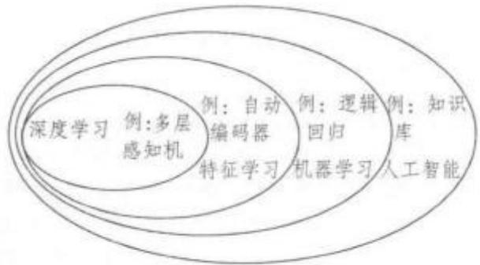

以发现数据的分布式特征表示，其具体训练流程如下图，虚线方框表示从原始数据中学习得到的信息：

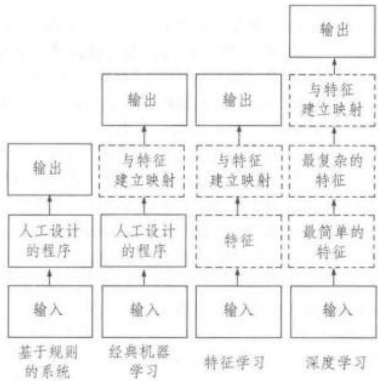

深度学习通过模拟大脑的分层结构，建立了从底层到高层逐级提取输入数据特征的模型，能够深刻揭示从底层信号到高层语义的映射关系，从海量数据中自动地获取具有层次性的有用的多层特征表达特征。其在本质上深度学习是一种数据驱动的人工智能方法，实质是通过构建具有很多隐层的机器学习模型和海量的训练数据，从原始数据中提取出由低层到高层逐层抽象的特征表达，实现提升分类或预测准确性的最终目的。与传统的浅层学习相区别，深层学习的不同之处在于：(1)强调了模型的深度，通常有五层或六层，甚至十多层的隐层节点；(2)明确突出了特征学习的重要性，即通过逐层特征变换，将样本在原空间的特征表示变换到一个新特征空间，使分类或预测更加容易。深层学习算法缓解了传统神经网络算法在训练多层神经网络时出现的局部最优问题，而且其训练过程不依赖于样本标签信息，因此适合于处理非线性的自然信号，如图像识别、语音识别、自然语言处理、大数据特征提取等方面，为许多面临瓶颈的信号处理问题提供了新的尝试方法。常用的三种典型深度学习模型包括：(1)栈式自编码器网络（Deep Auto-encoder Network;DAN);(2)受限玻尔兹曼机(Restricted BoltzmannMachine; RBM);(3)深信度网络(Deep Belief Net;DBN)。近年来，谷歌、微软、IBM、百度等知名企业纷纷投入大量人力物力资源进行深度学习技术研发，在语音合成、图像识别、自然处理、语义分割、机器翻译以及在线广告等领域取得巨大成功，开启了深度学习在学术界和工业界的浪潮。2012年6月由斯坦福大学教授吴恩达(Andrew Ng)主导的 GoogleBrain项目，训练出一种叫做“深度神经网络”(deepneural network;DNN)的机器学习模型，在无监督地训练一周后，可从众多不同的目标中自动识别出猫脸。同年10月，哈佛大学的欣顿教授(GeoffreyHinton)团队成功推出第一个应用于大词汇量语音识别系统的语境敏感的深层神经网络一隐马尔科夫模型，使用大量比音素小很多的被称作senones的单元直接对声音进行建模，利用深度神经网络来逐层抽取、发掘出连续多帧语音信号组成的高维特征。相较于之前最领先的CD-GMM-HMM模型，相对误差降低了超过16%，这是语音识别领域颇具颠覆性的成果。参见“神经网络”和“浅层学习”。

深元音 deep vowel 语音学术语，亦称后元音(back vowel)，暗元音(dark vowel)。指由舌面后部抬起而构成的一类元音。按照舌头抬起的部位(前、后、央)来区分元音的类别，就有前元音、央元音和后元音。发深元音时舌头后缩，舌尖向下，舌面后部对着软腭抬起，如英语 calm 中的/α:/音或 soon 中的/u/音。

神经网络 neural network 认知科学、神经语言学术语。在生物意义上指生物的大脑神经元细胞、触点等组成的网络，用于产生生物的意识，帮助生物进行思考和行动。人类大脑的基本组成为脑神经元，人脑大约有1011\~1012个神经元，每个神经元又有103\~105个突触(synapses)，即每个神经元都可与其他103\~105个神经元按一定的形式相连，从而构成巨大的神经网络(如下图)，完成各种大脑功能。认知科学研究神经网络的目的在于探索人脑加工、储存和搜索信息的机制，弄清人脑功能的机理，建立人类认知过程的微结构理论。

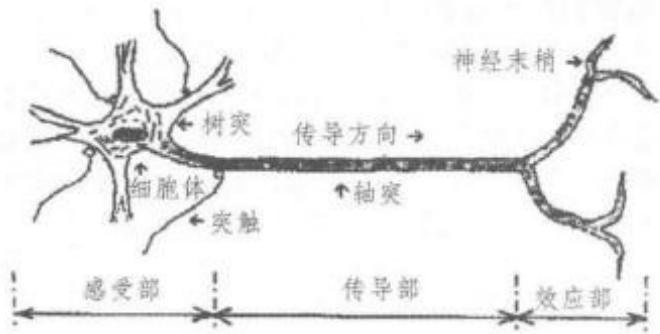

从神经语言学的角度，人类内部语言的物质依托是大脑的神经网络，而神经网络可以分成各个区域，每个区域可能控制一定的语言功能，如听、说、句法以及语义等。语言运用的物化基础是内部语言神经网络激活、传导信号的过程。语言的加工处理在神经网络中进行，语言信息的储存体现在神经元突触间隙中，神经网络能够完成信息处理的重要原因之一是大脑中枢神经网络具有记忆的功能。在神经网络中，我们既找不到相应的句子、短语、词、形位、音位等语言学单位，也找不到书面文字。所有这些信息都贮存在各神经元的关系之中。语言学中将其称作语言学的联结主义。人工智能中联结主义的基本思想是模拟人类大脑的神经元网络。1958年康奈尔大学的心理学教授罗森布拉特(Frank Rosenblat)把神经网络原理成功应用到图像识别，利用神经网络原理成功制造了电子感知机(Perceptron)，用以读入并识别简单的字母和图像。此后，基于神经网络原理人工神经网络(artificial neural network)发展迅速，其主要特点是信息的分布存储和信息处理的并行化，并具有自组织、自学习的能力，这使人们利用机器加工处理信息有了新的途径和方法，解决了一些符号方法难以解决的问题，使人工智能的学术界兴起了神经网络的热潮。随着应用的深入，人们又发现人工神经元网络模型和算法也存在问题，如随机初始化、学习过程漫长等，而且容易陷入局部最优而无法达到性能要求。但随着大数据时代的海量数据的到来、神经网络的训练技巧的大量涌现以及计算能力的大幅提升人工神经网络走向深度学习(deeplearning)发展。参见“深度学习”。

ming; NLP 神经语言学术语，亦称神经语言程序学、身心语言程序学。指关于人类行为与沟通程序的一套详细可行的模式，是一套效果强大、快速而含蓄的身心提升技巧，能够在人类的行为和能力方面实现广泛和长久的改变。NLP由美国著名学者班德勒(Richard Bandler)和格林迪尔(John Grinder)于70年代中期创立。“神经”是指人们的大脑能力，包括在意识及潜意识中的视觉、听觉、嗅觉、味觉、触觉、感觉及分析推理能力；“语言”是指人们沟通中所用的字眼、短句和音调及一切身体姿态；“程式”是指人们思维及行为习惯(如同电脑中的程式，可以通过更新软件而改变)。NLP专注于修正和重新设计思想模式以求更大的灵活和能力。NLP的许多原则已被用于多种领域如管理层训练、运动训练、市场营销和语言教学。对语言教学中注重语言教学的人文主义方法（humanistic approach）和新时代人本主义(New Age Humanism)的研究意义重大，因为人本主义强调集中开发个人自我实现意识和自我意识。

神经语言学neurolinguistics 语言学分支学科之一，是集语言学、神经科学、心理学、认知科学等为一体的一门新兴交叉学科。该学科主要研究语言习得、生成和理解的神经机制、通过分析大脑如何产生、接收、存储和提取语言信息从而探讨大脑和语言之间的关系。现代神经语言学主要采用病理学方法与电子生理学的两种范式来研究人脑，前者通过观察大脑损伤来研究其对语言功能的影响，后者通过生物电的测试来观察大脑在言语过程中的活动。

病理学方法的主要研究成果主要来自对失语症的研究，最早源于古埃及，而真正科学意义上的研究始于19世纪后半叶。1861年，法国神经学家布罗卡(Pi-erre Paul Broca)通过对失语症的研究发现第三额回与言语生成有关，明确了语言行为与脑区功能的关系。后人也因此将该区域命名为布罗卡区，这一区域的损伤使得说话者的话语断断续续，节奏混乱，无法表达实际内容。德国生理学家韦尼克(Carl Wernicke)在1874年发现大脑左半球颞叶后部控制言语的接受与理解，该区域被称为韦尼克区，其损伤会使得说话者无法分辨语音、无法理解话语。电子生理学的研究主要利用 ERP(Event Related Potentials,事件相关电位)，fMRI(functional magnetic reso-nanceimaging，功能性磁共振成像)等高时间、空间分辨率的高科技手段对正常人进行实验研究。电子生理学的相关研究表明，成人的言语中枢呈现“单侧化”或“半球优势”。言语中枢位于左半球或右半球，与习惯用左手还是右手有一定联系。

神经语言学的研究属于实证研究范畴，具有可重复性和可证伪性。这一领域的研究在于通过实验来研究语言的加工过程，实验的结果、结论或提出的模型和讨论都应以实验数据为基础，所有的数据原则上都可通过重复实验而得到；所得出的结论可被证伪。神经语言学体现了当代各学科之间交叉综合的发展态势，具有广阔的研究前景。

审议演说deliberative rhetoric参见“劝服修辞”。

渗透percolation形态学、句法学术语，亦称弥散。指将某一形态结构或短语结构中的一个成员(通常是中心成分)的特征拷贝到直接支配该成员的节点，从而使得该复合形式拥有该成员的属性。例如，exactness的名词性后缀-ness使其获得名词属性；which book这个短语，是 which的疑问特征渗透到整个短语，从而使其具有疑问的属性。

升格 promotion 语法学术语。在表示语法关系转换类型时，指有某种语法关系的名词短语在语法关系等级上变为更高级语法关系的改变过程。升格主要有升级和扩升两种类型。在升级(advancement)变化中，一个与某个动词持有某种语法关系的NP升级为与该动词持有另一种语法关系，后者在关系层级中的地位较高。例如：[1]The boykicked the ball. [2] The ball was kicked by theboy. 例[1]变为被动式[2]时，直接宾语 the ball 由原来的动词的宾语变为主语的过程即为升级。在扩升(ascension)变化中，属于一个较大NP的一个NP持有的语法关系变为原有的那个较大NP持有的语法关系。在某些特征构架模型中，指一个理论构建物(如一个特征、一个发音动作等)的地位由较低层次上升到较高层次的变化。例如，一个次要的发音动作(如腭化)在某些条件下可获得主要地位。

升喉嗓音 raised-larynx voice 语音学术语。指在说话时持续提高喉头，从而产生一种通常听起来比较紧张的语音。该语音一般具备音高提升的特点，除非对此进行等级补偿。

升级advancement 参见“升格”。

升降调rising-falling tone语音学术语，亦称高降低调。指一种语调核心的音高先上升，后下降的变化模式。该语调潜在的含义是某些问题表面看来存在一定疑惑，但事实上很清楚，常用来表示惊讶、对比等。例如：[1]Well，of all things.[2]Idon't think she knows. 例[1]用升降调表示吃惊。例[2]的言外之意即“我知道有别的人知道”。

升调 rising tone; rise; rising 语音学术语。指音高从相对较低到相对较高的运动，特点为音高持续上升。用于音调分类、语调系统和声调语言等的研究，包括高/低升调、升降调等不同种类。一般而言，降调表示确定的信息，而升调表示不确定的信息，因此英语中的陈述句、祈使句、感叹句等用降调，一般疑问句通常用升调。从话语分析角度来说，降调一般传递新信息，升调或降升调一般传递已知信息。

生成generate 句法学术语。原为数学术语，指通过找出有限集合中各成分之间的规律来说明无限的集合。20世纪60年代乔姆斯基把它借用到语言学研究领域。如果一种语法能够通过定义准确的规则来解释或界定(specify)该语言中所有符合语法的句子，那么这种语法就是生成的。因此，动词“生成”是在“有限的规则解释无限的句子”的意义上使用，与原义“产生(produce)”不同。根据生成语法理论，语言是句子的无限集合，而人们的语言知识却是一套有限的规则系统，通过有限的规则来解释或界定无限符合语法的句子，就是我们通常说的语法的生成性。

生成词库 generative lexicon语义学术语。最早由美国计算机科学家詹姆士·普斯特若夫斯基(James Pustejovsky)于1991年提出，并在其1995年的专著《生成词库》中加以系统描述。生成词库理论通过对词语的语义结构进行多层面的描写和建构有限的语义运作机制来解释词义的语境实现，并将部分百科知识和逻辑推理关系写入词法。该理论包括词汇语义表达和语义生成机制两个部分。词汇意义表达系统包括论元结构(argument structure)、事件结构(event structure)、物性结构(qualia structure)、词汇类型结构(lexical typing structure);语义生成机制包括纯类型选择(pure selection)、类型调节(typeaccommodation)和类型强迫(type coercion)。

生成方言学Generative Dialectology 语言学分支学科。指20世纪70年代把生成音系学运用到方言描写研究而形成的一个学科。该学科认为同一种形式在所有方言中的不同变体都用相同的内在表征(underlying representation)来解释，只是不同的音系规则导致不同的实现方式，或是相同的音系规则但顺序不同导致不同的实现方式等。

生成力power 句法学术语。指对各种语法作形式评价的概念，尤见于各种生成理论的讨论。语法A若能比语法B生成较多的语言(如句子等)，就可以说语法A的生成力较B强。在此基础上，还进一步区分“弱”生成力和“强”生成力。按“弱”生成力的概念，倘若一部语法(或一条规则，或一组规则等)比另一部语法或规则生成较多的合乎语法的句子，则可认定其生成力较强。重要的是，一部语法的生成力不可过强，即不应生成不合语法的句子和直觉上不合理的结构描写，也不应对自然语言的特点作出过于宽泛的描写(如将非语言系统的特征也包容进来)。因此，语法模型内部必须确立一些形式制约，以各种具体方式限定语法的生成力。

生成能力generative capacity 句法学术语。指生成语法中的语法生成能力，分为“弱生成能力”和“强生成能力”两种。前者指不同的语法生成相同语符列集合的能力；后者指在前者的基础上能把相同结构描写指派给这些语符列的能力。生成能力也指生成语法的输出总量。语法的生成能力既可以生成具体范围的字符串，又可以生成具体范围的语言结构，因此转换语法的生成能力在两方面都要比短语结构语法(Phrase Structure Grammar)的生成能力强。生成字符串的能力是弱生成能力，而生成语言结构的能力是强生成能力。

生成音系学Generative Phonology音系学的分支学科。是乔姆斯基转换生成语法的一部分，也是音系学的一种理论方法，目的在于描述本族语者必须具有的能够产生和理解其语言的语音系统的内在化知识。生成音系学是一种系统音系学，其基本研究单位是具有普遍性的区别性特征，研究内容是音位的底层表征(underlying representation)和语音表征(phonetic representation)两个层面。底层表征是音位规则应用之前的某个词的基本形式，也是本族语者抽象的内在化音系知识；语音表征则是说出来和听到的词的语音形式。音位规则包括省略、插入、改变音的切分或切分的特征等。底层表征通过应用音位规则可以得到语音表征。利用二分法特征建立起来的语音转换规则可以说明各语音单位的性质和组成，表现不同语境中语音的相互影响和变化，甚至说明语音的历史演变。转换规则的表达方式为：A→B/X\_Y，A和B代表区别性特征或音素，→代表改写，X\_Y，代表转换条件，中间用斜线“/”和转换分开。其含义是区别性特征或音素A处于条件X和Y之间时，转变为区别性特征或音素B，即XAY→XBY。生成音系学是音系学发展史上的一个重要阶段，特别是对区别性特征的二分法符合计算机的二进制编码要求，对语言的信息处理很有帮助；但也有人质疑二分法的普遍适用性。

生成语法generative grammar 指试图通过一套规则来界定一种语言中所有符合语法规则的句子而不会生成不符合语法句子的一种语法理论。目前最重要、最有影响的生成语法是美国语言学家乔姆斯基创立的转换生成语法。1957年乔姆斯基的《句法结构》的出版标志着转换生成语法的诞生。语音学家哈勒(Morris Halle)、语义学家卡茨(JerrodKatz)、句法学家波斯塔尔(Paul Postal)、心理学家福多(JerryFodor)等从不同领域对生成语法表示了响应和支持。生成语法学派以美国麻省理工学院为中心，在几年内一跃而为国际语言学界的重要流派，20世纪60年代后期出现了内部分裂，70年代后更是声威渐减，而在80年代该学派的影响力再次趋于上升。目前该学派有东北语言学会与欧亚语言学会两个国际性组织，出版《语言学探索》(LinguisticInquiry)等国际性学术刊物。该理论的哲学基础是理性主义。生成语法主要研究内在性语言(internalizedlanguage)，即人脑对语法规则的认识，而不是外在性语言(externalized language)或言语；研究范围是人的语言能力(competence)而不是语言运用(perform-ance);研究范围限于人的语言知识或语言能力，而不是语言的使用。生成语法学一般不研究话语的社会内容、交际功能和说话的环境等;研究目标是描写并解释语言能力而不仅仅是对语言现象的观察和分类;研究方法主要是形式化的演绎方法，所以有时又被称为形式语法。当前活跃在国际语言学理论界的孟德鸠语法、广义的词组结构语法、词汇一功能语法、关系语法等各派学者均与生成语法有一定的渊源关系。生成语法不是传统意义上的语法，而是具有普遍解释性的有关内在化语言的一种语言理论体系。转换生成语法的产生被誉为语言学历史上的一次革命，无论是对语言学本身还是对其他相关学科，如认知科学、人工智能、计算机科学等都影响深远。

生成语法理论 generative theory参见“生成语法”。

生成语义学generative semantics 转换生成语言学的一个分支。从生成语法学派中分离出来的一个学派，作为乔姆斯基(NoamChomsky)以句法为基础的转换生成语法(transformational generativegrammar)的反作用发展起来，目的在于描写和解释人们的语义知识，同时也描写一切词组和一切句子的意义，提出不以语法为基础而以语义为基础的语言理论模式。生成语义学的基本观点是句法和语义不可分割，语义在句法中起中心作用，并通过转换规则把语义表现和表层结构联系起来。代表人物有卡茨(Jerrold Katz)、福多(JerryFodor)、麦考莱(James MeCawley)、雷考夫(George Lakoff)、罗斯(John Ross)、波斯特(Paul Postal)等。以 1963 年卡茨和福多发表的《语义理论的结构》(The Structureof a Semantic Theory)和次年卡茨和波斯特出版的《语言学描写的统一理论》(An Integrated Theory ofLinguistic Description)一书为标志，形成比较系统的语义理论。生成语义学以语义为基础，认为语义部分才有生成能力，而且句子的句法特点取决于语义，主张取消标准理论中的深层结构，把标准理论中的短语结构规则、转换规则等局部规则(local rules)扩展为联系相邻表达式的全应规则(global rules)，把树形图的终端成分由词变成语义成分，认为词项是在转换过程的各个环节中逐步插入，而不是在转换前的某个环节中一次插入，并且认为语义部分还有构成规则(formation rules)等。在语义表达层次上的词汇化过程和使用转化规则就可得到表层短语标记。表层短语标记再进入音位部分就得到句子的语音表达式。这样，生成语义学就可以解释句法结构不同而语义结构相同的语言现象，还可以解释语义相同而词不同的语言现象，这是生成语义学的优势所在。20世纪60年代至70年代中期是生成语义学的全盛时期。但由于生成语义学派的研究没有考虑语言环境和词语与世界上事物的联系，而且元语言语素众多，在此情况下，生成语义学派逐渐淡出。然而生成语义学派提出的一些观点被转换生成语法所接受。乔姆斯基认为语义学只能处理部分语义问题，尤其是与逻辑有关的语义问题，如名词的指称关系、量词辖域等，其他语义问题则属于语法以外的认知系统。所以，雷考夫后来转而从事认知语言学研究，认知语义学开始被越来越多的人所接受。

生成转换语法generative-transformationalgrammar指乔姆斯基创立的转换生成语法。参见“转换生成语法”。

生理语音学 physiological phonetics语音学的一个分支，亦称发音语音学(articulatory phonetics)和言语生理学(speech physiology)。是研究语音产生和感知的一门学科，包括言语产生、语音病理、嗓音类型和口鼻腔调音的机理、大脑感知和情感分析等方面。作为最早语音研究形成的学科，它在一个世纪前就已完成发音原理的探究，从发音器官及其活动方式分析语音形成，认为语音的发音过程是人类发音器官的生理活动。语音学从本质上来说是一门实验科学，作为现代语音学的一个分支，生理语音学采用现代生理语音学仪器进行相关实验研究。目前，有多种生理语音学仪器。就具体对象和内容而言，在发音部位的运动模式方面，有电磁发音仪与动态电子腭位仪；从言语空气力学特性方面入手，有气流计(指言语发生空气动力学系统)与鼻流计；在生物电信号采集方面，有生物电采集器、脑电图、肌电图、皮肤电测试仪等；在声带振动与噪音声源方面，有声带肌电检测、电子声门仪、数字频闪检测系统与高速数字成像系统；在动态声道采集方面，有X光摄影、高速核磁共振声道成像技术与CT三维成像，在生理振动采集系统方面，有振动声学仪器与肌肤接触压电式麦克风；在言语病理矫正系统内，则有大量语言障碍矫治仪器。由于生理语音学使用的大部分仪器都比较昂贵，有不少仪器必须由专业医生来操作，因此很难普及使用。

生命度等级animacy hierarchy 指人对客观世界实体对象具有的生命特征的一种看法，在语言学领域指的是名词和代词的一种语法范畴，而生命度等级也成为一条语言共性。名词或代词在有生性(animacy)方面的等级序列，表现为有生性在尺度上的大小差异。作为尺度的两极，人称代词的有生性最大，而无生命物体的有生性最小。语言中的名词和代词的生命度从高到低进行排列，可以得到以下生命度等级序列(“>”表示“高于”)：

## 第一/二人称代词>第三人称代词>专有名词>

人类普通名词>非人类普通名词>无生命名词在生命度等级的一端的和另一端的词汇在句法方面有不同的反映，如有生性较大的词汇是受格语言(accusativelanguage)的组合特点，而有生性较小的词汇是作格语言(ergative language)的组合特点。移情(empathy)程度也反映在这一尺度上，人们对自身的移情程度最大，对石头等无生命的物体的移情程度最小。

## 生态批评话语分析eco-critical discourse

analysis传统批评性话语分析的扩展，注重在书写、口语、或图像形式中环境问题被呈现的方式，揭示潜在的生态或非生态意识形态。其分析范畴还包括对未来生态系统具有潜在重要影响的语篇，如新自由主义经济语篇和涉及消费主义、性别、政治、农业和自然的语篇建构。同时，生态批评性话语分析不仅仅注重揭露有潜在破坏性的意识形态，还探讨有助于生态可持续性发展的社会的话语表达形式。

生态语言学Ecolinguistics语言学的一个分支，亦称语言生态学(ecology of language)。是由生态学和语言学相结合而形成的语言研究领域。作为当代语言学跨学科研究较新的一个分支，生态语言学旨在研究语言在生态和环境发展中的作用。“语言生态学(linguistic ecology)”的说法最早于1967年由弗格林等学者（Voegelin，Voegelin &.Schutz，1967)在一篇关于语言环境的文章中提出。美籍挪威语言学家豪根(Einar Haugen)于1970年的报告《谈语言的生态》(On the Ecology of Language)中首次正式使用“语言生态(language ecology)”概念。豪根于1972年在语言学杂志 The LinguisticReporter上发表论文《语言生态学》(The Ecology ofLanguage)，专门阐述“语言生态”的概念，将之定义为“研究任何特定语言与环境之间的相互作用(thestudy of interactions between any given language andits environment)”，其核心问题是语言所产生的社会影响和心理影响，以及这些影响对语言自身产生的作用。豪根将语言与环境的关系比作动植物物种与其生存环境之间的生态关系，进行隐喻类比，提出了语言的社会环境概念，把生态学中的研究方法和概念等应用到语言学研究上来。此后，“语言生态”的隐喻开始逐渐为语言研究者们接受。

20世纪70年代末，生态语言学得到发展。1979年，赛尔辛格(Kurt Salzinger)首次在正式刊物中使用“ecolinguistics”一词。鲍林格（Dwight Bolinger)在其《语言——上了膛的武器：今日语言之运用与滥用》(Language, the Loaded Weapon: The use andabuse of language today，1980)一书中有专章讨论“An ecology of language”。从 20世纪 80年代开始，生态语言学家们开始研究生态范式(ecological para-digm)，也就是通常所称的“豪根范式(HaugenianParadigm)”。豪根范式研究社会环境(生态)对语言的影响和作用，用生态学的理论和方法研究语言的生存和演变，即重心是生态对语言的影响。与豪根范式相对应的是“韩礼德范式(Hallidayan Para-digm)”。1990年，韩礼德在希腊举办的国际应用语言学会议(AILA)上的报告《意义的新途径：应用语言学的挑战》(New Ways of Meaning: The Challengeto Applied Linguistics)强调了语言与生物生产状况、种类特性以及物种形成之间的关系。他的报告促使语言研究者对语言和环境问题的关系做出新的思考，即把语言和语言研究作为生态问题的组成部分加以考察，从而形成了生态语言学的另一研究范式，即通常所称的韩礼德范式。该范式从语言对人类的有用性角度出发，基于索绪尔的“语言一言语(Langue-Parole)”二分观点提出了“非生态语言(un-ecological language)”和“人类中心主义(anthropo-centrism)”的概念。从一个宽泛的角度来说“人类中心主义”与“性别主义(sexism)”“阶级主义(class-ism)”“发展主义(growthism)”等一样都通过语言和语言使用一代一代得以继承。韩礼德范式的重心是研究语言对生态环境的影响，是对自然生态环境进行语言学研究，即语言对生态的影响。两种范式是两种研究方法，虽然重心不一样，但相互补充和完善，使得生态语言学的研究更具有系统性。

20世纪90年代开始，生态语言学发展得更为成熟。奥地利格拉茨大学教授菲尔(Alwin Fill)出版著作多部，包括《生态语言学引论》(Ökolinguistik，EineEinführung，1993)、《语言学与生态学》(Sprach-ökologie und Ökolinguistik，1996)和《多彩的绿色思想》(Colourful Green Ideas，2002)等。匈牙利裔美国语言学家麦凯(AdamMakkai)于1993年出版专著《生态语言学：迈向语言科学的新范式》(Eco-linguistics: Toward a new "Paradigm" for the sci-ence of language)，菲尔和米尔豪斯勒(PeterMühlhäusler)合编的《生态语言学读本:语言、生态学和环境》(The Ecological Reader: Language, ecolo-gy and enuironment，2001)一书辑录了豪根、韩礼德等名家的一系列语言生态学论文。米尔豪斯勒于2003年出版专著《环境的语言——语言的环境:生态语言学教程》(Language of Environment — Envi-ronment of Language: A course in ecolinguistics).自1999年在日本东京召开首届会议以来，国际应用生态语言学会议每年都会召开一次，为全球生态语言学家提供了一个交流平台。

“生态批评话语分析(Eco-critical discourse anal-ysis)”是生态语言学的一个研究重点，主要研究分析对未来生态体系具有潜在影响的语篇，包括“新自由经济”(neoliberal economy)、“消费主义的推论建构”(discursive constructions of consumerism)等(Stibbe, 2012; Harré et al., 1999; Goatly, 2000).因此，生态语言学与生态符号学(ecosemiotics)(Sel-vamony，2007)、环境交际(environmental communi-cation)、生态批评(ecocriticism)等研究具有相同的研究目的。由于全球经济一体化，信息传播现代化，全球语言生态的丰富性和多样性受到严重威胁，但随着自然生态学和环境生态学的迅速发展，生态语言学作为一门相对年轻的学科，将会得到更多的关注和发展。

生物程序假说 bio-program hypothesis生物语言学术语。指毕科顿(Derek Bickerton)在长期研究克里奥耳语(creole)的基础上提出的一个假说。该假说认为儿童具有区别某些基本语义的先天能力，使他们能够组织特定的语法；而且这些先天的语法知识，仿佛构成语言的一个后援系统，当语料输人有限时，该系统便会启动。生物程序假说旨在揭示个人如何学习新语言和语言能力的发展。根据生物程序假说，一些克里奥耳语，像儿童习得母语时表现出的一些早期特征一样，也反映出生物程序的底层结构，也就是说儿童的母语语法与生物程序越接近，语言习得的进程也就越快。毕科顿还观察到居住在夏威夷的葡萄牙人的孩子创造的混合语与世界其他不同地区的孩子创造的混合语有惊人的相似之处。

生物符号学biosemiotics符号学的一个分支，也是一个新兴领域，指整合生命科学与符号学研究成果，从生物学角度研究符号的产生、活动和解释的学科。生物符号学认为诸如声音、物体、气味、动作等既是物理的也是生物的符号。该名称由罗斯柴尔德(Friedrich Rothschild)于 1962 年第一次提出。魏克斯库尔(Jacobvon Uexküll)被认为是生物符号学的奠基者，他于1909年在其专著《生物看到的世界》中提出了生物符号学的一个基本论点：生物体是追求意义的生命体，因此，对生命主体和客体的互动与交汇必须放置在“意义”的前提下进行讨论。生物符号学一般分为两个领域：理论生物符号学和应用生物符号学，前者处于统治地位。生物符号学的一个目标便是对自然世界普遍存在的生命和意义形成一种新的观点。

生物语言学Biolinguistics 语言学的一个分支学科。指运用生物学和语言学研究成果去研究人类语言生物属性的一门学科。这一学科名称最早出现在米德（Clarence Meader）和麦斯肯（JohnMuyskens)于1959年合著的《生物语言学手册》(Handbook of Biolinguistics)中，该书将生物学的研究成果与语言学结合起来界定生物语言学。目前，生物语言学的研究有广义和狭义之分。广义生物语言学研究涵盖了从进化生物学、基因科学、神经科学以及心理学等角度展开的语言研究，乃至研究语言的生理基础，研究人类语言的种特异性、限制儿童语言发展的相关因素、言语产出与语言障碍、语言的遗传转换等。从狭义上讲，生物语言学主要指以乔姆斯基为代表的生成语法学派关于语法属性的研究。乔姆斯基把语言当作一个自然客体进行研究，把语言官能视为人脑的一个与生俱来的生物器官。他指出语言是生物体的一部分，需要用自然科学的研究方法来研究语言。最简方案就是以生物语言学为基础，认为语言机能既包括“广义的语言机能”(faculty of language — broad sense,简称 FLB)，也包括“狭义的语言机能”(faculty of language—narrowsense，简称FLN)。广义语言机能包括感觉运动系统、概念意向系统；狭义语言机能仅指语言内在的递归性运算机制，用以说明人类特有的语言能力，即从有限的语言成分生成无限的语句表达的能力。也就是说，FLB是人类和动物所共有，而FLN只包括“狭义句法和接口对应中核心的运算机制”，即递归性是人类所独有。

声波 sound wave语音学术语。一般使用波长、频率和振幅等三个特征描述声波。

声波图 sonogram 语音学术语，亦称语图。根据声强、频率、振幅等言语声学信号的物理特征进行观察、测量和记录后制成的频谱图(spectrogram)。

声带vocal cords; vocal folds 言语器官之一。在喉腔内部振动以产生语音的两对并列的纤维质薄膜，上下两两相对。下面的一对固定在甲状软骨和后面的破裂软骨的声带突上，坚韧而有弹性，是真声带，其上还有一对比真声带厚的膜，平常发音时不起作用，是假声带。可闭合以截住气流，开放以通过气流。软膜按照适于音高的频率迅速开启，就产生嗓音。发清音时声带呈开启状态；发浊音时声带便会振动；当空气周期性地通过声带时，声带就震动。声带在咽腔中的位置如下图所示：

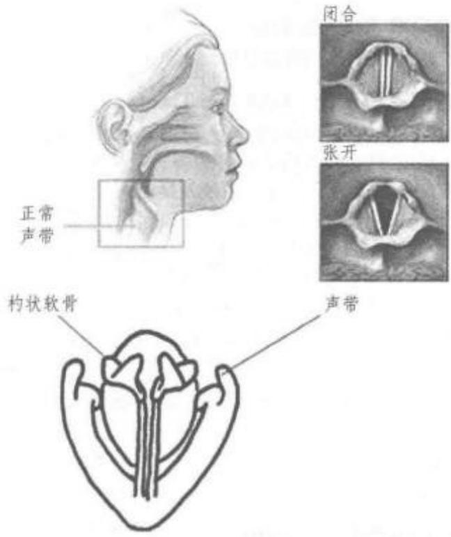

声道vocal tract语音学术语。指言语产生过程中的整个气流通道，包括三个主要的共鸣腔(resonance chamber):口腔(oral cavity)、鼻腔(nasalcavity)和咽腔(laryngeal)。声道形状的变化是引起语音差异的主要因素。

声调tone语音学、音系学术语。指音节中具有区别意义的音高。一个音节除了由元音和辅音组成的音质单位外，还包括一定的音高、声强和音长，它们往往和音质成分一样具有区别意义的作用。在一些语言里，音节中不同的音高代表不同的意义，如汉语mā“妈”、má“麻”、mā“马”、mà“骂”，意义随着音节的音高不同而不同。根据声调的有无可以把世界上的语言分为声调语言和非声调语言。世界上有许多语言是声调语言，汉藏语系语言最突出的一个特点就是有声调。例如，现代汉语普通话中有四类声调：阴平、阳平、上声、去声。按照五度标记法，它们的调值分别为阴平[55]、阳平[35]、上声[214]、去声[51]。声调在孤立静止时，呈现出稳定的调值，在连续的语音环境中，由于表情达意和不同语音邻近的作用，表现为一种或几种不同的声学特征。匹配组合普通话中的四个静态声调，可以产生十六种声调的匹配模式。除了辨别词义外，在有的语言里声调还具有语法功能。例如，尼日利亚南部埃多语(又称比尼语)的[ima]，两个音节都读低调是“我显示”的意思，前高后低是“我正在显示”的意思，而前低后高是“我已经显示”的意思，前后两音节的高低变化区分了动词的不同时态。现代汉语中也存在这种现象，如“他把包袱背(bēi)在背(bēi)上”，声调的不同改变了词性。

声调发生 tonogenesis 亦称声调起源。指声调语言从非声调(atonal)语言发展而来的历史过程。例如，声调发生的一种情形是，某一元音的音高在某一组辅音前需要降低；后来这些辅音在语言发展过程中可能消失了，自此这个元音的音高就成了这些音节与其他音节区别开来的特征。

声调反向性 tonal polarity 语音学术语。用于声调语言的研究，指一个声调总是与前一个或后一个声调形成相反的情形。参见“声调语言”。

声调弱化 tone reduction 音系学术语。在声调语言中，弱读音节发音时没有明显的高低起伏的调值，从而不再属于其原有的调类归属的现象，在汉语中亦称“轻声”。

声调下降downstep 参见“降阶”。

声调学 tonetics亦称调位学。指对声调语言中的声调以及调位系统的研究。

声调音位 tonic phoneme; toneme 音系学术语，亦称调位。指音节制的声调语言中具有音位功能的声调高低起伏的差别。例如，在汉语中，构成并区别每个音节的不仅包括元音和辅音，还包括发音时的声调，如mā(妈)、má(麻)、mā(马)、mà(骂)。声调音位和音段音位一样，也是语音系统中的最小功能单位，可以用来区分意义。但音段音位是一种根据时间顺序排列的线性组合，而声调是和音段音位同时发生的，是共时组合，因此它是一种超音段音位。

声调语言 tone language 语言类型学术语。指由声调来区分词义的语言。例如，汉语有四个声调的区别，即dā“搭”(阴平)、dá“达”(阳平)、dǎ“打”(上声)、dà“大”(去声)。除汉语外，越南语、泰语以及中美洲的一些语言也是声调语言。

声调重音 tonic accent 语音学术语，亦称音调重音或音高重音。指在一个由相连的声调所组成的声调群中，使其中某一部分的声调突出从而形成的重音。在一些语言中，声调重音可以存在于某个词的发音中，并用来区分不同的词义。譬如，瑞典语tanken，若将第一音节发成降调锐重音，则表示“坦克”；若将第一音节发成降升调钝重音，则表示“思想”“想法”。

声符phonetic indicator 汉语音韵学术语，指汉字形声字的表音部分，亦称声旁。例如，“像”中的“象”就是这个字的声符。在声符的起源上，存在形声源于假借说、“声化象意字”说、“加旁二步发展”说、“部分表音的独体象形字分化”说等。按照不同的标准，可将声符分为不同类型。根据声符的出现频率，分为高频与低频声符；根据成字与否，分为成字和不成字声符；根据声符的传代性，分为基本和滋生声符；根据声符的读音多寡，分为一音和多音声符;根据声符独立成字时的语音和由它构成的音同或音近关系提示形声字的读音，分为表音声符、半表音声符、不表音声符。

声律障碍 dysprosody 病理语言学术语。指韵律方面的严重损伤，比如语音轮廓、强度或声言中表示时间的结构中所产生的失调和扰动。右半脑相关部位受损所致，一些病人无法用语言或手势来准确表达情感(如快乐、悲伤、愤怒等)，却能够理解他人所说的句子和所做的手势的情感内容。另一些病人的情感韵律和自发手势虽然正常，却无法理解句子的情感因素。

声门glottis 言语器官之一。指声带之间的缝隙。讲话时，声带的开关可以控制气流自肺部到口腔的通道。声门开合程度不同所发出的音不同。

声门闭合glottal closure 语音学术语，亦称喉部封闭。指声带之间空隙的封闭，其持续的时间影响发音的有效性和音质，因此是判断声音功能的一个重要因素。声门闭合通常可分为五种：完全闭合、后三角闭合、非规则闭合、纺锤闭合和非完全闭合等。声门闭合是描写发音过程的重要参数。

声门化 glottalization 语音学、音系学术语。

①通常指发音时，伴随有声门收紧的特征，尤其是声门塞音(glottal stop)。例如，英语中的有些词在词尾会出现声门化，如“what”中的尾音[t?]。②指声门打开延迟至声门辅音除阻之后所产生的挤喉音。在英语中，挤喉音仅具有语体意义。例如，清晰精确地说“I think”时，think 中音节尾 k 的发音为[k']。

声门气流机制glottalic airstream mecha-nism语音学术语，亦称喉门气流机制。当声门打开，气流可轻易通过，所发出的音为清辅音；当声门略微封闭，气流导致声带震动，所发出的音为浊辅音。

声门强化glottal reinforcement 语音学、音系学术语。通常指发辅音时伴随产生的声门闭合。声门强化在南部英格兰英语尾音中常见。例如，fiction ['fi?kfən]、milkman ['mıl?kmən]、opera[l]等。

声门塞音 glottal stop 语音学术语，亦称喉塞音。指短暂完全封闭声门，阻止气流从肺部流出，随后声门打开让气流突然冲出所发的音。声门塞音是辅音。在有些美国英语的变体中，声门塞音用来代替[t音，如单词kitten 和 button。

声门塞音2 glottalic 指声门塞音或声门气流机制。参见“声门气流机制”。

声门塞音理论Glottalic Theory 音系学理论。指对原始印欧语爆破音系列传统看法提出修正的理论，认为印欧语系语言的辅音是从包含有挤喉音(ejectives)的一个语音系统发展而来，即因此对于发音部位为牙齿的系列音来说，其中的爆破音就成了声门塞音，原来如/p/、/t/、/k/为代表组成的三个系列，应该在类型学背景下重新解释为/p/、/t/、/k/那样包含有一系列挤喉音的系统。此理论首先由丹麦语言学家霍尔格·佩德森(Holger Pedersen)于1951年提出，马蒂内(André Martinet)于1953年进一步发展；在20世纪70年代得到格姆克列利泽(Tamaz Gamkrelidze）和伊凡诺夫（VyacheslavVsevolodovich Ivanov)以及霍珀(Paul Hopper)的支持。

声门吸气音injective语音学术语。指缩气音(ingressive)的一类。发音机制与内爆音一致。区别在于发音时，声门吸气音声带不振动。参见“内爆音”。

声门音glottal 语音学术语，亦称喉门音。指短暂完全的封闭喉后部的声门(glottis)所发出的音。许多语言都有声门音，通常为辅音或辅音丛。例如，出现在 die Arbeit /di?arbait/等大多数德语词词首元

音前的声门塞音[?]。

声母initial (of a Chinese syllable); initial con-sonant音韵学术语。构成汉字字音的元素包括声、韵、调。声即声母，指一个字音的起首辅音，如“评”[pm]、“图”[tu]中的[p]、[tb]。反切音中，反切上字相当于声母。有些字的反切上字没有起首辅音，也仍算有声母，称为零声母。

声谱仪 sound spectrograph 语音学术语。对语音进行声学研究的一种带有电滤波器的仪器，用来记录振幅、音量和音延，然后在特制的光敏感纸上能对程度不同变化的暗线条进行读数。通过声谱仪录出的材料叫做声谱(spectrogram)。声谱即声能在一定的频率范围内的显示。

声腔cavity 语音学术语。言语器官之一。指参与语音发音的腔体，直接参与发音的称为主动声腔(active cavity)，间接参与发音的称为被动声腔(passive cavity)。声腔分为肺部、咽腔、口腔、鼻腔等。

声强intensity 语音学术语。声音的生理特性之一。指声音作用于听觉器官的压力强度，一般以分贝(dB)为计量单位。取决于物体发音时的振幅(amplitude)。振幅较大音较强，振幅较小则音较弱。振幅又取决于发音体本身的体积和受力的大小。就生理发音而言，音强与气流的强弱、成阻部位和共鸣腔的大小以及肌肉的紧张度都有关系。声强对语言有着重要意义，语音的传输和感知需要一定的音强(其下限为听阈)，音节的构成与声强密切相关。

声学acoustics一种专门研究声音的物理特性的科学。声音的物理特性主要指声音在空气中传播时产生的各种波形变化的特性，这种特性主要包括三个方面：频率(frequency)、振幅(amplitude)和相(phase)。声学语音学(acoustic phonetics)是研究人类话语声音的物理特性的科学。参见“声学语音学”。

声学处理acoustic treatment 参见“消音处理”。

声学分析acoustic analysis 语音学术语。指在声学语音学研究中对以语音为主的声音进行物理性能方面的分析。声学分析主要借助频谱仪及其他声学仪器等对话语声音进行观察、记录和测量，用物理学的方法对声波形进行频率和振幅、谐波等方面的描写或分析，声学分析所得到的有关语音的精确客观的物理性数据能够为发音语音学和听觉语音学等学科的研究提供支持，从而弥补这些学科主观内省式分析带来的不足。

声学过滤器acoustic filter语音学术语。指人体发音器官中起共鸣作用的腔体。共鸣腔只对声带震动所产生的某些具有一定频率的谐波产生共鸣作用。

声学提示acoustic cue 语音学术语。属于语音的一种声学属性，用以区别不同的语音特征，包括基频、辅音的嗓音开始时间(voice onset time)等。基频能够帮助形成区别典型的男性音色和女性音色，在典型的女性声音中，bird和fern两个词的基频分别大约为650赫兹和1593赫兹，而典型男性声音的基频则为513赫兹和650赫兹。辅音嗓音开始时间的差异则可以区别送气和不送气音，如/t/和/tb/。

声字语首字acoustic pnonetics 简称声学，属普通语音学的分支学科。主要研究说话者产出的话语在空气中传播到听话者这一过程中所表现出的物理属性，如频率、振幅等声学方面的表现。20世纪30年代后，随着电子科技的发展和进步，声学语音学的研究中主要使用频谱仪及其他声学仪器等对话语声音进行观察、记录和测量，用物理学的方法对声波形进行频率和振幅等方面的静态描写或分析，甚至进行人工语音合成。声学语音学的研究成果能够为发音语音学和听觉语音学等语音相关研究的学科提供和寻找精确客观的数据支持，弥补这些学科主观内省式分析带来的不足。

声音 sound 指由于空气压力的变化引起耳鼓膜振动的结果在大脑中产生的印象。例如，说话时，声音的振动引起介质(即空气分子)有节奏的振动，使周围的空气产生疏密变化，形成疏密相间的纵波，这就产生了言语的声波。声音以声波形式传播。声波振动内耳的听小骨，并将这些振动被转化为微小的电子脑波，形成人耳可觉察到的声音。声音可以被分解为不同频率、不同强度正弦波的叠加，这种分解过程称为傅里叶变换。人耳可以听到的声音的频率范围在20到2万赫兹(Hz)之间，高于此范围的波动称为超声波，而低于此范围的称为次声波。

声音过滤acoustic filtering 语言习得术语。指二语学习者在听力理解中只能听到和辨认出说话者所发出的部分语音，而对另一些语音存在排斥的现象。这主要是由于在二语学习过程中，学习者本族语的语音会对所学二语的语音产生过滤作用，使学习者难以听到和辨认出二语中出现的某些新的、不熟悉的语音。

声音节奏sound-rhythm 音系学术语。指依附于理智或情感节奏而存在的、构成理智或情感节奏的有机成分。声音节奏是适应这两者需要而产生的，其目的是尽可能完美地以声音节奏来配合表达理智或情感节奏。

## 声 shēng（语言学术语）

声域 register 参见“音域2”。

声源 sound source 语音学术语。指产生语言的发声器官的声道，或能够发出声音的设备，如扩音器、录音机等。

声源过滤理论 source-filter theory 一种普遍接受的言语产生理论。认为声源指人体喉部振动时所产生的声波。声道的各个共鸣腔(如口腔、鼻腔等)以过滤器的方式作用于喉部声源的声波，与其声波产生共鸣作用。

声源特征 source features 音系学术语。描述语音特征，诸如清音或浊音、糙音或润音等的对立。由乔姆斯基和哈勒(Morris Halle)提出，是区别特征理论(feature theory)中提出的五大范畴之一。其他四个范畴分别是主要音类特征(major class fea-tures)、声腔特征(cavity features)、发音方式特征(manner of articulation features)和韵律特征(pro-sodic features).

省略 ellipsis; deletion 语法学术语。指为了说话、表达简捷而省去发音或话语中可以省去的音、字、词等现象。省略是一种言语行为，也是语言中一种常见、复杂的现象。语言学各流派对省略的研究基本上是从语音、句法、语义、篇章等角度展开，近来也有从逻辑、心理动因、价值取向等角度的研究。吕叔湘在《汉语语法分析问题》中提到“省略”应满足两个条件：“第一，如果一句话离开上下文或者说话的环境意思就不清楚；第二，经过添补的话是实际上可以有的，并且添补的词语只有一种可能”。只有同时满足这两个条件，才可以称之为省略。朱德熙在《语法讲义》中提出，省略是“结构上必不可少的成分在一定的条件下没有出现”。省略也可分为三类：语义省略、语法省略和语用省略。如上对省略的解释分析各有优劣，但省略的例子在语言中随处可见。汉语中当词或词组的表层结构和深层结构所体现出来的意义一致时，可以出现同音省略，如中医院(中医医院的同音省略)、公安局长(公安局局长)、西餐厅(西餐餐厅)等。英语中说话人在非正式场合说话或语速较快时，往往省略非重读单词的词尾辅音，因而“a friend of mine”就成了“a friend o'mine”。汉语是语义型的语言，在汉语里靠逻辑意义构成省略结构也很常见。例如：[1]没有规矩，不成方圆。[2]吃一堑，长一智。在有些语法如英语语法中，关系代词也可省略。例如：[3]Have you read the book(that) I told you about?

省略参数pro-drop parameter参见“零主语参数”。

省略否定式abbreviated negation 语法学 术语。指否定词not 以附着成分-n't的形式依附于 助动词、be动词、情态动词等之后的形式。连缩否定 式有两种情况，一种是否定附着成分直接附加于上 述词项之后，如 did→didn't、is→isn't、were→ weren't、would→wouldn't等。另一种是否定附着 成分前的词项在拼写或读音上产生一定的变化，如 do→don't、can→can't、will-won't、shall→shan't, am→ain't等。

省略号 ellipsis 表示有意略去不需要的词、短语或句子。英语中一般用三个句点连续，加上前后可能有的标点，如“，..”或“..?”“...!”。当省略号处于句未(即表示句子的结尾)时，通常不再添加句点。汉语的省略号为居行中的六个点，句尾也通常略去句号；辞书中为节省空间，也常用三个点。

省略检验 reduction test 结构主义语言学的一种分析程序，用来识别句子的基本结构(核心句)或区分句子的可选成分和必选成分。例如：Lastyear we lived in Shanghai. 其中的“last year”可以省略，但是“in Shanghai”不能省略，因为动词live的配价结构需有状语成分。

省略句 elliptical sentence语法学术语。指某些语言成分的省略。一个句子出于经济、强调或风格的原因，省去前面已经提过，没必要再出现的词或片语以避免重复的现象，省去的部分在参照上下语境后可以恢复。例如，问句“Where are you going?”常省略回答为“To town.”;此省略句可恢复为“I am going to town.”。有的则不可恢复。根据句法规则或词汇特点，可有如下省略形式：(1)并列成分省略。并列句中某些一致的成分被省略。例如：[1]The man went to the door and (he) opened it, (主词省略) [2] Mary ate an apple and Jane (ate) a pear.(动词省略)(2)词汇省略。省略某些配价所要求的补足语。例如：[3]It's your turn to deal (thecards).词汇省略又分为不定省略和有定省略。例如:[4] He is eating (something). [5] Jacob finallyadmitted(something).例[5]可从上下文知道确定的东西。在英语中，有定省略是很少见的，正常情况下主语一般不省略(除非是在“arriving tomorrow”等所谓的电报文体中以及其他很有限的场景中，如去开门时说“Coming”)。然而，在其他语言(如罗曼语族、日语、汉语)中，有定代替性词语的省略却很普遍。(3)问句与回答中，前面提到过的部分往往可以省略。例如：[6]Who is coming tomorrow?Caroline.(4)不定式与分词结构主语必须省略，这也属于正常的省略。例如：[7]Lousie stoppedsmoking.(5)在祈使句中，经常发生主语省略，如"Go home!"

省略形式elliptic form一个省略的限定复合词，指有三个成分的复合词中第二个成分的省略。例如 shoe（repair) shop。相对于前缩写法和后缩写法，这种省略形式可以直接源自限定复合词。

省音deletion 音系学术语。一种比较复杂的语音音变现象，其形成受到多种因素的制约，既有音段方面的(如音段间的协同发音效应)，又有韵律方面的(如语句轻重音、语速等)。此外，还受到个人讲话习惯、地域、方言背景等方面的影响。参见“省略”。

省音2ecthlipsis指由于诗歌韵律所需对于字母和音节的省略。例如：

Multum ille et terris iactatus et alto

Mult'ill'et terris iactatus alto

—Mosellanus

为适应诗歌韵律，第二行例示了借助省音方法从单词中省略掉的字母。

省音3elision 音系学术语。指连续言语中语音的省略。通常为了发音方便，省去音节间或词与词之间的一些音，辅音和元音都可省略，有时整个音节也可省略。省音通常发生在复杂的辅音连缀中，如clothes:句子中的语法词特别容易省音，如 and和of。例如; cup of tea→ cuppa tea, you and me →younme。在多音节词中，非重读音节里的元音和辅音在正常语速的会话中经常省略，如camera、probably、February等。参见“脱落”。

圣经 Bible; Holy Scriptures 指包括基督新教、天主教、东正教、犹太教等各宗教的宗教经典。英文名称“Bible”源于希腊文biblos、拉丁文biblia，意为一组书卷。约翰·威克里夫(John Wycliffe)在1382年到1384年把拉丁文版圣经翻译成英文版圣经时，开始使用英语名“TheBible”。圣经由《旧约》与《新约》组成，原文圣经由三种不同的语言写成：希伯来文(大部分旧约)、亚兰文(希伯来文的姊妹语言，半卷但以理书与以斯拉记中的两段改为：但以理书、以斯拉记、创世纪、耶利米书的部分章节及新约的若干地方)和希腊文(新约全部)。《圣经》的作者由约四十多位不同时代、不同身份、不同地区的作者组成，历时约1500多年写成。犹太教的宗教经典是《旧约》部分，亦称希伯来《圣经》，犹太教的《圣经》由于把多个章节较少的书卷合成一卷，共有24卷；基督教的《圣经》则包括《旧约》和《新约》两部分，只是不同的基督教派别所承认的《圣经》旧约部分略有不同：把《旧约》的《撒母耳记》、《列王纪》、《历代志》分为上下卷，天主教版本承认49卷，东正教版本承认51卷，基督新教版本承认39卷；《圣经》新约部分包括的书卷比较一致，天主教、东正教、新教都承认27卷。《圣经》也可以按题材把《旧约》分为：(1)摩西五经（the Pentateuch)；(2）历史书（theHistoricalBooks):(3)先知书(the Prophetic Books);4)诗篇、智慧书(the Poetry and Wisdom Books)。《新约》分为：(1)福音四书(the Gospels);(2) 历史书(the Bookof Acts);(3)书信(the Epistles)；(4)启示录(theBook ofRevelation)。此外，《圣经》还有极高的文学价值。其中大量的历史文学、神话传说、诗歌戏剧小说、“先知文学”等构成了一座巨大的文学宝库。所以，《圣经》对西方文学影响深远。首先，西欧诸国语言文字的规范化几乎都始于《圣经》的翻译。其次，《圣经》故事、人物等也为文学家提供了引经据典的宝库。再次，《圣经》也是多种多样创作题材的源泉。《圣经》既是一本宗教巨著，其中更融合着政治、经济、历史、文化，并与希腊文明一起，对今天欧美文化的形成起到了不可磨灭的作用。

剩余成分 residue功能语言学术语。根据系统功能语法理论，指小句(clause)中除语气成分之外的其余成分。语气是体现小句中语气选择的成分，包括小句的主语和定式成分。例如：1]Maryhas passed the exam successfully. 句中的主语 Ma-ry和定式成分has相互结合形成语气;除语气之外的“passed the exam successfully”则为剩余成分。剩余成分主要包括谓语(predicator)、补语(comple-ment)和附加语(adjunct)三个功能成分。其中谓语是指动词词组中除了定式成分以外的动词部分。上例中的谓语是指动词词组“has passed the exam”中除了定式成分 has以外的动词部分，即passed;补语由名词词组“theexam”来体现。附加语通常由副词词组或介词短语体现，如上例中的副词successfully。再如: [2] She has been working hard. [3] Sheworked hard last year.在例[2]"has been working"的动词词组中，has为语气中的定式成分，beenworking为谓语;而在例[3]中，定式成分为表示过去式的-ed，谓语为 work，worked 是定式成分-ed 和谓语 work 的结合。谓语 work 与附加语 hard last year共同组成剩余成分。附加语可以根据所表达意义分为环境(circumstantial)附加语、连接(conjunctive)附加语和情态(modal)附加语(又包括评论附加语和语气附加语)。其中环境附加语属于剩余成分，情态附加语属于语气成分，体现语篇功能的连接状语则既不属于剩余成分，也不属于语气成分。

失读症 dyslexia; dyslexic;alexia; wordblindness 病理语言学术语。一般指在阅读、拼写、写作、说话或听力方面存在学习障碍的症状。失读症可能发生在任何年龄、种族和生活背景的人群中，且大多数病例显示此症状可能与遗传有关。失读症并非一种疾病，而是指有此症状的人的学习方式或心智区别于正常人。因此，一些患有失读患者的智力水平往往相当高。事实上，智力水平与失读症毫无关联。儿童患有失读症，就会在早期表现出阅读或听力障碍，无法区分单词和字母，如无法区分b和d。失读症表现为以下方面的学习障碍：区分单个单词；听懂单词、语序或节奏；拼写；书法；阅读；延时口语；方向辨认；正反辨认;数学等。

失范性ill-formedness句法学术语，亦称悖 构性或不合式，与规范性(well-formedness)相对。生 成语法中用以指句子结构不合语法的特征。一个句 子若不能依照有关语法规则而生成，即可认为其有 悖于语法规范，因而具有悖构性或失范性，通常用星 号“\*”表示；反之，则符合规范(well-formed)。例 如：[1] He live in this house. [2]He lived in this house. [3] "He used living in this house, [4] He used to live in this house.语义学和音系学中同样 存在失范性。参见“规范性”。

失认症 agnosia 病理语言学术语。在神经心理学研究中用以描述对诸如声音和图像等感官刺激无法理解的知觉障碍。失认症患者表现为在意识清晰、感觉系统功能正常的情况下却无法识别感官刺激，不能对刺激形成正常的知觉。失认症还可以具体细划为视觉失认证、听觉失认证和触觉失认证等具体类型。例如，患有听觉失认症者能够听到声音，但却表现为无法辨识声音的来源方向和距离，或是无法区别音位之间的差异。

失声aphonia参见“发声失常”。

失效测试retired test 语言测试术语。指因指导方针改变或目标调整而不再用于最初考核目的的测试。此类测试的试卷一旦用过后，将另作他用，如作为练习材料出版发行，或用于教学中的分班、诊断性测试，或用于研究等。

失写症 agraphia 病理语言学术语。指由于心理或脑部损伤所引起的书写障碍，以丧失书写能力为标志的紊乱。失写症患者通常表现为中枢神经系统的功能失调，他们手臂的运动功能虽然完备，但却无法完成写字、绘画等精细动作。

失音症 aphonia病理语言学术语。指由于发音器官麻痹、感染、受损或心理因素而造成的发声损害现象。这是一种最严重的构音障碍(dysarthria)。

失语症 aphasia； dysphasia； aphemia 病理语言学术语。指由于脑部受损、发育或心理情感障碍(如极度紧张或恐惧)而造成部分或完全丧失表达或理解语言能力的现象。传统的失语症研究根据大脑受损部位、语言的接受性和表现性障碍以及流利程度分类如下：运动区(motor area)失语症(亦称表达性失语症)、布罗卡区(Broca area)失语症(亦称不流利失语症)、感官神经(sensory)失语症(亦称接受性失语症)、韦尼克区(Wernicke area)失语症(亦称流利性失语症)和完全性(global)失语症等；根据语言障碍的不同表现分类如下：失写症(agraphia，指书写困难)、失读症(alexia，指阅读困难)、忘名症(anomia，指运用专有名词困难)、语法缺失症(agrammatism，指运用诸如介词、冠词等语法词困难)等。失语症的研究可以为澄清言语中枢的形成、大脑两半球的分工、语言功能的定位等一系列问题做出贡献。由于大多数人的言语中枢位于左半球，因此，言语障碍通常是由左半球的损伤而引起。失语症治愈的可能性很大程度上取决于患者的年龄。一般说来，对于4岁以下的幼儿，如果其左半球受到损坏，右半球也能较顺利地发展其语言能力。但4岁以上至青春期的儿童若患了失语症，其语言能力就会退步到4岁时的水平，需要经过一段时间才有希望恢复原有的语言能力。这说明，在年龄较小阶段，儿童的大脑右半球仍有取代左半球而形成言语中枢的可能。不过，有学者指出，言语中枢能转移到右半球的儿童，学习词汇没有困难，但联词造句的能力却会受到影响。如果左半球的损伤发生在青春期以后，那就会使人完全失去语言功能，因为成人的右半球已经过了发展语言功能的临界期。

诗歌 poetry文学体裁的一种形式。在文体论(stylistics)领域，文学家和语言学家试图用语言学知识分析各种文学类型，包括诗歌。由于诗人想把意义和形式融为一个有意义的整体，因此，诗歌除了具有格律(metre)、节奏(verse)和韵脚(rhyme)等特点外，与一般语言中的语音、语法、和词汇规则也较为不同。

诗歌破格 poetic licence 修辞学术语。文学作品的散文和诗歌中的一种修辞手段，其特点是偏离公认的语言规范。这种偏离在语义和语法方面都有所体现，如有意将词义扩大、创造新词和新的语法结构等。

诗行跨行enjambement 指在诗歌里，当一个诗行容纳不下一个句子的长度时，或有时为了押韵的需要，会把一个句法单位，如词组、从句或句子进行拆分，从前一行末跨到次一行之首，或从前一押韵之双行诗末跨入后一双行诗。这种分成两行或多行的现象被称为跨行。莎士比亚的《冬天的童话》(The Winter's Tale,c. 1611)即有许多跨行：

I am not prone to weeping, as our sex

Commonly are; the want of which vain dew

Perchance shall dry your pities; but I have

That honourable grief lodged here which burns Worse than tears drown.

诗学 Poetics; Aristotelous peri Poiētikēs《诗学》是古希腊著名哲学家、科学家、教育家亚里士多德(Aristotle)所著，原名为《论诗》，现存二十六章。在《诗学》一书中，亚里士多德探讨了诗的起源、诗的种类、诗的功能等问题，研究对象并不仅限于诗歌，还涉及史诗和戏剧乃至音乐和舞蹈等，也就是说诗学研究的对象是广义的诗。《诗学》主要表现了亚里士多德对艺术及悲剧的观点，他认为艺术的本质是摹仿，而悲剧是对于一个严肃、完整、有一定长度的行动的摹仿。亚里士多德把诗学看作一个独立的学科，与哲学、政治学、伦理学和逻辑学等学科地位相同。《诗学》是西方美学史上第一部最为系统的美学和艺术理论著作，对西方文艺理论和文学创作的发展有巨大影响。

诗学2poetics 文学术语。传统上指作诗论诗的学问。也指以文学实践为对象，通过研究总结文学经验，上升到理论层面并做出的一种阐释或体系。指运用语言学理论和方法对诗歌进行分析的一门学科，研究成果涉及诗学理论、诗学思想、诗学精神、诗学特色、诗学思维、诗学功能、诗学批评等，涵盖比较诗学、文化诗学、认知诗学、翻译诗学、历史诗学、空间诗学等派别。西方主要的诗学代表人物有亚里士多德（Aristotle)、乌斯宾斯基（Γne)、格林布拉特(Sth Gb-latt)、薄伽丘(Giovanni Boccaccio)、巴赫金(Mxa)、叶维廉·洛特曼(J Lotman)、艾略特(Thomas Stearns Eliot)等；中国主要的诗学代表人物有陆时雍、黄庭坚、金元、刘若愚、郑玄、刘熙载、朱光潜、袁可嘉等。在主要的诗学派别中，比较诗学既是一种研究方法也是一门新兴学科，是一种以各文明的诗学为对象，旨在让各种诗学互识、互解、互补，以期将来能够在多元化的基础上构建一种一般诗学。20世纪60年代以来，比较诗学成为西方学者在比较文学研究中的重点；在国内，一般认为中西比较诗学源于清末民初的王国维，20世纪30年代得到发展，80年代得以复兴。刘若愚的《中国文学理论》(Chinese Theories of Literature)(1975，美国芝加哥大学出版)是海外第一部中西比较诗学代表作。

施事 agent 语义学术语，亦称施动者。是名词性短语所承担的语义角色的一种，指实施动作的主体，即发出动作的人或动物。施事由名词或名词性短语来充当，对施事的确认主要依据其在句子中所承担的语义角色，如“孩子打碎了玻璃”“鱼让猫给叼走了”“一锅饭吃十个人”。三例中加着重号的部分均为施事。尽管它们在句中所承担的语法功能不同，但从语义上分析都是句子的施事。在英语主动句中，施事通常占据主语位置，而在被动句中，施事主要由介词 by 引导。例如：[1]Anthea made acake, [2] The cake was made by Anthea. 根据与动词间的语义关系，Anthea在两个句子中都承担施事的语义角色。

施事宾语agentive object语法学术语。在句中充当宾语成分，但在语义上执行句中动词动作的名词或名词性短语。例如：Fred galloped thehorse. 例句中horse即为施事宾语，其在语法功能上虽然是宾语，但从语义角度分析，horse是动词gallop这一动作的真正执行者。

施事动词 agentive verb 语法学术语。根据语义划分的动词类别之一，该类动词所表示的动作行为必须在施事作用下才能产生或完成，如teach、perform、assist、sleep等。判断一个动词是否为施事动词，主要依据该动词动作的产生或完成是否必须由施事执行，也可根据动词能否派生出相应的施事名词为标准，以上列举的几个施事动词都可派生出相应的施事名词，而不属于施事动词类别的其他动词，如have、resemble等都无法形成施事名词。

施事格agentive语义学术语。表示由动词所确定的动作能察觉到的典型的有生命的动作发生者。因为格语法理论认为诸如“主语”“宾语”等语法格概念只能描述某些语言的表层结构，所以菲尔默(Charles Fillmore)提出一套语义格系统用以描述语言中深层结构的句法一语义关系，施事格是这套格系统中的一个。例如：[1] John opened the door[2] The door was opened by John. 尽管 John 在句子表层结构中所处的位置不同，但在两个句子的深层结构中，John都具有同样的施事格。

施事名词 agentive noun; agent noun 语法学术语。属名词的一类，主要由动词派生而来，带有行为者或行为工具等意义。在英语中，该类名词通常由-er、-or、-ant等名词后缀加动词词干构成，还有一小部分形容词词干加后缀-ist构成的名词也可归为此类。例如，worker、actor、assistant 和 tour-ist等派生名词都属于施事名词。

施事式语言agentive language 参见“主动式语言”。

施事约束 agent constraint语法学术语。指句子由于缺乏施事而不能由被动句转换为主动句的现象。例如:The book was written in the 14thcen-tury.此句由于无法确定施事到底为何人，因而无法

转换为主动句。

施事主语agentive subject语法学术语，亦称施事语。施事句的句子成分之一，主语所指的事物是动作的发出者，该动作的发出者即被称为施事主语。例如，“小花猫吃掉一条鱼。”句中的“小花猫”是动作“吃”的发出者，即施事主语。施事句中的施事主语在叙事语体和日常交际语体中常常省略。

施为动词 performative verb语用学术语。指根据语义一语用标准定义的一类动词，如英语中的promise、command、swear等。这些词在显性施为言语中可以实施动词本身所描写的言语行为。施为动词与成事动词(perlocutive verb)应加以区分。成事动词是指provoke、convince、humble等不能像施行/施为动词那样用的一些动词，它们描述的是受到听话者部分控制的反应。另外，并非所有表达言外行为的动词(illocutionary verbs)都是施为动词。例如，threaten可以表达言外行为，但它并非施行/施为动词。在此，可用hereby一词作为一个辨别标准。例如，可以说“I hereby promise you that...”，但不能说“I hereby threaten you ...”。

施为二律背反 performative antinomy参见“施为矛盾”。

施为句performative utterance 语用学术语，亦称施行句。指用来实施诸如许诺、请求、警告、威胁、命令、宣誓、道歉、祝贺、感谢等行为的话语，如"I apologize ..."“I promise ...”和“I baptize you ..."等。施为句无所谓真实或荒谬，但有合适与不合适之分，要能够使话语成功地实施某一行为，施为句必须满足三个条件。条件1:说话人必须具备实施某一行为的条件；条件2:说话人对自己要实施的行为必须抱有诚意；条件3:说话人对自己所说的话不能反悔。施为句可分为显性施为句和隐性施为句。前者指含有“施行动词”或“施为动词”的话语，如promise、warn、deny等，这些动词说明句子的言语行为或施为力量；后者指不含“施行/为动词”的话语。例如：There is a vicious dog behind you. 例中没有施为动词，但却隐含了警告。有人提出，叙述句和隐性施行/施为句之间没有实质上的差别，因为叙述句“Beijing is in China,”一句可以理解为隐含了 state 这个动词，复原成完整的句子即：(I state that) Beijingis in China. 施为句是奥斯汀(J. Austin)在建立言语行为理论的早期提出的术语，奥斯汀认为施为句与表述句不同，表述句是对事物进行描写和表述；而施为句是说出一个句子本身就是“实施”一个行动。这样，所有的言语行为统称为施为言语(performativeutterance)，原来的表述性和施为性的区分就显得没有意义了。随着言语行为的发展，这两种区别被言内行为（locutionary act)和言外行为（illocutionaryact)的区别所取代。

施为句分析performative analysis;perfor-mative hypothesis句法学术语，亦称施为句假设。罗斯(JohnRoss)提出的用于描写言外之力(il-locutionary force)一种假设，指在分析陈述句(de-clarative sentences)的句法结构的基础上，把所有句子看作是同一深层结构的生成句，此深层结构只有一个施行性母句，而该母句由主语(第一人称)+施行动词+间接宾语(第二人称)构成，必要时可以根据省略原则省略某些成分。例如：[1]This book isvery good. [2] I tell you: This book is very good.句[1]的深层结构可以是[2]。但由于说话者和听话者的身份以及施行/施为力量依赖于具体的言语语境，因此施行句分析实际上是将语用现象不等值地句法化。

施为矛盾 performative antinomy语用学术语。指由于自相矛盾而无法成为现实的一种言语行为。它与命题二律背反(propositional antinomy)形成施为性对应。例如：“不要服从这个命令！”当且仅当这个命令没有被服从时它才被服从了。再如：“我保证不遵守这个保证。”这样一条声言也属于典型的施为矛盾。

## 十三人规则 thirteen men rule参见“节奏规则”。

十四行诗 sonnet 指欧洲文坛一种格律严谨的抒情诗体。音译为“商籁体”，源于普罗旺斯语(Provencal)“Sonet”。原系中世纪民间流行并用于歌唱的一种短小诗歌。为意大利文 sonetto以及英文、法文sonnet的音译。最初流行于意大利，诗人彼特拉克(Francesco Petrarca)的创作使其臻于完美，又称“彼特拉克体”，后传到欧洲各国。此时的十四行诗由两节四行诗和两节三行诗组成，每行11个音节，前两节八行的韵式为ABBA，ABBA;后两节六行或两韵变化，或三韵变化。如下为英国诗人弥尔顿(John Milton)的十四行诗 On His Blindness:

When I consider how my light is spent, Ere half my days, in this dark world and wide, And that one talent which is death to hide Lodgd with me useless, though my soul more bent To serve therewith my Maker, and present My true account, lest he returning chide, "Doth God exact day-labour, light denied?" I fondly ask. But Patience, to prevent That murmur, soon replies, "God doth not need Either man's work or his own gifts: who best

Bear his mild yoke, they serve him best, His state Is kingly; thousands at his bidding speed, And post o'er land and ocean without rest: They also serve who only stand and wait."

在16世纪，十四行诗经莎士比亚的发展，被称为“莎士比亚体”(Shakespearean)或“伊丽莎白体”(Eliza-bethan)，由三节四行诗和两行对句组成，每行10个音节，韵式为ABAB,CDCD，EFEF，GG。如下为莎士比亚的十四行诗第一首：

From fairest creatures we desire increase, That thereby beauty's rose might never die, But as the riper should by time decease, His tender heir might bear his memory: But thou contracted to thine own bright eyes, Feed'st thy light's flame with self-substantial fuel. Making a famine where abundance lies, Thy self thy foe, to thy sweet self too cruel: Thou that art now the world's fresh ornament, And only herald to the gaudy spring, Within thine own bud buriest thy content, And tender churl mak'st waste in niggarding: Pity the world, or else this glutton be, To eat the world's due, by the grave and thee.

## 石化现象 fossilized;fossilization亦称

语言僵化形式(fossil form)或化古形式(fossilizedform)。指语言中不再有能产性的构式，包含固化结构(fossilized structure)和固化词项(fossilized lexicalstructure)两种形式。例如，英语中的固化结构有：[1] So be it. [2] Long live the Queen. [3] Leastsaid，soonest mended. 固化的词项有 goody-goody(伪善的)，hocus-pocus(哄骗)等重叠形式和多种类型的成语。语言习得术语。由赛林克(LarrySelinker)于1972年提出。指第二语言学习者使用的语际语或中介语(interlanguage)在交际中出现语言僵化的现象，甚至停止学习的现象。语言僵化可以出现在语言的语音、语法、词汇等各个层次。

时tense语法学术语。传统上指时间定位的语法化表达，即动词的形态和该动词所表示的行为动作发生的时间之间的关系，可引申为一种表现动作、事件或状态的时间与说话时间的联系。因此，语言中的时范畴就是语言所表达的一种时间概念，而不再局限于语法化了的形态范畴。从时态的意义来看，一般认为时态是指所表述的事件与说话时间之间的先后关系，或者将一个事件或状态定位于相对于说话时间的某一时间点或时间段上。以英语为例，传统语法通常区分现在时、过去时和将来时三种时，与体(aspect)结合而构成英语的16种时态，而以韩礼德为代表的功能学派提出三分制与递归性原则，将英语时态系统分为36种具体时态。

时标 timing音系学术语，亦称时标层(tim-ing tier)或骨架层(skeletal tier)。指一个表征音层，但具体所指因理论而异。例如，在粒子音系学中，时标层(timing tier)表示音节音重，而自主音段音系学中则指骨架层(skeletal tier)这一概念，指被赋予最小的信息、并给所有其他音层上的自主音段提供锚位的独立音层，亦称为CV音层或X音层。

时标层 timing tier参见“时标”。

时代错误anachronism①一种修辞手法，指有意或无意地无视或歪曲与时代的关系。最常见于反映历史的文学作品中，某些细节是较晚时代的描绘。在语言学中，时代错误指使用不符合特定时代的语音、形态、语法或词汇规范的表达法，如描写现代现象时使用古体词(archaism)或废弃词(ob-solete)，或在描述古代现象时使用现代词语。在文艺文学作品创作中，谨慎运用时代错误可以收到滑稽、讽刺等修辞效果。

时点动词punctual; achievement verb参见“延续体”。

时间从句 temporal clause语法学术语。表 示动作发生时间的状语从句，如“after I had finished my home work"“when you arrive"等。

时间副词 adverb of time 语法学术语。指修饰性副词(adjunctive adverb)中的一个子类，属于句子基本结构的一个部分，表明被修饰成分所表述事情发生的时间，能够回答“什么时候”等与时间相关的问题，如 already、yet、immediately、early等。

时间介词缺失 absence ofpreposition of time语法学术语。指英语中含有last、next、this、that、some和 every等词的时间短语必须略去介词不用，而以名词短语形式出现的一种语法规则。例如：[1]He went to New York last month. [2]'He went toNew York at last month.句中的时间短语“lastmonth”就必须遵循这一规则，否则就不可接受，成为不符合英语语法规则的句子。

时间连词 temporal conjunction语法学术语。指引出一个表示时间关系从句的连词，如when、after、before、until等。

时间深度 time depth 语言年代学(glotto-chronology)中表示两个亲属语言分离后的时间长度。可用以下公式求得：t=log c/2 log r，其中 t为时间深度，c是两语言的同源词(cognate word)的百分率。认为该公式有效的学者并不多。

时间顺序 chronological order语言教学术语。指写作中根据时间先后排列信息的一种方法。在解释过程、描述历史事件及讲故事时，时间顺序非常有用。用时间顺序写作对学习者来说也较为简单，作者只需按照事物实际发生或出现的顺序来描述即可。在这样的作文中，为使时间顺序更清楚，往往需要一些连接词来说明事情的各个环节所发生的时间。较常用的表达时间顺序的连词有：first...af-ter that ... later ..., then, soon, finally, next, im-mediately, during, as soon as, in the past等。

时间性方言 temporal dialect社会语言学术语。指在历史发展的某个阶段上使用的某种语言的一种变体或方言。例如，汉语中的“红卫兵”“红太阳”等“文革”语言以及五四语言、民国语言等都属于时间性方言。

时间指示语time deixis 语用学术语。指示语的一种。指交际双方在话语信息的传递过程中所提到的事物、动作和活动发生的时间，如已经发生、正在发生或将要发生。“时间”本身是一个非常抽象的概念，为了保证信息传递的顺利进行，语言中必定有用来表示相应时间的词语、表达方式或语法范畴。人们一般会选定一些参照点作为计算时间的依据。交际中，时间指示语以人们说话的那一时刻作为参照点来计算和理解。例如，时间副词现在、今天、明天、昨天等。其中，现在是指说话的那一刻，今天是指说话的那一天，明天和昨天则分别是以说话人的那一刻为基点往后或往前推算。运用时间指示语时，必须要区分编码时间(coding time，简称CT)和接收时间(receiving time，简称 RT)。编码时间是指说话人要将其传递的内容进行语言编码的时间；接收时间是指听话人接收到说话人发出的信息的时间。一般情况下，编码时间和接收时间同步。但有时也会发生两种时间不一致的情形，如写信、预先录制的广播电视节目等。参见“指示语”。

时态倒退 back-shift 参见“时态逆移”。

时态逆移back-shift 语法学术语，亦称时态倒退。指在直接话语中，被描述的句子、词语置于引号之中，所使用的时态和指代词与说话者想要表达的时间人物一致。而当直接话语转换成间接话语时，引号中的时态与指代词则要做出相应变化。时态逆移的变化则是现在→过去，过去→过去完成，将来→过去将来。例如： He cried，“I will punish him!”→Hesaid he would punish him,

时态序列 sequences of tenses句法学术语。指特定语言的一组语法规则，控制相关分句或句子动词时态之间的一致关系。时态序列适用的典型场合是间接引语。例如：[1]I need a drink. [2]

She said she needed a drink.有人在过去某个时间用特定时态说出一个句子(例如现在时)，当该言语行为现在被报道时，分句使用的时态可能与原说话者使用的时态不同。如果有人说句[1]，该句转化为间接引语时变为句[2]，动词的时态从现在时变成了过去时。

识别identification 社会语言学术语。指通过“某某是什么”而非“做什么”来确定社会行动者的一种方式。常用来达到识别目的的方式有三种：(1)分类一通过现存的社会分类，如年龄、性别、社会等级、种族、宗教；(2)关系识别—通过人际关系来指称，如母亲、朋友；(3)生理识别—通过生理特征来指称，如头发颜色、身高、魅力。有些识别性词语包括多个类别，如“crone”既指年龄，也包含了生理特点。

识别焦点identificational focus语义学术语。若反映焦点信息的词汇集合是有限集，且都为对话参与人所熟知，这时出现的焦点称为识别焦点。匈牙利语法学家基什(Katalin E. Kiss)把对照焦点和识别焦点区分开来，认为识别焦点具有[±穷尽(EXHAUSTIVE)]和[±对照(CONTRASTIVE)]的特征(KiSS1998）。例如：

[1]Olaszországban jártam. [十穷尽，十对照] 意大利一去旅行一我 “我去的是意大利。”

[2] Háború és békét Tolsztoj[+穷尽，—对照] 战争和和平一宾助托马斯泰 “托尔斯泰写的是《战争与和平》。”

[3]—Anna，Kati 和 Mikko 住在哪儿? —[Anna] asuu täällä. [一穷尽，十对照] Anna 住 这里 “安娜啊，她住在这里。”

匈牙利语例句[1]意为“我去的是意大利(而不是别的国家)”，焦点“意大利”是个有限集，具有穷尽性和对照性，因此是识别焦点；例[2]中的识别焦点“托尔斯泰”具有穷尽性，但不具有对照性(无他人写过《战争与和平》);而例[3]中在回答“Anna，Kati和Mik-ko住在哪儿”的问题时，回答只出现了Anna，其中的焦点不具备穷尽性但具备对照性，因此可将其分析为对照焦点而非识别焦点(Kiss 1998)。

识别试验recognition test; perception test指语言研究中测量言语知觉的标准试验。实验过程如下：首先播放一组词，然后要求被试复述并写下来听到的词，或者给予其他方式的反馈。正确知觉的词的百分比可用来测量可理解度。

识解 construal

①社会心理学术语。指个体如何感知(perceive)、理解(comprehend)和解释(in-terpret)他们周围的世界，特别是别人对他们做出的行为或采取的行动。心理学研究表明，个人自我识解(self-construal)和社会识解不同。个人识解是一种自我感知(perception of the self)，社会识解是我们环境的感知(perception of our surroundings)。当一个人缺乏正确处理某个给定情景的知识时，他可能采用识解的方式。②认知语言学术语。指人们使用语言建构(structure)和理解概念结构(conceptualstructure)的不同方式。语言使用者可以选择不同的方式来组织和呈现在语言中编码的概念表征(conceptual representation)，不同的方式将在听话者脑海中唤起不同的理解。根据兰艾克(Ronald Langacker)的观点，句子结构取决于语义结构，语言表达式的内容不仅取决于它的概念内容，还取决于它是如何被观察、感知和理解的。换个角度说，人的认知方式决定概念结构，而概念结构又决定语言表达式，即认知方式决定了语言表达式。语言表达式和感知的场景(scene)有关，一个说话者可以用不同意象来建构同一个场景，不同的意象又唤起性质不同的大脑经验，所以一个语言表达式包含的意象构成了意义的关键。因此意象及其识解关系在认知语法中占据重要的理论地位。这种识解关系涉及意象和焦点调整(focal adjustment)，具体包括：选择(selection)、视角（perspective）、凸显（salience）和抽象（abstrac-tion)。例如，主动句和被动句就是涉及同一场景的两种不同识解。认知语义学认为，意义不是固定的而是约定俗成和识解的问题。语言识解的过程和我们处理涉及百科知识和感知的心理过程相同。词本身没有意义，最多具有“默认识解”(default constru-als)，即真正使用的方式。语言识解是动态的，只有考虑语境和交际目的，意义的合成性(compositional-ity)方可理解。

识字读写能力 literacy 教育语言学术语，亦称书面语能力。指有文字系统的语言的读写能力，与口头表达能力(articulacy)相对。无读写能力的人称其为“文盲(illiterate)”。功能性的读写能力或实用读写能力(functional literacy)指一个成年人能满足其日常社会文化活动要求的读写能力。不能满足此种需求便称为功能性文盲现象(functional illitera-cy)。功能性文盲不具备应付实际事务的读写能力；他们也许会写自己的名字，能看懂简单的符号，但无法完成书面的文字交流。能够用两种语言读写的人称为双语读写者(biliterate)。

识字前阶段 preliteracy 参见“前文字阶段”。

实词content word; full word语法学术语，亦称词汇词(lexical word)。指指称事物(thing)、动作(action)、品质(quality)或状态(state)的词。相对应的词性有名词，如词典；动词，如阅读；形容词，如语言学的；以及副词，如仔细地。实词单独使用时有意义，称为词汇意义(lexical meaning)。实词与虚词(empty word)相对，后者指没有独立的意义，只在句子或子句中表示语法关系，即语法意义(grammaticalmeaning)，包括介词、连词、冠词等。但是实和虚的界限并不像设想的那么明显，如 while、but、in虽然被认为是语法词或虚词，但显然都有某种可独立陈述的意义，因而有些语言学家把介词也归为实词，认为介词与实词相同，大多都能找到反义词。参见“开放性词类”。

实地实习 field experience 语言教学术语。指在师范教育中让学生作为实习教师参加教学实践，参与实际教学。即让实习教师在课堂上给学生授课，并通过现场教学来获得教学经验，提高教学能力，为以后的教学职业打下基础。

实地调查field research 参见“田野调查”。实地语言学field linguistics参见“田野语言学”。

实例化instantiation认知语言学术语。指语言使用中的具体例子，这种情况下往往用一个具体用法模式(usage pattern)来例证它对应的图式(corresponding schema)。因此，实例化是产生于图式表征的语言使用的具体例子。例如：Mary gaveher father a Christmas present. 此句即双及物构式(ditransitive construction)的实例化。认知语言学家认为，一个心理图式(mental schema)批准(sanction)一个具体的例子是因为基于用法论断(usage-basedthesis)，即长期使用导致的根深蒂固(entrenchment)或“堑壕效应”。

实例理论 exemplar theory 原为心理学理论，后被广泛应用于心理语言学研究。该理论认为会话者的全部词汇信息，包括其接收到的语音(phonetic)细节和其他羡余(redundant)信息，都存储在心理词库(mental lexicon)中。会话者每次加工某一单词时，头脑中就会留下一条语迹(trace)，包括该词的语音细节等信息。某一词汇被加工的频率越高，心理词库中与该单词相关的语迹或实例(exemplar)就越多；反之，单词的加工频率越低，心理词库中的语迹或实例就越少。

实时研究real-time studies指对同一个言语社团不同时期记录材料所进行的比较研究，旨在了解其历时变化。该研究与显见时间研究(apparent-time study)(即比较某个言语社团中不同年龄说话者的言语)相对应。

实素full morpheme参见“实语素”。

实体共性substantive universal 句法学术语，亦称实体共相、实存普遍现象、实体普遍现象或内容普遍性。指一类语言的共相，与形式共性(又称形式普遍现象)相对。具体指语言中实际存在的共性成分与结构，虽然此类结构不一定出现在所有的语言中，但可被用于所有语言。例如，在语音方面，区别性特征可以被看作是语音的实体共性；在语法方面，某些固定的语法范畴如动词、名词等可看作是语法的实体共性。实体共性可分为两种类型：强共性(strong universal)和弱共性(weak universal)。前者又称强普遍性，指所有语言都具有的共性；后者又称弱普遍性，指每种语言普遍存在其中的一部分特征。

实物教具realia 语言教学术语，亦称直观教具或示教实物。指教学过程中根据教学内容和学生需求，为学习者提供感知材料的教学用具，包括实物教具(如衣服、物品等)、模拟实物(如玩具、模型等)、形象教具(如图画、照片等)、象征教具(如地图、图表等)、现代化教学手段(如电影、电视、录像)等。利用实物教具有助于学生进行实例分析或描写，提升学生的学习兴趣、丰富其感性知识、发展观察能力和思维能力。随着现代教育技术的发展，实物教具在语言教学中的应用日益广泛，一般可与讲解、讨论等结合运用。

实现分析realization analysis 语言分析法的一种，主要运用在层次语法（stratification gram-mar)中，将语言看作诸种关系的网状系统，主张语言结构由若干层次组成，其理论源于语符学(glosse-matics)和美国结构主义(American structuralism),实现分析包括四类基本方式：(1)横向归并，如c+a+t→cat;(2)横向分解，如法语 du 实现de(相当于英语中的of,from)+le(定冠词);(3)竖向归并，即两个或多个低层面的单位实现为一个高层面单位，如复数语素的各种形式；(4)竖向分解，即两个或多个高层面的单位实现为一个低层面单位。例如，词缀-s同时实现复数和所属格。

实现技能 enabling skills 参见“局部技能”。

实现性差异 realization difference 音系学术语。指单个音位不同语音实现的口音之间的区别，往往受地域影响。例如，英语中/1/的语音实现存在较大差别：大多数苏格兰人和北美人都将其实现为暗音[]，大多数威尔士人和(南)爱尔兰人都将其实现为明音[1]，而在英格兰则存在将其在元音前实现为明音[1]，其他位置实现为暗音[]。

实验句法学 experimental syntax 句法学术语。指判断句法结构的可接受性时注重语法之外诸多因素影响结果的句法研究。有些语言学者未曾意识到可接受性(acceptability)和符合语法(grammaticality)区别：前者指母语者对句子有多地道或多自然的感受，后者则是指句子生成的程度或者主体内在心理语法的评价程度。传统句法依靠的内省法更多地是指符合语法判断(grammnaticality judgment)，而非可接受性判断(acceptability judgment)。

实验音系学Laboratory Phonology; Lab

Phon 音系学的一个分支，主张采用声学分析等实验室技术以及数学和统计学的辅助方法，对音系进行科学、严肃的调查研究。这一主张的代表人物包括皮埃安贝尔(Janet Pierrehumbert)和拉德(Rob-ert Ladd)等。

实验语用学 experimental pragmatics语用学与实验心理语言学相结合的一个新兴跨学科研究领域，涉及语言学、哲学、心理学和认知科学，采用实验方法研究人类对语言意义的认知机制问题。

实验组 experimental group 科学实验如心理学实验中，通常将被试分为两组，一组接受自变量检验，被称为实验组，其实验结果通常与未接受自变量干预的另一组即对照组或控制组(control group)的被试结果相比较，从而得出实验设计和操作的相关结果。

实义词 content word 参见“开放性词类”。

实义动词 lexical verb 语法学术语，亦称词汇动词或完全动词。指具有独立的词汇意义、可以单独作为句子成分的动词，与助动词(auxiliary)相对，如jump、laugh等。英语中实义动词与助动词组合构成动词短语，如“have been working”“will haveworked”“is about to work”等。上述例子中的“work”具有词汇意义，而助动词have、will、is等主要表示语法功能。

实用读写能力functional literacy 教育语言学术语。指能够用一种语言进行阅读和写作的能力，从而体现一个正常成人的生活及社会活动的一切语言功能的状况。一个只能写自己名字和读懂简单符号的人被认为不具有这种能力。

实语素 full morpheme 形态学术语，亦称实素。指具有实义的语素，可以单独成词或充当词根。例如，“人民”中的“人”和“民”，“民”不能单独成词。但能充当词根。实语素与虚语素相对。

实证效度empirical validity参见“经验效度”。

实证性研究empirical investigation亦称经验调查、经验主义调查研究。指语言学研究过程中采取在实地向语言使用人进行调查和收集语言资料并加以分析的研究方法。实证性研究作为一种研究范式，产生于培根的经验哲学和牛顿、伽利略的自然科学研究，倡导将自然科学实证的精神贯彻于社会现象研究之中，主张从经验入手，采用程序化、操作化和定量分析的手段，使社会现象的研究达到精细化和准确化的水平。实证性研究方法可以概括为通过对研究对象大量的观察、实验和调查，获取客观材料，从个别到一般，归纳出事物的本质属性和发展规律的一种研究方法。

实证主义positivism 哲学术语，亦称实证哲学。指强调感觉经验、排斥形而上学传统、以“实际验证”为中心的哲学思想。广义而言，任何种类的哲学体系，只要求知于经验材料，拒绝、排斥先验或形而上学的思辨，都为实证主义。狭义而言，实证主义的代表人物有法国哲学家孔德(Isidore Marie Au-guste François Xavier Comte, 1798—1857)。他认为对现实之认识只有靠特定科学及对寻常事物的观察才能获得。

实质条件material conditional参见“实质蕴涵”。

## 实质蕴涵material implication; material cond-

itional 逻辑学术语，亦称实质条件或事实功能条件。指逻辑上表达一定条件的属性的术语。在命题逻辑中，实质蕴涵表达从真值到真值的事实功能；在述谓逻辑中，该术语可看作(或许复杂的)谓词之间的扩充的子集关系，用符号表示如下：

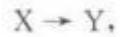

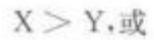

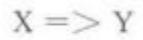

当X为真且Y为假时，命题为假，反之为真；当X和Y同时为真或同时为假时，命题皆为真。在这种形式的陈述中，第一项这里的X，称为前件；第二项这里的Y，称作后件。前件真实是后件真实的充分条件，而后件真实是前件真实的必要条件。实质蕴涵的意义在自然语言中归结为“如果……就……”这样一种条件句结构，其中条件和后果可用句子来填充。然而，这种结构也蕴含有在条件(protasis，即条件从句)和后果(apodosis,即归结子句)之间的合理关联中。因此，尽管出自矛盾的实质蕴涵可能为真，但是像在自然语言中“如果H2O中含有氢原子，政府就将失去下次当选的机会”这样的命题就会被大多说话人理解为假，因为化学上的断言与对政治后果的预言被认为是无关的。因此，“如果P，就Q”在自然语言中意指“P和Q有关联，且如果P就Q”。不过在自然语言中到底是一种什么样的关联还没有得到明确的定义。类似地，命题“如果(B)所有的单身汉都未婚，(C)真空里的光速就是稳定的”可为假，因为尽管“如果(B)，就(C)”为真，但在(B)和(C)之间并没有明显的关联。再如命题“如果(S)苏格拉底是女人，(T)1加1就等于3”可能是假，原因与上相同。当条件从句与归结子句相关联时，语言学条件和逻辑条件的事实功能性一致；只有当实质条件为真，而其前因与后果之间被认为无关联时，两者之间的事实功能性才呈现明显区别。

食道音 oesophagea!; esophageal 语音学术语：指在食道或食道以下部位发出的音或嗓音。当人们的喉部发生病变时，如果放射疗法不起作用，患者就得接受喉切除术，那些接受喉切除术的患者学习使用上咽部和食道来发出振动，形成沙哑的食道音。另外，他们也可以使用一种人工喉来提供振动，这种装置可以发出一种嗡嗡声，当他们在说话时将其置于颈部，可发出语音。

使动构式caused motion construction 认知语言学术语。指戈德堡(Adele Goldberg)在发展构式语法理论过程中研究的一个动词论元(verb argument)构式。使动构式的句法结构为[主[动词物体倾斜物体]]([SUB[V\_OBJ\_OBL]])，其中“倾斜物体”是一个表示方向的介词短语(directional PP);语义结构为“X 导致 Y运动到 Z”(X CAUSES Y TOMOVEZ),Z是方向性介词短语表达的一个运动路径。例如: The wind blew the papers off the desk.使动构式也显示出构式多义现象。

使役动词 factitive verb; causative verb语法学术语，亦称致使动词。在传统的英语中使役动词是及物动词(transitive verb)中的一类，指本身含有使令或致使意义的词，如make(使)、choose(选择)、elect(选举)、judge(判断)、name(命名)等。这类动词能够促使某种事物得以产生或某种情况得以出现，并可带两个补语。例如：[1]Make him notori-ous. [2] Elect him chairman. 使役动词必须是在主语(人或物)的作用下使动作或状态得以发生的动词，而不能是表示自然发生的动词。例如：[3]Iatean apple. [4] She killed a rabbit. [5] The rabbitdied, 其中[3]和[4]中的 ate 和 killed 属于使役动词，而[5]中的died则不是。有些语言中，使役动词是由非使役动词加上词缀构成。例如，在马来语中“jatuh”表示“掉下”是非使役动词，加上词缀“men...kan”后变成“menjatuhkan”意思为“使……掉下”，则是使役动词用法。

使役格 factitive case 格语法术语，亦称役格。指由动词行为所生产或创造出来的事物的格。在深层结构中表示动作或状态的结果，或表示动词的部分意义的成分。例如：[1] John made a paperboat. [2] That makes me angry. [3] John sailedthe paper boat.在例[1]和例[2]中，“paper boat”与“me”都是使役格；但在例[3]中，“paper boat”则不是使役格，因为在施加动作(sailed)之前，它已经存在，所以这个“paper boat”是宾格(objective case)。使役格在早期的格语法中有着特殊的地位，以其表示动词的动作结果的语义定位，与施事格、与格等对立。后期的格语法称其为结果格(result case 或 re-sultative case)。参见“结果格”。

使用频率familiarity参见“熟悉度”。

始点动词ingressive verb; inchoative verb 参见“延续体”。

示波管 oscilloscope 语音学术语。指一种语音学实验仪器。可观察声波形状的阴极射线管，用来观察送气、语音成阻、鼻化等语音现象并加以测记。能与电子计算机联合使用。

示波器oscillograph 语音学术语。指一种语音学实验仪器，亦称录波器。能显示频率和振幅，可产生表示声波的空气压力变化的图形。

示教实物 realia 参见“实物教具”。

示调仪intonograph 语音学术语。指一种语音学实验仪器。能在感光材料上显示并记录说话时的嗓音基频和振幅变化，从而制出语调图的电声仪器。它以直观的视觉线条显示出发音音响特点，使语音分析自动便捷。

示意量表编列法 implicational scaling 语言习得术语。指通过暗示级别划分表/量表(scalo-gram)来显示变量之间关系的一种方法，用来表示英语或其他语言作为外语或第二语言学习者习得英语规则的顺序。例如，一组英语学习者可能先掌握定冠词的规则，然后才掌握不定冠词的规则，且可能这两个规则都掌握后才掌握复数名词的规则。可以调查该组学习者的口头或书面语言并将结果列表进行说明。符号+表示使用规则100%正确，符号×表示规则有时使用有时不用(不定用法)。

<table><tr><td rowspan=1 colspan=1>学生</td><td rowspan=1 colspan=1>名词复数</td><td rowspan=1 colspan=1>不定冠词</td><td rowspan=1 colspan=1>定冠词</td></tr><tr><td rowspan=1 colspan=1>C</td><td rowspan=1 colspan=1>×</td><td rowspan=1 colspan=1>×</td><td rowspan=1 colspan=1>×</td></tr><tr><td rowspan=1 colspan=1>A</td><td rowspan=1 colspan=1>×</td><td rowspan=1 colspan=1>×</td><td rowspan=1 colspan=1>十</td></tr><tr><td rowspan=1 colspan=1>D</td><td rowspan=1 colspan=1>×</td><td rowspan=1 colspan=1>×</td><td rowspan=1 colspan=1>十</td></tr><tr><td rowspan=1 colspan=1>B</td><td rowspan=1 colspan=1>×</td><td rowspan=1 colspan=1>+</td><td rowspan=1 colspan=1>十</td></tr><tr><td rowspan=1 colspan=1>F</td><td rowspan=1 colspan=1>×</td><td rowspan=1 colspan=1>十</td><td rowspan=1 colspan=1>十</td></tr><tr><td rowspan=1 colspan=1>E</td><td rowspan=1 colspan=1>+</td><td rowspan=1 colspan=1>+</td><td rowspan=1 colspan=1>十</td></tr></table>

(引自《朗文语言教学及应用语言教学词典》第218页)

表中任意一行中出现的+意味着右边的同一排或任何下一排的所有竖行也是+。通过这种方法从学习者C到学习者E进行分级，E为最优秀，因为该学习者能100%正确地使用所有规则。通过这种方法，示意量表可以说明外语和第二语言学习者及由克里奥耳语向标准语体过渡的学习者掌握语言规则的次序。

世界英语 world Englishes 教育语言学术语。指世界各地不同的英语变体，强调不同变体之间相同的成分。由克什米尔裔语言学家布拉吉·卡奇鲁(Braj Kachru，1932-2016)于1992年提出。他认为英语的不同变体是英语国际化和本土化结合的产物，并用三个圈作为比方，把不同的英语区分为三类：(1)历史上以英语为母语的国家，如英国、美国、加拿大、澳大利亚、新西兰和爱尔兰等国所用的英语，称为“内圈”英语；(2)以英语为官方语言或官方语言之一的国家，如新加坡、印度、马来西亚、菲律宾、圭亚那等国所用的英语，成为“外圈”英语；(3)把英语作为外语的国家，如中国、日本、俄罗斯以及阿拉伯地区等一大批国家所用的英语，成为“发展圈”英语。“内圈”英语，尤其是英国英语和美国英语，为传统英语的基地，提供英语的规范。

世界语 Esperanto 亦称“国际普通话”或“万国新语”。指波兰籍犹太人柴门霍夫(Ludwik Laza-rus Zamenhof，1859—1917)于1887 年在印欧语系的基础上创立、旨在消除国际交往障碍的一种国际辅助语言。Esperanto的字面意思是“希望的语言”，即希望这门人造语言能给世界各地不同国家的人们创造交流便利。世界语是一种人造语言，有28个音位，每个音位对应一个字母，语法规则16条，书写时采用拉丁字母的形式;其基本词汇的词根大部分取自印欧语系的拉丁语族，少量源自日耳曼语族和斯拉夫语族。1905年召开了第一次国际世界语大会，确定柴门霍夫所著的《世界语的基础》一书为世界语的准则，此后世界语逐渐成为功能健全、统一稳定的语言。1906年前后世界语传入中国，1951年3月11日在北京成立了中国世界语者的全国性学术团体——中华全国世界语协会。在1986年世界语诞生99周年之际，国际世界语大会在中国北京举行。由于简单易学，世界语问世后受到各国学者和语言爱好者的欢迎，被用来进行交往和文学创作，举办国际研讨会，翻译出版各种世界语译著。目前，世界语已经传播到120多个国家。根据美国国际语言暑期学院(SIL International)旗下的“民族语言网站(Eth-nologue)”估算，全球范围内以世界语为母语的人大约有200—2000人，懂得世界语的人超过1000万，约有20万一200万人能够流利使用这种语言。

世俗体文字 demotic script 参见“通俗体文字”。

似成体 apparitional aspect 语法学术语。动词体的一种，表示动词的行为状态似乎存在或被执行。

势位 chereme 参见“势系学”。

势系学cherology指研究手势语的学科。势系学中的最小单位为“势位”(chereme)。

事件基本部分grounding of events 认知语言学术语。勒内·迪尔文(RenéDirwen)和荷兰语言学家马尤琳·费斯波尔(Marjolijn Verspoor)于1998年的《语言与语言学之认识探索》一书中认为，事件(event)作为一个整体涉及处于不同层次的基本部分。如果把句子比喻成一个洋葱状的结构，那么事件就是该结构的核心，基本部分就是位于其周围的各个不同外层结构。句子的基本部分包括语气(mood)、情态(modality)、时态(tense)、完成体(per-fective aspect)和进行体(progressive aspect)。从外到里，最外面一层代表言语行为(speech act)，行使句子的交际功能；第二层代表有关事件描写的说话者态度(speaker attitude);第三层代表言语行为发生的时间(speech act time)，决定时态的选择；第四层代表所描写的事件与言语行为时间或其他事件的关系的时间(event time)，多用完成体表达；第五层涉及时间的内部推进，多用进行体表达。

事件结构event structure 认知语言学术语。指事件的起始、度量和界化(delimitation)等时间结构特性，在人们的认知结构和语言之间起着一种中介作用。

认知语言学术语。指在话语的解释中经常相互作用 的一系列隐喻。构成事件结构隐喻的单体隐喻包 括：(1)状态是地点(states are locations)。例如： Tom is in sadness. (2)变化是运动(change is motion)。例如: The situation is getting from good to bad.(3)原因是力(causes are forces)。例如：His absence forced the chair to postpone the meeting. (4)目标是目的地(purposes are destinations)。例 如:He has finally arrived at the end of the mission. (5)手段是路径(means are paths)。例如:His career finally succeeded via renovation.(6)事件是运动的 物体(events are moving objects)。例如:Everything is going smoothly so far, (7)长期有目的的行动是 旅程(long-term purposeful activities are journeys. 例如: The local government is running towards a clear direction. 以上的单体隐喻相互作用构成一个 隐喻系统。任何一个具体层次隐喻(specific-level metaphor)都可以使用该隐喻系统，并显示出它们之 间的继承关系(inheritance)。

事件类型 event type 哲学家和语言学家根据动词所表达的事件特征对动词进行的分类，如状态、活动、完成和成就，以刻画出动词和其他句法成分之间的逻辑蕴涵关系和共存限制关系。

事实功能条件 truth functional conditional参见“实质蕴涵”。

事实接受者actual recipient语法学术语。指英语介宾结构中由介词to引出的宾语。例如：Hesends an e-mail to his friend. 例句中介词宾语 hisfriend就是e-mail的事实上的接受者。事实上的接受者在概念上与意图中的接受者(intended recipi-ent)的概念相对应，后者是介词for引出的接受者。

事实名词factive noun语法学术语。表示事实、命题、思想、回答、评论等概念的一类抽象名词，可以通过附加结构补充说明其内容，这类名词包括reply(回答)、idea(主意)、fact(实事)、proposition(命题)、thought(思想)、remark(评论)、suggestion(建议)等。例如：the suggestion that the schedulebe changed(改变计划的建议）

事实性理解factual comprehension 语言测试术语。在阅读测试中，能够在阅读材料中直接找出答案出处的理解题。这也称为字面意义理解，与要求考试者通过推理、分析找出答案的推断性理解(inferential comprehension)不同。

事实性知识factual knowledge 参见“陈述性知识”。

饰面工作 face work 语用学术语。指为了维护个人面子而采取的行为。高夫曼(Erving Goff-man)认为，面子保全使人精神愉悦；面子丢失则使人情绪低落。保全面子不仅仅是社会参与者的责任过程，也是观众的过程。一些策略会帮助人们保全面子，如回避技巧、过度补偿和道歉等。

试题鉴别度item discrimination 语言测试术语，亦称试题区分度或项目分度。指测试中衡量试题反映受试者能力差异的程度，是该试题区分性能的量度。换言之，如果一道试题实际水平高的学生得分较高而实际水平差的学生得分较低，则该试题的区分度高。在题目分析中，单个题目的答案(“题目”)和考试的总分(“总分”)之间的题目总分点一双列相关经常被用来估计区分度。或者以公式ID=IFoppe-iflower来计算，其中ID代表单个题目的题目鉴别度。IFpper是整个测试中上面的1/3(或者33%)的题目难易度，iflower是下面的1/3(或33%)的题目难易度。ID指数的值域是+1到一1之间。在常模参考测试中，ID值低或者为负的题目需要修正，因为此类测试中，只有区分度高的试题才能准确比较考生之间的相互水平，达到选拔目的。尺度参照性考试要求对及格分数附近的考生有较高的区分度。

试题库 item bank; item pool 语言测试术语。根据一定的教育测量理论，在计算机系统中实现的某个学科题目的集合。换言之，可将大量试题及各种相关数据有序地存储在计算机内，并从中自动生成合乎要求的试卷。试题库的建设有助于提高考试的效度和信度。

试题难度facility value; item facility参见“易度值”。

试题区分度item discrimination参见“试题鉴别度”。

试题特征曲线item characteristic curves语言测试术语。把能力不同的受试者的得分点连接起来所构成的曲线。把各试题特征曲线加起来，便构成试卷特征曲线(test characteristic curve，简称TCC)。试题特征曲线也是一条试题得分对能力因素所作的回归线。通常试题特征曲线有三种不同的常用参数模型，即单、双和三参数模型。

视点转换 shift of perspective翻译学术语。指翻译中选取不同的参照点或切入点，通过“表达角度的暗转”，达到语义的暗合，使译文自然、可读，更符合译入语习惯。视点有三个层次，即句子视点(perspective in sentential level)、超句视点(per-spective in suprasentential level) 和语篇视点(per-spective in discourse level)。视点转换用于两种情况：(1)易导致误解；(2)不符合目的语的表达习惯。例如：[1] Think twice,(三思而行) [2]Did I getyour number right？(我没有弄错你的电话号码吧?)

视读法sight method 语言教学术语，亦称词本位教学法(whole-word method)。指根据辩词和发音教授阅读的方法，通常用于教儿童阅读母语。此方法，儿童首先要学会以辨识为单位进行学习，而不是将词分解为字母名称或字母读音，然后加以拼合识读。

视角 perspective认知语言学术语。焦点调整(focal adjustment)的三个参数之一，涉及观看场景的方式，不同的视角赋予场景参与者不同的相对凸显程度。例如：[1]汽车撞了一个行人。[2]一个行人被汽车撞了。在第一例中，第一焦点参与者，射体(trajector)是“汽车”，也是动作的施事语义角色：“行人”是第二焦点参与者，为界标(landmark)，是动作的受事语义角色。第二例刚好相反，界标“一个行人”现在变成了射体，射体“汽车”变成了界标。这两个例句就涉及视角的转换，导致参与者在侧画关系中(profiled relationship)的相对凸显程度（relative prominence）不同。兰艾克（RonaldLangacker)在《认知语法基础1》中提出了焦点调整的三个参数，另外两个是选择(selection)和抽象(abstraction)。

视角系统perspectival system认知语言学术语。指泰尔米(Leonard Talmy)提出的概念结构系统方法中的四个图式系统之一。他认为语言表达式代表两个不同的概念分系统，概念结构系统(conceptual structuring system)和概念内容系统(conceptual content system)。概念结构系统为既定场景提供结构或“脚手架(scaffolding)”，有图式意义(sche-matic meaning)，语码形式是封闭词类形式；而概念内容系统提供内容或“悬挂装饰物”(draped)，有内容意义(content meaning)，语码形式是开放词类形式。另外三个图式系统分别为构型系统(configurationalsystem)、注意系统(attentional system)和力动态系统(force-dynamics system)。视角系统建立一个观测角度以观察场景和参与者。根据泰尔米的观点，图式系统又和图式范畴(schematic category)有关。视角系统与地点(location)、距离(distance)、方式(mode)以及方向(direction)四个图式范畴有关。

视觉词汇 sight vocabulary 语言教学术语。阅读者能够立即自动识别的词汇。学习者在阅读中看到这类词汇就能理解其词义，不需要任何辅助即可辨别与掌握其核心意义。这类词汇不包括在特定上下文中学习者已经学会的词或者从上下文语境中可以猜测词义的新词。原则上说，这种识别能力取决于学习者本身掌握词汇量的多少，词汇量越多，词汇自动识别能力就越强。认知科学研究发现大脑左侧梭状回中后部区域属于视觉词形加工区。

视觉感知visual perception参见“感知”。

视说法 look-and-say method语言教学术语。指把词形和其所代表的事物联系起来进行阅读和口语教学(尤其是第一语言教学)的一种方法，有时也结合文字材料来教授外语。其具体操作与着眼于书面文字的整词教学法(whole-word method)相似。不过视说法适合用图画和实物进行教学，侧重于教授发音与词义乃至句义的识别。

视速仪tachistoscope参见“速示器”。

视听法audio-visual method语言教学的一种方法，亦称结构整体法。该方法于20世纪50年代产生于法国，来源于直接法和听说法，它是在听说法的基础上，利用视听结合手段而形成的一种教学法，强调在一定情境中听觉感知(录音)与视觉(图片影视)感知相结合。视听法的理论基础源于结构主义语言学、行为主义心理学及“言语交际过程是编码和译码传递信息的活动过程”这一现代心理学理论。视听法在教学中一般分为四个步骤，即感知、理解、练习和活用。其主要特征有以下五个方面：(1)语言和情景紧密结合。除重视听说外，还强调“看”，即看画面或情景，学生一边看画面，一边练习听说，身临其境地学习外语，把看到的情景和听到的声音自然地联系起来，印象深刻。(2)重视口语教学，认为口语是教学的基础。(3)重视句型教学，强调通过情景操练句型，使学生掌握在一定场合常用的成套生活用语。(4)日常生活情景对话作为教学的中心。从日常生活情景需要出发，选择安排语言材料，比听说法更能符合学生言语交际的需要。(5)排除母语和文字作为中介，直接用外语进行释义和练习。

视听教具 audio-visual aids 语言教学术语。主要指用来辅导教学的视听工具和器械，包括黑板、图片、图表、抽认卡、法兰绒板、幻灯投影器，也包括教师或参与者的身势语言和教室环境等。另外，随着高科技发展，电影、电视、各类电脑以及互联网都可成为视听教具。

视听言语加工audio-visual speech process-ing心理语言学术语。指对听觉、视觉以及音视频的语音信息进行大脑皮层处理。美国认知科学家琳恩·伯恩斯坦(Lynne E. Bernstein)等学者认为，这一处理过程具有时间与空间上的分布规律。磁共振影像不足以解决其时间动态特征，为此他们提出了构建一个音视频语音信号处理电路的时空组织结构的假说，使用脑电描记法(EEG)记录事件相关电位(ERPs)，证明刺激与音视频一致(/ba/)，与听觉不一致(/ba/)，与视觉(/ga/)、单纯听觉(/ba/)、单纯视觉(/ba/和/ga/)同时发生。事件相关电位数据的电流密度重建(CDRs)对间距为50一250ms的潜在因素进行了计算，电流密度重建实验证明在不同刺激条件下所呈现的复杂时空激活。假说电路包括由中间的高级时间股沟(STS)的音视频语音最初整合、顶内沟(IPS)补充和布罗卡区激活。该研究证明时空易感方法对于评估语音处理路径具有重要意义，尽管高级时间股沟一般被看作音视频语音处理的必要条件，而事实上既不是最早也不是最突显的激活点。

视停 fixation pause 语言教学术语，亦称注视停留。指(阅读时)眼球停止转动进行阅读所需的视觉输入的一段短暂时间。从一个视点飞快跳向另一个视点的过程称目光跳跃(saccade)。

是否问句 yes-or-no question参见“一般疑

问句”。

适切条件felicity condition语用学术语，亦称恰当条件或适宜条件。指言语行为要达到某一目的所必需满足的条件。适宜条件分为先决条件、真诚条件、本质条件。先决条件指实施某言语行为的人是否有资格或权力作这种行为。例如：[1]Ipromise the sun will set today. 此句不能成为真正的承诺，因为我们没有资格对不在我们控制之下的将来做出承诺。真诚条件指言语行为必须真诚，即说话人不说谎话。本质条件指说话人对某一言语行为言而有信，即在索取某物后必须接受该物。在分析间接请求时，应当确认的适切条件包括：说话人相信对方有能力满足自己的请求，存在充分的理由提出这一请求等。如果不满足这些条件，就不能有效地充当间接请求的言语行为。例如：[2]Will youoperate on this patient?明知对方不是医生而说[2]，就是一个不适宜的请求。如果双方都意识到这种不适宜，就会对这句话作不同的理解(如理解为开玩笑、讽刺等)。这样的话段称作不适宜(infelici-tous)话段。美国语言哲学家塞尔研究和继承了上述适切条件，并将其划分为四个基本范畴：命题内容条件(propositionalcontent condition)、预备条件(pre-paratory condition)、真诚条件(sincerity condition)和根本条件(essential condition)。

适应术art of adaptation 指选取最适当的词语、采取最有效的表达手段，将所说、所写的内容调整到最适合对方接受力的程度(以期达到预期的最佳理解状态，使内容顺利转化为行动或收到效果)。适应术是修辞学全部任务之所在，故被认为是修辞学之另一术语。

释义paraphrase 在转换生成语法中，释义是描写语义关系的基本手段。两个语义相同，但转换形式不一样的句子，如果它们具有共同的深层结构，那么这两个句子构成释义关系。语言教学术语，亦称转述。指对一段文字的释义、意译，在教学中常用来作为变换措辞的手段。以英语为例，释义可分为四种：(1)结构(句法)释义；(2)词汇释义;(3)指代释义;(4)语用释义。例如：[1]I will give it tothem tomorrow.[2] Tomorrow I'll give it to them.[3] Mary lives in New York. [4] Mary lives there.[5] It's cold in here, [6] Please close the window.其中，例[1]、[2]即结构释义，例[3]、[4]为指代释义，例[5]、[6]为语用释义。用 unmarried man解释bachelor，则是词汇释义。

释意派理论interpréter pour traduire; theo-ry of interpretational school翻译学术语，亦称达意论或释意理论。即交际与释意理论，与语言学派翻译理论相对，由曾经长期担任巴黎高等翻译学校校长的丹尼卡·塞莱丝柯维奇(Danica Selesko-vitch)于20世纪60年代后期创立。该学派强调译者的创造性，主张译者在口译或笔译过程中对原文进行解释并用目的语将这一解释再现。该理论的研究围绕着“意义”展开，提出理解原文、脱离源语语言外壳、用另一种语言表达理解了的内容这一翻译程序模式。因此该理论认为：首先，翻译的对象不是语言，而是借助语言表达的意义，因为不同语言社团的交往目的是相互交换思想、进行合作，而若要做到达意，译者应有足够的语言知识、主题知识、百科知识等；其次，翻译的任务是转达交际意义，而语言只是传达意义不可缺少的条件之一，译者的认知补充是意义产生的前提条件；第三，翻译的过程分为理解、脱离原语语言外壳(即理解源语并用目标语表达相关认知和情感意义，超越语言符号)和重新表达三步，认为翻译是解释性的，并不苟求两种语言符号的对等。释意派理论还严格区分语言与话语的相对独立作用和相互关系，区分翻译过程中的已知内容和未知内容之间的关系。释意派的观点与话语分析或语言学论点相距甚远，反对过分夸大语言学本身在翻译学中的作用。

收敛 convergence 句法学术语。乔姆斯基的最简方案理论中的一种语言结构派生过程，指带有标记特征的词汇项在经历推导运算之后所得到的语音表达式(PF)和逻辑表达式(LF)分别到达“发音一知觉”(A-P)和“概念—意图”(C- I)接口，并得到完全解释。这一过程得以实现，即称为收敛，意味着推导成功。任何一个表达式若无法在相应接口被解释，都会导致推导失败，即称为崩溃(crash)。参见“计算系统”。

手势 gesture 非言语交际术语，是副语言学(paralinguistics)主要成分之一，属于身势学(kine-sics)。指用来进行交际的面部表情或身体动作形式。例如，点头表示同意，摇头表示拒绝，挥手表示再见，拥抱表示亲密，等等。手势语有时和话语一起使用，可进一步说明或增强所表达的意义。

手势构型hand configuration手语的一个构成部分。部分手势语的音系模型用来指一个由手势形状和方向表示的独立音层。美国手语(Ameri-can Sign Language)中有 19 种基本手型符号。

手势型用法gestural usage 语用学术语。指示词语(deixis item)的两种用法之一，一般与点头、用手指点、使眼色等身势语以及其他副语言特征(paralinguistic features)一起使用。要理解指示语的手势型用法，必须知道说话者在当时的语境中具体使用了什么副语言特征。例如：“我碰碎花瓶了，就这只。”说话者在说这只时，要有用手指的动作。指示词语另一种是象征型用法(symbolic usage)。

手势语最小单位kineme为与音位(pho-neme)进行类比而创造出来的一个术语，表示语言或非语言交际时眉毛上扬或耸肩膀之类姿态动作的最小单位。手势语最小单位表述(kine)即指由连续的语流或非语言交际中抽象出来的手势语最小单位的表述。

手势语最小单位表述kine参见“手势语最小单位”。

手语 sign language 指利用手的各种动作以及身体的其他部位动作进行思想交流的非言语符号体系，主要为聋哑人以及与聋哑人交谈的其他人使用的一种有形交际手段。世界现已创建了多种不同的符号语言：美国手语(Ameslan)、英国手语(Bris-lan)、丹麦手语(Danslan)、法国手语(Freslan)等，其中美国手语最为知名。与有声语言不同，手语只限于视觉渠道，手语有本身的语法体系，并非单纯地将有声语言用符号“拼写”出来。手语所用的视像—手势交际单位为“符号”，一般由三部分组成：(1)符号位置(胸前、眼下等)；(2)手指的组合式(张开、握拳等);(3)手的动作方向(朝向说话人或听话人等)。

首词脱落aphesis参见“首音脱落”。

首行缩进indentation 在印刷和书写的版面编排中开头往往留空两个以上字符的空间，尤其常见于一个段落另起一行时。诗歌以及引文通常会采用缩进以便与上下文区分。

首流音 initial glide 参见“入流音”。

首尾重复 epanalepsis 修辞学术语，亦称语句间隔反复。指在句末重复句首的相同或同义的词或结构来强调的修辞手段。例如：[1]Never troubletrouble till trouble troubles you. [2] Violence be-gets more violence. 例[1]，[2]中的首尾均是强调部分，首尾重复的手段能引起读者的注意。

首位initial 出现在语言单位的首部，如词首、从句首，特别用于音系学。例如，位于词首的一组辅音，如英语单词spring的/spr/，是词首辅音丛；the 出现在 the big house 的首位。其他位置称为中间位和尾位。出现在这个位置的其他语言特征有时也用“首”称之，如“首重音”(指词的第一个音节重读)。

首位宾语 primary object; PO 语法学术语。一般指与双宾语从句中的直接宾语即次位宾语(secondary object;SO)相对的宾语。PO) 和 SO的对立现象在不少语言中很普遍，如斯瓦希里语(Swa-hili)，奥吉布瓦语(Ojibwa)等。首位宾语有效地控制动词一致关系以及动词的被动化过程。

首音互换spoonerism参见“斯本内现象”。

首音脱落aphesis音系学术语。指在话语表达过程中省略第一个词或词首非重读元音的现象，省略的首词或首音可以是一个。在语音脱落现象中表现为诸如knee和knife单词中的/k/音的消失，由alone变成lone的弱化，把 about读作/'baut/等；在短语或句子中，起首的词汇脱落则表现为把“Goodmorning”和“Good bye”分别说成 Morning 和Bye等。

首音最大原则Maximal Onset Principle参见“最大节首辅音原则”。

首语重复anaphora修辞学术语。指把某一 个音、词、词组或第一个句法结构在连续几个句子或 几行诗句的句首重复出现。首语重复在诗歌、演讲、 辩论和布道等题材中用于加强语气，增强效果。例 如:[1] Must we but weep o'er days more blest? Must we but blush? [2] We are fighting for the rights of the little man ... We are fighting, as we have always fought, for the weak as well as the strong. We are fighting for great and good causes ..

首重音initial stress音系学术语。指重音落在词的第一个音节上，如英语单词study、diligent等。

首字母缩略词initialism;acronym 形态学术语，亦称首字母缩拼词。指用词组中各词的首字母组成的缩略词，如“Unidentified Flying Object→UFO"“British Broadcasting Corporation→BBC"。首字母缩略词一般按字母的顺序读出，而acronym(例如NATO)一般按音节发音。也有一些形态学家把首字母缩拼词(acronym)视为首字母缩略词的一种。与首字母缩拼词一样，首字母缩略词可以带词缀，如pro-BBC、ex-IBMer。起初首字母缩略词的书写要求每个字母后面都带小圆点，如B.B.C.，但是现在不带圆点的书写方式越来越多地出现在数据处理、军事以及商业、广告和出版界。此外，大多数首字母缩略词都要求大写，但也有少数例外的情况，如i.t.a.ita (initial teaching alphabet).

首字母脱落 apheresis;aphaeresis 历史语言学术语，亦称首音脱落。指一个词词首的一个或多个音或字母的脱落，常常导致一些截短词(clippedwords)的产生。例如：nadder→adder、esquire→squire、amid→mid、aeroplane→plane、telephone→phone，等等。首字母脱落与尾音或尾词脱落(apocope)和央音或央字母脱落(syncope)相对应。

受词异相标记differential object marking;

DOM 句法学术语。指一些语言的宾语带有不同类属标记的现象。世界上有300余种语言存在受词异相标记现象，德国语言学家格奥尔格·玻松(Georg Bossong)在 20世纪80年代中后期首先撰写专文加以论述(Bossong1985，1988)。带有受词异相标记的语言中，直接宾语往往根据其含义而划分为两个子类，一般只有一个种类有标记，另一个不带标记;有些语言(如芬兰语)中宾语的两个子类会带上不同的标记。西班牙语是典型的带有受词异相标记的语言，其中，指称特定事物或指人的名词需要带有前置词a(有“向着……”之义)，而非有生名词一般不使用该标记。例如：

[1] a. Juan besó a Justina, 胡安亲吻向着茹斯蒂娜 “胡安亲吻茹斯蒂娜。” b. Juan besó el retrato 胡安亲吻那(幅)画 “胡安亲吻那幅画。”

例1a]中人名Justina前面有前置词a标记，而例[1b]中的“elretrato”是非有生名词，其前不加前置词a。另有语言学家认为，附着重叠(clitic-doubling)也是受词异相标记的一种。参见“附着重叠”。

受定成分determinatum语法学术语。复合词中被限定成分修饰的基础词，如bootlace中的lace.

受格object case; objective case语法学术语。指表示与动词发出的动作有着中性关系的人或物的名词或名词短语。受格形式的名词或名词短语既不是动作的执行者，也不是实现动作的工具。例如:[1] They cut the beef with a knife. [2] Thebeef cut easily. [3] The beef was thick, 上述例句中，“thebeef”是受格，它既不像“they”是施事，也不像“aknife”是工具。受格的概念与传统上的宾语(object)这一概念有联系，但并非所有呈受格形式的词都是宾语。同样，并非所有宾语都是受格。例如：[4] Terry built the cabin. [5] Terry repaired thecabin.在例[4]中，宾语“the cabin”是使成格(facti-tive case)或称结果格(result/resultative case)，因为小木屋原来不存在；而在句[5]中，“the cabin”是受格，因为小木屋原来就存在，现在被翻修了。

受格语言accusative language 语言类型学术语。指根据语言关系类型研究所确定的语言类型之一。在该类型的语言中，及物动词的直接宾语成分通常在形态上有别于及物动词或不及物动词的主语成分。如果语言的名词或名词性短语存在形态格，那么宾语成分则实现为宾格，而主语实现为主格；如果语言的名词或名词性短语不存在形态上的格标记，那么主语和宾语的区别就借助于语序。例如，在英语中，主语位于动词之前而宾语位于动词之后。

受话人 addressee语用学术语。指言语会话或交际中处于被动接收信息的一方，与发话人的概念相对立。在会话中，受话人指听话的人；在书面交际中，受话人则指读者。

受话者设计recipient design 语用学术语。指说话者充分考虑受话者的期望，努力调整自身，选择恰当的言语行为和非言语行为，以积极互动地建构话轮。

受话者制约敬语addressee-controlled hon-orifics参见“所指制约敬语”。

受惠体accommodative aspect参见“受益体”。

受教英语education English 社会语言学术语。指至少受到过中等教育的英语本族语者说的或写的规范化或接近规范化的英语。有时也用做“标准英语”(Standard English)的同义词。从社会语言学的角度，可以把英语的使用划分为三个层次：最高一层是受教育者使用的英语或说标准英语，底层是未受教育者使用的英语，居于两者之间的是门肯(Henry Mencken)所谓的“日常用语”(vernacular)。

受控处理 controlled processing 认知心理学术语。指执行任务时需要集中精力和注意力，有意识地处理和执行一项任务的现象。受控处理往往需要短时记忆的帮助，如见习驾驶员开车时可能会使用受控处理，在驾驶过程中有意识地思考如何做出决定并采取行动。语言习得术语。指在语言学习研究中受控处理和自动处理的区别已被用来解释语言学习者不同场合的不同表现。一般认为，在使用受控处理时，如在公共场合面对观众说话，语法错误相对会多些。这是因为听众分散了说话者的注意力，使得说话者更多地使用受控处理，以致说话者的精确性和流利性都受到了干扰。

受事patient亦称受动者。在语义学中，指动词行为接受者的语义角色，可缩写为P，与施事(agent)相对。在主格语言(如英语)中，受事一般表现为直接宾语。例如：The boy ate the apple. 其中的the boy 为施事，the apple为受事。在格语法中，受事是深层格之一。在管约论(GBTheory)中，受事是可以被识别的题元角色(theta roles)之一。

受事宾语affected object指受到句中动词动作影响的直接宾语，该类宾语所指的实体在动词动作发生前已经存在，动词动作只对它的存在状态产生影响。例如：[1] He ate a sandwich.[2] Heopened the door. 其中, “a sandwich”和“the door"都是受事宾语，它们在动词动作发生前已经存在，动词动作所影响的是它们的存在状态。在语法研究中，受事宾语的概念与结果宾语相对应，结果宾语的存在是动词动作的结果。例如：[3]She wrote a let-ter.句中的“aletter”为结果宾语，在动词动作发生之前，其所指是不存在的。

受事参与者affected participant 语法学术语。指在句子中受到动词动作影响的动作参与者，可以在句中充当主语、直接宾语或间接宾语等成分。例如，“The door opened.”中包含的是受事参与者为主语，“He cleaned the house,”中的受事参与者为宾语，而“1 bought her a new dress.”中的受事参与者则为间接宾语。

受事间接宾语affected indirect object 语法学术语。指受到句中动词动作影响的间接宾语。该类宾语所指的实体在动词动作发生前已经存在，动词动作的发生对它的存在状态产生一定影响。例如:1 bought her a new dress, 句中间接宾语“her”在动词动作发生前已经存在，动词动作发生后，对“her”产生了一定的影响，结果是作为间接宾语的“her”得到了一套新衣服，存在状态发生了一定的改变。

受事主语affected subject 语法学术语。指受到句中动词动作影响的主语。该类主语所指的实体在动词动作发生前已经存在，动词动作的发生对它的存在状态产生一定影响。例如：[1]门打开了。[2]花儿谢了。其中，“门”和“花儿”均为主语，它们在动词动作发生前已经存在，动词动作所影响的是它们存在的状态。

受限语言restricted language参见“限制性语言”。

受益格benefactive case语法学术语。用于语法描述，一种格的形式或结构，其在句中的作用是表示“为了……”或“为了……的利益”的概念。②格语法术语。指示受益于或意为受益于动词动作的人和动物的名词或名词短语为受益格。例如：[1]Mary made a cake for the children. [2] Mary madethe children a cake. 两句中的“the children”均为受益格。

受益体 benefactive aspect 语义学术语。表示动词的行为或状态是某一其他人的利益实行或存在的动词的体，即某人从由谓语指定的某一事件受益。例如，“我给你买了一本书”中的“你”就是受益体。

受益者beneficiary；receiver 语法学术语。指由动词所表达的行为受益的语义或主题关系。例如：He brought a coat for her.其中的“her”为受益者。受益者有时也称为受话人，其行为表现为一系列的“意外发生”过程，此人可能无法控制自身环境。例如:He pulled her forward.

受众audience参见“听众”。

受阻音节checked syllable音系学术语。指由一个或更多辅音结尾的音节，如cut、bat、accent、scholarship等，其中的元音发音短促而响亮。受阻音节亦称为闭音节(closed syllable)。

受阻元音checked vowel语音学、音系学术语。指受阻音节中所出现的元音，如“fatman”两个词中的a所发短促、响亮的音。

书本词 book word 参见“书面词”。

书法calligraphy 指语言符号的一种书写形式，强调形体的视觉美感。广义上的书法指语言符号的书写法则，即根据语言文字的特点及含义，按照其书体笔法、结构与章法进行书写，使之成为富有视觉美感的艺术作品。中国当代书法被定义为“一种以和谐且富有表现力、体现熟练技法的方式来表达语言符号的艺术”。现当代中国书法所涉范围颇广，从具有较强实用性的手工铭文和手工设计到富含抽象艺术表现力的书法作品。

书法障碍handwriting disorder参见“书写障碍”。

书洪book flood 语言教学术语。特别是在英语作为第二语言的环境下发展阅读技巧的一种方法。学生通过接触大量的非常有趣的阅读材料书(即书的“洪水”)，也就是一种泛读方案来提高阅读技巧。

书面文化 literary culture参见“口头文化”。

书面语 written language 指人们在书写和阅读文章时所使用的语言，是语言交际方式之一。与口语(spoken language)相对，在口语的基础上发展来的，是口语的记录形式。出现在文字产生之后，而且世界大多数语言没有书面文字。相对于口语而言，书面语是人们在文本上交流所使用的语言，有其内在的稳定性，发展相对缓慢，创新、变化的成分较少，可以反复调整、修饰、造句比口语细致周密，多有不常见于口语的书面语词和较复杂的句式，句子结构中简化、省略、移位等情况比口语少；而口语是听和说的语言，讲求效率，用词范围相对较窄，句子比较短，结构比较简单，有重复、脱节、颠倒等现象，还会出现赘言与失误。另外尽管各地方言口语迥异，但却可以使用相同的书面语言，但书面语表达不出重音与语调。长期以来，语言学家单方面强调书面语的重要性，认为口语不够稳定和完善，书面语才配享有权威地位。然而，有一段时间，特别是20世纪上半叶，语言学家又转向另一极端，强调口语的重要性，认为口语存在历史远远超过书面语。近年来，语言学家认识到书面语和口语同等重要，各有千秋，有着不同特征，用于不同的目的。

书写词 graphic word 语料库语言学术语。指语料库中由前后空格所分隔的连续字母串，与语音、动画等相对。英语书写词还包含连字符(hy-phen)“-”和省字符(apostrophe)“”。

书写体系 writing system 参见“书写系统”。

书写系统 writing system 亦称书写体系或文字系统。指用于记录有声语言的符号系统，即文字。世界语言的文字系统共有四十余种，可区分为表形文字(hieroglyph)、表意文字(ideogram)和表音文字(phonogram)三类。人类早期的书写系统主要是象形和表意。表形文字包括埃及象形文字、苏美尔楔形文字初期、汉字早期形式等；表意文字(logo-graphic)，有时也称意音文字(logosyllabic)，包括汉字、西夏文、女真文、契丹文、楔形文字等。表音文字是当前种类最多、使用范围最广的文字。美国语言类型学家丹尼尔斯(Peter T. Daniels)指出，表音文字可细分为四类：(1)整体音节文字(syllabic)，如日文假名、彝文等；(2)半音素化音节文字(abugida，即元音附标文字)，以婆罗米文字为主要代表，包括天城文、泰文、高棉文、藏文等；(3)半音素化音节文字(abjad，即辅音音素文字)，如阿拉伯文、希伯来文等；(4)音素文字(alphabetic)，有拉丁字母、西里尔字母、亚美尼亚文、格鲁吉亚文、蒙古文等。我国西南地区少数民族纳西族所使用的东巴文，是一种表意和表音成分兼备的图画象形文字，其形态比甲骨文更原始，属于文字起源的早期形态，但具有完整记录典藏的功能。

世界文字类型简表
<table><tr><td rowspan=1 colspan=1>类型</td><td rowspan=1 colspan=1>单个符号代表</td><td rowspan=1 colspan=1>举例</td></tr><tr><td rowspan=1 colspan=1>语素文字</td><td rowspan=1 colspan=1>语素/词素</td><td rowspan=1 colspan=1>汉字</td></tr><tr><td rowspan=1 colspan=1>音节文字</td><td rowspan=1 colspan=1>音节(莫拉)</td><td rowspan=1 colspan=1>日语假名</td></tr><tr><td rowspan=1 colspan=1>字母文字</td><td rowspan=1 colspan=1>音位/音素(元音或辅音)</td><td rowspan=1 colspan=1>拉丁文</td></tr><tr><td rowspan=1 colspan=1>元音附标文字</td><td rowspan=1 colspan=1>音位/音素(元音+辅音)</td><td rowspan=1 colspan=1>天城文</td></tr><tr><td rowspan=1 colspan=1>辅音音素文字</td><td rowspan=1 colspan=1>音位/音素(辅音)</td><td rowspan=1 colspan=1>阿拉伯文</td></tr><tr><td rowspan=1 colspan=1>特征文字</td><td rowspan=1 colspan=1>语音特征</td><td rowspan=1 colspan=1>朝鲜谚文</td></tr></table>

文字是对言语交流一种约定俗成的可视呈现。在一定的历史时期，随着语言社会功能的发展，人类需要克服有声语言最初口耳相传、一发即逝的时空限制，因而产生了文字。其中，表形文字产生最早，表音文字产生最晚。文字是语言交际的主要辅助手段，对有声语言来说是第二性的。文字产生后，对社会和语言都形成了积极的推动作用；人类进入文明时期的标志，如划分史前期和有史期，通常都以文字为界标。

文字系统始终与至少一种口头语言相关联，因而有别于其他用于沟通的符号体系。描图、绘画、地图轮廓线、性别标识符本身均非语言，但通过长期与语言元素一起使用，其中一些符号发生演变并成为语言的一部分。文字系统的共同特征是：(1)至少有一套获得定义的基本元素或符号(即字位或字素)，单独可称作符号，组合起来则成为文本；(2)至少有一套整个言语社团所共知或共享的拼读或书写规则，赋予字位意义，规范其排列次序和相互关系；(3)至少有一种口头语言，其构式可予以表征，并通过上述元素和规则加以解读和重构；(4)可通过物理手段对这些符号加以呈现，并应用于永久或半永久媒介，以可视或可触方式解读。

书写学graphonomy参见“字法学”。

书写障碍dysgraphia；agraphia 病理语言学术语，亦称书法障碍(handwriting disorder)。指学龄儿童在书写可辨性上存在严重缺陷的症状。书写障碍分为三类：(1)动作型书写障碍，即由于动作缺陷导致的书写障碍；(2)阅读困难型书写障碍，即由于语言缺陷引起的书写障碍；(3)空间型书写障碍，即由于视空间知觉缺陷导致的书写障碍。研究表明，空间书写障碍的发生机制主要在图解动作模式水平，跟异形字水平关系不大，但是汉语空间书写障碍的发生机制除了图解动作模式外，似乎还与异形字系统有关。

枢轴词 pivot words 语法学术语。指附在开放词类词上面，而且只能和开放式词类连用的语法类别词。参见“枢轴语法”。

枢轴语法 pivot grammar 亦称支点语法。由布雷纳(Martin Braine)等人提出的一种研究儿童语言结构分布的语法，是关于第一语言学习过程中语法发展的一种理论。这种分析不考虑语言表达的含义。它把频繁使用但数量有限的一种词类(即枢轴词，如on、off、more等)与开放词类(如名词，动词等)区分开来。与开放词类相比，枢轴词数量有限，在句中的位置受一定的制约，只能和开放式词类连用。例如，在两个词组成的表达里，它只能占据第一或第二的位置，但不能组合连接或单独出现。在儿童早期的母语学习中，他们学的就是这两类词如何结合，从而生成“more juice”“socks off”之类的话语规则。

输出策略 production strategy 语言习得术语。指使一个人花最小努力且能有效使用语言系统的语言学习策略。输出策略包括简化(simplifica-tion)、语篇策划(discourse planning)、复述(rehears-al)等。其中简化主要指因二语学习者使用比目标语更为简单的语法或句法规则而在语言输出中产生的现象。例如，母语为汉语的英语学习者在使用动词过去式时只使用单一规则即“动词+ed”，而注意不到英语动词过去式的不规则变化从而导致诸如“breaked”或“standed”等不正确的语言输出现象。复述是指学习者在记忆过程中，通过对目标信息的不断重复而强化记忆的心理过程。学习者可根据输入信息进行口头复述或书面复述。

输出假设Output Hypothesis 语言习得术语。指20世纪80年代中期梅里尔·斯温(MerrylSwain)针对克拉申(Stephen Krashen)提出的语言输入假设中的不足而提出的假设。她认为语言输入是必要的，但并不是实现语言习得的充分条件；要使学习者达到较高的外语水平，仅靠可理解输入是不够的，还需要可理解输出；学生需要充分利用现有语言资源，对将要输出的语言进行思考，使它更恰当、更准确、更容易理解，只有这样语言学习才能从语义加工过程过渡到句法加工过程。通过产出语言，学习者有可能在没有掌握目标语的形态句法的情况下理解二语输入的意思，但为了参与到语篇中去，学习者必须使自己的输出合乎语法，而会话者的反馈为学习者提供了修正输出的机会。斯旺认为输出假设对语言习得有三大功能，即注意功能、检测假设功能和元语言功能。可理解输出能够促进二语习得，因为输出中的语言问题使学习者对相关的输入予以注意，寻求恰当的语言表达；学习者也可以把输出作为尝试新的语言形式与结构的方法；同时，在学习者反思其目标语用法时，输出起元语言作用，输出使他们控制和内化语言知识。输出假设的三大功能对语言习得的作用主要体现在：(1)多说和多写目的语有利于培养学习者语言运用的流利性和自动性；(2)语言输出迫使学习者从语义加工过程转移到句法加工过程；(3)说、写目的语能让学习者检测自己对目的语学习所做出的假设；(4)语言输出能获得相应的反馈。

输入处理 input processing 语言习得术语。指大脑在形成语言系统过程中对语料的处理。输入是第二语言习得理论中的一个重要概念。不同的流派对输入处理的观点不尽相同。联结主义(connectionism)认为，人类没有内在的知识系统，人脑和计算机类似，对输入的语料信息进行加工和记录，逐渐形成和语料相匹配的语言系统。但是普遍语法(uni-versal grammar)则认为，语料和普遍语法共同作用，才能够形成语言系统，即语言能力。

输入假说input hypothesis语言习得术语。指美国语言学家克拉申(StephenKrashen)在 20世纪80年代初提出的第二语言习得“监控模式理论”所包含的五大假说之一(另外四个假说为“习得与学得假说”“自然顺序假说”“监控假说”和“情感过滤假说”)。“语言输入假说”被认为是语言习得理论的核心部分，它回答了语言学习中的一个关键问题，即怎样习得语言(尤其是外语);语言学习或习得中单纯主张语言输入是不够的，只有当习得者接触到“可理解的语言输入”(comprehensiveinput)，即略高于其现有语言技能水平的第二语言输入，同时又能把注意力集中在对意义或对信息的理解而不是对形式的理解时，才能产生习得。“可理解输入”是语言习得的必要条件。所谓“可理解输人”，是指学习者听到或读到的可以理解的语言材料，其难度应稍高于学习者已掌握的语言知识。克拉申把学习者当前的语言知识状态定义为“i”，把语言发展的下一阶段定义为“i+1”。这里的“1”就是既有的语言知识与下一阶段语言知识之间的距离。只有当学习者接触到属于“i+1”水平的语言材料，才能对学习者的语言发展产生积极的作用。克拉申认为，理想的输入应具备若干特点，包括：(1)可理解性(comprehensibility)。理解输入的语言材料是语言习得的必要条件，不可理解的(incomprehensible)输入对于习得者而言是无意义的。(2)有趣且相关(interesting and relevant)。要使语言输入对语言的习得有利，必须对它的意义进行加工，输入的语言材料越有趣、越关联，学习者就会在不知不觉中习得语言。(3)非语法程序安排(not grammatically sequenced)。语言习得关键是足量的可理解的输入。如果目的是“习得”而不是“学得”，按语法程序安排的教学既不必要，也不可取。(4)足够的输入量(i+1)。习得新的语言结构需要连续不断的、有内容有趣味的广泛阅读和大量的会话才能奏效。克拉申还强调，语言使用能力如口语，不是教出来的，而是随着时间的推移通过接触大量的可理解语料之后自然获得的，并且语法也可以通过同样的方式获得。可理解语言输入是习得语言的关键，教师的最大职责就是让学生接受尽可能多的可理解的语料。

输入空间 input space认知语言学术语。与概念合成理论(Conceptual Blending Theory)有关，指概念整合网络所包含的两个或更多心理空间，它们的结构向合成空间(blend space)投射。每一个输入空间都是一个心理空间，位于心理空间理论(Mental Spaces Theory)所提出的相关结构之中，如局部话语语境，长时记忆中的图式，以及不断形成的相互联系的心理空间。

输入强化input enhancement语言习得术语。指一种辅助学生发展其语言系统内形式特征的教学方式。由史密斯(Michael Sharwood Smith)提出。输入强化强调在使学生保持对语义注意的同时，也借助外部手段使学生同时注意到语言的形式特征。强化的方式有积极输入强化(positive inputenhancement)和消极输入强化(negative input en-hancement)两种。前者采用一些方式使学生更加留意输入语料的语法形式特征。例如，讲话时提高声音，书写时下画线或者加粗字体；后者利用反馈，引导学生注意错误的形式，以提醒其违反了哪些语法规则。

熟称 familiar form 社会语言学术语，亦称熟称。表示关系密切的交谈者之间彼此称呼时所用的词汇和语法形式，用以表示含蓄、熟悉、亲昵和亲属关系。一般情况下，家庭成员间、夫妻或情侣之间使用亲密词，一般关系可以称呼“教名”(Christian name)表示友好关系，如Justin、Jimmy。而如果用头衔和姓进行称呼，如“Mr.Robinson”“Dr,Tyson”等，则表示礼貌的正式称呼。对陌生人也有套近乎的称呼，如英国称呼汽车女售票员dear、duck、love，称呼女汽车司机 mate jock等，但这类称呼通常不是受教育者的用法。有时也表现为不敬或轻蔑的动词、代词及其他一些词类的形式。与敬语形式相对立。法语和德语中都有第二人称代词的熟称 tu 和 du，与敬语形式 vous 和 Sie相对。一些语言(如日语)中说话人之间关系的表达系统发展得更充分，更明显地表现在语法层平面上，用不同的词汇和语法形式表示不同程度的礼貌。参见“敬语”。

熟悉度 familiarity 亦称使用频率。指一个语言项的使用频率或被熟知的程度。熟悉度可以通过调查方法获得。词项的熟悉度不仅可用于有关学习及记忆的研究，也可作为语言教学中词汇选择的依据。

熟语学 phraseology参见“习语学”。

属格 genitive case 亦称所有格(possessive)。指名词或名词短语与同一个句子中的另外一个名词或名词短语之间的所属关系。例如，德语“dasBuchdes Schülers”(学生的书)中的 des Schüilers 是所有格；英语“my father's motorcycle”中 my father's 是所有格。在较早期的语法中，诸如“the cover of the book”之类的“of”结构也被看作所有格。参见“所有格”。

属格符号's apostrophe参见“所有格符号's”。

属格关系从句 genitive relative clause 名词短语可及性层级(noun phrase accessibility hierar-chy)中所包含的一种关系从句(relative clauses)。根据“名词短语可及性层级”的观点，所有的语言都有某种类型的关系从句。关系从句包括主语关系从句(subject relative clause)、宾语关系从句(object rela-tive clause)、间接宾语关系从句(indirect object rela-tive clause)、介词宾语关系从句(object of preposi-tion relative clause)、属格关系从句(genitive relativeclause)和比较关系从句(comparative relative clause)六种。其中属格关系从句指从句和其先行词之间是领属关系的一类句子。例如：[1]I know the teacherwhose ta pe recorder the mechanic fixed. [2] Thisis the girl whose mother is a film star.

属性 attribute语音学术语。原为听觉感知的术语，用来指凭感觉可区分的语音特性，如音高、音响、音色等属性。功能语法术语。指涉及关系过程(relational process)的修饰型类型，除载体(carrier)外的另一个参与者。语法学术语。指名词短语中修饰名词核心词的词或短语。可能是形容词、名词、动词或数词等，如“a beautiful vase”中的"beautiful"。

属性句ascriptive sentence句法学术语。动词后成分表征动词前成分属性的句子。例如：The cat is angry.属性句和类似的等式句(equa-tional sentence)不同，不能逆转。例如，“angry isthe cat”就不符合句法规范。

属性同位语 attributive appositive 语法学术语。表示中心语的性质或特征的同位语，其位置通常在中心语之后，起补充说明中心语的作用。例如: Liani had driven to Pacific Palisades, a lovelycommunity near downtoum Los Angeles where cliffsfall abruptly into the sea. 其中斜体部分就是中心语“Pacific Palisades”(宝马山花园)的属性同位语，其作用是对中心语进行补充说明。

属性形容词attributive adjective 参见“修饰性形容词”。

属有复合词possessive compound 语法学术语。指其中一个组成成分表示另一个成分的性质的复合词，如Walkman(随身听)。

术语 term;terminology 指用于某一学科或专题的特定词项，如“时态”“体”“X阶标”等。②指专业领域中具有专门意义的词语。例如，love

在网球比赛中专指零分，而不再具有“爱”的意义。  
参见“行话”。

术语词典学 terminography 是研究有关术语词典的设计、编纂、使用以及演进等活动的一门分支学科。术语词典学与我们通常更习惯说的专业词典学或专科词典学是一个意思。但从严格意义上说，术语与专业词汇应该是有区别的两个概念。简单说来，专业词汇比术语的范围要广，术语是专业词汇中最核心，也是最重要的组成部分。术语词典学的内容框架与一般词典学有相仿之处。比如，它也研究术语词典的宏观结构与微观结构、术语词典的分类原则、术语的释义等。

术语汇编glossary 参见“注释词表”。

术语命名法nomenclature 指运用术语对特定形态类别的各种或各组机体进行命名的一套系统化的相关原则、程序和规则。术语命名法的一般原则是，对自然界物体命名时要简单、明了、正规、稳定，能为国际受众所认同和接受。不同的学科领域因此形成了各自的正规专门术语体系。例如，瑞典植物学家林奈(Carl von Linné)在其 1768 年的《自然系统》一书中正式提出科学的生物命名法——双名法(binomial nomenclature, binominal nomenclature或 binary nomenclature)。按照双名法，每个物种的学名由两个拉丁词或拉丁化形式的词构成，其中第一个词为属名，第二个词为种加词。属名一般用名词单数第一格，种加词一般用形容词，并要求与属名的性、数、格一致。书写时采用斜体，属名的第一个字母必须大写，种加词全为小写。此外，还要求在种加词后写上命名人的姓氏或姓氏缩写，第一个字母也要大写;如果命名人有两个，则在两个人的姓氏之间加“et”。如果加“ex”，则表示前者是命名人，后者是著文公开发表这一个种的人。基于林奈的双名法和等级分类系统形成的国际动物命名法规、国际植物命名法规和国际细菌命名法规共同构成了生物分类命名的规则，而国际病毒命名和分类法则不属于这一系统。参见“专门术语”。

术语学 terminology 研究各专业领域中术语的结构、形成、作用、发展、用法和管理的学科。术语学产生于20世纪30年代。20世纪60年代后，在国际上越来越倾向于把它视为一门独立的综合性学科，它与许多相关学科如语言学、逻辑学、认识论、系统方法论、控制论、信息学等都保持并将继续保持密切的联系。国际上最有影响的术语学派包括：德国一奥地利学派、俄罗斯学派、加拿大蒙特利尔学派和捷克布拉格学派。术语学又区分为理论术语学与应用术语学，下面进一步细分出一些不同的分支学科或研究方向，诸如一般术语学、术语标准化、术语词典学等是其中最主要的几个。近年来，认知术语学研究也相当活跃。术语学与词典学有着特殊的紧密关系。

束bundle音系学术语。表明音位的一种概念：根据布拉格学派理论，音位被视为一“束”语音区别性特征。例如，英语音位/s/可视为齿龈音、摩擦音、清音等三种特征结合的产物。参见“特征束”。

述题comment 句法学术语，亦称新信息(new information)。指句子中予以评述的事物或概念，一般对听话者来说是新的信息。述题的概念与话题(topic)(亦称主位“theme”或已知信息“given in-formation”)相对。例如：[1] As for your dry clean-ings, I will bring it tomorrow. 例[1]中的前半部分是话题，后半部分是述题。话题表示一个话语或信息的出发点，是句子的基本参照点，述题是对句子话题的具体表述。例如：[2]老总他很生气。[3]那场大雨，幸亏我走得早。话题和述题的概念与主语(subject)和谓语(predicate)的概念不同。两者可能一致也可能不一致，如下所示：

<table><tr><td>Mary 主语</td><td>sat in the front seat 谓语</td></tr><tr><td>主题</td><td>述题</td></tr><tr><td colspan="2"></td></tr><tr><td colspan="2"></td></tr><tr><td>In the front seat sat</td><td>Mary</td></tr><tr><td colspan="2">谓语</td></tr><tr><td colspan="2">主题</td></tr></table>

述位rheme 语法学术语。布拉格学派的句子功能观中指句中表明未知新信息的部分(句子表述的内容和核心，是说话者所提供的新信息)，与主位(theme)相对。换言之，述位表达除已传递信息外最大部分的新增意义，而主位一般是说话双方已知或根据语境能事先预知的信息。两者之间既非主位也非述位，为过渡词语。主位与述位的区分通常被认为是程度上的差异。例如： The problem is that itis so hot in SUMMER.(问题是夏天如此之热)。例句中，the problem 最可能是主位，in summer(语调强调“summer”)最可能是述位，中间部分可能是过渡词语。类似主位一述位区别的其他说法还有主题一述题(topic—comment)、背景—焦点（background—focus)、已知信息—新信息(given—new information)等。

述谓补语predicative complement t 语法学 术语。指与“be、stay、become、seem、get”等语义较 弱的系动词共同构成句子述谓结构的名词性补语。 基于其不同的构成形式，有三类述谓补语：谓语性名 词(predicate noun)、谓语性形容词(predicate adjectives)和谓语性从句(predicate clause)。例如：[1] She is my teacher.[2] It's getting busier. [3] What they didn't expect was that he would leave so soon.根据不同的句法和语义关系，述谓补语也可 分为谓语性名词短语(predicative nominative)和谓 语性宾语(predicative object)。例如：[4]Penny is a waitress. [5] We consider her a devoted teacher.

述谓结构 predication 语义学术语。是主要的语义单位，包括命题、问句、命令句在内的范畴。由论元(argument)和谓词构成。谓词在表句义的述谓结构中起主要作用，用来支配和控制论元。谓词决定了论元的数量、性质及其方式，而论元则被它表述并从属于谓词。论元与谓词的集合反过来构成了命题。例如：[1] Mr. Henry runs this company. 此命题可分解为“Mr. Henry”和“this company”两个论元，它们由表示关系的词“run”联系起来，这个连接成分被称作谓词。利奇(Geoffrey Leech)在《语义学》(Semantics，1981)一书中认为论元有时与主语、动词、宾语等成分相对应，但有时又不对应，必须把这个意义上的“谓词”和传统语法中所描述的“谓语”区分开来，即逻辑语义单位与句法单位不一定有直接的对应关系。例如：[2] Jack was in front of thebuilding. 其中“was in front of”为谓语，但从句法层面分析，这并非单一单位。

树邻接语法tree adjoining grammar; TAG句法学术语。指20世纪60年代末由印度学者阿拉文德·乔什(Aravind Joshi)定义的形式化语法。树邻接语法在某种意义上类似于语境自由语法，但其基本转写单位是树而不是符号；语境自由语法有把符号转写为其他符号的规则，而树邻接语法有把树的节点重写为其他树的规则。TAG规则是带有称作“足节点(foot node)”的特殊“叶子”的树，叶子分别锚接(anchor)到一个词汇。在 TAG 中有两种基本树，即“初始树”和“辅助树”；初始树表示基本的价关系，而辅助树允许递归。推导开始于初始树，通过“替换操作(substitution)”或者“邻接操作（adjoin-ing)”来结合。TAG常被描述为具有“适度语境敏感的(mildly context-sensitive)”特征，这意味着它们在弱生成能力方面上有特定性质，使其有比语境自由语法更强，但比附标语法或语境敏感语法(indexedor context-sensitive grammars)更弱的能力。树邻接语法常被用于计算语言学和自然语言处理。

树形图tree; tree diagram; tree structure句法学术语。指一个句子成分结构的图示，是句子内部的等级关系和内部结构的表述。例如：

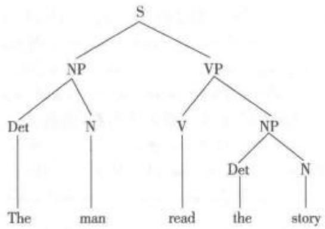

图中每个成分通过一个节点(node)标签加以表述，节点指出其句法语类，每个语类的直接成分通过线条与节点相连，而分支(branches)代表支配关系。

数number语法学术语。(1)用来分析某些词类的语法范畴，这些词类有诸如单数、复数、双数、三数、少量数等的对立现象，如英语中可数名词book、books 和单句中的“He walks”“They walk”等。这种对立一般与所指的现实世界实体的数对应，但语言学讨论所关心的是提出这种一一对应关系时所遇到的问题。例如：The committee are agreed.其中的committee“看上去”是单数，但是意义上为复数。同时将数与具有可数性的概念联系起来也有分析上的困难，如对于为何没有“abutter”这样的表达方式仍缺乏令人满意的解释。(2)数在运用时有基数(词)和序数(词)之分。基数词可以用于计算，可以用作名词。序数词可用于按顺序排列事物。两种数词可用数字(4,4th)或单词(four、fourth)来书写。

数词numeral语法学术语。指用作数的名称的词或短语。有基数词(如one、two、three等)和序数词(如first、second、third等)之分。

数词类推 analogy with regard to numerals 指通过数词或数量概念推导产生新词语的过程。例 如:[1] First Lady → First Mother/First Family/ First Dog, [2] the 3 R's → the 3 P's (peace, petroleum, Palestine).

数词转化numerical metanalysis叶斯柏森提出的概念。指把单数意义的词用作复数意义(或相反)的现象。

数据分布distribution语言测试术语。指一组分数或测量数据的分布规则。例如，测试中分数的频率分布可以通过图表或图形方式做如下显示：

(1)图表：

<table><tr><td rowspan=1 colspan=1>分数</td><td rowspan=1 colspan=1>100</td><td rowspan=1 colspan=1>90</td><td rowspan=1 colspan=1>80</td><td rowspan=1 colspan=1>70</td><td rowspan=1 colspan=1>60</td><td rowspan=1 colspan=1>50</td><td rowspan=1 colspan=1>40</td><td rowspan=1 colspan=1>30</td><td rowspan=1 colspan=1>20</td></tr><tr><td rowspan=1 colspan=1>频率</td><td rowspan=1 colspan=1>1</td><td rowspan=1 colspan=1>5</td><td rowspan=1 colspan=1>5</td><td rowspan=1 colspan=1>10</td><td rowspan=1 colspan=1>7</td><td rowspan=1 colspan=1>9</td><td rowspan=1 colspan=1>1</td><td rowspan=1 colspan=1>1</td><td rowspan=1 colspan=1>0</td></tr></table>

(2)柱形图：

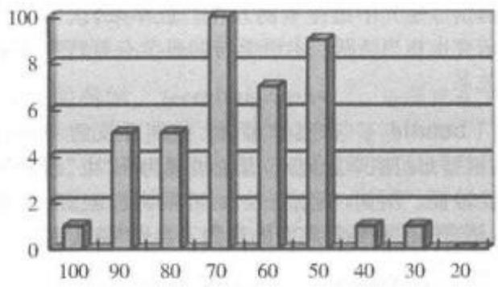  
(3)折线图：

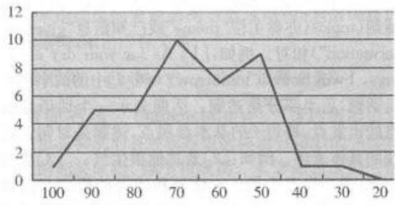  
(4)饼图：

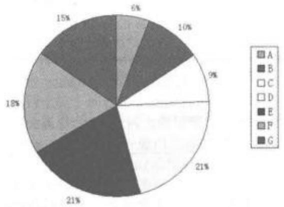  
(5)条形图：

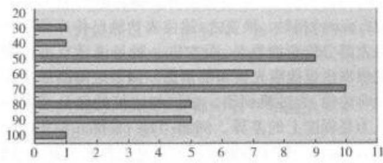

数据库 data bank；database 指由数据库管理系统(Database Management System; DBMS)建立和运行的一整套相互关联的文件。目前，数据库管理系统基本可以处理任何形式的数据，包括文本、图像、声音、视频等。数据库和文件结构始终由软件控制，而对硬件而言，数据库只是一些字节单位而已。如果进行语言分析、研究或教学，数据库指的就是为某一具体目的所做的信息与数据的汇总。例如，在语言教学时，可以建立数据库，汇总所有在校学生的考试成绩，从而用来量化学生的学习进度或

考试效度等。

数据驱动加工data-driven processing计算语言学术语。信息处理的一种方法。指以词语为先导来寻求意义的过程，即采用由小到大逐步扩展的方法对语言文字进行解码，因而称作“自上而下”的方法。与之相反，另一种信息处理的方法是“概念驱动式”。指的是以背景知识或先前的经验为先导寻求意义的过程，即利用所得信息对文章内容进行“预测一证实或否定一再预测—核实”，反复循环，最后达到信息处理的目的，因而称作“自上而下”的方法。参见“自下而上处理”。

数据驱动模式 data-driven approach指语料库应用于语言教学中的一种教学模式。这种教学模式建立在语料库的研究基础上，同时吸纳语言习得和认知科学的研究成果。与传统的英语教学相比，数据驱动模式下的学习具有如下特征：“自主学习”“真实语言输入”“自我探索和自我发现”，为学生提供了开放式和探索式的学习机会。

数理逻辑 mathematical logic亦称符号逻辑、理论逻辑。指采用数学方法研究逻辑或形式逻辑的学科，是从形式逻辑中发展、演化出来的一门新兴学科。传统的形式逻辑研究较偏重于论证的形式，从思维形式的结构上研究思维的确定性、无矛盾性、明确性和论证性(参见“形式逻辑”)，而当代数理逻辑侧重演绎推理，同时包括“语法”(从某一形式语言把一个文字串传送给某一编译器程序，从而转写为机器指令)和“语义”(在模型论中构造特定模型或全部模型的集合)研究。就研究方法而言，数理逻辑使用人工语言研究思维的逻辑结构，即应用形式语言研究词项(概念)、命题(判断)以及命题之间的联系(推理)，构成严密的逻辑系统，而形式逻辑主要使用自然语言来表达思想的逻辑结构，只在必要处才使用符号。数理逻辑的主要分支有：模型论、证明论、递归论和公理化集合论。数理逻辑的创始人是德国哲学家、数学家莱布尼茨(Gottfried WilhelmvonLeibniz)。他首先明确地提出了数理逻辑的思想，提出建立普遍的符号语言、推理演算和思维机械化的思想。1847年，英国数学家布尔(GeorgeBoole)初步奠定了数理逻辑的基础。19世纪末20世纪初，戈特洛布·弗雷格(Gottlob Frege)在1879年发表的《概念语言》一书中，建立了第一个一阶逻辑体系。美国数学家皮尔斯(Charles Sanders Peirce)、意大利数学家皮亚诺(Giuseppe Peano)等人使现代数理逻辑最基本的理论基础逐步形成，成为一门独立的学科。

数理语言学mathematical linguistics亦称数学语言学。指运用数学的理论和方法来研究和说明语言的一门语言学分支学科。数理语言学以诸如音素、字素或词汇项这样的语言单位的计算(即统计语言学)为开端。虽然到19世纪末，文学研究者和速记专家开始对这些项目在具体上下文中的频率(frequency)感兴趣，但直到俄国人马尔科夫(AndreyAndreyevich Markov)奠定起概率研究的数学基础，以及美国人齐普夫(George Kingsley Zipf)把词的频率分布和“费力最小”这一基本的生物学原则相联系时，语言学家才开始注意运用数量计算法(计量语言学quantitative linguistics)，使用若干种不同的模式处理语料。一些学者也研究出确定文体和作者风格的统计学标准（stylostatistics）。在比较语言学(comparativelinguistics)中采用了数字公式，衡量各种语言的相关程度以及改进确定语言历史发展中不同时期的方法。数理语言学发展的另一个动力来自信息论(information theory)，这一理论使通信工程师和语言学家得以根据传递符号的剩余率来衡量信息。代数语言学这个术语有时用来表示在语言的理论分析和语言形式特征的描写中引进数学模型。机器翻译(machine translation)和计算语言学(compu-tational linguistics)的其他许多研究项目中已经确立起若干句法模型。数理语言学按照所运用的数学方法可分为：(1)组合语言学(亦称非数值语言学或质量语言学)，主要运用数学中的集论、数理逻辑、算法等研究语言;(2)定量语言学、数量语言学(数值语言学)，主要运用统计学、概率论、信息论、数理分析等研究语言。数理语言学按照研究领域的不同可分为：(1)统计语言学，对语言进行统计研究，并研究语言行为的概率模式，包括对语言结构和语言单位、语言变化和语言差异等方面的统计研究。统计语言学对字母、字、词的频率统计对于语言信息的计算机化处理非常有帮助，还可用于辞书编纂方面对字词的检索统计。此外，统计语言学还常用于研究作家语言，通过对其作品中字词的统计，可以比较准确地测定其常用的修辞手法、语言风格等。(2)代数语言学，亦称形式语言学，主要研究如何对语言的形式结构进行严格的数学描述，并据此创立形式化的普遍语法。认为语言拥有一种递归机制和生成功能，也就是说有限的语言单位和规则可以生成无限的句子，并用数学的方法将之公式化，创建普遍语法的数学模型。代数语言学对计算语言学，机器翻译、语言信息处理学、计算机科学都有很大的贡献。(3)模糊语言学，用模糊数学的方法来研究语言。

数量系统number system指不同的数字被归入不同的集合，如自然数集合、有理数集合等。

数量语言学quantitative linguistics语言学的一个分支。指基于语料库，用统计技术研究语言单位的频率和分布的语言学学科。分为纯理论研究和应用性研究，前者旨在就支配词、音等单位使用方式的统计规律提出一些一般原则：后者研究如何用统计方法来阐释语言学问题，可以涉及作者鉴定、风格区别的语体统计语言学等两个方面。

数量原则 Q-principle 语用学术语。①指霍恩(Laurence Horn)在“古典格赖斯会话含义理论”的基础上提出并发展的两原则之一，另一原则为关系准则(R-principle)。此两原则模式是霍恩在1984年发表的《语用推理新分类初探基于Q原则和R原则的会话含义》中首次提出：数量原则源于格赖斯数量准则的第一条次则，关系原则源于关系准则。但两者比格赖斯的准则内容更宽泛。数量原则是基于听话人的，指你的话语要充分，并在符合关系原则的前提下说的尽可能多。关系原则是基于说话人的，指你的话语应是必要的(参照格赖斯的关系准则、第二数量次则、方式准则)，并在符合数量原则的前提下，只说必须说的。列文森于1987年发表的《语用学和前指代语法》(Pragmatics and theGrammar of Anaphora)的论文中提出的会话含义“三原则”之一，另外两条原则为信息量原则和方式原则，列文森(Stephen Levinson)在其 1991年发表的一篇再论前指代规律的论文中正式把他的三原则称为“新格赖斯语用学机制”(Neo-Gricean pragmaticapparatus)。其中数量原则包括：(1)说话人准则：不要提供比你掌握的世界知识所允许的程度更弱的陈述，除非提供更强的陈述会与信息量原则冲突；(2)听话人推理：把说话人所作的陈述看成是与他知识一致的最强的陈述。

数目number;N语言测试术语。指测试或统计中用于表示观察项目的数量，如学生数、科目数、观察次数等。

数一致number concord语法学术语。指句子中两个或两个以上成分在数的意义上保持一致的现象。例如：[1] I am a linguist.[2]We are lin-guists.例[1]中1、am、a、linguist 四个单词都遵循单数一致的原则，而例[2]的三个单词都是复数。

数字范畴numerical category 美国汉学家卜德(Derk Bodde，1909—2003)于1952—1953年间提出的中国式记忆法，如同老子《道德经》中“道”的思想——用“道”来解释宇宙万物的起源：“道生一，一生二，二生三，三生万物”，即用有限至无限的思维方式。

数字化语言digitalised speech计算语言学术语。指以数字数据形式存在的语言形式。参见“数字数据”。

数字交际digital communication计算语言学术语。指一种是非对立，建立在常规话语符号基础上，以数字表示信息的话语交际模式，由沃茨拉维克(Paul Watzlawick)等人于1967年提出。与模拟交际不同，数字交际中的符号或“名称”与其所指事物没有相似性(拟声词除外)。数字交际用于传递知识，采用逻辑句法来生成复杂的句法关系，但缺乏人类交际所需要的足够复杂的语义关系。

数字数据 digital data 计算语言学术语。指以电磁形式储存的、供数字系统使用的数据。事实上，数字系统使用的是离散的而非连续的值(电子电压)，用来表征数字或字母这种非数字符号，从而达到进行输入、处理、传输、储存或者展示的目的。“数字”一词经常用于计算机和电子领域，尤其是当现实世界的信息被转化为二进制形式的数字视听资料时。这种数字数据通常由两个电子光学脉冲1(脉冲存在)或0(脉冲缺失)组成。当然，并非所有的电子系统都是数字的。

双-ing 限制 double -ing constraint 语法学术语。指在英语语言表层结构中，如果主句动词以-ing形式出现，与其比邻的补足语(非宾语)不可同时以-ing形式出现的一条语法限制规则。例如：[1] It continues to rain. [2] It continues raining.[3]It is continuing to rain. [4] It is continuing rai-ning. 例[4]中的动词 continue 和其补足语 rain同时以-ing形式出现，违反了双-ing限制规则，因而句子不成立。

双被动语态 double passive语法学术语，亦称双重被动。指主句动词与其补足语成分的动词同时使用被动语态的结构，通常补足语动词的被动语态以不定式形式出现，句子主语既是谓语动词动作的承受者，同时又是不定式动作的承受者。譬如亨利·福勒(HenryFowler)、西奥多·伯恩斯坦(The-odore Bernstein)等语言学家认为这种双被动语态是一种“丑陋的结构”，不合乎规范，表达不清晰明了，应该尽量避免(Fowler，1926：Bernstein，1966)。例如:[1]\*The order was attempted to be carried out.[2]No greater thrill can be hoped to be enjoyed. 也有一些语言学家，如西尔维娅·乔克(Sylvia Chalker)和埃德蒙·魏内(Edmund Weine)，则认为这种结构在某些情况下是完全可以接受的（Chalker&Weine, 1994)。 例如：[3]The deserters were or-dered to be shot. [4] A woman was ordered to bereleased immediately because she had provided information leading to the arrest of several other people,通常发生在attempt、begin、desire、endeavour、pro-pose、threaten等动词引导的短语中的双被动语态是不可接受的，因为这些结构中的第一个被动语态无法被改写为主动语态，同时保留第二个不定式被动语态。譬如，将例[1]和[2]改为：[1′]They at-tempted the order to be carried out. [2'] 'We hopeno greater thrill can be enjoyed. 然而，发生在 ex-pect、intend、order等动词引导的短语中的双被动语态是可以接受的，因为这些结构中的第一个被动语态可以被改写为主动语态，同时保留第二个不定式被动语态。譬如，例[3]可以改写为：[3′]They ordered the deserters to be shot.

双边对立 bilateral opposition 音系学术语。如果两个音位所共有的语音特征只属于这两个音位，它们的对立就叫双边对立。换句话说，就是它们共有的特征不同时出现在其他音位中。例如，英语中/t/与/d/的对立是双边的，因为它们是系统中仅有的齿龈/爆破单位，而且它们由带音化这一特征区别开；又如/t/与/v/的对立则是多边的，因为这一组特征牵涉到其他可能性(如/d/与/f/)。

双边辅音bilateral consonant 语音学术语，亦称流音(liquid)或卷舌音(retroflex)，属于边音的一种。发音时，口腔的气流通路的中间被阻塞，气流从舌头的两边通过。边音又叫舌侧音、塞通音，是根据发音时气流受阻情况而分出的辅音的一种。气流从舌一侧流出的叫单边辅音，气流从舌两侧流出的叫双边辅音。另见“边音”。

双宾结构 double-object construction 参见“与格转换”。

双叉分支假设Binary Branching Hypothesis句法学术语。指作为主流生成语言学中限制语法复杂性的一条极其重要的原则，认为每个句法节点最多包含两个姐妹节点，与更简句法(Simpler Syntax)中的多叉分支假设(Multiple Branching Hypothesis)相对。美国语言学家理查德·凯恩(Richard Kayne)最早于1984年在其著作中作出阐述，认为此原则适用于所有的词汇投射(lexical projection)和功能投射(functional projection)。双叉分支假设既是X阶标理论的根本属性，又是最简方案中合并操作的基础，同时构成了动词词组内主语假设、句法反对称理论的核心，也运用于词汇的形态结构分析。

双唇齿音bilabiodental 语音学、音系学术语。指上唇与上齿同时与下唇接触而发出的声音，如德语fünf/fuenf/(五)中之/mf/。

双唇吸气音kiss click; bilabial click 语音学术语。指发音中的一种吸气音。发吸气音时口腔中两个位置同时闭塞，后面的闭塞位置处于软腭，起着隔断口腔和其他共鸣腔(鼻腔和咽腔)之间的气流通路的作用。吸气音主要出现在非洲的科伊桑语族(Khoisan languages)、班图语族的祖鲁语(Zulu)和科萨语(Xhosa)中。按照国际音标，一共有5种吸气音：双唇吸气音、舌尖吸气音、齿龈吸气音、硬腭吸气音和后齿龈吸气音。双唇吸气音中，放松时声音如破擦音般略带噪音，而不像塞音般清晰。最后的闭合处可以形成塞音、鼻音、挤喉音或破擦音等。由于双唇吸气音颇像接吻时发出的声音，所以又称为“kissclick”，但此描述与事实不符，因为发此音时，双唇平放，无需圆唇。

双唇音bilabial;Iabio-labial 语音学术语。指使用双唇阻塞或改变气流而发出的音，系根据发音部位对辅音进行分类而得名。例如，英语中的book、page、morning等词中的节首辅音即属双唇音。

双方言bidialectal 社会语言学术语。指能以同等熟练程度操两种方言的状况，如在学校与工作场合用标准方言，在家庭则用本族群或地域方言；也指根据政策或法规允许使用两种方言的状况。

双方言场合bidialectal situation社会语言学术语。指同时使用两个方言的社会情景(如在公共场所同时使用标准方言及当地方言宣布事项等。

双方言教育bidialectal education 教育语言学术语。指学生在学校中使用标准方言而在家庭中使用另一方言的现象，如黑人英语(Black English)、夏威夷克里奥耳语(Hawaiian Creole)等现象。“双方言”情境若干类型已得到研究，其中最为熟知的一种就是从随意变体转换到正式变体(双言)。作为一条在社会语言学和教育语言学里所阐明的原理，不同方言均被赋予同等的语言有效性，并建议在适当的环境中使用。就学校教育方针而言，这条原理尤为重要，因为在学校里非标准语言与标准语言的差别可能导致相当严重的冲突。双方言制鼓励使用非标准和标准语言，同时培养孩子们的语码转换能力，从而能极大地促进相互了解及对各种变体的掌握。

## 双方言现象bidialectalism;bidialectism

教育语言学术语。指一个人或一个言语集团使用某种语言(地区性或社会性的)两种方言的现象。这两种方言中，其中一种通常是有威望的方言，即可用于学校或工作单位的方言，而另一种方言是没有威望的方言，只能在家里或与朋友交流时使用。

双峰分布bimodal distribution语言统计术语，亦称双众数分布。指带有两个众数的分布频率。众数是在样本中出现次数最多的变量值，代表分布的集中趋势的一个量数。例如，以某班级期末成绩作为样本分析，其中分数为70和80的人数最多，都是10个学生，那么，两个分值70和80就是两个众数，此种分布频率称为双峰分布。

双辅音 doubled consonants; long conso-

nants音系学术语。指毗邻的两个音节之间存在的两个相同的辅音，如意大利语/folla/中的/11/，或者日语/nippon/中的/pp/。

双杠 double bar 句法学术语。在X-阶标句法的最普及版本中指一个完整的短语语类(一个零层次语类的最大投射)。与单杠语类相对立，后者是一个“小”短语语类。

双关语 pun；paronomasia 一种修辞格。指借助同音异义或同形异义使一个词或句子具有两种不同的含义，即将语音相近而词源和语义不同的词叠加使用。双关语能使表达显得委婉、幽默和调皮。例如:A: Is life worth living? B: That dependsupon the liver. 对话答语中的“liver”即借助了同音异义的方法使表达含蓄幽默。英语双关语还包括语音双关和语义双关，前者指谐音双关，也即利用一些词语发音相同或相似而构成双关，后者指利用词语的多义来构成双关。

双基转换double base 句法学术语。生成语法早期模型区分的一类转换规则，这类规则在操作时有两个或多个终端语符列的输入。双基转换也称作概化转换，与单基转换(single-base)对立，后者只涉及一个语符列。

双及物动词ditransitive verb语法学术 语。指带有双宾语的一类动词，即同时带有间接宾 语和直接宾语的动词。例如：[1] He gave Mary ten dollars. [2] He passed Paul the ball. [3] Jean read him the books. [4] She is baking him a cake. 此类动词的间接宾语均可改为介词短语形式的补 语。以上四例可分别改写为：[5]He gave ten dollars to Mary. [6] He passed the ball to Paul. [7] Jean read the books to/for him. [8] She is baking a cake for him.

双可及性假设double access hypothesis参见“普遍语法可及性”。

双类属 dual class membership 语法学术语。指同时具有对立的两种语法范畴的现象，如英语词cake和coffee两者均可作可数或不可数名词，即既可说 a cake,也可说 a piece of cake;“磨咖啡”可说成 grind the coffee，而“两杯咖啡”可说为 two cof-fees.

双名法binomial nomenclature; binominalnomenclature; binary nomenclature参见“术语命名法”。

双母音化diphthongize 参见“复合元音化”。

双切分Bisegmentalisierung[德语音学、音系学术语。指由于经过历时演变发音而引起的语音变化。原本属于一个复合语音的切分单位，分裂成为两个切分成分，致使原来切分成分本身的复杂性减小。例如，在日耳曼语第二次音变(也称高地德语音变)中德语分化并逐渐成为独立语言时，词中间的重叠辅音的构成就是双切分现象。

双人称double person 语法学术语。某些语言的动词具有双人称的形式，即包含主语和宾语两种人称的形式，如斯瓦希里语/nilimwona/(我看见他)、/aliniona/(他看见我)、/mlituona/(我们看见你们)等。匈牙利语、巴斯克语、格鲁吉亚语和许多美洲印第安语言也具有双人称现象。

双数dual 语法学术语。指某些语言中数的语法范畴，“一对(两个项目)”与单数或复数相对立的现象，诸如希腊语、梵语、古英语等语言均存在此类现象。

双填标补语过滤条件 Doubly Filled COMP

Filter句法学术语。扩展的标准理论中提出的一种过滤条件，用来排除“\*I wonder who that Johnsaw.”这类句子，其中两个语项(who和that)都占据标志语位置。

双完成时态double perfect 语法学术语。 指主句动词与其补足语成分的动词同时使用完成时 态，连续出现两个由助动词have引导的结构，如例 [1]I would have liked to have met Einstein, —般认 为双完成时态结构是不标准的句法结构。但无论是 在15世纪的文字记载中和现代英语的书面和口语 中都经常可以见到这种结构。这一结构的使用在意 义上表达了一种无法实现的条件，如下例中的斜体 部分:[2]He would have to surrender or evacuate, and though Gage would have preferred to have removed his force to more-defensible New York City, he was not going to be bullied about by these ruffians. [3]She would have liked to have clung to her physically, to have laid her head on her bosom, and have cried her heart out.

双唯一性biuniqueness 音系学术语。指音系学研究中所遵循的原则。该原则认为任何音位系列都由单一的音素系列来代表。反之亦然，即音素和音位之间所具有的一对一(或可颠倒的)对应关系。例如，在bin这一字符串中，两个分析层次之间

的关系可以表示为：

有些情况中此类直接的对应关系并不存在，因而把音位当作一种单一类别的语音观念也就不能成立。在这种情况下，一个音素(根据语境)可代表一个以上的音位。“单向双系列对应原则条件”(biunique-ness condition)概念以及产生此种概念的其他两个条件(线性排列和不变性)近年来都受到部分生成语言学家的批评。

双文化者bicultural 社会语言学术语。指通晓两个不同社会群体的文化(风俗习惯、宗教信仰、道德观念等等)的状况。掌握双文化的个体一般以自己的源文化为核心，同时积极地融入另一不同社会的文化与价值体系之中，这样的个体特别擅长于在不同文化区域之间进行项目计划、推广以及实施。双文化者与双语者(bilingual)有别：一个人可能同等熟练地操两种语言，但并不一定能按第二语言或外语社团的社会模式行事。

双向共现bidirectional 语法学术语。指横组合结构中两个单位互相配合的共现现象。例如，在英语短语“make tea”中，make是及物动词，tea为宾语；该短语的及物性要求匹配一个宾语，而宾语“tea”的存在也以“make”的存在为前提。

双项的 binary 参见“二元的”。

双性dual gender语法学术语。指语言中同一名词可以指两种性别的人的现象，如艺术家(art-ist)，朋友（friend)、客人(guest)、居民（inhabitant)、罪犯(criminal)、教师(teacher)等。语言中还有男人(man)、女人(woman)、男孩(boy)、女孩(girl)等单性名词。有时为了强调性别，需要添加“性别标志”，如boy/girl baby、male/female doctor等。

双言制 diglossia 教育语言学术语，亦称双语体现象。指两种语言或语言变体共存于一个语言社团，并且各自具有不同用途的现象。较为标准或正式的变体称为“高级变体”，用于政府、媒体、教育和宗教;影响力较弱的变体称为“低级变体”，用于家庭、朋友交谈、购物等。例如，在瑞士的德语区，高级变体是一种标准的德语形式(高地德语)，而低级变体是低地德语，属于瑞士的一系列地域方言。其他国家也存在双语体现象，比如海地和一些阿拉伯国家。

双义性bisemy 语义学术语。多义性特征中最简单的类型。如果一个词有两种(经常是相反的)意义，就说明这个词具有双义性。

双音geminate音系学术语，亦称重叠音。指同一个辅音相邻出现的现象。长短辅音的区别在音系上只与某些语言有关，换言之，拼写形式上的辅音重叠在有些语言中读长音，如意大利语folla(人群)中的1:音、atto(行动)中的[t:音、brutto(丑的)中的t:音等；日本语中也存在双音，如nippon(日本)的[p]等。双辅音和单辅音相对，故有时又被称为长辅音(long consonant)或成倍辅音(double consonant)。

双音节的disyllabic 音系学术语。由两个音节组成的。例如，英语单词garden由/ga:/和/dən/组成。汉语的双音节词在形式上两两结合，在语义上需要联合理解。在汉语双音化的初始阶段，双音词主要产生于句法，由词组衍化而来。当构词法产生以后，复合词不但可以产生于句法，而且可以不经过句法而直接产生于词法。常见形式包括：(1)并列式：皮肉、血汗、脾胃、天地、红色；(2)动宾式：吃素、按键、换马、关门；(3)述补式：戳穿、撑死；(4)主谓式：眼红、脸红、心跳、头痛。因此，汉语的复合词经历了一个从词复合到词根复合的转变。

双音位分类biphonemic classification参见“多音位分类”。

双语第一语言习得bilingual tirst languageacquisition语言习得术语。指并行习得两种语言的过程。从理论角度，这两种语言的习得过程应是同步的，然而实际上，这种习得的同步性几乎无法实现。通常情况下，学习者在一种环境下使用一种语言，在另一种不同的环境下使用另一种语言，因此，一种语言的使用则不可避免会在双语使用中占据绝对优势。

双语读写者biliterate教育语言学术语。指具有两种语言读写能力的人。参见“识字读写能力”。

双语兼通者balanced bilingual 社会语言学术语。指的是已熟练掌握两种语言能力的人，即同时使用两门语言且达到同等熟练程度的人。

双语教育bilingual education教育语言学术语。指学校中使用母语和第二语言或外国语作为教学语言的教育。双语教育有不同类型，包括：(1)沉浸式强化训练教学：学校里使用不同于家用的语言；(2)维持性双语教学：上学之初使用家用语言，而后渐渐转为部分科目采用学校语言对他们进行教学，而其他科目则采用家用语言：(3)过渡性双语教学：儿童上学之初部分或完全使用母语，后一阶段转换到只使用学校语言。学校语言为标准方言而学生母语为另一方言时(如夏威夷克里奥耳语、黑人英语)，则称双语方言或双口语教学。

语言习得术语。指在语言学习过程中，评估学习者使用语法结构能力的方法。此处的学习过程指学习者学习第一语言的过程，并且测试对象一般指处于语言初学阶段的孩子。在这种测试中，老师会让孩子们先看一些有趣的卡片、图片或简单的视频，然后给孩子们提出一些提前设计好的问题，并且让孩子们在回答时刻意使用一些语法结构，以此来评估第一语言学习者语法结构的掌握水平。

双语区域 bilingual area 教育语言学术语。指同时使用两种标准语言的区域，如加拿大魁北克省(英、法语)、威尔士某些地区(威尔士语、英语)以及新加坡(英语、马来语)等地区或国家。

双语体现象diglossia参见“双言制”。

双语通ambi-bilingualism教育语言学术语。指能熟练运用两种语言能力的现象，包括阅读、写作、理解、口头表达等语言使用能力。

语言习得术语，亦称同时性双语。根据个体习得第二语言的年龄和情境，双语可以分为同时性双语和继时性双语(successive bilingualism)。前者指个体3岁前从父亲一方习得一门语言，从母亲一方习得另一门语言；或者一种语言来自父母，另一种语言来自监护人或玩伴的现象。后者指个体首先获得一种语言，3岁后习得第二语言的现象。

双语现象bilingualism 教育语言学术语。指个人或社区群体可以同时使用两种标准语言的现象。英语bilingual有时与定冠词连用，指一类人或该类人中的个体，即以同等熟练程度使用两种语言的人，可称其为兼通双语者(balanced bilingual);但一般的双语人往往是一种语言掌握得比另一种好一些。双语现象出现在一些特定的国家与地区，主要是因为这些国家和地区是多民族居住的，或者是移民社会。双语现象有两种情况，一是全国范围内的双语现象，比如新加坡，每个公民都会使用英语和本族语；二是区域性的，比如马来西亚的少数民族被要求学习法定国语马来语，但同时他们也被允许学习本族语言，因此马来西亚的双语现象仅存在于少数民族(如马来华人)之中。

双语语言学dialinguistics 教育语言学术语。对某一特定言语社团中的一系列语言或方言的研究。

双元音diphthong 音系学术语，亦称复合元音、二合元音。指一个音节核中具有音质变化的元音，在国际音标中通常用两个前后相连的单元音表示，如[ia]，[oa]和[a1]，[ao]等。从舌位滑动的方向分，双元音可分为降二合元音(descending diphthong)和升二合元音(ascending diphthong)，前者从高元音滑向低元音，如[ia]、[ua]，后者则从低元音滑向高元音，如[at]、[au]；根据开口大小的变化趋势分，双元音可以分为窄二合元音(narrow diphthong)和宽二合元音(widediphthong)，前者从开元音滑向闭元音，如[ai]、[ao]，后者则从闭元音滑向开元音，如[ra]、[ua]；根据突出程度分，双元音还可以分为前响双元音（left-headed diphthong)和后响双元音(right-headed diphthong)，前者指前元音突出的双元音，如[ai]、[au]，而后者指后元音较突出的双元音，如[ia]，[ua]。

双韵 female rhyme; feminine rhyme 参见“女韵”。

双众数分布bimodal distribution 参见“双峰分布”。

双重被动 double passive 参见“双被动语态”。

双重比较double comparison语法学术语。指同时用形态手段和句法手段构成形容词和副词的比较级和最高级。这种结构被认为与标准英语的语法不相符。例如:[1] “She couldn't be more unhap-pier.[2] The most handsomest man ...

双重发音double articulation 语音学术语。指同时有两个同等重要的间隙的发音，如[kp]，[gb]这种唇软腭塞音。这类音在某些非洲语言中可以碰到。发音过程可以分几种类型。大多数语音的产生只有一个发音点，但语音也可以通过两个发音点产生，这又有两种发音可能性：一种是双重发音，即两个发音点对一个语音的产生做出同等的贡献；一种是一个发音点为主导发音点，另一个的制流作用则较小，即次发音动作。所谓次发音动作是指一个发音特征从属于另一个发音特征。例如，卷舌元音中的卷舌(retroflexion)就是次发音动作，即在发该元音时舌尖向后卷向硬腭。

双重分节double articulation法国语言学家安德烈·马蒂内(Andre Martinet，1908—1999)提出的概念。指话语连续体的双重切分，亦称结构双层性。第一次切分为一系列的语法或意义单位，即语素(morpheme)，或按马丁内的术语叫做符素(moneme)。这些有意义的词素或符素本身又可进一步划分为一系列无意义的语音单位，即音位(pho-neme)。相比之下，鸟叫、交通信号或痛苦的呻吟尽管可以在第一层次切分为意义单位，但不能再切分为更小的语音单位。所有的人类语言都可以有双重分节。例如，no pet/s allow/ed 包含至少五个意义单位，而pet由三个音位组成。双重分节说明人类语言只要有少量音位(通常不超过50个)就可构成无限数量有意义的话语，因此双重分节是人类语言的经济性和创造性的基础。

双重否定double negative 语法学术语。具有两个否定词的结构。在今天正式的英语中并不存在双重否定结构。例如，我们可以说“Hedidn't sayanything.”，但是不可以说“He didn't say nothing.”。但是在非正式的英语或某些英语方言(比如非洲裔美国英语土话或伦敦方言)中，仍旧可以说“Hedidn't say nothing.”。然而，这种具有双重否定的句子并不意味着肯定，而是用作否定强调；只有在特别加重语气(比如重读nothing)的时候，才表示肯定。

双重构词法parasynthesis 形态学术语。指由一个合成词和一个词缀相结合构成新词的方法，如 kind-hearted、red-haired等。通过这种方法构成的词叫作双重法构成词(parasyntheton)。

双重属格 double genitive 语法学术语。指属格的一种，即of加名词所有格。例如：[1]afriendof my father's双重属格可以和 this、that 等限定词连用，表示爱憎褒贬等感情色彩。例如：[2]thisoutstanding book of Jack's

双重束缚理论double-bind theory 英国心理学家葛雷格里·贝特森(Gregory Bateson，1904一1980)于20世纪50年代提出的关于精神分裂症病因的理论。指一种病态行为模式，即说话人甲同时对一个情感依赖者听话人乙传递两个矛盾的信息。由于甲和乙之间的不对称关系(如父母一孩子)，乙不能批评这种行为的似是而非或者指出其语言的荒唐性。贝特森举例说，如果一位母亲嘴上对自己的宝宝说“我爱你”，同时却扭过头不理孩子，这时孩子就受到了双重束缚。小孩子在身心上都严重依赖于母亲，面临这种情景无法对母亲表达出自己心理上的矛盾感受。一个人长期受到双重束缚，就容易得精神分裂症。半个多世纪以来，精神病学界围绕该理论正确与否有过激烈的争论，迄今尚未取得共识，因为虽然很多人觉得双重束缚理论具有实用价值，但是难以获得实证经验研究的数据。不过，双重束缚这一说法不胫而走，在许多领域都获得应用。经过对双重束缚现象的深刻反思，贝特森提出：理想的情况应该是使学生们能在不同层面上进行思考，理解不同语法之间的关系(知道在哪种社会交往中采用哪一种语法)，理解存在着不同种类的效率和程序，理解真理不一定是唯一的，不同种类真理之间未必相互矛盾，它们只是在不同的维度上为“真”。

双重同化 double assimilation音系学术语。指两个音互相影响，并各就某一特征向对方趋同的现象。例如：twenty/twenti/，quick/kwik/两词中的首辅音/t/、/k/均受/w/影响而发[t]和[kw]。

双重性dualism语义学术语，亦称二元性。一种主张语言形式与指称客体间存在一种直接的、双向关系的理论。例如，专有名词“伦敦”“比尔·克林顿”“颐和园”就是直接指称现实世界中存在的客体，就像贴在商品上的标签指称的就是商品本身。但是这种二元理论无法解决其他许多词的指称问题，因为那些词似乎并不具备指称对应的、确切的客体的能力，或者似乎并不总是存在对应于这些词的客观实体。例如，动词有ask、find、do等，连词有if、and、or等，名词有tradition、nobleness、consistency等，形容词有hard、beautiful、green等，介词有in、on、at等。

双重性² duality 语言的区别性特征之一。语言的二重性概念是索绪尔语言学理论中的核心内容之一。语言二重性主要体现在如下几个方面：任意性与理据性以及不变性与可变性。语言的任意性和理据性是指一方面语言符号的形式和语音与其语义之间的关系是任意的，另一方面语言的能指和所指之间的关系又存在某种理据。语言的不变性与可变性主要基于索绪尔对语言和言语的区分:语言是社会性的、系统的、潜在的和共时的，因而是相对不变的、同一的；而言语是个人的、非系统的、现实的和历时的，因而是相对可变的。另外，语言的二重性还体现在语言包括语音和语义的双重系统，语言一方面是一种特定的系统化声音(底层结构)，另一方面又是一种由词、句和语篇构成的语义系统(上层结构）。参见“语言的甄别性特征”。

双字母dual alphabet在同一种书写系统中成双使用的大写或小写字母。一般而言，为了弥补拉丁字母在表示本国语音时的不足，世界各国的拉丁字母文字几乎都采用字母组合的办法来增补字母，且通常都是用辅音字母组合成双字母，用以表示辅音。例如，最通用的字母组合就是ch和sh。汉语拼音中的双字母是zh、ch、sh、ng，各表示一个音素，表示舌尖后音，而相应的单字母则表示舌尖前音。

水平测试proficiency test语言测试术语，亦称水平测试。指评估学习者语言达到的总体水平的测试，不同于与某教学大纲课程设置、教学计划相联系的成绩测试。某些水平测试已成为世界范围内广泛使用的标准化测试，如美国的托福考试、英国的雅思考试。国内的大学英语四、六级测试(CET4，6)以及英语专业四、八级测试(TEM4，8)也属于水平

测试。

水域名称学hydronymy 在术语学中指对河流、湖泊、海洋等各类水体之专有名称的来源、历史、传播等方面的研究。英语词目名hydronymy中的 hydro-源于希腊语 hudor，意指“水”；-nymy 源于希腊语onuma，其意为“名称”，合指“水体的专有名称”。研究发现，人们一般倾向于保留水体的传统名称，譬如密西西比河即源于美洲印第安人的命名。不同的民族常常赋予同一水体不同的名称。例如，捷克最长的河流伏尔塔河在捷克语中称作Vltava，在德语中被称为Moldau;中国的怒江流入缅甸后改称萨尔温江，雅鲁藏布江被印度人称作布拉马普特拉河，进入孟加拉国以后则称为贾木纳河。

顺行结构progressive structure句法学术语指一系列词素在层次上形成向右分支，即将修饰语全部后置的一种结构。由于这种层次分支被认为处于人类利用瞬间记忆能够充分加工的范畴内，因而能无限扩展。顺行结构即指这种向右分支且其界限能无限拓展的层次分布情况。参见“逆行结构”。

顺连锁法 chaining; forward chaining亦 称前行连锁练习。一种按照句子结构前后顺序组句 的练习方法。例如：[1]If I'd known ... the price ... (如果当时我知道……价钱)[2] If I'd known the price ... I wouldn't ... have bought ... I wouldn't have bought ... the book ... I wouldn't have bought the book(如果当时知道价钱……我就不会………就不 会买……买这本书……我就不会买这本书)。最终 组成: [3] If I'd known the price, 1 wouldn't have bought the book.(如果我当时知道价钱，就不会买这 本书。)顺连锁法是与逆连锁法(back chaining)顺序 相反的练习。

顺同化progressive assimilation 参见“顺向同化”。

顺向同化 perseverative assimilation；pro-gressive assimilation音系学术语，亦称顺同化。指语音同化(assimilation)现象的一种。同化现象因在语音序列中发生的方向不同而生成的不同类型的同化现象。顺向同化就是因后面音段被前面的音段影响而同化，即语流中前一个音影响后一个音而使其发音变得相同或相似。例如，法语中的femme(女人)来源于拉丁语femina，因femina的/m/影响后面的/n/，使其变成/m/，故而产生法语词femme。顺向同化与逆向同化(regressive/anticipa-tory assimilation)相对应。

顺序量表ordinal scale语言测试术语。指利用序数词(如第一、第二、第三等)将事物按次序排列的量表。顺序量表上的量数只能表示不同位置事物的顺序，而不能揭示这些事物之间差别的大小，因为数值之间的差不一定相同，比如一项测验的第一名和第二名之间的分数差与第十名和第十一名之间的分数差不同。

顺应变化adaptation音系学术语。指一种语言中外来词汇在发音方式上的本土化变化。顺应变化通常是累进的，或者只是表现为某种程度上的顺应。英语中有很多借自法语的词汇，它们有的已经完全适应了英语的发音，有的只是在某种程度上使用，如 pork、gourmet、a la carte等。顺应变化也指人们自觉调整发音的过程，以此向自己所期望的另外一种言语发音方式转变，如带有地方口音的人向标准发音靠拢，或者无卷舌口音的美国人习得r化口音等。

顺应理论 adaptation theory; theory of lin-guistic adaptation 语用学理论。比利时语用学家耶夫·维索尔伦(Jef Verschueren)在1999年出版的《语用学入门》(Understanding Pragmatics)一书中提出的一种考察语言使用的语用学理论。维尔舒伦认为，语言使用的过程在本质上就是语言使用者不断地对语言作出选择的过程。语言使用者在语言使用过程中能够作出种种恰当的选择是由语言使用的三大特点作为前提的，它们分别是语言的变异性(variability）、商讨性（negotiability）和顺应性(adaptability)。变异性为语言选择提供可能的前提，并把选择限定在一定的范围内；协商性使语言选择不拘泥于规则或固定的形式一功能关系，使语言表达在遵循基本语用原则和策略的基础上富有高度的灵活性；顺应性则使语言使用者从可供选择的不同语项中作出灵活、变通的选择，最终达到理想的交际目的。正是由于语言使用的这三大特点，人们在语言选择过程中总是在努力顺应语境，顺应语言结构，表现出动态顺应的特点。

顺应性测试 adaptive testing 语言测试术语。指根据受试对象的个体特点设计和制定的测试。该类测试的测试项目通常由标记有项目难度系数的题库中选取，且测试的项目并非在测试前全部选取，而是在测试中根据受试对前一个测试项目的完成情况提供下一个测试项目。例如，如果受试正确回答前一个测试项目，那么下一个测试项目的难度就会稍有提升；反之，如果受试错误回答前一个项目，那么下一个项目的难度选取就会稍有下降。顺应性测试的测试时间相对于其他类型的语言测试也更灵活，只要测试者取得可用于推断受试能力水平的足够信息，测试即可结束。

瞬间体punctuality 对“体”作语法分析的术语，指一个瞬时发生的事件被认为没有时间上的延续性，因此与“延续体”或“持续体”对立。

瞬间性 punctuality 参见“瞬间体”。

瞬时除阻instantaneous release 音系学术语。区别性特征之一，用以区分塞音和塞擦音。指语音的突然除阻，没有擦音的声学湍流，如塞音的除阻。与描写塞擦音的延时除阻相对。参见“突发除阻”。

瞬息新词ephemeralword参见“瞬现词”。

瞬现词 ephemeral word形态学术语，亦称瞬息新词。指由于某种需要而临时生造出来，但得不到社会公认而迅即消逝的词。例如，英语报刊用词garbologist，是为了表示对 dustman清扫工/回收工的尊敬或提高其社会地位，而由garbage+ologist生造出来，相当于汉语的“垃圾专家”；由于不能得到社会大众的认可，这个词很快就消逝了。

说 speaking 语言教学术语。在基础阶段语言教学目标中，被视为听、说、读、写共同构成语言教学致力于培养的四种基本技能，也是用话语进行交际的基本行为。在此四项基本技能中，听和读属于接受型技能，说和写属于产出型技能。

说话规则 rule of speaking 参见“会话规则”

说话人识别speaker recognition指通过言语语音样本推断说话人身份的过程。这一过程通过对说话人语音信号的分析和提取，自动确定说话人是否在所登记的说话人的集合之中以及说话的人是谁。识别过程需语音学与计算机语言学知识。

说话时间分配floor apportionment话语分析术语。指根据“话轮制度”在不同的话语者之间进行的话语时间分配，如让其他言语者说话时“让出话语权”(yielding the floor)，或继续说话时“控制话语权”(holding the floor)。

说英语者Anglophone 在殖民统治时期，非洲沦为英国和法国的殖民地，讲英语的非洲人被称为Anglophone，以别于Francophone(说法语的非洲人)。现指在任何一个使用两种或多种语言的国家里讲英语的人。

司法语言学 forensic linguistics 应用语言学的一个分支，亦称法律语言学。是近几年兴起的一门交叉学科，是把语言学应用到法律和司法实践中的一门应用语言学。指运用语言学的研究方法和成果调查罪行，语言数据可充当证据。具言之，以民事和刑事案件中的语言、语音、语域、语体、文本、文字、笔迹等为研究对象，处理的问题包括说话人、嗓音鉴定、说话人画像、录音磁带鉴定、有争议话语的解码等。司法语言学家被邀请作为专家证人参与涉及语言争议案件的调查审理，提供语言证据，进行专家鉴定或解释。

私人语言 private language 语言哲学术语。按照语言哲学家的论述，私人语言是区别于公众语言(publiclanguage)的一种语言体系，表达专属于个人经历和感知的、有时不为他人而只为言语者所理解的语言内容。然而，维特根斯坦在其著作《哲学研究》中却质疑了“私人语言”这一概念的一致性。

cryptophais 一种自创言语形式，其意义只为创造者所知，只被一个或极少数人使用。常用来指儿章之间的“暗语”。例如，双胞胎之间有时自发使用一种独特的信息传递形式，常作“孪生语”(但仅是当地母语的一种变体)。出生后就接触多种语言的儿童也往往会创造出私自语，但此种情况下私自语在儿童幼年时期就会消退，最终被儿童能接触到的一种或几种语言所代替。

咝声 hissing sound 语音学术语，亦称嘘声。指如蒸汽因高压从缝隙中冲出时发出的咝咝声，或像蛇发出的咝咝声。在特定的交际场合，咝声可代表特殊的交际意义，如表示反对、蔑视等。譬如当演员演出忘记台词，或裁判判罚不公时，观众会发出咝声表示反对：当阻止某人说话时，可用食指指向嘴同时发出嘘声。例如：They hissed down the authorwhen he tried to speak.(当作者想要说话时，他们用嘘嘘声让他闭嘴)。

咝音sibilant 语音学术语。指带有高频能量集中的擦音或塞擦音。发音时，舌部和上腭形成开口，使气流从中送出。通常由舌体凹槽产生，能听到咝咝声。例如，sip、sin、spell、school等中的/s/均属于这种音。

thought 认知心理学术语，亦称ACT认知模型指美国心理学家安德森(John Anderson)于1976年提出的一种认知模型。该模型包括三个主要部分，分别为陈述性记忆、程序性记忆和工作记忆，而技能的获得就是陈述性知识转化为程序性知识的过程。这一转化过程也称为知识编辑(knowledgecompila-tion)，它包括两个子过程：(1)程序化：在问题解决的开始，学习者会通过手段一目的分析等方法，结合所学的陈述性知识，形成一系列的子目标，经过不断的问题解决活动，某个陈述性知识会在某个子目标背景下反复出现，这样，新的产生式规则就形成了，陈述性知识成了“条件”，而所执行的操作称为产生式的“活动”部分。(2)合成：一系列相关的产生式聚合成一个更大的产生式，以更快的速度实现一系列小产生式的操作效果。知识编辑能够使所陈述性知识程序化，它所反映的不仅是知识技能的深化，它的某些侧面，如合成，也说明了技能的熟练化问题，并涉及新图式的获得。根据ACT模式，语言学习就是一种技能学习的模式，是一个从基于陈述性知识的控制阶段到基于程序性知识的自我发展阶段的过程。

斯本内现象spoonerism 心理语言学术语，亦称首音互换。属于言语错误中的一种，指说话人在话语中把某些音位或单词的前后位置颠倒过来。这类错误以牛津新学院院长威廉·斯本内(WilliamSpooner，1844—1930)而命名，因为他在说话时经常出现发音错位。例如，斯本内曾经说：[1]You havehissed my mystery lectures. 他本意却是想说：[2]You have missed my history lectures. 美国第 43 任总统布什(George Walker Bush)也常犯首音互换的错误。他在纽约州罗彻斯特市谈到经济问题时说到:[3] If the tarriers and bariffs (barriers and tar-iffs) are torn down, this economy will grow. 显然布什总统本是要说 barriers(壁垒)和tariffs(关税)。

斯宾塞体Spenserian stanza 英国诗歌历史上的一种重要诗体。文艺复兴时期的著名诗人埃德蒙·斯宾塞(Edmund Spenser，1552—1599)在其代表作《仙后》(The Faerie Queene)中首先使用这种诗体，因而得此命名。斯宾塞体每诗节九行，前八行是抑扬格五音步(十音节)，第九行是抑扬格六音步(十二音节)，即亚历山大格。韵式为ababbcbcc。例如：

Lo I the man, whose Muse whilome did maske, As time her taught, in lowly Shepheards weeds, Am now enforst a far unfitter taske, For trumpets sterne to chaunge mine Oaten reeds, And sing of Knights and Ladies gentle deeds; Whose prayses hauing slept in silence long, Me, all too meane, the sacred Muse areeds To blazon broad emongst her learned throng: Fierce warres and faithfull loues shall moralize my song.

斯宾塞去世后，其诗体受到争议；然而19世纪得以复苏。诸如拜伦(Lord Byron，1788—1824)、济慈(John Keats， 1795— 1821)、雪莱(Percy ByssheShelley，1792—1822)、斯科特（Sir Walter Scott,1771—1832)、彭斯(Robert Burns，1759—1796)和华兹华斯(William Wordsworth，1770—1850)等人都在各自诗作中采用斯宾塞体。

linguistics指研究对象主要为俄语、波利语、保加利亚语、乌克兰语、斯洛伐克语、白俄罗斯语、塞尔维亚语、克罗地亚语等斯拉夫诸语言的语言学分支。

## 斯皮尔曼一布朗预测公式Spearman-Brown

prophecy formula 语言测试术语。经常用于当两个对半测试有相等的平均数和方差时，它们(如纠正或者向上调整对半信度时)的测验信度的一个公式。这个公式也可以用来估计比原测验较短的一次新测验的信度。例如，由于考试关联部门强加严格的时间限制，考试管理人员希望估计缩减了的测验信度会是如何，而把原来测验的长度从100题减为50题。

死海文书 Dead Sea Scrolls 历史语言学术语。是一种古代文稿。1947年在基尔巴昆兰发现时，15000多篇文本碎片散见于死海附近的一个叫朱迪亚沙漠的11个洞穴中。文书大部分由希伯来语写成，其内容和其他证据表明，文书的作者是犹太教教徒，成书时间在公元前3世纪到公元2世纪之间。残留的文书包括两篇完整的《以赛亚书》抄本，以及其他一些有关于圣经书籍的残片。死海文书作为一个整体，记录了当时大部分犹太教徒的宗教信仰，对于研究基督教的产生和其他犹太宗教的传统具有积极的意义。

死语言 extinct language 教育语言学术语。亦称绝迹语言，或称灭绝语言、灭亡语言。与活语言(livinglanguage)相对。指一种不再有人以之作为母语学习和口头交流的语言。最后一个以之为母语而学习的人已经在过去的50年间过世。当一种语言不再有人运用时就变成了死语言，并逐渐成为没有人能够看懂或说出的语言及文字。死语言(含文字)包括拉丁语、佉卢文、粟特语、突厥语、于阗语、波斯语、叙利亚语、吐火罗语、古普鲁士语、峨特语、高卢语、奥斯干语、温布利安语、涅希特语、巴比伦语、古迦南语、腓尼基语、古希伯来语、古埃及语、科普特语、女真语等。对于一个语言死亡的民族来说，如果有充足的语言文献和强烈的动机，仍有可能复兴和挽救其死亡语言。许多民族地区或社区在只有极少数年长的母语者健在的时候即开始了振兴民族语言的努力，有的民族甚至在其母语消失了几代人后成功地复兴母语。越来越多的实例表明死语言有能够复兴的可能性。参见“语言死亡”。

四步操练 four phase drill 语言教学术语。在语言实验室里使用语言教材的一种训练类型，也称四段练习，包括以下四个步骤：(1)为学生播放录音，提供听力刺激；(2)留出一段时间，以便生成听力反应；(3)为学生提供正确的听力答案；(4)空出一段时间让学生重复正确答案。

四段练习 four phase drill 参见“四步操练”。

四行诗 quatrain诗歌体裁。是英诗中常见

的一种体裁形式，每节诗含有四行，韵脚为ABAB或AABB。但若四行诗中四音步和三音步交替出现，那么这四行诗就称为民谣四行诗。以英国诗人格雷(Thomas Gray,1716—1771)创作的《乡村墓园挽歌》(Elegy Written in a Country Churchyard)为例。

The Curfew tolls the knell of parting day,

The lowing herd wind slowly o'er the lea,

The plowman homeward plods his weary way,

And leaves the world to darkness and to me.

四声 four tones 音韵学用语。声调是汉语(以及某些其他语言)的特点。语音的音高高低、升降和长短构成了汉语的声调，而音高高低和升降则是主要因素。以普通话为例，共有四个声调：阴平声是高平调(不升不降叫平);阳平声是中升调(不高不低叫中)；上声是低升调(有时是低平调)；去声是高降调。古代汉语也有四个声调，但是与今天普通话的声调种类不完全一样。古代的四声是：(1)平声，后来分化为阴平和阳平；(2)上声，后来有一部分变为去声；(3)去声，到后代仍是去声；(4)入声，是一个短促的调子。四声之说，始于南北朝。《南史·陆厥传》说，“永明末，盛为文章。……汝南周颙善识声韵，为文皆用宫商，以平上去入为四声”。在《切韵》音系里，这四声未变，但调值现在已难以捉摸。

四字母词four-letter words指粗俗、下流骂人的话，由此衍生出四字母者four-letter man(专喜欢使用粗俗的下流话的人)。英语中典型的四字母词包括“F-U-C-K”“S-H-I-T”等。

松弛性lax 参见“紧张性”。

松连构式 extensive construction参见“紧连构式”。

松散同位语loose apposition 语法学术语。 指在说话时常常用持续连音(juncture)加上停顿或 在书写时用逗号隔开的同位语。例如：His mother， the property agent, is taking her client in with her smooth sales pitch,（他母亲，那个房产中介，正在用 她那巧舌如簧的推销辞令忽悠客户。

松嗓音 slack voice; lax voice 语音学术语。嗓音的特性，为发音时舌、双唇与下颚移动最小;喉头不收缩；低压气流；低调域；声带振动缓慢；比正常发音或无意义的语气词的气流通过时位置要高一些。

松音lax 语音学术语。指肌肉和运动放松发出的音，与紧音相对，更显短促而且模糊；发音时肌肉较放松，声道(vocal tract)各部位(如舌头)的动作较为轻柔，运动幅度较小。例如，英语let中的/e/和 put 中的/u/是松元音；相对而言，led 和 wood 中的元音就更具紧元音的特征。音系学术语。指雅柯布逊-哈勒(Jakobson-Halle)特征系统中的语音区别性特征之一，用来描写发音方式的变异。松音用[一紧音]表示，以区别于紧音。松音即指“显示能量较低，在频谱上分布不太宽，时长有限的”语音，其声道相对静止位置的变化较小，即动程不大。

送气aspiration 语音学和音系学术语。指的是一种区别性特征，通常在音段右上角用[]表示。例如，/p/表示带有送气特征的双唇辅音。

送气的aspirated 语音学和音系学术语。①语音学术语。指音段的一种发音特征，即发音过程中有明显的送气过程，用上标符号[]表示：②音系学术语。指一种区别性特征，用[±送气的]表示。例如，辅音[p]就是具有[+送气的]特征的双唇清辅音，而[p]则不具有该特征，即[一送气的]。参见“送气”。

送气对立aspiration contrast 音系学术语。指在[送气的]特征上形成对立的音系现象。例如，[p]与[pb]、[t]与[t]、[k]与[kb]之间就分别形成了送气对立。参见“送气”。

送气辅音aspirated consonant 语音学和音系学术语。指发音过程中有明显送气过程的辅音。一般在辅音右上角加上区别特征符号[h表示。例如，[pb]就是典型的送气辅音。参见“送气”和“送气的”。

送气塞音aspirated stop 语音学和音系学术语。指发音过程中有明显送气过程的塞音。例如，[pb]、[t]、[k]就是典型的送气塞音。参见“送气”和“送气的”。

素eme 参见“位”。

素体诗 blank verse 英语格律诗的一种，亦称无韵诗、无韵体诗。韵律学中指不押韵但仍有一定格律的诗行。一般为五音步抑扬格，因此无韵诗又被称为无韵五节拍诗。每行由五个长短格音步共十个音节组成，每首行数不拘，不押韵。多用于写剧诗、哲理诗、叙事诗、田园诗等。这种诗体是由萨里伯爵亨利·霍华德(Henry Howard，Earl of Surrey)于16世纪引入英国，因其节奏比较接近口语，因而被广泛地用在戏剧中。

速度测验 speeded test; speed test 语言测试术语。指一种追求完成速度的测验。由于允许完成测验的时间有限，不是每个人都可以完成。测试题目的难度通常比较低，但受试者在给予充分时间的情况下才可能做对所有题目。

速度性 speededness语言测试术语。指测试的一种特性，与测试的时限相关。测试时考生有充分的时间完成一份试卷的所有测试项目。它使得分数与完成速度和正确率相关。

速记术 tachygraphy 指为了加快书写速度而使用速记符号或缩略法(abbreviated writing)的一种方法，是应解决语言发音速率与文字书写速度的矛盾而产生的。广泛应用在口译、会议记录、文稿整理等工作中。速记的基本符号有声符、韵符、介符、拼音符和略符等。速记术的技巧和方法有词语连写、词语缩写、简略写法以及翻译整理文稿等。

速示器 tachistoscope 指一种具有迅速开闭的快门或类似装置，可以在其短暂的时间内呈现印刷材料的机器。速示器可用于对感受(perception)和阅读的研究，也用于快速阅读(speed reading)课程以及语言测试中。

病理语言学术语，亦称多语症。指一种非正常语速的言语现象。表现为语量超多、语意空洞、语法杂乱、语境自闭等症状。

算法 algorithm 一种数学计算方法，以阿拉伯数学家阿尔·花刺子模(Al-Khwārizmi，约780—850)而命名。此方法由有序的基本操作系统和确保有限操作步骤的应用条件构成。只要在相关领域内输入任意的数据，都会自动产出输出数据。此术语主要应用于控制论和计算科学方面，现被借用于生成语法的研究和分析中，主要指人脑中主司语言的部分如何从离散的词项生成复杂的结构表达式的操作过程。

算式库numeration句法学术语。指为构建一个结构描写而从词库中提取的词项集合。计算系统从算式库中选择一些成分并将其组合成结构。

随机抽样 random sampling 统计学、语言测试术语。指根据随机原则，从统计总体单位中抽取样本进行调查，并依此推断总体的相关指标，是抽样调查的基本形式，也是其他抽样调查方法的基础。该抽样主要使用抽签法和随机数表，总体中每一个成员都有均等、独立的被选择机会。这样不仅可以增强调查的准确性，减少非样本误差，同时可以节省人力、物力和时间。但此方法只适用于总体单位不太多、各单位标志变异度不太大的研究对象，由此抽出的样本称为随机样本(random sample)。

随机存取random access计算机科学术语，亦称为直接存取、直接访问或随机访问。指一种定位或获得信息数据的方式。即将数据存入存储器或从存储器提取数据，所需时间与数据存储位置无关。该方法在访问或更新文件记录时，不考虑文件信息的排列次序或位置，可用于计算机辅助语言学习中(如将计算机与盒式录音带连接，可以直接存取预录程序的任一部分)。光碟和存储器(随机存取记忆体、唯读记忆体、可编程程式唯读记忆体)是主要的随机存取设备。与序列存取相对，其指以序列先后顺序进行信息定位，如快速倒带或前进。

随机平行复本 random parallel forms语言测试术语。一种与测试题随同使用的题型说明，从平行的测试内容中随机抽取题项构成。两份测试在内容、难度和长度方面存在可比性。

统计学、语言测试术语，亦称配伍组设计。一种为控制个体差异因素，降低完全随机化实验误差而进行的设计，即将实验对象按一定标准划分为不同的区组，使每个区组接受同样的实验处理，且顺序随机决定。从而尽可能缩小区组内实验对象的个别差异，保证组内的同质性。

随机顺序规则应用 random sequential ruleapplication一种规则有序理论，认为虽然每次只应用一条规则，但任何结构描写被满足的规则可以在任何给定处应用，而且一条规则可以应用多次。

随机误差random error 语言测试术语，亦称偶然误差、不定误差。指一种在测量或观察中所产生、原因不明确、一般呈正态分布的误差。随机误差与真实分值之间、随机误差彼此之间并不相关。

随机音系学 stochastic phonology 音系学术语。指一种音系学理论，即概率音系学。该理论认为，人生来就具有从大量语言数据中提取统计概率的能力，其中包括两个语音共现的概率。例如，英语的节首辅音丛一般以塞音(stop)开头，其后接的辅音只能是通音(approximant)/w j 1 r/中的一个，出现其他辅音的概率为零。持该理论的专家在儿童语言习得方面通常持“刺激充足论”(richness of stimu-lus)，即认为儿童从环境中接触到的语言刺激丰富而充分，这一观点与乔姆斯基的“刺激贫乏论”(povertyof stimulus)截然相反。

随意变幻观 hocuspocus 特指假想的理论语言学家在描写语言数据时所持有的两种极端心理状态之一，与绝对真理观(God's truth)相对。随意变幻观从音位的定义出发，认为音位(phoneme)是按照一定的程序和规则从语料中得到的抽象虚构单位，暗指其他的语言单位和语言结构也是虚构的。根据这一观点，不同语言学家在描写同一批数据时，由于背景、语感、程序等差别，会作出各自不同的预期和描写，从而生成各种不同的语言结构。参见“绝对真理观”。

随意变幻论者hocus-pocus 指描写语言数据时持“随意变幻观”的语言学家。他们不认为语言单位和词类具有现实世界的真实性，在描写语言数据时预期自己将对数据加以组织，以便显示各种结构类型。参见“随意变幻观”。

随意变体 optional variant 亦称自由变体。指具有自由变异功能的若干形式之一，如“room”的任选读音/rum/或/ru:m/。参见“自由变体”。

损耗语言 attriting language 教育语言学术语。指正在受到损耗的语言，包括第一语言或第二语言。由于学习者个体情况不同，第一语言或第二语言都有可能在一定程度上受损耗。学习者个体情况包括年龄、技能和占主导因素的第一语言环境等，这些是影响学习者使用语言和维持其语言使用活力的自变量。

缩减 reduction 音系学术语。指影响某些类型语音序列的简化过程，其中辅音丛缩减(conso-nant-cluster reduction)，即由于辅音丢失而使辅音串简化。例如，/δ/从 clothes 中丢失，/k/从 knife中丢失。这种现象常出现在幼儿语言中。语法学术语。通常指一类小句或短语由于缺乏一个或几个成分而不能用作完整、独立的构式。例如，“to read thenovel"“phone's ringing”等类型的小句亦称作缩略句、缩约句或省略句，而此类短语为缩略短语。英语中也常有缩减词现象，如“it's her”中的it's。句法学术语。指把复杂句子结构简化到只包含必要成分的最小结构的句子分析方法。常用句子的简单成分取代复杂成分，如代词化。

缩减被动句 reducedpassive语法学术语。 指完全被动句通过缩减而成为缺乏施事的被动句。 例如:He was rescued by the police. (他被警察救 了。)可缩减为：He was rescued.(他被救了。)

缩减策略 reduction strategies 参见“交际策略”。

缩减从句1 reduced clause 语法学术语。指 具有状语从句的分布和语义，但缺少做主语的名词 短语和限定动词的序列，即通过省略限定从句中的 主语、系动词和助动词而形成的句子，通常由关系副 词和谓语性短语组成。例如：[1]While walking, we talked. [2] Do as the Romans do. 在例[1]中, “while walking”可认为是“while we were walking" 的缩减；例[2]则可视为“When in Rome，do as the Romans do”的省略。

缩减从句2 abridged clause 语法学术语。 指起到从句作用但不包含限定动词的结构。具有这 种语法特征的英语句子有：[1]Enthusiastic about the place, John decided to stay. [2] A terrestrial globe in each hand and books under his arms, the teacher went into the classroom.两个例句中，其前半 部分虽然不包含限定动词，但起到了从句的作用。

缩减关系从句 reduced relative clause语法学术语。指不包含诸如who、which、that等关系代词或标句词的关系从句。例如：[1]This is theroom I live in. 其中的从句“I live in”即为缩减关系从句，其中缩减成分为which。具有关系从句的语法功能但缺少关系代词和限定动词不同成分的从句也可被称为缩减关系从句。例如：[2]The womanwearing the blue skirt is Lucy. 其中斜体部分 wear-ing the blue skirt 中缺失了关系代词who 和限定动词is。

缩略 abbreviation 参见“缩写”。

缩略法 shortening 形态学术语。指对原来完整的词进行加工，缩略其中一部分字母(通常只保留一个音节)，或将一个短语中各个词的词首字母构成缩写词，进而构成新词的方法。例如，英语词plane、pop、exam分别来自aeroplane、popular、examination。

缩略规约 abbreviatory convention句法学术语。指在形式分析中将两条或更多条含有共同成分的规则合并为一条的手段。在生成语法对形容词短语结构的描写中，短语结构中的A节点的构成规则包括两个：一个是“Å→A+Comp”，即A节点可以两叉分支为中心语A和补足语，另一个是“A→A”，即A节点只由中心语A构成。由于两条规则中含有共同成分，因此按照缩略规约，两条规则可以合并为一条：A→A(Comp)，意即形容词短语结构中的A节点可以包括中心语和补足语两个成分，也可只包括中心语一个成分，而不带补足语。

缩略形式contraction语法学术语。指将完整的语言学形式略去部分语音并使之缩短后的形式，如英语中的've(have)、n't(not)、e'er(ever)和俄语中的(3)等。

缩舌发音retracted articulation语音学术语。指舌面后部向软腭移动时发出的语音。缩舌音可以在软腭化或前元音的央化中听到。例如，英语中[i]/[]和[u]/[σ]的元音对中后者均为缩舌发音。缩舌音与舌根前伸产生的前伸音(Advanced TongueRoot，ATR)相对。亦称软腭化音(velarised)。

缩写abbreviation形态学术语。指以主要字母或音阶来代替单词或词组的简便拼写方法，其主要目的是减少单词的拼写量。英语的缩写词主要包括截短词(clipping)、首字母拼合词(initialism)和词首字母缩略词(acronym)三种形式。截短词的字母截取方式通常有三种：(1)截取单词开头的一个字母或几个字母，如把 noun缩写为n.，incorporated缩写为Inc.;(2)抽取单词中最重要的几个字母，如把Limited缩写为Ltd，kilogram 缩写为 kg;(3)截取单词首尾的两个字母，如把road缩写为rd，hour缩写为hr。首字母拼合词，亦称首字母连写词，通常是抽取一个词组或专有名称中各单词或主要单词的第一个字母复合而成，读音按字母名称的读法逐个读出。例如，Voice of America(美国之音)缩略为 V,O.A..读作/'vi: 'ou et/;International Monetary Fund (国际货币基金组织)缩略为L. M. F.，读作/'al 'em 'ef/。首字母拼合词也包括一个单词的各个音节或各个词素的首字母组成的缩略词，如由 trinitrotoluene缩写成的TNT，读作/'ti:enti:/;还包括由音节首字母和单词首字母拼合而成的缩略词，如由extrasensoryperception 缩拼而来的 ESP，读作/'i: 'es 'pi:/。词首字母缩略词通常由词组或专有名称中各主要单词的首字母复合而成，或由词首若干个字母与部分首字母组合而成，读音按正常的单词发音规则读出。例如，North Atlantic Treaty Organization(北大西洋公约组织)缩写为NATO,读作/'nertəu/;light amplifi-cation by stimulated emission of radiation(激光)缩写为 laser,读作/'leizə/; radio detecting and ranging缩写为 radar,读作/'reida:/。

缩写定律law of abbreviation 形态学术语，亦称简略定律。指语言中词汇使用频率越高，平均词长越短的规律。

缩写形式contracted form 书写上经过缩略后形成的形式。可以是缩略形式附着于其相邻形式，如I've(I have)、haven't(have not)等。也可以是某一形式上的序列，整合为某一单独的形式，如法语中的 du(de le)、des(de les)，德语中的 im(indem)、zur(zu der)等。

所有格 genitive case 语法学术语，亦称属格。指名词或代词与句中其他词语之间的语法关系和语义关系，表示名词或代词的领属关系。通常，所有格通过在单数名词和不以“s”结尾的复数名词词尾加{'s}及在以“s”结尾的复数名词词尾加{}构成。所有格可作限定词及修饰语，可表示所有关系、主谓关系、动宾关系、来源关系、类别、时间、度量、价值等。例如：[1]Mr. Brown's book（表示所有关系）[2]the President's arrival（表示主谓关系）[3]the enemy's defeat (表示动宾关系）[4] Jack's let-ter（表示来源关系）[5] a summer's day（表示类别) [6] a minute's work, a pound's weight, onedollar's worth of meat（表示时间、度量、价值）此外，所有格还有独立属格和双重属格之分。

所有格符号'sapostrophe 语法学术语。置于名词之后，表示所有格关系的后缀-'s，但在由-s或-es结尾的名词复数形式之后只加省略符号(撇号)，如 boy's、boys'、the children's等。所有格符号起源于17世纪后半期的一种错误理解，认为-s是his 的缩略(George his>George's)。

所指 designatum 语言哲学术语。指符号(sign)的一个方面。符号包含四个方面：(1)作为符号的客体，称为“符号载体”(sign vehicle);(2)符号代表的客体，称为“所指”(designatum);(3)符号的发出者，称为“解释者”(interpreter)；(4)对一个符号的意义做出解释的符号，称为“解释项”(interpretant)。持此种观点的主要有美国哲学家莫里斯(CharlesWilliam Morris)。德国哲学家弗雷格（FriedrichLudwig Gottlob Frege)区别了意义与指称，英国哲学家罗素(Bertrand Arthur William Russell) 和旅美德国哲学家卡尔纳普(Rudolf Carnap)则拟构了一个理想的语言。莫里斯对符号现象作了更精细的区分，如区别所指谓(designatum)与所指示(denotatum)，所指谓是指事物的层级或分类，所指示是指分类中的组成部分。

所指2signified构成语言符号的一部分。语言符号由能指(signifier)和所指构成，所指指语言所反映的事物的概念。例如，英语“bird”的发音就是其能指，而“鸟”这一概念为其所指。

所指3referent 亦称所指事物、所指实物或所指对象。即用话语或书面符号予以命名的物质实体或抽象概念。索绪尔认为符号包括能指(signans)与所指(signatum)两方面。前者是符号的表现，即形式，后者为符号的内容，即语义。语义必须通过语言符号的能指—语音表示出来，两者互为依存、不可分割。例如，物质“水”可以用一系列语音/wətə/和单词water来表示，品质“好心”可以用一系列语音/′kaidnis/和单词 kindness来表示。

所指表达 referring expression指以某个具体实体作为所指对象的语言形式(如名词短语)，能够使听众或读者识别某物。

所指等级 referential rank 语用学术语。指讲话人所说的内容，即对事件、行为的叙述和评论，由四个基本平面(相互关系、故事、事件和识别)组成，包括说话人的目的、态度、感情等。

所指等级体系 referential hierarchy 法位学术语。指一个所指与其所在的目的性行为结构之间的部分与整体的关系。在该体系中所指单位有可能属于不同层次，如一个语言单位说明另一个语言单位的目的、原因、结果等，而第二个语言单位有可能包括话语的内容、说话者和听话者的态度、前提、目的、解释等，构成一篇故事的背景、发展、高潮或结尾。对所指等级体系的分析包括：(1)轨位(slot)，即该法位在所指结构中占据核心地位还是外围地位；(2)类别(class)，即所指内容，包括事件、本体、位置及修饰关系等；(3)作用(role)，在本体层次和事件层次等所担当的角色或产生的作用；(4)衔接(cohe-sion)，所指结构内部的连接关系，如背景、事物、时间等在时间/场所等方面的联系等。该等级体系与音位等级体系、语法等级体系共同组成语言结构的三种等级体系。

所指对象 denotatum 语言哲学术语。指由词项所指称的外部世界的“物”。有时用作“指称对象”(referent)的替换词，指称(denotation)是指词项所指称或所能适用到的那些事物，在传统的哲学书上，指称有时又叫“外延”(extension)。词项所指称的事物称之该词项的所指对象(denotatum)，它们可能是具体的，也可能是抽象的，如爱与恨；另一方面，所指对象可能是单数，如“孔子”的所指只有一个；也可能是复数，如“中国人”“自然数”等的所指。另外，一些词项的所指对象并非现存的事物，即“外部世界”包括虚构和幻想的世界，如“金山”“飞马”“独角兽”“圣诞老人”等，我们称之为具有“零所指对象”。

所指反复 referent repetition语用学术语。在语篇中多次重复所指，以便于强调主题或进行长距离语篇搜索，体现衔接性的现象。

所指关系 reference指语言表达(如语言系列或符号系列的字、词等)同它所指事物(如具体实体或抽象概念)之间的关系。例如，“dog”与客观世界中的“狗”(即所指事物或所指对象)这种真实客观事物之间的关系。广义而言，所指关系等同于所指意义；狭义而言，所指关系仅用于表示语言表达与个别现象(如具体事物)之间的关系(亦作指称意义)。例如，“Mary's dog”这个短语与现实中“玛丽的狗”的关系，而不是用于表示泛指的类属关系，即不像“dog”作为普通名词表示“狗”这一类动物。

所指晦暗 referentially opaque; referentialopacity亦称所指模糊。①语言哲学术语。指一种人们在模糊语境中不能代换指称等价描述的表达，与所指透明（referentially transparent）相对应。例如: Jim wanted to let that man come into hishouse.这是一个涉及意图的句子。如果吉姆不知道那人是盗窃犯，也不知道他的名字叫比尔，那么以上句子中就不能用“盗窃犯”“比尔”等来代替“那个人”，否则其真值可能受到影响。语用学术语。指由于话语引用者与原说话人所指的世界状况不同，而在引语中产生所指不明确现象，不得不采用内容表达法(content mode)来解释。

所指结构referential structure法位学术语。指某一语言材料所指称的内容、听话者对话语的理解、说话人和听话人的态度、信念、情感、文化背景等。所指结构和语音结构、语法结构等为语言的不同结构类型。

所指模糊 referential opacity 参见“所指晦暗”。

所指前移 referent fronting 语篇语言学术语。指把所指移至句首以突出所指的手段。例如：“一个做老师的，第一要懂得如何教好，第二要懂得如何学好。这，你总该明白了。”句中的“这”前移，以突出其重要性。

所指意义referential meaning 亦称指称意义。指语义学所区分出来的一种意义类型，即一个词项所反映的客观事物或现象的意义，表明句中语言单位与外部实体之间的指称关系。例如：Tomsaw him.句中的 Tom 和 him 指“某人”， saw 指一项行为。此概念存在一定局限：语言中有些词没有指称意义，如虚词(如the、since等);有时同一实体是不同词语的所指，指称不明。例如，指着自己的孩子说: This is my hope/my dream/ my responsibili-ty/my shame.(这是我的希望/我的梦想/我的责任/我的耻辱。)

所指制约敬语referent-controlledhonorific语用学术语。指礼貌用语的一种形式，其使用受所指事物的制约，与受话者制约敬语(addressee-controlled honorifics)相对。前者对所指事物表示敬意，后者不计言语内容而对听话者表示敬意。敬语在朝鲜语、日语中比较普遍。

索引性indexicality参见“指示性”。

索引性原则 principle of indexicality见“标示性原则”。

他语者英语 English for Speakers of OtherLanguages；ESOL参见“英语作为第二语言”。他语者英语教学 Teaching English to Speakersof Other Languages; TESOL参见“英语作为第二语言的教学”。

他主语言 heteronomous language 相对于自主语言(autonomous language)的非标准语言。该语言使用者在正式书面语中往往使用另一自主语言。例如，德语中的黑森语相对于标准德语(自主语言)而言则为他主语言。

塔尔斯基语义学Tarskian Semantics 参见“模型理论语义学”。

探测 probe句法学术语。指最简方案中探针探测目标(goal)完成一致性操作的过程。参见“探针”。

探测能力detection 参见“检测能力”。

探针 probe 句法学术语。最简方案中指携带某些未赋值特征(unvalued features)的中心语，可向其成分统制区域寻找并吸引带有相同未核查特征的名词性目标(goal)而得到特征值，以完成一致性操作。

唐氏综合征 Down's syndrome 病理语言学术语，亦称蒙古病(Mongolism)。是人类最常见的一种由染色体引起的智力障碍。此病症由英国医生约翰·兰登·唐(John Langdon Down)首先发现并作出评述，而且患者的外貌又酷似西方人心目中的东方人，故此得名。唐氏综合征是由于先天染色体异常引起，大部分患者的第21对染色体在遗传分裂时发生错误，引致细胞核含有额外染色体;小部分则因易位而引起。患唐氏综合征的儿童外貌以至体质上都有很多明显的症状。他们智能较正常儿童偏低，通常智商只有40至60，但性格温驯。患此症的儿童发育迟缓，加上肌肉张力低，令他们学习坐立及走路也比正常儿童迟。他们也有很特殊的面貌，易于辨认。患此症的儿童通常双眼距离较远，眼睛向上斜，鼻梁骨平坦，嘴、牙齿及耳朵均细小，大部分患者手掌纹呈猿型(俗称断掌)，手指呈特殊的蹄状纹，第一及第二双脚趾的距离特宽。患有唐氏综合征的不同个体在语言使用和语言交际技能上差异显著。对于中耳问题和听力丧失问题通常进行拍片处理；助听设备或放大装置有益于其语言学习。早期的交际干预能培养交际技能。语言评估能帮助诊断医治的力度和显示不足。

讨论法discussion method 语言教学术语。语言教学的一种方法，对话小组选择一个目标话题展开讨论。可以小组、甚至整个班级为单位，就某个主题进行师生之间互动的对话。一般有四类讨论程序，根据教师控制程度的不同而有所区分：(1)背诵：一种以教师为主导的、高度结构化的讨论，教师可以借此检查学生是否掌握了某些事实性知识;(2)制导性讨论：结构化程度较低的讨论，教师借此帮助学生对某些重要概念进行理解；(3)反思性讨论：结构化程度最低的讨论，学生可以进行批判的、创造性的思维活动，解决问题和考察其他问题；(4)组内讨论：教师将班级分为若干小组，由学生主导，进行讨论。

套话 routine; ready-made utterance 语用学术语，亦称公式化语言(formula)，预制语言(pre-fabricated language)，套语、惯用语、常规用语等。指日常生活中用来表示寒暄、问候、致意等的现成说法。一般程式固定、不具针对性，由若干词素或单词组成的语言片段，通常作为一个独立的项目来学习和使用。在语篇中作为交际媒介、礼貌用语或者话语的起承转合的辅助性用语而出现，通常并不增加新信息。各种语言都有一定数量的套话，如汉语中的“吃了吗?”“您好!”;英语中的“How are you?”"Good morning!"“Have a nice day!"“See you."等。

套套逻辑tautology 参见“同义反复”。

套语 formulaic language; formulaic speech;  
formulaic expression参见“公式化语言”。

特定问题specific question参见“具体问题”。

特殊变格名词heteroclite 参见“孤独成分”。

特殊会话隐涵particularized conversationalimplicature参见“涵义”。

特殊先天论 special nativism 亦称专门内在论。先天论的一种，与普通内在论(general nativ-ism)相对立。前者认为语言概念(如句子、名词短语、动词等的概念)是内在知识的一部分；后者则认为语言范畴和原则由生物结构和性质上非语言专用的原则建构。两者相比较，普通内在论更加强调语言的生物性。

特殊言语损伤 specific language impair-

ment; SLI 语言病理学术语，亦称发展性言语失调(developmental disorder)、发展性言语障碍(developmental dysphasia)或发展性失语(developmen-tal aphasia)。指在正常语言学习环境下，在没有听力缺陷、智力迟钝、神经或精神损伤的情况下，言语能力得不到正常发展。有些病例可能与遗传有关，但具体产生原因和根本性质仍在探究中。例如，患特殊语言障碍儿童语言习得能力不断变化，可能出现发展性异常现象。约翰逊(J.R.Johnson，1998)认为语法的形式化特征特别容易受到影响，这种症状可以延续到成年期。

## 特殊用途英语 English for Special Purpose;

ESP 亦称专门用途英语(English for SpecificPurposes)。指为适应某一专门领域需要而有针对性地开设的英语课程，兴起于20世纪60年代。最初重要的领域是科技英语(English for Science andTechnology)，后来发展涉及许多领域，如学术英语(English for Academic Purposes)、行业英语(Englishfor Occupational Purposes)和金融英语(FinancialEnglish)等。特殊用途英语根据特定学习者群体的明确需要，制定语言课程中的教学目标、教学内容、教学计划和教学方法，使学习者能运用英语在自己特定的工作环境中获取信息和进行交际。特殊用途英语与旨在教学一般语言能力的课程即通用英语(English for General Purposes)组成英语教学的两大主流。根据哈钦森(Tom Hutchinson)和沃特斯(Al-an Waters)1987年的著述，专门用途英语教学研究的发展分为五个阶段：(1)语域分析阶段(concept ofspecial language;register analysis)，侧重研究不同语域的词汇和语法特征;(2)修辞与篇章分析阶段(rhetorical and discourse analysis)，侧重于句子层面之上的修辞和篇章分析；(3)目标分析阶段(target situa-tion analysis)，将语言分析与学习目的相结合；(4)技能与策略阶段(skills and strategies)，注重利用学习者的一般推理和理解能力，培养语言学习和使用的技能与策略，如分析和获取书面语篇和口头语篇的信息，通过上下文推测词义的能力等；(5)以语言学习为中心阶段(learning-centered approach)，认为专门用途英语教学应以语言学习为中心，而不是语言应用。

特征feature 语言研究中指语言项所带有的一个或几个具有区别性功能的范畴化的依据。特征可区分为“语言”(或“语言内”)特征和“非语言”(即“语言外”或“元语言”)特征，前者如语言单位的“区别性特征”或词项的“语义构成成分”，后者如某些手势、声调或受语言限制的言语环境。语言特征包括语音特征、语义特征及句法成分特征。音系学的区别性特征是音系研究的最小单位。例如，英语音素/b/具有浊音特征，是浊塞音；这一特征可将其与清塞音/p/区分开来，或与/d/、/g/等其他浊塞音归为一类。语义特征也可采用二分法进行切分，如bach-elor(单身汉)可分析成[+人类][+男性][+未婚][+成人]，wife(妻子)则分析成[+人类][-男性][-未婚]+成人]。特征划分也存在非二分的单值或多值现象。在生成句法分析中，词库中所提取的词项携带由其范畴所决定的特征，如名词带有性、数、格等特征，动词带有时、式、体等特征。

特征方式feature mode 指语言单位的构成或排列模式。美国语言学家肯尼思·派克(KennethPike)于1967年提出，指世界上任何物体，包括语言现象，都可从粒子(partiele)、波(wave)和场(field)三个方面加以审查。在语言中，粒子指音位、语素等抽象单位，用以揭示这些单位是由哪些特征构成的，因此称之为特征方式。从这一角度出发，语言则是由个别离散的粒子组成的序列。

特征复合体feature complex 参见“特征束”。

特征共现限制 Feature Co-occurrence Re-striction; FCR 音系学、句法学术语。指在任何一个单一语类内限制特征及其值的可能组合。例如，[一辅音性]特征蕴含[+响音性]，[+鼻音性]蕴含[+响音性]特征。因此当[一辅音性]或[+鼻音性]特征出现时，[+响音性]特征就必然出现。再如，[TENSE]特征只有在包含特征[VERB]的语类里才能出现。即只有词汇语类中动词的投射才可能有时态的标记。

特征函数characteristic function特殊函数的一种。假设集合1为集合2的子集，则集合1的特征函数从只包含1、0或“真”“假”两个元素的集合3中给集合2中的所有元素派以真值。例如：集合1为元音，集合2为音位，则相应的特征函数为确定该语言中元音音位的标准。

特征几何 feature geometry 参见“特征构架理论”。

特征几 何理论 Feature Geometry Theory参见“区别性特征”。

特征架构理论feature geometry 音系学术语。将不同的音位特征加以分类研究的一种理论。其主张是：音位的各区别性特征存在层次差异，作用各不相同，可以将这些特征分门别类，组成一个树形的结构(tree diagram)。一些发音部位(place of articulation)特征便据此分类，如唇音(labial)、舌前音(coronal)和舌面音(dorsal)。参见“区别性特征”。

特征结构feature structure句法学术语。指某一语法中具有复杂值和指数的特征束。特征结构通常作如下表示：

category noun phrase [number singular agreement Lperson third

这里有两个特征：范畴(category)和一致（agreement)，范畴具有名词词组(nounphrase)“值”，而一致“值”则由另外一个具有单数(singular)和第三人称(third person)的特征结构表示。

特征矩阵 feature matrix 音系学术语。指对音段语音特征的双维描述。每一个特征都有两个值：一是正值(如元音性)，二是负值。如下表中标示了“pin”中每一个音项的各个值的情况。这样，第一栏中，对于元音性特征，/p/是负值；对于辅音性特征，是正值。英语音系中，除了/r/和/1/以外，所有的辅音都具有这个值。在第三行，/p/的集聚性特征呈现出负值。表格中空白处表示不具备这个特征。

<table><tr><td rowspan=1 colspan=1></td><td rowspan=1 colspan=1>P</td><td rowspan=1 colspan=1>i</td><td rowspan=1 colspan=1>n</td></tr><tr><td rowspan=1 colspan=1>元音性</td><td rowspan=1 colspan=1>一</td><td rowspan=1 colspan=1>十</td><td rowspan=1 colspan=1>—</td></tr><tr><td rowspan=1 colspan=1>辅音性</td><td rowspan=1 colspan=1>+</td><td rowspan=1 colspan=1>—</td><td rowspan=1 colspan=1>+</td></tr><tr><td rowspan=1 colspan=1>集聚性</td><td rowspan=1 colspan=1>—</td><td rowspan=1 colspan=1>—</td><td rowspan=1 colspan=1>—</td></tr><tr><td rowspan=1 colspan=1>钝音性</td><td rowspan=1 colspan=1>+</td><td rowspan=1 colspan=1>一</td><td rowspan=1 colspan=1>一</td></tr><tr><td rowspan=1 colspan=1>鼻音性</td><td rowspan=1 colspan=1>—</td><td rowspan=1 colspan=1>一</td><td rowspan=1 colspan=1>+</td></tr><tr><td rowspan=1 colspan=1>紧音性</td><td rowspan=1 colspan=1></td><td rowspan=1 colspan=1>十</td><td rowspan=1 colspan=1></td></tr></table>

特征扩展feature spreading语音学术语。自主音段语音学用于表达特征延伸的用语，如一个音调特征延伸到不具备这种特征的邻近成分。

特征束feature bundle 音系学、语义学术语，亦称特征复合体(feature complex)。结构语音学和语义成分分析方法中根据构成语言项的基本特征成指分描述语言项的一种方式。例如，/p/可以认为是包含以下特征束的一个语音单位：+阻塞(+STOP)，—浊音性的(—VOICED)，+双唇(+BILABIAL)，一鼻音(一NASAI.)]。参见“特征”。

特征删除规则feature-deletion rule语义 学术语。指能够减少词项特征的纵聚合(paradig matic)规则。如果增加此项特征则称之为特征增加 规则(feature-addition rule)。例如，种属概念词椅子 减少特征使外延扩大而转为类概念词家具，反之亦 然；“杀死”减去使动(causative)特征则变成“死”。

特征说明默认规则 feature specification de-

fault 句法学术语。广义短语结构语法(generalized phrase structure grammar)为了简化特征说明而采用的一些规则。例如，在一般情况下英语句子的主语与助动词不是倒装的，无须带特征说明[一INV]，但英文中的疑问句必须倒装，因此需要带特征说明[+INV]。

特征增加规则feature-addition rule参见

“特征减少规则”。

提高性输入 comprehensible input 参见“可理解性输入”。

提供者provider 语言教学术语。指在语言教学过程中负责课程开发和教学的机构、组织或者学校。课程的计划和传授可分给两个不同的机构，如需要课程的投资机构或公司与进行课程开发和教学的语言学校。

提及次序order of mention 亦称提述次序。语言的一种使用方法。指把外部世界发生的事件次序用对应的话语语义单位的次序加以表达。如：[1] After John shut the door， he spoke. (遵循提及次序。) [2] Before John spoke, he shut the door.(不遵提及次序。)

提取 excerpting心理语言学术语。指把一个没边界的物质客体(mass entity)通过“提取”(ex-cerpt)部分物质而转变成一个有边界的可数客体(countable entity)的语法操作过程。例如：[1]Weshould drink milk every day.(我们应该每天喝牛奶。) [2] We should drink some milk every day.(我们应该每天喝一些牛奶。)例1]中的牛奶(milk)是没边界的物质客体，但在例[2]中通过量词some帮助提取了部分无边界物质名词，让牛奶经历了一个提取语法操作过程。提取与语法操作过程“去边界化”(debounding)相对。

提升raising句法学术语。有广义和狭义之分，广义指句子成分向左移动的过程；狭义指在提升结构中，内嵌句的主语被提升到主句的主语或宾语位置，句子的其余部分被标为“不定式”。在主语提升(subject-raising)规则中，一个补语小句的主语被“提升”为主要小句的主语。例如：[1] It seems thatthe man is very happy. [2] The man seems (to be)very happy.句[2]助主语提升规则将“the man”从句[1的内嵌句主语位置提升到主句动词“seems”的主语位置，得出新的语言表达式：[3][the man][seems][to be very happy] 在宾语提升(object-rai-sing)规则中，嵌套句的主语经过“提升”变为主句的宾语。例如：[4] He believes that Kevin is honest.[5] He believes Kevin to be honest. 句[4]中内嵌句主语“Kevin”根据宾语提升规则变为句[5]中主句动词“believe”的宾语，原嵌套句以不定式的形式存在。对于该规则的形式化、适用范围等问题(如有学者认为该规则只适用于一小类动词)存在一定争议。一般说来，经典转换语法中的主语提升构式用NP移位来分析，宾语构式用特殊格标记来分析。提升构式有时被称作兼动词构式。另见“谓词提升”“量

词提升”和“否定词提升”。

提升动词 raising verb 句法学术语。指主语位置上的实义名词是由下属分句的主语提升而来的动词。英语中常见的提升动词包括seem、ap-pear、happen、turn out 等。波斯特尔(Paul Postal)在其《论提升》(OnRaising，1974)一书中所举的例词包括：fail、stop、get、prove、strike、tend、re-sume、keep(on)等，由这些谓词构成的结构称为提升结构。由于提升动词无法分配外论元及赋内在格，其补语小句的主语为获得格位只能以两种形式存在：一为嵌套句主语，即通过嵌套句的主谓一致关系获得主格，如“It turned out that he was the CEOhere”；二是提升到主句的主语位置，并通过一致关系获得格位，如“He turned out to be the CEO here”。

提升形容词raising adjective句法学术语。指出现于提升结构中的某些形容词。因形容词既无法为主语授予题元角色，也无法为其内在补充成分的主语授宾格，其后非限制补充成分的主语无法得到格位，必须提升到主句主语位置获得主格，如“the mouse, is unlikely [ti to have survived]”。 如不提升，则留在内在小句的主语位置上获得主格，主句的主语位置为了满足EPP条件由虚主语“it”填充，如“it is unlikely [that the mouse survived]".

提示cue 语言教学术语，亦称线索。指语言教学中所提供的一种信号，如导词(call-word)，以启发学生做出相应的反应。除导词外，提示也可是具有某一暗示作用的词或句子。例如，教师给出提示词“时间”，学生做出反应：“现在几点了？”在转换练习(transformation drill)中，教师提示“I bought abook,”，学生反应“Did you buy a book?”或“What didyoubuy?”等。提示的方式也可以是手势、动作或其他信号。在练习表示方位的副词时，教师将手臂抬高，学生则做出反应——站起；教师手臂放低，学生反应坐下。

提示效度 cue validity 认知语言学术语，亦称线索有效性。指一个统计测量手段，用来预测提示的效度：某一具体提示(particular cue)或属性(at-tribute)越经常与一个范畴的成员联系在一起，就越对那个既定范畴有效。它是一个与原型理论(proto-type theory)有关的、表示可能性的概念。属性使用的频率越高，其与既定范畴成员间固化的程度越强，提示越有效；提示使用越多，越与其他范畴成员之间发生联系，就越无效。例如，“用来喝的”对于范畴“饮品”具有很高的提示效度，而“餐馆里可以找到的”则提示效度不高，因为餐馆里除了“饮品”外，还可以找到其他吃的、用的物品。提示效度的实质是认知经济性(cognitive economy)在起作用。提示效度在基本层次范畴(basic level category)层面是最大化的，因为这一层次的范畴共享最多可能的属性，而与其他范畴成员共享属性的可能性则最小。

提示性音调referring tone 音系学术语。表示所谈内容是说话者与听话者之间共知信息的音调模式，一般为升调或者先降再升，缩写为r。此音调与阐明性音调(proclaiming tone)相对，后者往往为降调，缩写为p，表明说话者所谈内容对听话者而言是新信息。

提述次序order of mention 参见“提及次序”。

提问技巧 question technique 语言教学术语。指教学中老师提问时所使用的步骤和提问策略。鉴于提问是最常用的教学技巧之一，对老师所提问题和提问行为所进行的研究成为一语、二语课堂研究的重要话题。已研究的因素包括：关于低级问题和高级问题使用的频率、鼓励学生提问的程度、提问后留给学生思考的时间、对趋同或趋异问题的选用和教师自问自答的频率。

提喻 synecdoche 认知语言学术语。一种修辞格(figure of speech)，指用某事物的部分指称整体，或者是以整体指称部分。例如，“雇用的人手”指“工人”;在“They share the same roof.”中,“roof"指代整个住所。伯克(Boeke)对提喻的定义是：“………部分代整体，整体代部分，容器代内容，能指代所指，材料代物品，原因代结果，结果代原因，属代种，种代属，等等”。他认为，可以用提喻来代替“代表(representation)”的概念；譬如，选出的个人代表一个党派，就是一种政治上的提喻关系。提喻和转喻(metony-my)关系密切。一种观点认为，提喻是转喻的一个亚类(subclass);另一种观点认为提喻和转喻的共同点是“相邻联想”(association of contiguity)，但转喻属非包含性关联，提喻包含性关联。

题内关键词索引 Keyword in Context; KWIC语料库语言学术语，亦称上下文关键词索引。机编索引方式的一种，可显示或打印输出语料库检索结果。即计算机根据用户要求检索语料库并生成所需语料时，以将检索的关键词放在语料行正中的方式来显示，这种索引方式对研究英语词语的搭配和语料库研究有很大帮助。KWIC首先由IBM的卢恩(Hans Luhn)研究发明而成，最早应用于1960年美国化学文摘社创办的《化学题录》。该索引以文献篇名为基本素材，以篇名中的关键词做索引款目，以关键词的上下文做说明语。排列方式是将作为索引款目的关键字置于中间，前后衔接其余文字。上下文的长度可以根据需要调整设定，如+6表示左右各有6个词。排序法有三种：(1)在关键词的右边，按字母顺序排列各同现行的下文。这种排法突出了中心词引起的词组。(2)将关键词左边的上文按最末一个字母的顺序排列。当中心词是动词时，这种排序法通常能迅速找出动词的主语，从而为了解主谓搭配和篇章的主题提供有用的线索。(3)上下文也可以按照出现的频率从高到低排列，把与关键词最常出现的词形首先集中同现。题内关键词索引的设计依据是：(1)文献篇名一般能概括或反映文献的主题内容；(2)从篇名中抽取的关键词有可能指引读者找到相关主题的文献；(3)关键词的上下文有助于定义或解释该词的含义，可用作限定标目含义的说明语。通过题内关键词索引进行检索时，先在索引款目中部找到与检索课题有关的关键词，再查看其左右的上下文，查找切题的文献。

题外关键词索引 Keyword out of Context; KWOC语料库语言学术语。机编索引方式的之一，是对题内关键词索引(KWIC)的改进形式。与KWIC相比，其排列方式是将作为索引款目的关键字的位置从中部移到左端或左上方，标目下完整列举文献篇名。编制索引时，将款目轮流置于篇名中的每个关键词之下，且整个款目按关键词的字顺排列。KWIC索引便于计算机编排，但由于关键词仅限于篇名之中，反映文献主题的能力受到限制。KWOC其关键词可以从文献全文中选取，并将关键词轮排，从而可由多条途径查到同一标目，以及将有关同一事物的多个标目集中排列在一处，可读性比KWIC强，符合用户的检索习惯，接受度也较高。其不足之处是，所占篇幅比KWIC大，且易造成复合主题的文献在字顺序列中被分散多处。

题项item语言测试术语。指在教学测试中构成测验的单个项目，要求学生做出回答。项目为一个测量工具的基本构成单位。

题项分析 item analysis 语言测试术语。指对在预测或实测中的试题反应进行评估，并对得到的数据进行分析。其目的是了解试卷题项的有效程度和它们能否显示出高能力受试者和低能力受试者的差别，并以此来确定试题质量，如难度、区分度是否恰当，从而保证测试的效度和信度。

题项难易度item difficulty;item facility语言测试术语。表示试题难易程度的一个量数，是某一题目做出正确答案的学生数占学生总数的比值，可以用题目难易度公式计算。计算公式如下：Item Facility（IF)=R/N。其中 R代表作出正确答案的学生数，N代表学生总数。R和N的比值越大，说明试题越容易；比值越低，说明试题越难。一般题目难易度为0.5左右适中。

题型说明书item specification语言测试术语。指题目编写指南，具体包括：(1)对题目所考察技能的简短说明；(2)对题目相关材料的描述，即提示；(3)对做题方式的要求(例如：多项选择题中从四个选择项挑选一个答案)和评估方式的说明(例如：作文所用的一套评分标准)；(4)符合出题规范的一道样题。

题元层级 thematic hierarchy句法学术语。指关系语法(Relational Grammar)中特定题元关系和题元角色与句子中的特定位置存在一定的对应关系，并具有位置先后的层级性。例如，未标记情况下施事总是对应句子主语位置，客体总是对应宾语位置，目标总是对应间接宾语位置。据此，关系语法认为题元关系按照“施事<处所、来源、目标<客体<感受者<其他”的题元层级映射到句子的论元位置(<表示“先于”)，称为普遍联系假说(UniversalAlignment Hypothesis，简称UAH)。马克·贝克(Mark Baker)于1988年将其引入管辖与约束理论，提出了题元指派一致性假说(Uniformity of ThetaAssignment Hypothesis，简称 UTAH)，认为特定谓语授予的每种题元角色都与特定的句法位置相联系，譬如占据Spec-vP位置的成分应该拥有“施事”的题元角色。

题元关系thematic relation 句法学术语，亦作词汇关系(lexical relation)、语义角色(semanicrole)。指格鲁巴(Jeffre Gruber)在1967年提出的类似于格的语义关系，菲尔默(CharlesJ. Fillmore)在格语法（Case Grammar）中称作“深层格（deepcase)”，后来杰肯道夫(Ray Jackendoff)重新使用“题元关系”的说法。例如：[1]Linda is checking a bookout from the library. [2] Jenny will give Karen thedictionary. [3] Karen will get the dictionary fromJenny. 句[1]中的 NPs 被分派了以下主位关系：“Linda”为施事(agent),“from the library”为方位和源点(location and source)，“a book”为题元(theme)。由于在很多句法模型中，每个NP只能分派一个题元关系，因此可以消除歧义结构。题元关系也可以描写成对动词(如 sell/buy、give/get)的关系。在例[2]和例[3]中，主语NP分别是“Karen”和“Jenny”，两者都是施事，但例[2]的主语是“源点”(source)，例[3]的主语是目标(goal)。按照“(1)agent→(2)loca-tion / source / goal→(3)theme”的顺序形成层级题元关系，可以简化句子结构形成过程中的例外现象，如进行被动(passive)转换时反身代词和动词行为的分布。杰肯道夫试图表明题元结构是词汇关系中固有的，人们正是借助题元结构来表达他们的经历；他比较重视空间域(spatial field)，因为这比较容易感

觉到。

题元化thematization ①指把句子中的一个成分前置，移到句首充当主题。②语篇语言学术语。根据韩礼德在1967年对句子信息成分排列的观点，句子成线性排列，最左边的那个成分称为“主(题)位(theme)”，即话题的起点，其余为“述位(rheme)”，即对题元所做的陈述。

题元角色thematic role; theta role; θ role句法学术语。指施事、受事、处所、源点、目标之类的语义角色。在其他理论中常称作语义格、语义关系、格范畴等。题元角色由谓词指派，谓词与题元角色之间的关系是谓词与谓词表达的事件或活动的参与者之间的关系。

题元理论 thematic theory 对自然语言的句子进行主题解析的理论。参见“题元关系”。

题元网格 theta grid 句法学术语。指谓语(主要为动词)中储存词语的具体题元结构。例如，动词give允许出现三个论元，域外论元的题元角色是施事，两个域内论元的题元角色分别为客体和目标，动词give的题元网格因此可以写作：“give：<施事，客体，目标>”。“施事”下的画线用以标记其域外论元的属性。题元网格也可用表格的形式表现，将题元角色和子语类化标记在一起。例如：

[1] place 的题元网格

<table><tr><td rowspan=1 colspan=1>施事DP</td><td rowspan=1 colspan=1>客体 DP</td><td rowspan=1 colspan=1>目标PP</td></tr><tr><td rowspan=1 colspan=1>i</td><td rowspan=1 colspan=1>j</td><td rowspan=1 colspan=1>k</td></tr></table>

[2] [s [NP John ]i placed [Np the flute] [pp on the table]k].

例[1]所示的题元网格表中，i、j、k标记其在句子中的位置。具体运用到语例[2]中，John标i,表示“John”被授予施事的域外题元角色；“theflute”标j，表示被授予客体的题元角色；“on the table”标 k表示被授予目标的题元角色。

题元性thematicity句法学术语。指在管辖与约束理论中，句子的每个论元(主语或宾语)都必须胜任动词分派的一个特定的题元角色(thematicrole)的特性。

题元指派一致性假说 Uniformity of ThetaAssignment Hypothesis;UTAH参见“题元层级”。

题元准则theta criterion句法学术语。指乔姆斯基提出的要求每个论元都必须充当一个题元角色、每个题元角色都必须被分配一个论元的准则(Chomsky1981)。有此准则，可保证谓语(主要为动词)题元网格中的题元角色不会悬空，未获得题元角色的NP也不会留在句中。

体aspect 语法学术语。用来表达动词所描述活动的状态，表明该活动是正在进行还是已经完成等不同情况。体可以分为词汇体(lexical aspect)和语法体(grammatical aspect)。词汇体作为内在的语义特征，体现在状态、过程、持续动作、非持续动作等四类范畴。语法体则指语言提供的一种手段，可以编码(encode)说话者对活动、事件和状态的不同视角，如情态动词、前缀、后缀等。语言为实现不同的语法体提供了不同选择。英语有进行(progressive)和完成(perfect)两种语法体。

体裁 genre 亦称语体。指出现在具体场景中的篇章类别，具有不同的、可识别的结构(pattern)和模式(mode)，而且有不同的具体交际功能，如商业报告、祈祷、布道、新闻广播、会话、演讲、信函、广告、诗歌、小说等。每一种体裁的话语都有不同于其他体裁话语的系统特征。内容上有联系的体裁组成一个复合体裁(complexgenre)。例如，圣歌、圣诗、祈祷、布道组成了宗教服务复合体裁。体裁是构成话语语境的重要参数之一。在构建篇章时，作者必须利用通常和他所写的篇章相联系的某些体裁特征；在阅读篇章时，读者通常有类似的基于篇章特征的预期(expectation)。指文学作品中的不同范畴，如小说(fiction)、喜剧、悲剧、诗歌等。

体裁法 genre approach 语言教学术语，亦称基于体裁的方法(genre-based approach)。写作教学方法的一种，特别指母语写作教学法。该方法把学生们在学校经常遇见的而且对学习成功起关键作用的不同体裁抽出来，并以此为基础设立不同的写作课程。主要研究者有韩礼德和马丁(James R.Martin)等功能语言学家。学校作文经常遇见的体裁包括观察(observation)、评论(comment)、讲述(recount)、叙述(narrative)、报告(report)等。例如，一个报告的结构包括一般性的分类陈述、描写和最终评论。体裁法的拥护者认为掌握各种写作的体裁对完全参与各种社会过程(social process)是必要的。在成人第二语言的教学中，体裁法一般从认识学习者身处其中的篇章使用的言语社团开始，如宾馆、工厂、图书馆、医院等。对目标语言语社区篇章的研究一般从篇章的类型和它们充当的篇章角色的视角进行。

体裁分析 genre analysis 从语篇体裁角度解析特定语篇所具有的特定认知结构的过程。体裁分析既涉及文体分析，也涉及语篇分析。前者既包括传统意义上的对语言描写、语音词汇及语法等语篇内部结构的分析，也包括对该语篇所选择的语言得体性的分析。体裁分析不仅包含表层语篇结构，即对语篇语言特征的分析，更涉及深层语篇结构，即对隐藏在语篇结构背后的文化因素、交际环境和读者认知结构等社会因素的分析，从而进一步揭示交际背景的特殊方式和语篇结构的规范性。

语篇语言学术语，亦称体裁结构、体裁类型或语篇结构(discourse structure)。指篇章语言学(text lin-guistics)和话语篇章分析中说明语篇组织的深层结构。各种语篇，如故事、新闻、诗歌、报告、信函、备忘录、描写等，具有把话题、命题与其他信息组合成一个连贯单位的不同方法。这种深层结构被称为“格局”或“宏观结构”。例如，“故事”这一体裁的格局由背景和情节组成，而背景又由表示时间、地点、人物的不同情形组成，情节又由事件和事件引起的反应组成。参见“修辞结构”。

体裁结构 genre structure 参见“体裁格局”

体裁类型genre-scheme 参见“体裁格局”。

体对偶aspectual pair表现出“体对立”的一对具有特定“体范畴”意义的动词。例如，俄语(引导)和、(写)和这两组动词，每一对中的前一个动词与后一个动词意义相同，但前一个是未完成体，而后一个是完成体。

体假设 aspect hypothesis 语言习得术语。指在习得时体标记的初始阶段，一语和二语学习者都会受到谓语动词本身所固有的语义的影响，由安德森(Roger Andersen)于 20世纪 90 年代初提出。例如，语言学习者习得英语进行体词缀-ing时，首先通过与具有内在持续性的单词，如work、write等，而不是与具有突然性或非延续性动作的单词，如die、break等相结合。根据这种观点，在语言学习早期阶段，时态的习得更可能反映体的编码。

体距学 proxemics 指研究交际时交际者之间诸如人体间距、姿势、是否身体有接触等这类对空间的处理和利用问题的学科。体距学研究不同的交际空间距离对交际者产生的不同感觉和交际效果，并解释在不同文化对同一交际行为的影响。交际者相互之间的看法和态度以及他们的思想心理状况都会对说话者之间的物理位置产生影响，因而人类交际过程中的这些因素与人们的性别、年龄和文化背景、社会角色也是体距学研究的焦点。

体时性 aspectual-temporal语法学术语。指动词的体(aspect)和时(time)两个范畴往往同时存在，或是“时”的形态依附于“体”，或是“体”依附于“时”，体时性即表示这种“结合”。例如，俄语b(读)是未完体，其现在时是、等，过去时是  等，将来时是   等；而ing 是持续体依附于现在进行时，has read是完成体依附于现在时，had read是完成体依附于过去时。

体特征aspectual character 语法学术语。指某种体(aspect)具有的特性。例如，英语walk、watch等表示进行体的动词，所具有的体特征是持续性，而不是瞬时性。

体投射aspectual projection句法学术语。指管辖与约束理论中存在于动词短语VP上层以体标记为中心语的短语。一般记作AspP。

体验embodiment 认知语言学术语。认知科学或心智哲学(philosophy of mind)中的一个重要术语，指人类的行为产生于大脑、身体和居住世界之间的相互作用(interplay)。身体在塑造人类的心智方面起重要作用。人类的身体与我们特有的生理结构(physiology)和解剖学结构(anatomy)有关，生理结构决定人类的生物外表特征是人而不是动物，解剖结构决定身体内部结构包括大脑和神经系统。体验对于认知语言学研究非常重要，如概念结构的形成、对意义的建构等。

mar;ECG 认知语言学术语。指由伯根(Benjamin Bergen)和张(Nancy Chang)以及其他合作者提出的一种构式语法理论。这个理论模型认为构式是语言知识的基础，强调语言处理，特别是语言的在线理解(on-line comprehension)。体验构式语法主要关注一个给定语言的构式在语言理解的过程中如何和体验认知(embodied cognition)联系在一起，语言构式如何引起模拟(simulation)的。因此，到目前为止体验构式语法的研究大部分都聚焦在发展一种形式手段，来描写语言的构式；同时这些形式手段也需要能够描写在动态的语言理解过程中，这些构式引起的体验概念(embodied concept)。

体验认知 embodied cognition 认知语言学术语。体验认知观认为我们思维(mind)的本质大部分都是由我们身体的形式决定的。人类的思维和概念组织是人类的身体与我们居住的环境互动方式的体现，换句话说，概念的本质和概念的结构与组织方式受到我们体验经验(embodied experience)的限制。认知语言学家认为，语言反映概念结构，因此语言反映体验经验。威尔逊(Margaret Wilson)提出了关于体验认知的六个观点：(1)认知发生于具体情景(sit-uated)，如在一个房间里摆放家具；(2)认知有时间压力(time-pressure)，有没有真实的时间压力，人做出的决定是不同的：(3)利用环境减轻部分认知工作量，如台历、议程、备忘录等；(4)环境是认知系统的一部分，大脑、我们的环境及其互动构成了认知系统，如思维、决定和未来都受环境的影响；(5)认知是为了行动(foraction)，感知和认知的目的都是为了在恰当情景中的行为;(6)离线认知(off-line)是基于身体的(body-based)，即使我们离开了环境，我们的大脑机制也是根植于与环境的互动发展。雷考夫(George Lakoff)和他的合作者约翰逊(Mark John-son)、特纳(Mark Turner)出版了著作，基于认知科学的发现深入探讨了体验认知，如概念隐喻、意象图式等。兰艾克(Ronald Langacker)和泰尔米(Leon-ard Talmy)也研究了语言是如何编码概念结构的。

体验哲学 embodied philosophy 认知语言学术语。在哲学领域，体验的思维观(embodiedmind thesis)认为，思维的本质很大程度上是由人体的形式决定的。研究体验认知(embodied cognition)和体验思维(embodied mind)的哲学家、心理学家、认知科学家和人工智能研究者都认为，认知的各个方面都是由人体的诸方面塑造的。认知的各个方面包括高级心智表征结构如概念和范畴，以及履行各种认知任务如推理和判断等。身体的诸方面包括运动系统、感知系统、人体与环境的互动以及关于世界的本体假设等。长期以来，外部现实主义(ExternalRealism)在客体和主体之间创造了一个无法逾越的本体论上的鸿沟。其要点就是有一个独立于我们的理解而存在的客观世界，有关思维的概念和形式特点不是由我们的身体和大脑决定的，而是由大脑中那个至高无上的“外部世界”所决定的。普特南(Hilary Putnam)提出了内部现实主义(Internal Re-alism)，认为应当从人的主观视角来研究现实主义。

认知科学的诸多成果已经揭示思维是体验的，这对于理解思维和世界之间的“适配性(fit)”提供了全新的视角。雷考夫(George Lakoff)和约翰逊(Mark Johnson)把这种观点称为“体验现实主义”(embodied realism)，并指出“我们在一个情景中认为真实的东西取决于我们对那个情景的体验理解”。雷考夫和约翰逊基于体验认知观建立了“体验哲学”，体验现实主义(embodiedrealism)、认知下意识(cognitive unconscious)、体验的思维（embodiedmind)和隐喻性思想(metaphorical thought)构成了体验哲学的核心内容。体验哲学是对普特南内部现实主义的发展，与西方传统分析哲学和自动心智的观点相反，是认知语言学的哲学基础。

体助动词aspectual auxiliary语法学术语。指用以标记体（aspect)的助动词，如英语中“have”和“be”作时态助动词之同时表示出“体”的附加意义。例如:[1]He has read a book.[2] He isreading.例[1]表示出过去至现在时、完成体；而例[2]则表示现在时、持续体、未完成体等。

体转移aspectual shift 语法学术语。指句子结构转变时发生的体的变化。例如：[1]Theletter is written. [2] Someone has written the letter.例[1是现在一般时态，改成例[2]则变成现在完成时态。[3]'Someone write the letter。例[3]不能成立，原因在于英语中表示一次性行为的动态动词不使用“现在一般时态”。

替代 paraplasm; paraplastic form形态 学术语。指以新词替代旧词，也是词语随着科技发 展而产生更替。例如，用radio替代wireless;用record player 替代 gramophone.

替代理论 substitution theory 认知语言学术语。指有关隐喻研究的一种早期理论。亚里士多德在其《诗学》和《修辞学》著作中多次提到隐喻的构成方式和修辞功能。他认为，隐喻是用一个词替代另一个词来表达同一意义的语言手段，两者属于对比关系，主要功能是语言修饰，属于正常语言规则的偏离。到公元一世纪，罗马修辞学家昆体良(Quintillian)提出了替代理论，他认为，隐喻就是用一个词去替代另一个词的修辞现象。后来，关于隐喻的研究又有了进一步的发展，先后提出了互动理论(Theory of Interaction)和概念隐喻理论(Conceptual Met-aphor Theory).

替代形素replacive morph参见“替换形素”

替换substitution 亦称替代。①韩礼德等提出的保持语篇衔接的五种类型之一。指一种语言形式或语法特征，在一定的语言结构中替换某一词类(form class)中的任何一个形式;或者说在保持结构一致的基础上用一种表达式去代替另一种表达式。例如，在句子“He loves strawberry ice creams， andhe has one every day.”中，后半句中的“one”替代了前半句中的“strawberry”。②句法学术语。指wh短语的移位过程，即移位的wh短语按照结构保持制约替代一个空语类的过程。③语言习得术语。指学习者用一种语言形式去代替句子中某种语言形式的错误。例如，学习者在表达句子“Where is my tennisracquet?”时，句中的“racquet”可能被替换为“bat”，即“Where is my tennis bat?".

替换表substitution table参见“替换操练”

替换操练 substitution drill 语言教学术语。语言教学中学生练习句型时的常用方法之一。在进行替换操练时，教师通常首先提供一个词或句子作为提示语，再由学生通过替换的手法对该句型进行

操练。例如：

示例: The man has caught the ball.

教师提示语：The woman ...

学生反应:The woman has caught the ball.

教师提示语：... the cat.

学生反应:The woman has caught the cat.

(以此类推)

在进行替换操练时，有一些词或短语等语言成分通常可以替换句子中不同位置上的成分，将这些项目和原句组合，构成“替换表”(如下表)。学习者在进行操练时，可利用表中的替换项目，与原句型一一组合，以构成很多结构相同但语义不同的新句子。

<table><tr><td rowspan=1 colspan=1>The hospital</td><td rowspan=1 colspan=3></td><td rowspan=1 colspan=1>besides</td><td rowspan=1 colspan=1>the post office</td></tr><tr><td rowspan=2 colspan=1>The university</td><td rowspan=2 colspan=2>i</td><td rowspan=1 colspan=1></td><td rowspan=2 colspan=1>s</td><td rowspan=2 colspan=1>behind</td></tr><tr><td rowspan=1 colspan=2></td></tr><tr><td rowspan=1 colspan=1>The police sta-tion</td><td rowspan=1 colspan=3></td><td rowspan=1 colspan=1>opposite to</td><td rowspan=1 colspan=1>the theater.</td></tr></table>

替换规则 alternation rule 语用学术语，亦称选用规则。指影响或决定社区成员选择使用某种语言风格或语体进行交流的规则。语言从口语化到正式体有着多种风格和语体，说话者随场合、身份等交流语境的不同会有不同的选择。一个人的语言风格与其所采用的同现规则(co-occurrence rules)和替换规则(alternation rules)有关。同现规则决定了哪一种语体特征的表达先出现，哪一种后出现。在整个对话中，不同风格的语体都会出现，在不同的话轮中可以先后使用。但是，替换规则决定只有一种语体可以采用，而排除其他语体特征的表达，如讲话者只能从“Good morning!"“Hello!"“Hi!"这三种从正式、半正式到口语体中，选择一种打招呼的方式。

替换框架 substitution frame参见“框架”。

替换形素 replacive;replacive morph形态学术语，亦称内部替换形素或替代形素。指词内部屈折变化中另一个代替原有形素(morph)、表示一定语法范畴的形素。常用来解释一个词(如动词或名词)不规则的内部词形变化。例如，英语man变为复数men，这里/e/可以认为是替换语子，表示词的复数形态。又如，动词swim变为过去时形式swam，其中的/æ/也是替换语子，表示动词过去时。此观点最初由美国结构主义流派学者提出，最近的形态学理论对此一般持怀疑态度。

天城体 Devanagari 印度的一种文字，亦称梵文字母(Sanskrit letter)。用于书写梵语(Sanskrit)、普拉克里特语(Prakrit)、印地语以及马拉塔语(Marathi)。由最初的婆罗米文(Brahmi)手写体，经过长期演变，在7世纪时形成。婆罗米手写体的许多分支之一是叫做古普塔(Gupta)手写体，从4世纪到6世纪的大古普塔帝国一直采用该手写体。天城体字母是古普塔手写体的变体——7世纪出现的最早的碑文—发展起来的。梵语从左至右书写，字母表由四十八个符号组成。其中，三十四个是辅音，十四个是元音或双元音。书写以音节为最小单位。元音分开头和辅音后两式。辅音字母单用时，本身带有短音的a元音。身体就是神明居所，印度人称之为“天城”(诸神之城“Devanagari”，即City oftheGods)。梵文使用的字母，即取名为“天城体”。

天赋innateness ①哲学术语。指个体天生就具有的某种生理特点。在中国古代，人们用“神资壮烈，天赋机谋”(《旧唐书·僖宗纪》)来形容特别聪明或具有才智之士；也有学者用“君既天赋，相亦天锡”(贯休《尧铭》)来描述“天赋”，即个体的那种独特才能是天生的而非后天学成。在欧洲哲学史上，笛卡儿(ReneDescartes)认为感性认识不可靠，理性认识并非来源于感性认识，从而提出“天赋”观念。认为人对于神灵的认识和对逻辑学、数学等基本原理的认知都是“天赋的”。这种唯心主义观念受到英国哲学家洛克(JohnLocke)等经验主义者的反对，后者承认个体大脑中的生理结构确实存在差异，但这只是个体的才智在后天得以发展的物质基础，个人在聪明才智上的差异的形成主要取决于后天的经验和社会实践。语言习得术语。指母语学习者尤其是儿童天生具有一种学习语言的先天机制。根据天赋假说(innatenesshypothesis)，儿童天生具有，至少部分具有关于人类语言普遍语法(universalgrammar)的知识，也就是说，这种与生俱来的语言习得机制使儿童在接触到有限的语言素材之后，能迅速建立这种语言的语法，从而掌握这种语言。这一假说尽管很大程度上得到生成语言学的支持，但也存在不少争议。争议点集中在儿童早期习得语言和语言知识的性质如何，这种语言和语言知识的性质是否不依赖于其他因素(如认知因素)就能确立，等等。

天赋假说 innateness hypothesis 部分哲学家和语言学家主张的一种理论，认为人类的认知来自头脑中生来就有(即天生的)结构、过程和理念，而不是来自环境。这种先天能力是语言基本结构的基础，也是人们学习语言能力的基础。这一假说已被用来解释儿童如何能够学会语言。语言天赋说相反的一种观点，即经验主义观(empiricism)，其观点是人类的一切知识都来自经验。

天气动词weather verb语法学术语。指类似英语中rain、snow等表示天气的一类零价(zerovalent)动词。根据配价(valency)理论，动词love为二价动词，因为其语义结构包含两个参与者(participant)或称两个论元(argument),如“He loves her”中的he和her;动词give为三价动词，包含三个参与者，如“He gave her a present”;而“rain”不包含任何参与者，如“lt is raining”中主语位置的 it,，它没有实际所指，只用来填补句法位置，是一个假位(dummy).这是因为英语句法要求主语位置不能空缺。捷克语、俄语、意大利语等语种在这种情况下句子则没有主语，主语位置空缺。例如，捷克语中“下雨了”一句话只用动词单数第三人称Prsì表示就已足够。

添加指大后缀augmentative参见“增义附加词缀”。

田野试验 field testing; field trial 亦称先导测试(pilot testing；pilot experiment)。指对研究课题开展全方位研究之前，初步对该课题进行小规模先导性试验和研究。开展田野试验的目的在于对该项目课题的可行性、时间、研究成本、不良因素、效应大小等进行评估，进而预测出该项目适当的研究范围，改进课题设计等。在语言教学实践中，田野试验是指出版教学材料或对该材料进一步修订之前，为了检验其适用性而进行的小范围试用。

田野调查field research 亦称实地调查。指在尽可能自然的场景里(通常在其故乡环境)从语言调查受访人处获取语言数据的方法，包括对操母语者的讲话实录、在双语或多语社团内进行的采访和问卷调查以及对第二语言或外语学习者进行的口头或书面测试。

田野调查法 field research; field work 亦称实地调查法。通过观察或在尽可能自然的场景里录音而进行的资料收集的方法。收集资料有不同的方法，如录音、访谈、观察或录像等。田野调查法是许多应用语言学家和社会学家首选的资料收集方法。按照研究目的，可以进行综合性的调查，如调查某一方言或语言的地理分布，描写其语音、词汇、语法系统。也可以进行单向性的调查，如调查某一方言或语言的辅音系统或声调系统等。

田野语言学field linguistics语言学的一个分支，亦称实地语言学。旨在观察、描写、研究第一手语料。通常是收集自然环境中的话语语料，并在此基础上进行分析和描写，研究对象往往是鲜为人知的语言。其研究目的在于创造对语言描写的成果，而且往往是第一手的描写成果。此概念由帕米拉·孟罗(Pamela Munro)于2001年提出，虽是语言学的一个分支，但并不是一门理论学科，在某种意义上又可视为描写语言学的一种研究方法。

填补型移位结构 dislocation structure withfiller element参见“左向移位结构”。

填补虚词expletive;dummy参见“漂浮成分”。

填充词 filler 亦称语言填项(language fill-er)。指在话语结构中的某一空位可以填入的、起功能作用的语言形式。常见于说话人在结束话语之前停顿片刻进行思考时。不同语言具有不同特点的填充词，英语中最为常见的填充词有：uh、um、like、you know、so、actually、well、I mean、you see、er、mm等。填充词在某些不同场合具有不同的含义，特别在话语的连贯性、缓和说话人的语气、说话人对听者的态度、对非正式对话情景的估计等方面的使用，更可能起到语言上的节奏性和表达性的作用。填充词也可理解为能占据话语某一空位的所有形式，如“She loves dancing”中的填充宾语位的动名词dancing。

填充词缺位结构filler-gap construction句法学术语。指某一显性句法成分能与句中缺位成分形成互相诠释的依存关系的结构。例如：[1]Mathematics I really like. [2] Who do you thinkJohn loves?例[1]是话题化结构，mathematics作为话题移至句首，动词like后面出现缺位，此缺位可由 mathematics 进行诠释。例[2]为 wh移位，wh成分移位后，可以对其留下的语迹(即缺位)进行诠释。

填充虚词expletive 参见“漂浮成分”。

条件反应 conditioned response 心理语言学术语，亦称制约作用(conditioning)。指通过条件的联系形成的对刺激物的非条件反应，不同于一般的自动反应(automatic response)。俄国心理学家巴甫洛夫(IvanPavlov)的经典条件反应实验发现，当狗见到食物或闻到食物香味时产生唾液，属于非条件反应。但当经过一段时间训练后，狗听到铃声，即使食物没有出现，也会产生唾液，则属于条件反应。按照该理论，通过训练或制约作用，人们可以学习各种各样的行为，包括语言。学习过程中存在刺激一反应(stimulus-response)的关系。通过制约，学习者得到一个结果或达到一个目的，这一过程称为操作性制约(operant)。如果学习者对结果满意，便会反复进行操作，操作就得到强化；反之，如果学习者对结果不满意，则可能避免再次进行操作。前者称为正向强化(positive reinforcement)，后者为负向强化(negative reinforcement)。这就是英国行为主义心理学家斯金纳(Burrbus Frederick Skinner)的操作制约(operant conditioning)理论。斯金纳认为，儿童语言习得过程是按照操作制约的规律进行的。

条件分句conditional clause语法学术语。指复合句中作为主句条件出现的分句。英语中条件分句一般由if、unless等从属连词引导。其中一个分句(主句)里的状态取决于另一分句(条件分句)所描述的可能或将要发生的事。例如：[1]If it is fine to-morrow, we will go sightseeing. [2] Pubs won't beallowed to sell alcohol unless they have a license.例1]中的“明天天晴”就是“我们去观光”的前提条件。例[2]中“获得营业执照”是“出售酒精饮料”的前提。需要注意的是条件分子句与条件语气(condi-tional)在语法上是不同的概念。前者所说的条件是真实而可能发生的，后者的条件则是虚构或假设的。

条件语气conditional mood 语法学术语，亦称条件式。指用于表达有效性不确定或假设的命题的一种语法形式。条件语气一般出现在条件句的主句中用以表达这个条件可能引起的结果而不是这个条件本身。英语中的条件语气通常以过去式或虚拟语气的形式表达。例如：[1]I I had enoughtime, I would read more linguisties. [2] Had 1enough time, I would read more linguisties. 在例[1]和例[2]两个句子中，“would read”就是一种条件语气的表达方式，而条件分句中“had enough time”则表达与事实相反的虚拟语气。但并非所有条件句中都出现条件语气，在某些语言中则根本不存在条件语气。例如：[3] If I have time， I will read morelinguistics.此句中就无条件语气。与英语不同，有的语言通过给动词加词缀表达条件语气，如法语的条件式是在其简单将来时的词根基础上依据不同人称增加相应的词缀。

条目entry 亦称词条。指在语法描写中正式列入词库或词典中的关于一个词项的信息。

调节性规则 regulative rule 语用学术语，亦称制约规则。言语行为理论中制约人们社会活动和行为的相关规则(如礼仪规则、交通规则等)，用于调节先前存在的、独立于规则之外的行为活动。就文字表达而言，这类规则常用祈使句形式来表示，如“要做……”“不要做……”。调节性规则与规定行为形式的构成性规则(constitutive rule)相对。后者构成一种活动，这种活动逻辑上依赖构成性规则而存在。例如，乒乓球比赛规则是乒乓球运动的构成要素。

调适accommodation社会语言学术语。指会话者在交谈过程中调整自己的话语风格以接近或异同于听话人的风格。这种调整的目的，或是为了提高交际效率，或是为了获得听话者的认同，亦或是为了标记社会地位。

调音动作 regulation语音学术语。腔室内形成不同形状、大小，或者形成不同阻碍，使发音得以修正和产生不同形式共鸣的动作。该动作为言语生成(speech production)的基本动作之一。

调整模式 adjustment model 形态学术语词项与配列语法(Item-and-Arrangement grammar)理论下的一种词形分析模式。

跳读skimming; skim-reading参见“略读”。

跳跃式接合skip-connecting 话语分析术语。指说话人可能把要说的话语和早先说的话语进行跳跃式的结合以便畅所欲言，由库特哈德(Malcolm Coulthard)于1977年提出。

铁砧anvil语音学中的一个比喻，常以“锤子和铁砧”(hammer and anvil)的形式表述。指语音学中把活跃发音器官“舌”比作锤，把不活动的发音器官(immovable speech organ)比作铁砧，将舌与齿、齿龈或硬腭成阻的动作比作锤子敲击铁砧。

听话者推论 recipient's corollary 语用学术语。指在分析会话含义时，与说话者准则(Speakers'Maxim)相对应的准则。该准则由列文森(Stephen Levinson)提出，他将格赖斯(Paul Grice)的合作原则发展为数量原则(Q-principle)、信息原则(I-principle)和方式原则(M-principle)。其中，每一部分都包括说话者准则和听话者推论。譬如数量原则中的说话者准则为：所陈述信息不能少于说话者所知的量，除非陈述与信息原则相抵触；而听话者推论为：相信说话者的陈述已为所知范围内的最强陈述。信息原则的说话者准则为极少量准则，而听话者推论为扩展规则。方式原则中的说话者准则为：不要无故使用冗长的、隐晦的或者有标记的表达式；听话者推论为：如果说话者使用了这种表达式，意思有别于常规含义。当数量原则、信息原则和方式原则相矛盾时，数量原则先于方式原则，方式原则先于信息原则(Q>M>I)。

听觉辨音auditory discrimination 参见“听觉鉴别”。

听觉处理 auditory processing 语音学术语。指大脑感知和接受语音符码及解码的过程。根据1988年认知心理学家埃利斯(AndrewEllis)和安德鲁·扬(AndrewYoung)通过实验提出的听觉认知模式，听觉认知处理过程包括：(1)听觉分析系统(auditory analysis system)，从语流中吸取及分辨音位及其他声音。良好的听力应能分辨并吸取有意义及有意义变化的音位，且能分辨没有意义的其他声音。(2)听觉输入词库(auditory input lexicon)贮存听者已知字词信息，通过被激活的字词单位，识别类似的词。(3)语义系统(semantic system)贮存词义并随时准备语义记忆被激活。(4)言语输出词库(speech output lexicon)提供话语说出的词。(5)音位反应缓冲机制(phoneme response buffer)负责选择、区分语流中的声音。实际处理过程中，以上五个组成部分可以有不同的组合，因而有三个不同路线：路线一是正常人程序，路线二适用于词义失聪症(word meaning deafness)患者，路线三适用于听觉音位失聪症(auditory phonological agnosia)患者。

听觉刺激 auditory stimulation 行为主义心理语言学家认为语言习得是刺激—反应(stimulus-response)的过程。主要指语音对听觉器官的刺激，也指条件反射时的声音刺激。语音通过听觉区到达大脑的深层部分，神经回路打开，通过振动音，发挥耳朵的全部能力，让大脑充满能量，打开一直封闭着的右脑大门，调动听觉潜意识语言。处于大脑的深层部分的间脑(丘脑和下丘脑)集中了所有的神经，并控制着所有内分泌腺，当我们朗读时，间脑就集中能量变得很宽大，产生新的突触并打开新的回路，同时也就打开了最深层的间脑记忆回路。听觉刺激促进右脑活性化的原理是：耳朵除了具有“听”这种集音功能以外，还能够将大脑必需的能量转化并生成为声音的振动能量。内耳中有一个旋涡状的部分，叫耳蜗，上述能量的生成和增幅都要在耳蜗部分完成。潜意识语言在耳蜗中呈螺旋状传送时会转变成活化大脑的能量并直接将积极正面的潜意识语言进入右脑记忆库。

听觉反馈 auditory feedback 参见“振动反馈”。

听觉反馈auditory feedback 语音学术语。指说话人通过自己的耳朵感知自己说话声音的过程；人们说话时能够听到自己说的话，并能运用这种信息监检自己的言语以及时纠正所出现的错误。例如，人们在日常言语交际场合随时调整自己的言语：

—Why not go for a walk in the country?

—I mean it would be a good idea to go for a walk in the country.

反馈是指业已产出的行为返回行为来源的信息，可以指任何干扰和反干扰的反馈系统，比如听觉反馈延迟(delayed auditory feedback)的研究表明说话离不开听觉反馈，研究听觉反馈延迟时，由说话人戴上耳机，通过耳机听到自己说话的声音，但是要经过短暂延迟，导致说话难以正常进行，这个方法可以用来研究矫正口吃。

听觉分析系统auditory analysis system参见“听觉处理”。

听觉感知 auditory perception 语音学术语，指对由耳朵收到的信息和刺激进行感知，要求听话人能够觉察出不同的声音信号，并能根据声学特征(如频率、振幅、持续时间、出现顺序和速度等)加以辨别。参见“听觉鉴别”。

听觉共振理论 resonance theory of hearing一种听觉理论假设，认为耳蜗包含一排整齐、如同琴弦一样调谐的纤维，每条纤维在不同的特殊频率下发生共振。该假设由赫尔曼·赫姆霍兹(Hermannvon Helmholtz)提出，目前已经被证明是错误的。

听觉鉴别auditory discrimination语音学术语，指觉察、听取、辨明和区分出语言中不同语音的能力，尤其指能够分辨不同音位(phoneme)、重音(stress)、语调(intonation)模式的能力，可替换的术语是 aural discrimination。相比听觉感知（auditoryperception)，听觉鉴别特指对由耳朵收到的信息和刺激进行感知，并同时要求听话人能够觉察出不同的声音信号加以辨别。进行听觉鉴别的训练方法是最小对立体(minimal pair)的语音获取，比如英语中的"/bet/-/bid/”"/hit/-/hid/” “Can you move aside?""Can you move aside!”等。

听觉理解 aural comprehension 亦称听力理解。声学语音学术语。指人耳接收声波，大脑加工出其意义的过程。

听觉判断 auditory judgment 语音学术语，泛指一切用耳感知外界(包括自身的)声音刺激并加以鉴别的过程，如听读音判断、听诊以及凭听觉判断机器中的运行问题，等等。听觉判断要求有耳朵接收的听觉事实支持，除非有充分的事实做基础，否则无法形成对此判断的否定。例如，听见有人英语发音有明显的儿化音，以此做出“北美人或美式英语”的判断；听到汉语普通话中有明显的卷舌音，以此做出“中国北方人或操北方官话”的判断。即使有人反驳说尽管条件具备，也不一定是美国英语或中国北方官话，可是如果不能拿出事实来，就无法推翻已经形成的判断。

听觉区 auditory area 心理语言学术语，亦称听觉中心(auditory center)。指大脑中心控制听觉的区域。大脑的初级听皮层位于大脑的布罗德曼分区系统的41和42区，初级体内个皮层主要呈紫红色，与突出的类神经图所有分区相互作用，从内侧漆状体获取听觉数据的大脑皮层区域称作听觉区域。初级听皮层是负责处理听觉(声音)信息的大脑区域，声音感觉只有通过这一大脑皮层的接收和处理才能被感知。听觉皮层不仅从较低级的中心区域和通过耳朵接收信息，还提供信息，是人脑中高度有序的声音处理器，是听力、(人类)语言和音乐的神经中枢。分为三个相互独立的部分，第一、第二和第三听力皮层，这些皮层区域呈同心排列，相互环绕，其中第一听觉皮层位于中心二第三皮层区域位于最外层。声音处理过程中，声波从外耳传入，作用于耳鼓膜，使其震动，进而通过中耳听小骨的震动引起耳蜗内感觉细胞的兴奋，再经听神经传入听觉区后方产生听觉。

听觉输入词库auditory input lexicon参见“听觉处理”。

听觉性失语症 auditory aphasia属于感觉性失语症的一种。听觉性失语症是由颞上回后部两侧损伤或者大脑的额叶和颞叶连接部分受损造成的。其外在表现是患者不能理解言语的意思，但是在绝大多数情况下，依然能够听说读写。潜在的问题是理解言语需要能够区别时间间隔比较近的具体声音。例如，对时间相隔较近的非言语现象(狗叫声、电话声、雷电声等)的研究表明，听觉性失语症患者在绝大多数情况下都不能区分这些声音。另外需要说明的是，这些听觉性失语症患者并没有耳聋，他们在其他脑区不受损的情况下可以听到声音，因此听觉性失语与听不听到话语没有关系。如此看来，单纯性辨语聋就是一种误称，单纯辨语本意指只有话语受到影响(很多情况下是不准确的)，耳聋是用来特指那些不能听到声响的病人(亦不准确)。听觉性失语症通常与左颞上回后部机能受损有关，但连接颞上回后部两侧的脑白质不受损或者颞上回后部两侧不同时受损而由于单侧受损所造成的听觉性失语症在文献中还没有记载。这些事实结合脑白质受损但通过脑皮层观察不到的及听觉性失语症会导致第三脑室的扩张这两种情况，足以表明听觉性失语是由于左右两侧颞上回后部都受损造成的，而不是其中一侧受损。

听觉学audiology指专门研究听力、平衡能力以及相关能力失灵的分支学科。研究听力失灵和预防相关功能失调的从业人员称作听力学家(audi-ologists)。听觉学采用听力测试、耳声发射(otoa-coustic emission)测试、视频眼震电图(videonystagmography)和电生理学(electrophysiologic)测试等各种测试策略，以确定受试者在正常范围内的听力能力，以及在不能达到正常标准时，听力能力(高、中、低频)的受损程度。如果听力学家诊断确有听力失灵或前庭畸变发生，就会向病人建议选择介入帮助，如助听器、耳蜗植入物、外科手术、适当医学推介等。

听觉训练ear-training语言教学术语。听说教学法及视听教学法中的一个重要环节，以训练学习者的听觉适应并理解当地说话人的说话方式、音调、节奏和速度。

听觉掩盖auditory masking 语音学术语。指对一个语音的听觉感知由于其他语音的出现而受损害，鉴于不同语音重叠相扰，听不清原来的语音，这好像语音被蒙上了一层遮蔽，变得模糊不清了。听觉掩盖分为同时掩盖(simultaneous masking)和非同时掩盖(non-simultaneous masking)。同时掩盖指当语音被掩盖而听不到时，干扰音与原始音同时发生并存在。未掩盖阀值是指没有任何现存掩盖音的情况下被感知的听觉信号的最轻度水平，掩盖阀值指混杂干扰音的被感知听觉信号的最轻水平。听觉掩盖量等于掩盖与未掩盖的差额。基本的掩盖测试包括测定对象的未被掩盖阀值，同时引介掩盖噪音，测得新的阀值之前听觉信号水平发生变化。例如，猫爪挠竿的声音首先被听觉感知，假定测得10分贝，是未掩盖阀值，原始音不变的情况下，引入另外听觉信息，比如让吸尘器同时工作。当吸尘器的声音超过26分贝时，猫挠的声音就听不到了，这就是掩盖阀值，两种声音水平的差值就是听觉掩盖量——16分贝。非同时掩盖又称暂时掩盖(tempo-ral masking)，指听觉信号与掩盖音并不同时发生，而是一种听觉刺激信号被发生在该信号之前或之后的其他语音信息所掩盖，称为前掩盖和后掩盖，其中前掩盖指掩盖音先出现，后掩盖指原始听觉信号先出现。注意区分暂时掩盖与听觉反射，后者指为保护耳软组织不受外来强大声音的伤害而发生在中耳的偶然反应。

听觉语言 auditory language; audible lan-guage 语言学术语，指通过听觉器官来感知语音的人类交际语言，既不同于书面语言，也不同于其他符号语言，也不同于身势语或手语。

听觉语音学auditory phonetics语音学的一个分支，与发音语音学(articulatory phonetics)和声学语音学(acoustic phonetics)相对。听觉语音学研究人对话语的听觉与感知，即人对于通过耳、听觉神经及大脑感受的语音的反应。由于人接收语音刺激时的心理反应及神经反应难以测定，研究听觉时必然涉及大脑处理语音的一系列解码机制，故亦称心理语音学(psychological phonetics)。听觉语音学研究话语是如何被听话者接收的。例如，听话者是否可以辨别出：(1)送气和不送气的区别，如英语peak 和 beak 中的/p/的区别；touch 和 dutch 中的/t/的区别；(2)其他的音质方面的区别，如nose中的n是清晰的，而 widen 中的 n则是暗含的。

听觉中心auditory center参见“听觉区”。

听力 listening语言教学术语。基本的语言技能之一，指依靠听觉分辨和理解话语的能力。

听力策略 listening strategy 语言教学术语。指听力理解中处理输入语言时，特别是当听者不完全理解所遇到问题时，所采用的有意识的行事计划，如要求对方予以澄清或重复。

tory 语言教学术语，亦称自主学习实验室(self-teaching lab)。指具有特殊自学辅导器械装置的实验室。教学单元被编制成一定程序，学习者可利用教室里配置的录、放音设备、音效处理设备、电脑设备、投影仪、幻灯机、挂表等工具对教学内容进行学习或复习。

听力理解listening comprehension语言教学术语。言语理解最普遍的形式。根据所使用语言的不同，可分为母语听力理解和外语听力理解；根据交际方式的不同，可分为交互式听力理解和传达式听力理解。语言学家特别是心理语言学家把言语理解的过程看作一个信息处理的过程，对这一过程的解释倾向于把其看成一个复杂心理对意义的构建、一个积极地对声学信号进行分辨、筛选、组合、记忆、释义、储存、预测的过程。听力理解活动通常涉及许多听力功能，如听辨(集中于代码本身某方面)、定位(确认文本的基本事实，如参与者、情景或者语境、一般性话题、情绪和类型)，主要意思的理解、细节的理解和记忆。第二语言学习听力理解的研究重点是单个语言单位(如音位、单词、语法结构)的作用以及听者期待、情景和上下文、背景知识和话题的作用，包括从上到下处理(top-down)和从下到上(bot-tom-up)处理模式。传统语言教学法总是不够重视听力理解教学的重要性，近来一些教学法很重视听力对于培养语言能力的作用，并认为在第二语言或外语学习的最初阶段应该加强听力教学。

听力米表audiometer 参见“测听计”。

听力图audiogram 语音学术语。指听力计所显示的听觉失灵图形。听觉失灵的程度以分贝计算。听力图是由分贝和频率所组成的：图的横轴是声音的频率，纵轴是分贝。使用听力图来显示人的听力水平是标准方法。许多听力图标示有100Hz到8000Hz的限制区域，这是能够清楚分辨和理解言语的重要区域，它们绘出在dBHL能够代表正常听力水平的标准曲线的听力极限。听力图不同于等响曲线，后者是一组代表不同水平的等响，并用绝对术语来标示dB声音压力水平(SPL)。听力图是以水平轴上的赫一般是对数标度上显示的赫兹的频度，以及垂直轴上的线性dBHL尺度。正常的听力水平划分在10dBHL到15dBHL之间。听力失灵程度以25\~40dB列为0级、41\~55dB为I级耳聋、56\~

70dB为Ⅱ级耳聋、71\~90dB为级耳聋、>90dB为Ⅳ级耳聋。

听区 audible area 语音学术语。指人耳可能感受到的全部声音范围，叫做“听觉区域”，简称“听区”。在听区内能引起人耳听觉反应的最小声音刺激量，称为听阈。将各频率的听阈以线段连接，形成听阈曲线。若继续增加声音刺激强度，刚能引起人耳不适或疼痛的最小刺激量，称为痛阈。将各频率的痛阈以线段连接，形成痛阈曲线。而听阈曲线和痛阈曲线之间的范围即为听觉区域。

听说法技巧A-L M technique参见“听说法原则”。

听说法原则 A-L M principle; Audio-LingualMethod Principle 语言教学术语。根据美国普林斯顿大学语言学与日耳曼语言文学教授摩尔登(William Gamwell Moulton)的总结：语言是口头的，语言是习惯的，教语言不是教有关语言的知识，语言是当地人实际怎么说，语言是各不相同的。因而听说法技巧(A-L M techniques)包括系列环节：(1)情景对话；(2)日常交际；(3)模仿记忆；(4)句型操练；(5)起巩固作用的读和写；(6)熟悉拼法的差异；(7)从时间归纳出规则。

tion 语言教学术语。教学法中关于语言技能训练方式的一个概念，与学生的参与度有关。一般感觉听力是一种被动技能，但实际上也可以是积极的行为，因为听力训练活动可以通过学生对所听内容的意义解码来进行。以行为主义心理学为基础的听说教学法特别强调听说训练先于读写训练，课堂上采用各种教学手段鼓励积极听说练习。积极听力练习技术是指学习者用另外的语词重复说话人说过的话，以表现自己对原句的理解力，这种方式可以用来代替直接纠正学生错误的做法。积极口头训练包括对话训练、句型训练、习惯用法训练、通过大量重复以达到自动使用语言、课堂内不用母语而只使用目标语等做法。

听说教学法 audiolingual method; aural-oral approach 语言教学术语，亦称听说法、模仿记忆法。指进行外语或第二语言教学的一种教学方法，兴起于20世纪五六十年代的美国，并被其他国家和地区广泛采用。听说教学法的主要特色有四点：(1)主张听说为主，强调先教听说，后教读写；(2)通过口头对话和句型操练强化语言知识；(3)不主张课堂教学使用母语或翻译；(4)教学采用对比分析。听说教学法的理论基础是美国结构主义语言学和行为主义心理学关于语言学习过程即一系列刺激一反应过程的语言观。听说法的基础是听说法理论，该理论对于语言和语言教学的观点包括：(1)听说是最基本的语言技能；(2)每门语言都有其独特的结构和规则；(3)语言通过形成习惯而习得。听说法在第二次世界大战中应培训军事翻译的需要而生，后受语言学家和外语教师的普遍关注并开始运用于课堂教学。教学听说法往往借助语言试验室进行教学，不进行词汇意义的讨论，忽视语言形式和意义之间的关系。

## 听说习惯理论audiolingual habit theory

语言教学术语。国外的外语学习理论主要有三种：听说习惯形成论、认知符号学习论和自觉实践学习论。听说习惯形成论来自行为主义心理学，认为语言是一种习惯，语言习惯的获得过程是刺激一反应一强化，主张学习外语要通过持久的模仿、大量的口头机械训练，让学生学会不自觉地运用所学外语结构，把所学外语变成新的语言习惯。

## 听说主义audio-lingualism语言教学术语。

一种外语教学方法，其特点是重视语法结构和语音结构学习，重点进行听说训练。该教学法的理论基础是结构主义语言学，强调对语言形式的依赖，主张在外语教学中安排大量操练和机械重复、模仿。比如课堂中，老师花大量时间对学生进行语法、语音句型操练，错误纠正被视作课堂教学活动的重要环节。听说主义教学法源自20世纪五六十年代的美国，当时由于培训军事翻译的需要，引起听说法语言教学活动的盛行。在现代语言教学活动中，这种教学法的实际地位已逐渐让位于由认知视角语言教学和语言交际观催生的其他各种语言教学方法，如交际教学法。

听写dictation 语言教学术语。在语言教学与测试中使用的一种方法。教师向学生或者应试者大声朗读一些单词或段落篇章，期间作出适当的停顿，以便学生或应试者能够尽量准确地将教师所念的材料记录下来。

听写作文dicto-comp 语言教学术语。一种在语言课堂上练习写作的方法。教师向全班朗读一段文章，然后学生必须根据其所理解和记住的内容写出文章大意，并尽量与原文内容接近，但是在必要的地方可以使用自己的措辞。

听众 audience 亦称受众。指参与接受演出或文学、艺术作品、戏剧、音乐或任何媒体传播的学术报告的言语或行为接收者。听众以不同方式参与不同形式的言语或艺术活动，有些活动需要听众实际参与，另一些活动则只需要略微鼓掌示意，表示对接收内容的批评或赞同。在媒体听众研究领域，媒体受众是学术研究的主题，受众理论提供有关受众研究的学术论点，并解释相关现象普遍规律。

停顿 pause;pausing 用于语言学、语音学和心理语言学，自然语言的常见特征之一。一般指讲话人在词与词、句子与句子及段落与段落之间的短暂停歇。一般区分为无声停顿(silent pause)和有声停顿(filled pause)。无声停顿指无声的话语中断，即词语之间出现的间歇的沉默。有声停顿，亦称插声停顿。指人们说话时为了思考、斟酌或由于拿不定主意而发出的诸如er、erm、um、mm等声音，这些词语称为填充词(fillers)。主要指部分词和音节的重复，一般包含三种特征明显的停顿方式，即(1)延长中元音；(2)鼻音低吟；(3)中元音在先，鼻音低吟在后。说话慢的人常常比说话快的人使用更多的停顿。会话过程中，停顿时长约占整个会话时长的百分之五十。停顿的功能包括换气、标志语法界限、组织新话语等。停顿现象的研究对提出言语产生的理论尤为重要，如语法中的潜在停顿(potential pause)概念有时用来确定语言单位一词的边界。

停顿单位 pause-defined unit 话语分析术语。在话语信息组织的界定中，单纯依赖语音特征有时不能分辨出语调组，所以人们借助话语中的“停顿”来界定话语语块。话语分析根据停顿的时间，区分出“短停(short pauses，停顿0.1—0.6 秒)”“长停(long pauses，停顿1—1.9 秒)”和“加长停(extendedpauses，停顿3.2—16秒)”三种停顿。一般认为“长停”和“加长停”属于可分界的停顿，短停则不能界定话语语块。

停顿填充词语pause-filler 语用学术语。指在会话中，说话者为了填补话语停顿期间的空白期而发出的一些音或说出的一些话语。不同的语言具有不同的停顿填充词语，英语中比较典型的停顿填充词语有 uh、er、um、like、you know、basically等。

停顿音checked 语音学术语。指以在短时间内迅速释放能量的方式发出的音。停顿音与不停顿音(unchecked)相对应。停顿音通常包括搭嘴辅音(ejective consonant)、顿音(stop)和吸气音(click)。

通感 synaesthesia 修辞学术语，亦称移觉。修辞格的一种。指描述客观事物时，用形象的语言使感觉转移，将人的听觉、视觉、嗅觉、味觉、触觉等不同感觉互相沟通、交错，彼此挪移转换，使意象更为活泼、新奇。例如：微风过处，送来缕缕清香，仿佛远处高楼上渺茫的歌声似的。

通格 absolute case; absolutive 语法学术语，亦称绝对格。指在作格语言(ergative language)中及物动词的宾语与不及物动词的主语在形式上没有格标记的区别，都使用名词格的零形式，即以词根的形式出现，如在英语、爱斯基摩语、格鲁吉亚语等语言中，出现在及物动词的宾语与不及物动词的主语位置的名词都以通格形式出现。

通名generic term语法学术语，亦称类属词。表示名词或名词短语所指的通名，而不是某一类别的具体成员。例如，“家具”是茶几、床、沙发、椅子、橱柜等的通名。

通俗词 popular word 与学者词汇(learnedformation)相对，指日常交际中常使用的词汇。例如，peak是一个通俗词，但与之意思相近的crescen-do则是一个学者词汇。

通俗词源学popular etymology参见“民间词源学”。

通俗分类法folk taxonomy 词条之间意义关系不是十分清晰的分类方法，与科学的分类方法不同。例如，科学术语对“土豆”的定义是一种水果，而英语中potato(土豆)却属于蔬菜而不是水果。也就是说，民间分类与科学分类有差异。

通俗拉丁语vulgar Latin 指口头拉丁语，区别于古罗马时期及现代作为研究使用的古典拉丁语，是古典拉丁语在民间的通俗变体。通俗拉丁语的语法比古典拉丁语简单得多，在语言学上体现了古典拉丁语作为一种综合语到今日的法语、意大利语、西班牙语、葡萄牙语、罗马尼亚语等语言作为一种分析语的过渡。经过各个时期的连续发展，通俗拉丁语演变成了今日的罗曼语族诸语言。

通俗体文字demotic script历史语言学术语，亦称世俗体文字。埃及象形文字的草写体，流行于通俗埃及语时期，散见于从公元前7世纪早期到公元5世纪的手抄本中。这种文字从较早的象形文字铭文和僧侣体文字衍生而来，并在萨姆提克一世(公元前663—前609)统治期间开始代替僧侣体。第二十六王朝(公元前664—前525)以后，僧侣体文字主要用于抄写纸莎草纸的宗教文献及其他传统文献，而通俗体文字作为一种形式更为简单的文字，适用于每日的纪录。与僧侣体不同的是，这种书写近乎现代英文的草写体，几乎找不到任何图像符号的遗迹，是完全用类似字母的符号取代图像化的字，并一直遵循着由左到右的书写习惯，不像象形文字可以左起也可以右起，甚至从上往下书写也可以。

通性 common gender 语法学术语。指语言中不区分男、女、雌、雄性别性质，表示此类性质的名词，即所指包括所有性别的名词，称为通性名词，其与具有特定性别的词相对应。例如，相对于father和 mother，有 parent一词；又如 teacher、driver 等，在一些有性标记(gender marked)的语言中(如德语)，也存在着一些通性词。德语中的derProfessor(教授)、der Gast(客人)等，虽然标记为阳性(der)，但却可指阴性(女教授，女客人)。

通性词 epicene语法学术语。指在不改变语法性(grammatical gender)的情况下，既可以指雄性(male)又可以指雌性(female)生物的名词。在名词无语法性范畴的语言中指既可用于男性(male)，又可用于女性(female)的通用名词，如 teacher、doc-tor、professor等。

通用美国英语General American English指美国的标准英语(standard English)。美国英语经历了殖民地时期(the Colonial Period)、建国时期(theNational Period)和国际化时期(the International Period)三个阶段。美国英语在语音、语法和词汇三个方面有明显的特点。语音方面的特点主要包括：(1)除了南部各州、东新苏格兰和纽约市外，元音后的发r音的[r]在诸如 door、part、floor、guard 的词中要发音；(2)当拼写中有t或 tt 时，如 latter、atom、metal,它们发典型的[c]音，与ladder、Adam、medal构成同音异义词；(3)[-nt-]中的[t]通常不发音，如在winter、anti(尽管当第二个元音重读时保留)中，它们的发音如“winner”和“annie”，但在eaten中的[t]往往喉音化且后面有一个划分音节的[n]，要发音：(4)位于词尾的和元音之间的[是典型的暗音，发音时舌后部抬起趋向软腭；(5)次重音一般在词的倒数第二个音节上，如laboratory、secretary，它们听起来像Tory、Terry;(6)词中语音失落(syncope)也很常见，如fam'ly、fed'ral、happ'ning等。词汇方面，美国英语的词汇吸收了许多其他语言中的词语。其主要特点包括：(1)旧词获得新的用法，如creek现在指“小溪”而不是英国英语中的“河口湾”(estuary);(2)旧的构词来源组成新词，如lengthy由length和-y构成以表达long的有标记意义；(3)有来自美洲印第安语言中的借词，如 pecan、squash、wigwam等等(4)有来自其他殖民地语言的借词，如法语的prairie，荷兰语的boss、cookie，西班牙语的 corral、ranch等；(5)有来自后来移民语言的借词，如来自非洲的goober、 juke，德语的 noodle、dumb，汉语的 chop suey,意大利语的pizza，等等；(6)少数典型美国英语词汇具有复杂历史，如lagniappe，原指商人给他的顾客的小礼物，现在指任何额外的小恩小惠。究其词源，可见lagniappe，来自路易斯安娜法语，刘易斯安娜法语又借自西班牙语lanapa，而西班牙语又借自克丘亚语(Quechua)的 yapa。语法方面的特点主要包括：(1)动词以get为例，旧的过去分词gotten和较新的got并存。美国人两种形式都使用，但涵义不同：

gotten指过程而不是状态，“I've gotten it”的涵义是“获得”，而“I've got it”的涵义是“占有”;“I've gottento go”表示“获得允许或机会”，“I've got to go”表示“被迫”。(2)“I will”“you will”“he will”等结构中will 比 shall更常用。在美国英语中很少用 shall，只严格限制使用于“正式邀请”和“强调”，如“Shallwedance?"“I shall return”等。(3)对于一些持续到现在的动作使用简单过去时而不是一般现在时，甚至有时和副词一起使用，如“Did you ever hear that?"“Ialready did it”等。(4)在正式的命令结构中，跟在表示“要求”的动词、形容词或名词后的从句使用现在虚拟形式，如“He insisted that she go with him”。(5)当从句的主语是一个集合名词时，通常用单数动词和词形而非主语的意义保持一致，如“The govern-ment says...”。(6)有些介词的用法和英国英语不同，如“walk on a street (BrE in)”“go camping onweekend(BrE at)”等等。

通用书写符号pasigraphy 一种国际通用的书写符号或人工语言。指采用几乎具有普遍意义的、而不限于某种语言使用的书写符号来表意(就像阿拉伯数字1、2、3那样)。其目的就是让世界上所有语言使用者都能理解。

通用英语 English for General Purposes;EGP语言教学术语。指一般通用课程中的英语，教授一般用途或非专门性用途的英语。与特殊用途英语(ESP，亦称专门用途英语)相对。两者属同一种语言，具有共同的语言共核，只是由于“语域”(register)和“语境”(context)理论的出现，人们认识到交际目的、交际情景的差异对语言使用的影响，才使得通用英语和特殊用途英语的观念逐渐形成。与特殊用途英语相比，通用英语不拘泥于特定的交际语境，交际目的和交际对象具有广泛性与普遍性。在教学中，通用英语与特殊用途英语的教学目的和实施目的的方法不同。通用英语的目的侧重宽基础的语言使用的一般能力，如长期的“英语作为外语”课程(EFL)和“英语作为第二语言”课程(ESL);特殊用途英语侧重于具体的实际使用以达到职业和学术目的，如商务英语、医学英语等。

通用语lingua franca 社会语言学术语，亦称交际语、共通语。原为意大利语，意为“法兰克语”，起源于中世纪地中海地区的十字军和具有不同语言背景的商人。指在语言接触频繁的地区，不同语言集团的人用来作为共同的交际工具的语言。此语言既可以是国际上通用的一种标准语言，如在外交领域使用的英语或法语，以及在东非使用的斯瓦希里语(Swahili)，也可以是某个语言社团的母语，还可以是一种混合而成的语言，如在南太平洋群岛广

泛使用的美拉尼西亚混合语(Melanesian Pidgin)。  
辅助语(auxiliarylanguage)有时与此术语同义。

同……is0-方言学术语。在方言学中，亦称“等……”。该前缀可表示在方言地图上展示的各种语言信息的名称。其中使用最广的一个名称是同言线或等语线(isogloss; isograph;isoglottic line)，指在方言地图中标出的具有区别性语言特征或表现形式的方言地区的地理界限。通常情况下，根据一组或一束同言线的重叠位置来决定主要方言的区域分界线。同言线根据语言特征可分为同音线、同调线、同形态线、同词线、同句法线、同义线和同文化线等。同音线(isophone)指划定某一音系特征使用范围的同言线；同调线即同声调线(isotonicline)指在方言地图上标志某一声调特征的同言线；同形态线(iso-morphic line)是用以标志某一形态特征的同言线；同词线(isolexic line)，指方言地图上标志某一词项特征及使用范围的同言线；同句法线(isosyntacmaticline)用以标志某一句法特征的同言线；同义线(iso-semic line)用以标志某一语义特征使用范围的同言线。同文化线(isopleth)，又称同文线，指用于标志与社会人文因素有关的语言特征的同言线。

同伴辅导peer tutoring语言习得术语。指学生在学习中互相帮助，轮流辅导或相互操练。参见“合作学习法”。

同伴监控peer monitoring语言教学术语。在课堂教学学习活动中，由班上其他同学对课堂学习情况进行观察和评估的一种教学方法。

同伴教学peer teaching 语言教学术语。指一个学生教另一个学生的课堂教学活动，该教学活动常见于以学生为中心的教学法中，也是个体化教学方法(individualized approach to teaching)中常用的教学方法。例如，当学生学会了某样东西，就教授给其他学生或考问其他学生。在微型教学中(microteaching)，这一术语指参加教师培训的学员举行的一种练习活动，其中一名学员作教师，其他学员假装学生进行教学。

同伴评估 peer assessment 语言教学术语。  
指学习者之间的相互评估活动。

同伴评阅peer review 语言教学术语，亦称同伴校正(peer editing)。指一种在作文教学过程中(特别是用分步法的作文教学中)所使用的写作修改过程(composing processes)的教学方法与活动。在该活动中学生从其他学生那里得到反馈再对自己的写作修正提高。一般学生成对或分小组作业，相互阅读对方的作文，并对之进行提问、评论或提出建议。

同伴群体 peer group 语言教学术语，亦称同年龄群体。指与一个人年龄相仿、教育背景类似和社会地位相同的一群人，如同学、社区同伴、同一运动队的队员等。

同标 coindexation 句法学术语。指句法结构中两个或两个以上成分具有相同的指称标记(ref-erential index)。在移位发生后，移位成分与其语迹之间同标；NP间若所指相同也可同标。特别在代词、指称语、照应语作为约束变项(bound variable)时，需要根据其同标指称进行句法分析。同标一般采用下标格式的i、j、k等加以标识。例如：[1]Whodo you think t: John loves t? [2] John; believesthat Tom loves the picture of himselfij. 句[1]中的wh 疑问词who移位后的语迹t 用i表示同标；句[2]中的指称语 himself 可以与John或 Tom同标。

同步翻译simultaneous interpretation 1参见“同声传译”。

同部位音素homorganic phoneme 参见“同部位音位”。

ganic sounds语音学术语，亦称同部位音素。指(两个或两个以上的语音)发音器官部位相同的音素，如p、b、m等双唇音组。其数量约在20至60之间，不同语言数量各异。

同呵异译法diverse rendering of the identi-cal word翻译学术语。指翻译时为避免用词重复或牵强附会，对同一个句子中意义相关、相似或出于同一个语义场的词采用不同的译法。例如：【原文】Lomax, a young man about town, is like manyother young men about town.【译文】劳迈克斯，一位镇上游手好闲的青年，与许多没事干的大少爷一模一样。译文把句中出现两次的“young man abouttown”分别译成“游手好闲的青年”和“没事干的大少爷”。这种同词异译处理，避免了因重复而造成的译文单调，语言搭配也更加符合汉语的习惯。

同发音部位音 homorganic 语音学术语。泛指同一发音器官的同一发音部位发出的音，如/p及/m/都是双唇音，/t/和/n/属舌尖齿龈音，/k/和/η/都是舌后软腭音。各有其不同发音部位的音可称作异发音部位音(heterorganic)。发音部位邻近因而互有联系的音被归为临近部位音(contiguous)。

tion语言教学理论。由美国心理学家、耶稣会牧师柯伦(Charles Curran)提出，被社区语言学习法(community language learning)广泛接受。该理论认为在教学过程中，教师与学生之间的互相理解与信任，教师对学生表现的积极评价有助于学生语言能力的发展。在此基础上，柯伦提出了成功学习过程所需具备的心理因素，简称SARD。其中，S代表安全感(Security)，即学习者只有在感觉安全的情况下才能进行成功的学习；A代表注意(Attention)和主动性(Aggression)，即教师应提供多样化的练习以吸引学生的注意力，并提供充足的机会给学生以自我展示(self-assertion);R代表记忆(Retention)和思考(Reflection)，即当学生完全投入到学习过程中去时，记忆的内容便会内化为其关于第二语言或外语的运用技能，同时教师应提供时间给学习者进行思考；D代表识别(Discrimination)，即学习者将所学知识运用于实际，并将课堂材料准确运用于交际的过程。

同根词paronym 形态学术语，亦称形似词。表示源于同一词干的派生词，即由相同的词基派生而来的一组词，如源于 happy一词的 happily 和 hap-piness;也指与另一语言中的某个同源词(cognateword)同形的词，如英语的summer和德语的som-mer。以上这种同源关系称为同根词关系。

同构 isomorphism 两个或多个结构的组构成分在某一抽象层次上互相对应，可指同一语言中不同结构层次组成部分之间的抽象对应关系。例如，句法层次上句法项目的排列“主语+谓语+宾语”和语义层次上语义项目的排列“动作者十动作+目标”之间具有对应关系。同构现象也存在于语言或方言之间，如在汉语和英语句法结构中，句法项目的排列“主语+谓语+宾语”相同，具有对应关系。

同化assimilation 音系学术语。指某一音段的发音受到前后音段的影响，从而使两个音段的发音相同或相似的现象。在语言交际中，为了提高语言交际的效率，人们在频繁快速的言语行为中往往会尽可能减少语言活动中力量的消耗，减少部分发音动作以利于流畅而省力地发音。通常，发音器官在发某一音段时已事先准备好发后面一音段的位势，以方便较好地过渡到后一音段，因而造成前一音段的发音受到后一音段的影响。例如，否定前缀/in在impossible中受到双唇音/p/的影响同化为/im/，在incredible中受到软腭音/k/的影响同化为/ig/。常见的同化类型有：(1)邻接同化(contiguous/juxtapositional assimilation);(2)非邻近同化(incontigu-ous / distant / dilation assimilation);(3)逆同化(re-gressive / retrogressive assimilation);(4)顺同化(progressive assimilation)，或称移后同化(lag);(5)互相同化(reciprocal assimilation)。此外还有完全同化与部分同化之区别。

同化音 affection 历史语音学术语。指某个语音引起出现在其前或其后的另一语音发生变化的现象，如同化、异化、协同发音等，主要用于凯尔特诸语言。例如，威尔士语历史演变中既有i化音(在/i/前舌位提高)，也有a化音(在/a/前舌位降低)。

同理心empathy参见“移情”。

同期效能concurrent validity 语言测试术语，亦称并存效度。指两个测验之间的相关程度，尤其是指某个测试与另一个旨在测量学生同一技能的测试之间的相关，或者某个测试与旨在测量该技能的其他方法之间的相关。要检验某次阅读考试的同期效能，可以将本次测验部分学生的得分与另一次有效性可靠化阅读测试的分数比较并计算相关系数，若相关系数高则说明该次考试同期效度高。

同情准则sympathy maxim 礼貌原则的六大准则之一：尽量减少对他人的反感；尽量增加对他人的同情。准则的作用在于解释为什么有的话语比较礼貌，有的不那么礼貌，还有的则不礼貌到了语用上异常的地步。

同声传译simultaneous interpretation翻译学术语，亦称同步翻译或即时翻译。一种翻译与源语发言同时进行的口译方式，与交替传译(consec-utive interpretation)相对。大型国际会议中，口译员利用专门的同声传译设备，一面通过耳机收听源语，一面几乎同步地将信息准确、完整地传译成目的语并通过传译设备送出。

同时效度concurrent validity参见“经验效度”。

同时性双语simultaneous bilingualism参见“双语同时现象”。

同位并列appositional coordination语法学术语。由相同指称的两个或两个以上单位构成，并用 and 连接的序列，如“The dean and editor-in-chief comes every day”(主任兼总编);否则指称不同则为非同位并列(non-appositional coordination)，如"The dean and the editor-in-chief come every day"(主任和总编)。

同位分句 apposed clause语法学术语。指 充当形式主语或宾语的先行代词it所代替的真正主 语或宾语，通常以不定式、动名词或分句的形式出 现。例如:[1] It is necessary for him to solve the problem / that he solve the problem. [2] It is no good reading without understanding. [3] I find it useful for him to buy a big dictionary. [4]She took it for granted that I would accept her invitation.

同位关系apposition语法学术语。指在同一语法层面(grammatical level)上由相同或相似指称的两个或两个以上单位构成的序列，这些单位之间的关系为同位关系，这种结构称为同位结构(appositive construction)。同位语通常表现为名词、名词词组或分句等，可以表示复述、举例、解释或限定等含义。同位语内部单位之间的关系可以比较密切，其间没有逗号隔开，如“my friend Tony”也可以比较松散，其间由逗号隔开，如“myfriend，Tony”"my friend Tony, an American professor" " somemetals， such as copper and silver”;也可以由从句充当同位语，如“the fact that the earthquake really kill-ed many people”。有时同位语会由连接词(connec-tives)明确表示，如 namely，i.e.,that is(to say)，orrather等。

同位结构 appositive construction参见“同位关系”。

同位属格appositive genitive语法学术语。指以所有格形式或其同等结构形式出现的同位语，如英语中包含同位所有格的常见短语有：the art ofpainting, the title of Duke, the city of London, thecry of "Help, help!", Dublin's fair city, life's jour-ney其中，“-'s所有格”为古体，多用于诗歌。

同位素现象 isotopy 语篇语言学术语。从化学借用来的，指一个篇章中同一个意义场词语的重复现象，如学校、教师、教室、图书馆等。其根据是语义特征的重复，是一类特殊的重现现象(recur-rence)，也是篇章衔接(cohesion)和篇章连贯(coher-ence)的手段。同位素现象的程度折射出篇章语义的复杂程度。广义上的同位素现象泛指篇章中句法结构和语音的重复。

同位语apposition参见“同位关系”。

同位语从句appositive clause 语法学术语。指充当同位语的分句，一般跟在某些语义表达比较笼统抽象的名词之后，用以解释说明它们的具体内容，如 fact、belief、doubt idea、news、hope、question、 problem、message、order、 promise、 truth等。引导同位语从句的关联词有从属连词(that、whether)、连接代词（who、what）或连接副词(where、when、why、how)。特别要注意与同位语从句形式上较相像的定语分句之间的区别：同位语从句与之前的中心词(head word)在逻辑上是“主语+be+表语”关系，但定语从句与之前的先行词(antecedent)在逻辑上是修饰与被修饰关系。试比较:[1] The news that was spreading proved to beincorrect. [2] The news that he was ill proved tobe incorrect. 例[1]中 that 在定语分句中做主语，是关系代词；例[2]中that在同位语从句中不作任何成分，只引导从句，是从属连词。另外，任何名词都可以做定语从句中关系代词的先行词，而同位语分句的中心词仅限于以上列举的或类似的词语。

同现限制 co-occurrence restriction句法学术语。指在某些句法分析模式中对一些句子成分的限制。即限制某些句法成分只能与某些成分一同出现而不能与其他成分一同出现，用以判断句子是否符合语法。例如：'Don't laugh me. 此句不符合语法是因为按同现限制规则，laugh后加宾语一定要有介词at，换句话说，laugh不能与宾语me同现，因为它是不及物动词。再如：Because it's late so Ishould go home.此句也不合语法，因为按照限制，because 与 so 不能同时出现。

同形异序词anagram 参见“换音词”。

同形异义词homograph 形态学术语。指写法相同而意义不同的词，如bank、ball、lead等。其中，bank意为“银行”或“堤岸”，ball意为“舞会”或“球”，lead意为“领导”或“铅”；前两例为同形同音异义词，后一例为单纯的同形异义词。

同形异音异义词heteronymy 语义学术语。指拼写形式相同但发音和语义不同的两个(或两个以上的)词。例如，lead(领导)的发音是/li:d/，lead(铅)的发音是/1ed/；tear(眼泪)的发音是/tiə/，tear(撕扯)的发音是/tea/。

同言线isoglottic line; isograph 亦称等语 线。参见“同……”

同言语 isolect在社会言语学中，用来描述方言间细微的差异；也可用来指使用同一语体的个人的言语。

同一性identity 用以语法分析的术语。在共时平面上指把话语中复现的语言项目归并为同一个语言项目。把复现的音素或音位变体归并为一个音位，叫音位的同一性；把复现的词形式归并为一个词，叫做词的同一性。同一性可以从共时的角度进行研究，根据其功能、形态、分布、对立来确定语言项目是否同一。例如：[1]他用锯锯过木头了。[2]请你把你的锯借给我锯一下。[3]这把锯锯起来真爽利。如上各句内重复出现的“锯”可归并标记为“锯1”和“锯2”。“锯1”表示某种事物，可以用数量词或形容词作修饰语，可以与介词连用，是名词；“锯2”表示某种动作，可以加“了”“着”“过”，可以带名词作宾语，是动词。从历史的角度加以研究，即根据其历史上的联系来确定语言项目是否同一。例如，“北”和“背”在现代汉语中不同一，但在古代汉语中却是同一的。因为按照我国古代的习惯，平时居处(特别是坐)，一般面南背北，因之“北”在发音过程中由“脊背”的意义派生出“北方”的意义，后来才逐渐发展成为两个词。在现代汉语中，“北”和“背”不仅在书写形式上不同，而且语音形式上也不一致：北(běi)、背(bèi)。

同义词synonym语义学术语。通常意义上的同义词，指在一种语言体系中，语音和拼写不同，但意义上与另一个相同或相近的词。根据语义学义素分析法，同义词指具有相同义素的词，如汉语中的“母亲”和“妈妈”，尽管前者为书面语，后者为口语，但构成两者的义素都是相同的，即都由义素+女性，十直系关系，十长辈构成。另外，从上下义关系角度，同义词即指具有对称的下义关系的词。例如：taxi和cab则属于具有对称下义关系的同义词。事实上，语言中意义完全相同的同义词是相当少的。所谓同义仅是指它们的核心意义相同或相近，但在其他方面如褒义、贬义、正式、非正式等语法、语义上几乎都有所差别。例如：[1]He hid the moneyunder the bed. [2] He concealed the money underthebed.通常在特定场合一个词可能比另一个词更恰当，因为conceal比hide正式。有时两个词只是在某些句子里才具有相同意义。例如：[3]Ⅰmustbuy some more stamps at the post office. [4] Imust get some more stamps at the post office. 两句中buy和get是同义词，因为一般认为第二句中get的意思是“买”而不是“偷”。同义词按照意义程度的不同可基本划分为两大类：绝对同义词(absoluteSynonym)和相对同义词（relative Synonym；nearsynonym)。绝对同义词亦称完全同义词或等义词(perfect synonym),这类同义词的意义完全相同，在任何语境下都可互换使用，但数量稀少，如英语motherland和 fatherland 以及汉语“计算机”和“电脑”等。相对同义词又称部分同义词(partial synonym)，指双方具有共同的基本意义，但在使用时存在细微差异的同义词。这类同义词又可分为：意念同义词或表意同义词(ideographic synonym， seman-tic field synonym)、语体同义词或风格同义词(stylistic synonym)、修辞同义词或言语同义词(rhetoricsynonym)以及同素同义词（in-component syno-nym)。意念同义词指词汇意义相近的词，如“gorgeous”和“magnificent”。语体同义词指词汇意义相同或相近但语体风格有所不同的词，如上例[1]中的“hide”(口语体)和例[2]中的“conceal”(书面体)。修辞同义词指语法意义相同但本意不同，在一定语境中由于修辞需要可以暂时相互替换使用的词，如英语中的“country”和“motherland”等。同素同义词指语法意义相同，词汇意义相同或相近，构词语素相同但顺序不同的词，如英语中的“setout”和“outset”以及汉语中的“离别”和“别离”都属于同素同义词。

同义关系 synonymy语义学术语。指词语具有相同或类似的意义，如“硕—大”“厕所—茅房”。

同义反复tautology逻辑学、哲学术语，亦称套套逻辑或永真式。指任何情况下都不可能被证伪的言论，即不管组成该言论的部件是否为真，该陈述本身总为真陈述。之所以如此，是因为陈述完全没有表达任何内容。例如，“四足动物有四只脚。”句子内的后半部分重述了前半部分的意思，故该句永远为真，但无任何实际意义，未传达任何内容也未使听者明白任何原先不知道的事情。语义学术语，亦称重言或类语叠用。指使用赘词或冗语，即字面不同但语义相同的词语或句子重复使用的情况，例如“helping assistance”(有帮助的协助)、“new inno-vation”(新的创新)等。修辞学术语。用于强调所要表述的内容、抒发强烈的情感和紧迫的呼吁、加强语气、产生优美的节奏等。例如：中国领土一定要统一，非统一不可。句中“一定要统一”和“非统一不可”构成同义反复，表达了强烈的爱国情感。

同音反复 tautophony 指连续地使用两个同韵词，如“a day play"“a black cat”等。

同音节形式 tautosyllabic form音系学术语。指可分析为属于同一音节的音段形式。例如，pig/pig/一词中/p/、/1/、/g/就是同音节的音段。

同音同形异义词homonym 语义学术语。指书写形态及发音相同而语义不同的单词。例如，英语stalk作名词时意为“(植物的)茎、秆”，作动词时意为“跟踪骚扰”；left用作形容词时意为“左边”，用作动词时是“leave”的过去式。同音同形异义词常用于表达双关等修辞手法。例如：The lawyer liesstill.句中“lie”有“撒谎”和“躺着”二意，“still”也有“仍然”和“静静地”二意，因此整句可译为“这个律师仍然在撒谎”和“这个律师静静地躺着”两个句子，从而产生双关效果。同音同形异义词需与一词多义现象相区别，前者来源于不同词源，后者属于同源词。

同音形抵触 homonymic clash 参见“同音异形异义词”。

同音异形词 heterograph 语义学术语。指音同而拼写不同的词。例如，英语中的heir/εə/意为“继承人”，而air/εə/意为“空气”。

同音异义词 homophone 语义学术语。指发音相同而书写形态及语义不同的单词。例如，no与know，days与daze发音相同，意义不同。在语义分析中，理论上如何区别同音形词和多义词(一个形式多种意义)一直引起诸多争议。当不同单词只有一方面相同时，称为部分同音形或准同音形，如语音相同的是同音词(homophone)，字形相同的是同形词(homograph)。由同音形引起的歧义称作同音形抵触(homonymic clash)或“冲突”。

同音异义双关 homophonic pun 修辞学术语。指由同音异义词构成的双关语，常见于演说和口头交际。例如：[1]Seven days without watermakes one weak. [2]Seven days without watermakes one week. [3] On Sunday they pray for youand on Monday they prey on you.在英语口语中，weak与week同音异形异义，使得例[1]与例[2]在听者心中产生截然不同的感受；例[3]巧借pray与prey谐音构成双关，讽刺了西方一些人貌似虔诚信教，实则掠夺他人的丑恶灵魂。

同语化 koineization 参见“方言整平”。

同源词 analogue; cognate 历史语言学术语。指在具有亲属关系的语言中，一种语言的一个词在形式和意义方面与另一语言的一个词相似，如英语 mother、father 和 friend 分别是德语 Mutter、Vater和Freund的同源词，根据比较重建它们可能拥有一个共同的起源。同源词的研究对历史比较语言学意义重大。

同源范畴 homologous category 认知语言学术语。指看起来好像拥有共同的结构特征并显示出概念互换性(conceptual alternativity)的认知域。例如，空间域(SPACE)和时间域(TIME)都是从数量的角度考察的，有时可进行概念的互换。在回答一个关于路程的问题时，既可以回答空间域的公里数，也可以回答时间域的小时数。

同源格 paregmenon 修辞学术语。指两个或两个以上来源相同或相似的同源词在同一句子中叠用的修辞手法，用以取得重复强调或反衬对照的效果，是一种特殊的重复修辞手法，与常见的重复(repetition)修辞手法有着明显区别：后者以重复同词性、同词形的词语为特征。同源词的叠用往往是作者精心安排的表达艺术，使用的同源词在语音上或有同音或有叠韵等关联，在语义上有同义、近义或反义等关联。同源修辞格被广泛运用于各种不同的英语语体，如诗歌、戏剧、小说、议论文、说明文、广告、谚语等等。例如：[1]Power tends to corrupt,absolute power corrupts absolutely. [2] Money of-ten unmakes the men who make it. 恰当使用同源修辞格，可以在视觉上相映成趣，唤起读者的注意；听觉上循环往复，音韵和谐，易于吟诵；语义上相互照应，产生意境美；遣词上亦不落俗套。

同源语言演变史学Glottochronology指研究语言间年代顺序关系的学科，是词汇统计学的一部分。斯沃德什(Morris Swadesh)基于下述两个设想，发展了同源语言演变史学；(1)世界上所有的语言都存在一些相对稳定的“基本词汇”(亦称为斯沃德什词表 Swadesh lists);(2)这些基本词汇随着时间的推移以稳定的比率似放射性衰变的形式更替。基于斯沃德什研究方法，后人发展起了多种多样的研究方法。目前采纳的方法主要基于基因替换的生物学假设(the biological assumptions of replace-ments in genes)。

同韵identical rhyme参见“全韵”和“押韵”。

同指coreference 句法学术语。指同一结构中两个指称成分（如NP)所指相同。例如：Johnsays that he has been here before. 句中的 John 和he所指的对象都是同一个人，因此两者在句中同指。同指一般使用同标的方法标示:John says that hehas been here before.

同指原则 rule of coreference参见“语境冗余规则”。

统计共性statistical universal语言类型学术语，亦称趋向共性(universal tendencies)。在语言共性分析中，指符合统计规律但不一定符合每一种语言共性的特征。例如，“绝大部分语言都有鼻辅音”即属统计共性。与之相对的语言共性称作绝对共性，指所有语言都存在的共性特征，如“每种语言都有代词”。

统计假设 statistical hypothesis统计学术语。指能以定量方法加以鉴定某一推测或假设的陈述，是在研究中使用数量方法和统计方法分析资料而得到关于现象之间观察到或预计到的关系的推测。例如，有人提出“教学方法A优于教学方法B”。出于研究目的，如果要把这一推测转化成可以用数量方法测试的陈述，则需通过对方法A和方法B教出的不同学生成绩进行分析比较而加以鉴定。

统计性研究statistical research参见“描述性研究”。

统计语言学 statistical linguistics数理语言学的一个分支。指应用统计数学的方法来研究语言现象的语言学科。统计语言学大致可分为语音统计学、词汇统计学、语法统计学和语义统计学，分别研究语言的语音、词汇、语法和语义的统计特征。从描写的角度出发，词汇统计学又可以分为年代统计学、风格统计学和分类统计学三个分支，分别根据时代的变化、作者写作风格的不同和语言的类属或起源对词汇特征进行统计分析。统计语言学的研究领域目前主要包括：(1)统计语言单位的出现频率，如对词汇和音位、语素出现的频率进行统计研究。(2)统计作家的用词频率、词长分布和句长分布，以了解、确定作家运用语言的风格；用这种方法还可判定匿名文章的作者。(3)计算语言存在的绝对年代以及亲属语言从共同原始语分化出来的年代，这方面的研究叫做语言年代学，又称为词源统计分析法。此外，还可对亲属语言的语法、语音体系进行统计、比较。(4)采用信息论方法研究语言的熵和羡余度。(5)探讨语言的一般统计规律。例如，在按频率递减顺序排列的频率词典中，词的序号越大，词的频率越小，序号与频率之间的关系可以用数学公式描述为一定的统计规律，这个统计规律叫做“齐普夫定律”。因其研究者之一、美国语文学家齐普夫(GeorgeKingsley Zipf)而得名。(6)运用随机过程论来研究语言，把语言看成彼此联系的字母序列，前一个字母决定后一个字母的出现，于是形成一条字母链，叫做“马尔科夫链”，因其最早的研究者俄国数学家马尔科夫(Andrey Andreyevich Markov)而得名。(7)研究文章中两个词之间、两个语法范畴之间、两个语义类之间或两个句法类型之间的间距，以揭示文章在句法或语义上的特征。(8)研究语言的词汇与文章长度的关系，以揭示文章中词汇的丰富程度和差异程度。近30年来，计算机在语言统计中日益广泛地使用，逐渐改变了传统的手工查频、统计的办法，提高了统计的效率和精度。统计语言学的许多研究成果，对于通信技术、语言教学和自然语言的信息处理都很有价值。

①语言教学中的一种小组活动，学习者对指定话题展开自由讨论，以形成多样化的观点。这种情况往往能激发讨论者一些比较新颖的想法。头脑风暴通常用作其他活动的准备工作。②写作教学中写作前构思的一种形式。指一个或一组学生对某一话题写下尽可能多的观点，同时无须注意其组织、句子结构或拼写问题。头脑风暴用于收集有关某一写作主题的各种想法和观点，有助于作者形成思路。头脑风暴有时还包括其他写作活动。

头韵alliteration 修辞学术语。指一个句子中两个或更多的单词首字母具有相同读音的押韵方法。头韵法是古英语诗歌中最常见的语音修辞手段之一，其作用为增强语言的节奏感，达到音美和形美的统一。例如，莎士比亚十四行诗第30首的开头：When to the sessions of sweet silent thought ... 头韵法在现代英语中的口语和书面语中，均得以延续，如" first and foremost" "with might and main"

"pride and prejudice”等。

投射projection句法学术语。在 X阶标理论中，任何X"(n>0)都是X°的投射。其中X是中心语，称为零投射(zero projection),XP 是最大投射(maximal projection)，中间的X(可能存在多重)为中间投射（intermediate projection)。例如，中心语N°可以投射为N'，继而投射为NP。

投射规则projection rule语义学术语。指解释语义学(interpretational semantics)代表人物、当代美国著名哲学家及语言学家卡茨(Jerrold Katz)和美国著名哲学家及认知心理学家福多(Jerry Fodor)于1963年提出的一套用以提供语义描写和说明的规则。投射规则通过对句子各层次的组成成分从低至高的逐层投射，以达到解释整个句子意义的语义解释方法。因此，投射规则是按照深层结构中组成成分的等级结构关系来运作的。在卡茨和福多看来，投射规则反映并模拟了人的认知过程，即说话者和听者借助自己的词汇知识(即句子各个独立成分的意义)和句法结构知识来理解整个句子的含义，因此，投射规则亦称“合并原则”(amalgamation rule)。另外，投射规则的作用还试图把一种语言中所有听到过的句子所构成的有限集合，投射到该种语言中的所有句子(包括没有听到过的句子)所构成的无限集合中去，从而把至少是一种语义解释与每个在语义上合适的句子联系起来。简言之，投射规则是一套把语义解释赋予句法结构的规则，其功能是对句法部分生成的每个构形成分语符列做出语义分析和解释。

投射假设Projection Hypothesis 语言习得术语，亦称投射模型(projection model)。指一种以普遍语法为基础的二语习得理论，由措博(HelmutZobl)于1983年提出。投射假设认为语言是一个非常复杂的系统，不可能仅在输入的条件下就可以习得，学习者需具备投射能力(projection capacity)，即在习得一个参数的基础上可能会同时习得另一个相关的参数。如果一个语言特征z，相对其他的v、w、x、y是非标记性的，那么在习得上述几个特征的基础上，即使没有见过z，学习者也有可能推理出这一特征，从而习得该特征。

投射原则 projection principle 句法学术语。在管辖与约束理论中，指一个谓语在深层结构、表层结构和逻辑式(logical form)中具有相同的“次范畴化属性(subcategorization property)”，由此决定谓语的“论元(argument)”的语义“题元角色(thetarole)”;一个移位转移(movement transformation)必定导致产生一个“空语类(empty category)”，因为深层结构中被转移后的位置必须与表层结构中的位置(即空语类)相对应。管辖与约束理论的投射原则还借助词汇项(lexical entry)连接句法结构，在词库(lexicon)中确立的谓语“逻辑价(logical valence)”必须在所有句法表现层次上体现出来。由于投射原则的作用，语义中隐含的动词变元虽无语音方面的表示，但在句法中表示为空语类。扩充的投射原则(extended projection principle; EPP)进一步要求每一个小句都投射一个主语位置，即使该位置不属于谓语“逻辑价”。参见“空语类原则”和“语迹理论”。

透明词transparent word指可以从词的构成上对其意义做出判断的词，如咩、喵、吽、轰隆隆、叮叮当当。

透明性transparency 亦称透明度。语言学研究中，指一个比较抽象的表达对应于一个不太抽象的表达的程度。换言之，透明性也可以被理解为用一种直接明了的表达方式去表述一个事实。透明性在不同的语言学分支领域研究中的涵义不同。例如，在生成音系学中的透明性是指某一条抽象的规则对应于某一个客观具体形式的程度，也就是说，这条抽象规则在那个形式中的运用，可以从最终的语言输出中体现出来。语义学中的透明性，是指一个词或一个表达式的意义对应于该词或该表达式组成部分的意义。透明度原则是由莱特富特(DavidLightfoot)作为解释句法快速演变的因素于20世纪70年代末提出的。在乔姆斯基(1981)的管约论(GBTheory)中，此术语指不能发挥语障(barrier)作用的节点特征。

透视域perspective 格语法术语。美国语言学家菲尔默(Charles Fillmore)从普通语义学的理论重新审视格语法时认为，意义和场景相关，他所提出的新语境概念使用了场景(scene)、透视域(perspec-tive)和突显(salience)三个概念。透视域是由所选的动词所决定考虑的一个“场景”(scene)角度。例如buy一词，它决定了在买卖的场景下，考虑的中心是商品，而不是其他。

凸显信息salient information指说话者在说话时假想的听者/众的意识或知识中存在的一些信息。是已知信息(given information)的一部分。

凸显性salience 亦称突出性。指突出的状态或条件。在语言感知与学习以及信息处理方面，突出性指某一个语言点被感知和认识的容易程度。在语言学习方面，人们对语言的感知和信息的处理将影响语言学习者习得语言项目的顺序。语言项目的凸显程度越高，即越是易于被感知，习得者就越容易习得该语言项目。语言信息的选择和安排取决于信息的凸显程度，这一特征被称为“感知突显性(perceptual saliency)”。人们对语言点的凸显性进行了研究，探讨这一特点对学习的难易以及学习顺序的影响。在口语中，一个单词凸显性的决定因素包括：(1)某一因素在该词中的位置；(2)该单词在句中的位置；(3)说话时对该词的强调程度。

突出prominence; prominent 音系学术语。在超音段特征(suprasegmental features)的研究中，指包含重音(stress)、时长(duration)、音调(tone)等要素的研究。这些要素在任何一类言语中都在某种程度上有所显现，因此某个语言单位是否突出是相对于其他语言单位而言的。在语篇中，说话者总是根据自己说话的核心或目的将重音放在想要强调的词或音节上。另外，根据交际目的和另一位说话者的话，可以借助这些元素突出特定的词和重要音节(prominent syllabus)。例如:[1] She may cometoMORRow. [2] She MAY come tomorrow. 两句用词相同，但凸显的音节(用大写字母表示)不同，因此分别对应如下两个不同问句的提问：[1Whenis Mary Jones coming?[2′] Is Mary Jones likelyto come tomorrow?

突出峰peak of prominence; crest of sonori-ty参见“响音峰”。

突出性salience参见“凸显性”。

突发除阻 abrupt release 音系学术语，亦称瞬时除阻(instantaneous release)。区别性特征理论中的一项重要特征，指发音时能量在无继发性摩擦的情况下突然进发。突发除阻的特征在特征理论中与延缓除阻特征(continuant release)相对立，后者的主要机制是收缩，收缩造成的狭窄尚未达到气流在收缩点被完全阻塞。所有的爆破音、破擦音和鼻(塞)音，如/b/、/p/、/t/等，都带有[+ABRREL.]突发除阻的特征，像/r/这样的卷舌音也具有突发除阻的特点，除此外其他音段都是[-ABRREL.]音段。特征理论的这个观点并非完全正确，边音、颤音等的延续性特征([+CONT])的值有时正好与特征给予的值相反。

突发音 abrupt 语音学术语。指在发音方式上具有突发除阻特征的音。具体而言，即发音时发音通道首先迅速关闭以积蓄强大的阻力，然后再突然打开，使阻力在瞬间得到突然的释放。所有的塞音，如/b/、/p/、/t/等，都属于突发音。突发音在放音特征方面与延续音(continuant)相对立，延续音指发音时口腔通道没有完全封闭发出的音段，如擦音和元音。

突降bathos 修辞学术语。指在使用语言时将话语的分量一步步减弱(由重要到次要，由庄重到平庸或甚而轻浮)，以求得幽默诙谐或讽刺嘲弄的效果。与层进(climax)相反，突降指以重要性的递进顺序来提出论点，将高潮部分放到最后。

突降法anti-climax；bathos修辞学术语。与层递式(climax)相反的一种修辞方法，指在使用语言时将话语的分量一步步减弱(由重要到次要，由庄重到平庸或甚而荒谬)以达到幽默诙谐或讽刺嘲弄的效果，如耶鲁大学校训“For God，for America，and for Yale”。在列举事物时，表达者有时故意把一个卑微低俗的词语安排在一系列庄严肃穆的词语之后，好似从一个高潮突然降下，以形成强烈的反差。例如: As a serious young man, I loved Beethoven,Keats, and hot dogs.

突生论emergentism参见“涌现论”。

图标 icon参见“图形字”。

图标字 iconograph 通过单词或文字的不规则变形，组合成特殊形体的图标，以达到某种艺术追求。有的美国诗人把诗句或若干诗行设计成蝴蝶或葫芦形状，表达自己文学创作的生态理念。

图表法chart 句法学术语。指在通过计算机进行句法分析时将所有可能的符合语法的语符串用图表表示的方法。例如，在图表中列入句子中所有可能语符串的树形图，不同树形图的相同成分在表中只允许出现一次，运用此方法以避免重复运算。

图表法²diagramming指运用草图、图表、大纲等手段，对整体中诸多部分间的关系进行解释说明的方法，包括树形图、图表、矩阵、网络图、流程图、集合等。例如：

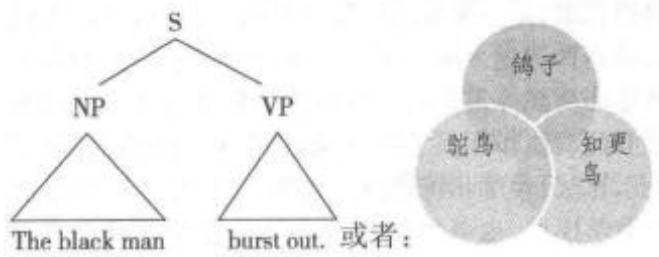

图表分析chart parser计算语言学中指用图表的特殊数据结构记录运算状态的方法。

图表重写chart rewrite指语言处理中分析自然语言的计算机系统的基本框架，包括“扩充转移网络(augmented transition networks; ANT)"“匹配模式(pattern matching)"“转换语法(transformation-al grammar)”等。

图画文字pictography 指使用图形字(pic-togram)的文字系统。其书写体系采用表征图、示意图等图画形式，与楔形文字和象形文字具有某种程度的相似，后者也采用某些图形作为语音字母或限定性韵律符。史前艺术中的图形字指画在岩石表面的图形符号，与镌刻在岩石上的岩石画(petroglyph)截然不同，后者是否属于图形字尚存争议。现代社会使用的图画文字有交通标志、公共设施标识、化学品分类标签符号(GHS hazard pictogram)以及形式语言的部分组成元素。一些美国诗人甚至将图画文字的特征演绎成现代主义诗歌技法，运用于诗歌意象的创造中。

图画字pictogram 参见“图形字”。

图解句子 diagramming sentence 句法学术语。一种在美国学校常用的分析句子的方法，用一套竖线和斜线来表征句子成分之间的不同关系。经过图解之后所得到的句子表征一般称为“Reed&Kellogg图解”，用以纪念两位图解方法发明者，同时也是英语教材的编者。其中，长的竖线用以分割主谓语，短的竖线用以分割动词和直接宾语，而短的斜线用以分割补语，其他的成分则划分在句子主要部分的下方。

The old man called him a nice guy.

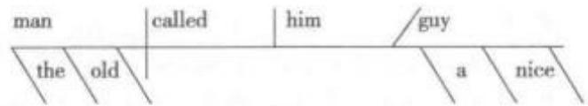

这种图解句子的方法能够将词之间的关系显示得非常清晰，但是无法处理语序的变化。例如，tearthepaper apart 和 tear apart the paper 的图解表征是相同的。

图灵机 Turing machine 由英国数学家阿兰·图灵(AlanTuring)于1936年设计并以其名字命名的机器，是一种通用计算机的概念模型，具有无限大的储存容量。图灵机并非实物，但是对诸如算法和循环功能等重要的基本概念的精确定义方面起着重要的功能作用。它可用来定义计算机函数，也能表示算法、程序和符号行的变换，可用作电子计算机的数学模型，也可用作控制算法的数学模型。图灵机能生成无限个循环的语符列，相当于形式语法，能对应于无限制改写系统，因而在形式语言理论中还可以研究短语结构，即递归枚举语言。1990年美国语言学家帕蒂(Barbara Partee)、默伦(Alice Meulen)和华尔（Robert Wall）在《语言学的数学方法》(Mathematical Methods in Linguistics)一书中对图灵机有详细介绍。

图片名词picture noun语法学术语。英语 中以picture、poem等为代表的一小部分名词，这些 名词的特点是在其作中心词的介词短语里可以使 用反身代词。例如：[1]John sent me this picture of himself. [2] John wrote me a poem about himself.

其他图片名词有 story、photograph 以及 song等。

图式schema 指代表个人对事物、人或环境知识的心理表征结构，包括对认识对象的特点和特点之间关系的认知，是组织人类感知世界的内在结构，即一种认知构架，可以使信息有条不紊地储存在长期记忆中。因而其是一种记忆结构，包括语言知识、社会文化知识和其他知识，也包括已形成的神经反应模式。图式的特征之一就是对通过感官接收的任何信号作出反应，并能产生信息弥补信号的不足。图式是对一个整体的抽象，侧重于许多事例的相似之处，可帮助人们简化现实。更重要的是，可以指导人们如何处理新信息。图式会建立对新信息的期待，帮助人们把外在刺激的细节与一个总体概念相联系，同时过滤掉不一致的信息。图式具有一般性、知识性、结构性和综合性等特点，同时又具有包含关系，构成一个等级结构。图式的特点决定了图式的功能，如建构与新事物之间的联系，推论隐含信息，搜索大脑中可解决面临问题的相关信息，整合图式不断变化的动态结构等。康德(Immanuel Kant)最早在哲学领域提出了图式。瑞士儿童心理学家皮亚杰(Jean Piaget)在1926年把图式引入到儿童心理发展的研究中。图式概念有助于解释复杂的社会认知现象，现被广泛运用到语言学、社会心理学和跨文化交际等研究领域。参见“图式理论”。

图式化schematization认知语言学术语。指把实际话语(actual utterance)抽象成一种知识表征的过程。实际话语包含有关细节，经过抽象后产生一个没有细节信息的图式(schema)。图式化过程忽略实际话语差异，只留存共有特点。例如：[1]Hereaches his hand out of the window, (他把手伸出窗外。)[2] The children are playing out of the house.(孩子们正在屋子外面玩。)[3] Many Chinese arenow living out of China.(很多中国人现在生活在中国之外。）例[1]—[3]中都有介词“out”(外)，但因“窗外”“屋子外”“中国之外”语境差异，意义稍有不同，但共同点是“离开一个明确边界”，正是这一共同点建立了介词“out”的图式。“Out”图式并没有告诉它所涉及空间关系的图形(figure)和参照物(reference object)，如例句[1]中的“他”和“窗”。这一部分信息被抽象化为图式的一部分，只有当图形和参照物存在并符合“离开一个明确边界”的空间关系时才适用。

图式理论schema theory 主要观点是人们在理解新事物时，需要将新事物与已知的概念、过去的经历(即背景知识)，联系起来。对新事物的理解和解释取决于头脑中已经存在的图式，输入的信息必须与这些图式吻合。图式理论的形成与图式概念密不可分，现代图式理论是认知心理学兴起之后，在20世纪70年代中期产生的。其首先由英国心理学家巴特里特(Frederic Bartlett)把图式概念引入到心理学和教育学领域，教育心理学家安德森(RogerAnderson)把图式扩展为图式理论。鲁梅尔哈特(David Rumelhart)推动了图式理论的进一步发展，特别是在理解记叙文和故事方面。鲁梅尔哈特把图式称为以等级层次形式储存于长期记忆中的一组“相互作用的知识结构”或“构成认知能力的建筑砖块”。他的研究证明长时记忆既不是固定的(fixed)，也不是一成不变的(immutable)，而是随着图式因经验的发展不断动态调整的。图式理论现已被广泛地用于语言和阅读研究中。在阅读理解研究中，图式常常被分为形式图式和内容图式。形式图式指有关各种文章类型、修辞结构之间差别的背景知识。例如，如果在阅读前知道将要读的是一篇议论文，并对这类文章结构有所了解，读者就能更好地理解这篇文章。内容图式是有关文章内容所涉及的背景知识，如读者对于英美国家历史概况、政治经济状况、文化传统和风俗习惯等有所了解，在阅读英美作家的作品中涉及这些知识时就不会感到困难。参见“图式”。

图式意义 schematic meaning 认知语言学术语，亦称结构意义、建构功能。指与概念结构系统(conceptual structuring system)成分有关但编码在封闭词类中的一种意义。这种意义本质上并不丰富，与概念结构系统成分有关但编码在开放词类中的实词意义形成对照。封闭词类包括冠词、介词、代词和屈折词素等，开放词类包括名词、动词、形容词和副词。图式意义与表示数、时间、新旧信息或说话者提供还是获取信息等概念有关。因此，它只是提供一种语义“脚手架(scaffolding)”来支持和架构开放词类的实词意义。例如：The dog ran into hishouse.（那只狗跑进了他的家。）其中的“the”(那只)和“his”(他的)两个封闭词类只有图式意义，为实词意义提供支持背景信息。

图像符号iconic sign 参见“象似符号”。

图像文字 iconography参见“图像学”。

图像学 iconography 艺术史和符号学术语，亦称图像文字。指关于图像内容的鉴定、描述和诠释的研究，着眼于图像所刻画的主题、作品的特定成分和细节以及艺术风格以外的诸多元素。图像学起初主要聚焦于宗教题材的艺术作品，后来转向西方世俗画作。近年来逐渐为符号学和传媒研究者所关注，将研究对象扩展到流行文化领域，通过引入符号的概念，对意象进行批评性解读，揭示图像的社会文化价值。在影视研究中，图像学被用以描述影视作品的视觉语言(visual language)，开展体裁和片种方面的批评。在互联网时代，图像或媒介型的视觉产品范畴不断拓宽。

图形 figure 认知语法术语。指图形一背景结构（figure-ground organization）中最凸显（mostsalient)的成分。心理学术语后被应用到认知语言学。特别是泰尔米(Leonard Talmy)在概念的结构系统方法(Conceptual Structuring System Approach)中详细阐述并发展了认知语言学中的图形概念。泰尔米指出较小的、运动特性明显的物体往往是典型的图形。例如:The car is opposite to the building.其中“汽车(car)”就是图形。兰艾克(Ronald Lan-gacker)在其认知语法理论中把图形称为射体(trajectory).

图形-背景结构 figure-ground organization认知语言学术语。指人类感知自动地把任何给定的空间场景分成两个凸显程度不同的结构。具有支配性形状、明确轮廓或突出颜色的客体称为图形，起衬托作用的场景其他部分称为背景。1915年，丹麦心理学家鲁宾(Edgar Rubin)首次提出了图形一背景结构。他认为，图形看起来像物体，离观察者更近，位于背景之前，处于支配地位而且便于记忆；相反背景看起来像物质，离观察者较远，位于背景之后，处于被支配地位且不易记忆。经过泰尔米（LeonardTalmy)和兰艾克(Ronald Langacker)的研究和推动，图形一背景结构在认知语言学中影响深远。语言中空间场景(spatial scenes)的语码化反映了图形—背景结构。一般来讲，主语位置对应图形，宾语位置对应背景。例如：[1]别墅在湖的旁边。[2]湖在别墅的旁边。句[1]可以接受，因为它符合人类对空间场景语码化的规律，别墅较小，形状轮廓清晰，是结构中的图形，充当主语；湖较大，形状不清是背景，作宾语。句[2]语义异常，不能接受，就是因为它不符合我们对空间场景语码化的规律，背景充当了主语，图形作了宾语。

图形字 pictogram;pictograph；picto 亦称象形符号、象形图或图形字。用在电脑中，亦称图标(icon)。指常见于书写和图形系统表示意义的各种图形符号，通过摹拟与现实世界各种物体的相似度来达到表意的目的。参见“图画文字”。

徒劳量化vacuous quantification参见“空量化”。

土腔方言broad dialect 社会语言学术语。指具有典型的方言发音特征和用词造句特色的方言。区别于向高变体或标准语转变的雅致方言(re-fined dialect).

土语 patois社会语言学术语。指语言的地区性使用变体，与标准语(standard language)相对，包括皮钦语、克里奥耳语和方言等非标准语，但不包括行话和俚语。

吐气音 egressive参见“外挤音”。

吐气重音expiratory accent参见“动力重音”。

推导derivation 句法学术语。指乔姆斯基在其《句法理论面面观》(1965)中提出的应用一系列语法规则后得到输出的过程，也可指得到的结构本身(即推导式)。例如，表层结构可由深层结构推导出来；短语可通过合并、移位等操作推导出来，等等。

推导经济性 economy of derivation;deriva-tional economy句法学术语。指最简方案中经济原则(economy conditions)的具体体现之一。乔姆斯基认为，生成有声音、有意义的句子要经过语法系统的层层加工，一步一步推导出来，而推导过程应该尽可能经济。如果有更经济的方法而不使用，生成的句子也不合法。徐烈炯(2009)将推导的经济性通俗地解释为：能小做不大做；能少做不多做；能不做则不做；能迟做则不早做。推导的经济性与表征的经济性(economy of representation; representationaleconomy)共同构成了最简方案的经济原则。

推断 inferencing 语言习得术语。指在学习和理解过程中，根据已知知识、观点或判断得出假设、观点，或形成新的知识、观点，或作出判断。推断是人们学习语言时一种学习策略，是语言学习中归纳出语法规则或其他规则的重要手段。在书面文本和口语文本的理解过程中，往往认为有几种不同的推理发挥了作用：(1)命题性推理，指从一给定陈述进行逻辑和必然推理；(2)使然推理，指根据事件或者概念之间的因果关系推理；(3)语用推理，指为理解文本提供额外信息，扩展对文章的理解；(4)连接推理，指要连贯理解文本所需要的推理；(5)精心推理，对理解文本事实上没有必要。

推断统计方法 inferential statistics参见“定量方法”。

推断性理解 inferential comprehension语言教学术语。指阅读时运用自身的经验、直觉和推论，从字面上琢磨出含蓄的言外之意，是阅读的目的之一。读者根据字里行间所暗示的逻辑关系合理地推断出作者的写作意图、作者的态度、文章的主题思想等非字面的内容。也是客观性阅读理解测试的试题类型之一，要求应试者运用推理过程把原文中多种信息与作者对客观世界事物的知识进行组合、分析、推理，从而推断出答案。例如：I am very care-less with my books. I can't find the book I was read-ing yesterday.根据上下文的逻辑关系，“找不到书”的直接原因是由前句表达的内容所造成的。读者一般不会理解为“Someone has stolen my book.”。推断性理解的水平依赖于作者对字里行间所透露出的信息进行逻辑推理的准确度。推断性理解同主观理解、评价性理解、欣赏性理解均属阅读理解的高层阶段，这几种理解有时相互交叉、相互渗透，或由一个逐步过渡到另一个，对一部作品的理解常需要同时兼用。

推理inference指演绎、推敲和表达未曾说出或未曾写出的内容的过程。指通过使用蕴涵和前提(即通过隐涵不明确表达的但对理解是必需的内容)和使用一个说话人/听话人以图示储存在脑中的有关篇章内容的知识，来填充或扩展篇章的语义表征的认知过程。这一过程包括逻辑上推理的内容，或者在特定语境下隐含的内容，如会话含义(conversational implicature)，对于理解别人的谈话和理解语篇的连贯性起着重要的作用。例如：Are you doinganything this evening?在打电话的语境里，这句话通常不会被推断成询问信息，而是作为一种邀请，因为利用背景知识或情景语境，可以推断出那些貌似间接或似乎违反会话合作原则的语句的确切的施为作用。

推理论 inference theory 强调语境对话语理解的不可分离性，认为交际中的话语仅仅是与说话人交际意图有关的显性依据，而非言语交际(比如用手指点、模仿以及其他形式的明示或展现)都涉及推理。

推理语法speculative grammar 指中世纪时受哲学影响的一种语言学理论，认为语言的结构是宇宙的本质，是反映物质世界现实的镜子。英语中speculative一词源自拉丁语 speculum，意为镜子。持这一观点的语法学家试图找到一种适用于所有语言的“普遍语法”(universal grammar)。

推理语义学inferential semantics逻辑学和语义学的一个集合术语。指运用推理理论(Infer-ential Theory)的方法通过对命题进行逻辑推理和直观推理的方式研究语义的学科。例如，从“Luciais awoman.”中“woman”的语义特征(即[+FEMALE]、[+ADULT和[+HUMAN BEING]等）可以推理出“LUCia isfemale"“Lucia is an adult”以及“Lucia is a humanbeing”等语义。

推链式音变push chain shift 参见“链式音变”。

推论格 illative case 语言类型学术语，亦称入格。表示一个物体移至某个方位的屈折形态的语法描写概念。这是乌拉尔语系芬兰—乌戈尔语族中具有与英语介词“into”相同所指意义的格。见于芬兰语和其他一些语言，在芬兰语中与向格、离格以及其他几个表示“局部”时空意义的格并存。

推论统计 inferential statistics 统计学术语。指用于根据一套数据对总体做出推论或归纳的统计方法。推论统计的基础是概率理论。对于样本或一套数据所选自的总体所作的归纳，其大概的精确度可以用多种不同的统计方法来确定。

推演分数 derived score 统计学术语，亦称导出分数。将考试的原始分数按一定规则转化为另一种规格的分数，使之成为具有可解释意义的结果分数。例如，将考试的正确答案数转换为百分数或者A—F这种等级分数。

退保值surrender value 语言教学术语。借自人寿保险行业。指学习者在语言课程中任何一个时间所获得的一些功能性技巧，即使过了这一段时间不再继续学习，仍然能使用这些技能。

退化degeneration 语义学术语。指词义退化。参见流派“词义转贬”。②语言习得术语，亦称退行、逆行。指语言学习者到了一定年龄阶段，其语法生成能力不再增强反而减弱的逆行现象。

退位关系符retirement R-sign语法学术语。在关系语法中四类名词性关系符之一，用以表示名词所担任的四种语法关系。其他三种是项关系符(term R-sign)、旁格关系符(oblique R-sign)和边缘关系符(overlay R-sign)。参见流派“关系语法”。

退行 degeneration 参见“退化②”。

托福考试 TOEFL 参见“英语作为外语的考试”。

托业考试TOEIC 参见“国际交流英语考试”。

拖延原则Procrastination Principle 参见“延迟原则”。

脱落elision语音学、音系学和格律学术语，亦称省音。源自拉丁语。语音学和音系学中用来指连续话语中语音的省略现象。话语过程中，有时一个音或几个音(如元音、辅音或整个音节)在一定条件下会完全消失或被省略，因此语音的脱落是一种常见的以发音语音学为理据的语音变化。这种语音变化使某些非强调的语音被省略，因而导致词汇的缩短和发音简化。例如，说英语语速快时，“directo-ry”容易发成[dar'rektrr];有些非重读语法词如“and”和“of”等在会话时也经常脱落，如“bread and butter”中的“and”被省去“a”和“d”，常读作“bread'n'but-ter”。再如：“I'm”中消失了[e]读作/aim/;“givehim”中省去了[h]读作/givim/。也有为减少发音困难而发生的脱落，如 castle/kasl/“城堡”(脱去[t])。此外，还有构成复合词后的脱落，如blackguard中的[k];借用词中的脱落，如 psychology 中脱去[p]等。在诗歌中，两个音节一起读时，有时为调整格律，有些语音可能消失。如“over”一词用于诗歌时，常被读作“o'er”。

脱体法disembodiment 翻译学术语。指在文学，特别是诗歌翻译中，不遵守目标语的结构特征，而是忠实再现源语形式的一种翻译方法。庞德(Ezra Pound)在翻译中国诗歌时即采用了这一手法。中国诗歌有隐而不露的特点，庞德沿用了这一中国传统，不遵循英语的规范，拒绝使用任何连词来表明诗句中各个意象之间的关系，而只是尽量贴近中文，不做任何更改，把中国诗歌原原本本地移植到西方。以李白《送友人》中的名句及其英译文为例：

[1]浮云游子意，落日故人情。

[2] a. Your heart was full of wandering thought; For me-my sun has set indeed;

(Version by Wade-Giles)

b. Mind like floating wide cloud,

Sunset like the parting of old acquaintances

(Version by Pound)

比较可看出，庞德的译文中不用冠词、没有主语的结构直接借自中文诗歌的手法，在实现译文与源语形式对应的同时，赋予了诗歌意象更广泛的一般性。美国当代文论家劳伦斯·奇索姆(Lawrence Chisolm)用脱体理论来阐释诗歌语言中因省掉句子成分而产生的非特指效果，这与托马斯·艾略特(Thomas Ste-arnsEliot，1888—1965)所提出的诗歌应当“非个人化”相通。

脱字号Caret语音学的变音符号，标示为[-]。脱字符号用以表示插入成分或次重音等。

妥协词 compromiser 语气减弱词（down-toner)的一种，指用于略微降低动词作用力的一类副词或副词词组。例如：[1]He kind of likes her，but she more or less dislikes him. [2] I quite enjoythe film，but I've seen better.汉语中也有相应的妥协词。例如：[3]我不太爱吃鸡，但还算喜欢鸭子。使用妥协词一般出于礼貌，避免表达太过直接而致人不快或难堪等后果。

# W

瓦格wug 用于复数形式习得实验的一个生造的无意义词。美国波士顿大学心理系教授、心理语言学家格利森(Jean Berko Gleason)于1958 年设计出这项语言学测试。由实验者向儿童出示一张虚构的动物的图片，告诉他这是一个wug。然后出示另一张这样的画，问接受实验的儿童现在有两个什么。如果接受实验的儿童已掌握这种复数词尾，他就会说 wugs/wAgz/，在响辅音后准确地用/z/这种复数词尾。测试结果表明，4—5岁的学龄前儿童可以完全掌握响辅音后的这种复数词尾。

瓦克纳格尔定律 Wackernagel's law 印欧语系句法定律，亦称瓦克纳格尔位置。指一些小词及附着语素倾向于出现在句首第一个重读的成分之后的一个固定规律，由印欧语系专家、希腊语教授、梵文学者瓦克纳格尔(Jacob Wackernagel)于1892年提出。此定律认为，附着语素如同词缀类黏着词素不能在句中独立出现；而区别于词缀的是，它们附着于经过屈折变化的词。例如，古希腊语 nùn dè pōslégeis(逐字英译为 now but how you-say)—句中相当于“but”的词就遵循瓦克纳格尔定律。相应地，句中第二个位置称为瓦克纳格尔位置。

瓦克纳格尔位置Wackernagel's position参见“瓦克纳格尔定律”。

瓦苏 Washoe 世界上第一只能通过手语与人类交谈的雌性黑猩猩。瓦苏1965年生于非洲，1966年被内华达大学的心理学家加德纳夫妇收养，并以内华达州瓦苏县的名字命名。经过5年训练，瓦苏掌握了160个美国手语单词，还能够把它们组成245个句子。在此之前，研究者试图让黑猩猩学说人类语言，但未获得成功，因为它们的喉部构造与人类存在巨大差异，不宜学习吐字发音。1980年，加德纳教授的学生罗格·福茨与妻子在中央华盛顿大学建立了黑猩猩与人类交流研究所。瓦苏和其他几只黑猩猩从此就在这里安家落户。福茨夫妇继续教授瓦苏学习语言，它已经掌握了250多个手势语单词。不仅如此，瓦苏还把它学到的手语传授给了另外3只年纪在30岁左右的黑猩猩，它们也学会了用比划的方式相互以及与人类交流。瓦苏于2007年10月30日晚去世，终年42岁。

外部分布external distribution句法学术语。指句法范畴在更大句法层面所呈现的分布关系。例如： [Brown's deftly painting his daughter] isa delight to watch. 句中的“[Brown's deftly paint-ing his daughter]”这一语类范畴在内部结构中呈现VP特点，但在外部分布中呈现NP特点。

外部合并 external merge 句法学术语。指从词库中选出的词同其他句法成分合并的操作。与之相对的是内部合并(internal merge)。乔姆斯基(2001)将结构中的移位操作(moverment)看作是合并操作的一种，称之为内部合并。

外部连读音变 external sandhi 参见“连读 音变”。

外部形式 outer form 指某种语言容易受到其他语言影响的表现形式，如语音系统；与语言的内部形式(inner form)相对。语言的语法结构和语义结构为其特有的内部形式。

外部言语 external speech 参见“内部语言2”

外部语言 exoglossia社会语言学术语，亦称“外族语”或“外围语言”，与内部语言(endoglossia)相对。指一个地理区域内大多数(或所有)人口所用的非本族语语言。参见“内部语言”。

外部语言学exolinguistics参见“宏观语言学”。

外部照应exophora参见“内部照应”。

外封闭outer closure 语音学术语。封闭指暂时把气流封闭在声道的某一部位上，内封闭区离唇部最远，外封闭区离肺部最远。外封闭可以在唇部发生，也可以在齿部、齿龈部、硬腭、软腭、咽头、喉头或任何中间部分发生。参见“闭塞”。

外国腔 foreign flavor 指借词保留的外国读法。英语中 rouge [ru:3]、bijou ['bi:zo]、restaurant['restoront]等借词。均保留了法国腔。

外国人语风 foreigner talk 亦称非地道话语或与非本族语者间交谈。当本族语者使用本族语与不精通该语言的非本族语者进行交谈时，说话方式和风格通常会发生变化，譬如简化语言句式和用词，从而使对方更易理解。这种改变通常不会在与本族语者之间使用该言语交谈的过程中出现。本族语者对不精通该语言的外国人说话时用的一种言语与所谓的“保姆式言语”(caretaker speech)有如下类似特征：(1)语速放慢，音量大，发音夸张；(2)词汇简单，省略冠词、功能词和屈折变化，或以简单动词取代复杂动词，如将“Do not cross the road.”简化为“No cross road.”;(3)多用重复性解释，或将话题移至句子前面，如“Your bag?Where you leave yourbag?”；(4)很少用俚语和习语等。

外国语foreign language参见“外语”

外化语言externalized language 亦称 E语言(E-language)，与内化语言(internalized language)相对。指语言被理解为一个事件或言语系统，是操同一种语言的人们所产生的、独立于人的心灵特性之外的语句集，或指被说话者外在化的其他外在的信息传递单位。乔姆斯基在20世纪80年代中期提出此概念，但又认为这样一个概念对研究内在的语言知识(competence，即“能力”)并无太大帮助；研究“能力”仍需把语言视为心灵的产物(mental ob-jects)。参见“内化语言”。

外挤音 egressive 语音学术语，亦称吐气音或挤气音。指所有用移动的气流机制发出的音，发这种音时气流从声道中逸出。与之对立的音类是内吸音(ingressive)。大多数语言的绝大多数语音都是由肺部的空气外呼而发出这种音。正常条件下，英语的全部语音的发音情况都是如此。

外加语disjunct 语法学术语，亦称句子副词 (sentential adverb)。副词可以分为附加语、连接语 和外加语。附加语是从句或句子基本结构的一部 分，用来修饰动词。有关时间、地点、频率、程度和方 式的副词都属于附加语。例如：[1]He studies at Oxford. [2] He almost finished his work. 连接语 不是从句或句子基本结构的一部分，而是表示一句 句子中所说内容如何与另一句句子所说内容相连 接。例如: [3]Altogether it was a total failure,... [4] However it is fine，... 外加语亦称为句子副 词，指表达说话人对其所说内容的态度以及看法的 副词。例如：[5] Naturally，I go to school every day. [6] I had failed to go to school, un fortunately.

外借词foreignism； foreign word指一种语言从其他语言中“借入”或引进的词。每种语言都有数量不等的借词。借词根据借用方式可分为两种：(1)音译词，指音义一起引进的词。例如：斯里兰卡(Sri Lanka)、纽约(New York)、斯大林(CraH)、沙发(sofa)、弥撒(拉丁语missa)、冬不拉(哈萨克语dmbr)、布尔什维克(俄语)等。(2)仿译词，指不仅引进词的意义，而且仿造其构词方式构成的词。例如，汉语“蜜月”仿自英语“honey moon”;汉语中还有一些从日语中引进的词，书写形式和意义都相同，但读音有差异，如经济、客观等。对外借词的定义学界有争议，有些人认为只有音译词属外借词。

外来词 alien word; peregrinism 参见“借词”。

外来混合词loanblend形态学术语，亦称混借词。指把本族语的形式与从另一种语言借来的成分组合在一起而构成的复合词或短语，即单词的一部分借自另一语言形式，另一部分属说话者的本族语。例如：部分澳大利亚人说的德语中有gum-baum一词，意为gumtree（桉树）。参见“借词”。

外来语复数 foreign plural指英语中来源于拉丁语、希腊语、法兰西语和意大利语等语言的词所保留的复数词尾形式(许多词同时有英语形式及外语来源语形式两种，外语形式多用于科技方面)，如 basis→bases(希腊语)、formulas→formulae、fo-cuses→foci、mediums→media、indexes→indices、stimulus→ stimuli(拉丁语)等。

外围periphery 指乔姆斯基普遍语法理论所认为的外围语法(periphery grammar)。语言中除了核心语法(coregrammar)之外，还有一些是不受普遍语法支配和限制的，或普遍语法无法预测的规则。核心语法是无标记的，其规则与普遍语法中的原则保持一致；外围语法是有标记的，其规则是普遍语法中的例外形式，需要用学习的方式而不是习得的方式去获得。

外围成员 peripheral member 认知语言学术语，亦称边缘成员。指在原型范畴理论中不典型或不突出的成员。例如，在“椅子”这一范畴中，四条腿供单人作的椅子，如学生椅，是原型成员，而供幼童坐的高脚凳或就餐椅则是外围成员。

外围角色circumstantial role 指在及物性语义组合关系中，体词(包括名词、代名词、量词)或以体词为中心的短语(包括名词短语和介词短语)所担任的角色。

外围失调 peripheral disorder 病理语言学术语。指由言语器官等损伤而引起的语言失调，如因视觉受损而影响阅读、因空间视觉受损而影响写作、因感觉运动系统受损而影响言语实践等。参见“语言失调”。

外围语法peripheral grammar参见“外围”。

外显式学习explicit learning参见“内隐式学习”。

外显知识 explicit knowledge 参见“内在知识”。

外向气流 egressive air-flow语音学术语，亦称肺气流。指由肺部出来经过口腔和/或鼻腔逸出体外的气流，即正常的呼气流。

外延 denotation 参见“指示意义”。

外延动词 extensional verb 蒙塔古语法概念，用来描述事件而不是可及性关系。例如，英语中的“find”(发现)必定表示有所指，因此是外延动词，而“seek”(寻找)则不是，因为它可以表示无所指，即现实世界中不存在的客体。

外延逻辑 extension logic 亦称传统逻辑、形式逻辑，与内涵逻辑(亦称辩证逻辑)相对。概念包括内涵和外延两方面，内涵表达的是事物的本质属性，而外延表达的是具备这一属性的事物。外延逻辑的特点在于舍弃概念内涵，而只是把概念的外延作为对象进行形式推理。亚里士多德创立的形式逻辑，其核心推理形式是根据概念的外延关系而定的，在这个意义上，形式逻辑等于外延逻辑。

外延缩小underextension 语言习得术语。指同一词汇项在被幼儿使用时，其外延意义小于成人使用时的外延意义，指称范围减小。例如，“猫”一词在成人语言中，既可指身边的一只具体的猫，也可以指现实存在中所有符合其内涵意义的一种动物，但在幼儿语用中的“猫”可能只指幼儿身边一只具体的猫(白猫、花猫或狮子猫)，而不是指所有的猫。

外延意义denotative meaning; denotation语义学术语，亦称所指意义或明指意义。外延意义与内涵意义(connotation，或称伴随意义、隐含色彩、隐含意义)相对。外延意义指词或词组与现实世界或虚构可能实现的世界里的现象联系在一起的那部分意义，它以客观外界为基础，是人们意识中约定俗成的一种意义。外延意义一般具有稳定性、明确性和有效性。例如，“鸟”的外延意义指有两条腿、有翅膀、卵生脊椎动物、无齿、有羽毛、胸部有龙骨、会飞等。外延意义是语义学的核心概念，也是语义学研究的主要内容之一。

外语 foreign language 亦称外国语。指对一个国家的公民而言，不属于本族语、也不属于法定国语的任何一种语言。例如，对于生活在日本的英语本族语者来说，日语即外语。在多数情况下，“外语”与“第二语言”之间并无太大区别，尤其在北美应用语言学用法中，外国语和第二外语之间不存在本质区别；但在英国用法中，两者有别。持类似观点的学者如理查兹(I. A. Richards)和施密特(JohannesSchmidt)，认为“外语”主要是指在学校里学习的语言，目的在于培养与外国人的交际能力或提高对该语言书面材料的阅读能力，它既不是学校的教学手段，也不在国内用于交际(如在政府、商业或工业等领域)。从这个角度看，英语在法国、日本和中国等国家都是外语；而“第二语言”指的是在一个国家或地区虽不是本族语但通常与其他语言同时作为交际媒介普遍使用(如用于教育或作为官方语言)且具有重要作用的语言，如在亚洲一些国家像印度、新加坡和菲律宾等，英语就是它们的第二语言，在教育、商贸等方面都起着重要作用。

## 外语教学法 foreign language pedagogy

语言教学术语。指研究有关外语教学的理论与实践方法，探索外语教学客观规律的科学。外语教学法的研究主要包括：(1)教学目标的确立；(2)语言教学条件的研究(包括学习动机、原有知识、学习者的条件、教学过程的组织等)；(3)教学材料的研究与编写；(4)评估水平的诊断方法(如水平测试、测试过程等)和(5)教师资格培训等。目前受到广泛承认的外语教学法主要有：语法翻译法、直接法、听说法、新方法(20世纪60年代以来出现的试图改变传统的新外语教学法)、人文主义法等。

## 外语教学心理学 foreign language teaching

psychology 教育心理学分支学科。外语教学心理学以普通心理学一般原理为基础，探讨教师和学生在外语教学中的心理状态、心理过程及其特点以及学生的个体差异，为建立外语教学的基本原则和教学方法体系并正确组织外语教学工作提供心理学依据。

外语事务协会口头面试 Foreign Service In-stitute (FSI) Oral Interview美国外语事务协会制定的检测成人外语口语熟练程度的一套技术。口试时间为30分钟，口试主持人通常为两名。根据一组评分等级表对受试人在发音、语法、词汇和流畅度方面分别作出评定。

外语语言水平foreign language proficiency参见“语言能力¹”。

外在效度external validity参见“效度检验”

外展abduction 语音学术语。指喉部两侧的两个声带在喉内肌带动下产生的分离运动，与声带内收的概念相对应。当声带外展时，声门裂会变大，人体可以吸入更多的空气。

外指性意义 sensus denotan属于内涵意义的一种。指篇章形式所表现的某个假定环境中的物体性状。参见“表现性意义”。

外置extraposition句法学术语。一般指将CP和PP移至句子右侧边界的移位操作。例如：

[1] a. [Np Many paintings of young artists [c which I like]] are on sale.

b. [Np Many paintings of young artists t] are on sale [cp which I like].

[2] a. [N Many books [pp about the Soviet Union]] will appear soon.

b. [Np Many books t] will appear soon [pp about the Soviet Union].

[3] a. [cp That John passed the exam] surprised me. b. It surprised me [cp that John passed the exam].

例[1a]中的关系分句whichIlike可以外置到句子最右端，如例[1b]所示；例[2a]中的PP可以外置到句子最右端，例[2b]所示。有时外置操作需要虚主语it，如例[3]所示。

完成 accomplishment 语法学术语。指动词词形体(lexical aspect)的一种。根据动词自身的语义特点，美国语言学家泽诺·万德勒(ZenoVendler)于1957将动词的词形体分为四个类别：状态(state)、动作(activitiy)、完成(accomplishment)和成就(achievement)。完成词形体的动词表示动作可持续一段时间，然后在某一个时间终点终止，如eat（anapple)、write(a poem)等。

完成分词perfect participle 参见“过去分词”。

完成进行时被动式 perfect progressive pas-sive语法学术语。指同时表达完成体、进行体和被动语态的动词形式。例如：My car has been be-ing served for three days now. 句中的谓语动词部分即完成进行时被动式。但并非所有讲英语的人都认为其符合语法规范。

完成时 perfect tense 语法学术语。现在通常被称为一种体(aspect)，而不是时态范畴，因为其指的是动作的类型和状态，而非动作发生的时间。在英语中，完成时传统上是对“have十过去分词”这样的形式的叫法。德语的完成时表示发生在过去、已经完成而且影响到现在的事件。

完成体 perfective aspect; perfective 语法学术语。指动词的一种形式，指一种时间或持续性质的对立，因此有时按“时”来描写(如“完成时”“将来完成时”“过去完成时”等)，有时按“体”来描写(如“完成体”“非完成体”)。语言学家倾向于按“体”来分析，因为有持续、完结、时间等意义特征形成复杂的交互作用。然而传统语法只是提及“完成时”等，其含义因而显得过于简化。传统的“完成时”指具有过去情状的一个事件被视为与当前相关；“完成体”则把一个情状作为一个整体看待，不管其可能有的时间对立。完成体因此对立于未完成体(imperfec-tive)或非完成体(non-perfective)。完成体可表示动作造成的结果，或者表示持续到一个时间的动作或状态，也可表示在一个时间期限内发生的事件或状态。例如:[1]I have written ten letters today.[2]I have lived here for 6 years. [3] By six o'clock hehad reviewed the text three times.在英语中，完成时和完成体的区分很模糊，常用后者取代前者。英语的完成体由助动词“have”和过去分词构成。如果助动词是现在时，这个动词组就称作现在完成体，如“They have gone.”;如果助动词是过去式，这个动词组就叫过去完成体，如“They had gone.”。还有一种比较少见的将来完成体。例如：They will have fin-ished before noon tomorrow. 英语中的完成体一般指：(1)延续到某一时刻为止的状态或活动；(2)发生在一段时间内的一个事件；(3)产生的影响延续至某一时刻的事件。

完成体分词perfect participle语法学术语，亦称过去分词(past participle)或被动分词(pas-sive participle)。指英语中的分词和助动词“have”连用构成的完成体分词。例如：Mary has handed inher paper.

完美翻译 perfect translation翻译学术语。指英国语言学家和翻译学家西奥多·萨瓦里(Theodore Savory)对翻译进行分类的一个概念。他认为像广告、布告等纯粹传递信息的翻译，由于使用几种不同文字译出的译文内容相同，不带任何感情色彩，只向读者传递信息，译文语言可达完美程度，这一类翻译可以看作是完美翻译。他在1957年出版的《翻译的艺术》(The Art of Translation)一书中指出，翻译是一门艺术，翻译可分为四类，即完美翻译、充分翻译（adequate translation）、综合翻译（compositetranslation)和科技翻译(translation of learned,scien-tific, technical &. practical matter).

完全动词full verb参见“实义动词”。

完全短语范畴 full phrasal category 句法学术语。生成语法中指以某一个核心成分为中心并包含其最大投射(maximal projection)的句法结构。根据完全短语核心成分的词性划分，完全短语主要有四种基本类型，即动词短语(VP)、名词短语(NP)、形容词短语(AP)和介词短语(PP)。

完全解释原则 principle of full interpreta-tion；FI句法学术语。在语言的使用体系中，句法层面的逻辑表达式(LF representation)接口和语音表达式(PFrepresentation)接口的所有成分都必须得到合理解释，即必须能够从其表达的意思上得到允许。因此，一个语言项的生成，决定其意义的所有语义特征都应包含在逻辑表达式中，而且逻辑表达式只包含这些语义特征；一个得以成立的逻辑表达式不能含有在这个接口上得不到解释的多余成分。同理，语音表达式也包含且只包含决定语言项发音的语音特征。参见“逻辑式”和“音系表达”。

完全句fullsentence指包含一个主语和一个谓语并按一种语言中最典型、最常用的顺序排列的句子。对此，语言学界各家定义不尽相同。布龙菲尔德(Leonard Bloomfield)将其定义为“采用语言中惯用的句子形式”的句子，如英语中由施事—动作短语组成的句子“John ran away”，或由命令式组成的句子“Come!"”“Be Good!”等。赵元任将其定义为“有主语和谓语两部分”的句子，认为这种句型是连续话语中最常见的句型，如汉语的“他跑得快”“这个人可笑极了”等。

完全可及说 full access hypothesis语言习得术语。指普遍语法可及性假说中的一种。认为第一语言习得和第二语言习得的过程类似，学习者的大脑中不存在从母语到第二语言的迁移限制，也不存在通往普遍语法的限制，两者可以达到同样的语言能力。如果第二语言习得者显示出的二语水平不及母语者，是因为他们的语言表现不够好(perform-ance-related)，而非语言能力达不到(competence-re-lated)。参见“普遍语法可及性”

完全可解释性 total accountability依据结构主义语言学的观点，任何一个在某个平面上做出的描述或说明都能在另一个平面上得到预测。这是20世纪40年代出现在结构主义语言学分析法中的一条原则。这一原则在音系学和形态学研究中运用比较多，即每个语子或音位一定可以由组成一个话段的语素和法位来决定。类似空语子和并合语子这类概念需根据这一原则进行特殊讨论。

完全失语症total aphasia 病理语言学术语。指运动性失语症和感觉性失语症同时发生的情况。人类言语功能受一侧大脑半球支配，称为优势半球，而绝大多数人的优势半球位于右侧大脑皮质及其连接纤维。优势半球受损会引发失语症，而优势半球的不同部位受损则引起不同类型的失语症。其中第三额回后部是口语中枢，受损会导致丧失口语表达能力，被称为运动性失语症。第一颞横回后部是听语中枢，受损会导致对别人语言理解能力的丧失，被称为感觉性失语症。当这两种损害同时发生，运动性失语症和感觉性失语症并发时被称为完全失语症。

完全同音异义词 full homonym 语义学术语。指读音、拼写和词性相同但意义不同的词，如bank(n.银行/堤，岸)、ball(n.球/舞会)、match(n.火柴/比赛)等。

完全转换complete conversion 形态学术语。词类转换法(conversion)中一种特殊现象。指形容词不改变形态就用作名词，同时获得名词的一切特征(如性、数、格等)。例如：[1]There is a blackand a white in the picture. [2]They are looking formoderns as spokesmen for their products. 句[1]中的 black 和 white 分别指黑人和白人。句[2]中的moderns指现代派人物。其他的例子还包括creative(具有创造性的人)、gay(同性恋者)、returnable(可回收物)、crazy(怪癖者)等。

完全转类fullconversion形态学术语。指衍生词取得新词类一切特征的转类。例如，black可以用作复数，可以与数词连用，并可执行名词的一切句法功能。与部分转类(partial conversion)相对。

完形风格 gestalt style 语言习得术语，亦称格式塔风格、整体学习、分析风格。指一种学习风格，强调把多词言语(multiword utterance)作为一个单位或词块(chunk)来记忆和使用，很少分析内部语言结构。例如，学习者可以尽力去记住一个完整的外语句子而不是分别地记忆其中的各个单词和短语。完形风格与分析风格(analytic style)相对，后者是在应用原来习得的语言规则和理解言语成分结构的基础上生成的。

完形心理学gestalt psychology 西方现代心理学的主要流派之一，亦称格式塔心理学或格式塔理论(gestalt theory)或柏林学派格式塔(Gestaltof the Berlin School)。由德国心理学家科勒(Wolf-gang Kohler)等创立，提倡使用一种整体研究方法(holistic approach)来研究人对整体情景的反映。完形心理学是一个关于大脑和智力的理论，该理论认为智力的操作原则是整体的(holistic)、平行的(par-allel)和类推的(analog)，有自我组织趋势，或者说整体不同于部分之和。关于完形心理学的经典例子是肥皂泡。它们的球面形状不是由一个严格的样板(template)或数学公式来定义的，而是由表面上各个点的表面张力同时作用而现场形成的。这和数字计算机“原子分裂”型操作原则(\*atomistic’principle ofoperation)相对立，依据这一原则，每一步计算都分解成简单步骤的序列，而每一个步骤又都是作为一个完整问题的独立计算。格式塔效果主要指我们的感觉器官形成图形的能力，特别是有关图形和整体形式的可视认识，而不是把它们看成简单的线条和凸面(curves)的集合。完形心理学对语言教学和语言测试有重要影响。

完形填空比频评分法clozentropy 语言测试术语，亦称完形填空计分。指完形填空测验的一种评分法，其基础为“合理选词法”(acceptable wordmethod)，即根据上下文填人符合意义，语法连贯的词。具体方法为：首先选择一组本族语者进行测试，统计其答案出现的频率并按高低排列；然后用同一套题测试非本族语者，对其答案根据本族语者答案的频率打分。测试的评判结果以答案为高频率者的得分高于答案为低频率者的得分为标准。

完形填空测验cloze; cloze procedure 语言测试术语。指语言测试常用的一种手段。通常检测读者的阅读理解能力。测试方法一般是先选定一篇文章，在一段“导入语”(lead-in)之后有规律地删去文章中的单词(即每隔五到十个单词删去一个，目前公认七个单词的间隔为最佳);然后要求读者阅读文章并补上所删单词。补词有两种标准，第一是要求读者必须补上与原文相同的单词：第二种是要求读者根据上下文补上合适的词，可与原文不同。前一种叫“确切选词法”(exact wordmethod)，后一种叫“合理选词法”(acceptable word method)，也叫“合适选词法”(appropriate word method)、“可接受选词法”(acceptable alternative method)或“上下文合适法”(contextually appropriate method)。有研究表明，完形填空测验的结果与整体能力测试的结果有高相关性，如加州大学洛杉矶分校的英语作为第二语言的安置考试(English as a Second LanguagePlacement Text;ESLPE)和剑桥英语水平考试(CPE)。因此也有人提出完形填空测验可反映出“整体语言能力”(global linguistic competence)。对这一说法目前仍无定论，如有人就提出完形填空难以测试口语能力。除了测试阅读理解能力外，完形填空还可用来检测文章的难度。一般如果学生对某一完形填空的平均分(总分100分)在53以上说明该文章学生可独立完成：若平均分在44—53之间则说明学生需要教师的指导才能完成该文章；若低于44分，那么即使有老师的帮助学生也无法理解文章。当然该分值在相应情况下会发生变化。

完整句 complete sentence 语法学术语。指包含应有成分或语义完整的句子。完整句有两层含义，第一指句法上包含应有成分的句子，第二种指语义上说话人想说出且已说完的句子。例如：[1]How are you this morning?—I'm very good! 与之相对应的是省略句，如上句的回答可改为“Very good!”[2] Oh, so beautiful! A chilly morning last winter. 与之相对应的是因某种原因未说完或说不完的句子，如出于感情激动或被他人打断的话语。对类似例[2]这样的第二种完整句的理解需借助语境因素。

玩具语法toy grammar 指作为某种具体研究方法例证的小语法(small grammar)，主要应用于形式句法的研究中。例如，短语结构的规则可用玩具语法表述为：S→NP+VP；VP→V+NP；NP→D+N。其中，不同的句法范畴由各自的短语结构规则组成。若此种玩具语法只包含上式所示词类且每个

词类仅有如下词项：

<table><tr><td>N</td><td>V</td><td>D</td></tr><tr><td>cat</td><td>chase</td><td>the</td></tr><tr><td>mouse</td><td>kiss</td><td>a</td></tr><tr><td>princess</td><td></td><td></td></tr><tr><td>frog</td><td></td><td></td></tr></table>

则可生成例[1]、例[2]等句子，但不能生成类似例 [3]的句子:[1] The cat chases a mouse.[2] The princess kisses the frog. [3] The beautiful princess kissed the frog.据此，语言学者可再进一步修 改短语结构规则。

晚插入 lateinsertion句法学术语，亦称词汇晚插入(latelexical insertion)。指句法运算后在拼读(spell-out)过程中通过插入词项使终端节点带有语音特征，但不增加语义特征。例如，现代英语中的“do-支持”属于词汇晚插入的例子。

万国新语Esperanto参见“世界语”。

汪汪论Bow-wow Theory参见“摹声说”。

网络分析 network analysis社会语言学术语，指社会关系网络分析(social network analysis)对语言变化的影响。网络分析基于对社会网络关系的研究，社会网络指的是各个层面社会体系成员之间形成的复杂的关系群，从个人之间到国与国之间不一而同。巴恩斯(John Barnes)于1954年开始系统使用此概念表示各种关系模型，既包括公众使用的传统的概念，也含有社会科学家使用的概念。例如：关系密切群体(bounded groups)，如部落和家庭；社会范畴群体(social categories)，如性别，种族等。社会关系网络分析科学家们关注的关系层面有：从整体到部分、从结构到关系再到个体、从行为到态度。通常研究整个网络关系(whole networks/completenetworks)，即目标人群所有关系中共有的特别关系；个体网络关系(personal networks/egocentric net-works)，即特定人群所拥有的关系。系统地应用网络分析研究对语言的影响始于1998年9月在曼彻斯特大学召开的第10届国际英语历史语言学大会。在大会上，专门讨论了莱斯利·米尔洛伊(LesleyMilroy)提出的社会关系网络对贝尔法斯特方言的影响模式。《欧洲英语研究杂志》2000年第3期专刊刊登了部分研究成果。总体看来，密切的多元的社会关系网络(closed networks)对语言变化的影响所起的作用表现为：语言标准实施的机制是防止语言变化的保守力量。根据米尔洛伊的观点，这样的社会关系促使说话者坚持“不标准”的方言(不管是城市的还是乡村的)，虽然教育体系和媒体让标准语言更加流行，大有市场。形成鲜明对比的是，开放性的社会关系网络给语言变化带来了很多便利的条件。

社会关系网络分析对历史语言学有很多可借鉴之处，能够帮助我们发现语言中为什么有些语言现象一直保持不变，为何一些语言现象发生了变化。

网络强度等级 network strength scale; NSS社会语言学术语。指社会关系网络中社会关系的亲疏度对人际交往中语言使用和变化影响的程度。在语言变化中，社会网络关系中的成员可以分为三类：(1)新语言变体的革新者，位于社会关系网络的交集地带，首先提出新语言变体；(2)早期接受者，富有威望的社会关系网络成员先接受了新语言变体；(3)追随者，从早期接受者那里获得新的语言变体。

网状群体network 社会语言学术语。指一个较大的社团所包含的具有一定关系的人的群体，如家庭、寝室、社区等。构成群体的成员之间的关系各式各样，相互交错：父母、父(母)子、父(母)女、兄弟姐妹等，但关系相对稳定，语言交际方式大体上可以预知。了解不同的网状群体和它们的结构对语言学习、语言差异和语言研究有帮助。

忘名性失语anomia 病理语言学术语。失语症的一种，亦称名词性失语。指由于大脑受损而引起的获得性中枢语言障碍，其特征为：不能记忆和辨别名字，措词困难，语义错乱，偶尔出现句法和理解的轻度障碍，等等。

忘名症 anomia参见“失语症”和“忘名性失语”。

威廉姆斯综合征Williams syndrome心理语言学术语。指一种非遗传性认知障碍综合性病征，由新西兰心脏病科医师威廉姆斯(John CyprianPhipps Williams)发现并认定。用威廉姆斯综合征患者所做的实验证明，语言认知能力不是语言能力发展的必要条件。在出生的婴儿中，大约每两万人就有一个患有威廉姆斯综合征。所有患威廉姆斯综合征的人似乎都有心脏问题，最明显的迹象是威廉姆斯综合征儿童(以下简称“威廉儿童”)普遍的面部特征，这些特征被称为“小精灵特征”。他们有很典型的宽大的嘴和大而松弛的下唇，鼻尖向上翻，稍稍凸出的脸颊和不规则的牙齿，牙缝很大。认知及动作也有一些困难，许多威廉儿童在进行幅度较大动作的活动时感到困难，畏惧高度，在攀爬或下楼梯方面产生问题。他们会显得笨拙，步态尴尬，并在手与眼的协调上有困难，在抛球和使用剪刀方面显得力不从心。然而，威廉儿童的语言能力基本未受太大影响。在学龄期，他们通常显得表达能力很强，掌握很大的词汇量，能用复杂的词组并善于引用，给人留下深刻的印象。不过，威廉儿童的谈吐中有一种过于追求华丽辞藻的倾向，因而别人认为他们是为了吸引他人的注意力，或是无聊。另外，威廉儿童还偏好使用过于复杂的语言，与他们实际要表达的意思并不相符。威廉儿童拥有很好的口语能力，其中包括对声音和词语有很好的记忆力以及很好的声音顺序技巧。

微观功能 microfunction 功能语言学术语。韩礼德把语言的功能分成三类：宏观功能(macro-function)、微观功能(microfunction)和纯理功能或元功能(metafunction)。微观功能指儿童语言所具有的七种功能：(1)工具功能(Instrumental):运用语言获得物品以满足物质需要，如“要水”。(2)控制功能(Regulatory):运用语言对他人进行控制，如“回来”。(3)交流功能(Interactional):运用语言与他人进行交流并形成关系，如“爱你，爸爸”。(4)个人功能(Personal)：运用语言表示自己的身份、情感和对事物的看法，如“我，好孩子”。(5)启发功能(Heuristic);运用语言获得关于周围世界的知识，如“卡车，干什么？”。(6)想象功能(Imaginative):运用语言讲故事、笑话，创造某种想象的环境。(7)表达功能(Repre-sentational):运用语言交流事实和信息。

微观社会语言学micro-sociolinguistics语言学分支。与宏观社会语言学(macro-sociolin-guistics)相对。微观社会语言学研究影响语言及其使用的个人的、局部的社会因素，如某一社会阶层中产生的语音、语词、语法的变异，又如性别、年龄、行业、经济地位等对个人言语的影响等。其主要研究话题包括各类语言变体(language varieties)，如语域(register)、地理方言(regional dialect)、社会方言(so-cial dialect)、个人方言(idiolect)、语言与性别、语言与年龄、标准语(standard dialect)、皮钦语(pidgin)、克里奥耳语(creole)、双言现象(diglossia)和双语现象(bilingualism)等。比较而言，宏观社会语言学研究全局性、整体性问题，如语言规范化问题、主要民族语言和少数民族语言的互相影响问题、多语社会中产生的语言问题等。社会语言学的宏观和微观研究是互相贯通的。参见“宏观社会语言学”。

微观言语行为micro-speech act 指个体言语行为的结构以及言语行为序列的线性结构。可以组合形成具有层级结构的宏观言语行为。例如，“能告诉我时间吗？我忘记戴手表了。”此句中，说话人有两个微观言语行为，具有一个宏观言语行为目的，即说话人想知道时间，请求听话人告知。参见“宏观言语行为”。

微观语言学microlinguistics 亦称专语语言学或内部语言学。指以某一语言为对象，对其材料进行具体的研究和分析，研究对象是语言本身的结构和体系，认为语言不仅是音义结合的词汇和语法的体系，而且是处于一定相互关系中的微观变体总和。因此，微观语言学研究语言的各类微观结构(微观变体)，它以动态的、联系的方法考察语言体系的发展变化，对各类语言变体进行描写和研究，从而预示各类微观变体对整个语言宏观体系发展的作用和影响。同时，它也对各类微观变体做出功能上的分析，并将功能分析与定量描写结合起来，从而客观地描绘出语言发展的动态过程，包括语言及其变体与整个社会的关系。微观语言学的研究方法主要是调查一统计一归纳一演绎。通过调查掌握研究对象，统计分析掌握相应的数据，并在此基础上进行归纳总结，寻求相应的内在规律，并以此为基础做出演绎和推测。微观语言学着眼于语言内部系统的描写，按照研究对象的不同，涉及语音学(Phonetics)、音系学(Phonology)、形态学(Morphology)、句法学(Syntax)、语义学(Semantics)和语用学(Pragmatics)等体系。

微观语用学micropragmatics 语言学分支，与音系学、形态学、句法学和语义学平行。其范围局限于英美语言哲学传统领域中的课题，如会话含义和言语行为、预设、指示以及会话结构等。参见“宏观语用学”。

微技能micro-skills 参见“局部技能”。

韦尼克区 Wernicke's area 神经语言学术语。指人脑左半球后部支配言语接受、理解的一个部位，也可称为韦尼克中心(参见第30页插图)。在这个区域内有听觉性语言中枢和视觉性语言中枢，是与口语和书面语有关的感觉性语言中枢，其功能是在人的言语活动中储存和选择词语，并在需要运用视觉时，通过角回和第一视区的视皮质沟通。由德国精神病学家韦尼克(Carl Wernicke)于1874年发现，并以他的名字命名。韦尼克区常与布罗卡区(Broca's area)相对，布罗卡区控制言语的产生。

韦尼克失语症 Wernicke's aphasia 参见“流畅性失语症”。

违反 flout 语用学术语。指有意不遵守“话语原则”的行为。例如：A：Can you type? B:I havebeen using a computer for eleven years. 在上述对话中B的回答违反了会话原则中的相关原则，但是B的违反可以理解为夸张。

唯理语法 rational grammar 一种以法国哲学家笛卡儿(ReneDescartes)的哲学思想为依据的语法流派，亦称笛卡儿语言学。这一流派认为一切语言具有共同的特点和规律，其基础为统一的思维逻辑模式;强调从逻辑角度研究语法，重视语法与逻辑的一致关系，力图阐释语法的普遍原则，揭示一切语言中语法在表达思想上的一致性及其基本差别的成因。唯理语法形成于17世纪中期的法国，代表人物为阿尔诺(Antoine Arnauld，1612—1694)和朗斯洛(ClaudeLancelot,1615—1695)，代表作为其合著的《普遍唯理语法》(Grammaire générale etraisonnée)。因该语法著作在巴黎郊区的波尔-罗瓦雅尔(Port-Royal)修道院里编成，故亦称“波尔-罗瓦雅尔语法”。该著作于1660年4月2日在巴黎出版，共4万字，包括言语的物质成分和精神成分两部分。前者分析了符号的物质性，如元音、辅音、音节、重音、字母、字母读音的改革等；后者讨论了用符号进行表达的各种方式，即遣词造句表达思想的原则和道理。该著作以希腊语和拉丁语为基础建立语言的逻辑形式，认为概念、判断和九个词类(名词、冠词、代词、分词、前置词、副词、动词、连词、叹词)为一切语言的普遍形式。该书在词类划分上区分了实体和附属性质，并从结构上对词类功能进行独到分析，如认为副词相当于介词短语的缩写(carefully=withcare)，动词表示陈述、愿望、命令等。唯理语法在17至19世纪的逻辑学和语言学中比较普及，虽然历史比较语言学和结构主义语言学对其评价较低；但在20世纪60年代，这一理论在普遍语言现象说和生成语法中得以反映。

唯理主义 rationalism 参见“理性主义”。

唯名论nominalism 语言哲学理论。其核心观点是人们用来表示事物的词的形式和词所指的事物之间并无内在联系，人们用词是习惯和惯例任意选择的结果。此理论源于中世纪经院哲学围绕殊相与共相的关系之争形成的，所形成的两个对立派别分别为唯名论和实在论(realism)。唯名论认为被归人同一普遍词之下的各个殊相所共同具有的唯一特征是它们都为这同一个词所指称。因此，共相只是名称，不是独自的存在物，尽管在知识中有共相的成分。而根据唯实论，共相是实在的实体，它们被用来说明普遍词如何应用不同的殊相。对于唯名论来说，语言并非独立的实在，而强调感知相似性，每一存在物都是殊相，共相是为谈论相似物而由心灵发明的词。也就是说，唯名论否认共相具有客观实在性，认为共相后于事物，只有个别的感性事物才是真实的存在。对性质和抽象实体的谈论，只有当它们可还原为对殊相的谈论时，才是合法的。唯名论遵循奥卡姆剃刀原理，即“如无必要，勿增实体”。其主要拥护者包括奥卡姆、洛克、卡尔纳普、奎因等人。唯名论有两种类型：(1)“极端唯名论”，认为不仅客观上不存在一般，而且人的思想中也没有一般的概念，一般不过是一个名词，甚至说只是一种声音；(2)“概念论”，认为一般不单是一个词，而且是人心中的一个概念，是人用来表示许多事物的相似性或共同性的概念。

唯位emic 指“唯位的与非位的”或“区别性的与无区别性”特征对立，用来代表研究语言学数据的两条对立的途径之一。唯位(emic)一词实际是从音位(phoneme)、语素(morpheme)等术语派生而来，-eme指涉及的最小区别性单位，并从phonemic(音位的）、morphemic（形位的）、sememic(义位的）、gra-phemic(字位的)等一类词中抽出来的，用以表示具有区别性特征的(distinctive)这种性质，以构成区别性单位(emic unit)。唯位就是从最小区别性单位的角度来观察和分析语言现象的状况。譬如，尽管名词复数的词尾形式在不同情况下有不同的语音体现(/s/、/z/、/iz/)，可是将它们概括抽象为具有区别单复数语法意义特征的{-s}单位，就是一种“唯位的”方法。“唯位”方法则是充分考虑各种功能关系，建立一个由抽象对立单位组成的封闭系统作为描写的基础。唯位与非位的区分是法位学(tagmemics)的一个重要特征，参见“非位”。

## 唯物主义语言理论materialistic language

theory 以辩证法和历史唯物主义为基础的唯物主义语言论，在马克思列宁主义语言观的框架内，从语言对劳动人民生产和社会活动的作用的角度来解释语言的本质和发展。可参阅马尔学说(Marrism)和反映论(reflection theory)。

## 维持性双语教育maintenance bilingual edu-

cation教育语言学术语。指双语教育的一种形式。指在维持和强化学习者母语能力的同时，帮助其习得另一种语言的双语教育模式。在这一模式中，学习者的母语和第二语言的能力同时得到提高。维持性双语教育与过渡性双语教育(transitional bi-lingual education)不同，后者的目标在于尽快使学习者掌握使用第二语言，母语只在初始阶段充当翻译语言以帮助理解。一般而言在刚入学时，学校开设的课程用儿童在家里使用的语言，一般是其第一语言;但后期逐渐变成一部分科目用在家里使用的语言，而另一部分科目则使用学校规定的语言，一般是以第二语言开展教学。

维尔纳定律Verner's law 历史语言学术语，亦称弗纳定律。指丹麦语言学家维尔纳(KarlAdolph Verner,1846—1896)发现的语音演变的一条规则模式，这条定律解释了格林定律(Grimm'slaw)所不能概括的例外情况。它首先证实了在日耳曼诸语言中重音在语言变化中起到了重要作用，为19世纪语言学家的语音定律无例外的重要理论提出了进一步的证据。根据格林定律原始印欧语的清塞音/p/、/t/、/k/在日耳曼语中变为清擦音/f/、/0/、/h/，原始印欧语的浊塞音/b/、/d/、/g/在日耳曼语中变为清塞音/p/、/t/、/k/，原始印欧语的送气浊塞音/bb/、/db/、/g/在日耳曼语中变为不送气浊塞音/b/、/d/、/g/。而维尔纳指出还有一些格林没有发现的例外情况，即在后期原始日耳曼语中，只有位于词首或紧跟重读元音之后的原始印欧语清塞音/p/、/t/、/k/才变为清擦音/f/、/θ/、/h/，而在其他位置的清塞音/p/、/t/、/k/则变为浊塞音/b/、/d/、/g/。这条音变规则对格林定律的一些例外现象作了说明，被称为维尔纳定律。维尔纳定律是历史语言学研究的重大发现之一，在当时的历史比较语言学界引起了震动。参见“格林定律”。

伪同源词 false cognate 形态学术语，亦称假朋友(faux amis)虚假同源词，假同根词。指不同语言或不同语系中词形或读音相同或非常相似，但词根或词义完全不同的词。由于形态相似，很容易被第二语言学习者误用。例如，澳大利亚土著语言姆巴巴拉姆语(Mbabaram)中的“dog”一词，尽管与英语中的“dog”在词形和发音上非常接近，含义却截然不同;法语中的“experience”(实验)，尽管形态上类似于英语中的“experience”(经验、经历)，但两者意义不同。在二语习得过程中，两个伪同源词的意思易相互混淆。英语中的cold与德语中的 kalt都表示“冷”，因此，反映在语言习得中，就会造成语言误用现象。二语学习者在学习意大利语或西班牙时容易将这两种语言中caldo(热)的词义误解为“冷”。再如: Yesterday we performed an interesting experi-ence in the laboratory. 这是一个学英语的法国人很容易说出的句子，此类问题，可通过对比分析伪同源词而得以辨认来巩固学习。

尾部final 亦称末位。①常用来指出现在语言单位尾部的成分，如词尾、句子尾部等。音系学术语。如音位/t/位于bat一词的尾部;list的/st/是尾音缀；复数/-s/出现在词的尾位等。位于尾位之前的位置分别称为首位(initial)和中间位(medial)。

尾词重复epistrophe 修辞学术语，亦称词尾 重复。指词在连续几个句子或从句的末尾的重复。 例如:This house is mine; this car is mine; you are mine.

尾句tag语法学术语。指附加在一个句子之后的、有一定分离性的词、短语或分句，与前面的句子之间有短暂的停顿，书写上用逗号表示。尾句又可分为反义疑问句(tag question)和附加陈述句(tagstatement)，用来表示强调或形成反问。附加疑问句一般由一个助动词加一个代名词组成，附加在一个陈述句的结尾，其极性对立一般与前面小句相反，即肯定小句带否定尾句，否定小句带肯定尾句，但有时也能见到前后两个小句都用肯定式或者都用否定式的情况。附加疑问句说出时的语调决定其功能，用升调表示“提问”，降调表示“告诉”。例如，“Heisakind man, is Mr. Smith.”的附加陈述句(tag state-ment)，便是一种“增强”构式。

尾流 final-glide 语音学术语，亦称脱流或后流。指发音时，在一个语音发音结束后，发音器官恢复到中立状态或回复到准备发下一个音的状态。

尾音节非重读的词baritone音系学术语，指希腊语法中最后一个音节为非重音的词。

尾音脱落 apocopation；apocope 历史语言学术语，亦称尾字母脱落，与首音或首字母脱落(aphaeresis)和词中省音(syncope)相对。指一个词词末的一个或几个音的脱落，脱落的可以是元音，可以是辅音，也可以是音节，如在“snakes and ladders”中 and 读作/ən/，do you 读作/dju/;再如 name 和love在古英语分别读作/na:mα:/和/lofu/，在中古英语读为/ncmə/和/lavə/，但演变为现代英语成为/neim/和/1Av/。尾音脱落也影响着某些单词的拼写，随着词尾音的脱落，相应的拼写字母可能也随之消失，如 though和 chapman在网络语言中常常分别变为 tho 和 chap.

尾重音词oxytone 音系学术语，亦称末音节重读词。指重音落在最后一个音节上的词，如repre-sent、suggest、understand等。

尾重音语言oxytonic language大部分词的重音固定地落在最后一个音节上的语言，如法语、维吾尔语等。

委婉语 euphemism 语用学、修辞学术语。指用含蓄但能使人感到愉快的方式或含糊的言辞来代替令人不悦的、不够尊重的、甚至粗俗的措辞的一种表达方式。例如，英语die(死亡)有“be no more”“pass away”“join the silent majority”等委婉说法。委婉语是一种语言现象，是人们在交际过程中的一种重要交际手段，人们常常会利用委婉语来避免使用一些可能会引起对方不悦的语言；委婉语也是一种社会文化现象，反映了广泛的社会现象和民族心理，如避讳、禁忌和礼貌问题等。

未归化外语词foreign words not naturalized指未被借入语言收入其公认词汇范围的外语借出词。这些多半是个人(如作家、政治家)在自己的口头语言或书面语言中偶然使用或在言语接壤地区混杂使用而出现的词语。一般仍保留其来源语原有的拼法和读音，如英语中经常出现的法语词“alordi-naire (in the ordinary way)""a propos (with refer-ence to)”等。

未来先期行为 future anterior 语法学术语。指未来某一时刻前或另一行为前已经完成的行为，用将来完成时表示。

未完成过去时 imperfect tense 语法学术语。指传统上与过去的持续性行为或习惯性行为相联系的时态形式，既表示未完成体又表示过去的时间指称。例如：[1]She was visiting the library allday long.[2] The man read in the library every dayexcept Sunday.

未完成体 imperfective aspect 语法学术语。指动词的一种形式，用来标记对一个情状内部时间结构的观察方式。表示过去、现在或将来持续或重复发生的动作，不确指行为动作是否完成，强调动作的持续性。未完成体与完成体对立，后者将情状视作一个整体，不管其内部的时间对立。这两种体的对立常见于斯拉夫诸语言的语法。

未完成体2infectum指包括现在时、过去时和简单将来时的一种体范畴。由古罗马语法学家马库斯·特伦提乌斯·瓦罗(Marcus Terrentius Varro，公元前116—前27)于公元前一世纪提出。

未完成体分词imperfective participle; present participle语法学术语。指表达未完成体的动 词形式。英语一般在动词词干后加-ing后缀形成。 例如：[1] Ann is ironing my shirts. 未完成体分词 可作定语，如“a smiling girl”。可与 be构成进行时 态，或以非限定短语形式作状语。例如：[2]The lexicon is being compiled. [3] Sitting in the back, she couldn't hear distinctly.

位 eme从希腊语中借用的构词后缀，亦称素。用于表明语言系统(langue)任何层面的功能单位，是语言中各种最小区别性单位的统称，如语素(mor-pheme)、音位（phoneme)、义位（sememe)、字位(grapheme)等。由此类推，除了那些“位”之外，运用后缀-eme可以构成有手语的“势位”(chereme)、表示说话者间距离的“距位”(proxeme)、文学作品中对叙述进行分析的“叙位”(narreme)等。

位移 displacement 语用学术语，亦称置换。 指语言具有能够超出说话人当下的语境进行指称的 功能，作为人类语言区别于其他动物交际系统的十 三种特征之一，由美国语言学家霍凯特(Charles Hockett)首先提出。例如：[1] I was very sad yesterday. [2] John had been asking for his booksfor the past three weeks. [3] He bought a cake outside his factory last month.其他十二种特征分别是： (1)听力和言语通道；(2)传播与定向接收；(3)瞬间 消逝；(4)互换性；(5)全部反馈；(6)专业化；(7)语义 性；(8)随机性；(9)分割性；(10)产出性；(11)传承 性；(12)规则双重性。

位移言语displaced speech 指远离当前说话情景的言谈，即说话人可使用语言来指称远离当前语境的情形，表述非当前事物或人物的话语，如谈论过去、未来或不在对话现场的某事或某人。例如，某人说“我昨天在街上看到小王了”，并不代表“小王”此时正出现在当前的语境中。位移性(displace-ment)与任意性、双重性、能产性等同为人类语言区别于动物交际的特性之一。另外，布龙菲尔德(Leonard Bloomfield,1933)把只由个人才感受到的刺激(private stimulus)叫做位移言语。此外，婴幼儿对位移言语的理解和使用是语言习得领域的热点之一。

位置 position ①语言结构内部功能上相互对立的空位，如音节或词内的音位、词内的语素以及句子结构中的词。一般分为首位、中位和尾位。例如，英语句子“He plays basketball.”中包含三个功能相互对立的位置，即首位“He”、中位“plays”和尾位“basketball”。“位置变体”，亦称“随位变体”，指一个语言单位(通常指音位或语素)由于在词或音节中的位置不同或因其与重音距离的远近不同而产生的音位变体。语音学术语。指一个音的发音过程中各发音器官的配置，即各种发音器(唇、舌等)根据其发音部位和发音方式的不同都处于各自不同的位置。

位置场 positional field 亦称句子结构场。德语句法中的概念，指德语小句中由动词的限定和非限定成分特征所形成的句子结构段中，带有第二位限定动词的命题小句，限定动词前的结构称作前结构场(Vorfeld [front field, prefield]);句子结构结束成分(brace-closing element)之后的位置称作后位置场(Nachfeld [endfield, final, field, postfield]);限定动词和句子结构结束成分之间的位置称作内位置场(Mittelfeld [inner field])。例如：[1]Niemand(front field) hat (brace-opening element) den Aufruf(inner field) [2] gehort (brace-closing element)heute macht (end field).(=Nobody heard the sum-mons tonight.)

位置格locative case指表示地点的格形式。许多语言如俄语、亚美尼亚语、土耳其语等，均使用位置格。一些语言也使用位置格来表示时间。

谓词逻辑predicate logic形式逻辑(formallogic)术语，亦称逻辑演算(predicate calculus)。指运用一套形式化符号来系统地建立语法和语义分析框架，亦指用以描述多个命题内部结构的理论体系。

命题逻辑(propositional logic)仅分析在具备真值功能的命题从句中的逻辑连接项(logical connective)的涵义，而谓词逻辑则分析命题的内部构成，并通过泛化的命题(generalized/existential/universal proposi-tion)来拓展各项命题的内部构成。从逻辑意义上来看，谓词赋予个体以特性。简单的命题由个体名称和谓词构成，但应当区分“单位谓词(one-place predi-cate)”和“多位谓词(multi-place predicate)”。例如：[1] Mark is napping. [2] Mark is giving Catherinea bunch of flowers. 其中，例[1]为单位谓词结构，例[2]则为多位谓词结构(包含三位)。简单命题可以被综合为复杂命题(complex propositions)，这些复杂命题将显示简单命题中的谓词与多少个体形成关联。在这样的情形中，简单命题的名称被各种变项(variable)所替换，而这些变项具有各种量性(quanti-fiers，又作operators)。例如，句[1]可以读作“[x(xis napping)]”，即至少有一个“x”，而且“x is napping.”具备真值。这种量化(quantification)通过存在性量性(existential quantifier)或广义量性(universalquantifier)而得以实现。自然语言中的句子在进行量性分析时常常会变得含糊不清，这是由于量性的不同范畴(the different scope of the quantifier)所致。这样一种含混状态在命题逻辑中转述为较为清晰的解读(unambiguous readings)。例如：[3]Everybodyhates somebody. 此句可以解读为：“x is a personand y hates x”,或者“y hates x and x is a person”。由于谓词逻辑整个体系的前提是谓词逻辑体系与自然语言句子中内在的逻辑结构相一致，而这一“语义深层结构(semantic deep structure)”也与命题逻辑体系相符，谓词逻辑可被看作一个“基本的元语言(fundamental metalanguage)”，适用于当今各种语义模型的分析，参见“范畴语法”“生成语义学”“蒙塔古语法”和“自然生成语法”。

谓词演算predicate calculus参见“谓词逻辑”

谓体 predicator亦称“谓词”。动词与形容词的合称，指小句中的一个成分，主要功能是作谓语，同时也能作主语或宾语。谓体整体或部分地决定其结构可以或必须具有其他成分。在英语中，动词的特点是充当谓体。例如，在句子“Johnmadeatoy car for Paul.”中，动词“made”必须具有主语“John”和直接宾语“a toy car”，并可以拥有受益格(benefactive)成分“for Paul”。有些形容词也属于谓词性形容词，如句子“She was mad about beingfooled”中的“mad”。

谓语predicate 语法学术语，亦称述语、谓词。与“主语(subject)”相对的句法成分之一。在语法理论中，关于谓语有两种相互对立的观念。第一种观念源自传统语法，认为谓语是句子的两个主要成分之一(另一个成分是主语)，即主语后陈述的内容部分，谓语的功能是对主语加以陈述或描写，即说明主语是什么，正在做什么以及怎么样等。例如，在句子“Jack is playing football.”中，除了主语 Jack之外的部分都是谓语。有不少词类可以充当句子的谓语，如动词、形容词、代词、数词、名词及各种词组。根据构成谓语的成分的词类，谓语主要包含四种基本类型即名词性谓语(说明或判断)、动词性谓语(叙述或描写)、形容词性谓语(描写)和主谓谓语(说明或判断)。分别如下：[1]The building is the new li-brary. (名词性谓语) [2]John kicked the ball.(动词性谓语) [3]The girl is quite pretty. (形容词性谓语)[4]Mary considers Mike intelligent. (主谓谓语)在传统语法看来，谓语源自古代命题逻辑，用来描述主语的特征，因此谓语反映的是一种客观事实，如谓语“isflying”所描述的主语事实上确实“正在飞”。传统语法还认为，谓语必须包含一个动词，这个动词对句子的其他成分实施要求、准许或阻止等行为。第二种关于谓语的观念源自现代句法学和语法分析中的谓词演算(predicate calculus)，即谓词逻辑(predicate logic)或一阶逻辑(first order logic)。在谓词演算中，一个句子的谓语(常被称作谓词)包括主要动词以及助动词，而谓词的论元(包括句子的主语和动词的宾语)则不属于句子的谓词。例如，在句子“Sam helped him.”中，谓词部分是“helped”，句子的主语Sam和动词的宾语him都是help的论元。根据句子内包含论元的数目，谓词有“一元谓词”和“二元谓词”等，如上句中的help即为二元谓词，而句子“Johnlaughed.”中的“laugh”即为一元谓词。谓词的上述阐释被应用于多种现代句法理论如“格语法”和“依存语法”。

谓语从句 predicate clause 语法学术语。谓语的功能之一是陈述主语是什么，正在做什么或怎么样等(参见“谓语”)，即谓语可以在句中承担名词的功能，承担谓语名词功能的从句即为谓语从句，如“They are just what they used to be."中的"whatthey used to be"。

谓语性成分predicative语法学术语。指出现在谓语内的成分。例如，在句子“This package istoo small.”中，形容词短语“too small”即属于谓语性成分。

谓语性结构 predicative construction 参见“述谓结构”。

谓语性名词predicate nominal语法学术语。指在含有系动词的句子中位于系动词之后出现在谓语位置上，通过对主语重新命名的一种主语补足语，通常是名词或名词短语(NP)。例如，在“Maryis an actress.”中，“an actress”即为谓语性名词;句子"The lake was a tranquil pool."中的“a tranquil pool"作主语补足语，也是谓语性名词。

谓语性形容词 predicative adjective 语法学术语。指充当谓语补足语的形容词或对等的词。例如，在句子“Her scarf is blue.”中，blue即属于谓语性形容词。用于描述这一成分的其他术语还有：形容词谓语(adjective predicate)、谓语形容词(predi-cate adjective)和谓语形容词性结构(predicate adjec-tival)。

谓语性修饰语 predicative attribute 语法学术语，亦称谓语性定语。指用来修饰谓语的形容词或对等的词，或在谓语中起修饰作用的定语，如句子“He is an intelligent man."中的 intelligent。

谓语性主格 predicate nominative 语法学术语。指用名词短语作为句中动词，尤其指系动词的主格，如“That is quite another issue.”中的“quiteanother issue"。

文档更新语义学file change semantics亦称文本更新语义学。属于动态语义学的一种指派更新的理论，认为一个句子的作用在于更新某一特定的话语表达结构，并形成另一个更为详细的话语表达结构。其学科地位存在争议，认为可以作为语用纲领，但不应算作语言学主体研究的一部分。

文化culture指某一特定社会群体所拥有的信仰、思想、风俗习惯、行为方式和社会习惯等的总和。在语言研究中，文化占有重要地位。在文化背景中研究语言可以极大地促进我们对语言变化的动因和方向性的理解。例如，英语中现已成为后缀的“-gate”之所以带有隐含丑闻的意思，是最早来自Watergate，即“水门事件”。继而-gate或“……门”的用法对相应文化的理解和接受而被固定下来。此外，文化在语言教学中也起着重要作用。在语言课堂上讲授文化可以做到让学生熟悉文化之间的差异；帮助学生从自身文化中走出来，从目标文化的角度考虑问题；通过各种课堂练习，强调理解语言和理解文化的不可分离性。因此，对于语言学习者来说，想要更好地理解语言结构就必须先有意识地理解目标语言的文化。

文化冲击culture shock 亦称“文化震惊”或“文化休克”。指个人或一个组织在进人一个与其自身文化截然不同的另一个文化时所产生的焦虑、恐惧等情绪，并表现为无法在一个非本族语的环境中进行交流。例如，移民到达移入地或移入国后，在熟悉新文化前都会经历一段时期的文化冲击。

文化传递性cultural transmission语言的最基本特征(design features)之一。指语言是通过文化的教与学而非基因来传递的特征。一方面人类有语言的基因基础，即人类与生俱来有学习语言的能力。而另一方面，语言系统并非通过基因传递，而是需要教与学。一个操英语的说话者和一个操汉语的说话者都有使用语言的能力，然而互相却无法理解。这一点说明语言是文化传递的。相反，动物的交际系统依赖于基因传递，所使用的动作或声音具有固定模式，且仅限于特定物种。

文化定势cultural stereotype 跨文化传播学术语，亦称文化定型或刻板印象。指在跨文化交际过程中，人们对不同文化背景的民族和国家成员的笼统、简单的看法，将具有相同特征的一群人或者任何民族、种族塑造成一定的形象。比如，有人常认为法国人比较浪漫，美国人都有钱、坦率、过分热情、容易交到朋友，意大利人容易冲动、情绪外露，英国人含蓄、傲慢，等等。在不同的社会文化背景和历史条件下，人们对事物的认识会发生变化，有的认识与真实情况可能完全相悖。

文化公平cultural fair 语言测试术语。指不偏袒某一文化群体的测试，因为对所有参加测试群体而言，测试内容都是建立在所有被试的共同意识、信念或知识之上，即测试内容都是以一般的假设、信仰、知识为基础的，这样的测试可称为文化公平。这样的测试内容不会偏向任何特定文化背景的学生。例如：Dragons are .A)great B)evilC)either harmful or helpful 这一题显然带有文化偏见(culturebias)，因为对于东方人，尤其是中国人来说，龙是庄严、吉祥的象征，而对西方人来说龙可能代表着邪恶，对于某些文化中没有龙这一概念的被试来说，这一题可能无从选择。如果该题只有一个答案，比如A)，那么它就有利于来自中国的考生，即对某一特定文化群体有利，因而达不到文化公平。

文化匮乏cultural deprivation 参见“文化贫乏”。

文化模型 cultural model 认知语言学术语。指属于同一文化群体(cultural group)的人们所共有的认知模型(cognitive model)。与一般认知模型强调单个认知主体的心理差异不同，文化模型更注重群体共有的认知，并与社会学和人类学有着密不可分的联系。不同文化背景的人们对同一概念的文化模型也是不同的。以吃早餐这一文化模型为例：法国人早餐(petit dejeuner)的文化模型包括咖啡、三明治，在床上或去当地的咖啡馆或酒吧吃等；而英国人对早餐(breakfast)的文化模型则丰富得多，包括麦片(cereal)、牛奶、茶、咖啡、橙汁、土司、黄油、果酱、熏肉、鸡蛋、香肠、番茄等，在餐厅用餐等。文化背景不同，法国人和英国人的早餐的模型也有差异，法国人认为早餐较午餐而言较不重要，而英国人则认为早餐很重要，因为他们的午餐很随意，量也很少，故而造成了上述文化模型的差异。然而文化模型也不是静态的，而是不断变化的。例如，许多法国旅馆如今也提供英国式的“宴会早餐”(buffet breakfast)，从某种程度上丰富了法国人原先关于早餐的文化模型。

文化贫乏 cultural disadvantage 教育语言学术语，亦称文化匮乏、文化缺陷。指学习者因某种原因，主要来自家庭背景，如出生于社会地位较低的家庭、家庭经济条件较差或缺乏某种家庭经验等，而导致其在学校学习平平或学习困难。从具体角度来看，若某个学生在家里缺乏具有教育意义的书籍、游戏或其他活动来刺激其思想和语言发展，其在学校的表现便会较差。然而，还有许多其他因素也能对家庭背景不如意的儿童在学校表现不好的现象做出解释，因而上述理论对学生学习能力差异的解释并不够充分。

文化缺陷cultural deprivation参见“文化贫乏”。

文化适应 acculturation指两种或以上不同文化在接触过程中产生的此消彼长的变化，尤其是原始文化与发达社会接触后发生的变化。文化适应在语言方面主要表现为借用词汇或语法结构，甚至出现双语现象。例如，北美的土著居民在与来自欧洲的移民接触后，在语言、文化等发面都发生了明显的适应现象。

文化适应法 acculturation method 语言教学术语。美国外语教学法之一。强调学习语言的同时要关注这种语言所承载的文化，吸收语言国家的历史、地理、人文等方面的知识。文化适应中有两个因素影响到语言习得的效果：社会距离(social dis-tance)和心理距离(psychological distance)。

文化适应模式acculturation model一种着眼于社会文化因素与个人心理视角的教学理论，由约翰·舒曼(John Schumann)于20世纪70年代末提出。该理论主要从社会环境因素和学习者个人的心理因素等视角对第二语言习得的动力机制及学习者语言的洋泾浜化现象作出分析和解释。主要观点认为第二语言学习者目的语的水平取决于他对目的语社团的社会距离和心理距离，不同水平的第二语言学习者在社会距离和心理距离构成的连续体中不同的位置上。因此，为有效促进学习者的语言习得水平，文化适应模式认为教学中除了要注重学习者对语言知识的习得外，加强学习者对目的语国家的历史、地理、风土人情等文化知识的了解也至关重要。

文化相对论culturalrelativism 指一种文化只能按其本身实际情况来理解。因各个文化自身差异较大，所以不能用某种文化的标准、态度、信息、价值观等来描述甚至研究另一种文化。按照文化相对论，不存在所谓的普遍文化信仰或价值观念。看似相似的东西内涵有区别，且在研究中算不上是重要因素。文化相对论是语言相对论和跨文化交际等研究所关心的问题之一。

文化语言学cultural linguistics 语言学分支学科之一。从广义角度看，文化语言学是研究语言与文化之间关系的学科。从狭义角度看，对文化语言学的阐释通常有三种：(1)指语言人类学和人类文化语言学通过民族的语言系统来研究该民族文化系统的学科，如20世纪上半叶美国语言学家爱德华·萨不尔(Edward Sapir，1884—1939)对美洲印第安民族及其语言的研究；(2)指中国文化语言学，即20世纪80年代在中国兴起的研究汉语及汉语文化内涵、特征和文化功能的具有中国特色的语言学科(有人称其为“国俗语义学”);(3)指以美国人类学家加利·帕尔默(Gary Palmer)为代表的将美国语言与文化研究中的三大传统(博厄斯派语言学、民族语义学和会话民俗学)与认知语言学相结合，并用系统的认知方法与文化维度共同构建的学科。

文盲illiteracy;illiterate教育语言学术语。指不能阅读和书写语言，即不具备读写能力的状况。读写能力指能读和写某种语言的能力。读写能力可以用来指能自如地运用读写技能来进行成年人所要求的文化活动。如不能达到读写技能的最低标准，则称为无实用读写能力。一个人如果两种语言都能读写，可以称为有双语读写能力。近年来，教育学和应用语言学中发展了几种研究读写能力的方法：一种强调知觉和阅读、写作、理解过程的认知方法；一种把读写能力当作社会行为、研究如读写能力社会化、读写能力的社会化背景和书面话语权威的社会文化方法。指不具备读写能力的人。

文体style 参见“风格”。

文体检验程式style checker计算机辅助语言学习中的一种文体检验工具或通过计算机软件对文本写作文体进行检验的一种程序，主要分析文本中可能出现的各种问题，如多用了某个词或是否使用了性别歧视的语言。

文体学stylistics指对语言风格变异的研究。语言风格变异取决于使用语言的场合，以及作者或说话者希望对读者或听者造成的影响。文体学虽然有时也研究口头语言，但通常指对书面语的研究，包括对文学作品的研究。文体学探讨可供写作者选择的各种表达方式，企图弄清为什么采用某些语言形式和表达方法而不用其他。

文献literature指通过一定的方式和手段，通过运用多种意义表达方式和记录体系记录在一定载体上的具有历史价值和研究价值的知识。②亦称文学作品。通常意义上的文献指文学作品、图书、期刊和典章等记载的知识总和。“文献”一词最早起源于《论语·八佾》，南宋朱熹在《四书章句集注》中认为“文，典籍也；献，贤也”；宋代马端临在《文献通考》中将文与献，作为叙事与论事的依据；直至今日，广义的文献定义演变为记录知识的一切载体。狭义的文献即指文学或文学作品，作为文学的文献在很大程度上涉及散文、诗歌和戏剧等体裁。口头文学(oral literature)指口头上世代流传下来的故事、诗歌、寓言等。

文献分析 document analysis; documentaryanalysis 话语分析术语。建构主义理论的步骤之一，在研究中对各种文献材料进行搜集和分析的过程。所搜集到的材料可能属于公开的或私密的、主要的(如信件、日记、报告等)或次要的(如修改编辑过的日记、诱发性材料或非诱发性材料)。文献分析能够使研究者获取大量的文本信息，系统地对其特性(如文本中关键词的使用频率等)进行统计和判断。当然，这些文本信息必须依据特定的理论框架加以归类，否则就无法成为数据分析中有价值的材料，影响对文献的解读。

文献分析法document analysis 社会科学研究的分析方法之一。是一种通过搜集、鉴别、整理文献，探明研究对象的性质和状况，形成对事实的科学认识，从中引出自己观点的分析方法。作为一种非接触性的研究方法，文献分析法不与文献中记载的人或事直接接触，但可以帮助研究者形成关于研究对象的一般印象，有利于形成对研究对象的历史动态把握。

文献目录bibliography 一般是指在各种专著中以辅文形式出现的、表示在某项学术研究过程中参考或借鉴过的若干或诸多主要文献资料(包括期刊、论文等)的一览表。

文献手迹 documentaryhand历史语言学术语。一种书写形式。古时官员和普通民众用来进行日常活动的一部分。一般认为，这种书写形式是一种能够快速书写的草体形式，但由于其形态缺乏规则而常常难以辨读。

文学风格学post-structuralism参见“后结构主义”。

文学作品literature参见“文献”

文艺复兴时期语言学Renaissance Linguis-

tics 中世纪语言学(Mediaeval Linguistics)之后的文艺复兴时期的语言学研究。该时期的研究视野从希腊语、拉丁语扩展到西班牙语、波兰语、印欧语等。美洲、亚洲等非印欧语言的发现提出了新的概念范畴，对罗曼语及拉丁语历史关系的研究深化了对语言变化的理解，印刷术的发明和拼写法的改进促进了语音学的研究。该时期后期以倡导实用的经验主义者(empiricist)和倡导规约的理性主义者(ra-tionalist)之间的争论为标志。其中前者在速记学、密码学、语音学等方面研究颇丰，后者[代表人物为波尔—罗瓦雅尔(Port-Royal)语法学家]在确定语言文学标准、创造人工语言等方面很有造诣。

文语转换 text-to-speech 人工智能术语。指基于计算机系统的言语合成系统，能将语言约定俗成的文字表征转换成对应的语音表征。该系统的运作过程是先对输入文本做形态和音系分析，分析时考虑规则和不规则形式等问题，然后通过字母一语音转换规则和其他一些专门特征生成词平面上的音系表征式，后者再转换成语音表征式，即容纳连接言语的特征，包括句子韵律。合成的实现依靠一个基于规则的系统，而输出由一个终端模拟合成器提供。

文字script;character指文字系统，即对言语交流给予约定俗成的可视呈现的各种书写符号，包括象形、表意、表音等类型。参见“书写系统”。指文字系统单个书写单位的写法。譬如，中国汉字是意音文字(logosyllabic)，英语是罗马字母文字(Roman alphabetic);汉字还区分篆书(seal)、隶书(clerical)、行书(semi-cursive)、草书(cursive)、楷书(regular)等形体。指用文字记录下来的书面材料，或付诸笔头的文本，包括文学作品和应用文。

文字前期preliteracy 指文字产生以前的语言发展阶段。

文字实体 graphic substance 与语言的语音特征和手势特征相对，指不同语言在书写时用来表示言语的视觉标记和视觉符号。某种文字系统的文字成分和有关形状是字位学(graphemics)的研究内容，而正字法(orthography)是指字母语言的拼写惯例。

文字系统writing system参见“书写系统”。

文字学 grammatology; the science of writ-ing system 指对语言书写系统的科学研究，包括文字类型测定、文字结构属性分析、书写形式与口头形式关系的探究等。与中国传统语文学(即“小学”)中的文字学以及音韵、训诂、文字三者分立后的近现代中国文字学不同，西方的文字学还延伸到识字教育以及书写形式对哲学、宗教、科学、行政管理等社会机构的各方面的影响，将其与文化演进相关联。

文字游戏 play on words 亦称辞藻游戏。指故意改变文字的常规用法，以达到出其不意和令人吃惊的效果。时尚的文学作品和广告用语中经常使用这种游戏文字的手段，运用比喻等手法来增强修辞效果。辞藻游戏可通过改变词义(通常借助同形异义词和一词多义词等实现)和词形，重排音节、语素，紧缩构词(blending)等方式得以实现，如关于啤酒的一则广告词：“克利策啤酒，真的很德国。”

紊乱disturbance 语言教学术语。主要指发音机制以及接受理解(听觉理解和阅读理解)中的紊乱和障碍。

稳定化stabilization 语言习得术语。指第二语言习得发展到一个阶段不再有改观的现象，通常被视为僵化(fossilization)的前奏。如果第二语言水平维持这个状态不再进步的话，就被视为僵化。第二语言研究者对僵化现象总是采取审慎的态度，认为不会产生完全的语言系统僵化，尽管有些语言特征会保持稳定不变的状态，但是语言表现一直还会有变化，学习者语法系统会不断接近目的语。

问号question mark 用于表示疑问的标点符号，通常只置于直接问句之末。例如：[1]What isthis? [2] Are you a teacher?也用于对某一事项或数据表示怀疑、估计或讽刺等，如在作者生殁不详时，可用“(？—1755?)”表示。

问句 question 问句通常用来诱导信息或回答，是给句子功能分类的术语。与问句相对立的其他三种主要的句子功能是陈述、命令和感叹。问句的定义可以从语法、语义和句法的层面出发：在语法层面通常称问句为疑问(interrogative)形式；在语义层面，问句通常表达想获取更多信息的愿望，要求听者做出回答(反问句例外，如“Isn't it nice?”);在句法层面，英语问句的主语与动词短语的第一个动词倒置，构成是非问句，如“Are you a teacher?”以提问词开头的问句，即 WH 问句，如“What are you doing?”或以疑问尾句结尾的问句，如“It is fine，isn'tit?"

问卷 questionnaire 语言测试术语，亦称调查表。指就某一话(问)题要求受试作出回答的一系列问题所构成的试卷或量表，如检核表(check list)和等级量表(rating scale)。保证问卷的信度、效度和试题的无争议是非常重要的。在应用语言学中经常会用到问卷，如语言调查、态度和动机研究、需求分析等。

问题代名词化problominalization指美国语言学家埃蒙·巴赫于1970年创造性地提出的概念，由“问题(probl(em))”和“代名词化((pron)ominal-ization)”两个词合成而来。参见“巴赫-皮特斯悖论”。

我向语言egocentric speech参见“自我中心言语”。

沃尔夫假说 Whorfian hypothesis 参见“萨丕尔一沃尔夫假说”。

沃拉普克语Volapük 德国巴登牧师德施莱尔(Johann Martin Schleyer)发明的世界辅助语，发表于1879年。作为较成功的第一个人工语言，它是世界语(Esperanto)的先驱。沃拉普克语的语音—音系系统较为简单，其形态结构是以土耳其语的黏着语结构为基础的，词汇主要基于英语词根。但变格很多，语法和词形系统过于复杂，构词法过于任意。所以，在19世纪末20世纪初，沃拉普克语很快被世界语所取代。

沃特金法则Wartkin's Law 指动词词性变化中，凡指“其他人”的动词形式均趋向变为“第三人称单数”动词形式。因此，“第三人称单数”动词形式堪为动词形态的类推性变化。由卡尔弗特·沃特金(Calvert Watkins)于 1962 年概括提出。

无标记unmarked 由布拉格学派首先提出，指最简单、最基本、不具备区别对立成分的形式特征，与“有标记(marked)”相对。无标记和有标记这样一对概念在语言分析的全部层次上都有所体现。在语音层面，对立的音位可以是有标记的和无标记的。例如，/t/和/d/这一对音位中，/t/则是无标记的，不具有浊音性，而/d/是有标记的，具有浊音性。在语法层面也是如此。例如，pen/pens，前者是无标记的，是基本形式，后者是有标记的，增加了复数词尾-s，再如pleasant/unpleasant，前者是无标记的基本形式，后者是有标记的，增加了否定前缀-un。语义层面也有相同情况，如在 old/young、wide/narrow、big/small这三组词中，第一项都是无标记的，第二项则是有标记的。因为第一项的词可以用于中性意义，试比较：

[1] a. How old is he?

b. How young is he?

[2] a. How wide is the river? b. How narrow is the river?

[3] a. How big is the room?

b. How small is the room?

三组问句中，a句均为中性问句，一般提问时都可选用，且提问者没有特别含义。而b句则都带有特别含义，[1]b表示这个人很年轻，只是想知道到底有多年轻，[2]b表示这条河很窄，只是想知道确切有多窄，[3]b也一样表示这个房间很小。

无标记成分unmarked member 指一对成分中不带有区别性特征的，更简单、更基本的那个成分，与“有标记成分”(marked member)相对。这一对术语最早见于布拉格学派特鲁别茨柯依(NikolaySergeyevich Trubetzkoy)的《音位学原理》，用来说明一组对立音位中具有相应区别性特征的音位。例如，英语中的/b/和/p/两个音位，前者具有浊音性，是有标记成分；后者不具有浊音性，是无标记成分。这些音位学的概念和方法，经布拉格学派推广，用到语法学和语义学中去。在语法分析中，chairs有复数后缀-s作为标记，是有标记成分；单数chair无此标记，则是无标记成分。动词过去式jumped有屈折后缀-ed作为标记，是有标记成分，原型动词jump无此标记，则是无标记成分。在语义分析中，man与woman对立，woman是有标记成分，只表示女性；而man是无标记成分，可以指称两性。例如，“the origins of man”表示人类的起源，而非男性的起源。

无擦延续音 frictionless continuant;fric-tionless 语音学术语，亦称无摩擦延续音(fric-tionless continuant)。按发音方式给语音分类，指作用像辅音但气流通过口腔和/或鼻腔时却没有大多数辅音所受到的摩擦或闭塞。从语音学的观点来看，所有的元音都属于这一类，包括像/r/、/w/之类的半元音以及/h/等类型的辅音，但是此概念通常限于指起辅音作用的音。因此，除了/r/的多种变体外，所有鼻音和边音也都归入此类音。

无除阻的unreleased语音学术语。指无闭塞除阻声的一类音。例如，古汉语及现代汉语方言中入声韵尾的辅音/p t k/就是无除阻塞音（unre-leased stops).

无词尾副词flat adverb语法学术语。指那些没有后缀-ly仍可作副词的副词，如hard、high、cheap等。

无词形变化inflexiblilty；indecline形态学术语。只具备一种形式而不能通过屈折变化来表示不同语法功能的词。汉语的名词、形容词、代词和英语的形容词、数词都属于无词形变化词。

无定indefiniteness名词短语的一种特征。  
指一个无法具体识别的实体或一类实体。

无定性 indefinite;indefiniteness亦称泛指(性)。名词的语法性质之一，在语法和语义学中用来不确定地或泛泛而指一类实体中的一个，与“有定的”或“特指(definite(ness))”相对。例如：一只猫/一条鱼。英语中无定性通常用不定冠词a和an或不定代词来表达。不定冠词是指所指代的名词是一般性的事物或说话者没有明确指定的事物；不定代词指代没有确定或不具体的事物，如everybody、everyone、everything 及其否定形式 nobody、no one、nothing，还有 somebody、something等泛指形式，以及意为“普通的人”的类属代词one等。例如：Oneshould never underestimate an elephant's intelli-gence。“非有定”常作“无定”的同义词用，但有的语言学家将“非有定”和“无定”区分为两种指称。参见“有定”。

无动词句verbless sentence 语法学术语。指不具备动词(有时甚至主语也一起略去)的一类分句。无动词句有的仅是一些省略句。例如：[1]A：When did you come back? B: An hour ago. 另有一些句子并非省略了何种成分，而是依赖于特定的语境，能够独立使用并具有一定的交际功能。例如：[2] No admittance!

无缝形态学 seamless morphology 形态学术语。对无缝形态学的起源有多个说法，最早可追溯到古印度语法学家婆利睹梨诃利(Bhartrihari)。对无缝形态学的研究主要有两个方向。一个是由夏威夷大学的斯塔罗斯塔(Stanley Starosta)及其学生和同事提出的以依存语法(dependency grammar)为基础的词格语法版本。该版本的无缝形态学实际上只是提出者在研究如何限制乔姆斯基句法生成能力的过程中产生的一个副产品。词格语法认为句法依存表征仅在词汇层面而不能再更小层面上运作。词汇仅包含单词，对词形及其句法分布相关性的语法陈述是通过各种运算的形式进行的。另一个则是由蒙特利尔大学辛格(Rajendra Singh)等人提出的称为“全词形态学(Whole Word Morphology)”的蒙特利尔版本。该版本的无缝形态学以音系学为基础，主要研究音系和词汇结构的边界问题以及形态音位学(morphonology)的语法理论地位等。

无格屈折名词aptote 语法学术语。指一种没有格的屈折变化名词，虽然该名词所属的语言中的多数名词通常有格的屈折变化。

无喉塞辅音unchecked consonant语音学和音系学术语。指发音时无附加喉塞(glottaliza-tion)动作的辅音，其声学特征为“在较长时间内低能释放的”。与喉塞辅音(checked consonant)相对。除了挤喉音(ejective consonant)、内爆音(implosive)和吸气音(click)以外，其他辅音都是无喉塞辅音。

无界名词 unbounded noun 语法学术语。与有界名词(bounded noun)相对应，是由布龙非尔德(Leonard Bloomfield)于1933 年提出的一对概念。无界名词的定义是“事物种属出现在一个以上的标本中，而这样的标本是能够再分或合并的”，无界名词在使用中需要一个只为表明明确范围的规定词，如milk/the milk。而有界名词所指称的“事物种属出现在一个以上的标本中，而这样的标本是不能再分或合并的”，有界名词的单数形式需要一个规定词，如 horse / a horse / the horse。布龙菲尔德对于有界和无界概念的区分与一般语法书中的可数和不可数名词基本一致。

无界移位 unbounded movement 句法学术 语。指越过界限节点(bounding node)的移位。例 如:[1] [cp you think [c that Mary bought what]]? [2] [cp What; do you think [cpt', that Mary bought t]]? 例[1]中的 wh 疑问词 what 越过嵌套从句 中的IP节点移位到了句首，成为例[2]。乔姆斯基 称其为“连续层级 Comp 到 Comp 移位(successive cyclic comp-to-comp movement)".

无理据习语demotivated idiom 语义学术语。指意义完全无法从成分词项的意义合成中获得，似乎每个词项成分已丧失本身原有的词义的习语。例如，习语“farcry”的意思是“差别很大”，而原有词项中的“far”是一个表示空间距离的形容词.“cry”是个表示声音的名词，两个词似乎很难搭配在一起。语言学界传统的观点认为英语习语的两大主要特征是语义的整体性和结构的稳定性，即习语是一种无理据的死喻，是独立于人类思维之外的固定语言现象。但以美国认知语言学家雷蒙德·吉布斯(Raymond W. Gibbs，Jr.)为代表的现代语言学观点认为，大多数英语习语都是可以分析，是有理据的。吉布斯认为只有少数习语不可分析，如“kickthebucket”。加拿大语言学家山姆·格卢克斯贝格(SamGlucksberg)也认为习语都是可以分析的，不存在不可分析的习语，习语之间仅存在着分析的难易程度。格鲁兹堡提出了从历时的角度予以分析不可分析的习语。例如，“kick the bucket”从历史语言学的角度分析就有两种解释：一是指人上吊时用绳子套上脖子，把垫脚的木桶踢开就会被吊死；二是特指在英国诺福克郡，宰猪时将猪的双脚绑起来倒悬在横杆(bucket)上，猪蹄一上横杆就表明猪要蹬腿儿了，即面临死亡。语法学术语。指整个习语意义已经不能从构成该习语的各个词的意义中得出的一类习语。在这类习语中，各个词丧失了本身的含义，因而也与习语的意义失去了联系。例如：His laugh reallygets under my skin.

无理据现象 non-motivation 语义学术语。指语言发展过程中某些词丧失理据后的状况。表现形式有二：(1)由于形态变化，可分析的复合词变为不可分析的单根词(前者叫做显性词，后者叫做隐性词)，并同时有语音和拼写的变化，致使无法分析其理据。例如，古英语中的half-weard（loaf+ward)意为“赡养家属者”，“loaf keeper”变成了现代英语中的lord(贵族)，形态和结构都发生了变化，理据则无法分析；(2)由于词义发生的变化太大，无法分析其理据。例如，“result”的原意是“跳回”，现在的意思是“发生”。

无摩擦延续音frictionless continuant参见“无擦音延续音”。

无屈折拉丁语 Latino sine flexion参见“国际语”。

无人称被动式 impersonal passive 一般指不及物动词以被动形式出现的不包含主语的动词语态。但是动词主语的位置却可以被其他句法成分(syntactic placeholder)所占据。例如，英语句子"There has been placed three books on the table."中的“there has been placed”即为无人称被动式结构。这种结构最为典型的是由不及物动词派生得来。德语“Es wurde getanzt”(英语字面意思为“There wasdancing")中 wurde getanzt 是被动形式，es 是虚义主语。无人称被动式还可以指动词有类似被动用法的结构。在西班牙语“Se venden casas”(英语字面意思为“Houses for sale”)中，尽管 venden 是主动形式，但是它与casas的关系可以看作类似于被动式与主语的关系。某些语言(如俄语)甚至允许在无人称被动式句子中出现直接宾语。

无人称动词impersonal verb 语法学术语。指无关行为主体，只表示动作或状态，并总是以第三人称单数形式(过去时为中性)出现的动词。一般分为两类：(1)表示自然现象或不以人的意志为转移的生理和心理感受；(2)表示必然性或者是否缺乏某种东西。有些语言在句子形式上必须有主语，于是对无人称动词就用一个中性人称代词(有的语言已经废弃了中性，就用第三人称阳性单数代词作主语)。例如: It has been raining from the morning.

无人称结构 impersonal construction 语法学术语，亦称非人称结构。指一种只表明行为状况但不提出施事的句子类型。指某些语言中动词处于不变的第三人称形式的一种结构，该结构中的动词称为无人称动词。例如：[1]It's cold.[2] It'sraining.

无人称谓语词impersonal predicate word俄语词类名，即“状态词”，亦称“谓语副词”。这类词表示状态，不变格，不变位，在无人称句(无主语)中作主要成分，不从属于任何词。也可以视为副词的一个特殊小类。

无人称主语impersonal subject 语法学术 语。指不是人称主语，而是抽象名词或实物名词作 主语。例如：[1]什么风把你吹来的？在汉语中这 种句式要比英语中少得多。非人称主语句是英语中 一种优美的句式，往往带有拟人化修辞色彩，语气委 婉、含蓄，结构严密、紧凑，言简意赅，令人回味。从 语法上看，英语含非人称主语的句子，常常是简单 句，但却隐含着一定的逻辑关系，有时还表达并列句 或复合句的内容。例如：[2] From the moment we stepped into the People's Republic of China, care and kindness surrounded us on every side. [3] His weariness and the increasing heat determined him to sit down in the first convenient shade.

无生性 inanimacy 语义学术语。指无生命物体、植物、抽象概念等名词或名词短语所具备的特性，与“有生性”相区分。例如，可以说“brand-newfridges”，但不能说“brand-new husbands”(除非为了达到幽默的效果);“creaky”“clatter”令人联想到无生命主语，而“laugh”“chatter”令人联想起有生命主语。这些规则在比喻语言中常常被打破。例如，在拟人说法中无生命的物体被赋予了生命：[1]Tablesgroan with food. [2] Whistles blow forlornly. 人们的日常话语中也充满了这种比喻用法，如“thelegof the table"“hand of the clock"“foot of the bed”等。

无生性名词inanimate noun语义学术语。表示人及动物以外的其他事物的名词。这种划分对某些语言的变格系统有区分作用。

无声停顿silent pause 参见“停顿”。

无声语言 endophasia; internal speech亦称体内语言或内在语言。没有声带振动音(vocalization)的、自觉或半自觉的语言，如默读(silent reading)和完全无声的自言自语等均为无声语。与有声语言(exophasia)相对。

无声阅读subvocalization;subvocal reading识读或认读的一种。指脑海中形成字词、尤指未伴随发声的认读活动，有时还伴有舌头、嘴唇和声带的轻微动作。读的可以是书，也可以是其他文字材料或非文字系统的认读。有些学者认为这是读者共有的做法，但另一些学者则认为这只是能力较弱的读者特有的方式。

无施式 non-agentive语法学术语。指语法描写中用来指一类形式或构式，它用以表明句子中某一行动得以产生的“施事”或手段没有必要提及，或无法提及。例如，在被动句“The window was bro-ken.”中，打破窗户的施事未被提及。

无实用读写能力functional illiteracy教育语言学术语。指不能够用一种语言阅读和/或写作技能完成正常人的基本生存活动的状况。

无条件音变 unconditional sound change;unconditioned soundchange音系学术语，指在所有环境中都会发生的音变。与条件音变(condi-tional sound change)相对。参见“独立音变”。

无谓性 gratuitousness 语义学术语。非限制性前置修饰语(Non-restrictive Modifiers,NMRs)的三大语义特征之一，艾普斯坦(E,Epstein)于1980年提出。指非限制性前置修饰语的存在与否对句子结构或句子意义并无多大影响。比如，his big nose=his nose。也就是说，即使将短语中的修饰语big去掉，也不会对短语的结构和意义造成多大影响，因此可以说big是可有可无的非限制性前置修饰语。非限制性前置修饰语的另外两大语义特征是价值标志(value-sign)和感情负荷(affect-bearing)。所谓感情负荷，是指非限制性前置修饰语往往反映了说者的感情，如“the dirty city”“the noisy campus”等，修饰语dirty和noisy表现出一定的主观感情色彩。当然，感情色彩也可以是客观的，如“the blue sky"“thevast ocean”中的 blue、vast，本身就是天空和海洋的客观属性。价值标志则指非限制性前置修饰语的重要性。有价值的非限制性前置修饰语一般都直接放在名称短语之前，而不是之后。比如，在描写人物时，作者为了突出某性格特点，加强语气色彩，往往采用“poor, hearty, honest, little Miss La Greevy(Dickens)”的语序形式，而不是“Miss La Greevy,who is poor, hearty, honest, little"。

无文字群体non-literate教育语言学术语。  
指没有文字语言的文化或群体，他们只有口头文化。

无效假设 null hypothesis参见“零假设”。

无形连接asyndeton 修辞学术语。指并列的分句间省略所有的并列连词后形成的一种修辞现象，一般称为无形连接现象(asyndetism)，如拉丁语中的“veni，vidi,vici.”(1 came,I saw,I con-quered.'”我来了，我看见了，我征服了)，即是使用无形连接修辞格的结构。参见“有形连接”。

无形连接现象asyndetism参见“无形连接”。

无形手理论“invisible hand” theory 语言变化的一种模式。指语言向某种方向变化时，好像是受“看不见的手”所指引。这一理论是由德国语言学家凯勒(Rudi Keller)借用经济学家斯密(AdamSmith)有关学说中的概念而提出。

无形态语言 formless language 亦称无形式语言。指缺乏语法精确性的言语或方言。然而，所有的语言，无论是标准语还是方言，都具有井然有序的形态结构和句法结构。②孤立语的别称。指用不变的根词和不同的语序表示语法关系，而不用词尾屈折变化表示语法关系的一类语言。例如，汉语属于词根一孤立语。

无意识记忆 implicit memory 参见“内在记忆”。

无意识语言知识 unconscious knowledge参见“有意识语言知识”。

无意义词语 nonsense 与日常理解的涵义不同，用以在语言学、语音学和语法学中使用的一个概念。①指在语音和语法方面符合惯例但内容方面无意义可言或语义上不可接受的语言单位、语音序列或句子。例如，“Colorless green ideas sleep furious-ly.”这个句子合乎语法，但是语义异常。②在一般用法中，“无意义词语”通常是“荒诞语言”的代名词。尤其在文学作品中，不少诗人、小说家和歌曲作者等为了达到某种纯粹娱乐或嘲弄讽刺的效果会在其作品中刻意使用无意义词语。在语音学中，“无意义词语”指为变音训练设计的一些语音系列。在语法学中，指为识别能产语法单位而专门使用的词语，常见例子是路易斯·卡罗尔(Lewis Carroll)的《胡言乱语》(Jabberwocky)一诗中的无意义话语，如 all mim-sy were the borogoves. 其中无意义词的词类身份很明确，如mimsy是形容词，borogoves是名词。该方法也用于语言习得研究，如用于要求儿童完成某一语言产生任务的实验，看他们是否已习得某一语法单位(如蛙狗实验)。

## 无意义形式 nonsense form; meaningless

某些句子在语音和语法方面符合规范，但不具有任何语义的语音流或语音形式。例如：[1]Colorlessgreen ideas sleep furiously.[2] 这块石头正在大口大口地吃饭。尽管组成句子的词都是有意义的，句子也合乎各自的语法规范，但整个句子仍是无意义的。在语言教学和心理语言学中，有时也采用无意义形式进行识别性练习和实验手段。

无意义重复battology 指在语言使用过程

中不自觉地重复说或写某一词语现象。

无语用功能习语idioms without pragmatic

point语用学术语。指语用功能中性(pragmati-cally neutral)、可用在任何语用环境的习语表达式。例如，习语“简言之”(in a nutshell)、“换言之”(put itanother way)，等等，都属于无语用功能习语。无语用功能习语和语用功能习语(idiom with pragmaticpoint)相对。

无韵体诗blank verse参见“素体诗”。

无择约束 unselective binding 句法学术语。指用以解释驴句(donkey sentence)中代词 it指向“a donkey”时所呈现句法和语义特征的概念，由英国语言学家刘易斯(Henry Lewis)于1975年提出。例如:[1]Most farmers who own a donkey beat it.[2]∃ x(farmer(x) ∧ ∃ y(donkey (y) ∧ own(x, y)))→beat(x, y) 例[1]中的 a donkey 作为全称量词不构成与it共指的单一个体，代词it可看作是every无选择的约束变项(unselectively bound variable)，由此得到例[2]的解读：对所有x和y，x拥有驴子y，x鞭打y。这种分析方法称为无择约束法。

无证明断言allegation 由西加尔(PetrSgall)等人于1973年提出的一种特殊推理关系形式，其定义为：如果S，那么A;如果非S，则既非A，又非非A。在推理关系中，断言的意义因否定而相反，预设的意义在否定中仍保持不变，而无证明断言所表现的语义关系则介于断言和预设之间。在语言学研究中，无证明断言主要应用于篇章语言学的研究中。

无制约关系unboundedness参见“制约关系”。

无中心的non-headed与“带中心的”(headed)相对。指对某些短语类型作语法描写时用来指在分布上不等同于整个短语的那个中心成分，这类构式有时称作“无中心”构式。

无中心语关系从句headless relative参见“自由关系小句”。

无终体atelic 参见“词汇体”。

无主语参数 null subject parameter 亦称省略参数(pro-drop parameter)。在乔姆斯基(NoamChomsky，1981)普遍语法的原则和参数理论中，指用以区别动词必须有一个明显主语的语言与动词不一定有一个明显主语的语言的参数。在不同的语言中，相应参数是不一样的。汉语中回答“你什么时候到”的问题时，可以说“到了，到了”，无需用主语“我”。相同的问题用英语回答，则必须说“1’mcoming.”，即必须有一个明显的主语。像在意大利语、俄语或阿拉伯语这些语言中，陈述句也可以没有主语。

五只钟理论five clocks 文体学术语。指美国文体学家马丁·约斯(MartinJoos)在其《五只钟》(The five clocks,1962)一书中提出的理论，即语体可分为亲昵(intimate)、随意(casual)、商洽(consulta-tive)、正式(formal)和冷淡(frozen)五种。

舞台发音Buhnenaussprache德语音学术语，指没有地区和口语特征的德语发音，其发音规则是由日耳曼语文学者西布思(Theodor Siebs)与舞台导演和语言学家共同合作制定的，并于1898年首次编辑成“德语舞台发音”。它是一个理想化的规范，遵循尽量接近书面语言和语音清晰的原则，一直到20世纪40年代都被视为具有约束力的标准，特别是对古典诗体剧。

舞台言语theatrical speech参见“戏剧方言”。

物化1reification 认知语言学术语。指一种概念转换(conceptual conversion)的操作方式，如概念化时把时间转换成空间，动作转换成事物，活动转换成物质等等。例如：[1] Alice washed the baby.[2] Alice gave the baby a wash. [3] Tom helpedme. [4] Tom gave me some help. 例[1]中的wash 是动词，表示一个动作，例句[2]中的 wash 是名词，有冠词修饰，表示一个物体。例句[3]中的help是动词，表示活动，例[4]中的help是名词，有不定代词修饰，表示物质。wash在例[1]和[2]之间进行了转换，由动作转换成了事物；help在例句[3]和[4]之间进行了转换，活动转换成了物质。②语义学术语。指一种词素的抽象含义与其派生的具体含义之间的语义关系。例如；[5]Her thesis analyzesShakespeare's fools. [6] Her thesis has more than300 pages. 其中，例[1]中的 thesis 指一个抽象概念，而例[6]中的thesis为该概念的物质实现。

物化2 reify 语言哲学中用具体事物来说明抽象概念。在早期现代哲学中语言为表象观念的工具，语言本身被观念化。在后期现代哲学中，语言除具有表象功能还具有诗意性，表现出观念性与物质性的双重存在，体现了灵性和物性之间的某种张力。在后现代哲学中，语言越来越走向物化，开始展示其强劲的物质性力量。例如，人们常说“历史将有定论”，而不是说“历史学家们将有定论”。

物理语境 physical context 指话语或语篇发生时的客观物理环境，如时间、地点、场景等。物理语境影响听众或读者对话语或篇章的理解。例如：Andy passed.根据物理语境不同，这句话可理解为“安迪传了球”“安迪没叫牌”和“安迪及格了”等不同的意思。

物体文字 object writing 指用具体物体作为表意符号的原始书写系统。譬如，一些北美印第安部族至今仍在绳子上打结记事。

物性结构 qualia structure词汇语义学术语。物性(quale，复数为qualia)指对事物特性的指示方式。物性结构是一种表征方式，建立在涵义与涵义之间的逻辑联系之上，由此得出名词和形容词的较丰富的语义表征。这种研究路向可以解释为什么录音机可以是一种机器。录音机“sound recorder”def:{machine|机器：telic={voice recording|录音：instrument={～}}}。在这种联系的图示中，使用了上义词、下义词(有时候还有近义词、反义词和部分一整体词义关系)。机器是录音机的上义词，物性“telic”指出“录音机”的功能和目的是“sound record-ing”(录音)。“\~”用来表示“录音机”定义的中心概念(即“machine|机器”)。因此，录音机可以定义为“录音机是用于录音活动的一种机器(a sound re-corder is a machine which functions as the instru-ment of sound-recording activity)".

物质名词 material noun;mass noun指语义学中对名词的语义划分中用以指称物质的名词。物质名词是集合名词，而与集合名词类似的概念还有不可数名词、数量名词、无界限名词等。物质名词在语义上表示物质或不具备大小和形状的个体事物的名词，指没有复数形式的名词，一般无法用数目来计算，为不可数名词，如wood、metal、salt等，或者当物质名词以复数形式出现时，其复数形式不指物质本身而是另有所指，即复数形式所表达的意义与该名词的单数形式的意义不同，如wood一woods、metal一metals、salt—salts等。与物质名词相对应的是单位名词(unit noun)，后者为可数名词，有复数形式，如desk、chair、computer等。少数物质名词只有复数形式，如oats、means、species、series等。

误差分析error analysis参见“错误分析”。

误读分析miscue analysis 语言习得术语。指儿童在母语阅读中所得出的错误理解或意外反应，是对阅读过程进行研究的一个诊断性工具，最初由语言教育界国际知名学者、美国亚利桑那大学荣誉退休教授古德曼(Ken Goodman)提出。误读分析通过对阅读中所出现的差异进行分析，从而达到研究阅读过程的目的。误读一般分为两类：插入式误读(insertion miscue)和颠倒式误读(reversal mis-cue)。前者指读者的理解中额外添加了阅读材料中不存在的概念。例如，把“一本故事书”理解为“一本儿童故事书”；后者则指理解的语序颠倒，如把“这是一张又大又圆的桌子”读成“这是一张又圆又大的桌子”。误读分析的主要步骤包括对基于复述的单个且完整的朗读经历的收集和检查。与阅读的实验室研究方法不同，差异分析为了保证阅读的自然性，朗读者所用材料都是其以前从未接触过的完整的阅读原本，以便从自然的(naturalistic)角度对阅读过程进行质化和量化分析。

# X

西方语Occidental;Interlingue参见“国际语”。

西韦斯-埃杰顿定律 Sievers-Edgerton's Law参见“西韦斯定律”。

西韦斯定律Sievers'Law 历史语言学术语。印欧语言的一种音变规律，分为西韦斯第一定律(Sievers'Law I)和西韦斯第二定律(Sievers'LawII)。西韦斯第一定律亦称西韦斯-埃杰顿定律(Siev-ers-Edgerton's Law)，与元音前的滑音(glide)有关，半元音/y/和/w/与长元音后的/i/(iy)和/u/(uw)交替出现现象。西韦斯第二定律与圆唇软腭音(labio-velar)有关。印欧语的圆唇软腭音在维尔纳定律(Verner'sLaw)的情况下保留唇音，而在其他情况下保留软腭音的成分。与元音交替现象(ablaut)不同，西韦斯定律的交替不会有词形的变化，而仅仅是一种受语境制约的语音变化。

吸气inhalation;inspiration语音学术语。   
指产生内吸气流(ingressive air-flow)的动作及过程。   
与吐气音(exhalation)相对立。

吸气气流ingressive air-flow语音学术语，亦称“内吸气流”。指由外部向发音通道内移动的气流。某些非洲语言中的吸气音(click)及表示厌烦或惊奇的咂嘴声(tut-tut)就是用软腭内吸气流形成的。

吸气塞音 ingressive stop 语音学、音系学术语，亦称内吸塞音。指利用内吸气流(ingressive airflow)除阻的塞音。通常是浊音，在信德语(Sindhi)和伊博语(Igbo)中有这种音位。

吸收intake 语言习得术语。指输入(input)语言中可以真正被学习者学到手的部分。有些理论家相信吸收性语言是第二语言学习者在处理输入时被一直关注的部分。可区分两种不同的吸收语言：(1)初步吸收，即粗略注意到输入语言的一些特征；(2)最后吸收，即在中介语中对该项目进行知识的整合。吸收与输入(input)的区别在于是否对学习者掌握知识与能力有帮助的，如因第二语言或外语的话语说得过快、过难，无法被理解和学习，只能认为是输入而非吸入，也不能应用于语言学习中。

吸引变化attraction 指因语言成分间的相互影响而发生的变化现象。①在音系学中指语流中一个成分将另一成分“吸引”而产生变化，导致语音音变，包括同化和异化现象。②在语法学中，语言成分间相互吸引型的影响也表现为因邻近原则(proximity principle)形成的语法类推(analogy)现象。例如: There is a bag and two books on the desk. 句中虽然完整的主语“a bag and two books”是复数概念，但与系动词邻近的名词成分“abook”是单数，因而系动词选用单数。

希伯来语法Hebraism 具有区别特征的希伯来语(Hebrew)的词汇表达式或结构规则。语音上，希伯来语具有闪语(Semitics)的典型特征，如语音上具有三辅音根(包含三个由元音相隔的辅音)，元音的变化或省略导致词根意义的改变；组词上词根附加的前缀与后缀亦改变词根意义。动词及名词形式的屈折变化与男女性别有关。现代希伯来语在语音、句法和词法等方面经历了一些变化。例如，古希伯来语将动词前置于句中的主语，而现代希伯来语将主语置于动词之前。

希求式 optative mood参见“祈求语气”。

希望之语language of hope指波兰医生柴门霍夫创造的国际辅助语——世界语(Esperanto)。参见“世界语”。

析取关系disjunction①语法学术语。指句子中结构之间的比较、转折或选择等关系，一般以连接词“or”(或者)、“but”(但是)、“either...or...”(或是……或是……)等分隔。例如：[1]Start early orelse you'll be late.(尽早出发，否则会迟到。)[2]Caroline is either sad or tired. (卡洛琳或是悲伤或是累了。）②逻辑学术语。指一个析取式的两个命题有一个或两个同时为真，则析取式为真。在逻辑学中析取关系可以相容(inclusion)，也可以不相容(exclusion)。按照相容析取，“正在发生的或为X或为Y”这个析取式容许X和Y同时发生，即两者相容。相容析取的基础在于两个概念的外延至少有一部分是重合的，根据外延重合的多少，相容析取关系又可以分为同一关系、真包含关系、真包含于关系和交叉关系四种。不相容析取为：当且仅当两个命题中有一个为真时析取式为真。就“现在正在发生的或为X或为Y"而言，X和Y不可能正同时发生。

析取式顺序disjunctive ordering指转换生成语法中表示“可有可无，任凭选择”的成分的结构公式，通常用圆括号加在该成分上表示。例如：X→Y/Z(P)Q其意思是：(1)X→Y/ZPQ或(2)X→Y/ZQ。此序列即一个析取词块，意为“如果(1)适用，(2)就不适用”。析取式顺序有别于合取式顺序(conjunctive ordering).

习得acquisition语言习得术语。①在儿童母语发展的研究中，习得指儿童学会母语的某一方面或最终掌握母语的过程或结果。在这个意义上，习得也常被称为儿童语言习得。在外语或第二语言研究领域，“习得”有时被看作是“学得”(learning)的对立概念，前者主要指下意识的、自然的学习过程，而后者通常指有意识的或监测下的学习过程。但外语或第二语言研究领域有时并不区分习得和学习，习得被广泛地用来指学习者学习或学会外语或第二语言的过程或结果。

习得顺序order of acquisition语言习得术语。指学习第一语言(或第二语言)时对语言形式、规则、项目等的习得顺序。有假设认为第二语言和外语的学习中，虽然与第一语言的习得顺序并不完全相同，但语法规律的学习像儿童习得第一语言时一样有个自然的顺序。例如，杜雷(Heidi Dulay)和布特(Marina Burt)于1973 通过对学习英语的西班牙语儿童的观察研究，得出二语学习者对英语语法形位(morphemes)的学习有个共同的从易到难的顺序：名词复数-s(books)，进行时-ing(John going)→系动词be(John is here)→助动词 be(John is going)→冠词(thebooks)→不规则过去时(John went)→第三人称单数-s(John likes books)→所有格(John's book)。其中名词复数形位最容易掌握，而所有格形位最难。

hypothesis 语言习得术语。美国应用语言学家克拉申(Stephen Krashen)在 20世纪 80 年代提出的语言习得理论的五个基本假说之一。该假说的出发点和核心是他对“习得”和“学习”的区分，以及对它们各自在习得者第二语言能力形成过程中所起的作用的认识。根据克拉申的观点，语言习得是一种潜意识的自然过程，儿童习得母语过程便属于习得。主司习得的语言系统处于大脑左半球语言区，是自发语言运用的根本。与语言习得相对的是语言的学得，后者是有意识的学习过程，如通过课堂讲授、有意识的练习、记忆等活动进行有控制的语言学习活动。主司学得的语言系统虽然也在大脑左半球，但不一定在语言区。克拉申还认为，只有习得才能直接促进第二语言能力的发展，而对语言结构有意的学得行为只能在语言运用中起监控作用，而不能视为语言能力本身的一部分。

习惯habit 行为主义语言学理论范畴的术语。经不断重复成有规律的下意识的自动行为模式。不同语言学理论对之有不同的观点。行为主义语言观认为语言学习的过程即是形成行为习惯的过程。例如：“He studies English”中的动词第三人称单数现在时形式“studies”，在学习动词时态时须经过不断操练，才不会遗漏相应变化，并形成脱口而出的习惯。对于习惯的形成在语言学习中占多少因素，认知心理学及语言习得理论所持的观点与行为主义观点相反，前者强调人的心灵状态包含意识、观念等，并认为心灵状态能影响肢体行为。

习俗化场景institutional setting 语用学术语。指交际活动中具有社会规约性、日常习俗性或高度习惯性的情景或场合，其中交际参与者的角色关系、互动模式乃至交际结果都是社会共同体成员共知共享和约定俗成的，交际参与者个人的选择和改动余地不大。典型的习俗化场景包括庆典、婚礼以及节庆礼仪等。

习俗派nómas古希腊研究词源学说的一个流派，认为名称和其代表的事物之间的关系具有任意性和约定俗成性，其名称源于习惯。代表人物为亚里士多德。

习语idiom作为一个单位使用的、不能从其单个组成部分得出其整体意义的一种表达法。在语言中起词的作用，整个短语构成一个句子成分。从语义上看，成语的涵义通常并不等于单个词义的总和，一般也不能直译成另一种语言；从句法上看，这些词通常不能有在其他语境中有的变化。例如：[1]It's raining cats and dogs. [2] 'It's raining a cat anda dog/dogs and cats. 句[1]不能换说成句[2]。因此习语有语义统一、结构定型的特征。有些习语的组成词完全失去独立性，如汉语中的“纵横捭阖”“茅塞顿开”和英语中的“cry for the moon”(痴心妄想);有些习语的组成词保留一定程度的独立性，如汉语中的“一丘之貉”“浑水摸鱼”和英语中的“pour oil onthefire”(火上浇油);有些习语的组成词基本上保持独立性，如汉语中的“骄傲自满”“厚今薄古”和英语中的“to make allowance”(留出余地)。有些习语容许一定程度的内部变化，跟其他成语相比可部分按字面理解。例如：[3]It's worth her while/the jobwill be worth my while. 汉语的习语多数由四个字组成。习语来自民间口语、文学作品、历史事件或历史故事以及宗教经典。其特点是言简意赅，富有形象性，使用习语可以增强说话和写作的表现力。

习语2idiomatics 成语、短语、习语、片语、固定词组等的总称;也指一种语言中总的成语语库的编撰、描写和分类。斯里兰卡女学者费尔南多(ChitraFernando)和英国学者弗拉维尔(Roger Flavell)于1981年基于语法结构、个体成分的置换性(permnutability)、表达式的稳定性、分布，区分出了多种成语类型。

习语化idiomatization 语义学术语。指词汇由于与其他词汇的共现而引发语义延伸，形成一定构式的形义结合，并固定化为习语化的过程。习语化后的词汇形成一个新的语义单位，其意义理据和词源有关，但是具有与其组成成分简单叠加在一起不同的、自身完整的词义。例如，“darkhorse”(黑马)的意义不能视为为其组成成分dark(黑)和horse(马)的意义的简单叠加，在英语中往往指“黑马”候选人，常因各方妥协或其他原因而意外获得提名或当选，在汉语中常指出人意料获胜的人。

习语块idiom chunk习语的一部分，由于句法处理过程而同其他部分分开。例如：The beanswere by then pretty well spilled. 此句中 the beans就是来自 spill the beans 的习语块。

习语理论 Idiom Theory 语用学术语。解释间接言语行为的一种理论，用来解释一些形式较为凝固、功能较为固定的言语行为，如导语、问候语等理论。习语论者认为间接地用于行使某些功能的话语可以被看作是用于行使这些功能的习惯用法或语言形式，这些话语只能被视为整体，而不能对它们的构成成分进行分析。例如，为了实施“请人开门”这一功能，除了采用“I(hereby)request you to openthe door”和“Please open the door"两种直接的请求形式外，还常用如下间接的请求形式：[1]Can youopen the door?[2] Would you please open thedoor? [3] Would you mind opening the door?习语论者认为这些形式的句子都可以被看作是用于请求别人做某事的习语。习语论者试图通过习惯用法在某些语言形式与他们间接实施的功能之间建立起联系，以此来解释语言的间接用法。

习语完整规则 idiom-complete rule心理语言学术语。横组合规则之一，指一条从左到右的联想规则，由一个词的刺激引起另一个词的反应。例如，由 dog 引出 dog days(三伏天)、dog cart(二轮单马车)、dog collar(硬白领)等等。

习语性 idiomaticity 自然语言使用习语和惯用语的特性。习语性是自然语言的普遍特征。与组合性(compositionality)相对。习语是作为一个单位使用的、不能从组成它的单个部分得出意义的一种表达法。在语言中起词的作用，整个短语构成一个句子成分。从语义上看，习语的涵义通常并不等于单个词义的总和，一般也不能直译成另一种语言；从句法上看，这些词通常不能有在其他语境中有的变化。

## 习语修辞手段rhetorical devices of idiom

修辞学术语。指习语中所运用的具体修辞手段，主要包括：(1)两个交替项的对比(contrast of two al-ternatives)，如 sink or swim(不论好歹)、hit or miss(不论成败);(2)重复(repetition)，如 side by side(肩并肩的)、by leaps and bounds(飞跃地);(3)头韵(alliteration)，如 as dry as dust(枯燥无味)、as proud asa peacock(得意洋洋)，等等。

习语学 phraseology 亦称成语学、熟语学。主要是研究习语、短语动词、成语、片语以及其他多词项词汇单位等固定表达方式的特征和用法的学科。目前对phraseology这个英语词目的译法存在一定的争议，有人也译为词组学或短语理论。汉语语言学界通常把这一类似语言单位称作“熟语”。胡裕树认为熟语的范围相当广，包括惯用语、成语、歇后语、谚语、格言等。在造句功能上，惯用语、歇后语和成语在实际语言中一般作为语言建筑的材料充当句子里的成分，不成为独立的句子。熟语中，成为独立的句子来说明一种意思的，就是谚语和格言。惯用语是一般人所熟悉和经常使用的词组，常常作为完整的意义单位来运用。

戏剧反讽 dramatic irony; irony of fate修辞学术语，亦称戏剧性反语。其内涵与情景反讽(circumstantial irony)相似。《布鲁尔短语与寓言词典》(百年纪念版)(Brewer's Dictionary of Phraseand Fable，Centenary Edition)将戏剧反讽定义为：有观众领会舞台上某个场景或某句台词的含义而剧中人却没有领会。《美国百科全书》(国际版)(Encyclopedia Americana)认为：“戏剧反讽使一出戏的观众或读者比剧中人物知道更多的东西，是剧中人的认识与某一行为实际上表现出的结果之间的一种对照；误会的一种形式是悲剧，处于这种场合的剧中人物说的话，对自己是一种意思，对那些比他们更清楚地了解当前处境的人又是另一种意思。”《牛津简明文学术语词典》(Oxford Concise Dictionary of Liter-aryTerms)给戏剧反讽所下的定义是“观众比剧中人更了解剧中人的处境，其预见的结果与剧中人所期望的结果形成对照。”虽然上面对戏剧反讽所下的定义在某些方面有不同之处，但它们都体现了戏剧反讽的最基本的特点：观众知道了，但剧中人却不知道。

戏剧方言dramatic dialect亦称舞台言语。指演员在舞台上表演时模仿的某种地区方言或社会方言。演员通常模仿或夸张使用该方言语音、语法、词汇上的某些特点。

戏剧性反语 dramatic irony 参见“戏剧反讽”。

系动词 copula 语法学术语，亦称连系动词(linking verb)。系动词没有多少独立意义，在句中的主要功能是连接小句结构的其他成分，特别是主语和补语。英语中最常见的系动词为“be”。例如：

[1] She is sad. [2] We are delighted. 除“be 动词”之外，英语表示感观的一些词，如：look(看上去)、sound(听起来)、smell(闻上去)、taste(吃起来)、feel(感觉上)等也可作系词。例如：[3]It looks nice.[4] It feels terrible! 此外，其他诸如 prove、re-main、resemble、get、 grow、go、come、turn、be-come、stay、keep等也能作系词，但具有真正的语义内容，也称为半系动词(quasi-copula)。例如：[5]Itcame true! [6] She looks very happy.

系列动作 action series 语言教学术语。指通过让学习者在语言学习过程中边做边说的一种语言教学辅助活动。例如，在学习关于早晨起床的场景时，教师可以要求学生在语言学习的同时做一连串的程序性动作，如闹钟声中惊醒、揉眼睛、打哈欠、起床、穿衣、梳洗等，动作伴随语言同时进行。系列动作的学习方式特别适用于对各类语言场景的语言描述训练。

系列音series语音学、音系学术语。指至少具有一个共同语音特征，并可根据发音部位的不同而区别的一组辅音，如浊破裂音系列[b]、[d]、[g]等，但它们的发音部位并不相同。

系统法 system approach 语言教学术语。指基于系统论(研究系统的一般模式，结构和规律的学问，研究各种系统的共同特征)基础上在教育、语言教学和课程设计中分析、构想和编制计划的方法，强调各种因素之间的相互作用以及预定目标的可实现性。

系统性systematicity 语言习得术语。指语言学习者早期，始终如一地使用某种形式或结构的行为，这种形式并不一定符合语法规范。例如，学习者总是使用no+V的形式，尽管语法错误，也被视作是系统性的语言习得行为。系统性和可变性(varia-bility/variation)相对，后者指使用某种形式或结构的不一致性。

系统语法systematic grammar指系统功能语法的一个重要组成部分或者说发展阶段。1966年韩礼德发表的《“深层”语法札记》通常被认为是系统语法的宣言书，级阶(rank scale)和范畴语法(cate-gorical grammar)已被系统语法所代替。系统语法着重说明的是语言作为系统的内部底层关系，与意义相关联的、可供人们不断选择的若干个子系统组成的系统网络(system network)或意义潜势(mean-ing potential)。韩礼德在 20世纪 60年代中期认识到阶和范畴语法所描述的仅仅是语言结构的表层形式，从而提出通过代表深层纵聚合关系的“系统”这种较为抽象的机制来达到描述语言的目的。系统中包含着特定功能环境中可供选择的选项，对系统的描述实际上暗示着对深层横组合关系的表述，而系统网络被看作代表着语言中深层的纵聚合关系。用系统语法理论作基础而编写的英语语法书有谬尔(Muir，1972)的《现代英语语法研究方法—系统语法入门》(A Modern Approach to English Gram-mar; An Introduction to Systemic Grammar) 和扬(Young,1980)的《英语小句结构》(The Structure ofEnglish Clauses)以及贝里(Berry，1975)的《系统语言学入门》(An Introduction to Systemic Linguistics)等。

系统语言学systemic linguistics参见“系统语法”。

狭缝擦音slit fricative语音学术语。指低位发音器官发音发出的擦音，如/0/，发音时双唇变成狭缝状，气流通路宽而平。

辖域 scope 句法学术语。指句子中受算子 (operator)作用而产生意义影响的片段。譬如量词 或否定词都会影响句子的某一部分。英语的否定辖 域一般是从否定词开始一直延伸至句末。例如：[1] I deliberately didn't ask her. [2] I didn't deliberately ask her.两句话的意义不同，原因在于否定词 not 的辖域不同。句[1]中状语 deliberately 出现在 否定辖域外，句[2]中则出现在否定辖域内。量词结 构中有时会产生辖域歧义(scope ambiguity)。例如： [3] He does not beat his wife because he loves her. 此句为歧义句，因为否定量词“not”的辖域可以不 同，有宽窄之别，据此可分别理解为：[4]He does not [beat his wife because he loves her]. [5] He does not beat his wife [because he loves her].参见 “隐形移位”。

辖域歧义 scope ambiguity 参见“辖域”

下标规则 indexing rule 参见“加标规则”。

下层方言 basilect 参见“低势语”。

下降次序 descending order 修辞学术语。指组织意义表达的一种方式，即按重要性由大到小降序排列，形成意义的重要性逐步降低的次序。一般用词汇手段表现出来，如：“最重要的是”“其次”“再次”“还有”“……最后”。与“上升次序”(ascending order)相对。

下降音阶 falling scale; descending scale 音系学术语。指核心音节前逐步下降，即第一个重 读音节最高、其后的重读音节一个比一个降低的语 调。例如:[1] Which of these movies have you watched? [2] Finish reading these materials as soon as you can.

下降连音fading juncture参见“下降音渡”。

下降音渡 falling juncture 语音学术语，亦称下降连音。一个意群或语调群结束时音高随声音减弱而下降(到消失)的音渡方式。它表示后接停顿并且这个意群的信息已经完全表达。因多见于句子末端，成下降音调而得名。常用符号为或。

下降语调falling intonation;falling tone语音学术语，英语主要语调之一。指句子的音高从句首至句尾逐渐下降的形式。英语下降语调通常表示肯定、坚决、果断、终结和直率，但有时也表示严峻、无礼和唐突等语气。一般用于陈述句、特殊疑问句、感叹句和命令句中。

u理语言学术语。指对棋手下棋时的思考及做出判断进程的心理研究。通过研究发现，在下棋时高水平与低水平棋手相比在下一步的选择上并不作更多搜索;但高水平棋手可以回忆数十步之前见过的棋路，而低水平者只能回忆起一半。对下棋者的心理研究在认知心理学上占有重要地位，其中五个研究方面尤为重要，即感知和模型认知(perception and pat-tern cognition);短时记忆与长时记忆的相对关系；模块(chunk)作用;高层次知识的作用；以及搜索范围。其中发现模块可刺激某一个或一系列相应的步骤，因而使搜索更具选择性，使高水平棋手能进行更深层次的搜索。

下推自动机push-down automaton; stackautomaton 自动机理论中定义的一种抽象的计算模型，亦称为先进后出自动机(push-down stackautomation)，缩写为PDA。这种自动机相比有限状态的自动机，还包括一个长度不受限制的栈。下推自动机的状态迁移不但要参考有限状态部分，也要参照栈当前的状态；状态迁移不但包括有限状态的变迁，还包括一个栈的出栈或入栈过程，即最近存储的信息必须首先被检索出。乔姆斯基(1957)曾证明PDA相当于语境自由语法(context-free grammar)。参见“形式语言理论”。

下位 比较inferior comparison；downward comparison语法学术语。形容词或副词的一 种比较形式，表示一方比另一方具有较小程度的某 种品质，英语用 less ... than 或 not so ... as 来表示， 与上位比较(superior comparison)相对立。例如： [1] She is less diligent than Jane. [2] She is not so diligent as Jane. [3] She is more diligent than Jane.例[1]、[2]为下位比较，例[3]为上位比较。

下位层干扰substratum interference参

见“接加层干扰”。

下位层语言substrate language;substratumlanguage参见“基础语言”。

下咽壁音infer-pharyngeal 语音学术语。后咽壁前缩与后缩的舌根形成气流通道阻碍发出噪音而形成的辅音叫做“咽音”，可分成两类：(1)上咽壁音，如中亚和西亚诸语言(如阿拉伯语)的咽壁擦音。(2)下咽壁音即传统上称为喉擦音的[h]。

语用学术语。指话语交谈中通过一个言语者的话语选择另外一个将要言说的话语者。因此，如果有人问“Can you come，John?”，这就意味着一个名为“John”的人要回答此问题。

下义词hyponym语义学术语。语义学意义关系中相对于上义词的那类词。参见“意义关系”。

下指 cataphora 参见“预指”。

先标定 prespecify参见“预赋值”。

先创语言 a priori language 亦称哲学语言(philosophical languages)或分类型语言(taxonomiclanguage)。指称人造语言单词来源的术语。指其词汇构建不依赖于任何先前存在的语言，音节一般都有意义，第一个音节显示词性，而第二个可能表示词的部分意思，理论上可以从每个独立音节的意义推理出整个词的意思，如索来索语(Solresol)、米拉德语(Mirad)和克林贡语(Klingon)。先创语言与非先创语言(a posteriori language)相对立，后者指其单词主要基于已存在的语言，可以是一种语言的变体，如无屈折拉丁语(Latino sine Flexione)，也可以是多种语言的混合。国际辅助语通常基于一些先创语言设计，因为若以非先创语言作为来源语言，则该来源语言的母语使用者在学习借此所造出的语言时，可能会因此具有学习上的优势而出现不公平。此外，一些先创语言借由分类其词汇，以表达某种哲学理念，或让使用者较容易记忆新词汇。

## 先导测试pilot testing; pilot experiment参见“田野试验”。

先过去时past anterior语法学术语。表示一个动作先于另外一个动作发生的时态。是法语正式书面语和其他罗曼语言的一种复合时态，主要用在文学作品和历史作品中。法语中前过去时通常由après que、 aussitôt que、dès que、lorsque、quand 等连词引导。例如：Quand nous eûmesfini，nousmangeâmes,(When we had finished, we ate,) 这一时态在英语中无直接对应，但相当于过去完成时。

先进后出自动机 push-down stack automa-tion参见“下推自动机”。

先天主义假说nativist hypothesis心理学家认为，人们在出生时就具有了某些技能或者能力。就语言学习而言，先天主义假说认为语言是人类特有的禀赋。这方面的提倡者主要有乔姆斯基。他认为所有孩童都具有语言习得机制(LAD，即languageacquisition device)——种内在的习得机制，允许孩童一旦学习了词汇，就能产出连贯的句子。乔姆斯基的先天主义假说建立在刺激贫乏论的基础上。参见“刺激贫乏论”。

先行词antecedent 在语法学中，指位于后 续分句之前、作为其中的关系代词所指代对象的词、 词组或分句。例如：[1]The house where he was born. [2] I love singing and will make it my career. [3] Hans is cycling from Athens to Beijing for 2008 Olympics, which is a marvelous surprise to many people,②在语言学研究中，指被一个前照应 成分回指的语言成分(anaphoric referent)。例如： [4] Susan, who he falls in love with at the first sight. [5] Bill promised he would come.

## 先行共同发音 anticipatory co-articulation参见“先行同化”。

先行同化anticipatory assimilation音系学术语，亦称逆向同化(retrogressive assimilation)或先行共同发音(anticipatory co-articulation)。指发音器官在发一语音时已事先准备好发后面一语音的位势，以方便较好地过渡到后一语音，这样就造成了一语音的发音会受到后一语音的影响，从而使这两个语音的发音相同或相似，但这并不改变前一语音代表的音位，如发on的元音时，软腭提前下降(发鼻音的动作)，使元音带有鼻音色彩；发soon的/s/时，由于受到其后/u/的影响，/s/会带有圆唇特征。与心理性的预先音变(anticipation)不同，先行同化是机械性的；前者是口误，后者是正常现象。

先行异化 anticipatory dissimilation音系学术语，亦称逆向异化（retrogressive;retrogressivedissimilation)。指在发音过程中，一个语音受到后一语音的影响而产生差异，如拉丁语“peregrinus”在英语里变为“pilgrim”的过程中，前面的-r受其后的-r影响而被异化为-1。

先行引导词anticipatory word语法学术 语。指英语语法中置于句首的形式主语(formal subject)，用以引起注意、造成悬念，或保持句子平 衡、避免结构头重脚轻。常见的英语先行引导词有 “it”和“there”两种，分别组成如下例句：[1]It is necessary that you exert yourself. [2] There is a tree near the house..

先行语管辖antecedent-government句法学术语，管辖关系的一种。假设一个语链Chain由n个语迹构成，即C={tn..ti..t0}，链首t0和中间语迹t同原位语迹t。之间的管辖关系称为先行语管辖关系，tn和t都是t0的先行语。

先行主语anticipatory subject 语法学术 语。当用it作形式主语位于句首时，其引导的真正 主语(real subject)常被放在句子的后部，此时 it 并不 起指代作用，而只是一个引导性虚词，称为先行主语。 先行主语引导的可以是非限定词组，也可以是一个完 整的句子。例如:[1]It is difficult to find a solution for this problem. [2] It is no use crying over split milk. [3] It doesn't matter whether he will come.

先行组织者advance organizer参见“课前组织教学”。

先验apriori哲学术语。指“先天的”、“天生的”或“天赋的”，无需经验或先于经验获得的。通常与后验(aposteriori)相对，后者意指“在经验之后”，需要经验。这一区分来自于中世纪逻辑所区分的两种论证，从原因到结果的论证称为“先验的”，而从结果到原因的论证称为“后验的”。究竟是否存在任何重要的先验知识是认识论的基本问题之一。通常来说，理性主义者相信存在先验知识，而经验主义者认为所有知识根本上源于某种外部经验，即便有先验知识在某种意义上也不重要。还有些经验主义者认为先验知识只是对语词意义的分析，而与世界无关。古希腊哲学家柏拉图在其心理学中提出的“回忆说”论述了灵魂的先天存在。中世纪基督教经院哲学家阿奎纳(Thomas Aquinas)关于灵魂不死的论证，就是柏拉图的“回忆说”的先天论的翻版。近代欧洲以笛卡儿为代表的理性主义思想家给予使用先验这个术语合适的立足点，笛卡儿(ReneDescartes)认为关于自我的知识，或者说我思故我在，是先验的，因为他认为一个人无需诉诸过去的经验就能确认自我的存在。莱布尼茨(Gottfried Wilhelm von Leibniz)分了先验真理，即理性真理，与后验真理，即由经验确立的真理。以洛克(JohnLocke)为代表的经验论以“白板说”反对“天赋观念”说。洛克认为反思只是经验的一部分，提出先验这整个观念应被抛弃的纲领。18世纪的德国哲学家康德(Immanuel Kant)提出了一种混合了理性主义和经验主义的理论。与经验主义者们不同，康德认为先验知识独立于经验而存在，并以它的纯粹形式存在，并不混杂有任何经验内容的“先验”知识是对经验可能性的条件的推理。这种“先验”，或者超验的条件，是在人类认知器官中先天具备的，不可能由任何经验得到。如果没有这些“先验”知识对人类个体认知的建构，人类个体就不具备经验的能力。

先验性教学大纲a priori syllabus 语言教学术语。教学大纲的一种，指课程前事先准备好的教学大纲，并以此作为所要教的课程内容及要进行的课堂活动形式的基础。与经验性教学大纲(a posteriori syllabus)相对，后者亦称追溯性教学大纲(retrospective syllabus)，指课程内容及课堂活动形式在事后被记录下来，并整理制定而成的大纲。

先置anticipation参见“预先音变”。

衔接cohesion 语篇语言学术语，亦称连结。与“连贯(coherence)”构成语篇研究的两个重要概念。指语篇中结构成分之间的词汇或语法关系，也指将语篇中语法上完全不同的成分联系起来的语言手段(包括语法手段、词汇手段、语音手段)。在语篇分析中，连结的语篇语义可以是不连贯的，而无连结的语篇在语义上可以是连贯的。因此，连结既不是保证语篇连贯(coherence)的必要条件也不是其充分条件。韩礼德和韩茹凯(Ruqaiya Hasan)在《英语的衔接》(Cohesion in English，1976)一书中将连结纽带(cohesive ties)细分为照应(reference)、替代(sub-stitution)、省略(ellipsis)、连接词语(conjunction)和词汇衔接(lexical cohesion)等。除语法及词汇关系外，连结在诗歌等语篇中的音系层面上(phonologicallevel)也有一定体现。语篇分析中的连结及其相关概念对应用语言学及语言教师很有启发。它被广泛应用于基于语篇的外语教学大纲(discourse-basedEFL syllabus)的编写及教材开发。

衔接模式 mode of cohesion语篇语言学术语。指篇章中意义连接的方式，包括叙述式、关联式。

显贵方言 prestige dialect 社会语言学术语。指语言的一种社会使用变体，或区域文化使用变体，它被某一个言语集团内的人认为是有声望和尊贵的。

显型phenotype 参见“表型”。

显性声望 overt prestige 社会语言学术语。指语言形式因符合社会中有权势的群体或机构所建议的规范而被看重。这种声望之所以是显性的，是因为这种形式被公众认为是合乎社会愿望的，如与标准英语相关的形式。与之相对的是隐性声望(covert prestige)。例如，本地话方言被看重，为的是强调本地的共聚和认同感。

显性优势overt prestige参见“隐性优势”。

显性知识 explicit knowledge 认知心理学术语。与隐性知识(implicit knowledge)相对，指人们可以意识到并且可以用来描述语言的知识。在二语习得领域，学者们关注的是显性和隐性语言知识的相互关系。例如，究竞是显性知识后期转化成了隐性知识，还是隐性知识就是无意识语言加工的结果以及这两种知识是否有共同界面(interface)等。

显著特色腔调 broad accent 社会语言学术语。指与标准发音显著不同的发音腔。例如，broadIndian accent、broad American accent，在英国就是不符合标准发音的发音；带有浓重方言音的普通话，也属于显著特色腔调。

现代语言学 modern linguistics 语言学术语。现代语言学肇始于20世纪初，不同于传统的以书面文献资料为主的语文研究和追溯语言渊源的历史研究，现代语言学注重语言的共时研究和语言系统的研究。瑞士语言学家索绪尔被誉为“现代语言学的奠基人”和“使语言学科走向现代的大师”。索绪尔所开创的结构主义语言学构成早期现代语言学的主流，随着学科的发展，现代语言学逐渐演变出如生成转换语法、功能语法、话语语言学等语言学分支学科。

现实情态realis 话语分析术语。表明命题的真实性，说话人能够运用相关论据支持这一命题。一般而言，现实动词形式包括过去时(如 did，即 sb.did sth.);现实副词包括 sadly 和 fortunately 等。与此相对立的是非现实(irrealis)情态，命题的真实性不强，说话人并不准备提供证据予以支持。非现实动词形式包括某些情态动词(如 may，即 sb. may dosth.);非现实副词包括 hopefully 和 maybe等。

现实语法realistic grammar 亦称实体语法。指一种追求心理现实性的语法系统，用于形式化地描述复杂系统的组成单位、组织方式、变化规律等。乔姆斯基的理论语法(简单定义为人脑中的一种规则系统)即为一种现实语法，这是因为其首先是客观存在的实体，具备一切物质客体的物质属性；其次它具有形式性，体现在一定的规则系统、内存和结构上。该语法有别于只凭直觉的形式语法描写，强调通过明确的实现过程，将语法规则和范畴映现在心理模型中，从而更加深刻地揭示语言能力的性质，解释理解和记忆等语言行为。

现实主义realism哲学术语，亦称写实主义。这一理论断言一种似有似无实体的存在，可被应用于不同理论，具体包括两个层面的含义：(1)西欧中世纪经院哲学派别之一，亦称逻辑实在论(logicrealism)，与唯名论(nominalism)相对。该理论主张抽象实体或共相(universal)先于个别事物而存在;共相是独立于个别事物的客观实在，是个别事物的本质，而个别事物不过是共相派生出来的例外或偶然现象，并不真实存在。例如，绿色不只是代表所有绿色物体(个别事物)的一种概念，而是一种真正的客观实体。该学说早期以柏拉图的理念论(idealism)为基础，主张作为形式的共相可能拥有相关个别事物，但又独立于个别而存在；后期主要以亚里士多德的形式论(formalism)为依据，主张从个别事物中抽象出来的共性所形成的概念存在于人们的思想之中，而形式一定包含个别事物，并作为具体事物的体现而存在。该派别的代表人物包括托马斯·阿奎那(Thomas Aquinas)和约翰·邓斯·司各脱(John DunsScotus)等。(2)在现代哲学中与观念论(idealism)相对立，认为事物在发现之前就已独立存在。譬如，数学原理或命题等并不依赖于人们的意识而存在。其代表人物有摩尔(George Edward Moore)。

现在分词 present participle语法学术语。未完成体分词(imperfective participle)的传统名称，如“Jane is reading a newspaper."中的"reading"。

现在将来时present future参见“一般将来时”。

现在时present tense语法学术语。(1)表示说话时某一动作或状态正在持续。英语中的“现在时”表示以下几种时间状态和功能：指现时存在而且经常反复发生的事件。例如：People go to workevery day.(2)指格言、数学或逻辑定律等不受时间限制的事件和状态。例如：Three plus three is six.(3)发生于过去但对现在继续产生影响的事件。例如：Confucius teaches us that ...虽然孔子(Confu-cius)为古人，但他的思想却一直影响着当代人，因而用现在时描述他的教导。

限定成分 specifier 参见“限定词”。

限定词1 qualifier 语法学术语。指一个语法单位与另一个语法单位之间某种结构依存关系。例如表示数量修饰名词的词some、any、no、few等。在传统语法中，不仅这些表示数量的词是限定词，名词(短语)中的依附语项(形容词、介词短语等)都是名词的限定语，它们一起构成了名词短语。但是在韩礼德的语法中，限定词只用于指名词短语中中心语后的结构。例如：“the woman in white”为 M-H-Q结构(修饰语—中心语—限定语结构)。

限定词2Bestimmungswort[德语法学术语。指在名词词组中对名词中心词起特指或泛指，定量或不定量等限定作用的一类词，通常位于基本词之前，为词重音所在。一般包括：冠词、形容词性的代词物主限定词、数词以及量词。

限定词3determiner 句法学术语。指与名词连用、对名词进行限定的词。在英语中，这类词包括冠词(如 a book / the book / an apple)、指代词(如 this book / that book / those books)、所有格(如her book / my book / their book(s))、数量词(如some books / many books / much milk)、数词(如the third book / twenty books)。传统上，限定词被视为名词短语的组成部分，但是在管辖理论中则视为功能词类D的实现，D以其限定短语为最大的投射，作为限定短语语法特征的承受者。

限定词短语determiner phrase; DP句法学术语。限定词短语这一概念最早由阿布尼(StevenPaul Abney)于1987 提出，在生成语法理论中限定词被视作中心语，与名词组合得出一个限定词短语。例如英语中的限定词可以是冠词a、an、the;可以是指代词this、that、these和 those;也可以是量词如every、each、all等。根据生成语法，由这些限定词与其他名词构成的词组称为限定词短语，如thewoman等。参见“限定词短语假说”。

限定词短语假说 DP Hypothesis; Determin-er Phrase Hypothesis句法学术语。指生成语法的一种理论观点，认为所有的名物性成分都是以限定词D为中心语的最大投射——限定词短语结构。其中，限定词被视为中心语，与名词组合得出一个限定词短语；名词短语充当D的补足语成分。此假说能将名词短语与动词短语的投射有机统一起来，其扩展投射分别是DP和IP。限定词短语假说最先由史蒂文·阿布尼(Steven Paul Abney)于1987年在其博士学位论文中提出，之后发展为最简方案中的重要概念。

## 限定词量化Determiner-quantification参见“D量化”。

限定词漂移 qualifier floating 句法学术语，亦称修饰词漂移(modifier floating)。指限定词远离了其修饰的名词短语的其他部分的现象。但限定词(语)在语义上是名词短语的组成部分。例如：The teachers have all finished the task. 例句中 all 是从名词短语“all the teachers”漂移出来的。

限定动词 finite verb; finite form 语法学术语，亦称谓语动词或定式动词。在句中充当谓语，在人称和数上必须和主语保持一致，同时还表现出时态、语态和语气的变化。与非限定动词(infiniteverb)相对应，非限定动词不因主语人称或数的不同而发生变化，没有时态，不能独立充当谓语。动词的限定形式与非限定形式的对立和区分在印欧语系语言以及在某种程度上在闪语(Semitic)和芬兰—乌戈尔诸语言中很重要。例如，在以下各句中限定动词play 在数和时态上有变化：[1] Felix plays basket-ball. [2] Felix and Linda play basketball. [3]Linda is playing basketball. [4] Felix played bas-ketball.

限定符号determinative 语义学术语，亦称表意符号。指象形文字中用来标示词类的表意符号。表意符号经常但不总是作为单个的词出现。在楔形文字中，名词之前由一个闪语词作为其表意符号。通过直译法，这些表意符号可以由大写字母表示。例如：[1]GIS代表树木和其他一切木头做的东西。[2]KUR 代表国家。[3]URU代表城市。[4]LU代表人或工作。[5]LU.MES代表种族或种族混杂人群。[6]LUGAL代表国王。[7]DINGIR代表神。[8]É代表建筑和神庙。大多数汉字属于表意与表音符号的合成词，其表意和表音的部分被视为汉字不可分割的部分。表意和表音合成词的词根通常属于表意部分，尽管也存在例外。

限定复合词 determinative compound形态学术语。复合词的一种，其中的一部分限定或修饰另一部分，如doorknob、dance hall。限定复合词是最常用的一类复合词，各个部分的次序就可以决定意义。例如， a piano player 是指 a player， 而 a player piano是指apiano。在理解两个部分的语义关系时，外表、尺寸、功能、组成等干支范畴起着决定性作用，如GoldCoast(地点)、gold sand(成分)、gold chain（组成)、gold scale(功能)、gold finch(比较)。

限定复合词2tatpurusha语法学术语。指梵语中用于表示限定复合词的术语，如tatpurusha=“his-man", jaya-prepsu = "victory-desiring"。

## 限定状态马尔可夫过程finite state Markov

process数理语言学术语。指有限状态语法的一类生成模型。马尔可夫过程是一种重要的随机过程。从一类经验过程抽象而得，这类过程相应的一些系统状态按下述统计规律进行变化：系统在某一给定时刻具有给定状态，其到达下一个时刻的另一个状态的概率仅与给定时刻的给定状态有关。在语言学的这种模型中，从一种状态过渡到另一种状态，可以沿着这一状态引导的任何一条途径前进，而与以前的状态无关。

## 限定状态转换器finite state transducer;

FST 与有限状态自动机相似，但有限状态转换器中的过渡是由成对的相应信号组成。在操作过程中，转换器根据转换信号认读并写出下一组。限定

状态转换器可以用来建立音系学模型，并进行音系生成和分析。

## 限定状态自动机 finite state automaton;

FSA 亦称有限自动机。一种识别有限状态语言的自动机。有限状态语法生成的语言仅仅能够被有限自动机接受，有限自动机接受的语言必为有限状态语言。有限状态自动机是为研究有限内存的计算过程和某些语言类而抽象出的一种计算模型。有限状态自动机拥有有限数量的状态，每个状态可以迁移到零个或多个状态，输入字串决定执行哪个状态的迁移。有限状态自动机可以表示为一个有向图。有限状态自动机是自动机理论的研究对象。有多种类型的有限状态自动机：接收器判断是否接受输入；转换器对给定输入产生一个输出。常见的转换器有Moore 机与 Mealy 机。Moore 机对每一个状态都附加有输出动作，Mealy机对每一个转移都附加有输出动作。

限制性代码 restricted code参见“局限语码”。

限制性关系从句restrictive relative clause;defining relative clause语法学术语。指为句子中某一名词或名词词组提供附加信息或意义的从句，通常以who、which、whom、whose、where、when、why或者that先行。在书面英语中，这些词与其所修饰的名词之间没有逗号。例如：[1]Theman whom you met is my uncle. [2] The womanthat you want to speak to has left. 限制性关系从句与非限制性关系(non-restrictive)从句相对应，后者提供附加信息，与其先行项之间只有比较松散的联系，不是先行项不可或缺的部分。在书面英语中，从句与被修饰名词之间用逗号隔开。例如：[3]Theman, who is 67, is my uncle,

限制性结构 restrictive construction语法学术语。句子中修饰说明前一结构，对于说明句子意义必不可少的一种结构。例如：The girl who wasreading the novel came from China. 此例句中，关系从句“who was reading the novel”为限制性结构。此类结构一般不用语调或逗号把它和句子其余部分分开。

限制性修饰 restrictive modification 语法学术语。指修饰结构与其中心语之间的一种语义关系，与非限定性修饰(nonrestrictive modification)相对立。前者指一个短语或句子的中心语身份取决于其修饰语的修饰，修饰语对于识别该短语或句子的所指对象是必要的；后者与其相反，修饰语是不必要的。例如：“cheap wine”中 cheap为限制性修饰，强调“廉价的酒”而不是“所有的酒”。又如：Giveme

限 xiàn （语言学术语）

your red pencil. 此例句有两种意义：(1)强调“pen-cil”时，含义是你只有一支铅笔，碰巧是红色的(即为非限制性修饰)；(2)如果强调“red”，含义是你有几支铅笔，但我只要红色的(即红色对于识别这支铅笔很重要，为限制性修饰)。

限制性语言 restricted language 计算语言学术语，亦称受限语言。指在词汇、句法、语义、语用等方面受到限制的自然语言子集。一般有特殊的信递目的，应用在特定情境中，使用面比较狭窄，如医生之间、船员之间、飞机驾驶员与机场控制塔之间等所使用的特殊代码。

限制性作文 controlled composition 作文的一种形式。指学生写作受各种形式限制，如要求回答问题、完成句子或描述单词或图片。参见“作文”。

线索 cue 参见“提示”。

线索词call-word参见“导词”。

线索有效性cue validity参见“提示效度”。

线性程序 linear programme 语言教学术语。指程序化教学(programmed instruction)中的一种课程类型。在这种课程中，学生必须依照一套固定的练习或格式进行学习，即按照规定的流程一学步(step)一学步地学习，只有结束前一学步后才允许转入下一学步学习。这种程序和分支程序(branch-ing programme)相对，后者是根据学生已有的成绩安排几种学习进程，供学生选择。

线性大纲 linear syllabus 语言教学术语。教学大纲的一种，在此大纲中各教学项目(teachingitem)只出现一次。线性大纲与螺旋式大纲(spiralsyllabus)或循环式大纲(cyclical syllabus)相对。

线性对应公理linear correspondence axi-om;LCA 句法学术语。指美国语言学家理查德·凯恩(Richard Kayne)于1994年提出以图解决语言层级结构线性化语序问题的理论阐述，认为层次结构决定线性结构。其具体内容为：对任意非终端节点对<X，Y>，如果X非对称成分统制Y，则X支配的每一个终端节点都居前于Y支配的终端节点。并且，所有这样的对应关系在最终节点上形成正确语序。终端节点的线性语序必须符合传递性(transitivity)、总括性(totality)和非对称性(asymmetry)三个规定性特征：(1)传递性(Transitivity):xLy &. yLz→xLz;(2)总括性(Totality):对于所有不同的 x 或 y 来说，或者 xLy 或者 yLx;(3)反对称性(Asymmetry):并非(xLy &-yLx)。例如：

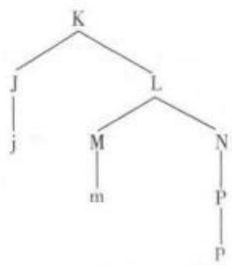

凯恩以此例说明线性对应公理的运作。图中J、M、N、P为非终结成分，按照非对称成分统制关系得到的非终端节点对包括<J，M>、<J，N>、<J，P>和<M，P>;J、M、N、P对应的终结成分分别为j、m、p。根据LCA，得到终端节点对为<j，m>、<j，p>和<m，p>。此处j居前于m，j居前于p,m居前于p，因此得到最终的线性语序为{j，m，p}。该有序节点对具有传递性、总括性和反对称性，是可接受的短语标记。巴西语言学者雅伊罗·努内斯(JairoNunes)和美国语言学者胡安·乌里亚杰里卡(JuanUriagereka)于2000年在最简方案中的光杆短语结构(bare phrase structure)设想下简化了LCA，将线性对应公理定义为：当且仅当词项α非对称成分统制词项 β,α居前于 β。摩洛(Andrea Moro)将线性对应公理进一步发展，在其专著《动态反对称》(Dynamic Antisymmetry，2000)中提出了动态反对称观点，认为句法结构合并时允许生成与线性对应公理不兼容的对称结构，线性顺序只与语音界面有关，因此只要在拼读之前它们能够通过移位的方式生成反对称的结构即可。换言之，移位不是由形态特征驱动，而是为了破解对称。

线性化linearization 句法学术语。指将二维层级结构中的词汇或短语按照一定顺序排成一维序列的句法操作。线性化是“发音一识别”接口的产物，由于生理限制，人们无法同时说出几个词，词项必须按顺序分别发音。

线性文字linear script指使用抽象符号(例如字母等)的书写形式，与早期的图画文字相对，后者使用可以辨认的图画或草图。

线性音位 linear phoneme 参见“音位”。

羡余规则redundancy rule句法学、形态学术语，亦称冗余规则。指某种特征或行为完全可从其他特征中预测出来的规则。例如，英语规则[+vo]浊音性]→[一ASP送气性]表明从浊音音段可预测出不送气特征，而规则[+GERMANIC日耳曼语]→[-VELARSOFTENING软腭音软化表明英语的本土单词或语素从不形成软腭音软化；英语中一个以r开始的单词，r后必为元音。在形态学中，存在诸如“没有一个英语单词由超过三个以上连续的辅音开头”的词汇羡余规则。在生成句法学中，词汇羡余规则适用于次语类化(以简化一个句法语类的特征赋值)和构词(使一个词类派生自另一词类)变化。在语义分析中，一些义素的出现必然伴随另一种义素。例如，woman的语义特征[+FEMALE]必然伴随[+HUMAN]的语义特征。

羡余特征 redundant feature; concomitant

feature音系学术语。指任何可根据其他区别性特征预测的特征。既包括可以通过某一音段自身的其他特征预测的特征，也包括可以通过音段所处的环境预测的特征，羡余特征无区别意义。例如，特征[NASAL鼻音性]对于英语鼻元音来说是羡余的；特征[voICE浊音性对于/b/而言是羡余的，因为/b/没有清音。

羡余现象redundancy参见“语法悖理”。

羡余性 redundancy 亦称冗余性。指语言总是提供多于理解所需最少信息量的一种固有特征。一般而言，正常语言约有50%是冗余信息。语言作为一种包含大量冗余信息的交际手段，如果一些信息被丢掉或听错，剩余部分仍可使这条信息得到正确理解，无损交际。例如，英语中的复数可以由指代词、名词和动词来体现。在“These books are quiteinteresting”中 these、books 和 are 均表现为复数形式，体现复数特征；事实上，即使省去“books”一词中的“s”，该句意义仍可被理解。英语词汇中也有冗余现象，如“it was terrible，dreadful，awful”中的 3个形容词重复。英语语音中常运用该特征识别语音单位。例如，英语/p/和/b/的音位对立(如/pin/和/bm/)可用是否声带振动、紧肌、送气三个特征来定义，但实际只需要其中一个特征(如送气)来定义区别，因此相对而言其余两个特征就是羡余的。该特征同时应用在生成语义学和句法学中。

相phase语法学术语。由动词的词汇意义决定，表现自然语言所反映的事件或行为本身的时间特性。例如事件的完成或未完成，行为的完整或不完整，而不表现说话时间或另一参照时间，并且其与自然语言所述事件或行为的发生时间的先后关系无关。在言语交际中，相与时(tense)和体(aspect)结合，共同表达语言的时间性。

相对共性 relative universal亦称相对普遍性。指体现语言一般倾向，允许有例外的一类语言共相。换言之，一种性质或观点可能适用于大多数语言但不是所有语言，与绝对共性对立。

相对年代学relative chronology 历史语言学术语。指一系列语言演变之间时间关系的一种方式，即根据相关证据，推断某一个演变发生在另一个演变之前，将语言发展变化按时间顺序排列，但没有具体日期。此概念与绝对年代学(absolute chronolo-gy)相对，后者可明确说明演变发生的特定年代。

相对同义词relative synonyms语义学术语。指具有细微词义或程度差别的同义词。如字面意义和隐含意义即为此类同义词。例如，英语单词“amaze”与“astound”都表示惊异，但后者吃惊程度更大。其中的差别可用如下例句得以反映：[1]Wewere amazed to find that the lazybone got up so ear-ly yesterday.(我们很吃惊这个懒骨头昨天起得如此之早。) [2] We were astounded to hear the newsthat the president was murdered.(我们听到总统被暗杀的消息很震惊。

相对性 relativity 用来指有关语言和思维关系的有影响的观点，一般称作语言相关性。最初是德国人类学家洪堡特提出，后来美国人类学家萨丕尔、沃尔夫等人进一步发展了该理论。相对性理论的观点认为人们看待世界的方法部分或全部取决于其本族语的结构。换言之，语言塑造了人们的思维模式，而不同语言表达决定了人们认识世界的不同方式。该观点与普遍语法原则相对立，后者强调语法特征对所有语言来说是共同的。目前，学者们普遍认为这一假说具有强式说和弱式说。前者强调语言在塑造我们思维方式的过程中起到决定作用，后者认为语言、文化和思维之间有相关性，但产生不同思维方式的跨文化差异只是相对的。相对而言，多数学者支持其弱式观，即不同语言在一定程度上影响了人的思维方式及世界观等。

相对最高级relative superlative语法学术语。一种表明个体在一个集合中的相对最高级形式。例如，在“我所知道的最聪明的人”这一表达中，“最聪明的”表示该人在说话者所知道的人中是最聪明的。参见“最高级”。

相对最小限度relativized minimality句法学术语。一种认为管辖语成分与受管辖语成分相关的观点，即如果没有离该语迹更近的、其他典型的潜在管辖语，一个成分最小限度地管辖其语迹。

相关correlation语言统计学术语。指衡量两组数据之间关系强度(strength of relationship)的一种方法。常见的计算相关系数(r)的公式为皮尔逊积矩相关系数(Pearson Product Moment Coefficient)(见决定系数，coefficient of determination)。相关系数的值从一1.00到+1.00不等。当该值为正时，表示两组数据之间正相关(positive correlation)，相反为负时呈负相关(negative correlation)，而当其为 0 时则表示两组数据不相关(absence of correla-tion)。对于两个相关系数之间的大小可通过以下公式来比较：

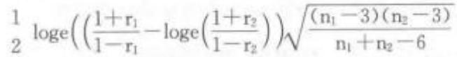

上述比较的前提是r1和r2取自两个独立的样本。一般认为取自同样大小样本的两个相关系数是无效的(invalid)。但当有三个度量(x,y，w)共同参与时可通过以下公式将其中的两个变量与第三个变量进行比较：

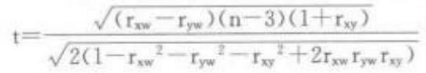

相关成分Bezugselement[德 指复合句法结构中与先行或后跟的语言成分处于某种关系的语言成分。这种关系既可以在形态上体现出来，表示指称相同，也可以表现为语义限定。

相关特征relevant feature音系学术语。指一种在语言中引起意义变化的区别性音位特征。例如，英语中的VOICED/VOICELESS(浊音/清音)特征区分了/bdg/和/ptk/，因此[浊音性]就是英语中的相关特征。

相关系数correlation coefficient参见“相关性研究”。

相关性研究correlation research语言测试术语。指为了考察两个自然出现的变量之间的关系本质而进行的研究，如研究一组学生英语考试和汉语考试得分之间的关系。相关程度用相关系数(correlation coefficient)r表示：—1≤r<1。r的绝对值越大，变量之间的相关程度越高，一1.00(完全不相关)到0,00(零相关)再到+1.00(完全相关)。相关系数既表明关系的方向(即正或负)，也可表明关系的强度(即大、小或量级)。r为负数时，表示一个变量的增加可能引起另一个变量的减少，此时就叫做负相关(negative correlation)，即变量之间的关系相反；若r大于0时，则为正相关(positive correlation);当r等于1时，则表明变量间的关系完全相同。相关系数绝对值越接近1.00，不管方向如何，两个变量之间的联系越紧密。

相互代词reciprocal pronoun 语法学术语，亦称交互代词。表示人们(两人或更多人)之间、各方面(两方或多方)之间相互作用的代词。在英语中使用each other、one another等表示交互。例如：Mary and Tom looked at each other / one another.(玛丽与汤姆对视。)例句表示的是“Marylookedat Tom(玛丽看着汤姆)”和“Tom looked at Mary(汤姆看着玛丽)”两件事同时发生。

相互动词 reciprocal verb 语法学术语，亦称交互动词。表示句中主语(包括所涉及的人或物)相互间行为的动词，在形式上可以附加相互代词。例如： John and Mark were fighting.例句中的“fight”即为相互动词。相互动词往往可以通过加上相互代词(如 one another,each other等)来验证。

相互关系reciprocity 句法学术语。指两个或两个以上成分之间的关系，可以由相互代词来表示，如英语“one another”、“each other”等。在乔姆斯基的约束理论中，相互代词和反身代词都属于照应语，必须有一个与之同标且对其成分统制的先行语。

相互关系2reference在文字系统中由字素代表的那部分语言结构。例如在某些拼音文字中，字母代表音素(音素关系);在字符文字中字代表词(词素关系)。

相互可理解性mutual intelligibility亦称互通程度或互懂程度。指某种语言的使用者在从未接触另一种语言(包括听或学习)之前，能通过听力或阅读理解另一种语言的程度。这一数据常被用作区分语言与方言的根据，但这一标准是否恰当，有许多人持不同意见。互通常发生在地理上毗邻的语言或方言之间，特别是方言连续体中。语言互通有时是不对等的，即语言A与语言B的使用者在交谈时，语言A可能更易被语言B的使用者理解，反之则不成立。互通本身是个很主观的概念，能听懂多少实质上与听者的语音辨别能力有很大关系，而且互通程度多高才算作可互通，有时使用的标准也比较随意。丹麦语与瑞典语和挪威语之间的书面语和听力均互通：波斯语与塔吉克语仅仅听力互通(波斯语与达利语用波斯阿拉伯字母书写，塔吉克语用西里尔字母书写);法罗语与冰岛语之间仅书面语互通。

相邻语对adjacency pair 话语分析术语。  
参见“话语转换序列模式”。

相容 inclusion 逻辑学术语。指相容析取关系，即一个析取式的两个命题有一个或两个同时为真，则析取式为真。按照相容析取，“正在发生的或为X或为Y”这个析取式容许X和Y同时发生，即两者相容。相容析取的基础在于两个概念的外延至少有一部分是重合的关系，根据外延重合的多少，相容析取关系又可以分为同一关系、真包含关系、真包含于关系和交叉关系四种。参见“析取关系”。

相似联想association by similarity指由于意义相似或接近而引起的联想。例如，从“硬的”联想起“强硬的”，从“纤弱的”联想起“脆弱的”，从“来”联想起“到达”等。

详论段落 amplifying paragraphs语言教学术语。指论说文的主要段落部分，其作用是对文章第一部分(导论)提出的主题思想加以阐释、论证，并为第三部分(结束)的结论做准备。

响度 sonority语音学术语。指在相同音高、重音和时长的情况下，一个语音的响度。语音的响度顺序：元音响于辅音，浊音响于清音，擦音响于破音，鼻音和边音响于擦音；在元音中，低元音响于高元音，非圆唇音响于圆唇音。

响度层级 sonority hierarchy 音系学术语。指根据响度(sonority)特征对不同音段类型进行的层级排列。决定某一类型音段响度大小的主要依据包括两个方面：一是发音时声道的阻塞程度，二是发音时声带是否振动。阻塞程度越大，响度越小；阻塞程度相同，声带振动的(voiced)比声带不振动的(voiceless)响度大。据此，音段响度层级由高到低的总体排列如下:元音>滑音>流音>鼻音>擦音>口腔塞音。

响度特征 sonority features 音系学术语。指元音性与非元音性、鼻音与非鼻音、辅音性与非辅音性、浊音与清音、糙音与润音、聚音与分散音和突发音与延续音等方面的特征。

响音sonorant 语音学、音系学术语。生成音系学区别特征之一，指发音通道畅通或比较畅通(无阻塞及较大的狭窄化)的音，可以产生自发浊音(spontaneous voicing)，主要包括有鼻音、边音、半元音和元音四种。参见“共鸣音”。

响音峰 peak of sonority; syllable peak 语音学术语，亦称突出峰。指音节中由最高音调和最强重音造成的突出部分。响音峰一般是音节的核心，其前后是辅音或辅音组合。

想象功能 imaginative function功能语法术语。根据韩礼德的理论，幼儿发展期首要语言功能的一种。韩礼德认为，幼儿在语言发展的早期阶段能够掌握一些语言的基本功能，各种功能具有一定的意义。他区分了七种首要功能。想象性功能即用于创造自己想象中的世界的功能。例如，“Let'spretend.”一句揭示了幼儿在想象这一特点。其他六种发展期的语言功能为：工具性功能(instrumental)、控制性功能（regulatory）、应对性功能（interaction-al)、自指性功能(personal)、探究性功能(heuristic)和告知性功能(informative)。幼儿长到半岁时就开始掌握成人的交际系统，包括语法、词汇和意义等分系统。参见“语言性发展功能”。

向格allative case 名词语法格中方位格的一种形式，主要见于芬兰语、爱斯基摩语等语言中，通过名词词尾的形态变化表达移动方向的朝向。在芬兰语中，向格的实现形式为-lle，其作用相当于英语中的“toward”。例如，芬兰语中“stadionille”的意思就是“朝着体育场方向”。

向前附着词 enclisis 语法学术语，亦称后附着语素。说话或书写时，将一个词或形式附着于前一个词，并且与前面有重音的词连读，如“allright→alright"“I am→I'm”。一般附着的词非重读。

向前附着否定词enclitic negation 指诸如英语中 not 的简缩式-n't 和 cannot 一词中 not 的词汇形式。参见“向前附着形式”。

向前附着形式 enclitic语法学术语。指“依附”在前面重读词的弱读成分，其形式常常被略写。例如，意大利语、西班牙语均存在必须附于动词形态末尾的某些代词，英语有 don't(=do+n't)等类似形式。

向上蕴涵upward entailing在包含事物概念的文本中，一个含有子集概念的文本蕴涵相应的包含上集概念的文本。例如，“他有一只小狗”向上蕴涵“他有一只宠物”。参见“向下蕴涵”。

向下蕴涵downward entailing 在包含事物概念的文本中，一个含有上集概念的文本蕴涵相应的包含子集概念的文本。例如，“他没有宠物”向下蕴涵“他没有小狗”。参见“向上蕴涵”。

向心结构endocentric construction句法学术语，亦称向心构式。指一些句法上相联系的词的组合，其中一个词的功能相当于整个组合的功能，句法功能相当于其中所含的一个或几个词的词序列。英语中主要有两类内向结构：(1)并列向心结构(coordination construction)，通常用 and、or 构成，如“boys and girls”“here or there”等；也可用同位语构成，如“Mr. Smith"“Peter the Great”等。(2)定语结构或主从结构(attributive or subordinate construc-tion)，其中心成分(head/center)被一个或多个其他成分修饰，如“the tall man"“green cheese"“the manin black”“incredibly beautiful”等。以布龙菲尔德为代表的结构主义语言学在语法分析中按分布标准将句法结构分为向心结构和离心结构(exocentric con-struction).

向心理论 centering theory 语篇语言学术语。指20世纪80年代初由美国语言学家和认知科学家格罗斯（BarbaraJ. Grosz）、乔什（AravindJoshi)、温斯坦（Scott Weinstein）、布伦南（SusanBrennan)、弗里德曼（Marilyn Friedman)和波拉德(Carl Pollard)等在语篇焦点理论和语篇向心模式理论的基础上发展起来的语篇局部连贯理论，用以描述语篇的注意焦点、指称方式的选择与语篇连贯性之间关系。作为关于语篇处理和语篇局部结构的理论，其主要关注并试图解决的问题包括：(1)语篇主题(aboutness)如何在语段(utterance)序列中产生变化；(2)人们如何理解回指成分；(3)主题如何制约推理；(4)在使用代词时有哪些语篇语境的制约条件；(5)语篇如何被划分为更小的单位。根据向心理论，在语言交际的互动过程中，交际双方共同构建一个语篇模型(discourse model)或语篇世界(discourseworld)，这个语篇模型由语篇实体及其之间的联系和属性构成。语篇实体指语篇谈论的对象，即名词、代词等各种指代成分，在语篇模型中充当“中心(center)”角色;语篇中的任何一个语篇实体，都可以与上文出现过的语篇实体发生联系，充当回指中心(backward-looking center，简称 Cp)，同时该语篇实体又可与下文涉及的语篇实体发生联系，充当下指中心(forwarding-looking center，简称 Cf)。以此为基础，向心理论在语篇中的具体操作模式可归纳为三项制约条件和两条规则。三项制约条件包括：在一个语篇中的每个语句中，(1)只能有一个回指中心Cp;(2)在下指中心集合中的每一个下指中心都必须在相应的语句中实现；(3)回指中心是在上一个语句中所实现的下指中心Cf中显著度最高的一个成分。两条规则包括：在一个语篇中的每个语句中，(1)如果下指中心集合中的一个下指中心在下文语句中以代词形式出现，那么该语句中的回指中心也应以代词形式出现；(2)过渡状态遵循一定顺序：延续(continue)过渡优于保持(retain)过渡，保持过渡优于流畅转换(smooth-shift)过渡，流畅转换过渡优于非流畅转换(rough-shift)过渡。

项 term 语法学术语。在关系语法中指句子中承担项关系(term relation)成分如主语、直接宾语和间接宾语，三者以外的其他名词短语如方位、工具以及受益者等则为非项(non-term)。主语、直接宾语和间接宾语三个句法功能单位分别由项关系符(Term R-sign)1、2和 3 表示，其中1 和 2，即主语和直接宾语，又是核心项关系符(Nuclear Term Rsign)，如下图所示：

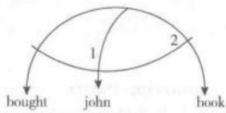

项目差异功能differential item functio-ning;DIF心理语言学术语。指具有相同潜在特点(相同能力或技能)的不同的人(比如母语是汉语的人，或者母语是英语的人)可能会对某一相同问卷和测试做出不同的回答或回应。通过项目功能差异分析，人们可以测算并确定测试中每一个项目的差异量。如果不同的人在做出某个回应的时候存在不同的可能，那么这个项目就无法显示项目功能差异，但是如果具有相同潜在能力的不同人在做出某个回应的时候存在不同的可能，那么这个项目就显示出项目的差异功能。

项目反映理论 item response theory;IRT;latent trait theory; latent trait models 语言测试术语。一种把对一个项目的正确反映概率和考生潜在能力联系起来的心理计量学理论，即以具有某种潜在能力的受试者答对或答错某个题目的概率来表示。项目反映理论尝试从测试数据上概化估计出受试能力和试题特征之间的关系。从估计参数的数量角度可以区分三种主要的IRT模式理论:单参数模式只评估题目的难易度(b参数);双参数模式考虑题目的难易度和题目区分度(a参数)。三参数模式除了难易度和题目区分度之外，还考虑猜测因素(c参数)。IRT模式考虑的参数越多，所需样本容量就越大。IRT还被用来检查测试偏差(亦即区分题目功能)和开发计算机顺应性测试等。由于这一理论假设过于理想化，而且技术操作复杂，因此主要适用于0—1计分的选择题。

项目区分度item discrimination参见“d-指数”和“试题鉴别度”。

项目与过程 item and process 形态学术语。指用来分析词的一种描写模型，与“项目与配列”相对。该分析法把语言中词与词之间的关系看作派生、变化的结果。例如，项目took由项目take通过一个元音变化的过程派生而来。该方法主要从动态方面来分析语言，最初用于词的形态分析，后来成为一切以派生、变化为依据的语言分析方法的基础。

项目与配列item and arrangement; IA形态学术语。指用来分析词的一个描写模型(有时亦用句法分析较大的语法单位)。此分析法把词语视为由若干语子(“项目”)按线性排成序列(“配”)的结果，如“The boys kicked the ball”，可分析为“the+boy+s+kick+ed+the+ball”。此分析法从静态方面描写语言，通常把一个词及其形态变化列入一个项目表(词形变化表)，通过这些项目的对立来揭示词的形态变化关系。但学界对该方法是否能解释一些通过语音变化来体现形态变化的词尚有争议(如mice是否可描写为mouse+复数)。其他描写模型主要有“项目与变化模型”和“词与词形变化模型”。

象声词mimetic word参见“拟声词”。

象似符号 iconic sign 亦称约定俗成符号，图象符号。指特定文字系统的基本书写单位，表现为约定俗成的图形，通常有四种类型：(1)代表一定的意思，如%(百分比)、&.(和)、+(加)等；(2)代表词或形素，如汉字；(3)代表音节，如日语假名；(4)代表语音，如拉丁字母或音标。

象似性iconicity 功能认知语言学、符号学术语。指符号(语言符号以及其他符号)的形式与其意义之间的相似或类推特征，即语言符号的能指和所指之间的自然关系，与任意性(arbitrariness)相对。任意性是语言的基本属性，象似性是语言理据性研究的核心议题。相似性原则有以下三个：数量原则(quantity principle)、就近原则(proximity principle)以及先后顺序原则(sequential order principle)(参见“象似性原则”)。象似性是对“语言任意性”的最大挑战。早在1902年，符号学家皮尔士把符号分为象似符(icon)、标记符(index)和象征符(symbol)。其中，象似符又分为映象符、拟象符和隐喻符三类。这种区分构成了象似性研究的符号学基础。20世纪50年代后，语言学研究的重点逐渐从语言结构本身转向语言形式背后的认知系统，象似性便是其中的焦点。象似性研究揭示了语言结构与人类经验结构之间存在许多象似关系，对全方位揭示语言的本质属性及其功能具有重要意义。

象似性原则 principle of iconicity 认知语言学术语。指语言的使用者在语言形式和它所代表的事物之间想象出的一种相似性。语言的象似性原则具体可表现为三个子原则，即与顺序、距离、和数量有关的语词的原则：(1)根据图像的先后顺序原则(principle of sequential order),小句的线性排列顺序不能更改。例如，凯撒大帝的历史性话语“Veni，vi-di,vici（即 I came，I saw，I conquered)”的各个小句的排列顺序不能更改。(2)按照图像的距离原则(principle of distance)，亦称就近原则(proximityprinciple)，指概念上相同或相似的事物在语言表达上通常放在一起，而概念上不同的事物则不能在语言表达中放在一起而且需要保持一定距离。这一项原则常被用来解释成对句子在语法上的对立。例如，在“A singing group is preparing for the perform-ance."和“ A group of singers are preparing for theperformance.”两个句子中，第一句中的单数名词与紧跟其后的单数动词相一致；在第二句中，名词“group”与句中动词“are”相距较远，这是因为动词需与邻近它的复数名词“singers”形成一致。(3)图像的数量原则(iconic principle of quantity)试图解释一种倾向，即应当把更多形式与更多意义联系起来；相反，较少形式与较少意义应当相互联系。例如，在“What a boooooring book!”中，将“boring”这个词的“o-”音故意拉长，目的就是在图像上表达一个“extremely,persistently boring”的意念。

象形符号pictogram

参见“图形字”。

象形图 pictogram

参见“图形字”。

象形文字hieroglyphic writing指一种用图形表示词语意义的文字系统，其中图形与词义关系密切。古埃及的圣书体、中国古代的甲骨文和金文均为象形文字。类似象形文字在克里特岛、小亚细亚、美洲中部、墨西哥等地也被使用。目前中国西南部纳西族所采用的东巴文和水族的水书，是世上唯一仍在使用的象形文字系统。

象形字 hieroglyph 亦称表形符或表形文字。源自图画文字，但其图画性质减弱，象征性质增强，是一种最原始的造字方法。鉴于有些实体事物和抽象事物难以画出，因此象形字局限性很大。目前，最广为人知的象形文字是约五千年前古埃及的象形文字圣书体。汉字最初亦为象形字，后以此作基础，拼合、减省或增删象征性符号而演化成表意为主的意音文字。

象音词ideophone 亦称拟态词。指用来对没有内在声学特征的物体或者形象提供生动描写的声音符号，常由重复的音组成，如英语zigzag(之字形)、shilly-shally(犹豫不决)、或topsy-turvy(乱七八糟的)等。

象征型用法 symbolic usage 语用学术语。指示词语(deixis item)的两种用法之一。与手势型用法不同，象征型用法在使用中不一定要伴随手势或眼色等，对指示语象征型用法的理解也不须依靠真实的交际场景，所需要的往往只是包括交际参与者以及交际活动发生的时间和地点。例如：“我热爱这座城市。”如果我们知道说话者是在北京说的这句话，那么不论说话的地点是在长安大街或是在颐和园，“这座城市”一定指北京。

象征性论点 symbolic thesis 参见“象征性论断”。

象征性论断 symbolic thesis 认知语言学术语。从认知路径研究语法的两个指导原则之一，认为语法的基本语言单位(linguistic unit)是一个象征组配(symbolic assembly)，实质上是一个形式一意义的配对体(form-meaning pairing)。象征组配包括简单象征组配(simplex)和复杂象征组配(complex)。所谓简单象征组配指不包括有意义的亚成分的结构，如book和-s，就是两个简单象征组配，近似于语素(morpheme);而复杂象征组配则指包含有意义亚成分的结构，如包含两个或以上词素的词、短语、句子，像 trees(树+s)、a picture on the wall(墙上的一幅画)、The boy is playing basketball (这个孩子在打篮球)等，是三个长度和抽象程度不同的复杂象征组配。认知路径研究语法，秉持象征性论断，但并不仅仅调查语言的结构层面置意义不顾，相反认知路径研究语法，其对象包括作为形式一意义配对体的全部语言单位库藏。具体包括作为骨骼的语法结构，如存在结构、条件结构、单宾语结构等，还包括作为血肉的习语、词和黏着词素。在认知路径研究语法范式中，认知语义学(cognitive semantics)和认知语法(cognitive grammar)没有严格的界线，语义和语法被看成相互依赖、相互补充，两者之间存在着互动界面。

象征性原则 principle of symbolicity指语言形式和意义之间符合传统规律的配对(conven-tional pairing)，尤其体现在特定事物与各种语言在词汇方面的配对。例如，“交通工具”在英语中的对应表达法为“vehicle”，而在其他语言中则有不同的约定俗成的表达方式。语言作为一种象征符号与其代表的意义关系是任意的(arbitrary)。“任意性(arbitrariness)”这一概念对于各种语言中的大多数简单词是适用的，但语言中的复合词并不具有任意性，这是由于复合词通常在已有的语言材料上构建。例如，复合词“software”即源自“soft”和“ware”两个简单词。在语言发展过程中，“soft”和“ware”所代表的事物或意义可能都是任意性的，但复合词“software却”丧失了其任意性，其意义因“soft”和“ware”两个简单词的组合而获得其既定含义，从而丧失了任意性。

象征指示 symbolic deixis 与其所指代的物之间有一种及物关系的指示语。其理解多取决于语言语境和认知语境，需了解话语之前与说话人有关的语境信息。

消极词汇 passive vocabulary 参见积极词汇。

消极礼貌策略 negative politeness strategy语用学术语，亦称负面礼貌策略、否定礼貌策略。是布朗(Penelope Brown)和列文森(Stephen Levinson)的礼貌策略分类之一，他们将礼貌策略分为积极礼貌策略和消极礼貌策略，后者指照顾到听话人的消极面子，强调对加诸于听话人之上要求的规避，相较于积极礼貌策略，更有可能引起尴尬或窘迫。例如：[1]能把盐传过来吗？（使用问句）[2]对不起，我知道这很过分，但你能不能借给我十万块钱。（使用道歉）消极礼貌策略主要是以“回避为基础的(avoidance-based)”的标示双方社会距离的礼貌策略，说话人承认并尊敬听话人的消极面子的需要，对听话人的行动自由不进行干预，从而满足听话人的消极面子需要，如英语中的“YourExcellency”和“Ifyouplease”等冷漠但彬彬有礼的表达用语。参见“积极礼貌策略”。

消极面子 negative face语用学术语。语用学家布朗(Penelope Brown)和列文森(Stephen Levinson)在面子理论中将面子划分为积极面子(positive face)和消极面子(negativeface)。消极面子强调人们的自我行为不受他人意志左右的面子需要或欲望，或指自己行动的自由不受别人干涉的愿望(Brown&.Levin-son，1978，1987)。参见“积极面子”。

消解性双语现象 subtractive bilingualism参见“附加性双语现象”。

消去同—identity erasure 句法学术语。一种分析句子深层结构的方法，指句子深层结构出现相同成分时，可以允许删除第二个重复成分。例如，在分析“醉把茱萸仔细看”这个诗句时，认为不能把“把”(V1)和“看”(V2)简单地看作连动，这一句式的深层语序关系是:把(V1)茱萸(NP)看(V2)茱萸(NP2).这样，可以根据“消去同一成分”的原则，消去第二个“茱萸”。因此，这类句子的更深层结构可由下式表示：NP1+V1+NP2+V2(NP2)式中NP为名词短语，V为动词，圆括号内的NP表示“任意”。

消失fading 语音学术语。音流末尾强度及高度逐渐减弱，最后转入无声(silence)状态的过程。正常话语的结束基本都是这种类型。

消音处理 acoustic treatment 语义学术语，亦称声学处理。指对某一室内空间实施的以减轻背景噪音为目的的处理措施。任何室内空间中都存在一定的背景噪音，对室内空间背景噪音的消音处理措施主要包括对墙面、天花板、地面等吸音界面作表面吸声处理。例如，在全消音室中，全部吸音界面的垂直入射能量吸收系数都要求等于或大于0.99，而在半消音室中，地面必须是坚硬光滑的平面，其垂直入射能量吸收系数应不大于0.66。除对吸音界面的表面吸声处理外，消音处理还包括对消音室中温度、湿度、传声器位置等其他方面的处理和限制。

小代语 pro 句法学术语，亦称空语类 pro。指在某些语言中，在空主语位置上存在一个空语类pro。“空语类pro”可通过句子中出现的形态特征来进行识别。参见“大代语”。

小动词短语small verbalphrase 语法学术语。小词组的一种。有四种结构：V[中心词(+补语)];V'{V[中心词(+补语)](+附加语)}；V[V中心词(+附加语)]；V中心词。

小短语smallphrase 语法学术语。词和词组之间的语言单位。有四种结构：(1)中心词+补语；(2)(中心词+补语构成的)小词组+附加语；(3)中心词+附加语；(4)中心词。

小分句smallclause语法学术语。指类似 分句但缺少一个限定动词的各种成分，尤指关系从 句、状语性分词或动名词。例如：[1]The man [wearing glasses] opened the door. [2] Tom decided to go to New York.? [3] His [being impolite] irritated his teacher.有些分句也可以由宾语和宾 语补足语构成。例如：[4]I found it interesting. 其 中的“it interesting”就是小分句。

小副词短语 small adverbial phrase 语法 学术语。属于小词组。有四种结构：(1)Adv中心 词(+补语)]，如 fairly [independently (of his mother)]。(2) Adv'([Adv'[中心词(+补语)]+附加 语)]}，如 fairly {[independently (of his mother)] (now)}。(3) Adv'[Adv'中心词(+附加语)]，如 very [safe (now)]。(4) Adv'中心词，如 very safe。

小骨 ossicle 语音学术语。指中耳中的小骨片。中耳的主要功能是将耳鼓处的声音振动转化为机械运动，然后传入内耳，这种转化是通过耳内由三块小骨组成的系统完成的。这是人体内最小的骨头，而且在出生时就已经发育成型。

小名词性词组 small nominal phrase语 法学术语。属于小词组，有如下四种结构：N中心 词(+补语)]，如 a [teacher(of English)]；N'{[N [中心词(+补语)]+附加语]}}，如a{teacher(of English)] with gray hair}；N' [N'中心词(+附加 语)]，如 a [teacher(with gray hair)]；N'中心词，如 a teacher.

小品词particle;PRT 语法学术语。(1)具有语法功能的不变形词项，特别指那些不容易归入词类标准分类的词，常缩写为PRT或part.。英语里面不定式标记to常称作小品词，因为虽然在形式上像介词，但实际上跟介词没有共同之处。同样，not的独特性也使有些人将它称作“否定小词”。短语动词中的动词后面的附加单位也常称作“动词性小词”，如“turn off the light”中的“off”;“cut down onexpenses”中的“down”等。(2)广义的小品词还包括其他所有的无词形变化词类的词，如副词、连词、介词，以及其他一些小品词类，如量级小品词类(scalarparticles，如 more、than等）和话语标记语类（dis-course markers,如 well、however,therefore 等)。

小品词移动particle movement 句法学术语。转换生成语法术语转换规则之一，指短语动词中的小品词可以在句内移位这样一条公认的规则。例如，“Mary put on her coat.”可转换为“Mary puther coat on."。

小舌音 uvular 语音学术语。指小舌(uvula)参与发音动作的一种语音。发音时用舌根抬起与小舌接触或形成缝隙，从而构成对呼出气流的阻碍。例如，法语单词Paris[pa:R1]“巴黎”中的[r]就是典型的小舌音。

小体大写字母smallcapitals亦称小型大写字母。通常有三种用途：(1)表示语调核心，标记核心音节或语调。例如，YouCHEAted!(2)表示词位，可以区别词位和词形。例如，DRINK是词汇单位，有别于drink和drank。(3)缩写表示语法范畴。例如，用ABIL.来代替ablative。

小写 c 文化 small c culture 跨文化交际术语。文化分类的一种，指普通的社会习惯、态度、价值观、信念和生活方式等等，小写“c”指英语中的“culture”(文化)。参见“大写C文化”。

小形容词短语smalladjectival phrase语 法学术语。属于小词组，有以下四种结构：A[中心 词(+补语)]，如quite certain；A'{[A[中心词(+补 语)]+附加语)]}，如 quite{[certain(of success)] (in the following years);A'[A'中心词(+ 附加 语)]，如 very [hot (in the summer)]；A'中心词，如 very hot.

小众化翻译minoritizing translation参见“异化翻译”。

小组 group 语言教学术语。指教学中把学生分成几个小组以帮助他们学得更好的一种教学方法。不同的学习任务要和不同的分组安排相匹配，此外还要考虑小组的规模和小组成员的能力。参见“分组”。

小组活动 group work 语言教学术语。指语言教学中一组学习者共同参与合作的学习活动。小组活动既可以针对单项学习任务，又可以针对一项大学习任务的不同部分。小组成员的不同任务往往由小组成员自己挑选。小组活动的规模既包括两人一组的双人活动，如双人对话、双人朗读等，又包括两个学习者以上的较大组活动(larger group work)，如角色扮演、小组讨论等。

小组讨论 group discussion语言教学术语。指语言教学(language teaching)中的一种教学活动。小组讨论具有下列特点：(1)一小组学生，四到十二个，聚集到一起；(2)选择一个共同的话题，并选择自己要达到的目的，也可以由老师提供一个共同的话题和要达到的目的；(3)交换并评估关于该话题的信息和想法。

小组推动力group dynamics 语言教学术语。指教学中，发生在一个小组之内的各种互动和对诸如领导、互动和做出决定之类的因素对小组结构的影响的研究。在进行课堂教学分组、设计学习任务和编写教学材料时，小组推动力是需要考虑的重要因素。

效度validity 语言测试术语，亦称有效性。指一项测验能够测出要测试的内容的程度，或达到测试的预定目的的程度。效度是衡量考试质量的一个重要指标，是针对某一个测试目的而言的，这是效度的一个基本属性。效度包括：内容效度(contentvalidity)，即测试内容对要测试内容的有效性的程度;结构效度(construct validity)，即测试是否以有效的语言观(包括语言学习观和语言运用观)为依据，能否明确体现出要测的能力的有效程度；卷面效度(face validity)，即一个测试在表面上使被测试者及相关人员凭直觉就能感觉到的效度(指卷面清洁、整齐、有无错误等)。效度可以使用多种不同的统计方法来评定，这些方法通常用来确定要测试的内容是什么以及测试的效果如何。

效度检验 validation 统计学术语。一项可靠的实证研究，其测量工具需要具备两个特征：信度(reliability)和效度(validity)。效度检验分为内在的和外在的：内在效度(internal validity)检验旨在测量工具本身的效度，包括对内容效度(content validity)和结构效度(construct validity)的检验；外在效度(external validity)检验旨在利用测量工具以外的标准来测定效度，包括对共时效度(concurrent validi-ty)和预测效度(predicative validity)的检验。内容效度的检测主要靠逻辑分析来保证研究的问题与研究目的之间的联系，以及所测量对象覆盖范围的合理性。但是结构效度的确立有赖于统计方法，它由每一结构对观测对象的整个方差的贡献来决定。这些结构解释的方差越大，说明测量工具的效度就越高。常常用到的统计方法有：相关分析法（correlationanalysis)、因子分析法(factor analysis)和多维量表法(multidimensional scaling)等。共时效度的检验是根据一种测量工具与另外测量工具同时使用时进行的比较，而预测效度的检验是检测测量工具能在多大程度上预示测量的效果。

楔号hacek音系学术语。指一种附加区别符号，加在元音上面表示升调，加在辅音上面表示齿槽硬腭音。例如，/c/、/s/、/j/、/z/就是用普通辅音上附加楔号表示的齿槽硬腭音。

楔形文字 cuneiform美索不达米亚的苏美尔人在公元前3200年左右所发明的一种文字。苏美尔人用削成三角形尖头的芦苇秆或骨棒、木棒当笔，在潮湿的黏土制作的泥版上写字，字形自然形成楔形，故称为楔形文字，也叫“钉头字”或“箭头字”。起初楔形文字从上而下直写，后从左向右横写，字形也从直坐变为横卧，旋转90度。楔形文字在不同时代书写不同的语言。最早书写苏美尔语言，长达1000多年。随后，书写阿卡得语言也长达1000多年。后来又传播到四周的民族，如阿拉米人、加西人、赫梯人、米当人、呼尔人、乌拉土人以及波斯人。尽管这些民族语言彼此不同，但都采用楔形文字。为适合各自语言特点和实用需求，都曾对楔形文字作了改造。楔形文字对西亚许多民族语言文字的形成和发展产生了重要影响，但其起源一直是人类文化史上的未解之谜，已争论了近两个世纪。长期以来有两种观点盛行：(1)西方的各种百科全书认为，楔形文字起源于美索不达米亚特殊的渔猎生活方式；(2)苏联科学院编的《世界通史》认为，楔形文字的起源与古代苏美尔地区发达的社会组织需要有条理的通讯密切相关。20世纪70年代起出现了第三种观点，考古天文学家米查诺斯基(George Micha-nowsky)等人认为楔形文字起源与6000年前的一次天文事件—船帆座 X号超新星的爆发(supernovaexplosion on a constellation named Vela X)有关。

协方差分析 analysis of covariance语言测试术语，缩略为“ancova”。统计学中类似方差分析的一种方法，用以控制一个或更多变量的效应以使统计中的几个小组等同起来，如比较某一教学法对教学内容不同的三个对照组的效果时，其中一组的平均智商高于其他两组，则可按此方法调整智商的效应，以使各组等同。

协商 negotiation 语用学术语。会话分析中指交谈双方为使交谈顺利进行、促进彼此理解，以期达到圆满交际效果而进行的如下努力：(1)时时表明对方是否理解，要求继续对话；(2)彼此配合，意思表达清楚；(3)必要时对谈话内容和方式进行修正。

协商口吻 consultative key 语用学术语，亦称协商言语。指介于正式语体(formal style)和日常语体(casual style)之间的谈话方式。相对于正式语体来说，协商语气较委婉和柔和，在说话人与听话人之间存在较多的感情气氛，语音形式不那么刻板，且包含较多的习语及口头用法。相对于日常语体来说，协商语气更为礼貌，语言形式更为完整，较少使用俚语或使用范围窄的方言词，也较少使用感情色彩强烈的词或昵称。例如：[1]Would you please sitduring the ceremony?（协商语气)[2] Participantsare required to be seated throughout the ceremony.(正式语体)[3]Don't get up!（日常语体)

协商性negotiability 语用学术语。语言顺应理论概念，由耶夫·维尔舒伦(Jef Verschueren)于1999年提出。指语言形式和功能之间没有一对一的固定的对应关系，实际交际中的语言形式的功能是言者与听者协商的结果。协商性为语言使用者进行灵活的选择提供了可能，一方面语言具有协商性，可供协商，另一方面选择的过程是交际者灵活的、策略性的协商过程。维尔舒伦认为使用语言就是进行选择的过程，而语言使用者能够做出选择是因为语言具有处于三个不同层次而又相互联系的特性：变化性(variability)、协商性(negotiability)与适应性(a-daptability)。参见“顺应理论”。

协商言语consultative speech 参见“协商口吻”。

协调障碍 dyspraxia; apraxia 病理语言学术语。指身体部位能够在不自觉的状态下做出运动，但是却无法主动做出动作的病症。其成因可能是由于中风或其他脑部损伤所引发，或者与病人神经发展异常和迟缓有关。普遍见于言语、书写或手势等动作中，其特征是错误多变，替换无常。动作协调障碍症会对儿童的第一语言习得造成影响。

协同发音效果 co-articulation effects 语音学术语。指口语中前后音几乎同时发出的现象。英语中的协同发音主要有两类，即同化(assimila-tion)和省略(elision)。同化指一个音位的某个特征被另一个音位复制或吸收的现象。如pin和pan中的/1/和/æ/两个音因其后/n/的关系会被鼻化(na-salize)为[pīn]和[pn]。所以在英语语音规则中，若某个元音出现在鼻音前，该元音就会被鼻化。省略则指在快速语流中某些音的消失。例如，friendship一般发成/′frendʃip/，其中/1/被省略了。英语中如果音节尾(coda)中有/t/的音，则其一般会被省略。如/'aspekt/(aspect)、/hi'masbi:/(he must be)等。不但辅音可省略，元音有时也被省略。如，/'evri/(every)、/'intrist/(interest)、/'kæebimit/(cabinet)等。在某些语言中，协同发音现象甚至会被固定下来成为独立的一个音，如非洲西部语言中的并列爆破音(coordinate stops)，即/pk/、/bg/、/pt/、/bd/等。

协同学习法collaborative learning 参见“合作学习法”。

协同作用conspiracy音系学术语。指两条或以上独立且形式不同的规则共同起作用，或者相互协作，产生某种特定音系形式的过程。例如，在瑞典语(Swedish)中，名词复数形式的后缀为-or，但是当一个以元音结尾的名词(如flicka)变为复数时，必须首先应用一条去掉词尾元音的规则，然后应用名词复数后缀的规则，才能得到正确的表层形式“flickor”。

斜杠 slash 音系学术语，用来标记规则应用的条件。在生成音系学中，s→z/V\_V这条规则的意思是，当s出现在两个元音中间时，s变为z。语音学中用来标出音位，如/n/、/p/、/a/等。斜杠也可表示选择。例如：He saw him/himself.

斜格oblique case 句法学术语。参见“抽象格”。

谐波 harmonic; overtone 语音学术语，亦称陪音。指声波和谐的频率，是复杂振动中除去频率最小的基音以外的其他振动。一个物体间歇性的振动发出的不仅仅是简单的正弦声波，其振动所产生的能量和正弦波形成和谐，它们和基本频率复合。谐波经常用于对元音、某些辅音和语调的分析研究。

谐意双关 pun 参见“双关语”。

写作档案袋 writing portfolios 语言教学术语，亦称写作文件包。指写作方面的情况记录，记录学生在写作方面所作的努力、取得的进步与成绩。这既是一个学习工具、又是一个评估工具。其特征为：(1)学生一起参与决定记录的内容；(2)学生可以根据老师及他人的反馈意见修改记录内容；(3)学生要对记录的内容做出评价与反思，以了解自己的学业的进展情况；(4)记录提供学生知识掌握情况的证据；(5)记录涵盖方方面面的情况。

写作过程 composing process 语言教学术语。指作者在写作时采取的不同步骤。一般写作进程包括以下几个步骤：(1)构思阶段(rehearsing)：作者主要确定主题，寻找与主题相关的线索及语言措辞；(2)写作阶段(writing):作者将构思所得的思考大致记录下来；(3)修改阶段(revising):作者对已经写完的内容进行检查和修改，甚至对某些部分进行重写。这些阶段或步骤并非依次出现，而可能颠倒，也不是在写作过程中只能出现一次，而是取决于作者，可能反复出现。过程教学法(process approach)的写作教学鼓励学生通过以上步骤进行写作。

写作会议 writing conference 语言教学术语。外语作文教学中，教师与学生一对一碰面讨论学生的作文以及写作过程的各个方面。通过定期的这种形式的讨论，可以使学生更加有意识地运用写作技巧，并教学生个性化写作，使学生对写作更加有信心。

写作模式教学法writing-modes approach语言教学术语。指一种写作教学法，用于外语作文教学中，为练习诸如定义、比较一对比、因果等段落组织模式而进行的作文训练。

写作日志writinglog语言教学术语。指外语写作教学方法之一，学生用笔记本对自己校内外写作学习经历的记录。写作日志帮助学生反思自己学习情况，老师也可以及时了解学生的进展情况。老师定期检查学生的学习日志但不打分，这种学习日志其实也是一种练习写作的过程，可以帮助学生提高写作的流畅性。另外，写作日志也是师生之间交流的一种方式。

写作系统authoring system 语言教学术语，亦称编辑系统。计算机辅助教学中为教师设计的一套程序，使教师在不需要掌握任何计算机编写程序技术的情况下，可以利用计算机编写课文，因而可以由编写系统处理练习格式、审阅答案等工作，教师得以集中精力准备课堂材料。

写作艺术 art of writing亦称写作技巧。指写作过程中为达到某种效果而应用的各种方法和技巧。写作艺术往往能使文章条理清晰、引人入胜，令读者耳目一新、出其不意。

心理表征 mental representation认知语言学术语。指本族语者大脑中感知的、内在的、隐性的，有关语言形式的抽象系统。心理表征不同于显性知识和元语言知识。这些信息和语言能力有关，是判定在自身语言体系内哪些语言意象可以接受，哪些不可以接受的依据。例如，英语本族语者会认为陈述句中没有主语是不正常的现象，而西班牙语本族语者则认为这很正常。对同一个现象的不同判定，来自于不同的语言心理表征。

心理测量学psychometrics心理学术语。有关测量的心理学分支，指数学和统计学原理在数据分析中的应用。

## 心理词库mental lexicon; internal lexicon

心理语言学术语。指存在于人类心智思维里词的知识的心理表征，也就是心理学假定的说话人头脑中所表征的词汇。一般认为，该心理表征包括词形知识、词义知识和词的发音知识。词汇心理表征具有二重性的特点：形式、信号的外部世界与意义、释义的内部世界相结合。心理词汇的每个条目都具体指向词语意义、句法范畴、论元结构、形态形式和语音段。研究词是怎样储存在记忆里和如何被提取是心理词汇的任务。在输入方式上，心理词汇在一定程度上是特定的，如听觉的或视觉的输入方法。心理词汇的提取与辨认是统一的认知系统中的有机组成部分，和学习、记忆、范畴化和其他许多认知活动相关。对词汇提取的研究往往需展开实验，卡朋特(Gail Carpenter)与格罗斯伯格(Stephen Grossberg)提出的适应性共振理论(adaptive resonance theory简称ART)即是采取实验的方法观察语义启动和判断词汇。关于心理词汇的主要理论包括双语码理论(Dual-Coding Theory)、天生论(Nativist Theory)、语义网络理论(Semantic Network Theory)等等。

心理动词 psych verb 句法学术语。指描绘心理状态或过程的动词，如英语的amuse、frighten等。心理动词描绘的状态或过程通常与感受者(ex-periencer)有关，因此也称作“感受者动词(experi-encer verb)”。在句子中，感受者可以是心理动词的主语，也可以不是。例如：[1]We feared the storm.[2] The storm frightened us. 例[1]中的 we 是心理动词fear的感受者，句中充当主语；例[2]中的us仍为感受者，但并不充当主语。

心理可及性mental accessibility 指从大脑系统检索语言或记忆单位相对容易或方便的心理现象。斯伯波(Dan Sperber)和威尔逊(Deirdre Wil-son)认为，在语篇的不同阶段语境对读者的心理可及性程度不同，心理可及性程度不同的信息处理时需要的努力程度不同。

心理空间 mental space 认知语言学术语。指在理解句子或其他非语言信息的过程中在线(on-line)形成的概念包(conceptual packet)。在理解过程中，尽管心理空间和概念域都用到，都属于概念结构，但两者亦有不同。心理空间是在某一具体情景下为了理解的需要而临时形成的，比概念域小且具体；而概念域相对稳定、抽象，如温度。

心理空间格框mental space lattice认知语言学术语。指心理空间相连形成的框架系统。一旦一个心理空间构建起来，它就与篇章中建立的其他心理空间联系起来。随着篇章的展开，心理空间不断增加并联系起来，形成一个心理空间格框。格框中第一个形成的心理空间称为基体空间(basespace)，以某种方式和随后形成的心理空间相连。心理空间和心理空间格框构成了概念合成理论(Conceptual Blending Theroy)的基础。

心理空间理论 Mental Space Theory认知语言学术语。指福柯涅(Gilles Fauconnier)提出的一个有关意义构建的动态过程的理论，以虚拟的心理空间(mental space)来解释词际、句际语义关系。这里的虚拟的心理空间，并不是语言形式结构本身或语义结构本身的一部分，而是语言结构中相关信息的“临时性容器”，或者说，是语言使用者分派和处理指称关系的概念框架理论。心理空间理论构成了概念合成理论(Conceptual Blending Theory)的基础，其要点是当我们思考和说话时，我们建立心理空间。心理空间的功能是通过一个图式引入(schemain-duction)的过程从局部篇章语境和长时记忆中吸纳临时知识结构。当我们的思维和谈话展开时，心理空间不断增加，形成相关的新心理空间，这样就产生了一个心理空间格框(mental space lattice)。语言为心理空间的形成提供常规提示词（conventionalprompts)，但是心理空间的构建和心理空间格框的形成都受制于非语言认知原则，如可及原则(accessPrinciple)和最优原则(optimisation principle)。心理空间的各种连接或映现可使人们使用词语作为触发词去指称其他心理空间中的另一目标实体，因此是建立在类比、递归、心理模式化、概念类聚、知识框架等心理活动基础上的一般认知操作过程，是认知活动中的一种普遍形式，能够有效地解释动态、随机、模糊的思维认知活动。譬如，作者名字可与该作者所著的书对应起来，因而作者的名字可用来指称其著作。例如: Plato takes up half of the top shelf ofthat bookcase.(柏拉图的书籍占了书架顶层的一半。）心理空间理论对尝试解决语言哲学领域长期存在的问题颇有助益，特别是有语言指称(linguisticreference)有关的各种问题。通过提出篇章可以分为不同的心理空间，心理空间包含有对应项(counter-parts)和它们之间的连接关系(connectors)，这样就为此前看起来难以解决的问题提供了巧妙的解决方案。

心理语言学psycholinguistics语言学的一个分支。研究语言行为和假设为这种行为基础的心理过程之间的联系，探讨“语言发生→语言理解→语言习得”过程的跨学科科学，与神经语言学、话语分析、社会语言学、认知心理学、认知科学、和人工智能密切相关。语言习得和语言使用是心理语言学两个最核心的问题。心理语言学的基本问题已经在19世纪末和20世纪初由德国心理学家哈曼·斯泰因塔尔（Heymann Steinthal）、威廉·冯特（WilhelmWundt)、比勒(Karl Bühler)予以论述。“心理语言学(psycholinguistics)”作为学科名称的术语由美国心理学家坎特(Jacob Kantor)在其著作《语法客观心理学》(An Objective Psychology of Grammar, 1936)中首先使用。1954年，美国的奥斯古德(Charles Os-good)和西比奥克(Thomas Sebeok)出版《心理语言学：理论和研究问题概览》（Psycholinguistics:Asurvey of theory and research problems)—书，标志着心理语言学的正式诞生。1953年，美国心理学家和语言学家在印第安纳大学语言学学院举行了一次研讨，会上提出了心理语言学的名称、概念和研究纲领。他们认为，应该以实验心理学的方法和理论为工具来研究语言学家所揭示的语言结构。根据对语言和认知之间关系的不同理解，心理语言学研究可分为两种：(1)以新的语言学理论为基础(特别是受乔姆斯基20世纪60年代和80年代转换生成语法的影响)，认为语法是一个独立的认知系统，注重对语言学结构的心理现实进行论证；(2)以认知心理学模式为基础，认为各个语言学描写层面之间以及认知体系之间有着密切的互动关系。20世纪80年代，人们提出了新的模式，认为各个认知系统互相联系，并平行地对信息进行处理。在应用语言学领域，心理语言学的主要研究包括以下两方面的内容：人们在说话并试图理解别人语言时的心理过程；人们是如何进行语言学习的。心理语言学包括对言语知觉的研究，对记忆、概念及其他过程在语言运用中的作用的研究，心理语言学还对社会和心理因素如何影响语言运用感兴趣。心理语言学发展最充分的分支是儿童语言习得研究，其他备受关注的与心理语言学密切相关的领域还有：语言复杂性的概念，语言共相与认知共相的关系，阅读研究等。常用的研究方法是科学实验法和自然观察法，两者相辅相成。语言、心理和认知之间的关系是心理语言学不懈的追求。心理语言学研究对认知科学、心理学和语言学有着重要意义，在语言教学、言语矫治、机器翻译和人工智能等领域都有应用价值。心理语言学与语言心理学(psychology of language)有时交叉使用。

心理主语psychological subject 语法学术语。与语法主语和逻辑主语相对。指一个句子的陈述对象。例如，在英语句子“This morning I had fourclasses.”中，“this morning”是整个句子的心理主语，整个句子是关于“今天上午”发生的一切。语言学家一般把“主题”(topic)叫作心理主语。系统功能语言学家韩礼德把“主位”(theme)也看作是心理主语。另见语法主语(grammatical subject)、主题(topic)、主位(theme)。

心灵哲学philosophy of mind哲学分支。指对心灵本质及其与身的关系的哲学考察，目标是通过阐明心灵概念的潜在内容来对心灵现象的必要本质进行先验研究。哲学发展史上，如柏拉图和亚里士多德以及近代哲学家如笛卡儿、洛克、休谟和康德等人，都曾提出过关于心灵的理论。心理学在19世纪末成为一个独立的学科，心灵的理论旨在加深对心灵本身的理解，而不是在一个传统的形而上的或认识论的框架中置入一个关于心灵的说明。直至此时，心灵哲学才成为哲学的独立分支。当代心灵哲学随着赖尔(Gilbert Ryle)《心的概念》(The Con-cept of Mind，1949)一书的出版而确立了新的研究问题。赖尔试图通过分析心灵的概念的逻辑结构和关系来理解心灵的状态，这与通过实验方法来研究心灵的实际操作的心理学本身不同，也不同于研究心理学成果与方法的哲学意义的心理学哲学，心灵哲学的主要论题包括心身问题、心灵的本质、意识、心灵的因果性、意向性、命题态度与心灵的内容、知识与信念、表征、知觉、情感、感觉、思维与语言、意愿以及情绪等。心灵哲学对心灵提供了多种多样的研究方法，如二元论、现象论、行为主义、唯物论、功能主义等。近年来，心灵哲学成为哲学中最为活跃的部分;有的哲学家试图弱化心灵哲学与经验研究之间的区分，并将心灵哲学与诸如计算机模拟和认知心理学之类的领域相联系。

心智理论 Theory of the Mind 认知科学、心理学术语。指关于理解自己以及周围人类心理状态的能力的研究。这些心理状态包括情绪、信仰、意图、欲望、假装与知识等，通过这些信息可以预测和解释他人行为。这一理论源自哲学，进入心理学领域后，逐渐成为认知心理学与神经心理学的研究重心之一。这一能力通常被认为是人类所特有。心智理论假设人类先天能够以类推方式，假定其他人拥有与自己类似的心智，并根据这个假设来观察周围，做出合乎社会期待的反应与行动。行为科学家通常把意向性(intentionality)当作心智理论的度量标准。大部分哺乳类动物，可以表现出自身的想法、信念与意向，被称为一级意向。拥有二级意向的物种，可以揣测其他个体的意向；拥有二级意向代表着拥有心智理论的基本能力，几乎大多数健康人类都拥有这个能力，部分灵长动物，如黑猩猩，也拥有一至二级意向。揣测某人对第三者的想法，被称为三级意向。有人说：“我觉得乔治认为小李想吃他的香蕉”，这就属于三级意向。人类正常社交活动中经常使用这个能力。如此递回式增长，创作文学作品需要拥有至少四级意向的能力。根据实验，某些人可以拥有六级至七级意向。

乔姆斯基的普遍语言学说把语言研究与心智和大脑的研究联系在一起，因而被称作是一种心智学说，或可称为第一代认知语言学。乔姆斯基试图使用形式化的语言来解释大脑中的语言机制，其理论以句法研究为核心，提出深层结构、表层结构以及通过句法结构分析大脑中语言机制的运行原理。这些理论都给人们对于人脑机制的运作以巨大启示。他的理论被借鉴使用于计算机语言，把自然语言与机器语言巧妙地联系起来。乔姆斯基向人们提出了一个理念：语言是一种天生的能力，只要在极小的语言环境的影响下，任何一个发育正常的人都能够获得语言。在语言学领域，心智理论的应用主要表现在语言的本质、语言获得的机制、语言丧失问题、自然语言的处理过程和语言相对性假设等领域。研究者通常借助有志愿者加入的实验，借助计算机模型和对因脑损伤而语言功能受损的病人的观察、随访，追踪研究语言能力在成长过程中的演变，并对不同语言进行比较研究。

心智语言mentalese加拿大语言学家平克(Stephen Pinker)创造的一个术语，把外部环境的观察和大脑的语言知识联系起来并转化成书面或口头语言的心理操作。心智语言与大脑的语言区有关，大脑将其翻译成书面的或口头的语言的操作都发生在大脑语言区。根据平克的观点，了解语言就是了解如何把心智语言翻译成一串词语或者相反。

心智主义mentalism 亦称心智说。指一种以乔姆斯基为代表人物的重要的语言观。乔姆斯基从笛卡儿的理论中借用了“心智”的概念并赋予其全新含义。乔姆斯基认为，人的大脑机制有其复杂而独特的功能，而能够表明“心智”存在的最直接证据就是语言。由此语言不再被当作人的思想所使用的工具，而是被提到了思想本身一部分的地位，把语言看作人脑中的心理客体。乔姆斯基的“心智主义”是生成语法的认识论基础，贯穿于乔姆斯基语言学理论中的主要哲学思想。心智主义认为语言是人类所独具的一种属性，人之所以会说话是因为人在刚出生时，人脑就呈现为一种特定的物质状态。语言是后天经验作用于人脑遗传属性的结果。基于这种心智主义的认识论思想，生成语法研究的兴趣不只是语言事实本身，而是人脑的遗传属性，是语言的共性，是关于什么可成为人类可能语言的限制，进而从这些限制中找出人脑究竞有着什么样的特殊结构使人具有学会任何一种语言的可能。心智主义认为，人的行为背后还有心理活动。心智主义的基本特征被乔姆斯基概括成三个基本问题：(1)语言知识由什么构成？(What constitutes language?)(2)语言知识是如何被习得的？(How is knowledge of languageacquired?)(3)语言知识是如何被应用的？(How isknowledge put to use?)这三个问题所关注的分别是语言知识的本质、习得和运用。其中第二个问题最为重要，乔姆斯基认为它是生成语法的根本问题。

## 欣赏性理解appreciative comprehension

语言教学术语。阅读目的之一，与字面理解(literalcomprehension)、推论性理解(inferential comprehen-sion)以及批判性理解(critical or evaluative compre-hension)对应。指阅读时读者从文章的思想内容和作者的写作技巧等方面做出鉴别、理解和领会，从中获得某种感情上或其他方面的共鸣。

## 新布龙菲尔德学派Neo-Bloomfieldian

亦称后布龙菲尔德学派(post-Bloomfieldian)。20世纪40—50年代主宰美国语言学的理论主义学派：主要成员有泽林格·哈里斯(Zellig Harris)、霍凯特(Charles Hockett)和特拉格(George Trager)。该学派以极端方式发展了布龙菲尔德的观点，尤其是对语言形式分布(distributions of forms)的独立分析。他们还提出对语言的描述可以通过严格层级顺序进行合理化。乔姆斯基后来赋予该顺序“发现顺序”的特征。乔氏早期作品在其哲学及语言研究方面受到哈里斯和其他布龙菲尔德学派人物的影响。但自20世纪60年代以后，乔氏认为新布龙菲尔德是结构(类型)语言学的代表。此后几年，该学派及其影响力趋于淡化。

新词 new word;neologism;形态学术语。  
指新造出来、尚未为全民语言接受的词语或表达式。

新戴维森分析法Neo-Davidsonian 语义学术语。指美国哲学家戴维森(Donald Davidson)于1967年对其语义分析的逻辑表达式所做的修正。例如:[1] a. Jones buttered the toast. b. Jones butteredthe toast in the bathroom. [2] a. (∃ e) (BUTTER(JONES, THE TOAST, e)) b. (∃e)(BUTTER(JONES, THE TOAST, e)) A IN (THE BATH-ROOM, e) [3] a. ∃e (BUTTER (e) Λ AGT(JONES, e) Λ TH (THE TOAST, e)) b. ∃e(BUTTER(e) A AGT (JONES, e) A TH (THETOAST, e) A IN (THE BATHROOM, e)) 戴维森早期分析法将句子[1a]和[1b]的逻辑式分别写为[2a]和[2b]，即将BUTTER(涂黄油)看作是带有固定数量论元的谓词，用合取关系体现修饰性信息的递增。在修正的逻辑表达式中增加了一个表示事件的论元，即分别写作[3a]和[3b]。由此可见，两者的区别在于增加了题元角色的描写，即合取关系中的命题是以某一题元角色作为谓词，如[3a]中的AGT(施事)和TH(客体);与动词相对应的谓词只带一个事件论元e，语句中的客体分别在独立的命题形式中出现。

新方言New Dialect 一部汇集汉语方言词语、探求它们的本字和语源的著作，共收录方言词语800余条，由章炳麟撰。全书共分11卷：《释词》《释言释亲属X释形体》《释宫》《释器》《释天》《释地》《释植物》《释动物》和《音表》。其中，前10卷收录的是方言词语，根据不同的词语的词义进行分卷；最后一卷是《音表》，包括了古音韵母23部表和古音声母21纽表。《新方言》吸取传统训诂学的研究成果根据文献资料和实际语言相结合的原则，参考了《尔雅《方言说文解字》等古代辞书，同时运用声韵演变的规律来考查字音的发展，以期达到“以古语证今语，以今语通古语”的目的。此外，《新方言》还使古籍中的一部分难字跟现代的活方言实现了互相印证。《新方言》卷末附岭外三州语60余条，记录惠州、嘉应州、潮州的客话，考释了其中部分词语的来源。

新弗斯学派Neo-Firthians由韩礼德等人创立的语言学派，继承了英国语言学家弗斯(John

Firth)的功能主义思想，同时参考和兼收欧洲功能主义学派的思想和理论，特别注重语言的功能和在人类社会交际中的作用。韩礼德以人文主义思想为基础，形成和发展了他自己的一些语言学思想和观点。新弗斯学派语言学采用了语义一社会语言学方法，将语言看成是在社交中被用来执行各种功能的工具；认为学语言就是学运用，为了能运用，人们必须掌握与语言形式有直接联系的概念功能(ideationalfunction)、人际功能(interpersonal function)和语篇功能(textual function)等，在语言教学领域促进了意念—功能法（functional-notional approach)的发展，受到教学界的关注。根据功能语言学的观点，语言是一种社会现象，是人们日常交际、交流思想的工具。研究语言不仅要重视它的结构意义，而且要重视情景意义。所以，当我们准确了解该段文章的语篇意义及其体现情况之后，便能理解作者所要表达的准确意义和含义，可以通过语言的使用情况加深对语篇的认识。新弗斯学派语言学理论跳出了以往“字词句”式的语言教育模式。

新格赖斯会话含义理论 neo-Gricean con-versational implicature theory语用学术语。在对美国语言学家格赖斯(Paul Grice)提出的会话含义理论的批判、修正的基础上发展起来的语用理论，新格赖斯会话含义理论经过十多年对古典会话含义理论修正并由列文森(Stephen Levinson)概括后提出。列文森的“三原则”就是概括后的体现。这三原则是：数量原则(Q-principle)、信息原则(I-principle)和方式原则(M-principle)。列文森将此三原则称为“新格赖斯语用学机制”(neo-Gricean pragmaticapparatus)，参见“列文森会话含义三原则”。新格赖斯会话含义理论还包括利奇(Geoffrey Leech)的“礼貌原则(politeness principle)”、丹·斯珀伯(Dan Sper-ber)和戴尔德丽·威尔逊(Deirdre Wilson)的“关联理论(relevance theory)”、荷恩(Lawrence Horn)等提出的修正意见和各自的推导机制。新理论开拓了规约性会话含意的推导，这既能同古典格赖斯会话含意理论互补，又能使会话含意以至语用学的研究有新的拓展。参见“会话含义”和“荷恩等级关系”。

新格赖斯语用学 Neo-Gricean pragmatics指对格赖斯(PaulGrice)交际四准则(量、质、关系和方式)的发展和改造，包括列文森(Stephen Levinson)的数量、信息和方式三原则，荷恩的量和关系二原则，以及斯珀博和威尔逊的关联单一原则等。

新格赖斯语用学机制neo-Gricean pragmat-ic apparatus参见“新格赖斯会话含义理论”。

新古典复合词 neoclassical compound 形态学术语，亦称古典合成词。之所以称之为新古典构词，是因为在现代英语中，构词中的词缀多源于古罗马和古希腊语中的词汇。古典希腊语中，“名词十名词”构成的形容词模式例证如下：

<table><tr><td>单词</td><td>词汇</td><td>释义</td></tr><tr><td>Anemo-mulos</td><td>wind-mill</td><td>windmill</td></tr><tr><td>Melisso-ke:pos</td><td>honey-grove</td><td>apiary</td></tr><tr><td>Psukho-paidi</td><td>soul-child</td><td>adopted child</td></tr><tr><td>Nutki-koraks</td><td>night-crow</td><td>owl</td></tr></table>

模式中表明该类合成词的构成顺序是“修饰语十中心词”。合成词的意义由中心词的词汇和语义来决定，构成合成词的成分之间关系范围广。新古典合成词也是按照这样的方式构成的具有现代意义出现于现代英语中的合成词，如geology(地质学)、neuroglia(神经胶）、photograph（照片）、phytochrome（植物色素)等。现代形态学将新古典合成词作为形态学领域中一特殊的分类。鲍尔(Laurie Bauer)于1998年提出一个三维概念空间模型并对其进行了分析。它们分别是:本族语 vs 外语、简单 vs 复杂和全称形式 vs缩略形式。每一维度都被认为能体现词汇变化趋势，从而可以看出单个合成词是否为典型的新古典合成词。

新行为主义new behaviourism心理学术语。指20世纪30年代后在美国发展起来的后行为主义心理学理论体系，由华生(John Broadus Wat-son)开拓的行为主义心理学演变和发展而来的，还包括托尔曼(Edward Chace Toiman)的目的行为主义(purposive behaviourism)、赫尔(Clark LeonardHull)的假设—演绎行为主义(hypothetic-deductivebehaviourism)、斯金纳(Burrhus Frederic Skinner)的操作行为主义(operant behaviourism)。新行为主义有三个显著特征：(1)主张整体行为观，更多地使用块状概念分析多种动作的构成，以改变华生局部性的分子行为观、把行为归结为肌肉运动的简单组合。(2)提出了“中介变量”(intervening variables)的概念，以“刺激—中介变量一反应(S-O-R)”取代了华生的“刺激—反应(S-R)”公式。(3)强调用科学的操作使心理学术语客观化，摆脱那些不能进行客观观察或科学论证的问题，有助于把心理科学体系建立在客观的实验操作的基础上。托尔曼是新行为主义的创始人，以中介变量(指介于刺激和反应之间因外在刺激而引起的内在变化过程)以弥补华生的“刺激一反应”的不足。他提出自变量(independent variable)和因变量(dependant variable)概念来规定行为的最初原因和行为本身，并将行为分为两种：(1)分子行为(molecular behaviour)，指个体所表现的局部性动作：(2)整体行为(molarbehaviour)，指个体所表现的大单元的整体性行为。在此基础上，他指出心理学研究的对象应是整体行为而不是分子行为。托尔曼认为有机体习得的是关于周围环境、目标位置以及达到目标的手段和途径的指示，也就是“认知地图”的过程，而不是简单机械的反应。赫尔的假设一演绎行为主义以有机体对环境的适应性行为作为出发点，认为适应性行为最终是根据物质世界的原理起作用的，心理只是一种用来指导和控制适应性行为的假设的实体，在神经生理学达到高度成熟时，这些过程就可以归结为物理化学的因子。其行为原理也就是学习理论，并认为学习就是有机体本身去自动获得那些具有适应作用的感受器一效应器联结的能力，学习进行的基本条件就是在强化情况下刺激与反应的接近。习惯强度和反应势能是赫尔学习理论的两个中心概念。斯金纳提出了有别于巴甫洛夫的条件反射的另一种条件反射行为，并将两者做了区分，并在此基础上提出了操作性条件反射理论，主张把反射看成刺激和反应的结果。他通过观察刺激和反应的共同变化，建立了刺激一反应的函数关系，公式为：R=f(SoA)其中R为反应，S为刺激，A为实验者在研究中所控制的实验变因。

新洪堡特学派Neo-Humboldtians 两次世界大战期间在德国建立的语言理论学派，该学派尤其强调语言是塑造社会或民族生活的动力以及现实性感知的概念，代表人物是魏斯格贝尔(LeoWeis-gerber)。新洪堡特学派发展了洪堡特的著名观点：“语言的差异不在于语音外壳的符号的差异，而在于世界观本身的差异”的思想，提出研究语言不能仅仅以语音形态研究为目的，必须研究语言的精神方面，即语言内容的结构。该学派还在洪堡特的基础上重新阐释了语言世界观理论，认为语言作为一种世界观不再只是客体化、对象化的认识框架式或思维格局，而是具有主体能动性的精神世界和文化历史世界的塑造力量，语言在把现实世界改造为精神财富的转换工作中发挥着建构民族文化、民族精神的角色。语言的这一转变原则即是语言的内在形式，只有在把世界转变为精神财富力量的这层含义上语言才是“工具”。立足于语言对人的精神世界的塑造力，新洪堡特学派明确提出了“语言中间世界”论，该理论认为正是由于语言体现了民族的精神力量，把周围的世界变成了思想，即把世界“语词化”，所以语言处在主、客体之间，人与外界之间的一个特殊世界，发挥一个中间环节的作用。

新-旧信息契约given-new contract;known-new contract 语篇语言学术语。指用来描写作者如何在句子和段落之间为读者保持“思维的连贯”(cohesion of thought)的一个语言学概念。写作中的“思维的连贯”和我们为读者建立的预期有关。读者会会心地要求那些预期兑现，这样就在作者和读者之间建立了一种“契约”(contract)。它要求新信息与读者的旧信息联系起来。新一旧信息契约假定如果一个句子从篇章中的旧信息开始，逐步推进到他们不知道的新信息，读者会更容易理解。根据美国语言学家克拉克(Herbert Clark)等的观察研究，在言语行为如命令、陈述等中也存在着说话人和听话人之间的信息“契约”。

新书简介 blurb 一段简明醒目、提示主要内容的文字，或是对该著作取得的创造性成果的赞美之词，多印在一本书的背面护封上，或单页的广告招贴上，旨在介绍新出版物以引起读者的注意和兴趣。

新索绪尔语言学 neo-Saussurean linguistics亦称语符学派。在20世纪30—40年代由叶尔姆斯列夫(Louis Hjelmslev)提出的语言学结构理论。该学派认为语言是由纯粹抽象的关系联结起来的符号系统，语言之间的相互关系是语言研究的主要对象。语言符号可以分为表现和内容。可以用组合(syntagmatic)和聚合(paradigmatic)的方法来确定语言中的关系，可以用数学方法来分析语言形式。

新闻文体 journalese 文体学术语。指包含新闻报道这一语域特有的语言特征的语言风格。英语journalese一词源于19世纪，当时新闻报道已形成一种特殊的、相当“正规”的文体。如今，这个词通常用来描述通俗小报的文体特征。这些文体特征主要衍生于二战以后著名的美国杂志《时代》(Time)。为了醒目和节省版面，新闻文体的一个重要特征是作主语的名词短语含有大量的前置修饰语和同位语，比如说话者的特征(年龄、性别、职业等)被紧凑地排列在一起。另外还有主语与动词的倒装。例如： Declared the shapely blonde divorced, mother ofthree.新闻语言同时也具有明显的程式。譬如，运用一些简短的词汇来应付所有的情形(如drama、dash、bid、shock等)，或使用陈词滥调和固定搭配，如“thesmile that says it all""battling granny""love-nest"等)。

新闻语言 news language 文体学术语。指报刊新闻用语，跟新词新语的密切关系。新闻语言包含多种类型、多种语体色彩。例如：社论、评论之类大多使用书面语言，风格庄重典雅；通讯、消息之类经常使用通俗语言、口语词汇，甚至为了体现人物身份、地域色彩，使用一些方言俗语。新闻语言的特点有：(1)客观、具体。新闻用事实说话，而事实不是抽象的，它由时间、地点、人物、事件经过、事件原因、结果等因素构成，因而新闻语言必须具体，应当少用抽象的概念。这就要求如实地记叙具体人、具体事、具体时间、具体地点、具体经过，也要求具体形象的现场描写、细节描写等。(2)准确。新闻是反映客观事实的，不能含糊其辞，不能模棱两可，不能夸大也不能缩小。因为语言运用不准确而造成新闻失真或歧义的例子在报道中是经常发生的。(3)简练。新闻要求快，要求迅速及时，这就决定了新闻语言要简明扼要、开门见山、直截了当。(4)通俗。新闻是人们普遍关心的事实，有群众性。不论是知识分子，还是识字不多的人，都要通过媒体了解国内外大事。要用最接近口语形式的书面语写报道，尤其是广播、电视新闻所用的语言，更应该接近口语，怎么说就怎么写。在可能的情况下，要尽量少用或避免使用只有少数人或部分人才看得懂、听得懂的字眼或话语。

新信息 new information功能语言学术语。指说写者在言语或者行文中要突出和表达的信息。与述位(rheme)关系密切。新信息一般体现于述位中。例如： The problem is that it is so hot inSUMMER.②语用学术语。相对于已知信息的未知信息。如果父母中一方问“Where are the chil-dren?”,另外一方回答说“Jane's gone to the hair-dresser.”，那么在后一句中，Jane是已知信息，句子其余部分(has gone to the hairdresser.)是新信息。

新修辞学 new rhetoric 指 20世纪 30年代在欧洲大陆及美国产生并于60年代盛行的修辞哲学，从古典修辞学发展而来的，弥补了传统修辞学的不足，可以将其定义为对可利用的明智地处理社会问题的话语手段的寻求。新修辞学有如下几个主要特点：(1)最明显的是，修辞学的范围扩大了。传统的修辞学的研究范围主要是演说和辞格，即精心设计的劝说，而“新修辞学”所关注的是几乎无所不包的人类交际行为。(2)它不仅是修辞的学说，而且也是人类行为阐释性的学说。它不仅运用心理学、逻辑学，而且还运用语言学、人类学、伦理学、社会学等学科理论，其结果是研究范围扩大到人类交际的所有方面，因此它实际上已成为阐释人类行为中语言所起作用的理论集合。(3)在修辞功能上，传统的修辞学认为修辞学是演讲劝说的学问。这种劝说是演讲者个人对听众的作用。而“新修辞学”认为，修辞的功能是调节社会关系，劝说只是修辞的一种目的。(4)在交际参与者的关系方面，“新修辞学”也有一个重要特点。在传统修辞学中，修辞者与听众的关系是对抗性的关系，或至少是一种劝与被劝的主动与被动之关系，而在“新修辞学”中，他们之间的关系是一种合作的关系。(5)在对写作及其教学的看法上，“新修辞学”也显露出其与传统修辞学不同之处。写作是对修辞理论的具体运用，因此对写作及其教学的看法往往能折射出修辞学观点。传统修辞学认为，写作过程是表达已有观点及论辩材料的过程，因此写作教学主要是教学生掌握各种语篇、语体的规约或范式。而“新修辞学”则认为，写作在很大程度上是一个发现过程，也就是说，写作材料不少是在写作过程中发现的，因此写作教学不仅要教语篇、语体的各种规约或范式，还要培养学生的创造能力和修辞的敏感性，使其在写作过程中知道如何发现和探讨思想。

新语1neologism 形态学术语。不管是通过什么过程、在什么时代引入语言的新词新语。例如：“Eurocracy”在英语中是一新词，源于“Eurocrat”或直接的词汇混合，表示欧盟的官僚作风(机构)。

新语2newspeak英国作家乔治·奥威尔(George Orwell)在其作品《1984》中提及的一种假想语言，是大洋国的官方语言，每年其词汇量都在缩减。作者在小说的附录处列出了一短文，解释了该语言的基本规则。新语基于英语，但词汇和语法非常简化，这样利于大洋国政党极权统治—通过消除任何表示自由、民主和反叛的词汇来阻止“异类”思想。例如，“好”是指“喜欢老大哥”，而“坏”则已被“不好”取代，无法说出“老大哥是坏的”，只能说“老大哥是不好的”。结果，表达自由、革命等概念的词语被删除，与政府不一致的思想或言论(犯罪思想)不复存在，就能削弱人们使用不同方式及语句表达意见的能力。在小说中，相对于新语，原有的英语称为“旧语(old speak)”;依照计划，旧语会在2050年之前被完全取代。

新语法学派 Neogrammarians 源于19世纪70年代莱比锡(Leipzig)的语言学派。认为语言变化都有严格的规律原则，强调在历史比较语言学中应承认不同语言间词的语音对应的严格规律性。强调研究活的语言和方言，重视收集语言材料并对其进行分析。但过高估计心理联想作用，甚至错误地将个人心理活动看成语言发展的原因。“规律原则”分别由奥格斯特·莱斯金(August Leskien)于1876年和卡尔·布鲁格曼(Karl Brugmann)于1878年阐释。新语法学派总的思想观点集中在保罗(Hermann Paul)所著，最初于1880发表的《语言历史的原则》(Prinzipien der Sprachgeschichte)。20世纪很多人见证了该语言学运动作为科学语言学的发端。学派代表人物还有丹麦的维尔纳(Karl Ver-ner,1846—1896)、汤姆逊(Vilhelm Thomsen,1842一1927)等。参见“莱比锡学派”。

新语言点呈现 presentation of new language指传统语言教学三阶段(presentation-practice-produc-tion)中的第一阶段。这一阶段的特点是介绍新的语言点。这些新的语言点可以是一项语法内容，可以是一项语言功能，也可以是与语言学习相关的其他知识。在如何呈现语言项目或知识方面存在着对归纳(induction)和演绎(deduction)两种模式的不同看法。按照归纳法，应当先呈现例子，然后再根据例子总结规则，即“EGRUL—example→rule”模式。按照演绎法，则先呈现规则，然后再举例说明，即“RRULEGrule→example”模式。演绎法和归纳法在语言教学领域一直是热门话题，按照里弗斯(Wilga Rivers)(1964)的论述，归纳法是一种类推(analogy)，即根据例子进行总结；而演绎法是一种分析(analysis)，即对规则的分析和理解。里弗斯还讨论了这两种方法各自的优点和缺陷。听说法(audio-lingualism)学派推崇归纳法，如波利策(RobertPolitzer)认为，规则应当是对行为的一种总结。但是里弗斯认为归纳法的潜在危险是概括过于笼统(over-generalization)。例如，在“She'sgoing to the park.→ She's going there.”的转换中，学习者可能会简单地认为任何“to+noun phrase”都可转化为“there”，因而可能会出现“She is speaking to herfather, → She is speaking there,”这样的任意转换。而演绎法的潜在弱点则是不能较好地处理“teachingabout”和“teaching how to”之间的关系，即可能会错误地认为学习者一旦理解了规则，就能自然而然地将规则运用于实践，但往往事实并非如此。

新语言学派Neo-linguistics该学派产生于20世纪前半叶的意大利，代表人物是巴尔托利(Mat-teo Bartoli)，学派主要由德国和意大利的语言学家构成，深受格赖斯(Paul Grice)语言哲学思想的影响，反对新语法学派关于语音规律无例外的思想，强调说话者个人的作用、说话人的社会联系以及说话人的创新能力。其主要影响在语言变体区域分布领域(geo-graphical distributions of variables):认为语义相近的不同单词分布在区域较大的相关语言中，分布在地域边缘的词语较古老，区域中间的词语则较新。

信达雅 faithfulness, expressiveness and ele-gance “信达雅”是个完整的原则体系，在中国长期以来被认为是翻译的标准，由严复于1898年在《天演论·译例言》中提出。严复称：“译事三难：信、达、雅。其信，已大难矣！顾信矣不达，虽译犹不译也，则达尚焉。海通以来，象寄之才，随地多有；而任取一书，责其能与于斯二者，则已寡矣。其故在浅尝，一也；偏至，二也；辨之者少，三也。”“信达雅”中的“信”指忠于原文，在翻译过程中译文从内容、形式等方面尽量与原作保持一致，译者必须把原作内容完整准确地表达出来，不能随意篡改、歪曲或删减。“达”指译文通达达意，在译文准确的基础上通顺流畅，能够流畅地向读者表达原作者的意思。“雅”指文笔优美，富有文采，从字面与音调上均有美感。也有一说认为“雅”是对译文质量的要求，译文要做到文雅、古雅。“信达雅”是中国古代翻译理论探索的浓缩，也是近现代翻译研究争议的焦点。

信度reliability 语言测试术语，亦称可靠性。

指对一项测试结果一致性程度的测量，即一个测试结果的准确与可靠程度。如果一项测验在不同场合多次进行或由不同被测试者参加都能得出同种结果的话，该测验就是可靠的。一项测验的信度主要表现为各项目间得分的基本相符，以及两次测验分数的前后一致性程度。信度可以分为重测(test-retest)信度、分半（split-half)信度、内部一致性(internalconsistency)信度等。一般说来，信度受外在因素，如测试者和被测试者、测试环境等的影响，也会受内在因素如测试本身的稳定性等的影响。信度高低一般用信度系数来表示，系数值越大，信度越高。系数值(reliability coefficient)一般在0至1之间，大于等于0.7，且小于等于0.9为好。

信号signal 信息论(information theory)概念之一。指一种信息流，即信息从传递工具发出后在传送渠道上流动的载体(如携带信息的电流、无线电报和光等)。对信号的解释依赖已有的信号系统，诸如声学的、电磁的或是生物化学的物质系统。

信号语音学signal phonetics 声学语音学(acoustic phonetics)的一个分支，研究语音信号。参见“声学语音学”。

信念系统 belief system 语言教学术语。指在语言教学或学习中教师和学习者对自身的教或学持有的观念和理论。教师的“信念系统”影响着教育实践和学生的身心发展，是教师对教与学现象的某种理论、观点和见解的判断，包括对教与学的过程的信念、教师角色的信念、学科与自我学习的信念、学习环境与教学模式的信念。这些信念直接影响教师的教学决策与信心。

信息information 现代科学最基本的概念之一，与能量和物质一起构成物理世界的三大要素。广义的信息包罗万象，指人类在适应外部世界并使这种适应反作用于外部世界的过程中，跟外部世界交换的内容，与原料、能源一样都是科学技术和生产的重要资源。凡有序的符号序列都是信息载体，信息语言学家从若干方面利用这一基本概念，既按其一般涵义，又按源自信递的数学理论和统计学上阐释的意义。

信息差距 information gap 语言教学术语。指两个或更多的人进行语言交际时只有部分人知道某方面信息，由此造成“认识差距”的情况。交际语言教学法认为，只有在学生间或师生间形成“信息差”，才有可能展开真正的语言交际，否则课堂活动或练习将变得机械并且不自然。

信息处理information processing心理学、心理语言学术语。指信息和意义在记忆中储存、组织和检索的过程，以及阅读和倾听时的各种解码法。信息处理研究包括对记忆、解码和假设验证(hypothesis testing)的研究，以及对学习者理解目的语意义时所运用的过程和策略的研究。

信息传递性 information transmitivity翻译学术语。指译文使目标语言读者获得原作信息的程度，即对原文信息的包含程度，与译文的信息等价性(information equivalency)一起构成翻译的二元基本标准，反映翻译的本质，简称信息传递性。两者体现了翻译中译文与原作(著者)之间、译文与目标语言读者之间两种根本关系，两者相辅相成。好的译文既有较高的信息等价性，又有较强的信息传递性。只有译文把原作的全部信息等价地转化在目标语言的言语中，才能将这些信息完整、准确地传递给目标语言读者；反之，只有目标语言读者通过译文的传递获得了原作较多的信息，才能体现出译文具有较高的信息等价性。

信息传送 information transfer 语言教学术语。指与交际教学法相联系的一种活动类型。学生把信息从一种形式传送到另一种形式。例如，学生从一篇阅读文本或者听力文本选择意义，然后以不同的形式(如以图、表的形式或者反过来)重新表述。在活动中，强调对相关信息进行选择以及发展实时处理的技巧。

信息单位 information unit 话语分析术语。指表现句子内容的句法结构单位，在音位上以语调来实现。该单位的具体名称是“组块”。把语言组织成信息单位，就构成了语言的信息结构。韩礼德认为在每一个信息单位中都必须有一个新信息，没有新信息的信息单位是不完整的，也往往是不能成立的；而已知信息则是可以取舍的。“已知信息十新信息”是最常见的信息单位结构，韩礼德称之为“非标记性结构”。

信息等价性 information equivalency 翻译学术语。翻译的二元标准之一，指译文对原文信息的包含程度。参见“信息传递性”。

信息基础grounding of information 参见“信息着陆”。

信息技术 Information Technology 与信息相关的、能够扩展人的信息功能的技术，一般缩写为IT。在教育界主要指电脑等多媒体、网络技术的应用，目前语言教育中IT辅助教育的应用范围越来越广，包括远程写作、文字处理器辅助作文、超媒介支持语言学习、模拟刺激口头话语等。

信息检索 information retrieval计算机效用之一。从人的记忆或存储在计算机内其他资源中提取信息的过程。语言学家与有关专家合作，首先编出系索表(thesaurus)，所有文献按系索表作出标引，输入计算机。使用时按系索表检索。

信息交织 informational hybrids认知语用学术语。在语篇中，以已知信息加新信息的形式来连贯话语，呈现命题和句子的有效连接的现象称为信息交织。信息交织既连接上下文，又传输新信息，仅有旧信息的话语不会引起听者的注意，而有新信息的话语没有信息着落点就容易给听者的理解造成障碍。只有新旧信息交织，才能形成有效的信息连续体。

信息焦点Information focus指句中通过语调或其他方式受到强调的成分，是信息传递中听话人或阅读者需要特别关注的信息。例如：[1]Itwas in 1983 that I met John. [2] Who did you meetin 1983? [3] When did you meet John? 例[1]中1983是信息焦点，是考察句子间关系的一个重要方面，例[1]只能作为例[3]而不是例[2]的回答。

信息接收者receiver 指交际活动中一个或多个信息接收对象。在一个交际过程中通常至少有一个发送信息者(sender)，一个或多个接受信息者。根据交际方式、年龄、性别、身份、民族等，信息接收者可以分成不同类别，譬如口头交际时信息接收者为听者，书面交际时为读者。

信息结构 information structure 指通过语序、语调、重音及其他方式来组织、表达和理解语言中信息的体系。信息结构主要研究如何利用主述结构(topic-comment structures)来突显句子中的信息。例如，口语中声调和重音的变化，以及书面语中句子在语法形式上的变化都会改变信息结构。有的语言学家根据“信息”的涵义，认为言语就是一个信息结构，表达出一个信息的相对显著程度。由于构成信息结构的信息单位具有层次性，因此语言的信息结构也具有层次性。例如，在一句话中，从最小的语音单位到句子的主述结构，甚至到更高层次上的超音段音位即语调，都承载着大大小小的信息单位，构成不同层次的信息结构。信息结构可以通过表明以下内容的方式来实现：(1)句子的哪部分传达已知信息和新信息；(2)对比或言外之意，如“I broke MY pen”"I broke my PEN""I BROKE my pen"等。

信息句informative信息句的作用是提供信息，对信息句的恰当回答可使用承诺句，承诺句的使用标志着听者的注意和理解。例如：A：I think I'llgo to town. B: OK.

信息科学information science 研究信息的产生、组织、交流及运用的学科。信息科学是一门跨学科的科学，借鉴了语言学、工程学、计算机科学、物

理学、通讯等学科的成果。

信息量information content 表达特定符号载荷的离散信息的数值量度。符号由于被选择使用而扬弃了不确定性，信息量说明接收到这个符号时不确定性减少的量，这与同符号本身的出现概率有关。例如：We are going away. 句中 away 的出现概率较小，are的概率则很大，因此“away”的信息量比“are”大。

theory 运用数学方法研究信息的计量、发送、传递、接收、加工和储存的学科。香农(Claude Shannon)和韦弗(Warren Weaver)提出一个通讯是一个过程的著名模式，由以下要素组成：信息源(如说话者)从可用的一组信息中选出所要用的信息；发送者将这些信息变成信号，由通讯渠道(如电话线)传递给接收者(如电话或耳机)，然后再还原为信息送到终点(如聆听话者)。在传递过程中，可能会出现一些不需要的东西，不属于信息的内容(如因电话线不好而受到干扰)，这些不需要的东西称为噪音。一个语言单位(如一个词或一个句子)的信息内容根据其在特定交际中出现的可能性来计算，信息单位的可预测性越大，其传递的信息就越少。信息单位采用“二进制”，或称比特。相关的一个概念是冗余度，指为保证理解包含的信息多于所需要的程度。现代语言学广泛应用信息论的思想和方法，对语言的信息结构进行探索和解释，如语音学中对各种声波特征的信息载荷量研究；语法学中对句子所含信息单位配置关系的研究；语义学中对语义信息结构和多余度的研究等。信息论和语言学、心理学等学科结合，形成了很多边缘学科。

信息内容 information content指一定语境下的一个单位(词或句)的信息量。用二进制数字(binary digits)表示的信息内容跟多余度(redundan-cy)和出现概率(probability of occurrence)成反比。一个单位在一定的语境下出现的可能性越大，所传达的信息量也就越小。例如：We are analyzing.句中的“are”最有可能预测到在“we”和“analyzing”之间出现，而相比之下，“analyzing”在“are”后出现的概率就小得多，因此它比“are”有更多的信息量。

信息性 informativity 指文本中已知内容和意料值相较于其未知内容和意外值的程度。由于存在不可预测的变异性，一个文本在某种程度上通常都具有某种信息性。

言用以传递信息的作用，是语言最基本的功能之一。②体现在翻译中，指译者首要的任务是克服语言和文化上的差异，准确地传达出原文的信息。例如：

[1] His greatness is attributed by his biographers and crities not alone to his profound medical knowledge and insight but to his broad general education, for he was a very cultured man. 译为：他的传记作 家和评论家认为，他的伟大不仅在于医学造诣深、洞 察力强，而且在于博学，因为他是一个很有文化素养 的人。例[1]中“general education”不译作“普通教 育”。语言传递信息的方式多种多样，有的明确，有 的隐晦。对于以传递原文信息为首要任务的译者来 说，无论其表达方式如何，都要尽可能地予以体现。 例如:[2] Last night an uninvited guest turned up to make five for bridge. I had the kind of paper book at hand to make being the fifth at bridge a joy. 译为: 昨天晚上来了一位不速之客。桥牌桌上多了一人。 手边正好有一本简装书，我没打成桥牌，却也读得愉 快。译文对“to make being the fifth at bridge a joy" 所传达的信息，透过字面明确地表达了出来。

信息性摘要informative abstract 语篇语言学术语，亦称全面性摘要。指读者点明主题、扼要地介绍文章的要点以及各要点的主要内容的一种摘要形式，与指示性摘要(indicative abstract)一起构成摘要的两大类别。信息性摘要的语篇特征是统一性、连贯性和衔接性，这三个特征分别通过如下手段获得：(1)统一性通过紧紧围绕方法与结果这两个核心语义概念获得；(2)连贯性通过“方法”与“结果”交错出现构成语义链来表达；(3)衔接性通过“方法”与“结果”在句内多种衔接方式以及适量使用照应、连接、重复等句间衔接手段获得。

信息原则I-principle 语用学术语。新格赖斯会话含意推导机制三原则中的第二条原则：(1)说话人准则：最小化准则。说得尽可能少，只提供实现交际目的所需的最小语言信息(同时遵循数量原则)。(2)听话人推理：强化规则。通过寻找最具体的解释(直到认定说话人的意图所在为止)方法，充实说话人陈述的信息内容。参见“列文森会话含义三原则”。

信息着陆 grounding of information 语用学术语。指说话者利用不同的连贯手段来实现新信息(new information)在听话者旧信息(given infor-mation)的基础上展开，使听话者能够有效地接受新信息。句子信息结构的一个方面，从信息论的角度看，交际中的言语行为包含为理解新信息而需要的信息，即背景信息(background information)，以及比背景信息更重要的信息，即前景信息(foreground in-formation)。例如：When I entered the office thismorning I found the vase broken on the floor. 例句中“When I entered the office”是背景信息(旧信息)，"this morning”和"I found the vase broken on thefloor”是前景信息(新信息)，新信息在旧信息的基础上展开，然后变成旧信息，成为更新的信息的基础，如此循环。这样说话人就可以把新信息建立在听话人旧信息的基础上，保证交际的正常进行。前景信息一般包含在句子的主句中，而背景信息往往包含在从句中。

信息组块information chunking 认知语用学术语。指一种有效的组织记忆策略，涉及将信息分组或“打包”成“高阶”单元，以作为独立单元加以记忆，构成连续话语信息的、经过有效序列化的信息功能单位。组块的作用是使大量信息易于管理及更具有意义。基于信息组块理论，语言教学研究者通过实证提出了一些提高学习效率的方法。例如图示法和子目标法。

行动研究action research 指有计划有步骤地在实践中实施、验证、修正而得到研究结果的一种研究方法，由美国社会工作者柯立尔(John Collier)、著名社会心理学家勒温(Kurt Lewin)等人于20世纪40年代基于对传统社会科学研究的反思而提出。其基本思路是研究课题必须来自实际工作者的需要，研究应在实际工作中进行，由实际工作者和研究人员共同参与完成，努力做到“没有无行动的研究，也没有无研究的行动”。随后行动研究于50年代开始广泛应用到教育研究之中，70年代以后逐渐成为教育技术研究的主要方式。在教育技术领域中，行动研究关注的不是某种理论研究者认定的“理论问题”，而是教育技术决策者、学校校长、教师们日常遇到和亟待解决的“实践问题”，如如何选择合适的多媒体教学软件，如何提高某一学科课堂教学的质量和效率等。

行事动词performative verb 参见“言语行为理论”。

行事性语句 performative utterance 参见“施为句”。

行为被动语态actional passive语法学术语，亦称动作被动。根据被动语态的性质特征，英语的被动语态可以分为行为被动语态和状态被动语态(state passive)两种类型，前者亦称为变化被动语态(passive of becoming)，形式上通常由被动语态助动词get，be或become与动词的过去分词联合构成，在意义上偏重于动作的执行。例如：Anthony gotslapped by Charlotte.

行为词action word参见“操作词”。

行为动词activity verb 参加“活动动词”。

行为方式 manner of action 亦称词汇体