(语言学术语)

腊语、拉丁语等。长期以来K类语言被看作构成西部语群，而S类语言构成东部语群。但是，随着20世纪初在中国新疆一带的洞窟中发现吐火罗语文献，学者们发现吐火罗语“一百”读kant或kante两种音，尽管吐火罗语在地理上是最东边的印欧语，但它不属东部的S类语言，却属于西部的K类语言，进而意识到K类语言和S类语言的地理分布不再像早先想象的那样简单。

K 统制 K-command 句法学术语，亦称循环式统制(cyclic command)。由美国语言学家拉斯尼克(Howard Lasnik)在其刊载于1976年第2期《语言分析》(Linguistic Analysis)的《论共指》一文中提出，当时记作 kommand，其读音为K-command，定义为“当且仅当支配A的第一个句子节点S或NP节点也支配B时，A便K统制B”。拉斯尼克将兰艾克(Ronald Langacker)的统制(command)概念从句子节点S扩展到了S和NP。内容包括：(1)如果支配A的最小循环节同样支配B，则A循环式统制B，其中最小循环节包括NP和 S;(2)如果 NP1居于 NP2之前，NP1循环式统制NP2，且NP2不是代词，则NP1和NP2不能共指。循环式统制原则是乔姆斯基提出的约束原则的第三原则“指称语在任何范围内都不得受到约束”的基础。乔姆斯基的学生、以色列语言学家莱因哈特(Tanya Reinhart)在其 1976年的博士学位论文中将K统制扩展后定义为成分统制(c-command)。

M 统制 m-command 句法学术语。指一个树形结构的两个元素之间的句法关联，是C统制的广义定义。美国语言学家奥恩(Joseph Aoun)和斯波蒂什(Dominique Sportiche)于1983年在《论管辖的形式理论》(On the formal theory of government)一文中对C统制作了解释说明，指出C统制的概念实际上与M统制一致。乔姆斯基于1986年创立M统制的标准定义，即当且仅当节点A、B互不支配，而且支配A的第一个最大投射也支配B，节点A就M统制节点B(“最大投射”的概念取自X阶标理论)。C统制与M统制的区别在于，X可以M统制它所C统制的一切，并且X还M统制在其引导的短语的具体位置的元素。M统制用于句法关系统制的公式化描写。

NP移位NP movement 句法学术语。参见“移位转换”。

NP 语迹NP-trace 句法学术语。乔姆斯基于1981—1982年间所提出的四种空语类之一(其他三类分别是WH语迹、大代语PRO和小代语pro)。NP语迹具有照应性(anaphoric)和指代性(pronomi-nal)的特征，与照应语(anaphor)相似，因此受约束原则第一条的制约，即必须在管辖语域中受到约束。英语中主语提升和主动一被动转换留下的语迹均属此种。例如:[1] John, seems [NP] to be drinkinga tin of beer. [2] John; was told [NP ] that hehad passed the exam.

N单阶标 N single bar;N' 句法学术语。对成分进行详细而有序地分析时采用的一种符号。例如，在对名词短语“the students of Shanghai”进行成分分析时，可将各级元素标注如下：N一students;N'—students of Shanghai(称之为 N 单阶标);N"—the students of Shanghai(称之为 N 双阶标) 用树形图则可标示如下：

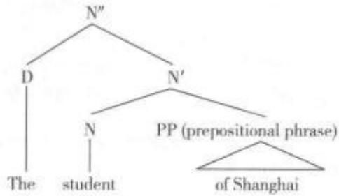

of插入 of-insertion 句法学术语。指插入介词of 以使名词短语获得斜格(Oblique Case)的操作。例如：[Np the destruction of [Np the city]]其中of 插入的目的是为了给[Np the city]赋格。

OSV 语言 OSV language 语言类型学术语。指句子基本成分的排列顺序为“宾语一主语一动词”的语言，如巴西西部阿克里州(Acre)和亚马逊州等地土著人的杰玛玛迪语(Jamamadi)、阿普日那语(Apurina)等。日语通常是 SOV结构，但OSV也常见。

OVS 语言 OVS language 语言类型学术语。指句子基本成分的排列顺序为“宾语一动词一主语”的语言，如郝克斯卡雅那语(Hixkaryana)、阿帕来语(Apalai)、巴凯瑞语(Bacairi)、马库斯语(Makusi)等，这些宾语起始的语言基本上都位于亚马逊河流域，属于加勒比语族(Carib)。

PF结构 PF-Structure句法学术语。指句子的语音形式(phonetic form)。根据乔姆斯基20世纪80年代初期的观点，一个句子具有四个结构层次，即D结构(D-structure)、S结构(S-structure)、PF结构和LF结构(代表逻辑形式)。

PLATO 系统 PLATO 一种名为“自动教学操作程序化逻辑”的计算机辅助教学系统，其英文全称为“Programmed Logic for Automatic TeachingOperation”。于1959年在美国伊利诺伊大学创建，后经多次改进。作为一个大型的自动教学系统，其终端遍布美国各州，可在各个终端上调用各类科目

的上千个课件。

PRO 定律 PRO theorem 句法学术语。根据约束理论，具有[+ANAPHOR]特征的名词短语在管辖范围内必须受到约束；具有[+PRONOMINAL]特征的名词短语在管辖范围内必须是自由的。因PRO同时具备[+ANAPHOR，+PRONOMINAL]的特征而与约束理论冲突。为解决这一问题，乔姆斯基提出了PRO定律，即PRO不能被管辖，说明了PRO在句中的允准条件——PR)只能出现在不受管辖的位置上。

P标记P-marker句法学术语。短语标记(phrase marker)的简称，指由语法规则指派的用标加括号法表示的句子的结构表征。参见“T标记”。

P型凯尔特语 P-Celtic 语言类型学术语。对印欧语系凯尔特语族中诸语支进行分门别类的方案主要有两种，一种被称为“P型凯尔特语和Q型凯尔特语假说”(P-Celtic/Q-Celtic hypothesis)，另一种被称作“岛民凯尔特语和大陆凯尔特语”(InsularCeltic vs. Continental Celtic)。根据“P 型凯尔特语和Q型凯尔特语假说”，凯尔特语族中的高卢语支(Gallic)、普里田语支(Pritennic)和布立吞语支(Brythonic)均存在着原始凯尔特语(Proto-Celtic)中的kw音演变为’p音的现象，而戈益德尔语支(Goidel-ic)和凯尔特伊比利亚语支(Celtiberian)均存在\*k音演变为”k音的现象。因此，前一组语言被称作“P型凯尔特语”，而后一组语言被称作“Q型凯尔特语”。例如，英语head和son两个词在布立吞语中分别是pen和mab(早先拼作map)，而在戈益德尔语中则分别是 ceann 和 mac(早先拼作 maqq)。岛民凯尔特语和大陆凯尔特语的分法约于20世纪90年代出现，通常将戈益德尔语和布立吞语归为岛民凯尔特语，将高卢语和凯尔特伊比利亚语归为大陆凯尔特语。

PROLOG 语言PROLOG 指实现逻辑编程的程序语言，即某个程序的应用被看作实施一种核实(carrying out a proof)。来自法语“programmationen logique”，对应的英语为“programming in logic”。人们普遍认为，解决问题可以被分析为证明能够实现某些既定的条件。自20世纪70年代起，PROLOG就在法国马赛和英国爱丁堡获得开发，自80年代中期起在计算语言学中发挥日益重要的作用。

Q型凯尔特语 Q-Celtic 指印欧语系凯尔特语族中的戈益德尔语支(Goidelic)。这类语言的共同特点是原始印欧语的圆唇软腭音[k″]演变为[k]。参见“P型凯尔特语”。

r插入 r-insertion 语音学术语。指添加性音位r在连续发音时不脱落的用法。一般说来，单词中元音后的[r]大都发生蜕化：或者被前面的元音所吸收，或者发生元音化，成为双元音的一个组成部分。但如果是在连续发音的语流中，其后面相随的词以元音开头，那么该词结尾的r读音时就不宜脱落。

R 词语R-expression 参见“指称语”。

R符 R 音系学术语，亦称舌根收缩符。在某些从属音系学流派中，一种用来表示咽化(pharyn-gealized)辅音舌根收缩特性的组元。

r类音 rhotic;rhotacized;retroflexed 语音学术语。指一组独特的、在语音上异质的音段(俗称r-音类)，包括齿龈和后齿龈的轻拍音、颤音和无擦通音，以及各种卷舌音和小舌音段，美语的臼齿r音等。英语中指某些方言或口音中元音后头的/r/或者由舌根后缩卷舌发出，或者由“隆起的”舌位发出，如 car和 cart 中的r。此类元音为“r音化”(rhotacized)元音，可作为语音系统的区别特征，用来处理元音的r音色区别，以区分具有强r音化的、r音化的、弱r音色的和平音的等值。

r 色彩 r-colouring 社会语言学术语。发元音时舌尖向后卷曲，触到或几乎触到口腔上部的硬腭而产生的发音效果，即在元音发音还未结束时舌就开始向卷舌位置移动。英国西南部地区许多人说的/r/及通用美语的许多变体中的/r/都是此类r色彩的元音，如door、car、floor等单词中的元音。从社会语言学角度来看，r音化的发音在通用美语中常被视为身份地位的象征。

r音化 rhotacism 语音学术语。指一个音段发展为一个r类音的音系过程，即用r类音代替其他语音(特别是/1/、/s/、/z/等音)。例如，意大利方言中1音发生r音化，拉丁语历史中一个s(如在不定式后缀-se中)在元音之间发生r音化；又如，古日耳曼语的/z/在中间时突变为西日耳曼语的/r/(如哥特语的 maiza 和古高地德语的 mero[更多])。或指 r音发音不准或者r音滥用的现象(defective r)，即过分、过多地使用卷舌的现象。r音化的程度在不同地区有所不同。例如，在加拿大和美国东部沿海地区以及英格兰东南部等地，元音之后的r不发音；而在美国中西部地区所说的英语大部分都带r音，英国西南部所说的方言亦带r音(如 tower、turn 等单词中保持r音)，苏格兰、爱尔兰口音中所有位置的r都发卷舌音。

SARD 参见“同感实证”。

SOV 语言 SOV Ianguage 语言类型学术语。指句子基本成分的排列顺序是“主语+宾语+动词”

的语言，如现代拉丁语和现代土耳其语。

SPEAKING 参见“语境”。

SQ3R 方法SQ3R method 语言教学术语。指美国爱荷华大学心理学教授弗朗西斯·罗宾逊(Francis Pleasant Robinson,1906—1983)所设计，在英美等国广为推行的一套行之有效的综合性的读书方法，通常认为由五部分组成：(1)浏览(survey)：先快速浏览整篇文章的内容，包括主题、分支、图画，帮助建立整体概念及提高阅读的兴趣。然后阅读开头与结尾的段落。(2)提问(question)：把题目、标题、副标题转换成问题。学习者可使用5W1H(What、When、Who、Why、Where 和 How)的视角考查自己对刚浏览的文章的了解程度，判定有何不明或不解之处，或有何疑问，帮助建立吸收知识的学习心态。(3)阅读(read)：阅读文章时留意重点和关键字之间的关系，尝试寻找问题的答案。(4)背诵(re-call):读完文章的其中一部分后，尝试不看文章回想整个部分的内容。重复背诵，直到自己能够完全背诵整个重要内容后才继续接下来的内容。问自己刚学过了什么并使用自己的词句为所获得的资料作摘要。(5)复习(review):阅读和背诵完所有文章的内容后，重新快速复习整篇文章，确保理解所有内容。也可尝试跟同学讨论或向他人教授文章内容。

S 类语言 Satem languages 语言类型学术语。指印欧语系东支各语言，主要包括波罗的斯拉夫语诸语言。这些语言中的原始印欧语中，有软腭塞音(velar stop)/k/演变成齿龈清擦音/s/，故称为S类语言。参见“K类语言”。

that 语迹制约现象that-trace constraint phenomenon句法学术语，亦称 that语迹过滤 现象(that-trace filter phenomenon)。指如果语迹出 现在一个显性标句词之后为不合法，就是因为标句 词阻碍了先行词对语迹的管辖。例如：[1]Who do you think will arrive first?[2]• Who do you think that will arrive first?

that 从句that-clause 语法学术语。指由 that引出的依附陈述从句，如主语从句、宾语从句、 同位语从句、主语补语从句等，有时that可以省略。

that 语迹过滤现象 that-trace filter phenomenon参见“that 语迹制约现象”。

that 语迹连用效应 that-trace effect 参见“主宾语不对称”。

there 插入there-insertion句法学术语。指通过插入一个there作为句子成分将地点句(loca-tive sentence)转化为存在句(existential sentence)的组合规则。例如：A book is on the desk, →There isa book on the desk. 根据阿克马让(Adrian Akmajian)和亨尼(Frank W.Heny)1975年和1980年出版的《转换句法原理概论》(An Introduction to thePrinciples of Transformational Syntax),这一插入转换现象可用结构描写(structural description;SD)和结构变换(structural change;SC)表达式表述如下：

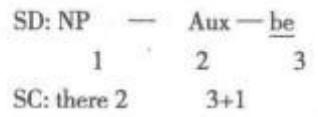

由于这一转换规则要求地点句中的NP必须是不定的名词短语，可用[-Def标识，因此，there插入规则的结构描写和结构变换表达式需调整为：

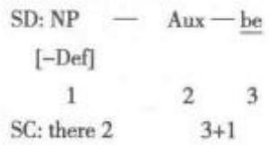

T标记 T-marker 句法学术语。转换标记 (transformation marker)的简称。指早期转换生成 语法中标记句子转换过程的表征。例如：[1]The airplane will not fly. [2] The airplane will fly. 句] [1]即通过句[2]的否定转换而得到。底层结构的短 语标记(即P标记)如例[2]所示。经过否定转换 TNEG，句子变为例[1]的样子，[1′]即该句子的T标 记。其表达式如下：[1′]⇒T-NEG [s The airplanes [p will not [vp fly]]][2′] [s The airplanes [IP will [vp fly]]]

T形式 T form 语用学术语，亦称熟近形式。用于指各种语言的称呼语中与正式形式相对的一种语用形式。根据法语第二人称代词的两个不同形式“tu”(你)和“vous”(您)的对立以及其他语言中类似的对立，可以推断第二人称动词和代名词形式可以有熟近式(T)和正式体(V)的对立，并可据此提出有关各种语言使用的正式性系统的一些假设。

U型行为 U-shaped behavior 参见“U型习得”。

U型习得 U-shaped acquisition 语言习得术语，亦称U型行为(U-shaped behavior)。特指由埃里克·凯勒曼(Eric Kellerman)和皮特·乔登斯(Pe-ter Jordens)于1983年首次提出的一种语言认知发展规律。语言学习者在初级阶段成功习得语言的一些特征后，在中期会经历能力或知识下滑的过程，之后再次成功习得这些能力或知识。例如：英语不规则过去式的习得，不论母语还是二语习得者、不论孩子还是成人，早期都能成功习得诸如“go”“eat”等高频动词的不规则动词变位“went”“ate”，但在学习了“-ed”过去式这一变形规则后，会出现误用现象，如使用“goed”“eated”等形式；随着时间的推移，后期又会重新习得这些词正确的过去时形式，并能够正确使用。从时间的发展轨迹来看，这一习得过程就如同英文字母“U”，故而名曰“∪型习得”。

VSO 型语言 VSO language 语言类型学术语。指句子的正常语序为“动词(V)—主语(S)—宾语(O)(SVO，Verb—Subject—Object)”的语言。如圣经希伯来语(现代希伯来语除了VSO顺序外，亦用SVO的语序)、古典阿拉伯语(现代阿拉伯语较多使用SV的语序)、多数南岛语系语言(包括中国台湾岛内土著语言和马来一波利尼西亚语族的多数语言在内)、许多玛雅语族语言和凯尔特语族海岛凯尔特语支语言(如威尔士语)使用此种语序。德语句法有时也会有VSO语序，尤其是表示时间的词置于首位或疑问句时。例如：Gestern sah ich das Mädchen.(昨天看到了那女孩)例句中，“ich”为主语(S)，“sah”(sehen的过去式)为谓语(V)，“Mädchen”为宾语(O)。根据格林伯格(J.H. Greenberg)1963年提出的观点，VSO语言具有前置词、没有格系统、没有修饰语置于中心词后的有分枝结构等类型学特征。

wanna 式缩略 wanna-contraction 语法学术语。北美地区英语中“want to"“going to”的缩略式，用于口语等非正式语体。例如：[1]Ⅰwannaknow. = I want to know.[2] I gonna do it. = Iam going to do it. 在生成语法中， wanna 式缩略常用来检验移位后留下的语迹以及空语类PRO的存在。例如：[3] Who do you want to visit? 如果句中“want to”可以缩略为 wanna，即句子可以读作“Whodo you wanna visit?”，则说明 who 是从 visit 后面移出，意为“你想去拜访谁？”如果“want to”不能缩略为 wanna，则说明who从 want后面移出，意为“你想要谁去拜访?” 又如：[4] I want to help you.如果句中“want to”可以缩略为“wanna”，则说明作为 help主语的空语类PRO不在“want”和“to”之间；换言之，只有当“want”和to之间没有语迹或空语类时才使用缩略形式。再如：[5]Titanic is the movie Iwant to see. [6] Titanic is the movie I want to winthe prize.按规则，句[5]中的“want to”可以缩略为wanna，而[6]则不能。

whiz 省略 whiz-deletion句法学术语。指从定语从句中省去关系代词及相关动词、将定语从句变为后置修饰性短语的构句方法。例如：[1]aman who is sick with envy → a man sick with envy[2] the man who was in the street → the man in thestreet 美国语言学界倾向于对这种构句法持消极态度，认为应该尽量少用，因为这种省略可能造成语义模糊或误解。例如：[3] the nan accused. [4]How many times did you approach the man on theground?在缺乏更多信息的前提下，例[3]可以理解为“那人提出了指控”，也可以是“被指控人”；例[4]中“on the ground”既可理解为 the man 的修饰语，也可理解为approach的修饰语。另外，生成语法将whiz省略作为有问题的过渡性生成环节，从而限制其应用，因为从类似“a man who is sick”的结构中通过 whiz 省略得出的“the man sick”不符合语法规范。

wh 参数 wh-parameter 句法学术语。指wh移位在不同语言中呈参数变化的事实。生成语法的“原则与参数理论”将普遍语法中与语言的特有现象有关的那一部分称为参数。wh移位现象因语种而异，有的语言(如英语、德语、法语)，把wh成分移位至句首构成疑问句。例如：[1]Where does helive? [2] Why is he so happy? [3] When shallwe leave? [4] Which house will he buy? 而有的语言(如汉语、日语等)，则将wh成分留在原位不动。例如：[5]你在做什么？[6]你什么时候走？[7]今年准备去哪里度假？这种跨语言间wh疑问句构成上的差异称为wh参数，具有wh成分移位特征的语言称为 wh 移位语言(wh-movement language)，wh成分无需移位的语言成为wh 非移位语言(wh-in-situ language)。参见“wh移位”。

wh 岛 wh-island 句法学术语，亦称wh孤 岛。指由 wh 词引导的嵌套从句(embedded clause) 形成的孤岛结构，wh成分不能移出这一结构。例 如:[1] [cp Who; do [IP you think [cp that [P Susan said [cp that [P Mary thought ... [cp that [P John kissed t]]]]]]]]?[2]· Who; did Mary think that ti saw Bill? [3]· Who; did Mary see the man who knows ti?[4] He wondered where John put what.

在例[1]中，句首的 who从最后一个分句中动词kiss后移出;理论上说，这似乎表明wh成分(疑问代词、疑问副词及定语从句中的关系代词、关系副词)可以无限制地远距离移位，但是有些分句禁止wh成分移出分句。由that引导的宾语从句中主语位置上的wh成分就不能移出分句，诸如例[2]这样的句子不合语法。另外，定语从句中作动词宾语的wh成分也不能移出分句，如例句[3]也不符合语法。乔姆斯基早在1962年就注意到，例[4]中what不可以移出分句，也不可移至句首。又如：[5]a. John wonderswhere Eric went to buy a gift. b. ·What, doesJohn wonder where Eric went to buy t? 例[5a]中对 a gift 提问，疑问词 what 不能跨越 where 引导的wh孤岛移到句首，例[5b]所示。

wh 非移位疑问句 wh-in-situ question 句法学术语。Wh成分位于句中而非常见的wh成分移至句首的疑问句。例如：[1]What did George giveto whom?[2] When did George say what? 在这两个疑问句中都只有一个wh词移至句首，另有一个wh词留在原位。其原因是英语的参数不允许显性的多重移动，即只有一个wh词可以显性地移至句首，而另一个wh词经历了LF层面上的隐性移动，即 wh算子经历了移动。这种移动被称为wh提升。参见“wh提升”。

wh 分裂句wh-cleft 句法学术语，亦称假拟 分裂句(pseudo-cleft)。英语中一种特殊句式，信息 与主位结构的主要构成手段之一。一般情况下wh 分裂句将句中已知信息组织集中于wh分句，置于句 首主语位置，为主位；句中的未知信息后置于主语补 语位置，为述位；中间用系动词连接，系动词相当于 等于号，韩礼德称这种句式为主位等式句(thematic equative)。 例如:[1] What the duke gave to my aunt was the teapot. [2] What the duke did with the teapot was gave it to my aunt. wh 分裂句主要表现 为 what引导的分句，其他 wh-词组引导的 wh-分裂 句也有，但不多见，也不典型。例如：[3]The one who gave my aunt that teapot was the duke. [4] How my aunt came by that teapot was she was given it by the duke. [5] The place where the accident happened is here. [6] The time when the countryside is most beautiful is in autumn.

wh 孤岛 wh-island 参见“wh岛”。

wh 提升 wh-raising 句法学术语。指逻辑式中的wh移位。除了D结构和S结构，生成语法系统还有两个组成部分，即语音式(Phonetic Form;PF)和逻辑式(Logical Form;LF)。其中逻辑式对 S结构进行逻辑语义解释。有些语言(如英语、德语)存在wh移位现象，而有些语言(如汉语、日语)wh成分留在原位。生成语法认为，汉语和英语的wh问句都发生wh移位，其区别是，英语移位发生在S结构中，汉语移位在逻辑式中，即存在着wh提升。例如：[1]张三知道王小姐买了什么。此句在逻辑式中可以理解为：[2][c什么[p张三知道[cp[p王小姐买了ti]]]]，或[3][cp[r张三知道[c什么[p王小姐买了ti]]]]。句[2]和句[3]分别对应于：[4][cWhati does [p John know [cp[P Mary bought t, ]]]]和[5] [cP [ John knows [cr what [P Mary boughtt]]]]。其实，英语中也存在wh提升现象，发生在如句[6] Who bought what? 中的多元 wh 问句，这里的“what”在逻辑式中提升到句首，如：[7][cpWhatk who;[ipt, bought tk]]?

wh 吸引 wh-attraction 句法学术语。指wh成分被C节点的wh特征吸引向上提升到CP短语Spec位置进行特征核查的句法操作过程。核查理论认为，一方面，进入算法操作的wh成分所携带的[wh]特征需要得到核查方可合法；另一方面，CP短语的中心语C节点所具有的[+wh]特征形成探头(probe)，向下吸引未被核查的[wh]特征。因此，携带[wh]特征的wh 成分被探头吸引，移动到C节点的核查域内，即 CP结构的 Spec 位置进行[wh]特征核查。通过核查，wh成分在移动后的位置获得合法的句法地位，C节点的[+wh]特征探头也失去吸引力，稳定下来。由于wh特征属于强特征，移动核查发生在拼出(spell out)之前，因此是显性核查，wh成分的移动也属显性移动。

wh 形式 wh-form; wh-item; wh-word; wh-phrase句法学术语。指英语中以wh开头的一组疑问词，如what、which、who、whom、whose、when、where、why和 how;还包括含有这些词的词组，如 which book、whose house、what question、how many people、how old、how often 等。这些词与词组主要用于英语特殊疑问句句首，因此英语特殊疑问句也叫wh疑问句。另外，还有一系列wh开头的概念如wh分裂句、wh岛、wh移位、wh提升、wh语迹等也与这一组疑问词有关。以英语为母语的语言学家还用这组词指其他语言中类似的疑问词和疑问词组。

wh 移位wh-movement 句法学术语，亦称wh前置(wh-fronting; wh-preposing)。指 wh 成分(疑问代词、疑问副词及定语从句中的关系代词、关系副词)的移位。转换生成语法认为，句法结构分两个层面：D结构和S结构。D结构经过移位α等句法操作推导出S结构。例如：[1][cpWho didk[pJohn [r tk[vp meet t, ]]]]？ 在此英语 wh 问句中,wh成分“who”从动词“meet”的补足语位置，通过wh移位移至句首。又如[2] I know the girl [cp whom; [pJohn loved t]，在关系分句中，wh 成分“whom”从动词“love”的补足语位置移至句首。Wh移位不仅应用于wh疑问句，而且也应用于关系从句。

wh 移位语言 wh-movement language句法学术语。指句中生成的wh成分需要移位至句首的语言，与wh非移位语言相对立。wh移位语言在构成疑问句时要把wh成分移位至句首。英语、德语、法语都属于wh移位语言。参见“wh参数”。

wh 疑问句wh-question;wh-interrogative语法学术语。指以wh形式疑问词开始的疑问句。英语中的疑问词除how(如何)以外都以字母 wh开头，如who（谁）、whom（谁[宾格]）、what（什么）、where（哪里）、when（什么时候）、why（为什么）、which（哪一个）、whose（谁的），故以此类疑问词开头的疑问句称wh疑问句，亦称特殊疑问句。英语特殊疑问句除了疑问词作主语的情形，一般结构是：疑问词+系动词/助动词/情态动词等+主语+谓语其他部分。例如:[1] Whom did you meet at the air-port today? [2] What does he do for a living?[3] When will he arrive?[4] Where do you live?疑问词作主语时其后直接跟谓语及其他成分。例如：[5] Who lives in this house? 印欧语系其他常见语种如德语、法语、俄语的特殊疑问句也以疑问词开头，而汉语、日语特殊疑问句中的疑问词则保留在句中。

wh 语迹 wh-trace 句法学术语。在转换生成语法中指wh成分(疑问代词、疑问副词及定语从句中的关系代词、关系副词)移位时在原来位置留下的语迹。转换生成语法认为，在D结构向S结构转换的过程中发生移位的成分在其移出的位置留下一个空的、无形的痕迹，称为语迹。例如：[1]Shouldwe have called the police?[2] Who might you wantto win?句[1]中“we”和“have”不能缩写为“we've”;句[2]中“want”和“to”不能缩写为“wanna”都说明两个词之间存在一个空成分(即语迹)阻碍了前后两个词的缩写。若该语迹为wh词所遗留，则称其为 wh 语迹。例如：[3] [cp Who did [p John [r[vpmeet t]]]]？ 在此句中 Who 从 meet 的补足语位置移位至句首，在原位存有一个wh语迹。

XYZ 构式XYZ construction认知语言学术语。指复杂结构隐喻的典型代表，这种隐喻结构中至少三个或三个以上语义体参与隐喻映射的过程，三个语义体分别由X、Y、Z代表。例如“围棋是智慧的体操”。XYZ构式的句法认知结构中具有的识别性、错位性以及双重映射性等特征。与二元结构的隐喻，即XY构式相比较而言。

X光测量术radiography 亦称放射线照相术。指利用X-光取得言语生成期间声道照片的技术，是X-光在语音研究中的具体运用，为实验语音学的建立和发展提供了客观条件。X光又名“X射线”或“伦琴射线”，是德国物理学家伦琴(WilhelmKon-rad von Roentgen)于1895年发现。伦琴将其命名为X-strahlen，译成英文为X-ray。“X”指此射线性质尚是一个未知数。X光照相仪器等有助于言语生理研究，并在一定程度上为实验语音学的建立和发展提供了客观条件。

X 规约 X convention; iksokodo; iksa-sis-temo 世界语书写系统的一种替换形式，与

ASCⅡI系统兼容，适用于电子邮件书写。由于世界 语中没有字母X，所以使用者用字母X代替ASCII 中没有的变音符号，这样就可以应用Unicode程序 了。例如： Čar la aùtoro de la lingvo Esperanto tuj en la komenco rifuzis unu fojon por čiam čiujnpersonajn rajtojn kaj privilegiojn rilate tiun lingvon, tial Esperanto estas nenies proprajo. 这是 《布伦宣言》(Declaration of Boulogne)世界语文本 的一个片断。根据X规约，在电子邮件中改写为： Cxar la auxtoro de la lingvo Esperanto tuj en la komenco rifuzis unu fojon por exiam exiujnpersonajn rajtojn kaj privilegiojn rilate tiun lingvon, tial Esperanto estas nenies proprajxo.目前，语言学界对 X 规约仍存有争议。

X 阶标理论X-bar theory 句法学术语。指乔姆斯基于1970年提出的句法结构规则，后由美国语言学家杰肯道夫(Ray Jackendoff)在其 1977年出版的《X阶标理论：短语结构研究》一书中做了详细论述，成为具有普遍意义的生成语言学的句法结构理论。X阶标理论是对短语结构规则的形成化改进。所有不同范畴的中心词都用X表示，短语规则改写为：XP→(Spec)X(Comp)。为了体现短语结构的层级性，采用阶标符号“”(如X、X)或“”进行书写，形成 X 阶标理论:X"→Spec X′，X′→X Comp。

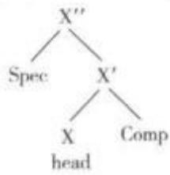

根据这一理论，任何一个短语结构都可以用如下树形图表示：

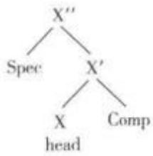

图中X(或写作X)是短语结构中心成分X的最大投射，X是个变项，它可以是N(名词)、V(动词)、A(形容词)、P(介词)等语类中的任意一个变项，Spec为标志语，Comp为补足语。

X音层X-tier音系学术语。指音段特征消除后的骨架音层，是CV音层模型的进一步发展，两者都发源于韵律层的音段音位理论，其基本原理在于:话语中韵律单位的数量与韵律单位所含的音段音位相一致。X音层的各成分以不同的含调核的音节组成方式相区分。X音层与CV音层的对比如下：

a. CT Theory

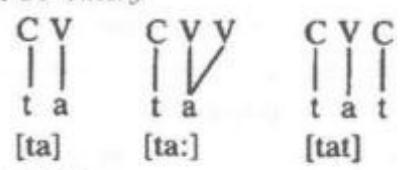

b. X Theory

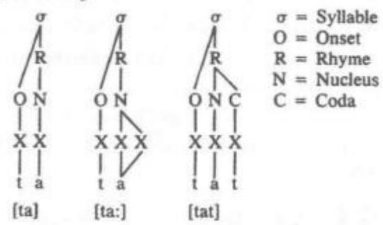

Z 分数 Z score 语言测试术语。指以标准差为单位的标准分数，是原始分数与平均数的差再除以标准差的过程，其计算公式为：z=(xμ)/σ，其中x为原始分数，μ为平均数，σ为标准差。z分数的作用在于以标准差为单位表示一个原始分数距离平均数的相对标准距离或者说离差，在这一原始分数低于平均值时Z为负数，反之为正数。在呈正态分布的数据中的原始分数转换为z分数后，通过计算平均数与z分数之间的面积，可以得到原始分数在数据集合中的百分等级。一个数列的各z分数的平方和等于该数列数据的个数，且z分数的标准差和方差都为1,平均数为0。

α 标记 alpha notation①句法学术语。指用字母α为变项以简化某一规则的做法。例如，在生成语法研究的管辖与约束理论中，因句子生成过程中很多成分都需要移位操作，发生动词提升、主语提升、疑问词移位等，所以把移位的规则总结为带有变项的形式规则移位α(Moveα)，这条规则涵盖了所有的具体移位规则，既具简捷性又具概括性。音系学术语。当清音/浊音和非圆唇音/圆唇音这两组特征之间存在必然联系时，为避免对每个特征出现的条件做单独的表述，也使用α标记为变项描述其中的相关性，把规则简化为“[α voice]→[around]"。

Φ相关phi correlation 语言测试术语。衡量两个自然二分变量之间联系的一种方法，由卡尔·皮尔森(Karl Pearson)发明，以Φ相关系数为测量单位，描述2×2列联表数据的相关程度，其数值在0一1之间。Φ相关的基本原理为：两个二元变量X和Y的观察值若大多落在2×2列联表的主对角线，即大多是(X，Y)=(1,1)，(0,0)这两种组合，则这两个变量呈正相关。反之，若两个二元变量的观察值大多落在非对角线栏位，即大多为(X，Y)=(0，1)，(1，0)这两种组合，则这两个变量呈负相关。

# Major Linguistic Theories and Schools of Linguistics

# 语言学理论与流派

## 词目首字音序分区速查表

## (语言学理论与流派)

<table><tr><td rowspan=1 colspan=2>分区</td><td rowspan=1 colspan=1>页码区间</td></tr><tr><td rowspan=1 colspan=1>A</td><td rowspan=1 colspan=1></td><td rowspan=1 colspan=1></td></tr><tr><td rowspan=1 colspan=1>B</td><td rowspan=1 colspan=1>【巴士拉学派病理语言学布拉格学派】</td><td rowspan=1 colspan=1>719~722</td></tr><tr><td rowspan=1 colspan=1>C</td><td rowspan=1 colspan=1>【层次语法词汇功能语法【词语法 德国浪漫主义学派——新洪堡特学说】德国唯美主义语言学派德国新语法学派】</td><td rowspan=1 colspan=1>722~727</td></tr><tr><td rowspan=1 colspan=1>D</td><td rowspan=1 colspan=1>【德国自然主义语言学派第二语言习得对比语言学】</td><td rowspan=1 colspan=1>727~737</td></tr><tr><td rowspan=1 colspan=1>E</td><td rowspan=1 colspan=1></td><td rowspan=1 colspan=1></td></tr><tr><td rowspan=1 colspan=1>F</td><td rowspan=1 colspan=1>【法国功能语言学(法国学派)法兰西学派法位学【范畴语法方言学】</td><td rowspan=1 colspan=1>737~744</td></tr><tr><td rowspan=1 colspan=1>G</td><td rowspan=1 colspan=1>【哥本哈根学派格式塔语言学格语法工程语言学 功能语篇语法构式语法古罗马的语言研究古希腊的语言研究古印度的语言研究关系语法广义短语结构语法】</td><td rowspan=1 colspan=1>744~762</td></tr><tr><td rowspan=1 colspan=1>H</td><td rowspan=1 colspan=1>【汉语音韵学】</td><td rowspan=1 colspan=1>762~763</td></tr><tr><td rowspan=1 colspan=1>I</td><td rowspan=1 colspan=1></td><td rowspan=1 colspan=1></td></tr><tr><td rowspan=1 colspan=1>J</td><td rowspan=1 colspan=1>【计算语言学教育语言学接触语言学结构主义语言学【角色与参照语法】</td><td rowspan=1 colspan=1>763~772</td></tr><tr><td rowspan=1 colspan=1>K</td><td rowspan=1 colspan=1>【喀山语言学派库法学派】</td><td rowspan=1 colspan=1>772~773</td></tr><tr><td rowspan=1 colspan=1>L</td><td rowspan=1 colspan=1>【历史比较语言学临床语言学伦敦学派】</td><td rowspan=1 colspan=1>773~777</td></tr><tr><td rowspan=1 colspan=1>M</td><td rowspan=1 colspan=1>【美国描写语言学派蒙塔古语法【模糊语言学 莫斯科语言学派】</td><td rowspan=1 colspan=1>777~781</td></tr><tr><td rowspan=1 colspan=1>N</td><td rowspan=1 colspan=1></td><td rowspan=1 colspan=1></td></tr><tr><td rowspan=1 colspan=1>0</td><td rowspan=1 colspan=1>【欧洲中世纪的语言研究】</td><td rowspan=1 colspan=1>781~783</td></tr><tr><td rowspan=1 colspan=1>P</td><td rowspan=1 colspan=1>【配价语法批评话语分析普遍语法理论普通语义学】</td><td rowspan=1 colspan=1>783~789</td></tr><tr><td rowspan=1 colspan=1>Q</td><td rowspan=1 colspan=1>【情报语言学】</td><td rowspan=1 colspan=1>789~789</td></tr><tr><td rowspan=1 colspan=1>R</td><td rowspan=1 colspan=1>【人类文化语言学人类语言学认知语言学 日内瓦学派】</td><td rowspan=1 colspan=1>789~797</td></tr><tr><td rowspan=1 colspan=1>S</td><td rowspan=1 colspan=1>【少数民族语言学社会语言学 神经语言学生成音系学生成语法】生成语义学生态语言学生物语言学树邻接语法司法语言学】</td><td rowspan=1 colspan=1>797~815</td></tr><tr><td rowspan=1 colspan=1>T</td><td rowspan=1 colspan=1>【统计语言学】</td><td rowspan=1 colspan=1>815～816</td></tr><tr><td rowspan=1 colspan=1>U</td><td rowspan=1 colspan=1></td><td rowspan=1 colspan=1></td></tr><tr><td rowspan=1 colspan=1>V</td><td rowspan=1 colspan=1></td><td rowspan=1 colspan=1></td></tr><tr><td rowspan=1 colspan=1>W</td><td rowspan=1 colspan=1>【文献记录语言学文艺复兴至18世纪欧洲的语言研究】</td><td rowspan=1 colspan=1>816～820</td></tr><tr><td rowspan=1 colspan=1>x</td><td rowspan=1 colspan=1>【系统功能语言学心理语言学修辞学训诂学】</td><td rowspan=1 colspan=1>820~827</td></tr><tr><td rowspan=1 colspan=1>Y</td><td rowspan=1 colspan=1>【演化语言学医学语言学依存语法意义文本理论优选论语料库语言学语篇分析】【语篇语言学语言测试学语言发生学 语言符号学 语言类型学元语言学】</td><td rowspan=1 colspan=1>827~852</td></tr><tr><td rowspan=1 colspan=1>z</td><td rowspan=1 colspan=1>【中心词驱动的短语结构语法 综合语言学【中国文字学】</td><td rowspan=1 colspan=1>852~856</td></tr></table>

# B

巴士拉学派 Basra School阿拉伯语法学的主要流派之一，产生于公元8世纪中叶伊拉克南方的历史文化名城巴士拉，创始人为阿拉伯倭马亚王朝(Umayyad Dynasty)和阿拔斯王朝(Abbāsid Dy-nasty)的语言学家海利勒(Al-Khalil ibn Ahmad al-Farahidi，约719—791)及其学生西伯维(Sibawayh，约757-796，亦译西巴韦赫)。

海利勒编写了阿拉伯语的第一部词典，名为《阿因书》；还参照亚里士多德的逻辑学原理，采用惯用法、分析法和类比法等，讲授了一套比较完整的阿拉伯语法大纲，虽未写成书稿，但演讲中关于“施事”“事”等的格位学说为他的学生西伯维写作《书》奠定了理论基础。根据海利勒的讲授，博采众家之长，西伯维编写了第一部阿拉伯语法教科书，即著名的语法名著《书》。《书》的篇幅长达千页，分上下两卷，上卷及下卷前一部分讲句法，下卷后一部分讲词法。书中以格位学说为纲，把词分为名词、动词、虚词三类，概括出了阿拉伯语的词法和句法。巴士拉的语言学家们在《书》的基础上，以阿拉伯半岛中央地带和红海西岸若干部族较规范的阿拉伯语以及古代史话、古诗、谚语等为材料，继续探索阿拉伯语的一般规律，建立起一个比较完整的阿拉伯语体系，形成了巴士拉学派。

巴士拉学派强调语言的普遍性和阿拉伯语的一般规律。此学派的创立不仅奠定了阿拉伯语法学坚实的基本理论，而且在很大程度上维护了阿拉伯语言的纯洁性。在巴士拉学派形成后不久，伊拉克的库法城就出现了以凯萨依和法拉为代表的库法学派。与巴士拉学派理论观点截然不同的是，库法学派强调语言的特殊性和阿拉伯语中的特异现象。巴士拉学派与库法学派的争论和对峙持续了百年之久，但其基本论点却一直未被动摇。直到一百年后，巴格达的语言学家分别吸收了库法学派和巴士拉学派的长处，把两派观点糅合在一起，形成了第三学派——巴格达学派(The Baghdad School)。

病理语言学Patholinguistics 以语言障碍为研究对象的语言学分支学科。也有人从不同的角度命名为语言病理学、语言治疗学、语言矫治学或语言康复医学等。病理语言学是一门新兴的交叉学科，与神经语言学、心理语言学、病理学、心理学、精神病学、儿童语言发展学、神经心理学等有十分密切的关系。对于病理语言学，长期以来国内外做了大量的研究，但所发表的文献却一直是围绕着该学科的某一方面或某些方面，如对于失语症、口吃、语言发展障碍、发音障碍等方面的研究，研究成果比较零散。20世纪50年代以来，病理语言学愈来愈重视医学和语言学家的合作研究。1998年，我国学者哈平安和刘艳红出版《病理语言学》，系统地介绍了病理语言学的地位、任务和研究方法，成为此领域的先驱之作。

自从语言产生以来，国内外古代文献中对于语言病理的问题早有记载。我国古代医学书籍如《汉书《黄帝内经》《伤寒论》《梦溪笔谈》中就记载了一些语言病理现象及治疗方法，特别是有关聋哑的问题；2013年发表于《美国自然人类学杂志》上的研究报告还记载了古代秘鲁用一种特制的手术器械给患者做开颅术以治疗失语症和其他疾病。但病理语言学作为一门语言学分支学科是最近几十年的事情。即使到了现代，病理语言学依然带有深深的医学烙印。20 世纪 20 年代，西肖尔(Carl Emil Seashore，1866—1949)首先创立了言语病理学(Speech Pathol-ogy)。随着时间的推移，学科的名称也渐渐变为病理语言学，美国和德国部分高校都普遍设立病理语言学专业。在我国，医学界专家和教育界特别是从事特殊教育的工作者和语言学家都致力于病理语言学的研究，但我国的研究现状是从病理学的视角人手进行研究的更多，从语言学视角入手进行研究的则较少。

病理语言学的研究主要包括两个方面：一是对言语障碍本身及其治疗和预防的研究，二是言语障碍对语言理论研究所具有的意义。

对言语障碍本身的研究可分为三个方面：描写异常言语行为、探查言语障碍形成的原因、研究康复训练方法。病理语言学最重要的任务之一是研究言语障碍的康复，除此之外，病理语言学研究还应该为语言理论的发展做出贡献。

病理语言学与神经语言学在研究领域、研究方法上有许多交叉的地方，但又有别于神经语言学，研究范围不同为主要特点。一般认为病理语言学的研究范围较宽，包括对大脑局部病变、先天性器官残缺、精神疾病等引起的各类语言障碍，如口吃、失语症、声音障碍等；儿童语言发展过程中产生的语言障碍或失调，如儿童语言发育迟缓、听障儿童语言异常等的诊断和治疗，还包括用语言作为对某些疾病进行心理治疗的手段问题。

找寻言语障碍的康复训练方法是病理语言学重要的研究目标之一，虽然目前在康复训练的研究方面已经取得很多成果，还有很多尚未有效解决的难点需要进一步研究，如失语症和口吃等言语障碍的发生机制、语言障碍的分类等。

尽管现代医学已非常发达，各种治疗手段层出不穷，但医学家和病理语言学家还是非常强调心理疗法(亦称精神疗法)的重要意义。心理疗法或精神疗法主要是通过“词”这样的条件刺激物对高级神经活动产生作用，使机体趋利避害，以达到治疗疾病的目的。对于治疗疾病的精神疗法，很早以前人们就已经相当重视。《黄帝内经》中就强调了对于有关疾病的治疗“必先治神”。在古代伊朗，医学家治病的三种手段就包括“语言”。语言在治疗疾病的过程中作用重大，运用得当可以减轻病情，如语言开导疗法就是针对患者的病情及其心理状态、情感障碍等，采用语言交谈方式进行疏导，以消除其致病心因，纠正其不良情绪和情感活动等的一种心理治疗。劝说开导疗法应用范围极广，是中医心理治疗的重要方式之一。

在借助研究言语障碍促进语言理论的研究方面，病理语言学通过对言语纠正和失语症的治疗，探究说与写之间、语言变体的选择之间、语言单位的分类和发音机制之间、语法和语义之间的关系。

病理语言学不仅具有很强的实验性，还具备很大的应用价值。随着医学水平的提高和社会的发展，语言障碍的治疗越来越被人们所重视。20世纪70年代末，中国科学院对失语症和语言障碍的临床分类、失语类型和大脑结构的对应关系、不同言语障碍、汉语的失语症特点展开了一系列的研究并取得了可观的研究成果。目前中国医学科学院、华西医科大学、山东大学医学院、北京医科大学等都开展了相关的研究。随着科技和社会经济发展步伐的加快，病理语言学的前景也日益广阔，语言学提供了整个语言系统的理论模式，医学各个领域的临床经验和知识为人们提供了许多诊断的手段和依据。各种类型的语言障碍的描写、诊断和治疗都可以得到可靠的依据。

布拉格学派 Prague School 语言学界所认为的继索绪尔之后结构主义语言学的主要流派之一，其活动中心是布拉格语言学会(The LinguisticCircle of Prague)，该学会于1926年10月6日召开第一次大会，即被认为是布拉格学派的创立。当时，布拉格查理大学(Charles University)教授马泰休斯(Vilem Mathesius，1882—1945)领导召开了该学会的第一次会议，并担任第一届主席。1929年，学会向第一次国际斯拉夫学者代表大会提交一份《提纲》，全面阐述了自己的理论原则。《提纲》强调语言是一种功能体系，评价任何语言现象都应从其所达到的目的、所发挥的功能着眼。学会自1929—1939年出版了8卷刊物《布拉格语言学会论丛》(TravauxduCercle Linguistique de Prague,即 Prague Linguis-tic Circle Papers)，发表了大量具有国际影响力的著作。此外，自1935年起还创办了期刊《语言学与语文(Slovo a Slovesnost)。

布拉格学派主要代表人物是马泰休斯、特鲁别茨柯依(Nikolay Trubetzkoy，1890—1938)和雅柯布逊(RomanJakobson，1896—1982)，主要成员包括哈夫朗内克(Bohuslav Havránek，1893—1978)、特拉恩卡(Bohumil Trnka，1895—1984)、梵依克(JosefVachek，1909—1997）和卡尔采夫斯基（SergeiKarcevskiy，1884—1955)等人。

1939年3月德军占领捷克后，学会成员流散，活动中断，1948年恢复，并存在至1952年。后来，特拉恩卡、梵依克等人以及一些年轻的捷克学者继承了布拉格学派的传统，在捷克斯洛伐克科学院以现代语文学部功能语言学小组的形式从事研究工作。1956年，布拉格语言学会与斯拉夫语言学会等团体合并，成立了捷克斯洛伐克语言学会。1964年，捷克斯洛伐克语言学会出版会刊《布拉格语言学论丛》，继续布拉格学派的传统。1976年，法国成立了以马蒂内(André Martinet，1908—1999)为首的国际功能语言学协会，旨在发展布拉格学派的基本思想。学界也把20世纪50年代后的学者称为“新一代布拉格学派”，但其主要思想仍是对老一辈学者的传承与发展。

布拉格学派最重要的贡献是从功能角度看待语言，把语言的结构与功能结合起来研究，认为语言的基本功能是作为一种交际工具来使用。语言是一个由多种表达手段构成的、为特定目的服务的功能系统，因此要用功能的观点去研究语言，因此布拉格学派常被称为功能主义或结构一功能语法学派。美国语言学家鲍林格(DwightBolinger，1907—1992)作过这样的评价：“在欧洲语言学团体中，影响最大的莫过于布拉格语言学会，美国语言学的每一项重要发展都与这一学派的学说有关。”

布拉格学派的主要理论与观点包括：(一)音位理论。布拉格学派最杰出的贡献在于其音位理论，他们区分了语音学(phonetics)和音位学(phonolo-gy)。根据索绪尔(Ferdinand de Saussure，1857—1913)对语言(langue)和言语(parole)的区分，他们认为语音学属于言语，音位学属于语言。在此基础上，他们提出把“音位(phoneme)”概念当作语音系统中的一个抽象单位以区别于实际发出的音。特鲁别茨柯依于1939年出版的《音位学原理》(Principles ofPhonology)集中体现了布拉格学派对于音位理论的贡献。特鲁别茨柯依指出了语音的区别性功能并且给音位做出了准确的定义—音位就是语音区别性特征的总和，并指出音位有三个特征：(1)有区分功能：(2)是最小的语音单位，不能再分成具有区分功能的更小的语言段；(3)只能通过区别性特征来确定。他认为语音本身没有意义，其功能首先是区别本身带有意义的语言单位。

此后，雅柯布逊又通过实验和对历时音位学的研究对音位理论进行了补充和发展，集中体现在1956年出版的《音位学与语音学》一书中。该书着重描述了区别性特征(distinctivefeatures)理论，把这些特征本身(而非不可分割的音位)当作音位学的基本单位，并进一步拓展了相关理论。雅柯布逊把最小音位特征的概念看做与现代物理学中取得的成果相似，即物质是由基本位理组成的，区别性特征理论揭示了构成语言音位的最基本特点。他以声学频谱为基础分析语音，说明语音描述可根据发音部位(point of articulation)和发音方式(manner of articu-lation)对待和研究语音，也可根据其发明的“双分法”(binarism)，即以偶值特征来表现音位的区别，这为语音学与音位学都做出了重大贡献。

（二）语言的系统性与功能性。布拉格学派继承并发展了索绪尔关于语言的系统性(systemic)的观点。雅柯布逊指出，语言系统中的任何成分，如果从孤立的观点去研究，都不会得到正确的分析和评价。要做出正确的评价，就必须明确该成分与同一语言中相共存的其他成分之间的关系。20世纪50年代后期的新一代布拉格学派语言学家强调，语言不是一个封闭系统，而是一个开放的、包含着相互依存的子系统的系统。其中任何子系统的变化都会导致同一语言中另一个或多个其他子系统发生变化。语言系统不平衡的动态性是因为客观世界不断变化，语言就要不断打破自己的平衡以适应这种复杂性和交际功能的需要。

布拉格学派的观点主要是功能语言观。马泰休斯认为，语言成分彼此在功能上的对比或对立是它们存在的前提。他在《提纲》中明确提出：从功能观点出发，语言为一定目的服务的表达手段，语言的功能可区分为交际功能和表达功能，前者针对表达对象，后者针对表达本身。德国语言学家比勒(KarlBühler，1879—1963)在1934年提出语言有三种功能：即表达(expressive)、意动(conative)和指称(ref-erential)。布拉格学派提出了第四种功能，即美学(aesthetic)功能，即语言可以为艺术服务。在比勒三分法基础上，雅柯布逊1960年发表著名论文《语言学和诗学》(Closing Statement:Linguistics and Poet-ics)，又根据比勒的三功能说发展成为六分法功能框架：所指（referential)、表情（emotive)、呼吁（cona-tive)、寒暄(phatic)、元语言(metalinguistic)及诗学(poetic)功能。

(三)共时(synchronic)研究风格。布拉格学派认为共时研究可以得到全面、可控制的语言材料以供参考，所以格外注重共时研究，并形成了独特的研究风格，但不赞成把共时研究与历时研究割裂。由于语言永远处在运动变化之中，而这种运动又触及语音、词汇和语法各方面，所以共时研究不能绝对地排除历时演化的概念，而历时研究也不能完全抛开系统和功能等概念。

(四)“语盟”的概念(language union)。布拉格学派针对语系的概念，提出“语盟”的概念，认为有些语言虽不一定有谱系关系，但在地理上相毗邻，在音系和语法结构上有近似特征，如巴尔干诸语言就可以算是语言联盟。

(五）标记(markedness)。《音位学原理》从各个不同的角度把对立关系分为许多类型，其中最重要、后来用得最广的是正负对立。在这种对立的双方中，一方有某一区别特征，另一方没有，成为有无对立，如浊音对非浊音、鼻化音对非鼻化音、唇化音对非唇化音等等。具有特征的一方称为有标记项(marked)，而对方则称为无标记项(unmarked)。一般规律是无标记项的使用频率高于有标记项。后来，这些音系学概念和方法又被布拉格学派推广应用到语法和语义领域中。例如，在词法学中，有标记项表示有某一特征，无标记项则既不表示有，也不表示无——没有信号。如英语名词的复数形式birds是有标记项，单数形式bird则是无标记项；动词过去式 worked 是有标记项，现在式 work 则是无标记项。在语义研究中也作了类似的分析，如英语bitch是有标记项，只表示雌性，dog则是无标记项，既可表示雄性，又可表示雌性。

(六)标准语言(standard language)。布拉格学派最先提出了完善的有关标准语言的功能理论。这个理论以“灵活稳定性”(elastic stability)的假设为依据。其灵活性特征是充分尊重语言系统的动态本质，其稳定性特征是强调语言的系统性本质。书面语言标准是某种稳定的规范，不仅保证人能互相理解，而且还能保证整个语言社团里有统一的美学价值。

(七）句子功能前景理论(Functional SentencePerspective)。这是一套语言学分析的理论，指用信息论的原理来分析话语或篇章。其基本原则就是评价话语中每一个部分对全句的意义。马泰休斯对于该理论的贡献就是探索了它所发挥的作用。他于1939年正式发表了关于实际切分的理论。与成分分析(componential analysis)不同，实际切分的理论根据话语在具体上下文或语境中的交际目的(要表达的实际意思)把句子分为两部分：(1)主位(theme)，叙述的出发点；(2)述位(rheme)，叙述的核心。前者是说话人要叙述的对象，在绝大多数情况下表示已知的或不言而喻的信息；后者则说明前者做什么或怎么样，表示新的信息(new information)。例如：在“she prefers coffee”中，she 是主位，prefers coffee 是述位，句子的主语与主位相对应。但在“on theplatform stands Sally”中，主语是 Sally，主位是 on theplatform。不同的语言使用不同的句法结构，但是表达思想的次序基本相同。主位和述位的区分描述了信息如何分布在句子中，对各种语言变体和不同语言的结构分析都有用处。

布拉格学派的主要贡献是首次系统地阐明了音位学的任务、原理和研究方法，使其在结构主义语言学诸领域中居于领先地位。音位学中的理论原则、基本概念和研究方法对语法学、词汇学、语义学都产生了深远影响。布拉格学派的主位和述位理论为话语语言学奠定了基础。布拉格学派的分析比较法对类型语言学和语言普遍现象的研究起了推动作用，对语言结构的研究则是机器翻译产生的重要前提之一。布拉格学派的理论体现了结构主义思想，使其原则更具有普遍意义，为20世纪上半叶的语言学做出了贡献。

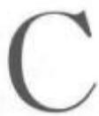

层次语法Stratificational Grammar 由美国语言学家兰姆(Sydney Lamb)于 20 世纪 50年代末创立的层次语法是一种语法分析体系；它将语言看成是诸种关系的网状系统，将语言结构看成由若干层次组成。层次语法部分来自语符学(Glossemat-ics)，部分来自美国结构主义语言学(AmericanStructuralist Linguistics)。在美国，层次语法是作为转换语法(transformational grammar)的主要替代形式被提出来的，但对其他地方的语言理论和语言实践影响甚微。层次语法的主要代表人物除了兰姆之外，还有格里森(Henry Gleason，Jr.)、洛克伍德(Da-vid Lockwood)和麦凯伊(Valerie Makkai)。

层次语言学家设想在语言代码中存在着若干层次。其中，有一层次与非线性的意象或概念关系密切，另一层次与线性的实际语音关系最为紧密，在这两个层次之间还有一个或若干个层次。根据这一假说，层次语法学家指出，分析语言结构必须采用层次分析的方法，即必须在关系网络中识别出并建立起若干个结构平面来。

层次语法的发展大致分为四个阶段：(1)第一阶段始自1957年兰姆在美国伯克利语言学学会(Berkeley Linguistics Society)上提出的将语言看作是一个由音位(phoneme)、语素(morpheme)、语素音位(morphemic phoneme)三个平面组成的模式的思想，其奠定了层次语法的基础。(2)20世纪60年代初为第二阶段，层次语法的研究进入迅速发展时期，在这一阶段，兰姆明确提出了层次语法的理论和思想，并开始使用“层次的”(stratal)、“层次语法”

(stratificational grammar)等术语。(3)1964 年至1966年为第三阶段，这是层次语法发展的主要时期。在这一阶段，兰姆提出了一套完整的层次语法理论和层次语法的分析方法。根据这一阶段的模式，层次语法识别出四个层次：义位层(sememic stratum)、词位层(lexemic stratum)、形位层(morphemic stra-tum)和音位层(phonemic stratum)。(4)1966 年至60年代末为第四阶段。在这一阶段，语法模式被认为由六个层次构成，即在义位层上面又识别出超义位层(hypersememic stratum)，在音位层下面识别出下音位层(hypophonemic stratum)。但是 20世纪 70年代以后，兰姆对自己的理论又做了修改，取消了超义位层和下音位层，语法模式基本上回到了第三阶段时的情况，整个语言理论基本上接近于第三阶段。因而，兰姆称层次语法的发展为环形发展。

由此可见，兰姆对于语言结构中应建立多少层次并没有一个固定的模型，其他层次语法学家对层次的数目也没有一致的看法。一般说来，我们可以认为语言的层次有四个。

层次语法理论认为语言中的各种关系通过三类模式在关系网络中得到表现。这三类模式分别是交替模式(alternation pattern)、配列模式(tactic pat-tern)和符号模式(sign pattern)。其中交替模式又包括上交替模式和下交替模式。这些模式将语言有机地联系在一起，从而使语言在关系网络中以整体的面貌出现。

层次语法学家为了明确地表示语言中的各种关系，将层次之间和每一层次中的种种关系通过结(node)和线(line)加以连接，从而把语言分析为一个由结和线交织的关系网络。层次语法理论认为语言是一个连接关系和语音的纯关系网络，其间有两种最基本的关系：体现关系(realization relations)和配列关系(tactical relations)。连接概念和语音二者的各层次之间的关系称为体现关系。换句话说，体现关系代表高一层次语言成分在低一层次上的表现形式。每一层次上各语言成分之间在组合上的关系称为配列关系，即配列关系代表语言成分在某一具体层次中的排列次序，相当于传统语法中的句法，体现与配列之间的关系可用图标示如下(图1)：

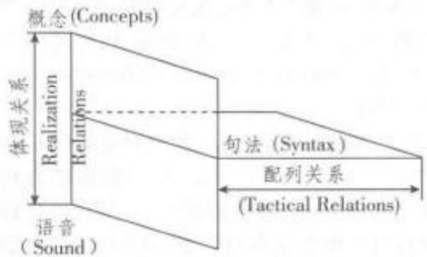  
图1 体现和配列之间的关系

层次语法认为概念和语音之间没有直接的联系，它们之间存在着若干层次，构成若干个层次系统(stratal systems)。其间最主要的有四个层次，从高到低有义位层、词位层、形位层和音位层。每一层次的基本单位称作“位(-eme)”，因而义位层上的基本单位是义位(sememe，亦称义素)，词位层上的基本单位是词位(lexeme)，形位层上的基本单位是形位(mor-pheme，亦称语素)，音位层上的基本单位是音位。每一层次上“位”单位的组合必须遵循一定的规律，称为配列规则。配列规则规定该层次上的“位”单位必须怎样进行组合才算合格。比如，英语中音位层配列规则规定音位/d/和/r/的组合/dr/可以作为音丛的开头，如dram、drug、drain等；但是不允许/d/和/1/的组合/dl/作为音丛的开头。配列规则反映了语言中的配列关系。每个层次上的位单位由一个或几个小单位组成，这些小单位称为“子(-on)”。这样，义位由义子(semon)组成，词位由词子(lexon)组成，形位由形子(morphon)组成，音位由音子(phonon)组成。

体现关系连接相邻的两个层次，高层次的单位由低层次的单位体现；反过来说，低层次的单位体现高层次的单位。这样，高层次的单位称为体现物(re-alizate)，低层次的单位称为高层次相应单位的体现(realization)。在许多情况下，高层次的单位只由低层次的一个单位体现。但在更多情况下，体现与体现物之间关系复杂。体现关系主要有两大类：简单体现(simple realization)和差位体现(discrepant real-ization)。当一个层次上的单位总是与邻近另一个层次上的单位对应，即低层次上的一个单位只体现高层次上的一个单位，而高层次上的这个单位永远只由低层次的那个单位体现，这种体现和体现物之间严格的一对一关系就是简单体现。当两临近层次上相应单位之间不呈现严格的一对一关系时，这种情况称为差位体现。

层次语法将语言的四个层次、层次的体现关系及各层次的单位通过下图(图2)直观地表现出来。其中，垂直线条代表体现关系：

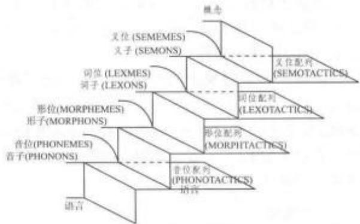  
图 2 语言的层次

如前所述，层次语法的影响并不是很大，对其层次的分析也褒贬不一。反对者的意见主要集中在“语言的层次”的观点上。语言究竞有没有层次可分？有多少层次？他们认为兰姆不断变换语言层次的数目，本身就说明他的层次观点站不住脚。持赞同观点的人认为层次语法优点在于其“层次分析”的方法。语言作为人类的交际工具，联系着客观世界的两个实体：语音和语义。语言的层次观很好地解释了音义之间的关系。他们指出虽然兰姆提出过不同数目的层次，但其主要层次的数目却始终不变。

词汇功能语法Lexical-Functional Grammar由布里斯南（Joan Bresnan，1945—）和卡普兰(Ronald Kaplan，1946—)在 20世纪 70 年代早期发展起来的一个语法流派，于1982年在《词汇功能语法—个语法表征的形式系统》(Lexical-func-tional Grammar: A Formal System for GrammaticalRepresentation)一文中首次提出。顾名思义，词汇功能语法相对其他语法流派其主要特色首先是词汇在研究中的中心位置。研究语言表达形式间的关系即是对词库(lexicon)中结构的研究。其中的词汇一体原则(Lexical Integrity Principle)指出，词是构成句子结构的原子(atom)，句法树形结构的最终节点都落实到一个个独立的词。

词汇功能语法是一个旨在提供语言的计算准确性和心理现实性表达的句法框架。它是一个应用多层次表达式的语法框架，包含结构层次、词汇和约束条件。这些层次不像乔姆斯基的生成语法那样彼此生成，而是通过由对应原则约束的映射，互相平行和相互链接。这就保证了不同层次上信息的一致性。所以，词汇功能语法同其他短语结构语法一样是非转换(non-derivational)和基于约束的(constraint-based)。词汇功能语法是生成语法(Generative Grammar)的一个分支，但是不同于转换语法(Falk，2001：2)。后者摒弃了生成语法中的深层结构(deep structure)假设，并且不涉及任何移位(movement)。

词汇功能语法理论的坚持者认为乔姆斯基的转换语法不能反映语言的心理现实性，而且他们一直坚持该理论以类型学为基础。许多句法学理论基于过于相近语言间的比较结果，这使他们可能展开详尽的比较，但是在寻求普遍语法的深层特征方面却不是一个好的基础。通过比较相近语言得出的普遍原则又被错误地应用到其他不同的语言以寻求支持。因此，普遍性和相异性都是词汇功能语法的研究内容，它既包含跨语言间不同的特征，也有面向普遍性的普遍特征。

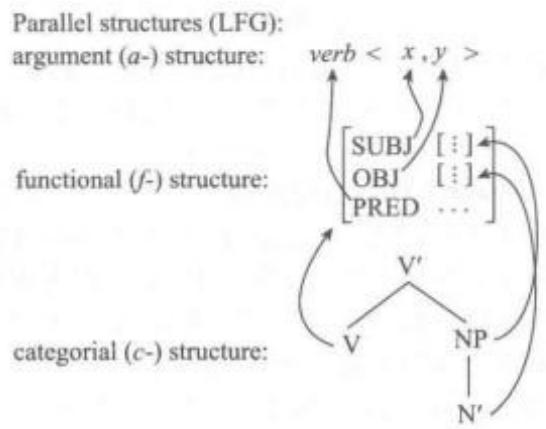

词汇功能语法对句子的描述体系包括两个部分：成分结构（constituent structure，简称c-struc-ture)和功能结构(functional structure，简称 f-struc-ture)。两者都建立在词汇结构(lexical structure)的基础上。此外，词汇还有论元结构(argument struc-ture，简称a-structure)。每个层面之间都有影射关系。词项(lexical entry)包含了词的意义、论元结构和语法功能(如：主语、宾语)等信息。比如，“取”的谓词论元结构包含和主语位置相关的表施动的论元和宾语位置上表受动的论元，如下图所示：

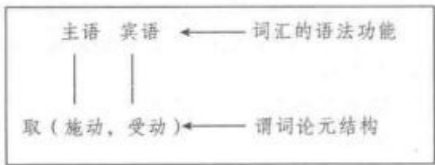

词项的表达由词的句法范畴标记和功能方程式(Functional Schemata)组成，如下表：

<table><tr><td rowspan=1 colspan=1>词项</td><td rowspan=1 colspan=1>句法范畴</td><td rowspan=1 colspan=1>功能方程式</td></tr><tr><td rowspan=1 colspan=1>Mary</td><td rowspan=1 colspan=1>N</td><td rowspan=1 colspan=1>(↑PRED)={“Mary”的意义}”(↑GEND)=FEM(↑NUM) =SIG</td></tr><tr><td rowspan=1 colspan=1>gave</td><td rowspan=1 colspan=1>V</td><td rowspan=1 colspan=1>(↑ TENSE) =PAST(↑ PRED) =“HAND&lt;(SUBJ)(OBJ2)(OBJ1)</td></tr></table>

其中符号“↑”和“↓”称为元变量(metavariables)。“个”指规则左侧的节点，即母节点。“↓”指当前节点。词项“Mary”的第一个功能方程式表示传送词义“Mary”给母节点，第二个表示母节点的性为阴性，第三个表示母节点的数为单数。Give的第一个功能方程式表示母节点的时态为过去时，第二个表示该动词有三个论元，分别作为母节点的主语和两个不同宾语。通过这样的功能方程式，词汇功能语法通过功能方程式在句法结构中传递和组合复杂特征。

成分结构是语言的外部结构。它表示句子成分的先后顺序，是由一组短语结构规则映射成的树形结构。语法功能通过句法编码进入短语结构规则，然后进入树形结构的相应位置。该层次代表句子的句法排列和语音表达。例如下面所列的短语结构规则：

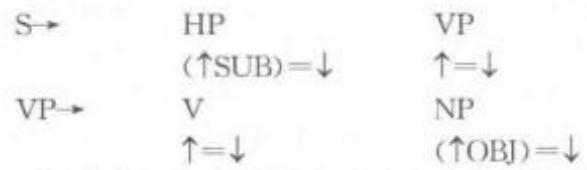

“↑=↓”表示该节点的特征与母节点的特征相同。这两个规则还可以用树形图的形式表示为：

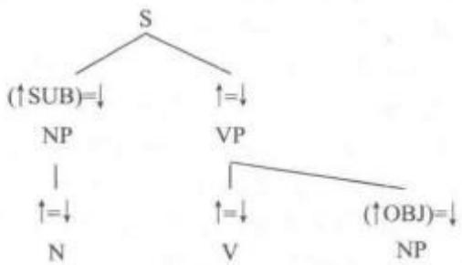

把具体的词项及其功能方程式代入这样的树图可以产生具有SVO基本结构的句子，如“张三喜欢李四”。

成分结构可以通过功能描写(functional description)向功能结构转换。功能描写由一组等式构成，从成分结构的功能方程式推导出来，可以很容易地进行计算机编码。成分结构描述了语言的表层结构，其中的词项承载了大多数语法信息，功能等式规定了这些语法信息的组合方法，经过有穷步骤的运算后，得到这些语法信息的最终组合结果——功能结构。

功能结构是语言的内部结构，表述语言成分间的关系，代表句子的语义。由于不同的语言内部结构在表达方式上大体上一致，所以功能结构具有普遍性。但是不同语言的外部结构却相差很大，所以成分结构具有相异性。功能结构和成分结构是两个具有不同形式的独立体系，词汇功能语法把它们明确区别开来，一部分一部分地分别进行描述，然后又把它们合在一起。在这之前，还要首先保证通过功能描写得出的句子的功能结构是合法的(well-formed)。确定功能结构是否合法，要通过合一运算(unification)和功能合法条件检查决定。功能合法性条件包括三个方面：功能唯一性(functional uniqueness)、完整性(completeness)和一致性(coherence)。

功能唯一性是指功能结构中每一个特征只能有一个值。这一点决定合一运算成功与否。如果合一运算成功，那么功能结构具备唯一性；如果失败，也就意味着功能结构不具备唯一性。例如，图示(1)中的功能结构就不具有唯一性：

[PER 3rd7 [1] PER 2nd

因为同一个人称特征有两个不同的值。完整性是指功能结构中缺少了谓词包含的子语类语法功能的值，如英语中的无主句：

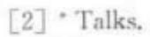

例[2]的功能结构中缺少了有关主语的值，所以不完整。一致性要求每一个有意义的语义形式必须具有一个句中谓词论元结构包含的语法功能。这保证了不会产生冗余的词或词组。

功能合法性条件理论由布里斯南(JoanBresnan)和卡纳瓦(Jonni Kanerva)在 1989年提出，是词汇功能语法的新发展。20世纪90年代初，布里斯南等人发表了一系列词汇功能语法方面的文章，他们的这些研究成果发展成为“词汇映射理论”(Lexical Mapping Theory)。该理论认为论元结构(argument structure，简称“A结构”)是连接词汇语义和句法结构的纽带，其作用就是通过把A结构上的题元角色映射到句法结构上的语法关系中，把论元和语法功能联系起来。这在一定程度上还减少了词汇部分的一些冗余的规定，简化了理论。

词汇功能语法和其他短语结构语法和乔姆斯基语法一样，目的都是要建立一个包括普遍特征的语言结构理论。只不过他们的关注点不同。广义短语结构语法、中心语驱动的短语结构语法和乔姆斯基语法把语言看作是说话者心智中的知识体系，并不关注其心理过程。而词汇功能语法与此相反，十分关注心理过程和语言的心理现实性。

理论间的区别还表现在它们为实现各自目标所采取的研究方法。一方面，词汇功能语法分析达到了数学般的精确，但另一方面却导致了它比乔姆斯基理论的发展更缓慢和保守。而乔氏理论正好相反，它以精确换得了更强的解释充分性。词汇功能语法同大多短语结构语法一样都是应用合一运算操作，基于约束和非转换的方法，而乔姆斯基理论采用的是通过如移动一a的操作从一个结构衍生另一个结构的方法。

词汇功能语法为自然语言的描述和语法知识的表达提供了一个有效的模式。它不仅可以解释幼儿的语言习得机制，还可以解释人类处理自然语言的行为。它把句子分析的可计算性作为它的一个基本目标，从而满足了自然语言计算机处理的需要，在机器翻译和自然语言处理中得到了广泛的应用。

词语法WordGrammar 关于语言结构的一种理论，最早由赫德森(Richard Hudson)于 20世纪80年代初创立，其标志为1984年专著《词语法》的出版。目前虽然该理论的细节仍在发展、变化之中，但其中心思想却相对一致。据赫德森本人介绍，词语法来源是韩礼德(Michael Halliday)的系统功能语法(systemic-functional grammar)和他本人早期创建的子项—依存语法（daughter-dependency gram-mar)。但70年代后期，他将主要精力转向了社会语言学的研究，从而放弃了子项一依存语法的研究。80年代初，他试图探索一个连贯的语言学理论来解释语言的复杂现象，这就是词语法。

词语法本质上属于认知语言学，该语法将语言视为概念的网络，语言网络与其他网络的区别在于前者涉及的基本概念是词，与词无关的概念不能被当作语言网络概念。词与词和其他概念之间通过不同的连接来界定不同的语言层次。通过“词根”和“形态”连结与形态相连，通过“意义”与“所指”连结与语义相连，通过依赖关系和词类与句法相连。

词语法研究的重点的是词如何通过“是”(is-a/isA)关系建立语言标签，如何利用语言标签建立词与词之间的依存关系，如何通过依存关系建立句法结构，通过句法结构反映语义并建立语境，从而构建语言网络，使得语言与外部世界融为一体。语言是相对独立的子网，其基本逻辑为多元的“默认承接”(default inheritance)，规则形式和不规则形式都存储于同样的网络，这是一个“承接网络”，普遍形式和特殊形式通过“默认承接”相关联，这表明普遍规则之外允许例外，但该例外并不影响规则的普遍适用性。“默认承接”是词语法一个十分重要的概念。

传统的语言层次在词语法中也得到了重视，但词语法区分实体和关系，而不是将语言拆分为离散的成分，如下图表示：

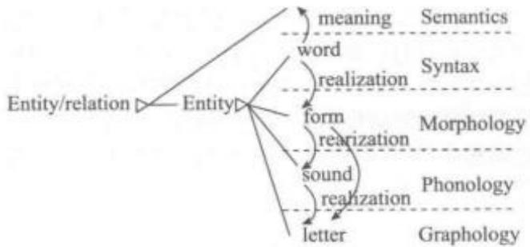

词语法开始时作为一种句法模式，后来拓展到许多其他领域的研究，如：词汇语义学(Gisborne，1993, 1996, 2000, 2001; Hudson & Holmes,2003; Hudson, 1992, 1995, 2003a;Sugayama,1993，1996，1998)、形态学（Creider，1999，Creider&Hudson，1999)、历史语言学（Hudson，1997a，b)、社会语言学（Hudson，1996a；1997b)和语言处理(Hudson, 1993a, b,1996b; Hiranuma, 1999,2001)。

## (一) 形态学

词语法区分两种词：词素(Lexemes)和屈折形式(Inflections)，前者如DOG，后者如PLURAL。由于默认承接，无标记的屈折形式可以仅仅处理为默认形式，DOG的默认值便是单数，相对于其复数。只有有标形式才需要在形态中提及。词素和屈折形式的差别允准两种不同实现关系的差别：词基(base)和完全屈折形式(fully-inflected form)。根据默认，词基与完全屈折形式相同，但是有标的屈折变化对此作出区分，这就是屈折形态学的范围，而推导形态学处理的是不同词素的词基之间的关系，如farm与farmer的关系。

由于默认承接，例外现象很容易处理。通常有两种不规则现象：(1)异干法，即整个词基形式改变，如person一people,come一go;(2)元音改变法，即只有元音发生变化，如foot—feet，goose—geese。当foot变为feet时，这两种形式的关联度可以从词形辨认，因此可以说 feet是foot的不规则变体，即 s变体。people是完全不规则变化，只能说people是PERSON，PLURAL.的具体实现，不将其与词干person相关联。

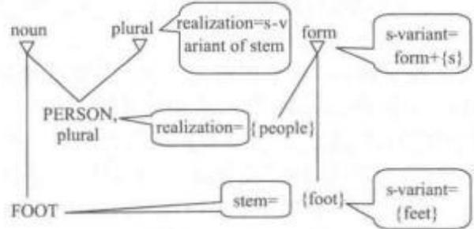

## （二）句法学

句法是词语法中发展得最完善的部分，研究的范围十分广泛，包括词序、语法功能、依存关系、并列关系、一致关系，约束关系等。词语法是依存语法的一种，认为句法结构由词与词之间的依存关系组成，短语结构没有存在的地位。词语法中两个词汇之间的句法依存关系由句法规则连接，词与词之间依存关系构成的链最终使得每一个词与短语或句子的中心语相连接，他们构成一种复杂的网络关系。主要的依存关系如下：

<table><tr><td>依存关系 缩略形式</td><td colspan="2">范例</td></tr><tr><td>前附加语</td><td>a+</td><td>big book</td></tr><tr><td>后附加语</td><td>+a</td><td>book about linguistics</td></tr><tr><td>主语</td><td>8</td><td>he slept</td></tr><tr><td>补足成分</td><td>c</td><td>about linguistics, the book</td></tr><tr><td>(直接)宾语</td><td>0</td><td>wrote it</td></tr><tr><td>间接宾语</td><td>i</td><td>gave her (some)</td></tr><tr><td>谓语</td><td>p</td><td>is big, make angry</td></tr></table>

“Big books about linguistics are expensive."的句 法分析的依存关系如下：

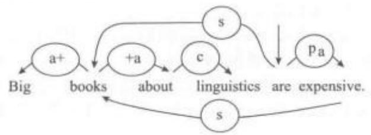

句法分析遇到结构共享和并列关系时情况便比较复杂。有时一个词同两个或两个以上的词保持依存关系，它就是结构中共享的依存成分。这个概念也使用于某些短语结构分析中，如中心语驱动短语结构语法。结构共享是词语法中允许非连续短语存在的一个主要运作机制。对于并列关系，词语法采用“词串”进行分析。

## (1) 提取结构

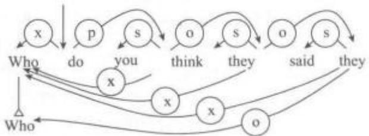

(2)并列结构  
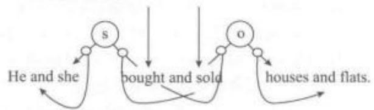

## (三)语义学与社会语言学

词语法把意义看作是通过与其他概念相连的联结网络所界定的概念，并联结到普遍知识网络中的已知特征。这意味着在纯粹语言意义和百科意义之间没有明显界限。要给概念下定义，就要用与其紧密相连的其他概念来解释。这种意义观与菲尔默(Charles Fillmore，1929—2014)的以概念框架定义词汇意义的框架语义学十分相似。

语义学和社会语言学的相似性和他们的差异性一样明显。语义学处理的是词语的指称意义，如apples和 bananas的差别或单数与复数的差别;社会语言学处理的是词语的社会意义。然而正如术语所表明的，这两种情况中，我们都在关注一种意义——由词的选择而导致的关于世界的信息。若能意识到词汇与思想之间存在关联，便可推断出这种信息。从扩散激活(spreading activation)的角度来看，词汇激活思想。词语法通过关系区别这两种意义。指称意义是所指的人或事物的属性；而社会意义通常属于说话者或受话人。不论哪一种情况，特定个体都是通过总的范畴分类。例如，当说话者和受话人的关系比较亲密时，通常会直接使用名而省略姓。

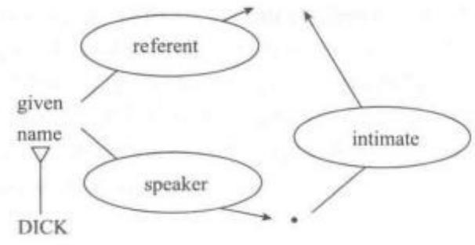

与许多其他语言学理论一样，词语法倡导组合语义学(compositional semantics)，句子的意义由其组成部分的意义构成。句子中的意义连接方式体现到句法中，但是语义连接是由意义自身导向的。下图中给出了“Dogs barked”的语义结构，词语意义之间的连接由动词bark提供，bark与其主语所指的连接关系是 agent(通常缩略为 er)。若将 barking 这个行为称为“事件e”(event-e)，语义结构必须显示事件-e的施事者是集合-s。动词的过去时屈折变化表明事件的发生时间先于说话时间，即t1<t2。

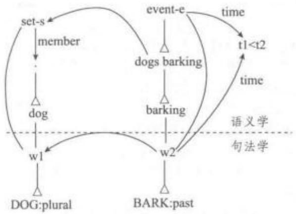

目前该理论除了应用于英语之外，也应用于其他语言的研究，如突尼斯阿拉伯语(Chekili，1982)、希腊语（Tsanidaki,1995，1996a，b）、意大利语（Vo-lino，1990)、日语（Sugayama，1991，1992，1993，1996；Hiranuma，1999，2001)和波兰语(Gorayska，1985)。

## 德国浪漫主义学派——新洪堡特学说

Romantic School of Thought in Germany —Neo-Humboldtism20世纪20至30年代出现的语言学新学说，是对德国语言学家洪堡特(Wil-helm Humboldt，1767—1835)学说的继承和发展。因洪堡特被视为当年浪漫主义运动的一员，持新洪堡特学说的语言学家，即新洪堡特学派，也被称为“新浪漫主义学派”。其主要代表人物有欧洲的魏斯格贝尔(Leo Weisgerber，1899—1985)、特里尔(Jost Trier，1894—1970)、美国的萨丕尔(Edward Sapir，1884—1939)、沃尔夫(Benjamin Whorf,1897—1941)等。

洪堡特是19世纪德国杰出的语言学家、哲学家、政治家、外交家和教育理论家，其学术研究涉及政治学、美学、人类学和语言学等多个领域。自1820年开始，他对大量不同语言的资料进行比较分析，深入探究人类语言的本质和人类精神发展的奥秘。

1820年6月19日，他在柏林科学院宣读论文“论语言发展阶段的比较语言学研究”，探讨了语言学研究的基本问题，提出了相关研究工作计划，阐述了语言学研究内容和界限。五年后，在“概论语法形成的本质及专论汉语的特性”(1825—1826年)一文中，他第一次阐明了对语言的形成、发展和本质的看法。洪堡特语言学理论的经典代表作是身后由其胞弟整理出版的三卷本巨著《论爪哇岛上的卡维语》的导文(1836—1839年)，导文题为“论人类语言结构的差异及其对人类精神发展的影响”，长达350页，高度总结了他在该领域的全部工作，完整阐述了他对语言的看法。洪堡特走在同时代人的前面，基于语言比较，从语言哲学、人类学和语言学的视角深入探讨了语言的本质和功能、语言活动的机制、语言结构和人脑思维的关系、语言的结构类型、语言的文化内涵等一系列重要的理论问题，提出了独特的语言理论，为普通语言学的创立奠定了基础。

洪堡特认为，语言是一种创造性的精神活动，是正在进行的活动(Energeria)，而不是已经完成的产物(Ergon)。语言活动是人类精神的一种基本特征，体现了说话人对其所掌握的有限语言手段进行无限运用的创造能力。每一种语言都有其特定的认知形式——“语言内蕴形式”，语言形式主要不是外部语音形式，而是内蕴于其中的语义结构。语言是一种精神格局，反映了使用该语言的民族的思维特征和和世界观。民族的语言即民族的精神，民族的精神即民族语言的高度升华，语言是民族与其客观环境之间的“中间世界”，民族的主要差异表现在语言上。语言与思维二者不可分割并相互作用，语言自一开始就参与了思想的形成，语言是构成思想的器官，思维不仅取决于语言本身，而且在某种程度上也取决于各种个别的语言，不同语言之间的差异即世界观的差异。

洪堡特语言学说内涵深广、生命力强，在当代得到了许多语言学家、哲学家的继承和发展，其中最引人注目的是新洪堡特学说。

新洪堡特学派最突出的代表人物是原西德著名语言学家魏斯格贝尔。在洪堡特学说的各种思想被承继近百年之后，他对洪堡特思想进行了全新阐释，把欧洲语言学人文主义传统推向一个新的高峰。魏斯格贝尔语言理论承袭了洪堡特的语言思想和索绪尔语言学说，并对前者加以发展。首先，从语言的认识论来看，直接接受了洪堡特的三个观点：语言是一种作用力(wirkende kraft);语言包含有某种世界观(weltansicht)；语言表达了一种内在形式(innereform)。在此基础上，魏斯格贝尔提出人类的精神活动决定了由现实转变为意识的过程，外在世界和意识之间存在着一个精神中间世界，其本质是语言，因而也可视为语言中间世界，该世界由一个语言集团而产生，是母语的中间世界，只有当它被看成是产品的时候，才是语言世界观。“母语中间世界”是魏斯格贝尔对洪堡特语言世界观学说的推陈出新。第二，发展了洪堡特关于“语言差异在于世界观本身的差异而非语音外壳符号”的思想，提出语言研究的目的不能停留在研究语音形态上，还要认识语言内容的结构并把握语言的精神构造。为此，他始创了内容相关语法(inhaltbezogene grammatik)，依据语义场来对语言范畴进行确认和分析。第三，对洪堡特的“内蕴语言形式”进行了新的理解和阐释，提出“内蕴形式”(innere form)的概念，强调语言内蕴形式对形成人类精神世界格局的作用力或塑造力，赋予语言世界观充分的活力。

特里尔也是新洪堡特学派的代表人物，他毕生致力于语言研究，在词汇学方面的成就尤为显著。特里尔在洪堡特、索绪尔以及魏斯格贝尔的语言思想基础上，提出了与个别词的研究方法所不同的、适合语言整体研究的方法，创立了语义“场学说”。场学说认为，一个语言的词汇不是一个以单一的词的形式来储存这个民族在历史过程中所习得的经验和认识的仓库。语言中的所有词都互相关联、互为依存，它们在语言符号这一系统中构成一个井然有序、编排齐截的整体。正如砖瓦梁椽不能随意堆砌成一座建筑，而是在建筑的整体中各得其所、各获其能一样，词也在语言词汇的整体中各占其位、各表其义。由是，研究词汇的具体步骤应从词汇的各个领域，即他所称的“场”入手。

此外，美国两位语言学家萨丕尔和沃尔夫也深受洪堡特思想的影响，在看待语言与思维的关系问题上，观点与魏斯格贝尔相似，通过“语言相对论”(linguistic relativity)得到体现，一般称作“萨丕尔一沃尔夫假说”(Sapir-Whorf Hypothesis 或 Whorfian-ism)。语言相对论认为语言结构影响不同说话人概念化世界的方式如世界观，或影响其认知过程。一般认为该原则有两种解释：强假设和弱假设。前者认为语言决定了说话者的感知和生活方式，也称作“语言决定论”(linguistic determinism);后者认为只有语言范畴和用法影响思维及诸如此类的非语言行为。该假说从另一角度阐述了语言和思维的关系：人类的思考模式受其所用语言的影响，即在不同文化下，不同语言所具有的结构、意义和使用等方面的差异，在很大程度上影响了使用者的思维方式。既然思维必须通过语言进行，那么所使用语言的固定模式必定留下思维的烙印，语言固定模式反映一个民族的心理特征和世界观，因此，分析一个民族词汇和语法特征就能了解该民族的思维方式和心理特征。在当代，对语言的解读已经成为探求社会心理

的一种有效方式。

新洪堡特学派的著作主要有：魏斯格贝尔的《语义学——语言学的歧途?》(1927)，该书明确指出传统语义学的不足，并在此基础上创建了一套研究词汇的新方法；《母语和精神构成》(1929)是魏斯格贝尔的一部纲领性著作，包含了他的整个语言理论框架。四卷本《论德语的力量》(1949/1950)则是魏斯格贝尔最重要的著作，该书集中体现了其语言思想与理论基础，其中第一卷是其语言学理论核心部分；《语言规则作为语言研究的基础》(1951)、《语言研究中的四个阶段》(1963)、《语言的精神方面及其研究》(1971年)等是魏斯格贝尔的其他代表作。特里尔最有代表性的著作是1931年出版的《智能义域中的德语词汇》，该书为词汇研究开辟了一条新的途径，被视为词汇研究经典之作。萨丕尔主要代表作是1921年出版的《语言论》(Language)，该书主要论述语言是什么，以及它跟思维、种族、文化以及艺术等方面的关系等。沃尔夫的代表作《论语言、思维和现实一沃尔夫文集》则阐述了语言、思维和现实之间的关系。

以魏斯格贝尔为代表的当代新洪堡特主义承袭和发展了洪堡特的语言和哲学思想，对语言世界观理论作了全新的阐释和发展，认为语言不仅是一种可以对象化、客体化的认识框架和思维模式，更重要的是一种精神、文化、历史世界的塑造力量，语言积极参与民族文化、民族精神的建构，在现实世界改造转化为精神财富的过程中中发挥不可或缺的作用。

德国唯美主义语言学派The AestheticistLinguistic School in Germany 亦称“新语文学派”，形成于20世纪初的语言学流派之一。创立者是德国的浮士勒(Karl Vossler，1872—1949)，其他语文学家有列尔赫(Eugen Lerch，1889—1952)、斯皮策(Leo Spitzei)、洛尔赫(Etienne Lorch)和别尔多尼(Giulis Bertoni)等。

唯美主义语言学派的理论本质是唯心主义语言学体系，与新语法学派相对抗，认为语言是个人的精神创造和表现，强调人类语言能力个体性和创造性的一面。他们认为一切语言变化都是心理的直觉和个人的精神创造，这些变化是个人有意识的作为，也反映出民族感情、文学因素和美学因素在刺激创新成分方面起着支配作用，因此有创造能力的个人在语言发展中的重要性不容低估。

浮士勒是德国语言学家、罗曼语文研究者和文艺理论家。1872年9月6日生于霍恩海姆，1949年9月19日卒于慕尼黑。先后在海德堡、维尔茨堡和慕尼黑等大学任教授，1947年退休。浮士勒的主要著作是关于罗曼语族各国人民的精神文化的。他研究了意大利、法兰西、西班牙的文学和语言；晚年还研究了葡萄牙和南美洲的文学。主要著作有《语言学中的实证主义和唯心主义》(1904)、《语言的创造和发展》(1905)、《语言哲学论文集》(1923)、《语言中的精神和文化》(1925)和《法国的文化和语言》(1929)等。

在语言学方面，浮士勒是一个彻底的唯心主义学者。他自认为他的语言学观点实质上是一种彻头彻尾的唯心主义语言学体系。在他的纲领性著作《语言学中的实证主义和唯心主义》(1904)中，浮士勒认为新语法学家所走的是实证主义道路，只看到语言中那些机械的、死板的东西。他指出“语言是精神的表现”，语言的发展变化导源于个人对美的追求以及有意识的审美创造，而不是“盲目的必然性”所驱使。在对新语法学派的实证主义的批判中，他斥责新语法学家为“只关心琐碎问题的实证主义者”。在他看来，新语法学家只知道积累事实，就事论事，这只能导致人类思维的死亡和科学的灭亡；他认为应该强调从精神方面去探求语言现象之间的因果关系。他倡导的“新语文学”把一个语言集团的地理位置和历史发展放在一块来研究，与当时德国新语法学派片面强调语音，不考虑其他问题的做法不同。新语法学家认为，人们发音是不自觉的，语音规律不允许有例外，浮士勒则强调个人在语言中的创造作用。新语法学家认为音素构成音节，音节构成词，词构成句子，句子构成言语。但浮士勒认为这一顺序并不符合实际，而应该相反：“是存在于言语中的精神构成了所有这一切——句子、句子成分、词和音素”，因此他认为文体学是语言学中的最重要的部分，并可藉此解释跟各种低一级的学科—语音学、形态学、构词法以及语法有关的一切现象。风格学的研究能使人们较易地发现语言变化和社会文化史的关系，确定语言和民族精神的相互制约性，揭示个人的创造对语言发展的影响。

浮士勒的语言观深受意大利哲学家、美学家、文学理论家贝克罗齐(Benedetto Croce，1866—1952)和德国语言学家、政治家洪堡特(WilhelmHum-boldt，1767—1835)的影响。他的语言研究是从哲学出发，而不是从语言史出发。他吸收了洪堡特语言学观，语言是思想的创造器，语言是民族精神的不断活动的思想，因此他认为“语言是民族性的外部表现，民族的语言就是民族的灵魂，民族的灵魂就是民族的语言”。他也采纳了克罗齐的说法，语言就是表达，而且是“心灵最原始的表达”，因此语言和艺术、语言和美学是相通的，都是运用一定的物质表达直觉的，“语言就是精神的表现”。在此基础上，浮士勒进行了唯心主义的发挥，认为任何一种语言变化的动因都来自作为集体灵魂组成部分的个人灵魂的创造，来自与风格有着直接关系的美学因素。至于个人创造的语言表达方式能否转变为共同的规则，浮士勒认为，那要看是否适合民族精神的需要，因为“句法规则是以民族的占主导地位的精神特点作基础的”。浮士勒还说，语言反映民族文化，语言发展与各时代的思想和艺术密切相关，研究语言要注意思想、文化与语言的相互作用，尤其要注意个人的艺术创造，而不应从声音和符号入手。

总之，以浮士勒为代表的唯美主义语言学派指出了新语法学派的缺点，并且强调考察语言变化中的美学因素和创造因素，重视语言风格学，注意研究语言和思维的关系、语言和文化的相互作用等等，这些都有着积极的意义。但该派别把语言的一切都归结为心理的直觉、个人的精神创造，这种观点否定了语言的社会本质；该派别过分强调语言的文学和美学方面，而轻视语音学、形态学以及句法学等研究的科学性，认为它们是实证主义者建造的坟墓，最终把语言研究带入唯心主义的死巷。

德国新语法学派 The Neogrammarians inGermany 亦称“青年语法学派”(The YoungGrammarians)“莱比锡学派”(Leipzig School)“个人心理主义语言学派”。其主要代表人物是德国学者，其中有布鲁格曼(Karl Brugmann，1849—1919)、奥斯特霍夫(Hermann Osthoff，1847—1907)、莱斯金(August Leskien，1840—1916)、保罗（HermannPaul，1846—1921)、德尔布吕克(Berthold Delbrück，1842—1922)等，丹麦的维尔纳(Karl Adolph Ver-ner，1846—1896)、汤姆森(Vilhelm Ludvig PeterThomsen，1842—1927)。俄国的弗尔图纳托夫(Φ , Fl FvchFortunatov1848—1914)等也持有相近的观点。代表刊物为《形态学研究》。代表青年语法学派观点的作品有：布鲁格曼和奥斯特霍夫为《形态学研究》杂志第一卷(1878)所写的发刊词(一般被认为是青年语法学派的宣言)、保罗的《语言历史的原则》(1880)和布鲁格曼和德尔布吕克合著的五卷本《印度一日耳曼诸语言比较语法纲要》(1893)等。

新语法学派(Neogrammarians)形成于19世纪70、80年代。1870年前后一批青年学者在语音研究方面取得新的进展，并逐渐清理了混乱的印欧语言元辅音发展，反映了对语言本质和研究方法的新认识。由于当时莱比锡大学的奥斯特霍夫和布鲁格曼等年轻学者对梵语与古希腊语的关系提出了新看法，老一辈语言学家如库尔蒂乌斯等深为不满，揶揄他们为“青年语法学派”(德语称为Junggrammatiker)。1878年布鲁格曼和奥斯特霍夫在库尔蒂乌斯停办杂志《希腊拉丁语法研究》之后创办了另外一份刊物《形态学研究》。他们在发刊词中对老一辈语言学家的观点进行了激烈抨击，全面阐述了青年学者的观点和行动纲领，并正式使用了“青年语法学派”这一名称，这标志着青年语法学派的成立。1885年意大利语言学家阿斯科里(Graziadio Isaia Ascoli,1829—1907)把这一名称译为Neo-grammatici(新语法学派)，后来很多人都照此转译。

新语法学派的观点基于对19世纪初期的历史语言学家格林(Jacob Ludwig Carl Grimm，1785—1863）和中期的施莱歇尔（AugustSchleicher，1821—1868)等人的思想批判继承。新语法学派与以往的比较语言学家的根本分歧就在于对语言本质和语言的发展过程有着不同的看法。他们认为施莱歇尔等对语言变化的哲学解释是靠不住的猜想，语言并不是什么有机物，也没有成长、发展、衰败的过程，从而坚决摈弃“语言有机论”，并认为应该彻底转变语言研究的目标和重点。以往的比较语言学家注重从书面材料追根溯源，企图确定语言的最古形式，重建印欧原始语；布鲁格曼和奥斯特霍夫提出把研究视线从古代的语言转向现代语言，从故纸堆中静态的死的语言转向身边各种活的方言，不在重建“原始语”上耗费精力。1878年布鲁格曼和奥斯特霍夫在《形态学研究》发刊词中宣称，一般语言学家所从事的只限于语言的研究，而很少注意到说话者个人方面的研究。他们认为比较语言学的首要研究任务就是要弄清语言机制活动的性质。实际上人类言语机制的发展变化拥有两面性，即个体的心理特性和生理特性。比如语音方面通常会发生一些由nb变成mb，bn变成mn，或ar变成ra的变化。如果语言学家仅仅从语音生理学角度研究，有些现象很难进行解释。倘若运用心理因素进行考察，一些现象的理解也许就变得容易。“类推作用”要求研究活的语言或方言，因为这比古代死的语言更易于观察，并且更易于得到更多揭示语言发展律的素材。学派创始人之一莱斯金(AugustLeskien)说：“在一定时期存在的种种语言形式可用两个要素(有规律的语言变化和类推的影响)来解释，而且只需要理会这两个要素”。可见，新语法学派在语言变化方面强调两点：语音变化无例外和类推作用。布鲁格曼和奥斯特霍夫认为，只有一方面研究语言最近的发展状态和活的方言，一方面具体观察语言活动的心理和生理的机制，才获得语言的本质认识。

在长期的语言研究探索中，拉斯克(RasmusChristian Rask，1787—1832)、葆朴(Franz Bopp，1791—1867)和格林等历史比较语言学家发现了一系列语音规律的存在，但并没有力图证明这些规律绝对性。施莱歇尔主张“严格遵守语言规律”，同时也认为规律经常带有例外。直至1870年前后，历史比较语言学家把语音规律看作是语音变化过程中确实存在着的规律性现象，但同时也有许多明显的无规律的情况。19世纪70、80年代，一些学者取得许多重大发现：阿斯科里（Graziadio Isaia Ascoli，1829—1907)对印欧语k问题的新解释；维尔纳(Karl Verner)在格林定律基础上提出了补充说明并确立了维尔纳定律；布鲁格曼和索绪尔等对印欧语言元音原始体系的新阐述。通过这些持续不断的发现，人们开始形成新的认识：原来似乎无法解释的一些例外也很有规律可循。维尔纳在1872年建议把“没有一个规律是没有例外的”改为“没有一个例外是没有规律的”，并认为“曾支配一个语言的规律倘有任何例外的话，这例外一定另有原因”。以“格林定律”为例，虽然这些规律与事实大致相符，但也有不少例外。例如，该定律规定拉丁语的t在日耳曼语中的对应形式应是/θ/，但实际上却有时是/t/，有时是/d/，类似例外使语言学家很困惑。维尔纳后来发现这种例外音变与重音的位置有关：在后期原始日耳曼语中，只有位于词首或紧跟重读元音之后的原始印欧语清塞音/p/、/t/、/k/才变为清擦音/f/、/0/、/h/，而在其他位置的清塞音/p/、/t/、/k/则变为浊塞音/b/、/d/、/g/。“维尔纳定律”(Verner's law)揭示了日耳曼语言辅音系统的变化和重音的关系，类似新的发现使人们意识到语言规律的例外也存在规律。1876年莱斯金发表论文《斯拉夫一立陶宛语和日耳曼语的名词属格》，第一次提出“语音规律无例外”的概念。布鲁格曼和奥斯特霍夫在《形态学研究》发刊词中同样指出：“任何一个语音变化，由于它是机械地发生的，因此都是按照没有例外的规律实现的，也就是说，如果不把方言的分歧计算在内，那么同一个语言集体的所有成员的语音变化总会有相同的方向，并且一切含有在相同条件下易受变化的语音的词一定要起变化，没有例外”。

新语法学派在研究中发现，产生语言变化之例外现象的原因复杂：其外在因素包括隐蔽规律的作用、外来借词的引人或同化、避免词汇同音或与禁忌语词发音相似、对词源理解有误等；其内在因素主要是类推作用的影响。所谓的类推作用是指说话人无意识地以某些词的形式为标准改变另一些词的形式或创造新词。例如，在由拉丁语发展为古代法语的过程中，依照语音变化的规律，a音应有两种新发展：非重音的a保留原状，如由拉丁语amare(爱，不定式)变为古法语 amer;但在 m 或 n之前的重音 a都变成ai，如拉丁语amo(我爱)变成古法语 aim，拉丁语amas(你爱)变成古法语aimes。由此看来，拉丁语的同一语音 a在古法语中就演变为 am-和aim-两种形式。后来法语以aim-为标准进行类推，结果变成现代法语的amer也变为 aimer，以至于最后am-消失。类推作用因此可以解释许多音变现象。新语法学派认为类推有其心理根源。在人的意识中每个词或形式并不孤立存在，而总是跟别的词和形式相联系。保罗在他的《语言史原理》中更是从个人心理方面解释语言的发展。他认为类推作用是最重要的因素。类推不仅在语音方面起作用，而且在任何有意义的地方都可以看到其影响，而类推作用和说话者个人有关。

后人对新语法学派的批评主要体现在以下方面：第一，个人心理主义的语言观。过分强调心理联想的作用，认为语言是个人心理活动的结果，把个人心理活动当作语言发展变化的主要原因；忽视对语言的社会特性的理解，没有认识到语言演变是社会历史现象：第二，“原子主义”的研究方法。仅注重分析个别的语音和语法形式，把语言演变分解为彼此孤立的个体现象来处理：以经验主义的眼光审视语言，缺乏理论的概括，不利于对语言总体的研究；第三，狭隘的研究范围。拘泥于语音，很少涉及形态和句法等方面；虽然竭力号召研究现代语言和各种方言，却依然没有摆脱原始印欧语书面材料的束缚。

新语法学派在语言学历史上的贡献也不可忽视。他们汲取了19世纪历史比较语言学的研究成果，摒弃了荒谬的猜想和假设，进行了科学的总结并提出一些新的观点。首先，他们抛弃了“语言有机论”和“语言生命的两个时期”的假设，提出了“语音规律无例外”和“类推作用”这两个具有方法论意义的研究原则。特别是对语音变化规律性的深入认识使历史比较语言学获得可靠的理论基础：其次，他们主张研究现代活的语言及其方言，重视语言材料的搜集和分析，提出语言演变的模式，对语言的演化做出了新的理论解释，改变了历史语言学的研究方向，预示着20世纪初结构主义语法的诞生。再次，他们用新的观点阐述语言的分化和方言的形成，改进了对原始印欧语的看法，从而认识到历史比较法只是一种研究手段，通过这些手段可确立亲属语言的对应关系。新语法学派的贡献对当时欧洲的历史比较语言学起了很大的推动作用，促进了语言学的发展。

德国自然主义语言学派The Naturalist Lin-guistic School in Germany形成和发展于 19世纪50年代到60年代的一个语言学流派。其主要代表人物是德国语言学家施莱歇尔（AugustSchleicher，1821—1868)和德裔英籍语言学家缪勒(Friedrich Max Müller, 1823—1900)。

德国自然主义语言学派的观点跟施泰因塔尔(Heymann Steinthal，1823—1899)等人的心理主义相对。自然主义语言学派把语言看作一种自然的机构，要采用自然科学的方法去研究语言。在19世纪初，许多语言学家如拉斯克(Rasmus Christian Rask，1787—1832)、葆朴(FranzBopp，1791—1867)、施莱格尔(Friedrich von Schlegel，1772—1829)就有过这样的说法：“语言是一种机构”，“语言是一种自然的有机体”。但真正系统地提出“语言有机体”理论并用自然科学的方法去研究语言的应该是施莱歇尔和缪勒。

施莱歇尔1821年生于德国波恩，早年曾准备攻读神学，后转变从事语文学研究。1846年起，先后在波恩、布拉格和耶拿等地大学任教，1855年起兼任彼得保科学院通讯院士。1868年去世。一生著书颇丰，影响很大。其中有《教堂斯拉夫语的形态学》、《立陶宛语手册》、《语言比较的研究》(1848)、《论语言的形态学》(1859)、《德语》(1860)、《印欧语比较语法纲要》(1861)、《达尔文学说和语言学》(1863)、《论语言对于人类自然历史的意义》(1865)、《名词和动词》等。

施莱歇尔从小就很注意对各种方言、民歌的搜集和语言的学习，通晓多种语言，主要研究日耳曼语、斯拉夫语和立陶宛语。他对哲学和植物学很感兴趣，早期就接受了黑格尔（GeorgWilhelmFriedrich Hegel，1770—1831)的哲学思想和达尔文(Charles Robert Darwin，1809—1882)的进化论观点。在许多前辈如施莱格尔、葆朴、格林等学说的基础之上，施莱歇尔提出了自然主义语言观，开创了自然主义语言学派，从而成为19世纪中期最重要的历史语言学家。

施莱歇尔认为语言学同自然科学有不可分割的联系，语言学家与语言的关系如同植物学家与植物的关系一样。在许多书中他都把语言看作一种机构，认为语言的生命和动植物的生命并没有什么本质的区别，语言按照自然的规律存在并发展，并且可把语言的发展分为成长和衰老两阶段。语言在成长时期由简单结构变成更复杂的形式，在衰老时期由它所能达到的最高发展阶段逐渐衰退，它的形式也因此受到损害。施莱歇尔据此把语言的生命分成两个完全不同的时期：语言发展的历史和语言衰败的历史。语言发展的上升阶段是在人类的史前时期；从有史时期开始，语言的历史就是一部衰落史。在史前时期，语言一切高级的形式都是由较简单的形式变成的，如由孤立形式变为粘着形式，由粘着形式变为屈折形式；在有史时期，由于语言形式的衰败，句子的功能和结构等方面会有很大变化。

根据“两个时期”的假说，语言发展只是史前时期的事。在洪堡特语言分类基础上，施莱歇尔把世界语言分为孤立语、黏着语和屈折语三类，形成了他的语言进化的三个阶段。“一切比较复杂的语言形式都源自比较简单的语言形式，语言的黏着形式产生于孤立形式，而屈折形式产生于黏着形式”。在施莱歇尔看来，所有语言都起源于词根语，然后通过辅助词的黏着，最后发展到高级阶段，也就是印欧语开始衰落时的屈折结构形式。

根据植物学中的谱系理论，施莱歇尔建立了展示印欧语分化的谱系树模式。他认为每个语系都有它的一种原始语，就像树根。所有同系的语言都是由这树根长出来的枝条，如由印欧系原始语分叉为亚细亚一南欧语族和北欧语族，然后由其中的亚细亚一南欧语族分叉为印度一伊朗语支和南欧语支，再然后由其中的印度一伊朗语支分叉为印度语和伊朗语等。他采用生物学中植物分类的方法来研究语言的历史亲属关系，把当时存在的语言按其共有特点分成语系、语族、语支等。施莱歇尔在《达尔文学说和语言学》一书中更是把达尔文关于物种起源和发展的学说运用在语言领域，例如自然科学中“属—种——亚种变种个体”的分类，在语言学中相应的就是“语系—同一语系的语言——方言——次方言—个人的语言”。动植物界中看到的物种分化和生存竞争的现象也发生在语言领域。施莱歇尔的“语言有机体”理论和语言谱系图清晰地揭示了语言演变的历史。

施莱歇尔创造了重构方法(reconstruction)，推进了语言的历史比较研究。重构是指以留存语言成分的比较为基础，推断共同母语的原始形式的一种方法。在《印欧语比较语法纲要》里，施莱歇尔用这种方法重构了印欧原始语的元音、辅音、词根、词干结构、名词变格、动词变位等。这种方法促使研究者注意语音演变的细节，并把研究结果归纳到重构的形式中去，并有利于说明语言历史演变的情况。

缪勒是施莱歇尔自然主义语言学观的拥护者。他在《语言科学讲话》(1861)一书中宣传语言的生物学观点，把语言学与语文学对立起来。他认为语言学和语文学不同，语文学以语言为手段去研究人类社会的道德、智慧、宗教和文学，属于历史科学；而语言学以语言为研究对象，应该属于自然科学。这一理论把语言及其历史同社会及社会发展过程割裂开来，离开具体历史条件研究语言，忽视语言解体过程中相互交错的分化现象和统一现象。缪勒的观点曾受到美国语言学家惠特尼(William Dwight Whit-ney，1827—1894)的坚决反对。但他的通俗生动的讲义宣传使“语言是有机体”等观念广泛流行。

以施莱歇尔和缪勒为代表的自然主义语言学派错误地认为语言是自然现象，将语言学归入自然科学，并按自然科学的原则去研究语言，这样就从根本上抹杀了语言的社会性，从而导致对语言性质及其变化缺乏正确的理解以及可靠的理论基础的缺失。由于受到语言生命的“两个时期”假说的影响，当时的语言学家把目标集中在印欧原始语的研究和重建上，各种现代语言和方言被视为“退化的语言”，活的口语的考察被忽视，语言的历史比较研究范围受到极大限制。但自然主义语言学派的语言亲属关系和谱系树理论、重建原始语的比较方法、对语言的分类以及语文学与语言学的分化等，都体现了19世纪上半叶历史语言学研究的显著成绩。

第二语言习得Second language Acquisition;SLA指关于学习者学会母语之后对另一门乃至多门语言的学习或习得的研究，简称二语习得。

一般认为，二语习得研究始于20世纪60年代末至70年代初，分别以科德(Stephen Pit Corder)1967年在《应用语言学国际评论》(International Review of Applied Linguistics)杂志发表的《学习者错误之重要性》(The significance of learner's errors)和塞林格(Larry Selinker)1972年在同一份杂志上发表的《中介语》(Interlanguage)两篇文章为发端。1975年元月在美国密西根大学应用语言学第六届年会期间，召开了二语习得研究会议，二语习得研究作为一门新学科宣告诞生。随后，二语习得作为一个独立的学科，其主要目标是建构可以描述二语习得过程并解释二语习得特征的理论体系。

二语习得研究经历了以下几个具有不同取向的时期:第一个阶段是发端于20世纪40年代并盛行至60年代的语言对比分析时期。这一分析方法是基于行为主义心理学和结构主义语言学的理论，以美国语言学家拉多(RobertLado，1915—1995)为主要代表。拉多进行语言对比分析旨在为语言教学提供参照。语言对比分析通过比较外语和母语的差异，预测二语学习者可能会遇到的难点。

第二个阶段为错误分析时期。由于对比分析难以预测二语习得过程中学习者可能犯的错误，20世纪60年代后期，以二语学习者在二语学习中所犯错误成为研究的重点。根据这一研究，错误分析可分为两大类，一是受母语影响而导致的错误，二是不受母语影响所犯错误，即偶然性错误、随机性错误和反映学习者过渡性语言能力但具有规律性的错误。科德在1974年发表的题为“错误分析”的一文中提出错误分析的四个过程，即选择语料、识别语料中的错误、对错误进行分类以及解释错误。

第三阶段为中介语分析时期。由于错误分析中的不足，研究者的研究重心又转向了语言学习者的语言，即中介语(interlanguage)分析时期。“interlan-guage”一词是塞林格在1972年在其文章中首次使用。中介语是指每个二语学习者在某个阶段所形成的一种有结构的语言，既非母语也非第二语言。对它的研究旨在为二语习得提供解释的理论。

第四阶段为普遍语法时期。20世纪80年代，美国语言学家乔姆斯基提出了普遍语法理论(Universal Grammar)。该理论认为，普遍语法是存在于每个人大脑里的一套高度抽象、高度概括的原则和未定值的参数，是“初始的语言状态”(initial state)，体现了每个人大脑中的语言机制。普遍语法理论虽然是针对儿童母语习得提出来的，但由于该理论的原则一参数模式基本观念认为普遍语法原则反映了人类语言的共同属性，各语言之间的差异表现为参数值的变化，因而仍被广泛地应用于二语习得的研究。20世纪80至90年代的二语习得研究大都是在普遍语法的框架内进行的。

与此同时，在欧美具有较大影响力的二语习得的理论框架为语言类型学(linguistic typology)。这一理论由美国当代描写语言学派学者格林伯格(Jo-seph Greenberg)在20世纪60年代提出。它以多语种语料为基础，通过对尽可能多的语言进行研究，发现不同语言的特征。通过这些特征对其进行分类并归纳出经过高度概括的语言共性和发展倾向。它的目的是弄清不同语言所具有的普遍性特征和标记性以便对语言习得的规律做出预测。

20世纪90年代初，二语习得研究体现出了与语料库语言学(Corpus linguistics)相结合的特点。以格兰杰(SylvianeGranger)为首建立的国际英语学习者语料库(International Corpus of Learner English)开辟了中介语对比分析(Contrastive InterlanguageAnalysis，简称CIA)的二语习得研究新领域。语料库语言学采用定量或定性的方法研究语言的应用，描写语言的普遍性。建立外语学习者语料库能直接服务于二语习得研究，如可用于研究学生的中介语、语言石化、获得语言的程度等。进入21世纪后，基于学习者语料库的二语习得研究呈现多元化发展态势，涉及本族语和非本族语学习者的多角度研究，写作语料库和口语语料库计算机软件开发，和语料库的教材设计。

21世纪开始以来，二语习得研究还以语言动态变化性为新视角，结合复杂理论(ComplexTheory)，微变化研究方法(Microgenetic Method)和事件相关电位技术(Event-Related Potentials，简称为 ERPs)探究学习者微小动态的二语认知观念变化和习得过程。这一领域得到了一系列理论实证研究的推动，例如：贝尔茨(Julie Belz)和金津杰(Celeste Kin-ginger)于2002年对信息技术环境下的二语学习者语用能力的微变化进行的研究；普拉特(ElizabethPlatt)和布鲁克斯(Frank B. Brooks)于 2002 年对语言活动参与的变化过程的研究，拉森一弗里曼(Diane Larsen-Freeman)和卡梅伦(Lynne Cameron)于2008年结合二语习得的课堂话语进行的复杂性研究，以及斯坦豪尔(Anja Steinhauer)于 2009 对二语学习者习得过程中的脑反应机制进行的ERP相关研究。

近年来，二语习得的语言动态变化性研究，从另一个角度，将二语习得研究的领域由学习情境拓展至学习者的内心世界。佐尔坦(Zoltán Dörnyei)(2005，2009)根据心理学动机理论提出了二语动机自我系统，从三个层面，即理想二语自我（Ideal12self)、应该二语自我(ought to L2 self)和二语学习经验(1.2 learning experience)，来研究二语学习者的主观能动性，协调个人与社会之间的能力和心理适应的动态性。

二语习得理论是研究人们在掌握母语后习得第二语言的过程和规律。二语习得的研究内容可归纳为四个主要方面：第二语言学习者学到了什么，语言学习者如何习得第二语言，学习者个人习得第二语言有哪些差异以及课堂教学对二语习得有什么影响(Ellis，1994)。二语习得具体包括以下一些问题：

(一)母语在二语习得中的作用。如语言迁移的问题，即学习者母语语言体系的语音、词汇、语法、篇章等在二语习得中产生的影响。这种影响可能是正面的，即正迁移，也可能是负面的，即负迁移。

(二)学习者研究。指针对学习者的年龄、潜能、动机、态度、认知风格、学习策略及学习动机等方面及其与二语习得关系的研究。

(三)课堂教学的作用。指正式的课堂教学对二语学习者在学习路径和效果上的影响。它的重要性还在于发现环境因素在二语习得中的起到的作用有哪些。

(四)输入与互动的研究。输入是指二语学习者所接触的目标语语言材料，是二语习得发生的条件之一。输入既可以在自然环境下，也可在课堂教学环境下;既可以在双向的交际环境中，也可以在单向的非交际环境中。互动是发生在课堂上的二语习得的途径之一。课堂为学习者提供了学习二语的机会和环境，使他们通过参与课堂互动进行交际和意义的协商，从而促进习得。研究者通过研究课堂互动了解学习是如何发生的。

二语习得理论经过几十年的发展已经形成了多种观点各异的理论、假设或模式等。不同的研究者对它们有不同的划分。对第二语言习得研究影响较大的理论或模式包括：

## (一) 普遍语法理论(The Universal Hypothesis)

普遍语法理论由乔姆斯基于1981年提出。这一理论认为人的语言能力的认知结构是先天的。婴儿出生时就已有一部分语法知识以大脑物质和结构的形式固定下来。这部分知识是一些高度概括和抽象的语法原则和尚未定值的语言参数，是人类所共有的普遍语法。人之所以能掌握语言是由于人脑固有的这一生物属性与后天语言习得经历相互作用的结果。以普遍语法为基础的二语习得研究一般认为，二语习得与儿童母语习得一样受制于普遍语法，第二语言的习得是一种建立语言参数值的过程。

## (二) 中介语理论(The Interlanguage Theory)

中介语理论由塞林格(Larry Selinker)于1972年提出。根据这一理论，中介语是指第二语言学习者的一种独立的语言系统，这种语言系统在结构上处于母语与目标语之间的状态，所以这是二语学习者在到达目标语前必经过的。对二语学习者中介语的研究可以揭示学习者在第二语言习得过程中认知发生和发展的特征。

## (三)监察模式(The Monitor Model)

监察模式是20世纪70年代美国语言学家克拉申(Stephen Krashen)提出的一种第二语言习得模式。克拉申认为学习者拥有两个独立的知识系统：潜在意识系统和有意识系统。使用语言时，学习者用潜意识系统进行输出，而用有意识系统对输出的语言进行监察。克拉申的监察模式共包括五个假说：(1)习得一学得假说。习得是指二语学习者在没有意识的情况下掌握语言知识，是一种自然习得的过程;而学得是指二语学习者有意识地通过学习语言规则和形式而掌握语言知识，是一种有意识的过程。(2)自然顺序假说。它强调大多数学习者遵循一定的习得顺序习得语言知识，语法结构也是按一定的顺序习得的。(3)监察假说。这一假说认为，人人都有一套语言监察系统，对自己产出的语言进行监控和调整。(4)语言输入假说。根据这一假说，语言习得是在理解了输入信息的条件下产生的。学习者需要获得可理解的目标语语言形式的语言范例，才能自然地学会其中的句子结构和语法规则。有助于二语习得发生的可理解输入的必要条件是学习者听到或读到的语言材料难度应略高于学习者目前已经掌握的语言知识。这就是语言输人假说的i+1理论。(5)情感过滤假说。克拉申认为，包括焦虑、自信心和动机等因素的不同的情感状态影响二语习得。情感的变化会促进或阻碍所输入的语言与二语习得机制之间的传递。这对教学的启示是，我们在教学中应当营造一种情感过滤较低的环境。

## (四) 神经功能理论(The Neurofunctional Theory)

神经功能理论由拉门德拉(John Lamendella)于1977年提出。拉门德拉区分语言习得的两个基本类型:初级语言习得和第二级语言习得。初级语言习得指2\~5岁儿童对一门或多门语言的习得;后者是指人在5岁以后正式的课堂环境的二语习得和自然环境的二语习得。与这两种语言习得相关的是不同的神经功能系统。每个系统都由各种功能的层级体系组成，并起着不同的信息加工作用。拉门德拉提出语言功能的两个层级系统：(1)交际层级体系(communication hierarchy)，负责语言和其他形式的交际；(2)认知层级体系(cognitive hierarchy)，控制各种认知信息加工活动，这也是语言使用的一部分。

## (五) 文化适应模式(The Acculturation Model)

文化适应模式是由舒曼(John Schumann)于1978年提出。文化适应模式的提出源于对二语习得的重新认识，即二语习得仅仅是文化适应的一个方面，学习者对目标语社团文化适应的程度将控制其二语习得的程度。因此，文化适应下的二语习得取决于学习者与目标语言的社会和心理距离。距离越小，习得越容易。

## (六)多元发展模式(The Multidimensional Model)

多元发展模式是由皮埃耐曼(Manfred Piene-mann)于1998年提出。多元发展模式的提出为语言加工性理论(Processibility Theory)的研究奠定了基础。皮埃耐曼认为二语习得的过程遵循某种规律，具有内在的发展轨迹和特征，学习者的二语发展依照语言加工机制接收，处理，产出相关语言表述形式(1998，2003)。这一理论得以进一步探究二语发展的语言认知过程和论证与母语迁移之间的关联和制约因素。

其他具有一定影响的二语习得理论或模式包括：兰伯特(Wallace Lambert)于1967年提出的“社会心理模式”(The Social Psychological Model)、翟理斯(Howard Giles)等在 20世纪 70年代后期提出的“适应理论”(Accommodation Theory)、埃利斯(RodEllis)和威多森(Henry Widdowson)等人在 20 世纪80年代提出的“多种语言能力模式”(Variable Com-petence Model)、哈奇(Evelyn Hatch)于 1978 年提出的“话语理论”(DiscourseTheory)、约翰·安德森(John Robert Anderson) 于 1983 年提出的“ACT 模式”(the Adaptive Character of Thought)、麦克劳林(Barry McLaughlin)1983年提出的“信息加工模式”(Information Processing Model)等。

对比语言学 Contrastive Linguistics亦称对比分析(Contrastive Analysis，CA)或对比研究(Contrastive Studies)。作为语言学的一个分支，对比语言学的主要任务是对两种或两种以上语言进行共时的对比研究，描述并解释它们之间的相同和不同之处，尤其是不同之处，并将研究成果应用于语言和其他相关的研究领域。

“对比语言学”这个名称最早是美国人类语言学家沃尔夫(Benjamin Lee Whorf,1897—1941)1941 年在他的《语言与逻辑》(Language and Logic)一文中提出的。对比语言学作为现代语言学的一个分支主要有两个源头，分别在欧洲和美国。在19世纪末20世纪初，欧洲语言学兴趣逐渐从历史研究转向共时研究，大多以理论研究为主，但应用研究也未被忽略。20世纪20年代末，捷克的马泰修斯(VilemMathesius,1882—1945)等布拉格学派的语言学家继承了这一对比研究传统，一直延续到60年代。50一60年代除了布拉格学派，在欧洲，英国的伦敦学派以及其他一些国家的语言学家也对理论对比研究作出了贡献。60年代中期，欧洲许多对比研究项目相继开展起来，主要以转换生成语法作为对比描述的语言学框架，将英语与其他欧洲语言进行对比。这些项目的开展，大大促进了对比语言学的发展。美国传统的对比语言学起源于第二次世界大战期间，由当时外语教学的需要、行为主义心理学对外语教学理论的影响和美国结构主义语言学的发展而催生。当时，对比分析被认为是最经济、最有效的外语教学法。弗里斯(Charles Carpenter Fries，1887—1967)的《作为外语教学的英语教学》(TeachingandLearning English as a Foreign Language, 1945),拉多(Robert Lado，1915—1995)的《跨文化语言学》(Linguistics across Cultures，1957)奠定了对比语言学作为独立学科的基础。弗里斯认为：“对目的语进行科学的描写，并将其与对学生的母语所做的类似描述作细致的比较后所编成的教材是教学效果最好的教材。”同欧洲相比，美国的对比研究一开始便以应用性为主。除了为外语教学服务外，早期的萨丕尔(Edward Sapir，1844—1939)和沃尔夫运用语言对比的方法研究语言与文化的关系:魏恩赖希(UrielWeinreich，1953)和豪根(Einar Haugen，1958)运用语言对比的方法进行语言接触和双语现象研究等的理论探索。以后的对比语言学研究主要是与外语教学相联系，被认为是外语教学的一个重要理论基础。20世纪60年代以后，以外语教学为目的的对比分析的两个理论基础行为主义心理学和结构主义语言学受到批评，1968年在乔治敦大学(GeorgetownUniversity)召开的对比语言学及其教学意义的讨论会标志着这种批评达到了高潮，对比语言学从此在美国一蹶不振。一直到1980年才又开始重振，以这一年为标志是因为这一年出版了3本重要的著作：詹姆斯（Carl James)的《对比分析》（ContrastiveAnalysis，1980)，该书呼吁不能单从为教学服务的目的进行对比语言学研究，既要进行从句法扩展到语用“横向”研究，还要进行从句子扩展到语篇的“纵向”研究;哈特曼(Reinhard Hartmann)的《对比篇章学》(ContrastiveTextology，1980)对语言教学、翻译、双语辞典编纂这3个对比语言学的应用领域进行了明确而又具体的论述；菲齐亚克(Jacek Fisiak)主编出版的《对比语言学的理论问题》(TheoreticalIssues in Contrastive Linguistics，1980)是第一部对比语言学论文集，首次呼吁要加强理论对比语言学的研究力度，大大推动了对比语言学的学科建设。与此同时，对比语言学在日本、韩国、新加坡等国也得到了较大规模的开展。其后，西方出版的重要对比语言学著作有霍恩比(Mary Snell Hornby)的《德英语描写性动词语义场对比研究》(Verb-descriptivi-ty in German and English: A Contrastive Study inSemantic Fields，1983)、克尔采斯佐斯基（TomaszPawel Krzeszowski)的《对比语言学的范围》(Con-trasting Languages: The Scope of Contrastive Lin-guistics，1990)、孔纳(Ulla Connor)的《对比修辞学》(Contrastive Rhetoric，1996)、切斯特曼（AndrewChesterman)的《对比功能分析》(Contrastive Func-tional Analysis，1998)等等。80年代初以来，对比语言学的发展趋势是：理论对比语言学研究增多，并且着重从语言内部结构关系、语言类型学、语言的发展和演变、认知思维模式等方面对语言的异同作出解释;应用对比语言学研究注重与其他应用语言学的研究相结合，如外语习得、错误分析和中介语研究(interlanguage study)等，深入探讨对外语教学、翻译研究和双语词典编纂的关系和指导意义；研究呈现多样化趋势，从传统的语音、词汇、语法对比扩展到语用、语篇对比，并与社会、文化等宏观对比研究相结合；在研究方法上，定量对比研究增多，定性与定量相结合；对比语言学的理论建设受到重视，对比语言学本身的一些理论、方法问题得到深入探讨。

中国的对比研究最早可追溯到1898年的《马氏文通》。赵元任先生(1892—1982)在1933年就发表了关于汉英语调对比的论文。在20世纪上半叶，中国的对比研究主要表现为对“汉语特点”的发掘和建立汉语自身的语法体系。1977年，吕叔湘先生(1904—1998)发表了著名的演讲《通过对比研究语法》并于1978年开始招收我国英汉对比语法专业硕士研究生，标志着对比语言学作为一个学科在中国正式诞生。80年代，由于对外交流扩大，出现学外语热和对外汉语教学的不断发展。在这种形势下，外语与汉语之间的对比研究受到重视。20世纪90年代开始，中国对比语言学研究有了长足发展，出版了大批英汉语对比方面的论文、专著，代表作有杨自俭、李瑞华主编的《英汉对比研究论文集》(1990)，杨自俭等在文中引用了赵元任的话：“所谓语言学理论，实际上就是语言的比较，就是世界各民族语言综合比较研究得出的科学结论。”这两段话成了中国学者此后从事对比研究的根本指导方针，从而使中国的研究出现了与西方不同的局面和成就。其后出版的重要著作有刘宓庆的《汉英对比研究与翻译》(1991)、许余龙的《对比语言学概论》(1992)、连淑能的《英汉对比研究》(1993)、潘文国的《汉英语对比纲要》(1997)、赵世开主编的《汉英对比语法论集》(1999)、王逢鑫的《英汉比较语义学》(2001)等等。1994年“中国英汉语比较研究会”正式成立，刘重德出任会长。学会的成立推动了中国对比语言学的发展。学会自成立以来，连续出版了5本《英汉语比较与翻译》、1本《翻译与对比研究》论文集(英文版)和3本《汉英对比研究论文集》，是中国对比研究的一个集中检阅。潘文国在“汉英对比研究一百年”(2002)一文中总结了这一时期中国对比研究的八大趋势：(1)学科的自觉意识越来越强；(2)学科的理论自觉意识越来越高；(3)从微观走向宏观；(4)微观研究的深入化；(5)积极引进和运用国外的理论和研究方法；(6)理论与方法的多元化；(7)对研究者的知识结构的关注；(8)汉语主体意识的觉醒。2006年，潘文国与新加坡学者谭慧敏合作出版的《对比语言学：历史与哲学思考》，首次详细叙述了对比语言学发生发展的历史并从哲学层面进行了理论探索。

对比语言学属共时(synchronic study)的研究，所要研究的对象是语言在其某一发展阶段的状态，而不是语言的演变。这将对比语言学与历史比较语言学和语言发展史的研究区别开来。对比语言学分为理论对比语言学和应用对比语言学。根据波兰学者菲齐亚克，理论对比语言学探索对比研究的合理模式和理论框架，深入细致地分析和描述两种或两种以上的语言之间的异同，从而确定语言之间的等同、相仿和对应等概念。应用对比语言学利用理论对比语言学的研究成果，对外语教学、双语分析、翻译、双语词典编纂等进行为应用服务的对比分析，并探讨应用中的一些理论和方法问题。根据波兰扎布洛奇(Ludwig Zabrocki)的观点，理论对比语言学还可进一步分为一般理论对比语言学、具体理论对比语言学，而应用对比语言学分还可分为一般应用对比语言学和具体应用对比语言学。虽然都是语言学的一个分支，但对比语言学与语音学、词汇学、语法学等通常所说的语言学分支不同，这些语言学分支是一组相对独立、横向平行的语言学分支，而对比语言学则既是横向又是纵向的一个语言学分支。

语言对比的共同基础的建立首先需要确定可比性的各个层面(levels of comparability)，看看所选的语言材料是否处于同一层面上。其次还需要确定所对比的东西是否具有对应性(equivalence)。确定语言可比性的层面可以从语言的宏观和微观两方面考虑。宏观方面主要着眼于语言的外部因素对语言的影响，即从语言变体来看各个层面上的可比性；微观方面主要着眼于从语言的内部结构来看各个层面上的可比性。

对比语言学中进行对比研究需要对比描述的基础，而对比描述的基础又可以作为对比描述的内容，大致可以分为：(1)从大类上来说，可以将语外的物质实体(语音、文字)、语言环境、交际情景作为对比基础，对比语言的组织形式以及对应语言单位在各自语言中的功能；也可以将对应的语言形式作为对比基础，对比这种语言形式的所指意义(与物质实体有关)、它的社会意义(与语言环境有关)以及在实际话语中可能表达的语用意义(与交际情景有关)。(2)从语言内部的形式与功能之间的关系上来说，既可以将语言形式作为对比基础，对比两种语言中相似语言形式的语言功能；也可以将语言功能作为对比基础，对比表达这些功能的语言形式在两种语言中有什么不同。(3)从语言形式与功能内部的几个小类之间的关系来说，可以将两种语言中相似的系统作为对比基础，对比这两个系统中各语言项目的结构特点、语法功能、篇章功能和功能负荷量等；也可以将语法功能作为对比基础，对比两种语言中表达这一功能的语言系统结构特征及功能负荷量等。一项具体的语言对比，通常要选用几种不同类型的对比基础，从几个不同的角度对两种语言中的某一语言现象进比较。

对比研究过程通常按照以下六个步骤进行：

(一)确定对比范围。包括对比的语言层面、对比的语言单位以及对比的语言学内容等。就对比的语言层面的确定来说，对比可在语言、词汇、语法、篇章、语用等语言层面上进行。对比语言层面的选择也往往反映了整个语言学研究在某一阶段的重点、兴趣和发展趋势。对比的语言单位是在确定了对比层面之后，需要进一步确定这一层面上的具体对比描述对象。对比的语言学内容指的是对这一具体描述对象进行的语言学对比描述内容。

(二）文献搜集与研究。这里的文献包括两部分：一部分是某一具体对比研究范围内已有的对比研究，另一部分是在这个研究范围内对两种语言分别所作的分析研究。第一部分文献告诉我们在某一具体领域里已经做了哪些对比研究，研究这部分文献可以使我们自己的对比研究具有一定的新意和深度;第二部分文献一方面可以作为对比研究的一类特殊对比语言材料，另一方面，研究这部分文献也可以给我们一些启示，使我们知道某一领域里有哪些对比研究可做。

(三）确定理论框架。对比研究的理论框架是指以某一种语言分析研究的理论或模式为基础的对比描述方法。在语言研究中，对同一语言现象的分析可以用不同的方法来进行。因此，我们要根据对比研究的目的、对比研究的范围，确定采用哪一种语言研究方法，作为对两种语言进行分析的统一分析模式。

（四)搜集语言材料。对比语言材料按性质可分为实例语料(corpus-based data)和内省语料(intui-tion-based data)。由于对比语言学涉及两种语言的分析，因此对比语言材料除了具有一般语言分析所采用的语言材料的特点外，还有其本身的一些特点。

首先从实例语料方面来说，对比分析需要建立一个分别反映两种语言实际使用情况的(L和L2)对比语料库，而且还要保证这个对比语料库中的L、L语言材料的可比性。其次，从内省语料的使用方面来说，以内省语料为主的对比研究，一般需要同时采用自我内省语料和实验内省语料，也可以采用一种特殊的双语翻译对应内省语料。最后，除了实例语料和内省语料这两种原始语言材料之外，对比分析研究还可以采用第三类辅助对比语言材料，这类对比语言材料不是原始语言材料，而是经过加工整理的语言材料以及对这些材料的描述分析。对比语言材料的选择标准主要需要考虑三个方面的因素：(1)对比研究的性质和目的；(2)对比研究的理论框架；(3)对比研究的描述内容。这三个方面的因素是互相联系、互相影响的。

(五)分析对比。以上四个步骤亦可说是一项具体对比研究的一些必要准备，而分析对比是整个过程中最核心的一个步骤。分析对比是指在前人研究的基础上，用前面确定的理论框架对搜集的语言材料的某一方面进行分析和对比。必要时，需要对分析框架进行某些修正和补充。

(六)总结。分析对比以后，可以总结这一对比研究的成果，讨论其理论意义以及应用价值等。同时也可指出这一对比研究的局限性，提出今后对这方面研究的进一步设想和建议。

对比语言学的功用主要表现在：(1)对语言理论的贡献。作为普通语言学的分支，对比语言学研究的成果，有助于语言普遍现象的，并以两种语言的相似性实例来充实普通语言学内容，特别是汉语特点的探索，可以充实西方普通语言学中之不足。(2)对外语教学的应用。学外语，母语干扰是不可避免的，把这种外语学习中的消极因素转化为推动外语学习的积极因素，最有效的办法是对两种语言的同异进行细致的对比。通过对比分析，我们既可以增加外语学习的积极因素，又可克服它的消极因素。(3)对翻译工作理论和实践的指导作用。翻译者要获得两种语言的信息近似值、语境风格上的对应和不同文化背景下语义近似，就不得不进行两种语言的精密对比，异中求同，同中求异，达到“信”“达”“雅”的标准。

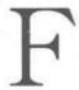

法国功能语言学Functional Linguistics inFrance亦称法国学派，在继承和发展哥本哈根学派和布拉格学派理论精神的基础上发展而成，其重要的代表人物是梅耶(AntoineMeillet，1866一1936)的学生——法国的马蒂内(André Martinet，1908—1999)。

虽然深受索绪尔(Ferdinand de Saussure,1857—1913)结构主义的影响，学术观点也与哥本哈根学派和布拉格学派一脉相承，但是马蒂内创造性地继承和发展了前人的观点，并未将自己定位于结构主义的代表，而是功能主义语言学的代表。在他的引领下，法国功能语言学派成为欧洲最有影响的语言学派之一。

马蒂内的语言功能观点主要包括：

(一)语言是人们共同使用的一种工具，交际功能才是语言的最基本功能。其他如表达功能、审美功能、思维推理功能等都是语言第二位的功能。因此，在语言研究的各个方面都应该贯彻功能主义的思想。语言事实的确定、语言单位的划分、对语言结构的分析乃至语言演变的描述都应该以功能为中心展开。意识到语言功能超越一切的重要性会更加尊重事实。

（二）语言具有双重切分特征。马蒂内认为语言结构是语言功能的一个方面。他把语言看作是一种具有“双重切分”特征的交际工具。第一切分是将某特定语言所有成员的共同经验切分为一个个声音和意义结合的最小单位“符素”(moneme)，也就是通常所谓的语素。符素承担着表意功能，所以也叫做“表意性单位”。第二切分是把符素的语音形式进一步分解成音位(phoneme)。音位没有意义，只是具有区别符素意义这一功能的最小单位，所以也叫“区别性单位”。

马蒂内关于“双重切分”的区分揭示出语言具有两个不同层次的特征。尽管人类的语言千变万化，但都可以简化为若干符素，这些符素又可以通过若干音位加以区别。该理论的提出极大促进了音位学的发展。

(三）马蒂内认为，语言“运转的基本原理”是语言的“经济原则”。即人们在交际过程中一方面有采用更多、更新、更复杂、更精确语言来表达思想的需要，另一方面，人们往往表现出来一种自然的惰性，倾向于在言语活动中尽可能减少力量的消耗，使用那些简单省力的，惯用普通的表达形式，如重叠辅音的简化等。这两方面的因素相互冲突，其矛盾推动着语言的发展。经济原则使人们能够在保证语言完成交际功能的前提下，有意识或无意识地对言语活动中的力量消耗做出合乎经济要求的安排。无论从语音还是词汇的层面上，经济原则都可以对语言演变的特点和原因做出解释。

(四)现实主义原则。马蒂内认为人类的“言语活动”才是语言研究的主要对象。“言语活动”不仅应包括索绪尔的“语言”(langue)，还应该包含他提出的“言语”(parole)。语言学家应该对言语进行功能分析，归纳出语言系统；必须根据语言事实，而不是根据某种假设或者事先确定的条框来研究语言的特性，即语言理论应该符合语言实际，而不是强迫语言去服从缺乏根据的想象。语言事实不能局限于语言的结构系统中来加以研究，而是应该放在言语活动中以及语言功能系统的运转中来加以研究。

(五)语言研究要历时与共时并重。与索绪尔的共时与历时是绝对对立的观点不同，马蒂内认为语言的共时状态和历时状态难以分开。作为交际工具的语言尽管从职能上说是共时的，但也包含了语言的历时发展，不能把二者绝对对立起来。

(六）每种语言都有其特殊性。语言研究中，要对不同语言的不同语言现象进行分析，不能把其他语言的研究原则和分析结果生搬硬套过来。

克里斯蒂娃(Julia Kristeva)是马蒂内之外的另一位法国功能学的代表人物。1967年她首先提出“互文性”(intertextuality)概念。互文性指不同语篇之间的内部成分之间的相互联系性。具体来说，克里斯特瓦把互文性分成三种类型：(1)物质(具体化)互文性，即对符号的反复使用；(2)结构(抽象化)互文性，即对规则的反复使用；(3)物质一结构(具体化和抽象化并存的)互文性，即符号和规则在两个或两个以上的语篇中被重复使用。在现实中被应用最广泛的互文形式是引语。互文的概念对于语篇生成和理解都具有重要的作用。1969年，克里斯蒂娃出版了《符号学》(Semeiotikè)，提出了有别于索绪尔的符号学理论，着重于情感领域，与本能相结合，与象征性符号相对立，从更为严格的数理逻辑意境上挖掘深藏在语言沟纹和韵律中的词汇意义。

法兰西学派 French School 19世纪70年代，历史比较语言学的研究领域中以个人心理主义语言观为指导的新语法学派从德国逐渐崛起。该学派认为，人类语言变化的因素不外乎心理、生理两种，语言的一切变化都可以从这两个方面找到依据。由于未能充分考虑社会和文化对于语言变化的影响，其片面性受到了以索绪尔为代表的社会心理学派的批判。索绪尔去世后，该学派分为两支，一支是注重语言静态研究的“日内瓦学派”，另一支就是“法兰西学派”。

法兰西学派也被称作语言学的法国社会学派或法国社会心理学派，形成于19世纪末20世纪初的法国。其创始人是索绪尔的学生梅耶(Antoine Meillet，1866—1936)和格拉蒙(Maurice Grammont，1866—1946)。这个学派秉承了历史比较语言学的原则，认为语言是社会心理系统的表现并深入探讨语言现象的社会本质；语言与社会、文化二者有密不可分的关系，语言既是社会事实又是文化的一部分。此外，法兰西学派还主张语言的演变有心理、生理因素等。继梅耶和格拉蒙之后，房德里耶斯(JosephVendryes，1875—1960)进一步发展了法兰西学派的理论。

格拉蒙和梅耶都是索绪尔的学生，他们的学说与流行于19世纪下半叶的新语法学派的观点有许多不同。

1895年，格拉蒙著文指出，语言演变的生理、心理原因不可忽视。梅耶进一步认为，词义演变是心理过程，但原因是社会性的。他把词义变化分为具体三种：一是因为社会生活不同，一个词所指的事物有所改变；二是一个小范围内的专用语变为全社会的通用语，使用的对象和地点不再受到限制；三是由于词语搭配的原因，某些词义发生变化。梅耶认为，语言是社会行为，是“社会事实”。语言是文化的一部分，有什么样的文化，就有什么样的语言。梅耶注意语言的社会性，自然对各种语言的外部社会历史感兴趣。他专心研究语言作为社会事实在社会中起什么作用。他所著的希腊语史和拉丁语史可以作为这种研究的典范。

法兰西学派还致力于说明历史比较语言学的原则。梅耶是一位杰出的历史比较语言学家。他认为，应该通过形态、语音、词汇三个方面的比较研究才能确定语言之间的共性。此外，梅耶善于将彼此对立的内容结合起来进行系统研究，如谱系树与波浪论、历史比较语言学与方言地理学相结合，避开其直接的对立，寻找其合理成分，用联系的观点做出合理解释，从而将历史语言学的研究方法加以改善。

继梅耶之后，房德里耶斯进一步发展了法兰西学派的理论学说。在法国社会学家涂尔干(EmileDurkheim，1858—1917)社会学说的影响下，房德里耶斯主张社会现象属于意识现象，应该同心理和生理现象进行区分，并且要用实证的态度对待社会现象。他把语言区分为一般语言和个别语言，并对两者的起源、本质与发展进行了分别研究。他认为一般语言是属于社会现象的一部分，是社会交流的结果，是维系社会的最有力的纽带，其发展又依赖于社会。个别语言是一定社会集体的语言，是联系集体成员之间关系最有力的纽带。

综合而言，法兰西学派研究的主要特点有：

(一)认为语言是社会行为，是社会心理系统的表现，语言与社会、文化二者有密不可分的关系，语言既是社会事实，又是文化的一部分。主张将语言的心理、生理因素与社会文化因素进行区分，认为语言与思维密切联系，但存在于人的意识之外。语言与传统风俗一样属于一种社会制度。

（二）提出了语言分化假设。在梅耶的《印欧语比较研究导论》中，他认为从同一语言分化出来的各个语言离原始母语的语源中心越远，其受到语源中心变化的影响就越小。

(三)秉承了历史比较语言学的原则，致力于语言之间尤其是同源语言之间比较研究的理论、方法和原则。主张从形态、语音和词汇三个方面进行比较研究来确定语言之间的共性。其比较的客观基础是语言符号音义结合的任意性和亲属语言之间语音对应的规律性。如果任意的语言符号之间出现有规律的语音对应关系，那么就应认为是同源成分分化的结果。比较方法是建立语言史极其重要的方法。其代表人物梅耶的代表作《历史语言学中的比较方法》是对历史比较语言学科学方法的总结。

(四)善于从对立的学说内容结合起来进行系统研究，如谱系树与波浪论、历史比较语言学与方言地理学相结合，语音规律无例外(青年语言学派)的观点与每一个词都有自己的历史(方言地理学派)的观点，避开其直接的对立，寻找其合理成分，加以提炼熔合，用联系的观点做出合理解释，从而将历史语言学研究方法加以改善。

（五）把语言区分为一般语言和个别语言，并对两者的起源、本质与发展进行了分别研究。认为一般语言是属于社会现象的一部分，是社会交流的结果，是维系社会的最有力的纽带，其发展又依赖于社会。个别语言是一定社会集体的语言，是联系集体成员之间关系的最有力的纽带。

(六)将语言成分分为义素(表达概念的成分)和形素(表达概念之间关系的成分)。

(七)从语音、形态和词汇三方面研究了语言的历时演变规律。语音的演变有自发演变和联合演变；形态演变受到划一与表达两种要求的支配；词汇取决于环境，词语替换受到心理和社会条件的影响。

法位学Tagmemics由美国语言学家派克(Kenneth Pike，1912—2000)创立的语言理论体系，以其出版于1954—1960年的三卷本《语言与人类行为结构合一理论》(Language in Relation to a Uni-fied Theory of the Structure of Human Behavior)为标志。

法位(Tagmeme)的概念源自布龙菲尔德的论述，但派克用它所表示的意义和功能有所不同。派克从语音学开始进行对语言的学习和研究。1948年，派克提出了语法体系里有没有类似于“音位”的概念这一问题。他曾经从对比、变量和分布等角度对语音单位进行研究。后来，他把这一体系运用到语法领域，分别命名为特色模式(features mode)、表现模式(manifestation mode)和分布模式(distribu-tion mode)。比如，一个小句中的施事主语可以被看作是一个结构(structure)中的一个“位置”(slot/po-sition)，该位置由某种类别的语言单位来填充。这种把位置和类别相结合的概念叫做“两元法位”(two-cell tagmeme)。后来“位置”和“施事”分别被标称为“轨位”(slot)和“作用”(role);再加上“类别”(class)和“接应”(cohesion)，组成了一个“四元法位”(four-cell tagmeme)。由四个特征所构成的法位概念强调了语言环境的重要性，任何一个语言项目必须在特定的语言环境中进行分析。

法位学认为，语言从整体上应该被看作构建在特定社会或特定文化中，而这个特定的社会或文化也可以用法位学理论来进行分析。这是因为人类行为所具有的普遍现象或准则也是一切语言所具有的。人类的行为，包括语言行为，都离不开结构单位或概念，离不开特定的环境，离不开观察者的角度，离不开部分与整体的关系。

法位学认为，人类语言行为的单位包括音位、词、短语、句子等。语言单位可以从形式和意义两方面来分析。语言单位的形式指的是可以感觉到的物质部分或成分序列的排列，而意义则是指说话者使用该语言单位时的意图或该单位对听者的理解或行为所起到的作用或影响。观察者对事物的分析有静态分析、动态分析和功能分析。从静态分析来说，语言是由个别离散的单位组成的序列。从动态分析来说，语言是由开始、中间和结尾组成的运动着的波浪所组成的序列。从功能分析来说，语言是一个模式系统，每个语言单位在这个系统中都处于一定关系之中，并具有一定的功能。

法位学理论的基本原则是等级关系，即小单位组成大单位，而大单位组成更大的单位。小单位同其所在的大单位之间形成部分对整体的关系。语言具有语法等级、所指等级和语音等级三个体系。四元法位是所有这些等级体系中的基本单位，它可以用于分析语法等级体系，也可以运用到对语音等级体系和所指等级体系的分析中。

语法等级体系指的是词汇单位与其所在的语法结构之间的部分与整体的关系。比如，一个语素存在于一个单词中，该语素和其所在的单词构成部分与整体的关系。该单词又可以存在于一个短语中并与其构成部分与整体的关系。语法等级体系从低到高依次为：语素、语素群、词、短语、小句、句子、段落、独白、问答、会话等。从结构上说，语素是最小的词汇单位，语素群是最小的语法结构。词是对话中的最小单位，其内部不能再切分成几个独立部分。词有语法词和语音词之分。语法词是指内部不能分成几个独立部分，能够对问题作出最简单回答的词。语音词指一个重读群，由一个或几个音节构成，其中一个音节重读，其他音节附在重读音节之前或之后。一个词的核心可以有单个或几个语素构成，词的各种词缀是词的外围。短语是非命题性的一串词，其中一个或几个连接着的词构成短语核心，其他词是修饰核心的外围。短语中的核心成分和外围成分之间常常有一些接应关系，比如，名词短语的核心和外围通常要有“性”和“数”的一致。小句是表述命题的最小单位。小句的核心是表示陈述、祈使、疑问等的小句根(clause root)，小句的外围是表示时间、方式、处所、工具、受事者、否定等的短语或词。句子是一个命题单位，其核心是表示叙事、命令和提问等的句根或句干，或各类独立的小句。句子的外围常常是表示话题、说者态度、时间、地点、目的等修饰成分。段落是主题展开的最小单位。独白是同一个人对一个或几个主题的连贯阐述。问答是用语言进行社会交际的最小单位，会话是指两个或两个以上的人所进行的语言交际。

所指等级体系指的是一个概念与其所在的意义结构之间部分与整体的关系。一个语言单位可以用来说明另一个语言单位的原因、条件、目的、结果等，而该语言单位本身又可能构成另一语言单位(比如一篇故事、一则新闻报道等)的背景、高潮或结尾等。所指等级体系包括说话者话语的内容结构、听者对所听话语的理解、说者与听者的态度、情感、信念、话语前提、真假、指称、目的、释义等层次。

语音等级体系指的是一个语音单位与其所在的语音结构之间部分与整体的关系，包括音位、音节、重音群、节奏群等层次。在语音等级体系中，音位是最小的区别性单位，元音丛或辅音丛是最小的语音结构。

在等级体系中，每个层次的语言单位都具备轨位、类别、作用和接应这四个特征，都可以用法位来进行分析。高一层次的法位由低一层次的法位组成，二者之间是包含与被包含的关系。法位学理论用“法位段”(syntagmeme)这一概念来表示不同层次法位之间的关系。任何一个成分相对于比它高一层次的法位来说是法位；相对于比它低一层次的法位来说是法位段。比如，一个句子是构成段落的法位，同时又是由短语构成的法位段。在由若干法位组成的法位段中，其中的一个或几个是核心法位，其余的是外围法位。核心法位具有较强的独立性，往往可以占据较多的轨位并具备主要的语义内容。

法位学试图从静态、动态和功能角度去考察语言，认为语言行为只是整个人类行为的一部分。该理论主要运用于语言描写、翻译等研究。

范畴语法Categorial Grammar; CG 指植根于逻辑、代数和语言哲学的一种描述自然语言的形式化工具。最早表述由波兰逻辑学家雷尼乌斯基(Stanisław Lesniewski，1886—1939)提出，其哲学基础源于19世纪德国数学家、逻辑学家和语言学家弗雷格(Friedrich Ludwig Gottlob Frege,1848—1925)提出的语言哲学思想。在20世纪30年代，波兰逻辑学家爱裘凯维茨(Kazimierz Ajdukiewicz，1890—1963)在技术上进一步发展和完善了范畴语法系统中的逻辑处理。1953年，数理逻辑学家巴尔一希列尔(Yehoshua Bar-Hillel，1915—1975)提出用数学的方法描写自然语言的句法理论。1958年，数学家兰贝克(JoachimLambek，1922—2014)在其论文《句子结构的数学》(The mathematics of sentence struc-ture)中提出了句法类型演算的理论，大大发展了古典的范畴语法。1964年，巴尔一希列尔正式提出了“范畴语法”这一名称。由于当时乔姆斯基的句法理论已经确立并开始呈现一统天下的局面，范畴语法没有引起人们的关注。直到20世纪60年代末70年代初，美国逻辑学家蒙塔古(Richard Montague,1930—1971)利用数理逻辑建立了自然语言语义学，其中的句法学部分使用了范畴句法学(CategorialSyntax)，这使范畴语法重新引起了语言学家的兴趣和重视。

范畴语法属于词汇句法学(Lexical Syntax)，词库中的词条包含了丰富的句法信息，所以不需要短语结构规则(phrase structure rules)。范畴语法把句子结构处理为函数一论元结构，从数学上来看，属于类型代数。范畴语法主要有三个基本范畴：N(名词)、S(句子)和NP(名词短语)，这得到了各种范畴语法的认同。基于这三个基本范畴，通过以下这条规则，可以派生出自然语言中需要的所有范畴：(i)N、S、NP是基本范畴；(ii)如果X、Y是范畴，那么X/Y和Y\X也是范畴；(iii)除由(i)和(ii)生成的范畴之外，其他的都不是范畴。

在这条规则中，X和Y是变元(variable)，它们的值可以取(i)中的任何一个基本范畴。X/Y是函数，斜线右侧的Y是函数的论元(argument)，左侧的是值(或称输出)(value)。这个函数中的斜线叫顺向斜线，指函数应用的是右边的论元得出左侧的值。与此相反，在Y\X中的斜线叫作逆向斜线，指函数应用的是左边的论元得出右侧的值。这可以归纳为下面两条函数应用规则，规则a称为顺向函数应用规则，规则b称为逆向函数应用规则。

函数应用规则 a. X/Y Y→X b. Y Y\X→X

例如：

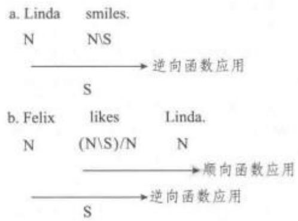

箭头表示范畴进行组合时所应用的规则以及所涉及的函数和论元。在句a中，smiles属于函数范畴N\S,左侧的Linda属于N，是论元，因此属于函数范畴的 smiles 可以应用到 Linda，从而得到属于 S的 Linda smiles，这是 smiles 的值或输出。句b 中的likes属于函数范畴(N\ S)/N，该函数说明先把likes应用到右侧、属于N的Linda，得到一个属于(N\ S)的 likes Linda。likes Linda 本身还是一个函数，它应用到左侧的Felix，得到属于S的 Felixlikes Linda。第二步的分析跟句a一致，运用的是逆向函数应用规则。

巴尔·希列尔的范畴语法是在爱裘凯维茨的范畴语法的基础上发展而来。两者都只有函数应用一条组合规则，但是爱氏语法对函数采用单向标注，用于生成形式语法；巴氏语法对函数采用双向标注，用于生成自然语言。这两种范畴语法常被称为AB范畴语法。作为自然语言的理论来说，AB范畴语法是没有价值的。兰贝克的代数演算(亦称Lambek演算)发展了巴氏范畴语法，其中除了函数应用这条规则外，还包括结合规则、函数复合规则、范畴提升规则和除法规则。

## (1) 结合规则

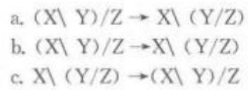

这里的结合规则相当于数学中的结合律。a是等价式，b和c都是蕴涵式。a指前提蕴涵结论(即b)，并且结论蕴涵前提(即c)。例如，句子Felix likes Lin-da在Lambek演算中有两种办法可以生成：

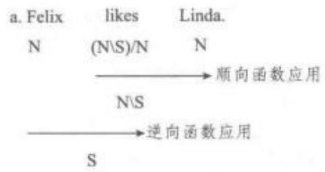

## (语言学理论与流派)fàn范

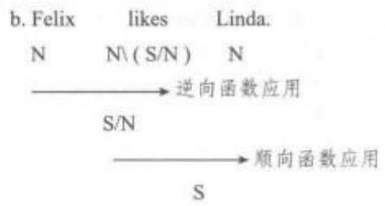

句a运用规则b生成了句子，而句b运用的是规则c。

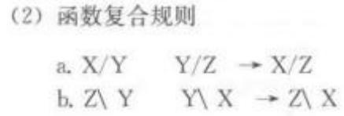

函数复合也称作复合函数。函数复合可以看作数学中的乘法，按照乘法运算，X/Y和Y/Z相乘时可约去乘数X/Y中的分母Y和被乘数Y/Z中的分子Y，得到X/Z。即：X/Y×Y/Z=X/Z。利用这一规则生成句子 Felix likes Linda 的方法有：

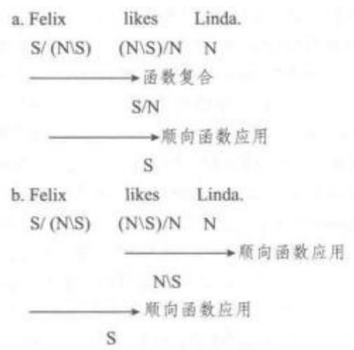

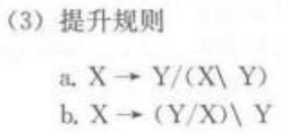

下面用提升规则来生成句子“Felix and Linda smiled”：

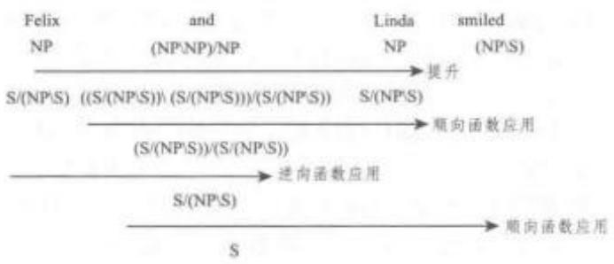

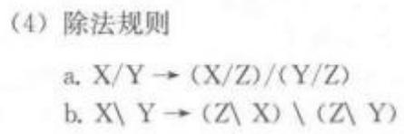

下面利用除法规则来生成句子“Felix works here”:

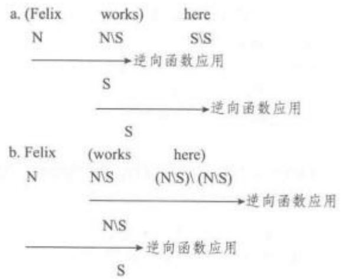

除了以上四种规则外，兰贝克演算还利用其他方法来丰富范畴语法的生成能力，如广义函数复合规则、内包规则和合一规则等。

范畴语法对其他语言理论的发展有着重要的影响，如词汇—功能语法（Lexical-Functional Gram-mar;LFG)、广义短语结构语法(Generalised PhraseStructure Grammar;GPSG)、中心语驱动短语结构语法(Head-Driven Phrase Structure Grammar;HPSG)。从产生至今的几十年的时间里，范畴语法一直是计算语言学关注的焦点。计算语言学的进步促进了范畴语法的发展，产生了统一范畴语法(Unification Categorial Grammar; UCG) 和范畴统一语法(Categorial Unification Grammar; CUG)。到了 20世纪90年代初，在范畴语法框架下进行研究的语种已涉及英语、法语、德语、意大利语、西班牙语、荷兰语、芬兰语、冰岛语、俄语、土耳其语、日语、朝鲜语、霍皮语、马达加斯加语、毛利语等(Wood，1993：77)。范畴语法在数学上的简洁性受到了逻辑学家、语言哲学家及一些语言学家的青睐，始终保持着强大的生命力，有着广阔的发展前途。

方言学 Dialectology 指对方言(linguistic di-alect)进行语言学的科学研究，是社会语言学(socio-linguistics)的一个分支。方言学主要研究基于地理分布（geographicdistribution）而形成的语言变体(variation)以及各变体之间的关联特征。方言学分为方言地理学，即传统的方言学和社会方言学，即狭义的社会语言学。前者研究语言的地域性差异，后者研究语言的社会性差异。美国的库拉特(HansKurath，1891—1992）和拉博夫（William Labov，1927—)是方言学研究最为重要的两个代表人物。

正式、科学、有规模的方言学研究始于19世纪的欧洲。早在1821年，德国慕尼黑大学的施梅勒(Johann Andreas Schmeller,1785—1852)就出版了第一部比较方言研究著作《巴伐利亚方言研究》(德Die Mundarten Bayerns,英 The Dialects of Bavar-ia)。之后在1876 年，温克尔（Georg Wenker，1852—1911)又通过邮寄问卷的方式有规模地调查了北部德语之间的方言差异。进入20世纪，在1905年，英国的赖特(Joseph Wright，1855—1930)第一次出版了六卷本系统的《英语方言词典》(English Dia-lect Dictionary)，而随着《美国语言地图集》(Lin-guistic Atlas of the United States,1930s)的出版和20世纪 50 年代利兹大学(University of Leeds)的“英语方言调查”的展开，方言研究越来越与社会学研究相结合。库拉特致力于美国方言的系统研究，以出版第一本语言地图集三卷本的《新英格兰语言地图集》(Linguistic Atlas of New England, 1939—43)而著名，并监督《美国语言地图集》的出版工作。20世纪60年代初期，拉博夫运用社会学者通常使用的调查方法，以口头询问的方式对纽约市区各社会阶层的语言变异作了富有独创性的调查统计，用比较可信的材料说明了语言变异和社会经济地位之间的有机联系和规律性变化。他使用的方法后来也为其他许多语言学家所仿效，如英国的特鲁吉尔(PeterTrudgill，1943—）研究诺威奇言语（Norwichspeech)和佩蒂特(Keith Malcolm Petyt)研究西约克郡言语(West Yorkshire speech)均采用了拉博夫的方法。拉博夫的代表作之一为《纽约英语的社会分层》(The Social Stratification of English in NewYork City，1966)。方言测量学(dialectometry)是 20世纪70年代发展起来的一种方言分析的统计方法，用来测量一个方言区内若干个方言点之间的语言学上的“距离”，具体是在大量的语言特征取样中计算对立的数目。

方言学研究的主要问题包括变体之间的可交流性(mutual intelligibility)、双言现象(diglossia)、方言连续体(dialect continua)和多元中心现象(pluricen-trism)等。变体之间的可交流性被认为是方言区别于语言的一个重要标准，即方言之间是互通的，而语言之间是不可互通的。不过事实并非如此，比如说西班牙语的人和说意大利语的人之间的交流会比说温州方言的人和说汕头方言的人之间的交流要容易得多。可见，可交流性是一个相对的概念。方言学家研究方言之间的可交流性更多的是从相似方言之间的语音和音系规则、形态变化、句法规则和词汇组成等形式的角度出发进行比较。双言现象指的是同一个方言在不同环境下使用形式不同的现象。这时，往往其中一个为较为正式的“高层变体”(HVariety)，另一个则是口语化非正式的“低层变体”(L-Variety)。比如在印度，梵语(Sanskrit)被认为是上层社会所使用的“正确”的说话方式，而“原质语”(Prakrit)则是普通人日常生活中所使用的“土话”。不过，需要指出的是，在社会学和政治学的框架下，“高层变体”与“低层变体”之间是有地位和重要性的区别的，但仅从语言学角度来看，所有语言及其变体之间都是“平等”的。至于方言连续体，一般来说，在地理上相邻的两个(或多个)方言之间存在一定的可交流性并且相应的可交流性随着方言之间地理距离的加大而逐渐减小。这些在地理上接壤又互相之间具有可交流性的方言就像组成了一张网，这张网就是方言连续体。方言连续体更多地受到地理接触的影响，而不是国界的约束。比如，意大利的博洛尼亚方言与西班牙语之间的可交流性要高于本国的那波利斯方言。“多元中心”现象指的是一个语言内同时存在两个或多个标准变体的现象。比如印度斯坦语(即印度语，Hindustani)就同时将乌尔都语(Urdu)和印地语(Hindi)用作标准语。又如伯克马尔语(挪Bokmal)和尼诺斯克语(挪Nynorsk)同时被用作挪威语的标准语。

方言学的重要科学价值在于方言是研究大众文化的珍贵资料来源，它们不仅反映一种语言的历史，而且在较大程度上反映一个民族的伦理、文化及政治等方面的历史。社会语言学不仅可对个人的语言稳定性及语言特征做出主观的评价，而且也适用于社会整体，其所提供的资料有助于解决与社会低层言语有关的一些极其复杂的问题。虽然方言研究的历史不短，但方言学作为一门独立学科的时间并不长。对于方言学的学科地位，则存在着一定的争议。比如，钱伯斯(Jack Chambers，1938—)和特鲁吉尔就认为虽然从事方言研究的人都不同程度受到了语言学研究的训练，但强调地理学因素以及对于社会学和政治学的倾向性使得方言学研究至少不是一个“纯的”语言学研究。

中国由于其悠长的历史和广阔的国土，全国的方言分布多样，使用活跃，因此具有丰富的方言研究历史。中国方言分区主要依据语言特征，包括语音、词汇、语法，其中最重要的是语音依据。除此之外还要考虑社会历史背景。比如说，客家方言，首先根据语言特征确定粤东客话、粤北客话、闽西客话、赣南客话、台湾客话，以及湖南、广西、四川等省境内的客话，同属于一个方言区；其次根据客家移民史资料，对散落各地的客家方言加以认同。依照这些标准，将全国的方言分为七大方言区：吴、湘、赣、客、粤、闽(又分为闽南和闽北方言)、官话方言(又称为北方方言区)。秦汉以前的上古时代，吴方言、粤方言、湘方言已经在东南地区形成。客家方言、闽方言、赣方言的形成与中古以后发生的人口大迁徙相关。据历史记载，客家方言是中原官话移民在三次集体大迁徙的基础上形成：第一次发生在西晋永嘉之乱，他们从河南迁徙到江西中部；第二次发生在唐末黄巢起义和五代十国时期，他们自河南、安徽迁徙至闽西以及赣南；第三次发生在蒙古人南下，宋室濒临灭亡之际，他们随抗元军队到达粤东、粤北一带。闽方言也是中原汉人在南北朝“五胡乱华”时代，大批迁入福建，定居在以建瓯为中心的建溪、富屯溪流域，以福州为中心闽江下游地带以及以泉州为中心的晋江流域。限于史料，赣方言的形成较难论断，但是魏晋之后，汉人大批南下，江西是必经之地，应该也是南上的北方话与当地语言接触的结果。汉语存在方言差别的同时，也一直存在共同语，这种共同语的书面形式全国是统一的，也就是成熟于汉代的“文言文”。口语形式，各个历史时期有差异。共同语在春秋时期称为“雅言”、扬雄称作“通语”、元代周德清称作“天下通语”、明代称作“官话”、辛亥革命以后称作“国语”，现在称作“普通话”。共同语的基础方言及核心地带是不断变迁的。上古时期，秦晋方言影响较大；魏晋之后东移至洛阳、南京；辽金以来，基本中心在北京。元代、清代都是少数民族统治的时期，因此虽然明代汉族人在南京建都时间不长，但是南京话的地位很重要。直到清代后期仍然存在南北两支官话系统。

汉语学界方言研究主要有两个流派：一是以古代汉语为学术背景，承袭传统训诂学、音韵学而作的历时研究学派，主要以文献考察为主，有些兼及语言调查事实。一是以现代汉语为学术背景，依现代语言学思想指导而行的共时研究学派，主要以语言事实调查为主，有些兼及汉语文献。为了论述方便，简称前者为方言历时研究；后者为方言共时研究。

方言历时研究，先秦时期古籍中已经有方言著录，但比较零散，东汉扬雄(公元前53—18)《方言》(全名《輶轩使者绝代语释别国方言》)是中国第一部专谈各地方言词汇比较的著作。东晋郭璞(276一324)利用晋代方言为扬雄的书做了注解，使这本书的价值更大。清代又有多位学者校勘疏证，如戴震《方言疏证》、卢文弨《重校方言》、刘台拱《方言补校》、钱绎《方言笺疏》、王念孙《方言疏证补》。清代是传统小学发达的时期，有不少学者还做了辑录、考证方言俗语及续扬雄《方言》的著作，如钱大昕《恒言录》、孙锦标《通俗常言疏证》及《南通方言疏证》、翟灏《通俗编》、张慎义《方言别录》及《蜀方言》、钱大昭《迩言》、梁章钜《称谓录》、胡文英《吴下方言考》、罗振玉《俗说》、章太炎《新方言》、杭世骏《续方言》、程际盛《续方言补》等种类繁多。当代承袭这一研究思路的著作很多，比较有名的如李申《金瓶梅方言俗语汇释》(1992)等。

魏晋南北朝时期，产生了很多带有方音特点的韵书，隋代陆法言(约562—?)通语性质的《切韵》面世，使得方音类韵书被忽视而亡佚。为了科举正音而作的《唐韵》、《广韵》、《集韵》等，逐渐失去时音性质，变得保守。元代周德清(1277—1365)《中原音韵》一改其风。清代反映方音的韵书再次兴盛，如徐州《十三韵》、河北《五元方音》、山东《十五音》、福州《戚林八音》等。清代不少学者研究音韵学很重视各地方音，如顾炎武《日知录》、江永《音韵阐微》、李汝珍《李氏音鉴》、钱大昕《十驾斋养新录》、胡垣《古今中外音韵通例》、陈澧《广州音说》等。当代承袭这一研究思路的学者，比较有名的如鲁国尧《“颜之推谜题”及其半解》(2003)从文献和现实方言两个方面说明：江淮官话有南染吴越特点。潘悟云除了关注现实方言，还关注少数民族语言以及域外汉语译音，利用历史语言学理论，据亲属语言比较，构拟古音音值。

方言共时研究，1924年北京大学成立方言调查会，宣告现代语言学思想指导下的方言学正式起步。20世纪20—40年代，主要的成果如赵元任(1892—1982)《现代吴语的研究》(1928)、《钟祥方言记》(1939)、《湖北方言调查报告》(1948)；罗常培(1899—1958)《厦门音系》(1931)、《临川音系》(1941)等。1956年教育部发出了《关于汉语方言普查工作的指示》，接着中国社会科学院语言研究所编著了《方言调查字表》(1955)、《汉语方言调查简表》(1956)、《方言词汇调查手册》(1956)，李荣(1920—2002)编著了《汉语方言调查手册》(1957)，为全国方言普查提供了依据。据有关部门统计，全国除西藏外共有县、市2298个，普查方言点达到1849个。一些较好的调查报告，如《江苏省和上海市方言概况》(1960)正式出版。五六十年代之后，海外汉语方言学也很兴盛，主要集中于中国台湾、中国香港、美国、日本等地。台湾客家、闽方言研究成绩突出，如杨时逢《台湾桃园客家方言》(1957)、《台湾美浓客家方言》(1971)，董同龢《四个闽南方言》(1959)、《记台湾的一种闽南话》(1967，与人合作)，丁邦新《台湾语言源流》(1979)等。中国香港及美国粤方言成果突出，如张洪年《香港粤语语法研究》(1972)、余霭芹《粤语研究》(第1卷，1972)、《广东开平方言的“的”字结构：从“者”、“之”分工到语法类型分布》(1995)等，《汉语方言语法比较》(Comparative Chinese DialectalGrammar)(1993)是一部全国方言语法比较的专著，主要包括粤、闽、客、湘、赣、吴、徽语、晋语、江淮官话、西南官话等众多语言。日本也在南方方言研究上成果显著，如桥本万太郎《客家方言》(1973)、《海南文昌方言》(1976)、《临高方言》(1980)，中岛干起《吴语的研究》(1984)，村上嘉英《现代闽南语辞典》(1981)，平田昌司等《徽州方言研究》(1998)等。

1981年全国方言学会正式成立，推动了方言学向纵深处发展。突出表现在涌现了一批以分区方言及省方言为研究重点的学者：如粤方言李新魁、詹伯慧、张日升等，闽方言李如龙、张振兴、马重奇等，客家方言黄雪贞、谢留文、项梦冰等，湘方言鲍厚星、伍云姬等，赣方言熊正辉、陈昌仪、颜森、刘纶鑫等，吴方言许宝华、汤珍珠、叶祥苓、游汝杰、张惠英、李小凡等，晋语侯精一、温端政、乔全生等，江苏方言刘丹青、鲍明炜、顾黔等，山东方言钱曾怡等，陕西方言邢向东等，还有一些单点方言研究贡献突出的专家，此不一一列举。方言学与地理学进一步结合，突出成果有：以中国社会科学院为主编写的《中国语言地图集》于1987年正式出版，2013年修订完善，由商务印书馆再版；曹志耘主持编修的《汉语方言地图集》(含语音、词汇、语法三卷)，2008年于商务印书馆出版。近年来方言学与语言类型学进一步结合，也与地理信息系统、计算机数据挖掘等技术相结合，未来方言学的主要任务将不再是描写语言事实，而是分析语言事实。

哥本哈根学派Copenhagen School 亦称语符学派(Glossematics)，是语言学界所公认的继索绪尔之后，最具影响力的结构主义语言学流派之一；诞生于20世纪30年代，主要创始人是丹麦哥本哈根大学的罗曼语言文学教授布龙达尔(Viggo Brondal,1887—1942)和语言学教授叶尔姆斯列夫(LouisTrolle Hjelmslev，1899—1965)。学派代表人物还有乌尔达尔(Hans-Jorgen Uldall，1907—1957)。该学派成员大多是丹麦语言学家，规模较小，活动地区以哥本哈根为主，学派的机关刊物是创刊于1939年的《语言学文献》。

叶尔姆斯列夫是该学派的主要代表人物。在《语言理论导论》(Prolegomena to a Theory of Lan-guage，1943)和《语言学论集》两本著述中，他提出了“语符学”理论，为后来的结构语义学的建立奠定了认识论基础。语言学界后来将哥本哈根学派的理论称为语符学。

叶尔姆斯列夫的语言理论偏重纯理论研究，其中有对索绪尔语言理论的片面解释，但也不乏其本人独到的见解。在《语言理论导论》中，他明确提出语言的符号性质，这成为了哥本哈根学派的理论纲领。叶尔姆斯列夫在《语言理论导论》一书中提到：“语言，即人的话语，是永不枯竭的巨大宝库。语言不可与人分割开来，语言伴随着人的一切活动。语言是人们用来构造思想、感情、情绪、抱负、意志和行为的工具，是用来影响别人和受别人影响的工具，是人类社会最根本、最深刻的基础”(刘润清，1995：115—120)。叶尔姆斯列夫把语言看成是符号系统，目的是研究人的思维和心理；把语言看成一种社会制度，目的是研究一个民族的特征：把语言看作一种不断变化的现象，目的是研究个人语体变化和人类的变迁。语言是一个独立配套的自足体系，因而也是语言研究的重点。他希望通过一系列形式化的过程发现语言的具体结构。其语言理论主要包括：

(一)语言的本质。叶尔姆斯列夫“将索绪尔关于语言和言语的区分、关于语言是形式而不是实体、关于语言是价值系统、关于语言是一个符号系统的论点发挥到极端，形成了语符学理论体系”(林玉山，2000:41)，他还主张把语言从物理方面的声音和心理方面的语义中抽象出来，并且撇开语言的社会属性和历史演变等因素，排除了索绪尔理论中与语言现实有联系的组成部分，得出了一个在逻辑上前后连贯的语言理论体系，以便集中研究语言的内在结构，力求用一套形式化的定义和符号来描写语言。其方法论的基础是卡尔纳普（Rudolf Carnap，1891—1970)的符号逻辑。他要建立“语言的代数”，用一套形式的定义来描写语言。

(二）语言的内在结构。叶尔姆斯列夫认为，语言的内在结构是由各级要素共同构成的关系网络。为确定语言的基本要素，语言成分被分为“内容(content)”和“表达(expression)”两个平面，二者组织结构相似，可用相似的关系来定义内容和表达的具体分类，并在这两个平面上都强调“形式”和“实体”的区分。“形式”被定义为语言成分之间的关系，“实体”是外在的东西。在《语言结构分析》一文中，他指出要研究语言的形式，必须把各形式单位的组合关系(他称为分配关系)详尽记录下来，而聚合关系往往涉及语言实体。他强调形式与实体的绝对对立以及形式的绝对独立性，这也是哥本哈根学派区别于布拉格结构主义学派的一个主要方面。“形式”是语言研究的对象，包括“内容形式”和“表达形式”，并各有自己的最小要素，叫做“成素”。“表达形式”的成素是音位特征，“内容形式”的成素是语义特征。例如，“母亲”这个词的语义特征包括“动物”“人”“女性”“亲属”“上代”等。成素与符号不同。符号是内容和表达相结合的双面体，成素却是单面体，它为数有限，但能构成无数的组合。通过“接换”，内容形式和表达形式的成素能结合成为既有内容又有表达的符号。语言归根到底是一套成素。

(三)语言学研究的对象。叶尔姆斯列夫反对索绪尔关于语言的社会本质的论点，认为传统语言学是一种超验语言学，是以语言学外的语言材料为基础的。他认为应以一种内在的语言学取而代之。他明确表明，“只有以这种结构分析的方法，把语言看作是相互关系的模式来进行研究才是科学领域的主要任务。”因此，语符学把语言看作一种纯符号系统，专门研究其关系与模式。语言符号系统中存在三种主要关系：决定关系、依存关系、并列关系。决定关系即一个常数与一个变量之间的功能，依存关系即两个常数之间的功能，并列关系即两个变量之间的功能。

(四)语言学研究的任务和方法。叶尔姆斯列夫认为，语言学理论要发现一种常量(constant)，使之投射于现实。在任何过程中，必然有一个系统；在任何变动中，必然有一个常量。语言学的任务就是通过演绎建立这个系统，以预见语言单位的各种可能的组合。哥本哈根学派把语言理论看作一个“纯理论系统”，认为理论应该独立于经验。传统语言学所采纳的归纳法只能指出不同语言的差异，而不能引导研究者们得出他们所要追求的常量，因而不能建立语言学理论。所以真正的语言学应该采用由一般到个别的演绎分析方法。语言学理论研究的是篇章，但理论所提供的不仅仅是理解某个篇章的程序，而是理解一切篇章的程序，既包括现存的篇章，也包括潜在的可能篇章，并且适合于一切语言篇章的分析。语言学研究的目的就是提供一个始终一致的、恰当的描述程序。

(五）格式塔语言学。叶尔姆斯列夫提到的“格式塔语言学”是按照格式塔心理学建立的语言学。他认为，结构语言学实质上就是格式塔语言学。格式塔是针对任何一种被分离的整体而言的，反对元素分析，强调整体组织的语言学。叶尔姆斯列夫认为，这种语言学是真正体现了结构主义精神的结构语言学。在他看来，语言现象是一种格式塔，是一个“被分离的整体”，整体并不等于部分的总和，并不是由若干部分组合而成的，整体乃是先于部分而存在的，并且制约着部分的性质和意义。

哥本哈根学派继承并发展了索绪尔的思想和理论，主要功绩是在语言理论的形式化方面，把整个语言学问题归结为结构问题。他们的语言理论主要着眼于解决语言研究对象以及语言研究的精确化问题，把语言学和数理逻辑紧密结合起来，对兰姆(Sydney Lamb，1929—)的“层次语法”(Stratifica-tional Grammar)和乔姆斯基的“转换生成语法”(Transformational Generative Grammar)都有一定的影响。但同时，语符学派也存在一些问题：对实体的绝对排斥，使语言研究失去立足点；过分强调抽象、概括，使语符学理论很少有实际使用价值。20世纪50年代初语符学理论曾被用来分析法语和西班牙语，并未成功。但是，这种理论把许多学者的想法综合为统一的、一贯的理论，代表着人文科学和精密科学相结合的趋势。

格式塔语言学Gestalt Linguistics “格式塔”(德文Gestalt)是20世纪初发源于德国的一种重要心理学理论。它强调经验和行为的整体性，与当时流行的构造主义元素学说和行为主义“刺激一反应”论对立，在心理学中格式塔派用这个词表示的是任何一种被分离的整体。格式塔理论为各种心理现象、心理过程以及心理研究的应用提供了一个理论架构，可以应用于心理学、语言学等研究领域。格式塔原理广泛运用于认知语言学和学习理论中，亦成为现代隐喻和转喻研究的认知心理基础，故而产生了以格式塔心理学为基础的语言学研究。美国认知语义学家泰尔米(Leonard Talmy)在2000年出版的《走近认知语义学》(Towards a Cognitive Seman-tics)一书中将格式塔心理学关于人类感知的规律引入了认知语言学。之后，美国认知语法学家兰艾克(RonaldLangacker)将此发展成为比较完整的理论框架。

格式塔心理学诞生于1912年，后来在美国广泛传播，是现代西方心理学的主要流派之一，由韦特海默(MaxWertheimer，1880—1943)、考夫卡（KurtKoffka，1887—1967）和科勒（Wolfgang Kohler，1886—1941)三位德国心理学家在研究似动现象实验的基础上创立。考夫卡1922年发表了关于格式塔的研究论文，题为《知觉：格式塔理论导言》(Perception, an Introduction to Gestalt Theory)，提出了行为环境的理论，认为心理学的研究对象是行为，行为与物理场有着因果关系。韦特海默认为，人的心理意识活动是先验的“完形”，强调经验和行为的整体性。他反对构造主义的元素学说，认为整体并不等于所有构成它的各部分要素之和，而是由感知原有构成成分中显现出的全新整体，整体大于部分之和。考夫卡1935年出版的《格式塔心理学原理》(The Principle of Gestalt Psychology)一书，系统阐述了格式塔理论的要点。考夫卡把物理学概念引入心理学，提出心物场(psycho-physical field)的概念，认为世界是心物的，经验世界与物理世界不一样，并将其普遍应用于生理过程、行为过程和意识过程。他还提出生理过程与心理过程在结构形式方面完全等同，即“同形论”(isomorphism)。他认为生理过程是“意识的相关物”，用“场”解释神经系统的组织作用。他以“心物场”和“同型论”作为格式塔的总纲，进而派生出若干亚原则，即组织原则。

“格式塔”起源于对视觉的研究，明确提出眼脑作用是一个不断组织、简化、统一的过程，正是通过这一过程，才产生出易于理解、协调的整体；心理现象是在意识经验中所显现的整体性。它强调思维活动的整体结构即完形结构。根据这个概念的功能定义，“格式塔”的研究范围可以包括学习、思维、回忆等过程。其应用范围远远超越了视觉领域，甚至超出了整个感觉领域经验的范围。

基于“格式塔”的“完形法则”是心理学家在认知领域中的研究成果，它使心理学研究人员不再囿于构造主义的元素学说，而是从另一角度去研究意识经验，为后来的认知心理学研究打下了基础。完形心理学着重研究思维，并开始研究儿童思维，对当代心理学和认知科学，如皮亚杰学派、认知心理学派等有一定的影响。认知语言研究表明，完形心理学提出的整体大于部分之和的观点对认知语言学的研究具有一定的意义。原型、范畴、意象图式、图形一背景感知等都具有完形结构，都是对事物整体知觉的结果，在完形组织原则基础上，研究认知对语言整体句义和篇章理解的综合作用成为认知语言学的心理学基础。无论是塔尔米的认知语义学，还是兰艾克的意象图示假说都汲取了很多格式塔心理学原则。格式塔理论也被应用于阐释隐喻认知过程和隐喻意义构建的理论中。格式塔心理学中的完形组织原则不仅体现在语言概念(原型和基本范畴认知)和语言机制方面，而且对人的隐喻和转喻认知模式也起着重要作用。完形组织原则中的相似原则和顺接原则是隐喻的认知原则，接近原则和突显原则是转喻的认知原则。它们是隐喻和转喻认知的完形心理基础。雷考夫(George Lakoff)和约翰逊(Mark John-son)的理想化认知模式认为，思维是与人体有关的，把人类的概念系统联系在一起的结构来源于身体的经验。概念系统的核心直接根植于感知，身体的活动存在于物体和社会经验之中。思维具有格式塔结构，即是在人类经验中反复出现的有组织和统一的整体。约翰逊的意象图式认为，外部世界是由千变万化的事物及事物的相互关系组成的。人们通过完形感知、动觉和意象，既获得了对事物认知的能力，又获得了认识事物相互关系的能力，从而构建了意象图式(image schema)。图式的概念即来源于格式塔心理学，它们是不同层次、不同抽象程度上对事物、事件认知的完形，实验已经证明图式是认知的表现形式，具有心理现实性，在记忆和推理中具有组织作用。

格式塔理论是多学科广泛交叉研究的结果，它为各种心理现象、心理过程以及心理研究的应用提供一个理论架构，可以应用于心理学、语言学、哲学、美学和科学研究的各个领域。虽然如今格式塔方法已渗入许多领域的研究方法，但学说内部仍有很多关于结构的基本问题没有彻底解决，因此学说现仍在不断修正改进之中。由此，我们在引入格式塔理论进行语言学研究中，还需去粗取精、去伪存真，吸收其合理部分。

格语法 Case Grammar生成语法学派中分裂出来的一种语言学理论，着重研究句子成分之间关系的分析手段。美国语言学家菲尔默(CharlesFillmore，1929—2014)于20世纪60年代末发表了一系列论文，形成了格语法理论。可以说格语法从句法语义关系方面对乔姆斯基的标准理论做了修正，也是对转换生成语法不足之处的弥补。

菲尔默的主要著作如《格语法若干问题》(SomeProblems for Case Grammar，1977)、《《“格”辨)再议》(The Case for Case Reopened，1977)、《“格”辨》(The Case for Case，1968)和《关于现代的格理论》(Toward a Modern Theory of Case， 1966)等构成了格语法理论的主要内容。

格语法的理论要点包括：

(一)格。格语法强调句子中成分的相互关系，认为动词是最重要的成分，和各个名词词组发生联系，这些相互关系被称为“格”，表现“格”的方式主要有词序、附加成分、介词等。根据菲尔默的定义，“格”指底层的句法一语义关系；而不论是通过何种方式，如词缀、异干法(suppletion)、附加助词或词序制约等，所谓“格的形式”(CaseForm)指特定语言中某种格的关系的表现形式。菲尔默的格概念和拉丁语中的词形变化在功能上非常相似。

格取决于底层结构中名词与动词之间的句法一语义关系，一旦确定了这些关系，不论如何转换、处于表层结构中的何种位置或者与动词之间的语法关系如何，格都保持固定。底层结构中的格与任何表层结构中的语法概念如主语、宾语等之间没有对应关系。例如：The door opened.“The door”虽然处于句子主语的位置，但逻辑上，“门”不能自己打开，而是被打开，因此在句子的底层属客体格。

（二）第一阶段格语法。这一阶段的格语法包括基础部分、词汇部分和转换部分。基础部分通过基础规则生成前底层结构，前底层结构在词汇部分，经过词汇插入规则从词库中选取合适的词语，得到后底层结构，后底层结构经过转换规则产生表层结构。整个语法模式大致如下：

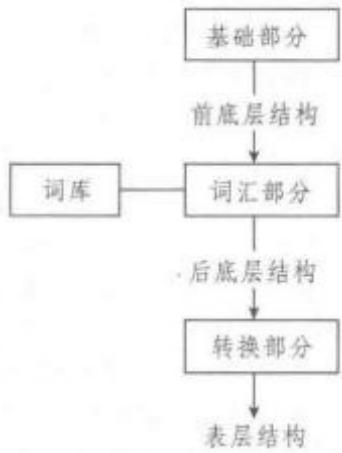

基础部分由一系列基本规则组成，其中有三条最基本的规则：a.S→M+P;b.p→V+C1+C2+…+Cn;c，C→K+NP。规则a表示一个句子S可改写成情态(modality)和命题(proposition)两大部分。

规则b表示任何一个命题p都可改写为一个广义动词V和若干个格C。这里的广义动词“V”不仅包括通常意义上的动词，也可以是形容词，还可以是名词、副词或连词，格C的角色不仅可由NP担任，也可由某些内嵌小句S来充当。规则C中的K是每个格范畴在底层结构中的标志，简称为“格标”。菲尔默认为，尽管每个格范畴在表层结构中可以有诸如前置词、后置词、词缀、零形式等不同的标记形式，但在底层结构中，它们是同一成分K。

底层格是格语法解释语义和句法现象的基本工具，然而格语法学家却列出了各不相同的格清单。菲尔默从不曾明确地给出格清单，文章的不同不仅导致格的数目不一，分合有别，连名称也经常变动，而且总还有“及其他”之类的话。1966年到1977年间，菲尔默一共提出了13个格：(1)施事格(agen-tive)：事件或行为的执行者、行动者、表现者。(2)与格(dative):某种行为后果的承受者或接受者。(3)客体格(objective);动作对象或考虑对象。(4)工具格(instrumental):导致某事件的物理手段或精神刺激。(5)来源格(source)：事物的来源(地)。(6)目的格(goal):事物的目的地。(7)方位格(locative)；动作所处、场所或空间方位。(8)时间格(time)。(9)受益格(benefactive)：一个动作或状态的受益方。(10)伴随格（comitative）。（11）感受格（experiencer）。(12)路径格(path)。(13)永存格/转变格(essive/translative)。在实际语言运用中究竞应设置多少格，完全取决于情况需要和运用是否方便。例如：

The student solved problems with a calculator in the classroom this morning.

(学生今天早上在教室里用计算器做习题。)

这一句子的格语法用语义网络形式表示如下图：

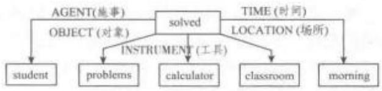  
用语义网络表示的格语法

词汇插入主要是指名词和动词的选择问题，这是词汇部分的主要问题。对于名词的词汇插入，是将词库中每个名词的特征与格范畴进行联系。当某个名词具有+locative的特征时，这一特征可与L格范畴相联系，规定具有+locative特征的名词可插人L的位置：即不具有+locative特征的名词不可插入L的位置。动词插入取决于全句提供的特定的格框架。当底层结构表达式所提供的格框架与词库中动词词条下标明的框架特征相符时，即可将该动词插入前底层结构并得到后底层结构表达式。

经过转换规则的运用，后底层结构表达式通过转换得到表层结构表达式。格语法中的转换操作与转换生成语法大同小异，大致采用移动(move-ment)、删除（deletion)、插入（insertion)复制（copy-ing)等方法。转换部分主要处理诸如选择显性的格的形式，即处理底层结构中的K成分，确定主语成分，解决词序问题以及插入特定成分，如在动词上插人“passive”成分等问题。在对有关格的形式和主语确定的转换规则进行研究之后，菲尔默认为尽管语言的不同会导致表层结构的表现形式各不相同，但深层格所体现的语义关系却是一个固定而统一的概念。在表层结构的体现形式上，有些语言主要通过介词来表现其表层结构，有些语言是利用屈折变化或词缀变化来体现，有些则主要采用词序的方式，还有些综合采用上述各种形式。然而，不管语言中的表层结构如何体现，实际上它们的底层成分同为一个K，都是这一个底层成分在不同语言表层结构中的体现形式。

（三）第二阶段格语法。70年代以来，许多学者采用主语和宾语等概念来解释句子的语义和句法问题。菲尔默对这些研究成果加以思考后，认识到把前一阶段主语、宾语等语法关系一概视作表层结构上的概念，把底层结构看成是由格角色组成的语义平面，而在语义平面与表层结构平面之间缺少一个相当于转换生成语法中深层结构的中间平面，这种处理方法是有欠缺的。鉴于此，第二阶段的格语法模式主要做出如下修改：由格角色构成的底层结构，在转换之前还必须经过深层主语和深层宾语等语法关系的分配，从而得到深层结构。深层结构再进入转换部分，经过转换得到表层结构。这样，每个句子就有格角色和语法关系两个分析平面，这两个平面把句子和句子所描述的事件相联系，解释句子的语义和句法现象。

第二阶段理论需要解决的主要问题是深层语法关系的分配。非尔默的设想是：句子描述的是场景(scene)，场景中的各参与者承担格角色，构成句子的底层结构。底层结构通过透视域(perspective)的选择，一部分参与者进人透视域，成为句子的核心(nucleus)成分，每一核心成分根据突出的等级体系(saliency hierarchy)来确定其语法关系；其他参与者不一定能进入句子，即使出现在句子中，也只能成为句子的外围(periphery)成分。

格语法理论自从60年代末提出以后，在语言学界引起过强烈的反响，曾与乔姆斯基的扩充标准理论、生成语义学一起形成三足鼎立的局面。但到后来，很少有人专门从事这一理论的研究。但是格语法中许多合理的内容，已被其他语言理论所吸收。继菲尔默之后，语言学家普遍重视动词在句子中的作用。还有那些与语义相关联的概念，如施事、原因、地点等。这些概念在语言中极易证明，而且已经被心理学家视为儿童语言习得研究中的重要部分加以运用。

工程语言学Engineering Linguistics属于人文科学、数学和技术科学的交叉学科，主要采用建模方法模拟自然语言客体，建立严密的形式语言学模型，解释和预示不同语言现象，对理论语言学的假设和构造进行检验。相关研究具有技术化取向，与符号学、信息学、人工智能、计算机技术密切相关。成果广泛应用到人机对话和自然语言信息处理领域，包括机器翻译、信息自动检索、语种识别、程序教学、书报自动编排系统、自动控制系统、国际通讯网络等。

工程语言学兴起于20世纪50年代。当时随着科技进步和信息产业的发展，语言研究领域得以拓展深化，符号学和系统论方法的引人有助于运用建模和人工智能系统模拟人类言语活动，而物理学、数理逻辑、信息论、控制论等领域也导人语言研究。该领域的主要研究内容包括语法形式化、语义形式化、语言之间的媒介语等。就语法形式化而言，与传统语法根据形态、句法功能和意义标准来划分词类不同，工程语言学采用结构语言学理论，根据语法配置判定词类。如果两词出现于某类典型环境，则属于同一词类，无需考虑意义，且通过机器可以识别。就语义形式化而言，通过转换分析、义素分析、逻辑语义分析等，将语义代码化，以计算机使用(0，1)的思维区分语义，进而为机器所区分，达到意义一形式一意义的自由转化。就媒介语研究而言，工程语言学尝试将媒介语作为中转平台，以迅速提高不同语言之间的转化速度，减少转化算法。媒介语建立在各自然语言的词汇和语法基础上，但只包括最典型、最常用的语法规则和词。工程语言学研究者认为语言是一种由有限要素组成的装置，可产生无限的话语。他们尝试将语言模式化，借助规则把一种语言的话语改造成另一种语言的等值话语，并寻找语言间的对应规律，揭示语言事实的本质。

工程语言学重视话语合成的研究。与传统语言学研究话语的变格、变位、句型分类、词义和因素描写等不同，该领域侧重于进行话语综合机器翻译、自动情报检索等方面的语言合成。同时工程语言学研究运用直接成分法、替换分析法、转换分析法、实验方法、机器词典、频率分析数学方法等，以便于精确分析语言和话语。此外，工程语言学不仅对比亲属语言，而且对比非亲属语言，以建立各相关语言的对应规律。该领域的研究从具体语言特点出发，尝试建立抽象符号体系的假设，并确定假设结果同现实语言的关系。

工程语言学研究中所不可避免的难题是计算机的局限性。计算机一般遵循严格的顺序、传递信息的单路性和信息单个存贮的原则，远不及人脑信息储存传递那样复杂。语言自身的创造性(如汉语修辞中的通感)很难通过计算机有所体现。此外，语法语义形式化的可行性也尚需探讨。这些问题在一定程度上阻碍了工程语言学的发展。但研究者可以加工语言中容易形式化和运算的部分，让系统对语音、手写、打印文本等进行正确识别与合成，以服务于电子商务、网络通讯等领域。

国内该领域研究相对较少。除了零星的介绍类文章外，2007年由上海外语教育出版社出版的《工程语言学》(易绵竹著)着重分析了圣彼得堡工程语言学学术中心和计算机语言学创始人皮奥特罗夫斯基(，即 sk)在语言学、符号学、信息学、心理语言学、人工智能、言语的统计组合、描写与文本的自动处理、机器翻译和语言教学的计算机优化等方面所取得的成就，介绍了莫斯科学术中心梅里丘克(.A.M)，倡导建立的“意思一文本”语言学模型理论及其学术思想。该著作有助于推动我国词典编纂、机器翻译、语料库语言学、语料库建设等。

功能语篇语法 Functional Discourse Grammar亦称功能篇章语法或功能话语语法(Functional Dis-course Grammar;FDG)，是一种结合语用和认知，采用自上而下分析模式(Top-Down Model)，以言语行为(Speech Act)作为分析单位，涵盖人际、表征、形态和语音四个层次，包括概念成分(Conceptual Compo-nent)、语境成分(Contextual Component)、输出成分(Output Component)和语法成分（GrammaticalComponent)四个组成部分的功能语法理论。功能话语语法始源于20世纪80年代初期以迪克(SimonCornelis Dik，1940—1995)等为代表的荷兰功能语法学派。80年代后期，阿姆斯特丹大学西班牙语系的亨格维尔德(Kees Hengeveld)等接受了荷兰功能语法学派的理念，修正了迪克的功能语法框架，并融合韩礼德(Michael Halliday)的系统功能语法(Sys-temic Functional Grammar)和范瓦林(Robert VanValin，Jr.)的角色与指称语法(Role and ReferenceGrammar)的思想和成果得以创建而成。《功能话语语法》(Functional Discourse Grammar)(2008)一书是功能话语语法的集大成者，代表着该理论的最新发展动态。

功能语言学以言语行为作为研究的切人点，融合了语用学、语义学和话语分析等多门学科，旨在通过对话语的多维度分析，从语言与使用者以及社会与文化的关系人手来探究涉及语言的问题；此外，功能语言学关注语言整体，强调语言使用由于不同社会文化的影响而呈现出的多样变异性特征，力求从功能的角度为语言的个性与共性寻求动因和解释。

作为功能主义语言学的最新发展，功能话语语法正是集中体现了言语交际(speech act)和语言类型(language type)这两大功能主义语言学的支柱和本质特征。功能话语语法既避免了完全否定语言结构和认知心理而仅仅强调言语交际和使用的局限，又避免了忽视言语交际而仅仅突出形式特征和心理结构的缺陷，试图在韩礼德的系统功能语法和范瓦林的角色与指称语法之间寻找一个平衡点。

功能话语语法遵循了荷兰功能学派所秉承的形态中立性和形式严格性的宗旨，发展了功能主义语言学的语言充分性和心理充分性的原则。在功能话语语法框架中，语法起源于说话者的交际意图，形成于话语语音的最终表达，不仅仅涵盖着对系统工具性引发和维持交际意图作用的解释，还制约着话语的分析和解释与已知认知理论的结合与互动。功能话语语法借助形式化的手段，能够对话语使用者语言潜能(Language Potential)和语言知识细致地进行描写。功能话语语法的核心部分是语法成分，其中又分为四个层次，即人际层(interpersonal level)、表征层(representational level)、形态句法层(morpho-syntactic level) 以及语音层(phonological level)。其中，人际层主要是指表现交际双方角色的语言单位中的形式部分，表征层关注的是语言单位中的语义部分，而形态句法层则旨在将前两个层面中的输入结合成为一种结构表征，并在语音层中形成输出。

作为功能语言学的新发展和新动向，功能话语语法在思想上和方法上既有着与其他的功能语法学派相似的共性，也有着自身独特的区别。概括来说，功能话语语法有以下四个特点：(1)功能话语语法的基本研究单位是言语行为，由于言语行为直接映射成为不同类型的形态句法单位，因而功能话语语法的研究对象就不再局限于小句，其研究对象既可以小于小句(如省略句)，也可以大于小句(如复句或语篇)；(2)功能话语语法的分析模式是自上而下的，从发话人的交际意图开始直到语言发音和表达的完成，这种自上而下的组织模式是基于对话语而不是对小句的描写，而且这也是与人类交际的思维和心理认知模式相吻合的；(3)功能话语语法的四个模块(语法成分、概念成分、语境成分和输出成分)相互作用，映射言语交际的完整模式，语法成分实现对话语的描写，概念成分体现为语法成分的驱动力，语境成分旨在描述语域(Register)，而输出成分则最终通过语言动态实现的方法由语法成分的结构转化而成；(4)功能话语语法从四个独立的层次(人际层、表征层、形态句法层和语音层)来考察话语，前两者反映语法的构建过程，后两者体现语法的编码过程，各个层次都是对话语结构的描写，不同层次的相互作用最终形成语言输出。

## 构 gòu （语言学理论与流派）

作为一种融合语用、心理和类型的更新意义上的功能语法，功能话语语法的研究范围涵盖了形态学、句法学以及语义和语用上的类型学研究。功能话语语法理论的主要学者有荷兰语言学家迪克(Simon Dik)、亨格维尔德(Kees Hengevel)，以及美国语言学家麦肯齐(Lachlan Mackenzie)等。早期的荷兰功能学派成果主要是迪克的著作如《功能语法研究》(Studies in Functional Grammar)(1980)和《功能语法理论》(The Theory of Functional Gram-mar)(1997)等，功能话语语法其他著作主要有：《单词句的句法基础》(The Basis of Syntax in the Hol-ophrase)(1998)、《结构与功能：三种主要结构一功能语法理论入门》(Structure and Function: A Guide toThree Major Structural-Functional Theories)(2003)以及《功能话语语法框架》(The Architectureof Functional Discourse Grammar)(2004)等，目前功能话语语法的最新进展集中体现为亨格维尔德与麦肯齐合作的《功能话语语法》(Functional Dis-course Grammar)(2008)—书。

构式语法 Construction Grammar 亦称“构块式语法”“句式语法”等，根据戈德堡(AdeleGoldberg，1963—)的定义，“C是一个构式，当且仅当C是一个形式(F)和意义(S)的配对体时，而无论是形式或意义的某些特征，都不能严格地从这个构式的组成成分或其他先前已建立的构式预测出来"(C is a construction if C is a form-meaning pair<F, S>such that some aspect of F or some aspectof S is not strictly predictable from C's componentparts or from other previously established construc-tions.)(Goldberg，1995：4)。构式语法创立至今虽然只有近20年时间，但是在国际语言学界已经产生了很大的影响，也引起了中国语言学界的极大兴趣和高度重视。

与构式语法创建有关的主要代表人物包括菲尔默(Charles Fillmore，1929—2014)、凯（Paul Kay,1934—)、雷考夫(George Lakoff，1941—)、戈德堡、兰艾克(Ronald Langacker，1942—)、克罗夫特(William Croft，1956—)等。其中，戈德堡于1995年出版的《构式：论元结构的构式语法方法》(Con-structions: A Construction Grammar Approach toArgument Structure)、菲尔墨于2003年出版的《构式语法》(Construction Grammar)和克罗夫特在2001年出版的《激进构式语法：类型学视角的句法理论》(Radical Construction Grammar: SyntacticTheory in Typological Perspective)，这三本著作对构式语法的形成和发展做出了重要贡献。构式语法的主要理论观点散见于以上主要代表人物的论文和著作中。

构式语法是在认知语言学的大背景下产生的，通常被视为认知语言学的一个分支。构式语法的产生与生成语义学、格语法、框架语义学、认知语义学和认知语法等密切相关，是一大批认知语言学家，特别是以加利福尼亚大学伯克莱校区为核心的美国认知语言学家，如菲尔墨、凯、莱柯夫、兰艾克、泰勒(John Taylor)和戈德堡等等，在 20世纪 70到90年代对乔姆斯基创立的转换生成语法(Tansformational-Genenrative Grammar)，又称形式语法进行反思的过程中逐步形成的一种语法流派。

认知语言学的哲学观与以乔姆斯基为代表的转换生成语法学派的哲学观完全不同。乔姆斯基的形式语法认为语言知识是自主的、提出了语言的天赋论、普遍语法(Universal Grammar)和语言知识模块论；认为语法是多层的，具有表层结构和深层结构，词库利用各种规则生成表层结构，不同的语法结构之间可以互相转换等等。形式语法把研究的对象仅局限于句法上，对语义和语用重视不够。而认知语言学则秉承语言知识是人类基本认知经验的一部分，提出了体验哲学观、基于用法论断(usage-basedthesis)、认为语法是单层的，不同的语法结构具有不同的语义和语用功能，二者不存在转换关系；语法和语义密不可分，研究语法还要重视语法形式背后的语义问题等完全不同的主张。菲尔默的“格语法”(Case Grammar)、“框架语义学”(Frame Semantics)对构式语法的产生起着重要影响。

各种用认知方法研究语法的理论体系都可被称为构式语法，它们都认为构式是语法研究的基本单位。目前有几种不同版本的构式语法，包括菲尔墨和凯提出的构式语法 1(Construction Grammar 1)、戈德堡提出的构式语法 2(Construction Grammar2)、伯根(Benjamin Bergen)和张(Nancy Chang)提出的体验构式语法(Embodied Construction Gram-mar)、克罗夫特的激进构式语法(Radical Construc-tion Grammar)以及斯蒂尔斯(Luc Steels)提出的流体构式语法(Fluid Construction Grammar)等等。

构式语法几个不同版本的理论构成一个理论家族，不是一个统一的理论。最早的是伯克利构式语法(Berkeley Construction Grammar)，其代表人物是菲尔墨和凯，主要集中研究构式的形式方面，企图寻求一个统一的单层(monostratal)句法表征来描写句法。其研究大体上还是生成方向的，但是菲尔墨和凯的观点还是被接受了，把语法看成构式，而不是单词加上规则。菲尔墨和凯提出了象征论断(symbolicthesis)，并把符号的象征论断作为语法理论研究的基础。他们认为构式语法是以一些复杂句法构式为理据的，特别是习语表达式，如 to bury the hatchet(和解)， to spill the beans(泄露秘密), to rain catsand dogs (下倾盆大雨), to make a mountain out of amole-hill (小题大做),the salt of the earth（社会中坚)，Easy come，easy go(来得容易，去得容易）等等。它们的意义无法从构成成分预测出来，很可能作为一个整体储存在大脑中，既含有句法信息，也含有与论元结构(argument structure)相关的语义和语用信息，而不是像形式语法所声称的是转换生成而来的。

戈德堡提出的构式语法中的语言单位指常规的形式一意义配对体，形式和语音在特定的语言中是约定俗成地联系在一起的，意义与概念结构(conceptual structure)有关。例如，horse是一个形式一意义的配对体，在英语中有自己常规的读音，其意义是一种家养的大型牲畜，善奔跑，在构式语法中就是一个语言单位。戈德堡认为，除了完整的词之外，构式还包括一个词中有意义的从属部分(sub-part)如词素(morpheme)，以及句法构式，如双及物构式(ditransitive construction)。句法构式不是由具体词构成的结构，而是一种抽象的图式结构，例如，双及物构式的图式为：名词短语：+动词+名词短语2+名词短语3(NP1+VERB+NP2+NP3)，其图式意义为“X 导致 Y 接受 Z”(X CAUSE Y TO RECEIVEZ)。双及物句法构式可以用具体的词例示，如“汤姆给我一条领带”(Tom gave me a tie,)，其语义值为“汤姆导致我接受一条领带”(TOM CAUSE ME TORECEIVE A TIE),可以表征为 CAUSE-RECEIVE<agt rec pat>。这一构式的语义值不仅来自组成成分的词义和语法关系，而且还和构式的整体有关。再如:She baked him a cake. 句中的 bake 也是一个普通行为动词，通常带两个论元，但在此句中作为三元谓词使用，其“给予”义项是由整个双宾构式赋予的。换句话说，构式组成成分的词义、构式成分之间的语法关系所赋予的意义和构式本身的意义，即构式意义(constructional meaning)三者共同构成了双及物构式的意义。

常见的句法构式还包括致使构式(caused motion construction)、不及物构式（intransitive motionconstruction)、结果构式(resultative construction)、意动构式(conative construction)、“更不用说…”构式(let alone construction)、“X 对Y做什么?”构式(What's X doing Y construction)等等。

根据戈德堡(1995，2003，2006)的观点，构式本身具有独立的形式和意义，因此一个构式的意义并不能只根据其组成成分的意义、成分之间的语法结构所赋予的意义来推导，也不能从其他已经建立的结构来预测，构式本身也表达一定的意义，并将影响整个构式的总体意义。

戈德堡把构式从“不规则”的习语表达式扩展到“规则”的构式，如词、词素等。这样，就可以利用构式研究普通的句子，如单及物或双及物结构，以建立一个构式语法理论来解释她发现的论元结构模式(argument structure pattern)。虽然她在其专著中只集中探讨了跟基本论元结构有关的构式，但是她在书中也说道“论元结构构式只是能构提供句子表达基本手段的诸多构式中的一个特殊子类”（Gold-berg，1995：3)。她还把一词多义、隐喻等认知语义学的成果吸收进她的构式语法理论，提出了词汇一语法连续体，词汇和语法不可分，只是象征结构的复杂程度不同而已。当然，戈德堡把构式的定义扩大到词素，也引起了学界的诸多争议。

克罗夫特主要是为了类型学的研究目的，同时考虑跨语言因素，提出了激进构式语法理论(RCG)。激进构式语法认为，构式不是来自它们的构成部分，相反构成部分来自它们出现的构式。因此，在激进构式语法中，构式类似于格式塔(Gestalt)。激进构式语法反对句法范畴、句法角色和句法关系的普遍观，认为它们不仅只适用于具体语言(language-spe-cific)，而且只适用于具体构式(construction-specif-ic)。既然形式范畴因语言和构式的不同而不同，就没有关于形式范畴的普遍语法。语言模式中唯一存在的普遍性就是从意义到形式的映射(mapping)。激进构式语法同时反对各种句法关系，使用语义关系取代句法关系，持类似于认知语言学的形式功能观，语言形式是受语义驱动的。

体验构式语法(ECG)是由位于加利福尼亚大学伯克利分校的国际计算机科学研究所(InternationalComputer Science Institute，ICSI)和夏威夷大学的研究者，特别是伯根和张，根据语言神经理论提出的语法理论框架。该理论接受了语法构式(grammati-cal construction)中的基本构式定义，但是着重强调构式语义内容与体验(embodiment)以及感知运动经验(sensorimotorexperiences)之间的关系。ECG的中心论点是所有语言符号的内容都涉及心智模拟(mental simulation)，并且最终都依赖于认知语言学家如约翰逊和雷考夫所提出的那种基本意象图式(image schema).

流体构式语法(FCG)是由斯蒂尔斯和他的合作者为了用实验来研究语言的起源和发展而设计的语法理论。该理论之所以被称为“流体”(fluid)是因为它承认这样一个前提：语言使用者总是不断地变化和更新他们的语法知识体系。流体构式语法是一个完全由操作定义和计算来执行的形式主义的构式语法，提出了一个用于句法分析(parsing)和解释语言产出的统一机制。在这个理论中，构式是双向的，因此可用于句法分析和解释语言产出。该理论提出的语言处理机制是灵活的，甚至可以用来解释不符合语法或者不完整的句子。此外，机器人实验(roboticexperiments)已经证明流体构式语法可以根植于体验和感知运动经验。

戈德堡(Goldberg，1995：9)自己在其专著中也指出了构式语法的优势。

第一，避免不合理的动词意义(implausible verbsenses)。例如: He sneezed the napkin off the table.其中sneeze是不及物动词，但在此句中带了宾语thenapkin，这一用法是整个动补结构决定的。

第二，避免循环论证（circularity）。例如：[1] Pat kicked the wall. [2] Pat kicked Bob black and blue. [3] Pat kicked at the football. [4] Pat kicked Bob the football. [5] Pat kicked his foot against the chair. [6] Pat kicked the football into the stadium. [7] Pat kicked his way out of the operating room.

上述例句中的动词kick可以带不同数目的论元，如果用形式语法的管约论(GBTheory)分析方法，结论就是有多个不同论元结构的kick，不同的句式是不同kick投射的结果，kick具有n个论元的意义是基于它和n个补语一起出现的语言事实，kick可以和n个补语一起出现是因为它具有n个论元意义，就会陷入循环论证。根据构式语法，动词kick只有一个，其论元数目的和意义的变化是不同的句式决定的。

第三，语义的经济性(parsimony)。例如：[1]She slid Susan / \* the door the present. [2] Sheslid the present to Susan/ to the door. 比较例句[1]和[2]，观察到动词slide允许带的论元不同，从形式语法的视角分析，就会得出slide具有不同的义项。其实从构式语法来看，动词slide只有一个，意义的差别是由不同的句式决定的。

第四，保留复合性（compositionality)。例如：The hikers clawed their way to the top. 句中的 claw一般用作非宾格动词，其后不带宾语，但在本句子中claw的意义是由词项意义和构式的意义复合而成的。

第五，具有句子处理的支持证据。实验表明，和词汇歧义相比，同一动词在不同构式中的意义识别时间短，认为有意义(make sense)的比例高。

第六，具有儿童语言习得的支持证据。儿童语言习得的实验表明，构式意义的确存在；在语言习得过程中允许大量使用语法构式可帮助儿童习得动词意义。

构式语法在国内语言学领域也产生了广泛的影响。国内学者除了运用构式语法的基本原理和基本方法研究语言问题之外，也对构式语法理论本身的理论优势和局限性进行了思考。沈家煊(2002，

2003，2004)研究了“把”字句的主观性、汉语“动补结构”的类型学问题以及动结式“追累”的语法和语义问题。张伯江(1999)论述了现代汉语的双及物结构式。徐盛桓(2007)从相邻关系视角研究了双及物句。陆俭明(2004)从五个方面探讨了构式语法对汉语研究的理论贡献，认为构式语法可以帮助解释一些先前不好解释或先前想不到去解释的汉语语法现象;扩大语法研究的视野，引起我们对以往语言理论新的反思和思考等。石毓智等(2007)探讨了构式语法理论的进步与局限。

构式语法具有自己的理论优势，对语言研究做出了很大的贡献，但同时也有一定的局限性。首先，对“构式”定义的扩大带来了诸多的争议和一定程度的混乱，也没有明显的研究实效。无论是美国结构主义的代表布隆菲尔德对构式的定义(Bloomfield，1933)，还是认知语法的杰出代表兰盖克(Langacker)的构式定义，都是指两个或两个以上的元素构成的结构体。戈德堡(Goldberg，2003)把构式定义扩展为语言中任何意义和形式的对应体，包括词素、词、复合词、惯用语和语法结构。她事实上把构式等同于语言单位，掩盖了本质上不同的词和语法结构之间的区别。其次，构式语法一般研究比较偏的、不太常用的语法格式，对于很多常见的、一般的语法格式很少涉及，如SV、SVO、SVA等等。因为较偏的语法格式容易归纳其独立的构式意义，而越常见的语法结构越难归纳出其构式意义。最后，构式语法的哲学观交代不清。戈德堡(Goldberg，1995：7)声称“构式语法是生成的，尝试解释为什么语法允许无限合法的句子而排除无限不合法的句子……但构式语法不是转换的”。“生成”和原子主义的语言哲学观密切联系在一起，采取的是自下而上的宏观思路，而构式语法的概念类似于“格式塔”，实际采用的是自上而下的宏观思路，二者似乎矛盾。

虽然构式语法具有一定的局限性，但其理论贡献是显而易见的，已经并将继续对世界语言学研究产生重要影响。

## 古罗马的语言研究 Language Studies in Ancient

Rome 受古希腊文化的深刻影响，古罗马的语言研究无论在基本思想上还是在具体技术上都是对古希腊语言研究的继承。

自公元前7世纪古罗马建城至公元前3世纪罗马共和国统一意大利半岛，古希腊的文化传统就已通过希腊和埃特鲁里亚(英Etruria)移民而在罗马产生广泛影响。古希腊的语言研究成果是古罗马人学习的重点之一。在从埃特鲁里亚人那里学到的西希腊字母的基础上，罗马人还发明了拉丁字母。

公元前2世纪，罗马占领希腊，自此至罗马成为帝国(公元前1世纪)、东西分裂(公元4世纪末)再至西、东两个帝国分别灭亡(公元5世纪和15世纪)，希腊一直处在罗马的疆域内，对罗马文化的影响更为直接和彻底。在学术、教育等诸方面，罗马人处处以希腊为师。在语言研究上，他们用从希腊人那里学来的方法研究拉丁语，并不时对希腊、拉丁两种语言进行比较，取得了丰富成果。

古罗马的语言研究成果集中体现在语法方面。瓦罗(Marcus Terentius Varro，公元前 116—前 27)、多纳图斯(AeliusDonatus，公元4世纪)和普利西安(拉Priscianus Caesariensis，英Priscian，公元6世纪)是古罗马最具代表性的三位语法学家。

瓦罗是罗马共和国末期至帝国早期的著名学者，其语言研究继承了古希腊斯多葛派和亚历山大里亚学派的成果，同时也不乏独立探索，被认为“也许是所有拉丁语学者中最有创见的人”(Robins,1997：58)。瓦罗将语言研究分为词源学、形态学和句法学三部分，其巨著《论拉丁语》(拉DeLinguaLatina,英 On the Latin Language)共 25 卷，现仅存六卷，涉及形态学和词源学。在形态学方面，瓦罗善于总结前人观点，并有不少独到见解。首先，他调和了源自希腊学者的“规则论”(英analogism)和“不规则论”(英anomalism)，指出在实际语言中两者各有其存在的合理性。其次，在深入观察的基础上，他提出将词形变化区分为“自然变化”(拉declinatio natu-ralis,英 natural word form variation)和“任意变化”(拉 declinatio voluntaria,英 spontaneous word formvariation)，这两种变化分别相当于后人熟知的“屈折变化”(英inflexion)和“派生变化”(英derivation)，这是瓦罗对语法研究的一个独立贡献。在屈折变化上，瓦罗还注意到拉丁语不同于希腊语的“第六格”(即夺格)，并在斯多葛派思想的启迪下强调了被许多人忽略的体范畴在动词变化中的地位。瓦罗的词类划分较为独特，他以格和时态变化为依据，区分了名词(有格变化)、动词(有时态变化)、分词(两种变化都有)和副词(两种变化都没有)，他的副词都是与前几类词有关联的派生词，除此之外的所有词他称作“非能产”(拉sterile，英sterile)词。这种词类划分虽然总体上不够全面，但强调了前四类词的衍生关系。在词源学方面，瓦罗从斯多葛派的语言观出发，致力于透过历史的衍生和变异，返溯语言产生之初数量有限的原始词。

多纳图斯在语言研究上以其著作《语法术》(拉Ars Grammatica，英Art of Grammar)闻名。该书分“简编”(拉 Ars Minor，英 The Smaller Art)和“详编”(拉 Ars Major，英 The Greater Art) 两部分，前者只是简述词类，后者则从字母到修辞展开讨论。

与多纳图斯类似，普利西安在语法研究中也无太多创见，然而，在将古希腊的研究成果应用于拉丁语研究，并为拉丁语建立详尽的描写和教学语法方面，后者却是真正的集大成者。事实上，普利西安是古罗马语法学家中最负盛名者，其巨著《语法原理》(或译《语法基础》，拉Institutiones Grammaticae，英Grammatical Foundations)是将古希腊语文学家狄奥尼修斯·特拉克斯(Dionysius Thrax，前170～前90)和阿波罗尼俄斯·底斯科洛斯(Apollonius Dysco-lus，公元2世纪)的研究成果全面运用于古典文学拉丁语描写的最丰富、最详尽的著作，直接奠定了其后八百年内欧洲语法理论的基础，在教学语法中的影响持续至今。

《语法原理》共分十八卷，系统论述了拉丁语的语音、形态和句法，其中形态部分占据了十六卷篇幅。其论述无论在整体结构还是细节上都基本效仿狄奥尼修斯和阿波罗尼俄斯的语法体系。在语音方面，书中采用古希腊学者的框架和术语描写拉丁语的单音和音节，并和他们一样将字母等同于语音单位。在形态方面，书中共列出八种词类：“名词”(拉nomen，英noun，包括现在所说的形容词)“动词”(拉verbum，英 verb)“分词”(拉 participium，英 partici-ple)“代词”(拉 pronomen，英pronoun)“副词”(拉 ad-verbium，英 adverb)“前置词”（拉praepositio，英preposition)“叹词”(拉 interiectio，英 interjection)和“连词”(拉 coniunctio，英conjunction)，并为每一类词确定了基本语义。这一分类同样是对狄奥尼修斯和阿波罗尼俄斯语法体系的套用，但是从副词中分出了感叹词，并删去了拉丁语没有的冠词。在形态分析的细节上，过分的套用有时难免产生龃龉，例如将古希腊语动词独有的“祈愿式”(optative mood，或译“希求式”)强加于拉丁语动词。另外，与瓦罗相比，普利西安也和他所继承的古希腊语法学家一样忽视了派生变化和屈折变化的区别以及体范畴在动词变化中的地位。在句法方面，《语法原理》基本套用希腊学者的体系。虽然它对一些重要的语言现象如异相动词(英 deponent verb)、夺格的独立结构(英ablative absolute construction)和关系代词等作出了有价值的论述，但总体而言，书中举例说明多，系统的理论建树较少。

古罗马人在文化教育上以希腊为师的大背景，加之拉丁语与古希腊语在多方面的高度一致性，都决定了古罗马的语言研究以传承为主、原创性较弱的特点。即使瓦罗这位最富创见的语法学大师，其创新与其传承相比，也是微乎其微。然而，由于历史的原因，正是罗马的传承才使得希腊人原创的语言研究传统得以广为欧洲各民族所了解和接受。在西方历史上，普利西安的《语法原理》“是流传最广的语法书，抄本多达数百种，成为中世纪拉丁语语法以及中世纪语言哲学的基础”(罗宾斯，1997：75)。正是古罗马学者的这些著作，将欧洲语言研究的源头与后世的发展连接了起来。今天西方各民族所熟知的许多基本语言学概念都译自拉丁语而非希腊语，西方各主要语言的教学语法也都直接体现出古罗马学者所撰写的拉丁语语法的深刻影响。在很大程度上，古罗马的语言研究赋予了古代欧洲的语言学传统以后世所熟知的面貌。

## 古希腊的语言研究Language Studies in Ancient

Greece指古希腊源自对语言的哲学思辨和进行文献考释及语言教学的实际需要的语言研究。

对语言的哲学思辨贯穿于古典时期(公元前5世纪一前4世纪)至希腊化时期(公元前4世纪一前2世纪)古希腊各主要哲学流派的讨论中。在古典时期，著名哲学家苏格拉底(希Σωρáfτηo Sokrátes，英Socrates，公元前469—前399)、柏拉图(Plato，公元前427—前347)和亚里士多德(Aristotle，公元前384—前322)都曾对语言问题做出过论述。苏格拉底本人没有留下著作，其观点部分反映在学生柏拉图的作品中。柏拉图在哲学上持“理念论”，认为理念是独立于可感事物的存在，其关于语言的思想则集中体现在作品《克拉底鲁篇》(Cratylus)中。在这部作品里，柏拉图以描写克拉底鲁(Cratylus)、赫尔摩根尼斯(Hermogenes)和苏格拉底三人对话为形式，讨论了词语的形式与意义之间的关系是基于事物的天然本质还是人为约定的问题。这些讨论反映了当时人们对于语言的不同观点。讨论没有得出明确的结论，但借主要发言人苏格拉底之口，柏拉图表达了自己在总体上倾向于“本质论”的思想。他认为词语的形式与意义之间有着必然的联系，这种联系是普遍的，而不仅仅体现在某些较为明显的象声词中。

柏拉图关于语言的“本质论”与其“理念论”的哲学思想有着密切关联。他的学生亚里士多德反对“理念论”而倾向于经验主义，在语言观上则持“约定论”的立场，认为词语的形式并非本质使然，而是约定俗成。亚里士多德的语言观集中体现在《解释篇》(On Interpretation，通常以拉丁语称为 De Interpre-tatione)、《修辞学》(Rhetoric)和《诗学》(Poetics)等几部作品中。其中《解释篇》开篇一段常被视作其语言观的精髓而为后世学者广泛引用：“口语是心灵的经验的符号，而文字则是口语的符号。正如所有的人的书法并不相同，所有的人也并不可能呈现相同的说话声音；但这些声音所直接表示的心灵的经验，则对于一切人都是一样的，正如我们的经验所反映的那些东西对于一切人也是一样的”(亚里士多德，1959：55)。除论述“约定论”外，亚里士多德还从不同角度讨论了词类划分等问题，他将希腊语词分为“名词”“动词”和“句法成分”(syndesmos)三类，为后人的进一步研究打下了基础。

古典时期之后的希腊化时期，出现了一些新的哲学派别，其中斯多葛派(the Stoics)对语言讨论最多。斯多葛派在语言观上倾向于“本质论”，认为词语的形式在产生之初都来源于其表达的事物的天然本质，只是这种联系因为后来的各种变化而被遮蔽。因此，他们强调词源研究，希望以此接近词语的“原始形式”(original forms)，揭示词语的真实意义。此外，斯多葛派还对希腊语的语音和语法进行了研究。在语音方面，他们意识到语音单位的组合有些是不允许的，有些是无意义的；在语法方面，他们明确区分了之前被混为一谈的逻辑研究和语法研究，提出了一系列语法范畴和术语，在亚里士多德词类划分的基础上进一步将希腊语词分为“专有名词”“普通名词”“副词”“动词”“无格变化句法成分”和“有格变化句法成分”，并明确了亚里士多德曾使用过的“格”的概念。另外，他们还对动词变化中的“时”和“体”两种范畴作了区分。

在希腊化时期，学术研究逐渐专业化，出现了一些基于实际需要而产生的新学科。在语言研究方面，随着对古代文献进行考释以及对外族人进行希腊语教学等需要的不断扩大，人们对语言的兴趣也不再限于哲学思辨的范围。在文献考释方面，当时的文化中心亚历山大里亚(Alexandria)因古籍丰富、学者云集最为著名，产生了颇具影响的亚历山大里亚学派。该学派在语言观上持“规则论”(英analo-gism，或译“类比论”)，认为语言形式间的相似性表明语言中存在着普遍规律，可以对其进行观察和总结，这一观点和当时另一文化中心帕加马(英Perga-mon或 Pergamum)的帕加马学派所持的“不规则论”(英anomalism)形成对峙，后者认为语言基本上没有系统规律可言。“规则论”和“不规则论”的对峙基本上是古典时期“本质论”和“约定论”之争的延续，持“不规则论”的帕加马学派多为倾向于“本质论”的斯多葛派信徒，而持“不规则论”的亚历山大里亚学派多为推崇“约定论”的亚里士多德的学生。然而，这场对峙中的学者(尤其是注重文学研究的亚历山大里亚学派)多为语文学家，他们已不再将主要精力集中在哲学思辨上，而是不断地回到具体语言现象，搜集材料以证明自己的观点。这种研究兴趣的变化，加上校订、注释古代文献的实际需要和对异族人(尤其是罗马人)希腊语教学的广泛展开，使得对语言本身的经验研究在希腊化时期得到了极大的促进。

作为希腊化时期亚历山大里亚学派的集大成者，特拉克斯(Dionysius Thrax，公元前170至公元前90)编写了现存的第一部希腊语语法著作《读写技巧》(Art of Grammar)。存世的《读写技巧》文本是否为狄奥尼修斯原作，历来有学者表示怀疑，但对于狄奥尼修斯本人作为第一位希腊语语法书作者的真实性，人们并无质疑。作为亚历山大里亚学派著名学者亚里斯塔尔库斯(Aristarchus of Samothrace)的学生，狄奥尼修斯曾赴罗马教授希腊语，他的《读写技巧》既继承了前辈的研究成果，又结合自身的教学经验和思考，为希腊语建立了较为完整的语法体系，这一体系在其后的十多个世纪里一直是西方学者进行语法描写的基础，对后世的语言研究产生了深远的影响。

按其现存形式，《读写技巧》篇幅很短，共分二十小节，分别为：一、论语法(OnGrammar);二、论朗读(On Reading);三、论重音(On Accent);四、论标点(On Punctuation);五、论史诗颂段(On Rhapsody);六、论基本成分(即字母和单音)(OnComponent El-ement):七、论音节(OnSyllable);八、论长音节(OnLong Syllable);九、论短音节(On Short Syllable);十、论通用音节(On Common Syllable);十一、论词(OnWord):十二、论名词(OnNoun);十三、论动词(On Verb);十四、论变位(On Conjugation);十五、论分词(On Participle)；十六、论冠词(On Article)；十七、论代词(OnPronoun);十八、论前置词(On Preposition)；十九、论副词(On Adverb)；二十、论连词(OnConjunction)。在第一小节，作者提出了“语法”(grammar)作为“实践知识”(experience)所包含的六大内容：“一、准确的朗读，充分注意韵律；二、解释作品中的文学语词；三、讲解熟语和作品内容；四、探讨词源；五、总结出类比规则；六、评价文学作品，这是语法研究中最高尚的部分。”罗宾斯(Robins，1997:40)这一宽泛的定义使语法研究成为了一种与关于语言的思辨研究相对立的为探讨古典作品服务的语言研究，具有强烈的古典语文学色彩。不过，《读写技巧》全书所讨论的，几乎都是上述第五部分的内容。在书中，狄奥尼修斯对希腊语的单音和音节进行了分类，然后将希腊语词分为八类，分别为：“名词”(noun)、“动词”(verb)、“分词”(participle)、“冠词”(article)、“代词”(pronoun)、“前置词”(preposi-tion)、“副词”(adverb)和“连词”(conjunction)。这一分类是对斯多葛学派研究成果的改进，直到中世纪末一直被希腊语和拉丁语语法学家所采用。在讨论各个词类时，狄奥尼修斯还详细分析了它们的各种属性和小类。

一般认为，希腊化时期是古希腊史的最后一个阶段，但鉴于问题的延续性，对古希腊语言研究的讨论还可下延至罗马占领(公元前2世纪)之后乃至拜占庭时代结束(公元15世纪)。这一漫长阶段里，希腊文化所在的主要区域在语言研究方面基本延续了狄奥尼修斯《读写技巧》所确定的范式，研究工作集中在注疏前人作品和词典编纂等方面。在学术创新上，这期间比较重要的学者包括公元2世纪生活在亚历山大里亚的阿波罗尼俄斯·底斯科洛斯(Apollo-nius Dyscolus)和13 世纪末、14世纪初的拜占庭思想家马克西莫斯·普拉努德斯(Maximus Planudes，公元1260至1330)。前者对狄奥尼修斯在《读写技巧》中提到却未展开讨论的“句法”(syntax)进行了较为全面和详细的论述，被公元6世纪的罗马语法学家普利西安(Priscian)称为“语法家之王”(Prince ofGrammarians);后者则被20世纪结构主义语言学家叶尔姆斯列夫（LouisTrolle Hjelmslev，1899—1965)视作“格”的“方位主义理论”(localist theory)的第一个完整阐述者。

古希腊是西方语言研究的发源地，古希腊学者的语言观、研究方法和具体研究成果对于后世学者都有极为深远的影响。在语言观上，古希腊曾发生过“本质论”同“约定论”、“规则论”同“不规则论”的两次大争论，这些争论背后所体现出的本质主义、经验主义等不同的基本哲学观，直到今天仍然隐藏在各种语言学理论和方法的思想底层。可以说，是古希腊人以自身的理性奠定了西方人在语言研究方面的基本局面，因此，后世学者或者直接继承其衣钵(如罗马时期的语法学家)，或者不断返回其问题域，以求理清思路，获得新的启示(如现代语言学家乔姆斯基)。在哲学思辨之外，古希腊人在希腊化时期又逐渐将经验的语言研究独立出来，发展为以分析、考释、探讨和传授古典作品为核心的语文学。这一发展使得以具体语言现象为对象的经验的语言研究得以广泛展开。在古希腊之后两千年的时间内，西方的语言研究一直在哲学思辨和语文学两种传统中不断深入，即便在19世纪语言学发展为独立的学科以至20世纪现代语言学出现之后，这两种传统曾经取得的成就仍然在语言学中占据着十分重要的基础地位，值得人们反复地回顾和探讨。

古希腊人在语言研究中所取得的具体成果，与后世所熟知的语言的经验研究最直接相关的，主要体现在语音、词源和语法三方面。在语音方面，对希腊语单音的发音部位和发音方法的描述从柏拉图和亚里士多德便已开始，狄奥尼修斯在《读写技巧》中的语音描写已比较详细。另外，斯多葛学派关于不合法和无意义的语音序列的研究从现代音系学的角度来看也有重要的理论意义，不过古希腊人一直将单音和字母相混同，他们对语音描写的细致程度和理论水平更是远远没有达到古印度学者的高度。在词源研究方面，倾向于“本质论”的古希腊学者从柏拉图开始便非常重视寻找词语原初的真实含义，这种一直持续到中世纪的研究在阐释词源时有时过于随意，在趣味和方法上都与后来的历史语言学截然不同。古希腊人在语言研究上的成果以语法研究最为突出。古希腊语法学家的研究通过古罗马语法学家的传承奠定了其后上千年里西方语法描写的基础，其中以词类划分和形态描述为核心的基本框架对传统的教学语法有着深刻影响，而这一框架所涉及的众多范畴和术语(如各种词类的名称，名词的性、数、格，动词的时、态、式等)则早已融入了现代语言科学的基本话语之中。不过，句法研究在古希腊语法研究中一直非常薄弱。另外，由于古希腊学者对希腊语之外的语言几乎没有兴趣，因此他们的著作往往缺乏后世研究所具有的普遍性。

## 古印度的语言研究 Language Studies in AncientIndia指古印度源自对婆罗门教典籍的保存和解释而进行的语言研究。

作为最早出现的婆罗门教经典，“四吠陀经”(梵véda，英The Vedas)一方面长期依靠口耳相传，另一方面则对唱颂方法有严格的要求。因此，为保持吠陀经典的完整性，达到对吠陀经典的准确理解和唱颂，早在吠陀时代(约公元前1500—前600)后期，古印度人便编写了各种“梵书”(梵TuTbrāhmaηa，英theBrahmanas)，对吠陀经文的含义、祭祀时唱颂经文的方法等进行详尽的说明。

随着时间的推移，尤其是随着梵语历时衍变所造成的经典语言和当下口语间距离的加大，古印度学者进一步发展了所谓“吠陀研究六分支”(梵vedānga，英 the Vedangas)，公元1至8世纪，“六分支”成为婆罗门教教育的核心内容。这些分支中，有四种与语言研究直接相关，分别为:语音研究(梵RT&πsiksa，英Shiksha)、韵律研究（梵chandas，英Chandas)、语法研究(梵 vyākaraņa，英Vyakarana)和词源研究(梵nirukta，英Nirukta)。它们分别以吠陀经文中诗句和咒语等的正确读法、吠陀韵文部分的格律、吠陀语言变化的结构规则和吠陀中各种词的来源及生成方法为研究对象，各有颇具代表性的名家名作，只是随着时间流逝，不少作品早已失传。

在语音研究方面，现存最早的作品是四本专论吠陀唱诵的课本(梵语称 fapratisākhya，意为“分支”)，据传为圣哲娑乌那迦(梵叶saunaka，英Shaunaka，年代不详)和其弟子迦旃延那(梵4kātyāyana，英Katyayana，公元前3世纪)所作。

在韵律研究方面，现存最早的作品是学者宾迦罗(梵pingala，英Pingala，年代不详)所作《韵律经》梵:chandah-sastra或chandahsūtra, 英 The Chandas Shastra 或 The ChandasSutra)。该书共分八章，书中对梵诗格律的讨论结合了很多数学思想。

在语法研究方面，已知最早的研究者为娑迦咤衍(he sākatāyana，英 Shakatayana，约公元前8世纪)，其著作久已不存，但其观点仍见于后世学者的引述，其中尤以“所有名词皆衍生自动词词根”的观点最具影响力，也最引起争议。除娑迦咤衍外，已知的早期语法学者还有阿因德罗(梵3aindra，英Aindra，年代不详）、伽罗伽（梵gargya，英Gargya，年代不详)等，他们的著作基本都已失传，但他们的名字都曾被后世学者提及，可见曾有一定的影响。

在词源研究方面，现存最早的也是最具代表性的词源研究著作是公元前7世纪学者耶斯迦(梵yāska，英Yaska)的《尼录多》(梵同 nirukta，即“词源研究”，英Nirukta)。这本书以当时已成为经典的《吠陀词汇集》(梵同qnighantu，英Nighantu)为研究对象，共十二章。除第一章综述外，其余可分为三部分：第二章和三章探讨《吠陀词汇集》中各种同义词的来源(梵语合称uçnaighcotuka，英Naighantuka)，第四至六章对《吠陀词汇集》中所收的各种难词进行说明（梵语合称naigama，英Naigama)，第七至十二章解释吠陀中的各种神名以及一些与祭祀有关的词语(梵语合称qdaivata，英Daivata)。在对词源的探讨中，耶斯迦继承了语法学者娑迦咤衍的观点，认为梵语中几乎所有的名词都是由动词词根变化衍生而成。此外，他还进一步将梵语中的词分为四类。耶斯迦的观点多为后世学者所继承。

婆罗门教“吠陀研究六分支”下的古代印度语言研究有着深厚的传统，取得了丰硕的成果。事实上，这些研究一直在宗教内部传承，从未停止过，而且各个分支都陆续有后人的著作问世，比如语音研究，后来的很多教派就都有自创的指导吠陀吟诵的教本。然而，公元前5至4世纪，在早期“吠陀研究六分支”基础上产生的《波尼尼经》(梵3e astādhyāyi,英Ashtadhyayi，意译为《八章经》或《八章书》)却逐渐改变了古印度语言研究以解吠陀经典为唯一目的的局面。虽然在传统上，《波尼尼经》仍被划入“吠陀研究六分支”中的“语法研究”分支，但一方面，它所研究的语言已不限于早期的吠陀梵语(实际上它主要研究吠陀梵语和古典梵语之间的过渡形态)，另一方面，它所研究的范围也不再限于对吠陀经典的解读，而是涉及各种一般的语言理论和语言描写方法。《波尼尼经》的这些内容深刻影响了其后的古代印度学者，使得传统的“语法研究”内容更为丰富，再加上婆罗门教以外的学者(如佛教学者)逐渐加入研究的行列，《波尼尼经》及其后的古代印度语言研究实际上已经不能再用婆罗门教“吠陀研究六分支”的体系进行概括了。

《波尼尼经》后世或称《波尼尼语法》，因正文包括八章，又称《八章经》或《八章书》。根据中国唐代僧人玄奘的记载和后世的考证，其作者波尼尼(梵q paņini,英 Panini)于公元前 5或4世纪诞生于今巴基斯坦白沙瓦附近。《波尼尼经》系由“经”(梵sutra，本义为“线”，英sutra)体写成，意在尽量简短，以便口授和记诵。全书以波尼尼时的过渡梵语为描述对象(因此既涉及吠陀梵语，又涉及古典梵语)，除正文外，还包括三个附件：(1)“湿婆经”(梵sizasutra，英Shiva Sutra)，传说为大自在天湿婆所创，共14句，类似简明的字母表，但其排列却体现了很高的语音研究水平；(2)“界读”(梵dhātupātha,英 Dhatupatha),“界”( dhātu)即词根，此即一动词词根表，共列词根10类1943个；(3)“群读”(梵qgaņapātha，英 Ganapatha)，“群”(aTuTgana)意为“种类”，这是一个按照词的变化特征分类的词汇表，包括264类，其中有一些由“界读”词根无法衍生出的词。由于不同学者对“湿婆经”等经文是否应算入正文以及断句标准等的理解不同，关于《波尼尼经》经文的确切数目有3996句、3983句、3959句等多种说法。

除附件外的《波尼尼经》共分八章，每章四节，各章主要内容如下：

第一章：说明术语及其运用，论词根(“界”)，说明it（符号），论动词“自句”，论动词“他句”，论名词的八格(“啭”)，论“投词”，说明动词、名词的数、格等；

第二章：论复合词，论“不变”复合词，论“依主”复合词，论“持业”复合词，论“带数”复合词，论“有财”复合词，论“相违”复合词，论复合词的成分先后、论名词各格用法、论复合词的性、论“半界”，论若干后缀(“缘”)；

第三章：论直接后缀(“作”)，论san等后缀，论介于词根与动词词尾中间的后缀，论krtya类的词尾(分词等的词尾)，论表示过去的后缀，论表示现在的后缀，论“温那地”后缀(3un等不规则后缀)，论表示过去和将来的后缀，论动词各式(“罗”)用法；

第四章：论阴性名词，论间接后缀(“加”)，论后缀3an，论后缀thak，论后缀yat;

第五章：续论间接后缀，论后缀cha，论后缀than、thak等，论后缀vati，论含“有”(性质)与“业”(行为)意义的后缀，论比较级后缀，论tadrāja 类后缀；

第六章：论“音变”与“音增”，论词的音调，论复合词的音调，论复合词成分的变化，论词干(“身”)的“音变”，论“半界”前的词干变化，论“一切界”前的词干变化，词干中bha类的变化；

第七章：续论词干的“音变”，论“音增”可num，论词干在后缀前的变化，续论词干的变化，论词干在间接后缀前的变化；

第八章：论词的重叠，论“低调”，论“连声”及音的变化。

《波尼尼经》是印度古代语言研究，尤其是语法学研究的集大成者，体现了古代印度人对自身语言的认识。它并不是一部以直接指导实践为目的的教学参考书，而是一部严谨而独特的学术著作，吸收了前人的许多研究成果，加上作者自身的探索和总结，形成了一个完整的、极具解释力的语言分析体系。该体系还有一套自身的术语，其中很多是作者自己的发明。运用这些术语，波尼尼对梵语进行了极为精炼的描述。

首先，波尼尼继承了耶斯迦的观点，将词分为四类：名词、动词、介词、不变词，这些词中只有前两类有丰富的形态变化。和娑迦咤衍以及耶斯迦一样，波尼尼也认为，不仅动词，而且几乎每一个名词都可以通过对其衍生方法的分析还原为一个动词词根。梵语称词根为dhātu，传统上译作“界”，“界”与各种“缘”(梵pratyaya)即词缀通过一定的规则相结合，便可构成在语句中实际使用的词。《波尼尼经》中的绝大部分，便是对这些句法形态规则的描述。

《波尼尼经》中没有很多关于语音的直接描写，但是波尼尼对梵语句法形态的论述中包含了大量的语音知识，这些知识汇总起来是极为系统而又极其精细的。此外，《波尼尼经》所隐含的基本语言观还启迪了后来的语言学者对于普通语言理论的大量探讨。

《波尼尼经》问世并流行之后，很多早期的语言研究著作便逐渐湮灭，学者们的主要工作转为对《波尼尼经》的讨论和注疏。在众多的注疏者中，公元前3世纪的迦旃延那和公元前2世纪的波颠阁利(梵patanjali，英Patanjali)尤为重要，后人将他们同波尼尼一道尊为“语法研究三圣人”(梵- trimuni-vyākaraņa)。其他一些重要的语言学者则有婆利睹梨诃利(梵bhartrhari,英Bhartr(i) hari，公元 6 至 7世纪)、闍耶昳底(梵jayāditya，英Jayaditya，公元7世纪）、伐摩那(梵vāmana，英Vamana，公元7世纪)等。此外，一些学者离开《波尼尼经》另立语法体系，他们构成了所谓的“非波尼尼学派”（英non-Paninianschools)。

迦旃延那又称婆罗流支(梵wraruci，英Vararuci)，古印度语言学家和数学家，其所作《释补》(梵af vārttika，英Varttika)对《波尼尼经》进行了补充和修订，其中的很多观点对后来的研究者如波颠阁利、婆利睹梨诃利等都颇有影响。

波颠闍利以创作《大疏》(梵mahaābhasya，英 Mahabhashya，或 The Great Commentary) 而闻名。该书以师生对话的形式，结合大量例证，对迦旃延那的《释补》以及《波尼尼经》原文进行了详细的解说和深入的探讨。全文共分85章，篇幅宏大，论题广泛，共涉及《波尼尼经》经文1713条。这些虽然不是《波尼尼经》的全部，但是，如果说《波尼尼经》关于语言及其描写的基本思想主要是隐含在经文中的，那么《大疏》的作者则结合自身所处的时代状况对其进行了充分的挖掘，并且融入了大量的独立思考。《大疏》中的老师及其助手，对学生所提的所有问题都是有问必答，排疑解难；而思维活跃的学生们提出的各种问题，不仅涉及微观的分析技术，还关系到宏观的语言甚至哲学理论，比如：为什么要学习自己语言的语法？《波尼尼经》是只研究吠陀语言，还是也研究生活中的语言？什么是词？等等。波颠阁利笔下的老师对这些问题的回答既为我们阐明了前人的语言思想，也充分体现了作者自身的思考，是印度古代语言研究的最高成果之一。

波颠闍利之后，公元6至7世纪的学者婆利睹梨诃又对《大疏》进行了全面评述，创作了《词学》(vākyapadiya，英Vakyapadiya)—书，该书除一般的解析外，进一步探讨了各种语言哲学问题，是一部极富思想性的作品。全书共分三部分，讨论语言的主要是第二部分。在讨论中，婆利睹梨诃总结并发展了所谓的语言符号“恒体”(梵sphota)理论，并在此基础上将言语行为分为三个阶段，分别为：“构想”(梵qpasyanti，意为“思想”“观念”)“表达”(梵madhyamā，意为“中介”)和“理解”(梵atwaikhari，意为“完成话语”)。婆利睹梨诃的著作是古代印度语言哲学思想的集大成者。

除以上学者外，一些婆罗门教(以及后来的印度教)学派也对宏观的语言问题有很多独到的见解，其中的代表有正理派(梵nyāya，英Nyaya)、胜论派(梵vaisesika，英Vaisheshika)、弥曼差派(梵mimāmsā，英Mimamsa)等。正理派主要研究逻辑，胜论派原由正理派分出，后又并入正理派，他们对“恒体”理论持反对意见，而弥曼差派则对“恒体”理论有所贡献。

到婆利睹梨诃为止，都还没有一部书对《波尼尼经》的所有经文进行过逐条解释。历史上第一个完成此项任务的是公元7世纪的学者阁耶昳底和伐摩那。他们合作的《迦湿伽》(梵kā aika，英Kashika)共分八卷，论述简明，多参《大疏》，是学习和研究《波尼尼经》的必备书。

后世对《波尼尼经》的注疏中，有一类名为“月光”(梦kaumudi)的作品，这些作品将《波尼尼经》的经文重新编排后再加以解释，使经文更易为人所接受，其中较著名的有公元15世纪罗摩占陀罗(梵Trāmacandra，英Ramacandra)所作的《方法月光疏》(梵prakriyákaumudi，英Prakriyakau-mudi)和他的学生婆托吉(梵fafbhattoji diksita，英Bhattoji Dikshita)所作的《本经月光疏》(梵siddhäntakaumudi,英Siddantakaumudi)。17世纪末，婆托吉的学生瓦拉德罗阁(梵varadarāja，英Varadaraja)还为《本经月光疏》编写了各种简写本。

在所谓的“非波尼尼学派”中，最主要的代表是公元7世纪的佛教高僧月官(梵Candragomin，英Candragomin)，他本是佛教大乘瑜伽行派的重要人物，但在中国西藏，他主要是作为一名语法学家而得到后人称颂。

由吠陀研究所开启的梵语文研究传统也深刻影响了雅利安社会以外的古代印度世界，这一影响的代表便是古泰米尔语语法著作《陀尔伽匹亚姆》(泰米尔Qtolkāppiyam，英Tolkappiyam，或译《古语文纂》)，广义上说，它也属于古印度语言研究的成果。

古印度的非雅利安语言以南方达罗毗茶(英Dravidian)语系的泰米尔语文化传统最为悠久，文献也最丰富。在其众多的古代文献中，语法著作《陀尔伽匹亚姆》是现存最早的作品。这部书的作者和具体成书年代已不可考(有人认为在公元前1世纪，有人认为要晚得多)，但从其内容可以看出梵语语言研究传统的深刻影响。现代的研究表明，这一影响不仅可以追溯到波尼尼、波颠阁利等人的著作，而且还在一定程度上涉及波尼尼之前的阿因德罗等学派，这些学派的思想保留在了后来的一些“非波尼尼学派”的作品中，后者的很多特点则在《陀尔伽匹亚姆》中有直接的体现。

《陀尔伽匹亚姆》共分三卷，每卷九章。第一卷主要探讨文字和语音，第二卷描写词法，第三卷前几章类似分类辞典，其他部分则涉及诗律等内容。和许多古代印度作品一样，这部书也得到了后人的反复注疏，形成了一个注疏书系。

古代印度的语言研究成就斐然，影响深远。直到今天，印度本土的传统语言研究就总体而言也一直没有超出过《波尼尼经》所代表的体系范围。不仅如此，印度古代周边民族(尤其是藏族)的语言研究，很多也是取法印度的；甚至中国传统小学中音韵学的发展，也直接得益于佛教传入后梵文悉昙析字的启示。最后，18世纪末至整个19世纪，由于梵语和梵文文献逐渐为欧洲人所知并受到重视，古代印度的语言研究成果还直接推动了西方语言学，尤其是语音学和历史比较语言学的发展。

从现代语言学的视角来看，古印度语言研究的成果主要体现在三个方面：普通语言理论、语音描写和语法分析。

古代印度的普通语言理论中最重要的就是所谓“恒体”理论，这一理论主导了许多具体的讨论，也成为学者们争论的焦点。从现代语言学的视角来看，它很像法位学派所说的与“非位”(英etic)相对的“位”(英emic)，其特点也可以借助索绪尔所说的和“言语”(法parole)相区别的“语言”(法langue)以及乔姆斯基所说的和“语言运用”(英performance)相区别的“语言能力”(英competence)来理解。简而言之，“恒体”就是和具体的语言表现形式相对立的语言实体，古印度学者曾经把它用在语言分析的各个层面上，因此有“语音恒体”、“词恒体”、“句恒体”等各种不同的“恒体”，不同的学者往往侧重于讨论其中的某一种，而对于这些“恒体”中哪一个更为根本，他们也都各有主张。据说“恒体”的说法最初是由娑迦咤衍提出的，用在具有某种普遍意义范畴的词的层面上。到了波颠阁利那里，它则主要是指和具体的“声音”(梵dhzni)相区别的恒定的语音结构单位及其组合，这就和现代语言学中的“音位”(英phoneme)概念有一定的相似之处。与这些学者不同，婆利睹梨诃认为“句恒体”才是最根本的“恒体”，因为语言使用者首先注意到的最自然的语言单位是句子(梵文书写在传统上也是以句子为单位的，一句当中词与词之间往往根据各种规则连写)，更小的单位则是后来的切分所造成的，这些单位的存在以及对他们的理解必须首先依靠对整个句子的把握，这种观点类似于一种和意义的“原子论”相对立的“语境论”。此外，婆利睹梨诃关于人的言语行为分为“构想”“表达”和“理解”三阶段的理论也是基于“恒体”思想而提出的。

也有一些学者反对“恒体”理论，如“正理派”和“胜论派”认为，表达各种意义的语言形式之所以如其所是，完全是最初的语言使用者约定俗成的，并不存在什么恒定不变的语言实体。

古代印度人对于语音的描写尤其受到西方学者的称赞。从现有的文献来看，古印度人对于各种发音部位和发音方法、音节的构成以及音调等都有非常精确的认识，其精确程度远远超过古希腊、罗马和古代阿拉伯人的语音研究，几乎就是现代发音语音学的雏形。古印度人发现，元音与辅音之间按照发音部位和发音方法存在非常细致的对应规律，而这些规律又与构词法以及词的形态变化密切相关，对于语法研究有着重要的意义。另一方面，按照梵文的书写传统，两词相遇时所引起的哪怕非常细小的语流音变也必须在文字中如实体现。由于这些原因，古印度学者对于各种音素的特征以及它们在梵语中的替换规律进行了大量研究，现代语言学中的sandhi(“语流音变”)这一术语便源于梵语ifsamdhi（本义为“连接”)。另外，19世纪西方历史比较语言学家对于所谓“元音交替”(德Ablaut，英ablaut)现象的研究也是得自古印度传统语音学中梵语元音升级音变规律的启示，这套广泛存在的音变规律对原始印欧语构拟中对元音的处理也有所启示。

除单音外，古印度人还研究了和诗律密切相关的音节的构成(尤其是音节的长短)以及音调。现代印欧语的重音多为所谓“力度重音”(英force ac-cent)，但古希腊文对重音的标注却表明，原始印欧语所使用的可能是另一种所谓“乐调重音”(英pitchaccent)，这一点在古印度人对吠陀梵语音调的描述中得到了证实。显然，这些描述可以为原始印欧语语音系统的研究提供宝贵的参考。

在古印度语言研究的众多领域中，学者们涉及最多的还是语法分析。在古印度学者眼中，语法分析对于梵语来说主要就是词法分析。早在波尼尼之前，耶斯迦便将梵语中的词分为四类：“名词”(梵nama)、“动词”(梵3Hākhyāta)、“投词”(梵3upasarga，或译“近置词”）和“助词”（梵qnipāta，或译“小品词”)。他认为，动词是以“行为”或者说“过程”(梵bhāza)为核心的词，而名词则是以“存在”或者说“实体”(梵sattva)为核心的。至于另两类词，则都不具有独立的意义(比如投词的作用便是加在动词词根前限制或改变其意义)，也没有形态变化的问题，因而不是研究的重点。耶斯迦(梵yāska，英 Yaska)的观点为波尼尼所继承，此外，波尼尼还接受了耶斯迦承自娑迦咤衍的思想，认为梵语中几乎所有的名词都是由动词词根演变而来。这是一种非常特别却也非常重要的思想，按照这种思想，表面上静止的或者确定的状态都源自变动不居的过程，因此动词是比名词(或者说一切静词)更加根本的词类，后者只是在过程的完成、动作的固定化或者说对过程进行抽象的基础上才得以形成的。这种语言思想贯穿于古代印度的各种语法分析作品中，是古印度人世界观的反映；但另一方面，由于古印度的语言学家在具体的语法分析中有时过于强调这种思想的统领性，力求为一切静词都找到一个动词的来源，不允许有任何例外，因此不免会出现一些牵强附会的解释。

关系语法 Relational Grammar 由美国语言学家帕尔穆特(DavidPerlmutter，1938—)和波斯特尔(Paul Martin Postal，1936— )等人于 20 世纪 70 年代提出的一种以语法关系(grammatical re-lations)为自然语言句法关系核心的语法。与乔姆斯基在20世纪50年代末提出的转换生成语法(TG)相对应，关系语法注重研究语法中某些句子成分关系的普遍语法模式。关系语法理论把语法关系作为给定的原始概念，关注语法关系在关系网络中不同层次上的变化，并在此基础上进行句法结构描述。这一理论一经提出，立即受到语言学界的高度重视，众多语言学家转而来研究关系语法，使得这一理论在20世纪70年代中期的盛况仅次于巅峰时期的转换生成语法。

关系语法理论认为，语法关系是最基本的原始关系，这种关系不能由其他关系来定义。语法研究要以解决这些原始关系在句法上的转换问题为中心。鉴于语法关系在自然语言中具有普遍意义，关系语法的研究目标是一部可以对任何自然语言进行客观描写的普遍句法。对于在很多语法结构中起到重要作用的词序问题，关系语法认为语法关系在句子结构中出现的次序因语言而异，并无普遍性可言，所以并不以词序为它的主要研究对象。

关系语法理论认为一个句子的语法关系可以在几个层次中表现出来，故而主张通过对语法关系的多层次分析来描写语言结构。位于底层的是深层语法关系(deep grammatical relations)，这类语法关系是由语义来决定的。经过一系列的转换规则及关系网络构建，最终形成了表层语法关系(surface gram-matical relations).

关系语法理论的主要内容在于描写从句法第一层次到最后层次的各种语法关系的密切联系，并且通过关系网络或层次图把这种联系明确地表达出来。语法一方面通过各种规则容许不同的语法关系进行转换，另一方面又运用各种定律对这种关系的转换进行制约，从而达到描写语言的目的。

对于各语言特殊的语法现象，如：词序，格以及某语法关系由什么词性来表达等问题，关系语法认为这些特殊现象应由所谓的副效应(side effects)来解释。当普遍语法运用于特定的语言时，就会产生这种“副效应”。

关系语法理论的模式可以表示如下：

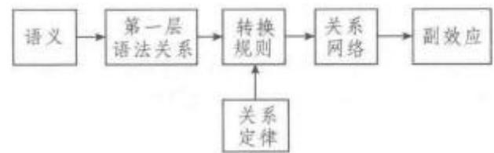  
关系语法模式图

语法关系和句法的多层次分析是关系语法理论进行句法描写的两个不可缺少的基本条件。语法关系可以对个别语言的语法进行描写，它不仅可以描写语言的普遍规律，而且还可以描写自然语言中各种可能的语法结构。这些描写都是以对句法作多层次分析为前提的。

关系语法理论中决定语法关系的语义反过来又要通过语法关系来表示，这与格语法(Case Grammar)用深层格来表示语义一样。关系语法理论主要是以描写名词(包括代词)的语法关系转换为主体，因此关系语法学家可以被称作是名词中心论者。

一般来说，表施动主体的语法关系为主语，表施动对象的语法关系为直接宾语，表受施动结果影响的客体为间接宾语。语法关系在句法分析中由关系符(R-sign)表示，语法主要描写它们的转换情况。语法关系可以用范畴(category)来加以描述，不同范畴的关系具有不同的句法表现。关系语法理论将名词所表示的语法关系分成四种不同的类型，因此有四类名词性关系符：(1)在句中担任主语、直接宾语和间接宾语等主要语法成分，这些语法关系分别由项关系符(Term R-sign)1、2 和3表示，其中主语1 和直接宾语2 被认为是核心项关系符(Nuclear Term Rsign);(2)在句中担任状语的语法关系则通过副效应由旁格关系符(ObliqueR-sign)表示，如受益(Ben,)、工具(Inst.)、时间(Temp.)和方位(Loc,)等；(3)退位关系符(Retirement R-sign)用来表示由于其他关系的变化而引起变化的语法关系，包括休免(Cho.)关系和名誉(Em,)关系；(4)边缘关系符(OverlayR-sign)用来表示某些担任句法特征的语法关系，包括疑问关系、定语小句关系、主题关系等。动词在句子中担任谓语关系。

关系语法不但把语法关系划分四种不同的类型，并且还把它们划归四个不同的等级。主语为最高等，直接宾语为二等，间接宾语为三等，非项关系(如旁格关系、休免关系等)为最低等。这种等级关系可图示如下：

## 1>2>3>非项关系

20世纪70年代中期以后，关系语法开始往形式化方向发展，波斯特尔(Paul Postal)采用代数式及弧线等几何图形来反映语法关系，并在此基础上衍生出弧对语法(Arc Pair Grammar)。值得一提的是，虽然弧对语法有其独特性，但从事弧对语法研究的学者却为数不多。

广义短语结构语法Generalized Phrase Struc-ture Grammar;GPSG这是一种语境自由的短语结构语法，是短语结构语法(PhraseStructureGrammar)自20世纪70年代后期的进一步发展。盖士达(Gerald Gazdar，1950—)于1981年提出了早期的广义短语结构语法理论框架。1985年由盖士达、萨格（IvanSag，1949—2013）和克莱因（EwanKlein)和美国语言学家普勒姆(Geoffrey Pullum，1945—)合著出版的《广义短语结构语法》(General-ized Phrase Structure Grammar)全面阐述了这一理论的性质、框架和具体内容，标志GPSG理论已经形成。

生成语法阵营在20世纪70年代经历了一次分化，一部分人继续坚持采用转换的分析方法，而另一部分则在80年代前完全放弃了转换语法，转而创立基于约束条件的新语法体系。前者在今日仍占主导地位，后者则发展成多种语法理论流派，广义短语结构语法就是其中较早的一支。其他还有中心词驱动的短语结构语法(Head-driven Phrase StructureGrammar，简称HPSG)、词汇功能语法（LexicalFunctional Grammar，简称 LFG)和关系语法(Rela-tional Grammar，简称 RG)等。

广义短语结构语法理论本质上是一个句法理论，但也包含语义表达，并说明语句与它们的意义之间的关系，所以这一理论包括句法和语义两个部分。句法部分主要是指句法规则约束条件系统，这些规则可以投射到句法树图，语义主要是指基于蒙太古语法基础上的语义解释。语义解释系统采用内涵逻辑的方法。一个词语的意义(Meaning)等于涵义(Sense)加上指称(Reference)，即内涵(Intension)和外延(Extension)。虽然广义短语结构语法本质上还是属于生成句法理论，但它也具有其鲜明的特点。例如，广义短语结构语法十分注重表层形式表达，有完善的语义表达体系，使用单一层次的结构描述语言等等。这些都为后来的短语结构理论奠定了基础。

广义短语结构语法通过对特征(feature)赋以不同的值(value)来区分不同的范畴(category)，从而进一步描写语句。特征主要分为三类：

(1)中心词特征（head feature)：描写主语、助动词、谓语等的特征。

(2)尾端特征（footfeature):描写疑问代词和关系代词的特征、反身代词等的特征。

(3)一般特征（normal feature);描写动名词、否定等的特征。

例如，通过表1中所列的特征，我们可以得出“非限定的动词词组形式”的范畴特征的表达是[V+，N-, VFORM INF, BAR 2].

表1 描述范畴“非限定的动词词组形式”的特征及赋值
<table><tr><td>动词性</td><td>V</td><td>(+.一)</td><td>动词、非动词</td></tr><tr><td>名词性</td><td>N</td><td>{+,-}</td><td>名词、非名词</td></tr><tr><td>动词形式</td><td>VFORM</td><td>{FIIN, INF. PSP)</td><td>限定、非限定、 过去分词等</td></tr><tr><td>标杆层次</td><td>BAR</td><td>{0,1,2}</td><td>词汇层、中间 层、词组层</td></tr></table>

在使用特征组合表达范畴时，要注意每个特征的取值只能是唯一的，而且特征间不能出现互相矛盾的值。例如在[n十，n一]中出现了同一个特征的两个不同的值，在[v一，n+，vform pas]中出现了非动词性和动词形式两个矛盾的特征值。

此外，在词汇层面上，需要进一步描写词汇的具体特征才能在语境中体现词汇的具体用法。广义短语结构语法采用的是次语类化(subcategorization)的方法，即对一个句法范畴的进一步分类。例如汉语中动词“取”的及物动词用法要求后面需要跟一个名词短语做直接宾语。要描述这样的句法特征，需要增加一个subcat的特征并赋予它一系列对应不同语境的值，如{1(一元谓词)，2（二元谓词)，3(三元谓词)…。那么“取”的及物用法可以用特征表达为[subcat 2].

在短语结构层面上，广义短语结构语法采用了和其他主要生成语法相同的类似X-阶标(X-bar)的处理方法。仍以“取”的及物用法为例，如果要表达动词词组“取了书”，那么短语结构可以用特征表达为如树形图：

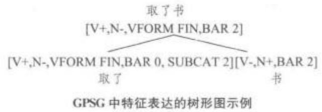

这条规则也可写为如下表达式：

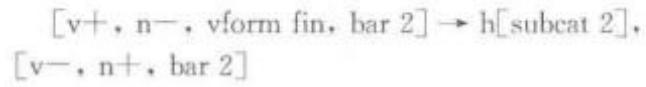

其中H并不是一个特征，而仅仅表明子节点V是中心子节点。根据广义短语结构语法理论中的“中心词特征规约(Head Feature Convention)”，母节点和中心词子节点具有相同的中心词特征。换言之，中心词子节点要继承母节点的许多特征。

在句法结构层面上，广义短语结构语法包含了一系列规则，以引入句法范畴。这些规则主要包括直接支配规则(Immediate Dominance rules，简称 ID规则）、线性顺序说明（Linear Precedence state-ments，简称LP说明)和元规则(metarules)。ID规则规定了母节点和子节点的关系，即母节点直接支配子节点。例如：

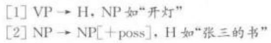

例[1]表示动词词组直接支配一个作为中心子节点的V和名词词组：例[2]表示名词短语直接支配所属的名词短语和中心词子节点N。需要指出的是，和其他一些生成语法的表达不同，例[1]和例[2]中的逗号表示NP和中心词H没有先后之分，而仅仅表达支配关系。如果体现线性顺序，就得需要另外一种称为LP说明的规则，如例[3]：

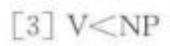

LP说明例[3]表达的意思是动词，即[1]和[2]中的中心词，在做宾语的名词词组之前。按照之前所论的中心词一般在它的姐妹节点词组的前面，而且只有中心词具有SUBCAT特征，所以规则[3]也可以写成如下形式：

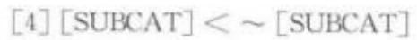

其中“\~”表示“逻辑非”。此规则表达的意思是，具有子语类特征的范畴的位置在线性顺序上总是先于不具有子语类特征的范畴的位置。所以，ID规则和LP说明共同描写一般的语言形式的合法结构和线性顺序。

元规则可以把一组ID规则投射到另一组中，或者说元规则是产生新规则的规则。GPSG中共有6种元规则，即被动元规则、主语一助动词插入元规则、附加位置元规则、补足语省略元规则、不连续终止元规则(一)和不连续终止元规则(二)。以被动元规则为例，盖士达等规定为如下(1985:59)：

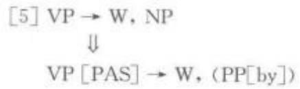

其中“→”表示转变，W表示除了规则涉及的词组(即转变前的 VP和 NP 及转变后的 VP 和 PP[by])以外的范畴。此规则表达的意思是任何符合“VP→W，NP”规则的语句，如果VP具有中心词特征[PAS]时，可以转换为“VP [PAS]→W，(PP[by])”规则的语句，即NP由可选的介词词组PP[by]替代。下例体现了此规则的作用：

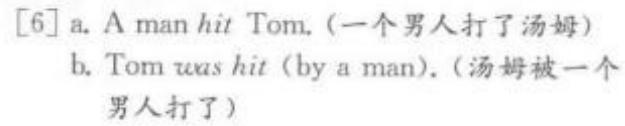

元规则把原有的有限规则转化成对应不同语言现象的许多新规则，更准确地描述语言形式，提高了广义短语结构语法理论的生成力和概括力。

除了以上的句法规则，广义短语结构语法中还包括一系列决定什么样的句子形式是合格和可以接受的形式(well-formed)的规约或原则。它们包括中心词特征规约(Head Feature Convention)、尾端特征规约（Foot Feature Principle)、一致性控制原则(Control Agreement Principle)、特征说明默认规则(Feature Specification Defaults)等。

广义短语结构语法属于解释性的语言学理论，既重视具体的语言特征又重视理论框架的建立。该理论中的元规则概念也说明从本质上讲它还是属于生成语法理论的一种。但是它和乔姆斯基的管约论还是有诸多不同之处。首先，管约论的核心是一系列相互关联，互相制约的普遍原则体系，追求发现语言的共性；而广义短语结构语法虽然也研究语言的普遍性，但是它更注重通过数学、逻辑等形式化的方法，运用复杂的技术性的公式、定理和标注等运算，对自然语言进行精确描写。其次，同其他短语结构语法一样，广义短语结构语法也是非转换的(non-deriva-tional)，即不会涉及从另外的表达式而产生出一个结构，例如管约论中的“移动-a”和转换式的操作。

广义短语结构语法是当代生成语法理论中影响最大的理论之一，提高了理论的解释范围和预见性，并采用了数学模型建立自然语言理论，为今后该理论研究成果的计算实现等相关研究提供了有力支持。

##

汉语音韵学Chinese Phonology 中国传统语文学“小学”的一个分支，指在汉语方言以及反切系统的基础上，研究历代汉语音系及其发展过程的学科。汉语音韵学常简称为“音韵学”或“声韵学”。

汉末及魏晋时代，佛教传入中国，佛经翻译事业蓬勃发展。一些学者用所掌握的梵文拼音原理分析汉字的音韵，并结合汉语中的“二合”发音现象，发明了“反切注音法”。反切是我国古代字典辞书中运用最普遍最重要的注音方式，兴起于汉末。唐代以前称“某某反”，唐代以后称“某某切”，是用两个汉字给一个汉字注音，前一个称为反切上字，后一个称为反切下字，被切字的读音取上字的声母，下字的韵母和声调，拼合而成。如《广韵·麻韵》誇，苦瓜切。这一范式的发现非常重要，可把汉语音节切分为“声”“韵”两部分。传统音韵学认为，非音质音位“调值”附加在“韵母”上面。

魏晋之后各种韵书层出不穷，目前可见最早的韵书是隋代陆法言的《切韵》，共193韵，成书于公元601年，是当时规模最大、影响深远的一部韵书。该书注释简单，有些常见字没有注释；不正字形。唐代孙愐(生卒年份不详)对其增补，共195韵，称《唐韵》，增加注释，注意字形。北宋陈彭年(961—1017)等奉敕重修《切韵》，第一次修订在真宗景德四年(1007年)，第二次在大中祥符元年(公元1008年)，取名《大宋重修广韵》，简称《广韵》，共206韵，收字26194个，同音字列为一小韵，共3700多个小韵。《广韵》是研究中古音最重要的依据。对《切韵》一系韵书研究的学问称为“今音学”。明代陈澧(1810—1882)，是我国第一个明确宣称依据《广韵》反切考证《广韵》声韵系统的人。他写作《切韵考》，依据系联方法，将《广韵》反切上字分为40声类。经当代学者曾运乾(1884—1945)、陆志韦(1894—1970)、周祖谟(1914—1995)等从审音角度得出《广韵》51声类，35声母。《切韵》韵类研究也始于陈澧，将反切下字归纳为311个韵类。现当代学者钱玄同(18871939)、黄侃(1886—1935）、高本汉（Klas Karlgren，1889—1978)、白涤洲(1900—1934)、周祖谟、陆志韦，也从审音角度分别做了研究，根据如何看待重纽问题、如何处理开合问题等切入点，各家的处理数据也不同，但大致意见一致(何九盈，2000b:335)。

唐代末年僧人守温(生卒年份不详)，根据印度梵文音理，制定了30个字母。到了宋代，这套字母发展为36个。与此同时，随着对音节切分意识的加深，还产生了等韵学。根据声韵配合的规律将音节代表字排进图表，称作韵图。《韵镜》是迄今我国发现的保存最早的韵图，将《广韵》206韵分列于43张图内。每图横列七音(36字母)，纵列四声。韵图中标示“开”“合”，分别指“开口呼”“合口呼”。韵图的基本内容是四等。四等也是介音与主元音的分类，如东韵有一等、三等之别，就是介音不同；豪肴宵萧分四等，是主要元音高低有别。

元代周德清(1277—1365)的《中原音韵》反映了北方语音，收字5866个(有的版本为5869个)，既不注反切，也不标字母，也没有释义。它在19韵部之下分阴平、阳平、上、去四个声调，同音字聚在一起。各同音字组之间用圆圈隔开。对《中原音韵》一系韵书研究的学问称“北音学”。最早考订《中原音韵》声母的是罗常培(1899—1958)，其后赵荫棠(1893—1970)、陆志韦(1894—1970)颇为用心，详细研究了《中原音韵》的声、韵、调系统。前者善于考证，后者善于审音。

宋代古音学(专指研究《诗经》为代表的上古音系)开始萌芽，吴械(约1100—1154)的研究“取206韵的架子，用‘通’“转’的方法，集叶音’说之大成”(何九盈，2000a:167)。明代陈第开始具有明确的历史语音观，他作《毛诗古音考》，首次反对“叶音说”，认为“时有古今，地有南北，字有更革，音有转移，亦势所必至。”顾炎武是清代古音学的首创者，在语音学上的最大贡献有二：一是离析《唐韵》，二是以人声配阴声(王力，2006:118)。随着古音学研究的深入，音韵学两大主要流派也日趋明显：一派为审音派，即利用等韵学、今音学知识分析上古音；一派为考古派，即利用《诗经》、《楚辞》韵文，以及古文献通假字、汉字谐声等材料研究上古音。其中江永(1681—1762)、戴震(1724—1777)、孔广森(1753—1787)、江有诰(?—1851)为审音派，段玉裁(1735—1815)、王念孙(1744—1832)、钱大昕(1728—1804)属考古派。江永的贡献是第一次按照音理，将古韵17部分作6大类；戴震进一步明确了上古韵部阴阳入三分的系统；孔广森在上古韵部内提出“阴阳对转”。这些思想对上古音的构拟都起到了非常重要的作用。段玉裁的《古十七部谐声表》，收声符1521个，提出“同声必同部”，即凡同一谐声偏旁的字，一定同属于一个韵部，也一定和《诗经》的韵脚相符。如《诗经·七月》六章“瓜”字和“壶、苴、樗、夫”押韵，“瓜”字应该念得像“孤、狐、弧”一样从“瓜”得声的字。有了谐声偏旁的有力佐证，先秦的韵部研究更显严密。对上古声母的研究，钱大昕贡献卓著。他在《十驾斋养新录》中提出“古无轻唇音”“古无舌上音”，这是从异文、谐声、声训、读若、反切、方音等大量语音材料中发现的两个定理。

一般认为，汉语的整个语音体系大致经历了由简到繁，再由繁到简的过程。从早期的夏商周时期到隋唐时代是由简到繁的过程，隋唐时期汉语音系繁杂至顶峰，宋代以后至今汉语音系则已接近简化的顶峰(陈振寰，1986：289)。

清朝末年，随着中西交流的加强，西方传教士为了传播教义的需要，对汉语方言和汉语古音做了大量研究。20世纪初，以瑞典汉学家高本汉和法国汉学家马伯乐(Henri Maspero，1882—1945)为代表的西方语言学家运用现代语音学理论和历史比较法来研究汉语音韵，他们的理论和方法影响了赵元任(1892—1982)、王力(1900—1986)、周祖谟(1914—1995)等中国语言学家。当代中国音韵学家不仅研究古代的音类，还探究古人说话的实际音值，把汉语音韵学纳入了历史语言学的范畴并推进到了新的高度。对古音音值的拟测主要依靠对一般语言的音变规律、某一类字的音变倾向、现代汉语方言中的古音遗迹、汉字的域外译音、汉藏语系的历史演变等进行总结和比较。

汉语音韵学的研究有助于阅读古代的文献，尤其是帮助辨认辨析古书中的通假字和讹误字。音韵学对现代汉语的研究，对于汉语方言以及中国各少数民族语言的研究也有重要意义。并可以为历史学、考古学、文学史等学科的研究提供可靠的资料。

## 计算语言学 Computational Linguistics

指从计算的角度对语言进行的科学研究。作为术语，最早出现于美国科学院下属的语言自动处理咨询委员会(Automatic Language Processing AdvisoryCommittee，简称 ALPAC)在 1966年公布的一个题为《语言与机器》的报告中。该报告主要指出了当时机器翻译质量不尽如人意的情况，机器翻译碰到了“语义障碍”。到了20世纪80年代，计算语言学的研究转向了自然语言理解之后，又经历了一个发展繁荣期。计算原理和技术与相关的语言学、认知科学、逻辑学和统计学等学科结合，分别产生了新的研究领域。袁毓林(2001)从工程主义、工具主义、认知主义、实证主义和逻辑主义等五个不同取向介绍了多种不同的计算语言学的定义。

工程主义取向的定义着眼于计算机系统的建立。例如，格里什姆(Grishman，1986：4)对计算语言学的定义是“对能理解和生成自然语言的计算机系统的研究”;冯志伟(1992；84)的定义是“采用计算机技术来研究和处理自然语言的一门新兴学科”。

逻辑主义取向的计算语言学则着眼于语言学知识的自动发现。例如，翁富良、王野翊(1998：1,9)提出，“现代计算语言学是通过建立形式化的计算模型来分析、理解和处理语言的学科。……广义地讲，计算语言学是研究字符串的结构以及结构和意义的关系的学科。”

计算语言学是一门新兴的边缘学科。其研究内容、理论和方法涉及语言学、计算机科学和应用数学等不同领域。俞士汶(2003:2)的定义反映了这种跨学科的性质：“计算语言学指的是这样一门学科，它通过建立形式化的数学模型来分析、处理自然语言，并在计算机上用程序来实现分析和处理的过程，从而达到以机器来模拟人的全部或者部分语言能力的目的。这种跨学科的性质和研究目标决定了其研究方法和过程。一般来说，通过计算机处理自然语言经历四个阶段：首先，要有研究对象的语言学基础，通过语言学理论和方法发现问题并找到规律和解决办法。例如，在对基本词汇单位进行标记时，计算机就只能对有限符号集上的有限长度的符号序列进行形式变换(即计算)。第二，要把研究对象和规律进行形式化处理，对句法规律进行归纳，形成计算机可演算的规则，添加形式化的语义规则等，使之尽可能与下一步进行对接。第三，把得出的形式子体系共同组合，转化为计算形式化的算法(algorithm)。最后，根据算法编写程序，最终实现计算实现(compu-tational implementation)."

计算语言学产生的原动力是试图在生成语言学领域应用计算机科学，所以它和乔姆斯基的语言学理论有不可分割的关系。计算语言学的目的之一也是通过建立一套可以标志自然语言的普遍规则和描述某一特定语言的方法，来探究人类的语言能力。

对于语言是否能够实现形式化，语言学界存在两种截然相反的观点：一种是认为语言不能完全形式化，因为特定语言中的语句并不能形成可以循环的体系。譬如马丁·凯(MartinKay)等学者认为，目前的语言形式化体系并不适当，需要对其进行修改甚至替代。相反，另外一些学者认为使机器运作符合系统设计者意图的最简单的途径是对语义解释实行形式化定义，然后把定义应用到计算机程序中。从本质上说，计算语言学家关心的主要问题是计算机技术在语言学中的应用，即如何使用计算机知识框架来定义和建立一个正确处理自然语言的系统；他们注重的是计算机工作时的输出结果应该与输入的语言片段精确对应。但是计算语言学家们在实践中发现很难编制出一套精确的语义程序；在转而求助于形式语义学的研究成果之前，曾经把其他的语义系统应用于计算语言，结果在做比较复杂的程序时就出现了在一致性和连贯性方面的错误。

较早的形式语义学主要致力于研究语句的真值和真值条件，这制约了它在计算语言学中的应用。人们很难设想一部机器的翻译系统是以真值条件为支持来进行工作的。但是计算语言学家们或许把寻求符合真实世界作为运用计算机分析自然语言的动力之一，至于外部真实世界的情况，则并非研究中问题的核心。逻辑学家和语言学家都不愿运用高阶内涵逻辑，而且总是竭力避开这个话题。这给计算语言学带来了难题。尽管蒙塔古(Richard Montague)在形式语义学系统中加入了可能世界语义学，但是计算语言学家并不能从这个理论中找出带有普遍性的内容。针对这个问题，巴怀斯(Kenneth Jon Bar-wise)和佩里(John Perry)等学者运用形式语义学中的集合论提出了情景语义学(situation semanties)，将“情景”视为一个抽象概念，源于对作为情景集合中个体的无数真实情景的分类。情景概念的一部分有其对应的真实世界中的情景，其余的则并无真实可见的对应。尽管人们并不能看到这些情景，不了解它们，甚至不相信它们的存在，但语义学者可以根据它们对语句和人们精神状态所在的真实情景进行分类并研究意义的性质。

要能真正解决语言形式化存在的问题而使后者能够应用于计算机科学，它本身尚需不断完善，最为关键的是如何正确地结合实用性和形式化。一个形式化的系统必须在计算机术语、机器或人工术语的输入和输出间有严格的对应规范。此程序的结果必须是可复制的，如果同样的输入信息在不同情况下产生不同的输出结果，那么这种关系便不能称为“严格的对应关系”。而且由于语言本身的复杂性，在计算时如果存在冗余步骤，可能会导致计算机指数爆炸(exponential explosion)，语言学家的任务不仅要对语言进行规律的形式化总结，还要使形式化的规则尽量简洁。

虽然自然语言的计算机处理可以在许多方面和层次上相对独立的完成，如分词、词性标注、句法分析及歧义注销等，但是如果研究者同时具备语言学和计算机科学的专业知识，那么他就可以充分借鉴利用两个领域中相通的科学理论、概念和方法，使研究更有针对性，更好地使计算语言学理论发挥在理论语言学和计算机科学间的桥梁纽带作用。

从20世纪80年代末开始，许多计算语言学的研究都是基于大规模自然语料的文本分析。从计算层面来看，计算语言学家是在为计算机寻求合适的规则以便对语言进行计算。当代计算机储量大，运算快，可靠性强，这些都使大规模的定量研究成为可能。比如，语料库语言学研究机器可读的自然语言文本的采集、存储、检索、统计、语法标注(grammati-cal tagging)、句法语义分析以及具有上述功能的语料库在语言作品风格和作者考证研究、词典编纂、自然语言理解和机器翻译等领域中的运用。实践证明，以语料库为基础的统计模型不仅可以用来解决语法标注的任务，还可运用到更高的句法、语义的层面上，通过分析等多的自然语料，不断进行参数调整和优化，为理论的进一步完善提供直观有力的支持。

教育语言学Educational Linguistics 指致力于研究语言与教育相关的诸多问题的一个新兴学科分支。具体而言，教育语言学研究教育中的语言发展和语言使用问题，受教育者的语言权利和文化身份问题，语言教学的方法、手段和评价问题，语言学习的认知心理问题，双语及多语教育的社会公平问题，以及国家语言规划政策与语言生态多样性保护及传承问题。教育语言学以人为本，立足人的全面发展，基于人的语言权利，以问题为导向，关切具体主题和具体情景，以跨学科的广角视野，取跨学科的研究方法，使用各种可支配的教育资源，解决教育的语言问题和语言的教育问题。

从学科源头来说，教育语言学产生于应用语言学发展的“身份危机”，即语言学家对应用语言学学科属性和研究范围的长期以来的争议。教育语言学发源于20世纪60年代的美国，当时教育界遇到了一系列涉及语言教育的具有普遍意义的问题。例如，成人的扫盲教育、教育中的语言障碍、多语交际的表达策略、弱势语言及方言的地位、母语为弱势语言者的社会身份、国家语言教育政策、言语社区与学校的关系、语言习得与语言发展等。由于应用语言学对上述问题显得针对性不够，教育语言学作为独立学科应运而生。

教育语言学的开创者是一批关注并研究“教育中的语言”的语言学家和语言教育家，其中最杰出的教育语言学思想家和实践者为长期从事语言学、双语教育、人类学等研究的美国语言学教授斯波斯基(Bernard Spolsky)，其他代表人物有贝拉克(AllenBellack)(1966)、韩礼德（Micheal Halliday)（1969，1982)、麦金托什(Angus MeIntosh)、斯特雷文思(Peter Strevens)（1964)、海 姆 斯（Dell Hymes)(1974)、威尔金森(Ray Wilkinson)(1975)、辛克莱(John MacHardy Sinclair)、库尔撒德(MalcolmCoulthard)(1975)、威多森(Widdowson(1979)、加努恩（Petter Gannon）（1980）、斯塔布斯（MichaelStubbs)(1980，1982，1986)、古德曼(Kenneth Good-man)(1982)、卡特(Ronald Carter)(1982)、里德尔(MikeRiddle)（1982)、赫德森（Richard Hudson)(1982)、佩雷拉(Katharine Perera)(1982)等。

教育语言学的英文术语 educational linguistics由斯波斯基在1972年于哥本哈根举办的第二届应用语言学年会上宣读论文时首次提出来。在此论文中，斯波斯基将教育语言学描述为以教育心理学和教育社会学为模型、语言学与教育学相结合的一个学术新领域。几年后，斯波斯基发表了专著《教育语言学导论》(Educational Linguistics: An Introduc-tion，1978)，对教育语言学作了较全面的阐述。斯波斯基认为，教育语言学隶属语言学，系语言学的一个分支。他认为，一切涉及语言与教育的问题都是教育语言学的研究对象。在讨论教育语言学与应用语言学的关系时，斯波斯基认为，教育语言学覆盖了更多的涉及语言的具体问题和实际问题。

教育语言学的发展不仅促进了学理探索和方法研究的发展，同时也呼唤专业人才培养机制的建立。20世纪70年代，斯波斯基和海姆斯(Dell Hymes)率先在美国新墨西哥大学和宾夕法尼亚大学设立了教育语言学研究生学位专业，开设了教育语言学博士学位课程。随后世界各地诸多高校也纷纷推出了教育语言学研究生学位计划、研究方向计划或学位课程，如美国亚利桑那州立大学、斯坦福大学、科罗拉多大学和蒙特雷学院，英国伯明翰大学、曼彻斯特大学、兰卡斯特大学、纽卡斯尔大学和沃里克大学。此外，澳大利亚、加拿大、新西兰、德国、沙特阿拉伯、泰国也纷纷设立教育语言学学位项目。国内外更多的大学则将教育语言学的学习融入研究生TESOL/TEFL专业的学位计划或语言政策学的课程体系，如我国华东师范大学外语学院和上海外国语大学语言研究院;美国宾夕法尼亚大学的教育语言学学科则成了引领教育语言学研究及学科发展的国际中心。

教育语言学的人才培养和科学研究也促进了教材开发和学术著述，其中斯波斯基(Bernard Spol-sky，1978)撰写的《教育语言学导论》(EducationalLinguistics:An Introduction，1978)和斯塔布斯(Michael Stubbs)撰写的《教育语言学》(EducationalLinguistics，1986)被公认为该领域的经典之作。近年来各国学者发表的其他重要著作还包括斯波斯基主编的《教育语言学简明百科全书》(Concise Ency-clopedia of Educational Linguistics,1999)、霍恩伯格(Nancy Hornberger)撰写的《教育语言学的研究领域》(Educational Linguistics as a Field: A Viewfrom Penn's Program on the Occasion of Its 25t An-niversary，2001)、范莱尔（Van Lier)与霍尔特(Francis Hult)合编的15 卷本《教育语言学丛书》(Educational Linguistics Book Series, 2003—2012)、斯波斯基与霍尔特主编的《教育语言学手册》TheHandbook of Educational Linguistics,2008)、霍尔特主编的《教育语言学的走向与愿景》(Directionsand Prospect for Educational Linguisties, 2010)、霍尔特与肯达尔·金(kendallKing)合编的《教育语言学的实际应用：区域全球化与全球区域化》（Educa-tional Linguistics in Practice: Applying the LocalGlobally and the Global Locall y， 2011)、霍恩伯格撰写的《教育语言学：语言学要旨》(Educational Lin-guistics: Critical Concepts in Linguistics, 2011)等。

教育语言采用“问题导向”或“实践导向”的研究范式，其核心课题是受教育者的语言权利和语言发展，教育语言学研究的根本问题是人的教育问题和人的发展问题。因而，教育语言学始终是以人为本，以受教育者为本，即使研究语言问题，也必须以人的发展为出发点和落脚点。形式上是研究语言问题，实质上是研究受教育者的发展问题。教育语言学的研究以解决实际问题为导向，而实际问题的解决反过来又可促进问题的研究，课题研究和解决问题互为条件，呈现了一种互为因果、反哺共进的双向互动关系。教育语言学的研究不仅仅是为了解决理论问题或增加学术知识，更是为了解决实际问题。实际问题的解决需要理论指导，而理论研究可以也应该用以指导实践。教育语言学研究者不是在书斋中闭门思过，闭门造车，主观臆想，自说自话。教育语言学研究的问题基于实际，源自实践，不仅具有理论意义，更具有实际意义。

在教育语言学研究范畴的问题上，斯波斯基认为“任何研究教育中的语言问题的学科或领域均归于教育语言学范畴之下，其中，宏观地来看，语言学起核心作用。”教育语言学发端于应用语言学，其学科基础主要是语言学与教育学。同时，教育语言学将理论语言学、社会语言学、心理语言学乃至人类语言学、神经语言学、临床医学语言学、语用学以及话语分析等学科整合在一起。教育语言学的边界是与其接缘学科的相关课题，如社会学、心理学、人类学、民族学、区域学、经济学、传播学、法学等。教育语言学的主要课题为三大类：(1)基于教育的语言发展和语言使用问题；(2)学校环境中的语言教学(含外语教学)问题；(3)语言教育政策的制定与实施问题。

教育语言学的研究领域颇为宽广，研究问题也有相当的深度，其广度是由教育语言学的工作范畴决定的，其深度是由教育语言学与各相关接缘学科的专业知识及其应用决定的。教育语言学家在各自的研究工作中采用不同的方法，有的关注宏观问题，有的关注微观问题，也有的关注介于两者之间的中观问题。无论是宏观、微观还是中观，关注的出发点、立足点和聚焦点始终是学生的语言发展问题，始终是教师的语言教育问题，始终是人的语言与教育的问题，归根结底也是人与社会的发展问题。

语言学理论层出不穷，学术流派众多，从功能派到生成派，不同的理论对教育和教师产生了不同的影响，但有一个共同点，即对语言和语言学的了解可以使教师从理论和实际两方面意识到并充分利用学生、家庭、社会带到学校的各种语言资源和文化资源，更好地将所知的语言学、教育学等知识付诸教学实践。

霍恩伯格(Nancy Hornberger，2001)认为，教育语言学的研究领域有三大特点：一是教育与语言的融合，探讨语言学对于教育的意义以及教育对于语言学的意义；二是以问题为导向，以教育实际为出发点；三是聚焦语言教学与语言学习。霍恩伯格把教育语言学的研究范围分为三大类：一是研究语言行为与社会网络、文化身份之间的关系；二是研究课堂二语、外语、双语的学习以及交际环境；三是研究双语和多语社区与学校。

教育语言学是研究“教育中语言”及“与语言相关的教育”的学科，教育语言学的学科内涵决定了“语言教育”必定成为其主要研究领域。这些领域包括(1)语言教育政策，如国家语言政策与规划、语言发展战略等；(2)语言教育与个人发展，如受教育者的社会文化身份认同、学科知识学习和应用等；(3)语言教育与文化传承，如多民族国家的语言多样性发展、濒危语言和方言保护等；(4)语言教育与教师发展，如教师的语言意识、元语言知识、语言教育观、语言教学能力和运用能力等；(5)语言教育与课程建设，如学校的教育理念、培养目标、教学原则、课程设置、课程方案、教学方法、评价手段等。

教育语言学的研究课题涉及(1)语言生态系统与语言多模态体现；(2)少数民族儿童的教育平等和均衡发展；(3)语言多样性发展与弱势语言保护；(4)国家语言政策与课堂教学体现；(5)受教育者的语言身份与语言权利；(6)双语或多语教育与课程设置；(7)语言习得与语言教学和评估;(8)教育过程中的话语分析与教学应用；(9)受教育者表达能力发展与读写能力发展。这些研究领域及课题所涉及的问题是多样性的，例如：(1)双语教育所涉及的课堂的语言意识、课堂教学用语的确定、语言测试和评估方法等；(2)国家语言政策所涉及的语言教育政策和通用语言使用政策、少数民族的母语权利、双语及多语教育中的意识形态、教师的语言决策权及其使用规范等；(3)语言生态所涉及的多语地区的弱势语言保护和发展、濒危土著语言的复兴、通用语言与本地语言之间的冲突、移民语言的弱势地位、双语及多语间的翻译等；(4)语言身份所涉及的受教育者的社会身份和交际风格、双语者的语言社区归属感和双重语言及文化身份的冲突、侨民及其子女的母语保护和使用、双语社区的语码混用与语言转换困难等问题。当代教育语言学的研究课题还有诸多展望：(1)全球化背景下教育国际化以及国际化人才培养过程中的外语教育政策和课程指导;(2)多民族国家语言教育政策的实施与语言以及文化多样性的维护；(3)濒危语言、方言以及相关非物质遗产的拯救和传承；(5)教育工作者的语言意识、语言心智、语言能力、语言学知识、教学语言技能等。

接触语言学 Contact Linguistics 指研究语言接触(language contact)的语言学分支学科。语言接触指使用两种或多种不同语言或变体的个人或群体，在直接或间接接触过程中所发生的各种语言使用现象及其结果所产生的各种变化情况。语言学史上洪堡特、萨皮尔、布龙菲尔德等人都对语言交融、相互影响做过相应研究，语言接触首先在19世纪20年代克里奥耳语与洋泾浜语的研究中受到关注，但接触作为一门独立的学科分支则从1953年魏恩赖希(Uriel Weinreich，1926—1967)出版的专著《语言接触：已发现与待解决的问题》(Language in Con-tact: Findings and Problems)为起点。同一时期的拉博夫（William Labov，1927—）、豪根（EinarHaugen，1906—1994)、菲什曼（JoshuaFishman，1926—2015)等学者共同构筑了语言接触的基本理论框架。此后，随着20世纪七八十年代生成语言学与社会语言学的兴起与昌盛，语言接触仅仅作为边缘学科而存在，接触语言学这一名称也直到1979年6月比利时首都布鲁塞尔举行的第一次国际语言接触和语言冲突大会上才开始正式使用。20世纪80年代起接触语言学发展迅速，从社会语言学中脱离，研究范围不断扩大，逐渐形成了各种语言接触理论及流派。托马森(Sarah Thomason)与考夫曼(Ter-rence Kaufman)于1988年出版的专著《语言接触、克里奥耳语和基因语言学》(Language Contact, Creol-ization, and Genetic Linguistics)是继瓦茵莱赫的《语言接触》之后的重要著作，间接或直接地影响了此后十余年语言接触方面的研究。剑桥大学出版社自21世纪初起便推出了“语言接触”系列丛书，注重语言接触在当前语言学及其分支学科的前沿研究与语言接触理论的交叉研究，在内容和研究范畴方面突破了传统接触语言学的理论框架，聚焦语言接触与方言研究，论题包括洋泾浜语以及克里奥耳语的发展、语言进化与变化、世界诸英语、语码转换及语码混杂(code-mixing)、双语主义、二语习得、语言借用以及语言干预(language interference)等课题的研究，为语言接触研究开辟了新局面。2010年威利一布莱维尔(Wiley-Blackwell)出版公司出版的《语言接触手册》(The Handbook of Language Contact)则分别从语言接触与语言学、语言接触与语言变化、语言接触与社会以及语言接触个案研究四个板块综合论述了接触语言学的各个研究维度。

传统接触语言学研究侧重对两种语言及以上的语言接触环境的深度考察，长期以来是历史比较语言学研究语言演变的重要途径之一。研究往往在分析描写语料的基础上探明语言的亲属关系、借词和原词的对应规律，讨论语言接触如何影响语言结构、两种语言接触时其语法形式与结构如何演化以及引发语言间语法结构转变的机制等问题。现代语言接触事实和早期文献、考古是其研究的基础。历史语言学侧重对语言接触的规律性的探讨、语言接触深度的无界性与有界性的探讨、借词和原词的语音对应规律以及探究语言进化的同源性与异源性的探讨，这也引起语言演化的横向传递与纵向传递的争论。

传统的语言接触研究在借用现象方面的研究并不局限于历史语言学范畴内的讨论，语言成分的借用在详细的语言描写基础上得到深入细致的研究，成为二语习得、双语(多语)主义、克里奥耳语等接触语言学研究课题的基础。首先，从语言内部角度看，语言借用研究在大规模调查接触语言的基础上，描写借词的语音、语法、音位、音节、构词特点，推论句法借用的规则，研究语法借用(grammatical borrow-ings)、语义转用(calques)、形态结构借用(borrowingof morphological material)等概念;其次，从语言接触的过程与环境角度看，语言接触对语言形式的影响有强有弱，语言借用等级(borrowing hierarchies)即研究何种语言成分最易被借用，接触的情景类型的研究，诸如语言区域（linguistic areas）、一对一借用情景(one to one borrowing situations)、低层语影响论(substrate influence)、双语及多语现象(bilingual-ism/multilingualism)等，也是语言借用现象研究的焦点。

语言接触促使语言结构和语言使用功能发生变化的同时，在接触过程中往往会产生各种语言现象，如语言影响(language influence)、语言混用(languagemixture)和语言转用(language shift)。语言影响可以是单向的也可以是双向影响(mutual/non-mutualinfluence)。例如，古汉语对日语发生了重大影响，而日语对当时的汉语没产生任何接触影响；进入现当代，借入日语后混合的汉语又对现代汉语造成了接触影响，即相互影响。语言之间相互影响的方式有词汇借用、形态与语法等在内的语言吸收(adoptionof other language features)、分层影响(stratal influ-ence)、创造新语言等，如各类混合语(mixed langua-ges)。语言混用亦称语码混用，指在两种语言接触的地方里，以一种语言作为主导语言，同时夹用另一种语言成分的现象，可以是双语混用，也可以是三语甚至多语混用。语言转用亦称为语言融合(languagemergence)、语言交替、语言同化等，指在两种语言接触的社会中，个人或民族被迫或自愿地放弃使用本民族语言，而换用别的民族语言的现象。语言融合是随着不同民族的接触或融合而发生的不同语言系统的排挤和替代，是不同语言统一为一种语言的途径。融合的结果与政治地位的高低关系不大，往往是经济文化地位高的一方排挤低的一方。

语言接触产生的一种特殊语言现象，即洋泾浜语与克里奥耳语，长期以来是接触语言学研究的重点。洋泾浜语是外来殖民者或新移民简化自己的语言，夹入一些当地语法的成分而形成的特殊语言。洋泾浜语的特点是语音经当地语言音系的大幅改造；语法规则减少到最低限度且带有本地语法的痕迹；词汇量很少，绝大多数取自当地词汇，常常用迁回曲折的方法来指称事物。克里奥耳语亦称混合语，指在语言接触中出现的一种可能被社会采用为主要的交际工具，并由孩子们作为母语来学习的语言现象。洋泾浜语一旦升格为混合语，在一个社会成员中扎下根，就会扩大词汇，严密语法，迅速地丰富起来，最后也可能变得和其他语言一样完备。

语言接触影响至少一种语言，对诸如语音、词汇、语法、语义等各语言要素产生影响。不同群体之间的语言接触会出现三种后果：(1)和谐：相接触的不同群体语言，在语言结构上相互融合、渗透、扩散，在此过程中各自语言功能、结构得到丰富发展，语言生命力由而得以增强，从而促进了语言的和谐；(2)替换:某个群体语言基本结构受到冲击后使用功能逐步萎缩，出现濒危现象，最终甚至被彻底替换；(3)质变：相接触的语言在结构上发生混合或融合，最终因渗透的深入而产生一种质变语言。

语言接触涵盖语言内外部诸多因素，传统的接触语言学理论注重语言描写基础上对语言接触过程、现象与结果的分析描述，往往从微观层面展开，着重从语言的角度去研究语言接触问题，从时间性与空间性角度模拟语言接触的模式，从已有语言的句法结构中不完美的地方去预测该语言可能接受的外来影响，或者描述语言冲突的程度、方向或性质，等等；而语言之外(extralinguistic)的要素(如心理层面或者社会层面的因素)对语言接触后所产生的结果进行描写、分析和归纳也在进入20世纪80年代后得到充分的重视。

从宏观层面来看，由于语言接触涉及面很广，需从语言与语言竞争力、语言本质及语言选择、语言与社会、语言与文化、语言与教育、语言与民族发展、语言与国家政治等多重角度去认识。语言接触研究发展的新趋势即是注重多学科交叉，力求多功能、多维度的分析路径。“社会语言学角度的语言接触研究侧重研究在社会变迁的宏观背景下透过社会文化现象分析言语行为，通过语言使用现象来说明社会结构及其内在机制问题，研究课题有语言结构与功能的变化与变异、双语及言语社区的语言接触研究，以及语言结构和社会语境之间的交互作用。方言学、民族语言学聚焦于语音、词汇、语法的相互渗透、融合以及变迁，重在探讨语言接触与其历史演变的关系、语言濒危、民族地区的双语教育等问题，方法则多采用字本位调查法、词汇密度考察法、借词观照法、共时背景分析法、语言谱系分类法等等”(邹晓玲，2012:138)。人类语言学侧重语言接触的意义，重视接触脉络辨析、文化解读，从语言角度对社会变迁进行探讨，旨在通过社会变迁背景下语言接触的状况及其后的社会力量的变化来解析语言接触和社会变迁的复杂互动，研究方法以田野调查、语言民族志法为主。心理语言学在研究语言接触时，侧重于语言认知心理的研究，在研究方法上主要采用实验心理学的方法，如变语配对测试法。语言政策规划学关注濒危语言研究，如濒危语言的概念、界定标准、形成因素、研究方法、演变规律以及趋势等，研究过程一般在充分描写并分析各种语言现象的基础上，针对问题提出解决方案，如制定语言政策、规划语言、处理语言资源等。

语言接触是人类语言发展过程中的普遍现象。从语言接触来审视不同语言的相互影响、冲突、变异、融合、衰变与消亡，无疑给语言研究提供了一个全新视角。接触语言学是研究语言演变的重要途径和研究人类文化演变过程的方法，同时作为一个多维度的分析路径，语言接触研究有助于语言学及与语言学相关的学科向纵深方向发展。语言接触也具有诸多现实意义:有助于正确地理解语言演变的历史性与连续性，掌握并把握语言的发展脉络，构拟原始语言与底层语言，预测语言未来走向，明晰语言亲属关系，规范语言使用，合理利用语言资源从而全面促进语言和谐。

结构主义语言学Structuralist Linguistics亦称“结构语言学”(Structural Linguistics)。从广义上说，指语言学研究领域中把语言看作是由语音、语法和词汇等要素构成的独立系统的任何语言研究；从狭义上说，指20世纪上半叶以瑞士语言学家索绪尔的语言理论为基础，但在具体研究中又各有侧重的各语言学流派的总称。作为结构主义语言学公认的创始人，索绪尔的重要思想体现在1916年由其学生巴利(Charles Bally，1865—1947)和薛施蔼(Al-bert Sechehaye，1870—1946)等整理出版的《普通语言学教程》中。该书的出版不仅标志着结构主义语言学思想的确立，更标志着现代语言学的开端。在这个意义上，索绪尔被尊为“现代语言学之父”。

结构主义的语言观(或称索绪尔语言理论)的指导思想，产生于19世纪末20世纪初。这与当时的社会思潮，尤其是与法国社会学家兼哲学家迪尔凯姆(Émile Durkheim，1858—1917)、奥地利心理学家弗洛伊德(Sigmund Freud，1856—1939)、美国语言学家惠特尼(William Dwight Whitney，1827—1894)等人的影响是分不开的。在迪尔凯姆创建的社会学理论中，“社会事实”被定义为对每个人都产生“外部制约”的物质存在，不受历史发展阶段的约束和限制。索绪尔很可能受到这种新兴社会学思想的影响，认为语言也是一种“社会事实”，语言行为的外部制约机制是抽象的语言系统；而且，语言也如同社会事实，不受历史发展的限制。因此，对于任何时期的语言，都可以抛开其历史状况而独立地进行描写和分析。弗洛伊德的心理分析观点对结构主义语言学思想的形成影响也很大。弗洛伊德认为，行为受制于源于“集体心智”的规范。与此相呼应，索绪尔认为语言也应该如此，一个人虽然无法说明自己的语言知识，但其语言行为却无不受到语言规则的制约。在语言学理论的建构方面，索绪尔主要受到美国语言学家惠特尼的影响。索绪尔认为惠特尼在语言研究中提出的符号问题把语言学引上了正确的轨道。因为符号任意性的概念不仅可以区分人类交流与动物的本能交流，而且最终把语言定位为建立在社会规约上的一种制度、一个系统。

索绪尔的主要语言理论观点都体现在《普通语言学教程》一书中，要点包括：(一)在语言研究中区分语言和言语，语言指社会全体说话人所共享的语音、词汇和语法系统，具有社会性和同质性，言语则指个人在实际情景中的具体话语表达，具有个体性和异质性；语言学的研究要以语言为研究对象，但由于语言和言语间的相互制约，对语言对象的描写必须建立在对具体言语表达的分析上。(二)把语言看作是一个符号系统，符号是由物质性的能指和概念性的所指结合所产生的，其中能指是发音时的声音形象，即声音的心理印记，所指是概念、能指与所指的结合，具有任意性。(三)由于语言符号的任意性，语言系统中每个语言单位的价值都必须取决于它在系统中与其他单位的相互关系，对于索绪尔来说，某个概念之所以能够存在，完全是因为它与其他概念之间存在差异，而不是源于其自身的价值。(四)索绪尔还主张在语言研究中必须排除历史，强调语言的共时研究。

索绪尔的这些关于语言理论的基本思想形成了结构主义语言学研究的最基本的语言观和研究方法，同时也把语言学的研究推进到了一个崭新的时期，奠定了现代语言学作为一个独立学科的地位。索绪尔语言理论的影响极其广泛，不仅在20世纪上半叶一统欧美大陆的语言学研究，而且还渗透到与语言研究相关的各个领域之中，如哲学、人类学、社会学、文学等领域。

在索绪尔之后，结构主义语言学继续迅猛发展，20世纪30年代和50年代分别分化出诸多颇具影响力的学派。30年代分化出的比较重要的学派包括盛行于捷克斯洛伐克的布拉格学派、盛行于丹麦的哥本哈根学派和在美洲大陆盛极一时的美国学派，50年代产生的学派中最具影响的是伦敦学派和莫斯科学派。结构主义语言学的这些诸多学派虽然在理论体系上都独具特色，但在语言观上都以索绪尔的语言理论为指导思想，主张任何语言成分都必须和该语言系统内的其他成分联系起来进行分析。在这一共同理论前提的基础上，结构主义语言学几乎主宰了整个20世纪的语言学研究。

角色与参照语法 Role and Reference Gram-mar;RRG20世纪70年代末逐渐发展起来的一种新型的结构功能语法，是功能语法领域的主要理论之一，以范瓦林(Robert Van Valin)和福莱(Wil-liamFoley)等学者为代表，兼有形式研究和功能研究的诸多特点。该语法最早研究的是非印欧语系的语言，如拉霍它语(Lakhota)、他加禄语(Tagalog)和迪尔巴尔语(Dyirbal)等。这些语言的结构与印欧语系的语言有明显的差异，无法套用现成的各种语法模型来进行分析和描写。鉴于此，一种新的语法分析模型便设计出来，可以有效比较这些语言结构中的句法、语义和语用之间的互动关系。

角色与参照语法认为，语法分析主要目的是分析语言的基本单位在系统中的功能角色、形式和结构特征。该语法将语言看作一种社会交际的行为系统，句法结构不是一个独立的模块，而受到语义因素和语用因素的严格制约。RRG主要研究语言形式和语言功能之间的配对关系，即一种形式为什么有不同的功能，一种功能如何用不同的形式来表示。角色与参照语法试图回答的两个核心问题为：(1)一种语法理论，如果不是基于英语，而是基于拉霍它语、他加禄语和迪尔巴尔语等语言的分析，将会具有什么样的形式?(2)一种语法理论如何最佳地描述不同类型的语法系统中，句法、语义和语用的互动关系？

鉴于此，角色与参照语法在语言描述上提出了三个表征层面，即句法结构表征、语义结构表征和信息(焦点)结构表征。句法结构和语义结构表征之间由一组规则系统连接起来，在连接过程中，篇章语用因素至关重要。

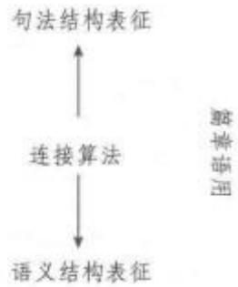

## (一) 句法结构表征

角色与参照语法认为每个句子只有单一的句法表征，没有类似词汇功能语法的f-结构或转换生成语法的底层结构，句法表征和语义表征直接相互映射。它也没有采纳X一阶标结构来描述语言结构，因为核心标注语言的结构、不连续成分以及语序自由的语言无法得到合理描述。尽管人类语言具有表面多样性，但小句都具有共同的特征。所有的语言都区分谓词和非谓词，非谓词又区分论元和非论元成分。

<table><tr><td>谓词+论元</td><td>非论元</td></tr></table>

包含谓词的句法单元称为小核心(nucleus)，包含小核心和谓词论元的句法单元称为大核心(core)，非论元成分则为小聚的边缘成分(periphery)。他们构成句子的层级结构(layered structure)。句法和语义的对应关系如下表：

<table><tr><td>语义成分</td><td>句法单位</td></tr><tr><td>谓词</td><td>小核心</td></tr><tr><td>谓词语义表征中的论元</td><td>核心论元</td></tr><tr><td>非论元</td><td>边缘成分</td></tr><tr><td>谓词+论元</td><td>大核心</td></tr><tr><td>谓词+论元+非论元</td><td>小句(大核心十边缘成分)</td></tr></table>

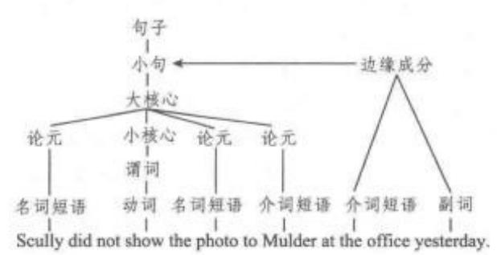

例句中，Scully、the photo 与 Mulder 是核心论元，at the office 和 yesterday 是附加的边缘成分。边缘成分与大核心成分连接的箭头标明边缘成分是大核心成分的非必要修饰语。结构中的did和not没有与任何成分连接，角色与参照语法将他们称为算子(operator)，投射在小句的其他位置。算子包括体(完成体、未完成体、进行体)、否定、时态、言外之力等，可修饰不同的阶层以获得其辖域。

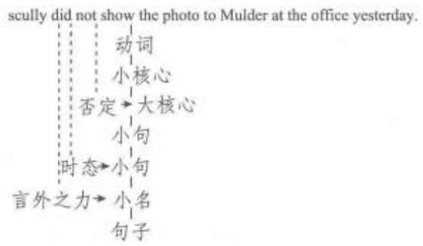

除了一些普遍性的语言成分外，各种语言还具有一些自身特殊的位置，如前大核心位置(pre-coreslot，简称 PrCS)，可以描写英语或冰岛语中的 wh疑问词的位置。角色与参照语法采用的是句法模板(syntactic template)来记录不同语言的阶层结构，这些目标存贮在每种语言所特有的句法库藏中(syntactic inventory).

## （二）语义结构表征

角色与参照语法中，语义关系十分重要，分析主要采取的是动词的词汇分解(Lexical Decomposi-tion),其理论基础是道蒂(David Dowty，1979)和文德勒(Zeno Vendler，1967)以词汇体为依据的动词分类系统。根据词汇体的特征，动词可以分为四个类别：状态动词(state)、活动动词(activity)、成就动词(accomplishment)和起止类动词(achievement)。每种动词类型都有其相对应的逻辑结构(logicalstructure)，由一个表示静态或动态的原子谓词与一个表示逻辑关系的原子谓词组成。不同的类型在句子中表现为不同的句法和语义关系，在逻辑结构表达式中表现为不同的语义角色关系(如下页图表)。

需要注意的是，逻辑结构中使用的是由英语来表示的元语言(metalanguage)，并不是指英语本身。

在动词的逻辑结构中，除了谓词之外，还有论元及其语义角色。角色与参照语法将语义角色分为两种，第一种是一般句法理论所探讨的题元角色(the-matic roles)。自菲尔默(Charles Fillmore)(1968)和格鲁伯(Jeffrey Gruber)(1965)以后，经常讨论的题元角色有施事、受事、感事、主题等。他们不是原始的角色概念，第二个层面上的两个语义宏角色(macro-roles)才是语义角色的原始概念。语义宏角色是动词的逻辑结构与句法表征层面互动的主要界面，在整个理论体系中扮演着极其重要的重用。语义宏角色有两种，即行动者(actor)和承受者(undergoer)，它们对应于典型的及物关系中两个最重要的题元。语义宏角色和动词的逻辑结构中论元位置的对应遵循以下的等级：

<table><tr><td>词汇</td><td>逻辑结构</td><td>范例</td></tr><tr><td>a. broken</td><td>broken&#x27;(y)</td><td>The glass is broken.</td></tr><tr><td>a&#x27;. break</td><td>BECOME (y)</td><td>The glass broke.</td></tr><tr><td>a&quot;. break</td><td>[do&#x27;(x,φ)] CAUSE [BECOMEbroken (y)]</td><td>The boy broke the glass.</td></tr><tr><td>b. dead</td><td>dead&#x27;(y)</td><td>He was dead.</td></tr><tr><td>b&#x27;. die</td><td>BECOME dead&#x27;(y) [do&#x27;(x,φ)]CAUSE</td><td>He died suddenly.</td></tr><tr><td>b&quot;, kill</td><td>[ BECOME dead&#x27; (y)]</td><td>He drug killed him.</td></tr><tr><td>c. cool</td><td>cool&#x27;(y)</td><td>The soup is cool.</td></tr><tr><td>c&#x27; cool</td><td>BECOME cool&#x27;(y)</td><td>The soup cooled.</td></tr><tr><td>c&quot;cool</td><td>[do(x,φ)] CAUSE [BECOME cool&#x27;(y)]</td><td>The breeze cooled the soup.</td></tr><tr><td>d. sing</td><td>[do&#x27;(x,[sing&#x27;(x,y)]</td><td>He can sing many songs.</td></tr><tr><td>e. run</td><td>[do&#x27;(x,[run&#x27;(x)]</td><td>He ran all the way.</td></tr></table>

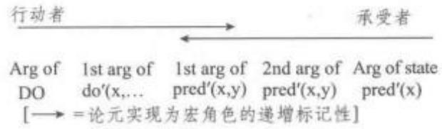

对应原则如下：

数量:语义宏角色的数量等于或小于逻辑结构中论元的数量。(1)若某个动词逻辑结构中包含两个或两个以上的论元，该动词有两个语义宏角色；(2)若某个动词逻辑结构中只包含一个论元，该动词有一个语义宏角色。

当动词只有一个语义宏角色时，存在两种情形：(1)若该动词的逻辑结构中含有活动动词，该语义角色是行动者；(2)若该动词的逻辑结构中没有活动动词，该语义角色是承受者。

## (三)信息(焦点)结构表征

角色与参照语法的信息结构采用的是兰布雷希特(Knud Lambrecht)1994年所提出的信息结构理论。兰布雷希特将话题和焦点认为是所有指称语的基本信息功能。关于焦点的位置和范围，角色与参照语法提出了潜在焦点域(potential focus domain)和实际焦点域(actual focus domain)。前者指句子中焦点可能出现的位置；后者指焦点实际出现的位置。焦点出现的位置具有跨语言的差异。例如，英语中潜在焦点域是整个句子，而汉语的潜在焦点域只能在动词之后(包括动词)。下图中，虚线代表的是潜在焦点域，而三角形表示实际焦点域。

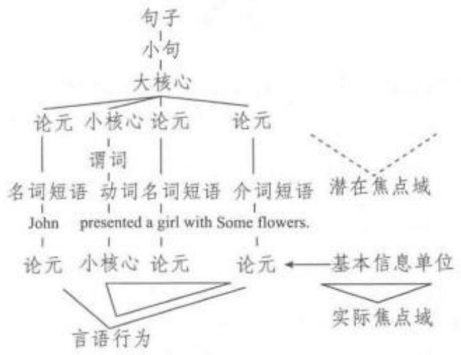

角色与参照语法中有时将算子投射、成分投射和焦点结构投射在一个属性图中表征出来。例如，“What did Dana give Chris yesterday?”的结构如图可表示如下：

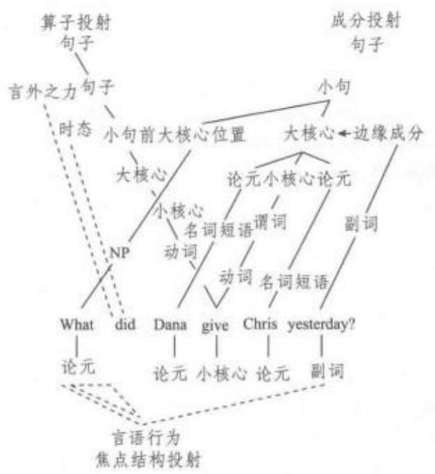

角色与参照语法形式语法和功能语法的许多优点，不仅重视描写和分析的实用性，而且也非常重视描写和分析的形式化。对语法结构普遍性和特殊性的研究，引起了形式语法、类型学和功能语法等领域研究者的广泛关注。此外，角色与参照语法的研究成果也广泛应用于心理语言学甚至是神经语言学的领域。这也是角色与参照语法理论所追求的目标，不仅能充分揭示跨语言类型的语料，而且能够有效解释语言习得、语言产出、语言处理等相关现象。这些相关现象并不需要所谓的天生的内在于大脑中的语言习得机制(language acquisition device)来解释。

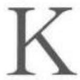

喀山语言学派Kazan Linguistic School19世纪末至20世纪初与莫斯科语言学派（俄，英  Lguistic School)齐名的俄罗斯两大语言学流派之一，代表人物是长期生活在俄国的波兰语言学家博杜恩·德·库尔特内(波兰 Jan Niecisław Ignacy Bau-,俄e Kype，1845—1929)。库尔德内于1875 年至1918年先后任教于俄罗斯的喀山大学、彼得堡大学等五所大学。在喀山大学，他与门生兼同事克鲁舍夫斯基(俄   ，波兰Mikołaj Habdank Kruszewski， 1851—1887) 以及拉德洛夫(俄   ，德 hWilhelm Radloff，1837—1918)、阿纳斯塔西耶夫(俄, 英  IvchAnastasiev，1852—1914)、弗拉基米洛夫（俄Ilërp,英  lvihVladimirov，1854—1902）、鲍格罗季茨基（俄, 英 Vl lkseevich Bogoroditsky，1857—1941）、布里奇（俄Cr K ,英 Sergei Knstntin-ovich Bulich，1859—1921）、亚历山大洛夫（俄, 英Ivanovich Alexandrov，1861—1918)等学者形成了一个活跃的研究群体，经常聚会交流，被称作喀山语言学派(俄   )。

喀山语言学派的研究范围颇为广泛，涉及各种语言以及历史语言学和普通语言学的各个分支。总体而言，他们对语言理论的关注远胜于对语言材料本身的关注。

在历史语言学理论方面，喀山语言学派与德国的新语法学派（德Junggramatiker，英 Neogrammari-，俄，又译“青年语法学派”)比较接近，它认为语言的存在和发展在根本上是受心理规律制约的。但是，喀山语言学派不赞同新语法学派完全从个人心理的角度解释心理规律的做法，而是试图结合民族和社会心理学的理论对心理规律进行阐释，因此他们的心理主义是一种客观心理主义。另外，喀山语言学派也不认同新语法学派机械解释历史音变、甚至宣称“语音规则无例外”的做法，而是强调语音变化原因复杂，是多种因素相互作用的结果。

事实上，喀山语言学派只将19世纪盛行的历史语言学研究视为其语言研究的一个部分。他们认为，对语言的静态分析也同样重要，应该为这一方面的研究开辟一个专门的领域。在这一点上，他们与奉行历史主义的新语法学派大相径庭，却与索绪尔的观点颇为接近。不仅如此，喀山学派的很多研究还与索绪尔对语言和言语的区别、聚合关系和组合关系的区别以及语言符号体系的特征等的探讨有相似之处，只是他们的论述不如索绪尔的明确，有时也不够体系化。

喀山语言学派在语言理论方面最突出的贡献在于建立了音位理论。博杜恩·德·库尔特内被后人视为最早对音素和音位进行明确区别的音位学先驱。他非常强调语言的纯物质形式和心理形式的不同。最初，他将音位理解为对词中某一语音部分在发音生理特征上的总括，但后来，他明确地将这种生理特征的总括与心理概念联系了起来，并将音位学称作心理语音学。他认为，音位与词的语义表象和形态表象都有联系，而且不同音位的交替就是实现各种形态和语义表象的手段。因此，他又将音位学与形态学相结合，为形态音位学的产生奠定了基础。

喀山语言学派对19世纪末至20世纪的西方语言学产生过深远的影响。在俄罗斯国内，博杜恩·德·库尔特内的后继者在共时研究、社会心理学、音位学等不同方面继承并发展了他的理论。他在彼得堡任教期间培养的学生谢尔巴（俄JeBI, 英 Le Vladimivich Shcher-ba，1880—1944)后来创立了列宁格勒音位学派(俄()，英the Leningrad school of phonology)，该学派和同样受库尔特内思想启示而发展起来的莫斯科音位学派(俄    ()，英the Moscow school of phonology)是苏联时期的两个重要语言学派别。在国外，喀山学派的影响首先体现在它对布拉格学派(英 the Prague school)思想形成的促进作用。后者的代表人物特鲁别茨柯依(俄Cr T, 英 Nikoly Sergey-ich Trubetzkoy，1890—1938)被认为是形态音位学的创立者，他在形态音位学方面的观点直接来自库尔特内的启示。此外，博杜恩·德·库尔特内与丹麦学者叶斯柏森(Otto Jespersen，1860—1943)、法国学者梅耶(Antoine Meillet，1866—1936)等都有交往。尤其值得注意的是，他曾在巴黎语言学会(法

Société de Linguistique de Paris)与索绪尔有过接触，并且可能对后者产生过影响，这或许可以部分解释喀山语言学派与索绪尔在语言学思想上有诸多的相似性的原因。

库法学派 Kufa School 阿拉伯语法学主要流派之一，产生于8世纪末叶伊拉克的库法城，创始人为凯萨依(Al-Kisa'i，731—806)和他的学生法拉(761—822)。凯萨依为《古兰经》训读学的七大名家之一，曾担任过阿拔斯王朝三代哈里发的国师。为了改变库法的阿拉伯语法学研究落后于巴士拉的状态，他曾前往巴士拉求教于巴士拉学派的创始人海利勒，并游历了阿拉伯半岛的游牧部落，学习他们的语言，努力发展自己的语法体系。

作为库法学派的主要代表人物，法拉对库法学派语言体系的确立也做出了巨大的贡献，其花费十六年时间才完成的语法著作《界限》主要以句法为研究对象，提出了很多不同于巴士拉学派的新的语法规则。以凯萨依和法拉的研究基础，库法城的语言学家发展出一个与巴士拉学派完全不同的语法学体系——库法学派。库法学派自形成之初便处于与巴士拉学派争论、对峙的局面中，这种争论和对峙持续了长达百年之久，直至巴格达学派的形成。与巴士拉学派强调语言普遍性和阿拉伯语基本规律的出发点相反，库法学派尤其强调语言的特殊性和阿拉伯语中的特异现象。为此，他们扩大了语言的研究范围，认为凡阿拉伯人使用的语言，包括部族的语言、史话、诗歌以及《古兰经》中的特异词句，都应该纳入研究的对象。

库法学派在词的格位学说、词的分类及其派生关系等许多根本问题上都提出了与巴士拉学派不同的观点，阿拉伯语言学家伊本·安巴里(1119—1181)曾在其著作《异议公判》中列举了这样的分歧达121处之多。与巴士拉学派相比，库法学派理论的明显的局限性在于其逻辑不甚严密，但由于库法学派的研究一度得到阿拔斯王朝哈里发的支持与推广，它在阿拉伯语法研究中影响颇为深远。一百年以后，巴格达的语言学家分别吸收了库法学派和巴士拉学派的长处，把两派观点糅合在一起，形成了第三学派——巴格达学派。

历史比较语言学Historical Comparative Lin-guistics亦称比较语言学。研究不同语言的亲属关系或某种具体语言历时演变的语言学分支，其研究目的主要是找出语言之间的谱系关系，或构拟始源语。历史比较语言学诞生于18世纪，是历史语言学的重要组成部分，为现代语言学的建立奠定了坚实的基础。历史比较语言学的主要研究方法一历史比较法(the comparative method)—对现代语言学研究产生了深远的影响，促成语言学发展成为独立的学科。

1786 年，琼斯(Sir William Jones，1746—1794)提出了著名的“琼斯构想”(Jones's Formulation)，也称为“印欧语假说”，即认为梵语与希腊语、拉丁语同源，有一个共同的源语言。继琼斯之后，丹麦语言学家拉斯克(Rasmus Christian Rask，1787—1832)、德国语言学家弗葆朴(Franz Bopp，1791—1867)、格林(Jacob Grimm，1785—1863)对欧洲语言进行了大量的比较研究，发现了系统的对应关系，推测出原始印欧语的存在以及原始印欧语与现代语言的关系。拉斯克、葆朴和格林通常被认为是历史比较语言学的奠基人，也是19世纪上半叶历史比较语言学家的代表人物。拉斯克的第一部著作是《冰岛语入门》。他写于1814年、出版于1818年的《古代北欧语或冰岛语起源研究》是第一部印欧语言比较研究的著作，书中提出古冰岛语属于日耳曼语系，并与波斯语、印度语同源。格林是德国语言学家和童话作家，他的《德语语法》(或译《日耳曼语语法》)(1819年)一书确定了“格林定律”(Grimm'sLaw)，即语音对应规律是建立印欧语系和其他语系的基础，亲属语言的语音之间存在着有规律的对应关系。葆朴提出建立“比较语法学”学科。他在1816年发表《论梵语的动词变位系统》，对梵语和几种亲属语言的动词屈折形式作了系统的语音和语法形态的比较研究；1833—1852年，他撰写了《梵语、禅德语、亚美尼亚语、希腊语、拉丁语、立陶宛语、古斯拉夫语、哥特语和德语的比较语法》，这是第一部系统的印欧语比较语法著作。

经历了上述早期发展之后，19世纪中期，历史比较语言学进人关注理论与研究方法的阶段。这一时期重要的历史比较语言学家有波特(August Pott,1802—1887)、施莱歇尔(August Schleicher，1821—1868)、施密特(Johannes Schmidt，1843—1901)及库恩(Adalbert Kuhn，1812—1881)。德国语言学家波特所著《印度一日耳曼语系领域内的近代词源学研究》对印欧系语言从整体上作语音比较研究，并将语音和词义结合，探求印欧系语言的词源。他认为，词源研究不仅要在该语言中找到较古形式，还应依赖亲属语言之间严格的语音对应关系找到亲属语言中的较古形式。波特创立了近代词源学，同时也深化了印欧语的比较语音学。德国语言学家施莱歇尔是19世纪中期最有影响的历史比较语言学家之一，他系统整理了前期历史比较语言学成果，见诸于《印度日耳曼系语言比较语法纲要》(1861—1862)等著作。

施莱歇尔研究亲属语言的历史演变过程，并创造性地使用谱系图来呈现语言之间的亲属关系，这是历史比较语言学的一大进展。德国语言学家施密特提出了“波浪理论”(wavetheory)。1877年，施密特在《印度日耳曼人的亲属关系》一书中提出“波浪理论”，认为当原始印欧语还是一个整体的时候，就存在着方言分歧，各个方言的特点像波浪一样扩散开去，从而使后来形成的不同语族和语支有互相交叉的现象。如果遇到另一个地位和影响同样重要的方言的扩散波，这一语言扩散的波浪就会停止。波浪理论结合人群迁徙和社会环境的改变来研究语言的演变发展。库恩从古生物学的角度扩展了历史比较语言学。他利用文献语言材料来探索古代民族的历史和文化，建立了作为历史比较语言学分支的语言古生物学和比较神话学，扩展了历史比较语言学的领域。库恩主编的《比较语言学杂志》，于1852年创刊，致力于日耳曼、希腊、拉丁诸语言的比较研究。至19世纪70年代，历史比较语言学在语言的微观研究方面积累了很多材料，在研究方法上也取得了重要的进展。

一般认为，19世纪70年代是历史比较语言学发展的转折点。此后，历史比较语言学家的贡献主要体现在三个方面。其一，开始提出完整的理论体系和方法；其二，开始深入研究语音的性质和构成，在印欧语系语言的语音状况和演变规律方面成就巨大；其三，研究对象逐步从印欧语系扩展到其他语系，如汉藏语系、南亚语系、班图语系及非洲诸语言。19世纪后期的历史比较语言学通常被称为“新语法学派”(TheNeogrammarians，亦称“青年语法学派”)时期，代表人物是德国莱比锡大学的一批学者，如奥斯特霍夫（Hermann Osthooff)、布鲁克曼（KarlBrugmann，1849—1919)、莱斯金(August Leskien，1840—1916）、德尔布吕克（Berthold Delbrück，1842—1922）、奥斯特霍夫（HermannOsthoff，1847—1909）以及维尔纳（Karl Verner，1846—1896)。“新语法学派”提出了著名的“维尔纳定律”，也称为“语音规律无例外论”。这个学派的代表著作有布鲁克曼和德尔布吕克合著的《印度日耳曼语比较语法纲要》、保罗的《语言史原理》(1880)等。新语法学派正式为历史比较语言学提出系统的理论原则和方法。奥斯特霍夫的代表作有《印度日耳曼语名词词干结构领域内的研究》(1875)、《名词合成词中的动词》(1878)。布鲁克曼的《印度—日耳曼基础语的鼻音领音》(1876)、《希腊语语法》(1876年)、《比较语法纲要》(1866)和《比较语法简编》(1904)，都是历史比较语言学中的重要著作。布鲁克曼、奥斯特霍夫的《形态学研究》序言(1878年)被公认为新语法学派的理论纲领。维尔纳于1875年写了《第一次语音变化的一个例外》一文，证明日耳曼族语音变化中有许多腭化的现象。他的主要贡献是解决了“格林定律”中的例外现象问题，认识到一切语音的演变都是有规律的。这就是“维尔纳定律”。另外，“新语法学派”的主要贡献是指出了类推在语言演变中的重要作用。这一时期，值得一提的还有索绪尔，他也是一位杰出的历史比较语言学家，著有《论印欧系语元音的原始系统》(1878)。索绪尔继承了历史比较学的研究方法，但是将语言学研究由历时转为共时，从而奠定了结构主义语言学的基础。

20世纪，结构主义语言学形成并发展，语言的共时研究逐渐居于主导地位。但是，这一时期的历史比较语言学仍取得了一定的成就，其研究范围得到扩大，特别是对汉藏语系的研究；研究方法更加多样，除了历史比较法外，还吸收了语言共时分析的理论和方法，如内部构拟法(the method of internal re-construction)、地域语言学方法和语言类型学方法等。20世纪作出了突出贡献的历史比较语言学家有法国的梅耶(Antoine Meillet，1866—1936)和瑞典的高本汉(Klas Bernhard Johannes Karlgren，18891978)。梅耶关于历史比较语言学的重要著作有《印欧系语言比较研究导论》(1903)、《印欧语方言》(1908)、《希腊语史概要》(1913)、《日耳曼语系各语言的共同特征》(1917)、《共同斯拉夫语》(1923)、《历史语言学中的比较方法》(1925)等。其中，《历史语言学中的比较方法》被认为是关于历史比较法的优秀著作。高本汉是用历史比较法研究切韵音系的首创者，他的代表作有《中国音韵学研究》。该书用历史比较法拟测了汉语中古音系的面貌，提供了从中古到现代方言语音演变的线索。用现代语言学方法来研究中国语音史，可以说是从高本汉开始的。高本汉1928年的讲演稿《上古中国音当中的几个问题》以切韵音系为基础，采用共时分析的内部构拟法等对汉语的上古音进行构拟研究。他有关上古音系研究的主要著作还有《诗经研究》(1932)、《汉语词族》(1933)、《中国的文字》(1940)、《古汉语语音构拟》(1922)、《中国汉字形声论》等。1954年他对以前的研究成果进一步修订，总结性地发表了《中古汉语和上古汉语语言学简编》。

历史比较语言学的主要研究方法包括历史比较法、内部构拟法、地域语言学方法和语言类型学方法。历史比较法自19世纪以来一直是该领域最主要的研究方法，它研究语言的亲属关系和发展规律，它的依据是：亲属语言必然会在语言要素或语言成分里保留一些规律性的对应关系，找出这些对应关系以后，就能够重建原始形式。内部构拟法利用同一语言系统共时结构的差异来进行历时研究，对某种语言或方言系统共时的事实进行比较，从而找出

它较早的状态。

中国的历史比较语言学也有悠久的历史。汉语的古今比较研究发端于明朝的陈第。现代语言学家罗常培(1899—1958)、陆志韦(1894—1970)、王力(1900—1986)、李方桂(1902—1987)、李荣(1920—2002)等人运用历史比较语言学的方法，构拟了上古和中古的汉语语音系统，初步制定了汉语和有关语言的亲属关系，为汉语音韵学研究作出了贡献。20世纪以后中国学者引进了历史比较语言学的方法，运用现代汉语方言材料、译音材料等，在《切韵》音系的音值确定方面作了深入研究，80年代前后这方面的研究进入了一个高峰期。王力的《汉语语音史》、陆志韦的《古音说略》、李方桂的《上古音研究》是历史比较语言学领域的重要著作。李方桂于1973年在美国的《中国语言学报》创刊号上发表《中国的语言和方言》一文，对中国境内的汉藏语言进行分类研究，为汉藏语系划出了基本框架。徐通锵的《历史语言学》(1991)是国内第一部历史比较语言学的理论专著。

临床语言学Clinical Linguistics应用语言学的一个分支学科，它是言语与语言治疗专业(Speech and Language Therapy)的重要科目，旨在将语言学的理论和方法应用于研究各种语言障碍(lan-guage disability)，因此也称病理语言学。临床语言学对于应用层面比较注重，在语言治疗研究方面做出了重要贡献，在西方，要成为语言治疗医师，它是培训的必修科目。为临床语言学服务的各种专业杂志和协会也应运而生。卡明斯(Louise Cummings)出版了《临床语言学》一书，为二语习得的学生提供了一个理想的关于交流障碍研究的出发点。进入21世纪，有些学者向国内重点介绍了失语症，同时提供语言障碍的评估工具，进而介绍最新研究发现与治疗方法，并将神经语言学应用于临床上。

临床语言学的研究可以追溯到1885年。这一年，现代语言学的先驱库尔德内(Baudouin de Cour-tenay，1845—1929)曾著文章论述失语病症。1861年法国医生布罗卡(Pierre Paul Broca)发现，一旦大脑左前部的某一区域受损，说话机能障碍就会形成。由于这一脑区控制着说话功能，又是布罗卡发现的，因此被命名为布罗卡区(Broca's area)。十多年后，德国神经心理学家韦尼克(Carl Wernicke)发现，当人脑的左颞的后部受损后尽管病人能讲话，却不能恰当地理解话语。由于这一脑区控制着理解功能，于是被称为韦尼克区。在以后的医学实践中，失忆、失名(不能命名事物)、错语(言语错乱)等各种失语症，以及失读症、失写症等都被发现与一定的脑区的损伤有关。语言功能在人脑中的定位倾向于单侧化，除了少数左撇子，大多数人的语言功能位于左半球。这种侧化的过程约始于两岁，在五岁左右完成，不过在这之后，即使左脑受损，右脑也能接替其发展起语言功能。这一事实至少说明了两点：第一，大脑在运作时可能是遵循流体力学的原则，而不是循守机械分工的原理；第二，对于语言机能的形成，后天生长与先天基础一样重要。对于布罗卡的发现，著名语言学家索绪尔写过一篇评述，对失语症的研究发表了独到的见解。20世纪50年代以来，临床语言学越来越重视医学家和语言学家的合作研究。目前，国内有的大学正式成立将语言学研究与临床医学研究密切结合的学术研究机构，并与相关临床医院建立合作共建关系或设立研究基地，共同致力于语言学与医学交叉领域的研究及临床应用。

临床语言学主要研究失语症的描述、失语症的分类、各种言语失调的病因分析和言语矫治等内容。稍具体说来就是失语症损坏的不仅是语音，还有患者的语法能力；失语症可分为“遗忘性失语症”和“感觉性失语症”等类型；病人大脑的损伤程度导致了各种言语失调；对于各种失语症如失说症、失写症和口吃等的诊治，最近一些年来创制的医疗器械能从纵横两方面扫描和显示大脑的损伤部位，使失语症的研究和治疗有了更为科学的手段。但是大脑不同的损伤部位跟语言结构不同层次障碍的关系仍需根据临床资料进行系统分析。

临床语言学所开展的研究具有重要的理论意义、实际价值及应用前景。临床语言学将开拓语言学与临床医学的跨学科研究的新途径，培育新的交叉学科，为科学研究及临床实践提供崭新的视角；该学科将大大拓展并丰富传统语言学的研究范围、研究方法，将语言学从本体研究扩展到医学诊断的前沿领域，使语言学研究跟科学研究相融合，从而进一步推动语言学的发展；该学科还将进一步推动或深化医学理论的发展和创新，促进各相关学科的发展和融合，为进一步揭示大脑与语言的奥秘提供新的途径；该学科的研究对于实际的医学诊疗具有非常重要的意义和实际价值，研究成果能够直接应用于临床诊疗和疾病康复，具有重要的应用前景。

伦敦学派London School 通常指英国的语言学研究，是现代语言学重要学派之一，创始人是弗斯(John Rupert Firth，1890—1960)。弗斯是第一个研究普通语言学理论的英国人，也是英国第一位语言学教授，大多数英国语言学教师都接受过弗斯的指导或深受其作品影响。他熟悉琼斯(Daniel Jones,1881—1967)的语音学研究，又注重吸收人类学家马林诺夫斯基(Bronislaw Malinowski，1884—1942)的理论。在20世纪30年代的伦敦大学东方和非洲研究院语言学系，弗斯联合其一些同事和学生(其中包括其学生韩礼德)建立伦敦学派。伦敦学派强调“语言环境”和“语言系统”的重要性，因此也被称为系统语言学和功能语言学。

人类学家马林诺夫斯基有关语言功能(func-tion)的观点对弗斯影响极大。根据马林诺夫斯基的理论，语言并不是一种人与人之间传递思想的手段，也不与思维相对应，而是一种行为模式；话语意义并不取决于组成话语的词语意义，而是由话语与其语境之间的关系决定。

此外，马林诺夫斯基强调“语言环境”(context ofsituation)的重要性。他认为话语和周围环境密不可分，而语言环境是理解话语意义不可或缺的因素之一，人们不能仅仅依赖语言内部因素去分辨和确定话语意义，因为口头话语的意义取决于语境。马林诺夫斯基还区分了三种语言环境：“(1)言语与当时的身体活动有直接关系的环境；(2)叙述环境；(3)言语仅仅被用来填补空白的环境——寒暄交谈(phaticcommunion)."

弗斯继承并发扬了索绪尔和马林诺夫斯基的传统观点并在此基础上推陈出新，提出了自己的见解，他的主要理论可以概括为以下几点：

(一）语言社会性。弗斯特别强调语言的“社会性成分”，这点正与索绪尔学派侧重语言结构的观点相左。他认为语言并不是一些强制规定的符号或标记，而是作为人类的生活形式而存在。他在具体研究和观察中发现交际场合不同，人们使用的词语、结构和格式等也不相同。弗斯把语言看作社会过程，是人类社会生活的一种方式。人类必须为了生存去学习，而要参与社会生活，就要掌握语言这一手段。语言本身不仅是一种行事手段、一种使他人行事的手段，也是一种行为手段和生活手段。

(二)系统(system)和结构(structure)。弗斯认为语言有两个组成部分，即系统和结构。他对“系统”和“结构”这两个术语赋予了新的概念。他认为“结构”就是语法序列，即组合(syntagmatic)关系，如“李强卖菜”“王丽扫地”“张斌洗衣服”等都是由主语十动词+宾语组成的“结构”；而“系统”则指出现在一个结构中同一位置上的词的聚合。例如，在“Maryloved him.""Mary dated him.""Mary helped him."中，“loved”“dated”“helped”这三个动词就构成一个系统，即聚合(paradigmatic)关系。“系统”是纵向的，而“结构”是横向的。“loved”“dated”“helped”都能与“him”一起搭配使用，弗斯称这种同现关系为“搭配”(collocation)。在弗斯看来，搭配并非仅存在于语法体系，在语音中也有搭配。例如英语语音中有 lint[lnt]、link[lınk]，却没有[lnp]，那是因为[n]和[p]这两个音在这个位置上不存在搭配关系。

(三)语言学研究的对象。对于索绪尔对语言系统和言语行为的区分，弗斯不完全同意，也不认同将言语看作是语言学研究对象的观点。弗斯坚持认为在实际中使用的语言才应被看作是语言学研究的对象，进行语言研究的目的就是要分析语言中具有意义的成分，并在语言因素和非语言因素之间建立对应关系。

(四)对意义的研究。弗斯认为对意义的研究在整个语言研究过程中是非常重要的。在他看来，“意义’有其独特内涵，它不但包括词汇意义、语法意义和音系意义，还包括具体语境中的意义。”另外，与马林诺夫斯基的观点相似，弗斯也认为意义源自“情境的衬托”，并将这种衬托分为两种：来自语言之外即产生言语活动的时间、地点、背景、说话人与听话人的关系等的衬托和来自语言之内即言语上下文的衬托。“词汇意义”代表言语所指的客观事物；“语法意义”是某一语言结构(词、词组或子句)与另一语言结构之间的语法关系；“音系意义”则指音与音之间的关系；而意义是词汇、语法、音系不同层面的成分和该层面上成分与情景语境之间的关系。

(五)语言环境。弗斯认为语言研究的重点之一还有语言环境。他认为语言环境应包括整个言语的文化背景和个人历史，而不应仅局限于人们在语言环境中所从事的活动。弗斯还提出了“典型情景语境”(typical context of situation)的概念。他认为社会情景语境决定了人们必须扮演的社会角色；由于人们遇到的典型情景语境是有限的，因此社会角色的总数也很有限。因此，与大多数人们想象中的不同，交谈更像一种事先约定好的仪式，一旦双方之间发生交谈，那么双方则置身于一个规定好的环境，就不能不顾规矩地畅所欲言了。

(六)语音研究。关于音系研究，弗斯有两个独特主张：一是“多系统性”(polysystemic)与“单系统性”(monosystemic)相对应，二是提出了韵律音系学(prosodic phonology)的概念。例如，英语 pin，tint，kin 中有/p t k/，而在 spin、stint、skin 中也有/p tk/。一般认为这些特征可以合并为/p/、/t/、/k/三个音位；但弗斯不以为然，认为pin、tint、kin中的吐气音/p t k/ 与spin、stint、skin 中的非吐气音/p tk/不能合二为一，因此主张建立两个“系统”即pin、tint、kin 的词首系统[pb t kb]和 spin、stint、skin 的s后系统[pt k]。

关于韵律音位学(prosodic phonology)的研究，弗斯首先区分了组合与聚合关系。他认为，具有聚合关系的单位是“系统单位”(systematic unit)，具有组合关系的单位是“结构单位”(structural unit)，这是一种首创性的见解。弗斯指出，在实际言语中，构成聚合关系的是音位单位(phonematic unit)，而不是音位。相对于音位中的特征，音位单位中的特征要少些，因为有些特征是一个音节、短语或句子所共有的。当在组合关系中考虑这些特征时，都被称作韵律单位(prosodic unit)。韵律成分包括重音、音长、鼻化、硬腭化和送气等特征。这些特征不单独在一个准韵律单位中存在。

弗斯的研究注重言语的背景，可谓是社会语言学的先驱。他的“搭配”说也颇具价值；提出“情境的衬托”的见解更使后人受益。但也有人提出了弗斯研究的局限性：其一，所用语言晦涩难懂，阐释含糊不清，有时论点牵强；其二，有时走极端，仿佛词和句子没有相对独立性；其三，探究了语音和语义，却未涉及语法。

伦敦学派研究语音、语义、社会方言和地方方言，在深入探究语言心理的基础上建立语法系统，结合文学批评研究的同时不忘重视语言教学。该学派对于以语言实用性为目标的研究者和学习者而言无疑具有积极的意义。

#

美国描写语言学派 American Descriptivism亦称美国结构语言学派(American Structuralismn 或American Structural Linguistics)，与布拉格学派(The Prague School) 和哥本哈根学派(The Copenhagen School)一起并称为结构主义三大流派，其中美国描写语言学派的影响力最大。相对于与语言有关的心理因素和社会因素而言，描写学派强调的是对语言本身的研究和对语言结构形式的以及语言间差异的描写，对语言能力的解释和语言的普遍性不予重视，因而其语言学理论体系也称为结构语法(Structural Grammar).

描写语言学派起源于20世纪20年代，形成的实践基础是美国语言学家和人类学家对美洲的本土语言一印第安语长期的调查和研究，并以20世纪20—30年代中期逻辑实证主义和行为主义（刺激一反应论)为哲学背景。在对语言研究过程中，有一套严密的描写和分析方法，在20世纪50年代，是美国语言学界的主流。但描写主义把注意力放在庞杂繁复的语言表面事实上，不重视在总体上更新语言理论，工作缺乏创造性，理论缺乏对语言现象和人的语言能力进行解释的能力。这使得描写语言学派逐渐失去了主导地位。50年代以后，随着乔姆斯基生成语法学派的逐渐兴起，逐渐被转换生成语法所取代。

美国描写语言学派的创始人是博厄斯(FranzBoas，1858—1942）和萨丕尔（Edward Sapir，18441—939)。博厄斯是人类学家兼语言学家，1911年曾为《美洲印第安语手册》（A Handbook of

American Indian Languages)撰写序言，其中特别强调应当为了描写不同结构的语言而创立新的概念和方法：即描写每一种语言都要根据其自身的语音、形式和意义的结构做客观的描写，而不应该带着其他语言的或者传统语法的框架去描写，这后来成为描写语言学重要的指导原则。该序言凝聚了美国人类语言学家对北美印第安语调查和研究的初步理论总结，可被视为美国描写语言学开始的“宣言书”。萨丕尔是人类学家兼语言学家，他于1921年出版《语言论：言语研究导论》(Language，An introductionto the study of s peech)，提出语言研究应该与人类的心理、社会和文化联系在一起。萨丕尔与其学生沃尔夫(Benjamin Whorf，1897—1941)一同提出了著名的萨丕尔—沃尔夫假说(Sapir—Whorf Hypothe-sis)，基本观点是：语言形式决定着语言使用者对世界的看法：语言怎样描写世界，我们就怎样观察世界；不同的语言模式影响人们的思维，从而对世界产生不同的认识。博厄斯和萨丕尔二人都强调尊重语言事实，从而做出客观的共时系统的描写。这一理念成为后来的美国结构主义研究的基本原则。

美国描写语言学最有影响力的核心代表人物是布龙菲尔德(Leonard Bloomfield)。他凭借1933年出版的专著《语言论》(Language)，为美国结构主义奠定了描写方法的基础，宣告了美国描写主义(结构主义学派)正式诞生。他受到索绪尔语言观的影响，不仅对博厄斯和萨丕尔的语言结构共时描写的理论和方法进行了传承和发展，而且在历史语言学方面接受了欧洲新语法学派的传统，不再把语言看做是与心理和生理相关联的表达方式，而主张应该依据行为主义的“刺激一反应”理论来阐释人类的言语行为。在分析语言结构时，他强调根据形式结构的差别来分析语言，反对用非语言因素(特别是心理因素)作为标准。这些论点在当时产生了巨大影响，甚至成为了以后二三十年语言学发展的理论指南。由于布龙菲尔德的巨大贡献，20世纪30—40年代的美国结构主义被称为“布龙菲尔德时期”

在布龙菲尔德之后，哈里斯(ZelligHarris)于1951年出版《结构语言学的方法》(Method in Struc-tural Linguistics)一书，提出了结构语言学研究的理论和方法，主张要将话语里的单位(如语素)切分出来并根据语言单位的分布特征进行归类。该著作在语言学领域引发巨大反响，也标志着该学派的理论和方法进入了一个新时期。这一时期的另一位重要人物霍凯特(Charles Hockett)忠实地继承了布龙菲尔德的学术思想，他的《现代语言学教程》(A Coursein Modern Linguistics)是一本著名的结构主义语言学教材，对传播结构主义语言学起到了良好的作用。作为结构主义学派在布龙菲尔德之后的代表人物，哈里斯和霍凯特等人的理论被人称为“后布龙菲尔德语言学”。

## 美国描写语言学的基本方法有：

(1) 替换分析法：主要观察某一语言语段中的某一“断片”(冯志伟，2013)可否在替换另一语言语段中的另一断片后形成现实语言中的具体存在事实。如果得出肯定的结果，则说明这些彼此可以替换的断片都是语言中同一现象或单位的变体。

(2) 对比分析法：通过比较两个或两个以上的语言片段来寻找其相同和相异的成分，进而确定该成分的性质。

(3)分布分析法：是最重要、最关键的方法，即依据分布(某个单位或特征在话语里出现的各种不同位置的总和)从一堆语言素材中切分出独立的单位(如音素、语素等)并加以归类。这种对分布相同的语言单位进行归类的方法实际是一种以寻找同类环境为原则的归类方法。

(4) 直接成分分析法：简称IC分析法(Immedi-ate Constituent Analysis)，可以充分显示句子的层次结构。认为句子是由若干个直接成分的层级构成，每个较低层级的成分是较高层级成分的一部分。用一系列替换把整段的话语层层分析，从而发展出直接成分分析法。

此外，该学派还建立了语素音位系统，以特征分析为主要分析手段。语素音位是把语法和语音结合而成的单位，包括出现在若干语素变体里的几个音位。例如，建立起表示复数的语素{s}，而/s/、/z/、/iz/就是这个语素的变体。语素归纳出来之后，各语素变体间音位交替的条件逐步显现了，这就是语素音位系统。语素音位有助于语素的鉴别，能够起到用一个概念涵盖诸种变化的作用。

美国描写语言学的层次分析体现为结构语法。结构语法的分析通常在三个层次上进行：音系学(phonology)、形态学(morphology)和句法学(syn-tax)。概括说来，结构语法学家首先将收集到的语流切分成尽可能小的单位，然后对之进行分类，最后再研究这些单位的结合方式，即研究它们形成各种有意义的组合的不同方式。音系学研究语言的语音系统，形态学研究语言中语素的结构，句法学研究语素的组合方式，即研究由语素组合而成的词、短语、句子等较大语言单位的句法结构。这三个层次必须严格遵循从语音到语素再到句法的先后分析次序，因此结构语法的模式可粗略地表示如下：

美国描写主义的主要特点包括：

(1)注重语言行为的描写，而不注重语言能力的解释，关注语言本身，而不考虑语言有关的心理因素和社会因素，也不谈社会和历史等因素。在形式和意义的关系上，注重形式分析，避开意义因素，认为意义带有很大的主观性，而形式的对立能决定意义的不同。结构语法学家认为语言中主要的形式手段有以下五种：词序(word order)、功能词(functionwords)、屈折(inflexion)、派生(derivation)以及语调(intonation)，这五种形式手段通常不是各自独立使用的，任何一段话语常常同时使用其中几种手段。但这带来的缺陷也显而易见，即由于忽视意义，对一些同形异构的歧义现象难以解释。

(2)注重口语和共时描写，重视记录实际语言。这一点显著区别于欧洲学者侧重书面文献及以历时研究为主的语言学研究方法。这主要是因为早期的研究对象印第安语大多没有文字和历史的材料，因此这一学派不得不一开始就只能从口语着手进行共时的形式分析。

(3)强调验证。认为语言研究必须根据话语的素材来进行，必须采用严格规定的步骤对这些素材进行形式上的分类，而且分析的结果也必须经受验证。因此，它也被称为“操作主义”和“分类主义”。

作为索绪尔开创的结构主义语言学的一个重要流派，美国描写语言学派(结构语法)对当代世界语言学的发展产生如下巨大影响：

(1)语言学研究中心的转移。在其兴起之前，世界语言学的中心一直在欧洲，但美国结构语法的兴盛使得世界语言学的中心转移到了美国。

(2)对语言学研究范式的影响。描写语言学派揭示出来的一些语言结构现象，所提出的分布和替换的分析方法、直接成分分析法，以及将语音和语法相结合的语素音位的概念，在当时都得到广泛应用并都已被后人继承和发展，其严密的分析方法对哲学、人类学、心理学等其他人文社科领域的发展都产生了深刻的影响。

(3)教学领域。结构主义的理念广泛应用在语言教学领域，听说教学法就在此理论的指导下产生。这种教学方法重视听说，轻视读写，主张大量的机械操练，将教学过程看作是刺激一反应一强化过程，在当时的环境下取得了巨大的成功。

(4)对汉语研究的影响。在中国，他们的学术观点和方法对汉语构词法的认识、语素的确立与划分、词类的归并，以及汉语句法分析中短语的地位的确立和句法分析方法也都产生了巨大的影响。

蒙塔古语法 Montague Grammar 美国数学家、逻辑学家和语言哲学家蒙塔古(Richard Mon-tague，1930—1971)于1970年提出了一系列关于如何使用形式逻辑描述自然语言的理论，彻底颠覆了当时的逻辑学家和语言学家对他们所处的领域之间的关系的看法。蒙塔古运用形式逻辑和模态理论的观点，创造了一个新的体系，使自然语言的句法结构和语义结构更好地联系起来，从而更易于句子的语义理解。这些理论被统称为蒙塔古语法。

蒙塔古师从波兰逻辑学家、数学家和语言哲学家塔尔斯基(Alfred Tarski，1902—1983)。1993年，塔尔斯基发表的论文“形式语言中的真实概念”首次提出了模态理论，该理论是蒙塔古在语义学方面所做的许多研究工作的基础。

1970年，蒙塔古在瑞典哲学季刊《理论界》(Theoria)发表了《普遍语法》(Universal Grammar)一文，介绍了他的形式句法和形式语义学理论在形式语言及自然语言中的运用。因其首次提出将形式语义学运用于自然语言，该文的出版意义重大。蒙塔古之前的逻辑学家大多认为，自然语言太模糊、太不规则，无法与之进行形式逻辑分析，而语言学家则认为，形式语言无法抓住自然语言的结构。同年，蒙塔古在《英语作为形式语言》(English as a FormalLanguage，1970)一文中更清晰地阐述了自然语言和形式语言之间的相似之处。

1973年，蒙塔古在芬兰逻辑学家、语言哲学家亨迪卡(Jaakko Hintikka)等主编的文集《自然语言研究方法》(Approaches to Natural Language)中发表了《普通英语中量词的特定处理》(The Proper Treat-ment of Quantification in Ordinary English)—文,对英语句法和语义下了新的定义，英语词组被翻译成以有意逻辑为基础的逻辑语言，然后再用塔尔斯基的模态理论进行诠释，该文影响深远，常被简称为PTQ。蒙塔古语法一般指的是在《普遍语法》、《英语作为一门形式语言》和《普通英语中量词的特定处理》三篇论文中所描述的理论，而且由于蒙塔古的理论大部分是在PTQ中得到详尽阐述，因此，蒙塔古语法又常被称作PTQ。

就内容而言，蒙塔古语法是一种形式语言理论，是在一阶逻辑的基础上，通过对语句的结构和赋值增加了某些强有力的形式工具而形成的。形式语言包括：一阶谓词逻辑、模态算子、时态算子、兰姆达抽象和形成谓词内涵和外延的算子。蒙塔古提供了一个类型论的结构，这种结构允许对每种表达式加以量化，蒙塔古的形式语言又可称作内涵语言。他依据个体、真值、可能世界和时间坐标以及所有这些的函项概念给出了内涵语言的一个模型。内涵语言使我们能给出对自然语言语句的间接解释。其方法是，首先将语句映射为内涵逻辑中的翻译语言，然后给出这种语言的解释。

蒙塔古语法彻底颠覆了传统的有关句法和语义的许多语言学概念，使语言学家和逻辑学家长期持有的形式逻辑与自然语言无法兼容的观念发生了动摇，促使原本互不相干的两个领域开始了合作。

蒙塔古将逻辑语义学引入了语言学领域，从而开辟了语义学研究的新途径。他的理论带动了计算语义学的革新，如模糊语的处理方式等。尽管蒙塔古理论的影响主要在语义领域，但也影响了句法领域。蒙塔古提出的在语法中分类词汇的理论对波拉德(Carl Pollard，1947—)、萨格(Ivan Sag，1949—2013)和沃叟(ThomasWasow)的中心语驱动的短语结构语法的发展产生了极大的影响。

在蒙塔古语法的影响之下，许多研究进一步开拓了原有理论的范畴，例如逻辑方面的量词限定和首语重复的研究逐步扩展到了蒙塔古语法的所有领域;模态理论还在继续延伸和发展。显然，蒙塔古语法的作用和影响是深远的，因为新的理论依然受到并还将受到其研究的影响。

模糊语言学Fuzzy Linguistics 随着当代科学技术和语言学理论的发展，模糊语言学逐渐产生。《社会科学大词典》(1989)将其视为语言学的新兴分支，主要运用模糊数学的理论和方法研究自然语言现象。《语言学百科词典》(1993)将其定义为运用模糊理论研究语言现象的学科，主要运用模糊数学的原理对语言中语音、语法、语义存在的不确定现象进行定量定性的分析和研究。《中国百科大辞典》(2005)提出模糊语言学为研究语言现象模糊性的语言学分支。由此可见，模糊语言学是模糊集合论与现代语言学相结合形成的一门新兴分支学科，尝试用模糊数学的方法研究自然语言或人工语言，对语言进行抽象的形式描述和精确的理论分析，从而使之更具有客观性、科学性和准确性；同时，使电子计算机接受一部分语言的模糊表述，为计算机科学、人工智能和语言学的发展研究开辟了新途径。

模糊语言学的研究对象是语言变量中的模糊性。模糊是自然语言的特点，也是人类思维的属性之一。虽然现代语言学致力于对语言系统进行精确的、形式化的描写和解释，但人类语言在不同层面上都存在着不确定性。罗素(Bertrand Arthur WilliamRussell，1872—1970)曾于1923年在其论文《论模糊性》中断言：“整个语言或多或少是模糊的。”英国语音学家琼斯(Daniel Jones，1881—1967)曾于1957年指出：“我们大家(包括那些追求‘精确无误’的人)在说话和写作时常常使用不精确的、含糊的、难于下定义的术语和原则。”这种不确定的、具有模糊性的话语称为模糊语言。

模糊语言主要是指由模糊词或模糊词组引起的，既包括所表示概念的内涵、外延难于明确确定或精确确定的语言，也包括一些约定俗成、语义能为人们理解的语言。模糊语言主要是相对于精确语言而言的。其主要特点是：界限“模糊不清”(如中国人理解的“早晨”一般到八九点钟;欧洲人一直到上午11点都还可称作早晨)、含义“部分重叠”(如中国人理解的“中年”既包括50岁的人，也包括40岁上下的人）、偏重“定量分析”(如汉语中的“稍微”“渐渐”等表示的都是定量概念)、具有相对性质(如“我们班有35人”和“我们班有30余人”相比，前者比后者要精确：而“我们班有30余人”与“我们班有几十人”相比，“我们班有30余人”更“精确”)等。

模糊语言主要表现在语音、语义、词汇、句法、语用等方面，其中词汇语义的模糊性比较典型。一般说来，同音词和多义词之间，形似词之间，各种语体之间，可数名词和不可数名词之间界限比较模糊，很难明确区分。譬如，颜色词(如“红”“粉红”)、时间词(如“早晨”“上午”)、方位词(如“上”“下”)、性质形容词(如“好”“较好”“不太好”“坏”)、程度词(如“非常”“比较”)等词难以从数学角度精确定义。诚如美国计算机科学家札德(Zadeh，1965)所言：“美人’或高个子’这些概念并不能构成一般数学意义上的类或集合”。举“高个子”为例，人们很难断定究竞是1.90米、1.85米还是1.80米为高个子。语言的模糊性质主要由两方面因素形成：一是客观事物具有具体性和无穷无尽性，而语言是抽象概括的，其单位不能无限增加，所以允许有一些比较笼统的概念；二是各种感觉虽然界限分明，但彼此相互关联，这是“语言模糊”的客观基础。

模糊语言学主要以札德(Lotfali Askar Zadeh，1921一)的模糊集合论为基础进行研究。学者们发现，在处理语言变量时，很难用精密的数值表示。如“年纪”这一语言变量，其对应值是自然语言中的词或者句子，包括“年轻、很年轻、不年轻、老、大、很老、很大、不大、不老”等，而不是精确的数字“20、21……70、80”等。为解决这一问题，1965年札德在《信息与控制》(Information and Control)第 8 期上发表了著名的《模糊集合论》(Fuzzy Sets)，指出“模糊集合是其成员隶属度构成一个连续集的所有成员组成的一个类。”所谓“隶属度”，即用“1”表示隶属于某个集合，“0”不属于这个集合，“1”和“0”之间的小数表示接近该集合的程度。在传统集合论中，每一个集合的成员要么属于它(隶属度为1)，要么不属于它(隶属度为0)。札德认为可以用模糊集合的方法来处理这些模糊现象，建议给予所处理词语适当的隶属度函数，然后运用电子计算机进行处理，从而对之进行比较科学和充分地解释。后来札德就模糊理论发表了几十篇文章，探讨该理论的实际应用问题，产生巨大反响。

模糊语言学具有学科边缘性，国内外相关研究内容比较广泛。这主要是由于一方面模糊语言的界限受地理、时代、政治、经济、民族、文化、语言、性别、受教育程度等不同因素制约，另一方面语言模糊性的研究与词汇学、词源学、词典学和修辞学等学科都密切相关。学者们既可以运用模糊集合论从不同层次、不同角度来研究语言模糊性，又可以针对语言的某一种模糊性来探讨模糊集合论的应用方法。具体说来，模糊语言学研究应包括基本概念和术语定义研究，人类自然语言诸层次中的模糊性研究(如语音、词汇、语法等)；语言模糊性的来源、特点、规律及影响因素研究(如语言模糊性与精确性的辩证关系研究)；语言模糊性的定量描述研究；模糊语言学与语言学其他分支学科(如句法学、修辞学等)的关系研究;模糊语言学的应用研究(如在新闻报道中的应用)等。模糊语言学重视研究“模糊语言”的“精确”和“精确语言”的“模糊”；“边缘区域”的模糊含义和“中心区域”的确定概念；语言与思维的不可分割性和语言变量的灵活性等。目前，语言学家不仅在语音、语义和语法的描写上，而且在方言分区的研究和词典编纂中也应用了模糊数学的理论和方法。

模糊语言学虽然在中国语言学诸分支学科中起步较晚(起步于20世纪70年代末)，但发展相对较快。伍铁平的《模糊语言初探》(1979)是国内最早运用模糊理论对语言模糊性进行研究的论文。其后，诸多学者从不同角度对模糊语言进行研究。20年后，伍铁平又出版了著作《模糊语言学》(1999)，尝试运用多种语言比较的方法来研究语义模糊问题。该书主要包括模糊语言通论，模糊语言和词汇学、词典学、词源学，模糊语言和修辞学、语用学等三大部分。其中第一部分涵盖模糊词、模糊概念、模糊限制词、模糊性影响因素、模糊理论的产生与研究对象、模糊的定义、模糊手段、语言中精确和模糊的转化、词义的反面转化等方面。第二部分讨论了实词、虚词、颜色词、味觉词、温度词等的模糊性。第三部分探讨了模糊与修辞、模糊词的感情色彩、委婉语与模糊理论的解释力等方面。该书的出版在一定程度上推动了学界研究模糊语言的发展。目前，国内相关著作或文章多为基于汉语的对比研究(包括跨语系对比及词源对比研究)或者跨学科定性研究(如结合文艺理论、心理学、逻辑学、美学等)。其中在汉语对比分析方面发展比较成熟，已经引起国内外不同领域学者的普遍关注。相对而言，该领域在吸纳最新研究成果，采用数学分析(如运用数理逻辑运算和实验统计测定)和哲学分析以提高研究的系统性和理论性等方面尚需进一步发展。

自札德提出模糊集合论以来，已经形成了一系列新学科，如模糊逻辑、模糊数学、模糊语言学等。其中模糊语言研究在语言模糊性与词汇学、修辞学、词源学等相关研究方面有较大发展。但就整体而言，有许多根源性问题，如模糊的定义、语言模糊性的根源、模糊语言的研究范围等方面尚需进一步明晰;在多学科和多语系理论研究、学科体系建构等方面尚需深入系统地发展。

莫斯科语言学派 Moscow LinguisticSchool19世纪末至20世纪初与喀山语言学派（俄,英  lgtic school)齐名的两大俄罗斯语言学流派之一。莫斯科语言学派(  )的创始人是福尔图纳托夫（俄ΦΦΦopryhato,英 Filip Fedorovich Fortunatov, 1848—1914)，自1875年至1902年任莫斯科大学教授，开设各种普通语言学和历史语言学课程，培养了许多优秀的学者，同时也创立了以他为核心的莫斯科语言学派。该派的其他代表人物包括托姆松（俄, 英 ld vvichTomson，1860—1935）、沙赫马托夫（俄 Aece, 英 lek lekd-ich Shakhmatov，1864—1920)、波克罗夫斯基（俄, 英hilMichailovich Pokrovsky，1868—1942)、波尔热津斯基(俄   ，波Wiktor Porzeziński，1870—1929）、乌沙科夫（俄,英 D kl-ich Ushakov, 1873—1942)等。

莫斯科语言学派的研究主要涉及历史语言学和普通语言学理论两个领域。在历史语言学方面，该学派与德国新语法学派(德Junggrarmatiker，英Neo-g，俄，又译“年语法学派”)相似，重视语音变化的规律性，认为应该尽量用确定的规律来阐释语音的历时变化。福尔图纳托夫曾独立发现两条音变规律，其中一条与梵语卷舌音的出现条件有关，被称作“福尔图纳托夫定律”(俄Φoy，英 Fortntv's L)，另一条则与波罗的一斯拉夫语中词首重音在特定条件下移至词末的现象有关，这一规律因与著名语言学家索绪尔(Ferdinand de Saussure，1857—1913)在立陶宛语中的相关发现相同，而被称作“福尔图纳托夫—德·索绪尔定律”(俄  Φ ，英the Fortunatov-de Saussure Law)。在强调音变规律性的同时，莫斯科语言学派也有明显不同于新语法学派之处。这表现在：莫斯科学派并没有将对语言本质及其历时变化的理解局限在个人心理学的范围内，而是对语言的社会性和语言历史与社会历史的联系给予了充分的重视。

在普通语言学理论方面，莫斯科语言学派表现出对形式标记的特别关注，其观点常被称为“形式主义”(俄，英foralism)。福尔图纳托夫认为，词语在意义上包括词汇意义和语法意义两类，在形式上则包括基本部分(词干)和形式部分(词尾)两部分，正是形式部分的变化赋予了词语各种语法意义，因此，语法研究必须以语言形式为对象，词类划分必须以形式标志为依据。有些词没有词尾，不能被分解为基本部分和形式部分，因此被视作没有形式的词。福尔图纳托夫认为，语言中的词都可以分为有形式的词和没有形式的词。不过，在他对语言的类型分类中，以汉语为代表的词根语中的单词都是没有形式的，形式存在于黏着语、屈折一黏着语、屈折语和多式综合语中。在句法层面，福尔图纳托夫以词组为基础，认为句子只是一种完整词组，它可以包含其他的不完整词组，对句子的语法分析不能与逻辑混为一谈。

莫斯科语言学派处于19世纪历史语言学向20世纪现代语言学过渡的时期，他们不仅在历史语言学方面有着深厚的功力，而且也在普通语言学领域颇有建树。在对词法和句法的研究中，他们的一些观点显得过于狭隘(比如对形式的过分强调)，但也正因为如此，他们对语言研究取得独立于哲学、逻辑等传统研究的地位起到了推动作用，也促进了语法理论的发展。在俄罗斯，他们的影响很大，后来成为布拉格学派(英 the Prague school)代表人物的特鲁别茨柯依(俄   ，英 i-kolay Sergeyevich Trubetzkoy,1890—1938)在莫斯科大学读书时，也曾受过他们的教育。但在十月革命(1917)以后，他们的学术影响在苏联被清洗。在俄罗斯以外，莫斯科语言学派和同时代的许多学者如德国的贝尔内克(Erich Berneker，1874—1937)、丹麦的佩德森(Holger Pedersen，1867—1953)等都有密切联系。20世纪，哥本哈根学派的代表人物叶尔姆斯列夫(Louis Hjelmslev，1899—1965)对莫斯科学派对语言纯形式范畴的重视给予了相当肯定的评价，并认为该学派促进了语言研究获得区别于心理学和逻辑学的独立地位。

欧洲中世纪的语言研究Language Studies inthe Middle Ages in Europe 欧洲中世纪(公元476年至15世纪)的语言研究是对古希腊和古罗马语言研究的继承与发展。总的来说，它包括以具体语言为对象的实用语言研究和对语言进行的哲学思辨两方面内容。

随着基督教的传播，拉丁语教学在中世纪的欧洲一直很受重视。以拉丁语读写知识为主要内容的语法学在中世纪早期即被列为“三才”(拉trivium，包括语法学、逻辑学和修辞学)之首，并与“四技”(拉quadrivium，包括几何、算术、音乐和天文)并称“七艺”(拉 septem artes liberales,英 the Seven LiberalArts)，是中世纪教育的基础。蓬勃的拉丁语教学使古罗马的拉丁语研究成果在欧洲广为传播，古罗马语法学家多纳图斯(Aelius Donatus，公元4世纪)的《语法术》(拉 Ars Grammatica，英 Art of Gram-mar）和普利西安（拉 Priscianus Caesariensis，英Priscian，公元6世纪)的《语法原理》(拉InstitutionesGrammaticae，英Grammatical Foundations，或译《语法基础》)成为当时最重要的两部教学语法，针对这些著作，学者们还撰写了大量的注释和评论，服务于语言教学和规范等实用目的。

在拉丁语语法著作的启示下，一些学者开始用类似的方法研究拉丁语以外的欧洲语言。英国的一位修道院院长埃尔弗里克(AElfric，约955—约1010)以多纳图斯和普利西安的著作为基础，为母语为(古)英语的学习者编写了一本语法手册，他认为这本语法手册既可以用来学习拉丁语，也适用于对(古)英语语法的学习，这是英语语法受拉丁语语法影响的最早例证之一。此外，爱尔兰、威尔士、普罗旺斯等地方语言的实用研究也在拉丁语语法著作的影响下取得了一些成果。这些成果中，最突出的是12世纪一位冰岛的佚名学者撰写的《第一篇语法论文》(冰 Fyrsta målfræiritgerðin，英First Gram-matical Treatise)，因其位于一部包含四篇语法论文的手稿之首而得名。这部作品讨论的主要问题是冰岛语的拼写法，作者认为当时记录冰岛语的方法存在缺陷，需要改革。为了证明自己的观点，他详细描述了当时冰岛语的语音，并提出了更合理的正字法。他的描述为我们留下了12世纪冰岛语语音的宝贵资料，而更为可贵的是，他的论述虽然体现出传统拉丁语语法的影响，但其中采用的一些方法竟与20世纪的音位分析十分类似。例如：他提出，由语境所造成的语音变体不必在拼写上进行区别；为了确定哪些语音对词义有影响因而在书写上必须进行区别(即现代的“音位”[phonerme])，他还采用了现代语言学家所熟悉的“最小对立体”(minimal pair)进行测试。这些都表明，作者具有超出时代的独创性。然而，这部非凡的作品由于诞生在远离欧洲大陆的冰岛，数百年来一直湮没无闻，直到20世纪才引起结构主义语言学家的重视。

与实用的语言研究同样受到中世纪学者重视的，是在经院哲学(scholastic philosophy)影响下产生的思辨语法(speculative grammar 或Modism)。经院哲学诞生于11世纪蛮族入侵结束后的文化复苏时期，是基督教神学与亚里士多德哲学和逻辑相结合的产物，其影响一直贯穿于中世纪后期。经院哲学要求对神学中的各种内容进行语义辨析和推理论证，因此非常重视语言问题，其内部持续了三百余年之久的唯名论(nominalism)和实在论(realism)之争便和语言直接相关。唯名论者认为，只有个别的感性事物才是真实存在，所谓“共相”(universals)——即一般概念—是在事物之后产生的，不具有客观实在性，最多只能说存在于心灵之中。实在论者则认为，只有“共相”才是真实的存在，它不仅仅是人们心中的概念，而且是存在于个别事物中的一般本质，甚至可以说是高于个别事物的理念实体。因此，在唯名论者看来，词语只是事物的名称或者符号，和事物本身没有关系，而实在论者则认为，词语和概念以及事物的本质有内在的联系。

唯名论和实在论之争在思想根源上同古希腊的“约定论”与“本质论”之争、“规则论”与“不规则论”之争一脉相承。这一争论对中世纪语言研究的直接影响，是思辨语法学家对语言理论普遍性问题的关注。由于重视对语言本质的思辨胜于对具体语言材料的观察，思辨语法学家持一种温和的实在论。不过一般来说，他们并不直接探讨唯名论者和实在论者所关注的“共相”问题。就整体而言，经院哲学对思辨语法的主要影响，是对一般语言理论的强调和对语义及句法问题的探索。

思辨语法学家认为，普利西安和多纳图斯虽然善于观察具体的语言现象，却疏于在更高的层面上思考关于语言的一般理论，因此其语法缺乏最终的解释力。他们将普利西安和多纳图斯的描写成果与经院哲学的理论体系相结合，提出了各种关于语言普遍性的主张。

首先，在思辨语法学家看来，语法研究应该抓住深入语言基础的普适理论。英国学者培根(RogerBacon，1214—1292)在一部思辨语法著作中指出，学者们应该重视欧洲古典语言以外的阿拉伯语和希伯来语的研究，各种语言的语法在本质上是相通的，其差异只是表面现象。

从哲学思考出发，思辨语法学家非常重视对语义问题的探讨。13世纪学者佩特鲁斯(Petrus Hispanus，1215—1277，后为教皇约翰二十一世(PopeJohn XXI))区分了词语的“词义”(拉 significatio)和“替代意义”(拉suppositio)，这两者分别类似于现代语言哲学中“意义”(德Sinn，英meaning)和“指称”(德Bedeutung，英reference)。后来又有学者将“替代意义”进一步分为“形式替代”(拉 suppositio for-malis,英 formal supposition)和“物质替代”(拉 sup-positio materialis,英 material supposition)，这一区分相当于后世逻辑学对“对象语言”(object language)和“元语言”(meta-language)的区分。

对语义的关注，最终使思辨语法学家在对词类和句法的理解上取得了前所未有的突破。他们认为，具有各种存在方式(拉 modi essendi,英 modes ofbeing)的事物具有被理解和被表达的可能性，分别称作“被动理解方式”(拉 modi intelligendi passivi，英passive modes of understanding)和“被动表意方式”(拉 modi significandi passivi,英 passive modes signi-fication)；与之对应，人的心智具有主动理解和表达事物的能力，分别称作“主动理解方式”(拉modi in-telligendi activi,英 active modes of understanding)和“主动表意方式”(拉 modi significandi activi,英 ac-tive modes of signification)。据此，他们对前辈学者所区分出的各种词类按照表意方式的不同进行了重新阐释。例如，埃尔福的托马斯(Thomas of Erfurt，约13—14世纪)认为，名词通过恒久存在物或特征集合体的方式来表意，动词通过独立于其所陈述实体的时间过程来表意，等等。由于思辨语法学家的大量著作都以“论表意方式”(拉 de modis significan-di,英 on the modes of signifying)命名，他们又被称作“摩迪斯泰学派”(拉Modistae，来自modus“方式”，英 the Modistae 或 Modists)。

思辨语法学家所取得的最突出的成就在句法方面。首先，他们指出，一个句子要得以成立，必须在物质上有词作为材料，在形式上将词相结合，在效力上通过屈折变化明确语法关系，在语义上表达完整的思想，同时，句中的词必须能够组成一个句法结构，带上正确的屈折变化，并在语义上相互搭配。其次，他们在句法结构的层面上首次提出了主语(拉suppositum)和谓语(拉 appositum)的概念，并在较深的语义层面上研究了句子中各成分间的依从关系，这种依从关系还被推广到从句与主句的研究上。此外，他们还注意到一些句子成分之间(如介词与间接格名词间)的支配关系，并对及物和不及物现象进行了研究。他们对及物和不及物的理解也是从更深的逻辑语义层面上展开的，因此并不仅仅局限于动词结构。另外，思辨语法学家还将词的形态范畴根据其与句法的关联分为“相关方式”(拉modi re-spectivi)和“独立方式”(拉modi absoluti)，前者与句法有直接关联，是句子结构的基础，类似于今天所说的屈折变化(英inflexion)，后者与句法没有直接关联，类似于今天所说的派生变化(英derivation)。根据句法特征，他们还对各种词类进行了更明确的区分。

思辨语法学家的语言研究使人们对于句子结构的理解比以前深入了许多，对于后世的句法学颇有影响。此外，他们对于语言理论普遍性的强调，虽然由于时代的局限而存在许多具体的问题(尤其是他们的材料基本上还局限于拉丁文)，但他们对于片面强调材料而忽视一般理论的批判以及对普遍主义的追求则留给了后世语言学家许多启示。

思辨语法学家之所以能够将前人的语言描写与经院哲学的理论体系顺利结合，并取得前所未有的成果，一方面是由于他们自身的努力和创见，另一方面也是由于前人的语言描写在其思想根基上与经院哲学所推崇的亚里士多德主义颇有相通之处。然而，思辨语法学家与他们所继承的古典语文学家在研究目的和方法上都有很大的不同。古典语文学家的研究在很多方面都更接近实用的语言研究，强调传统和实践，用经典语言对人进行教化，而思辨语法学家的研究则没有什么实用目的，他们关心的是各种抽象的概念、范畴和论证的逻辑性，因此他们经常自己编造例句，其语言不仅失之典雅，而且往往陷入枯燥的程式，甚至无法在真实语境中使用。在中世纪的语言研究中，思辨语法和古典语文的这种矛盾一直存在。这从一个侧面反映了思辨语法过于哲学化、以逻辑替代语法、忽视语言经验的弊端。

配价语法 Valency Grammar “配价”这一概念最早由荷兰语言学家戈鲁特(Albert Willem deGroot，1892—1963)在1949年出版的《结构句法》(Structurele Syntaxis)一书中提出；配价语法(va-lency grammar)的诞生则以1959年法国语言学家泰尼埃(Lucien Valerius Tesniére，1893—1945)《结构句法基础》(Elements de Syntaxe Structurale)的间世为标志。作为从属关系语法的创始人，泰尼埃在语法学中引进“价”的概念，是为了说明一个动词能支配多少个名词词组，因此从属关系语法又被称为“配价语法”。

“价”，亦称“配价”(Valency)、“向”(velenz)，是一个借自化学的术语。化学中的“价”的概念主要表明在分子结构中各元素原子数目间的比例关系。取氢原子为一价，某种元素的一个原子能和多少个氢原子相结合，那么该元素就是几价。例如，水分子式(H2O)中一个氧原子总是跟两个氢原子化合，所以氧的原子价为二价。与此类似，一个动词能支配多少个名词词组，这个动词的价的数目就是多少。随着国外语言学界对配价理论研究的深入，配价不再局限于动词，现在已扩展到名词和形容词。当初泰尼埃实际探讨的是句法配价，现在已经广泛涉及语义配价、逻辑配价和语用配价等问题。现在，配价理论不仅已经深入到各主要语言的语法研究中，而且已经被广泛应用于语法教学与词典编撰领域。此外，由于这种语法便于计算机对自然语言进行自动处理，在信息时代颇受欢迎，成为计算机语言学和数理语言学基础理论研究的重要方面。

配价理论涉及两个重要的概念：“关联”(con-nexion)和“转位”(translation)。泰尼埃提出，关联是句子的“生命线”(Tesnière1959)。例如法语句子Alfred parle(阿尔弗列德讲话)不仅由 Alfred 和 par-le(说话)两个词组成，还包括“关联”使两者连成一个整体。这种情况类似化学中的情况：氯和纳合成化合物氯化钠，氯化钠既不同于氯也不同于纳，而是一种新的产物，其中的化合起了决定性的作用。句法关联建立起了句子中词与词之间的从属关系，这种从属关系由支配词（régissant）和从属词(subordonné)联结而成。泰尼埃提出，动词是句子的中心，它支配着其他成分，而它本身却不受任何其他成分的支配。以“Alfred parle”为例，parle就是支配词，Alfred就是从属词，parle支配Alfred。支配词与从属词之间的关系可以通过“图示”(stemma)来表示。例句“Alfred connait mon cousin”(艾尔弗雷德认识我的表弟)可用下图表示：

  
图1

其中，动词connait是句子的“结”(noeud)，cousin从属于动词 connait，mon 从属于名词 cousin。泰尼埃还认为，直接受动词支配的有名词词组和副词词组，名词词组构成“行动元”(actant)，副词词组构成“状态元”(circonstants)。行动元的数目决定了动词的价的数目，它的数目不能超过三个，即主语、宾语1和宾语2，一个动词如果不支配任何名词则被认为是零价动词。从理论上来讲，状态元的数量可以是无限的。至于转位，它涉及转位者(translateur)和被转位者(translaté)，两者合起来构成一个转位。例如，le cousin de Alfred(阿尔弗雷德的表弟)，Alfred 本是一个名词，介词de将之转化为话语中的形容词，因此 Alfred为被转位者，de为转位者。根据转位所涉及的词类，泰尼埃将转位区分为一度转位和二度转位(冯志伟，2004:167)。如果被转位者是名词、形容词和副词，该转位为一度转位;如果被转位者是动词，该转位为二度转位。此外，转位还分为简单转位和复杂转位。简单转位只涉及一个成分转位到另一个成分;但是如果转位连续发生，它就是复杂转位。

泰尼埃提出“配价语法”以来的几十年间，该理论在世界范围内得到了迅速的发展。另外，随着语言科学的不断探索、修正、积累和发展，配价语法逐渐形成了多元化的局面。目前在法国语言学界，对于以语义为基础的“概念依存理论”的认同和应用已日渐式微。取而代之的是强调句法配价形式的“词汇一语法”理论。“词汇—语法”理论由法国巴黎第七大学语言资料自动化实验中心主任格罗斯(Mau-riceGross，1934—2001)于1975年在《句法分析论》(Methodes en syntaxe)中提出，其特点包括：(1)以矩阵作为表达语法信息的媒介，即以表面形态为基准(surface-based)；(2)以直觉为本(intuition-based);(3)以词汇驱动(lexicon-driven);(4)以符合足句条件的核心句为基本观念(郑定欧，1995)。

在德国，配价语法研究获得了非凡的成就。20世纪60年代初期，德国语法学界引进了配价语法理论，解决了德语语法分析和语法教学中的许多问题。“掀起了德国配价语法研究的高潮，产生了一批卓著的配价语法学者，如比因克曼(HennigByinkmann)、埃尔本(Johanne Erben)、赫尔比希(Gerhard Hel-big)、邦德齐奥(Wilhelm Bondzio)以及恩格尔(Ul-rich Engel)、舒马赫(Helmut Schumacher)等等，取得了丰硕的研究成果，以至在国际语言学界有配价语法理论产生在法国，发展在德国’的说法”(陆俭明，1997:5）。

中国配价语法的研究发端于吕叔湘的《中国文法要略》，而真正把配价语法理论导入现代汉语语法研究的则是朱德熙。自80年代起，配价语法成为汉语语法研究的一个热点。继朱德熙之后，范晓、袁毓林、刘丹青、张国宪、沈阳、陆俭明等学者先后发表大量文章，深入探讨配价理论及其在汉语语法研究中的应用，涉及广泛的领域，探讨的问题包括：(1)配价的性质问题，即配价是一种语法范畴还是一种语义范畴？配价是语义平面的概念还是句法平面的概念？配价的基础是什么？(2)配价的确定问题，即词汇的意义是否能用来确定配价？在何种句式中确定配价成分？还有哪些可能的新的确定方法?(3)配价的类别问题，即根据动词、形容词所联系的配价成分(补足语)的数量、性质等因素，可以将配价分为怎样的类别？(4)配价与配价形式的问题，即稳定的语义配价和可变的句法配价形式之间有怎样的关系?(周国光、张国宪，1994)。对于这些问题，汉语语言学界尚未形成统一的认识，因此近些年来仍然是讨论的焦点。

在自然语言计算机处理方面，配价语法省略了词组的层次，减少了节点的数量，体现了简明清晰的优势。在泰尼埃的配价语法基础上，美国语言学家海斯(David Hays)于 1960 年根据机器翻译的特点提出了从属分析法(dependency analysis)，比前者更加形式化。美国计算机语言学家罗宾逊(John Rob-inson)于1970年提出了从属关系语法的四条公理。美国计算机语言学家克劳斯·舒伯特(Klaus Schu-bert)于1987年从计算语言学的角度出发，提出了用于计算机语言学的从属关系语法12条原则。与从属分析法相比，这12条原则不仅包含了前者的四条公理，还扩展到了语素和语篇领域，可计算性和可操作性更好，更加适合于自然语言的处理要求(冯志伟，2004:179)。我国学者冯志伟根据机器翻译研究的实践，深入研究了体现从属关系的“从属树”(dependency tree)中的节点之间的关系，并提出了从属树应该满足的五个条件。冯志伟的五个条件与罗宾逊的四个公理和舒伯特的12条原则相比，更加直观地体现了从属树的各个节点之间的联系，更加适用于机器翻译和自然语言的计算机处理。

## 批评话语分析Critical Discourse Analysis;

CDA亦称批评语言学(critical linguistics)，是20世纪70年代末期出现的一种话语分析方法，旨在通过对语言的词汇语法特征等表现形式的分析来挖掘话语的社会文化背景和揭示隐含的社会意识形态，并最终尝试去阐释语言、社会关系甚至意识形态之间相互影响的关系。作为一种语言研究方法，批评话语分析最早由福勒（Roger Fowler，1858—1933)、霍奇(Bob Hodge，1940—)和克雷斯(Gun-ther Kress，1940—)等英国语言学家在《语言和控制》(Language and Control)(1979)中提出。经过 20年的发展，进入21世纪以来，批评话语分析已经成为一门研究和解释社会问题的跨学科语言研究，所涉及的领域包括社会学、政治学、传播学、管理学、教育学等，其影响仍在不断扩大。

批评话语分析是当代西方人文科学中普遍存在的反唯科学主义和反唯理主义思潮在语言研究中的一种反映。社会的文化作用得以不断地突出，社会关系被认为主要是靠文化意识形态来确立和维持，日常生活结构和习俗与社会结构的关系也得到重视，因此，意识形态的作用得到了凸显，意识形态不再被认为是一种纯粹的观念，而是被视为与社会机构的具体实践密切相关。批评话语分析要求科学家重视自省，应当认识到分析研究的社会规则和社会场景有其历史的渊源，关注语言和社会交往的历史生活场景，考虑到自身行为的社会重要性，并将自身行为置于其历史的发展中去领会和理解。以福勒(Roger Fowler，1938—1999)等为代表的学者继承了批评社会科学的思想，开创了批评语言学的学科领域，这在很大程度上是对长期处于主导地位的结构主义语言学的反叛和补充。他们认为，以往语言学研究的主要缺陷，在于把语言和社会完全分离，语言只能以其自身的条件孤立地加以描写，而不参照包括文化传统和现象在内的任何外部事实；相反地，他们认为语言不应当被视为一个自给自足和自我调节的抽象体系，语言学也不再是单纯的经验科学。因此，批评话语分析将语言形式在交际语境中的功能作为根本议题，旨在阐释语言所反映出的社会不平等现象以及以话语分析为研究方法来探究和理解表现权力和意识形态的方法。

批评话语分析的主要研究目的在于系统地分析话语实践、事件和语篇与社会结构、关系和过程以及文化意识形态之间的密切关联，致力于探析语言实践和话语权力之间乃至话语与社会之间的关系在社会秩序和社会结构构建中的作用。批评话语分析的主要原则有：(1)语言反映社会问题，剖析语言或其他符号体系反映的社会发展和矛盾，而不是单纯的语言研究和语言分析；(2)话语反映权力关系，权力关系通过话语得以巩固或变更，话语和权力关系之间并不是一成不变的对应关系，话语的改变也会导致权力关系的相应变化；(3)话语是社会和文化的组成部分，二者互为蕴含且互相影响，语言运用对社会和文化的表现和变化产生直接影响，而话语又是构建社会文化的重要成分，话语能够对世界进行映射和摹画，同时又对社会关系和身份进行构建；(4)话语是意识形态的工具，通过特殊的方法描写和建构社会，再现权力关系；(5)话语具有历史关联性，话语只有在一定的社会历史背景下才能得以正确和恰当的解读；(6)语篇与社会之间的关系是间接而非直接的，社会结构与语篇之间通过与特定场合或情境相关的话语实践规则即话语秩序产生一定的关联；(7)批评话语分析是一种解释性的话语分析方法，完全相同的语篇由于种族、性别、年龄、文化信仰以及社会地位的不同会引发不同的阐释和解读，语篇的解释并不是绝对的，随着新的背景资料的更新可以加以修正和调整；(8)作为一种社会行为，批评话语分析的本质在于展示社会关系和社会结构，并对人的社会地位和社会身份的构建有一定的启示作用。

作为批评语言学领域中最具影响力的一个分支，批评话语分析对语篇这一社会文化产物的分析和解读，揭示出社会文化和意识形态对语篇的影响，以及语篇对社会文化和意识形态的反作用。不同学者以不同的理论作为出发点对批评话语分析的诠释不尽相同，而批评话语分析也可以进一步分为不同的分支与流派：以费尔克拉夫(Norman Fairclough)为代表的英国学派批评话语分析以社会学、社会符号学和系统功能语言学为其理论依据，范戴克(TeunAdrianus van Dijk)的荷兰学派批评话语分析是在社会认知的框架下侧重篇章语言学和认知语言学视角的话语分析，沃达克(Ruth Wodak)的奥地利学派则从历史角度出发将批评话语分析置于历史语境中来进行，而奇尔顿(Paul Chilton)的批评话语分析方法则更加倾向于认知科学和发展心理学。

作为一种植根社会文化、映射意识形态的语言分析方法，批评话语分析探究的是语言所反映的社会关系以及意识形态过程。与主流语篇分析相比，批评话语分析更加侧重从社会关系和社会结构出发来探究和解读话语产生的原因，而在关注社会对话语产生影响的同时，也强调话语对社会的反作用。作为一种语言分析的方法，批评话语分析已经为社会学、传播学以及政治学等社会科学领域所广泛采用。

普遍语法理论 Theory of Universal Gram-mar20世纪50年代到70年代随着乔姆斯基和蒙塔古(Richard Montague，1930—1971)的研究而声名鹊起的一套语言学理论，在过去的六七十年中是乔姆斯基生成语法的基石。一般认为普遍语法指乔姆斯基所提出的、生成语法学派语言学研究的核心理念。其核心观点是普遍语法是人类与生俱来的一套语言知识，用来限制人类语法的可能范围的一系列规则，即一套有关语言的句法、语音、语义的抽象原则；具有生物遗传规定的属性(genetically en-dowed properties)，是生物进化的产物，因而是人类这个物种区别于所有其他生物物种的生物属性。普遍语法的理念引发了20世纪世界语言学界最深刻的变革，语言学研究的重点也由语言描写转向了语言本质探究。

然而普遍语法的提法与研究并非乔姆斯基所独创，对语言的本质与普遍性问题的探讨可追溯到13世纪思辨语法(speculative grammar)与17世纪唯理语法的研究。在语言学研究史上，在不同时期普遍语法有不同的含义，但都有如下共同点：(1)不满足于语言的表层描写与分析，力图从人类心智方面对语言能力做出合理解释；(2)用程式化语言来表示人类语言能力。普遍语法的概念及名称的缘起可追溯到罗格·培根（Roger Bacon，1214—1292/94)。在1270 出版的《希腊语法》(Greek Grammar)一书中，培根认为尽管各种语言都有不同的形式变化，但所有语言都建立在一个共同的语法基础之上，且在本质上所有语言都一样。13世纪的思辨语法追随培根，假设所有的语法后面都有一些普遍的规则(ra-tional grammar).

## (一) 13世纪的思辨语法

思辨语法实质上是哲学语法，深受经院哲学影响，把语言看成是思辨的对象而非观察的对象，注重探索语言内部的原因和规律，不研究也不描写任何具体语言，也不触及语音；而用普遍、抽象的认识论来解释拉丁语与其他一切语言的结构，力图从哲学角度对语言进行“思辨”。其核心思想是人类语言反映了物质世界的现实结构，而语法则给人类提供了理解现实结构的线索。所有语言结构的底层都有一种共同的，或可称作普遍的语法，这种语法以理性的法则为基础，而不以语言形式为基础。思辨语法学家认为，他们的任务就是确定这种语法的形式，进而对语言提出合理的解释原则。思辨语法学家所指的普遍语法就是指各种语言所共有的语法范畴，可从所有语言中总结出的共同性东西。思辨语法重新定义了“语法”(grammatica)这一概念，却没有提出普遍语法这一名称。在思辨语法学家眼中，“语法”指称所有人类语言。概言之，13世纪的思辨语法学家从逻辑角度出发研究语法，努力在外部世界中找到普遍语法的基础，而现代生成语法学家则力图在人类心理中发掘普遍原则。

## (二)17到18世纪唯理(逻辑)语法或普遍语法的建立

思辨语法对“语法”(grammatica)的研究范式在其后的几个世纪遭到舍弃，并在文艺复兴时期遭到诸如赫吉亚斯（Alexander Hegius，1433/1439/1440?—1498)以及伊拉斯谟(Desiderius Erasmus，1466—1536)等学者的严厉批判。主要原因是思辨语法发展了大量分析技术手段但缺乏新的洞察力，而且评论家也反对将思想和语言等同起来，对语法具有普遍性这一核心思想进行了抨击。17世纪初期，普遍语法的研究再次兴起，普遍语法这一概念的名称经由唯理语法得到确立。唯理语法亦称哲理语法，代表作是法国哲学家阿尔诺(Antoine Arauld，1612—1694)和语言学家兰斯洛（Claude Lancelot，1616—1695)的《普遍唯理语法》(Grammaire généraleet raisonnée)。该书以法国笛卡尔学派对于良知(bonsens)和理性的理解为出发点，相信人类的理性和思维规律是一致的，语言是思想的表现，语言与思想之间有一种内在的联系，思想是普遍的，不可变易的，因此语法也是普遍的，不可变易的。唯理语法学家希望建立起普适于所有语言的一般原则，揭示隐藏在不同语言语法背后的共同东西。反映在语言研究上，该学派认为语言的结构由理性决定，由此所有语言结构的规律本质上也应相同，表面形式的差异仅仅是同一体系的变体。

17、18世纪的普遍语法研究有如下特点：(1)语法学家分辨了不同名称下的“普遍语法”与“具体语法”的特征(即各个体语言的语法)。譬如，拉特克(Wolfgang Ratke，1571—1635)与赫尔维格(Chris-toph Helwig，1581—1617)都认为外语教学从语言整体特性的角度来教授效果最优，外语学习应该从普遍到个别，二人同时从个别语法(grammars of in-dividual languages)中分辨了普遍语法的存在，认为语言学习应该根植于所有语言的共同特征。(2)普遍语法高于个别语法。这种优先权表现在各个方面，比如先给外语学习者灌输普遍语法再讲授目的语的个别语法。(3)17、18世纪的普遍语法名称与定义繁多，不同的学者用了诸如“普遍”(universal)、“普通”(general)、“理性语法”(rational grammar)等名目。例如，在英国，佛朗西斯·培根(Francis Bacon，1561—1626)将语法分为哲学语法(philosophicalgrammar)和文学语法(literary grammar);威尔金斯(John Wilkins，1614—1672)使用了自然语法(natu-ral grammar)和设置语法(instituted grammar)，前者与“理性语法”和“哲学语法”类似，指由人类之力以外的力量所塑造的语言特征，后者指任何一个特定语言的合适而特殊的规则。这样以普遍语法为核心概念的名称便有了唯理、哲学与自然语法之称，而个别语法则有诸如“特殊”(particular)、“特别”(spe-cial)、“文学”(literary)、“简单”(simple)和“设置”(instituted)等术语名称。从名称上看这些术语均承认所有语言皆具有共性，该共性正是通过人类的理性才得以存在。

## （三）20世纪普遍语法的研究

普遍语法研究在17、18世纪研究较为广泛，然而在19世纪，语言研究中占主导地位的是历史比较方法，普遍语法研究遭到冷遇。19、20世纪之交，洪堡特(Wilhelm Freiherr Von Humboldt, 1767—1835）在历史比较语言学的基础上阐述了对语言本质研究的观点，认为语言既有实在具体的一面，又具概括抽象的一面，研究时语言的这两方面都应考虑进来。洪堡特花了大量精力来研究个别语言的特性，但也强调普遍语法的存在，认为语言实际上只有一种，也只有这种语言才是人类的语言，这种语言在无数具体语言中体现不同。他指出以往研究者对语言哲学的认识往往局限于“普遍语法”的领域，但该领域与其名号并不相符，其依据仅是一些纯理性的、脱离经验的论条，所利用的材料不全面，取材方式偶然性大。为克服以上偏颇与贫乏，洪堡特建议充分挖掘更多未知语料，开展“普遍比较语法”研究，只有在广阔意义上进行比较的语法，方可称之为“普遍”的语法。丹麦著名语言学家叶斯柏森(Otto Jesper-sen，1860—1943)的普遍语法概念建立在探讨全人类所共有的每一个基本概念在各种语言里是如何表达的基础之上，其研究为达到深刻理解人类语言和人类思维的最内在本质，旨在探寻语法现象背后的基本意念和相关原理，以及这些意念和原理在不同语言里是如何被表达出来。他在《语法哲学》中宣称在详细研究所了解的语言的同时，要研究指导一切语言语法的共同原则。

20世纪六七十年代蒙塔古(Richard Montague，1930—1971)建立了著名的蒙塔古语义学(蒙塔古语法)，将人工语言与自然语言结合起来且在其基础之上拟构了普遍语法的理论框架，建立了一套内涵逻辑体系更加贴近自然语言的表现形式，也为内涵语义学提供了很多新思路。其普遍语法思想集中体现其1970年出版的《普遍语法》(Universal Grammar)一文中，认为自然语言与形式语言在本质上并没有区别，都可以作精确的数学描述而且两者有着同样的规律，可统一在一个普遍语法(或译通用语法)的模式中。在该书中，蒙塔古指出自然语言和逻辑人工语言的句法和语义可在同一个自然的、精确的数学理论框架中得以解释理解，并明确表示赞成乔姆斯基及其生成语言学的形式推导方法。与乔姆斯基(Noam Chomsky)同时代的格林伯格(Joseph Green-berg，1915—2001)也从语言类型学角度展开了对语言普遍性(language universals)的研究，与乔姆斯基不同的是，格林伯格使用“语言”而非“语法”，并在不同著作中使用以其类型学研究为核心的狭义范畴意义上的“语言中的普遍性”(universals of language)。

乔姆斯基所提倡的普遍语法几经变革，将语言研究从传统的语言自身研究转移到了语言背后的人脑研究，堪称语言学界的一场革命，影响力巨大。他认为普遍语法与生俱来，是人类所特有的语言知识体系，存在于正常人的大脑中，与消化系统、呼吸系统等一样均为人体的器官。在原则与参数理论时期，普遍语法假设包括一套所有语言共有的普遍原则和有限的参数。原则是由一系列组合构件构成的模块理论(modular theory)，主要由题元理论(thetatheory)、X阶标理论(X-bar theory)、格理论(casetheory)、约束理论(binding theory)、控制理论(con-trol theory)、管辖理论(government theory)、界限理论(boundary theory)等组成，还一些广泛适用的一般原则，例如经济原则。参数是一组设置在普遍语法广义原则上的句法选项，使得语言呈现出多样性。尽管多年来生成语法几经变革，普遍语法这一概念变化不大。在原则与参数理论和最简方案框架下是一脉相承的。最简方案的主要创新没有背离原则与参数的基本概念，简化了原方法的理论框架，以解释语言的简洁、经济、对称等作为核心的句法理论思想，强调运算的经济性。在最简方案中，乔姆斯基认为普遍语法只提供一个固定的原则系统和经过一定评价的、有限序列的参数，语言个性化的规则仅仅是对这些参数不同价值的选择，个性化的规则被取消了。

在普遍语法的假设基础上，语言习得就是将初始状态看成是把经验(具体的语言数据)映射到语言上的一种涵项。儿童习得语言是在可以允许的范围内为某个系统确定普遍语法的参数。儿童出生时大脑构造已经决定了人有一定的语言能力，即儿童接触后天环境之前所呈现出来的由遗传规定的状态(称作初始态)。大脑从出生后的初始状态S出发，经过S1，S2，S3…一系列状态，最终到达一个相对稳固的状态S。即，S是普遍语法，S,中扣除S余下的便是个别语法，由此以大脑中的普遍语法为内因基础，所处的语言环境为外因条件，人类便获得完整的语法知识。可以用函数式y=f(x)来模拟语言获得过程，x=经验，y=经验，y=S，函数f就是普遍语法S。乔姆斯基断定每个儿童的大脑语言习得机制(Language Acquisition Device)，通过上述假设刺激贫乏现象，即柏拉图问题(人类和世界的接触短暂又有限，然而人类又怎样能因此而懂得这么多)得到了解释。

从20世纪50年代至今，乔姆斯基的普遍语法理论从主张语言是一个演绎的形式系统发展到唯递归假说，对语言由生物决定的属性进行研究是自然科学的一部分，这对传统的语言学研究是极大的挑战。对于这一变革，世界各地的学者众说纷纭，可谓是毁誉参半。各国学者对普遍语法中的核心概念及假设如原则与参数理论的句法推导、刺激贫乏说、语言习得机制、唯递归假说等都从经验的、实证的角度提出挑战与质疑。然而，数千年来语言学家对普遍语法的研究对人类进一步理解人类语言本质意义重大，而乔姆斯基所提供的全新视角更具有一定的启发意义，而这种天赋论假设的科学性程度，仍有待于科学发展去进一步验证。

普通语义学 General Semantics指美国语言哲学领域中的一个重要派别，以柯日布斯基(Al-fred Korzybski，1879—1950)、切斯(Stuart Chase,1888—1985)和早川一荣(Samuel Ichiye Hayakawa，1906—1992)为代表人物。柯日布斯基的《科学与健全的精神——非亚里士多德体系和普通语义学人门》，系统地阐述了语义学的基本思想。切斯的《词的暴政》(1938)推动了该学派在美国的传播;对普通语义学的基本观点进行通俗介绍的书籍为1939年早川一荣所著的《行动中的语言》。

普通语义学产生于20世纪20年代的美国，它的产生不是偶然的，而是与20世纪初中叶现代科学的发展、与哲学领域的“语言学转向”，以及心理学领域的新思想、新实践密切相关的(周静芳，2006)。1923 年，奥格登(Charles Kay Ogden，1889—1957)和理查兹(Ivor Armstrong Richards，1893—1979)合写了《意义的意义》一书，标志着普通语义学的正式诞生。普通语义学兴盛于50年代、衰落自70年代，现在已差不多被学术界遗弃了。

切斯认为普通语义学研究说话人、语言和现实之间的关系，研究具有使人从语言的专横中解放出来的概念。普通语义学家们认为，搞清人对语言和其他符号的反应是不可或缺的，因为语言刺激对于人的行为的影响以及语言与文化的关联至关重要，如果滥用语言，就可能导致对人类社会的危害，比如某些“政治咒语”对于人们的蛊惑(王小东，1993)。

普通语义学的主要学术主张是重外延轻内涵，强调面向外延的原则是力求建立起语言与实在的统一，反对语言脱离实际。对于普通语义学影响极大的是操作主义(Operant Behaviorism)。例如，如果一个人说：“这个小姑娘真漂亮”，这个陈述用可操作的方法来进行检验是不能的；但如果一个人说：“这个小姑娘身高140厘米”，这个陈述就可以用可操作的方法来进行检验。普通语义学家认为，任何语词都有内涵，即使是像“牛头马面”这类虚假概念，也有内涵，即“长着牛头和马头的人形怪物”。在普通语义学家眼里，虚假概念没有外延，即无指称对象，因为在外界中，无法找到这样的实物。例如“白龙马护送唐僧去西天取经”这句话就无外延意义，因为白龙马既看不见、又摸不着，无法用科学方法进行检验和证实。他们指出，如果争论此类虚假概念，将会没有休止。人类的争论就起源于这类无外延词语，要想清除这些争论，就需要对人们进行“外延法”教育。但是普通语义学家混淆了“科学的抽象”与“荒唐的抽象”之间的界限，比如说，他们认为所谓的各种主义如抽象主义、自然主义、浪漫主义、社会主义、资本主义、帝国主义等等，就属于“无外延的虚构”，他们认为这类语词造成了人类社会的痛苦、冲突，甚至是战争，要求政府颁布命令，禁止使用这些没有外延的词语。

邓耘(2004:87)指出：“普通语义学的基本语言观点是语义抽象论。他们认为语言在反映客观事物的过程中有一个抽象的过程。因此，柯日布斯基提出了两级抽象模式：前语言和语言抽象；切斯更是提出了五级抽象模式，分别为：前语言、命名(给事物一个名称)、组句(把名称组成句子)、推理和结论。语言总是有所指的，作为表层语言形式的深层结构，语义本身就是抽象的概念。因此，我们可以说，语义过程是一个抽象过程。”普通语义学主张语义分析法(Semantic Analysis)，并且提出了五种语义外延法：(1)在此后附加上“等等”；(2)将词编码以标示事物之间的区别；(3)为加强表达的准确性而标上日期；(4)使用连字符标示某事物与其他事物的联系；(5)为引人注目，将词(尤其是抽象名词)加上引号。这些语义外延法与普通语义学者们所主张的所谓“好的语言”的观点一样，显得有失偏颇，让人觉得虽然可以理解但在现实中却难以接受。普通语义学者们对于所谓“好的语言”也有自己独到的标准，他们认为“好的语言”是自然科学所使用的语言，准确客观、简洁平实。他们的学术主张有严重的缺陷，忽视了若干现实因素：一是尽管人们离不开科学，但科学不是万能的，绝非人们生活的唯一和全部；二是语言的模糊性是语言的重要特点之一，语言的模糊性有其存在的合理性，如人际交往的需要，另外语言的模糊性也是人类认识相对性所导致的；三是在语义抽象化的过程中，错误难以避免。世界是不断变化的，语言是相对停滞的，相对停滞的东西是无法全部反映变化着的事物的全貌的。

普通语义学派在普通群众中影响广泛，充分表明了普通语义学派的思想主张及其方法，具有强烈鲜明的实践意义。它研究语言对思想、行动的关系和作用，含有一定的合理因素。普通语义学研究使人们加深了对于言词滥用的辨别能力和语言对于社会影响的认识(王小东，1993)。

在特定的历史时期，普通语义学有积极的一面，但是其消极因素也是不容忽视的，如它过分夸大了语言对社会所起的作用，因为其视语言为社会生活中的决定力量。另外，它还否定科学抽象，贬低理性认识，落入狭隘的经验主义的窠臼。在语言观点上，又犯了比较片面的错误(韩玲，2011)。

情报语言学 Intelligence Linguistics 指研究情报语言的一门分支学科。所谓情报语言，就是以一定的语音系统、词汇系统和语法体系作为手段，以情报内容表达或情报存贮和检索为目的所使用的符号系统。

情报语言可划分为两类:情报描写语言和情报检索语言。第一类用陈述描写情报的具体内容，全面、详细地表达情报的内涵，使人们了解、掌握情报，为己所用；它是情报与用户之间的桥梁，贯穿于情报产生到使用的全过程。简而言之，情报描写语言就是以情报内容表达为目的所使用的符号系统，它包括自然语言和密码语言等。第二类用于记录情报的特征，能高度概括地表达情报的外显或内在特征，方便人们存贮与检索情报，提高情报的传递和交流时效；它是情报系统与用户之间的桥梁，仅出现在情报系统的存贮与检索过程之中。简而言之，情报检索语言就是以情报存贮与检索为目的所使用的符号系统，它包括各种类型的检索语言：体系分类法、组配分类法、标题法、单元词法、叙词法、关键词法以及各种代码体系和引证关系追溯法等，同时也包括应用于情报存贮与检索的自然语言等。情报检索语言实质上是表达一系列概括文献情报内容的概念及其相互关系的概念标识系统，而自然语言则是指人们在日常交流中所使用的口头形式或书面形式的语言，与情报检索语言相比，具有标引速度快和难度低、标识专指度高、易为读者掌握使用以及词汇无滞后等优点。

情报描写语言与情报检索语言之间的区别表现在语法、功能和目的等方面，但由于两者都是作用于情报的语言，可以把它们统称为情报语言；而图书情报学界所谈及的情报语言往往只指情报检索语言。根据其实际所含范畴的大小，情报语言因此可分为广义情报语言和狭义情报语言：广义情报语言包括情报描写语言和情报检索语言两大语言系统；狭义情报语言则仅包含情报检索语言系统，其实质就是情报检索语言。

所以情报语言学便可以划分为广义情报语言学和狭义情报语言学。广义情报语言学，就是研究情报检索与使用过程中语言规律的学科。它是一门综合性语言科学，其研究对象既包括情报描写语言，又含有情报检索语言等。而狭义情报语言学，就是研究情报存贮与检索过程中语言规律的学科。它是一门专科性语言科学，其研究对象仅包括情报检索语言以及应用在情报检索的自然语言等，它是图书情报学界情报检索学的一个分支。情报语言学是一门为情报检索提供语言保障的应用性学科。其研究范围基本包括：情报检索语言保证理论的研究；情报检索语言基本原理的研究；各种类型情案检索中语言构成原理、性能、编制法、使用法的研究；自然语言在情报检索中应用的研究；文献主题特征的研究；情报特征的研究；检索方式和检索设备的研究；电子计算机对情报检索语言影响的研究。其研究方法包括：结构功能分析法、历史演进研究法、调查整理法、比较研究法、归纳法和演绎法、原理或方法的移植法、理想语言设计法、现用语言改进法、数学和统计方法、实验法等。其相关学科主要有：情报检索学、图书分类学、语言学、逻辑学、统计学、计算机科学等。

20世纪80年代初，张琪玉开拓性地对各种情报检索语言进行系统和整体的研究，著就《情报检索语言》(增补修订版改为《情报语言学基础》)一书，标志着情报语言学在我国的诞生。随着计算机和网络技术的迅猛发展，大数据库数量增长，信息资源类型复杂多样化，广大网络终端用户直接使用检索语言，这些都要求情报语言学突破传统的束缚，吸收国内外情报语言学以及其他学科的先进方法和技术，开拓研究思路，快速发展情报语言学。

人类文化语言学Ethno-linguistics亦称民族语言学，指语言学与民族志(ethnology)有机结合而产生的语言学分支学科。隶属于人类语言学(anthropological linguistics)，从人类社会(human so-cieties)与文化影响(cultural influences)的角度考察语言，并采纳人类学(anthropology)与民族志研究的特点，研究语言与文化的关系，以及不同种族(ethnicgroups)如何感知世界等问题，其特点是综合性极强，既涵盖民族文化史研究，也在民族学调查研究中发挥作用。特别是沃尔夫(Benjamin Whorf，1897—1941)等学者在研究习惯行为、思维与语言的关系时也将其研究归入到人类文化语言学，因而其与文化语言学(cultural linguistics)在研究目的、对象、方法等方面有颇多相通或相似之处。在中国，民族语言学往往指研究少数民族语言的语言学学科，包括对除汉语外的少数民族语言的研究，英文名称可翻译为“minority linguistics”或“ethnic linguistics”(参见流派“少数民族语言学”)。西方语言学界也有将少数民族语言与语言学结合的研究，但更多从语言、社会、政治视角综合出发，描写少数民族语言结构特点，考察少数民族（minority）语言消亡（languagedeath)、语言维持(language maintenance)、双语研究(bilingualism)、语言政策(language policy)与语言权利(language rights)等问题。

人类文化语言学的产生与历史比较语言学密不可分。在整个19世纪，历史比较语言学占统治地位，历史比较语言学家一直把语言当作研究民族及其史前史研究的文献资料。19世纪初，丹麦的拉斯科(RasmusRask，1787—1832)、德国的格林(JacobGrimm，1785—1863)认为语言是了解民族起源、探明其远古历史和亲缘关系的最重要工具。格林认为语言就是历史，与考古研究相比较，语言更能证明民族的历史，是民族历史文化的碑铭。在此思想的影响下，19世纪下半叶语言古生物学(Paleo-linguistics)诞生，以库恩(Adalbert Kuhn，1812—1881)为代表的语言学家取得了卓越成就。例如：库恩利用语言的历史比较重建了原始印欧人的神话和宗教；希尔特(Hermann Hirt，1865—1936)通过原始印欧语中的同源词，推断出印欧人的原始生息地以及生态环境和社会生活。

此后，以施莱歇尔(August Schleicher，1821—1868)为代表的自然生物主义学派将达尔文对于物种起源的进化论应用于语言的发生学研究，根据植物分类法则创立语言谱系树理论。根据其创立的谱系树理论，通过分析研究语言之间词汇的一致性、是否符合音变规律等研究语言的历史亲属关系，从而为世界民族的分类奠定了坚实基础。美国民族学之父博厄斯(Franz Boas，1858—1942)及其学生萨皮尔(Edward Sapir，1884—1939)以及同时代的马林诺夫斯基(Bronislaw Malinowski，1884—1942)，既是著名的人类学家，又是极有造诣的语言学家，他们的学术成果奠定了人类文化语言学的坚实基础。博厄斯将语言学看作是人类学的一部分，强调每种语言都有其自身的语音、形式和意义的结构，描写一种语言要根据其自身结构做客观的描写，不可套用其他语言或者传统语法的条框，强调语言与本民族文化之间的关系。萨皮尔在其代表作《语言论》(Lan-guage: An Introduction to the Study of Speech,1921)中提出语言是思想的符号表达，强调语言对思维有深刻影响，并鼓励其他学者突破形式语言学和纯人种志学研究的束缚，进行个体性格和行为差异的心理学研究。马林诺夫斯基认为，词的功能必须根据一定的文化来分析，因为语言所要表达的全部事物随着文化水平、地理、社会和经济的情况而变化，并特别强调研究“语言环境”(包括语言使用的上下文语境、文化水平和可能影响语义的一切因素)的重要性，在其观点中话语和语言环境是密切地交织在一起的，要理解词义语言环境必不可少。进入20世纪后，法国学者列维一施特劳斯(ClaudeLéviStrauss，1908—2009)将语言学家雅柯布逊(RomanJakobson，1896—1982)的音位结构理论和分析方法应用于民族志研究，从而创立了民族学结构主义学派。人类学中的文化符号学理论，以索绪尔的语言符号学理论和雅可布逊的音位结构理论为模式，把一切文化现象作为符号蓝本来理解，使符号论从语言学理论扩大为适用于一切文化领域的共同理论(刘宝骏1993)。经过2个世纪的发展，人类文化语言学有如下研究课题：

(一）感知(perception)与概念化(conceptualiza-tion)的方式对语言结构产生的影响，以及不同文化与社团如何通过语言互相联系。举例来说，空间方向在不同的语言有不同的表达，在很多社团中，坐标方向“东”与“西”从“日出”或“日落”的词汇中派生而来，而在格陵兰(Greenland)的因纽特(Inuit)人，他们的坐标方向基于诸如河道系统或在海岸的位置等地理标志(geographical landmarks)。同样 Yurok 也缺乏坐标方向，以周边主要的地理特质来判断方向。

(二）民族心理在语言中的体现。在民族文化传承过程中，语言积极参与其中，是形成民族共同心理素质的重要条件。通过语言可洞察人类心智、民族心理状态、认知方式和思维轨迹。大到一个民族的社会文化、历史传统、生存环境、生活方式、宗教信仰，小到该民族的兴趣、气质、能力、性格、情操都可通过语言表现出来。例如，不同民族文化中的语言禁忌语、委婉语、敬语，各民族认知事物时的隐喻方式，都体现出该民族的心理特征。昂德希尔(JamesWilliam Underhill)在其著作《人类文化语言学与文化概念：爱情、真理、憎恨与战争》(Ethno-linguisticsand Cultural Concepts: Love, Truth, Hate & War,2012)中论述了诸如真理、爱情、憎恨与战争等抽象概念在不同文化和种族中如何表述，也考察了意义如何受到政治与文化的影响，探究了语言在多大程度上塑造了民族思想(the thought of ethnic groups)以及其思想多大程度上影响了语言、在巩固文化概念上个人所起的作用。

（三）民族语言接触。语言接触在民族语言学研究中占据重要地位，民族间的交流接触在彼此的语言中留下痕迹，对语言产生重大影响(参见“接触语言学”)。除了语言文字上的影响，各民族的文化生态与非言语交际的民族特色也受到影响。语言是文化的载体，各族文化构成一个复杂的生态系，每一个民族的文化都是这个生态系统中的一个生态位，抽掉任何一个，人类文化都会出现不可替补的破绽，研究民族的语言和文化对于净化、调节、补偿、代谢人类文化必不可缺。

近年来，国外民族语言学的研究广泛地与社会语言学、话语分析、语义学和语用学相接缘，产生了大量卓越的著作。例如，昂德希尔的《创造世界观——隐喻、观念与语言》(CreatingWorldviews:Metaphor, ideology and language,2011)以及《人类文化语言学与文化概念》，韦尔茨别希卡(AnnaWierzbicka)的《透过关键词理解文化》(Understand-ing Cultures Through Their Key Words, 1997) 和《跨越语言与文化的情感》(Emotions across Languagesand Cultures，1999)。研究内容也在探讨、论证沃尔夫假设的基础上，大力探究民族文化特征、民族心理、民族身份认同、不同民族社团中的双语教育等问题，与语言学、文化学、人类学起到互补互促的作用。

## 人类语言学 Anthropological Linguistics

指用人类学的理论和方法对文化和社会中的语言进行研究的语言学分支学科。它通过文化的视角来解析语言在应用的过程中所出现的各种不同语言形式、语域和风格的意义。人类语言学与语言人类学(linguistic anthropology)都属于人类学与语言学的交叉学科。具体区别在于，人类语言学本质上属于语言学的分支，主要是从人类学观点出发来研究语言，力图发现语言使用、风格、形式和语域后面的意义，即研究人类是为了了解语言；而语言人类学则隶属于人类学分支，是从语言的本质特征和社会功能的变化上来研究人类群体的特征及发展变化的过程及特点，即研究语言是为了了解人类。而欧美派学术观点倾向于认为二者之间的关系难以绝对区分，可以将二者等同对待。

人类语言学的研究始于20世纪初期。其奠基人为美国的人类学家博厄斯(Franz Boas，1858—1942)、人类学家兼语言学家萨丕尔(Edward Sapir，1884—1939)和语言学家沃尔夫(Benjamin Whorf,1897—1941)。这些早期的人类语言学家都曾经实地调查过北美印第安人的社会文化和语言。他们在调查实践中，渐渐认识到文化与语言之间关系的重要性，即不论调查研究的是何种语言，都应当了解被调查对象的社会文化、经济结构、地理环境以及他们的宗教信仰和风俗习惯；人类学调查也必须要以对当地语言的了解为前提。

人类语言学前期研究的代表人物还有波兰人类学家、民族学家马林诺夫斯基(Bronislaw Malinows-ki，1884—1942)，他在《原始语言中意义的问题》一文中强调了研究“语言环境”的重要性，认为话语和语言环境是紧密交织在一起的，因此，语言环境对了解词义是至关重要的。

20世纪50年代之后，人类语言学获得了极大的发展。人类语言学家就文化类型和语言类型都进行了比较研究。这一时期的代表人物有法国结构主义人类学家列维—施特劳斯(ClaudeLevi-Strauss，1908—2009)。他认为语言学和人类学的关系有三个层次。第一种是存在于一种语言和一种文化之间的关系层次，第二种是语言和文化的一般性关系层次，第三个层次就是语言学和人类学的关系，并且指出三者之中语言学和人类学的关系是最重要的层次。1945年，施特劳斯在他的《语言学和人类学中的结构分析》一文中首先提出要把音位学中的结构分析法运用到人类学研究中去。此后他更是凭借其结构主义理论和发表的大量成果，跨越了人类语言学和语言人类学的分界线，对多门相关人文社会学科都产生了深远的影响。

具体说来，人类语言学主要研究和关注的内容有以下几个方面：

(一)人类语言学的语言观：从人类语言学的角度，语言被看作一种文化资源，是社会符码(符码指依据一套组织规则编排并为特定文化共同成员所认同的符号系统，此处建议保留该用法，下同）。语言反映的不仅是群体和个人的分类方式和思维特征，而且也反映他们的情感和价值观，以及他们的行为方式和生活方式。语言既是社会存在的一部分，也是人类能动作用的一种体现。现代人类学从一开始就非常重视语言对社会的解释和表现作用。此外，法国社会学家布尔迪厄(Pierre Bourdieu，1930—2002)的“社会习性”(habitus)概念和实践观点，对人类语言学有特殊的价值：语言，作为一种社会习惯，本身就是一种社会实践;语言习惯是无意识、无主体的，是嵌入文化生活和生产活动的习性。在社会中，人虽然有自己的意愿，但并不能够对自己的言行全部真正负责，而要受制于一种无形的社会力量的牵制，这种社会力量也在某种程度上控制着历史结局和社会后果。英国的吉登斯(Anthony Giddens，1938—)指出，社会结构的本质在于：它既是话语实践的工具(媒介)，也是结果(产品)。这就是结构双重性。(纳日，2003)

（二）语言的进化：人类学的语言进化观认为，不仅人类，灵长类动物也具有大脑左右半球的分工，与人类的不同只表现在程度上而非本质上；人类语言不是突变的产物，而是渐变的结果，也是生物体与环境之间相互作用的结果。

（三）结构人类学：深受索绪尔结构语言学理论的影响，结构人类学在文化材料中使用象征手法寻求结构性二元对立，推导转换生成的形式。俄国语言学家雅柯布逊(Roman Jakobson，1896—1982)提出了语言坐标，区分了横轴与纵轴、相似性与邻近性以及隐喻与转喻。列维一施特劳斯提出了纵组合与横组合的概念。英国社会人类学家埃德蒙·利奇(EdmundLeach，1910—1989)也用音乐术语进行了类似的比喻：乐谱上，一个个音符构成音乐的旋律，即横组合：而书写乐谱、手指演奏的动作及其与音波的关系，属于纵组合。他还提出符号和代号的相对概念，前者指两个因素之间不存在内在关系，后者指存在内在关系。综上所述，所提到的二元对立关系之间关系如下：

符号/代号=隐喻/转喻=纵组合关系/横组合关系=交响乐/主调(利奇，1990:14)

(四)对心理和认知的研究以及对文化的本质的研究：人类学领域始终都存在对心理和认知的研究意识和取向。比如普里查德(Evans Prichard)认为，要彻底理解人类社会，就要把它作为符号系统来研究。克拉克洪(Clyde Kluckhohn，1905—1960)对那伐鹤人(Navajos，亦作Navahos)的研究，起初是关注社会制度，而后研究重点转为它的象征体系。象征人类学和认知人类学深受索绪尔结构语言学理论的影响，而雅各布逊的音位理论更是对莱维一施特劳斯的结构人类学产生了重要影响。关于文化的本质，以古迪纳夫(Ward Goodenough，1919—2013)为代表的普遍主义(认知人类学)和以格尔茨(CliffordGeertz，1926—2006)为代表的相对主义(象征人类学)存在不同的观点。象征人类学认为文化是一种公共现象，存在于建立在社会行动之上的共有意义的符码当中，这些符码就是社会成员用以交流思想、维系社会关系的工具；而认知人类学则认为文化是符号系统和规则系统，是存在于人脑中的个人现象(W.A. Foley, 2001)。

(五)从语言的角度关注社会文化人类学中的问题：人类语言学对许多人类学主题进行了创新研究，如族群、国民国家、社会性别、权力、体化实践，以及象征表现的政治性、权力的合法化、权威的构成、社会化过程、种族主义和族群冲突的文化根据、情感的政治性、人(自我)的文化构建、选定范畴的知识与认知、仪式表演与社会控制形式的关系、艺术表演与审美政治等，都在人类语言学中得到创新研究。

总而言之，人类语言学是综合运用语言学和文化人类学的理论和方法来研究语言结构、语言变化和社会文化结构的关系的科学，其研究内容与社会语言学和人类语言学都有许多重合之处。

认知语言学Cognitive Linguistics 指在认知科学的基础上建立起来的一系列语言学研究方法和理论。认知语言学的基本问题是语言与心智的关系问题(Pinker，1994)，涉及人工智能、语言学、心理学、系统论等多种学科。认知语言学的研究范围较为广泛，涵盖音系学、语义学、语法学、语用学等语言学分支。在国外，认知语言学自诞生以来一直是语言学研究的热点，其代表人物其有：雷考夫(George Lakoff)、约翰逊(Mark Johnson)、塔尔米(Leonard Talmy)、菲尔默(Charles Fillmore)、福科尼耶(Gilles Fauconnier)、兰艾克(Ronald Langack-er)、特纳(Mark Turner)等。

认知语言学诞生于20世纪80年代，1980年雷考夫与约翰逊所著的《我们赖以生存的隐喻》(Meta-phors We Live By)一书的出版标志着认知语言学的诞生。认知语言学研究的核心是人类语言与心智的关系。心理学、语言学、人类学、哲学和计算机科学都有关于心智的研究，这些研究都关注什么是推理、经验的作用、人类是否具有相同的概念系统及其该系统的运作机制等。其中人们对经验起作用的方式达成了统一的观点，即范畴化是经验发挥作用的主要方式。传统的观点认为理性思维包括抽象符号和意义之间的运算，而意义客观地对应和阐释外部世界，它独立于人的认识机制之外。认知语言学的研究表明：思维是具体的，是想象和抽象的结果；思维具有完型性，不是原子主义的；思维具有生态结构，概念结构可以用认知模型来刻画(Lakoff，1987)。

在中国，20世纪八九十年代开始出现一些理论介绍和研究，如1988年，黄河和叶蜚声分别翻译了戴浩一的《时间顺序和汉语的语序》和《以认知为基础的汉语功能语法刍议》，介绍了认知功能语法的哲学观、语言观和诸多原则等。而后，沈家煊、石毓智、赵艳芳、林书武等学者发表了许多评介认知语法的文章。90年代中期以后，认知语言学逐渐成为研究热点。张伯江、赵艳芳、石毓智、沈家煊、袁毓林、张敏等一些学者借鉴认知语言学的理论和方法来研究汉语的具体问题，如汉语里多项定语的排列次序、词的重叠、词类的本质特点、肯定与否定的对称与不对称以及名词配价的原因，取得了许多成果。与此同时，出现了几本系统地介绍认知语言学的论著，如沈家煊的《不对称和标记论》(1999)，石毓智的《语法的认知语义基础》(2000)，赵艳芳的《认知语言学概论》(2001)，张敏的《认知语言学与汉语名词词组》(1994)等学术专著。另外，外语学界也进行了大量的评介与研究工作，如胡壮麟、林书武、束定芳等关于隐喻的研究，王寅、文旭等关于语言符号象似性的讨论，等等。认知语言学在中国的兴起与以往的理论引进有所不同。以往语言学理论的引进，基本上是以吸收、消化为主，中国学者较少参与理论的建设和发展。而这次中国学者不光是被动地借鉴和吸收，还积极地参与运用认知规则和理论来解释汉语语言现象，并取得了一些引人注目的成果。这是由于认知语言学的兴起适逢中国语言学变革的关键时期，而且认知语言学的许多学术主张与中国语言学的长期学术传统具有很高的亲和度。认知语言学是目前对中国语言学界产生较大影响的一种语言学派，必将对未来中国语言学的发展产生深远的影响。

认知语言学有三种主要研究路径(approaches)，亦称为认知语言学的“三观”，即认知观(experientialview)、凸显观(prominence view)和注意观(attentional view)。认知语言学的理论基础是经验主义认知观，亦称为经验现实主义(experiential realism)。经验主义不回避客观存在的现实性，但认为对客观世界的认识来自对现实世界的经验概括，而不是来自与现实中外在实体的机械对应。语言是人类一般认知活动的结果，虽然它与客观世界之间并没有直接的对应关系，但它与客观现实间的中介是基于人类经验所建立的人类概念。因此语言能力不是独立于其他认知能力和知识的一个自主的形式系统，而是人类认知机制的一个组成部分。概念隐喻就是以一个认知域的经验来理解另一个认知域的经验，是思维的基本特征(Lakoff &. Johnson，1980；Lakoff，1999)。经验观的实验和访谈主要集中于范畴这一概念。认知范畴不仅仅依赖于它所在的语境，而是与它有联系的整个语境网络即认知模式相关联；凸显观认为语言结构中信息的选择与主次安排是由信息的突出程度决定的。它是基于图形/背景分离理论(figure/ground segregation theory)提出的，主要用于研究语言中介词词义的分析和句法结构的分析。格式塔心理学家认为图形有形状、结构、连续性等特殊的属性，并处于背景的前面；背景没有形状、无结构、具有均质性(uniform)，处于图形后面，因此在感知上图形比背景更突出。在语言表达上，突显的办法是将选中的成分放在主语位置。主语是图形，比其他成分即背景更为突显。例如，在“Themapis on the wall”这个句子中，map 是图形，wall 是背景;注意观认为人们用语言所表达的实际上只反映了事件中引起他们注意的那些部分。认知主体在组织信息时注意力的分配是不同的，框架即“认知结构”是“作为词语概念的先决条件的知识”(Fillmore&. Atkins，1992)。例如，在[商业事件]框架中，所涉及的基本方面有买方、卖方、货币、货物等。计算机科学家沙恩克(Roger Schank)和社会心理学家埃布尔森(Robert Abelson)将事件发展中的动态性引入框架理论，提出了“图样”(script)这一术语，即“专门为经常出现的时间序列设计的知识结构”(Unger-er &. Schmid，2001)。这样，人们根据语境和经验形成的图样，可以预测事件的各个方面。经验观、注意观和突显观在本质上是一个存在内在一致性的整体。

认知语言学的主要理论模型包括：

## （一）范畴化与原型理论

范畴化(categorization)是人类认识世界的基本思维方式。大脑对纷繁复杂的客观世界进行划分与归类，经过人类大脑思维加工后的世界是认知世界，是主客观相互作用的产物，这一过程即范畴化，它形成认知范畴。原型(prototype)理论最早于20世纪70年代由罗施(EleanorRosch)提出，她通过试验证明在某一范畴中范畴成员的地位并不平等，处于中心或显著位置、最能代表该范畴成员的便是该范畴的原型。比如在“鸟”这一范畴中，“知更鸟”和“麻雀”处于非常中心的位置，“企鹅”和“鸵鸟”的位置则趋于边缘化。因此，“知更鸟”和“麻雀”可以称为鸟类的原型(prototype)。换言之，范畴是围绕原型(即范畴的中心成员)构成的，要判断某个物体是否属于某个范畴，依据是看它和原型之间是否有足够的家族相似性(family resemblance);同一范畴的各个成员之间的地位并不相同，典型成员具有特殊的地位，被视为该范畴的原型。非典型成员则根据其与典型成员的相似程度而被赋予不同程度的非典型成员地位。范畴的边界是模糊的、开放的。(Ungerer andSchmid, 1996:14-19)

## （二）隐喻与转喻

隐喻(metaphor)对人类认知体系和语言的形成有至关重要的作用，人的理性本质上是想象的、隐喻的。据统计普通语言学中大约70%的表达方式源于隐喻概念(张娟，2007：47)。隐喻是一种概念化的过程，具有系统性，表现为从源认知域(source domain)到目标认知域（target domain)的映射（mapping)。雷考夫与约翰逊(1980)把隐喻分为三类（赵艳芳，2001;Kōvecses，2002)：结构隐喻(Structural Metaphor)、方位隐喻(Orientational Metaphor)和实体隐喻(Ontological Metaphor)。

转喻(metonymy)所涉及的是一种“接近”和“突显”的关系。某一概念有很多属性，而人的认知往往更多的注意到最突出的、最容易记忆和理解的属性，即突显(prominence)属性。隐喻是不同认知域之间的投射，而转喻是相接近或关联的不同认知域中，一个突显事物替代另一事物，如部分与整体、容器与其功能之间的替代关系。

## （三）意象图式

意象图式(image schema)包括意象和图式。其中，意象在认知语言学中指大脑从外部世界获得的意义和现象。为了描写语义结构以及与语义相关的句法结构，兰艾克使用意象这个概念，区分了不同层次，把意象与人的认知能力结合在一起。人类的大脑通过意象建立起关于外部世界的投射世界，形成系统的概念，并在概念之间形成逻辑联系，这就是我们的认知能力。

图式与意象紧密相连，是用来表征储存在记忆中的一般概念，它是一种框架、方案或者脚本。也可以说图式就是结构化了的意象。约翰逊(1987:XIV)认为，意象图式是在我们感知互动和运动程序中产生的一种反复出现的、动态性图式，并为我们的经验提供连贯性和结构性。

## （四）家族相似性

家族相似(family resemblance)指在某一个范畴中成员与成员之间有关系，它们靠某种相似的属性成为这个范畴中的成员，但可能该范畴中的所有成员并不拥有任何共同的属性，尽管这个范畴是用这些共同的属性来定义的（Lakoff，1987）。

## (五) 象似性

象似性(iconicity)也称临摹性，指语言的能指和所指之间的必然联系。象似性体现于人的认知过程中，又作用于人对客观世界自然、真实的描绘。它可以分为以下几种类型：

(1) 顺序象似性(Sequence Iconicity)，即事件发生的时间顺序以及概念时间顺序与语言描述的线性顺序相对应。例如，我们通常会这样描述“那个学生进了教室，然后落座，”而不会颠倒这两个动作的顺序：“那个学生落座后，进了教室。”

(2) 接近象似性(Proximity Iconicity)，亦称距离象似性(DistanceIconicity)，即认知上相近的概念在语言形式的时间和空间上也接近。多个修饰中心词的形容词排列原则之一为：与中心词概念上越接近的修饰语置于与中心词更接近的位置上。例如：一块美味的意大利匹萨。

(3)数量象似性(Quantity Iconicity)，即在概念 上信息量大，更重要、更难预测的信息，其语言表达 就更长、更复杂。例如，《傲慢与偏见》开头的一个长 句子: It is a truth universally acknowledged, that a single in possession of a good fortune must be in want of a wife 比 it is true a single man must want a wife所表达的信息量要大。

(4) 对称象似性(Symmetry Iconicity)指在概念上具有同等重要性的信息在表达上具有对称性。例如，“英语越说越好”比“如果说得多，英语进步会更大”的表达更平衡对称。

(5) 非对称象似性(Asymmetry Iconicity)，在认知上突显的信息往往处于话题(theme)的位置，其他信息则处于述题(reheme)的位置，这与认知上“图形”与“背景”的关系是一致的。例如，在“房子旁边的汽车”这个表述中，汽车是个可变的因子，在认知上称为“图形”，而房子则是“背景”。如果反过来说“汽车旁边的房子”就是不对称的。

## （六）心理空间理论

美国语言学家福科尼耶的心理空间理论是认知语言学的重要组成部分，它旨在解释语言即时或实时的产生与理解的过程，是关于意义建构的理论。福科尼耶在其《心理空间》一书中首次提到了心理空间理论，并在他其后的著作《思想与语言中的映射》和他与特纳合著的《我们思维的方式》一书中进一步发展和完善了该理论。福科尼耶和特纳(1988)指出心理空间是指人们在进行思考、交谈时为了达到局部与行动的目的而建构的小概念包（conceptualpacket)。心理空间理论认为，语言结构的基本功能是利用和描写认知视角的不同的信息辨认度(acces-sibility)，考察语言的用法是进行认知研究的重要工具。心理空间的各种连接或映现可使我们使用词语作为触发词(trigger)去指称其他心理空间中的另一目标实体，这些连接或映现包括语用功能(pragmaticfunction)，转喻、隐喻和类比等(王德春、张辉，2005)。随着心理空间理论的发展，福科尼耶和特纳发现了反映许多语言现象中一条重要的心理空间的认知操作——概念整合(conceptual blending)。心理空间是随着交流的进展，由言语表达刺激而动态地建构起来的。它一部分由已给出句子所形成的元素和关系构成，另一部分则由人们的背景知识建构而成。“概念整合是指在日常交流和思维中发生在语言形式背后的各种语义、语用和文化等信息相互作用和整合的过程”(王瑞昀，2014:131)。

概念合成的四个空间网络包括两个输入空间即输入空间 1(input space I) 和输入空间 2(input spaceII)、一个类属空间(generic space)和一个整合空间(blending space)。两个输入空间包含说话者所感受到的、想象的、记住的或者理解的任何所给场景中与实体有关的表征结构。两个输入空间的跨空间映射创造了或反映了它们所共享的更抽象的类属空间(generic space)，其所包含的元素是两个输人空间共享的元素，是跨空间映射的核心内容。合成空间是两个输入空间内的元素和结构有选择地进行投射，形成一个在某种程度上区别于原输入空间的概念结构。合成空间并不是两输入空间元素的简单相加，而是通过动态的认知活动合成的一个具有自身特性的新结构。整合会衍生一个在输入空间中并不存在的层创结构(emergent structure)，在这里那些来自各个输入空间的要素使得原本在孤立的输入空间中并不存在的关系在整合空间中进行意义整合成为可能。这一概念合成过程如图所示：

例如，在“政府加强了贷款政策的实施，鼓励银行向企业扔救生圈”这句话中，两个输入空间因为框架到价值的这种联系相配对，进行跨空间映射，将“营救者”“救生圈”和“溺水者”与“银行”“银行贷款”和“企业”连接对应起来。输入空间1的框架及其角色激活了我们大脑中关于水上营救的文化模式和相关背景知识，即溺水者在水里进行垂死挣扎时，在生命即将被水淹没时，营救者的救生圈就起到了营救他的关键作用。而输入空间2的元素，则令我们想到了金融危机期间，受金融危机影响的濒临倒闭的企业在苦苦挣扎着存活时，如果银行给它提供贷款，注入新的资金，那么企业就能避免破产的结局。层创结构随后建立起来，即银行扔的救生圈就是银行提供的贷款。合成空间再依据层创结构及其逻辑进行运作，从而得出隐喻的意义，就完成了概念合成。

## （七）认知语法

认知语法(Cognitive Grammar)是认知语言学的重要组成部分。美国认知语言学家兰艾克(RonaldLangacker)是认知语言学最主要的创始人之一，其主要贡献在于创立了认知语法。他于1987年和1991年分别出版了《认知语法基础》(Foundationsof Cognitive Grammar)第一卷和第二卷，奠定了认知语法的基本理论框架。认知语法与目前正统的观念相对，其核心理念是语法与词汇构成一个连续体，由象征单位(形式与意义配对)加以描述；语法不能脱离语义独立存在，它构成概念内容，并且表达象征关系。兰艾克的认知语法引入了与以往完全不同的语言结构和语言学概念，以描述语言的心理认知规律为目标，在所有的认知语法理论研究中体系最完备，影响也最大。认知语法建立在以下三个基本假设之上：(1)语言不是一个自足的认知系统；对语言的描写必须参照人的一般认知规律。(2)句法不是一个自足的形式系统；句法(和词法)在本质上跟词汇一样是一个约定俗成的象征系统；句法分析不能脱离语义。(3)基于真值条件的形式逻辑用来描写语义是不够用的，因为语义描写必须参照开放的，无限度的知识系统。一个词语的意义不仅是这个词语在人脑中形成的一个“情景”(situation)，而且是这一情景形成的具体方式，称为意象(miagery)(沈家煊，1994:12)。

## (八) 构式语法

构式语法(Construction Grammar)是 20世纪 80年代后期兴起的一种语法理论。它源于认知语法，与形式语法相悖，不赞成靠有限的基本原则和参数推导出适用于所有现实语言的普遍语法，而是强调语法知识的非规则性(irregularity)和特异性(idio-syncrasy)方面，重视语言单元使用的高频性(highfrequency)对语言形式和意义的不可预知性所产生的影响。构式语法的主要代表人物戈德堡(AdeleGoldberg)给“构式”(construction)的定义为：当且仅当C是一个形式一意义的配对<Fi，Si>，且形式Fi的某些方面或意义Si的某些方面不能从C的构成成分或从其他已有的构式中得到严格意义上的预测，C便是一个构式(Goldberg，1995：4)。后来戈德堡在1995年定义的基础上对构式进行了重新定义：“任何格式，只要其形式或功能的某一方面不能通过其构成成分或其他已确认存在的构式预知，就被确认为一个构式。”(Goldberg，2006：5)构式语法理论强调构式是形式和意义的配对，认为一个句子的意义不能只根据该句子构成成分的词语意义、词语间的结构关系或其他先前已有的句式推知，句式本身也表示独立的意义，并将影响句子的意义。

构式语法主要来源于菲尔默的格语法(CaseGrammar)和后来的框架语义学(frame semantics)、雷考夫的格式塔语法(Gestalt Grammar)、兰艾克(Ronald Langacker)的认知语法(Cognitive Gram-mar)等。构式语法发展迅速，它现在已形成四个比较成熟的流派，分别是：菲尔默和凯(Paul Kay)的构式语法(Construction Grammar)、雷考夫和戈德堡的构式语法(construction grammar)、兰艾克的认知语法(CognitiveGrammar)以及克罗夫特（WilliamCroft)的激进构式语法(Radical Construction Gram-mar)(Croft &. Cruse, 2004).

构式语法在我国的研究历程虽然只有十多年，但影响日渐增长。中国学者已经对构式语法的理论内涵、研究范围、研究方法方面进行了一些探索，例如张伯江(1999)运用构式语法对现代汉语的双及物结构式进行探讨，这是国内最早运用构式语法思想对汉语进行研究的文献。近年来中国学者对构式语法的研究已成相当的规模，对引介国外构式语法理论倾力较多的学者有张伯江、沈家煊、王寅、陆俭明等。但从整体上来说还未形成一个很完善、系统性的理论。对于构式语法的应用研究，还处于起步阶段，需要做更多实践性研究。

认知语言学研究的终极目标是探索隐藏在人类大脑中的具有普遍性的人类语言机制，解释引起语言行为的心理结构和心理过程，解释语言行为现象背后的内在深层规律。认知语言学以全新的视角和观点研究语言，为我们理解、分析语言提供了新的方法论和世界观，成为人们认识世界和自身的一个新窗口。

日内瓦学派Geneva School 语言学中指欧洲结构主义的主要流派之一。主要开创者为瑞士语言学家索绪尔，以其弟子巴利(Charles Bally，1865—1947) 及薛施霭(Albert Sechehaye，1870—1946)为代表。索绪尔曾在日内瓦大学任教。

索绪尔去世后，巴利和薛施霭根据听课笔记1916年整理出版了《普通语言学教程》(Cours deLinguistique Générale),对 20世纪的现代语言学研究产生了深远的影响，成为结构主义的重要思想来源。该派于1941年出版《索绪尔杂志》(CahiersFerdinand de Saussure)，1956 年成立“索绪尔”小组。1957年巴利的学生歌德尔(Robert Godel，1902—1984)出版《索绪尔(普通语言学>稿本溯源》(Les Sources Manuscrites du Cours de LinguistiqueGénérale de F. de Saussure)。该派的其他主要代表著作有：巴利的《普通语言学和法语语言学》(Lin-guistique générale et linguistique française)、《语言与生活》(Le langage etla vie)、《法语文体论》(Traitde Stylistique Francaise);薛施霭的《理论语言学纲要及方法：言语活动心理学》（ProgrammeetMéthodes de La Linguistique Théorique)、《普通语言学的日内瓦学派》(École Genève de LinguistiqueGénérale)等。

日内瓦学派的研究重点有：首先，语言学研究可分为历时研究和共时研究。历时语言学研究语言的历史演变，而共时语言学则研究语言在时间长河中某一点上的状态。历时研究必须以共时研究为基础。这一主张使语言研究的重点从对语言的历史研究转移到了对语言共时系统的描写，语言系统本身的性质开始成研究的热点。

同时，日内瓦学派重点阐明了以下几对概念：语言和言语、形式和实体、表达与内容、横向连锁关系与纵向选择关系。语言是言语活动中的社会部分，不受个人意志的支配，为社会成员所共有，是一种社会心理现象。言语是言语活动中受个人意志支配的部分，带有个人发音、用词、造句的特点。语言是一个由符号组织起来的形式系统，符号由表达与内容两个方面组成。这两方面的关系是任意的、约定俗成的。语言成分的意义由它在该系统内与其他成分的关系，即横向连锁关系与纵向选择关系确定。语言学研究的对象主要是语言系统内各个结构成分的性质以及它们之间的相互关系。

巴利及薛施霭等人几乎完全排斥语言中的历史因素，把精力集中在语言的静态方面。他们尤其重视语言的心理成分和社会成分，潜心研究语言的表情(affective)作用，注意区分表达概念的语言手段常规和带语体色彩的语言手段变异、不带语体色彩的中性语言手段常规和带语体色彩的语言手段变异，在语言文体学领域里取得了成就。索绪尔的理论得到进一步解释后运用于一些新的领域，如文学语言。日内瓦学派的创造性见解开拓了语言学研究的广大园地，以后又形成了结构主义语言学的布拉格学派、哥本哈根学派、美国描写语言学派。

②语言习得研究中指发展了瑞士心理学家皮亚杰(Jean Paul Piaget，1896—1980)的学说的理论流派。皮亚杰及其追随者长期在日内瓦大学工作，该学派因此而得名。该派认为，儿童具有某些先天的、不变的认知功能，在这类功能与环境相互作用的基础上形成了语言能力。

皮亚杰早期以研究儿童思维和语言而著名。1950年发表《发生认识论导论》(L'épistémologieGénétique)三卷，建立了“发生认识论(Genetic Epistemology)”。1955年在日内瓦建立了“发生认识论国际研究中心”，心理学家、逻辑学家和语言学家在此研究儿童认识的发生发展问题，设计一些实验方法把皮亚杰对儿童语言发展的观察结果扩展到多种语言的、范围更广泛的数据和环境。

皮亚杰基于他的认知发展理论建立了关于儿童语言发展的理论。皮亚杰认为智力的本质是适应，适应的本质在于主体能取得自身与环境之间的平衡，自身与环境达到平衡的具体途径是同化(assimi-lation)与顺应(accommodation)。这是皮亚杰认知理论的核心：发生认识论。当遇到外界新的事物时，儿童总是试图运用其现有的图式去进行同化，如果获得成功，儿童就会满足自己现有的认知图式，处于暂时的平衡状态；如果外界信息不能与儿童现有的认知图式相匹配，儿童就会做出顺应，即调节自己的认知图式或创立新的图示，去同化新的事物，从而达到一种新的平衡。适应依赖于主体对客体所产生的动作，动作是儿童感知的源泉和思维发生的基础。知识是主体和客体相互作用的产物，认识的发展可以导致主体对客体认识的逐渐固定。

皮亚杰从发生学的角度来研究人类认识的发展和结构，强调认识的个体心理起源和历史发展，认为个体发展具有阶段性，提出了儿童认知发展的以下四个阶段：第一，感知运动时期：从出生到2岁，儿童的认知系统局限于出生时的运动反射。第二，前运算时期：从2岁到7岁，儿童获得表达能力，特别是语言能力。第三，具体运算时期：从6、7岁到11、12岁，儿童能够理解具体问题并从多个角度考虑问题。第四，形式运算时期：从11、12岁到成年，在这一阶段的儿童能够进行逻辑、理论和抽象的认知运算。在不同的发展阶段，儿童的认知具有不同特点，阶段之间的关系具有非连续性。在同一发展阶段内，各种认知能力的发展水平是平衡的。阶段间的发展顺序不能改变，由低到高的发展顺序不能逾越或互换。任何个体都按照固定的次序经历相同的发展阶段。

日内瓦学派关于儿童语言习得的观点最初并不为人们重视，直到20世纪50年代末，乔姆斯基对行为主义学说开展批评之后，对日内瓦学派理论的价值才逐渐得到重新认识。与此同时，日内瓦心理学派也开始对儿童语言习得研究给予关注，他们用自己的理论与乔姆斯基的内在天赋说展开激烈的争论，导致了1975年在巴黎圆桌会议上皮亚杰(JeanPaul Piaget)和乔姆斯基两位大师面对面的争论。

日内瓦学派对乔姆斯基的理论进行了批判的吸收。皮亚杰认为乔姆斯基关于语言先天固定格局的假设是完全不必要的。因为在语言出现之前，感知运动水平的智慧就早已存在，而智慧的连续不断的建构将为天赋固定格局的产生提供充分条件。皮亚杰认为概念、范畴、认识结构以及一切唯理者所推崇的理性认识，都是主体的后天动作建构的产物。如果把这些认作是先验性的，就会把它们的最初来源神秘化，或者把它们在人类中的稳定存在归之于遗传因素。皮亚杰认为遗传与成熟的作用只能决定后天成就的不可能性或可能性的范围有多大。但是成就的实现需要由经验、环境所给予的外界条件，以及由自我调节引起的逐步的内部组织化来决定。

皮亚杰关于儿童语言习得的主要观点有：其一，关于语言是否具有普遍性。他认为儿童并不具备特殊的语言学习能力，语言是个体认知发展到一定阶段的产物，是感知运动技能发展的自然结果。语法的规则和表达式只是更普遍的基本认知过程的一些副现象。认知发展先于语言发展，语言的发展以最初的认知发展为前提，认知发展的顺序和普遍性决定了语言发展的顺序和普遍性。语言的普遍性并不是人类与生具有的普遍语法，而只是认知普遍性的一部分。

其二，关于语言是否具有天赋性。皮亚杰主张不能把儿童的语言发展能力简单概括为“先天就具有”或者“后天学习得来”。儿童语言是通过认知主体当前的认知机能与现实的环境相互作用发展起来的，是通过同化和顺应达到阶段性的平衡，并逐步达到更高阶段的发展过程。

其三，关于语言和思维的关系。皮亚杰通过临床法的研究，发现儿童的言语和思维具有自我中心的特点。儿童在6、7岁以前说话的对象有时只是自己，自言自语以及集体独白目的不在于与他人交流，只是儿童活动中的一种伴随现象。皮亚杰认为语言来源于思维；语言是认知结构发展到一定阶段的产物，是认知发展的标志之一。不成熟的思维形式表现为自我中心言语，更高阶的思维形式表现为社会化语言。

皮亚杰反对忽视人类学习的社会性和主动性的传统学习理论，因为传统的学习理论把人类的学习与动物的学习等同起来。皮亚杰把社会因素、物理环境因素和个人内部的动力因素有机地结合起来考虑，认为先天图式和后天活动对学习都会产生作用。皮亚杰的理论对心理学、认识论、逻辑学、语言学和教育学等都产生了很大的影响。

少数民族语言学Minority Linguistics; EthnicLinguistics亦称民族语言学，在中国民族语言学即指少数民族语言学(参见流派“人类文化语言学”)，通常指研究少数民族语言的语言学学科，包括对除汉语外的少数民族语言的研究，和汉语语言学一样，也是中国语言学的组成部分。我国是一个多民族多语种的国家，语言种类、语言文字丰富多样，有汉藏语系(Sino-Tibetan)、阿尔泰语系、南亚语系(Austro-Asiatic)、南岛语系、印欧语系等五个语系，涵盖近百种语言。其中23个民族是跨境民族，其语言也属跨境语言，因受到跨国度的影响而产生变异，如泰国的阿卡语也就是中国的哈尼语；也有部分语言在历史上已消亡但文字依然存在，如西夏语等。从语言文字看，有25个民族有自己的文字，种类有33种；还有一些古文字，如西夏文、女真文、突厥文、蒙古八思巴文等。文字类型有拼音文字(如藏文)、图画文字(如东巴文)、象形文字(如西夏文)、音节文字(如彝族文字)等。部分民族语言文字历史悠久，如藏文与西夏文分别在公元7世纪、12世纪出现，而哈尼文、傈僳文则是新中国成立后在新创建的文字。这些丰富的语言文字与语言变体及其变异规律等都是民族语言学研究考证研究的对象。少数民族语言学研究范域广阔，“从结构一语义的角度看，可分为语音学、语法学、词汇学、语义学等分支学科；从跨学科的角度看，可有社会语言学、文化语言学、语言民族学等独立的分支学科和边缘学科”(王远新，1994:36)。

我国民族语言学研究历史悠久，发端很早，自从周秦时代始便有了民族语言调查，历代学者都对当时的少数民族语言做了辑录或考证。但真正意义上的民族语言研究起始于20世纪20年代，诸多随校西迁至云南等地的民族语言学家深入西南少数民族地区，实地调查研究云南等地的少数民族语言和汉语方言，并取得了丰硕的调查研究成果，特别是李方桂把美国研究民族语言的方法介绍到中国后，民族语言学研究有了长足发展，为中国少数民族语言学的发展起到拓荒和奠基的作用。新中国成立以后民族语言学取得了全面、长足的发展，在少数民族语言的分布、使用、语言结构的特点等方面积累了大量一手材料。在五六十年代，少数民族语言学家研究的目的是服务于民族识别、解决少数民族文字及书面语等问题；七八十年代，研究重心逐步转移到语言结构的全面描写与考察并展开了历史比较研究，中国民族语言学会也于1979年成立；80年代中后期，在语言学理论、方法以及边缘学科的研究方面取得重大进展，如80年代中后期的“中国少数民族语言使用情况和文字问题调查研究”课题，在社会语言学理论与方法的指导下全面调查民族语言的语言功能问题；进入21世纪后，民族语言学在深入考察研究民族语言的基础上，考察语言使用、语言态度(languageattitude)、语言关系、语言影响(languageinfluence)等问题，并取得丰硕成果，其中民族语言转用的类型、社会历史条件、对语言的影响等方面是考察的重点，特别是如下问题日益受到重视：民族地区双语的基本类型、多民族杂居区语言使用的特点及双语发展的趋势、双语使用问题、制约双语形成与发展的社会文化因素、双语人的双语教学、语言态度、双语环境中的语言影响等。

我国的民族语言学家从长期、广泛、深入的田野调查实践中已获得了不少成果，在研究方法方面取得了突破，在编制调查大纲、记录语言、分析音位系统、搜集语法/词汇材料、分析构词法和词汇系统、为无文字的民族语言创造文字、设计文字方案、进行拼音教学等方面积累了丰富的方法，研究内容涵盖以下几个方面(王远新，1994;孙宏开，1998)：

(一)语言描写。详细描写并记录民族语言的结构特点，编写民族语言简志。民族出版社从1978年到1987年期间，出版了《中国少数民族语言简志丛书》近60本，详细介绍了59种少数民族语言，涉及语音、词类、语法等。语音层面的描写侧重了少数民族语言中的特殊语音现象，如羌语中的长辅音、阿吕语中的清鼻音、朝鲜语中的紧辅音、蒙古语中的弱化辅音、弱化元音、裕固语中的带擦元音、藏缅语中的卷舌元音、阿尔泰语系语言中的元音和谐、景颇语、独龙语中的弱化音节。随着语音学、音系学分析手段的多样化与科学化，语音的音高、音强、音色、音长的描写研究日益得到重视。词类描写涉及对某一词类特征以及各词类语法范畴的特点、内容等。少数民族语言语法范畴的构成和语法意义、语法形式颇具多样性。一般而言，北方少数民族语言形态较为丰富，粘附性词缀较为发达，屈折形态、重叠形式等都是重要的语法形式；而南方少数民族语言的语法意义主要表现形式为虚词。

（二）少数民族语言历史比较研究。扎实的描写语言与详细的语言分布调查为民族语言结构的分析、语言史、历史比较、语言对比等研究提供了基础与前提。民族语言的比较研究不仅涉及共时与历时平面的汉藏语比较研究，探讨汉语史，也全方位地研究少数民族语言的谱系分类。通过比较研究，尝试建立少数民族语言的谱系分类表，我国的民族语言学家在传统的谱系分类—语系、语族、语支、语言的框架上，在语族与语支之间增加了语群的层次，在语支和语言之间增加语组或语团的层次。历史比较研究的课题纷繁多样，如“原始共同语的构拟方法”“同源词比较”“借词历史渊源久远的同源关系”等。

（三）语言政策与规划。根据国家语言规划的需要，民族语言学语言规划研究围绕以下方面展开研究：(1)创制和改进民族文字。“根据国家政策对没有文字或没有通用文字的民族，根据自愿自择，在调查研究基础上，帮助逐步制定一种拼音文字，或帮助选择一种现有的适用的文字。新中国成立至今，已为壮、黎、布依、苗、侗、彝、纳西、傈僳、哈尼、佤等10个民族创制了14种拉丁字母形式的拼音文字，为土、白、独龙、土家、羌等5个民族设计了拼音文字方案”(孙宏开，1998:19)。(2)规范少数民族语言文字，扩大使用范围。在新闻出版、影视广播等领域扩大各民族语言文字的学习和使用，并规范民族语言词典，推进各科各级学校课本的编写。(3)少数民族语言教学研究，包括母语教学、双语教学以及对少数民族的汉语文教学研究。

(四）少数民族语言信息处理。信息处理研究包括计算机排版系统与语料库建设研究。我国少数民族语言复杂，文字形式多种多样，有拉丁字母、阿拉伯字母、回鹘文字母、梵文字母等，还有彝文音节文字、方块式拼音的朝鲜文。因而汉文、西文与某一种少数民族文字混合编辑、排版系统以及多种少数民族文字计算机排版系统是研究重点。为服务于语言描写、语言比较以及词典编纂等方面的深入研究，语料库研究日益受到重视。少数民族语言词汇语音数据库、声学参数数据库、大规模真实文本语料库陆续展开研究并建成，进行语音合成和开发少数民族语言学习系统的工作平台的研究工作也已起步并日益完备。

(五）少数民族语言社会语言学研究。主要研究语言与社会的相互关系。如社会因素对语言结构、语言功能的影响引起的变异、语言与社会文化的关系等。

(六)少数民族语言的翻译研究。翻译研究是语言应用研究的一个重要方面，研究包括汉语与少数民族语言的互译，内容涉及翻译学基础知识、翻译史、翻译理论、翻译方法、具体语言互译等。

(七)少数民族古文字古文献研究。文字是社会的产物，我国少数民族语言文字历史悠久，如藏文、突厥文、回鹘文、契丹字、西夏文等均有千年以上历史。其余如彝文、傣文察合台文、八思巴字、女真大字、女真小字、东巴文、哥巴文、尔苏文、白文、满文、方块壮字、水书等都有长短不等的历史。“民族古文字的研究亦历史悠久，如王静如、罗福成、罗福菠等对西夏文和契丹文的研究、季羡林等对吐火罗文的研究、罗常培、蔡美彪等对八思巴字的研究、傅慰勃、方国瑜等对纳西东巴文的研究、冯家升等对回鹃文的研究、马学良、闻有等对彝文的研究、张怡荪、于道泉、金鹏等对古藏文的研究、罗常培、邢公碗等对古傣文的研究等等，都取得了一定的成绩”(孙宏开，1998：20)。

少数民族语言学在我国发展迅速，为加强民族团结、促进民族交流，提高少数民族地区的语言文化水平发展起到重大作用。长期的语言描写与田野调查，为跨语言比较积累了丰富的资料，对汉语语言学、类型学研究意义重大，而且也为我国的少数民族语言与西方语言、语系的比较研究的提供了广阔的发展前景。

社会语言学Sociolinguistics 语言学的一门边缘性分支学科，注重语言与社会的关系，强调从社会角度探索语言的本质和差异。《朗文语言教学及应用语言学辞典》(2000)将其阐释为一门联系社会因素，即社会阶级、教育水平、教育类型、年龄、性别、种族等来研究语言的学科。斯波斯基(Spolsky，2000)提出社会语言学主要研究语言与社会、语言使用及其使用者所居住的社会结构之间的关系。沃德霍(Wardhaugh，2000)指出社会语言学关注语言与社会之间的关系，旨在更好地理解语言结构，了解语言在交流中如何发挥作用。

社会语言学兴起于20世纪60年代的美国，是对传统形式语言学研究的一种挑战，其出现与发展有语言学、历史、社会、技术等方面的原因。就语言学研究而言，传统的结构主义和以乔姆斯基为首的转换生成语法侧重于研究语言的形式、共性特征等，对语言的社会功能、差异等有所忽略；而就社会发展趋势而言，需要从社会角度研究语言。譬如第二次世界大战后亚非新兴国家的语言规划问题，欧美国家由于移民等原因造成的双语、多语混杂等问题急需解决。

“社会语言学”的英文术语 Sociolinguistics 最早见于美国学者柯里(Haver Currie)1952年发表的论文《社会语言学的设计：语言和社会阶层的关系》(AProjection of Sociolinguistics: The Relationship ofSpeech to Social Status)中。该学科的产生以美国语言学家海姆斯(Dell HathawayHymes)于1964 年编辑出版的文集《文化与社会中的语言：语言学和人类学读本》(Language in Culture and Society: AReader in Linguistics and Anthropology) 为标志。该文集收录了著名社会语言学家甘帕兹(JohnJo-seph Gumperz)、拉博夫(William Labov)等的论文。同年5月，布莱特(William Bright)主持召开首次社会语言学研讨会；同时，在弗格森(Charles AlbertFerguson)主持的美国语言学会讲习班上，学者们一致赞同以社会语言学命名这一交叉学科；同年秋季，美国社会科学研究院成立社会语言学委员会。

目前英语国家的社会语言学研究大致可以分为五种类型：(1)语言学的社会语言学，其研究对象为言语，核心问题是语言变异，以拉博夫和特鲁吉尔(Peter Trudgill)为代表；(2)民族学的社会语言学，旨在从民族文化的角度去考察语言的使用情况以及语言在人类交际活动中的作用；(3)社会学的社会语言学或语言的社会学，其研究重点是语言和社会之间的全局性的相互作用；(4)社会心理学的社会语言学，其研究重点是全社会或某个社会集团对使用某种语言变体的评价和态度；(5)语用学的社会语言学，其主要研究对象为会话，认为日常会话中存在着支配交谈的自然规则(祝畹瑾，1992)。无论哪一方面的研究，都会涉及定性分析和定量分析两种研究方法，也都存在一定局限性。杨永林(2001)指出早期社会语言学研究多为有感而发的议论，有明显的“内省”色彩，缺乏实证材料的支持。90年代以来随着学科发展的多元化，其研究方法也有显著变化，主要体现在：注重研究内容与不同方法之间的有机结合；加强课题设计的科学性论证;适当引入计量分析手段，强调跨学科整合式研究等。目前社会语言学通常采用实地调查(field work)的方法，主要研究语言变量和社会变量的相关性，通过定量分析语言材料得出概率性的结论。赫德森(Richard Hudson，2000)指出社会语言学研究可以分为五步进行：(1)选择受试、语境和语言变量；(2)搜集语料；(3)明确语料中的语言变量和变式；(4)处理数据；(5)阐释结果。研究一般按照这一顺序进行，但在进行预测(pilot test)时，也存在一定循环。

社会语言学研究也可以分为宏观和微观两个层面。宏观社会语言学(macrosociolinguistics)侧重于研究整个国家或地区语言的使用状况和问题，以及语言和社会发展的相互关系和作用。微观社会语言学(microsociolinguistics)主要研究人际交往中的语言状况和问题，说话人的社会、心理特征与其言语之间的相互关系和作用。就总体研究内容而言，社会语言学一方面把“社会”作为研究起点，把语言作为一种社会问题或社会资源来研究；另一方面把“语言”作为研究内容，探索社会对语言的影响，揭示语言的本质。

社会语言学研究的典型领域包括：

(一）语言变异。语言的变异(variation)、言语交际等研究属于微观社会语言学范畴；而社会中的语言问题，如双语、双方言，语言接触、语言规划等问题，属于宏观社会语言学范畴。其中语言变异主要探讨某一语言的语音、语法系统之内的社会分化，研究阶级、阶层、性别、年龄、社会网络等与语言差异之间的关系。虽然早期变异研究的成果多集中在语音方面，但目前已逐渐扩展到语法、语义、话语分析等各方面。言语交际研究包括言语行为和会话分析两方面，前者注重说话者的社会特征、谈话的场合、情景等；后者强调会话者如何运用相应知识理解对方、表达自己、完成交际。双语现象(bilingualism)指个人或群体使用至少两种语言，如加拿大的魁北克省以英语和法语为官方语言；芬兰以芬兰语和瑞典语为官方语言。该现象主要源于人口迁移、民族主义和政治上的联合、教育文化等方面。例如，美国是一个移民国家，来自他国的移民都成为操双语者。双言制(diglossia)指一个社团中同时存在两种语言或语言的两种变体，即高标准变体(high variety)和低标准变体(low variety)。前者地位较高，用于政府、新闻媒介、教育和宗教活动，是正规教育用语，保存了语言社区高度推崇的文献；后者由儿童作为母语自然习得，一般用于家庭或朋友之间。这一区别的实例有中国五四运动前的文言与白话、瑞士的高地德语和瑞士土德语等。

（二）语言接触。语言接触产生皮钦语、克里奥耳语、黑人英语、国际通用语、族际通用语和人工语言等。皮钦语(Pidgin)指操不同语言的群体在经常交际的过程中作为碰头语言(Contact Language，也译作“接触性语言”)而发展起来的一种语言。如外国商人与当地人，种植园中或工厂中不同语言背景的工人通话，就会产生皮钦语。皮钦语一般词汇量小、句法结构简单。当皮钦语成为某一群体的本族语，用于该群体部分或全部的日常交际之后，就发生了克里奥耳化现象(creolization)，成为克里奥尔语，其句子结构和词汇量要比皮钦语复杂得多。譬如，黑人英语(Black English)是美国(特别是纽约、芝加哥和底特律等地区中心贫民区)的黑人所说的一种英语变体，有学者认为这是由克里奥耳语发展而来的。国际语言作为一些国际机构和活动的通用语(如英语)，具备使用人数多、应用地区广、发挥作用大等特点。所谓族际通用语是各自说不同语言的人群进行交际所使用的语言。它可以是一种国际通用语，可以是其中一个族群的本族语，也可能是由两种或更多语言组合，满足交际需要的皮钦语。至于人工语言，大部分利用各种现存语言的字母和结构成分构成，有的也由数字构成。其中影响最大的是由波兰人柴门霍夫(LudwikLazarus Zamenhof)所发明的人工语言——世界语(Esperanto，此词寓“希望者”之意)。

(三）语言规划。语言规划（Language Plan-ning)指有计划地管理与改进现有语言文字的活动，如国语或官方语言的选择、语言推广、文字改革、文字创制等。语言规划可以分为语言地位规划(StatusPlanning)和语言本体规划(Corpus Planning)。地位规划主要确定语言变体之间的地位，通过制定语言政策选择官方语言，并采取一定措施进行推广。以印度尼西亚为例，马来语被选为国语，称为印度尼西亚国语(Bahasa Indonesia)。本体规划主要确定语言变体的内部结构，如字母和拼写法改革、词符改变、术语的规范化等。我国国务院于1956年正式通过并颁布了《汉字简化方案》，以进一步规范汉字。

在一定意义上，语言规划属于应用社会语言学，包括语言在政治、经济、教育等方面的应用。语言与政治的关系可以区分为“语言的政治”(the politics oflanguage)和“政治的语言”(the language of politics),前者从政治角度考察和研究语言问题，后者侧重于研究政治活动中使用语言的情况，如外交辞令、竞选演说等。语言与经济的关系主要表现在语言产业(Language Industry，如出版发行教科书、光碟等)和语言服务(Language Service，如提供翻译、培训等)等方面。在教育方面，双语教育(Bilingual Educa-tion)目前已经成为多民族国家所面临的重要问题，尤其是美国或加拿大等移民国家。它包括不同类型的教学，如沉浸式强化训练教学(在学校里使用不同于家中所用的语言)、维持性双语教学(学童上学之初使用家里所用语言，而后渐渐转为部分科目采用学校语言进行教学，而其他科目则采用家中所用语言)和过渡性双语教学(学生上学之初部分或完全使用母语，后一阶段转换到只使用学校语言)等。

社会语言学作为人类文化语言学和人类语言学的重叠，不仅打破了自索绪尔以来只研究语言内部同质系统的局限，丰富了语言研究，而且对语言进行定量分析，通过语言变异研究解决了共时、历时研究的矛盾。同时，社会语言学在法律界、广告界、医学界等诸多应用研究领域都发挥了重要作用，有助于

解决实际语言问题。

神经语言学Neurolinguistics 指以语言学、神经科学和心理学为基础的一门边缘性交叉学科，广泛运用神经科学、语言学、认知科学、神经生物学、神经心理学、计算机科学等学科领域的研究手段和方法，研究人脑控制语言理解、生成、交际及习得的神经机制，以及人脑产生、接收、存储、加工和提取信息的生理机制和心理机制，从而全方位探讨大脑功能的不同方面与语言交际之间的关系。神经语言学作为语言学的一个分支学科，与其他语言学研究有相同的目的，即揭示语言的本体特征和本质规律，但神经语言学更加侧重研究语言生成和理解的神经机制。

神经语言学的研究对象是人类大脑神经系统与语言、言语之间的关系。具体而言，即研究语言习得、言语理解、言语生成、言语交际、言语掌握以及与语言和言语相关的其他神经机制，研究正常言语的神经生理机制和产生言语障碍的神经病理机制。

人类注意到大脑与语言的关系可追溯到古埃及，曾有记载由于脑部损伤而丧失语言功能的病症，亦即现代所说的失语症(aphasia)。真正科学意义上的研究则始于19世纪中期。1836年，法国神经学家戴克斯(Marc Dax，1771—1837)发现人脑左半球受到损害会导致言语障碍。1861年，法国外科医生布罗卡(Paul Broca，1824—1880)发现大脑皮层的一个专门区域(位于左半球额下回后部)与言语构音能力有关。如果该区域受到损伤，患者的发音会出现断断续续的现象，即使说话能继续下去，构成的话语也不能表达一定意义。这种失语症后来被称为“布罗卡失语症”或表达性失语症，受损的脑区被称为“布罗卡区”(Broca's area)或“言语运动区”(motor areaof speech)(沈家煊，1989:24)。事实上，布罗卡医生是“失语症”(aphasia)这一名词的始创者，也被认为是神经语言学的创始人。1874年，德国生理学家韦尼克(Carl Wernicke，1848—1905)发现，言语的接收、理解受大脑皮层的另一个区域——左半球颞叶后部的控制。这个区域如果受到损伤，会导致患者出现听觉性言语理解障碍，即无法理解别人的话语，甚至连辨音能力也完全消失。这种失语症后来被称为“韦尼克失语症”或感觉性失语症，受损的脑区被称为“韦尼克区(Wernicke's area)”或言语感觉区(sensory area of speech)(沈家煊，1989:24)。1892年，法国神经学家戴杰林(Joseph Dejerine)发现还有一个区域(左半球角回)是控制阅读理解的中枢部位。

这一时期的研究仅限于运用当时的心理学理论阐述医学临床观察产生的现象，没有完整的形态学和生理学的资料对言语生成和各类活动进行深入的心理学分析。到了20世纪初，英国神经学家黑德(Henry Head，1861—1940)首次运用语言学分析手段对言语障碍进行研究，为这一领域的研究开辟了一个新局面。他对脑局部损伤导致的失语症做了语言学分析，提出了“命名性失语症”“句法失语症”“语义失语症”等说法。在神经语言学发展的早期阶段，从事研究的学者多数是神经学家或心理学家，虽然研究具备了语言学研究的目的，但是因为缺乏语言学理论的指导而不具备真正意义上的语言学研究特征。直到20世纪40年代，雅柯布逊(RomanJakob-son，1896—1982)提出“不仅语言学能对理解脑损伤引起的语言故障的性质作出贡献，而且这种自然实验’能使我们获得独到的见识”后，语言学界才意识到:病理语言学既能为各种理论语言学的假设提供验证基础，又能丰富语言理论(沈家煊，1992:10)。雅柯布逊在其论著《儿童语言、失语症和普遍语音规律》(Child Language, Aphasia and PhonologicalUniversals)(1968)中，率先借用索绪尔组合关系和聚合关系的理论框架，描述了失语症患者的两类表现“相似性失序”和“毗邻性失序”。雅柯布逊是第一位将语言理论运用到失语症研究的语言学家，使得神经语言学研究具备真正意义上的语言学研究特征，对于神经语言学的发展具有划时代的意义(倪传斌，2013:71—72)。

20世纪中期，随着心理语言学、神经心理学的产生和发展，各国心理学家、语言学家对言语活动的脑机制问题进行了广泛研究;同时，随着认知心理语言学的发展和计算机的广泛应用，自然语言的生成和理解成为亟待探究和诠释的问题。20世纪60年代。乔姆斯基的“转换生成理论”问世，进而提出“区别语言运用和语言能力”的学说和“深层结构”理论，语言学研究开始部分涉及言语生成和理解的神经内部机制。其间，对失语症病人进行积极治疗的需要也促使神经学家对大脑机制和语言关系进行深入研究。苏联心理语言学家卢利亚(Alexander Luria，1902—1977)等将神经科学提供的方法运用于心理语言学的研究，对言语活动进行了神经心理分析。卢利亚提出了第一个影响最大的神经语言学处理过程模式：通过定位来联系语言的次成分和脑，每一个次成分都是由脑中的特定区域运行。此后，神经语言学就逐渐从心理语言学分化出来，致力于揭示语言和大脑关系的奥秘。至70年代，“神经语言学”成为正式术语被广泛运用，标志着神经语言学成为一门独立的边缘学科。

大脑和语言之间的关系一直是神经语言学研究的核心问题之一，对于这一问题曾经出现许多不同的观点，并且这些观点依然存在。其中比较有影响的包括：(1)定位论，认为不同的“高级功能”位于大脑皮层的不同中心，某个脑区的障碍会引起某种与之联系的语言功能的丧失，失语症被认为是一个语言中心受损所致；持这种观点的代表人物包括高尔(FranzGall)和布罗卡。(2)联接论，认为高级功能依赖于皮层不同中心之间的联接，语言能力被看作是图像与词语之间的联系，失语症是执行语言功能所需的中心之间的通路连结受损所致；代表人物有韦尼克、利希海姆(Ludwig Lichtheim)和盖施温德(Norman Geschwind)。(3)动态定位论，认为不同的下属功能定位于大脑不同的部分，这些功能需通过各种组合才能执行更复杂的功能；卢利亚是这一观点的代表人物。(4)层次说，从内部/更低的、更原始的结构到后来发达的、上面的大脑皮层以及所有这些层面在语言与交际中的角色来强调大脑的分层结构;代表人物包括布朗(John Brown)。(5)整体说(Holism)，认为大脑是整体运作的，每个语言心理过程的完成是多个脑区协同作用的结果，高级认知功能、符号思维、智力或抽象是由大脑皮层处理的，而失语症是一般认知丧失而非特定语言机能丧失的标志；这种观点曾经被称为“认知观”，代表人物有马利(Pierre Marie)、戈德斯坦(Kurt Goldstein)等。

神经语言学作为一门较新的边缘学科，具有强烈的跨学科性，体现在许多学科为神经语言学这一领域提供了灵感和活力，为研究提供了各种各样的研究数据、理论和模型。神经语言学必须考虑的、最重要的一些学科领域包括：语言学、神经解剖学、神经学、神经生理学、生理学、心理学、精神病学、言语病理学以及计算机科学。还有一些非常相关的学科包括：神经生物学、人类学、化学、认知科学和人工智能。可以说，神经语言学跨越了人文科学、医学、自然科学、社会科学以及工程技术等学科和领域。

神经语言学在研究方法上具有很强的可操作性，其结论通过临床或实验得出，追求实证，科学性突出。神经语言学可以直接吸收心理科学、神经科学的最新成果，尤其是这些学科在技术手段上的革新往往使神经语言学的研究方法和手段不断得到补充，促进了神经语言学的发展。神经语言学主要传统研究方法包括临床一解剖学方法和心理实验方法。

临床解剖学方法是指临床观察和病人死后所做的验尸解剖，这是神经语言学最初研究所依赖的主要手段。通过解剖死者的大脑，发现脑病变或损伤区与病人生前表现出的语言障碍之间的联系。使用这一方法的最著名的例子就是19世纪“布罗卡区”的发现者——法国医生布罗卡。1861年，一位只会发“tan”音的病人去世后，布罗卡立即通过解剖对他的大脑进行研究。解剖结果显示，病人在左半球额下回后部有严重损伤。布罗卡由此推断这一区域正常情况下负责语言生成。心理实验方法通过对病人进行心理实验，关注不同的脑损伤病人在不同的实验条件下执行不同的语言任务时所具有的不同表现。采用这种方法的研究者通常根据病人语言障碍的表现对其进行分类，根据已经建立的语言心理加工模式，推断正常的语言处理过程。

随着科技的发展，一些新的研究方法开始出现，大致分为两类：一类是研究与大脑相关的行为，另一类是研究大脑本身。前者如双耳分听技术(Dichoticlistening)和裂脑试验(Split brain studies)，后者包括异戊巴比米妥钠试验(Sodium Amytal Test，即 SAT)、计算机化轴向层面 X 射线摄影法(Computerized AxialTomography，即CT扫描）、正电子发射断层扫描术(Positron Emission Tomograph，即 PET)等。

双耳分听技术通过被试的左耳和右耳同时接受语言或非语言的刺激来确定各种认知功能的侧化(lateralization)。试验中，让被试戴上耳机，并给其两耳同时分别呈现一对单词或声音，要求被试报告听到的内容。实验结果证实了大脑左半球在处理语言信息方面(如单词、数字、摩斯码等)的加工优势。而右半球在处理旋律、环境声音(如鸟叫)方面更出色。裂脑试验通过手术切断两半球间的胼胝体(corpus callo-sum)来研究大脑两半球的认知功能。结果表明大脑两边对接收的信息有不同反应，左半球负责语言生成和理解，而右半球基本上没有说的能力。SAT实验通过将异戊巴比妥钠注射入病人右颈内动脉或左颈内动脉的方式使大脑半球的短时麻醉，根据在注射时病人能否持续数数来判断病人的语言优势半脑在右侧还是左侧。该技术有效，但有一定的风险。CT扫描利用X射线使大脑成像，研究者就可以看见活人大脑的内部。虽然CT扫描提供的图像是静止的，但对于识别脑损伤和肿瘤非常有用。PET扫描始于20世纪70年代，它使研究者可以对工作中的大脑进行研究。发现当被试说话时，大量血液流向左半球大脑皮层，尤其是布罗卡区。被试阅读时，大量血液流向枕叶、角脑回以及左半球其他区域。这些观察到的结果支持左半球主要负责语言以及该半球存在特定语言区域的观点。

此外，脑磁图(megnetochcephalograph，即MEG)、脑电图(electroencephalogram，即 EEG)、事件相关电位(event-related potential，即 ERP)和功能性磁共振成像(functional magnet resonance imaging，即 fMRI)等技术手段越来越多地被用于神经语言学研究，提高了研究的准确性和效率。

ERP技术是通过计算机叠加技术记录刺激事件诱发的脑电变化来研究大脑活动，是刺激事件引起的脑电真实的实时波形。由某一刺激引起的神经细胞的电活动称作“事件相关电位”(ERP)。测量ERP是神经心理学和神经语言学的一项重要进展(沈家煊，

1989:28)。ERP技术可以正常人为被试，时间分辨率极高。fMRI技术通过记录人脑中磁性物质的增减来反映相关脑区的激活状态。因为人脑在内外刺激的作用下，神经活动兴奋水平增强，局部脑组织血流、血容积和血氧消耗就会增加。fMRI技术不需要放射性示踪物质，应用更为方便、安全，可直接用于正常被试(梁丹丹、顾介鑫，2003:22)。fMRI和ERP在空间分辨率和时间分辨率上具有互补性，因此，同时记录被试脑活动的ERP和fMRI信号，使两者的优势同时得到发挥，已成为人类心理活动脑机制研究的一个重要选择方向。

神经语言学的代表作品包括瑞士语言学家皮亚杰(Jean Paul Piaget，1896—1980)1970 年出版的《发生认识论原理》(The Principles of Genetic Epistemol-ogy)和苏联心理学家维果茨基(Lev Vygotsky，1896—1934)1934年出版的《思维与语言》(Thoughtand Language)。这是现代心理语言学的一个重要理论根源，是神经语言学形成的奠基石。苏联心理学家、神经语言学家卢利亚于1975年出版的专著《神经语言学的基本问题》(Basic Problems of Neurolinguis-tics，又译《神经语言学》)是神经语言学开创性作品之一，是应用神经语言学的方法探索言语编码和译码过程的初步尝试。书中以实际病例为据，做了详尽分析，有的病例跟踪观察26年之久，对神经语言学的形成起了决定作用。1981年，罗马尼亚裔德国神经心理学家维格尔(EgonWeigl，1901—1979)的英译版文集《神经心理学和神经语言学》(Neuropsychology andNeurolinguistics)问世，促进了神经语言学的发展。

与国外神经语言学的研究历史相比，中国的神经语言学研究起步较晚。最早介入此领域的是临床神经科学家和心理学家，他们关注的主要是语言障碍的诊治和语言的心理表征加工，其目标不是为了揭示语言的神经机制，更不是神经语言学的研究(杨亦鸣，2012:556)。赵吉生、卫志强(1987)、桂诗春(1992)、沈家煊(1992)等学者对国外神经语言学著作的翻译使读者对神经语言学有了一定的了解和认识，对于推动神经语言学在我国的发展起到了重要作用。王德春等(1997)编著的《神经语言学》是一部系统介绍神经语言学的著作，为读者提供了神经语言学的理论框架。20世纪90年代中后期，陆续有中国的语言学家以当代先进的语言学理论为背景探索语言的神经机制问题，以汉语为语料的神经语言学研究逐渐增多。我国的神经语言学研究主要集中在汉语神经语言学的具体问题上，研究内容包括：中文大脑词库研究、语法研究、语音研究、语义研究、篇章语用研究、儿童语言发展以及失语症研究。汉语神经语言学在某些领域的研究尚未充分和成熟，仍有极为广阔的发展空间。

经过一个多世纪的发展，神经语言学不断拓展研究的广度和深度，取得了许多令人瞩目的成就，对言语脑机制的研究获得了一些突破。随着计算机技术和医学技术的不断发展，神经语言学研究技术日益先进，研究方法和手段变得更加丰富，为揭示语言的内在本质，探索言语活动的内在原理，为语言教学、二语习得、失语症治疗、聋哑人语言教学、言语功能恢复、犯罪言语特点分析提供了更多的理论和实践依据，有着广阔的发展前景。

生成音系学Generative Phonology指在生成语法框架内研究语音系统的语言学分支。由于早期的音系学理论主要研究音位(phoneme)，因此一度被称为音位学(Phonemics)。1968年乔姆斯基和哈勒(Morris Halle)合著的《英语语音模式》(TheSound Pattern of English，简称 SPE)的出版，标志着生成音系学的诞生，也标志着发展到今天的现代音系学主流学派的诞生。就具体研究对象而言，生成音系学在不同时期的研究重点有所不同，在分析方法方面，不同流派又有各自的特点。但是，在认识论、理论目标以及方法论方面，生成音系学有着其显著的特征。

生成音系学秉承了生成语法将语法概括为人脑所具有的语言知识这一理论出发点，认为人类语言的语音虽然丰富多彩，但语音系统却具有共同的本质属性。音系就是人类语言知识中关于语音的那一部分，而形式各样的语音数据则是这种共同属性的外部表征形式。生成音系学认为音系知识是抽象的，是人脑中语音的底层形式表征，人类无法直接观察到，只能通过观察外部表征，即语音数据来建立假说，进行理论建构。

与形态一句法结构一样，音系结构同样具有层次性和递归性的特点。音系学研究的三个主要内容是：(1)音位对立;(2)音段配列；(3)交替。虽然人类不同的语言在音位系统、音段配列和交替方面具有差异，但也表现出许多共性。音系学的主要任务在于确定音系共性以及具体音系的变异范围。

生成音系学的理论目标决定了它的方法论。概括起来说，它的方法论具有以下特点：(1)强调理论的核心地位；(2)分析框架是由一套具有形式演绎性质的公理系统构成的；这套公理系统具有自足性，使得分析不必借助系统以外的任何概念或手段即可完成：(3)生成音系学理论表述的主要方式是元语言和形式化表达；(4)强调演绎法、假说和假设在理论发展中的作用。

根据具体研究方法的不同，生成音系学可以分为如下主要理论流派：经典生成音系学、词汇音系学、非线性理论、CV音系学、特征几何理论、韵律音系学及优选论等。

经典生成音系学的代表作是SPE，因此经典生成音系学理论通常称作SPE模式。SPE系统地提出了生成音系学的认识论、理论目标和方法论，是生成音系学的奠基之作。SPE模式的分析框架主要由音系和语音两部分构成。音系部分包括语素的音系表达和语音表达两个主要层面以及连接两个层面的音系规则，音系表达处于底层，语音表达处在表层。二者之间的表达是线性的，以区别特征作为基本单位。

音系规则是SPE模式形式系统的核心，它们以特定的方式作用于音系表达，推导出语音表达。在有些情况下，从音系表达到语音表达的推导过程涉及若干个按一定顺序应用的音系规则。在这种情况下，在音系表达和语音表达之间可以有若干个中间层面。作为音系部分的输出项，语音表达进入语音部分，在具有普遍意义语音实施规则的作用下，语音表达自动获得物质形式。

词汇音系学作为最接近SPE模式的线性理论，在音系规则研究方面有了更深的进展。词汇音系学把音系推导过程分成几个具有不同特点的层面，规定特定的规则必须在特定的层面上应用。词汇音系学的最大贡献在于将规则分为词汇规则和词汇后规则，将词汇规则引人音系生成过程中，并把构词过程和音系过程置于一个统一的框架内考察。词汇规则和词汇后规则具有不同的特点，词汇规则可以循环应用，但只能在词库内应用；而词汇后规则则是以非循环方式作用于词汇规则作用以后。

在音系表达方面有着重大进展的代表性理论有非线性理论和不充分赋值理论。非线性理论提出了音系结构的非线性表达，简单说来，就是多音层的表达方式，以自主音段音系学和节律音系学为代表性理论，使用连接线来建立不同音层上各种音系成分之间的联系，克服了SPE模式音系结构中用线性表达无法解释具有特定性质的音系成分(如声调等)的不足。不充分赋值理论也突破了SPE模式中充分赋值的特征限制，通过缺省的方式，排除掉羡余特征，从而使音系表达仅包含语素必要的音系信息，突显出语素的音系结构特点，从而减少了音系规则的数量。

在SPE模式中，音系规则的作用域是由语素界限符号界定的。然而，人们观察到某些音系过程的作用域可以大于词。韵律音系学提出了音系过程的作用域是由句段的韵律结构决定的假设，把对音系过程的分扩展到比词更大的辖域范围之中，从而将音系分析同句法范畴和句法结构联系起来。

20世纪90年代初，生成音系学研究者提出了优选论(Prince &. Smolensky，1993)。优选论是生成音系学最重要的理论发展。优选论突破了传统生成音系学中对音系表达的描述，也不再通过音系规则来进行音系模式的推导。优选论认为，可以通过制约条件对语音表达的限制来对每一种具体语言做出区别和描述。在优选论理论体系中，制约条件具有普遍性，也就是说，每一种具体语言都包含一组具有普遍意义的制约条件。语言之间的差别就在于制约条件在具体语法中层级排列的不同。语音表达的多样性是由制约条件相互冲突并通过制约条件的层级排列解决冲突的结果。值得一提的是，制约条件还具有可违反性，优选论允许符合语法的语音表达违反制约条件。事实上，任何一个制约条件都是可以违反的，但是符合语法的形式应当最大限度地满足制约条件层级体系提出的对各种范畴的要求或限制。优选论建立了一套简单但严密的分析框架。如下图所示：

图中的生成装置是普遍语法的组成部分，其作用是为特定的输入项(底层表达)生成无限数量的候选项。所有的候选项必须经过同一制约条件层级体系的评估，能够最大限度地满足制约条件层级体系的候选项被确定为优选项，也就是符合语法的语音表达形式。

随着优选论的出现，生成音系学在对音系本质的理解方面产生了重大分歧，出现了两种对立的假设:推导论和制约条件论。两种假设对立的焦点在于是否承认推导过程的存在。推导论坚持传统生成音系学的观点，认为音系的实质性内容主要是音系规则和根据规则推导出来的中间层次；推导论不否认制约条件的存在，认为制约条件在一定情况下对推导过程和音段配列起到限制作用。而制约条件论则完全否定音系规则和中间层次的存在，仅仅依靠制约条件的层级排列解释表层形式上的差异。这两种理论互为补充，从不同的角度对同一音系现象进行分析和解释，成为当代音系研究的主要分析模式。

生成语法Generative Grammar 由美国语言学家乔姆斯基在20世纪50年代创立。所谓“语法”指能够准确描述语言内部成分组合关系的一系列规则；所谓“生成”指的这些语法规则可以生成所有正确的组合，排除所有错误的组合。生成语法学家认为，句子是人类潜意识中下通过一系列步骤而生成的(如同计算机程序)，这些步骤是人类认知系统的一部分。句法理论的目标就是为这些步骤建立模型，从而了解人类在句法方面的潜意识知识。因此，生成语法不同于教学语法，其目标不在于教会人们如何正确使用某种语言，它更像是计算机程序中的操作命令，按步骤分层次地将词语组合成为完整的句子。

生成语法非常强调“普遍性”在语言描写中的重要作用。乔姆斯基认为，人脑与生俱来便有一套普遍语法(Universal Grammar)存在于语言机制中，它是人类所有语言共有的语法特征，包含了限制人类语法的可能范围的一系列条件。普遍语法是乔姆斯基“语言天赋论”的理论基础。乔姆斯基认为，儿童生下来就有一种适宜学习语言的、人类独有的知识，即普遍语法，这种知识体现在“语言习得机制”(Lan-guage Acquisition Device)里。新生儿在出生后所接触的语言素材使他将“语法参数”调整到母语的“特殊语法”方向，并在此基础上创造性地使用被普遍语法以及母语的“特殊语法”允许的众多表达。在乔姆斯基看来，正是由于人类天生具备一些世代遗传的普遍语言知识，才使得他们迅速地学会了母语。

生成语法采用由上至下(top-down)的演绎法，强调普遍语法的经济性、生成性和简洁性。一种语法理论越简洁，它的生成能力和解释能力就越强。生成语法理论所遵循的最简主义包括方法论的最简主义（methodological minimalism)和实体性的最简主义(substantive minimalism)。前者要求人们在科学研究中创建最简的理论模式和最具解释性的理论，而后者是探索研究对象本身在设计和结构方面是否具备简单性、优化性和完美性。

在认识论上，乔姆斯基的理性主义思想贯穿了他的学说。理性主义认为，人的知识除了经验成分之外还有先验成分。乔姆斯基认为，语言反映了心理，语言能力包含着天赋的成分。在对大脑认知系统的总体认识上，乔姆斯基指出人脑的认知系统主管包括视觉、听觉和记忆在内的感知系统，语言系统的工作原理和方式与视觉等系统的工作原理和方式不同，它是既独立于这些系统又和这些系统相关的认知子系统，所以人脑的认知系统具有模块属性。

乔姆斯基的生成语法理论发展到今天，可以粗略划分为五个阶段。

1957年，乔姆斯基在《句法结构》一书中提出转换生成语法的概念。他把句法结构(Syntactic Struc-ture)分为短语结构规则(Phrase Structure Rules)和转换规则(Transformational Rules)。短语结构规则生成句子的基础结构，而转换规则则把基础结构转化为各种句式，如被动句、疑问句。短语结构规则和转换规则被应用产生了句子在形态层面的表现形式，而在此基础上形态音位规则(MorphophonemicRules)被应用则生成了句子的语音表现形式，即有实际音位值的句子。

1965年，乔姆斯基出版了《句法理论面面观》一书，这本书所提出的句法模式被称为“标准理论”(Standard Theory)。乔姆斯基在该书中提出了两组影响深远的概念，一是语言能力(Language Compe-tence)和语言运用(Language Performance):语言能力是人们头脑中内在的语法知识；语言运用是说话、写文章等语言使用的具体行为。二是深层结构(Dstructure)和表层结构(S-structure):深层结构通过转换规则(Transformational Rules)生成表层结构。此外，乔姆斯基还阐述了语言学理论研究的两种目标追求，即描写充分性(Descriptive Adequacy)和解释充分性(Explanatory Adequacy)。与《句法结构》相比，这个时期的句法理论在理论框架和技术细节方面作了一些改进：首先，乔姆斯基取消了广义转换规则(Generalized Transformation);其次，乔姆斯基将短语结构规则同词汇的插入分开处理，词库(Lexicon)成为独立的生成转换过程中的组成部分；第三，乔姆斯基取消了核心句的概念，而影响最为深远的变动则是——在这一阶段，语义被赋予了一定的句法地位，成为语法结构模式中的一个组成部分。

标准理论在70年代进一步扩展，形成了扩展的标准理论(Extended Standard Theory; EST)，其中增加了X阶标理论(X-bar Theory)、词库理论(Lexi-con)和移动α理论(Move-α theory)。乔姆斯基在此期间的代表论著包括：《关于动词名物化的一些看法》(1970)、《深层结构，表层结构和语义解释》(1971)、《转换的必要条件》(1973)、《论WH-移动》(1977)以及与拉斯尼克(Howard Lasnik)合作完成的《过滤器及控制》(1977)等。与标准理论相比，扩展的标准理论加强和充实了与词汇特征有关的短语结构规则部分，削弱了语法的转换规则部分。此外，在扩展的标准理论中，深层结构和表层结构共同参与对语义的解释，前者决定语义表现，主要是由词汇特征所决定的语法功能关系，如施事(Agent)，即受事(Patient)，即工具(Instrument)等;其他语义表现，如逻辑成分及量词的辖域，信息表达的焦点等则由表层结构予以解释。另外，到了70年代末，移动α理论提出之后，转换规则变得更加抽象，其功能也由对移动本身的限制转向对移动的结果进行筛查并加以限制，其中包括“时态句条件”(Tensed SentenceCondition)、领属条件(SubjacencyCondition)、标志语和中心语同时占用限制(Doubly-Filled Comp Fil-ter Constraint) 以及格过滤器(Case Filter)等。

1986年出版的《语言知识：其性质、来源及使用》是乔姆斯基理论的进一步发展。该书系统阐释了乔姆斯基的管辖与约束理论(Government and BindingTheory)(简称“管约论”)、普遍语法(UG)及原则参数(Principle and Parameters)的思想。乔姆斯基此期间的代表论著还包括《管辖和约束论文集》(1981)、《管辖与约束理论的一些概念和影响》(1982)和《语障》(1986)。乔姆斯基提出，普遍语法是一个由原则和参数所构成的系统，而原则中的内容都与必须通过经验来设定的参数有联系。在原则和参数理论研究的初期阶段，语法理论在整体上沿袭了扩展的标准理论模式，所不同的是语法中的规则系统被赋予了普遍语法的意义，语法规则是普遍语法的规则;同时增加了有若干子系统组成的原则系统，以此构建了普遍语法的原则系统。其子系统以模块的方式存在，彼此相互联系、相互作用，涵盖了句法的各个方面，其中包括X阶标理论、管辖理论(Government Theory)、格理论(Case Theory)、题元理论(Thematic Theory)、移动α理论(Move α)、边界理论(Bounding Theory)、约束理论(Binding Theory)和控制理论(Control Theory)。除此之外，普遍语法模式中还有一些独立的、一般性的原则，如投射原则(ProjectionPrinciple)、允准条件(Licensing Condition)以及充分诠释原则(Principle of Full Interpretation)等。

90年代早期，乔姆斯基又对自己的理论提出一次新的修正，统称为最简方案(the Minimalist Pro-gram)，乔姆斯基关于最简方案的代表论著包括《最简方案》(1995)、《光杆短语结构理论》(1995)、《最简方案探索》(2000)、《语段推导》(2001)、《超越解释充分性》(2004)等。《最简方案》一书包含四章，即《原则与参数理论关于推导和表征中的经济性的一些看法语言学理论的最简方案》和《语类与转换》。这四章分别在不同时期正式发表，连同《光杆短语结构理论》一文共同构成最简方案中早期的基本理论框架。在此期间，乔姆斯基提出了光杆短语结构理论(Bare Phrase Structure，即 BPS)，以及包括自利原则(Principle of Greed)、迫不得已原则(Last Re-sort)、最小连接条件(Minimal Link Condition，即MLC)等原则的经济条件。其后，包括《最简方案探索》在内的几篇文章则体现了最简方案的发展及最新动向，虽然这一时期的最简方案与中期相比在理论框架的基本精神上没有太大变化，但在技术手段上却有一定的调整。例如就移动而言，尽管目的还是要满足形态方面的需要，但是满足这种要求的细节安排有了不少变化。在这一阶段，乔姆斯基提出了核心功能语类(Core Functional Categories)、语段推导（Derivation by Phase）、多次拼读（MultipleSpell-Out)等理论思想，以及有关特征核查(chec-king)的探测器(Probe)、目标(Goal)、一致(Agree)、赋值(Value)等新的理论概念。

生成语义学 Generative Semantics 指哈里斯(Randy Harris)、乔姆斯基、利斯(Robert Lees)、克利马(Edward Klima)、波斯特尔(Paul Martin Postal)等人发展的由转换语法而来的语言学分支。通过后来许多学者，如麦考利(James McCawley)、巴赫(Emmon Bach)、雷考夫(Robin Tolmach Lakoff)、帕尔穆特(David Perlmutter)、雷考夫(George Lakoff)等人不断运用转换语法的方法分析语料，逐渐形成了生成语义学的基本观点。虽然生成语义学内部的看法也不完全一致，但是有个共同看法是句法依赖语义。本质上说，生成语义学家认为句法和语义是不可分的，转换原则的作用就是把语义表达和表层结构联系起来。生成语法中的“生成”应被理解为“完整和精确”(Lakoff，1971：232)。可见该理论和后来的乔姆斯基生成句法还是有一定的渊源关系。但是随着后者的发展，两者渐渐地走向了对立。最初主要是麻省理工学院和哈佛的几位语言学家，包括两位雷考夫、麦考利、波斯特尔(Paul Postal)和罗斯(JohnRoss)等人，坚持认为在语义表达和语音表达之间加人一个深层结构是多余的，更好的处理应该去除深层结构，通过一系列的有序转换直接把意义和声音联系起来。这些人的观点得到了许多学者的响应，尤其是麻省理工学院之外的学者。作为对这些观点的回应，乔姆斯基没有坚持标准理论，而是将其理论发展为扩充标准理论。这个理论模型明显代表了解释性语义学(interpretive semantics)，其中不仅深层结构，而且表层结构也影响语义解释。他的观点影响也十分深远，在麻省理工学院语言学专业的学生中尤其如此。卡茨(Jerrold Katz)、福多(Jerry Fodor)和波斯特尔认为语义学理论必须是解释性的而不是生成的，应该寻找一个能够告诉我们语言中句子意义的机制。生成语义学认为要去寻找能够生成意义，并能把这些意义投射到句法结构上去的机制。

语义和句法部分是不可分的，一些词汇本身也包含像句法结构一样的内部结构。例如，weaken的含义是“使虚弱或更弱”(其中包含了词根weak的含义)。因为该词包括weak和-en两个部分，所以它的内部也有结构划分。又如remind、deprive等词的意义本身就包含非常严密的结构，很大程度上讲话者可以通过这些词预判其涉及的复杂语义关系。例如：

[1] John strikes me as being like a gorilla with no teeth.

[2] John reminds me of a gorilla with no teeth.因为下面的句子明显是矛盾的：

[3] John reminds me of a gorilla with no teeth, though I don't perceive any similarity between John and a gorilla with no teeth.

所以波斯特尔认为例[1]和例[2]两个句子表达了相同的意思，即“我”感到John与没有牙齿的大猩猩之

间存在相像之处。

由此，波斯特尔认为如果要对remind做出准确地语义表述，至少需要两个基本的谓词投射——“感知(perception)”和“相像(similarity)”。用符号表示[1]、[2]两个句子：

[4] SU strikes IO as being like O.

[5] SU reminds IO of O.

则可得出其共性的表达式：

[6]IO [perceive] (SU [similar] O)

其中[perceive]是一个连接IO和(SU[similar]O)的二阶谓词，[similar]是连接S 和O的二阶谓词。用树形图表示为：

  
图1

博斯塔建议语义表达可以通过所需要的独立的主语提升以及psych-位移转换规则等手段和表层结构联系起来。麦考利也提出一个谓词抬升(predi-cate-lifting)的规则。分别表示如下：

  
图2 主语提升规则

  
图 3 psych-位移规则

  
图4 谓词抬升规则

remind 代替[[perceive][similar]V]。建议语义表达可以通过所需要的独立的主语提升还总结出了这种派生所适应的转换规则(详见G. Lakoff，1971)。雷考夫认为如果没有这些派生转换规则，那么乔姆斯基的理论需要专门制定规则解释如下句子：

[7] Shaving himself reminds John of torturing himself.

[8]  Shaving herself reminds John of torturing herself.

[9] \* Mary says that shaving herself reminds Bill of torturing herself.

波斯特尔的理论证明，在经过了前文所讨论的向上到表层的循环规则(cyclic rules)后，还需要词汇插人(lexical-insertion)的操作，才能准确表达和描述remind。深层结构的存在就意味着不得不放弃重要的概括性语言规则。

类似的许多例子证明了生成语义学的基本观点，即语义和句法成分之间没有明显的界线。转换原则连接句子的表层结构和它的语义表达(或称逻辑式)。而词既可能包含一个根词含义也可能包含语义表达中的整个结构。生成语义学派认为在语义、句法和语音三者之间，除了在后两者之间有些区分外，前两者不应被清晰分离。

关于生成语义学的衰落，哈里斯于1993年撰文认为：各种各样对生成语义学的攻击，加上该理论又没及时实现它的研究目标，造成了其最终的分崩离析。该理论主要的创立和支持者后来几乎都转向了其他理论的研究，如波斯特尔创立的非转换的多层次句法理论——弧对语法(arc pair grammar)，罗斯转而研究语言中黏糊(squishes)和模糊现象，雷考夫成为“认知语法”的创立者之一，认为语义与语用之间没有根本上的区别。

简言之，生成语义学认为句子结构部分由它所表达的意义所决定。它与乔姆斯基学说的根本区别是前者认为句法和语义间有复杂的交互关系；而乔姆斯基认为句法是自足的(autonomous)，是一个与生俱来的抽象的形式系统，而语义是在语言实际运用中才加入的。

1973年，雷考夫和麦考利两人在《纽约时报书评周刊》(The New York Review of Books)上分别发表文章，就深层结构的必要性问题展开讨论。讨论是由塞尔(John Searle)于1972年在该杂志上发表的一篇围绕乔姆斯基理论的评述引起的。

雷考夫指出乔姆斯基并不是首先提出并研究语言普遍现象的学者，转换语法对语言普遍现象的研究就是建立在一些结构主义语言学家的研究基础之上的，如欧洲结构主义学者特鲁别茨柯依(NikolayTrubetzkoy)和雅柯布逊(Roman Jakobson，1896—1982)对语音学的研究以及格林伯格(Joseph Green-berg)对美国结构主义句法研究等。在语言交际功能领域，生成语义学关注的问题在很多方面都和非行为主义的、非分类的结构主义相同。而且，生成语义学的概念框架很多是源于转换语法之外的理论，如塔尔斯基(Alfred Tarski)和卡尔纳普(Rudolf Carnap)创立的模型论语义学(Model-Theoretical Se-mantics)，维特根斯坦(Ludwig Josef Johann Witt-genstein)、奥斯汀（John Austin)、格赖斯（HerbertGrice)和塞尔(John Searle)等学者在语言用法方面的理论，拉博夫(William Labov)、海姆斯(Dell HathawayHymes)等在社会语言学中的成果等。最后，雷考夫指出生成语义学家的目的是建立一个基于人类思想和文化的语言学理论，而这恰恰与乔姆斯基所阐释的狭义的转换语法相对立。

乔姆斯基认为，雷考夫对塞尔的回应实际很大程度上是针对自己的批评，他在同一刊物上也发表了一篇回应。他首先指出这场理论争辩不是结构主义和理性主义(rationalism)之争，而是要区分语言习得研究的两种方法。其中一种方法结合了结构主义和行为主义心理学的各种见解；而另外一种则在基础方面有所不同。两种方法都分别表达了经验主义和理性主义的一些前沿的观点。雷考夫所说乔姆斯基的基本观点是“句法是独立于人类思想和推理能力之外的”看法实际上是对乔氏理论的一种曲解。事实上，乔姆斯基于1965年曾提出“在句法和语义之间界限(如果有的话)方面做出决定并不是对句法和语义规则进行描述和理论研究的前提条件。相反，在我们能比今天更好地了解这些领域之前，划界问题明显将一直是个开放性的问题”。在1957年还曾指出“在句法与……某些特定的语义功能之间有明显的对应关系。……这些对应关系应该通过一个更加宽泛的，包括语言学形式理论和语言使用理论两部分的语言理论来研究”。

生成语义学在提出初期曾经鼎盛一时，影响力广泛。但是到了20世纪70年代，其影响力已经非常有限。虽然它不是一套完整的语义理论，内部也存在分歧，但是其核心内容都是强调语义在语法中起主要作用。生成语义学家首先通过对转换规则不能形式化的现象展开深入探讨，从语义角度提出了许多建设性见解，并被后来许多生成语法学家采纳。从这个方面看，在生成语法的发展过程中，生成语义学占有十分重要的地位。

生态语言学Ecolinguistics 亦称语言生态学(ecology of language)，是将语言学和生态学结合形成的一门新兴交叉学科。生态语言学是一门研究语言与环境之间的相互作用关系的科学。主要代表人物有美国语言学家豪根(EinarHaugen)，英国语言学家韩礼德、克里斯托尔(DavidCrystal)，奥地利语言学家亚历山大(R.J.Alexandar)、菲尔(AlwinFill)，澳大利亚语言学家米尔豪斯勒(PeterMühlhausler)，丹麦语言学家班(Jorgen Chr. Bang)、道尔(Jorgen Door)，西班牙语言学家巴斯塔达斯一博阿达(Albert Bastardas-Boada)，中国香港的戈特莱(Andrew Goatly)以及日本语言学家津田幸雄(Yukio Tsuda)等。

在众多关于生态语言学方面的专著、书的章节和论文中，影响较大的是菲尔和米尔豪斯勒(2001)编著的《生态语言学读者:语言、生态学和环境》(TheEcological Reader: Language,Ecology and Envi-ronment，2001)一书，该书共四部分，收集了韩礼德和豪根等知名语言学家的一系列语言生态学文章27篇，内容涵盖了生态语言学研究的方方面面，早期生态语言学研究的一些重要论文基本都收录于其中。第一部分是“生态语言学之根源”；第二部分是“作为隐喻的生态学”；第三部分是“语言和环境”；第四部分是“批评生态语言学”。关于生态语言学研究的另一重要事件是，2007年克里斯(AngelaCreese)、马丁(Peter Martin)和霍恩伯格(Nancy Hornberger)编辑的《语言与教育百科全书》(Encyclopedia of Lan-guage and Education)(第二版)中第九卷为新增的《语言生态学》(Ecology of Language),较全面地反映了语言生态学的历史演变、理论渊源及最新的发展动态。全书共分五部分，24章，是27位来自不同国家的语言学者集体智慧的结晶。该书能被收入《语言与教育百科全书》也反映了其重要的学术地位。

虽然生态语言学学科概念提出的时间不长，但以有机生命的生态观看待语言及语言生活的传统由来已久。19世纪德国语言学家洪堡特(Wilhelm vonHumboldt，1997)认为，语言是人的天赋属物，是有机体，所以语言自然具有一切有机生命的本性。德国历史语言学家施莱歇尔(August Schleicher)于1863年发表了《达尔文理论与语言学》一文，指出达尔文研究动物和植物的方法亦可用于语言历史的研究(刘润清，1995)。他还采用生物分类的方法描绘出印欧语系的谱系树形图，揭示出语言发展中的生态规律。1912年，美国语言学家萨丕尔(Edward

Sapir，1884—1939)在《语言论》中，讨论了语言和环境的关系，指出“从人们随意使用的语言中我们可以推导出他们所处的自然环境特征和社区文化特点。”他不仅提出了语言与自然和环境的关系、语言与文化之间的关系，更进一步意识到了“文化语法相互作用的广泛多样性”。时至今日，生态语言学的核心思想仍然是“相互作用和多样性”。1959年，特里姆(JohnTrim)发表了题为《历史的、描述的与能动的语言学》(Historical, Descriptive and Dynamic Linguistics)—文，首次从生态学的角度探讨了语言发展的历史与变化。但其观点并未受到学界应有的重视。

“语言生态(linguistic ecology)”的概念是由美国斯坦福大学的语言学家豪根在1970年的一次语言学会议上正式提出的，他明确地把语言和生态学联系到一起。1972年，豪根在其《语言生态学》专著中提出，要研究“任何特定语言与环境之间的相互作用关系”，并将语言环境与生物环境进行隐喻类比；他认为语言和生态学之间存在很多可以类比的东西，语言学者可借鉴生态学基因的观点找到语言之间的父系和子系关系。豪根的语言生态隐喻论奠定了语言生态学的主流研究范式。

20世纪80年代，一批德国学者将生态学原理和方法进一步应用于语言研究。芬克(Peter Finke)根据生态系统观提出了“语言世界系统”(languageworld systems)概念；特兰佩(Wilhelm Trampe)指出，语言、语言使用以及与之相互依存和作用的环境构成了语言的生态系统(Fill，2001)。这一时期以“生态语言学”或“语言生态学”为题的著述大量涌现，生态语言学的学科理论框架因此基本确立。

20世纪90年代，生态语言学开始真正成为语言学的分支。1990年，韩礼德在国际应用语言学协会(AILA)会刊上发表了《新的定义方式一对应用语言学的挑战》(New Ways of Meaning:The Challengeto Applied Linguistics)一文，提出语言学的研究不能忽视其研究对象在不断增多的环境问题中所起到的作用和产生的影响，主张把语言和语言研究看作生态问题的组成部分。这一观点后来成为生态语言学的另一研究范式。也是在这次会议上正式确定了“ecolinguistics”这一术语。

1993年，奥地利格拉茨大学教授菲尔出版的《生态语言学引论》和麦凯(AdamMakkai)的《生态语言学：迈向语言科学的新范式》(Ecolinguistics:To-wards a New Paradigm for the Science of Lan-guage)专著对生态语言学的理论、方法和问题以及这种新的研究范式作了较系统的阐述。同年，国际应用语言学协会(AILA)年会上举行了“生态语言学：问题、理论与方法”的专题讨论。1995年，菲尔在奥地利克拉根福市召集了“语言、生态学与生态语言学”国际学术研讨会。1996年，AILA成立生态语言学分会。此后，菲尔、亚历山大、戈特莱、道尔、班、米尔豪斯勒等大批学者成为这一新兴学科的活跃人物，互联网上也出现了一批生态语言学网站和论坛，相关成果纷纷涌现，一系列研究生态语言学的著作也相继问世。从2001年起，应用语言学学会每年都举办一次生态语言学学术会议，加强了学者们的相互交流，促进了该学科的快速发展。至此，进入21世纪，生态语言学也跨入了全新的发展阶段，在构建和谐的语言生态环境方面也发挥着越来越重要的作用。

生态语言学研究的内容非常广泛，主要包括语言多样性、濒危语言保护、语言活力、语言进化、语言习得、语言政策、语言批评、语言与生态危机、语言人权等方面。但学界普遍遵循或认同的是豪根和韩礼德奠定的两大研究范式，或者说两大研究领域：(1)语言的生态学(linguistic ecology)，基于豪根的“生态隐喻观”，主要研究环境对语言的影响作用；(2)生态批评话语分析（eco-critical discourse analysis)，从生物学层面重新界定“生态”，研究在生态环境问题中语言所起到的作用和影响，亦被叫做“生态批评语言学”。与语言的生态学不同，“生态批评语言学”取“生态”一词的实意，探索语言对生态的直接影响；而“语言的生态学”则偏重于研究语言随社会环境变化而产生的变化，“生态”一词变为隐喻。

语言多样性与生物多样性非常地相似，是生态语言学的重要立论基础。为了阐明语言与生态的关系，语言学家米尔豪斯勒(2001)曾对澳大利亚、新西兰及太平洋地区语言系统的生态特征做过大量的研究。他得出了“小语种的衰退与消亡并非自身原因，而是与语言的生态特征有极大联系”这一结论。奥维亚多(Gonzales Oviedo)和马菲(Luisa Maffi)研究了全球数百个生态区的土著族群、传统民族的语言状况和生物生态状况，结果表明，生物多样性程度高的地区，语言多样化程度也高，两者存在地理相关性(Oviedo &. Maffi，2000)。内特尔(Dainiel Nettle)对西非地区的语言分布进行了研究，发现越接近赤道地区，语言的数量就越多;格劳西斯(Josie Glausisz)的研究还发现，雨季的长短与语言数量直接相关(Glausisz，1997)。在人类发展历史上，语言、认知和环境紧密联系。这种关系在少数民族地区和地方社会群体中表现得更为明显。对这些地区而言，语言的消亡不仅会导致该地区文化认同的消失，还会剥夺对其自然环境和人文发展的认知能力。因此，支持语言多样性，就等同于保护文化多样性。由此可见，语言多样性是生态语言学研究的核心问题。

近几十年来，语言学者们一直关注生态学、文化和语言多样性之间存在的密切联系。斯密斯(E.A.

Smith)对墨西哥北部土著美洲族群进行了相关研究，研究表明语言和文化的多样性与生物多样性存在一定相关性(Smith，1998)。巴斯塔达斯—博阿达着重从社会文化视角，探究了语言生态、语言多样性和语言可持续发展的问题(Bastardas-Boada，1996，2002，2005)。

菲什曼(Joshua Fishman)是较早关注濒危语言保护的语言学家之一，其专著《逆向语言转换：对濒危语言支持的理论实践基础》(Reversing LanguageShift: Theoretical and Empirical Foundation ofAssistant to Threatened Language)，把那些即将消亡的语言称为“受到威胁的语言”(threatened lan-guage)，开创了一个新的研究领域，他希望通过人为参与的方式改变语言不断消亡的局势(Fishman，1991)。克里斯托尔着重强调濒危语言研究的应用属性，并提议创立应用保护语言学(applied preven-tive linguistics)，希望通过这门新的分支学科将濒危语言理论、描写以及方法等方面的成果用于保护和拯救每一种具体的濒危语言；失去一种语言就意味着埋葬一种文明，意味着它所储存的社会、文化、历史知识的消亡，是人类不可挽回的损失，会破坏人类整体文化生态的稳定与平衡(Crystal，2000，2002，2011)。因此，从生态语言学的发展角度，找到合适的方式拯救濒危语言是生态语言学的重要研究内容之一。

豪根的“生态学”隐喻研究范式在20世纪80年代比较流行，但自从90年代以来，韩礼德的“生态批评话语分析”研究范式开始受到越来越多生态语言学研究者的关注。韩礼德认为，应当在生物学范畴内理解“生态”的涵义，探索在生态环境问题中，语言所起到的作用和影响，他倡导将语言学研究作为一种可行的方法，用以生态环境问题的解决。为了探求语言对生态环境问题的影响和作用，“生态批评话语分析”强调对话语或语篇的微观研究，以及对语言系统和语言使用中的非生态因素的批评分析。根据研究的内容，生态批评语言学通常可分为两大分支：(1)生态批评话语分析，即对与生态有关的话语方式进行批评话语分析以揭露潜在意识状态，包括对有关环境和环境主义的文本及其他相关方式进行分析;(2)语言系统的生态批评，就是批评语言系统中非生态的意识形态和语法表达。所谓非生态特征，是指语言中与当代生态世界观相背离的、内化的语义、语法范畴和其结构表现形式。

生态批评话语分析是当今研究中迅速发展的领域，政治演讲、绿色广告和环境等是大部分生态批评学者致力研究的方向，如亚历山大(2009，2014)、斯蒂布（Arran Stibbe)（2012）和哈艾（Rom Harré）(1999)等。语言系统的生态批评主要研究语言系统的生态和非生态特征，韩礼德是主要代表人物，他在"New Ways of Meaning: The Challenge to AppliedLinguistics”(1990)一文中，提到物种、等级和生长也存在于我们的语言中，人类的特殊地位也在语言系统中，也有其固有结构。米尔豪斯勒在《语言生态学:太平洋沿岸地区语言的变化和语言的帝国主义》(1996)中，指出语言变化的真正原因是社会历史文化因素，而语言生态就是造成语言变化的社会历史文化因素。

通过分析研究语言的生态因素，生态批评语言学揭示了语言与环境的相互作用；通过在语言和言语两个层面分析批评非生态的语言使用和语言系统中的人类中心主义现象，探讨语言在调整生态系统中可能带来的影响，以及在生态破坏或生态协调过程中所起的作用。

生态语言学(语言生态学)作为一门新兴的语言学分支学科，虽然学界对其进行了多年的探索，但其完整的学科体系还没有真正建立起来。对这门学科的基本理论、基本概念、研究内容、研究方法等缺乏明确的、统一的认识。但是，人类历史上从来不曾有过学科建设在前、科学研究在后的先例。恰恰相反，随着开创性探索的持续展开，随着研究工作的不断深入，研究领域的不断拓展，以及研究成果的不断涌现，其独立学科体系的建立也就水到渠成了(梅德明，2014)。

生物语言学Biolinguistic 指生物学与语言学结合的交叉边缘学科，同时涉及人类学、心理学和神经科学等相关学科和领域，近年来开始受到越来越多的关注。其渊源可追溯到14世纪和15世纪，其间达·芬奇曾提到生物语言学的概念，但未曾对其进行明确的学科性定名。19世纪达尔文提出了进化论，之后，许多学者开始从进化论的角度分析语言问题，试图找出语言的演化痕迹。其中较有影响的有施莱歇尔(August Schleicher，1821—1868)、弗洛伊德(Sigmund Freud，1856—1939)、列尼伯格(EricLenneberg，1921—1975)、利伯曼(Philip Lieberman,1934一 )等等。这些学者均提出了生物学和语言学间的联系。1950年，米德尔(Clarence Meader)和迈斯肯斯(John Muyskens)出版了《生物语言学手册》(Handbook of Biolinguistics)，这一学科的英文名称“biolinguistics”才首次出现。

早期对于心智的研究被称作“第一次认知革命”，以笛卡儿的身心理论为中心，迄今也有不少学者着手语言和心智的研究；而生物语言学的研究则被称为“第二次认知革命”。生物语言学的成形基础为乔姆斯基提出的五个问题(Jenkins，2000)

(1) 语言知识是由什么组成的(洪堡特问题);

(2) 语言知识是如何习得的(柏拉图问题)；

(3) 语言知识是如何运用的(笛卡儿问题);

(4) 语言的大脑机制是什么(布罗卡问题);

(5) 语言系统是如何进化的(达尔文问题)。

其中前三个问题都已在乔姆斯基的著作《语言学理论的逻辑结构》中有所说明，而第四、第五个问题则可从列尼伯格1967年出版的著作《语言的生物基础》一书中一窥究竟。列尼伯格具有先见性地提出了备受关注的议题，如语言习得和语言异常的基因学、聋童语言、双胞胎研究、关键期、狼童、失语症、家族血统、语言和语言演化，等等。因此，当语言学不能解释语言能力之时，便是转向生物学寻求解答之际。

帕尔马里尼（Massimo Piattelli Palmarini)在1974年麻省理工学院举行的生物语言学国际研讨会上倡导使用“biolinguistics”这一术语。詹金斯(LyleJenkins)2000年把生物语言学的五个基本问题归纳为语言知识的组成、习得、使用、相关机制及发展进化等，认为语言具有生物性，语言学最终是生物学的一个分支。乔姆斯基自上世纪50年代一直采用生物语言学的研究方法研究内在语言，近年来比较系统地提出了语言设计思想，为语言的生物属性研究指明了方向。

生成语法不同于传统的语言学理论，尝试通过语言表征探索人心智的运行机制，近而又提出语言与实现语言底层机制的大脑物质之间的关系问题，语言学成为兼具理论性与解释性的自然科学。进入21世纪后，生成语法框架的语言研究不再关注语言产品的收集与分类，以及语言单位的本位之争，而转为生物学背景下人类大脑语言机能的自然科学的研究，因而被认为是“生物语言学”的组成部分。詹金斯的《生物语言学》(2000)是具有代表性的全面叙述语言学的生物学属性的著作。乔姆斯基2002年出版了著作《论自然和语言》，并且这一年他合作撰写了题为《语言机能：它是什么，谁拥有它，它又是如何进化而来的?》的文章发表在《科学》上，但是正式使用“生物语言学”一词的是2005年发表的《语言设计的三个要素》。这标志着以不同于传统语言学研究的理论和方法，采取基于现代自然科学、生物技术和脑科学的研究视角的语言学发展的新阶段，生物语言学作为语言学研究的重要新领域受到了学界的高度关注。2007年以生物语言学为主题的国际研讨会于2月和6月分别在多米尼加和意大利威尼斯召开，吸引了多国数百名语言学、生物学和神经科学等领域的知名学者参加。生物语言学已成为国外语言学的研究热点。此外，为了更好地促进生物语言学的发展，《生物语言学》的电子杂志于2007年底发行了第一期，专门报道生物语言学领域研究最新进展和动态。生物语言学开始成为国外语言学的研究热点。

乔姆斯基曾多次强调语言学是心理学而且最终是生物学的一个分支，生物语言学是利用生物学来探索大脑结构和语言之间的关系，其体现了介于语言学和生物学间的跨学科特征。生物语言学研究的基本问题主要包括语言知识的构建、语言习得、语言使用以及与语言知识相关的人脑机制和语言的进化等方面。在生物语言学中，语言学被视为自然科学，并可以运用生物学的研究成果来探讨其根本，即语言的天赋性。根据生物语言学目前的研究进展，人类语言的生物性主要表现在三个方面:语言的器官性、语言的模块性和语言的基因遗传性。

当前，生物语言学主要围绕以下五个方面进行讨论(唐玉柱，2004)：

(一)学科属性问题。生物语言学是从表面上熟悉而简单的语言数据中，探索“大脑/心智”(brain/mind)的奥秘。生物语言学属于自然科学的范畴，因此自然科学的研究方法可以完全合理地应用在生物语言学的研究之中，可以把心智科学和自然科学的研究统一起来。

(二）语言知识及其使用问题。“内在语言”组成了语言知识。语言知识的内容是语言生物学中的核心问题。把心智/大脑看作一个模块化系统，这些模块包括语言官能、数字官能、视觉系统等等，各模块之间相互作用。通过失语症、大脑受损以及染色体异常等患者的病例，证明语言官能可能部分受损而其他部分却保持完整。语言知识的使用则涉及很多其他因素，包括处理、言语行为、语用等等。

(三)语言习得问题。“原则一参数理论”是语言学家转向语法的基因基础解释的第一步。“原则”是人类生物天赋的一部分，而“参数”则是有待设定的变量，反映了人类语言的多样性。语言学“原则一参数理论”的研究，类似生物学中发展生物学家试图找到基因控制的机制的研究。儿童习得那些特征是通过内在化的原则即语言的基因程序来完成的。“刺激贫乏论”为我们解释“柏拉图问题”指明了方向。所以，儿童习得语言的过程不是“学习”“指导”的过程，而应该被描述为语言器官的“生长”“选择”过程，是人类的一种本能。

(四)语言机制问题。普遍语法原则和大脑神经系统的关系正如遗传学中孟德尔法则与遗传基因的关系，它们都是物质机制的抽象表征，反映基因指定的神经结构。例如，带言语缺陷的双胞胎，生长的环境如果不同，就可能显示出普遍语法不同的参数信息。此外，言语障碍症，以及诵读困难等方面的研究对于阐明语言的生物基础至关重要。微小的基因变异都可能引起语言变异。

（五）语言进化问题。涉及两个方面：其一，人类语言是如何设计的；其二，这些设计特征是如何在我们人类的大脑进化的。生物语言学的观点是：人类的语言设计是完美的，遵循自然界中其他物理规律，如对称、经济、守恒等。乔姆斯基称之为语言进化的“最简一内在主义”。之所以称为“内在主义”，是因为“原则一参数理论”等类似理论模型证明自然选择在语言进化过程中所起的作用十分有限。机体的诸如对称性之类的属性，根植于自然之中。

生物语言学研究的语法知识从某种程度上是人的心理状态的体现。因而，语言学属于心理学，而人的心理又是以大脑为物质基础的。基于此，生物语言学研究人类大脑一种机能，是对大脑物质进行的一种高度抽象的研究。因此生物语言学在学科归属上可以被定位于经验科学中的自然科学(徐烈炯，2010)(如图所示)。

生物语言学的产生、发展及其基本观点的形成，是语言学及生成语法理论发展的最新阶段，它受到当代哲学思想的深刻影响，在方法论和认识论上体现了现代科学发展的新趋势；而且，生物语言学的研究同时与心理学、生物学等相关学科发展息息相关。

## (一)哲学基础

生物语言学的主要倡导者乔姆斯基在哲学上是一位理性主义者。在认识论上，如果把笛卡儿的心物二元论看作形而上学的二元论，则乔姆斯基是某种“开放”的唯物主义者，拒斥形而上学的二元论，普遍语法是大脑中真正的实在物，并不是柏拉图理论中的抽象实体。生物语言学的研究对象是人的语言机能。语言机能使人脑能够实现语言能力、语言习得和语言运用的能力，是神秘的人类大脑“黑匣子”的组成部分，也被称为“语言器官”。人们已经关注并对于这个语言器官的生物进化、大脑定位、物质实现等问题开展了许多积极的探索。因此，生物语言学在认识论中是典型的唯物观一元论的哲学视角。传统的二元论认为物理、化学、生物等科学用自然主义的方法研究理所当然，但并不适用于思维的研究，应当改用其他方法探索。乔姆斯基认为人类语言是一种心理客体，同时也是一种生物客体，自然科学的方法同样适用于语言的研究，这被称为“方法论上的一元论”，既然生物语言学在学科归属上是心理学，心理现象以大脑为物质基础，属于生物学，则生物语言学最终是生物学的分支科学，那么以自然科学的方法研究生物语言学便理所当然了。生物语言学是乔姆斯基尝试用自然主义的方法探索语言发展的必然。

## （二）心理学基础

乔姆斯基认为语言在本质上是一种心理现象，是就语言的创造性使用角度来理解的，因此，语言学的理论必须呈现能够反映语言的心理特征，即“心理现实性”；同时，心理学和生理学也有很大一部分是针对语言的研究，其共同点是研究语言中与人体有关的因素，不同之处则在于抽象的层次上。行为水平层次上的研究属于心理学是机能，关注的重点包括感知、注意、记忆、智力、概念等。心理学与语言学的结合导致了心理语言学的产生。生物语言学的观点认为，作为人类大脑的一个相对独立的组成部分，语言机能是由遗传基因决定。普遍语法便是可以说明人类语言机能初始状态的心理机制及其结构。若把语言机能看作是一种与生俱来的“语言习得机置”，则可以通过一些具体语言经验的触发与交互，获得某一语言(如英语、法语、汉语等)的知识。

语言系统是大脑的一种独特的认知系统，它不同于其他心理系统，是生物遗传和进化的结果。因此，可以认为语言是心理的镜子，而心理却最终是依附于大脑的物质属性。大脑贮存语言的语音系统、结构层次和排列等的规则，以及词和词义。人们可以根据这些规则和词去生成和理解无限多的符合语法的句子。这被称为“内在性语言”，是一种心理客体。生物语言学的研究对象就是内在性的语言，不是外表化的语言。因此，这种研究内在性语言的语言学便是一种心理学，最终是研究人脑的生物学。

## （三）生物学基础

语言的生物属性使语言研究和主流的自然科学渐趋融合。在日新月异的新技术的推动下，生物学自上个世纪以来以惊人的速度发展。语言学的生物属性使得生物学的这些进步推动着语言学的发展，生物科学的每一次的重要发现都促使语言学家以该学科的新视角重新分析和理解语言问题。基于此，生物语言学研究的基本思想经历了三个阶段的演变：(1)基因决定语言的差异性、多样性；(2)深层的共同基因决定统一性；(3)语言三要素(遗传因素、经验、并非语言机能特有的原则和法则)共同决定个体语言的发展。

目前，普遍语法在语言机能的生物遗传与生物进化方面的研究取得了很大的进展。尽管人类的语言千差万别，种类多样，但已有基因研究证明，语言拥有共同的遗传物质基础。乔姆斯基(1980)指出：人类的某些生物属性是由遗传决定的，即生物属性具有遗传基因的一致性。生物属性确定了人具有的各种认知系统，语言是其中的一个认知系统。普遍语法就是这些生物禀性的属性，具有生物的必然属性。当前，豪泽、乔姆斯基和菲奇(2002)提出了语言机能的进化起源的唯递归性假设。这一假设生物进化的语境下对语言机能的又一次科学假设，引起了学界的广泛关注。然而，乔姆斯基并不承认语言是自然选择形成的；他认为语言进化是突变的，基因的突变是语言进化的原因，是一种功能变异。

生物语言学是21世纪语言学发展的新阶段，代表着语言学与生物学融合的发展趋势，已经成为国外语言学研究的热点，在国内也将掀起研究的热潮，在未来的发展可能呈现的趋势和特点包括：

（一）生物语言学的研究队伍将渐趋壮大。

生物语言学研究者的学科背景将更为多样化，将有更多来自生物学、心理学、脑科学、神经科学等专业的学者加入到这一语言学研究的领域中，可以发挥各个学科专业知识和分析问题的优势，有助于加强语言学研究中相关学科的融合和不同方法的理解，推动生物语言学的发展，在更为广阔的视野下揭开人类语言机能的秘密。特别是进化与分子生物学和认知科学的最新进展和研究成果将对人类与动物认知的理解提供更多的帮助，因此，各个学科研究的纵深合作是生物语言学的发展基础。

（二）生物语言学的研究方法和技术必将迎来新的突破。

语言学的研究对象“语言机制”是一种客观实在，这种客观实在生物学和神经生理学上得到充分的证明。生物语言学认为语言在学科归属上属于典型的自然科学一生物学，是一门实证科学。过去长久以来将语言学归为人文类学科的观点制约了语言学的发展。因此，生物语言学在研究方法上较传统语言学将有新的突破。在逻辑论中，除已得到认可的人文科学常用的归纳法外，演绎也将成为构建生物语言学理论系统的重要方法；而且，以解释对象为目标的溯因推理法也将被运用于生物语言学的研究中。此外，来自生物学、心理学、神经科学和脑科学等相关学科的技术和方法的引入，也会极大地丰富生物语言学的研究方法和技术。

(三)生物语言学将形成一套较为完善和系统的理论，在解释基本的语言机制、演变和现象；形成具有广泛的、普遍意义的理论和观点。

当前，生物语言学已经引起了国外学者的广泛关注，在国内业界也已初露端倪。然而，一则由于提出的时间较短，二则出于探求语言机制问题本身的复杂性，生物语言学还没有形成一套较为完善和系统的理论，在解释基本的语言机制、演变过程和现象时仍显得力不从心。因此，生物语言学在未来的一段时间的重要的任务就是构建较为完整的理论体系，形成具有广泛的、普遍意义的理论和观点。使生物语言学的基本观点将得到的广泛认可，生物语言学成为研究人类语言习得及其规律的重要依据，对于哲学范畴的思辨问题也是一个重要的发展阶段。

树邻接语法 Tree Adjoining Grammar 最早由乔斯(Aravind Joshi)等学者于1975年提出的一种以句法树而不是符号串为操作对象的形式化语法，可以识别和生成树邻接语言(Tree AdjoiningLanguage)。树邻接语法经常被描述为“适度语境敏感的(mildly context-sensitive)”，这意味着它们有(在弱生成能力方面上)特定性质使其具有比语境自由语法更强，但比附标文法或语境敏感语法(indexedor context-sensitive grammars)更弱的能力。由于它们的形式特性，树邻接语法经常被用于计算语言学和自然语言处理。树邻接语法对句法理论的重要性体现在 Joshi 和 Kroch 发表的系列论文中。

(一)树邻接语法的基本要素及操作手段

树邻接语法是树改写系统，由五元组G=(∑，NT,I,A,S)构成，其中，

(1) ∑是终端符号的有限集合；

(2) NT是非终端符号的有限集合，∑∩NT=φ;

(3) S是一个特殊的非终端符号，即初始符，S∈NT;

(4) I是初始树中的有限集合；

(5) A 是辅助树中的有限集合。

初始树和辅助树合称基本树，为了从基本树(el-ementary tree)中生成推导树(derived tree)，树邻接语法提供两种句法推导操作，即替换操作(substitu-tion)和邻接操作(adjoining)。

替换操作(substitution)是指一个根节点标记为X 的基本树β瞄准另外一个基本树α中标记为X的非 终端节点。操作之后β插入到α中标记为X的节点。

邻接操作需要其中的一棵树具有特殊的性质，其足节点(foot node)必须与根节点的标记一致，这种树称为辅助树(auxiliary tree)。邻接操作的步骤如下：

——将β的一个根节点为X的子树移去；

原来 X的位置插入辅助树α;

辅助树上的足节点用子树X替换。

## （二）树邻接语法和句法依存

树邻接语法为句法结构的依存关系提供了一个新的视角。句法理论中，一旦通过合并生成层次结构之后，便可通过移位和一致等操作来建立句法树中成分的非局部依存关系。树邻接语法否认长距离的依存关系，句法依存关系必须是局部性的。这种观点弗兰克(Robert Frank，2002)称为“树邻接语法根本性假设”(Fundarental TAG Hypothesis)，即每种句法依存关系都在基本句法树中局部建立。

当然，自然语言中存在看起来非局部的句法依存关系，提升和疑问词移位就是两个明显的例子。例如：

The professor appears to have finished the lecture, What do you think the professor said?

树邻接语法不依靠连续层级移位，而是通过递归的辅助树提供了这类句式的生成方式。若存在一个T’递归的辅助树，然后将该树嫁接到基本树中的主语和核心语T之间，生成的结构就是提升结构。

可以看出基本树TP包含填充词——空位依存关系。这种依存关系之所以是必要的，是因为使用树邻接语法的形式化操作手段无法达到这一目的。基本树“the professor to have finished the lecture”本身并不是一个合乎语法的句子。为了确保这类形式不出现在根式句中，树邻接语法使用强制邻接(ob-ligatory adjoining，缩称 OA)的手段，使得辅助树必须出现在某个节点上。另外两种邻接手段是空邻接(null adjoining，缩称 NA)和选择邻接(selective ad-joining，缩称SA)。空邻接指在某个指定节点上不能插入任何成分；选择邻接指辅助树可以出现在某个节点上，但这种邻接不是强制性的。

疑问句的生成方式与提升句类似，差别在于辅助树是递归的C'。

## （三）树邻接语法的推导模式

Frank(2002)认为句子的生成经历两个不同的阶段。第一阶段通过合并和移位的方式动态生成基本树。这个阶段的生成方式类似于最简方案的操作手段。第二阶段使用替换和邻接的操作手段连接这些基本树。树邻接语法总的构架如下：

从图中可以看出基本树可以通过替换、邻接手段生成推导树(Derived tree)，推导树也可以继续进行替换或邻接操作。然而，推导的树不能直接表征该树的生成方式。为了显示推导过程，树邻接语法使用推导关系树(derivation tree)，其作用类似于乔姆斯基句法理论中的转换标记(T-marker)。推导关系树中，每个节点N对应一棵基本树T，节点N的子女是在推导过程中替换或邻接到T上的基本树，基本树通过根语类的标记表示。通常替换操作用虚线表示，邻接操作用实线表示。例如，“The profes-sor is expected to appear to have finished the lecture"的推导关系树可以表示为：

对该推导关系树的解读是：首先，T′递归辅助树is expected 邻接到另一个辅助树 to appear 的根节点处;然后，生成的复杂辅助树邻接到以动词finished为中心语的不定式小句的T’处；最后，生成的结构再进行两次替换操作，使得主语和宾语出现在相应的位置。

## （四)词汇化树邻接语法

最近树邻接语法又进一步发展，将词汇信息引入到其语法规则中，提出“词汇化树邻接语法”(Lexicalized Tree Adjoining Grammar，缩称 LTAG)。和树邻接语法相比，LTAG将基本树与某个具体的单词联系起来，带有该词的节点叫做这个树的锚点(anchor)，显然由于在树结构中引入了单词信息，词汇化树邻接语法与树邻接语法相比又进一步限制了短语结构语法的生成能力，从而提高了自然语言处理的精确度运算效率。

司法语言学 Forensic Linguistics亦称法律语言学(Legal Linguistics)、语言与法律研究(Lan-guage and Law)。指对司法语境下书面语篇或口头话语交际进行语言学评估的学科或方法，属于应用语言学的范畴，重点关注司法语境、司法语言、犯罪调查、司法审判和司法程序中对语言学相关知识、研究方法以及研究观点的具体应用。《布莱克法律词典》(Black's Law Dictionary)认为最常见的司法话语研究类型是证明和版权。司法语境下的语言学研究主要涉及三个方面：其一，对于法律条款所用语言的理解；其二，对于司法审判中所用语言的理解；其三，语言学证据的相关规定。

从范畴分类而言，有学者建议做广义和狭义之分，前者指一切与语言和法律交叉地带有关的交叉研究或应用研究，属于交叉学科学术研究范畴，研究对象是语言，应用领域是司法界；后者指语言学在法律界的应用研究，研究对象是语言在法律语境中的具体应用，特点是所有语言分析都与某个案例相关；或将其按照宏观和微观范畴进行分类，以迎合目前语言学研究的发展趋势(吴伟平，2002;宋雷，2010)。

“司法语言学”的概念最早出现在1968年。伦敦大学学院的斯瓦特维克(Jan Svartvik)教授在对当时著名的埃文斯案(Timothy J Evans Case)中埃文斯的陈述词进行语言学分析中首次使用了术语“Fo-rensic Linguistics"(Olsson, 2008)。

早期英国司法语言学研究重点在于对警方案件陈述的真实性上。主要原因在于，当时英国警察对罪案嫌疑人的口供笔录有规定的格式，这种格式使得相应的记录呈现出一种凌乱的状态，很容易导致重要细节的丢失。此外，笔录中难免夹杂记录者的主观推测。与此同时，美国的相关研究特点也比较鲜明：一方面，侧重嫌疑人在审问过程中对于著名的米兰达权利(Miranda Rights)的理解；另一方面，关注商标语言的使用问题，比较著名的例子是麦当劳对于其商标前缀“Mc-”的保护。20世纪80年代，澳大利亚的语言学家从社会语言学的角度出发，关注司法语言中的陈述性语言。当时比较引人注目的是关于所谓原告与被告使用“相同语言”(The Same Language)的例子，因为在澳大利亚，原住民所使用的英语无论在用词还是在句法上都与占主导地位的所谓“白人英语”(WhiteEnglish)有很大不同。一味强调两者之间的相似性则会导致不公正审判。

司法语言学的研究主题主要集中在两点：一是对法律文书语言的研究(包括政府出台的法案，个人遗嘱，法庭传票和判决书等等)，二是司法诉讼所涉语言的研究(包括证据提交、法官的指示、警方的陈述、证人的证词、陪审团的召集等）。随着研究的推进，对于报警电话求助、威胁恐吓、要求赎金和自杀信等语言的研究成为新的研究热点(Olsson，2004)。

近年来，在司法语言学的大框架下，诸如“作者辨认”(Author Identification)、“司法文体学”(Foren-sic Stylisties)、“司法方言学”(Forensic Dialectology)和“司法语音学”(Forensic Phonetics)等更是成为了独立的研究分支。作者辨认主要指通过对“个体变体”(Idiolect)的分析和辨认(即对语言使用(如词汇、搭配、发音、拼写、语法等的使用)中的特定模式的分析)来确定相关(口语一书写)语篇的说话者或作者。司法文体学则是对口头或书面文本中的内容和作者的意图等进行分析的研究，主要用于判别抄袭(Pla-giarism)。司法方言学指的是基于人类学研究的对于方言特征的系统研究。主要用于判断嫌疑人来源。司法语音学家则更关注于如何正确将口语文本(如证词等)记录为文字。

统计语言学 Statistic Linguistics 亦称计量语言学，即运用数理统计、概率论和信息论等方法处理语言资料、研究语言现象的交叉性学科，是数理语言学的一个分支。《社会科学大词典》(1989)认为该学科是研究统计学的算法和程序等技术如何应用于语言理论及语言描写的学科。《社会科学交叉科学学科辞典》(1999)将其定义为运用数理统计和概率论等方法处理语言资料的学科。

统计语言学的研究主要涉及以下内容:借助数理统计方法研究语言结构与语言单位、语言变化与语言差异，以及语言类型之间的系列规则，统计语言单位(如音素、音位、字母、语素、词素或词)的出现频率；借助概率论的方法对字、词出现频率分析研究，通过对作家用词频率的统计来研究不同作家的词汇运用、修辞手法、语言风格等；运用信息论的方法研究语言的熵(信息的不确定性)和羡余度(语言中超过传递最少需要量的信息量的比例);计算语言存在的绝对年代以及亲属语言从共同原始语分化的年代，统计比较亲属语言的语法、语音体系；探讨语言的一般统计规律、建构语言模型等。该领域的研究成果可用于教材编写、辞书编纂、频率词典编写、作品文体分析、军事密码破译等，对于通讯技术和自然语言的信息处理也很有价值。如基于统计的语言模型广泛应用于各种自然语言处理过程中，包括语音识别、机器翻译、词性标注、句法分析等方面。常用的统计语言模型(亦称概率性语言模型)包括N元文法模型(N-Gram Model)、隐性马尔科夫模型(Hid-den Markov Model,简称 HMM)、最大熵模型(Maxi-mum Entropy Model)等等。

统计语言学的研究历史比较悠久。古印度语法学家在研究《吠陀》时，曾进行过单词和音节数目的统计。近代统计学方法主要运用在文体学研究中，如通过寻找某一作家文章中的统计学特征(包括平均字数，句子长度或者某些特定词语的频率等)来解决有署名争议的作品。1851年，英国数学家兼逻辑学家摩尔根(Augustus De Morgan)把词长作为文章风格的一个特征加以统计研究。1867年，苏格兰古典学者坎贝尔(Lewis Campbell)运用统计方法来确定柏拉图著作的执笔时期。1881年，德国学者迪丁贝尔格(Wilhelm Dittenberger)进一步用统计方法将柏拉图著作的执笔时期分为前期、中期和后期三个阶段。1887年，美国学者门登荷尔(George E.Men-denhall)统计分析了不同时期的英国文学著作，特别是莎士比亚的作品。1898年，德国学者凯丁(Friedrich Wilhelm Kaeding)使用大规模的语言材料来统计德语单词在文本中的出现频率，编制了世界上第一部频度词典《德语频度词典》，以改进速记方法。20世纪初美国教育学家桑代克(Edward LeeThorndike)致力于大量英语词汇的频率统计工作，其词频统计著作《教师的20000词词汇书》、《教师的30000词词汇书》标注了词汇使用频率，划分了词汇等级。1913年，俄国数学家马尔科夫(AndreyMarkov)采用概率论方法研究了普希金叙事长诗《欧根·奥涅金》中俄语元音和辅音字母序列的生成问题，提出马尔科夫随机过程论(该理论成为数学的一个独立分支，对现代数学产生深远影响)。1935年，美国语言学家齐普夫(George Kingsley Zipf)提出齐普夫定律(Zipf'sLaw)，采用数学方法描述频度词典中单词的序号分布规律，指出在按频率递减顺序排列的频率词典中，词的序号越大，词的频率越小，序号与频率之间的乘积对于所有词来说基本相等。1941年，英国数学家尤勒(GeorgeUdnyYule)发表了《文学词语的统计分布》一书，大规模地运用概率和统计方法来研究语言。20世纪80年代末计算机的逐渐普及进一步促进了统计语言学的发展。计算机对大量语料进行存储、统计与分析，提高了统计的效率和精度。在语料库基础上的统计研究着重从描述的角度分析语言。

1928年，商务印书馆出版了我国第一部汉字频率统计著作《语体文应用字汇》(陈鹤琴著)。1985年，上海知识出版社出版了冯志伟撰写的《数理语言学》。该著作是国内第一部用数学方法系统研究语言的专著，包括代数语言学、统计语言学和应用数理语言学三部分。2000年，外语教学与研究出版社引进了英国伍兹(Anthony Woods)等的著作《语言研究中的统计学》(Statistics in Language Studies)。这是一本全面讨论统计学原理、方法及其在语言研究中应用的专著，涉及描述性统计学、统计推理、概率分布、推论性统计学、变量研究等领域，具有较强的科学性、系统性、理论性及知识性。随着国外对统计语言学研究的发展，国内学者也对汉语语言模型进行了深入研究，并将成果应用到音字转换、输入法、机器翻译等方面。

文献记录语言学Documentary Linguistics是一个相对独立的研究领域，包括语言调查、收集、编目、储存等活动，旨在全方位记录和永久保存语言资料，为语言学各分支学科的研究积累丰富的资料，为历史学、社会学、文化人类学等学科提供语言社团独特的历史与文化信息。德国学者希默尔曼(Niko-laus Himmelmann)1998年首次提出“DocumentaryLinguistics”这一术语，并将其定位为不同于传统语言学研究的新兴交叉学科，涉及描写语言学、认知语言学、应用语言学、人类学、民俗学等领域，同时还综合运用民族志方法、计算机技术、多媒体技术、音频与视频的录摄制及其编辑技术等。

文献记录语言学主要以原始具体的语言材料(如某一语言或者方言)为研究对象，让当地族群用母语(涵盖不同语域与语言变体)叙述自己的语言和文化，从而以语言为载体全方位展示民族文化(包括物质与非物质文化)，达到语言与文化的活态保护与传承，并通过各种渠道和平台共享资源。语言材料具体包括语音、词汇、语法、口传长篇语料，以及语言的社会信息、使用现状、母语程度、双语程度、母语教学与非母语教学等。文化信息包括服饰、生产生活用具、建筑、交通、地理以及生产生活方式、歌舞娱乐、宗教礼俗、风俗习惯等。

早在19世纪末20世纪初，人类学者就尝试通过听写、抽样、翻译、田野笔记和记录长篇语料等手段记录语言。美国结构语言学派提出的发现程序为语言记录提供了基本的方法论。目前对原始语言数据的搜集已从纸质记录与磁带录制向电子计算机和数字设备转变。记录语言的常用设备包括固态录音机、便携式数码录音机、专业录音话筒、便携式数码录像机、数码相机、笔记本电脑、Praat/CoolEdit录音软件、标音工具等。

目前语言文献记录包括系统的录制、文字转录及翻译分析各种不同变体的口语、书面语材料等工作，其核心问题是原始数据的收集和录制。澳大利亚语言学家、伦敦大学教授奥斯汀(Peter Austin)认为，语言文献记录可分为五个过程：(1)录制(Re-cording):包括媒体(音频、视频、图片)和文字；(2)捕捉(Capture):把同类资料移人电脑数字化域名中；(3)分析(Analysis):标音、翻译、注释及对元数据进行标注；(4)归档(Archiving):创建数字化档案，指定获取与使用的权限；(5)流动(Mobilization):对资料进行各种形式(如出版、影印、在线网络等)的发布(Austin，2006)。建立在语言记录数据基础上的语料库应具备多样性(包括不同体裁以及不同社会文化语境下的语料)、开放性(新语料得以不断添加)和可保存性(语料可以长期保存)。

文献记录语言学与描写语言学有所不同。文献记录语言学关注原始材料的搜集，涉及如何启发说话者谈话、录制、文字转录、文本翻译等工作，重视原始数据，不会因为某些数据不符合分析框架或研究目的而有所舍弃，也没有固定的研究理论模式或者结构来约束数据的处理和使用。研究成果主要是同步标音、多层级注解、建立视听材料的语料库等，强调数据的可证性和长期保存性。描写语言学则把语言看作是一个抽象的结构和规则系统，关注对语言原始材料的语音、音系、词法、句法及语义的分析，研究成果主要为语法、词典、长篇语料以及学术论文等静态文献。虽然文献记录语言学与描写语言学不同，但两者密切相关。一方面，语言记录依赖于描写语言学的知识和方法，如标音、注解，以及对语言的体裁、词汇、语法特点和句子结构的分析等。另一方面，语言描写有赖于语言记录材料的支持，否则其分析是难以理解的，或不可检验和验证的。

文献记录语言学应用范围广泛。如多媒体语言资料库可应用在以下领域：语言学本体研究(为语言学各分支学科提供真实的音频和文本材料)、语言教学(推动双语教学、辅助教学、在线语言学习等的发展)、语言的保护传承(有助于对濒危语言的记录保护)、人类学研究(为语言、文化研究提供全面可靠的一手资料)、民俗学研究(提供民间美术、民间饮食、民俗服饰、民间建筑等资料)、语言战略研究(为国家语言能力、语言认同、语言信息化、语言生活、民族地区双语教育、国家语言安全等提供数字化多媒体支持)等。总之，相关研究成果可应用到语言学、人类学、民族学、宗教学、社会学、民俗学、文学、音乐学、认知科学、心理学、生物学、史学、地理学等领域。

我国的语言田野调查在1950年前注重音位系统和长篇语料的记录，但并无录音材料。20世纪50年代至90年代注重词汇和语法例句的记录，也无较系统的录音材料。20世纪90年代后，开始使用录音机并记录长篇语料，但数量较少。20世纪末以来，学者在民族语言记录和研究方面广泛应用数字技术.为少数民族语言的全方位记录奠定了基础。国内对文献记录语言学的研究多为述介类成果，关注具体记录模式、少数民族语言研究等，相关理论体系建构尚待进一步发展。

文献记录语言学在濒危语言的抢救和保护中发挥着重要作用。联合国教科文组织(UNESCO)将1993年确定为抢救濒危语言年，并确定从2000年起，每年的2月21日为“国际母语日”。2010年成立的世界语言记录与保护协会(Consortium on Train-ing in Language Documentation and Conservation)的宗旨即进行语言记录，促进各种语言的使用。在世界语言和文化生态多样性的趋势下，文献记录语言学有着广阔的发展前景。

## 文艺复兴至 18 世纪欧洲的语言研究 LanguageStudies in Europe — From Renaissance to the

18th Century 从文艺复兴(14—17世纪)到18世纪的四五百年，是欧洲文明从古代走向现代的过渡时期，这一时期对于欧洲的语言研究而言，也是承上启下的关键阶段。一方面，由于欧洲人视野的急剧扩展和思想的大胆解放，这一时期的语言研究呈现出与古代完全不同的异彩纷呈、充满活力的局面；另一方面，在过渡时期特有的新旧冲撞下产生的各种独特风格和奇思异想，又使它在许多方面有别于后来的语言研究。

自文艺复兴以来，欧洲语言研究中的首要变化是研究材料以至整个研究视野的极大拓展。14世纪发源于意大利的文艺复兴运动、16世纪席卷西欧的宗教改革和15—17世纪的地理大发现，使欧洲各民族对古典世界的价值、宗教的作用、民族国家的地位以及欧洲以外的世界图景等问题的认识发生了巨大的变化。古典世界作为基督教之前的伟大文明得到了重新认识，教会的束缚逐步放松，意大利语、法语等民族语言的地位显著提高，希伯来语、阿拉伯语、汉语、日语等各种东方语言以及多种美洲印第安语，伴随着它们所代表的独特文明，引起了越来越多欧洲人的兴趣，而这些语言自身的研究传统也进入了欧洲学者的视野。总之，与文艺复兴之前围绕希腊语、拉丁语两大古典语言的语文学和思辨研究截然不同，自文艺复兴以来，欧洲的语言研究在材料上开始全面涉及当下的各种欧洲民族语言以及欧洲以外的语言，这必然大大拓宽研究者的思路。

随着宗教禁锢的松动，在中世纪时就已得到欧洲学者一定研究的阿拉伯语和希伯来语首先开始受到越来越多的重视。这两种语言的语法著作不断问世，使欧洲人逐渐了解了一类与他们所熟悉的古典语言大相径庭的语言体系以及一种与希腊罗马传统截然有别的语言研究传统。后来，主要由于天主教在世界各地的传播，欧洲人得以接触到更多独特的语言。美洲的塔拉斯坎语(Tarascan)、克丘亚语(Quechua)、纳瓦特尔语(Nahuatl)、瓜拉尼语(Gua-rani)等印第安语言的语法在16—17世纪相继出版，亚洲的日语、波斯语等语言也先后有了欧洲人撰写的语法。长期旅居中国的意大利传教士利玛窦(Matteo Ricci，1552—1610)在著述中介绍了汉语的特点，西班牙传教士瓦罗(Francisco Varo，1627—1687)的《华语官话文法》(西Arte de la LenguaMandarina，1703)和法国传教士马若瑟(Joseph dePrémare，1666\~1736)的《汉语札记》(拉NotitiaLinguae Sinicae，1731)作为最早由欧洲人撰写的汉语语法也于18世纪初出版。此外，一些传教士为了将《圣经》译成传教地的语言，还为一些原本没有文字的语言设计了拉丁化的拼音文字。

在了解欧洲以外的语言的同时，学者们也认真研究了一些以前一直被忽视的欧洲本地的民族语言。在这方面，意大利佛罗伦萨的诗人但丁(DanteAlighieri，1265—1321)常被后人视作先驱。早在14世纪初，他就撰写了著名的《论俗语》(拉 De VulgariEloquentia,英 On the Eloquence in the Vernacular),对“俗语”(即当时的意大利语)和拉丁语之间的关系进行了讨论，并赞扬前者的优点。15世纪以来，西班牙语、意大利语、法语、波兰语、古代教会斯拉夫语和英语等语言的语法著作相继出版，欧洲各民族对自己所使用的语言有了更加深入的认识。例如，学者们注意到了西班牙语、意大利语和法语等罗曼语言与拉丁语的历史关联，并从宏观与微观的角度作出了许多正确的解释，这可以说是19世纪在更为广阔的平台上展开的历史语言学的先声。在文艺复兴时期的语法学家中，法国学者拉穆斯(拉 Petrus Ramus,法 Pierre de la Ramée，1515—1572)最为著名。他编写过希腊语、拉丁语和法语的语法，但他并不认为法语语法必须以古典语言的语法为楷模。他试图按照每种语言的实际情况，以形式作为标准进行描写，譬如他降低了“格”(当时已逐渐从许多罗曼语言中消失)在语法分类中的地位，而代之以“数”，因此他被一些后世学者视为现代结构主义的先驱。

希腊语和拉丁语在文艺复兴时期仍然是语言教学和研究的重中之重，但是研究的局面与中世纪截然不同。曾经因异教色彩而备受思辨语法排挤的古典文献研究，作为重新揭示基督教之前那个辉煌时代的重要手段而备受推崇。思辨语法的许多研究成果在技术层面上仍然被保留，但其宗教和哲学诉求则在古典语文学的猛烈攻势下逐渐暗哑无声。这一时期古典语文学在欧洲教育中所确立的基础地位以及教学模式，一直持续到20世纪初。荷兰学者德西德里乌斯·伊拉斯谟(Desiderius Erasmus，约1466—1536)在此时为古希腊语和拉丁语拟定的发音，至今通行于西方学术界。

研究材料和视野的极大拓展，很快就和文艺复兴以来新兴的哲学思想相结合，为语言研究开拓了崭新的局面。从文艺复兴至18世纪，欧洲哲学思想最突出的特点便是经验论(empiricism，又译“经验主义”)与唯理论(rationalism，又译“理性主义”)之争。这两种观点其实都是中世纪经院哲学崩溃之后，以自然科学的兴起为标志的理性时代的产物。两者的区别主要在于，经验论者强调感觉经验作为知识来源的重要性，并倾向于否定知识的先验成分；唯理论者则认为外在的感觉经验不够可靠，人类内在的理性才是知识的保证，因此，人的头脑中必然存在“天赋观念”(innateideas)。事实上，这种区别最初可以说是两者分别强调了自然科学中的观察实验和逻辑推理两个方面而造成的。无论如何，就其语言观而言，它们都试图从自身的理解出发来把握乃至改造语言，而文艺复兴以来语言研究在材料和视野上的不断拓展，则为此提供了充足的条件。

经验论对语言研究的贡献，主要在于推动了语音和语法描写的进步。由于经验论的影响主要在英国，因此英国的语音学和语法学都得到了发展。英国的语言学者将语言研究与自然科学研究相类比，他们中有些人本身就是自然科学家，这些都说明当时的科学精神其实是经验论指导下的语言研究的思想渊源。在语音描写方面，霍德(William Holder，1616—1698)的成就最高。作为一位乐理家兼语音学家，他对辅音和元音的发音原理，尤其是辅音清浊现象的阐述，在当时的西方学术界最为精确。为了准确记录发音，学者们还制定了一些新的符号，有的学者甚至提出了适用于多种语言的国际字母表，这些努力是19世纪末制定国际音标表的先声。在语法研究方面，吉尔(Alexander Gill, the elder，1564—1635)、威尔金斯(John Wilkins，1614—1672)、库柏(Christopher Cooper，1646—1698)、沃里斯(JohnWallis，1616—1703)等学者都编写出了有自身特色的语法，这些语法都对原来的拉丁语语法体系有所改动。

除语音和语法描写以外，经验论还促使培根(Francis Bacon，1561—1626)、达尔加诺(GeorgeDalgarno，1626—1687)、威尔金斯等学者设想创造一种世界通用的理想语言，以消除自然语言中的各种含糊不清和逻辑混乱，而在这一点上，经验论和唯理论是一致的。唯理论者梅尔塞纳(法Marin

Mersenne，拉 Marin Mersennus，1588—1648)、莱布尼茨(Gottfried Wilhelm Leibniz，1646—1716)等人也曾试图发明一种具有自然语言所不具备的逻辑清晰性的世界通用思想符号体系。这是因为，无论经验论还是唯理论，其实都是新出现的科学时代的产物，都有强烈的工具理性诉求，而文艺复兴以来语言研究的进展，又使学者们不再将语言(尤其是曾经通用的古典语言)看得过于神圣以至敬畏。当然，这种对人类理性的过分自信，使发明理想语言的尝试最终没有成功，但学者们的努力仍然给后世留下了一些积极的启示。比如，为了发明理想语言，莱布尼茨、威尔金斯等学者曾尝试对人类知识和经验进行分类，而他们的研究成果则启发了后来著名的《罗热分类词典》(Roget's Thesaurus)的编纂，这本词典从19世纪诞生至今一直广受欢迎；另一方面，理想语言探索者对人类知识进行全面图示的努力，包含着意义原子主义的色彩，而类似的思想在许多后世的语义研究中都有所体现。

唯理论者除了和经验论者一样尝试过理想语言的设计外，也曾致力于语法研究，但他们的研究风格与经验论者完全不同。他们虽然重视具体语言材料的丰富性，但他们研究的最终目的是要找出语言中的普遍共性。不过，他们的研究又与中世纪的思辨语法有所区别(虽然两者存在一定的继承关系)，因为他们并不忽视拉丁语以外的其他语言，而且更为根本的是，他们的研究是以弘扬人类理性的笛卡儿哲学为基础的，因此他们所寻找的普遍共性只可能建立在人类理性之上，这与思辨语法的亚里士多德主义和神学立场截然不同。

唯理论者的语法研究以法国波尔一罗瓦雅尔(Port Royal)学派的哲理语法著作为代表，其中阿尔诺(Antoine Arnauld，1612—1694)和朗斯洛(ClaudeLancelot，1615—1965)合作的《普遍唯理语法》(法La grammaire générale et raisonnée,英 Generaland Rational Grammar，1660)最为著名。在具体研究中，波尔一罗瓦雅尔学派常常采取一些独特的思路，试图揭示出句子表面下各种更基本的句法结构和成分。例如，他们认为动词都可以分解出一些形容性成分，含有关系代词的句子可以还原为一些呈嵌入关系的底层句。这种思维方式引起了20世纪关注语言普遍性问题的一些语言学家，尤其是乔姆斯基等形式派学者的共鸣。

唯理论语法研究的另一个代表是18世纪法国百科全书派学者博泽（Nicolas Beauzée，1717—1789)。他的《普遍语法》(法Grammaire générale，1767)表达了与波尔一罗瓦雅尔学派类似的观点，但在具体论述中，他对后者的一些不合理做法提出了批评。

唯理论与经验论在语言研究领域的争执，在18世纪仍然在英国的语法学界继续展开，其代表人物是哈里斯（James Harris，1709—1780）、伯内特(James Burnett，1714—1799) 和图克(John HorneTooke，1736—1812)。哈里斯是一位唯理论者，捍卫“天赋观念”，他的代表作是《赫尔墨斯或关于语言和普遍语法的哲学研究》(英 Hermes or a Philo-sophical Inquiry Concerning Language and Univer-sal Grammar，1751)。和欧洲大陆的唯理论者不同，他对语言普遍性的研究不是以笛卡儿哲学，而是以亚里士多德哲学为基础的。他认为，语言里有两类“主要词”(英principals，包括名词和动词)和两类“辅助词”(英accessories)，这一词类划分和亚里士多德的划分基本吻合。从唯理论出发，他认为“主要词”首先是一般概念的符号，然后才成为特定概念的符号，并认为人类的语言能力与对重复和相似性的辨识以及抽象能力有关。哈里斯虽然是一位普遍主义的语法学家，但也很重视语言的个性特征。针对哈里斯的著作，经验论者图克提出了尖锐的批判，他指出了哈里斯在论证过程中的许多不严谨之处，并提出了自己的语法理论。例如，他批判了哈里斯关于语法性别来自对自然性别进行类比的观点，并对语法性别做了纯形式的阐释。

图克很重视对语言历史演变的研究，在这一点上他和哈里斯的支持者伯内特相似。图克认为语言是从孤立的喊叫开始的，真正的词类只有名词和动词，其他词全部来自对这两类词的缩略，其作用是使语言流畅，而一些独立的词进一步被缩略，形成了各种词尾的形态标记。图克的观点有一定的道理，但是过于简单和绝对，更不可能达到后来历史语言学的高度。同样，伯内特的语言历史观也存在一定的问题，他认为概念先于语言，人类社会在没有语言时就早已存在。另外，伯内特还相信原始部落的语言可以反映语言起源的状况，这一观点后来被证明是毫无根据的，伯内特的一些例证也是错误的。

对语言历史演变的兴趣，实际上是18世纪欧洲语言研究的一个主要特点。18世纪是公认的“理性的时代”(the Age of Reason)，在以科学观念认识人类理性的同时，人们开始突破以前的宗教解释，从新的视角探讨语言起源的问题。对这个问题，英国学者亚当·斯密(Adam Smith，1723—1790)、斯图尔特(Dugald Stewart，1753—1828)、法国学者孔狄亚克(Étienne Bonnot de Condillac，1715—1780)、卢梭(Jean-Jacques Rousseau，1712—1778)和德国学者赫尔德(Johann Gottfried Herder，1744—1803)等都做出过回答。亚当·斯密和斯图尔特都认为，人类最初只能靠身势和表情进行交流，后来才创造了语言，亚当·斯密认为最早出现的词是动词，而斯图尔特则认为是名词。孔狄亚克对语言起源问题的论述出现在其著作《论人类知识的起源》(法 Essai sur l'originedes connaissances humaines，1746)中，他的观点和卢梭在《论人类不平等的起源》（法Discours surl'origine de l'inegalité,英 Discourse on the Originof Inequality，1755)以及《论语言的起源》(法Essaisur l'origine des langues,英 Essay on the Origin ofLanguage，1781)等著作里提出的语言起源观有许多类似之处。他们都认为，语言是作为对身势进行补充的自然喊叫而发展起来的，从早期的具体词语发展出后来的抽象词语，并形成了复杂的语法。与孔狄亚克不同的是，卢梭的语言观一方面具有社会契约论的性质(比如认为语言符号的确定是通过使用者相互协商实现的)，另一方面则表现出后来浪漫主义思想的许多特点(比如认为语言在早期充满生气，后来逐渐走向清晰化和标准化而失去了活力)。

赫尔德的语言观主要体现在其著作《论语言的起源》(德 Abhandlung über den Ursprung derSprache, 英 Essay on the Origin of Language,1772)中，这篇作品是普鲁士皇家科学院举办的一次关于语言起源问题的征文中唯一获奖出版的一篇，至今被学术界视为经典。赫尔德的语言观既有唯理论的基础，又受到后来兴起的浪漫主义思想的影响。首先，他反对神授语言说，认为语言是人类自发产生的，与思维同源，人类创造语言的能力来源于其独有的“悟性”(德Besonnenheit)。“悟性”并不是某种确定的先验范畴，而是一种自然禀赋，并且不可能存在于感觉经验之外。由此，赫尔德非常强调听觉的重要性，认为听觉是人类分辨出事物特征并对其命名的重要依据，所以他的语言起源观又被称作“墓声说”。在如何考察早期语言的问题上，赫尔德赞同伯内特关于原始部落的语言可以反映语言起源状况的错误观点。由于认为语言与思维同源，赫尔德不承认存在先于语言的抽象观念，并断言各民族的思维模式只能通过其语言去了解。这种观点促进了19世纪的浪漫主义学者对民族语言的重视，也和后来的相对主义语言观有一定的联系。

文艺复兴至18世纪的欧洲语言研究处在古代与现代的转折点上，在各方面都呈现出前所未有的新意。虽然从根基上说，它不可能脱离西方自古希腊以来形成的思想传统，但古典世界的没落、神权体系的崩摧、人类理性的凸显以及现代秩序的建立，毕竟使这一时期的语言研究无论在视野上还是方法上都经历了一次巨大的解放。从语言学的历史来看，它为后来的语言学大发展提供了材料和思想上的充分准备。

系统功能语言学Systemic Functional Lin-guistics亦称系统功能语法，是一种建立在对自然语言系统描写的基础上，将语言的功能与语言的结构相联系，具有社会学倾向的功能主义语言学处理方法。系统功能语法由韩礼德(Michael A. K.Halliday)在对伦敦学派(London School)的继承和发展基础上于20世纪50年代初到60年代中期创建而成，包括系统语法(Systemic Grammar)和功能语法(Functional Grammar)两大组成部分，在语言处理中采用的是非形式化的功能性解释，致力于对语言句法结构、篇章类型、信息结构等进行人类认知、社会交际以及语境上的阐释。系统功能语言学根植于特色鲜明的语言观，具有完整的理论体系和完善的研究方法，研究重点是语言的社会功能和意义系统及其相互关系，将功能与结构相联系，将概念功能(ideational function)、人际功能(interpersonal func-tion)、篇章功能（textual function)与及物性系统(transitivity)、语气系统（mood）以及主位系统(theme)相联系。语言使用者一旦在概念、交际和语篇三大功能系统中选择了合适的项目，就要在词汇语法部分选择相应的项目并把它们排成一定的序列。作为20世纪最有影响力的语言学理论之一，系统功能语言学在理论语言学以及社会语言学、符号学、文体学、话语分析和语言教学等多个与语言相关的不同领域发挥着重要的作用。

系统功能语言学核心概念中最主要的是：(1)意义潜势(meaning potential):语言是系统的系统，或者说，语言是系统网络(system network)。意义表达就是在系统中有目的地进行项目的选择(choice)。系统功能语言学认为，选择即意义。各个项目构成的整体是潜在的可供选择的意义，即“意义潜势”。(2)纯理功能(metafunctions):纯理功能，亦称元功能，是构成语义层的三大部分，可以归纳为三个方面：“概念功能”(ideational function)、“人际功能”(in-terpersonal function)和“语篇功能”(textual fune-tion)。语言的概念功能是指语言能够反映存在于主客观世界的过程和事物，包括三个子系统，即“及物性”(transitivity)、“语态”(voice)和“归一度”(polari-ty)。语言的人际功能是指语言具有表达讲话者的身份、地位、态度、动机和对事物的推断等功能，包括三个子系统，即语气(mood)、情态(modality)和语调(key)。语篇功能是指语言成分具有组织成为篇章的功能，包括三个子系统，即主位结构(thematicstructure)、信息结构(information structure)和衔接

(cohesion).

系统功能语言学对20世纪60年代以后的语言研究影响深远，主要变现在：(1)对语言根本属性的认识。系统功能语言学认为，语言的根本属性是社会属性。韩礼德提出，语言本质上是一个社会意义(social semiotic)系统，意义存在于语言的所有层面。系统功能语言学的语言观基础之一就是语言的社会属性。(2)对儿童语言发展(language development)的认识。系统功能语言学从功能的角度研究儿童语言发展，研究重点是儿童在社会环境中如何学习语言的意义系统。研究发现，儿童不是无任何动机地学习语言，而是用语言为自己服务。儿童也不是只通过模仿成人的语言来学习，而有其内在的发展过程。儿童能够创造语言，调节他/她与周围世界的关系，所以，韩礼德将儿童的语言称为“原语言”(proto-language)，其功能是满足儿童在某个情境下的某些直接需要。(3)对语域的认识。语域理论是系统功能语言学的重要理论之一。系统功能语言学将语域分为语场(field)、语旨(tenor)和语式(mode)。语域理论被广泛应用于语言教学、文体学和翻译理论。(4)对语篇的认识。语篇分析研究的基本单位是语篇(text)。系统功能语言学认为，语篇是一个意义单位，是意义系统(或“意义潜势”)的一个实例。语篇分析的主要目的是指出它是怎样从系统中作出选择的。(5)对语言教学的认识。系统功能语言学的概念、理论和方法对母语和外语教学都有实际的指导意义。它关注语言使用者，关注语言的交际功能，关注情境对语言选择的影响。根据系统功能语言学的思想，无论是母语学习，还是外语学习，本质上就是不断丰富意义潜势的过程。

系统功能语言学经历了几个侧重点不同但思想连续的发展阶段：

第一阶段是阶和范畴语法(Scale and CategoryGrammar):阶和范畴语法建立于20世纪50年代中后期，代表作是韩礼德的博士学位论文《《元朝秘史》汉译本的语言》(1959)、研究论文“现代汉语的语法范畴”(1956)和“类与语言中的链接轴和选择轴的关系”(1963)。阶和范畴语法用三个“阶”和四个“范畴”来描写语言。三个阶为级阶(rank)、说明阶(ex-ponence)和精密度阶(delicacy)。“级”(rank)表示各个范畴自上而下的不同层次关系；“说明”(expo-nence)表示抽象的理论范畴与具体的语言资料的关系；“精密度”(delicacy)表明语言描写的深入细分的程度。四个范畴为单位（unit)、类(class)、结构(structure)和系统(system)。“单位”范畴是指体现一定模式的语段；“类”范畴是指具有在一定结构位置上出现的共同特征的词项；“结构”范畴是指各个成分按一定顺序的排列；“系统”范畴是指对若干语言形式中应该出现某一项目而不是另一项目的选择。以上阶和范畴的相互作用构成了对语言结构的描写。阶和范畴语法认为语言可以分为实体(substance)、形式(form)和情境(situation)三个基本平面(levels)以及由音系(phonology)和形系(graphology)构成的两个中间平面。

第二阶段是系统语法(Systemic Grammar)：系统语法建立于20世纪60年代，是一种建立在选择概念上的语法理论。系统语法的代表作是韩礼德的《语法理论的范畴》(1961)和《论英语中的及物性和主题性》(1967—8)。系统语法的核心思想认为语言是一个多项选择构成的系统网络(system network)，又称“意义潜势”。使用语言进行交际的过程实际上就是不断从语言系统的意义潜势中做出的选择的过程。1966年，韩礼德发表了《深层语法札记》一文，正式提出了语言的深层应当是可进行语义选择的系统的观点。

第三阶段是功能语法(Functional Grammar):功能语法实际上不是一个单一的理论，而是指一种包括不少流派在内的学术思想，这些流派大致分为两类：一类以语言的交际功能为基础，区分语言的三种功能：语义功能、句法功能和语用功能。代表人物有韩礼德、荷兰的迪科(Simon Dik)和日本语言学家久野暲(SusumuKuno)。他们认为语言是社会交往的工具，主张从社会的角度研究语言，解释语言的社会功能。韩礼德在这方面的主要论文和专著有《英语及物性和主位札记》(1967—8)、《英语小句主位组织的某些方面》(1967)、《英语小句的选择与功能》(1969)、《语言结构与语言功能》(1970)、《从英语情态和语气角度看语言的功能多样性》(1970)、《语言功能探索》(1973)等。

另一类研究范围是语言内部，以语言成分在结构中的功能关系为基础，研究它们在话语中的作用。关系语法(Relational Grammar)和词汇—功能语法(Lexical-functional Grammar)属于这一类。关系语法形成于20世纪70年代初，由美国柏穆特(DavidPermutter)和博斯塔(Paul Postal)创立。柏穆特等人编辑出版的《关系语法研究论集》第1、第2卷(1983—1984)为其代表作。词汇—功能语法形成于20世纪80年代初，由美国的布里斯南（JoanBresnan)和卡普兰(Ronald Kaplan)创立。以布莱斯南的《语法关系的心理表达》(1982)为代表作。

第四阶段是系统功能语法(Systemic FunctionalGrammar):系统功能语法是系统语法和功能语法作为一个完整的语言理论框架的组合，既重视系统概念，又重视功能概念。代表人物是韩礼德，代表作为《语言功能探索》(1973)、《语言的系统和功能》(1976)、《作为社会符号的语言》(1978)和《功能语法

导论》(1985)。

系统功能语法是一种通过描写语言用途或功能来说明语言系统的语法。韩礼德将语言视为一种社会符号，符号与其所代表的意义不可分离，意义存在与语言的各个层面，社会关系决定了人类的认知方式，语言结构是人类认知在语言上的反映形式。系统功能语法的核心思想主要有：

(一)语言的纯理功能思想。系统功能语言学认为语言是社会活动的产物。作为人类交际的工具，语言承担着各种各样的功能(韩礼德，1970，1973,1985)。语言的纯理功能是指所有的文化都会在语言中反映出来的普遍的功能，是高度抽象的、高度概括的。

（二）语言的社会性思想。系统功能语言学认为语言是社会制度的一部分，语言具有符号性和社会性。为了揭示语言的社会属性，主张从社会的角度而不是心理的角度研究语言，从“生物体之间”(inter-organism)的角度而不是“生物体内部”(intra-organism)的角度研究语言。系统功能语言学通过对语言的描写，试图解释语言使用者是如何通过语言建立或维系其社会关系的。系统功能语言学认为语言参与了构建人类社会的结构，以及确定个人的社会角色或社会地位。

(三)语境的思想。系统功能语言学认为，如果把语言系统当作整体考虑，就必须从外部来确定对语义系统进行区别的标准。韩礼德指出“任何语篇都是在一定语境下作用的。”语义是语言和语言之外的某种东西的交叉，即语境。

(四)盖然(probabilistic)的思想。系统功能语言学认为，语言固有的特征之一是盖然的。源于信息理论的盖然原则可以类推到对语法系统的描写上。盖然率可以解释语言的标记性(markedness)和无标记性(unmarkedness)。

(五)层次的思想。系统功能语法认为，语言是有层次的，包括语义层、词汇语法层和音系层，各个层次之间，从上层到下层，存在着体现(realisation)关系。体现的概念用来说明各层次之间的关系和每一层次内不同范畴之间的关系。

(六)意义进化的思想。韩礼德在其发表于戴维斯(Martin Davies)和拉韦利(Louise Ravelli)1992年主编的《系统语言学最新发展：理论与实践》(Re-cent Advances in Systemic Linguistics: Theory andpractice)的论文《你如何表达意义》(How do youmean?)中，提出了意义进化理论(the evolutionarytheory of meaning)。他认为，人类经验由两个层面构成，其一是人类为了满足生存需要与大自然接触或抗争的物质层面，另一个是人类认识世界的意识层面。韩礼德指出，人类在第一种经验中创造出来的语言也是一种原语言(protolanguage)，与儿童在掌握成年人语言之前所自创的语言相类似。

(七）语法隐喻的思想。韩礼德提出了语法隐喻的概念(Halliday，1985)，并在之后十余年间不断修正与语法隐喻有关的概念和分类方法。韩礼德指出词汇隐喻与语法隐喻的根本区别在于词汇隐喻的本质是“能指相同，所指不同”，而语法隐喻则是“所指相同，能指不同”。他提出范畴与意义的两种模式，即“一致式”(congruent model)和“隐喻式”(met-aphorical mode).

韩礼德作为系统功能语言学学派的奠基人和最具代表性的人物，其著作颇丰，主要有《学习如何表达意义》(Learning How to Mean，1975)、《作为社会符号的语言：从社会角度诠释语言与意义》(Lan-guage as Social Semiotic. The social interpretationof language and meaning，1978)、《功能语法导论》(An Introduction to Functional Grammar, 1985)等。哈桑(Ruqaiya Hasan，汉名韩茹凯)在语篇分析研究方面成果卓著，她与韩礼德合著的Cohesion inEnglish(1976)是语篇分析领域的重要著作。另一位重要学者是福塞特(RobinFawcett)，其代表作为《认知语言学与社会交往》(Cognitive Linguistics andSocial Interaction: Towards an integrated model ofa systemic functional grammar and the other com-ponents of a communicating mind, 1980)。福塞特将“系统”与“生成”思想结合，提出了“加的夫语法”(the Cardiff Grammar)，这种词汇语法研究模式从80年代出现，至21世纪以后，逐渐产生了较大的影响力。马丁(James Martin)也是系统功能语言学重要的学者。他的主要研究领域是语篇分析和批评语篇分析。“评价理论”(或“评价分析框架”，appraisalframework)是马丁最重要的贡献，代表性著作有English Text (1992).

自20世纪 80年代以后，马蒂森(Christian Mat-thiessen)继承并发展了语言学的理论体系。其代表作为LexicogrammaticalCartography:Englishsystems(1995)，以及与韩礼德合著的SystemicFunctional Grammar: A first step into the theory(2009)。值得一提的还有赫德逊(Richard Hudson).其代表作为《英语复杂句：系统语法入门》(EnglishComplex Sentences: An introduction to systemicgrammar，1971)；赫德尔斯顿（Rodney Hud-dleston)，其代表作为发表在《语言》(Language)上的论文《级与深度》(Rank and Depth);贝利(MargaretBerry),其代表作为《系统语言学入门》(An Intro-duction to Systemic Linguistics. Vol. 1 &. 2, 1975/1977);伯特勒(Christopher Butler)，其代表作为出版于1987年的《系统语言学》(Systemic Linguistics)和发表于《语用学》(Journal of Pragmatics)的《语用学与系统语言学》(Pragmatics and Systemic Linguis-tics)一文。

心理语言学Psycholinguistics 作为语言学的一个分支，诞生于20世纪50年代，是语言学与心理学相结合的交叉学科。心理语言学研究语言活动，如语言理解、语言生产、语言习得等所涉及的整个心理过程，以及对于这些过程有影响的心理或神经生物学因素；同时，也关注与语言有关的认知过程。目前心理语言学的研究方法主要包括自然观察法、心理语言学实验和计算机模拟等研究方法。

早在古希腊时期，哲学家亚里士多德和柏拉图对语言与思维的关系进行了思考。此后，欧洲一些近现代学者，如笛卡儿（René Descartes，1596—1650)、洛克（John Locke，1632—1704)、洪堡特(Wilhelm Freiherr Von Humboldt, 1767—1835)、达尔文(CharlesDarwin，1809—1882)、冯特(WilhelmWundt，1832—1920)、布罗卡(Paul Broca，1824—1880)、韦尼克(Carl Wernicke，1848—1905)等，也对语言与行为以及心理的关系进行过探讨、研究。他们的研究和发现为心理语言学的诞生和发展奠定了哲学、心理学、语言学以及神经生理学基础。

“心理语言学”这一术语最早出现在美国心理学家坎特(Jacob Kantor，1888—1984)1936 年的著作《语法的客观心理学》(An Objective Psychology ofGrammar)中，但真正意义上的心理语言学产生于20世纪50年代。当时，美国举行了几次关于心理学和语言学的跨学科研讨会，1952年，美国的专家学者们成立了语言学和心理学委员会，心理学家和语言学家开始有机会相互熟悉对方的理论、概念和方法。心理语言学开端的真正标志是1954年奥斯古德(Charles Osgood)(1916—1991)和西比奥克(Thom-as Seboek)合编了《心理语言学一理论和研究问题概述》(Psycholinguistics: A survey of theory and re-search problems)，也确立了“心理语言学”(psycho-linguistics)一词作为这一学科的正式名称。在行为主义理论、结构主义语言学理论、信息论三大理论的影响下，心理语言学得到初步发展。

由美国著名心理学家华生(JohnWatson)提出的“客观功能主义”认为，人的大多数行为都是通过条件反射建立新刺激—反应(S-R)联接而形成的。在这一研究基础之上，斯金纳（Burrhus FredericSkinner，1904—1990)提出了“可操作性条件反射”的理论。他于1957年出版的《言语行为》(VerbalBehavior，1957)一书系统地论述了行为主义语言观。他对言语活动的任何内部事件持完全否定态度，认为言语行为是对客观环境刺激所作的反应。尽管斯金纳《言语行为》后来受到乔姆斯基的严厉批判，但他的心理学理论为心理语言学的研究提供了部分理论基础。

以布龙菲尔德(Leonard Bloomfield)和哈里斯(Roy Harris)为代表的结构主义语言学理论也采取了行为主义的立场，遵循行为主义原则研究意义，并主张将研究重点放在语言系统本身。它使用分布主义研究方法分析语言表面结构，重点关注语言形式和使用频率而非心理过程。心理语言学研究“句子加工”的重要方法之一就来源于结构主义语言学的研究方法。心理语言学在这个时期的发展在很大程度上还受到以香农(Claude Shannon)和韦弗(WarrenWeaver)为代表的信息理论的影响。该理论认为，语言输出表现为一系列的信息符号，依次地从一种状态向另一种状态转换。该理论提出的信息处理模型以及信息的计量、传递、交换、处理和储存等术语乃至研究方法都大量地被用于心理语言学研究，特别是对语言的“编码”和“解码”等研究都采用了信息论的研究方法。信息论为语言信息分布的分析提供了重要的参考和仿照的依据，同时也在学习理论研究方面提供了一个实用框架。

20世纪60年代至70年代是心理语言学发展的重要时期。语言学领域中乔姆斯基转换生成语法(Transformational-Generative Grammar)理论的产生和盛行为心理语言学的调查研究提供了新的主导理论，极大地推动了心理语言学的进程。乔姆斯基的前期思想对心理语言学的影响最大，主要体现在他的《句法结构》(Syntactic Structure，1957)和《句法理论的若干问题》(Aspects of the Theory of Syn-tax，1965)中。乔氏理论指导了现代实验心理语言学头十年的研究，他的普遍语法理论丰富和推动了语言习得理论的发展。心理语言学在60年代发生了根本性的变化，乔氏的语言理论取代行为主义和结构主义，成为主要理论框架和方法，人们转向对言语行为的内部活动和机制进行研究，重新考察心理语言学中的一系列问题。由于转换生成语法的核心是句法，因此句子平面上的心理语言学分析开始引起许多心理语言学家的重视。同时，语义问题也逐渐成为心理语言学研究的一个热点。

70年代以来，心理语言学逐渐割断了与语言学的联系，被吸引到认知心理学的主流里面。研究重点从表面结构和言语行为转移到底层结构和认知结构的研究方向。心理学家逐渐认识到心理语言学的研究不能局限于验证某一语法模式是否正确，而应建立自己的独立体系，应该强调在语言环境中进行实验，借以深入了解并分析思维和交际的过程。此外，心理语言学家也开始重视语用研究，重视言语过程中的语境作用。

在80年代后，受到认知科学、认知心理学，特别是人工智能的影响，心理语言学、经常与哲学、计算机科学、神经科学以及其他相邻学科进行交叉研究。心理语言学家再度重视语言理论、语法规则、语言分析。由于透彻了解人的智能语言形式化处理是实现智能型人机对话的前提，句法结构在言语处理中的作用重新受到重视。在言语听辨研究方面，采用连接主义模型来解释语言理解过程及其神经心理基础将心理语言学研究导向纵深发展。

心理语言学研究的主要内容包括语言习得、言语理解、言语生成、语言一思维一文化三者的关联、语言产生的生理基础等方面，分别简介如下：

(一)语言习得研究主要包括：(1)语言发展的研究方法；(2)言语感知的发展；(3)儿童语言词汇；(4)句子的学习及理解；(5) 语言的交际用途；(6)儿童语言习得理论。语言习得有多种理论，最早的有行为主义理论，如“强化论”(Reinforcement Theo-ry)或刺激—反应论(Stimulus Response Theory，简称SR)，观察语言和环境的规律性，找出话语和做出反应的话语的规律性。通俗地说，儿童是通过模仿学习语言的。乔姆斯基提出了心灵主义“内在论”(InnateTheory)，认为人生下来就有一种语言习得机制，并非单纯的儿童语言习得会影响认知和社会的发展。交互作用论(Interaction Theory)有三种不同形式：一是皮亚杰(Jean Paul Piaget)的发展认知论(Developmental Cognitive Theory)，考察语言在儿童认知能力发展中的作用，认为语言只能反映认知能力的发展而不能决定认知能力的发展；二是信息处理认知模型（Information Processing CognitiveModel)对人类记忆、知觉和问题求解做实验性研究；三是社会交互作用模型，认为语言有结构，相信客观环境对语言结构产生的作用。

(二）言语理解就是研究人们是如何理解言语的，包括四个方面的研究：(1)言语感知；(2)词汇提取；(3)句子加工；(4)语篇理解。言语感知研究最为重要的领域当属“言语感知模型”的研究。利博曼(Alvin Liberman，1967，1970)及其同事提出的“机动模型理论”(Motor Theory)、史蒂文斯(KennethStevens)于1960年提出的“合成分析模型”(Analy-sis-by-Synthesis)、马塞罗（Hassaro，1987，1989)提出的“模糊逻辑模型”(Fuzzy Logical Model)、马斯伦一威尔森(William Marslen-Wilson)提出的“交股模型”(Cohort Model)和爱尔曼(Jeffrey Elman)(1984，1986)提出的“轨迹模型”(Trace Model)成为言语感知研究的五大模型，是影响心理语言学在语言理解方面研究的五个重要的“模型”理论。

（三）言语生成研究主要包括：(1）通过对语言行为中“言语失误”“言语障碍”“言语停顿”等数据分析，研究言语的生成过程以及影响言语生成的因素；

(2)对言语生成过程中的言语失误进行研究，包括言语计划、词汇组织、口误和言语失误的特征和起因四个方面；(3)对言语生成以及言语加工模型的研究，主要根据弗洛姆金(Victoria Fromkin)1971年提出的“话语生成器模型”(Utterance Generator Mod-el)、戴尔(Gary Dell)1986年提出的“扩散激活模型”(Spreading Activation Model) 和莱沃尔特(WillemLevelt)(1989)年提出的“信息构成器”(InformationFormulator)分别代表的“串行模型”(Serial Processing Model)、“并行模型”(Parallel Processing Model)和“信息构成模型”(Information Formulation Model)对言语生成的过程进行探讨并研究影响言语生成的各种因素。

(四)对语言与思维、文化之间关系的研究。从心理语言学的长期研究来看，对语言、思维和文化之间关系的认识经历了若干演变进程：(1)语言表达是思维的基础；(2)语言是思维的基础；(3)语言决定和塑造我们对客观世界的认识；(4)语言决定和塑造我们的世界观。斯金纳是语言是思维的基础这一行为主义观点的代表性人物，他认为思想源于语言表达。萨丕尔(Edward Sapir，1884—1939)、沃尔夫(Benjamin Lee Whorf，1897—1941)和维果茨基(Lev Semyonovich Vygotsky，1896—1934) 对语言与思维文化的关系形成了更宽泛的观点。萨丕尔一沃尔夫假设(Sapir-Whorf Hypothesis)，暨语言相对论(LinguisticRelativity)认为，一种特定的语言系统，包括语言结构和词汇规则等因素，会影响该种语言使用者的思维模式和对客观世界的认知，如对事物的理解、记忆和范畴化等。根据语言相对论，语言习得过程决定使用者的认知过程和思维模式，操不同语言的人有不同类型的思维模式，而不同的词汇和句法知识影响个体对自然界的感知和理解。持该观点的更极端的版本则认为语言系统决定了使用者的思维模式和世界观，称为语言决定论(LinguisticDeterminism)，但这一激进的论点不为大多数学者所接收。研究表明，语言中某类词汇的缺乏并不表示概念理解的缺乏，人的认知可以超越词的字面意义，感知、兴趣和需求决定词汇量，而不是相反。一些学者还认为，语言在某种程度上有别于思想，但是对一种语言的掌握可以设定和影响个人的文化、社会信条和世界观。

(五）对语言产生的生理基础的研究。从生物学的观点来看，语言在人类进化史上是新近演变形成的一种现象，研究认为有可能与人类脑结构的演变有关。因此，对脑结构的研究是了解生物基础的关键。近40年来，技术手段不断革新，如计算机X射线断层造影术(CT)、计算机造影技术(CAT)、核磁共振(MRI)等技术介人是的人类对对大脑结构的研究得以深人。大脑分两个半球，由肼胝体(corpuscallosum)连接，每个半球分为额叶、颞叶、顶叶和枕叶四个叶。研究发现，语言功能主要位于大脑左侧外侧裂周围区，包括额下回布罗卡区(Broca's area)、颞上回的韦尼克区(Wernicke's area)以及角回、枕叶等区域。布罗卡区由法国医生布罗卡发现，是位于大脑左半球第三额叶回后部、靠近大脑外侧裂处的一个小区，参与语言的产出，协调发音程序，提供语言的语法结构。韦尼克区(Wernicke's area)由德国生理学家韦尼克发现，是另一个位于大脑左半球的区域，包括颞上回、颞中回后部、缘上回以及角回，这个区域内有听觉性语言中枢和视觉性语言中枢，主要功能是理解单词的意义。这个区域受损的患者造成听觉性言语理解障碍。大部分语言功能由左半球负责，右半球也参与语言处理过程。左半球出现问题时，右半球也可以担当部分功能。对于语言的生理和神经基础的研究已经分化成为一门独立的交叉学科——神经语言学(Neurolinguistics)，单独进行更深层次的探究。

心理语言学在理论和应用两方面都有重大贡献。理论上，心理语言学有助于大脑功能和机理的研究，帮助了解语言习得的先天性因素和大脑的作用;有助于人类认知能力的研究，包括以抽象思维为核心的多种认知能力的综合；也有助于认知论、逻辑学、心理学、人类学和计算机科学等相关学科的发展。心理语言学研究成果还在医学领域(如对失语症和神经官能症的诊治)、通讯技术领域如对意念信息传递和感知的研究)和人工智能等领域得到应用。心理语言学在语言教学方面的作用尤其突出，它能够帮助教师根据掌握语言学习的心理学规律，从而采用适当的教学方法。

修辞学Rhetoric 指关于提高语言表达效果的规律的研究，即如何根据题旨情景，运用各种语文材料和各种表现手法，来恰当地表达思想和感情。

在我国，“修辞”二字早在先秦就出现了。《周易》中有“君子以言有物”和“修辞立其诚”等话语，表明语言不仅要表达一定的思想内容，而且要确立真实的思想感情。这里的“修辞”二字一般理解为修饰文辞。修辞的目的就是表达“诚”及思想感情。除此之外，先秦的其他典籍中也有一些关于修辞、风格的零星片段的言论，反映了古人对修辞的不同认识。如老子《道德经》中的“信言不美，美言不信”，其中的“美”指的就是对语言的修饰。《论语·学而》中的“巧言令色，鲜矣仁”，其中的“巧言”即是经过虚饰的话语。也有古代学者尝试运用一些修辞方法。庄子重视“寓言”“重言”的修辞方式。所谓“寓言”，就是引证神话式的幻想故事，或寓言；所谓“重言”，就是引证历史故事和古人的话语。在庄子同时代的惠施十分重视比喻手法对提高语言表达效果的作用。他曾经讨论过比喻，并对比喻进行了定义：“譬”，即比喻，是“以其所知喻其所不知”。

在西方，Rhetoric这个词是指以论辩和演讲来达到劝导的目的的活动。最早的修辞艺术可追溯到公元前5世纪，由古希腊西西里岛的锡拉丘兹(Syra-cuse)地区的科拉克斯(Corax，公元前539—前433)及其学生提西阿斯(Tisias)创立。科拉克斯的题为《修辞艺术》的文章是西方关于修辞学的最早的论著之一。古希腊哲学家柏拉图(Plato，公元前427一前347)和亚里士多德(Aristotle，公元前384—前322)发展了修辞学。柏拉图在《费德鲁斯》(Phaedrus)一书中阐述了他对理想的修辞学的观点。他认为，修辞学应是完善人的思想的艺术，而不是违反事实，以华美的言辞去迷惑听众的“诡辩术”。亚里士多德把修辞学定义为“劝导的艺术”，他在《修辞学》(Rheto-ric)一书中首次对修辞学进行了系统化的论述，并使之成为一个统一的体系。该书被认为是西方修辞学的奠基之作。

由于修辞学起源于“演说术”，它旨在提高法庭或政治辩论中的说服力。在古希腊时期，它常常受到谴责，被视为“谎言之母”和“诡辩之术”，一提到修辞学，人们就会想到思想表达中语言使用的虚饰和失实。柏拉图就是对修辞学持否定和批评态度的古典哲学家之一。他对修辞学持反对的看法，给予负面的评价，认为它有碍于人们对真理的追求。然而，其学生亚里士多德对修辞学持正面的看法。他在《修辞学》中明确提出“修辞学是辨证术的对应物”，两者都是采用三段论法，所不同的是，修辞术更加面向贫民和各样的听众。他认为修辞学主要是关于论辩说服技巧的学说，是可以用来帮助人们传播真理，维持正义的工具，关键的问题在于使用这一工具的人的人格和品德修养。

修辞学的研究内容始终是在发展和变化中。科拉克斯和亚里士多德时代的修辞学主要是为了增强辩论和劝说的力度，其研究范围主要是劝导及其手段。亚里士多德以及后来古罗马时期的辩论学者西塞罗(Cicero)将一次劝导性演说分为五个需要考虑的部分或项目：一是选题(invention)，即辩论的问题与论点的陈述；二是布局谋篇(disposition)，指对论述部分的组织结构安排；三是文体风格(style)，或措辞，也就是语言的使用符合论题和论述内容；四是记忆(memory)，即对演说内容的熟悉程度；五是演讲(delivery)，相当于文辞以外的一些演讲技巧，如手势、姿态和语气语调等。这五个部分组成的构思过程并成为修辞学研究的基本问题。

在这五项中，记忆和演讲因为与演说内容的文辞无关渐渐失去其重要性。于是，仅存的选题、布局谋篇和文体风格成为了修辞学研究的主要内容，其中文体风格及其措辞方式形成了一个相对独立的研究范围，即修辞格(figure of speech)。修辞格在中古时期和20世纪都是中外修辞学研究关注的核心内容。随着对修辞格的研究不断深入，这种研究越来越具有语言和文化的相对性，因而，在经典的修辞格基础上，辞格种类不断增加，新的修辞格不断涌现。传统的修辞格主要包括：

比喻：即用熟悉和形象具体的事物来比拟相对陌生和抽象的事物。比喻又包括明喻、隐喻、借喻、借代、博喻等。

拟人：把物拟作人，或把人拟作物的手法。

夸张：运用丰富的想象，夸大事实的特征，以增强表达的效果。

反复：反复说同一句话，以表达强烈的感情。

排比：用结构相似的平行句构成的一组小句或者句子。

双关：利用语言文字上同音或同义，使一句话关涉到两件事。

顶真：前句的结尾部分用作下句的起头，使语句链连接紧凑。

倒装：在表达中故意颠倒词句的语序，以达到加强语势、调和音节或错综句法等修辞效果。

矛盾修辞法:把通常相互矛盾甚至截然相反的两个词语放在一起，以揭示一件事物的矛盾性。

反语：运用与本意相反的语句来表达本意，以表达嘲弄、讽刺的效果。

除了对辞格的研究，修辞学还研究语言各层面的修辞，包括词汇修辞、句法修辞、段落修辞和语篇修辞。词汇修辞指词汇的使用要适合交际情景的要求，即话题、目的、听众等因素的要求，遣词要符合自己的交际需要。句法修辞是讨论句子的清晰性、统一性、连贯性、强调性和多样性。段落修辞是指段落的统一性、段落的连贯性和段落展开的程度。语篇修辞是对五个基本要素的考虑：目的、内容、统一、连贯和强调。索尔加尼克(C)2001年发表的《篇章修辞学》论述了俄语篇章修辞学的总体框架，成为篇章修辞学研究领域的重要论著。

现代语言学理论的发展，尤其是20世纪初瑞士语言学家索绪尔对“语言”和“言语”的区分，促进了现代修辞学的发展。现代语言学以言语环境为基础，从语言和言语两个不同的角度来阐述修辞的性质和作用。现代修辞学改变了传统修辞法重视演讲术、论辩术、诗论、文论和锤词炼句的传统，不再以静态的方式研究文学作品等文本的辞藻和谋篇的修辞手段，而是走出文本，审视言语产生的背景因素所触发的修辞行为和规则。现代修辞学把重点放在从语境、语体、风格、文风、语用、话语修辞、信息修辞、言语修养等方面探讨言语规律。

王德春在1989年初版和2001再版的《现代修辞学》中按照语言和言语的划分把现代修辞学归入两个大类：语言修辞学和言语修辞学。语言修辞学是指针对语言体系中的语音、语义、词汇、语法等语言单位的修辞，具体包括“语音修辞学”“词汇修辞学”“语法修辞学”“辞格学”“语言语体学”等。而言语修辞强调从功能的角度来研究语言材料的使用，强调从语境出发来研究语言的修辞，也就是研究言语活动的规律以及语言材料在具体的言语活动中的使用规律。言语修辞学具体包括语体、风格、文风和言语修养的规律，各种同义手段的选用规律，话语结构规律和修辞方法的使用规律。

如今的修辞学已经远远超过经典修辞学的研究范围。它不再是一个封闭的学科，而是一个可从多学科、多层面、多视角进行综合研究的学科。人们从不同的视角对其进行研究，从而衍生了语用修辞学、话语修辞学、信息修辞学、接受修辞学、社会心理修辞学等修辞学分支学科。与不同的语言结合而产生具有该语言文化特色的修辞学，如汉语修辞学、英语修辞学等。总之，修辞学会随着语言学及其相关科学的发展而发展。

训话学 Exegetics中国传统的语文学“小学”的一个分支。是在解释典籍的实践性工作(即训话)基础上发展起来、以语义为主要研究内容的学科。

“训”“诂”二字来源于《尔雅》，其前三篇为《释诂》、《释言》、《释训》，其中这里“训”和“诂”都是名词。两字连用肇事于汉代毛亨《毛诗诂训传》，其中“诂、训、传”三词同义。“训”与“诂”原是并列词组，可倒过来说“话训”。唐代训话学家孔颖达在《诗经·周南·关雎》中解释说：“诂”即释“异言”。所谓“异言”，即因地域或时代的不同而对同一事物有不同称谓。用当时的今语去解释因时而异的古语，或用当时的标准语(雅言)去解释因地而异的方言，均称作“话”。“训”即释“形貌”，就是对文献语言的具体含义的形象的描绘和说明。孔颖达将“训诂”综合起来定义为：诂训者，通古今之异辞，辩物之形貌，则解释之义尽归于此。当今一般认为，“训诂”是一个动宾型词语，即运用任何方式对古书上的任何语言事实加以解释说明。训诂的工作内容主要包括：诠释词义；疏通文义；阐释语法；分析篇章结构；阐明修辞表达方式；说明历史背景、典章制度等。其中核心工作是诠释词义。

春秋时期为训诂学之萌芽期，战国时期为训诂学之成形期，两汉时期为训诂学之兴盛期。训诂的发展与文化历史典籍整理紧密相连。由于秦代奉行法家思想，激化了社会矛盾，发生了焚书坑儒事件。汉朝建立以后，奉行主张“和谐”文化的儒家思想。

秦以前的许多典籍因焚书坑儒而失传，随着整理经籍的进程，训诂的流派就与经学的流派产生了不可分割的关系，分为今文学派与古文学派。所谓“今文经学派”，关注的是用汉代通行的隶书(即当时今文)写成的经籍。今文经学家重视经籍中的所谓“微言大义”，主张“通经致用”，与现实政治关系密切。代表人物有刘向(约公元前77—前6)、刘歆(约公元前53—公元23)和董仲舒(公元前179—前104)。董仲舒所撰《春秋繁露》是一部治国方略，主要思想讲述“三纲五常”。所谓“古文经学派”，关注的是用战国时东方六国的文字写成的经籍。古文经学家注重经籍的整理、考订和训释，与现实政治关系相对疏远。代表人物包括许慎(58—147)、毛亨、孔安国(约公元前156—前74)、郑玄(127—200)等人。两个流派在学术思想上的斗争，迫使古文经学家古今兼通，创造了训诂学的兴盛。郑玄是东汉时期最著名的训诂学家，他立足古文，兼采今文，遍注群经，著有《毛诗笺》《三礼注》等。

魏晋隋唐五代时期为训诂学之发展期，其间，训诂的范围突破了儒家经典，延伸到史学领域、诸子百家思想以及文学典籍。主要史学训诂作品如：《史记》三家注，即南朝刘宋裴驱集解，唐司马贞索隐，唐张守节正义；唐颜师古，著名学者颜之推之孙、人称“小颜”，著有《匡谬正俗》《汉书注》。主要诸子训诂作品如：魏王弼《老子注》、西晋郭象《庄子注》、唐杨倞《荀子注》。集部训诂作品如：唐李善《昭明文选注》。隋唐之际由于科举制度的产生，儒家经典仍是训诂学家主要的关注对象。孔颖达著有《五经正义》，再次对两汉以来训诂学家的注解进行再注解，五部典籍为《诗经》《尚书》《礼记》《周易》和《春秋左氏传》。

两宋时期为训诂学之变革期，其间训诂学家力图摆脱两汉以来的传统思想，他们从出土的钟鼎文上判断，原本奉为圭臬的经书，并不一定是典籍原来的面貌。疑古与创新是这一时期的思想特色。朱熹既继承汉儒传统，又保持宋儒创新，成为当时最杰出的训诂学家。其作品《四书集注》，主张以训诂说经，强调前人的注释不可废弃；又以经书阐释义理，强调对经书的理解不必拘泥于古。

元明时期为训诂学之衰落期，清代转而成为训诂学之鼎盛期。清代满族统治者为了笼络人心，对传统儒家经典非常重视，训诂学遂成大观，形成以戴震为首，包括段玉裁、王念孙、孔广森等在内的乾嘉学派。其中段玉裁的《说文解字注》强调形、音、义三者互求的方法，融通文字、音韵、训诂、校勘为一体，成为清代训诂学的典范著作。他在训话学上的突出贡献是：第一，揭示了词汇演变规律，以具体例子梳理了本义与引申义及假借义的关系；第二，具有了历史语言学的视角，分析古今词义演变。王念孙的《广雅疏证》也是一部重要的训诂学著作，其突出贡献是：突破了汉字字形的束缚，通过古音，求取意义；通过分析音义的近、同、通、转等关系，梳理同义词族的孳乳规律；在同源词考证上，做出了杰出的贡献。

训诂学形成于具体的训诂实践，以古代文献的训诂为研究对象，以语义为主要研究内容，全面研究释义的方法、原则和规律。意义来源于何处是训诂学家思考的重要理论问题。总体而言，大致有三种派别：(一)形训派，看到的汉字字形与意义之间的关系，他们通过对汉字形体结构的分析来寻求解释词义。典型代表是东汉许慎《说文解字》。(二)声训派，着眼于字与字之间语音与意义的相关性，用音同音近的字来解释字义，以词的声音推求词义的来源，说明其命名缘由。典型代表是东汉刘熙《释名》。(三)方言派，着眼于空间分布的词义与历史传承的关系，典型代表是西汉扬雄《輶轩使者绝代语释别国方言》(简称《方言》)。释义如何表述，也是训诂学家关心的问题。从训释词与被训词意义的对应关系，分为直训和义界两种(王宁，1996:62)。直训就是单字相训，如：探，取也(《尔雅·释诂上》)。义界，就是用一个短语或句子解释一个词，如：探，摸取也(郭璞《尔雅注》)。此外，“互训”即两个近义词之间互相解释，如：考，老也；老，考也(《说文》)。“义训”即采用描述的方式解释一个词，如：璧，瑞玉环也(《说文·玉部》)；菜，草之可食者(《说文·部》)。

王力指出：“语义学的范围，大致也和旧说的训诂学相当”(1980：315)。当今训诂学基本上以词义发展为视角，以词语考证为核心内容。未来训诂学应大量借鉴词汇学、历史语义学的成果，建立全新的语义演变理论。

演化语言学Evolutionary Linguistics;Ev-olingo亦称进化语言学，是系统科学地研究语言起源、语言以及语言文化发展演化的一门综合性很强的学科。从古至今，哲学家、思想家们便在思索人类语言起源演化的问题：(1)人类语言到底来自何方(天赐神赋还是人类智慧创造);(2)语言产生于何时；(3)是否有原始母语；(4)原始语为何种语言(希伯来语，梵语，还是拉丁语)以及如何演化；(5)人类如何习得语言。数千年来，哲学、神学和科学领域的无数学者都在追寻上述问题的答案。

18世纪之前，语言神授说占主导地位，但部分学者如卢梭(Jean-Jacques Rousseau，1712—1778)、孔狄亚克(Etienne Bonnot de Condillac，1715—1780)、赫尔德(Johann Gottfried von Herder， 1744—1803)等对此发出疑问。孔狄亚克的《人类知识起源论》(1746)，卢梭的《论人类不平等的起源》(1775)及其《论语言的起源》中都对《圣经》的神授说提出了质疑。除了上述思辨研究外，19世纪末以前，语言起源进化研究还有推测法，往往辅之以所谓的想象试验(Gedanken Experiment)，如让儿童在没有语言影响的岛上生长。当语言进化研究在欧洲大陆逐步兴起之时，1866年3月8日法国巴黎语言学会(SociétéLinguistique de Paris)发表声明拒绝发表任何与语言进化相关的论文，理由是语言进化研究在理论上天马行空，实践上缺乏经验数据。

历经百年之后，美国人类学协会和纽约科学院于1972年和1975年召开了“语言与言语的起源和进化”等讨论会。在20世纪80年代后期，随着心理语言学、神经语言学、进化心理学以及认知科学的发展，语言进化研究逐步复苏，90年代平克(StevenPinker)和布鲁姆(Paul Bloom)合著的论文《自然语言与自然选择》(Natural Language and Natural Se-lection，1990)在《行为与脑科学》上发表，二人提出了语言起源的适应观(adaptationist approach to lan-guage origins)，揭开了语言进化研究的序幕。1996年国际演化语言学大会(International Conference onEvolution of Language)召开，随后该研讨会每两年召开一次，汇集来自世界各地的基因学、生物学、考古学、计算机科学、认知科学、神经科学、语言学等领域的学家共同探讨这些难解之谜，会议论文编辑成册公开出版。牛津出版社也自2001年起推出语言进化系列丛书，语言起源与演化研究最终成为21世纪语言学界关注的焦点。

现代演化语言学，研究课题集中在对语言演化系统发生学模式、言语演化模式、语言演化观以及语言演化研究方法的探讨与争论上。

## (一）语言演化系统发生学模式

## 1. 达尔文乐源性原始母语理论(Darwin's Musical Protolanguage Theory)

在大量的生物数据比较的基础上，达尔文(Charles Darwin，1809—1882)提出我们祖先(或说直立人)原始语的较早阶段是乐源的而非语言的，即我们的祖先在现代语言的词汇与复杂句法结构产生之前经历了一个音乐阶段，其具有整体意义(holisticmeanings)。达尔文在《人类的由来及性别选择》(The Descent of Man, and Selection in Relation toSex，1871)一文中认为原始人类以歌唱的方式发出具有乐感的音节，特别是在求偶期间用来表达不同的情感，如爱意、嫉妒、胜利等，也用来挑战对手。因此用有音节的声音去模仿乐曲般的呼喊可能会带来表达复杂情绪的单字的发生。费奇(TecumsehFitch，2010：476)评论说“达尔文乐源性语言进化理论兼收了拟声词语言起源假说、手势语原型语言理论的合理成分”。“随着后期语言进化论者如叶斯伯森(OttoJespersen，1860—1943)、费奇等人的补充、完善，乐源性语言进化理论这个尘封了150年的理论终将受到语言学界的重视，成为语言进化研究的科学指导理论之一”(吴文，2013:47)。

## 2. 谱系树学说(family tree theory)

18世纪后期在达尔文《物种起源》的影响下，施莱歇尔(August Schleicher，1821—1868)引人了生物学中描绘生物进化类别的树形图语言，形成了语言谱系树，成功地将进化理论引入到语言学研究。他在描述印欧语系时将整个印欧语系比为一株树，树干便是其构拟的原始印欧语，干支是各种印欧语，分支便是各种印欧语的现代方言，树图中分支的长度或许可表示时间深度。谱系树证明在比较语言学(comparative linguistics)中解释力非常强大，成为分析、表现语言间谱系关系的重要方法，但无法解决语言起源(origin of language)问题。德国语言学家施密特(Johannes Schmidt，1843—1901)提出的波浪学说(wave theory)，认为语言有特征地域性扩散的特征，弥补了谱系树模型在描述语言横向传递方面的欠缺。近年来，结合各边缘学科研究，在语言演化研究方面亦取得重要成果，如英国雷丁大学的帕吉尔(Mark Pagel)使用统计学方法对主要语系分析后得出语言是以跳跃性的方式演化而非渐进演化，该成果发表在2008年的《科学》(Science)杂志上。

## 3. 词汇原型语言假说(Lexical Protolanguage)

其基本观点是“语言起源于有意义的词汇，从严格意义上讲，原始母语是语言家族最近的共同祖先，其特点是有大量的词汇却无句法特征，没有化合到复杂的句法结构中，现代句法则是语言演化的最后阶段”(Fitch，2010：401)。该假说基于对儿童个体发育的观察以及克里奥耳语形成的研究而提出，认为词汇在句法尚未出现、成型之前就成为人类交流的重要组成部分，由此可推知，语言起源于词汇。持此观点的代表学者有毕克顿(Derek Bickerton)和杰肯道夫(RayJakendoff)，但二人观点不尽相同。毕克顿认为概念结构(conceptual structure)先于语言，语言本质上是概念表征系统，相较而言交际功能是次要的，而且人类语言也并非是动物交际体系(ani-mal communication system; ACS)演化连续体的一环，因而毕克顿坚持句法突变论，认为现代复杂的句法是语言演化过程中最后一次、也是最重要的一步，而位移性(displacement)是语言产生至关重要的一步。“杰肯道夫同样认为在语言产生之前，人类已拥有丰富的概念结构和基本符号能力。但他坚持句法渐变论，认为语言的交际功能是贯穿整个演化过程的选择压力”(杨烈祥2012：312)。二人都重视了信息分析，却忽视了演化稳定策略(evolution stablestrategy；ESS)，即：若某一物种成员轻易共享了一有利优势生存条件，那么在生存竞争中其他物种亦可获得此生存条件并编码入基因遗传给后代。

## 4. 手势语原型语言理论(gestural protolanguage theories)

手势语原型语言理论认为人类语言从用于简单沟通交际的身体语言或手势语发展而来。这一理论得到以下两方面证据的支持：(1)手势语言和有声语言(vocal language)都依靠相似的神经系统，该区域在大脑皮层，负责口腔动作与手势动作的区域相互毗邻。(2)非人灵长类动物可以用手势或符号(symbols)进行最基础的交际，其中部分手势类似于人类手势，比如人类和大猩猩的祈求手势类似。也有证据显示手势与语言相互关联。人类往往在言谈时用手势辅助言语，而灵长类动物使用手势时用口型作为辅助。

18世纪的(EtienneCondilla)是最早研究灵长类动物手势的学者。20世纪诸如手势能力和符号能力等相关研究强化了手势论。除了现代人类手势交际研究、大脑侧化、符号语言和有关灵长目动物的生物比较证据等证据外，镜像神经(mirror neuron)，特别是扩展镜像神经，成为支撑手势论新的证据。FOXP2基因也为手势论间接提供了神经证据。与词汇原型语言观一样，手势原型语言观可以解释符号的、开放的交际系统，但手势语为何最终被口头表达所替代，如何从手势向音系和句法转变，是该假说遇到的困境。

## (二)言语演化(evolution of speech)模式

语言的产生离不开适切的语言器官，语言产生的生理基础研究以考古学为基础，基于化石证据进行研究。例如，声道构拟、胸椎管(thoracic vertebralcanal)的扩大，喉头下降(the decent of the larynx)以及脑容量的增大等生物、神经学等研究为演化语言学，特别是发音体系进化的模式提供了充分而必要的辅证。费奇(Fitch，2010)认为人类语言起源的核心是神经而非生理或解剖结构的演化，喉头下降也并非人类所独有。同样的，曾经认为共振峰感知(formant perception)、音系组合(combinatorial pho-nology)以及语义合成(compositional semantics)等能力为人类所独有，而现在则发现至少部分其他动物也具有这些能力。在这些考古证据与生理学、神经学等交叉研究的基础上言语演化模式主要有以下几种：

1. 利伯曼的言语进化模式：超越布罗卡区(Lieberman's model: beyond Broca's area)

利伯曼(Philip Lieberman)“从解剖学的角度分析头盖骨底部的弯曲和喉头位置的关系，提出颅底角度和语音能力具有相关性”(邓小华，2014:73)。在探讨与传统脑皮质区相互运作的脑皮质下深层构造及布罗卡区和维尼克区时，将语言延伸至皮层下机制的基底神经节(basal ganglia)，他认为基底神经节在人类语言中发挥着至关重要的作用，语言还与大脑中的其他神经系统相联系，甚至比布罗卡区和韦尼克区更为重要。

## 2. 麦克尼利奇发音进化框架/内容模型（Mac Neilage's frame/content model of vocal evolution)

麦克尼利奇(Peter MacNeilage)以非人类动物的下颚运动与人类语声发生有同源特征为基础，提出框架/内容理论(frame/contenttheory)假设。他认为话语发音依靠两种运动：(1)下巴运动，可带动口部的张开与闭合而发出元音和辅音；(2)口部张开与闭合时舌头和嘴唇的运动而清楚的讲话。正是通过这两种运动人类才可以发出了独有的声音一言语。语声始于最初摄食运动，上下腭循环开合形成类似于槽的系列框架，然后在框架之上附加了唇、舌等发音器官的运动，形成“内容”，两种运动组合形成音节。

## 3. 迪肯的杠杆双管模式(Deacon's“leveraged takeover"model)

迪肯(Terrence Deacon)以胚胎渐成过程为基础，认为语声是人类大脑容量扩展后的拱肩拱(spandrel)。“拱肩拱是两个圆形拱门交叉处的三角区域，虽然拱肩看起来如此和谐，像是一开始就设计好的，然而其实并非是专门为建筑结构而设计的，而只是拱门设计的副产品”(邓小华，2014:74)。换言之，语言也相当于拱肩并不是选择适应的结果，而只是在大脑等其他组件的发展过程中偶然产生的副产品。

## 4. 卡斯泰尔斯—麦卡锡模型(Carstairs-McCar-thy Model)

卡斯泰尔斯—麦卡锡(Andrew Carstairs-Mc-Carthy) 提出了从言语到音节再到句法(from speechto syllables to syntax)的发展模式，即从言语到音节再到句法的言语进化模式，但其合理性尚缺足够证据。

## (三)研究视角与方法

## 1. 计算机建模(computational modeling)

语言没有化石，无迹可循，其形式甚至其出现(presence)都很难甚至无法从其实物证据(physicalevidence)推导得出。计算机建模这一方法可确保语言演化情景介绍的内在一致性，慢慢为学界普遍接受。2010年语言演化学国际研讨会上近三分之一的论文或多或少借助于计算机模拟。上世纪60年代诺依曼(Von Neumann)的自复制模型可谓是最早计算机模拟的尝试，而首次将计算机模型引入演化语言学研究的学者是英国爱丁堡大学的赫尔福德(James Hurford)教授，他验证了词汇系统可通过索绪尔学习机制和反复交流逐步产生。计算机模拟最为典型的例证之一便是由斯蒂尔斯(Luc Steels)所作的研究，他提出的流体构式语法(FCG)即是为了用实验来研究语言的起源和发展而设计的语法理论(参见流派“构式语法”)。计算机模拟方法能有效克服已有手段的难点与局限，目前在演化语言学界发展迅速。

## 2. 动物认知与沟通

动物沟通与认知研究是演化语言学的重要实证研究之一。其理论假设是除人以外，动物也可进行交流，动物的手舞足蹈、鸟儿的歌唱等沟通交流方式则很有可能就是语言的前奏，就是最终形成人类“前语言”的一部分。这一实证性的研究领域以比较心理学的科学家教授猿猴英语口语及其他人类符号系统的尝试为起点，也有研究小组展开实验研究借以揭示猩猩及海豚获得与人类的手势语和口语非常对应的视觉符号系统的可能性。生物形态学家们则从广泛的对比角度展开对动物的自然交际的探讨，其中的代表包括奥地利生物学家弗里施(Karl von Frisch)有关蜜蜂的舞蹈语言的研究，还有美国心理学家加德纳夫妇(Allen and BeatrixGardner)教授黑猩猩沃舒(Washoe)美式手语动作等的尝试。

动物认知与沟通的研究旨在确定动物自发产生的交际信号是否具有与人类语言一样的特点。若猩猩能够获得与人类词语有同样表现力的符号系统，那么人类作为高等动物以区别于其他动物的独特性将受到挑战。同样，如果其他动物也具有人类语言的某些区别性特征，那么对语言的起源理解就需重新建构。动物认知研究的重要性日益增强，2012年的第八届语言演化国际研讨会就由研究鸟脑的专家在日本京都主持召开。也有如学者如费奇(Fitch，2010)认为动物除可言语外，也具有思维，从而彻底否定了语言决定思维的观点；但其同时表示动物思维能力相较人而言很有限的，且动物思想不能通过语言进行，而人类则可借助语言以达到思想共鸣与交流。

## 3. 生物学视角

从生物角度对演化语言学开展研究的代表人物有豪瑟(Marc Hauser)、乔姆斯基和费奇(TecumsehFitch)，学界普遍将三人名字的首字母缩合为HCF。在三人2002年合作发表于《科学》(Science)杂志的《语言能力：何种存在，何人拥有，何以进化？》(TheFaculty of Language: What Is It, Who Has It, and

How Did It Evolve?)和 2005年合作发表于《认知》(Cognition)杂志的《语言能力进化：明言与内涵》(The evolution of the language faculty: Clarificationsand implications)两篇论文中，三位来自不同领域的学者对“演化语言学”的总体研究目标作了描述。在其观点中，进化语言学研究的显著特征是将语言的大脑内在运算能力(language qua internal computa-tional capacity of the mind)和交际(language quacommunication)这两种过程独立进行研究，这便于探讨人类语言所采用的运算可以被动物用于空间导航、社会交往等一些非语言领域的可能性。例如，尽管昆虫、鱼、鸟及哺乳动物彼此不同，但都可依赖航位推算和地标来导航，而这些不同类的动物(昆虫、蜜蜂除外)在此过程中并不向同类传达从何而来又去向何方的信息。由此便产生了内部表示与交际表达的分离。内部表示是抽象的且常为适应性的问题提供最佳的解决方案，对此研究至关重要。基于内在运算和交际的不同，HCF提出了广义语言机能(faculty of language in the broad sense;FLB)和狭义语言机能(faculty of language in the narrow sense;FLN)之别。前者能为支持语言提供所必需和足够的大脑活动，如注意等；后者只包括实现语言递归的机制一合并(merge)。人类与动物共同具有广义语言机能，而狭义语言机能则为人类所特有。

## 4. 遗传学视角

遗传学以比较研究为方法，通过对比正常与疾病案例，研究发现了诸多因人类染色体的基因缺陷或基因冲突而诱发的遗传性疾病，从而为语言演化研究提供了人类生理构造和行为的基因基础证据，如唐氏综合征和威廉姆斯综合征(参见术语部分)。语言的特征在多大程度上由基因决定，这是语言学界争论激烈的一个观点，而近期由于FOXP2基因的发现而出现转机。研究表明白鼠体内相关基因突变后，导致体形缩小，声音(vocalization rate)降低。另外，鸣禽的FOXP2基因与歌唱变化也有关联。对FOXP2基因的研究不仅使动物行为学的研究者不得不再次评估语言是否为人类所独有这一论断，而且也产生了人类语言是人类独有的还是处于动物交际系统演化的连续体上这一争议话题。总体而言，蛋白质对神经可塑性至关重要，但FOXP2基因即为“语法基因”说或与句法浮现相关的论点存有争议。近年，遗传学与考古学相结合，亦为演化语言学的研究开启了一扇新窗，如波尔多大学的埃里克(Francescod'Errico)建议采用大规模比较法，从考古学角度研究语言起源。他认为语言等人类文明的基因和认知先决条件在古人类时期就已存在，此观点与最近认为穴居人基因组中存在语言产生的关键基因FOXP2，而且该基因在大约距今30万至40万年前就已出现，这与考古发现相一致。

## 5. 语言学视角的研究

语言学各分支学科都为语言演化研究提供抽象理论或具体语言事实与数据极大促进了演化语言学的发展。2014年4月在维也纳召开的演化语言学国际研讨会特设了“语法化过程如何创造语法：从历史语言库数据到基于主体的模型”专题讨论，这使得语法化研究作为人类语言重塑的重要工具手段日益受到学界重视。语言学其他各分支学科都以研究语言本质为已任，为演化语言学提供了语言事实、数据等方面的支持，例如历史语言学研究得出人类语言在实际演化过程中的数据和洞察力；认知语言学和构式语法有助于研究人类语言丰富的语义语用功能及其如何通过语法手段表达出来；计算语言学为句法切分、产出与语言习得提供了具体模型；发展语言学记录了儿童或二语习得者习得语言的路径；而神经语言学就语言的神经基础提出具体提议，包括语言进化可能需要的认知功能。除此外，斯瓦迪士(Mor-ris Swadesh)的词汇统计学(lexicostatistics)，则是最早引人语言学中的一个距离算法(参见术语板块)，而近年来儿童习得语言的方式为人类习得早期语言提供了可能的类比，很多学者也认为儿童在语言变化中起到至关重要的作用。麦克沃特(John Mc-Whorter)等分析了诸如洋泾浜和克里奥耳语等基本沟通方式的演化与构建，从交际进化的角度探讨语言演化问题。

近年来，我国演化语言学的研究逐步萌芽兴起，学界汇集了自然学科与人文学科的强大力量共同探究人类语言之谜，就语言起源、演化、形成与习得机制展开多学科多角度的综合研究。自2009年起演化语言学国际研讨会相继在广州、天津、上海、北京、香港等地召开。除介绍语言演化的国外理论与普遍性研究外，各届研讨会与学者们也聚焦于中国各地方言、语言接触、文化融合对语言演化研究的作用与启示，特别在汉字、声调及中国语言的演化规律等方面研究突出，对推进理解语言演化的普遍模式具有积极作用。

演化语言学具有很强的跨学科性质，包罗万象，集自然科学与人文科学于一身，既有严谨有序的科学实验也有周严细致的逻辑推理，但如何将零碎信息与多种研究方法融合为明晰整一的理论框架，依然是一亟待解决的问题。鉴于语言本身与演化研究的复杂性，各学科的学者很难依据自身学科优势对语言演化做出合理的理论假设或解释。只有各相关领域学者通力合作的情况下方可从个体发育学(on-togeny)、种群发育学（phylogeny）和历时发育学(glossogeny)等角度，对语言的起源与演化作一相对全面的解释。

医学语言学 Medical linguistics指以普通语言学为基础发展起来的边缘学科，它结合医学专业特征，对语言的本质做出阐释。美国语言学家拉博夫(Williarm Labov)和范舍尔(David Fanshel)从1977年开始研究医生和病人的谈话，但是由于种种原因，他们没有做出系统的研究。近年来，不少学者和医务工作者从社会学、医学、语言学、心理学等方面做出了巨大的努力，在这方面的研究取得了相当程度的进展。进入21世纪以来，有些学者撰写相关论文和著作对医学语言的基本原理和概念，作用和特性等方面作了全面系统而又深入浅出的阐述。

医学语言学是临床医学和语言学相结合的产物，与此同时又与心理学、社会学、语用学、修辞学等有密切的联系。它不仅从医学的视角来研究人类的语言问题，还从语言学的角度来探讨医学同语言的关系，考察语言在医学实践中的作用，并将其研究成果应用于医学实践中。因此，可以说医学语言学是语言学的一个分支学科，它与人类语言学、心理语言学、社会语言学和神经语言学等一起被列入宏观语言学的范畴。

曾孔生(2003)指出，目前在医学语言学的学科名称下，存在着两大范畴的研究，其中一种医学语言学研究植根在在医学中而枝叶生长在语言学的空间，对于自己学科的概念使用的是医学界定法；另一种医学语言学植根在语言学中而枝叶生长在医学空间，对自己学科的概念使用的是人文界定法。这是因为来自不同专业的学者，在不同的领域中均遇到了医学与语言交叉的问题，各自从本专业的观察视角，潜心研究，形成了自己的学科并取得丰硕成果以后，经过反思后使得原来同名异构的两个学科都悄然地兴起了。对于前一种医学语言学，曾孔生(2003)认为使用的实验方法是医学的方法，如神经语言学就是我们所说的这样一种以医学定位的医学语言学，它常常将自己的研究范畴规定在由于脑损伤而引起的语言障碍方面，它的实验方法就有神经病理诊断、外科手段和失语症分析等。对于后一种医学语言学，李定钧(2004)等认为从体现其语言结构的三个层次一语义学、语形学、和语用学上进行研究。语义学研究语言符号和其所指称的外在事物之间的关系及其指称意义;语形学研究语言符号的形态及其内部意义;语用学则研究语言符号和其使用者之间的关系及其语用意义。这三个层次都可以结合医学语言进行研究。

针对医学语言学广阔的研究前景和深远的研究意义，李定钧等(2004:7)指出：“医学语言学上的研究不仅为确立医学术语的精确性奠定基础，而且直接影响医学双语词典的编纂、医学语言的翻译、测试及其文体学的研究，同时为进一步编写医学专业英语教材提供理论依据，尤其是以上各方面的语言学研究成果确保教材设置的先进性、科学性和可用性，从而带动医学英语学习模式的改变。它的研究必将为医学文化研究提供一种新的视野。而医学语言学更为广阔的研究前景还在于其与医学哲学、医学社会学、医学人类学、医学心理学等方面的对比综合研究。”

医学语言学还具有深远的文化意义，在最为明显的层面上，它决定了临床实践的价值，奠定了医学科学的发展根基，拓展了语言和文学的覆盖面，推动了哲学反思的终极化，体现着自然科学的美学意蕴，打通了医学与军事兵法的思想渊源。

依存语法 Dependency Grammar 当语言学家建构语法理论时，一个根本性的问题是：理论该基于成分关系还是基于依存关系？如果选择成分关系，就是成分语法，即短语结构语法；如果选择依存关系，就是依存语法。依存语法包括词语法(wordgrammar)、文本—意义理论(Meaning-Text theory)、词格理论(Lexicase)、和功能生成描述理论(Func-tional Generative Description)等。成分语法包括范畴语法（Categorial Grammar)、词汇—功能语法(Lexical Functional Grammar)、管辖与约束理论(Government and Binding Theory)、中心语驱动短语结构语法(Head-Driven Phrase Structure Grammar)和最简方案(the Minimalist Program)等。从历史角度看，每种语法类型都与一个语言学家的开创性的著作相关。依存语法与法国语言学家泰尼埃(LucienTesnière)1959年的遗著《句法结构成分》(Élémentsde Syntaxe Structurale)有关;成分语法与乔姆斯基的著作《句法结构》(Syntactic Structures)有关。

依存关系的研究可以追溯到最早记录的语法中，可以从帕尼尼(Panini)的语法中得到体现。但一致公认，现代意义上的依存语法肇始于泰尼埃(LucienTesniere)的著作;他1959年的《句法结构成分》奠定了以依存关系为语法研究的基础。但泰尼埃本人并非使用“依存语法”术语的最先使用者，而是最早由哈伊斯(David Hays)于1964年使用。依存语法一直处于主流语法研究的边缘地位。然而，在欧洲大陆，特别是德国和东欧，对依存语法研究的兴趣一直有增无减，主要原因是由于依存语法特别适合对自由语序语言的研究。最近，对依存语法的兴趣不是来自理论著作，而是来自计算语言学领域。在计算语言学的运用方面得到了广泛的应用，如标注(tagging)、句法分析（parsing）和生成树库（generating treebanks)等。

## (一) 依存关系

依存关系中，句子中的每个成分对应于句法结构中的唯一一个节点，其严格的一一对应关系与短语结构语法中成分关系形成鲜明的对比。成分关系中，一个句法成分对应于句法结构中的一个或多个节点。简单地说，依存语法与短语结构语法的区别在于：前者所体现的是中心语依存的关系(head-dependent relations)，后者体现的是短语之间的关系；前者将小句成分主要按功能分类，而后者则主要把小句成分按结构分类。这种差别的结果是依存关系结构总是“最简的”(minimal)。例如：The point ofthe tree is to show the minimalism of dependencytrees.这句话共有13个单词，在依存树中就有13个节点与之对应。如果将该依存树转换成成分树则有20个节点。依存关系是严格的母女关系，而成分关系是整体一部分关系。

在依存关系语法中，两个成分的依存是二元的非对称关系。换言之，两个成分中，一个成分是中心语，另一个成分依附于中心语而存在。因此，依存关系具有方向性，它们总是从中心语成分指向依存成分。依存关系的表征方式多种多样，如“drinkmilk”的表征方式可图示如下：

图示的六种结构中，虽然表达方式不同，但表达的关系是相同的：drink是中心语，milk是依存成分。

## （二）依存关系的种类

依存语法区别不同类型的依存关系，除了句法依存外，还有语义依存和形态依存。语义依存是最基本的关系，更加接近于思维，通常用谓词论元结构(predicate-argument structure)来刻画；形态依存是独立于句法依存的表层显示，通常用形式决定(formdetermination)来刻画；句法依存是依存语法的研究重点和核心所在，通常用分布(distribution)来刻画。此外，还有韵律依存和音系依存等。

## (1) 语义依存

语义依存涉及谓词和及其论元，一个给定的谓词通常选择特定的论元。如果一个谓词的论元语义上取决于它们的谓词，经常会出现语义依存和句法依存关系正好相反的情况。例如，“thepanderingpolitician promising pork”的语义依存关系可图示如下：

分词 pandering 和 promising 是实意动词，可以选择自己的论元成分。谓词 pander选择 the politician作为其论元；谓词 promise 选择 the politician 和 pork作为其论元。箭头表示语义依存的方向。可以看出，有两种语义依存关系与句法依存关系正好相反。从句法角度来看，分词 pandering和 promising 修饰名词，因此句法上依赖名词。但是从语义角度来看，名词是分词的论元，因此语义上依赖分词。

## (2) 形态依存

形式决定是形态依存的基础，体现在一致关系上。当一个单词决定另一个单词的形式时，后者在形态上取决于前者。形态依存可以完全独立于句法依存，许多词语间的形态依存没有通过句法依存将它们直接连接在一起。

树形图中的箭头表明形态依存的方向。图a中，第一人称单数形式的主语Sam决定限定动词laughs的形式，需要在动词后添加第一人称单数形式的屈折词缀-s。图b中箭头正好相反，复数形式的 people需要复数形式的限定词these，而不是this。

## (3) 句法依存

句法依存是当代依存语法研究的核心，提出一个标准来识别句法依存的方向特别困难。这在兹维基(Zwiky，1985)和哈德森(Hudson，1987)关于核心词的争论中得到了很好的体现。为了识别核心词，他们探讨了论元、一致、分布、管辖、次范畴化等概念。在这些概念中，分布似乎可以为句法依存提供最好的概念基础。

## （三）语序

泰尼埃(1959)强调，句法成分的组成具有两个维度:居前维度(线性顺序)和支配维度(层次顺序)。

居前维度是显而易见的，因为话语的单词总是按照时间的维度先后出现的，说话者不可能一次同时说出两个单词。支配维度虽然存在，但不像居前维度那么明显。支配关系将词语组合成句法成分的组织原则。依存语法将这两个排序维度分离，认为支配维度比居前维度更加重要。句子在大脑中具有层次结构，当说话者说出一个句子时，该句子就转变成线性顺序。听话者将听到的线性顺序结构赋予层次顺序，以得出正确的语义解读。

依存语法探索语序现象的原则成为投射性原则(projectivity)，指具体的句法树及其包含的依存关系。依存层级中，每个依存成分与其中心语或姐妹成分相邻，该依存层级便是投射性的；如果依存成分的相邻成分使其与中心语分离并且支配其中心语，则违反投射性原则。

树形图a中没有任何两线交叉，因此是透射性的；树形图b中，成分“about this tree”与其中心词不相邻，此时存在交叉线。这些交叉线的存在说明该树形图违反了透射性。连系动词is将外置成分 about thistree和其中心成分 something分开，导致非连续性(discontinuity)。依存语法通常将这种现象称为远距离依存(long-distance dependencies)。

有些依存语法中，允许移走成分依附于一个非其管辖成分作为其中心语。换言之，该移走的成分向上爬升，依附到一个支配其管辖语的成分。相关文献将这种操作称为“上升”(rising)。前述“Some-thing certainly is unusual about this tree”的树形图(图b)中“about this tree”就存在这种现象，可图示如下(见虚线箭头);

这种分析还可以拓展到疑问词移位、附着成分爬升、有挪移等现象的分析。

## (四) 最新进展

依存语法最近的一个进展就是提出系列(catena)的句法概念。系列指在依存关系的垂直维度(y轴)中任何成分或任何相邻成分的组合。系列比成分概念更加灵活，更适合句法分析和形态分析。还有三个与系列相似但不同的概念是：语符列(string)、部分(component)和成分(constituent)。具体含义是：

语符列：依存关系水平维度(X轴)中的任何成分或任何相邻成分的组合。

系列：依存关系的垂直维度(Y轴)中任何成分或任何相邻成分的组合。

部分：既是语符列又是系列的任何成分或成分组合。

成分：一个完整的部分。

以上图所示为例，其中所有的语符列、系列、部分和成分可表示如下：

21个不同的语符列：A，B，C，D，E，F，AB， BC, CD, DE, EF, ABC, BCD, CDE, DEF, AB-CD, BCDE,CDEF，ABCDE,BCDEF，ABCDEF.

24个不同的系列：A，B，C，D，E，F，AB，BC，CF,DF,EF，ABC,BCF, CDF,CEF,DEF,AB-CF, BCDF， BCEF，CDEF， ABCDF, ABCEF，BC-DEF, ABCDEF.

14个不同的部分：A，B，C，D，E，F，AB，BC，

EF, ABC, DEF, CDEF, BCDEF, ABCDEF

6个不同的成分：A，D，E，AB，DEF，ABCDEF

语符列、系列、部分和成分之间的关系可以用下图表示：

由此可见，系列比成分更加灵活，同时也具有限制性。一方面，系列足够灵活，可以认可许多现象中许多词汇组合作为句法成分。另一方面，系列也具有限制性，可以排除同样现象中许多不能作为句法成分的词汇组合。系列成分用于分析固定搭配、俗语和省略等现象。

短语动词能够很好地体现系列的适用性。例如，take的本意是：抓、拿或拥有。但它与介词或小品词搭配时意思会发生变化，如“take after"“take in”“take over"“take up”等短语的意思都不能通过 take获得；作为整体，它们的意思不能通过组合性原则从组成部分推导而来。这种非组合性的意思便可通过系列来描述。动词和介词或小品词构成一个系列，这个系列在词库中作为一个单元存贮。它们不是一个成分，因此短语结构语法不能很好描述这一特征。

省略是自然语言的普遍现象，包括空缺(gapping)、剥除(stripping)、VP-ellipsis(动词省略)、假空缺（pseudogapping)、回答片段（answer fragments)、截省(sluicing)、比较删除(comparative dele-tion)等。当代句法学认为省略的成分必须是一个成分，有些表面上看起来不是一个成分的省略必须通过移位的手段达到这一目的，这样会使句法结构复杂化。使用系列的概念可以避免不必要的移位操作，因为省略的成分构成一个系列。以空缺为例(见上两图)：句a可以接受，因为空缺构成可以一个系列；句b中的空缺成分不是一个系列，所以构成的空缺句不合语法。

从依存语法的介绍可以看出，该分析具有的一个突出优势就是基于依存系统的简洁性。依存语法中的节点数一般只有短语结构语法的一半左右，这就大大地简化了句法结构。从某种意义上说也是遵循最简方案所倡导的基本原则：同等条件下，理论越简单越好。

意义文本理论Meaning-Text Theory;MTT意义文本理论(Meaning-Text Theory;简称 MTT),亦称意思文本理论或意义语篇理论，是一种研究意义与其表达形式之间对应关系的语言学理论，由莫斯科语义学派的主要代表人物梅里丘克(俄IIropb, 英 I lkMelcuk)在他的同事卓尔科夫斯基(俄A. K.Kokock，英 A. K.Žolkowskij)和阿普列祥(俄IO. , Anpeca,英 Jurij D. Apresjan)的合作和支持下，于20世纪60年代末提出的。1977年梅里丘克移居加拿大后，在蒙特利尔大学翻译和语言学系组建了“意义文本语言学观察站”(Observatoire de Lin-guistique Sens-Texte)，潜心于MTT的理论研究和实际应用。

MTT的研究对象是人类的言语活动，认为语言可以被看作意义和形式之间的相互对应关系系统。其中，“意义”相当于索绪尔提出的“所指”(signi-fied)，是指人们所要表达的一个确定的思想或一个语句中所包含的内容；“文本”相当于索绪尔提出的“能指”(signifier)，指包含一个确定内容的语音片段或书面的文字符号片段。该理论旨在为机器翻译和自然语言处理提供一种从意义到形式或从形式到意义的转换机制，建立模拟人类言语活动的动态语言模式。主要模拟两种人类言语活动，分别涉及两种语言能力：说话人使用不同的方式表达同一意义的能力和听话人识别同一意义的各种不同的表达方式的能力。MTT强调语言模式的转换性和确定性，但与乔姆斯基的生成语法不同：它认为语言不是一个生成系统，句法服务于语义，句法没有自治性。

MTT由输入（input）、输出（output）和加工(mapping)三部分组成。加工部分将输入端带有确定意义的形式结构加工或转换成具有相同意义的另一种形式结构并送往输出端。与三个组成部分相对应的是三个描写对象，分别为：(1)意义元素单位，以及将它们组合成复杂意义单位的规则；(2)文本元素单位，以及将它们组合成复杂文本单位(如单词、词组、句子)的规则；(3)意义元素单位和文本元素单位的对应转换规则，即在语义表征和语音表征的基础上提取、构建的由语义到表层形式，或由表层形式到语义之间的转换规则。这种转换规则应能将一个确定的意义单位“<X>”转换成一个文本单位“[X]”，即<X⇒[X];或将文本单位转换成意义单位，即[X]⇒<X>。此外，转换可以是“一对多”模式，即一个意义单位(<X>)可以转换成多个文本单位([X]1,[X]2,……[X]n);也可以是“多对一”模式，即多个文本单位([X]1，[X]2,……[X]n)对应一个意义单位(<X>)。在这里，意义和文本是两个集合，而语言是意义与文本之间的转换规则系统，可用下面的表达式来表示：

自然语言由多个层次构成，实现从意义到形式的转换是一个非常复杂的过程。因此，把意义转换为文本需要连续的几个步骤，经过不同层次的转换规则来实现。MTT中的转换规则有四个基本描写单元，即语义单元、句法单元、形态单元和语音单元，其表达式为：{语义i}⇔{句法m}⇔{形态n}⇔{语音j}|0<i，m，n，j<∞。其中，除了语义单元外，其他的每一单元均有“深层描写”和“表层描写”两个层次，即转换规则中共有七个描写层次。每两个相邻层次n和n+1之间构成n→n+1的对应关系C。各层次首先对层次内部的各个元素及其相互关系进行描写，形成层次关系集Rn和Rn+1。Rn是n层次的信息编码规则，Rn+1是n+1层次的信息编码规则。由Rn转换到Rn+1是通过Rn与Rn+1之间的对应转换规则集 C来完成的，即 Rn Rn+1 |C。这里的对应转换规则集C是MTT中各层次之间的转换规则集，是构成相应的规则描写单元或称元素单元。可以看出，从意义到文本的转换要经历五个中间过渡层次(深层句法、表层句法、深层形态、表层形态、深层语音/音位)，这使MTT成为由七个描写层次和六个转换规则描写单元构成的多层次、多步骤的框架结构系统。

在早期研究中，MTT对语义层次并没有作深层与表层的区分。直到20世纪80年代后期，阿普列祥在多年研究的基础上提出了“深层语义”(deep se-mantic representation)的概念。他认为，“我们在自然语言语句的意义中发现两个不同层次的语义特征：民族语义特征(national semantic features)和普遍语义特征(universal semantic features)。要使描写达到最底层的普遍语义，在一定的情况下，必须删除自然语言中一些捆绑式表达的、具有民族特征的义素。出于这一考虑，意义文本理论对意义的描写应区分表层的民族语义和深层的普遍语义。表层语义反映的是相应句子所表达的全部意义，包括与主题报道不相关的意义，而深层语义只反映语句所报道的本质性意义”(转引自薛恩奎，2007:319—320)。

经过多年的研究，MTT逐渐趋于成熟，越来越受到学术界的重视，在句法、人工智能和机器翻译中得到了比较广泛的应用。此外，这一理论也应用于双语“详解组配”词典（Explanatory and CombinatorialDictionary，缩称ECD)的研究和编纂中。1984年，《现代俄语详解组配词典》在维也纳出版。之后，一套四卷本的《当代法语详解组配词典》也已问世，许多国家，如英、俄、德、日、韩、西班牙等国，也以本国语为目标语尝试编纂双语词典，并取得了良好的成果。

优选论Optimality Theory; OT生成音系学领域的重要理论之一，诞生于上世纪90年代。该理论最早由著名音系学家普林斯(Alan SanfordPrince)和认知科学家斯莫伦斯基(Paul Smolensky)提出来，奠基之作是《优选论：生成语法中的制约交互作用》(Optimality Theory: Constraint Interactionin Generative Grammar)(马秋武,2008)。

优选论是经典生成音系学发展到一定阶段之后产生的结果。以英语语音模式(SPE)(Chomsky&.Halle，1968)为代表的经典生成音系学继承了乔姆斯基形式主义的语法观，其基本假设是，音系系统由音系符号系统和以音系符号为计算对象的音系规则计算系统构成(李兵，2008)。因此，建立具有普遍意义的音系形式语法是其理论的核心内容。音系形式语法的主要内容包括：音系成分，音系表达式，以及音系规则和原则。在以英语语音模式为代表的经典生成音系学至非线性音系理论期间，音系学的研究主要围绕音系形式语法的主要内容而开展。随着研究的深入，研究者逐渐发现音系形式语法存在许多不足，主要表现为三个方面：

(1) 音系计算系统存在过度生成问题，即计算系统会导致推导出不符合语法的语音形式。

(2) 深入的研究实践对以具有普遍意义的音系形式语法概念不断质疑甚至是否定。直至非线性音系理论时期，其提出的对音系表达结构起制约作用的一些普遍原则，如自主音段的合格性条件(Gold-smith，1976)、强制性曲折原则（Leben，1973；Mc-Carthy，1981，1986)等，都遇到了以下几个问题：其一，普遍制约条件的作用程度因语言不同而不同；其二，即使在同一中语言中，其作用程度也因语境的不同而不同；其三，非线性音系学中的普遍原则需要同时具有阻断和触发功能，但实际上这两种功能协调起来很困难(McCarthy，2002)。

(3)音系形式语法片面追求音系符号系统的形式语法，低估了类型学事实的价值(McCarthy，2002)。

针对以上以及其他问题，普林斯和斯莫伦斯基提出了优选论。

优选论起源于和谐语法理论(Legendre et al..1990)和连接主义(Smolensky&. Legendre，2006)，它摒弃了经典生成音系学关于音系规则作用的假设，主张语言是一个由普遍存在并相互竞争的制约条件所构成的系统。优选论与和谐语法理论一样，都认为普遍的制约条件是可以违反的，其理论核心是:语言的最佳输出形式是由数量有限并且允许违反的表层制约条件共同作用决定的，这些制约条件具有普遍意义，但制约条件的等级排列顺序因语言而异。可见语言的特殊性和普遍性在优选论中都得到了体现(马秋武，2008)。

优选论理论的基本原则可以归纳如下(McCarthy &. Prince, 1993);

(1)制约的普遍性(Universality)。这一点体现在两个方面：首先，制约条件应具有普遍意义；其次，制约条件普遍存在于所有语言中。

(2)制约的可违反性(Violability)。制约条件可以违反，但违反的程度是最低的。

(3)制约的等级排列（Hierarchical ranking)。制约条件是基于特定语言进行等级排列的；“最低限度违反”这一概念是根据特定语言制约条件的等级排列所界定的。语法体现在一种制约条件集合的等级排列。

(4)包含原则(Principle of Containment)。制约条件等级体系对所有可能的广义上合符结构的候选语言形式集合进行评估。

(5) 并行处理(Parallel processing)。整个制约条件等级体系针对所有候选项同时进行运算，不允许串行推导。

优选论语法的操作是从输入到输出的映射过程，该过程分为两个步骤：首先，生成器(Generator)根据输入项生成无数个候选项。其次，评估器(Evaluator)从这些候选项中为该输入项选取一个最和谐的输出项。在生成候选项的过程中，生成器必须遵循三条原则(McCarthy &. Prince，1993):

(1) 分析自由原则(Freedom of analysis);

(2) 包含原则(Containment);

(3)语素信息一致原则(Consistence of exponence).

分析自由原则的目的在于保证有足够的候选项供制约条件层级体系评估和选择，否则制约条件层级体系将由于候选项集合不包括潜在的优选项而失去作用。包含原则要求输入项的成分必须包含在每个候选项中，禁止生成器删除输入项中的成分。语素信息一致性原则指的是生成器仅仅具有音系功能，禁止生成器改变语素的语义信息(李兵，1998)。

评估器是优选论语法的核心，也是优选论语法操作过程中的关键。评估器由制约条件等级体系构成，主要功能是对所有的候选项一次性进行筛选，最终选出最低限度违反制约条件等级体系的候选项，即最和谐的候选项，作为最终的输出项。

优选论的基本理论框架可用表达式表述如下(McCarthy, 2002: 10):

## 输入→生成器→候选项1，候选项2..候选项n→评估器→输出

优选论认为表层语言形式是两种相互竞争的制约条件交互作用的结果，它们分别是标记性制约条件（markedness constraints）和忠实性制约条件(faithfulness constraints)。标记性制约条件使语法生成结构合格的输出形式；忠实性制约条件要求输出项和输入项保持一致。两类制约条件相互作用的最终结果是产生最优表层形式。标记性制约条件是基于对人类语言普遍现象考察的基础上提出来的，反映的是语言的不同倾向性。举例而言，基于对世界众多语言的考察，我们发现CV音节结构是被世界上多数语言所采用的音节结构，因此我们可以设立以下标记性制约条件(Kager，2001):

\*COMPLEXONS:不允许复杂音节首\*COMPLEXCD:不允许复杂音节尾ONSET:音节必须有首音NO-CODA:音节不可以有尾音

优选论的标记性制约条件根据所针对的现象可以分为两类，即一般标记性制约条件和特定标记性制约条件。一般标记性制约条件主要是针对一种语言中倾向采用的音段特征提出来，比如汉语普通话音系中不允许圆唇前中元音，因此可以设立以下制约条件(马秋武，2008)：

## \*0:不允许有圆唇前中元音

特定标记性制约条件主要针对音段的组合方式提出来，比如元音后接鼻辅音常常会发声鼻化，因此可以设立以下制约条件(马秋武，2008)；

## \*V(RALN:不允许出现口元音和鼻音的组合

优选论的忠实性制约条件在音段的数量、特征和排列顺序等方面要求输入和输出要保持一致(Mc-Carthy and Prince，1995，1999)。常见的忠实性制约条件包括以下三种(Kager，2001):

MAX-IO:输入项的每个音段在输出项中必须有相对应的音段(反删音)

DEP-IO:输出项的每个音段在输入项中必须有相对应的音段(反增音)

IDENT-IO(F):输入项音段的特征为[αF]，输出 的音段特征也应为[αF]

LINEARITY-IO:输出项的音段排列顺序必须和输入项一致，反之亦然

优选论框架下不同语言的表层形式是由等级排列不同的制约条件等级体系决定的，因此发现并建立特定语言制约条件等级排列体系非常重要。不同制约条件等级排列体系可以反映出可能存在的语言类型。举例而言，存在三个制约条件：音节标记性制约条件ONSET，反删音的忠实性制约条件MAX-IO和反插音的忠实性制约条件DEP-IO。若ONSET和 MAX-IO 的等级排列先于 DEP-IO，即 ONSET，MAXIO>>DEP-IO,那么这种语言中就会出现元音开头的音节前增加辅音的语音变化。若ONSET.DEP-IO>>MAX-IO,那么这种语言中就会出现元音开头的音节被删除的结果。若MAX-IO,DEP-IO>>ONSET，那么这种语言中就会出现元音开头的音节。这三种情况可用OT通常采用的竞选表(tab-leau)展示(Kager，2001)。

(1)ONSET,MAX-IO>>DEP-IO

<table><tr><td rowspan=1 colspan=1>输入项：V.CV</td><td rowspan=1 colspan=1>ONSET</td><td rowspan=1 colspan=1>MAX-IO</td><td rowspan=1 colspan=1>DEP-IO</td></tr><tr><td rowspan=1 colspan=1>a.V.CV</td><td rowspan=1 colspan=1>!</td><td rowspan=1 colspan=1></td><td rowspan=1 colspan=1></td></tr><tr><td rowspan=1 colspan=1>#b.CV.CV</td><td rowspan=1 colspan=1></td><td rowspan=1 colspan=1></td><td rowspan=1 colspan=1></td></tr><tr><td rowspan=1 colspan=1>c.CV</td><td rowspan=1 colspan=1></td><td rowspan=1 colspan=1>!</td><td rowspan=1 colspan=1></td></tr></table>

(2)ONSET,DEP-IO>>MAX-IO
<table><tr><td rowspan=1 colspan=1>输入项：V.CV</td><td rowspan=1 colspan=1>ONSET</td><td rowspan=1 colspan=1>DEP-IO</td><td rowspan=1 colspan=1>MAX-IO</td></tr><tr><td rowspan=1 colspan=1>a.V.CV</td><td rowspan=1 colspan=1>*!</td><td rowspan=1 colspan=1></td><td rowspan=1 colspan=1></td></tr><tr><td rowspan=1 colspan=1>b.CV.CV</td><td rowspan=1 colspan=1></td><td rowspan=1 colspan=1>*!</td><td rowspan=1 colspan=1></td></tr><tr><td rowspan=1 colspan=1>wrc.CV</td><td rowspan=1 colspan=1></td><td rowspan=1 colspan=1></td><td rowspan=1 colspan=1></td></tr></table>

(3)MAX-IO,DEP-IO>>ONSET
<table><tr><td rowspan=1 colspan=1>输入项：V.CV</td><td rowspan=1 colspan=1>MAX-IO</td><td rowspan=1 colspan=1>DEP-IO</td><td rowspan=1 colspan=1>ONSET</td></tr><tr><td rowspan=1 colspan=1>wa.V.CV</td><td rowspan=1 colspan=1></td><td rowspan=1 colspan=1></td><td rowspan=1 colspan=1>关</td></tr><tr><td rowspan=1 colspan=1>b.CV.CV</td><td rowspan=1 colspan=1></td><td rowspan=1 colspan=1>*!</td><td rowspan=1 colspan=1></td></tr><tr><td rowspan=1 colspan=1>c.CV</td><td rowspan=1 colspan=1>*!</td><td rowspan=1 colspan=1></td><td rowspan=1 colspan=1></td></tr></table>

在上述候选项竞选表中，最上面一行是按照等级高低从左到右排列的制约条件。左边制约条件等级一般高于右边。如果制约条件等级明晰则用实线表示，反之则用虚线表示。上述表中最左边一列是候选项。“\*”号表示该候选项违反了等级体系中的制约条件。非优选项的候选项一定违反了比优选项违反的制约条件等级更高的制约条件，违反的排列等级最高的制约条件用“\*!”表示，表示该候选项因此被淘汰。阴影部分表示候选项是否违反该部分制约条件无关紧要。在对所有候选项评估过程中，最低限度违反制约条件等级体系的候选项即是最优的候选项，用“”表示。

优选论诞生20多年以来，不断改进、发展，取得了许多进展，主要表现在三个方面：制约条件设立理据的功能化，对语言现象中自由变体的研究，以及候选项链理论的诞生(马秋武，2008)。在对音系是以语法为基础还是以语音一功能为基础的问题上，优选论逐渐倾向后者(李兵，2008)。传统优选论设立制约条件以语言类型变化作为前提，而功能主义倾向的优选论将功能性作为设立制约条件的前提。基于功能主义理念，优选论在研究实践中出现一些以发音机制、听觉感知、声学特征等以语音因素(非语法因素)为基础的制约条件。伯尔斯马(Paul Boers-ma)提出的功能音系学(1998,2000)是功能主义优选论的典型代表。他认为传统优选论对标记性制约条件的设立可以从两条功能性原则推导出来：最小发音气力原则(minimization of articulatory effort)和最低感知混淆原则(minimization of perceptual confu-sion)。其次，在传统优选论框架中，从输入到输出的映射过程是一个和谐提升的过程，不会出现诸如A>>B/B>>A的自由变异情况。而事实上，自然语言中存在大量的自由变异。对此，优选论的研究者相继提出不同的解决方案。基帕尔斯基(PaulKiparsky）（1993）、哈蒙德（Michael Hammond)(1994)等人提出采用制约条件部分等级排列(亦称“不完全等级体系”)来解释产生多个输出项的映射过程。伯尔斯马(1997)等人基于语法可学性的研究提出“概率性优选论”(Probalilistic (T)。该理论认为制约条件是在一个区间取值，这一假定可以产生制约条件的分合现象，即部分重合的制约条件之间，可以出现有限的前后等级倒置。库切(Andries Coe-tee)(2004)提出“评估器的等级体系排序模式”(ranking-ordering model of EVAL)，该模式认为优选论的评估器具有对彼此没有关联的候选项进行比较的功能，对不同候选项的比较可以用于说明语言内非范畴性的变异现象。最后，为解决音系学研究中出现的不透明现象(Opacity)，优选论的研究者们相继提出“和应理论”(Sympathy Theory)(McCar-thy，1999，2003a)，“比较标记理论”(ComparativeMarkedness Theory)(McCarthy，2003c,d)以及“优选论的候选项链理论”(OT with Candidate Chains;OT-CC)(McCarthy，2007)等理论。其中，候选项链理论是目前最值得关注的优选论理论之一。在候选项链理论中，候选项已经不是一个简单的语言形式，而是一个包括输入项、输出项以及说明输入到输出的不忠实性映射的组合体(马秋武，2008)。候选项链理论将和谐性提升引入生成器生成的候选项中，每个候选项形成一个语言形式序列。在这一序列中，形式根据特定语言所具有的制约条件等级体系发生局部性的优化。候选项链理论把制约条件交互作用引入生成器，使生成器与评估器发生交互作用。其理论框架如下：

优选论起初应用于韵律形态学(Prosodic Mor-phology)的研究，但目前其发展迅猛，影响力巨大，除应于音系分析之外，也广泛地应用于形态、句法、语义、语用、儿童语言习得等语言研究方面，已成为普遍的语言学理论。

语料库语言学 Corpus Linguistics 计算机在各个研究领域的普遍运用为语言学提供了新的研究途径。语料库语言学是基于计算机辅助研究手段，与计算机语言学、认知语言学和应用语言学交叉而兴起的独具特色的语言学研究学科。

语料库语言学以大量真实的语言使用数据为研究样本，运用计算机进行深入的长期的分析研究，对数据的量化分布，基本特征和变化趋势做密切观察和描述，并进一步审视语言使用的真实环境，语言本身所蕴含的意义和功能特性，由此概括和阐释自然语言的规律和复杂性。语料库语言学还根据语言频数(frequency-based)或概率驱动(probability-driven)的方法对或然语法进行透彻的语法分析，揭示语言系统的内在属性。

语料库语言学迄今为止历经50余年的发展，秉承对真实语言事实进行研究的优秀传统。受美国结构主义语言学的影响，早在1959年由夸克(Ran-dolph Quirk)领衔建立了第一个系统的英语语料库“英语用法调查”(The Survey of English Usage),这项艰巨的任务当时是手工完成的。此后，夸克学术研究团队基于这一语料库完成了《现代英语语法》(A Grammar of Contemporary English)(1972) 和《英语语法大全》(A Com prehensive Grammar ofthe English Language)(1985)，全面系统地描写现代英语语法，开辟了“描写语法”(descriptive gram-mar)研究和口语语法研究的新时代，对英语语言学界产生了广泛深远的影响。20世纪60年代初，弗朗西斯(Nelson Francis)和库切拉(Henry Kucera)携手建立了第一个计算机电子语料库“BROWN布朗美国英语语料库”，这一创举引领现代语料库语言学的发端，并标志语料库语言学进入了电子语料库研究时代。布朗语料库共计约有100万词次的容量，收集了60年代美国书面英语具有代表性的出版读物，并随机选取不同体裁的文本。与此同时，60年代初乔姆斯基的语言学新理论“转换生成语法”对语料库语言学的发展有一定的制约作用。乔姆斯基认为语言学应致力于研究人类大脑中的语言机制，即存在于理想的本族语者头脑中的语言能力（compe-tence)，语言学除了要回答何谓语言的问题，还要回答人类(主要指母语)为何具有生成和理解无限数量合乎语法的句子，并且有能力识别不合乎语法句子的能力。因此，乔姆斯基反对研究具体的语料，他认为语言运用(performance)受各种因素干扰，无法揭示语言本质。由于乔氏理论在60年代的语言学界占主流地位，语料库语言学的发展自此在美国进入低谷期。

然而，在70年代和80年代，语料库语言学研究在英国、瑞典、挪威、芬兰等欧洲国家迅速发展，出现了新的高潮。继BROWN布朗美国英语语料库以后，1970年由英国兰卡斯特(Lancaster)大学、挪威奥斯陆大学(Oslo)大学和卑尔根大学(Bergen)大学的学者利奇(Geoffrey Leech)和约翰逊(Stig Johans-son)等合作建立了“LOB英国英语语料库”，收录了约500篇英国出版物的文本，每篇约2000词，与“布朗美国英语语料库”相似，包含约100万词次。“LOB英国英语语料库”对英国书面英语的词频，语法和语义等方面进行深入研究，同时对比英美两种英语变体。此语料库的建设充分运用科技先进手段，不但将语料存录于光盘上制成缩微胶片和只读光盘，而且在文本上添加语法标注编制成上下文一体化的关键词检索系统，从而提升了语料库的应用研究价值。

此后伯明翰大学辛克莱(John Sinclair)主持编制的COBUILD语料库、兰卡斯特大学利奇(Geof-freyLeech)负责编制的英语国家语料库(The BritishNational Corpus)以及众多国家参与编写的国际英语语料库(International Corpus of English)，相继在80年代和90年代应运而生，容量均达到了上亿英语词的大型英语语料库。其他语言的语料库以及各种专门用途语料库也相继建立，各种研究工具也不断开发。20世纪末，语料库语言学的发展进入了一个新的高潮。

语料库语言学长期存在两种研究方法：一种是语料库驱动(corpus-driven)，另一种是基于语料库(corpus-based)。语料库驱动方法的核心思想是摈弃语言事实之外的理论预设，遵循真实数据提取一观察一概括一解释的研究过程。也就是，在大规模的真实语料的文本收集基础之上，观察高频出现的数据，探索分析概括交际过程中语言表现形式，体现语言意义和揭示语言功能，并根据频数信息变化解释语言动态变化分布，词汇，语法，惯用语等相关要素的变化信息，从而发现建立新的意义和新的概念。基于语料库方法的核心思想是使用原有的理论框架或研究步骤，通过语料库提取语料数据来进行语言学理论研究。其特点是对语料库文本进行广泛的词语信息和语义标注，这一赋码的过程属于传统的语言学研究范畴。

语料库语言学研究涉及众多领域，包括词典编纂、各类语言教学、计算机翻译、人机互译、人机互动查询、自动检索文摘等。根据语料库的不同使用性质，语料库的建立大致分为以下几大类型：

(1)通用语料库：如BROWN布朗语料库、LOB英国英语语料库、COBUILD语料库、英语国家语料库(The British National Corpus)，和国际英语语料库(International Corpus of English)等。

(2) 专用语料库：如 Helsinki Corpus of Histori-cal English，用于研究古英语;JDEST 学术英语语料库，用于研究学术英语。

(3) 监控语料库：称为 Monitor corpus，用于观察现代英语的变迁，如COBUILD语料库。

(4) 口语语料库：如 the London-Lund Corpus和 the Corpus of Spoken American English。口语语料库是研究口语特征的重要工具，如语音语调的规律，其研究成果在语声合成中有重要应用。口语语料库的建设涉及口语真实语料的采集及语音转录，工作量极大。目前上海交通大学的大学英语口语语料库即属于这一类型。

(5) 学习者语料库(学生英语语料库):如中国学习者英语语料库(Chinese Learner English Cor-pus)，将各种程度的学生在英语学习过程中的语言输出合理科学地收集起来，建立学习者语料库。在二语习得中，一般认为学习一门外语是一个渐进的过程，学习者的语言输出会从接近自己的母语到逐渐接近目的语，称为中介语。学习者语料库对于研究中介语的性质、发展、提高路径及基本规律和特征具有重大意义，对提高英语教学、学习者学习效率、对二语习得理论的建构、研究和发展均具有重大意义。除上述学习者语料库，不同语种的学习者语料库已逾10余个，其中最具盛名的是国际学习者英语语料库(ICLE)。目前国内的学习者语料库还有《英语专业学习者语料库》，此外《英语专业的口笔语语料库》也是学习者语料库。

(6) 平行语料库：称为 parallel corpora，把两种语言中完全对应的文本(如法律文件)输入计算机，通过分析对比找出两者对应关系，也可用于计算机翻译研究。目前中国社会科学院的中英对比研究即

属于此类语料库。

语篇分析 Discourse Analysis 亦称“篇章分析”或“话语分析”，相近的术语亦有“语篇/篇章语言学”(text linguistics)，或“话语语言学”(discourse lin-guistics)。国内外学者对 text和 discourse两个术语的使用范围没有一致的看法。语言学家库特哈德(Malcolm Coulthard)等认为，text 仅指书面语言，不包括口头语言，而 discourse是口头语言(Coulthardet al.，1992);语言学家利奇(Geoffrey Leech)等采用术语discourse指书面语言和口头语言(Leech,1983);而语言学家韩礼德(Michael A. K. Halliday)、夸克(Randolph Quirk)等认为术语 text 既指书面语言，又指口头语言(Halliday，1994；Quirk，1985)。根据不同的理解和目的，语言学家们运用了不同的术语，迄今为止没有统一的定论。

语篇分析从语篇角度来阐释句法现象，打破了长期以来占统治地位的以句子为最大分析单位的语言研究格局。哈里斯于1952年《语言》(Language)杂志刊发题为《语篇分析》(Discourse Analysis)一文，指出“语言不是在零散的词或句子中发生的，而是发生在连贯的话语中”。这篇文章通常被认为是现代话语分析的开端。语篇的对象是语篇。理论不同，目的不同，语篇的定义也不同。美国结构主义语言学家哈里斯(Zellig Harris)把语篇看成是连接的言语(speech)(Harris，1952)。派克(Kenneth LeePike)提出话语是社会文化语境下互动过程的产物(Pike，1954)。布朗(Gillian Brown)和尤尔(GeorgeYule)把话语看作过程(process)，语篇是话语的具体表现形式(Brown &. Yule，1983)。范戴克(TeunAdrianus van Dijk)认为不能简单地把话语视为一种语言使用形式，指出话语包括三个方面：语言使用、思想传递和社会情景中的交际。范戴克还区分出简单话语和复合话语(van Dijk，1997)。希费林(Debo-rah Schiffrin)从语言学角度出发，对 discourse的三个定义进行解释：①discourse是大于句子的语言单位(a particular unit of language above the sentence);②discourse 是语言使用(language use);③discourse是“话段”(utterance)（Schiffrin，1994)。吉（JamesPaulGee)对“小话语”和“大话语”进行了区分，用首字母小写的“小话语”(discourse)指具体的语言使用如会话、故事等等，而首字母大写的“大话语”(Dis-course)则指建立在其他非语言材料如肢体语言、交际事件、物质环境、思想意识等社会文化因素基础之上的话语(Gee，1999)。

语篇分析作为一门新的学科从20世纪70年代开始起步。在该阶段，随着理论语言学和社会语言学的飞速前进和计算机语言学的方兴未艾，语言哲学家逐渐开始对言语行为和会话蕴涵侧目。这一转向推动人们在传统的语法分析中嫁接了语境(con-text)、语域（register)、照应(reference)、指示(deix-is)、回指(anaphora)、替代(substitution)、衔接(cohe-sion)、连贯(coherence)、宏观结构(macro-structure)和微观结构(micro-structure)等领域的成果，从而使语言研究大大突破了句子的藩篱。20世纪80年代是语篇分析的发展阶段，其中1981年，《语篇》(Text)杂志在荷兰创刊(后移至德国)，现任主编是荷兰阿姆斯特丹大学范戴克教授，其编委都是世界各地一流的语篇分析专家。而且，这个时期有关语篇的专著不断出现，其中有两部影响较大。一部是布朗和尤尔合写的《话语分析》（DiscourseAnalysis，1983)，对前人的研究作了很好的概括。另一部是范戴克主编的四卷本《话语分析手册》(Handbook of Discourse Analysis,1985),全面系统展示了话语领域的研究成果，其中第一卷涉及话语的各个学科领域(Disciplines of Discourse);第二卷涉及话语的各个方面(Dimensions of Discourse);第三卷涉及话语和对话(Discourse and Dialogue);第四卷涉及社会中的话语(Discourse Analysis in Socie-ty)。这部手册的出版，被范戴克看作是“这门新的跨学科独立和自我体系形成的标志”。

语篇分析在20世纪后期得到了极大的发展，研究范围不断扩大和深化。关于话语的对象，最初语言学家围绕口头话语和书面话语应该以谁为确定对象的问题上争论不休，但目前学界较为一致地认为语篇分析的范围理应囊括以各种形式出现的语言使用，关键是确保研究的对象发生于人们在真实的语境中具体使用。因此就研究对象而言，包括文学语篇、日常会话、广告、访谈、新闻、学术语篇、电子语篇等各种语类。话语分析的任务主要涵盖如下类别：句子之间的语义联系、语篇的衔接与连贯、话语与语境之间的关系、会话原则、话语的语义结构与意识形态之间的关系、话语活动与思维模式之间的关系、话语的体裁结构与社会文化传统之间的关系等。基于语篇结构的研究有：微观结构与宏观结构、线性结构与层次结构、表层结构与深层结构等；基于语篇与社会的研究有：课堂语篇、政治语篇、机构语篇、性别与语篇、种族歧视语篇、跨文化交际语篇等；基于语篇加工或语篇的产生和理解的研究有：语篇的认知表征、认知模式、语篇阅读与记忆推理的定向、定量分析等；基于认知科学理论的语篇研究有：关联、可及性理论、话语心理学、向心理论等。特别是近年来，语篇分析同时从语篇结构研究转向语篇功能和应用研究，把语篇置于广阔的社会文化语境中，批评语篇分析(critical discourse analysis，简称 CDA)由此应运而生。批评语篇分析源于批评语言学，是语篇分析的一个独立分支，是国外近年来逐渐兴起的一种话语分析新方法，旨在透过表面的语言形式来揭露意识形态对话语的影响、话语对意识形态的反作用以及两者是如何源于社会结构和权势关系，又是如何反过来为之服务的。相对于其他传统的话语分析理论，批评话语分析不仅研究语言是何物，而且关注语言为何如此；不仅重视话语的意义，而且对话语如何产生所指意义感兴趣，注意从社会制度和社会构成的视野来探求话语的来龙去脉。

语篇分析的特点主要涵盖：(1)从语料上来看，语篇分析一般要求分析对象是从书本材料或录音材料等自然素材中挑选、非孤立和改编的实际发生的用语；(2)语篇分析在方法论上最重要的特征是紧密联系语句的使用环境，脱离语境而单纯地研究词语和句子毫无价值。脱离了话语环境，语篇分析便成为一纸空谈。语篇分析中的语境一般可以分为三种：(1)局部的上下文环境(分析对象前后毗连的语句)：(2)话语的微观使用环境(整段话的主题、目的、即时即地的情景、对话双方的关系)；(3)话语的宏观使用环境(范畴更为宽泛的社会和文化背景)。

语篇分析的研究方法多种多样，还未形成一个统一的理论框架，比较有影响的包括希费林(1994)、吉(2001)以及韩礼德(1994)等的语篇研究理论。希费林提出了六种研究语篇的方法：言语行为理论(speech act theory)、互动社会语言学(interactionalsociolinguitics)、交际文化学(the ethnographyofcommunication)、语用学（pragmatics）、会话分析(conversational analysis)和变异分析(variation anal-ysis)。吉(2001)认为话语分析应遵循以下原则：把话语看作社会成员的社会活动，重视语义、上下文、社会文化语境以及话语各个成分和层次的联系，研究话语中的语法规则、语篇规则、交际规则和策略，重视认知的作用：从方法上总结出结构分析法、认知分析法、社会文化分析法、批评分析法和综合分析法五大类。以韩礼德为代表的系统功能语法(SystemicFunctional Grammar)强调语法在语篇研究中的重要性，倡导小句是语篇的一种隐喻。韩礼德强调语篇分析应该建立在对语言系统的研究基础之上，可从以下四个层次进行：意识形态(ideology);文化语境(context of culture); 情景语境(context of situa-tion):上下文语境(context of co-text)。语篇分析既可以是自上而下的，也可以是自下而上的。关于语篇分析的研究方法，约翰斯顿(Barbara Johnstone)则于2002年开辟出话语与世界、话语与语言、话语与话语使用者、话语与话语传统、话语与话语媒介和话语与交际动机等六个研究角度。

随着近年来语言研究重方法、重宏观分析、重跨学科研究的发展趋势，语篇分析发展日益迅速的领域，被广泛应用于认知心理学、社会心理学、社会学、文化学、人类学、传播学、文学、翻译学、文体学、符号学、计算语言学、人工智能、教学大纲设计、教学法等方面的研究，包括多模态话语分析(multimodal dis-course analysis)的兴起和发展。此外，随着语料库语言学的兴起和发展，随着计算机技术的日新月异，基于大型语料库的语篇研究备受关注，越来越多的学者也已利用语料库研究语篇。

语篇语言学Text Linguistics 语篇，亦称篇章或话语，英语称作“text”或“discourse”，韩礼德和哈桑(Rugaiya Hasan，汉名韩茹凯)在1989年出版的《语言、语境和语篇：从社会符号学角度审视语言》(Language, Context, and Text: Aspects of lan-guage in a social-semiotic perspective)称其为“在某个语境中起作用的语言”。有些学者也用“语篇分析”(text analysis)或“话语分析”(discourse analysis)来指称“语篇语言学”这一学科。一般来说，英美国家的学者喜用discourse analysis，而欧洲大陆的学者则喜用text analysis。胡壮麟则认为“语篇语言学”和“语篇分析”两种说法基本同义。

语言单位涉及音位、词素、词、词组、句子和语篇。传统语言学把单句及句内小句作为研究的基本对象。随着语篇语言学的兴起，人们逐渐摆脱了传统语言学和语法学的束缚，将语言研究的中心由句子转为语篇。对于语篇的界定，目前有两种不同的观点。形式结构派认为语篇是大于句子的语言单位，语篇由句子组成：功能派则认为，语篇是一个语义单位，它与句子之间是体现关系，语篇由句子来体现。无论语篇与句子之间存在何种关系，语篇都不是句子的任意堆砌。语篇中的句子在结构和意义上都是相关的，通过一定的手段联系起来。语篇是一个相对的概念，其长短不一，一个句子、短语甚至一个单词都可以构成语篇。

作为一门20世纪60年代才兴起的年轻的学科，语篇语言学吸纳了包括语言学、符号学、心理学、人类学、社会学、文学等在内的诸多相邻学科的研究成果，逐步形成了一个以语言交际为中心的综合性学科，很多学者为其发展作出了贡献。譬如，海姆斯(Dell Hathaway Hymes)从社会学角度分析了言语使用的社会环境，奥斯汀(John Langshaw Austin)、塞尔(John Searle)、格赖斯(Herbert Paul Grice)等人探讨了言语行为理论和会话含义，拉博夫(WilliamLabov)对语言变异做了开创性的剖析，甘柏兹(JohnJoseph Gumperz)和海姆斯依据社会文化环境中的不同言语行为(如讲故事、问候语等)探索了语篇分析的新模式，辛克莱(John Sinclair)和库特哈德(Malcolm Coulthard)通过对课堂上教师与学生的对话模式的研究揭示了话段与语篇之间的内在联系。

美国语言学家博格兰德（Robert-Alain de

Beaugrande，1946—2008)和奥地利语言学家德雷斯勒(Wolfgang U.Dressler)在1981年合作出版的《语篇语言学入门》(Introduction to Text Linguistics)一书中提出，语篇作为一种交际形式，必须具备七项标准：衔接性(cohesion)、连贯性(coherence)、意向性(intentionality)、可接受性（acceptability）、语境性(situationality)、信息性(informativity)和互文性(in-tertextuality)。只要其中任何一项标准没有达到，语篇就会失去交际性。具体说来，它们要回答的是这样七个问题：(1)语篇内的小句如何相接；(2)语篇内的话题如何发展；(3)作者/说话者为什么要制作此语篇；(4)读者/听话者对该语篇的反应如何；(5)该语篇要告诉读者什么；(6)该语篇的功能是什么；(7)该语篇和其他语篇有什么联系。人们在用语言交流信息、传情达意时，要从整个语篇出发，注意上下文的呼应，使语篇保持一致和连贯。

不过，在语篇研究领域，影响最大的当属韩礼德。他根据自己的功能语法理论，建立了一种可用于分析英语中任何口头和书面语篇的分析模式。该模式把意义看成是作者的选择，意义就是选择，并把这种选择和广阔的社会文化框架系统联系起来。在该模式中，文本类型由社会文化语境决定，而社会文化语境则决定该系统框架中的其他成分，即语域(包括语场、语旨和语式)以及语篇的三大纯理功能(包括概念功能、人际功能和语篇功能)。这三种功能通过词汇语法的建构来实现。韩礼德认为，语篇特征(即语篇的本质)主要由两方面决定：一是衔接特点，一是主位结构特点。他指出，“句子是句号之间包含的字母拼写单位”，句子构成和识别句子的基本标准至少包括：(1)结构标准，即一个句子包括单位间的各种结构关系，如独立分句中的主语和谓语；(2)形式标准，即一个句子符合“形式语法”所规定的各种形式标志；(3)逻辑标准，即一个句子通过基本公理的逻辑体系规则衍生出来的表达式；(4)哲学标准，即一个句子对“真实或可能的世界”的事物形态所作的“正确或错误的陈述”；(5)认知标准，即一个句子带有“谓词”和一个或多个“论点”的命题；(6)信息标准，即一个句子将传达已知或预测信息的主位(或话题)与传达新的或无法预测信息的述位相联的模式；(7)语调标准，即一个句子对应作为韵律单位发出的带有升、降调等音调特点的语调群；(8)语用标准，即一个句子作为陈述性或行事性言语行为的表达式；(9)行为标准，即一个句子言语流中独立的小节；(10)拼写标准，即一个句子作为书面语言的拼写单位，其外部界限以及至少某些内部模式在很多写作体系中由标点符号标出；(11)文体标准，即一个句子识别一个人或一个群体，尤其是在文学语篇中的风格的一个关键单位；(12)修辞标准，即一个句子实现精练或雄辩、轻快或松弛、激动或平静等修辞效果的一个关键单位；(13)语域标准，即一个句子使形式和组织适应不同的“语域”，如官方商务信函和随意便笺的单位；(14)社交标准，即一个句子对于某些社会角色或地位的人比其他人，如英国广播公司的播音员与乡村酒馆的招待，更为重要的单位。

韩礼德和哈桑在1976年合作出版的《英语的衔接》(Cohesion in English)一书中，把衔接描述为指代语篇中存在的意义关系的语义概念，并把衔接分为两大类:语法类衔接和词汇类衔接。语法类衔接包括替代、省略、连接和照应，词汇类衔接包括重申和搭配。例如：

## (一） 替代和省略

替代指“用一个语言项代替另一个语言项”。省略也是一种替代，指“不用任何其他语言项代替该语言项”，也即零替代。

替代有三种类型:名词型替代、动词型替代和小句型替代。

名词型替代：

[1] a. These biscuits are stale. Get some fresh ones.

b. These biscuits are stale. Those are fresh.

动词型替代——在英语中，动词性替代是用“do”这个词项代替一个动词表达式：

[2] a. A: Have you called the doctor? B: I haven't done it yet, but I will do it. A: Though actually. I think you should do it.

b. He participated in the debate, but you didn't.

小句型替代由 so 和 not 这些词项来完成：

[3] A: Are they still arguing in there? B: No, it just seems so.

## （二）词汇类衔接

词汇类衔接不涉及语法或语义连接，而是在所用词语的基础上进行连接，是通过选择词汇、使用语义相近的词项实现的。因为词汇衔接手段本身不能表明其衔接功能，所以必须参考语篇和其他词汇项才能正确理解。

词汇衔接有两种形式：重申和搭配。其中重申包括：(1)重复(常常包含照应)；(2)同义词(常常包含照应);(3)下义词(上义和下义概念);(4)转喻(部分和整体);(5)反义。分别举例如下：

[4] A conference will be held on national environmental policy.

At this conference the issue of salination

will play an important role.

[5] A conference will be held on national environment policy. This environmental symposium will be primarily a conference dealing with water.

[6] We were in town today shopping for furniture. We saw a lovely table.

[7] At its six-month check-up, the brakes had to be repaired. In general, however, the car was in good condition.

[8] The old movies just don't do it anymore The new ones are more appealing.

搭配指任何一对词汇项的彼此之间存在某种可识别的词汇—语义关系，如 sheep 与 wool、congress与 politician 以及 college 与 study。例如：

[9] a. Red Cross helicopters were in the air continuously. The blood bank will soon be desperately in need of donors.

b. The hedgehog scurried across the road. Its speed surprised me.

与同义照应一样，搭配关系也不存在与另一词项的明显照应。但不同于同义照应，搭配关系是间接的，更难确定，必须依赖读者头脑中的联想。例如：

[10] I looked into the room, The ceiling was very high.

理解这种关系完全基于对主题内容的了解。

韩礼德在其1985年出版的《功能语法导论》AnIntroduction to Functional Grammar)中阐发了语篇信息结构和语篇功能的思想。信息结构分为旧信息和新信息两种类型。通常旧信息先于新信息，新信息的最高点或曰信息中心往往位于信息单位的末尾，但为了强调某个成分或出于其他目的，可以把新信息置于讲话的起首。语篇功能包括三个子系统，即主位系统、信息系统和衔接系统，小句体现各个系统的意义。系统功能语言学认为，语言不仅是一种社会符号系统，更是一种特殊的符号系统，人类的交际活动和思维活动，不是通过语句来表征，而是经由语篇来实现的。语篇语言学根据其产物和过程两大特征，对语篇进行内部与外部的双重分析。内部特征涵盖语言的及物性、语气和情态、主位、信息和衔接；而外部特征则包括语篇与语篇之间、语篇与语境之间的关系、语域理论等。其中语域(register)是指语言随着使用场合环境不同而有所区分的变体。决定语域的三大社会变项是：语场(field)、语旨(tenor)和语式(mode)。语域涉及情景变体、功能变体、社会变体、口语体和书面体。约斯(Martin Joos)将语言的使用分成五个级别：亲密体(intimate style)、随便体(casual style)、商榷体(consultative style)、正式体(formal style)和凝固体(frozen style)。这些均属于语篇语言学研究的核心问题。

语言测试学Language Testing 语言测试学是应用语言学的一个重要分支，涉及二语教学、二语习得理论、认知科学和教育统计学等多门学科。语言测试研究测试类型(categories of tests)、测试标准(criteria of tests)、测试的真实性(authenticity oftests)、测试设计(test design)与测试得分的解释(in-terpretation of test scores)等问题。语言测试研究可用于评价学习者的语言水平，评估教学的实际效果，也可为第二语言习得研究提供有效的方法和手段。

语言测试理论经历了四个发展阶段:前三个阶段分别是20世纪初至50年代初的前科学阶段(Prescientific period)、50年代末60年代初至70年代的心理测量—结构主义阶段(psychometric-structural-ist period)、70年代至80年代初的心理语言学一社会语言学阶段(psycholinguistic-sociolinguistic peri-od)。第四阶段是80年代初开始至今的以测试交际能力为宗旨的交际法语言测试阶段(communicativeperiod)。

在前科学阶段，由于语言教学主要采取语法一翻译法(grammar-translation approach)，所以测试方法主要包括翻译和短文写作，主观性较强，测试相对缺乏科学性和系统性，是语言测试发展的雏形时期。第二阶段是心理测量—结构主义时期（以1961年拉多(Robert Lado)发表“语言测试—外语测试的开发与使用”一文为转折标志)，测试方法上汲取了心理测量学的科学方法，是测试科学化的开端。该阶段的外语教学受结构主义语言学影响，主要采用直接法(direct method)、听说法(audiolingual meth-od)和认知法(cognitive approach)，因此语言测试出现分离式测试(discrete test)，即把语言分解成语音、语法、词汇等不同的语言点对学习者加以测试。在这一时期的语言测试中，多项选择题(multiple choicequestion)是使用得最广泛的题型，语言测试逐渐发展成为一个独立的学科。自20世纪70年代中期起，受美国功能主义学派和社会语言学派的影响，语言测试界开始重视总体综合法（global integrativeapproach)的研究，这一阶段称为心理语言学—社会语言学时期，代表人物为奥勒(John Oller)。这一时期采用得比较多的是综合题，如完形填空、综合改错、听写、口试、作文等，是这一时期采用得比较多的题型。

自20世纪80年代以来，随着交际教学法的发展，交际法语言测试(communicative testing)受到重视。交际教学法认为掌握一门语言是指在一定的语境中能够使用所学的语言进行有效的交际，交流思想感情，达到相互沟通的目的。20世纪90年代初，美国应用语言学家巴赫曼(Lyle Bachman)借鉴和发展了海姆斯(Dell Hymes）（1972)、韩礼德(MichaelHalliday)(1973)以及卡纳奈尔(Michael Canale)和斯温(Merrill Swain，1980)等的研究成果，提出了交际语言能力测试模式（communicative language abil-ity，CLA)模型。CLA模型认为交际能力由语言能力(language competence)、策略能力(strategy com-petence)和心理生理运动机制(psycho-physiologicalmechanisms）三部分组成（Bachman，1990；Bach-man，1999;Bachman &. Palmer，1996)。在90年代交际法语言测试发展时期，主要的相关出版物包括巴赫曼（1990）的《语言测试要略》（FundamentalConsideration in Language Testing)、戴维斯(AlanDavies)(1990)的《语言测试原理》(Principle ofLanguage Testing),以及韦尔(Cyril Weir)(1991)的《交际语言测试》(Communicative Language Tes-ting)，对后来的语言测试研究和发展起了非常重要的作用。

交际法语言测试是从交际法教学方法(commu-nicative approach)发展起来的，根据韦尔（1993：167)，“交际语言测试的主要特征包括：(1)重点是意义；(2)语境化；(3)语言活动带有可接受的目的性；(4)同真实情况一样的语言；(5)使用真实的语言材料；(6)文本处理有真实性；(7)反应结果不可预见性；(8)以互动为基础；(9)考生在真实心理状态下展示语言能力；(10)根据交际结果判断成绩。”总而言之，交际法语言测试有别于其他语言测试方法的显著之处在于:它不仅测试语言知识，并把测试的重点放于语言运用上，即了解受测者用目标语进行交际的能力。

巴赫曼(1990:5)把交际语言能力分为三部分：语言能力、策略能力和心理生理机制。语言能力包括一整套在语言交际中使用的具体知识成分；策略能力指在具体语言交际时，运用各种语言知识的心理能力，是语言知识运用于交际目的的手段；心理生理机制指运用语言交际时所牵涉的神经和心理过程，是把语言交际看作一种物理现象。

交际法语言测试理论揭示了语言学习的真正内涵，但也存在一定的不足：(1)交际语言能力测试考查语言运用能力，所以必须尽可能提供真实的交际场景，但是在大规模考试中难以保证情景的真实性；(2)考试的实施与评分造成的信度问题。交际语言测试往往采用主观题型，评分采用标准参照法，因而难以制定精确的评分标准，很难对测试结果进行量化分析，会影响测试的信度

近十年来，语言测试的研究主要集中在以下方面：交际语言测试；信度和效度；语言测试的社会作用;影响语言学习者发挥的因素；计算机化测试：测试与二语习得的关系等。其中，信度和效度是语言测试研究的热门话题。信度是指测量结果可靠性、一致性和稳定性程度。效度是指测量的有效性和准确性。20世纪60年代以来，语言测试与评估研究主要围绕效度展开。进行效度研究的学者主要包括：拉多(Lado，1961)、巴赫曼（Bachman，1999，2000，2004）、巴赫曼和帕尔默（Bachman &.Palmer，1996)、戴维斯(Davies，1990，2003)、美斯克(Messick，1996)、夏佩尔(Chapelle，1999)、库南（Kun-nan，1998，2000)、韦尔(Weir，2005)等。在测试界，有的学者认为信度和效度是相互矛盾的，或者认为不可能兼顾真实性和信度。针对这些观点，巴克曼(1996)强调，要尽量找到信度和效度的平衡点，根据具体情况有所侧重，以取得某一测试在整体上的有用性。例如，大规模测试通常对被试做出某种决策，因而注重测试的信度和效度，而一般的随堂测试则更加注重测试的真实性、交互性和影响。

关于如何设计或开发语言测试，巴赫曼和帕尔默(1996)指出，设计或开发一项新考试时，应遵循两条原则：一致性和有用性。语言测试行为要与语言的实际使用情况相一致，而且测试工作者要对测试有用性(test usefulness)的性质有一个正确清晰的定义。而“有用性则包括六个方面的特性：信度、效度、真实性、交互性、影响和可实践性”(巴赫曼、帕尔默1996;18)。

语言测试的研究方法趋于复杂化和多样化。除了20世纪80年代常用的常模参照信度系数(norm-referenced reliability coefficient)和因素分析(factoranalysis)等方法外，90年代出现了准则参照测量(criterion-referenced measurement)、概化理论(gen-eralizability theory)、项目反应理论(item responsetheory)以及结构平衡模式(structural equation mod-eling)等等。定性研究方法也广泛用于语言测试的研究中。

语言测试的社会作用近来也引起语言测试者的注意。其中研究最多的是语言测试中的伦理道德和公平性的批评语言测试(critical language testing)。巴克曼(2000)把语言测试中的伦理分为三个主要方面：反拨作用(washback)、测试使用中的伦理(ethicsof test use)以及测试领域的专业化(professionaliza-tion of the field).

随着语言测试和其他学科的结合，跨学科研究会越来越多地引起研究者的兴趣。随着计算机技术的发展，计算机测试技术的发展也将成为研究者们关注的课题之一。

语言发生学 Glossogenetics 研究语言的起源和发展、强调语言的物理和生物属性的一个学科分支。

语言是人类跟其他动物最根本的区别。关于语言的起源，哲学家、人类学家、生物学家、心理学家和语言学家提出了各种各样的假设，包括“感叹说”(interjectional theory)、“劳动喊声说”(yo-he-ho theo-ry)、“摹声说”(animal cry theory)、“达达说”(ta-tatheory)等等。但这些假说缺乏令人信服的实证资料，使得语言发生学在长达一个世纪的时间里成了科学的禁区。但是随着科学的不断发展，研究手段的不断更新，研究视野的不断扩大以及关于宇宙起源、生命起源、人类起源等研究结果的大量涌现，语言起源问题的研究重新启动。1972年第一届语言起源和发展北美会议在多伦多召开，标志着禁区从此打破。

语言发生学已从语言是怎样产生的转变到人类的祖先在什么时候具备了产生语言的必要和充分条件。人的语言能力要受到三个生物学因素的制约：输入系统(主要是听觉和视觉，特别是听觉)、中央处理系统(神经中枢)和输出系统(主要是发音器官)。因此，有关语言起源的研究就主要集中在古人类大脑和发音器官的进化与语言能力的关系上，所依据的证据主要是古人类的化石。有关语言起源的科学研究，主要集中在以下三个方面：考古学的研究、生物学的研究以及儿童语言研究。

学者们研究与人类同源的现代类人猿，试图通过了解现代类人猿是怎样交际的，推测出古代类人猿的交际手段，再根据进化论原理大致推测古代猿人的交际手段，进而揭示语言产生的奥秘。大量研究表明：类人猿已经具备了产生语言的思维能力和产生语言的社会需要，但是不具备产生人类语言的发音能力。一旦它们的发音器官发展到能发出人类语言的程度，它们就可能产生有声语言。因此人类有声语言产生的关键是发音器官的发音能力。换言之，人类语言何时产生，取决于其发音器官何时进化到能发出其他灵长类动物发不出的语音。

语言发生学坚持语言具有生物属性，所以将语言的演变与人类器官进化中的选择和变异对应起来进行研究。古代类人猿由于在树上攀爬使得前肢得以发展，进化为双手，实现直立行走，进而用双手完成搬运东西和进行搏斗等原本用嘴完成的事情，这是语言的产生和演化的一个基本因素。直立行走使得不同的身体部位作出大量的机械式反应，其中包括喉部下降。从比较解剖学研究之中可知，人类的喉部位置明显低于其他灵长类动物，因此口腔变大，扩展了人类发音的声学范围。喉部的下降被认为是对语言发音的一种适应性变化。

莱特曼和莱森伯格（Laitman &. Reidenberg，

1988)以及利伯曼(Lieberman，1991)认为，人类之所以能发出其他灵长类动物发不出的[i]、[a]、[u]这三个关键元音，主要原因是，现代成年人的喉在喉管中的相对位置比任何其他灵长类动物的喉都低得多，这样声道也就长得多。尽管喉本身是软组织，形不成化石，头骨却为研究者提供了一个重要线索。人类颅底的形状和喉的位置密切相关：成年人颅底弯曲，喉的位置低；新生儿和其他灵长类动物颅底平，喉的位置高。通过研究古人类颅底的形状，可以推断其喉的位置，从而确定其声道是否能发出人类语言普遍使用的那三个关键元音。根据上面三个学者的分析，直到30万年前左右，古智人颅底的弯曲度才达到现代人的水平，意味着其声道结构已能发出全范围的人类语音。根据基因学和考古学的一些发现，人类进化过程经历了手巧的人、直立的人和智慧的人三个阶段，到了距今5万年的时候，人已进化到拥有语言器官和语言本能的程度。这与人类发展史上的一些发现吻合。

依据达尔文生物进化论的基础，即动物个体的历史与种系的历史相吻合，研究儿童语言习得的过程因而有可能发现人类创造语言的过程；而且对一个孩童如何获得语言能力了解得越多，就越能对人类语言之起源提出更精确的假设。这一课题目前已经成为语言学家、心理学家及脑研究学者所致力研究的目标。

关于语言的起源，已经不只是语言学家的事了，它带有鲜明的多学科参与的性质。之所以能够取得以上一些初步的研究成果，是人类学、语言学、民族学、遗传学、分子生物学、考古学、解剖学、文化学、认知科学、神经生理学等众多学科的通力合作下完成的。但目前成果还是非常有限的，常常停留在假设的基础上，可验证程度很低。语言发生学要取得满意的进展，还需要科学为我们提供更加强有力的手段。但是我们有理由相信随着科学的发展，我们会越来越接近真相。

语言符号学 Linguistic Semiotics 指以研究语言符号为根本，结合符号学理论来阐释语言学核心问题的交叉学科。语言学与符号学联系紧密，但学界对彼此的关系尚无定论。目前，较为主流的观点有如下三类。首先，以瑞士语言学家索绪尔为代表的学者认为应视符号学为母学科，语言学从属于符号学。索绪尔认为：“语言学不过是这门一般科学(符号学)的一部分，符号学发现的规律也可以应用于语言学，所以后者属于全部人文事实中一个非常确定的领域。”(1999:38)其次，以法国著名语言学家、符号学家巴特(Roland Barthes，1915—1980)为代表的另一派学者认为应视语言学为母学科。话语是人类文明的基础。除人类自然语言以外，我们尚未发现任何复杂的符号系统。并且，研究非语言成分符号的意义时，我们无可避免地需要借助语言系统。因此，符号学是语言学的一部分。第三种观点介于前两种观点之间，认为语言学与符号学独立存在，各有其独立的研究范围。

虽然学界对符号学本体论的研究尚未达成共识，但符号学却在语言学研究的方法论和认识论上彰显出独特的魅力。语言本身是阐释符号学的元语言工具；另一方面，由于语言学在符号系统中的特殊地位，因此语言本身的性质与特点又可以体现符号学的学科内涵和科学价值。符号学因而也促成了语言学从边缘学科向主导学科的转变。如今，语言学与符号学未来交叉发展已成必然趋势，两者可通过跨学科结合迅速推动自身的发展。

尽管人类对符号现象的关注和研究已拥有悠久的历史，但现代真正意义上的符号学直到20世纪60年代才正式创立。1964年，巴特《符号学原理》(Ele-ments de Semiologie)的问世，标志着符号学正式成为一门学科。现代符号学思想的渊源主要来自于两位大家：一是现代语言学奠基人索绪尔；二是皮尔斯(Charles Peirce，1839—1914)，被认为是美国著名的自然科学家、逻辑学家和哲学家。之后的符号学家，无论继承还是批判，大都建立在这两位大家的研究理论基础之上发展其符号学研究理论。时至今日，美国、法国和俄罗斯已成为现代符号学研究的三大中心国。

从现代语言学角度研究符号学的索绪尔认为，语言是一种符号现象，是一种表达观念的符号系统。在《普通语言学教程》(Cours de Linguistique Gene-rale)中，他把语言符号定义为一个由音响形象和概念结合的心理实体(索绪尔，1999:102)。两者密不可分，相辅相成，犹如一张纸的正面和反面，共同构成符号。为避免语义上的歧义，索绪尔将这两部分称作“能指”(signifier)和“所指”(signified)。

索绪尔提出，语言符号有两大特点。首先，语言符号具有任意性。例如，人体的顶端部位，既可以用英语中的“head”表示，也可以用汉语的语音组合“tou”来表示，其中概念和语音组合之间并不存在任何内在联系。然而，索绪尔提出的任意性和以往学者提出的任意性不太相同。卡勒(Jonathan Culler)就索氏任意性特征的特殊意义做了如下解释：“语言不是简单地给独立存在的概念任意命名。它一方面在自己选择的能指之间建立起某种任意关系，另一方面又在自己选择的所指之间建立起某种任意关系。不同的语言不仅仅产生不同的能指组合，以独特的方式分割声音连续体，而且每一种语言都产生不同的所指组合；它以独特的因而也是任意的’方式将世界分成概念或范畴”(1976:15)。在索绪尔看来，不同语言对世界的不同区分，是由不同社会团体的内部需要所决定。而任意性的实质就是语言现象的社会规约性、惯例性。因此，索绪尔认为语言首先是一个完整的系统。语言成分本身的物理特征并不重要，重要的是它们与其他成分之间的关系，因为任何一个语言符号都是通过它与其他符号的“不重合”(noncoincidence)来获得自身价值(丁尔苏，2000:25)。

其次，语言符号具有线条性(linearnature)，即语言表示一个时间跨度。索绪尔认为“能指属听觉性质，只在时间上展开，而且具有借自时间的特征：其一，它体现一个长度；其二，这长度只能在一个向度上测定。它是一条线”(索绪尔，1999:106)。意义需要通过能指之间的区别体现出来，这种区别包括组合关系(syntagmatic relations)与聚合关系(paradigmatic relation)。组合关系指在具体意指过程中符号之间的关系，主要表现为话语成分之间相互的连接和呼应。聚合关系指符号在能指或所指层面上的形、义类似。在能指层面上，语言符号的类似现象包括带有共同词缀的词语、同音异义等；在所指层面上，包括同义词和反义词。所有符号都处在这两种结构关系之中，它们的意义一方面由共处于相同系统中的其他成分所规定，另一方面由具体话语中其他相邻的符号所规定(索绪尔，1999)。索绪尔认为我们不能孤立地考虑某一具体声音系列与概念的结合，相反，我们应该从有连带关系的整体出发。

索绪尔区分能指和所指的基本符号学思想，明确了语言符号的本质，对现代语言学做出了开拓性贡献。法国符号学家巴特十分重视索绪尔的语言学理论，在发展了索绪尔观点的同时，对其不完善、不合理的部分加以适当修改。例如对索绪尔预料的符号学内容进行补充，丰富了索绪尔所指和能指的观点等。美国语言学家、符号学家雅柯布逊(RomanJakobson，1896—1982)同样受到索绪尔的影响，提出了两个具有普遍意义的语言学概念——极性概念和等值概念(polarities and equivalence)，并对隐喻和转喻进行了符号学分析。在其著名的《语言学与诗学》(Linguistics and Poetics)一文中，他还提出了著名的六面及其对应的六功能模式。可以说，索绪尔的理论对现代语言学各流派乃至现代个学科的影响都颇为显著。后来，在不同哲学观点的指引下，索氏理论发展为结构主义语言学各流派的基本观点。

与索绪尔流派不同，作为美国著名的哲学家、逻辑学家和实用主义的创始人，皮尔斯的符号学建立在实证主义哲学、生物行为主义理论和逻辑学基础之上。实用主义所要解释的是思想如何通过符号意义的产生而产生。他的符号学理论建立在其提出的三个“普遍范畴”(universal category)基础之上：一级存在(firstness)、二级存在(secondness)和三级存在(thirdness)。一级存在指自我独立的存在。不论是否被人感知，都是存在的，没有时间、地点的规定。二级存在是个别的时间和空间上的经验，牵涉到主体与被感知事物的关系。三级存在属于抽象范畴，通过符号使具体的时空经验获得新的形态。皮尔斯运用这三个范畴分析符号现象，并提出著名的三分法。他根据符号自身特征将符号分为三类：状态符号(qualisign)，即事物的状态或形式；个例符号(sin-sign)，即状态符号的具体体现；规则符号(legisign)，即符号的抽象范式或法规，所有约定俗成的符号都属于这一范畴。因此，语言中每一个词都是规则符号，在具体使用中，又同时是个例符号。根据符号与指称对象之间的不同关系，皮尔斯又区分了三种符号类型:类象符号(icon)，通过写实或模仿来表现对象本身具有的某种特征，如照片、雕塑等；指示符号(index)，指与指称对象构成某种因果或者时空的连接关系，它总是与某种具体的或个别的地点和时间相关联;抽象符号(symbol)，这类符号与指称对象之间的联系完全是约定俗成的，通常通过一般观念的联想，使该抽象符号被解释为指称的那个对象。皮尔斯的符号学理论强调了语言符号象似性，认为语言与外界事物是紧密相联的，只有人类与周围环境的相互作用才是符号意义的来源。

皮尔斯的符号定义明确提出了符号的三部分内容，从而向索绪尔的二元结构发起了挑战。符号具备三要素，代表项（representation)、解释项（interpretant)和对象(object)。代表项，先在人的头脑里激起一个相应的符号。这个新产生的符号即为第一个符号的解释项，所代表的即是它的对象。因此，代表项是通过指称某种观念来代表那个对象的。也就是说，符号这一“三位一体”特性的核心就是主客观世界：一方是有思想的主体，另一方是具有存在性的客体。

皮尔斯的符号理论体现出外部世界在他的理论中占据的重要地位，也体现出他的理论与索绪尔理论的差别所在。索绪尔语言符号学以先验论哲学和结构主义思想为基础，属社会心理学范畴(索绪尔，1999:38)，它研究的范围是语言符号，认为语言的意义来自于语言系统自身任意区分的结果，并进而应用到其他社会人文科学，它突出的特点是强调语言的社会性和结构性。皮尔斯则注重分析人们认识事物意义的逻辑结构，把符号学范畴建立在思维和判断的关系逻辑上，注重符号自身的逻辑结构研究(王铭玉，2005:19)。皮尔斯认为外部世界是符号意义的主要来源。他肯定外部世界的存在，认为符号就是外部世界与认知主体相互作用的结果。符号的意义即是认知和交往主体对外部世界的再现。只有将符号放置于具体的交际和指称背景中，意义才能被准确把握。此外，符号与世界之间并没有自然或内在的联系，但两者确实存在互相依赖关系，使语言可以在某一特定时期超越对使用者的限制。语言对世界作分类，但词语和世界的联系是双向的，这些分类又通过解释和再现而得到改造，即生活的世界既是再现的对象，又是理解再现的基础。

皮尔斯符号学思想在当时并未得到同代人的赏识，直到半个世纪后，才被重新重视，成为许多人文领域里的研究热点。其中美国著名哲学家和逻辑学家莫里斯(Charles Morris)就汲取了皮尔斯的符号学研究成果，正式提出符号学理论系统，极大地推动了符号学在美国的发展。“语言是在结合方式上受到限制的多情境共符号的一个集合”是莫里斯语言下的符号学定义(1989:43)，而他最具影响力的思想是他所提出的符号学三分野——语构学(syntactics)、语义学(semantics)和语用学(pragmatics)。在《指号、语言和行为》(Symbol, Language and Action)一书中，莫里斯(1989)指出，符号涉及三方面的关系，即“符号对符号的关系、符号对对象的关系、符号对人类的关系”。这一分类法至今仍是普遍采纳的符号学研究分类法。

索绪尔语言符号学和皮尔斯符号学从两个不同的角度来研究符号和语言，是当代两大符号学和语言学理论系统，有各自的优势和局限性，它们之间的关系不是排斥而是互补，需要我们通过批评和讨论来促进它们的进一步发展。

在西方，符号学研究开展较早，目前已形成不同的理论体系及流派。与之相比，符号学在国内起步较晚，发展滞后。但符号学思想并非西方文化所独有。我国的符号学思想发展源头，可追溯至先秦时期。当时，社会处于大变革时期，旧有之名不能容纳新的现实，于是产生了名实之辩。而名与实即语言符号与客观对象之间的对应关系，早已为中国古代先哲印证—孔子的“正名”、墨子的“以名举实”以及荀子的“制名以指实”。公孙龙则在其著作《名实论》中给出了“名”的定义：“天地与其所产焉，物也。物以物其所物而不过焉，实也。夫名，实谓也。”就是说，“实”为客观存在，“名”是对实的称谓或指谓，所以，“名”就是符号。公孙龙名实关系的讨论纯属语义学范围的名实关系，因此可以说《名实论》是一篇纯粹的语义学著作，公孙龙是纯粹意义上的符号学家。

两汉时期，先哲们对汉字的研究也达到了空前的繁荣，产生了《说文解字》这部解释古汉语文字的不朽之作。这部著作同样闪烁着灿烂的符号学思想，解释了汉字符号的来源和演变，明确指出符号的来源是客观之物。从汉代至20世纪中叶，中国学者也一直遵循许慎《说文解字》中的说法从符号学角度对汉字进行归类。

随后，与西方类似，中国对符号的研究总是依附于哲学、神学、语言学等学科，直到20世纪初，才摆脱其他学科的桎梏，逐渐以“符号学”独立呈现。赵元任于1926年在一篇题为“符号学大纲”的长文中首次提出“符号学”一词，但对中国学界的影响可谓微乎其微。直到20世纪70年代末，“符号学”一词才再次通过译作出现在中文出版物中。中国学界对符号学真正的讨论始于20世纪80年代早期，大量研究者将目光主要集中在索绪尔、皮尔斯、巴特等著名符号学家的思想理论上。80年代后期，研究重心从基本理论的总体研究转向对符号学具体理论更细致深入的分析研究。90年代中期开始，符号学进一步发展，学科化趋势显著增强，跨学科趋势愈发明显，对语言符号学的研究进入一个更高的层次。近来，中国符号学家也开始尝试建立自己的符号理论体系，出现了一系列符号学理论著作，包括李幼蒸的《理论符号学导论》，丁尔苏的《语言的符号学》、《符号学与跨文化研究》，王铭玉的《符号学研究》、《语言符号学》等著作，都在总体介绍的名义下，从不同的方位对符号学进行开拓发展。

语言类型学 Linguistic Typology 指研究各种语言的特征并对其进行分类的语言学分支学科，通过比较不同语言相同或相异的特点，从复杂、无限的语言现象中，归纳出少量、有限的类型，寻找人类语言的普遍现象(即语言共性)，以深化对语言本质和语言特点的认识。其发展大致经历了两个阶段:即较早的或传统的语言类型学阶段和当代语言类型学阶段。

传统的语言类型学研究是对世界语言进行分类的广义类型学，发端于19世纪初期的欧洲，尤其是德国，其明显特点是只把词法结构作为参数对世界上的语言进行形态上的分类，因此通常被称为“形态类型学”。德国语言学家弗里德里希·施莱格尔(Friedrich von Schlegel，1772—1829)按语言的形态特征，把世界上的语言分为加缀语(affixal)和屈折语(inflectional)两大类型。其兄弟奥古斯特·施莱格尔(August von Schlegel，1767—1845)在此基础上增加了第三种语言类型，即无结构语(no-structure)。德国语言学家洪堡特又增加了第四种语言类型，即多式综合语(incorporating)，这类语言的一个显著特征是其词根上可以黏着多个语素，分别用以表示时、体、态、式、人称、数量等。形态类型学中的经典分类法当属施莱歇尔(August Schleicher)的分类法。他把世界上的语言分为三类：屈折语(inflectional)、黏着语(agglutinative)和孤立语(isolating)。屈折语包括拉丁语、希腊语、阿拉伯语等，这些语言的共同特征是用词形变化表示意义改变或语法功能改变，而且往往一个词尾表示几个语法意义。孤立语包括汉语、越南语等，这类语言的特征是词形不发生变化，即单词无法再分割成词根或发生曲折变化，因此，句中的语法关系只能通过词序表示，如汉语主要通过词序和功能词来表示语法意义。黏着语的特点是词内有专门表示语法意义的附加成分。一个附加成分表达一个语法意义，一种语法意义也只用一个附加成分来表示，黏着语的词根和词尾具有很大的独立性，词尾只是黏着在词根上，土耳其语是黏着语的代表。

19世纪的传统语言类型学与当今的语言类型学有两个最基本的区别性特征：(1)这个时期的类型学只着眼于一个参数；(2)传统类型学是确定一种语言的整体类型，而不是对语言的各个组成部分的分类。这两个特征显然受到了新洪堡特语言观的影响，即每种语言是个具有“内在形式”的有机体。

20世纪上半叶美国语言学家萨丕尔(EdwardSapir，1884—1939)认识到类型划分是个复杂过程，分类参数不应是唯一的。他提出，一种语言可以根据不同的参数归入不同的类型。起初，他根据构成词的语素多少将语言分为三类：(1)分析语(analyt-ic)，一个语素对应一个词；(2)综合语(synthetic)，少量的语素构成一个词；(3)多式综合语(polysynthetic)，数量上较多的语素、一些特定词根一起构成一个词。后来，他根据词形的变化将语言分成四种类型：(1)孤立语(isolating)，无任何词缀；(2)黏着语(agglutinative)，有简单词缀；(3)溶合语(fusional)，有较多语素变化;(4)符号语(symbolic),通过词的异根来变化。其后，他又根据不同语言表达概念的不同方法来对语言进行分类。为此，他先把概念分为四类：(1)具体型(concrete)，表示基本词项；(2)派生型(derivational)，表示派生词项；(3)纯关系型(rela-tional)，表示语法关系；(4)具体关系型(concrete re-lational)，也表示语法关系，但仍保留了具体的意义，如语言中的“中、阴、阳”三性。这四种类型从具体到抽象依次排列。萨丕尔认为，所有语言都有“具体型”和“纯关系型”两种概念，但“派生型”和“具体关系型”则可有可无。这样，就产生了新的四种语言类型：(1)简单纯关系型语言，这类语言只有“具体型”和“纯关系型”两种概念；(2)复杂纯关系型语言，这类语言有“具体型”“纯关系型”和“派生型”三种概念；(3)简单混合关系型语言，这类语言有“具体型”“纯关系型”和“具体关系型”三种概念；(4)复杂混合关系型语言，这类语言具备所有四种概念。

由此可见，传统意义上的语言类型学注重语法化的研究，但较少考虑音系、形态和句法标准的相互依存。直到1963年，美国当代描写语言学派学者格林伯格(Joseph Greenberg)发表论文《某些主要与词序有关的语法普遍现象》(Some universals of gram-mar with particular reference to the order ofmean-ingful elements)，成为语言类型学发展史上划时代的标志，确立了他的语序类型学理论，即通过句法途径研究语言类型，以句法属性、语法关系为基础，着眼于发现和解释跨语言的形态句法特征间的联系。语言类型学的研究从此步入了当代类型学阶段。事实上，当代类型学的萌芽是结构主义语言学中布拉格学派的特鲁别茨柯依(Nikolay Sergeyevich Tru-betzkoy，1890—1938）和雅柯布逊（Roman Jakob-son，1896—1982)等人对具体语言中标记现象的考察。特鲁别茨柯依最先将有标记(markedness)和无标记(unmarkedness)的对立运用于音位学，他认为音位有三种对立：(1)有无对立，或称有标记对立和无标记对立，指A、B两个音位的唯一区别在于某一特征为A有而B无，如/b/一/p/对立，/b/有[带声](voiced)这一特征，而/p/则无这一特征；(2)程度对立，指几个音位之间的对立在于具有某一特征的程度不等，如英语中的许多元音存在开口度的大小不等的对立；(3)均等对立，指相对立的音位具有各自的区别性特征，如/p/一/t/一/k/的对立在于分别为唇音、齿音和腭音。雅克布逊只主张二分对立，一个成分要么是有标记的，要么是无标记的。他把标记理论的运用从音位学扩展到形态学。

以格林伯格的研究为代表，当代类型学逐渐形成了自己的研究目的和方法，他把布拉格学派的标记对立现象应用到对句法的分析，其中最重要的当推“语言的蕴涵共性”(implicational universals)理论。事实上，蕴涵共性理论已经成了当今语言类型学中最重要的一个概念，它能说明语言类型的个性变异所受的共同限制，其基本表达方式是：如果一种语言有P现象，则必有Q现象；反过来，有Q现象必有P现象不一定成立。例如，如果一种语言的第一/第二人称有反身代词的话，那么它的第三人称也有反身形式。这样，世界上的语言在“反身代词”上有三种可能的组合：(1)三个人称都有反身形式；(2)三个人称都没有反身形式；(3)第一/第二人称没有反身形式，第三人称有反身形式。而第四种组合，即第一第二人称有反身形式而第三人称没有反身形式，就不可能存在。这种“四缺一”的格局反映了两个因素相互作用的普遍模式，这种模式不同于形态分类学的整体分类，而是对语言中普遍存在的反身形式这一现象的局部分类，它对语言的个性变异做出了限制，这种限制就是一种语言共性。蕴含共性所描写的不是表面上一目了然的共性，而是比较隐藏的相关性，从而扩大了共性研究的范围。

语言类型学中另一个重要的概念是标记理论。

如前所述，标记理论最先是由布拉各学派的特鲁别茨柯依和雅柯布逊等人提出的，习惯上我们称其为经典标记理论(Classical Markedness Theory)。在此标记理论下，标记只有下列一种模式：一个语法范畴的二元值之间存在绝对的关系，如果一个值是无标记的，则另外一个值必定有标记，如英语中的“数”这一范畴，单数是无标记的，而复数是有标记的。与经典的标记理论不同，类型学的新标记理论认为许多语法范畴实际上不止两个值，同样是“数”这一语法范畴，有些语言除了单复数，还有双数(dual)和三数(trial)，因此，标记性是一个相对的而不是绝对的概念。例如，复数相对于单数是有标记的，而相对于双数是无标记的。标记模式的另外一个特征是其关联性，即语法值的标记性依赖于与之相关的其他范畴。在许多语言中，名词有个体名词和集体名词之分，单复数的标记性与名词的性质有关：对个体名词而言，单数是无标记的，而复数是有标记的；对集合名词而言，复数是无标记的，而单数却是有标记的。这种关联现象被称作标记颠倒。

标记理论与蕴含共性并不是两个独立的概念，它们之间有着内在的联系。以单复数为例，它们之间的标记关系可以表述为这样一个蕴含共性：如果复数是以添加零词素来表示，单数也是以添加零词素来表示。推而广之，我们可以把这一蕴含共性表述为：如果一个标记范畴值不加标记，那么无标记范畴值也不加标记。反过来说就是，如果一个无标记范畴值加标记，那么有标记范畴值也加标记。

蕴含共性与标记性都体现了语言的共性，这些共性可用语言使用中的两个普遍原则或动因(moti-vation)加以解释：其一，经济性动因(economy moti-vation)。这一动因要求用尽量少的形式来表示尽量多的意义，表达要尽可能地简单化。以语言中的标记模式为例，相对于有标记项，无标记项形式更加简短(或用零形式)，从而更具经济性，因此，标记模式中无标记项使用频率高于有标记项。其二，象似性动因(iconicity motivation)，即语言结构和概念结构之间存在“象似”或“对应”关系，语言结构在一定程度上直接映照概念结构。但是绝对的一一对应或映照将使符号数量过于庞大，从而影响语言交际的有效性。因此，语言的积极性动因和象似性动因总是相互作用，相互竞争的，其竞争的结构就构成了语言的差异性。以单复数为例，动因竞争的结果是语言结构要么遵循经济原则，单数作为无标记项不加标记，要么遵循像似原则，单数和复数都加各自的标记或者都不加标记，但没有一种语言会不遵循任何一个原则，即复数不加标记而单数反而加标记。

历经几十年，当代语言类型学得到了很大的发展，已经拥有自己的专业协会语言类型学协会(the Association of Linguistic Typology),并有了由该协会编辑、出版的专业性期刊—《语言类型学》(Linguistic Typology);同时，协会还定期举办“语言的类型学研究”(Typological Studies in Language)等专门的学术会议。语言类型学有了自己的语言学理念、特有的研究对象、研究方法和目的，其根本理念就是通过语言比较探求人类语言的共性。类型学因此而成为“语言共性与语言类型学”的简称。进入21世纪后，类型学研究发展迅猛，马丁·哈斯佩尔马思(Martin Haspelmath)、马修·德赖尔(MatthewDryer)等类型学学者著成《世界语言结构图册》(TheWorld Atlas of Languages Structures, 2005/2013),首次以地图集的可视化方式展现各种重要语言结构在全球的分布情况。这是语言类型学研究在新世纪取得的最重要的集成性成果。

语言类型学的蓬勃发展也引起了中国学者的注意。中国早期的类型学研究以20世纪80年代的译介文章和著作为主。《国外语言学》1984年第2期发表陆丙甫、陆极致翻译的格林伯格的经典论文《某些主要与词序有关的语法普遍现象》，同年第4期发表廖秋忠对科姆里(Bernard Comrie)《语言的共性和语言类型》的译介文章。这一时期还有两部重要译著面世，一是余志鸿译、桥本万太郎著的《语言地理类型学》，二是沈家煊译、科姆里著的《语言的共性和语言类型》。随后，沈家煊在《不对称与标记论》(1999)一书中运用语言类型学的理论和方法对汉语语法问题作了探讨。到了21世纪，中国的类型学研究取得了长足的发展，涌现了大量专著和论文，有的将国外类型学理论应用于汉语和中国境内方言的研究，有的致力于汉语语法、音系、句法、语义等角度的研究，在探讨汉语语序、语音和谐、方言类型、句法结构、语法形式等问题上成就斐然，丰富和充实了世界语言类型学研究的成果库。刘丹青的《语序类型学与介词理论》(2003)是国内第一部语言类型学领域的专题性论著;吴福祥从历史角度出发，发表了一系列历时共性方面的论文;石毓智在《汉语研究的类型学视野》(2004)一书中对汉语的语法现象作了深人观察和研究。在借鉴性研究的基础上，创新型学科分支开始在中国出现。2011年，刘丹青倡议建立语言类型学的新分支——语言库藏类型学。语言库藏(linguistic inventory)指“特定语言系统或某一层级子系统所拥有的语言手段的总和，包括语音及韵律要素、词库、形态手段，句法手段，包括虚词、句法位置等。语言库藏因语言而异，并且会导致语种之间形义关系的显著差异，不但深刻影响到语义范畴的形式表达，而且深刻影响语义范畴的存在状况和显赫性(mightiness)”(刘丹青2011:289)。语言库藏类型学旨在跨语言学考察的基础上，总结人类语言在语言库藏方面的共性、类型差异以及各种范畴所用库藏手段的显赫度。库藏类型学研究近年已取得不少显著成就。

当代语言类型学已不仅仅是对世界上的语言进行简单的分类，而是力图发现语言变异的规律，指出这种变异的限制，从而建立语言间的共性。通过语言类型学研究，可以发现人类语言的特点及其演变的趋势，并进一步揭示语言与文化、语言与思维之间的关系。我国有着丰富的少数民族语言资源，还有大量的地域方言，这些都是类型学研究的宝藏，语言类型学在我国有着十分广阔的发展前景。

元语言学Metalinguistics元语言是有关语言的语言，元语言学就是一般涵义上的对元语言的研究。元语言的概念源自20世纪20年代左右德国数学家希尔伯特(David Hilbert，1862—1943)造出的元数学(metamathematics)一词。此后，产生了带有词素“元”(meta-)的诸多术语，如元理论(metathe-ory)、元哲学(metaphilosophy)等也随之出现。元语言(metalanguage)来自现代逻辑学。1933年，波兰逻辑学家塔尔斯基(Alfred Tarski，1901—1983)在《演绎科学语言中的真理概念》中明确提出了对象语言(object language)和元语言(metalanguage)的术语及其区分，以试图解决“说谎者悖论”，从而创立了逻辑哲学上的元语言理论。几乎与此同时，1934年，维也纳学派的卡尔纳普(Rudolf Carnap，1891—1970)在《语言的逻辑句法》中也区分了对象语言(objectlanguage)和语形语言(syntax-language，即元语言)，极大地丰富了元语言的内容。

从塔尔斯基最初提出的这个概念看，元语言不是一种确指的独立的语言，其只具有相对意义，即相对于对象语言而存在，其有如下特性：(1)相对性。表现为以下两个方面：一与对象语言相伴而生；二没有什么固定内容一定是充当元语言的，在一定条件下，元语言与对象语言甚至可相互转化，并不是比对象语言更高级的语言，如可构建形式语言来分析描写自然语言，而形式语言最终也要依赖自然语言来解释。(2)层次性。若把相对关系再次应用到产生出来的元语言上，则原先的元语言就自动变为新的对象语言，而新的元语言也产生了。依此类推，新的元语言又会变为对象语言。但一般仍以第一级的对象语言为视点看待新的元语言，那么它就是元元语言、元元元语言……n元语言。(3)反身自称性(selfreflexivity)，即“语言符号的意义和所指是语言符号本身”(封宗信，2005：404)。用同一种语言来谈论语言，必然会表现出这种特性，即便分别用两种不同语言充当元语言和对象语言，然而作为抽象的语言体系是同一个，元语言仍具有自称性。在真实的语言交际中，元语言对个人话语有自我注释功能，可使信息得以清楚传达、避免误解语义。因此，元语言是人类语言的一个普遍现象。

哲学上对元语言的解释倾向于其综合性和一般性，指用来研究和讲述对象语言的语言，与对象语言相对。例如，用汉语研究和讲述英语时，英语是对象语言，汉语就是元语言。在数理逻辑中，被讨论的形式系统或逻辑演算是对象语言，而讨论逻辑演算时作用的语言是元语言。语言学的元语言概念有很显著的对哲学元语言的移植痕迹，语言学只是增加了这个概念的一些外延。元语言与对象语言的区分亦是哲学和逻辑学领域的一种自觉意识。塞尔(JohnSearle)区分过语言符号的使用(use)和提及(men-tion)。“使用语言时，该语言为常规语言或第一级/对象语言，意义指向语言系统之外；而提及语言时，该语言不再是常规的对象语言，而是元语言，指向语言本身”(Searle，1969:73)。

由于学科不同，语言学的元语言研究有其自身独特性。语言学家认为元语言具有独立性，在任何情况下都是一种语言，且元语言是语言学研究中极其重要的描写手段或语言学家的“行话”。不同于逻辑学的元语言观，语言学的元语言观认为，自然语言而非人工语言才是语言的本原，没有理由轻视自然语言，应当而且能够通过设计缜密的技术方案从中提炼元语言系统和理论。此外，语言学的元语言观认为元语言除可用于探讨真理问题，还可用于日常交际、语言教学、词典释义和词义分析等。总体而言，现代语言学的巨大发展离不开索绪尔等人创建并使用技术性的元语言作为描写语言和语言系统的手段。索绪尔理论的核心是语言符号的重要性不仅在于它是一个声音或图形的物质，而在于其会产生意义。伦敦语言学派的弗斯(John Firth，1957:169)曾说“每个科学领域都应该开发出适用于其性质的一套特殊语言，这个过程代表着科学工作的最基本组成部分”。叶尔姆斯列夫(1961:119—120)认为“我们发现了一个其表达层面是符号的一种符号……这就是所谓的元语言”，并认为元语言才是语言学的真谛。归纳阐述，语言学的元语言理论研究沿着以下三个方向在发展：

(一) 沿着雅柯布逊(Roman Jakobson，18961982)的方向，走功能主义的路子。雅柯布逊在1956年提出的元语言功能说在语言学的元语言理论发展史上具有分水岭意义。其后研究对自然语言自身产生的元语言进行更深入的描述，特别是在探讨儿童的元语言意识如何发展方面取得较多成果，如莱特格布(HannesLeitgeb)发表的论文《儿童的元语言意识：在发育中进展》(见《心理语言学研究月刊》1999年第1期);龚伯特(Jean-Emile Gombert)的著作《元语言学发展》则是这方面的代表作，勾勒出了自然语言的元语言总貌。元语言研究走向与心理学的合作，不仅要区分元语言能力（metalingual compe-tence)、元语言运作(metalingual operation)、元语言功能(metalingualfunction)，还要区分元语言意识(metalingual awareness)、元语言行为(metalinguisticbehavior)、元语言态度(metalinguistic attitude)等。

(二）沿着叶尔姆斯列夫（Louis Hjelmslev，1899—1965)的元符号学方向，走形式主义的路子。叶尔姆斯列夫认为元语言在语言学研究中的重要地位并认为语言首先作为符号来界定，语言学理论要告诉人们何谓符号、何谓符号系统，因而各语言学流派的语言理论作为科学的元语言色彩加浓了，此即郝根所谓的元语言学。由于叶尔姆斯列夫受现代逻辑哲学影响很深，这种影响一直影响到后来者，语言学理论都强调构建科学的元语言，注重提高形式化程度。例如，在语义研究方面，格雷马斯(AlgirdasGreimas)继承并发展了塔斯基的语言分层说，致力于语义学元语言的构建，其著作《结构语义学：方法研究》一书起到了规范语义学元语言的作用，成为“巴黎学派”的奠基之作。语法学元语言高度发达，其代表是乔姆斯基的普遍语法，乔姆斯基受到叶尔姆斯列夫的元符号学启发，其普遍语法与元符号学存在理论上的上下承接关联，转换生成语法主要把语言规范作为研究对象。

(三）元语言理论的应用性研究。自然语言计算机处理和语言教学都需要建立元语言理论。现代汉语元语言理论即出于此类实用目的，如基于自然语言处理，从元语言所处语言层面和应用功能做出分类，把元语言分为词汇元语言、释义元语言，语义元语言。或先分词汇元语言和语义元语言，前者包括辞书释义元语言(指给词目释义时所使用的一套基本词汇集)和语言教学元语言(指对外汉语教学中最低限度词汇的研究)，后者包括语义分析元语言和信息处理元语言。有关语言的反身指称现象和元语言意识的研究和讨论散见于教育学、认知科学、计算机科学、人工智能、叙事学、文学理论等学科领域(封宗信，2005:406)。譬如格利森(Jean Gleason)发现，具有元语言知识和意识的孩子有“思考自己的语言、理解词汇的意义、甚至给这些词汇下定义”的能力(Gleason, 1993:5)。

元语言概念自诞生以来，已成为逻辑学、哲学、符号学、语言学等的共同研究对象。但语言学家，尤其是“正统语言学家”，对自己的描述工具和“行话”仍旧重视不够；现有的一些语言学专著，如马修斯(Peter Matthews)于1997年出版的《简明牛津语言学词典》(The Concise Oxford Dictionary of Linguis-tics)，对元语言的定义和释例在概念上仍较模糊；语言学的元语言研究仍存在亟待解决的问题，如在元语言的符号系统性质、元语言的类别和等级描述、元语言的属性与功能等问题方面仍存在较多疑问和争议。

中心词驱动的短语结构语法Head-drivenPhrase Structure Grammar; HPSG 与乔姆斯基开创的以管约论、原则参数理论和最简方案为代表的生成语法相同，中心语驱动的短语结构语法认为说话者心智中存在着使语言成为可能的知识体系，也同样致力于构建一个关于这个知识体系的科学理论。它们之间有着很多共同点，如中心语驱动的短语结构语法的合一运算和最简方案中特征核查(feature checking)概念。本质上中心语驱动的短语结构语法也是一种生成语法。

中心语驱动的短语结构语法的理论框架最初形成于波拉德(Carl Pollard)和萨格(Ivan Sag)1987 年的著作中，后来他们又以《中心语驱动的短语结构语法》(1994)为题写了一部专著，对其理论进行了修改和完善。韩国学者金正福(Jong-Bok Kim)形容该理论是非转换的(non-derivational)、基于约束的(con-straint-based)和表层导向的(surface-oriented)句法结构(Kim，2000)。“非转换”是指中心语驱动的短语结构语法中不会涉及从另外的表达式而产生出一个结构，例如类似原则参数理论中的“移动-a”和转换式的操作。中心语驱动的短语结构语法把不同的表达式全放进一个更大的单一的结构里，通过约束把他们联系起来。由此，可以说它是“基于约束的”。人类的语言的语法应该是一个通过约束组合而成的描述体系。“表层导向”是指该理论提供了一个对句子表层成分顺序的直接特性化描述。含有丰富句法语义信息的词项通过词汇规则组合就能直接决定产生的句子是否合法。中心语驱动的短语结构语法的一个显著特点是它具有一个十分庞大而复杂的词库。可以说词库是中心语驱动的短语结构语法的基础，是其功能的主要载体。

中心语驱动的短语结构语法把符号看作含有音系、句法、语义、话语、及短语结构信息的结构性复合体，包括分类等级和一系列原则。前者中的分类性特征结构(sorted feature structures)是用来描写语句的形式。特征结构中包括特征(feature)及其特征值(feature value)。譬如，下图表示的是动词“放”在词组“放在桌子上”的特征结构：

每个特征结构都有一个分类(sort)，表明该特征结构所描写的语言客体的类型。特征结构的分类和语言范畴是一一对应的关系，每个语言范畴都属于一个特定的分类。所有的特征必须是合法的(well-typed)，即一个特征结构里可以出现什么样的特征取决于该特征结构的分类，特征必须适合特征结构的分类。而且特征的值也必须适合该特征和该特征所属特征结构的分类。该理论还要求适合一个特征结构的所有特征都必须出现在该特征结构里，这被称为特征完整性(totally well-typed)。

中心语驱动的短语结构语法还包括对特征结构进行约束的一些原则，主要包括：词汇规定(lexicalspecifications)、语法普遍原则(universal principles)和直接支配格式(immediate dominance schemata)。

中心语驱动的短语结构语法深受广义词组结构语法(Generalized Phrase Structure Grammar，缩称GPSG)的影响，有很多相同点，如：两者都是基于合一运算的(Unification-based)语法分析法；两种理论也都认为句子只有一个句法层面。中心语驱动的短语结构语法通常被认为是广义词组结构语法的后期发展。但是前者比后者有更加复杂的范畴，比后者在描述统一性和变异性规律方面更加详细。

合一运算是把两种描写合并，得出一种更具体的而又与两种描写都一致的描写。这种方法允许语法制定对语言的各项制约而无需说明应用这些制约的序次，这些统一操作可以以任何序次进行。这种方法有利于计算机分解，因为它允许一个分解器先从部分描写开始，随着处理中的词库中词条的增加逐渐积累有关某个语法范畴的信息。中心语驱动的短语结构语法对属性值矩阵(attribute-value matrix，缩称AVM)进行合一运算来表示句法和语义信息，把两个属性值矩阵合成为一个新的矩阵。如下图所示：

为了能够成功地进行合一运算，两个属性值矩阵中属性的信息必须是相兼容的，才能得出具有更丰富信息的合法的新矩阵。例如，对[1]与[2]进行合一运算可以得出[3]：

[1] [PER 3rd]

[2] [NUM pl]

如果两个属性值矩阵的信息是不兼容的，那么合一运算就会失败，如[4]与[5]：

[4][PER 3rd]   
[5] [PER 2nd]

在对已标注的(tagged)属性值矩阵进行合一运算时，有必要对两种情况作出区分：一种是两个特征的值共享；另外一种是两个特征的值相同。例如，在[6]中，A和D的值不尽相同，而且这些值是由两个特征所共享。

因此在合一运算时，D的第二个特征及其值被加载到A中，D的值仍旧标志为和A共享。然而在[7]中，A和D的值在合一运算前相同但不共享，因此合一运算的结果只能是把第二项属性值矩阵中关于D的值载到D上，而非A。

可以看出，中心语驱动的短语结构语法采用的这种对复杂特征进行的合一运算类似最简方案中的特征核查的操作。

在对特征结构进行合一的基础上，还要进行将词连接成词组或句子的操作，这就需要句法规则。中心语驱动的短语结构语法中的短语规则与其他生成语法的规则类似。例如，基于规则[8]和词库词项[9]与[10],可以得出句子[11]：

[8] S→ NP + VP   
VP→ (D)(A) N(PP)   
PP→ V(NP)(PP)

[9] fish

[10] swim

word   
HEAD 2   
VAL itr

中心语驱动的短语结构语法特别强调语言单位的精确的数学模型(modelling)，因为它关注精确，许多计算机执行程序都是基于中心语驱动的短语结构语法的，所以计算机科学及相关领域，如逻辑学，图论等都受其影响，而在这些领域工作的许多学者们为使他们的分析更精确，也都曾借助于该理论。再次以量词为例看一下该理论的具体运用。

但是中心语驱动的短语结构语法与乔姆斯基的生成语法也有很多不同点。其中一个最显著的不同点是中心语驱动的短语结构语法是非转换的，表现出来的是一个平面的单树结构(flat-structure)，不存在抽象的深层结构；而乔姆斯基的生成语法存在大量的移位、转换现象，表现出来的是一个多层面的多树结构。也正是由于这一点，计算语言学界更青睐中心语驱动的短语结构语法。

此外，在中心语驱动的短语结构语法中没有终结点(terminal nodes)和非终结点的区别，当分析成分变得更小时，所有的语义、句法和语音信息的编码方式都是相同的。同时，中心语驱动的短语结构语法还尽量避免使用移动和空语类成分。

中心语驱动的短语结构语法采取的是一种从自下而上的研究方法，旨在通过建立精确的假设，寻求之后在实证中发现的问题。该学派的学者认为乔姆斯基的生成语法太模糊，不能用实证检验。相反，乔姆斯基的拥护者认为过分强调精确性的理论的代价必然是对其理论解释性的削弱，不能解释语言为什么会表现出这样的现象。

中心语驱动的短语结构语法理论已经成功应用到日语、韩语等东方语言中并验证了其有效性。国内的一些知名学者呼吁重视该理论对汉语语言学研究的特殊作用。HPSG理论的显著特点不仅提供了与约束条件体系的接口，而且能更符合汉语的一些特点，如词(组)的重要地位，曲折变化少，语序灵活多变等。

运用中心语驱动的短语结构语法理论研究汉语始于1993年，但是研究范围、内容、成果及研究者人数相对都十分有限。据统计，仅有约2%的研究成果针对汉语研究，而且这些成果大多也限于汉语论元结构和补语结构等少数课题，在发掘新的汉语规律方面贡献有限。

综合语言学Integrational Linguistics s亦称整合语言学或综合主义(Integrationism)，是20世纪80年代英国牛津大学以罗伊·哈里斯(RoyHarris)为首的一批语言学家发展起来的一套服务于交际理论的语言研究方法，其显著特点是：强调语境的重要性，拒绝语言模式的唯规则论。

综合语言学以哈里斯的著作为理论基础，以南非开普敦大学洛夫(NigelLove)、毕业于牛津大学的美国语言学者塔尔博特·泰勒(Talbot Taylor)和乔治·沃尔夫(GeorgeWolf)、英国伯明翰大学图兰(Michael Toolan)、香港大学的瑞士籍语言学者巴勃勒(Adrian Pablé)等学者的著作为代表，从 20世纪80年代中期以来，在西方尤其是英国语言学界产生了相当大的影响。1992年和1997年分别在加拿大魁北克和巴黎举行的第15和16届国际语言学大会都包含了综合语言学小组会议。1998年“国际语言与交际综合研究协会”(International Association forthe Integrational Study of Language and Communica-tion)成立，每两年举行一次大型会议。

哈里斯过去25年的主要研究重点是有关符号或符号系统以及所有人类交际的综合研究。其中包括如何看待目前的教育实践，以及从柏拉图以来的全部语言学思想史。他采取的方法与传统权威所持有的正统观点相去甚远。综合主义对于我们理解人际关系、现代社会以及包括整个人文和科学领域的交际来源来说，有着非常重要的意义。

综合语言学反对诸如“语法规则”“词项”等支撑正统语言学的内容成分，也反对正统语言学对语言概念的二分法，即区分系统与使用、语言能力与语言运用、语言与言语、共时与历时等。这种区分造成一种曲解，以为语言学所面临的重要课题似乎就是强调这些二分概念不被重视的一面，或坚持这些概念同等重要。综合语言学坚持主张：交际不可能脱离语境而进行。人们不可能区分“学习语言”和“学习使用语言”，因为此种区分就预设着使用者和语言系统一分为二。综合语言学的观点是，人类不是语言的使用者，而是语言的创造者，而且是连续不断的创造，再创造。他们通过在各种交际中操练并扩展综合能力。正是人类这种创造性能力对人类的语言成就起到关键的作用。语言符号综合人类过去、现在和未来的经验，这是其基本交际功能。由此产生了“共时原则”(principle of contemporality)。这一原则使得语言学家意识到符号的基本特性在于它存在于时间中。

## (一)语言是一种综合的官能

综合语言学认为语言是一种官能。语言是口头和书面语的内在官能，且可被认为是一个更加综合的官能的一部分：符号的生成。通过使用“符号”，能比让人比较清楚地理解，对于综合主义者来说，一个符号不是一个意义恒久不变的形式，只有在具体的语境中才能获得意义。

“综合”的概念表明单独的语言符号不能成为独立、自足的交际形式的基石，但为了使表达更加有效，则需与许多不同种类的非语言行为相结合。这些包括不依靠话语进行表达的行为，如吃、喝、身体运动、战立、躺下、行走、拿东西、搬东西、躲避障碍、使用简单的工具、注意直接环境中的物体和发生的事件等。这些前语言的行为无所不在，其底层是所有形式的语言交际出现与维持的前提。尽管与任何非语言的人类行为完全无关，在单词或短语系统中从未发现一个有用或者有意义的例子。

语言和非语言行为的综合特征与人类生活息息相关，因此，很难将其中的语言成分分离出来。无论采取何种手段解决问题，人们在语言和非语言之间无法找到一个明显的界限。在掌握了前语言的声音活动以外的“第一组单词”以后，儿童在父母的指导下，不会马上停止使用这些早期非语言符号。相反，在儿童的生活中，其他一些符号和行为逐渐变得重要，它们与语言更加复杂地结合在一起。

## （二）语言的综合方法

综合语言学以综合交际法为基础。所有形式的交际，如果从综合角度来看，都离不开不断监测的创造性活动;甚至最细小的交际行为都务必符合这一要求。换言之，交际不是一个将既定符号和信息从一个人的大脑自动传递到另一个人的大脑的闭合过程，而是一个建立允许所有交际成员根据上下文，对可能的解释进行自由建构的过程。

综合语言学对于基本综合功能的认知为所有交际系统的比较和分析提供了语言的和非语言的基础，并与传统符号学形成鲜明对比。处于支配地位的假设是必须已经存在既定的符号系统(例如：语言)。脱离了这个符号系统，交际注定会失败。因此，综合主义主张:任何一个假设交际系统均独立于它们的潜在使用者或者独立于它们能够在其中操作的语境，与“隔离主义”相对。否定存在脱离语境的符号。包括语言在内的符号系统，都是交际过程的结果，而非前提。

综合主义者并非企图建立类似综合语音学、综合形态学、综合句法学或者综合语义学等研究。所有这些分支学科，如语音学、形态学、句法学和语义学，并不与日常交际中真正语言经历的事情一一对应。

语言的综合方法企图把语言思想从教室用语中解放出来，为那些对自己的交际经历寻求更加清晰的分析方法的人们提供了一种研究方法。交际片段，无论多么细微，都与参与人员的创造性活动密切相关，包括对于交际发生的情境所做的解释。每个话语尽管以前有许多人说过，但只要再说出来，都是新的话语。单词不是时间常量，但是词典编纂者对语言行为和物质世界之间的各种关系进行了一定的约束。

## （三）综合的时间观

假定交际的不确定性，是人类智慧的开始，而不是终结。原因之一是，所有的交际都受到时间限制。其基本的时间功能是将目前的经历(T1)与过去的经历(T一1)和可预见的将来的经历(T+1)联系起来。在一个永恒的世界里，时间的整合是不可能的，因为可能出现不存在符号和语言的情况。交际参与者一定是一些能够抓住综合过程和时间顺序的生物，这是任何一个依靠符号熟练程度的社会的首要先决条件。综合主义理论承认在时间连续体上存在有关符号认同的三个变量：第一、生物力学；第二、宏观社会;第三、环境。第一个变量与交际参与者的物理和心理能力有关。第二个变量与社区或社区的某一团体内已经确立的习惯有关。第三个变量与在特定交际情境中取得的具体条件有关。

## （四)更加注重语境

语言是人类交际的能力。人类将符号与一系列的活动综合在一起，其中一些是口语或者书面语，还有一些既是口语又是书面语。就传统意义而言，只有口头和书面的符号才算“语言”符号，但这种假设在强调语境中符号交际功能的综合研究中受到了挑战。

因此，综合主义比语言的任何其他方法更加注意语境化。没有哪一个语言学话题能够比关于语境的话题更富有天真和单纯的想法、语境化是一个现在仍常被忽视的复杂活动，理论基础很薄弱。它不仅仅具有直接情境的功能，而且还有关于交际参与者全部交际经历的功能。没有语境化便没有符号，是综合语言学最基本的假设。

语境通常并非既定的：语境是人们在特定的交际情境中建构出来的。语境到底是怎样建构的呢，如何划分有关和无关的界限，目前尚无定论。综合主义的研究旨在解决这一问题。语境化的复杂性是人类交际中经常出现误解的原因之一。不同的人们根据处理既定情境所施加的个人经历不同，构建出不同的语境；甚至双胞胎都不能分享共同的交际经历。

## （五）语言的动态变化性

综合主义对这种建立在规则基础上的人类交际静态模式提出了质疑，认为只有通过拒绝静态模式，才能解释人类历史上日新月异的交际模式的语言变化和发展。例如，符号独特的书写形式和史无前例的电视媒体，却依赖于所获得的生物力学、宏观社会、语境等条件。语言的综合主义方法否认几个世纪以来在这个问题上一直统治西方思想的“语言神话”。现代语言学的正统观点是：假定存在一个理想化的语言社区，它与已知规则和意义的共享系统密切相关。综合主义是一种与我们日常的交际经历更加相似的、解除神话的语言学。

从综合主义视角来看，既没有语法规则，也没有标准的语言，因为这些概念都是教育学上的虚构术语，主要是为了满足教育或者政治上的目的，用来掩盖人类日常交际中被发现的无数的综合形式；语言使用总是处在不断改革和实验之中(新的词语、新的结构、新的运用）。

综合语言学反对正统语言学把语言当作“有规则的体系”。哈里斯认为，语言学家期望用单一的规则囊括这些功能，实际上就否认了普通人对语言的不可同化的异质性的理解，一个离开语境的独立地与“语言”相对应的现象并不存在。

由于认识上的差异，正统语言学与综合语言学是否能找到共识似乎尚不可知。如果综合语言学者的观点是正确的，那么正统语言学关于语言结构的很多论述只不过是人为地对语言施加规定的产品，而其施加的过程通常被用来“描述”语言。

中国文字学Chinese graphology 最初属于中国传统语文学“小学”的一个分支，是研究汉字的形体和形体与声音、语义之间的关系的一门学科。传统文字学与训话学、音韵学不可分割。自近代三者分立以来，文字学的研究范围大大缩减：专门研究汉字的形体，主要涉及文字的结构；形体的变迁；文字的发展、传播；字形的规范化、标准化、简化及文字改革问题。

汉字的起源可追溯到新石器时代早期，演化至今已有六千年的历史。从殷商甲骨文算起，汉字也已不间断地发展了三千六百多年。关于汉字的起源大致有五种说法，即仓颉造字说、结绳说、契刻说、八卦说和图画说。汉字发展的历史如此悠久，不可能是单个人的创造，因此仓颉说可以排除。至于结绳、契刻和八卦，可能与汉字起源有少许关系，但难以承担描摹复杂概念的系统功能。现在普遍被学术界认可的是第五种图画说。文字画(尚不能与语言中的特定声音联系)通过画面表达画者的思想意图，具有辅助记事和交际的作用；文字画进一步发展，经过相当长的时间，形成图画文字(与语言中的特定声音联系)。图画文字是文字的雏形，或称作原始文字。最初的原始文字为象形字，形体携带语义内容。语言中有些词的语义比较抽象，用假借字的情况便在所难免。因而人们注意到语音的标识作用。形声字是一半使用形符，一半依靠声符，达到表意兼表音作用。到《说文解字》成书的东汉时期，已有82%的汉字是形声字。但声符仅反映造字时代的读音，随着语音的历史变化，很多声符完全失去了表音作用。据专家统计，现代汉字声符的有效表音率为39%。与世界文字比较，汉字是一种意音文字，相对合理。

秦汉之际，是汉字理论的创建期。远在春秋战国时期就有了学童识字的字书;成书可能更早的《史籀篇》是最早的汉字教科书，现已亡佚，只在《说文解字》中保留二百二十多个形体。籀文也称大篆。秦始皇灭六国统一天下之后，李斯等省改大篆为小篆，字形追求美观，笔画俭省，偏旁写法规整。此为第一次大规模的汉字整理工作，使汉字进一步定型化、规范化。流传至今保存完好的最早识字课本是西汉史游所撰《急就篇》。

汉代通行的汉字形体为隶书。汉字从篆书到隶书的演变称作“隶变”。隶变对汉字字形结构产生了简化、讹变等方面的重大影响，使隶书成为古文字与今文字的分水岭。两汉整理典籍蔚然成风，以弥补秦代焚书坑儒之祸。依据遵从的典籍是古文字还是今文隶书书写，学术界分作古文经学派和今文经学派。两派长期斗争，迫使古文经学家融通古今，东汉许慎博采众长首次全面总结了六书理论。

《说文解字·序》云：“一曰指事，指事者，视而可识，察而见意，上下是也。二曰象形，象形者，画成其物，随体诘诎，日月是也。三曰形声，形声者，以事为名，取譬相成，江河是也。四曰会意，会意者，比类合谊，以见指撝，武信是也。五曰转注，转注者，建类一首，同意相受，考老是也。六曰假借，假借者，本无其字，依声托事，令长是也。”清代戴震认为：象形、指事、会意、形声四种是造字法，转注和假借是用字法，将六书理论概括为“四体二用”。这基本上反映了汉字造字规律。许慎所举的例字，基本上与其对造字法的定义相符。由于下定义限于四字格，使其“转注”难以理解，自从研究《说文解字》以来，不同说法竟有两百多种。许慎举“令、长”二字来做假借之例，从我们今天的认识来看，有失恰当。“令”的本义是发号施令，“长”的本义是生长，引申为年长的人。“令”当“县令”讲、“长”当“官长”讲，都是词义的引申，而按照定义，假借只是两字之间语音偶同，意义则不相关。关于此，宋末元初戴侗在《六书故》中已经指出。“六书说”抓住汉字“表意”这一根本特征，基本反映汉字构造方式的客观实际，为中国文字学奠定了基础。

《说文解字》收字9353个，另有1163个重文，首创540个部首;保存了小篆古字形，为识读甲骨文建起沟通津梁。对这部书的研究，在文字学中称“《说文》学”。唐末五代时期南唐徐铉、徐锴治《说文》。徐铉校订《说文》，使之流传至今。当今所见《说文》本，一般称作“大徐本”。徐错作《说文解字系传》，引证古书以证古义，并从文字的谐声偏旁和字音上推求本源，有不少创见。

魏晋南北朝时期，随着音韵学的兴起，音义书渐趋多见。隋唐之际，由于科举制度的产生，正字之学日显兴盛。影响最大的是唐代颜元孙所撰《干禄字书》。全书以平、上、去、入四声为纲，以二百零六韵为序，每字之下罗列异体，然后标明何为“俗”(源于民间)、“通”(承袭久远)、“正”(源于《说文》)。

宋元明时代是文字学拓展期。其间最重要的文字学理论是北宋王圣美创立的“右文说”，认为“其类在左，其义在右”，意思是形声字的意符(左文)仅仅表示事物的类别范畴，其声符(右文)才是“意义”所在。因“声”求“义”之说，使人们看到形声字的声符不仅标音，还可为字义的解释和来源作出提示。“右文说”揭示了汉字声符的表意作用，显示了汉字同源词依靠同声符孳乳发展的现象，但其理论缺陷是：第一，囿于字形，尚不是对语言中的词进行研究，不适用于研究非同声符的同源词；第二，“右文说”的推理方式是归纳而不是演绎，即便清代学者也有时有人提出“凡从某声者必有某义”之类过了头的说法。

清代是文字学的兴盛期。清代学者认为，不懂《说文》的人，其学问便无根基。因此，其间“《说文》学”大盛。整个清代研究《说文》的著述有二百多种，著名的学说有十多家(何九盈，2000a;386)。其中段玉裁撰《说文解字注》阐发许慎说解术语，廓清古今字概念，纠正许慎说解之误，辨析同义词，梳理词义演变等诸多方面做出了突出成就。王筠著《说文释例》，在六书体例和解释《说文》说解体例方面有很多创获。朱骏声的《说文通训定声》将所有例字依韵排列，利于同源词研究；并在阐发词义引申上多有建树。桂馥的《说文义证》博采众书，证明《说文》词义，对研究词义演变有重要参考价值。

宋代开古文字研究先河。欧阳修、赵明诚皆有专著，其中尤以薛尚功所撰《历代钟鼎彝器款识》影响为大。原书以石刻刊印，据钟鼎等原器物款识依样录描，每篇铭文均作释文，并就铭文中所涉及的人物加以考述。赵九成著《考古图释文》，正编收字908个，是我国第一部金文字典。清代古文字研究兴盛，孙诒让的《古箍拾遗》、《古籀余论》汇集其研究金文的成果，利用比较法和偏旁分析法，考释精当；《名原》利用甲骨文、金文对汉字形体演变作了理论阐述。现代文字学界沿着孙诒让开创的道路，古文字学成为显学。清末至今，罗振玉、王国维、刘鹗、郭沫若、唐兰、裘锡圭、于省吾、李学勤等都做出了杰出的贡献。

当代汉字的信息化处理取得了骄人成绩，致使汉字落后于纯拼音文字的谬论不攻自破。汉字不直接表音的优点，使其成为汉民族各方言区乃至各少数民族人民的交际辅助工具。一个福建人说话，也许山东人听不懂，但用汉字写下来，皆可顺畅沟通。也正因为如此，汉语的典籍保存几千年，仍可以阅读。汉字在维护民族统一、保存民族文化上，起到了重要作用。中国文字学坚持形、音、义统一研究的做法，便于认识语言与文字之间的关系，解读语言中词语之间孳乳派生的关系。这些思想，对于当今的文字学研究，特别是古文字辨读仍有巨大的价值。

# 语言学人物 Prominent Linguists and Scholars with Special Contributions to Linguistics

## 词目首字音序分区速查表

(语言学人物)

<table><tr><td rowspan=2 colspan=1>分区</td><td rowspan=1 colspan=2>页码区间</td></tr><tr><td rowspan=1 colspan=1>中国语言学者</td><td rowspan=1 colspan=1>外国语言学者</td></tr><tr><td rowspan=1 colspan=1>A</td><td rowspan=1 colspan=1></td><td rowspan=1 colspan=1>912~927</td></tr><tr><td rowspan=1 colspan=1>B</td><td rowspan=1 colspan=1>859～860</td><td rowspan=1 colspan=1>927~950</td></tr><tr><td rowspan=1 colspan=1>C</td><td rowspan=1 colspan=1>860~ 863</td><td rowspan=1 colspan=1>950~952</td></tr><tr><td rowspan=1 colspan=1>D</td><td rowspan=1 colspan=1>862~864</td><td rowspan=1 colspan=1>952~ 963</td></tr><tr><td rowspan=1 colspan=1>E</td><td rowspan=1 colspan=2></td></tr><tr><td rowspan=1 colspan=1>F</td><td rowspan=1 colspan=1>864~866</td><td rowspan=1 colspan=1>963~979</td></tr><tr><td rowspan=1 colspan=1>G</td><td rowspan=1 colspan=1>866~868</td><td rowspan=1 colspan=1>979~988</td></tr><tr><td rowspan=1 colspan=1>H</td><td rowspan=1 colspan=1>868~872</td><td rowspan=1 colspan=1>988~1009</td></tr><tr><td rowspan=1 colspan=1>I</td><td rowspan=1 colspan=2></td></tr><tr><td rowspan=1 colspan=1>J</td><td rowspan=1 colspan=1>872~874</td><td rowspan=1 colspan=1>1009~1017</td></tr><tr><td rowspan=1 colspan=1>K</td><td rowspan=1 colspan=1>874~874</td><td rowspan=1 colspan=1>1017~1041</td></tr><tr><td rowspan=1 colspan=1>L</td><td rowspan=1 colspan=1>874~883</td><td rowspan=1 colspan=1>1041~1078</td></tr><tr><td rowspan=1 colspan=1>M</td><td rowspan=1 colspan=1>883~885</td><td rowspan=1 colspan=1>1078~1103</td></tr><tr><td rowspan=1 colspan=1>N</td><td rowspan=1 colspan=1>885~885</td><td rowspan=1 colspan=1>1104~1109</td></tr><tr><td rowspan=1 colspan=1>0</td><td rowspan=1 colspan=2></td></tr><tr><td rowspan=1 colspan=1>P</td><td rowspan=1 colspan=1>885~885</td><td rowspan=1 colspan=1>1109~1120</td></tr><tr><td rowspan=1 colspan=1>Q</td><td rowspan=1 colspan=1>885~887</td><td rowspan=1 colspan=1>1121~1126</td></tr><tr><td rowspan=1 colspan=1>R</td><td rowspan=1 colspan=1>887~887</td><td rowspan=1 colspan=1></td></tr><tr><td rowspan=1 colspan=1>S</td><td rowspan=1 colspan=1>887~889</td><td rowspan=1 colspan=1>1126~1152</td></tr><tr><td rowspan=1 colspan=1>T</td><td rowspan=1 colspan=1>889~889</td><td rowspan=1 colspan=1>1152~1163</td></tr><tr><td rowspan=1 colspan=1>U</td><td rowspan=1 colspan=2></td></tr><tr><td rowspan=1 colspan=1>V</td><td rowspan=1 colspan=2></td></tr><tr><td rowspan=1 colspan=1>W</td><td rowspan=1 colspan=1>889~ 896</td><td rowspan=1 colspan=1>1163~1181</td></tr><tr><td rowspan=1 colspan=1>X</td><td rowspan=1 colspan=1>896~899</td><td rowspan=1 colspan=1>1181~1187</td></tr><tr><td rowspan=1 colspan=1>Y</td><td rowspan=1 colspan=1>899～905</td><td rowspan=1 colspan=1>1187~1197</td></tr><tr><td rowspan=1 colspan=1>z</td><td rowspan=1 colspan=1>905~911</td><td rowspan=1 colspan=1>1197~1202</td></tr></table>

# 一、中国语言学者

# B

八思巴洛哲坚赞(1235\~1280) 元代文字学家。本名罗古罗思坚赞，八思巴是尊称，意为圣者。吐蕃萨斯迦(今西藏萨迦)人。1235年生于款氏贵族之家，自幼随伯父习佛典，精通经学。1243年，继承藏传佛教第四代祖师萨迦班智达的法位，成为萨迦派第五代祖师。1244年，奉蒙古阔端太子之召北上凉州，代表乌思藏各僧俗首领表示归顺。1260年，忽必烈即帝位，被封为国师，统领全国释教。1264年，忽必烈迁都大都，任命八思巴洛哲坚赞掌管总制院。1269年，奉忽必烈之命以吐蕃文字为基础创制蒙古新文字。1270年，忽必烈晋升八思巴为“普天之下，大地之上，西天子，化身佛陀，创制文字，护持国政，精通五明班智达八思巴帝师”，简称帝师。1274年，八思巴返回萨斯迦，统治吐蕃。

在创制蒙古新文字时，八思巴以吐蕃文字为基础，结合少数梵文字母，创制字母41个，后陆续增至57个，以音素为表音单位，区分元音与辅音。按照忽必烈提出的译写一切文字的预想，该文字曾用于书写蒙古、汉、藏、梵、回鹘等多种语言。但在拼写汉语时，因为不标声调，在无汉字原文对照的情况下，往往难以断定其所代表的准确汉字。该文字书写单位是音节，不是词，因此阅读时需要依据上下文确定词的界限以及句子的界限。这一文字体系被忽必烈钦定为官方文字，称作八思巴字或方体字；元朝灭亡后，在明朝境内被废止。

除了文字学上的贡献，八思巴洛哲坚赞的其他主要著作还包括《道果传承·礼供《密续修证·幼树》《续部目录帝王教授集·明饰》菩提道藏》《萨迦五祖文集目录·幻钥》等。

白涤洲(1900\~1934)语言学家。名镇瀛，字涤洲，蒙古族，北京人。1930年毕业于北京大学国文系，1933年任北京大学研究院文史部语音乐律实验室助教。在学习及工作期间，主要从事《广韵》研究，并积极参与国语推广工作，曾任国语统一筹备委员会常务委员、中国大辞典编纂处理部主任、《国语周刊》主编等职。

在《广韵》研究方面成就斐然。他最著名的作品为《(广韵>声纽韵类之统计》(1931)，提出《广韵》有

47个声纽，290个韵类，成为中古音研究的重要成果。他还编写有油印本的《广韵入声今读表》(1930)、《广韵通检》(1931)和《广韵切音谱》(1931)，并撰写有《北音入声演变考》(1931)、《<集韵>声类考》(1931)等论文。

在国语推广方面，他与黎锦熙合作编写《注音字母无师自通》(1929)，以助国人自学注音符号；出版《标准国音国语留声片课本》(1932)，推广国语国音。遗著《关中方言调查报告》由后人整理，共绘制方言地图22幅，于1954年出版。调查报告综合了地图资料，得出关中方音分两个大区，即东区和西区，并就关中声、韵、调系统与古音做了对比。

鲍鼎（1898\~1973) 汉语古文字学家。字扶九，号默庵，江苏镇江人。父亲早逝，从小在母亲的教导下读书，18岁时即对甲骨文、金文研究有独到的见解，23岁时为近代学术界泰斗王国维的《国朝金文著录表》续作《补遗》。1941年，42岁的鲍鼎任大夏大学兼无锡国专教员。汪精卫伪政权在南京成立后，他拒绝出任伪职，辗转到上海新亚药厂工作，1958年退休回到镇江，1973年去世。

他的主要著作有《目录学小史》《金文略例铁云藏龟释文铁云藏龟之余释文国朝金文著录表补遗》等。

鲍明炜（1919\~2007) 汉语方言学家、音韵学家。山东省鄄城县人。1946年毕业于国立中央大学文学院，历任中央大学、南京大学文学院中文系助教、讲师、副教授、教授。曾兼任江苏省语言学会会长、名誉会长，南京大学语言与语言工程研究中心主任，中国语言学会、汉语方言研究会、汉语音韵学研究会会员等学术和社会职务。

主要致力于汉语方言学、音韵学、现代汉语普通话等领域的研究。著有《初唐诗文的韵系》(1984)和《唐代诗文韵部研究》(1990)，认为唐代的律诗并不完全都切合官韵，也有方音的成分；并将唐代用韵分为三个阶段：初唐一百年、盛唐至元白、元白至唐末。

在江苏方言研究上用力堪勤，著有《南京方言中几个问题的调查》(1961)、《《类字汇编〉与盐城方言》(1979)、《六十年来南京方音向普通话靠拢情况的考察》(1980)、《六朝金陵吴语辩》(1982)、《江淮方言的特点》(1993)、《江苏省志·方言志》(主编，1998)等，研究涉及共时和历时两个层面，是中国方言学界较早研究地理边界的著作。在《苏北江淮话与北方话的分界》(1983)中，他划定的方言分界线细致入微，

甚至到了村镇一级。

卞觉非(1933\~2011) 汉语语法学家、应用语言学家。江苏扬州人。1961年毕业于南京大学中文系。毕业后，先后任职于中国社会科学院语言研究所、南京大学中文系和南京大学海外教育学院。曾兼任江苏省语言学会会长、世界汉语教学学会常务理事、中国对外汉语教学学会常务理事等职。多次赴美国俄亥俄州立大学、印第安纳大学、杨百翰大学等校任教及开展合作研究。

主要从事汉语语法及对外汉语教学研究。20世纪80年代，主要探讨汉语语法分析方法和汉语句型结构，发表《汉语语法分析方法初议》(1981)、《谈直接成分分析法》(1984)、《语言学的发展与汉语语法分析方法的演进》(1986)等多篇文章；90年代初提出交际语法、文化导人等新理念，刊发《“汉语·文化圈”与对外汉语教学》(1992)、《“汉语交际语法”的构想》(1992)、《句子的分析与理解及其相关问题》(1995)等文章；21世纪初，仍笔耕不止，发表《理论性和应用性：理论语法与教学语法的分野》(2004)、《解释性：当代方言学的目标》(2007)等文章。

曹伯韩(1897\~1959) 汉语语言文字学家。笔名蔷薇园主，湖南长沙人。新中国成立前，曾是中国共产党领导下的上海读书生活出版社的主要撰稿人之一。五四运动爆发时，正就读于湖南高等师范学校，不仅积极参加学生救国运动，并主编《岳麓》周刊宣传革命。建国后，曾任中国文字改革委员会研究员、汉字整理部副主任、《中国语文》编委等职。

主要研究汉语文字和语法。在文字研究方面，著有《中国文字的演变》(1947)，探讨汉字的造字法、读音与形义的变迁、汉字特征同其他语言的关系、汉字改革问题等；刊发《关于汉字整理和简化的各种意见》(1952)等论文，介绍汉字简化的各种意见及其流弊，主张“述而不作”原则，采用社会上已通行的简体字。在语法研究方面，著有《语法初步》(1952)，以识字不多的工人为读者对象，在普及语法知识上贡献卓著；《关于汉语语法研究的几点意见》(1953)提出划分词类的标准“必须根据词在句子中的功能，同时结合词的意义来看；功能是由形态表现出来的，但形态可以包括词和词的关系”。

其他著作还包括《通俗文化与语文》(1946)、《国学常识》(1947)等。

岑麒祥(1903\~1989)语言学家。字时甫，广西合浦人。1924年进入中山大学学习英语。1928年赴法国攻读普通语言学，1933年获得硕士学位。回国后，先后执教于中山大学、北京大学，并兼任《语文文学专刊》主编。

主要从事普通语言学的研究，在语言学史和少数民族语言调查方面也有一定成就。他的《语音学概论》(1939)不仅介绍国外语音学的历史发展，而且从普通语言学研究角度尝试阐述中国古老的音韵研究；《方言调查方法》(1956)是国内最早关于方言调查方法的专著，详细介绍语言调查的语音标记方法，并对汉语方言的分布以及少数民族语言的系属归类等做出阐述，对中国方言地理学的发展具有积极作用;《语言学史概要》(1957)是中国第一部语言学史方面的著作，阐述从历史比较语言学到普通语言学研究的发展历程，并介绍国外语言学研究各流派的观点。

其他重要语言学著作还包括《国际音标用法说明》(1937)、《语法理论基本知识》(1956)、《普通语言学》(1956)、《历史比较语言学讲话》(1981)、《普通语言学人物志》(1989)等。在词典编纂方面，编纂有《汉语外来语词典》(1990)，同时也是《古汉语常用字字典》(1979)的主要编纂者之一。在国外语言学著作翻译方面，1937年翻译梅耶的《历史语言学中的比较方法》，1956年与人合译《格拉乌尔院士在华学术讲演集》，1992年与叶蜚声合译房德里耶斯(即旺德里)的《语言论》。

此外，他还刊发过《方言调查方法概论历史语言学中之分化作用与统一作用《印欧系语言历史比较语言学关于语言亲属关系的问题》等诸多语言学研究论文。

陈承泽(1885\~1922) 汉语语法学家。字慎侯，福建省闽侯县人。曾游学日本，归国后历任商务印书馆编译员，《民主报时事新报独立周报东方学艺》等杂志编辑。

致力于汉语语法研究。他最重要的著作是《国文法草创》(1922)，该书五万多字，讨论词类的转化与活用，首创“致动”、“意动”的概念，是研究古汉语语法的重要著作。此外，还刊发《国语改进商榷》字义研究法及字之训诂法国文法概论国文和国语的解剖《词性概论》等诸多文章。

陈第(1541～1617) 明代音韵学家。字季立，号一斋，晚号温麻山农，连江(今福建连江)人。万历时秀才，曾任蓟镇游击将军，后辞官归乡，专心研究古音。

在音韵研究中，他反对宋代盛行的叶韵说，认为古音考证应以《诗经》、《楚辞》的韵例作为本证，以周秦汉魏韵文、谐声、读若、直音、异文、又读等材料作为旁证，二者交相考辨。著有《毛诗古音考》四卷，考证《诗经》韵例400多个，并指出《说文解字》谐声与《诗经》韵之间具有统一关系。

其他著述包括《读诗拙言》《屈宋古音义《伏羲图赞尚书疏衍》等，均被收入《四库全书总目》。

陈奂(1786\~1863) 清代训诂学家。字硕甫，号师竹，晚自号南园老人。江苏长州(今苏州)人。咸丰元年举孝廉方正，一生专攻经学，以《毛诗》研究见长，著有《毛诗传疏》《毛诗说》《毛诗九谷考》《毛诗传义类郑氏笺考证》公羊逸礼考证》等。

陈联（1128\~1203） 宋代学者。字叔进，台州临海人。绍兴二十四年(1154年)进士，官至吏部侍郎、知枢密院事兼参知政事。著有辞章学研究方面的名著《文则》两卷，论及文章体裁、行文章法等问题。另有《南宋馆阁录》10卷。

陈澧（1810\~1882) 清代音韵学家。字兰甫，也作兰浦，别号止斋，自号江南倦客，世人尊为东塾先生。番禺(今广州)人。道光十二年举人，曾任河源县学训导，后为海棠学长，主讲菊坡精舍。

精研文字音韵，在治学中善于博采众家之长，不囿于门户之见，精于考据。他在《切韵考》一书中首次提出的“反切系联法”，此后该方法一直是研究反切的重要方法。其他重要著作包括《汉儒通义》《东塾读书记》《声律通考汉书水道图说》《说文声统》《水经注提纲读诗日录孟子注》摹印述》等。

陈立（1809\~1869） 清代训诂学家。字卓人，号默斋，江苏句容人。道光十四年(1834年)举人，道光二十一年进士，曾官任刑部主事、江西司郎中、曲靖知府等职。通经晓史，尤其潜心《春秋公羊传》研究，通过搜集整理历代对《春秋公羊传》的阐释，最后著成《公羊义疏》76卷。其他著作还包括《白虎通疏证》12卷，《尔雅旧注》两卷，《句溪杂著》五卷及其续编一卷。

陈梦家（1911\~1966） 汉语古文字学家。笔名陈慢哉江，江苏南京人。1927年考人南京国立第四中山大学(后改名中央大学)，师从闻一多、徐志摩。曾执教于清华大学、美国芝加哥大学，并兼任过中国科学院考古研究所研究员、考古所学术委员会委员、《考古学报》编委、《考古通讯》副主编等职。

在甲骨文研究方面，著有《殷墟卜辞综述》(1956)，概述历代甲骨学家对甲骨文的考释方法，对汉字的起源、发展和构造规律等提出独到的观点，成为甲骨学研究的重要综合性著述。在铜器研究方面，著有《西周铜器断代》(1955)，详细记述各个时代的各类铜器达98件，所涉及的文字考据资料对上古汉语及汉语史的研究很有参考价值。在汉简研究方面，著有《武威汉简》(1964)和《汉简缀述》(1980)。

其他重要著作包括《老子今释》、《海外中国铜器图录考释》第一集、《尚书通论》、《美帝国主义劫掠的我国殷周铜器集录》等。

陈乃雄(1933\~2002) 少数民族语言学家。上海人，祖籍浙江吴兴。曾就读于圣约翰大学土木工程系、沪江大学国际贸易系、清华大学社会系和北京大学东语系，1956年毕业于中央民族学院(北京大学东语系代培)东语系蒙古语言文学专业。大学毕业后进入中国科学院少数民族研究所工作，1959年调到内蒙古大学任教。曾兼任过内蒙古语言学会会长、中国语言学会理事、内蒙古文学翻译家协会名誉主席、中国蒙古语文学会副会长、中国民族语言学会理事和《蒙古学百科全书》副总编等职。

主要致力于保安语、蒙古语、五屯话等少数民族语言的研究。1956年，他参加了全国少数民族语言普查工作，与布和合作完成第一份有关保安语使用状况的《保安语调查报告》(1957)。1979年，他负责编制的《蒙古语方言和亲属语言调查大纲》被《中国蒙古语方言丛书》和《中国蒙古语方言地图》所采用。1985年，与清格尔泰等合作出版《契丹小字研究》，获全国首届高等学校人文社会科学优秀成果一等奖。出于教学和研究的目的，他还编纂过三部蒙古语词典，分别为与新特克等合作的《蒙汉词典》(1976)、与孙竹等合作的《蒙古语族语言词典》(1990)和《中世纪蒙古语词典》(1996)。

其他著作还包括《蒙文初程》(1965)、《蒙文入门》(1974)、《蒙文同形词》(1982)、《保安语词汇》(1986)等，以及近40篇有关少数民族语言研究的论文。

陈彭年(961\~1017) 宋代文学家、音韵学家。字永年，抚州南城县(今属江西)人。雍熙二年(985年)进士，曾官任江陵府司理参军、秘书丞、知州等职。他学识广博，宋真年间与丘雍等奉诏修订《切韵》，修订后更名为《大宋重修广韵》，成为汉语中古语音研究的重要典籍。他还曾参与编纂史书《册府元龟》，并撰有《江南别录唐纪》等。

陈士元(1516\~1596) 明代训诂学家。字心叔，号养吾，湖广应城(今湖北应城)人。嘉靖二十三年(1544年)进士，曾官任滦州知州。嘉靖二十八年(1549年)，遭奸臣严嵩陷害被罢官，从此归隐著述。他的研究以经史为主，注重考据，著有《五经异文》《论语类考古俗字略孟子杂记《裔语音义》等。

陈廷敬(1639\~1712) 清代辞书编纂家。原名敬，字子端，号说岩，晚号午亭，泽州(今山西晋城)人。顺治十五年(1658年)进士，曾长期担任康熙帝侍读、侍讲学士，并历任内阁学士、礼部侍郎、工部尚书、户部尚书、刑部尚书、吏部尚书等职。康熙四十九年(公元1711年)，他被封为文渊阁大学士，与张玉书共同受命主持修编《康熙字典》，从此为之呕心沥血，在字典成书前的康熙五十一年(公元1712年)病逝。《康熙字典》成书于康熙五十五年(1716年)，共收47000余字，是我国古代历史上收字最丰富的字典。

陈望道（1891\~1977) 教育家、语法修辞学家。原名参一，曾使用陈佛突、陈雪帆、南山、张华、一介、焦风、晓风、龙贡公等笔名，浙江义乌人。曾在日本的东洋大学、早稻田大学和中央大学留学。回国后，先后在上海大学、复旦大学、安徽大学、广西大学等校执教。建国后，任复旦大学校长，后调上海大学执教。

主要从事语文活动、修辞学研究和语法研究。在《标点之革新》(1918)中，他倡导在中国使用新式标点符号;在《这一次文言和白话的论战》(1934)中，提出白话必须接近活的语言。他突出贡献在于构建中国修辞学的研究体系，《修辞学发凡》(1932)首次提出“积极修辞”和“消极修辞”两大分野，将修辞格归纳为38格，每格还有若干式。此外，还著有《文法简论》(1978)，总结他在语法研究中的思想，对汉语词类系统的划分和句法问题进行讨论。

陈新雄(1935\~2012) 音韵训诂学家。字伯元，江西赣县人，因战乱随家人迁居台湾。曾就读于台湾师范大学国文系，先后获学士、硕士和博士学位。曾在多所高校任教，包括东吴大学、中国文化大学、政治大学、高雄师范大学和台湾师范大学等。他对古音学尤其是上古音研究颇有心得，对训诂学也有显著贡献。著作主要包括《春秋异文考》(1964)、《古音学发微》(1972)、《等韵述要》(1974)、《中原音韵概要》(1976)、《古音研究》(1999)等。

陈原(1918\~2004) 社会语言学家。广东新会人。1938年毕业于中山大学。建国后，曾历任中国国际书店副经理、三联书店编辑室主任、人民出版社副总编辑等职，1957年起任文化部出版局副局长，次年任商务印书馆总编辑兼总经理。1984年退休后，继续任商务印书馆顾问，并担任过国家语言文字工作委员会副主任、中国社会科学院语言文字应用研究所所长、中华全国世界语协会副理事长、国家语言文字工作委员会主任等职。

主要研究领域为社会语言学。1979年，他出版《语言与社会生活》一书，开始对社会语言学领域的探索。1983年，他再出版《社会语言学》，以现代汉语为分析材料，系统研究语言与社会现象、社会发展之间的关系，该书成为国内第一部系统论述社会语言学的著作。

其他著述包括《辞书和信息》(1985)、《汉语定量分析》(1989)、《语言和人》(1994)、《汉语语言文字信息处理》(1998)和《陈原语言学论著》(1998)等。

陈鳣（1753\~1817) 清代训诂学家、经学家。字仲鱼，号简庄，又号河庄，海宁硖石人。嘉庆元年(1796年)举孝廉方正，嘉庆三年(1799年)举人。在《说文解字》研究方面，著有《说文正义》和《说文声系》;在经学研究方面，著有《论语注》《孝经注》《六艺论》等。其他著作还包括《恒言广证》《声类拾存论语古训》等。

程际盛（生卒年份不详) 清代训诂学家、经学家。字免若，号东冶，江苏长洲人。乾隆年间进士，曾任内阁中书、湖广道监察御史等职，奉职30余年，退隐后潜心研究经文、训诂。著有《骈字分笺》两卷、《续方言补》两卷、《说文古语考》两卷、《说文引经考》20卷、《古韵异同》一卷、《骈字分笺》两卷等小学类著作，另著有《清河偶抄》稻香楼集》等杂著。

程邈（生卒年份不详）秦代文字学家。字元岑，东海郡下邳(今江苏邳州)人。

据传程邈是隶书的初创者。关于他造字的说法有两种，一种说法是他得罪了秦始皇被关狱中十年，看到当时狱官用篆体书写公文非常不方便，于是在简化大小篆方圆笔法的基础上创立出一种新字体，共整理出三千余字，秦始皇为此赦免其罪，并封为御史，因程邈出身于徒隶，始皇起初又规定所创字体专供胥吏所用，故而新字被称为隶书。另一说法似乎更切实际，即隶书原本已流行于民间并为胥吏所用，程邈只是对这些字进行搜集和整理后，使之更为系统化且便于推广。

程瑶田(1725\~1814) 清代音韵训诂学家。字易田，一字易畴，号让堂，安徽歙县人。学识渊博，但科举之路不顺，曾九次参加乡试，直到乾隆三十五年(1770年)才终于中举。中举后官任仓州学正，乾隆五十三年(1788年)任嘉定县教谕，嘉庆元年(1796)举孝廉方正。

在文字训和音韵研究中注重理据考证，提倡声训，是徽派朴学重要代表人物之一。著有《解字小记》、《声律小记》和《螺赢转语记》，推断了某些双声叠韵复音词的产生规律，对清代以戴震为首的徽派学术流派的建立起了积极作用。在天文、地理、农业、水利等领域也均有研究，著有《通艺录》《释草小记《释虫小记》《水地小记》等。

戴侗(1200\~1285)宋末元初文字学家字仲达，浙江永嘉人。淳祐元年中进士，曾任国子监主簿，后外赴台州为官。德祐年初，由秘书郎迁军器少监时称病辞官，归乡后潜心文字研究。

他继承父兄对“六书”和《说文解字》的研究，最终撰成《六书故》33卷。在内容编排上，《六书故》摒弃许慎《说文解字》的按部首排列的540部，而是重新分为479目，且按照一数、二天、三地、四人、五动物、六植物、七工事、八杂、九疑的方法把将479目再分为九类，每类之下再采用指示、形象、会意、转注、谐声、假借等“六书”进行排列；在文字考证上，他认为钟鼎文才是文字之本形，因而《六书故》摒弃小篆，大量采用钟鼎文来补校《说文解字》。

其他著作还包括《易书家说》和《四书家说》。

戴震(1724\~1777) 清代音韵学家、训诂学家。字慎修，又字东原，号杲溪，安徽休宁人。乾隆年间被召为纂修官，参与纂修《四库全书》，后经殿试赐同进士，任翰林院庶吉士，任职五年后病故。

对经学、天文、历算、地理、音韵、训诂等都有深入研究，是徽派朴学的重要代表人物之一。在训诂研究方面，提出六书“四体二用”说和声转说。在音韵学研究方面，创立古音九类二十五部之说以及阴、阳、入对转的理论。在哲学上，提出物质的气是宇宙本原，阴阳、五行、道都是物质性的气，又提倡致知格物。一生著述甚多，包括《声韵考》声类表》《方言疏证大学补注尔雅文字考经考水经注《屈原赋注X孟子字义疏证中庸补注》等。

丁度（990\~1053） 北宋训诂学家。字公雅，开封祥符(今河南开封)人。真宗大中祥符四年(1011年)进士，曾任翰林学士、枢密副使、参知政事、观文殿学士、尚书左丞等职。为人不重仪表，性情朴实，经常上书议论国事。

仁宗景祐四年(1037年)，他奉诏与李淑等刊修《韵略》，修订后改称《礼部韵略》。此后，又依例刊修《广韵》，刊定窄韵13处，改称《集韵》，比照《广韵》调整了字序，尽量按照音类远近排列，增加了方言俗语词;更改了反切，更符合宋代实际语音体系；更改了释义，更突出本义。他还非常关注当时军事形势，著有《备边要览》《庆历兵录《赡边录》等，并奉诏与诸儒集体编撰《武经总要》四十卷，成为中国古代著名的军事著作之一。

丁福保(1874\~1952) 训诂学家字仲祜，号畴隐居士，一号济阳破被，江苏无锡人。1895年入读江阴南菁书院，前两年攻读经史，后来又攻读算学。1898年受聘为无锡俟实学堂算学教习，1901年赴上海学习西医知识，1910年赴日本做医学考察，回国后在上海行医，并著述刊印医学、文字学、诗歌、数学、佛学等各领域的书籍，被誉为“百科全书式的学者”。

在文字学领域以训话研究见长。最重要的著述为《说文解字诂林》，该书在其学生的协助下于1928年完成，历时30多年，采辑历代有关《说文解字》研究的书籍182种共1036卷，以每个字为一条目，每个条目之下罗列各家说法，共成书66卷。1932年，再编成《说文解字诂林补遗》82卷，完成《说文解字》训诂研究的汇总编辑。此后，在训诂研究中继续辑成《尔雅诂林》、《群雅诂林》、《释雅诂林》和《方言诂林》。

其他重要著述还包括编纂《一切经音义汇编》《佛学大辞典》佛学精要辞典《古钱大辞典》等。

丁声树（1909\~1989） 语言学家。河南邓县(今邓州市)人。1932年毕业于北京大学中国文学系，同年进入中央研究院历史语言研究所。1944年赴美国考察。1949年后任中国社会科学语言研究所研究员、中国社会科学院哲学社会科学部委员、语言研究所学术委员会委员，还兼任过中央推广普通话工作委员会委员、中国社会科学院普通话审音委员会委员、语言研究所方言组组长、《中国语文》杂志主编、《语言研究》杂志编委等职。

在音韵、训诂、方言、语法研究和词典编撰方面均有造诣。所著《汉语音韵讲义》(1948)和《古今字音对照手册》(1958)是汉语音韵学的重要文献。所编《方言调查词汇手册》(1956)和《方言调查词汇表》(1958)在方言研究领域具有重要的参考价值。在语法研究领域，与吕叔湘、李荣等合著的《现代汉语语法讲话》(1961)，主张尽量通过语言事实阐明现代汉语书面语和口语的重要语法现象，并参考美国结构主义学派以及其他学派的语法理论，用层次分析法分析汉语句子。在词典编撰方面，曾主持编写《现代汉语词典》。此外，还刊发《释否定词“弗”、“不”》(1935)、《诗经“式”字说》(1936)、《论诗经中“何”“曷”“胡”》(1948)等论文。

董同龢（1911\~1963） 汉语音韵学家、方言学家。云南昆明人。1932年考人清华大学，师从王力主修音韵学。1937年大学毕业后，进人中央研究院历史语言研究所工作，期间获得李方桂、罗常培、赵元任等名师指点，继续音韵学的学习与研究。1949年，随历史语言研究所迁至台湾，并在台湾大学任教。

在音韵学研究领域，不仅探讨古汉语音韵，而且研究现代汉语及方言的音韵。个人著述包括《上古音韵表稿》(1944)、《华阳凉水井客家话记音》(1948)、《广韵重纽试释》(1948)、《湖北方言调查报告》(与赵元任等合著)(1948)、《等韵门法通释》(1949)、《四个闽南方言》(1949)、《记台湾的一种闽南话》(与赵荣琅等合撰)(1953)、《中国语音史》(1954)、《厦门方言的音韵》。遗著包括《邹语研究》(1964)、《语言学大纲》(1964)和《汉语音韵学》

(1968)。

董作宾(1895\~1963) 汉语古文字学家。号平庐，字彦堂，河南省南阳市人。少年时便博览群书，对古文字和篆刻艺术产生兴趣。1917年初步接触甲骨文，开始研究中国考古学。1923年入北京大学研究所国学系攻读研究生，学习语言学、考古学、人种学和历史学，同时担任《民谣周刊》编辑；1925年获北京大学研究所史学硕士学位，之后任教于福州协和大学、河南中州大学和广州中山大学。1928年，赴安阳考察期间发现当地村民在殷墟挖掘并出售甲骨，即建议由中央研究院主持系统发掘，由此发现龙山文化。1948年随中央研究院迁往台湾岛，任教于台湾大学。1950年，与友人共同创办《大陆杂志》，并任“中央研究院”历史语言研究所所长。1955年，赴香港大学东方文化研究所任研究员，从事中国年历编写工作。1956年任香港大学历史系名誉教授。

在甲骨文研究领域影响重大。他多次参加殷墟的发掘，采用现代考古学的方法对出土的甲骨文及文献记载进行综合研究，最早提出甲骨断代的十个标准；曾主持殷代帝王世系年谱、殷先王称号、殷帝姓氏、出土物墓葬地段、异域地名、铭文所述人物、铭文语法结构、铭文表意标准、铭文书写形态等重大课题的研究。1945年，他编著出版《殷历谱》，被誉为甲骨文研究领域纪念碑式的著作。

其他主要著作还包括《卜辞中所见之殷历》(1931)、《甲骨文断代研究例》(1933)、《殷墟文字甲编》(1937)、《殷历谱》(1945)、《西周年历谱》(1952)、《甲骨学五十年》(1955)、《中国年历总谱》(1959)等。

杜林(?\~47)东汉文字学家、经学家。字伯山，扶风茂陵(今陕西兴平)人。曾官任御史、大司空等职。自幼好学，博学多才，时称通儒，尤善古文，更被后世誉为“小学之宗”。著有《仓颉训纂》《仓颉故》，但已佚。另著有《后汉书本传汉书艺文志》等。

杜台卿(?\~597)北齐音韵学家。字少山，博陵曲阳(今河北定县)人。曾任北齐空西阁祭酒、司徒户曹、中书黄门侍郎兼尚书左丞等职，齐灭亡后归授徒著书归里。隋开国后，入朝官拜著作郎，主修国史。杜台卿著有《韵略》，是陆法言所撰的《切韵》的重要参考字书之一，但已佚。另著有《玉烛宝典》12卷、《隋书本传·齐记》20卷、《文集》15卷。

杜预（222\~284) 西晋训诂学家。字元凯，京兆杜陵(今陕西西安)人。曾历任曹魏尚书郎、河南尹、度支尚书、镇南大将军、当阳县侯、官至司隶校尉等官职。精于典籍研究，所撰《春秋左传集解》三十卷，是较早对《左传》进行注解的著作，且注释精当简练，对语法的理解准确到位，对后世研究具有深刻影响。

段玉裁(1735\~1815) 清代音韵学家、训诂学家。字若膺，号茂堂，晚年又号砚北居士、长塘湖居士、侨吴老人，今江苏金坛市人。乾隆二十五年(公元1760年)中乡试。1763年，在北京结识著名思想家戴震并拜其为师。后结识时享盛名的学者钱大昕、邵晋涵、姚鼐、刘台拱、汪中、金榜等，经常商讨训诂、音韵，交往颇深。乾隆三十五年(1770年)，被封为贵州玉屏县知县，后又任四川富顺、南溪和巫山知县。10年后回到故里，后来移居苏州。

毕生研究东汉许慎编撰的《说文解字》。历经30年写成《说文解字注》，详尽解说9000汉字的音、形、义，订正许慎的误说，与当时学者桂馥、朱骏声、王筠并称《说文》四大家。其他著作还包括《六书音韵表》《古文尚书撰异》仪礼汉读考》《经韵楼集》《周礼汉读考X毛诗小学》等。

樊腾凤（1601\~1644） 明末清初音韵学家。字凌虚，河北邢台隆尧县人。明朝灭亡后，积极组织反清复明活动，据说失败后曾在家里的地窖中躲藏三年，期间著成《五方元音》2卷。《五方元音》是一部字典，采用反切法标注文字，首创12个韵母、20个声母的拼音体系，该体系在清代和民国初曾一度被广泛采用。

范继淹(1925\~1985) 计算语言学家。笔名巴南，重庆人。曾就读于南京大学，1949年获法学学士学位。毕业后在重庆人民银行工作，1953年进入文化部任翻译编辑，1956年起调入中国科学院语言研究所。曾兼任过中国人工智能学会自然语言理解学会副理事长。

他将西方的语言理论与汉语的语义、句法、篇章研究相结合，并在此基础上开展人机对话系统的研究，成为中国人机对话研究的先锋人物。1980年，他与徐志敏合撰《人工智能与语言学》一文，开始关注人机对话研究，此后两人继续合作撰写《RJD一80型汉语人机对话系统的语法分析》(1982)一文，介绍他们合作建成的RJD—80汉语人机对话模型。1985年，范继淹在《语文战线》刊物上连续4期发表《人机对话系列讲座》，介绍计算机的句法分析、逻辑推理、生成语句和排除非法输入等功能。

其他论文还包括《自然语言理解和现代语言学研究》(1980)、《关于汉语理解的若干句法、语义问题》(1981)、《人机对话和文字改革》(1982)、《多项NP句》(1984)、《汉语句段结构》(1985)等。他所撰写的近30篇论文最后集为《范继淹语言学文集》，于

1986年由语文出版社出版。

方光焘（1898\~1964） 汉语语法学家。原名曙先，浙江省衢县人。1918年赴日本留学，1919年进入东京高等师范学校。1924年回国，先后任教于上海大学、上海学艺大学、上海立达学园、上海劳动大学，讲授英语、日语和语言学。1929年，赴法国里昂大学攻读语言学，1931年回国，先后在上海中国公学、安徽大学、复旦大学、暨南大学、国立中山大学等校任教。新中国成立后，执教于南京大学，并先后兼任江苏省人民委员会委员、省文化局局长、江苏省文联主席、全国文联委员、中国科学院哲学社会科学部学术委员等职。

他终生从事语言教学和研究工作，极为推崇索绪尔关于语言体系、语言符号性、语言与言语、历时与共时等理论，并尝试应用于对汉语的分析。在1938年至1942年由陈望道发起的中国文法革新问题的讨论中，先后刊发《体系与方法》《再谈体系与方法《问题的简单化与复杂化《建设与破坏》等论文，强调汉语研究中语言体系和研究方法的重要性。1965年，在南京大学做《汉语词类研究问题的几个根本问题》的学术报告时，针对汉语词类划分问题提出广义形态说，为现代汉语的词类划分建构了理论框架。20世纪60年代初，在关于“语言是否有阶级性”的讨论中，先后刊发《语言与言语问题讨论的现阶段》《漫谈语言和言语问题分歧的根源究竟在哪里?》等论文，在理论上区分语言与言语，在实践上确定语言学的研究对象。他的论文后来集为《语言与言语问题讨论集》和《方光焘语言学论文集》。

方立(1942\~2010) 语言学家。浙江嘉善人。1960年考入华东师范法学外语系，1965执教于北京语言大学，1982年和1990年两次赴美国俄亥俄州立大学进修语言学，1995年获香港柏宁顿(中国)教育基金会首届孺子牛金球奖，2008年退休。

以理论语言学为主要研究领域，早期汉语水平考试(HSK)核心研发成员之一。1974年，他偶然读到一本英文原版《转换生成语法导论》，从此进入在国内处于空白状态的理论语言学研究领域。1978年，与胡壮麟和徐克容合作撰写《谈转换生成语法》一文，首次向国人介绍乔姆斯基的转换生成语法理论。1984年，刊发《乔姆斯基的早期句法理论与当前语言学界的争鸣》一文，探讨转换生成语法理论中的两种生成语法模式。1986年，发表《再谈乔姆斯基的早期理论与当前语言学界的争论》，着重探讨生成语法的句法表达层次和转换问题。随着对国外语言学最新理论发展的了解和研究，他的相关的著作也不断出版，代表性著作包括《美国理论语言学研究》(1993)、《数理语言学》(1997)和《逻辑语义学》

(2000)。

方孝岳（1897\~1973） 汉语音韵学家。原名时乔，又名乘，字孝岳，安徽桐城人。1918年毕业于上海圣约翰大学法律系，1919年执教于北京大学，1920年任上海印书馆编辑，1922年赴日本东京大学进修，1924年回国，先后执教于华北大学、东北大学师范学院、中山大学、上海圣约翰大学等高校，1948年重回中山大学执教。

致力于音韵学的教学和研究，主要著作均在去世后出版。《汉语语音史概要》(1979)在介绍不同时期汉语音韵研究典籍的同时，还系统论述汉语语音在各时期的结构特点及历时演变；《广韵韵图》(1988)由中华书局影印其手稿出版，以图解方式呈现对《广韵》反切音系的研究成果，图中注明每个小韵的音韵地位和反切，并对《广韵》中的讹误之处进行勘正；《广韵研究》(1988)是由罗伟豪整理增补其讲义出版而成。另有十余篇论文存世，包括《关于先秦韵部的“合韵”问题》《论谐声音系的研究和“之”部韵读《略论汉语历史上共同语语音和方音的关系》《广韵研究怎样为今天服务跋陈澧《切韵考>原稿残卷》等。

其他著述包括《尚书今语》广韵声类》《广韵便览广韵又音谱集韵说文音》等。

方以智(1611\~1671) 明末清初训诂学家。字密之，号曼公，又号鹿起、龙眠愚者等，安徽桐城人。崇祯十三年(1640年)进士，曾任翰林院检讨，明灭后出家为僧。自幼习儒，精研天文、地理、韵律、历史。《通雅》是其代表作，释义列举大量书证，收词突破经史子集的范围，开创清代考据训诂的风气，对后世学者颇有影响。另撰有《切韵源流》《学易纲宗》《诸子燔宥四韵定本》等。

冯桂芬(1809\~1874） 清代训诂学家。字林一，号景亭，江苏吴县人。师从林则徐，道光二十年(1840年)进士，授翰林院编修，官至詹事府府右春坊右中允。曾在南京惜阴、上海敬业、苏州紫阳等书院主讲20余年，经史、文字、水利、农田等无所不通。著有《说文解字段注考证》，全面论述文字形、音、义的相互关系，是研究段注《说文》的经典之作。

傅懋勣(1911\~1988) 少数民族语言学家。山东聊城人。1935年考入北京大学，毕业后在华中大学和华西协合大学任教。1948年赴英国剑桥大学留学，1950年获剑桥大学博士学位。归国后，先后在中国科学院语言研究所、少数民族语言研究所、民族研究所、中国人民政治协商会议全国委员会和中国文字改革委员会、中国民族语言学会、中国语言学会等机构任职，曾担任《民族语文》杂志主编。

主要从事中国少数民族语言文字的研究工作。他的《维西么些语研究》是国内较早系统记录和研究纳西语的专著，该作品的语音和语法部分别于1940年和1941年刊载于华西大学的《中国文化研究所集刊》，词汇部分于1943年刊载于华西大学、齐鲁大学和金陵大学联合编辑的《中国文化研究汇刊》，该作品详细描述了维西地区纳西语。《丽江麽些象形文(古事记>研究》(1948)是对纳西族古老经书《古事记》的第一部解读和研究专著。《纳西族图画文字(白蝙蝠取经记>研究》上册和下册分别于1981年和1984出版，是对纳西族另一部经书《白蝙蝠取经记》中图画文字的研究。

此外，还与他人合编国内第一本彝语课本《凉山彝语课本》，并刊发《拼音文字中的声调问题》(1955)、《云南省西双版纳允景洪傣语的音位系统》(1956)、《从音和义的矛盾看现代维吾尔语的发展》(1965)、《永宁纳西族的母系家庭和亲属称谓》(1980)等论文。

傅子东(1893\~1972) 汉语语法学家。又名振烈，四川江油市人。曾就读于北京大学经济学，毕业后赴美国加利福尼亚研究院继续学习，1922年归国。归国后曾在四川成都高等师范学堂(今四川大学)、武汉大学、中山大学等校任教。1933年赴上海经商，次年因病先后在上海和北京两地休养。1948年任江油县修志局总纂，1950年任川北教育厅副厅长，1952年再赴北京任文字改革委员会研究员，1953年任陕西师范大学教授。

研究兴趣主要在于汉语语法研究，既包括对古汉语和现代汉语语料的语法分析，也包括对汉语语法理论体系的建构。在语法规则的研究方面，著有《傅氏文典》(1946)和《傅氏白话文法》(1949)，分别以先秦时期古文和现代汉语为分析材料。在语法理论建构方面，著有《语法理论》(1954)，在词类划分、词类的句法功能等方面提出“位次论”和“述性词”等独成一家的理论，根据“位次论”，词的位次可以分为主位、述位、宾位、补位、偏位和从位等六种，凡出现在述位的词都能在句子中凭借一定的位次形态转化为具有不同性质的述性词，如述性名词、述性形容词、述性副词等。

其他著述包括《古代汉语语法大纲》(1957)、《现代汉语语法大纲》(1957)，以及《虚字的训诂》(1946)、《词的职务和位次》(1953)、《词类的区分和辨认》(1956)、《汉语词类区别的标准(与高名凯先生商榷)》(1956)等文章。

高华年(1916\~2011) 少数民族语言学家。福建省南平市人。1941年入西南联合大学攻读研究生，1943年获得北京大学硕士学位。毕业后任教于西南联大，1946年任教于南开大学，1950年调至岭南大学，1951年以后任教于中山大学。曾兼任过少数民族语言调查研究教研室主任、广东语言学会会长、中国语言学会理事、中国对外汉语教学学会顾问等职。

主要研究领域为少数民族语言调查与研究。在西南联大读书和工作期间，他调查过纳苏语、哈尼语、青苗语、白彝语等少数民族语言，尤其系统调查过昆明周边的一种黑彝语，最后写成《昆明黑彝语研究昆明核桃箐村土语研究黑夷语中汉语借词研究《黑彝语法》《鲁魁山诺苏语言与文字》等调查报告。1951年，他跟随中央少数民族访问团调查粤北过山瑶语和海南哮黎语，积累了大量资料。1958年，出版《彝语语法研究》(1958)一书，系统介绍彝语的语言特点和语法规律，成为彝语研究的重要文献。

其他重要著作包括《广州方言研究》(1980)、《语言学概论》(与植符兰合著)(1983)、《普通语音学》(与植符兰合著)(1986)、《少数民族语言调查研究教程》(与宋长栋、庄益群合著)(1990)、《汉藏系语言概要》(1992)、《广东省方言志》(2004)等，另有三十多篇论文存世，很多文章后来收于《高年华文集》(2013)。

高名凯（1911\~1965） 语言学家。曾用名苏旋，福建省平潭县人。1931年考入燕京大学哲学系，毕业后升入燕京大学研究院。1936年赴法国巴黎大学攻读语言学，1940年获博士学位。1941年回国，在燕京大学国文系任助教，次年任北平中法汉学研究所研究员。新中国成立后，一直在燕京大学(后改名北京大学)任教。曾兼任中国科学院语言研究所学术委员会委员、《中国语文》编委等职。

致力于把西方语言学理论介绍到中国，同时注重汉语语法的研究。代表著作包括《汉语语法论》(1948)、《普通语言学(上)》(1954)、《普通语言学(下)》(1955)、《语言学概论》(与人合著，1955)、《语法理论》(1960)、《语言论》(1963)等。在《汉语语法论》中，他指出汉语不像英语句子必须有主词和表词，汉语是着重主题或话题的语言，汉语的动词不存在时体态式的语法范畴，动词本身也无施动与受动的区别。他坚决反对汉语没有语法的主张，认为汉语语法表现为句子的结构关系和词汇的功能，反对汉语语法研究照搬拉丁语和英语语法研究的套路。在介绍国外语言学理论方面，把瑞士语言学家索绪尔的经典性著作《普通语言学教程》、苏联学者契科巴瓦的《语言学概论》引人中国，还撰写过很多研究汉语语法的文章，如《中国语法结构之内在关系汉语规定词“的”汉语语法研究中的词类问题》论语言及言语》等。

高诱（生卒年份不详） 东汉训诂学家。涿郡涿县(今河北涿州)人。据《淮南子·序》的记载，他大约生活在汉灵帝与汉献帝期间，建安十年(205年)曾官任司空掾，后再历任东郡濮阳令和河东令。

他曾为多部典籍做注，并将训诂的领域扩展到杂史研究。由于历史战乱原因，他所撰的《孟子章句》、《孝经解》均已失传，《战国策注》已残，《淮南子注》与许慎注相杂，唯《吕氏春秋注》尚存。《吕氏春秋注》纠正了原《吕氏春秋》引证失误之处，广引《诗经》、《尔雅》等著述训释词义，注重语法及词语音读，其注音对考证汉代读音有重要参考价值。

戈载（1786\~1856） 清代音韵学家。字宝士，一字孟博，号顺卿，又号弢翁，江苏吴县(今苏州)人。嘉庆十二年(1807年)县学生，选贡士，官任大学典簿。潜心于宋人宫调声律之学，著有《词林正韵》三卷，归纳整理前人诗词创作中的韵类，成为词韵研究的集大成之作。另著有《宋七家词选》《翠薇花馆词》等。

顾蔼吉(生卒年份不详)清代文字学家。字畹先、南原，号天山，江苏吴县人。为补宋娄机《汉隶字源》之不足，他编撰《隶辨》八卷，书中隶字全部采自汉碑，且每字之下均注出碑名并引碑语，考据详细。

顾炎武(1613\~1682) 明末音韵训诂学家。原名绛，字忠清，明朝亡后改名炎武，字宁人，亦自署蒋山佣，学者尊为亭林先生，江苏昆山人。曾参加抗清斗争，后来致力于学术研究。晚年侧重经学的考证，考订古音。在研究中强调客观调查，反对空泛说教，开创清代朴学风气。

研究成果集中反映在《音学五书》中，该书包括《音论诗本音易音唐韵正《古音表》等若干部分，共38卷。对古音学的最大贡献是对上古韵部首次进行划分，他主要根据《诗经》的押韵，结合谐声系统，将《广韵》中的支、麻、庚、尤和入声中的沃、觉、药、铎、麦、昔、锡等韵分为两支，屋韵分为三支，然后再加以合并，得出古韵十部，既考虑到语音的系统性，又兼顾语音的历史发展；对古音学的另一项重要贡献是给入声配阴声，《诗经》常常有入声字跟阴声字押韵，以及一个字有去人两读的现象，他认为，除收唇音的入声缉、合等韵没有相应的阴声韵以外，其余的入声都应该配有阴声。

其他主要著作还包括《韵补正》《金石文字记》《石经考日知录》等。

顾野王(519\~581) 南朝文字学家。字希冯，吴郡(今江苏吴县人)。自幼通读经史，12岁随父迁至梁都建安，写成《建安地记》。538年，拜太学博士。梁亡后入陈，曾任金威将军、国子监博士、太子率更令、黄门侍郎、光禄卿等职。

精研训诂之学。他悉心考证汉魏齐梁以来古今文字形体和训诂，仿东汉许慎《说文解字》的体例，著成《玉篇》30卷，收字比《说文解字》多出6000字，成为继《说文解字》后又一部重要字典。《玉篇》也是我国现存最早的一部楷书字典，为后代楷书字典品编写奠定了基础。

管燮初（1914\~2001） 古汉语语法学家。江苏无锡人。1947年毕业于上海光华大学中国文学系，1950年获浙江大学中国文学研究所研究生学历。毕业后进人中国社会科学院语言研究所工作，1988年退休。

主要从事汉语语法研究。1953年，他研究生毕业论文《殷墟甲骨刻辞的语法研究》改写并由中国科学院出版，该书对中国当时十六部重要的甲骨文著录中已有定论的文句进行整理和分析，成为建国后第一部对甲骨文语法进行全面系统研究的著作。1981年，他通过商务印书馆出版《西周金文语法研究》，共分析金文二百零八篇，系统研究西周金文的语法特点。1995年，他的《左传句法研究》由安徽教育出版社出版，该书对《左传》所涉及重要语法现象和用法，如构词方式和句子结构类型等，均做了大量精细的数据统计，对先秦语法研究具有重要的意义。

其他著作还包括参与编写《汉语的构词法》(1957)和《现代汉语语法讲话》(1961);重要论文包括《甲骨文金文中“唯”字用法的分析》(1962)、《商周甲骨和铜器上的卦爻辨识》(1981)、《从《说文〉中的谐声字看上古汉语声类》(1982)、《上古汉语序数词组结合方式的历史演变》(1983)、《殷墟甲骨刻辞中的双宾语问题》(1986)和《甲骨文苜字的用法分析》(1992)等。

桂馥（1736\~1805) 清代训诂学家。字未谷，又字东卉、天香，号雩门，晚称老苔、渎井，祖籍江西贵溪，生于山东曲阜。乾隆五十五年(1790年)进士，曾官任云南永平知县。家学深厚，对金石、六史有独到研究，历40年心血著成《说文解字义证》五十卷。《说文解字义证》将小学研究与经史研究相结合，旁征博引，考订《说文解字》传本中的误讹。其他著作还包括《札朴》15卷、《历代石经略》两卷、《缪篆分韵》五卷、《晚学集》八卷、《后四声猿》和《续三十五举》等。

郭沫若（1892\~1978) 汉语古文字学家。原名郭开贞，字鼎堂，号莫若，四川乐山人。1914年赴日本留学，曾就读于九州帝国大学，学习医学，后弃医从文。1923年回国与郁达夫等人组织创造社，创编《创造季刊》。1926年参加北伐，次年参加南昌起义被国民党政府通缉，并于1928年被迫流亡日本。1937年抗日战争爆发后回国，积极从事抗日救亡运动。新中国成立后，曾任政务院副总理、中国科学院院长、全国人大常务委员会副委员长等职。

在甲骨文研究方面贡献突出，是中国甲骨文研究领域“甲骨四堂”之一。1931年，他出版《殷周青铜器铭文研究》，收录研究殷周铜器铭文的论文16篇。1932年，出版《金文余释之余》，收录文章近20篇。1933年，选录甲骨129片编辑成《卜辞通纂》。1934年，出版《殷契余论》。1935年，著成《两周金文辞大系考释》，将162件西周器按照王世和国别排序汇编，属国内首次对金文进行有序整理。1937年，出版《殷契粹编》，对所选的1955片精品甲骨篇一一做出考释。1972年发表了《安阳新出土的牛胛骨及其刻辞》。1978\~1982年间，负责主编《甲骨文合集》，共13卷。

其他古文字研究方面的著述还包括《金文丛考》(1932)、《古代铭刻汇考》(1933)等，另有《商周古文字类纂》于1944年完成，1991年出版。

郭璞（276\~324） 东晋训诂学家。字景纯，河东闻喜(今山西闻喜县)人。东晋建立后，郭璞在都城建康(今南京市)元帝宫中任著作佐郎、尚书郎。晋明帝初年(317年)，郭璞辞官，不久被将军王敦起用，任记室参军。324年，因劝阻王敦谋反而被杀。

曾为《周易》《尔雅》《三仓》《方言》《穆天子传》《山海经楚辞》《子虚赋》《上林赋》等书做注。《尔雅注方言注》为其代表作，注释保留了大量晋代的日常词语，包括各种一般词语以及地域方言词和社会方言词，使原文的单音节词显示为注释语言的双音节词，注音兼用直音和反切两种方法。

郭绍虞（1893\~1984) 语言学家、修辞学家。原名希汾，别号照隅，江苏苏州人。幼时因家境贫寒只在苏州工业中学就读两年，期间与同学合办文学刊物《嘤鸣》。1913年，在上海商务印书馆所办尚公小学任教，期间利用商务印书馆的藏书刻苦研修。1920年，到北京担任《晨报副刊》的特约撰稿员，同时在北京大学哲学系旁听大学课程，次年开始先后在济南第一师范学校、福州协和大学、开封中州大学、武昌中山大学、燕京大学、同济大学、复旦大学等校任教。

郭绍虞的语言文字研究多与古典文学和书法等方面的研究相关。在语法研究领域，他撰写了标题为《试论汉语助词和一般虚词的关系》的系列论文三篇，1959年分三期刊发于《复旦》，从修辞角度和从语言演变角度揭示语气词的特征；著有《汉语语法修辞新探》(1979)一书，分为上下两册，上册以语法修辞理论描写为主，下册则侧重语言事实分析，首次提出汉语的构词法和词组成词组以及词组合成句子结构形式基本一致。在文字研究领域，刊发《草体在字体演变上的关系》(1961)系列论文两篇，分为两期刊载于《学术月刊》。

其他重要语言研究相关的著作包括《语文通论》(1947)和《语文通论续编》(1948)，文章包括《中国语词之弹性作用》(1938)、《中国语词的声音美》(1947)、《论中国文学中的音节问题》(1947)、《中国文字型和语言型文学之演变》(1949)等。

郭在贻(1939\~1989) 训话学家。山东邹平县人。1957考入杭州大学中文系，1961毕业后留校任教，历任助教、讲师、副教授、教授。曾兼任中国语言学会理事、中国训诂学会副会长、中国敦煌吐鲁番学会理事等职。

研究领域主要涉及训诂学。主要著作包括《训诂丛稿》(1985)和《训诂学》(1986)，这两部著作将他六十到八十年代的研究成果进行了系统的整理和加工，不仅继承传统训诂学的考据治学，而且将词语考释与汉语词汇史的研究相结合，尤其是将汉魏六朝以来的方言俗语纳考释范围，大大增强了对训诂学实用性的把握。他一生共撰写论文近百篇，主要收录在《郭在贻语言文学论稿》(1991)、《郭在贻敦煌学论稿》(1993)和《郭在贻文集》(2002)中。

郭忠恕(?\~977) 五代末宋代初画家、文字学家。字恕先，又字国宝，河南洛阳人。曾做过五代时期汉的从事，后周时人宗正丞兼国子书学博士，宋太祖时期由博士贬为乾州司户参军，再被削籍配隶灵武，宋太宗时期授国子监主簿，但因故再次被贬流邓州，途中病亡。

在文字学方面，他撰有《汗简》七卷，模仿《说文解字》体例，以“古文科斗字”为收字对象，共收古文字近3000个，引书达71种，兼有碑铭和古籍，扩大了古文字学的影响。另著有《佩觿》三卷，阐述文字变迁并考证传写错误，是一部指导文字规范的实用性著作。在绘画方面，他的传世作品有《雪霁江行图》和《明皇避暑宫图》。

韩道昭（生卒年份不详）金代音韵学家。字伯晖，号昌黎子，真定松水(今河北灵寿)人。

所著《四声篇海》是我国第一部按笔画排列的字典，全书15卷：收单字54959个，比后代《康熙字典》还要多；分444部，按唇舌齿牙喉五音及三十六字母排列，但因部首字与部属字未按同一原则排列，仍然显得杂乱无章。明代释真空《新编篇韵贯珠集》中的《检五音篇海捷法总目》将444部按笔画数序重新排过。此外，他还著有《五音集韵》，分韵160部，记录的并非时音，而是作者的音韵框架；但其等韵学思想对后代《四声等子》有重要影响。

杭世骏（1695\~1773） 清代训诂学家。字大宗，一字堇浦，别号智光居士、秦亭老民、春水老人、阿骏，浙江仁和(今杭州)人。雍正二年(1724年)举人，曾任翰林院编修。乾隆八年，因参加御史试所作《时务策》得罪朝廷，获罪革职回乡，从此居家著书讲学。

精于经史训诂，著有《史记考证》《两汉书疏证》《三国志补注》《晋书补传赞》《北史寨粮》等著作。《续方言》是其语言学代表作，对一些方言俗语词做了深入考证。

郝懿行（1757\~1823） 清代训诂学家。字恂九，号兰皋，山东栖霞人。乾隆五十一年(1786年)人国子监，乾隆五十三年举人，嘉庆四年(1799年)进士，曾官任户部主事和江南司主事。精于经学和训诂，对《尔雅》尤有研究，以毕生精力著成《尔雅义疏》19卷，强调以音训诂和根据实际观察考释名物。其他著述包括《易说》12卷、《书说》三卷、《诗经拾遗》、《郑氏礼记笺》、《荀子补注》、《山海经笺疏》等。

何乐士(1930\~2007) 古汉语语法学家。河南郏县人。1961年毕业于北京大学中文系，同年起在中国社会科学院语言研究所古汉语研究室从事古汉语语法研究。1989年到意大利拿波利东方大学东亚系任教。1991年任瑞士苏黎世大学东亚研究所客座教授。曾赴挪威、英国、法国、俄罗斯、荷兰、德国、日本、美国等国及香港、台湾地区多所大学和研究所进行学术访问、讲学或参加学术会议。1994年，与苏黎世大学东亚研究所所长高斯曼共同发起第一届国际先秦语法研讨会。

主要研究领域为古汉语语法研究，尤以《左传》语法研究见长。专著包括《文言虚词浅释》(合著，1979)、《古汉语虚词通释》(与人合著，1985)、《左传虚词研究》(1989)、《古汉语语法及其发展》(合著，1992)、《左传的范围副词》(1994)等，相关文章包括《论“谓之”句和“之谓”句》(1980)、《左传单复句初探》(1981)、《左传的第一人称代词》(1984)、《左传、史记语法特点的比较》(1985)等。

其他著作包括《实用古代汉语》(合著，1991)、《古汉语语法研究论文集》(2000)、《史记语法特点研究》(2005)、《汉语语法史断代专书比较研究》(2007)等。

洪诚(1910\~1980) 训诂学家。字自明，安徽青阳县人。1935年毕业于南京中央大学国文系，曾先后在安徽合肥女子中学、浙江大学附属中学、中央大学和安徽大学任教。新中国成立后，曾在南京第一中学任教，然后调入南京大学任教，历任讲师、副教授、教授，兼任南大中文系写作教研室、语言教研室主任；曾任《辞海》编辑委员及汉语分科主编、《汉语大词典》副主编等职务。

毕生献身于古汉语的教学和研究。在《语言研究》、《中国语文》等杂志刊发多篇论文，《论南北朝以前汉语中的系词》(1957)支持王力关于“是”来源于指示词的观点，《论古汉语的被动式》(1958)论述各种被动句的发生发展过程及与现代汉语“被”字的关系，《关于上古人称代词形态问题的讨论》(1962)提出“吾”“我”是方言差异。1964年，在《王力〈汉语史稿>语法部分商榷》一文中，他提出了32条精辟中肯的修正意见。1979年前后，他创作完成了《中国历代文字学选注》训诂学》等长篇著作。《训诂学》是其代表作，对传统训诂体例、训诂理论作了重要梳理，为新时期的中国训诂学学科建设作出了贡献。

洪亮吉（1746\~1809） 清代训诂学家。原名礼吉，字君直，一字稚存，号北江，晚号更生居士，江苏阳湖(今常州)人。自幼喜爱读书，乾隆五十五年(1790年)中榜眼，曾任翰林院编修、国史馆编纂官、贵州学政等官职，嘉庆元年(1795年)回京供职，三年后因上书直陈朝政被贬放伊犁，后赦还返家，从此潜心著述至终。著有《春秋左传诂》《比雅》六书转注录X《汉魏音》等。

洪焱祖(1262\~1330) 元代音韵学家。字潜夫，号杏亭，歙县(今属安徽)人。曾官任遂昌县主簿。著有《尔雅翼音释》，采用反切和直音方式为《尔雅翼》注音。

胡厚宣(1911\~1995) 汉语古文字学家、史学家。1911年12月20日出生在河北省望都县。他从小学习成绩优异，1930年考入北京大学史学系，1934年进入中研院考古组工作并多次参与河南安阳殷墟的发掘，1940年调到齐鲁大学任教，1947年再调至复旦大学教授，1956年进入中国科学院历史研究所。

在60年的学术生涯中，胡厚宣在甲骨文和殷商史研究领域孜孜以求，著述丰富。1955年，他出版《殷墟发掘》一书，对殷墟每次发掘的具体情况都进行了详尽的描述和评价，为今后殷墟研究提供了宝贵的资料。进入中国科学院工作后，他历经数年收集和整理国内外未经著录的甲骨拓片，从1978年开始出版《甲骨文合集》，到1983年共出版十三卷，收录甲骨四万余片。

其他主要著作包括《战后南北所见甲骨录》(1951)、《战后宁沪新获甲骨集》(1951)、《战后京津新获甲骨集》(1954)、《甲骨续存》(1955)、《苏德美日所见甲骨集》(1988)和《甲骨续存补编》(1996)，以及《甲骨学商史论丛初集》(1944)、《甲骨学商史论丛二集》(1945)、《甲骨学商史论丛三集》(1945)和《甲骨学商史论丛四集》(1946)等论文合集。

胡明扬（1925\~2011) 语言学家。浙江海盐人。1948年毕业于上海圣约翰大学英文系。1949年至1952年先后在南京军管会、外交部等处从事外事、外交工作，1952年调入中国人民大学。1980年起相继担任北京市语言学会常务副会长、会长、名誉会长，1993年至1996年任中国语言学会副会长，1991年至1998年任国家语言文字工作委员会委员。

研究涵盖语法、方言、语言理论、词典编纂等多个领域。在语法的研究方面，他撰写有《语法形式和语法意义》(1958年)一文，提出语法形式和意义不可分割的句法语义范畴理论；著有《语法和语法体系》(1990)一书，主编论文集《词类问题考察》(1996)。在方言研究方面，著有《北京话初探》(1987)和《海盐方言志》(1992)，主编国内第一部方言语法论集《汉语方言体貌论文集》(1996)，并发表一系列文章，包括《海盐通园方言的代词》(1957年)、《海盐通园方言中变调群的语法意义》(1958)、《上海话一百年来的若干变化》(1978)、《三百五十年前苏州一带吴语的一斑》(1981)、《北京话的语气助词和叹词》(1981)等。在词典编纂方面，著有《词典学概论》(合著)(1982)，成为国内第一部词典学理论专著。

其他重要文章还包括《关于汉语词类》(1956)、《海盐通园方言中变调群的语法意义》(1958)、《(老乞大谚解>和<朴通事谚解>中所见的汉语、朝鲜语对音》(1963)、《〈老乞大谚解〉和〈朴通事谚解〉中所见的<通考>对音》(1980)、《关于北京话语音、词汇的五项调查》(1983)等。此外，还有很多译著，如菲尔墨的《格辩》(1980)。

胡朴安(1878\~1947) 训诂学家。原名韫玉，字仲明、仲民、颂明，号朴安、半边翁，安徽泾县人。他从小熟读经史，1908年来到上海谋生，期间加入刘师培主持的国学保存会，1911年任《国粹学报》编辑，对文字学研究兴趣更加浓厚。他还曾先后任教于上海大学、持志大学、国民大学和群治大学，在教学的同时从事文字训话研究。

胡朴安的文字训诂研究历经几十年。1929年，他将大学任教的讲义整理出版为《文字学ABC》一书，深入浅出地介绍文字学的基础知识和研究方法。1937年，他出版《中国文字学史》两卷，该书历时三十年著成，参考书籍近千部，系统全面地介绍文字学的性质以及历代发展。其他重要著作包括《俗语典》(1922)和《中国训诂学史》(1939)以及关于文字和训诂研究的论文十余篇。

胡适（1891～1962）汉语文字改革家。原名嗣糜、洪骍，字希疆、适之，笔名天风、藏晖等，生于上海，祖籍安徽绩溪县。他幼年在家乡私塾读书，

1904年来到上海学习西方文化，1910年赴美国康奈尔大学学习农业，后转攻政治和经济，1915年转入哥伦比亚大学攻读哲学，两年后获博士学位。1917年回国后，他受聘到北京大学任教，1919年被选为教育部“国语统一筹备委员会”委员，同年接办《每周评论》，1922年创办《努力周报》，1924年创办《现代评论》，1932年创办《独立评论》;还曾先后于1938—1943年间任中华民国驻美大使，于1946年7月至1948年12月任北京大学校长，1949年被聘为“总统府”资政，于1957年出任台湾地区“中央研究院”院长等职。

胡适是五四白话文运动的发起者之一。1918年，他出版用白话文编写的《中国哲学史大纲》(上卷)一书，将白话主张付诸实践。此外，他在《新青年教育杂志》《独立评论》等刊物上发表近三十篇文章，提倡国语统一，探讨汉字用罗马字母拼写的可能性和语法研究方法等问题，包括《论句读符号》(1918)、《国语的进化》(1920)、《国语文法的研究法》(1921)、《汉字改造论》(1922)、《国语与汉字》等。

胡以鲁(1888\~1917) 语言学家。字仰曾，浙江宁波人。清末留学日本，在日本大学获法学士学位，在帝国大学获文学士学位。归国后潜心语言学研究，曾任北京大学教授、朝阳大学教务长等职。

胡以鲁是最早向国内系统引进西方语言学理论的学者。在北京大学讲授语言学课程期间，他著成《国语学草创》(1923)一书，是国内第一部普通语言学著作，首次尝试将汉语研究置于普通语言学框架内。全书内容共分为十编，在语音部分，以现代语音学的方法描写汉语中元音和辅音的发音原理，并阐释中国传统音韵学的一些术语；在句法研究方面，强调汉语的独特性，对虚词、次序、主语等语法现象均有独到见解；在论及汉语在世界语言中的地位时，把世界语言分为综合型语言和分析型语言，将汉语归人分析型语言；在汉语方言和标准语的关系论述中，呼吁制定全国统一的国语标准，并认为湖北方言比北京话更适合用作汉民族的共同语。总之，胡以鲁不仅最早向国内系统引进西方语言学理论，而且能够批判地介绍并应用于汉语研究。

胡裕树(1918\~2001) 汉语语法学家。笔名胡附，安徽绩溪人。1945年毕业于暨南大学中文系，毕业后留校任教，1949年调入复旦大学。曾任中国语言学会常务理事、上海市语文学会副会长，在中国修辞学会、华东修辞学会和中国教育学会对外汉语教学研究会担任过顾问。

长期从事现代汉语语法的教学和研究。1955年，他与张斌合作出版《现代汉语语法探索》，系统阐述现代汉语语法理论。在词类划分方面，他们继承并发展了方光涛提出的广义形态学，制定了汉语主要词类划分的形态标准；在句法分析方面，提出以归纳句型为目的的分析法，主张区分句型(结构类型)、句类(语气类型)和句式(特征类型)，弥补了汉语传统成分分析法和层次分析法的不足。1981年，他主编出版《现代汉语》，该书借鉴符号学三个组成部分的理论，主张语法研究应由语义分析、语用分析和语法分析三个平面构成。1989年，他再与张斌合作出版《汉语语法研究》，继续发展广义形态学说、句型分析法和三个平面理论。

此外，还曾任《辞海·语言学分册》(1978)主编之一、《中国大百科全书·语言文字卷》(1988)汉语语法修辞分支的主编、《中国学术名著提要·语言文字卷》(1988)的主编。其他著作包括《数词和量词》(1957)、《大学写作》(1985)和《今日汉语》(1986—1990)14册，包括有关汉语语法研究方面的论文十余篇。

黄淬伯(1899\~1970) 汉语音韵学家、训诂学家。字脆白、垂伯，江苏南通人。曾就读于清华大学国学研究院，师承王国维、梁启超、赵元任等。毕业后，先后在中央研究院、大夏大学、南京政治学校、中央大学等校从教，1952年起在南京大学执教。

学术研究以音韵训诂等见长。生前撰有《论<切韵>音系本质并批评高本汉的观点》(1957)、《关于(切韵>音系基础的问题》(1962)、《〈切韵>音系的本质特征》(1964)等论文，认为《切韵》音系不是一时一地的语音记录，更不是所谓“长安方音”，而是具有综合性理论意义的作品。著有《慧琳一切经音义反切声类考》(1931)专著一部，研究唐代慧琳《一切经音义》的声类和韵类系统。去世后，由其子主持出版的遗著有《唐代关中方言音系》(1998)和《诗经覈诂》(2012)。

黄典诚（1914\~1994） 语言学家。字伯虔，笔名黄乾，福建漳州人。1933年，他考入厦门大学文学院攻读语言学，1937年毕业后到龙溪师范学校担任国文教员，1939年受聘于厦门大学，此后在厦门大学执教五十多年，曾任厦门大学社会科学技术委员会委员、福建省语言学会会长、中国训诂学会顾问、中国音韵学会学术委员、中国语言学会和汉语方言学会理事等职。

一生致力于语言学的教学和著述。在文字改革方面，他提倡普通话拼音化，撰有《从闽南的“白话字”看出拼音文字的优点》(1953)、《越南采用拼音文字的经验》(1953)、《试论中文拼音字母的拟定》(1954)、《从方块汉字到拼音文字》(1981)等文章。在汉语方言研究方面，他参与编写《福建省汉语方言概况》(1962)和《普通话闽南方言词典》(1980)，并撰有《客家话》(1954)、《闽南话》(1954)、《建瓯方言初探》(1957)和《福建方言研究中的几个问题》(1980)

等文章。在音韵和训诂方面，他著有《汉语音韵发展史纲要》(1979)和《切韵系统韵书研究》(1980)。

其他著作包括《诗经语译》(1978)、《古汉语概论》(1980)以及几十篇语言研究方面的文章。

黄公绍(生卒年份不详) 宋末元初音韵训诂学家。字直翁，邵武(今属福建)人。宋咸淳年间进士，曾任架阁馆事之职。宋亡后弃官返籍，从此潜心钻研诗文经术，远离仕途。

精通“六书”。以《说文解字》以及其他宋、元以前的字书、韵书为参考，经浩繁考据引证，著成《古今韵会》一书，成为字韵训诂集大成的著作，不过已遗失。因《古今韵会》内容浩繁，不便查阅，后来他与熊忠再合编《古今韵会举要》三十卷，后人只能通过这部作品大概推测《古今韵会》的内容。除音韵训诂，黄公绍其他方面的著作也很多，但除《在轩集》和收入《四库全书》中的一些作品，多已遗失。

黄家教（1921\~1998） 汉语方言学家。广东澄海人。1947年毕业于中山大学语言学系，之后一直在中山大学任教，曾兼任中国音韵学研究会学术委员会委员、全国汉语方言学会理事、广东省中国语言学会学术委员会委员、广东省中国语言学会顾问、汕头市中国语言学会顾问等职。

主要从事汉语方言学研究，主要著作包括与人合作编写的《汉语方言及方言调查》(1991)和《广州方言研究》(1995)，包括语言研究相关的论文几十篇，如《潮州方音概说》(1958)、《广州话无介音说》(1964)、《一个粤语化的闽方言—中山隆都话》(1985)和《广州市东郊乡音特点》(1991)等。

黄侃(1886\~1935） 汉语音韵学家、训诂学家。原名乔鼐，先改为馨，再改为侃，字季刚，号量守居士，湖北蕲春人。1905年留学日本，师从章太炎学习经学。1910年回国创立孝义会，宣讲民族大义。1911年，创办《民声日报》。辛亥革命后，隐居上海研究古籍。1914年起先后任教于北京大学、武昌高等师范学校、北京师范大学、东北大学、金陵大学等学府。

在音韵和训诂方面成就突出。在音韵方面，将古声分为十九纽，古韵分为二十八部，建立起比较系统的上古声韵体系。在训诂研究方面，重视系统和条理，主张以《说文解字》和《广韵》两书为基础，以音韵贯穿文字训话。主要著作包括《音略》(1920)、《声韵通例》(1920)、《声韵略说》(1936)、《集韵声类表》(1936)等。

黄生(1622\~?)明末清初训诂学家。字扶孟。别号白山，安徽歙县人。在明代为诸生，入清不仕。所撰《字诂》利用声音以通训诂。其《义府》力图古音古训考据的精确，不为无稽臆度之谈，所循之法

开清代训诂学风之先。

黄以周(1828\~1899) 清代训诂学家。字元同，号儆季，又号哉生，浙江定海人。同治九年(1870年)举人。曾官任浙江分水训导、内阁中书，并在江阴南菁书院讲学十五年。

精通文字训诂。他积十九年之功搜集汉至清代典章制度，终撰成《礼书通故》100卷，勘正旧注不少谬误，在名物考证上成绩突出。其他著作还包括《子思子辑解》七卷、《军礼司马法》两卷、《经训比义》三卷，以及《儆季杂著《读书小识》《军礼司马法考证》《集注》等。

惠栋（1697\~1758）清代训诂学家。字定宇，号松崖，苏州府吴县(今江苏吴县)人。其祖父、父亲均精于《易》学，到惠栋已是三世传经。

作为吴派经学的创始人之一，惠栋的治学方法主要是信家法、尚古训。主要著作包括《易汉学》易例周易述》《后汉书补注》《九经古义》《明堂大道录松文钞》等，其《伪古文尚书考》考证了相关伪作者乃晋人。

慧琳（737\~820) 唐代音韵训诂学家。慧琳是其法号，俗姓裴，西域疏勒国(今新疆喀什)人。大约13岁起师从印度不空法师学习并参与译经，大约在50岁时开始撰写《大藏经音义》，前后历时20余年完成，84岁时于长安西明寺圆寂。

《大藏经音义》亦称《一切经音义》或《慧琳音义》，不仅是一部重要的佛学经典，也是一部重要的音韵训话文献。该书引用的古代韵书、经注等多达250多部，用以标注和解说佛典中词语。

季羡林(1911\~2009) 语言学家、翻译家。山东省清平县(现临清市)人。1930年，考入清华大学攻读德文。1935年，赴德国哥廷根大学主修印度学，期间学习了梵语、巴利语、吠陀语、佛教混合梵语、南斯拉夫语、阿拉伯语等多种语言。1941年获得博士学位，因战争无法回国，留在哥廷根大学汉学研究所任教，继续梵文研究，并学习吐火罗语。1945年归国，在北京大学创建东方语言文学系，1978年任北京大学副校长。

对印度佛典语言和吐火罗语的研究成就尤为突出。其成果把印度中世纪语言的变化规律的研究与印度佛教史的研究在某一方面结合起来，从中探索一些重要佛教经典的产生、流传的过程。在德国留学期间，所撰论文《(大事>偈颂中限定动词的变化》(1941)、《〈福力太子因缘经〉的吐火罗语本的诸异本》(1943年)和《中世印度语言中语尾-am向-o和-u的转化》(1944)在当时产生重要影响。《论梵文的td的音译》(1948)指出许多中译佛典的原文不是梵文，而是俗语，或中亚古代语言，因此利用梵汉对勘时要小心。《吐火罗语的发现与考释及其在中印文化交流中的作用》(1956)认为汉语里最早的借字不是直接从梵文译过来的，而是经过了中亚古代语言，特别是吐火罗语的媒介。20世纪80年代在中国新疆发现了吐火罗语写作的《弥勒会见记》残卷，季羡林终于有机会再次开始其在吐火罗语上的研究。其论文《吐火罗文A中的三十二相》(1982)和著作《敦煌吐鲁番吐火罗语研究导论》(1993)弥补了中国作为吐火罗语发现国的研究空白，1998年完成的《弥勒会见记》更是震撼国际学术界。

贾昌朝(998\~1065) 宋代音韵学家。字子明，开封(今属河南)人。天禧元年(公元1017年)赐同进士出身，在真宗、仁宗、英宗在位时，曾出任过晋陵主簿、国子监说书、权御史中丞、枢密使、左仆健射等职，最后官封魏国公。所著《群经音辨》专释群经之中同形异音异义词的音义，成为重要的正音工具书。

江藩(1761\~1830) 清代训诂学家。原名帆，字子屏，一作国屏，号郑堂，晚号节甫、署江水松、竹西词客、辟支迦罗居士、炳烛老人等，江苏甘泉人。通读群经，擅长训诂。著有《隶经文》四卷，《汉学师承记》八卷，《宋学渊源记》三卷。

江声(1721\~1799) 清代训诂学家、文字学家。字涛，后改字叔瀛，号艮庭，江苏元和(今吴县)人。嘉庆元年(1796年)举孝廉方正，但布衣而终。师承“吴派”大师惠栋，长于经史、训诂之学，推崇汉儒之说。著有《尚书集注音疏》《论语质》《恒星说》《艮庭小慧六书说》等。其中《六书说》是一部文字学著作，根据文字孳乳衍生的原理，将“六书”进行分类；对“转注”字，提出从形、义两个方面理解。

江式(?\~523) 北魏文字学家、训诂学家。字法安，陈留济阳(今河南兰考)人。自幼承袭家学，擅长篆书。曾官至骁骑将军兼著作郎。延昌三年(514年)，上书宣武帝《论书表》一卷，奏请撰写《古今文字》。《论书表》中对文字的源流、演变以及历代文字研究的著述成果等均有详细阐述，是文字学研究的重要文献之一。其《古今文字》以许慎《说文解字》为基础，荟萃古今群书，上篆下隶，兼收并蓄，最终撰成40卷，但最终未完而卒。

江永（1681\~1762）清代音韵学家。字慎修，又字慎斋，徽州婺源县(今属江西省)人。康熙年间秀才，居家开馆授徒。精通古音学、等韵学、今音学，治学兼通考古和审音。所著《古韵标准》《四声初韵表律吕阐微音韵辨微》周礼疑义举要礼记训义择言》等共27部著作被收入《四库全书》。

江有诰(1773\~1851) 清代音韵学家。字晋三，号古愚，安徽歙县人。读书不为科举功名，喜读顾炎武的《音学五书》和江永的《古韵标准》，致力于古音韵学的研究。一生著述颇丰，有《诗经韵读群经韵读楚辞韵读先秦韵读汉魏韵读唐韵四声正谐声表》《人声表》《二十一部韵谱》《唐韵再正唐韵更定部分》等著述，总名《江氏音学十书》。在古音学上的突出贡献是分上古韵部为21部，将入声韵配入相应的阴声韵。另著有《经典正字》和《隶书纠谬》。

江沅(1767\~1838) 清代训诂学家。字子兰，江苏元和(今苏州吴县)人。祖父是清代音韵学家江声，家学深厚，在学业上师从段玉裁。

精研《说文解字》。他先著成《说文释例》两卷，上卷释字例，下卷释音例。后再著成《说文解字音均表》，认为《易《诗》《书》等与《说文解字》相表里，可以藉以古音审校；但他过于推崇许慎，而忘记形声字时代远早于《诗经》时代，许慎所在时代的东汉读音又远远晚于《诗经》，因此他不同意段玉裁分立之脂支三部，也不同意把真文一分为二；在疏解词义时，他善于使用方言证古。

姜亮夫(1902\~1995) 汉语古文字学家、音韵训诂学家。原名寅清，字亮夫，晚号成均老人，云南昭通县人。1921年考入成都高等师范学校国文部，1926年考入北京师范大学国文研究班，后转入清华大学国学研究院，得王国维、梁启超、赵元任等国学大师的指导。1928年起在南通、无锡、上海、郑州等地教学。1935年赴法国巴黎大学进修，期间抄录流落西方的敦煌经卷共3000多张。1937年回国，先后在东北大学、西北大学、云南大学、昆明师范学院、浙江英士大学等校任教。1949年5月起任云南省教育厅厅长，新中国成立后任云南省文教处长。1950年进入云南革命大学高级研究班学习，1952年进云南博物馆工作，1953年调到浙江师范学院(杭州大学前身)。曾兼任浙江省语言学会会长、中国屈原学会会长、中国训话学会顾问、中国韵文学会顾问、中国吐鲁番学会语言分会会长等职。

研究兴趣广泛，涉及古文字学、音韵训诂、楚辞学和敦煌学等领域。《中国声韵学》(1933)乃根据其复旦大学任教期间的音韵学讲义整理而成，全面概述中国传统音韵学的历时发展和研究成果;《文字朴识》(1946)是基于其在大学讲授甲骨文和金文的讲义，在综述前辈学者的古文字研究成果的基础上，进一步考察文字的演变轨迹；《楚辞通故》(1986)则是对从事楚辞研究五十多年后的总结性著作，书中考释详尽，分类明晰，观点深邃。

其他重要著作包括：《诗骚联绵字考》(1932)、《甲骨吉金篆籀文字统编》(1934)、《屈原赋校注》(1957)、《古文字学》(1984)、《楚辞通故》(1986)、《瀛涯敦煌韵书卷子考释》(1990)、《敦煌碎金》(1992)等。

蒋礼鸿(1916\~1995) 训诂学家。字云从，浙江嘉兴人。他曾在之江大学攻读国文专业，1938年获文学学士学位。毕业后，先后在之江大学、湖南安化国立师范学院、中央大学师范学院等校任教，1951年调入浙江师范学院(该校1958年更名为杭州大学)，1978年晋升为教授。曾任《辞海》词语分册主编和《汉语大词典》副主编，先后担任过中国敦煌吐鲁番学会语言文学研究会副会长、浙江省语言学会会长、浙江省敦煌学会副会长等职。

精于训话学，尤其在敦煌语言学和近代汉语词汇的研究中颇有建树。他于1945年撰写了《商君书锥指》，在语言文字研究方面崭露头角；1959年出版《敦煌变文字义通释》，考释敦煌变文中的词语，该书后来经过六次补订，从最初的5.7万字增补到42万字，成为训诂学和敦煌学研究的经典文献。《义府续貂》(1981)是其另一部考释文字音义的专著，全书242个条目，收语词337个，被公认为汉语词义学和语源学领域的重要著作。

其他重要著作包括：《咬文嚼字》(1982)、《古汉语通论》(与任铭善合著，1984)、《商君书锥指》(1986)、《敦煌文献语言词典》(主编，1994)、《类篇考索》(1996)等，以及语言文字研究相关的论文数十篇。

蒋善国(1898\~1986) 汉语文字学家。黑龙江庆安县人。1921年进入南开大学，同年取得北京大学研究所国学门研究生人学资格，大学三年级时获北京大学研究所研究生学历证书，1925年获天津南开大学学士学位，毕业后在清华大学研究院任助教，两年后辞职专心著述；1929年通过河北省县长考试，1931年任河北省立女子师范学院教授，1932年任满城县长，再调任房山县长；1936年再次闭门著书，1947年任国民政府考试院编辑科长；1953年起，任职于东北人民大学(今吉林大学)中文系。

研究主要以文字学领域为主。其《中国文字之原始及其构造》(1930)首开比较文字学之先河，将中国的金甲文与古老的埃及和克里特象形文字进行比较;《汉字形体学》(1959)研究汉字形体的演变，并以大量书法作品为例，探寻每种字体发展背后的谱系渊源；《汉字学》(1987)探讨文字的起源，并阐述音化和简化在汉字形体演变中的作用。

其他著作包括《汉字的组成和性质》(1960)和文

字研究相关的论文近20篇。

焦循(1763\~1820） 清代学者。字理堂(或作里堂)，晚号里堂老人，江苏甘泉(今扬州)人。嘉庆六年的(1801年)举人，博学多识，对易学、算学、医理、经史、音韵、训诂等都有研究。著有《论语通释》《孟子正义X六经补疏X古文尚书辨雕菰楼文集》等。

金兆梓(1889\~1975) 汉语语法学、修辞学家。字子敦，号厂，浙江金华人。曾就读于京师大学堂预科，后考入天津北洋大学矿冶系，但中途因母病辍学。肄业后，先后执教于浙江省立第七中学和北京高等师范学校。1922年起，先后在上海中华书局、重庆中华书局、上海市文史馆等机构工作，1964年因病离职休养。

擅长语法和历史研究。所著《国文法之研究》(1922)主张汉语语法研究应注重汉语自身的特点，力图阐明逻辑与语法的关系，是中国革新派语法学早期代表性著作之一。其他著作包括《实用国文修辞学厂治学类稿》等。

孔广森(1753\~1787) 清代音韵学家。字众仲，一字揭约，号轩，山东曲阜人。乾隆三十六年(1771年)进士，官拜翰林院检计，但不喜仕途，辞官归乡，潜心著书立说。著有《春秋公羊通义》《大戴礼记补注》《礼学卮言《经学卮言诗声类》等。其中《诗声类》集中反映了他在古音研究上的贡献，他将古韵分为18部，提出“阴阳对转”，即同类的阴声韵和阳声韵之间有通转关系，如“之”“蒸”对转；阴阳对转可以解释谐声偏旁，也可以解释词与词之间的派生关系，并解释通假、合韵等现象。

孔颖达(574\~648) 隋唐时期训诂学家。达字冲远，生于北周武帝建德六年(574年)，冀州衡水(今属河北)人。曾师从当时大儒刘焯，隋炀帝时授任河内郡学博士、太学助教，唐代历任国子博士、国子司业、国子祭酒等职。唐太宗年间奉诏编纂《五经正义》，共成书一百八十卷，成为后人研习五经、考据注疏的范本。

兰茂(1397\~1476) 明代音韵学家。字廷秀，号止庵，别号和光道人、洞天风月子、玄壶子等，云南杨林(今属嵩明)人。博学多才，但不屑科举仕途，终身隐居乡里，开馆授徒，采药行医，潜心著述，时人誉为“小圣”。著有《玄壶集》《鉴例折衷》《经史余论韵略易通》声律发蒙》等，其中《韵略易通》合并韵部为20个，并在卷首创20个字的《早梅诗》，这就是北京普通话21声母的前身。

劳乃宣(1843\~1921) 音韵学家。字季瑄，号玉初，又号矩斋、韧叟，浙江桐乡人。同治十年(1871年)进士，曾在直隶的临榆、南皮完县、蠡县、吴桥、清苑等县任知县。1900年因义和团起事归乡避乱，先后任南洋公学和浙江大学堂总理。光绪三十四年(1908年)奉诏进京，任宪政编查馆参议和政务处提调。宣统三年(1911年)，任京师大学堂总监督，后又任袁世凯内阁学部副大臣。1912年清帝退位，劳乃宣归隐崂山。1917年张勋复辟，他被任命为法部尚书，但终以年老为由辞任。

在清末学者盛行古音学研究的背景下，劳乃宣致力于等韵学研究；历经三十多年的研究，著成《等韵一得》(1983)一书。该书是一部专门论述音理的著作，不仅整理古音，而且研究当时的各地方音，一览清代语音系统概貌。全书分内篇和外篇两个部分，内篇包括十个韵谱，分别为字母谱、字母简谱、字母分配古母谱、韵摄谱、韵摄简谱、韵摄分配韵部谱、母韵合谱、四声谱、四声分配韵部谱和四声清浊举隅谱，外篇主要是音理论述，分八项展开，包括字母、韵谱、四声、双声叠韵、反切、射字、读法以及杂论。

劳乃宣也是汉语简字拼音的首倡者和推行者。他认为文字的难易关乎国民教育的普及，主张通过简字推行实现汉语的言文一致，进而实现国语统一。1906年，他出版《增订合声简字谱》和《重订合声简字谱》，在王照提倡的官话字母基础上，增加宁音谱和吴音谱，用以拼写下江官话和吴语。1907年，他再出版《京音简字述略》和《简字全谱》，前者介绍王照的官话字母，后者介绍其本人研究的京音谱、宁音谱、吴音谱和闽广音谱。

其他著作包括《简字丛录》(1906)、《京音简字述略》(1907)、《简字谱录》(1908)、《简字丛录续编》(1911)和《读音简字通谱》(1917)。

黎锦熙（1890\~1978） 语言学家。字劭西，号鹏庵，湖南省湘潭市人。1911年毕业于湖南优级师范学堂，毕业后在湖南第一师范学校任教，1915年赴北京教育部任教科书特邀编审员，1917年协助蔡元培建立“国语研究会”，1920年起先后在北京大学和北京高等师范学校任教，主办第一届国语讲习所，并在北京高等师范学校首次开设《国语文学》课程。1949年，他与吴玉章、马叙伦、郭沫若等共同组织成立中国文字改革协会，并任理事会副主席。1955年，任中国科学院哲学社会科学部委员。

在文字改革、词典编纂和汉语语法研究等方面均有研究。在文字改革方面，提倡汉语规范化，致力于汉语拼音方案的制订和简化字推行，1926年在全国国语运动大会上发表题为“全国国语运动宣言”的长篇演讲，同年，与钱玄同、赵元任等制定《国语罗马字拼音方式》，1934年著成《国语运动史纲》，记述清末以来汉语在语言文字方面的发展。为了加强国语统一化和规范化的进程，1928年与钱玄同等组建中国大辞典编纂处，参与编写《国语辞典》新部首索引国音字典增注国音常用字汇中华新韵《汉语辞典《学习辞典》《同音字典》《学文化字典》等多部工具书。在语法研究方面，致力于创建汉语白话文语法研究体系，1924年出版《新著国语文法》，在《马氏文通》语法体系的基础上，进一步借鉴英国语法学家纳斯菲尔德(J.C.Nesfield)的《现代英语语法》，依据意义标注划分实词，凭借施事受事确定主语和宾语；在句子分析方面，采用“中心词分析法”，首创了“句本位”语法体系。该书成为现代汉语语法研究的奠基之作。此外，还与学生刘世儒合著十几部语法教学和研究方面的书籍，如《怎样教学中国语法》中国语法教材》《汉语语法教材》《论现代汉语中的量词》《汉语释词文集》文字改革论丛》等。

其他著作主要包括《比较文法》(1933)、《中国文字与语言》(1951)、《字母与注音论丛》(1958)、《汉语言规范化论丛》(1963)等。

李从周（生卒年份不详） 宋代文字学家。字肩吾，一字子我，号滨洲，四川彭山(今彭县)人。善诗词、精六书之学。著有《字通》，共收601字。

李登（生卒年份不详） 三国时期魏国音韵学家。生平已不可考，曾官任佐校令。所著《声类》是目前有记载的最早古代韵书。该书早已不传，只有史书中有零星记载。据载《声类》共10卷，按照宫、商、角、微、羽五音编排，不分韵部，收字11520个，比许慎的《说文解字》还多2167字。

李方桂(1902\~1987) 语言学家、方言学家。广东广州人。1921年考入清华学堂医学预科，1924年赴美国密执安大学学习医学，后改为语言学，师从美国著名语言学家萨丕尔，后再转至芝加哥大学攻读语言学，1927年获得硕士学位，1928年获得博士学位，1929年回国任中央研究院历史语言研究所研究员。1948年当选中央研究院第一届院士，并被聘为美国耶鲁大学和哈佛大学的客座教授。1949年再赴美国，先后在华盛顿大学、夏威夷大学任教，并曾任美国语言学会副会长、美国语言学国际杂志副主编等职。1987年8月卒于美国加利福尼亚州。

李方桂不仅具有掌握系统的语言学理论和研究方法，善于做实地考察，而且通晓多种语言。在追随萨丕尔对印第安语进行调研后，著成《马朵尔一一种阿塔巴斯堪语》(1930)、《萨尔西语的动词词干研究》(1930)等八部关于印第安语的专著，均为印第安语言研究的重要文献。在任中国中央研究院历史语言研究所研究员期间，调查了云南、广西、贵州等地20多种侗台语的方言，并到泰国调查泰语，著有《龙州土语》(1940)、《武鸣土语》(1956)、《莫话记略》(1943)、《水语研究》(1977)和《台语比较手册》(1977)等专著和几十篇相关论文。此外，还著有《上古音研究》(1971)、《敦煌汉藏词汇》(1963)等在汉语和藏语研究方面的著作。

李赋宁(1917\~2004) 应用语言学家。江苏南京人。1934年人读南开大学经济系，1935年转到清华大学土木工程系，随后又转入外文系，曾随清华南迁在西南联大学习，1939年考入清华大学研究生院，1941年毕业后任教西南联大外语系。1946年赴美国耶鲁大学研究院留学，1948年获语言文学硕士学位。1950年回国执教于清华大学，1952年调入北京大学工作至1987年退休。曾兼任过中国外语教学研究会副会长、中国中美比较文化研究会顾问、中国莎士比亚学会副会长、《国外文学》副主编等职。

致力于中国的英语教学与研究。在英语教学方面，开设过专业英语、专业法语、拉丁语、古英语、英国文学、法国文学、西方文学批评、英汉互译等各种课程。在英语研究方面，所著《英语史》(1991)是国内英语教学研究的重要文献，全书分为两个部分，第一部分介绍英语的起源和历时演变，第二部分收录十七篇选文展示古英语、中古英语和现代英语的特点。

其他重要著作包括《漫谈英语学习》(1981)、《李赋宁论英语学习和西方文学》(1985)、《英语学习指南》(1986)和《英语学习经验谈》(1993)。

李光地(1642\~1718) 清代音韵学家。字晋卿，号厚庵，别号榕村，福建安溪人。康熙九年(公元1670年)进士，历任掌院学士、直隶巡抚、文渊阁大学士、吏部尚书等职，为官期间平定台湾，治理漳河、子牙河和永定河，辅助康熙皇帝完成清初社会政治和经济的整治。

不仅政绩显著，而且学识渊博。著有《榕树全集》数百卷，其中关于音韵学的著述颇丰。《音韵阐微》是其代表作，运用等韵学原理划分韵类，改革韵书体例，使用新的反切，为研究近代音提供了宝贵资料。

李荣(1920\~2002) 汉语音韵学家、方言学家。曾用名李昌厚，笔名董少文、宋元嘉、昌厚等，浙江温岭人。1939年考人西南联合大学中文系，1943年进入北京大学攻读研究生。1946年在北京大学文学院任助教，1949年调入山东大学文学院执教，1950年进入中国科学院语言研究所工作。1979年，创办《方言》杂志，1981年参与创立全国汉语方言学会并长期担任会长。

主要以音韵学和汉语方言研究见长。在音韵学研究领域，他于1952年著成《切韵音系》，该书主要考察《切韵》的中古音韵反切系统，通过分析上下字的作用，提出切韵音中存在俟母；1957年与丁声树合作出版《汉语音韵讲义》，作为教育部和语言研究所合办的普通话语音研究班的教材；1982年，出版《音韵存稿》，收录音韵学的论文共十四篇。在方言研究领域，1987至1989年，中国社会科学院和澳大利亚人文科学院合作编纂《中国语言地图集》，李荣任中国方言部分的主编之一，该项目最终把汉语方言的分布划分为十个区，分为为官话区、晋语区、吴语区、徽语区、赣语区、湘语区、闽语区、粤语区、平话区、客家话区，而且对各方言区的特点进行了比较清楚的描述。2002年，他主持编写的《现代汉语方言大词典》出版，共包括41卷分地方言词典，每个方言区均有方言入选词典，比较全面地反映了现代汉语各方言间词汇异同和语法虚词用法等方面的基本情况。

此外，在《中国语文》和《方言》杂志发表论文近三十篇，包括《方言语音对应关系的例外》(1965)、《三个单字调的方言的调类》(1985)、《温岭方言里的轻声》(1992)等。

李汝珍（约1763\~约1830） 清代音韵学家。字松石，号松石道人，直隶大兴(今属北京市)人。因不屑八股，仕途不达，只官至河南县丞。学问渊博，精通音韵。其《李氏音鉴》为儿童蒙学而作，内容不仅包括音节图表，而且涉及音韵学的基本理论和方法，是一部通俗的音韵学教科书。该书认为反切古今方言有差别，不能一律;其音韵框架被指不是一个具体音系，而是兼赅南北的综合音系。

李善(?\~689) 唐代训诂学家。扬州江都(今扬州市)人。先后任录事参军、秘书郎、崇贤馆直学士兼沛王侍读、泾城(今安徽泾县)县令。因事被流放，后遇赦，寓居在今河南开封、郑州一带，以讲授《文选》为业。

著有《文选注》，该书的主要特点是审音辨义、释事考典。由于该书训释散文，故而对文章修辞方面也多有卓见；再因其所引诸书后世多已亡佚，因此其类书功能也堪称甚佳。

李树俨(1945\~2007) 汉语方言学家。宁夏中宁人。1985年至1999年任教于宁夏大学，1999年起任教于韶关学院。

长期从事汉语方言、普通话、地域文化等方面的教学和研究工作。1989年，主编出版《中宁县方言志》。1996年，与李荣、张安生共同编纂完成《现代汉语方言大词典》分卷之一《银川方言词典》。2001年，与李倩合编《宁夏方言研究论集》。2003年，出版《字本位与汉语方言研究》，进一步发展徐通锵提出的“字本位”理论。

其他著作包括《汉语方言调查讲义》(1991)和《普通话口语训练》(1993)，以及《银川方言人称代词复数的两种形式及词缀“都”》(2001)、《银川方言人称代词复数的两种形式及词缀“都”》(2004)等文章。

李斯（公元前280\~前208) 秦代文字学家。字通古，楚国上蔡(今河南上蔡)人。战国末年入秦，协助秦始皇统一六国，官至丞相，秦始皇死后被赵高所害。反对分封制，主张全国统一车轨、文字及度量衡制度。为统一文字，李斯著有《仓颉篇》，此书可谓我国最早的字书，流行至东汉，终因文字古体太多而失传。

李新魁(1935\~1997) 汉语音韵学家、方言学家。字星桥，广东澄海人。1955年考入中山大学中文系，1959年毕业分配到广东师范学院任教，1962年调入暨南大学，1970年转到华南师范学院，1973年再调到中山大学。曾担任中国音韵学研究会副会长、中国语言学会常务理事、中国民族语言学会理事、广东省中国语言学会副会长、广州国学研究社社长等职。

在音韵学领域，对古音和近代音均有较深入的研究。1980年出版《古音概说》一书，系统阐述古音的基本知识，全书包括古音与今音、古代的注音方法、古音的分析、上古音、中古音、近代音、古音的运用等共七章。1983年，其《汉语等韵学》和《《中原音韵>音系研究》出版，前者在学理上系统阐明等韵学研究所涉的基本概念，并对搜集到的约120种韵图的内容进行了整理和介绍；后者对《中华音韵》所代表的近代汉语语音进行了声母系统、韵母系统、声调系统和音节结构等多角度的研究。1986年，《汉语音韵学》出版，在大量考察历代等韵研究资料的基础上，对汉语的等韵学史进行整理和研究。其他音韵学研究的专著包括《中国声韵学概论》(1990)和《中古音》(1991)。

在方言学领域，对闽、粤、吴三大方言均有研究，尤以广东潮州方言研究见长。为方便潮汕方言的学习和使用，他编纂出版《普通话潮汕方言常用字典》(1958)和《新编潮汕方言十八音》(1979)，并与林伦伦合作编纂《潮汕方言词考释》(1992)和《潮汕话大词典》(1999)。1994年，他出版《广东的方言》一书，系统介绍广东方言的总体特征和历史研究情况，并从语音、词汇和语法诸角度详细介绍广东的三大方言——粤方言、潮汕方言和客家方言。

其他著作包括《汉语文言语法》(1983)、《香港方言与普通话》(1988)、《类别词汇释》(1989)、《实用诗词格律辞典》(1991)等。

李亚农(1906\~1962) 汉语古文字学家。原名李祚贞，又名李旦丘，四川江津人。1916年留学日本京都帝国大学。1932年归国后执教于北京中法大学，1937年南下上海中法孔德研究所工作。1941年赴苏北参加新四军并任敌工部副部长，负责日本战俘管理等工作。1949年新中国成立后，先后在中国科学院华东办事处、上海市文物管理委员会、上海社科院、重庆科学院等、华中建设大学、华东研究院等机构任职。

主要专注于甲骨文、金文的研究。著有《铁云藏龟零拾》(1939)、《金文研究》(1941)、《殷契摭佚》(1941)、《殷契摭佚续编》(1950)等四部著作，另著有《殷代社会生活》《西周与东周》等多部历史研究著作。

李因笃(1632\~1692) 清代音韵学家。字子德，一字孔德，号天生，陕西富平人。精通音韵、诗词，著有《古今韵考汉诗音注《受祺堂诗文集》增校清朝进士题名碑录》等。

李舟(生卒年份不详) 唐代音韵学家。字公受，甘肃陇西人。官至虔州刺史。在孙愐《唐韵》基础上重加订正，撰《切韵》十卷，为《广韵》的206韵部次序奠定基础，不过该书已经失传。另著《柳河东集金石录《唐书宰相世系表》等。

力捷三（生卒年份不详) 清代拼音文字学家。字子薇，福建永福(今永泰)人。光绪年间举人，擅长八分隶。清末倡导切音字运动，采用速记符构建切音体系。光绪二十二年(1896年)出版拼福州音的《闽腔快字》，1902年出版《无师自通切音官话字书》。

梁僧宝(生卒年份不详) 清代音韵学家。原名思问，字伯乞，号寒白退士，广东顺德人。咸丰己末年(1859年)考中进士，官至鸿胪寺少卿。后因病引退，潜心学问。著有《切韵求蒙古易义》《尚书泾渭录》古术今则》等著作。

梁同书(1723\~1815) 清代训诂学家。字元颖，号山舟，晚号石翁，钱塘人。乾隆十二年(1747年)举人，乾隆十七年(1752年)殿试特赐进士，曾官任翰林院侍讲。乾隆二十三年，因父去世，在家守孝三年，以后托病不出。自幼聪颖，书法、诗文、训诂等均有颇深造诣，著有《频罗庵遗集》《频罗庵论书》《直语补正》《日贯斋涂说《笔史》等著作。

梁玉绳(1744\~1819) 清代训诂学家。字曜北，号谏庵，又号清白士，浙江钱塘(今杭州)人。乾隆年间的增贡生，后连续八次乡试不中，从此放弃科举仕途，专心治学。著有《瞥记》七卷，为释经之经典；《史记志疑》三十六卷，文字考据注解详尽；《人表考》旁征博引，尤为精深。其他著作有《吕子校补》《元号略志铭广例》等，合为《清白士集》。

廖序东(1915\~2006) 语言学家。湖北汉口人。1937年考入北平师范大学国文系，1941年完成学业。毕业后，先后执教于陕西汉中师范学校、四川江北国立女子师范学校、重庆女中、万县女中、湖北第二女子师范学校、湖北第一女子师范学校等六所学校。自1947年起，开始在高等学校任教，执教过的高校包括苏州国立社会教育学院、苏南文化教育学院、江苏师范学院、南京师范学院、江苏师范专科学校和徐州师范学院。在徐州师范学院执教期间，参与创建中文系和汉语言文字学专业。

研究领域主要包括语法研究和方言研究。在现代汉语语法方面，突出贡献是使用加线法分析句子成分，著有《文章的语法分析》(与张拱贵合著)(1955)、《现代汉语》(与黄伯荣合著)(1979)、《文言语法分析》(1979)等专著，刊发《复句的分析》、《单句的分析》、《论句子结构的分析法》、《论句子的图解》、《论句本位语法》等文章。在古汉语语法方面，著有《楚辞语法研究》(1995)专著一部，刊发《《离骚》中的重言、联绵词及并列复合词》、《《马氏文通》所揭示的古汉语语法规律》和《《马氏文通〉所采用的研究方法》等文章。在方言研究方面，著有《汉口语音》和《苏州语音》1958)两部专著，刊发《城固“重言”记》和《苏州音和北京音的异同》等文章。

此外，他还仿照清末张之洞《书目答问》的宗旨和体例，编写《汉语语言学书目答问》一书，成为汉语语言研究的重要文献。及至晚年，还组织翻译叶斯泊森的《语法哲学》，推动汉语语法研究。

林汉达(1900\~1972) 应用语言学家、文字改革家。笔名林迭肯、林奋，浙江慈溪人。1921年考入杭州之江大学，毕业后在宁波四明中学任教。1928年进入上海世界书局工作，主要担任英文编辑工作。1937年，考入美国科罗拉多州立大学研究生院，两年内获得硕士和博士学位，1939年归国。回国后，先是执教于搬迁至上海租界办学的之江大学，1941年调至华东大学，1945年为避开国民党当局的迫害远赴辽宁工作，1949年调至燕京大学，1956年任教育部副部长，曾兼任《中国语文》主编、中国文字改革委员会研究员等职。

早期主要致力于英语教育方面的教材的编写，尤其是在上海世界书局工作的十年间，编写二十余部有关英语教学和研究的著作，如《英语》、《初级中学英语标准读本》、《初中新英语》、《高中标准英语读本》、《英文文法ABC》等课本，编注《初学必读英文丛刊》、《英文文学基础丛刊》等系列丛书。后来研究兴趣明显转向汉语文字改革，与人合著的《中国拼音文字的整理》(1933)出版后，相继著成《中国拼音文字的出路》(1942)、《连写、定型、注调、分部、国语拼音词汇》(1944)、《新文字写法手册》(1947)、《定型化新文字》(1949)、《新文字手册》(1950)、《注音扫盲拼音识字课本》(1959)、《汉语拼音自修课本》(1962)等十几部书。其他著作包括《向传统教育挑战》(1949)、《西洋教育史》(1934)等。

林焘（1921\~2006） 语言学家。字左田，福建长乐县人。1939年考入燕京大学国文系，1944年在燕京大学师从李方桂继续研究生学习。1946年起在燕京大学任教，1952年燕京大学并入北京大学，继续在北京大学中文系任教至1999年。兼任过汉字现代化研究会副会长、中国语言学会理事、世界汉语教学学会理事会顾问、中国语言学会语音学分会主任、《语言学论丛》主编和《世界汉语教学》代理主编等职。

五六十年代的研究主要以音韵学和语音学为主，刊发《(经典释文〉异文之分析》(1950)、《现代汉语补语轻音现象反映的语法和语义问题》(1957)、《现代汉语轻音和句法结构的关系》(1962)、《北京话连读音变》(1963)等文章，重视语音与语法关系的研究。“文化大革命”期间，主要从事《古代汉语》教材和《古汉语常用字字典》的编写和审订工作。“文革”结束后，研究方向转向实验语音学，在北京大学创建国内第一个现代化语言实验室，刊发《北京官话溯源》(1987)、《北京官话区的划分》(1987)、《“人派三声”补释》(1992)、《日母音值考》(1996)等文章，主编《20世纪中国学术大典·语言学卷》(2002)。

林杏光(1937\~2000) 语言学家。广东兴宁人。曾就读于中山大学中文系，1959年毕业后分配到北京外国语学院任教，1979年调到中国人民大学继续教学和研究工作。1971至1978年间任《汉英词典》(1978)的汉语编辑组长，并曾任北京市语言学会常务理事、《语文论集》丛刊编委、香港《普通话》杂志编委等职。

林杏光注重语言学和计算机科学的跨学科研究，尤其在词语义类方面提倡研究成果人机两用的主张。他历时十几年的研究，编纂多部汉语义类词典，包括《简明汉语义类词典》(与菲白合作，1987)、《汉语多用词典》(1990)、《现代汉语实词搭配词典》(1992)、《现代汉语动词大词典》(1994)以及与清华大学计算机系联合编纂的《现代汉语述语动词机器词典》(1996)等。此外，他在《语言教学与研究》《语言文字应用》等杂志发表论文三十余篇，在汉语词义分类、词语搭配、动词格关系、句型研究等发面提出见解，如《论现代汉语句型的研究》(1984)、《积极发展人机两用的语言学》(1995)、《中文信息界的语义

研究谭要》(1998)等文章。

其他著作包括《汉语句型》(1990)和《词汇语义和计算语言学》(1999)等。

林语堂(1895\~1976) 语言学家。原名和乐，后改玉堂，又改语堂，笔名毛驴、宰予、岂青等，福建龙溪人。1912年考入上海圣约翰大学，1919年考人美国哈佛大学，1921年获文学硕士学位。同年，赴德国学习文学，不久转入莱比锡大学攻读语言学，1923年获博士学位。归国后，先后在北京大学、北京女子师范大学、厦门大学等校任教。1936年移居美国，1945年赴新加坡筹建南洋大学，1966年定居台湾，1967年赴香港中文大学任教。1976年3月26日在香港去世，后移灵台湾。

林语堂的音韵学研究始于在莱比锡大学学习期间，其博士学位论文即以《中国古代音韵学》为题。一直到移居美国之前，他的学术主要以语言学研究为重心，著有《语言学论丛》(1933)一部，收录《周礼方言考汉代方言考闽粤方言之来源》《方言字母与国语罗马字》等论文共32篇。移居美国后，创作主要转向文学领域。

刘宝楠(1791\~1855) 清代训诂学家。字楚桢，号念楼，江苏宝应人。道光二十年(公元1840年)进士，曾历任文安、元氏、三河、宝坻知县。自幼受教于长兄刘宝树和堂叔刘台拱，主张治经应以文字训诂为基础。著有《论语正义》二十四卷，对宋代邢昺《论语正义》补足订正，成为《论语》研究的重要典籍。另著有《释谷殉扬录宝应图经》等。

刘殿爵(1921\~2010) 语言学家、翻译家、哲学家。香港人。曾就读于香港大学中文系，1946年赴英国拉斯哥大学攻读哲学。1950年任教于英国伦敦大学亚飞学院，1978年任教于香港中文大学。曾兼任《中国文化研究所学报》主编、吴多泰中国语文研究中心主任等职。

语言学研究领域主要涉及粤语方言正音和古汉语音韵训诂研究。参与发起粤语正音运动，1981年在《明报月刊》上发表《论粤语“时间”一词的读音》一文，主张正音。1978年，审阅香港中文大学出版的《广雅疏证·新式标点》。其他著述包括《老子》《孟子论语》等典籍英译本，并参与主编《先秦两汉古籍逐字索引丛刊《魏晋南北朝古籍逐字索引丛刊》等系列丛书。

刘鹦（1857\~1909） 清代古文字学家。原名孟鹏，字云抟，后更名鹗，字铁云，又字公约，别号鸿都百炼生，江苏六合人。出生于官宦之家，自幼得名师授业，博览经史，喜欢书画碑帖、金石甲骨，并对数学、医学、水利学等均有研究。在金石文字方面著有《铁云藏龟X铁云藏陶铁云泥封》等，其中《铁云藏龟》是我国最早著录甲骨卜辞的著作。另著中国四大讽刺小说之一的《老残游记》，以及其他一些诗歌、数学、医学和水利等方面的著作。

刘逢禄(1776\~1829) 清代训诂学家。字申受，号申甫，又号思误居士，江苏武进人。自幼学于外祖父、舅父，尤善公羊学。嘉庆年间进士，曾官任礼部主事、仪制司主事。著有《春秋公羊何氏释例》和《公羊何氏解诂笺》，以新的方式阐释《春秋公羊传》。另著有《尚书今古文集解左氏春秋考证》《谷梁废疾申何论语述何四书是训》等经学著作。

刘复(1891\~1934) 语言学家。原名寿彭，字半农，号曲庵，笔名寒星，江苏省江阴县人。曾留学法国巴黎大学，1925年以《汉语字声实验录》获得博士学位。归国后，先后在北京大学、中法大学、辅仁大学、北平大学等校执教，并兼任过《中华新报》特约编译员、《世界日报》副刊编辑、中华书局编辑、《新青年》编辑等职。

研究主要涉及语文新文化运动、实验语音学和汉语语法等方面。在语文新文化运动中，拟订了《国语统一进行方法》(1919)和《国语罗马字拼音法式》(1928)，主张废止旧韵，改用新韵，使用新式标点符号。在实验语音学的研究中，组织建设我国第一个语音实验室，用实验语音学的仪器和方法研究汉语的四声，著成《四声实验录》(1924)，厘清汉语的调类和调值之间的关系，在我国音韵学史上具有划时代的意义。在汉语语法研究方面，著成《中国文法通论》(1920)和《中国文法讲话》(1932)，对当时机械模仿西洋语法的研究方法进行革新性探索。

其他著作包括《字学十书通检》、《标准国音中小字典》，与李家瑞合著《宋元以来俗字谱》，与罗常培合著《十韵汇编》。

刘鉴（生卒年份不详） 元代音韵学家。字士明，关中(今陕西)人。顺帝元至二年(1336年)，在宋代司马光所著《切韵指掌图》基础上，参考《四声等子》，著成《经史正音切韵指南》一卷，简称《切韵指南》。

刘淇（生卒年份不详） 清代训诂学家。字武仲，一字龙田，号南泉，汉军镶白旗人。世宗雍正年间举人，著有《周易通说》《禹贡说》助字辨略》《堂邑志》等，其中《助字辨略》是专解古籍虚词的重要著述，所收录的例句上至先秦两汉古书，下及唐诗宋词，范围广泛。

刘师培(1884\~1919） 训诂学家。字申叔，号左盦，江苏仪征人。自幼承袭家学，光绪年间举人。1917年执教于北京大学，讲授经史和训诂学，同时兼职北京大学附设国史编纂处，并兼《国故月刊》总编。

通晓经史，研究既植根于中国传统文化，同时又结合西方社会科学的研究方法。著有《国学发微》《春秋左氏传古例诠征》《周礼古注集疏》《礼经旧说考略逸礼考》《古书疑义举例补》《论文札记》等。其《左盦集》《左盦外集》两部论文集收录其关于文字、音韵、训诂的重要论文，其中《古同部之字义多相近说》一文认为，古代同义的字，右边的声符不一定相同，只要字音相近，彼此意义也可相符。在古文校勘上亦成绩卓著，尤善《老子》。

刘世儒(1922\~1980) 汉语语言文字学家、语法学家。河北沙河人。曾就读于北京师范学院，师承黎锦熙，毕业后留校任教。

在建国初期的文字改革运动中，提倡现代汉语读音和语法的规范化。他与黎锦熙合著出版《注意符号与简体字》(1937)、《同音字典》(1953)、《中国语法教材》(1953)、《怎样教学中国语法》(1953)、《汉语语法教材》(1957)、《汉语释词论文集》(1957)、《联合词组和联合复句》(1958)、《文字改革论丛》(1957)等书籍，独立著成《现代汉语语法讲义》(1963)。

在汉语语法领域有深入研究。1965年著成《魏晋南北朝量词研究》专著一部，认为汉语的量词在魏晋南北朝时期已经基本上走向成熟，量词的出现使汉语语法体系发生了新变化；与黎锦熙合著《论现代汉语中的量词》(1978)，认为量词就是表示数量单位的词，可以区分为名量词和动量词两大类，其中名量词属形容词性，动量词属副词性；刊发的论文包括《汉语动量词的起源》(1959)、《魏晋南北朝称量词研究》(1962)、《魏晋南北朝动量词研究》(1962)等；与黎锦熙合作撰写的包括《中国语法中的“词法”研讨》(1953)、《词类大系》(1955)、《从汉语的发展过程说到汉语规范化》(1955)、《汉语复句学说的流和解决问题的方法》(1957)、《汉语语法的科学体系和学科体系》(1957)、《汉语拼音字母的科学体系》(1958)、《汉字构词法和词素研究》(1959)、《语法再研讨—代词和代名词问题》(1960)、《语法术语通释》(1962)等。

刘台拱（1751\~1805） 清代训诂学家。字端临，一字江岭，江苏宝应人。乾隆三十七年(1772年)举人，后会试礼部不第，开馆授徒。擅长训诂研究，校勘尤精，著有《论语骈枝》《经传小记》荀子补注》《淮南子补校》《汉学拾遗》《国语补校》《方言补校》《文集》等八部著作，《文集》中《转注假借说》一文对转注和假借理解深邃。

刘熙（生卒年份不详） 东汉训诂学家。字成国，大约生于公元160年左右，北海(今山东昌乐)人。曾官任南安太守。著有《释名》八卷和《孟子注》七卷，其中《释名》从读音的角度解说事物名称的缘由，开声训词典之先河，对后世的音韵训诂、词源等

研究有很大影响。

刘熙载(1813\~1881) 清代音韵学家。字伯简，号融斋，晚号寤崖子，江苏兴化人。道光二十四年(1844年)进士，曾官任国子监司业、左春坊左中允、广东学政等职，但不屑仕途，喜好开馆授徒，潜心治经，曾在武昌江汉书院、上海龙门书院等主讲。著有《四音定切》说文双声》《说文叠韵》等三部音韵学著作，《四音定切》按照开、齐、合、撮对《佩文韵府》进行重新整理，后两部著述则整理《说文解字》中的形声字，对上古音研究很有价值。

刘又辛(1913\~2010) 汉语语言文字学家、训诂学家。原名锡铭，字又新，山东省临清人。1934年考入北京大学，后因战乱休学，1944年到西南联大复学，次年毕业。曾先后任教于昆明师范学院、私立乡村建设学院、川东教育学院和西南师范大学，兼任过中国语言学会理事、四川省语言学会副会长、《汉语大字典》编委等职。

研究领域主要涉及文字训诂和汉语词源学的探索。主要著作有《古代汉语通论》(与林序达合著，1984)、《通假概说》(1988)、《训诂学新论》(1989)、《文字训诂论集》(1993)和《治学纪事》(2002)。另著有《汉语汉字答问》(1997)、《汉字发展史纲要》(与方有国合著，2000)。重要文章包括《从汉字演变的历史看文字改革》(1957)和《“右文说”说》(1982)。前者认为汉字演变分为三个阶段，其中第一个阶段是形意字阶段，以象形、指事、会意为主，下限在商代甲骨文以前；第二个阶段是假借字阶段，时间跨度为从甲骨文到秦代统一;第三个阶段是形声字阶段，从秦汉时期起至今。后者认为形声字特别是相同声符的字形成有历史层次上的差异，因此不能得到“从某皆有某义”的结论。80年代起与学生张博合撰多篇文章，主张从汉藏语系的角度研究词源学。

刘泽荣(1892\~1970） 辞书编纂家。原名绍周，广东高要人。自幼随父母迁居俄国，曾就读于彼得堡大学。1920年回国在哈尔滨的铁路局工作，1930年以后先后执教于北京大学和西南联大，1940年赴苏担任使馆参赞，1945年回国担任外交部驻新疆特派员，新中国成立后任外交部条约委员会的法律顾问、全国政协委员。

精通俄语，主要贡献在于俄汉词典编纂。他主编的《俄汉新辞典》上下卷分别于1956和1958年出版，共收词6.9万余条。在《俄汉新辞典》的基础上，他再主编《俄汉大辞典》，1960年由商务印书馆出版，收词约10.5万个，成为国内第一部大型俄汉词典。另著有《俄文文法》(1936)。

卢戇章(1854\~1928)清代拼音文字学家。字雪樵，福建同安人。曾留学新加坡学习三年英文，

归国后以语言教学为业。

潜心于汉字和拼音的研究。1892年，他著成《一目了然新阶》，提出汉字改革拼音化的观点，主张以拉丁字母为拼音，由此拉开中国“切音字运动”的序幕。后受到日文启发，再著成《中国切音新字》，推出以日本假名符号为基础的第二套拼音方案，包括声母25个，韵母102个。1915年，出版《中国新字》，提出以汉字笔画式的第三套汉语拼音方案。他所倡的汉字拼音方案，采用的不是音素制，而是声韵配合制，既借鉴西方拼音文字的便捷，又保持汉字反切的传统。

其他著作包括《北京切音教科书》《中华新字国语通俗教科书中华新字漳泉语通俗教科书闽南语注音字母、卢章中华新字字母、罗马字字母对照表》等。

卢文弨(1717\~1796) 清代训诂学家。字召弓，一作绍弓，号矶渔，又号抱经，晚号弓父，浙江仁和(今杭州)人，也有说余姚人。乾隆十七年(1752年)进士，授翰林院编修，曾官任左春坊左允、翰林院侍读学士、广东乡试正考官、提督湖南学政等职。告老还乡后，继续在江浙各地书院主讲20余年。

潜心训话。他校勘的经义注疏多达210多种，汇成《抱经堂丛书》15卷。注疏经史子集38种，撰成《群书拾补》。另著有《抱经堂集》《礼仪注疏详校》《广雅释天以下注》等。

卢以纬（生卒年份不详) 元代训诂学家。字允武，永嘉(今属浙江)人。著有《语助》，亦称《助语辞》，收录于《奚囊广要丛书》，是我国第一部研究文言虚词的专著。

陆德明（约550\~630） 唐代训诂学家。原名元朗，以字行，苏州吴县(今属江苏)人。隋炀帝时官任秘书学士、国子助教，唐初任国子博士。精通经史，著有《经典释文》30卷，包括《序录》一卷、《周易音义》一卷、《尚书音义》二卷、《毛诗音义》三卷、《周礼音义》二卷、《仪礼音义》一卷、《礼记音义》四卷、《春秋左氏音义》六卷、《春秋公羊音义》一卷、《春秋谷梁音义》一卷、《孝经音义》一卷、《论语音义》一卷、《尔雅音义》二卷、《老子道德经音义》一卷、《庄子音义》三卷。该套书收罗广博，保留了大量古人训诂的重要成果，其反切体系可供研究六世纪的汉语语音系统。另著有《周易注周易兼义易释文》等。

陆佃（1042\~1102） 宋代训诂学家。字农师，号陶山，越州山阴人。师承王安石，熙宁三年(1070年)进士，曾任蔡州推官、国子监直讲、中书舍人、礼部侍郎、尚书右丞、尚书左丞等职。

精通经书，学问渊博。所著《埤雅》一书创造了解释名物的新体例，是一部动植物专科词典，但存在将一些形声字或象形字任意解说为会意字的缺点；《尔雅新义》是一部对《尔雅》的注释之作，其释义注重与当时的社会文化相结合。其他著作包括《礼象》《春秋后传陶山集》等。

陆法言（约562\~?) 隋代音韵学家。名词，字法言，魏郡临漳(今河北临漳)人。曾官任奉郎。

隋文帝开皇年间，他与刘臻、颜之推、卢思道、李若、辛德源、薛道衡、魏彦渊等八人对当时汉语的语音体系进行归纳，并确定一些系统的定韵标准，后由陆法言在仁寿元年(601年)最终著成《切韵》五卷。全书共包括193个韵目，每个韵目又按照平、上、去、入分为四个声部，收录的字以反切方式注音，并带有释义。《切韵》是中国可考的最早韵书，也是研究古汉语音韵的重要文献。唐代对此书的增订之作有20余部，主要包括长孙讷言的笺注、王仁昫的《刊谬补缺切韵》、孙愐《唐韵》。宋代《广韵》、《集韵》、《礼部韵略》均属与此同一体系的韵书。关于此书代表的语音体系，主要有三派说法：高本汉等认为是隋代的长安音；陈寅恪、李荣等认为是洛阳音；王力、周祖谟等认为是当时的读书音。

陆谷孙(1940\~2016) 词典编纂家、翻译家和散文家。祖籍浙江余姚，1940年2月24日生于上海。1957年考入复旦大学外文系，1962年获学士学位，1965年获硕士学位。毕业后留校任教，1984年，作为富布莱特访问学者赴美国加州大学伯克利分校和马里兰大学研修，次年晋升为教授，1990年起担任博士生导师。1996—1999年任复旦大学外文系主任，2003—2006年出任复旦大学外文学院首任院长。曾任亚洲辞书学会副会长、中国莎士比亚研究会副会长、上海翻译家协会副会长。

毕生从事英语语言文学的教学、研究和翻译工作，在双语词典编纂领域尤其成就斐然，影响深远。1970年加入《新英汉词典》编写组，成为主要编纂者之一，于1975年完成这部新中国成立后出版的第一部英汉词典。1976年参加《英汉大词典》的筹备和编写工作，1986年起担任该词典主编，与来自国内多所高校的学者协同努力，潜心于编纂和研究，1989年完成《英汉大词典》上卷，1991年出版《英汉大词典》下卷。《英汉大词典》以独立研编而非译编为指导方针和最大特色，收词量达20万条，篇幅约2000万字，并设附录14种，其篇幅和权威性在中国语文词典编纂史上均属空前。在该词典出版后的十几年中，他一直坚持搜集最新语料，对词典进行修订和增订，1999年出版《英汉大词典补编》;2007年《英汉大词典》第二版面世，勘正第一版中的差错和偏误，改进释义和用法，收词量增加到22万余条。2000年开始主持《中华汉英大辞典》的编写，2015年该辞典上卷出版，收词秉承古今兼顾、中国内地与海外兼顾的原则，收单字条目2万余，复字条目30万余，释义达50万项。

作为我国著名莎士比亚研究专家，其论文《逾越时空的汉姆雷特》被收入英国剑桥大学出版社的《莎士比亚概览》。其他相关研究论文和著作包括《博能返约，杂能归粹——试论莎士比亚戏剧容量》(1982)、《帷幕落下以后的思考——评第一届中国莎士比亚戏剧节》(1982)、《外国文学：莎士比亚专辑》(1983)和《莎士比亚研究十讲》(2005)等。

另有《非寻常童话》(1979)、《钱商》(1981)、《幼狮》(1987)、《一江流过水悠悠》(2011)、《生活曾经这样》(2012)等译著以及《余墨集》(2004)、《余墨二集》(2009)等散文集。

陆志韦(1894\~1970) 汉语音韵学家、文字改革家。别名陆保琦，浙江湖州人。1913年毕业于东吴大学，1915年赴美国芝加哥大学攻读心理学，1920年获哲学博士学位。同年归国，先在南京高等师范学校(1949年更名为南京大学)任教。1927年转至燕京大学任教，1938年研究兴趣由心理学转向语言学，1952年调到中国科学院语言研究所工作。兼任过中国心理学会会长、中国文字改革委员会委员、汉语拼音方案委员会委员等职。

在古汉语音韵学领域成就突出。《证广韵五十一声类》(1939)和《说文广韵中间声类转变的大势》(1940)是国内首次采用语言数理统计方法研究音韵学的文章，在音韵学研究方法上作出重要突破。随后出版的《古音说略》(1947)和《诗韵谱》(1948)两部专著更是音韵研究的集大成之作。《古音说略》充分肯定高本汉在音韵学研究上的贡献，但也对其不合理处提出批评，对古音构拟提出很多建设性意见。《诗韵谱》在《古音说略》的基础上，对《诗经》韵脚字深入考证。《国语入声演变小注》(1948)开启了近代官话史研究新篇章。

在新中国成立初期的文字改革运动中亦有所建树。著有《北京话单音词词汇》(1951)和《汉语的构词法》(1957)，前者提出词的鉴定方法，即同形替代；后者在前者基础上提出“扩展法”，对建立汉语构词学体系作出突出贡献。

其他重要著述包括《陆志韦近代汉语音韵论集》(1988)及一些语法研究类文章。

陆宗达(1905\~1988) 音韵学家、训诂学家。字颖民，一作颖明，浙江慈溪人。1922年考入北京大学国文系预科班，1926年起追随黄侃学习音韵训诂学，1928年毕业并留在北京大学任教。1937年，由于北京大学随西南联大南迁，转到中国大学任教，1947年再转到北京师范大学。曾兼任中国社会科学院语言研究所学术委员会委员、《中国语文》编委会委员等职。

研究领域以古汉语文字的音韵训诂为主，尤擅训诂。早期主要从事古音学研究，著成专著《音韵学概论》(1935)，并刊发《王石臞先生韵谱合韵谱遗稿跋》(1932)和《王石臞先生韵谱合韵谱稿后记》(1935)两篇文章。新中国成立后，研究更多转向训诂方向，著成《训诂浅谈》(1964)、《训诂简论》(1980)，对训诂学深入浅出地进行系统介绍，加快了训诂学普及的步伐；1981年，他完成《说文解字通论》的手稿，宏观系统地阐述《说文解字》内容和体例，既承袭前人的研究成果，又不囿于成见；训诂研究方面刊发的文章主要包括相关《介绍许慎的(说文解字》》(1961)、《《说文解字》的价值和功用》(1979)。

其他著作包括与王宁合著的《训诂方法论》(1984)、《训诂与训诂学》(1994)以及与俞敏合著的《现代汉语语法》(1954)等。

罗常培(1899\~1958) 汉语音韵学家。字莘田，号恬庵，北京人。1916年考入北京大学学习中文和哲学，1921年毕业，先后在北京和天津的中学任教，1926年起先后任教于西北大学、厦门大学和中山大学，1929年进入中国研究院工作，1934年任北京大学教授，1937年因抗日战争爆发，随北京大学迁往长沙，次年再迁往云南昆明西南联合大学。1944年赴美国讲学，1948年回国继续在北京大学任教，1950年参与筹建中国科学院语言研究所并任第一任所长。曾兼任《中国语文》总编辑、中国文字改革委员会委员、普通话审音委员会委员、《语言研究》常务编委等职。

主要研究领域为音韵学，涉及理论研究及对古汉语、现代汉语、方言的音韵分析。著有《厦门音系》(1930)和《临川音系》(1940年)，阐述现代方言音系；其《唐五代西北方音》(1933)及与蔡美彪合著《八思巴字与元代汉语》(1959)，研究古代方言音系；与赵元任、李方桂合译高本汉的《中国音韵学研究》(1937)，共同拉开中国现代音韵学研究的序幕；与刘复、魏建功等合编《十韵汇编》(1936)，将历代十种《切韵》系韵书按韵和部首索引汇编在一起，并附《广韵》校勘记；著有《汉语音韵学导论》(1949)，系统介绍音韵学的基础理论和研究方法，清晰阐声、韵、调、切等传统音韵学术语；与周祖谟合著《汉魏晋南北朝韵部演变研究(第一分册)》(1958)，在汇编整理历代音韵研究资料的基础上介绍两汉时期诗文用韵的特点。

其他方面的主要著作还包括《国音字母演进史》(1934)、《语言与文化》(1950)，与邢公畹合著的《莲山摆彝语文初探》(1950)、《贡山俅语初探》(1952)、《国内少数民族的语言系属和文字情况》(1951)以及与王钧合著的《普通语音学纲要》(1957)。还有很多重要语言研究方面的论文于1963年收入《罗常培语

言学论文选集》。

罗愿(1136\~1184) 宋代训诂学家。字端良，号存斋，徽州歙县(今属安徽黄山市)人。乾道二年(1166年)进士，曾任鄱阳知县、赣州通判、鄂州知事等官职。博学多闻，精于训诂。著有《新安志》10卷、《尔雅翼》20卷、《鄂州小集》七卷。《尔雅翼》是专门探寻动植物命名语源的辞书，其探源有两种方法，一从物理属性上寻源，二从字形文字上求源。

罗振玉(1866\~1940)汉语古文字学家。字式如、叔蕴、叔言，号雪堂，晚号贞松老人，祖籍浙江上虞，出生于江苏山阳(今淮安)。十五岁中秀才，但此后两次乡试均未中举，1890年在家乡开私塾授课。1896年赴上海，先与蒋黼等创办农学社翻译日本农业方面的文献，后又创办东文学社教授日文，再办《教育世界》杂志。1900年后，辗转湖北、上海、两广、江苏、北京等地任职。1911年辛亥革命爆发，逃亡日本，期间研究古文字学，1919年归国。1924年入职清逊帝溥仪的小朝廷，曾帮助溥仪由皇宫逃亡天津的日本租界，并于1932年起在伪满洲国任参议府参议、都察院院长等职。

在甲骨文、金文研究等方面成就显著。在甲骨学的奠基研究中，他最早提出甲骨文所出之地为殷墟，率先大量考释甲骨文单字，开创性地将殷墟文字按内容分作八类，被称为中国“甲骨四堂”之一，著有《殷商贞卜文字考》(1910)、《殷墟书契前编》(1913)、《殷墟书契菁华》(1914年)、《殷虚书契后编》(1916年)、《殷文存》(1917)等，其中《前编》、《后编》是治甲骨学的必读书籍；在金文研究中，他的贡献主要在于影印出版《三代吉金文存》(1937)，该书收录商周铭文4831字，几乎穷尽当时全部铭文，成为商周金文集大成之作；对战国文字研究，他著有《秦金石刻辞》(1914)和《石鼓文考释》(1916);在汉魏晋竹简研究中，他著有《流沙坠简考证》(1934)，并与王国维合著《流沙坠简》(1914)；在抢救敦煌文献方面，著有《鸣沙石室佚书》(1912)、《佚书续编》(1914)。

吕忱（生卒年份不详) 晋代文字学家。字伯雍，任城(今山东济宁)人。曾任义阳王典祠令。著有《字林》一书，以补《说文解字》的漏略，共收字一万两千八百多个，比《说文解字》多出近四千字，仍按《说文解字》的540个部首排列。《字林》上承《说文解字》，下启《玉篇》，是中国古代重要的字书之一，但至元朝已散佚。

吕大临(1040\~1092)北宋文字学家。字与叔，京兆蓝田(今陕西蓝田)人。出身于一个世代书香的官宦之家，曾先后师承张载和“洛学派”的程颖、程颐兄弟，与谢良佐、游酢、杨时被誉为“程门四先生”。

学识渊博，却无心科举仕途，一生追求学术研究，著述颇丰。所撰《考古图》和《考古图释文》为金石文字研究的重要文献，纠正了人们对青铜器古文字形音义的传统看法，奠定了中国古文字学发展的基础。另著有《大学解》、《吕氏家礼》、《大学说》、《论语解》、《老子注》等。

吕静(生卒年份不详) 晋代音韵学家。大约生活在西晋末年，训诂学家吕忱之弟。曾官任安复令。仿照三国时期李登《声类》著有《韵集》五卷，编制体例按宫、商、角、微、羽五音编排，每卷中将同音字都归纳在一起，是仅晚于《声类》的早期古代韵书，由于当时可以利用的资料很少，吕静关于同音字的归纳主要依据读书音，有时也兼及方言土语。书中所用的反切法注音，保留了东汉至西晋的语音资料。该书已佚。

吕坤(1536\~1618) 明代音韵学家。字叔简，一字心吾或新吾，号抱独居土，河南宁陵人。万历二年(1574年)进士，历任裹垣知县、户部主事、郎中、山东参政、山西按察使、陕西右布政使、右佥都御史、山西巡抚、左佥都御史、左刑部侍郎、右刑部侍郎等职。为官清廉，政绩显著，与沈鲤、郭正域被誉为万历年间天下“三大贤”。学识渊博，曾潜心音韵学研究，主张以“交泰”为理念改革反切注音法，建树独到，著成《交泰韵》。

吕叔湘(1904\~1998) 汉语语法学家。江苏丹阳人。1922年考入国立东南大学外国语言文学系，1926年毕业后曾在丹阳中学和苏州中学任教。1936年赴英国留学，先后在牛津大学和伦敦大学学习。1938年回国，先后在云南大学、华西协合大学、金陵大学、清华大学和中国科学院工作。曾担任《中国语文》杂志主编、中国文字改革委员会副主任委员、中国语言学会会长、美国语言学会荣誉会员等职。1987年，香港中文大学授予其荣誉文学博士学位。1994年，俄罗斯科学院聘其为外籍院士。

主要致力于汉语语法研究，是现代汉语语法研究的先驱学者。1942至1944年，他先后出版三卷本《中国文法要略》，在借鉴西方语言理论的同时，结合汉语语言的实际情况，从词句和表达两个方面构建汉语语法研究的理论体系和研究方法。1955年，他将过去十余年间所撰的近代汉语语法研究的论文合集出版为《汉语语法论文集》，填补了近代汉语语法研究的空白。1979年，他再出版《汉语语法分析问题》一书，对汉语语法研究中涉及的一些重要理论问题和具体语法现象进行详细阐述，提出动态和静态语法单位划分、汉语小句、动词小类、非谓形容词等诸多独到观点。

其他重要著作包括《文言虚字》(1944)、《中国人学英文》(1947)、《现代汉语八百词》(1980)、《近代汉语指代词》(1985)、《吕叔湘语文论集》六卷(1990—1993)等。

吕维祺(1587\~1641) 明代音韵训诂学家。字介儒，号豫石，河南新安人。万历四十一年(1613年)进士，曾官任吏部主事、郎中南京兵部尚书等职。著有韵学典籍《音韵日月灯》，包括《韵母》5卷、《同文铎》30卷、《韵钥》35卷。在这部著作中，他采用106韵的韵系框架，但由于完全照搬《洪武正韵》的切韵方法，所以有些“切法”不符合他的韵系框架，导致“混切”。另著有《明德堂文集》26卷、《节孝义忠集》以及《存古约言》《四礼约言》《日月灯》《孝经本义》《孝经翼》等。

#

马汉麟(1919\~1978) 古汉语语法学家。江苏省泰州县(今泰州市)人。曾就读于昆明西南联合大学外文系，后转到中文系，1944年毕业后在清华大学任教，1952年调至中央马列学院(1955年改称“中共中央直属高级党校”)，1954年调入南开大学。

在古汉语教材编写和古代汉语语法研究方面有突出贡献。著有《语法讲义》(1955)和《语法概要》(1957)，主编《古代汉语读本》(1963)。遗著《古汉语语法提要》于1980年出版，书中深入浅出地介绍了古代汉语主要句型、句子语气、常见词类活用、介宾结构、指代和称代等问题。他的语法研究文章后来也结集出版为《马汉麟语言文字论集》(1993)。

马建忠(1845\~1900) 清代语法学家。别名干，学名斯才，字眉叔，江苏丹徒(今镇江)人。通晓英语、法语等语言。1870年成为李鸿章的幕僚，1876年赴巴黎学习国际法，1879年获得巴黎自由政治学堂的法学学位。回国后，继续跟随李鸿章开展洋务运动。甲午战争失败后，开始致力于汉语语法研究。

经十几年对经史典籍的钻研选例，参考拉丁语法体系，他于1898年著成中国第一部系统的汉语语法著作《文通》，后世称为《马氏文通》。全书共分十卷，按照实词、虚词和句读等分卷论述，分析引用的古汉语例句达七八千句。该书是中国第一部“词本位”的语法著作，将词分为实词和虚词两大类，前者包括名词(含量词)、代词、动词、形容词(含数词)、副词，后者包括介词、连词、助词、叹词，并认为介词和助词是汉语中很有特色的词类。后世学者对《马氏文通》所构建的语法体系褒贬不一，有称赞其中西合璧，也有批评其生搬硬套西方语法模式。正是在这样的研究和批评中，中国的汉语语法研究才正式拉

开序幕。

马瑞辰(1782\~1853) 清代训诂学家。安徽桐城人，字元伯。嘉庆十年乙丑科进士。历官工部都水司郎中。长于训诂，著有《毛诗传笺通释》32卷。该书先列毛亨传，次列郑玄笺，然后说明作者所持的观点，说解集文字、音韵、训诂为一炉，善依声释义，通过古音明通假，说明字义和语法。

马叙伦(1885\~1970) 汉语语言文字学家。字彝初，更字夷初，号石翁、寒香，晚号石屋老人，浙江杭县(今余杭)人。少年时入读杭州养正书塾，接触到新式西学。1901年，在上海从事报刊编辑工作，开始民族和民权主义宣传。1906年到广州的学堂任教，两年后返回杭州。1911年加入同盟会，后协助章太炎在上海创办《大共和日报》并任总编。1913年在北京医学专科学校任教，1915年因反对袁世凯复辟回到上海，1917年到北京大学任教，1937年因抗日爆发再回上海。1949年新中国成立后，先后任教育部部长和高等教育部部长。

学识渊博，尤以“说文学”为精。他的代表作是《说文解字六书疏证》，该书的创作历时三十余年，引书百十种，不仅依照六书分析《说文解字》，而且引入甲骨文等古文字资料纠正许慎小篆形义解释之误，成为“说文学”的集大成之作。其他文字研究之作还包括《中国文字之构造法》(1927)、《说文解字研究法》(1929)和《六书解例》(1931)。此外，他在古籍整理、校勘、注疏、训诂等领域也成果卓著，著述多收入《天马山房丛著》，其中《老子校诂》(1956)在1924年成果基础上再版，《庄子义证》(1930)对道家经典用心颇多。

马学良(1913\~1999) 少数民族语言学家。字蜀原，山东荣成人。1938年毕业于北京大学国文系，在西南联合大学任一年助教后，1939年考入北京大学文科研究所，1941年研究生毕业。他曾在中央研究院、北京大学、中央民族学院、中国社会科学院等单位工作，并曾任全国民族院校汉语教学研究会会长、中国民族语言学会会长、中国民俗学会副会长、世界宗教研究所研究员等职。

长期从事少数民族语言的教学和研究，尤以彝语研究见长。1951年，他出版《撒尼彝语研究》一书，首次对彝语进行语音、词汇、语法的系统研究。1998年，他将毕生所学著成《彝文经籍文化辞典》，不仅从语言文字，也从宗教、历史和民俗的角度，对彝语文化进行全方位的研究。除彝语研究，他对汉藏语系的壮傣语族和满一通古斯语族的语音均有研究，发表《我国汉藏语系语言元音的长短》(与罗季光合作，1962)、《满语支语言中的送气清擦音》(与乌拉熙春合作，1993)等文章。

其他著作包括《语言学概论》(1981)、《汉藏语概论》(1991)和《普通语言学》(1997)等。

马宗霍(1897\~1976) 音韵训诂学家。名承堃，字宗霍，号霎岳楼，晚号霎岳老人，湖南衡阳人。曾就读于湖南省立第三师范学校，1951年毕业从教，任教过的学校包括金陵女子大学、厦门大学、中国公学、交通大学、同济大学、济南大学、中央大学、湖南国立师范学院、湖南大学和湖南师范学院，并曾任中央文史馆馆员、中华书局编审等职。

研究以音韵和文字训诂研究为主。1931年，所著《音韵学通论》一书由商务印书馆出版，内容涉及元音、变音、古音、反切、四声等音韵学诸多研究方面。1935年，出版《文字学发凡》，系统阐述文字学的研究历史、基本概念和理论体系。此后，开始潜心《说文解字》研究，著成《说文解字引经考》(1958)、《说文解字引礼考》(1959)、《说文解字引通人说考》(1959)、《说文解字引群书考》(1959)和《说文解字引方言考》(1959)。

其他著作包括《文学概论》(1925)、《中国经学史》(1936)、《淮南旧注参正》(1984)、《墨子闲诂参正》(1984)等。

毛亨（生卒年份不详） 西汉训诂学家。赵(今河北邯郸一带)人，一说河间(今属河北沧州)人。

古文“毛诗”开创者。古时有四家为《诗经》作注，齐、鲁、韩三家均为当时今文诗，“齐诗”出自齐人辕固，“鲁诗”出自鲁人申培，“韩诗”出自燕人韩婴，三家注从西晋到宋先后失传，现仅存《韩诗外传》六卷;唯独毛亨及其传人毛苌所注“毛诗”为古文诗，后经东汉郑玄做笺，唐代孔颖达做疏，得以流传至今。

《诗故训传》本传于毛氏之家，未被朝廷所知，因此司马迁《史记》中未见著录。毛亨解释《诗经》，涉及词义、句意、诗经章句、诗旨、诗经比兴手法、诗经背景等。河间献王刘德(汉景帝子)偶得书稿，献之于朝廷，毛亨被立为博士。

毛晃(1804\~?) 宋代音韵训诂学家。浙江江山人，字明权。宋徽宗建中靖国元年(1101年)进士，累官主簿、中书省郎中、枢密院断事、礼部尚书、户部尚书等。宋室南迁后，归隐衢州乡间，专心文字音韵训诂研究。

毛晃认为当时通行的《礼部韵略》在注音释义方面存在诸多疏漏，于是决定重新勘修，并题名为《增修互注礼部韵略》。为修订此书，夜以继日，磨穿案砚，赢得“铁砚先生”之誉。修订本不仅订正《礼部韵略》注音和解释方面的疏漏近500处，增收2600多字，而且把原来的108韵合并为93韵，在注音方面有所改进。

毛居正(生卒年份不详) 宋代音韵学家、训诂学家。浙江江山人，字义夫，也作谊父。音韵训诂学家毛晃之子，南宋绍兴二十一年(1151年)父子同榜进士。为人淡泊名利仕途，终身埋头学术，人称“通儒”。由于将父亲撰写《增修互注礼部韵略》时磨穿的铁砚视为传家之宝，时人也将曾盛赞其父的美誉“铁砚先生”来称呼他。其父去世后，对《增修互注礼部韵略》进行了进一步的增删，将“麻韵”一分为二，增字1420个。近代“车”、“遮”韵分裂可由此看得更为清楚。毛氏父子的成果多为《洪武正韵》所吸收。嘉定十六年(1223年)，他受聘进入国子监，负责校正经籍，撰有《六经正误》，也曾为《资治通鉴》作注。

毛奇龄(1623\~1716) 清代音韵学家。浙江萧山人，字大可，又字于一，号西河，又号河右、初晴、晚晴。康熙十八年(1679年)举博学鸿儒科，曾任翰林院检讨、国史馆纂修等职。

治经史，通音韵音律，好诗词歌赋，擅书法，杭州著名“西泠十子”之一。撰有《古今通韵》、《韵学要指》、《四书改错》等，作品由后人编为《西河全集》。学界一般认为《古今通韵》是反对顾炎武《音学五书》而作，有以今音律古音的思想，在音韵学上属于逆流。

毛先舒(1620\~1688) 清代音韵学家。浙江仁和(今杭州)人，原名骥，字驰黄，后更名先舒，字稚黄。曾随学者刘宗周讲学，能诗善文。因与柴绍炳、孙治、张丹、吴百朋、沈谦、虞黄吴等共十人常于杭州西泠结社吟诗，世称西泠十子’。通音韵训诂之学，与萧山毛奇龄、遂安毛际可并称“浙中三毛，文中三豪”。著有《声韵丛说韵问南曲入声客问》《南曲正韵》等，专门论述南方方言戏曲押韵问题。

梅赝祚（生卒年不详） 明代文字学家。字诞生，南直隶宣城(今安徽)人。精通文字训诂，将《说文解字》中用文字法原则编辑的部首压缩到以检字法为原则的214个部首，撰成《字汇》14卷，共选收汉字33179个，极大地方便了文字检索，后来的清代的《康熙字典》与旧《辞海》都仿照《字汇》的部首检字法编写。该书注音先列反切，然后直音，没有完全同音的，则注以声调；释义以常用义居先，所列字形，在正字法上提出了从古、尊时、古今通用三条原则。

莫友芝(1811\~1871) 清代音韵训诂学家。字子偲，号邵亭、紫泉、睥叟，贵州独山人。道光十一年(1831年)举人。曾与郑珍共同撰成《遵义府志》四十八卷，二人也因此被人并称为“西南巨儒”。道光二十七年(1847年)，结识曾国藩，自此客居曾国藩幕府，为其收购江南遗书、校勘经史，并督领江南官书局。同治九年(1870年)，任扬州书局主校刊，次年病逝。

精通音韵训诂和版本目录学，擅长篆书。著有《韵学源流》，是中国第一部简明音韵学史书籍，在结果上区分古韵、今韵和反切研究。其他著作包括《宋元旧本书经眼录唐写本说文木部笺异知见传本书目恃静斋藏纪要》等。

年希尧(1671\~1739) 清代音韵学家。字允恭，广宁(辽宁北镇)人。曾任工部侍郎、江宁布政使、广东巡抚、内务府总管、左都御史等职。兴趣广泛，尤其精于音韵、绘画和数学，虽忙于仕途但不辍笔耕。著有《重校增补五方元音全书》，增补明末清初音韵学家樊腾凤的《五方元音》，使该书广为流布。其他著述包括《测算刀圭面体比例便览视学》等。

潘耒(1646\~1708) 清代音韵学家。字次耕，又字稼堂，晚号止止居士，江苏吴江人。自幼聪慧，师承顾炎武，清康熙十八年中举，曾参与纂修《明史》。著有《类音》，将传统36字母增为50字母，按开、齐、合、撮四呼，平、上、去、入四声排列，在等韵学上自成一家。

濮阳涞（生卒年份不详) 明代音韵训诂学家。字真庵，明代广德人。嘉靖年间的举人，曾官任南昌府通判，为官时尽心治理地方，仕途结束后则潜心读书。著有《四书贞义》、《韵学大成》(承接《中原音韵》)、《图书性理订疑》等，但俱已失传。

戚学标（1742\~1824) 清代音韵学家。字翰芳，号鹤泉，浙江太平(今温岭)人。乾隆三十年(1765年)中拔贡，曾在鹤鸣书院及曲阜孔府任教。乾隆四十六年中进士，官任河南涉县知县十三年，因罪罢官，以后在宁波府学、杭州紫阳书院、杭州崇文诸书院等开课讲学。

擅长声韵训诂，著述颇多。他著成《汉学谐声》24卷，以谐声偏旁证古音，成为研究《说文解字》研究的重要著作之一。另有《毛诗证读》五卷、《读诗或问》、《诗声辨定阴阳谱》四卷。

戚雨村（1928\~2011） 语言学家。浙江余姚人。1949年考入华东人民革命大学附设上海俄文学校(上海外国语大学前身)，1951年毕业后留校任教。曾兼任外国语言文学研究所副所长、名誉所长，上海市语文学会副会长等职。

主持编写的《语言学引论》(1957)是新中国成立编成的第一部普通高校语言学教材。著有《现代语言学的特点和发展趋势》(1997)一书，介绍西方现代语言学的主要流派和代表人物，对现代语言学的有关问题进行探讨。主持编写《语言学百科词典》(1993):参与编写《中国大百科全书·语言文字卷》(1988):两次参与修订《辞海》，任1999和2009两版语言学分科主编之一。撰有《索绪尔符号价值理论》(2001)和《外语学习与语言学习》(2003)等论文。

钱大昕(1728\~1804) 清代音韵学家、训诂学家。字晓微，一字及之，号辛楣，又号竹汀，晚号潜研老人，江苏嘉定(今属上海)人。乾隆十九年(1754年)进士，曾任翰林院侍讲学士、詹事府少詹事、提督广东学政等职，乾隆四十年后抱病归乡，从此专心著书授徒。

在音韵训诂研究方面，创立古无轻屑音和古无舌上音之说，并著有《十驾斋养新录》和《潜研堂文集》。此外，曾参与编修《热河志》《音韵述微》《续文献通考续通志》等书，著有《宋辽金元四史朔闰考》《三史拾遗》《诸史拾遗《潜研堂金石文跋尾》等。

钱大昭(1744\~1813) 清代训诂学家。字晦之，江苏嘉定(今属上海)人，训诂学家钱大昕之弟。人品学问俱佳，嘉庆元年被举孝廉方正，赐六品官职。精通经史训诂，曾参加校录四库全书，并著有《尔雅释文补》三卷、《广雅疏义》二十卷、《说文统释》六十卷、《两汉书辨疑》四十卷、《三国志辨疑》三卷、《诗古训》十二卷，《迩言》二卷等。《广雅疏义》所依据为《说文》，以声音通训话，但与同时代王念孙的《广雅疏证》尚有不小差距，这或许是其最终未曾刊布之原因。《说文统释》对汉字隶变之后，不合《说文》的情况进行总结归纳，目的是整理一部精当的《说文》，以便人们作为用字标准。《迩言》收词596条，所收词语出自两汉至宋元间的典籍，有的属于方言、谚语、口语，有的属于被后代人沿用的成语典故。

钱站(1741\~1806) 清代训诂学家。钱坫字献之，号十兰，江苏嘉定(今属上海)人。乾隆三十九年(1774年)举人，曾官任乾州州判兼署武功县。精通训诂，工于小篆，著有《十经文字通正书》《汉书十表注圣贤冢墓志十六长乐堂古器款识考》等。

钱东坦(生卒年份不详) 清代训诂学家。清代训诂学家钱大昭之长子，江苏嘉定(今属上海)人。嘉庆年间的举人，曾官任浙江松阳、上虞知县。与其弟钱绎、钱侗均通晓经史金文，人称“三凤”。著有《孟子解谊小尔雅校证补经义考》等。

钱玄同(1887\~1939) 汉语音韵学家、文字学家。原名夏，字中季，少号德潜，后更为掇献，又号疑古、逸谷，笔名浑然，浙江吴兴人。1906年赴日本早稻田大学留学，1908年师从章炳麟学习国学，1910年回国后在浙江海宁、嘉兴、湖州、北京等地的中学任教，以后转到北京高等师范、北京大学、北平师范大学等高校任教。曾兼任《新青年》编辑、国语推行委员会常务委员等职。

主要研究领域为音韵学和推行国语文字改革。在音韵学方面，著有《文字学音篇》(1918)，该书是国内第一部系统介绍传统音韵学的著作，不仅按照历时研究的方法阐述从秦汉到清朝各个时期的古音韵特点，而且首次把近代音韵列入音韵学的研究范畴。在国语文字改革方面，持废除方块字的观点，为国语文字改革提出二十多个议案，参与《国语罗马字拼音法式》的制定，起草第一批两千三百多个简体字，其中324个于1935年被中华民国教育部公布为《第一批简体字表》。

其他著述包括《中国文字学说略》(1910)、《说文部首今语解》(1911)、《中国文字形体变迁新论》(1919)、《(广韵>四十六字母标音》(1929)、《古音无“邪”纽证》(1932)等。

钱绎（1770\~1855) 清代训诂学家。原名东墉，字以成、子乐，号小庐，江苏嘉定(今属上海市)人。与其兄钱东坦、弟钱侗均通晓经史金文，人称“三凤”。著有《尔雅疏证》《训诂类纂》十三经断句考方言笺疏》等。《方言笺疏》是其倾注多年心血至晚年完成的一部著作，在戴震《方言疏证》基础上进一步阐释和发挥了《方言》，从读音人手解释词义，但由于未见到《方言》宋代刻本，因此校勘中也还存在些缺憾之处，后由周祖谟弥补。

清格尔泰(1924\~2013) 蒙古语语言学家。蒙古族，1924年6月出生于内蒙古昭乌达盟喀喇沁中旗(今赤峰市宁城县)。1940年毕业于呼和浩特蒙古学院。1941至1945年间赴日本留学，曾在东京善邻高等商业学校、东京工业大学和仙台东北帝国大学学习。1946至1949年，先后在赤峰内蒙古自治学院和齐齐哈尔内蒙古军政大学任教。1949至1957年，任内蒙古党委办公厅秘书、宣传部编译科长、内蒙古自治区文改会副主任等职。1957年，调入新成立的内蒙古大学，创办蒙古语言文学系。曾任国际蒙古学协会副主席、中国民族语言学会副会长、内蒙古国际文化交流中心副理事长等职务。

研究主要以蒙古语为核心，尤以语法研究见长。1949年，以蒙文著成《蒙文文法》，该书以现代语言学理论为基础，论述蒙文语音、正音法、正字发和语法，是中国第一部简明蒙古语语法教材。1980年，他再用蒙文著成《现代蒙古语语法》，展示其在过去三十几年中对蒙古语语法的研究成果。1991年，出版汉语版的《蒙古语语法》。

在内蒙古大学创办蒙古语言文学系后，清格尔泰很快成为该领域的领军人物。1957年和1958年，在《蒙古语文》杂志连续发表长篇论文《中国蒙古族语言及其方言概述》，介绍他的团队在调研中国境内蒙古语族语言及方言使用项目中取得的成果，该成果也标志着中国在蒙古语言研究领域初具影响。在蒙古语研究的基础上，他还与中国社会科学院的刘凤翥、陈乃雄、于宝林等学者合作，开展对契丹文字的研究，并于1985年联合著成《契丹小字研究》。20世纪80年代，他带领内蒙古大学蒙古语文研究所的师生对蒙古语族的期中语言和方言进行全面调查，1988年著成《土族语话语材料》和《土族语和蒙古语》两部著作。

其他重要学术成就包括负责主持编写《现代蒙古语》(1964)、《蒙汉词典》(1977)和《蒙古学百科全书·语言文字卷》(2004)等工具书和教材。

容庚（1894\~1983） 汉语古文字学家。字希白，号颂斋，广东东莞人。1922年，被破格录取为北京大学研究所国学部研究生。1926年毕业后，先后任教于北京大学、燕京大学和岭南大学，主编过《燕京学报》。1934年，倡议成立考古学社，出版《考古社刊》。新中国建立后，任教于中山大学中文系。

主要研究领域为金石文字。他编著的《金文编》(1925)是继清朝吴大澂的《说文古籀补》之后的第一部金文大字典。1935年，《金文续编》出版，共收录秦汉时期金文951字，每字均注明出自何器。1939年，根据历代出土的三千多件青铜器的铭文，他再次出版增订本的《金文编》，考释殷周金文1804字，附录1165字，该书由科学出版社于1959年再版，再次增订版于1985年由中华书局再版，是治金文的必备工具书。

其他著作还包括《宝蕴楼彝器图录》(1929)、《秦汉金文录》(1931)、《颂斋吉金图录》(1933)、《武英殿彝器图录》(1934)、《海外吉金图录》(1935)、《商周彝器通考》(1941)等。

阮元（1764\~1849) 清代训诂学家。字伯元，号云台、雷塘庵主，晚号怡性老人，扬州仪征人。乾隆五十四年(1789年)进士，三朝老臣。乾隆年间曾任翰林院编修、詹事等职，嘉庆年间历任浙江学政、户部左侍郎、浙江巡抚、江西巡抚湖广总督、两广总督等职，道光年间任粤海关监督、云贵总督、体仁阁大学士等职。

学识广博，在经史、训诂、金石等方面均有造诣。主持校刻《十三经注疏》，成为诸本中的善本，流传很广。主编《经籍纂诂》，全面搜集整理唐以前经史故训，依韵归字，共成书106卷。汇刻《皇清经解》，集清初至道光以前的经学名著180余种，成书1400卷，亦名《学海堂经解》。另著《积古斋钟鼎彝器款识》十卷、《文言说》、《畴人传》等。

商承祚（1902\~1991） 汉语古文字学家。字锡永，号契斋，广东省番禺县人。曾师从罗振玉研习甲骨文及金文，1923年进入北京大学攻读研究生。1925年任东南大学讲师，1927年任中山大学教授，此后先后在北平女子师范大学、清华大学、北京大学、金陵大学、齐鲁大学、重庆大学、重庆女子师范大学等校任教授，1948年回到中山大学任教。

古文字研究方面成绩斐然。在甲骨文研究方面，他不仅对已有资料进行研究与诠释，还积极对甲骨文新资料作整理与考释，《殷墟文字类编》(1923)是中国最早也是当时最全面的甲骨文工具书，《殷契佚存》(1933)再收录甲骨一千余片，亦为甲骨考释的重要参考文献。在金文研究方面，他致力于青铜器铭文编录，《十二家吉金图录》(1935)收录海内外十二位藏家的铜器169件，尤其受到学术界的推崇。在战国文字和秦汉文字领域，著有《长沙古物闻见记》(1939)和《长沙出土楚漆器图录》(1957)等。在石刻篆文的整理方面，《石刻篆文编》(1957)收集了自商周至于魏晋的石刻篆文，对研究汉字形体流变有重要参考价值。

其他论著主要包括《甲骨及钟鼎文字研究》(1930)、《福氏所藏甲骨文字》(1933)、《古代彝器伪字研究》(1933)、《说文中之古文考》(1934)、《浑源彝器图》(1936)等。

邵晋涵（1743\~1796） 清代训诂学家。字与桐，号二云，又号南江，浙江余姚人。乾隆三十六年(1771年)进士，历任翰林院侍读、侍讲学士等职。精通训诂经学，曾入四库馆任编修，并参加纂修《续三通》、《八旗通志》等书。著有《尔雅正义》20卷，全书三十余万言，第一次全面详尽解释了《尔雅》各词条含义，结束了《尔雅》郭注过简、邢疏芜陋的局面，开创清人注释十三经之先河。另著有《旧五代史考异》《南江札记》《孟子述义》《谷梁正义方舆金石编

目》等。

邵长蘅(1637\~1704) 清代音韵学家。又名衡，字子湘，江苏武进(今属常州市)人。通音韵，攻诗文，一生布衣。著有《古今韵略》五卷和《青门全集》。

沈兼士(1887\~1947） 汉语语言文字学家。名区，生于陕西省汉阴县，原籍浙江吴兴县(今湖州)。1905年东渡日本留学，期间加入章太炎组织的同盟会。回国后先在嘉兴、杭州等地教书，1912年到北京大学任教，1922年在阻止溥仪将文溯阁《四库全书》盗售给日本人的行动中功不可没，1925年在故宫博物院工作，1926赴厦门大学与鲁迅等筹建国学研究院，1929回到北京的辅仁大学任教，1942年由于受日本宪兵追捕而被迫远赴重庆，1945年回到北京任国民政府教育部平津区特派员，接收日伪的文化教育机关，1946年再回北京大学和辅仁大学任教。曾任国语推行委员会常委等职。

在文字起源研究方面，著有《文字形义学讲义》，该书由20年代他在北京大学授课用讲义扩编而成，提出文字起源的二元说理论，认为语言和文字之间不存在相生关系，语言表达思想和图画表达思想在文字产生之前存在的并行阶段，提出“文字画”的概念。在训话学研究方面，论文《“鬼”字原始意义之试探》(1935)奠定中国字族学的基础，《右文说在训诂学上之沿革及其推阐》(1933)从汉字字形研究同源字，《声训论》(1941)以声训研究同源。1945年，他著成《广韵声系》，以《广韵》为蓝本，以语根为线索，探寻汉字同源关系，将汉字形音义在研究中结合起来。

遗著包括《段砚斋杂文》和《沈兼士学术论文集》两部，均由其学生整理出版。

沈谦（1620\~1670） 明末清初音韵学家。字去矜，号东江，余杭临平人。自幼笃学诗文，博览经史百家，但无意仕途，只隐居临平东乡，与陆景宜、柴虎臣、吴锦雯、陈继叔、孙宇台、丁飞涛、虞景铭等合称“西泠十子”。著有《东江草堂集》《词韵略》等。《词韵略》依附于诗韵，结合对唐宋名家词作韵脚的抽样调查而折衷取用，开创此词韵编纂方法之先。该书对清代的词韵制作产生了广泛而深入的影响，其韵部分合原则和编纂方法成为后世词韵取资沿袭的渊薮。

沈学（1871\~1900） 清代文字改革家。字菊庄，一字曲庄，江苏吴县人。曾就读于上海梵皇渡圣约翰书院医科。他认为中国文字拙劣，但反对废汉字用字母，于1890年开始研究“新字”，积极投身切音字运动。1895年，他出版《天下公字》，以吴音为语音标准，采用18种速记符号作字母，被称作“天下公字”。1896年，在《申报》和《时务报》上刊发《盛世元音》，进一步完善其速记字母。

史梦兰(1813\~1898) 清代训诂学家。字香崖，直隶乐亭(今属河北)人。道光二十年(1840年)举人，谢绝仕途，居家奉母读书，广藏经史子集及各家疏注。他著有《叠雅》13卷，对语言中的叠字进行汇辑疏证中以音求义，不限形体。其他著述包括《全史宫韵》20卷、《舆地韵编》200卷，以及《异号类编》、《古今谣谚补注》、《古今风谣拾遗》等。

释行均（生卒年份不详） 辽代文字学家。字广济，俗姓于。所撰《龙龛手镜》是为僧俗研读佛经而编的一部字书。宋代重刻时，曾用名《龙龛手鉴》。该书收26430余字，分平上去入四声排列。每字详列各种异体，分别注明正、俗、古、今、同、通、或体、变体等，因每个字的标注分类不在同一个层面上，所以字的归类随意性较强。虽然内容体系缺乏严密性，但该书仍为研究汉字字形的演变和字体的变革提供了丰富的材料。书中的反切为研究辽代语音体系提供了大量的依据，然因部分反切有抄录前代书籍之嫌，使用中尚需注意甄别。

守 温（生卒年份不详） 唐末五代时期僧人。后汉梁县(今河南临汝县)人。关于传统汉语韵学中“三十六字母”的创制者，历代学者一直众说纷纭。二十世纪末，中国学者刘半农在法国巴黎国家图书馆发现署有“南梁汉比丘守温述”的韵学写本残卷，其中讲述守温仿照梵文创制了“三十字母”，其字母与后世通行的三十六字母大部分相同，学界因此认为守温为韵学字母的创制人。此外，残卷还载有“四等轻重例”，其各等的划分与等韵图《韵镜》完全一致，守温也因此被誉为中国等韵学的创始人。守温还著有《清浊韵铃》一卷，但已佚。

舒新城（1893\~1960） 辞书编纂家。原名玉山，学名维周，字心怡，号畅吾庐，曾用名舒建勋，湖南溆浦人。1914年考入湖南高等师范学校，1917毕业后相继在长沙和南京等地的一些中学任教，1924年赴四川教育学院任教，次年返回南京。1925年在南京开办私立学校并开始辞典编纂工作，1930年赴上海出任中华书局编辑所长。

主要学术领域为辞典编纂。1928年，他开始主持《辞海》研编工作，历尽十年之功于1936年和1937年出版上下两册。此后，继续主持《辞海》缩印合订本的编辑，于1947年出版。1958年，新中国成立中华书局辞海编辑所(1978年改名为上海辞书出版社)，舒新城任主任并再次主持《辞海》的修订，直至去世前，仍带病审稿。

孙经世(1783\~1832) 清代音韵学、训诂学家。字济侯，号惕斋，福建惠安人。自幼喜读经学，一生潜心音韵训诂研究，著述甚丰。著有《说文会通尔雅音疏释文辨正韵学溯源》十三经正读定本春秋例辨四书集解惕斋经说》等。

孙愐（生卒年份不详） 唐代音韵学家。玄宗天宝年间曾官任陈州司马。精通音韵，认为《切韵》收字有遗漏，解注有欠缺，因此增订《切韵》，再增3500字，编成《唐韵》五卷，已散佚。

孙星衍(1753\~1818) 清代训诂学家。字伯渊，一字季逮，号渊如，江苏阳湖(今常州)人。乾隆五十二年(1787年)进士，曾任山东兖沂曹济道、山东督粮道、山东布政使等职。

精通经史训诂之学，著述颇丰。所著《尚书今古文注疏》最负盛名，是治《尚书》最重要的参考书。其他著述包括《寰宇访碑录》《周易集解》《考注春秋别典尔雅广雅训诂韵编》《晏子春秋音义》《金石萃编X续古文苑》平津馆文稿仓颉篇》等。此外，他还主持校刻《岱南阁丛书》和《平津馆丛书》。

孙炎（生卒年份不详） 三国时期魏国训诂学家。字叔然，乐安(今山东博兴)人。师承郑玄，人称“东州大儒”。著有《尔雅音义》，首创反切注音。另著《周易春秋例》，并为《毛诗》《礼记》《春秋三传》《国语尔雅尚书》等作过注。

孙诒让(1848\~1908) 清代训诂学家。又名德涵，字仲容，别号籀顾，浙江瑞安人。同治年间举人，曾任刑部主事。博览群经，多有著述，与俞樾、章太炎并称“清末三学者”。善于校勘之学，著有《札逢》12卷，凡校周秦汉魏以及齐梁间书七十八种，是校勘训诂的名著；《墨子间诂》是注释《墨子》的权威之作，其他《周礼正义》、《周礼三家佚注》都是其校勘成果。最大成就为古文字学，所著《契文举例》是考释甲骨文的开山之作，《名原》提出从文字发展演变中推求文字源流的主张；《古籀拾遗》是考证金文的著作，以金文证经典，以经典说金文。

## T

唐兰(1901\~1979) 汉语古文字学家。曾用名唐佩兰、唐景兰，字立厂，又作立庵，笔名曾鸣，浙江嘉兴人。1920年入无锡国学专修馆学习，以优异成绩毕业。毕业后做过家庭教师，在天津主办过《商报》、《文学周报》和《将来月刊》等刊物，任过辽宁省教育厅的编辑，并曾在北京大学、清华大学、辅仁大学、中国大学、西南联合大学等校任教。1954年起，兼任中国科学院历史研究所学术委员和北京故宫博物院副院长等职。

所著《古文字学导论》(1935)提出了考释古文字的四种方法：对照法、推勘法、偏旁分析、历史考证。在汉字构造上提出“三书说”：象形、象意、形声，在其《中国文字学》(1949)中进一步阐述。其《从大汶口文化的陶器文字看我国最早文化的时代》(1977)认为，大汶口陶器文字距今约六七千年，是少昊时期国家通行文字，与后来的殷商文字同承一脉。其《殷墟文字记》(1934)和《天壤阁甲骨文存》(1939)是考释甲骨文的重要著述。

# W

汪荣宝(1878\~1933) 音韵学家。字衮父，号太玄，江苏吴县人。早年留学日本早稻田大学，回国后曾任京师译学馆教习、民政部右参议、简字研究会会员、资政院议员、读音统一会会员等职。著有《歌戈鱼虞模古读考《法言义证法言疏证》等。其中《歌戈鱼虞模古读考》(1923)利用梵汉对音、日文假名中的汉音、古代西欧人游记中的汉字音读，发现歌戈鱼虞模上古主元音皆为a。该文将汉语音韵学研究从音类推向音值构拟，但就如何认识对音资料在古音构拟中的作用而言，则显得尚欠谨慎。

汪怡（约1875\~约1960） 汉语语言文字学家。字一庵，浙江省杭州市人。曾就读于湖北的两湖书院，毕业后在先地中学任教，后转到辽宁营口商业学校任教。1912年来到北京，任《新中国报》总编。1928年，进入教育部组建的国语统一会任常务委员，并任中国大辞典编纂处国音普通词典组主任、增修国音字典委员会起草委员等职。1947年迁居台湾。

在速记学、国语改革和词典编纂方面贡献杰出。在速记学领域，著有《中华新式速记术》(1919)、《中华国语最新速记学》(1928)、《汪怡国语速记学》(1931)和《汪怡简式速记学》(1933)，其中《汪怡国语速记学》理论阐述系统和速记方法实用，在国内速记学领域具有重要影响。在国语改革运动中，著有《新著国语发音学》(1924)和《注音符号讲义》(与徐世荣等合著)(1943)，其中《新著国语发音学》系统讲解发音器官的构造与功能，介绍国际标准音的发音位置与方法，分析国语拼音的声母、韵母以及声调等，成为国音学的重要的专业性教材，而《注音符号讲义》是为国语统一筹备会举办国音字母讲习班所著的教材，在推广国语注音符号方面作用巨大。在字典编纂方面，参与编写《国语辞典》(1943)，并主稿黎锦熙主编的《新部首索引国音字典》。

王昶(1725\~1806) 清代古文字学家。字德甫，号述庵，又号兰泉，江苏青浦(今上海市青浦