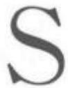
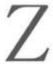
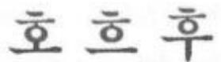
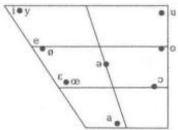

tois Gallo-Romans，1887)，1893年成立法国言语联合会(The Société des Parlers de France)，研究方言学。

卢梭 Rousseau,Jean-Jacques (1712—1778)法国哲学家、作家和思想家。1712年6月28日生于日内瓦。由于家境贫寒，未曾受过系统的学校教育，但阅读广泛，13岁时为当地一名律师做过书记员，后做过雕刻匠的学徒，由于不堪虐待，1728年逃离日内瓦开始四处漂泊谋生。1742年到了巴黎，结识法国哲学家德尼·狄德罗(DenisDiderot)，1749年起参与编写由狄德罗主编的《百科全书》。1750年，由于在第戎科学院(L'Académie de Dijon)的有奖征文活动中获奖，在巴黎成为名人。1762年起因政治言论受当局迫害，生活一直穷困潦倒。1778年7月2日卒于巴黎东北的阿蒙农维拉(Ermenonville)。

让雅克·卢梭著有许多不朽之作，但与语言相关的不多。他著有《论人类不平等起源和基础》(Dis-cours sur l'origine et les fondaments de l'inegaliteparmi les hcmmes,1755)，书中强调对语言起源问题的研究，并推导出两个结论：一是语言的起源问题无法解决，伟人们在此方面的努力都是徒劳的；二是语言和社会休戚相关，并基于此推断出与固定的政治秩序有关的语言启示。《论语言起源》(Essayonthe Origin of Languages，1781)是在卢梭逝世后才发表的，文中再次讨论语言起源问题，认为语言起源于南方温暖气候，语言起源之初具有音乐性和情感性，但不具有理性，而后向北方寒冷地带迁移，北方寒冷地带压抑了语言的情感性，赋予语言现有的理性。

卢梭发表与语言相关的其他作品还包括《艺术与科学话语》(Discourse on the Arts and Sciences,1950)和《关于人类不平等的起源和基础话语》(Discourse on the Origin and Basis of Inequality AmongMen，1754)等。

卢伊德 Lhuyd，Edward (1660—1709)威尔士比较语言学家和博物学家。1660年生于英格兰西部什罗普郡的洛平顿村(Loppington，Shrop-shire)。1682年就读于牛津大学的耶稣学院(JesusCollege)，开始了其律师培训，但中途辍学。因从事过实用植物学、田野工作、化学等实验，最终决定到阿什莫尔博物馆(Ashmolean Museum)工作，1684年担任馆长助理，1691年成为馆长。在工作中，将馆藏物品按照图书馆馆藏分类法编制分类目录，并且寻找新的样本，以丰富化石收藏；同时，逐步加深对植物群分布地，特别是对威尔士北部斯诺登峰(Snowdonia)高山植物群的了解。1694—1695年跟随剑桥的约翰·托兰德(John Toland)学习威尔士语和爱尔兰语。1699年在友人英国物理学家牛顿(Isaac

Newton)的资助下，出版在英格兰周边地区收集到的化石分类目录《不列颠化石编目大全》(Lithophylacii Britannici Ichnografia)，这部手稿至今仍保存在博物馆里。1701年被牛津大学授予荣誉硕士学位，1708年当选为英国皇家学会会员。1709年6月30日因胸膜炎卒于牛津。

爱德华·卢伊德不仅对古文物学、专名学以及语言研究兴趣浓厚，对古生物学、植物学也充满探究欲望。他曾协助英国博物学家约翰·雷(JohnRay,1627—1705)撰写《英语非常用词汇编》(Collectionof English Words not Generally Used, 1691),探讨英格兰北部乡村一些英语方言词与威尔士语的相似点，此举表明卢伊德对当时流行的语言学思想以及语言接触问题颇为熟悉。1693年，他接受英国神学家、古文物学家埃德蒙·吉布森(Edmund Gibson，1669—1748)之邀，参与修订英国历史学家和古文物学家威廉·卡姆登(WilliamCamden，1551—1623)于1586年首次出版、后人不断更新的《不列颠志》(Britannia)1695年英文版，负责增补和完善与威尔士地区相关的条目；在此过程中，他进行了大量的实地调查，广泛的兴趣得以尽显其能，从事田野工作的欲望也愈加强烈。1697—1701年，他借机遍游威尔士、苏格兰高地、爱尔兰、康沃尔和布列塔尼等“凯尔特不列颠”地区，雄心勃勃地收集资料，准备以《不列颠考古学刊》(ArchaeologiaBritannica)为总书名，发布一系列考古发现。此时，他开始学习爱尔兰语，探究语言问题的兴趣也日渐浓厚。通过旅行，他与助手收集了可观的原始资料，包括动植物样本，教区、文物、习俗的笔记，文学作品的手稿或抄本，词典、词表以及方言口语的转写记录，等等。1701年回到牛津后，卢伊德整理分析了大部分语言材料，于1707年年出版了该学刊的第一卷《词汇释解汇编》(Glossography)。卢伊德为《不列颠考古学刊》设定的构想是：从历史的角度呈现出“岛内三国(威尔士属英格兰治下)初始住民更清晰的概念以及对古代人名地名更贴切的理解”。由于语言中的地名元素和命名组合能够反映当地住民的造物活动，历史学者需要对岛内各种“原始”语言、碑文铭文和早期文献有基本的了解。因此，《词汇释解汇编》包含了爱尔兰、布列塔尼和康沃尔等地语言的语法，附有布列塔尼、威尔士和爱尔兰语词典(拟单独成卷出版的康沃尔语词典未能面世，至今仍是手稿)。

卢伊德是19世纪语源学和比较语言学界的先驱者。他认为：比语言技能更重要的是，要认识到打开历史之门的钥匙在各种语言的词汇之中;同源“原始”语言词汇的音系分析可以解释各语种之间的亲缘关系，而借词则是不同语言使用者互相接触的反映；语源学虽是历史语言学家公认的识别工具，但若缺乏划分语音变化类别的合理框架，语源研究就会沦为两三种语言表面相似词汇间的无意义比较。卢伊德制定了检查和识别规则性语音关联并确定何种语言可进行有效对比的规则，减少了语源学的任意元素。《词汇释解汇编》的首章归纳了十条语源学指导方针，其中包括七种语音变化。他还设计了自成一体的标音字母，可通用于各种语言，实现真实比较，因此，他对爱尔兰语、威尔士语和高卢语之间关系的评定取得了远胜于前人的成就。

卢伊克Luick，Karl (1865—1935)奥地利语言学家。1865年1月27日生于维也纳附近第二十一行政区弗洛里茨多夫(Floridsdorf)一个维也纳北郊的普通工人家庭。曾在维也纳大学学习英语、法语和德语，1888年获博士学位。1893年成为格拉茨大学(University of Graz)第一位英语语文学教授。1908年回到维也纳大学任教，1925—1926年出任校长，1935年退休。1935年9月20日卒于维也纳。

卡尔·卢伊克在语言学和文学研究方面硕果累累，以对英语音系学的权威研究而久负盛名。1904年，他出版《德语音韵学》(DeutscheLautlehre)，该书曾重版三次。他更因对英语语言的历时研究而为学界同行所称道，主要研究成果《英语语法史》(Histo-rische Grammatik der Englischen Sprache, 1914—1940)堪称英语历史音系学上最杰出的著作。此书包括了英语元音和双元音的发展史，是此后历史音系学家重要的理论基础。该书最后一部分讲述的是辅音使用的语法规则。这部分是在卢伊克死后的1940年才出版的，作者是维尔德(Friedrich Wild)和科齐奥尔(Herbert Koziol)。

卢伊克的历史语法是对从印欧语系形成到19世纪英语语音史的再现。他原先也打算撰写英语词形和结构历史变化的著作，但最终没有付诸实施。他赞同新语法学派，很满意能发现英语发音的规律性。1896年，他开始形成了一些结构主义的想法，承认每个语言成分的功能、音素的本质和最小对的概念。这种语音体系的结构主义想法强调每个音节和临近音节的距离，使他对15到17世纪期间英语长元音的发音变化做出了新的解释。他还对中古英语开音节中短元音的变长做出了自己的解释。虽然卢伊克的研究不是从一套完整的发音体系出发，但他周全地考虑到了各时代方言的变异。尽管语言学家们对这部分研究成果的接受花了很长时间，然而它的重要性却毋庸置疑。

这位奥地利学者给语言学研究留下了丰富的遗产，20世纪下半叶东欧语言学家对音系学研究的兴趣和卢伊克不无关系。他的主要作品还包括《英语语音》(Untersuchungen zur Englischen Lautge-schichte，1896)和《英语语音学的研究》(Studien zurEnglischen Lautgeschichte, 1903)。

卢扎托 Luzzatto, Samuel David (18001865) 意大利犹太裔历史学家、神学家和诗人。1800年8月22日生于意大利东南沿海的里雅斯特(Trieste)。年幼时就读于当地的犹太人公立学校，同时在家里跟随身为著名犹太法典编订者的父亲学习希伯来语；从小展露出过人的学习天赋，在学校里阅读《约伯记》(Bookof Job)时养成了在书上写评注的习惯，成为其从事文学活动之肇始；到1815年底，收集了37首诗歌;之后用意大利语写成希伯来语语法，把伊索生平翻译成希伯来语，给《摩西五经》(Pentateuch)写评注。为了谋生，曾不得不去做家教。1829年被聘为帕多瓦(Padua)希伯来语学院教授。1865年9月30日卒于帕多瓦。

萨穆埃尔·卢扎托在帕多瓦期间，把所有时间都用于文学创作。他是第一位关注古叙利亚语的犹太学者。他认为古叙利亚语对理解塔古姆(Targum，即《希伯来圣经》的意译本)有很大帮助。他还是第一位校订《圣经·旧约》的犹太学者，并受当时许多学者的认可。在仔细研究了所罗门的《传道书》(Ecclesiastes)之后，他得出结论说此书的作者不是所罗门，而是生于几个世纪后的一位名叫“科希列特(Kohe-let)”的人;科希列特把这本书归到所罗门名下，却被他同时代的学者认出来，书中出现的“所罗门”于是都被换成了“科希列特”。今天，《传道书》不是所罗门所著已经被世俗的学者们广泛接受，但大多数现代学者并不把这本著作归于一个名叫科希列特的个人，他们觉得“科希列特”很可能是某一个指称或标识，类似于“教士”或“布道者”一类。

从哲学上来说，卢扎托是《圣经》和犹太法典的热情支持者。但他对犹太教哲学的异议导致了许多同时代学者的反对，因多次出言攻击，令他与荷兰自然主义哲学家巴鲁赫·斯宾诺莎(Baruch Spinoza，1632—1677)交恶。在他文学生涯的五十多年时间里，他用希伯来语和意大利语写了大量的作品，还给大多数的希伯来和犹太杂志投稿。1817年，他完成了语音学论著《希伯来语元音》(Ma'amar ha-Ni-kkud)。1818年，他开始编写哲学和神学著作《(妥拉>阐释》(Torah Nidreshet)，写成二十四章，由后人翻译成意大利语。1856—1867年编辑了《以赛亚书》(Isaiah)。卢扎托的《犹太教堂礼仪》(SynagogueLiturgy)推动了历史的犹太教堂礼仪，因他姓名的犹太语缩写“Shadal”而著称。

卢扎托的其他作品还包括《希伯来语唯理语法导论》(Prolegomena ad una grammatica ragionatadella lingua ebraica，1896)、《希伯来语语法》(Grammatica della lingua ebraica, 1853—1869)、《圣经时代迦勒底语与塔木德方言语法刚要》(Elementi grammaticali del caldeo biblico e del dialettotalmudico，1865)等。

鲁曼Luhmann，Niklas参见“卢曼”。

路德Luther,Martin (1483—1546) 德国宗教改革运动的发起者与奠基人。1483年11月10日生于德意志东部萨克森州埃斯勒本(Eisleben，Saxony)一个祖辈务农的家庭。在父母严格的宗教教育下，从小熟知使徒信经、十诫、主祷文及简单的赞美诗，接受了传统的基督教信念。1501年进人爱尔福特大学，顺利修完语法、逻辑、修辞、天文、哲学等课程，获文学学士学位;1505年以优异成绩获硕士学位，掌握了经院哲学和奥卡姆(William of Ock-ham)的理论，不仅受奥卡姆理论的影响，还受到暗中活跃的胡斯信徒及德国市民宗教社团“兄弟会”的影响，加之与人文主义者的频繁交往，以及对古典作家西塞罗(Marcus T. Cicero)、维吉尔(Virgil)以及李维(TitusLivius)等著作的阅读，大学生活奠定了其从事宗教改革必备的学识修养，形成了其思想方法和性格特征。1505年遁入爱尔福特圣奥古斯丁修道院当修士，开始了宗教生涯。1508年在维登堡大学讲授亚里士多德伦理学。1512年获神学博士学位，并被任命为维登堡修道院副院长及维登堡大学神学教授。1546年2月18日病逝于家乡埃斯勒本。

马丁·路德不仅是伟大的宗教改革家，也是德语发展的推动者。18和19世纪的学者在大多数领域中有一个最坚定的共识，即路德是“德国语言之父”。他的作品尤其是他翻译的圣经，对德语的书面语和口语产生了巨大影响。他在语言学方面的贡献表现在最重要的译作《新约》。路德用白话首先论述了道德哲学，后来在维滕贝格大学论述了神圣的经文。他的白话文著作包括神学、圣经评论、讲道、论辩传单、信件、圣歌的文本以及餐桌言谈等。这些路德和他晚宴嘉宾的谈话被人们转录、修改并且发表，派发给人们以便人们虔诚阅读。通过自学和辅导通晓希腊语和希伯来文，按照当时的标准值得赞扬。他翻译新约受到希腊语教授和其他人的帮助，用的是1516年的希腊一拉丁语版本。德语版本的《新约》在1522年出版。《摩西五经》(Pentateuch)在1523年出版。法国与瑞士的格律诗篇《圣经·诗篇》(ThePsalter)在1524年出版。《圣经·诗篇》歌词的核心是用法语演唱，曲调多为格里高利圣咏，新创作的音乐占少数，演唱方式开始为单旋律的无伴奏齐唱，后来有供家庭礼拜的吟唱，配有一些四声部或四声部以上的音乐，主旋律在高声部。1534年出版了整本的《圣经》译本。海涅认为，路德对圣经的翻译是“创造了德语”。路德所追溯的是完全没有经后人篡改的希伯来文和希腊文《圣经》原本，并把它译成一种由他确定下来并通用起来的人民语言的版本。他的圣经译本为人们提供了对抗教廷的思想武器，并赋予分裂的德国一种语言上的统一。这种语言上的统一无形中成为联系德意志各邦的纽带。

1523年，路德发表《论世俗权力》。此文一方面申述，为维持外在的社会安定，臣民当顺服世俗权力，提出“君权神授”为世俗主权张目。同时针对俗权对信仰的干涉，提出政教分离和“信仰自由”，“思想自由”的原则。这一原则对路德教以后的发展产生一定的影响，并为欧洲近代进步的思想家所接受和利用。1520年是路德的多产之年。该年出版的德文书籍、文章共208册，其中133册出自路德之笔。尤其是被称之为宗教改革三大论著的《致德意志贵族公开书》(To the Christian Nobility of the German Nation)、《教会被因于巴比伦》(On the Babylo-nian Captivity of the Church)和《基督徒的自由》(On the Freedom of a Christian),更是唤起民众摧毁罗马教廷神权统治的有力思想武器。

路德一生留下大量著作，约有350多部。1883—1948年德国魏玛版《路德全集》达83册，其中包括论文、讲道词、圣经注释和圣诗等，内容涉及当时政治斗争所提出来的许多问题，如国家的性质作用、政教关系、经济变革、教育、家庭和婚姻等。他发起的宗教改革运动席卷欧洲，永久性地结束了罗马天主教会对于西欧的超国家封建神权统治。它的宗教改革学说为新兴资产阶级提供了革命的思想武器。路德是一位曾经震撼了欧洲的历史人物，并成为历代神学家、史学家和政治思想家探讨的对象。

罗宾斯 Robins, Robert Henry(1921—2000）英国语言学家。1921年7月1日生于肯特郡布罗德斯泰斯(Broadstairs，Kent)。自幼学习法语、拉丁语和古希腊语。1935年获奖学金入汤布里奇学校(Tonbridge School)就读，1940年获奖学金入牛津新学院学习古典文学，二战期间曾在皇家空军任日语教师，激发了从事语言学研究的兴趣，1948年以甲等优异成绩毕业；1948—1955年任伦敦大学亚非学院语音学与语言学系讲师，学术上深受时任系主任约翰·弗斯（John Rupert Firth)的影响。1955—1965年任伦敦大学副教授，1966—1986年任普通语言学教授，1968年获伦敦大学文学博士学位，1970—1985年担任系主任。1984—1986年任文学院院长，1986年人选英国国家学术院院士。1986—2001年任伦敦大学荣誉退休教授。退休后致力于语言学史的研究，其间一直在鲁顿大学(University ofLuton)和剑桥大学任教。2000年4月20日卒于英格兰萨里郡坦德里奇区凯特汉姆镇(Caterham，Tandridge District of Surrey)家中。

罗伯特·罗宾斯最突出的成就当属1967年出版的《语言学简史》(A Short History of Linguistics),于1997年推出第四版。他积极倡导历史语言学的研究和教学，尽管研究所涉及的语言学领域颇多，但历史语言学始终是其研究主线。1950年，应弗斯的邀请，罗宾斯到伦敦大学伯贝克学院(Birkbeck College)举行系列讲座，之后他将这些讲稿加以整理，于1951年出版《欧洲古代和中世纪语法理论—兼谈现代语言学文献》(Ancient and Medieval Grammat-ical Theory in Europe with Particular Reference toModern Linguistic Doctrine)。罗宾斯的研究并未局限于古典语言和语言学历史。1951年，他开始研究加利福尼亚州的尤罗克语(Yurok)，之后发表和出版不少有关该语言的文章。他还研究濒危语言，并在其任主席的国际语言学家常设委员会(The ComitéInternational Permanent de Linguistes)的资助下出版《濒危语言》(Endangered Languages，1991)—书。此外，罗宾斯还出版了著作《普通语言学：调查导论》(General Linguistics: An introductory sur-vey,1964—1989)。

罗宾斯的其他主要作品还包括《拜占庭语法学家及其历史地位》(The Byzantine Grammarians:Their Place in History，1993)和本和语境：语言学历史论文选》(Texts and Contexts: Selectedpaperson the history of linguistics, 1998)等。

罗蒂Rorty，Richard(1931—2007)美国哲学家、思想家和语言学家。1931年10月4日生于美国纽约。15岁进入芝加哥大学，之后就读于耶鲁大学1956年获哲学博士学位。在韦尔斯利学院和普林斯顿大学担任教职期间，对卡尔纳普(RudolfCarnap)、塔斯基(Alfred Tarski)和莱辛巴赫(HansReichenbach)的著作深入研习，从中吸取精神食粮。曾任普林斯顿大学斯图亚特哲学教授、弗吉尼亚大学凯南人文教授和斯坦福大学比较文学教授。2007年6月8日卒于加利福尼亚州的帕洛阿尔托(PaloAlto).

理查德·罗蒂的影响主要表现为在英美分析哲学基础上发展起来的新实用主义思路。其代表作《哲学与自然之镜》(Philosophy and the Mirror of Na-ture，1979)，是唯一一部系统性专著。该著作包含对认识论的批评，他用“镜子”来比喻传统的再现式哲学观，认为只有通过哲学革命才能避免“镜式的认识论和形而上学”。这一批评态度在其以后的作品中也有表现，在《真理与进步：哲学论文集(三)》(Truth and Progress: Philosophical papers III,1998)中，他探讨认识论的行为主义特征，认为知识只受到对话限制的限制，哲学概念应当是有教化意味的对话，认识论的行为主义根源是所有知识都在大脑中得以体现，并且在人与人之间进行交流。20世纪80年代以后，罗蒂的学术活动重心已经开始超出哲学专业领域，他关注人类所面临的各类重大社会问题，也积极参与文化政治学、意识形态问题、全球化问题、女权主义、伦理问题等公共话题的讨论，成为西方知识界非常活跃的公众人物。

除了认识论的独到观点，罗蒂在语言哲学和心智哲学等领域也成就卓著。他将真理以及其他有关方面的实用主义与维特根斯坦后期的语言哲学结合起来，认为意义是社会语言产物，语句与世界的联系未必一致。在《偶然、反讽与团结》(Contingency，Irony，and Solidarity，1989)中，他指出：真理不可能脱离人类心智而存在，因为语句不可能如此存在；世界是客观存在，但关于世界的描述不是。这种描述只有是或非，无描述的世界本身不存在是与非。这方面的主要作品还包括早期选编出版的《语言学转向》(The Linguistic Turn，1967)，该文集收录众多分析哲学家的经典文献，一部分文章关于“哲学问题就是语言问题”，另一部分关于“理想语言哲学问题”，还有一个部分则关于普通语言哲学问题。

罗蒂的哲学论著和文集还有《实用主义影响》(Consequences of Pragmatism，1982)、《客观性、相对主义与真理：哲学论文(一)》(Objectivity，Rela-tivism and Truth: Philosophical papers I, 1991),《海德格尔文选与其他：哲学论文(二)》(Essays onHeidegger and Others: Philosophical papers II.1991)、《作为文化政治学的哲学：哲学论文(四)》(Philosophy as Cultural Politics: PhilosophicalpapersIV，2007)和《心智、语言与元哲学》(Mind，Language, and Metaphilosophy: Early philosoph-ical papers,2014)等。

罗曼 Romaine, Suzanne (1951—) 美国语言学家。1951年生于美国马萨诸塞州。曾就读于宾夕法尼亚州的布林莫尔学院(Bryn Mawr Col-lege)，1973年以优异成绩获德语和语言学专业学士学位。获扶轮国际基金会奖学金(Rotary Interna-tional Foundation Scholarship)留学苏格兰，1975年获得苏格兰爱丁堡大学的语音学和语言学专业硕士学位。1981年获伯明翰大学博士学位。1998年和1999年先后获挪威特罗姆瑟大学(University ofTromsø)和瑞典乌普萨拉大学(University of Uppsa-la)名誉博士学位。曾获多伦多大学安大略教育研究学院的加拿大英联邦奖学金。1984—2014年任牛津大学英语语言默顿教授(Merton Professor)。

苏珊妮·罗曼的研究和著作涉及社会语言学、语言习得、双语和语言缺失等多个领域。她曾在英国和太平洋地区进行社会语言学研究，曾在苏格兰对工人阶级子女的语言进行实地调查，并研究过英格兰旁遮普语(Punjab)人群中的双语和语言缺失现象。教材《双语》(Bilingualism，1989—1995)记述了许多她在这些领域的发现，以及她对巴布亚新几内亚语言群体的研究。她著有社会语言学入门教材《社会中的语言》(Language in Society，1994)，其中的“性别歧视和语言”一章，后又扩充成为专著《性别沟通》(Communicating Gender，1999)。她还研究夏威夷的克里奥耳英语，并和里克福特(John Rickford)合作编著《克里奥耳语起源、态度和话语》(Cre-ole genesis, Attitudes and Discourse, 1999)—书。她和内特尔(Daniel Nettle)合作撰写关于语言缺失方面的专著《消失的声音》（Vanishing Voices，2000)，赢得了广泛赞誉，被译为意大利语、法语、日语、土耳其语等多国语言，并赢得英国应用语言学协会2001年度图书奖。

罗曼的其他主要作品还包括《皮钦语和克里奥耳语》(Pidgin and Creole Languages,1988)、《儿童和青少年语言：交际能力习得》(The Language ofChildren and Adolescents: The Acquisition of Com-municative Com petence,1984)等。

罗蒙诺索夫 Lomonosov,Mikhail Vasilyev-(  , 17111765)俄罗斯学者和诗人。1711年11月19日生于俄罗斯北部阿尔汉格尔斯卡亚省霍尔莫果尔(Kholmogory，Arkhangelsk)附近的杰尼索夫卡(Denisovka)村。从小具有强烈的求知欲，14岁时读完了基辅大主教斯摩特里茨基(Meletius Smot-rytsky，1577—1633)编的《近代教堂斯拉夫语》(Modern Church Slavonic，1619)和俄国数学家马格尼茨基(Leonty Magnitsky，1669—1739)的《算术》(Arithmetic，1703)。1730年进入莫斯科的斯拉夫一希腊一拉丁学院从事斯拉夫语和俄语方言的对比研究。1735年进入基辅科学院大学继续从事研究。1736年因成绩优异被派往圣彼得堡学习，并获赴德国马尔堡大学学习两年的机会；1739—1740年在马尔堡期间，受到德国哲学家、数学家克里斯蒂安·沃尔夫(ChristianWolff，1679—1754)的精心教诲和终身影响，学习数学、物理的同时，在约翰·亨克尔(Johann Friedrich Henckel，1678—1744)的实验室学习矿物学、冶金学和采矿学等课程，迅速掌握了德语，对德国文学产生浓厚兴趣，认真学习了哲学和化学，关注了爱尔兰自然哲学家罗伯特·波义耳(Robert Boyle，1627—1691)的作品，并开始诗歌创造。1741年回到圣彼得堡俄罗斯科学院，开始科学研究工作和社会活动；1742年任科学院物理副教授，1745年成为正式院士和化学教授。1748年秋创建俄国第一个化学实验室，1755年与俄国首任教育部长伊凡·舒瓦洛夫(Ivan Shuvalov，1727—1797)一同创办莫斯科大学。1761年当选为瑞典科学院院士，

1764年当选为意大利波伦亚科学院院士。1765年4月15日卒于圣彼得堡。

米哈伊尔·瓦西里耶维奇·罗蒙诺索夫是俄国唯物主义哲学和自然科学的奠基人。他认为世界存在于意识之外，有其固有的发展规律。他把知识的发展史看成是逐步揭示自然界奥秘的过程，科学家的任务在于不断积累知识，逐步认识世界。他的科学宇宙观的基础是微粒哲学，认为微粒(分子)由极小的粒子元素(原子)组成，坚决反对当时占统治地位的燃素说和热素说。1741年，他创立了物质结构的原子一分子学说，该学说认为微粒(分子)由极小的粒子(原子)组成。如果物质由同一种粒子组成，它便是单质；如果物质由几种不同粒子组成，它便是化合物。物质的性质并不偶然形成，它取决于组成物体微粒的性质。他用微粒概念解释热的现象，提出了热是物质本身微粒的运动的理论。1748年提出物质和运动守恒的概念。1756年通过在密闭容器中加热金属的实验，证明了质量守恒定律适用于化学反应。他还提出气体分子运动理论，认为空气微粒对器壁的撞击是空气产生压力的原因。罗蒙诺索夫将这些理论称为物理化学，这些理论为俄国理论化学的发展奠定了基础。

除了对物理、化学进行了广泛而深入的研究外，罗蒙诺索夫对俄罗斯文学和语言学的发展也做出了卓越贡献，享有“俄罗斯现代语言之父”的美誉。他是俄国诗歌改革的积极倡导者，用符合俄国语言特点的“音节重音诗体”写下了许多优秀诗篇。在语言学方面，罗蒙诺索夫同样显示出自己的才华。他编写了《俄语语法》( ，1755)和《修辞学入门》(P，1748)，总结了俄语词尾变化与句法规律，从而奠定了俄语语法的理论基础。他还为文学语言规定了高级、中级和低级三种体裁。罗蒙诺索夫的作品别具一格、脍炙人口，以丰富多彩的俄罗斯语言为基础，摒弃了古老陈腐的词句，读起来铿锵有力，富有节奏感。

罗塞蒂 Rosetti,Alexandru (1895—1990)罗马尼亚语言学家和史学家。1895年10月23日生于罗马尼亚首都布加勒斯特(Bucharest)。1920年毕业于布加勒斯特大学，后赴巴黎大学继续深造，师从梅耶(Antoine Meillet)、罗斯洛特(Jean Roussel-ot)、吉列龙(Jules Gilliéron)等学者学习语言学，1926年获博士学位。1928年回到布加勒斯特大学任教，1932年被聘为教授。1938年接替登素夏努(OvidDensusianu，1873—1938）担任罗马尼亚语教授，1965年退休。1990年2月27日卒于布加勒斯特。

亚历山德鲁·罗塞蒂毕生致力于语音学研究，研究领域涉及历史语音学和理论语音学。他曾担任布加勒斯特语音与方言研究中心主任，著有权威之作《罗马尼亚语史》(Istoria Limbii Romāne，1968)，该书记述罗马尼亚语从起源到17世纪的发展历程。他在普通语言学研究领域也有建树，提出“词汇是语言实体”之说。1933年，罗塞蒂创办《语言学研究》(Bul-letinLinguistique)期刊，并担任编辑至1948年。

罗塞蒂的其他作品包括《词：总体理论纲要》(LeMot: Esquisse d'une théorie générale,1947)和他的敬意——亚历山德鲁·罗塞蒂70岁文集》(Omagiului: Alexandru Rosetti la 70 de ani, 1965)。

罗斯 Ross, John Robert (1938— ) 美国语言学家。1938年5月7日生于美国波士顿。曾在耶鲁大学、宾夕法尼亚大学和麻省理工学院求学，师从乔姆斯基(Noam Chomsky)、波斯特尔(PaulPostal)等语言学家，1967年获博士学位。19661985年任麻省理工学院语言学教授，此后任教于北德克萨斯大学，讲授语言学、文学、句法学、田野调查方法、英语史、隐喻和语义学等课程，还指导诗歌方向的博士生。

约翰·罗伯特·罗斯与雷考夫(George Lakoff)、麦考利(James David McCawley)及波斯特尔等人一起创立并发展了生成语义学理论。他坚持认为在语义表达和语音表达之间加人一个深层结构是多余的，更好的处理方法应该是去除深层结构，通过一系列的有序转换直接把意义和声音联系起来。这也促成乔姆斯基把标准理论发展为扩展的标准理论，其中不仅深层结构，而且表层结构也影响语义解释。生成语义学认为要去寻找能够生成意义，并能把这些意义投射到句法结构上去的机制。

罗斯还用语言学理论研究诗歌。他认为诗歌和句法语义不能隔离开来，如果仅仅研究语言的结构美，而忽视这些结构在文学大师的手中可以用来暗示不可言传的意义，语言就会变得灰暗无味。他认为语言是有灵魂的，但大多数的读者甚至是作家只要求语言达意即可。虽然很少有文学研究者采用罗斯把语言和文学合为一体的研究方法，但把文学重新列为语言学家研究的对象之一，并让文学研究者关注语言层面，这样的研究方法对语言研究和文学研究都很重要。

罗斯的博士学位论文《句法中参数的约束条件》(Constraints on Variables in Syntax)对句法学理论的发展做出贡献。他在论文中首先提出一系列的重要术语，如跨越效果(crossover effects)、外置(extra-position，)、缺空(gapping)、随迁(pied piping)、寄生缺位（parasitic gaps）、置换（scrambling）、黏糊(squishes)等，这些术语在句法学研究中已被广为接受。

罗素 Russell, Bertrand Arthur William,

3rd Earl(1872-1970) 英国哲学家和数理逻辑学家。1872年5月18日生于威尔士蒙默思郡的特雷克(Trellech，Monmouthshire)。1890年获奖学金进入剑桥三一学院(Trinity College)数学优等考试(Mathematical Tripos)班学习，经数学家兼哲学家阿尔弗雷德·诺思·怀特黑德(Alfred North White-head，1861—1947)推荐加入剑桥使徒(CambridgeApostles)秘密社团，很快展露数学和哲学的特有才华，1893年以甲等优胜成绩得主(Wrangler)毕业，1895年成为社团正式成员；毕业后在三一学院讲授逻辑和数学原理。第一次世界大战期间，因热衷于反战宣传，1916年被判刑人狱并失去剑桥大学教职，1918年出狱后主要以写作为生。1920年曾随工党代表团访问苏联，并受邀到中国讲学。1921年回到英国与妻子一起开办学校。1931年继承哥哥爵位，成为第三代罗素伯爵。1939年移居美国，1944年回到英国，重新执教于三一学院。二战期间改变其一贯的反战态度，支持英美等国联合击败纳粹德国。晚年反对核武器，积极宣传核裁军。1970年2月2日卒于威尔士双滩半岛(Penrhyndeudraeth)。

伯特兰·亚瑟·威廉·罗素早期对数学研究感兴趣，在数理逻辑方面提出著名的“罗素悖论(RussellParadox)”，又被称为“说谎者悖论”或“理发师悖论”。罗素悖论是集合悖论的一种，涉及类的内涵问题，其悖论的主要表现是：如果A是所有不以其自身为元素的集合的集合，那么，A是不是自身的一个元素呢？如果A不是自身的元素，那么A就是自身的元素；如果A是自身的一个元素，那么A就不是自身的元素。对于罗素悖论，他提出以“类型论(Theo-ry of Types)”来解决，其解决方案是：凡牵涉一个集合的所有成员的东西，绝不是这个集合的一员。例如，在“说谎者悖论”中，“所有克里特人说的话”属第一类型的集合，“所有克里特人说的话都是谎言”属第二类型的集合，“所有克里特人说的话都是谎言”这个陈述本身不属于“所有克里特人说的话”所构成的集合，该悖论的根源在于混淆了不同类型和级别的集合。罗素悖论所揭示的逻辑矛盾引起学界对数学基础的重新探讨，由此引发理化方法论和数理逻辑等一批新颖学科的产生。

罗素还从数理逻辑的角度出发，建立起逻辑原子论和新实在论，成为现代分析哲学的创始人之一。他认为，世界是由独立、无法相互推导的个别事物组成，日常的个体事物可以被层层分解，直到分解为不能再细分、真正的简单对象，即逻辑原子。例如，一个人是由他的外貌、性格、行为等组成，而外貌、性格、行为等可以继续被分解下，直至分解为逻辑原子。

罗素的逻辑原子理论也反映在他的语言观里。

他认为语言由句法和对象词两部分组成，句法部分是纯粹形式的，由“和”、“或者”、“如果”等逻辑词组成，对象词由指称事物的专名和描述事物一般语词组成。和他的逻辑原子论相对应，语言中的单称语词或专名用来指称个别的事物，一般语词或抽象语词对这些事物进行述说。罗素希望通过建立一种人工语言或理想语言，来描述由逻辑原子组成的世界。

罗素是语言哲学的重要奠基人。他的摹状词理论(Description Theory)被认为是对哲学的最重要贡献。他把摹状词分为描述性和指称性两类，并通过把含有特指摹状词主词的句子改写为命题函式的方式来揭示句子的真实逻辑结构。根据排中律，“当今法国国王是秃头”和“当今法国国王不是秃头”这两个命题必有一个为真。他通过把“当今法国国王”分析为“有一个人”和“这个人是当今的法国国王”这一改写方式，使原句中的表面主语“当今法国国王”被存在量词“有一个人”和谓词“是当今法国国王”所代替，新的谓词和句中原有的谓词“是秃头”有同样的逻辑身份。通过这样的改写，分析找出句子的深层语法，即可消除表层语法带来的迷惑，解决迈农悖论、违背排中律和同一性问题等哲学难题。

为了解决指称论中的空名现象，罗素还发展了“缩略摹状词(Abbreviate Descriptions)”理论。在他看来，日常语言中的专名不是真正的专名，而是等于一个或一些特指摹状词。例如，“苏格拉底”这个普通专名包含有“柏拉图的老师”、“喝了毒酒的哲学家”等特指摹状词。空名只是一些摹状词的集合，因而不需要任何存在的东西与其对应。

罗素一生著述颇多，主要包括《数学原理》(ThePrinciples of Mathematics，1903)、《论指称》(OnDenoting，1905)、《我们的外部世界知识：作为哲学科学方法的一个领域》(Our Knowledge of the Ex-ternal World as a Field for Scientific Method inPhilosophy，1914)、《心的分析》(The Analysis ofMind，1921)、《物的分析》(The Analysis of Matter,1927)、《意义和真理的探究》(An Inquiry into Mean-ing and Truth，1940) 和《西方哲学史》(A Historyof Western Philosophy, 1946)等。

罗伊希林 Reuchlin，Johann(1455—1522)德国人文学家和语言学家。1455年1月29日生于德国西南部黑森林的普福尔茨海姆(Pforzheim)。曾在修道院学校学习拉丁语，后被选中陪同巴登亲王的三儿子弗雷德里克(Frederick)到巴黎大学读书，师从海欧纳莫斯(George Hieronymus)学习希腊语，1477年在巴塞尔(Basel)获硕士学位，此后在德国学校讲授古典拉丁语，并用希腊语讲解亚里士多德的文献。1478年赴法奥尔良(Orleans)研习法律，后转赴法国西部城市普瓦捷(Poitiers)，1481年7月取得当地的法律从业资格。晚年回德国在蒂宾根大学(University of Tübingen)担任希腊语和希伯来语教职。1522年6月30日卒于黑森林的巴德利本泽尔镇(Bad Liebenzell)。

约翰·罗伊希林对深奥而神秘的犹太卡巴拉教(Kabbalah)颇有兴趣，因而在16世纪初率先在信奉基督教的西方世界发起希伯来语研究，并且在欧洲多所大学创立新颖的语言学研究方法。为此，他著有《提升词》(De Verbo Mirifico，1494)和《卡巴拉艺术》(De Arte Cabbalistica，1517)。鉴于《旧约全书》是用希伯来语写成的，他指出如果基督徒能够更好地掌握希伯来语，他们就能够更有效地说服犹太人信奉基督教。罗伊希林是希伯来语研究先驱，还撰写著作以鼓励基督教学者学习希伯来语，他的相关作品包括一部希伯来语词典、一本带有拉丁语翻译和评注的希伯来语悔罪诗篇教材、一本关于语音和拼写的手册和一本拉丁语词典。

罗兹瓦多夫斯基Rozwadowski, Jan Michał(1867—1935)波兰语言学家。1867年12月7日生于塔尔努夫(Tarnow)附近的恰尔纳(Czarna)。曾在克拉科夫(Kraków)学习拉丁语和梵语。1890年获学校任教资格，一年后获博士学位。之后赴德国继续研习语言学，师从莱比锡大学斯拉夫语言学者莱斯金(August Leskien)、德语专家希尔特(Her-mann Hirt)、语音学家西弗斯(Eduard Sievers)等人。曾在雅捷隆大学(Jagiellonian University)任比较语法学教授。1925—1929年任波兰艺术与科学学院(Polish Academy of Learning)院长。曾任波兰语言学会会长，在多个国外语言学会身兼要职，其弟子中不少人成为波兰语言学界的知名人物。1935年3月14日卒于华沙。

扬·米夏尔·罗兹瓦多夫斯基著述颇丰，几乎涉及语言科学的所有领域，如描写语音学、语音变化与外来词历史、方言学、构词法和屈折变化、词源学和语义学、句法学与文体学以及姓名学。他在研究中创立了语言二分法，认为任何语言的词、短语或句子成分都包含意义区别成分和形式识别成分两个部分。他制定了语言量化发展规则，指出每对语言成分在语音和语义方面的区别应当呈现一定恒量，低于这个量，独立存在的语言成分功能就会减弱，高于这个量，一种新的独立语言产物便会产生。他还制定了非自动化规则，认为语言创造力发展的主要原因在于持续更新的情感因素。1925年，他在巴黎语言学会发表演讲，认为语言学研究注定会形成对人类语言机制的普遍性概括。因此，他提出当时语言学研究的三大迫切任务：(1)把世界上所有语言的所有范畴和结构描述成普遍语法成分；(2)从系统和概念上把世界上所有语言可能有的词条编成一般性词汇，附上词源解释和语义值；(3)搜集口头上代代相传的“普遍文学”成果，并把它当作人类的一般文学传统。在谈到语法与语义学关系时，罗兹瓦多夫斯基认为语义学不能与诸如语音学、屈折变化、派生法、句法等描述语言其他体系的学科放在同一个层面上研究，而词汇形态学则不然，因为每一种语言都是形式和意义的统一体，既可从形态学角度来研究，也可从语义学角度来研究。

罗兹瓦多夫斯基的主要著作包括《构词与词义》(Wortbildung und Wortbedeutung,1904)、《论语言的出现与进化》(O zjawiskach i rozwoju jezyka1921)和《斯拉夫语水名研究》Studia nad nazwamiwód stowiańskich(1948)等。

洛德威克 Lodwick，Francis(1619—1694)英国语音学家。1619年8月8日生于伦敦的一位佛兰德(Flanders)商人家庭，母亲是法国胡格诺(Huguenots)后裔。家世在伦敦的荷兰侨民中最为显赫。自小经常出国旅行，会说多种语言，曾帮英国教育及农业改革家哈特立伯(Samuel Hartlib)及其他知识界人士去欧洲大陆收集材料。未曾受过高等教育，却于60岁时成为英国皇家学会(Royal Society)会员。1694年1月5日卒于伦敦。

弗朗西斯·洛德威克的主要成就是语音、速记和寻求一门通用语言的尝试。由于在清教徒社区的成长的经历，他对语言学问题非常感兴趣，希望发明一种适合国际交流的通用语言。他与约翰·威尔金斯(John Wilkins)和乔治·达尔加诺(George Dalgarno)一起尝试创造一种通用的人工语言，并出版了一些研究成果。1647年，他们出版了《通用书写》(ACommon Writing)。在《通用书写》中，他使用类似于算术符号的文字代表非言语字符。他还建议编纂一本包含原始文字以及可以通过使用标准化的区别音符查找文字源头的词典。他发明通用字母的另一个更大收获是完成了《论根基》(The Ground-Work，1652)的写作。在该作品中，他提出了解决通用语言问题的一个更全面的办法，试图为未来代表自然真秩序的一门完美的新语言奠定基础。他最引人注目的解决方案之一是引入通用文字顺序。1686年出版《论通用字母表》(An Essay Towards an UniversalAlphabet)，公布了他发明的通用语音字母表。

洛德威克的其他大部分作品，如早期对荷兰语语音原则的论述，仍以手稿形式存在，涉及语言学、文学、哲学、神学及其他等多个领域。手稿现被大英博物馆收藏。诸如在适用于每种语言的语音字母表等其他的几份手稿，发表于皇家协会的《哲学汇报》(Philosophical Transactions)。然而，即便在英国，人们对洛德威克也知之甚少。对他在语言学方面的贡献，人们是通过维维安·萨蒙(Vivian Salmon)写于

1972年的介绍文章而得知。

洛克Locke,John(1632—1704) 英国哲学家。1632年8月28日生于萨默塞特郡的威灵顿村一个清教徒家庭。1647年被送至伦敦，就读于威斯敏斯特中学(Westminster School);后进人牛津大学耶稣学院(JesusCollege)，1656年获学士学位，1658年获硕士学位，1661年担任大学讲师。因对医学饶有兴趣，转向研究自然哲学；1674年获医学学士学位。1667年结识沙夫茨伯里伯爵(Anthony Ash-ley-Cooper,，1st Earl of Shaftesbury)，后来成为伯爵的助手，担任秘书、医生和政治顾问。1672年因伯爵被指派为英国大法官(Lord Chancellor)，得以随之参与各种政治活动；1673年因伯爵失势于政坛，只得赴法国研究哲学；1679年伯爵的政治情势稍微好转时又回到英格兰。1683年因被怀疑涉刺杀查理二世国王的阴谋，逃亡至荷兰。1688年返回英格兰。1704年10月28日卒于埃塞克斯的奥茨(Oates，Essex)。

约翰·洛克与沙夫茨伯里伯爵相识成为其人生的转折点。沙夫茨伯里伯爵是一位重要的自由政治思想代言人，他在政坛的起落影响着洛克的阅历和思想。1672—1688年间，洛克开始撰写诸多重要著作、在知名的《政府论》(Two Treatises of Govern-ment，1690)中，他为1688年的“光荣革命”提出辩护，同时也批评了托马斯·霍布斯等人的独裁主义政治哲学。他花了许多时间重新校对《人类理解论》(An Essay Concerning Human Understanding,1690)以及《论宽容》(A Letter Concerning Tolera-tion)的草稿。“光荣革命”结束后不久，他开始将大量草稿出版成书，其中包括《人类理解论》、《政府论》、和《论宽容》等。在社会契约理论上，洛克发展出了一套与托马斯·霍布斯的自然状态(state of na-ture)不同的理论，主张政府只有在取得被统治者的同意，并且保障人民拥有生命、自由、和财产的自然权利时，其统治才有正当性。他的思想对于后代政治哲学的发展产生巨大影响，并且被广泛视为启蒙时代最具影响力的思想家和自由主义者，与大卫·休谟、乔治·贝克莱三人被列为英国经验主义的代表人物。现代的自由意志主义者也将洛克视为其理论的奠基者之一。他对伏尔泰有极大影响，而他在自由和社会契约上的理论也影响了后来的亚历山大·汉密尔顿、詹姆斯·麦迪逊、托马斯·杰斐逊以及许多其他的美国开国元勋。洛克的理论激励了后来的美国革命与法国大革命。

洛克在知识论上也有极大贡献。他提出了“主观性”或称之为“自我”的定义。许多历史学家认为他的《人类理解论》是现代哲学中有关“自我”概念的奠基者。《人类理解论》中的第三篇《论词语》(OfWords)是他对语言学的主要贡献。他认为，人没有“天生的观念”，各种类型的“观念”源自于感觉和反思。因此，简单观念的命名与混合模式、混合物质之间的命名要有所区别。言语是对我们内部观念的标示，并对思想标上“记号”。言语的意义完全取决于个人知识。对两种命名的区分对于理解通名显得非常重要。通名不指称任何事物，但对表征抽象、一般的概念却尤为必要。这些概念源于人类的理解活动，根据特定事物的相似性进行分类，并且将它们分属到通名的名下。洛克分析了人类如何能确定通过传统的语言符号来传达确定的概念这一问题。由此，他注意到语言在使用中的不完美性，并提出了语言限制思维的思想。这一思想后来被法国哲学家孔狄亚克(Étienne Bonnot de Condillac)进一步界定和系统阐发，还被用于语言习得以及语言与文化关系等研究领域。

洛拉什Llorach,Emilio Alarcos参见“阿拉科斯·洛拉什”。

洛特 Loth, Joseph (1847—1934) 法国凯尔特语语言学家和历史学家。1847年12月27日生于法国西北部布列塔尼半岛斯科尔河畔盖梅内镇(Guémené-sur-Scorff)，其母语为布列塔尼瓦讷语(BretonVannetais)。在圣昂多赖（Sainte-Anne-d'Auray)完成学业后，先后在邦迪维(Pontivy)、坎佩尔(Quimper)和索米尔(Saumur)任教，直至1870年普法战争爆发。战后，在巴黎的一些机构工作，结识法国历史学家马里耶·朱班维尔(Marie Henrid'Arbois de Jubainville, 1827—1910)。受朱班维尔鼓励，从事凯尔特语研究。1883年被聘为雷恩大学文学院的凯尔特语教师；同年，创办学术期刊《布列塔尼年鉴》(Annales de Bretagne)，并任编辑至1910年。1903年起举办关于凯尔特语的讲座。1910—1930年，接替朱班维尔成为法兰西公学院的凯尔特语教授。1919年当选法兰西学会（Institut deFrance)下属的五个学术院之一法兰西铭文与美文学术院院士。1934年被聘为期刊《凯尔特语评论》(Rerue Celtique)编辑部主任，同年4月1日卒于巴黎。

约瑟夫·洛特在凯尔特语族语言研究方面提出很多深刻的见解，在凯尔特语的词典编纂和词源学研究方面尤为专业。他不遗余力地宣扬布列塔尼语与威尔士语存在亲缘关系，用凯尔特语在《布列塔尼年鉴》和《凯尔特语评论》发表了许多文章，出版了涵盖不同时期的《布列塔尼文选》(Chrestomathie Bre-tonne)。1892年，随着另一本《布列塔尼方言中的拉丁语借用词》(Les mots Latins dans les Langues Bri-ttoniques Gallois，Armoricain，Cornique)的出版，他成为不列颠凯尔特语语音史研究的权威学者。1913年，他翻译出版了威尔士散文故事《马比诺吉昂》(Mabinogion)，同时研究《卡马森黑皮书》(BlackBook of Carmarthen，威尔士语： Llyfr Du Caer-fyrddin)中威尔士语古诗的韵律，以及中古威尔士语的形态和句法(如动词小品词rhy的用法)。他发表的研究论文中有一篇对班戈大学(Bangor Univer-sity)教授约翰·莫里斯—琼斯(John Morris-Jones，1864—1929)所著威尔士语语法进行了猛烈抨击，由此导致部分学者对他心生怨恨。他还重新修订了法国辞书学家沙隆(Pierre de Chalons,1641—1718)的《布列塔尼—法语词典》(Breton-French Dictiona-ry)，把许多重要的凯尔特语文学作品翻译成法语。他还是详细研究方言差异的最早支持者，为了研究布列塔尼语在各个历史时期对法语的影响，他创建了一个较有说服力的模型，之后被称为“洛特线”，即布列塔尼语最大的影响范围从圣米歇尔山(Mont-Saint-Michel)通过海德(Hedé)，一直延向雷恩西部，最终到达卢瓦尔(Loire)。

#

马德森·奥尔胡斯 Madsen Aarhus，Jacob(1538—1586)丹麦学者和语言学家。1538年生于丹麦西部的日德兰半岛(Jutland)。在德国学习八年之后，于1574年回到丹麦，担任哥本哈根大学拉丁语教授。1575年开始教授希腊语。1580年起讲授神学和语音学，成为神学教授。1585—1586年担任哥本哈根大学校长。1586年卒于哥本哈根。

雅各布·马德森·奥尔胡斯最主要的成就在于著成《书中的两封信》(De Literis libri duo,1586)。这是第一部不拘泥于某种特定的语言而写的语音学著作，也是现存最早的关于普通语音学的创新专著。他在书中探讨了各种古代和现代语言的音位学问题，包括丹麦语、拉丁语、希腊语和希伯来语等。受到拉穆斯(Petrus Ramus)的影响，他对辅音的描述有创新的见解，提出了一套建立在一系列二元对立基础上的音图系统，该系统把元音划为“舌元音”或“唇元音”来分析，把双元音看成是一个元音和一个辅音组合的看法极大影响了丹麦表音法。因此，他是欧洲文化里第一位在发音方法的基础上建立了一整套连贯音标的学者。

马德森·奥尔胡斯留下了许多哲学和语言学著作，但绝大多数语言学作品在1728年大学图书馆火灾中被毁，如今都只能闻其名了，如《拉丁丹麦语词典》(DictionariumLatino-Danicum)、《拉丁丹麦语语法》（GrammaticαLatino-Daniα)、《语源学》(Etymologiα)、《句法学》(Syntaxis)以及《认知语言学》(De Cognitione Lingvæ)等。他的词汇和语法专著对后世的丹麦学者影响很大，为下一个世纪丹麦语言学界的繁荣奠定了基础。

马蒂Marty，Anton(1847—1914) 瑞士语言哲学家和心理学家。1847年10月18日生于瑞土施维茨(Schwyz)，其兄马丁·马蒂(Martin Marty)是圣本笃修会的僧侣(Benedictine)、美国天主教大学的创始人之一。他曾在德国美因兹的一所天主教神学院学习哲学和神学，不到二十岁时已深受德国哲学家弗兰茨·布伦塔诺(Franz Brentano)著作《亚里士多德的存在观》(Von der Mannigfachen Bedeu-tung des Seienden nach Aristoteles)的影响，因而赴维尔茨堡大学师从布伦塔诺，忠实地追随经验哲学。1869年起在施维茨州一个天主教书院当哲学教授，同时被授予神职。其后就读于哥丁根大学并获博士学位。先后在乌克兰契诺西大学、布拉格德语大学教授哲学。1890年被聘为维也纳大学哲学系主任。1914年10月1日卒于布拉格。

安东·马蒂致力于语言哲学研究。他认为语言哲学是语言学不可或缺的部分，晚年尽管深受抑郁症的折磨，依然完成了毕生最重要的著作《普遍语法及语言哲学基础研究》(Untersuchungen zur Grundle-gung der Allgemeinen Grammatik und Sprachphi-losophie Vol.1，1908)。他在语言学史上的影响主要在于有力地驳斥了先天论者关于语言和思维的“平行论”，该理论由洪堡特(Wilhelm von Hum-boldt)提出，并被语言学家施泰因塔尔(HeymannSteinthal)以及哲学家、实验心理学的创建者冯特(Wilhelm Wundt)逐渐完善。根据先天论的观点，语言的产生是由于人受到条件反射之后发出的声音以及这些声音和某些感觉和图像的偶然联系；也就是说，他们认为语言是从原先毫无意图的行为反映出来的内在生命的表现。马蒂所持观点则完全相反，他认为语言的产生是因为人类交流的基本需求，所以从一开始就是有意图的，他用实证的方法证明了自己的观点。他的意义理论或“语义学理论”以布伦塔诺的描述心理学为基础。从当代的角度来看，这一理论最有趣的方面是区分了可单独使用与不能单独使用、必须与其他词连用的词之间的区别以及情感话语理论。马蒂的观点在20世纪40年代的日本影响深远。

马蒂的重要著作被艾森迈尔(Josef Eisen-meier)、柯斯迪尔（A.Kostil）和克劳斯（OskarKraus)编撰成两卷《著作合集》(Gesammelte Schrift-en，2 vols.1916，1920)。伯尔尼大学的教授芬克(OttoFunke)进一步发展了他的观点，把他未发表的作品集结成册，取名为《遗作汇编》(NachgelasseneSchriften)。这本书里包括了一些很重要的作品，例如：《语言学基本问题》(Über Prinzipenfragen derSprachwissenschaft)、《描述性语义学的意义和方法》(Über Wert und Methode Einer Beschreibenden Be-deutungslehre)、《语义单位及其子群》(Von den Se-masiologischen Einheiten und Ihren Untergruppen)及《不合逻辑的虚词》(Von den Logisch Nicht Be-grundeten Synsemantischen Zeichen)等。1916 年克劳斯为他作了传记《安东·马蒂：生平及著作》(An-ton Marty: Sein Leben und Seine Werke).

马蒂内 Martinet,André(1908—1999)法国语言学家。1908年4月12日生于法国东南部的萨瓦县奥特维尔城(Saint-Alban-des-Villards)。1928年进入巴黎高等研究实践学院(École pratique deshautes études)，在语言学家梅耶(Antoine Meillet)和旺德里(Joseph Vendryes)的指导下攻读语言学。1938—1946年在巴黎高等研究实践学院任教。二战期间移居美国纽约，曾任纽约国际语言学会主席和哥伦比亚大学校长，并任语言学刊物《词》(Word)主编。1955年回巴黎继续担任教授工作。1965年创办《语言学》杂志。1966年起任欧洲语言学会会长。1976年参与建立功能语言学协会。1999年7月14日卒于位于巴黎南部的塞纳省的马拉布里市(Châtenay-Malabry)。

安德烈·马蒂内是功能主义语言学的代表人物。他在学术上的贡献首先是提出了语言功能观的视角，他的功能语言学融汇了布拉格学派的功能主义和索绪尔的结构主义的长处。他认为语言研究的各个方面都应该贯彻功能主义的思想，无论是语言事实的确定，还是语言单位的划分，以及对语言结构的分析，乃至语言演变的描述，都应该以功能为中心展开。交际功能是语言的最基本功能，而其他如表达功能、审美功能、思维推理功能等都是语言第二位的功能。此外，他还提出语言具有双重分节特征，第一切分是将某特定语言的所有成员的共同经验切分为一个个声音和意义结合的最小单位“符素”(Mopheme)，也就是通常所谓的语素，符素承担表意功能，是表意性单位；第二切分是把符素的语音形式进一步分解成音位(Phoneme)，音位没有意义，只区别符素意义的最小单位，是区别性单位。马蒂内关于“双重切分”的区分，揭示出语言具有两个不同层次的特征，尽管人类的语言千变万化，但都可以简化为若干符素，这些符素又可以通过若干音位加以区别，这一理论观点极大促进了音位学的发展。

马蒂内的另一重要贡献是提出语言演变的经济原则。他认为，人们在交际过程中一方面有采用更多、更新、更复杂、更精确语言来表达思想的需要，另一方面因自然惰性而倾向于在言语活动中尽可能消耗较少的力量，会倾向于使用那些简单省力的惯用普通表达形式，两方面的因素相互冲突，他们的矛盾推动着语言的发展。语言运转的基本原理是语言的经济原则，该原则使人们在保证语言完成交际功能的前提下，有意识或无意识地对言语活动中的力量消耗做出合乎经济要求的安排。无论从语音还是词汇的层面上，经济原则都可以对语言演变的特点和原因做出解释。

马蒂内在语言研究的其他领域也成就斐然。他在历时音位学研究方面著有《语言演变的经济原则》(Économie des Changements Phonétiques, 1955),在普通语言学方面著有《普通语言学原理》(Élémentsde Linguistique Générale，1960)和《语言功能观》(Langue et Fonction，1962)，在句法研究方面著有《功能句法研究》(Studies in Functional Syntax，1975)和《普通句法学》(Syntaxe Génèrale，1985)等。

马丁(达契亚的\~)Martinof Dacia(1220—1304)丹麦学者和神学家。拉丁语名为Martinus de Dacia 或 Martinus Dacus;丹麦语语名为Morten Mogensen。约1250—1288年任巴黎大学神学和艺术大师。约1287—1300年担任罗斯基勒(Roskilde)、隆德(Lund)、石勒苏益格(Slesvig)大教堂教士。曾被国王钦定为罗斯基勒大教堂主教候选人，但终未能到任。曾是里伯大教堂教士，后成为巴黎大学校长。1304年8月10日卒于巴黎，葬于巴黎圣母院(Notre Dame)。

达契亚的马丁是思辨语法学派(Modistae)哲学思想的奠基人。13世纪中叶，以亚里士多德指称的三个层面理论为基础，他与同事一起缔造了摩的斯泰学派语法的雏形。摩的斯泰学派语法指出，语言的含义有三种模式(modes):存在模式(modi essendi)、指称模式(modiintelligendi)和表意模式(modi significandi)。摩的斯泰学派语法学家认为，不同的词性代表了现实中的这些模式。存在模式是指称对象的客观存在性质;指称模式是指称对象的客观存在所代表的意义；表意模式指的是表意语法里语言的指称模式所代表的意义。他出版过当时较有影响的语法著作《表意模式》(Modi significan-di)。马丁还撰写过有关古逻辑(Logica vetus)问题(Quaestiones)的书目。

马丁(塞缪尔·埃尔莫·\~)Martin，SamuelElmo(1924—2009)美国语言学家。1924年1月29日生于堪萨斯州匹兹堡，在堪萨斯州恩波里亚(Emporia)长大。1947年在加州大学伯克利分校获东方语言学士学位，1949年获该校东方语言学硕士学位。1950年获耶鲁大学语言学博士学位。二战期间，与许多美国的日语语言学家一样，曾在日语办公室工作。战后，在伯克利分校师从赵元任研究汉语；在耶鲁大学师从伯纳德·布洛克(Bernard

Bloch)学习日语语言学，完成关于日本语词素音位学研究的博士学位论文，并被评为优秀论文。次年，由美国语言学会系列博士学位论文项目组以专题论文的形式出版。1950年任耶鲁特聘教授，1962年成为远东语言学教授。先后担任东南亚语言文学系主任和语言学系主任。2009年11月28日卒于华盛顿州温哥华。

塞缪尔·埃尔莫·马丁在日语研究方面最杰出的著作是《日语语法参考》(Reference Grammar ofJapanese，1975)和《日语历史演变》(Japanese Lan-guage Through Time，1987),这两部书在日语语法和历史方面均堪称是里程碑式的作品。他的《朝鲜语语法参考》(Reference Grammar of Korean,1993)对二十世纪和中期朝鲜语语素都做了详尽描述，为致力于朝鲜语历史和结构研究的学者提供了有价值的工具。他认为日语和朝鲜语有着内在紧密的联系。他还发明了耶鲁拼式系统(the Yale ro-manization system)，把朝鲜语用英语字母体系拼出来，这一方法已经被其他语言学家广泛应用。

马丁其他较有影响的作品还包括《古汉语音位》(The Phonemes of Ancient Chinese, 1953)、《基础日语：标准日语口语简介》(Essential Japanese: An In-troduction to the Standard Colloquial Language,1954)、《英日及日英基础日语会话词典》(Basic Japanese Conversation Dictionary: English-Japanese,Japanese-English，1959)、《蒙古语入门:语法，文本和词汇》（Dagur Mongolian;Grammar，Texts,And Lexicon，1961)、《开始学朝鲜语》(BeginningKorean，1969)、《朝鲜语—英语词典》(A KoreanEnglish Dictionary，1975)以及《日语和朝鲜语关系的近期研究》(Recent Research on the Relationshipsof Japanese and Korean, 1991)等。

马尔 Marr, Mikolai Jakovlevich (Hkoá，1864—1934)苏联语言学家。1864年生于沙皇俄国格鲁吉亚一个跨高加索黑海沿岸的小镇库塔伊西(Kutaisi)，父亲是苏格兰移民，母亲是格鲁吉亚人，家中是多语环境。毕业于圣彼得堡大学，1891年起在圣彼得堡大学任教，1911年成为该校东方学院院长；1909年任俄国科学院历史语文学研究所研究员，1912年当选为俄国科学院院士。1904—1917年间，每年均赴古亚美尼亚首都阿尼(Ani)发掘考察。1926—1930年任俄罗斯公共图书馆馆长，1921—1934年任苏联科学院雅弗研究所所长，1930年被选为苏联科学院副院长。1934年12月20日卒于列宁格勒。

米柯拉伊·雅科夫列维奇·马尔于1923年出版了《关于语言新说》(   )，提出一套基于意识形态的语言理论。《关于语言新说》的内容包括，(1)语言是上层建筑。语言有阶级性，它从来就是并且现在还是阶级的语言。社会共同的统一的语言、非阶级的语言、全民的语言并不存在；(2)人类最初语言的发音成分不外乎四个“扩散感叹词(dif-fused exclamations)”，即 ca、ep、o 和po，一切语言都由这四个要素发展而来，排斥语言研究中的历史比较法：(3)语言发展阶段论。语言在发展过程中突然爆发是必要的，这正是语言从旧质过渡到新质的条件。新语言的形成是经过爆发、经过从旧质到新质的突然过渡而发生的，它在消灭现存语言的基础上形成；(4)语言和思想的关系。人的思想的产生和存在可以不依赖语言的材料、不依赖语言的词和句子，人和人之间的交际即使完全脱离语言也能实现。最初的人并不是用语言去思维，而是用“手”去思维(手势语先于有声语言)，将来也会出现不依赖语言的思维；(5)语义发展的理论属于图腾崇拜的原始名称的转化。马尔的这一学说又被称作“雅弗理论( , 即 h )”,1900—1915年，马尔发表了一系列研究亚美尼亚语和格鲁吉亚语的论文，并从1908年起尝试研究闪米特语与格鲁吉亚语之间的谱系关系，将它们统一归类到雅弗语(Japhetic)之下。20世纪二三十年代，苏联政府对小民族的语言实行拉丁化时，马尔学说为之提供理论基础。其主要著作还有《苏联的语言学之争》(The Soviet Linguistic Controversy,1951)。

马尔拜Marbais,Michel de(约1255—)欧洲经院哲学家。约1255年前后生于比利时中南部瓦降—布拉班特省海莱西恩市(Helecine，Brabantwallon)奥菲利瑟姆(Opheylissem，法语名“Hampteau”)普雷蒙特雷修会修道院(Premonstratensianabbey)或其附近的黑利瑟姆(Heylissem)。熟读达契亚的波埃修斯(Boethius of Dacia)的著作，思想独立.见解独到，约于1280—1300年间在巴黎艺术学院完成语法研究的硕士论文。

中世纪欧洲语言研究的主要成就体现在经院哲学语法上。经院哲学语法学家的兴趣在于为语法规则提供哲学和逻辑解释，这些语法学家中影响最大者应数活跃在13—14世纪的“摩的斯泰(Modistae)”学派，又称思辨语法学派(SpeculativeGrammar)。作为思辨语法学派的成员，米歇尔·德·马尔拜的语法是基于一个高度抽象的“物理”运动模型，把语言看成一系列的过程，他的观念对于把语法看成一门科学起到了引领作用。马尔拜的主要作品为《思辨语法导论(Summa Modorum Significandi，1285)。早期的《语法论稿》(Tractatus Super Grammati-cam)和《语言与中世纪逻辑理论》(Quaestiones SuperPriscianum Minorem）两部著作仅以手稿形式存在。

马尔基尔 Malkiel,Yakv( J,1914—1998) 美国俄裔语源学家和语文学家。1914年7月22日生于基辅一个俄国犹太家庭。俄国内战爆发后，到柏林生活和接受教育。年少时曾对文学很感兴趣，到洪堡大学就读时选择了语言学。纳粹执政后，全家人被迫离开德国，于1940年到达美国。在纽约失业两年，之后到怀俄明大学任教一个学期。1943年接受加州大学伯克利分校一个暂时性的工作机会，若干年后成为终身教授，一直在西班牙语系和语言学系工作到1983年退休。1947年创办杂志《罗曼语语文学》(RomancePhilol-ogy)并任主编。1965年任美国语言学会会长。1998年4月24日卒于伯克利。

雅科夫·马尔基尔既是当时学界的领袖，又是一位极其严谨的理论大师。他在语言学中的突出贡献在于研究现代罗曼语，特别是证明了西班牙语中存在拉丁语词根、前缀和后缀。他最知名的研究是后缀中的语音。为此，他还创造了新术语“词汇的极化”来描述单词对发音的影响，使其与发音对单词的影响形成对照，尤其是当反义词成对出现的时候。他的又一学术兴趣是语源学历史，这在他创办的杂志《罗曼语语文学》和他最后的著作《语源学》(Etymology)中都有体现。他所有的研究都以大量的证据为前提，对于他的著作《罗曼语系中的拉丁后缀antia 和 entia》(Development of the Latin Suffixes-antia and-entia in Romance Languages),奥地利语言学家斯皮策(LeoSpitzer)评论道：“这项工作也许会吓退很多人，但没有人不被马尔基尔在书中精彩的例证和执著的研究精神所打动。”

马尔基尔其他主要著作包括：《西班牙语fealdad(e)、fieldad(e)和frialdad(e)的起源》(TheDerivation of Hispanic fealdad(e), fieldad(e),andfrialdad(e)，1945)、《三个西班牙词汇研究》(Three Hispanic Word Studies,1947)、《西班牙语后缀(i) ego》(The Hispanic Suffix(i)ego,1951)、《西班牙—拉丁语词族重建研究》(Studies in the Re-construction of Hispano-Latin Word Families,1954)、《语源学词典：尝试性分类研究》(Etymologi-cal Dictionaries: A Tentative Typology, 1976)、《语源学》(Etymology，1993)、《语言主题研究论集》(Essays on Linguistic Themes，1968)、《雅科夫麦基尔，文献学尝试》(Yakov Malkiel: A Tentative Auto-bibliography，1988)、《阿斯图里亚斯中东部地区方言的派生词缀模式》（Patterns of DerivationalAffixation in the Cabraniego Dialect of East-centralAsturian，1970)以及《美洲西班牙语语言学和语文学概览(1925—1970 年)》(Linguistics and Philolo-gy in Spanish America: A Survey (1925—1970),1972)等。他还主编了《历史语言学方向：专题报告》(Directions for Historical Linguistics: A Sym posi-um,1968)。

马尔姆贝格 Malmberg，Bertil (1913—1994）瑞典语言学家。1913年4月8日生于丹麦赫尔辛堡(Helsingborg)。曾在瑞典隆德大学学习语言学；完成博士学位论文答辩后，被聘为隆德大学罗曼语言系讲师。后赴欧洲其他国家留学，了解结构主义运动、布拉格学派以及索绪尔学说，拓展学术视野。1933—1937年多次到法国，学习实验语音学，对索绪尔的《普通语言学》和布拉格学派的特鲁别茨柯伊(Nikolai Trubetzkoy)和雅柯布逊（Roman Ja-kobson)等学者尤其感兴趣。1950—1969年任隆德大学语音学教授，1969—1978年改任普通语言学教授。1994年10月8日卒于瑞典隆德。

伯蒂尔·马尔姆贝格早期对语音学非常关注，是瑞典语音学界的先驱。在他看来，语音具有两重性：一面是具体的发音活动和发出的声音，另一面是声音在语言系统中的作用，如词汇、语法和交流。他对两者都有极大兴趣，他在研究中主要采取结构主义的角度。1939年，他发表《什么是语音》的论文，引发学界对音素的本质、实验语音学、语音学在教学中的作用等问题的探讨。1950年所有隆德大学学语言的学生都必须上马尔姆贝格的语音课。他的《语音简介》(Kort Lärobok i Fonetik)是所有学生的必读课本。他还筹建了语音实验室，是现在隆德大学语言学系的雏形。目前语言学系不仅进行语音的教学和研究，还涉及普通语言学、儿童语言和计算机语言。

马尔姆贝格也是一位知名的罗曼语语言学家，他的著作涉及对法语、意大利语和西班牙语的研究。他几次去南美洲，研究南美印第安人的语言和文化现象。他试图把语言学的符号纳入符号学的理论框架之下，研究符号学该如何与语言学整合的问题，并多次批评生成语言学家缺乏符号的概念。他的研究兴趣还包括儿童语言、双语现象、语言学习和教育等。

马尔姆贝格的著作包括《数量作为语音音位学概念—普遍性研究》(Die Quantität als PhonetischPhonologischer Begriff: Eine allgemeinsprachlicheStudie,1944)、《新世界的西班牙语普通语言学问题探讨》(L'espagnol dans le Nouveau Monde:Problème de Linguistique Générale, 1948)、《语言学新趋势》(New Trends in Linguistics: An Orienta-tion Translated from the Swedish Original byEdward Carney，1964)、《结构语言学与人际交往——语言机制及语言学方法导论》(StructuralLinguistics and Human Communication: An Intro-duction into the Mechanism of Language and theMethodology of Linguistics,1963)、《语音学》(La

Phonétique，1973)、《语言—人类的符号》（LeLangage: Signe de l'human，1979)以及《语言学历史—索绪尔》(Histoire de la Linguistique: deSumerà Saussure,1991)等。

马费伊 Maffei, Angelus Francis Xavier(1844—1899) 意大利传教士、刚卡尼语研究专家。1844年11月12日生于位于意大利与奥地利边境的阿尔卑斯伦黛纳(Rendena)山谷中的平佐洛(Pinzolo)。19世纪中下叶到印度西南沿海传教。1899年卒于印度天主教门格洛尔教区(Mangalore)门格洛尔城附近一个偏远的传教点。

安格鲁斯·弗朗西斯·泽维尔·马费伊是最早系统研究印度西海岸刚卡尼语的西方学者。自从葡萄牙人到了果阿州，天主教传道活动日益活跃。从1534年起，教皇就向果阿州派了主教。为了顺利传教，天主教教士必须掌握刚卡尼语(Konkani)。马费伊为刚卡尼语的普及做了大量工作。在马费伊看来，刚卡尼语之前是用纳加尔(Nagar)的字母书写的，有时又用马拉地语(Mahratti)字母书写。他便把刚卡尼语字母转写成罗马语或卡拿拉语(Canarese)字母，最终使刚卡尼语的字母接近修正后的卡拿拉语字母，与马拉地语字母相似。

马费伊曾编写过《刚卡尼语语法》(A KonkaniGrammar，1882)和《英语—刚卡尼语词典》(AnEnglish-Konkani Dictionary，1883)。许多学者认为，在《刚卡尼语语法》和《英语—刚卡尼语词典》出版后，才有真正的刚卡尼语文学。他的其他著作包括：《刚尼卡—英语词典》(Konkani-English Diction-ary，1885)、《忏悔牧师手册》(The Confessor's Vade-mecum，1891)和《来自刚尼卡沙漠的甜美声音》(Konkni Ranantlo Sobit Sundor talo, or a SweetVoice from the Konkani Desert, 1892)等。

马卡斯特 Mulcaster，Richard (15321611)英国教育改革家。约1532年生于英国坎布里亚郡卡莱尔镇(Carlisle，Cumbria)。1548年从伊顿公学毕业，进入剑桥大学国王学院，后到牛津大学继续学习；其间遇到约翰·奇克(John Cheke，1514—1557)和约翰·凯厄斯(John Caius，1510—1573)等影响其思想的重要学者，1556年获文学硕士学位。从牛津毕业时，已掌握了高超的拉丁语、希腊语和希伯来语技能。1561年任泰勒公学首任校长，1596年成为圣保罗公学校长。1611年4月15日卒于埃塞克斯。

理查德·马卡斯特不仅是一位教育理论家，还是英语词典编纂学的创始人。对语言历史学家和语言学家来说，马卡斯特最令他们感兴趣的是两部著作：1581年出版的《位置》(Positions)和1582年出版的《基础》(Elementarie)。他撰写《位置》的目的是“表达我对教学的千姿百态的意见，主张用一些一致性来统一它们。”《位置》提供了一份综合教育的大纲，涉及语言课程的作用，体育课的教学，儿童受教育的权利等。他主张对12岁以下的孩子，不论贫富，均推行阅读、写字、音乐、绘画和体育教育。《基础》旨在树立一个更规范的英语拼写体系，是第一部英语正字法条例书。此书的核心是一个“总图表”，列举了8000个英语单词和它们正确的拼写。在这本书里，马卡斯特号召人们采取最接近音位的拼写方式，同时也允许少数约定俗成不符合音位的拼写存在。

马卡斯特提倡进行拼写改革，如把短元音之后双写的辅音减少为一个(如 put 和 grub，而非 putt和grubb)，以及规范开音节结尾的元音“e”。他还修正了一些错误的语源学拼写，如应写“abominable”，而非“abhominable”。他全力倡导英语语法教学，认为英国儿童应该首先学好英语阅读，其次是拉丁语阅读，母语语法应该是学习拉丁语语法的基础。这些观点使马卡斯特成为英语语言历史上一位里程碑式的人物，他改变了英语语言的发展和人们对此的态度。

## 马林诺夫斯基Malinowski,Bronistaw Kas-

par (1884—1942)波兰裔英籍人类学家、民族学家和语言学家。1884年4月7日生于波兰克拉科夫(Kraków)一个中产阶级家庭，从小身体赢弱，但乐于钻研学习。幼年丧父，中小学教育大半在家中完成。1902年进入克拉科夫雅捷隆大学(Jagiellonian University)主攻哲学，同时选修波兰文学、数学、物理学、微生物学、植物学、心理学、教育学等课程，1908年毕业；此后到莱比锡大学进修，学习心理学和经济史。1910年在伦敦经济学院求学一年，其间受英国人类学家詹姆斯·弗雷泽(James GeorgeFrazer，1854—1941）作品《金枝》（TheGoldenBough)的启发，立志成为人类学家，后又将兴趣转向民族学;1913年回伦敦经济学院任讲师，1916年获该院理学博士学位。1914年到几内亚着手人类学实地考察，1915—1918年间在特罗布里恩群岛(Tro-briand Islands)做了两年实地考察。1927年被聘为伦敦经济学院人类学系主任，1938年受聘担任耶鲁大学教授。先后在伦敦大学、波兰科学院等处工作。1942年5月16日卒于在墨西哥瓦哈卡州(Oaxaca)做实地考察的途中，安葬于康涅狄格州纽黑文市(New Haven)。

布罗尼斯拉夫·卡斯帕·马林诺夫斯基在人类学研究方面提出一套新的民族志写作方法，并创立了一套严谨的实地调查方法。他认为人类学研究具有科学性，研究所依据的民族志等材料应该根据具体的证据书写，因此首要的工作应该是制作统计图、族谱等图表，以澄清研究对象的状态和彼此之间的关系。他提出把参与观察法作为研究方式，研究者应该参与部落之间的活动，真正观察到土著生活中琐碎却又关键的习俗与规范。此外，他还认为图表的制作和编写还应该同时参考土著居民的意见。马林诺夫斯基的考察纪录不仅让当时的欧洲人重新思考文化的主客观点，学习以当地人的观点理解个别文化的价值，而且这种实地调查的方法此后一直被视为人类学研究的典范，对西方人类学和民族学产生重大影响。

马林诺夫斯基不仅是重要的人类学家，也是语言功能理论倡导者。他认为一个社会的所有文化其实只是一组工具，其存在目的在于满足人类自身的种种生理和心理需求，而各文化要素之间环环相扣，且不断变动以保持有效的运作。因此，各种不同的文化中存在各不相同的运作原则，而这些原则也和社会中的实质功能保持紧密的关联。他认为，语言所要表达的全部事物随着文化水平、地理、社会和经济的情况而变化，因此要根据一定的文化来分析词的功能。他特别强调研究“语言环境”的重要性，认为话语与语言环境是密切地交织在一起的，语言环境对了解词义必不可少。马林诺夫斯基所说的语言环境不仅包括语言使用的上下文语境，而且包括文化水平和可能影响语义的一切因素。

马林诺夫斯基的主要著述包括《澳大利亚土著家庭》(The Family Among the Australia Abori-gines，1913)、《西太平洋的航海者》(Argonauts ofthe Western Pacific，1922)、《原始社会的犯罪与习俗(Crime and Custom in Savage Society, 1926)、《科学文化论》(The Scientific Theory of Culture,1944)等，其中《科学文化论》是其功能主义理论的比较全面和系统的总结。他去世后，美国人类学、民族学界专门设立了马林诺夫斯基奖，以此来纪念这位勤勉的人类学家。

## 马斯特兰德Marstrander，Carl J. S.

(1883—1965) 挪威语言学家。1883年11月26日生于挪威南部港市克里斯蒂安桑(Kristiansand)。曾就读于克里斯蒂安尼亚大学(Universität Kris-tiania)，专攻古典语文学和印欧语。1907年获奖学金赴爱尔兰大学学习。1908年回克里斯蒂安尼亚大学研究印欧语言学。1910—1913年在都柏林的爱尔兰文化学校(School of Irish Learning)担任凯尔特研究和比较语言学教授。1913—1954年担任奥斯陆大学凯尔特语教授。1928年创立《挪威语言学杂志》(Norsk Tidsskrift for Sprogvidenskap)并担任主编直至去世。1965年12月23日卒于奥斯陆。

卡尔·马斯特兰德的作品大部分是用挪威语完成，其中关于挪威文化中凯尔特和斯堪的纳维亚元素的影响被认为是近代挪威重要的语言学研究。他在《挪威语言学杂志》和其他相关期刊上，发表了无数研究如尼铭文的文章，为解释如尼文字作出了长期贡献，对后代很多语言学家产生影响，包括索默费尔特(Alf Sommerfelt)和伯格斯特罗姆(Carl Hjal-mar Borgstrom)。1913年，马斯特兰德出版了《基于中古爱尔兰资料的爱尔兰语言词典》(Dictionary ofthe Irish Language Based Mainly on Old and Mid-dle Irish Materials)，这是他长期进行史学研究的成果。对于马恩岛(the Isle of Man)的历史他也深有研究，并写了不少著作，其中最著名的是《挪威对马恩岛的征服》(The Norwegian Conquest of the IsleofMan，1933)，这项研究还得到了挪威政府资助。他认为挪威人对马恩岛的征服可能从9世纪上半叶即已开始。通过对马恩岛语言的研究，可以证明挪威人与被征服的马恩岛居民关系良好。趁为数不多的土著人仍健在，他对马恩语语音进行开拓性的记录，这些记录资料多达六十卷录音带，是1940年左右灭绝的马恩语唯一的口语资料。马斯特兰德相信马恩岛博物馆所收藏的十字架是斯堪的纳维亚神话研究的重要资料，那些刻在石板上的文字，早在拉丁语传到挪威150年前已是斯堪的纳维亚文化重要的载体。

马斯特兰德的主要作品还包括《对爱尔兰挪威语言历史的贡献》(Bidrag til det Norske SprogsHistorie i Irland , 即 Contributions to the History ofthe Norwegian Language in Ireland, 1915)、《印欧语系的赫梯语字符》(Caractére Indo-européen DeLa Langue Hittite，1919)和《对印欧语系凯尔特人鼻缀的观察介绍》(Obseroations sur les présents in-do-européenes à nasale infixée en celtique, 1924)等。

马斯特曼Masterman，Margaret（1910—1986)英国语言学家和哲学家。1910年5月4日生于伦敦，父亲是著名的政治家，母亲是作家和诗人。曾在纽纳姆学院(Newnham College)研究中世纪与现代语言和伦理学，同时师从维特根斯坦研究哲学，与导师一样关心理论语言学的基础问题。与乔姆斯基正在研究句法理论，蒙塔古(Richard Mon-tague)在数理逻辑的基础上寻求建立一套形式语法的同时，他提出“新维特根斯坦”观点。1986年4月1 日卒于剑桥。

玛格丽特·马斯特曼是剑桥大学教授、剑桥语言研究中心(Cambridge Language Research Unit)的创始人、计算语言学先驱。她对人工智能和机器翻译的主要贡献可视为剑桥语言研究中心工作的一部分。该中心成立于20世纪50年代末。起初是一个研讨小组，最后演变成了领先于世界的计算机语言学研究中心。时任该中心主任的马斯特曼主要对机器翻译中的语义处理问题感兴趣。马斯特曼提出了使用结构化的词汇概念语义分类来解决语言处理程序中的词义消歧问题，并探索将点阵理论运用其中。她反复强调以下原则：(1)语言的基础是语义，而非句法。(2)含糊是自然语言的随意性和扩展性造成的，不会因为语言逻辑的净化而消失。(3)按照语境可以对同义词进行三种分类：按用法将词语分成不同组别，以每个词为中心向周围辐射，或在篇章中根据每个词的所指形成新的组合。(4)图像是独立于语言的语义基础。根据计算机语言学的研究发现，只需要大约50到100个表意字和单音节词就可以在大脑中构成图像。(5)类比和隐喻是形成语言新用法的基本要素，尤其是在最先进的科学领域。

马斯特曼对哲学界也做出了有影响力的贡献。她在《范式的本质》(The Nature of Paradigm,1965)一文中对库恩的范式观做了系统考察。她从《科学革命的结构》中列举了库恩使用的21种不同含义的范式，并将其概括为三种类型或三个方面：作为信念、形而上学思辨的哲学范式或元范式；作为科学习惯、学术传统和具体科学成就的社会学范式，以及作为依靠本身成功示范的工具、解决疑难的方法和用来类比的图像的人工范式或构造范式。

马斯特曼的其他重要作品包括《基于国际语的机器翻译语义信息检测》(Semantic Message Detec-tion for Machine Translation, Using an Interlin-gua，1961)、《语义运算法则》(Semantic Algorith-mus，1965)和《机器翻译之基本技能》(TheEssentialSkill to be Acquired for Machine Translation,1979)等。在她去世后，剑桥语言研究中心授权给谢菲尔德大学教授、人工智能专家威尔克斯(YorickWilks)出版了她的论文合集，名为《语言、连贯和形式》(Language, Cohesion and Form)。

马泰休斯Mathesius,Vilem 参见“马特西乌斯”。

马特西乌斯Mathesius，Vilem(1882—1945)捷克语言学家。亦译作马泰休斯。1882年8月3日生于当时奥匈帝国波希米亚(Bohemia)地区的帕尔杜比策(Pardubice，今属捷克)。1901年考入查理大学(Charles University)攻读日耳曼和罗曼语言。1909年毕业，此后一直留在查理大学任教。1945年4月12日卒于布拉格。

威廉·马特西乌斯是结构主义布拉格学派的重要创始人之一。1926年，他与特鲁别茨柯依(NikolayTrubetzkoy)、雅柯布逊(RomanJakobson)等人共同创建布拉格语言学会，并终身任该学会会长。以他为代表的布拉格学派也称功能语言学派或结构一功能学派，他们支持索绪尔对“语言”(langue)和“言语”(parole)的区分，强调共时语言研究的重要性，但同时认为交际是语言的基本功能，主张语言结构的研究与功能的研究相结合。1939年发表《功能句子观》(Functional Sentence Perspective)，提出句子结构可划分为主位(Theme)和述位(Rheme)的信息结构理论观点。主位一般位于句子的开头，传递已知信息，而述位是对主位的叙述、描写或说明，传递新信息。

马特西乌斯不仅在语言结构与功能方面取得开创性成就，对普通语言学、语言与文化等方面的研究也均感兴趣。其他重要著作还包括《捷克语与普通语言学》(Czech Language and General Linguistics,1947)、《当代英语内容分析》(Content Analysis ofContemporaryEnglish)和《语言、文化与诗歌艺术选集》(Anthology of Language, Culture and PoeticArt)等。

马托雷Matoré,Georges (1908—1998)法国词典编纂学家。生于1908年8月8日。在学习装饰艺术，获得现代语言学及阿拉伯语证书之后，开始其法语教师的生涯。在20世纪30年代末，任立陶宛希奥利艾商业学院讲师，讲授法语；不顾法国大使的劝告，执意留在立陶宛，后被苏联秘密警察逮捕，关进希奥利艾监狱，最终逃脱。1942年被盖世太保逮捕，1943年获释。20世纪50年代开始执教于巴黎大学。1998年10月5日卒于巴黎。

乔治·马托雷是一位语言学和文学贯通的多产学者。他曾把二战期间的经历写成了自传体小说《立陶宛的狱中生活》(Mes Prisons en Lituanie)。1953年他出版了《词汇学方法论》(La Méthode en Lexi-cologie)，为词汇学研究开辟了一条新的道路。他认为不能仅把词汇研究置于语言学范畴，而应该把它同一个国家的历史和文明联系起来。作为此研究的应用，他分别在1985年和1988年出版了《中世纪的社会与语言》(Le Vocabulaire et la SociétéMédiévale)与《十六世纪的社会与语言》(Le Vocabu-laire et la Société du XvIe Siècle),这两本书的研究建立在对那两个时代重要文学作品的分析基础上。

在语言学研究中，马托雷还对空间概念有过专门探讨。他出版和发表了《人类的空间》(L'espaceHumain，1962)、《生活中关于空间的表达》(L'expression de L'espace dans la Vie)以及《空间和语言》(L'espace et le Vocabulaire)等论著。他建立了三个假设：首先，语言、思想和当代艺术都受到空间制约，空间的概念被认为越来越重要；其次，不管什么语类以及对它的不同理解，空间总是被浓缩成一个单位；最后，至少在我们对它的有别于前人特定理解这点上，这个单位是建立我们空间的特有性质。

马托雷的著作还包括《词汇学方法》(LaMéthode en Lexicologie，1953,1973)和《法兰西词典史》(Histoire des Dictionnaires Français, 1968)等。

马托索·卡马拉 Mattoso Câmara Júnior，

Joaquim(1904—1970) 巴西语言学家。1904年4月13日生于巴西里约热内卢。在大学求学时，主修建筑和法律;20世纪30年代涉足语言学研究，先在里约热内卢学习，后赴美国师从雅柯布逊(Ro-man Jakobson)。1937—1939年在里约热内卢的联邦区大学(Universidade do Distrito Federal)任语言学教授。1944年参与创立巴西语文学学术院(Aca-demia Brasileira de Filologia)。1950年任巴西大学哲学学院(Faculdade de Filosofia da Universidade doBrasil)普通语言学教授，兼任美国、葡萄牙、墨西哥、乌拉圭等国外一些大学客座教授。1969年1月9日在圣保罗成立的巴西语言协会(Associação BrasileiradeLinguistica)上当选第一届主席。1970年2月4日卒于里约热内卢。

小若阿金·马托索·卡马拉的研究兴趣广泛，涉及文体学、音位学、语法、巴西土著语以及语言史和普通语言学。其中，最有成就的是在普通语言学、语法以及葡萄牙语等研究领域。在普通语言学领域，他对语言和文化关系的研究意义重大，他认为语言是文化的一部分，但语言又可以从文化中分离开来。他编撰出版了巴西第一部普通语言学专著《普通语言学原理》(Principios de linguistica geral,1941),形成了自己的语言学理论;该书经过修订和扩充，于1954年发行第二版。该书主张的理论沿袭布拉格学派(以雅柯布逊为代表)以及索绪尔和萨丕尔(Edward Sapir)的结构主义理论框架。1956年，他出版了《语法详解词典》(Dicionário de fatos gra-maticais);1963年再版时，该词典更名为《语文学和语法学词典》(Dicionário de filologia e gramáticareferente à lingua portuguēsa)。他的葡萄牙语研究重点关注音位学和形态学方面，提出葡萄牙语中不存在鼻化元音的假说，认为葡萄牙语的音节末尾存在一个鼻化的主音素(nasal archiphoneme);他对葡萄牙语的形态进行了结构主义分析，尤其在动词形态方面的研究颇为有趣。除了描述葡萄牙语的动词体系外，他还对葡萄牙语不规则动词进行了研究，指出葡萄牙语动词除现有的不规则变化之外还存在其他词形变化。此外，他还研究了葡萄牙语的发展史及其在巴西的演变，以及葡萄牙语的词汇、短语等，部分研究成果出版在《葡萄牙语结构》(Estrutura dalingua portuguesa, 1970)中。

马托索·卡马拉的其他主要作品包括《巴西土 著语言简介》(Introdução às linguas indigenas brasileiras，1965)、《葡萄牙语史》(História e estrutura da lingua portuguesa，1972)、《语言学史》 (História da Linguistica,1975)等。

马耶诺娃 Mayenowa, Maria Renata(1910—1988)波兰语言学家。1910年6月2日生于沙俄比亚韦斯托克(Bial ystok)。曾在维尔诺(Wilno)的斯特凡·巴托雷大学(Stefan Batory Uni-versity)攻读波兰语言文学专业，1932年毕业。在一所犹太中学任教四年，后重返大学深造，1939年5月获博士学位。纳粹占领波兰前，一直在大学担任助教；战争爆发之后，到立陶宛北部避难。1945年在比亚韦斯托克市立图书馆担任管理员。后因其夫任波兰驻捷克大使馆新闻专员，在布拉格居住五年。1948年与一些学者共同创建波兰科学院文学研究院，1957—1968年曾任副院长，在“反犹太复国”运动中被解聘。1988年5月7日卒于华沙。

玛丽亚·勒娜特·马耶诺娃一直是一位活跃的学者、编辑和学术活动组织者，她主要的学术思想是用语言学理论研究文体学和诗学。她在华沙组织了数次研讨会，把这些研讨会的成果编撰成文集。这些会议聚集了波兰、捷克斯洛伐克和前苏联语言学家和文学家，是重要的国际学术交流舞台。通过这些组织工作、各种正式或非正式的教育活动，她启发并训练了一大批年轻学者，包括澳籍波兰裔的语义学家韦尔茨别希卡(Anna Wierzbicka)、卢布林语言学和民俗学家巴特明斯基(Jerzy Bartmiński)、华沙词汇学家萨洛尼(Zygmunt Saloni)以及已故的中世纪研究学者沃罗扎克(Jerzy Woronczak)。作为编辑和译者，文体学和诗学同样是马耶诺娃的研究重点。她翻译并评注了法语、捷克语和俄语中有关文体学文章。

马耶诺娃发起并积极参与16世纪波兰语词典的编纂，今已经编到31卷。她编写了《波兰作家文库》(The Library of Polish Writers),收录了从中世纪到17世纪作家的作品，并对它们的词汇和语法进行了深入分析。此外，她编写的文集还有《篇章、语言和诗学》(Tekst，jzyk，poetyka，即Text，Lan-guage，Poetics)、《篇章和语言语义学》(SemantykaTekstu ij Zyka ,即 The Semantics of Text and Lan-guage)、《篇章和语言：语义问题》(Tekst ij zyk:Problemy Semantyczne, 即 Text and Language:Semantic Problems)以及《论篇章连贯性》(O Spòjno sci Tekstu,即 OnTextual Coherence)等。1974年，她完成《理论诗学——语言的问题》(TheoreticalPoetics: Questions of Language), 1979 年出版了该书的修订版，拓展了第一版的内容。在这部著作里，她阐述了“哪些文学信息由语言特征决定”这一论题。

马兹维Madvig，Johan Nicolai (1804—1886)丹麦古典语文学家和政治家。1804年8月7日生于博恩霍尔姆岛(Bornholm)。曾就读于腓特烈(Frederiksborg)古典学校和哥本哈根大学，1828年被聘为副教授。在完成关于西塞罗评注的博士学位论文后，1829年成为哥本哈根大学拉丁语语言和文学教授。1932年成为大学图书馆馆长。1848年作为埃德-丹麦党(Eider-Danish)的一员，成为议会议员。1848—1851年，任内阁文化部长，改革丹麦的教育体制；1856—1863年任丹麦议会议长，兼任国家自由图书馆馆长。一生绝大多数时间都致力于拉丁语的研究和教育，督促古典学校的改进。1874年由于视力持续衰退，不得不放弃大部分工作，但仍继续从事教学。1879年第六次当选哥本哈根大学校长。1880年辞去教授一职，继续研究罗马宪法。1886年12月12日卒于哥本哈根。

约翰·尼古拉·马兹维是一位睿智的评论家。他花了大量精力研究古罗马政治家、雄辩家、著作家西塞罗，并通过编辑西塞罗的著作《论善与恶的定义》创新自己的哲学写作。不过，他最著名的还是那些关于拉丁语法和希腊句法的著作。这些书籍被译成多种语言。当时，丹麦学校里所学的拉丁语法都是他编写的。他关于拉丁句法的一本教科书在2001年还得以再版。马兹维对语言起源的看法与惠特尼的接近，他认为语言的存在形式不能与它的存在相矛盾，因此可以认为马兹维引入了均变语言学。

马兹维的主要著作包括《学校用拉丁语法》(Latinsk Sproglære til Skolebrug,即 Latin Gram-mar for Schools，1841)、《希腊语语法》(Græsk Ord-føiningslære, især for den Attiske Sprogform, 即Greek Grammar，1846)、《语言学论文》(Sprachthe-oretische Abhandlungen，1971)、《语文学散论》(Kleine Philologische Schriften，1875)和《希腊、拉丁作家评论笔记》(Adversaria Critica ad ScriptoresGraecos et Latinos，1871—1884)等。马兹维最后一部作品是他的自传《回忆录》(Livserindringer，1887)。

迈尔霍费尔Mayrhofer,Manfred(1926—2011）奥地利印欧语学者。1926年9月26日生于奥地利北部城市林茨(Linz)。1944年中学毕业后，被格拉茨大学录取。1945—1946年学习德语语言和文学后，迅即转向印欧语比较语法以及印度一伊朗语族以及闪语族的研究。1949年获博士学位。1951年任印欧语言学和印伊语文学讲师。1953年到德国巴伐利亚州维尔茨堡大学执教，1958年成为比较语言学教授。1966年回到奥地利，担任维也纳大学普通语言学和印欧语言学系主任。1988年退休，享受荣誉教授待遇。曾当选国内外十多个科学研究院的院士，在奥地利科学院声望显赫。2011年10月31日卒于维也纳。

曼弗雷德·迈尔霍费尔主要从事印欧语言学研究，尤其专注于印度一伊朗语族语文学和语源理论、语言史等领域。在对古印度-雅利安语源学的研究中，他的做法与之前的学者有所不同，他首先区分史料记载的古老吠陀梵语和后来出现的梵语。这两类词汇的来源不同，前者主要从古印欧和古印伊语中继承而来，后者则产生于梵文的两部史诗之后。他对19—20世纪印欧语言学研究历史充满兴趣，还对印欧语言学家对索绪尔理论的评价进行过调查。他善于使用简洁的语言表达复杂的理论，一直以来，他的著作都以对研究对象的熟悉程度和判断准确客观而著称。

迈尔霍费尔编写了大量的教材和词典，撰写了不少论文和专著。他倾注毕生精力完成的是四卷本《古印度—雅利安语源学词典》(Kurzgefaß tes Ety-mologisches Wörterbuch des Altindischen, 即 TheEtymological Dictionary of Old Indo-Aryan)。从学生时代开始，他就在为这本巨著收集资料，直到1980年才完成四卷词典的编写。另两部词典，《简明梵语语源学词典》(A Concise Etymological SanskritDictionary，1956—1980)和《梵语语源学词典》(Et-ymologisches Wörterbuch des Altindoarischen,即 AnEtymological Sanskrit Dictionary, 1992—2001),也是语源学史上实证充分的著作。其他重要的研究成果还包括《古印欧语音系学》(Phonology of the IndoEuropean Proto-language，1986）和《梵语语法》(Sanskrit-Grammatik，1953)等著作，其中《古印欧语音系学》是他对印欧语言学研究的最大贡献。

## 迈尔-吕卜克Meyer-Lübke，Wilhelm

(1861—1936)瑞士新语法学派语言学家。1861年1月30日生于苏黎世附近的杜本道夫镇(Dübendorf,Zürich)。曾在苏黎世大学、柏林大学和巴黎大学接受教育，1883年以《罗曼语中性拉丁词的命运》(Die Schicksale des lateinischen Neutrums imRomanischen)的论文获柏林大学博士学位；1887年，年仅26岁即被任命为德国耶拿大学罗曼语语言学系主任，后在维也纳大学和波恩大学担任相同职位。1936年10月4日卒于德国波恩。

威廉·迈尔-吕卜克倡导严谨的治学方法，曾接受实证主义新语法学派的训练，并在其毕生的研究道路上恪守准则。当时尽管许多唯心主义者、社会语言学家、生成语法学家以及其他反新语法学派的人对其坚定的学术立场无法认同，但无一否认迈尔-吕卜克是罗曼语语言学史上最有影响的人物之一。1890年，迈尔一吕卜克不到三十岁就完成了个人里程碑式的作品《罗曼语语法》Grammatik der Roma-nischen Sprachen,即 Grammar of the RomanceLanguages)的第一卷，其后至1902年又出版了第二至第四卷。他对罗曼语言和拉丁口语的比较研究为罗曼语语言学开创了新的时代。

迈尔-吕卜克其他重要作品包括其研究生涯顶峰时期出版的《罗曼语语言学研究概论》(Einführung in das Studium der RomanischenSprachwissenschaft,即 Introduction to the Study ofRomanceLinguistics，1901)和《罗曼语语源学词典》(Romanisches Etymologisches Wörterbuch,即Ro-mance Etymological Dictionary, 1914—1920),后者在他有生之年再版三次，影响深远。此外，他还出版过有关法语历史语法以及对古劳古多罗方言(OldLogudorese)研究的著作。

迈农 Meinong，Alexius(1853—1920)奥地利哲学家和心理学家。1853年7月17日生于奥地利帝国时期加利西亚和洛多梅里亚王国(Galiciaand Lodomeria)伦贝格市(Lemberg)(即 L'viv,今乌克兰的利沃夫)。毕业于维也纳学术中学(Akademisches Gym-nasium)，1870年进入维也纳大学学习。1874年获历史专业学士学位。之后投入实证主义哲学家弗朗兹·布伦塔诺(Franz Brentano，1838—1917)门下，转向哲学研究。1878年在维也纳大学担任讲师。1882年被聘为格拉茨大学哲学副教授，1889年晋升为教授。1894年在格拉茨建立了奥地利的第一个实验心理学实验室。1920年11月27日卒于奥地利施蒂里亚州格拉茨市(Graz，Styria)。

亚力克修斯·迈农博学多才，著作涉及哲学、心理学和语言学三大领域，其中很多观点被弗雷格(Gottlob Frege)、索绪尔(Ferdinand de Saussure)和罗素(Bertrand Russell)等同一时代或后来学者引用。他对思想、符号和意义之间关系的讨论，被应用到认知语言学和形式语义学领域。他是格拉茨心理学派的主要代表。他在哲学上的成就以提出关于对象的理论而著名。他认为一切精神作用都蕴含着某个对象，这种作用是实在的，但“对象”不仅指存在着的具体事物和常存的共相，而且也包括非现实存在的东西，如“圆的正方形”、“金山”等。因为这些东西是可思考的，仍可对之作出判断。判断的对象并不是一个存在着的具体事物，而是一个客观的东西。同样，假设的对象是主观的，假设本身无所谓对错，但它所涉及的对象有真假。只有参照假设，我们才能理解精神生活中的许多现象。

迈农把他的价值理论作为其人类心理学的基础。其基本概念是价值情感，指由对象的存在或非存在引起的快乐或悲伤。他认为，我们的情绪反应并不是一致的，当我们谈论诸如健康之类的具有共同好处的话题时，我们对好事物的不存在而表示出来的懊丧情绪要大大超过因为它的存在而带来的愉悦情绪。与此相似的是，我们对坏事物存在的不愉悦情绪之间也常常是不平衡的。他把好事物和坏事物进行细分：(1)值得称赞的好事物；(2)仅仅满足了需要的好事物；(3)可以原谅的坏事物；(4)不可原谅的坏事物。迈农指出它们都是善、恶本性的具体表现，从而奠定了价值理论的基础。人类的价值情感是由对象的存在或非存在所引起的快乐或悲伤，故基本的价值情感有四类：对象的存在引起的快乐和悲伤，对象的非存在引起的快乐和悲伤，它们都是善和恶的本性的具体表现。善指如果它存在就获得快乐，如果它不存在则引起悲伤；恶指如果它存在就引起悲伤，如果它不存在就获得快乐。

迈农的主要著作包括《假设论》(Untersuchung zurGegenstandstheorie und Psychologie，1904)、《对象论》(Uber Gegenstandstheorie，1904)、《对象论在科学体系中的地位》(Über die Stellung der Gegenstandstheorieim System der Wissenschaften，1907)、《可能性和或然性》(Über Möglichkeit wnd Wahrscheinlichkeit, 1915)、《一般价值论的基础》(1923)等。

迈耶尔Meyer,Kuno Edward(1858—1919)德国凯尔特语言学家和文学家。1858年12月20日生于汉堡，德国历史学家爱德华·迈耶尔(EduardMeyer，1855—1930)之胞弟。少年时一直生活在爱尔兰，盖尔语环境激发了他去莱比锡大学学习凯尔特语的兴趣；1884年以《亚历山大传奇的爱尔兰语版》(Eine irische Version der Alexandersage,即 AnIrish Version of the Alexander Romance)的论文获博士学位，这篇论文是最早把拉丁语翻译成爱尔兰语的作品。其后，到利物浦大学的前身新大学学院(New University College)任讲师，讲授日耳曼语，1895年在27岁时晋升为教授，1904年成为皇家爱尔兰学院凯尔特语教授。1911年10月被任命为柏林弗里德里希·威廉大学(Friedrich Wilhelm Univer-sity)凯尔特语系主任，次年成为柏林大学凯尔特语教授，并被都柏林市和科克郡授予荣誉市民奖章。1919年10月11日卒于莱比锡。

库诺·爱德华·迈耶尔在新大学学院任教期间，就古爱尔兰语和其他凯尔特语的诸多课题发表论文，同时编写德语教科书。1896年，他与斯特恩(Ludwig Christian Stern)一起创办期刊《凯尔特语文学》(Zeitschrift für celtische Philologie)并任主编；这本杂志自1897年首刊以来，至今仍在发行。1903年，他在都柏林成立了爱尔兰学校以培养爱尔兰语学者，并给有志于此的学生提供奖学金；第二年他创办了该校的学报《爱尔兰语》(Eriu)并担任主编。第一次世界大战爆发初期，他前往美国讲学；他于1914年12月做的一个亲德演讲在英国和爱尔兰引起了众怒，许多朋友跟他断绝了来往；他因此被剥夺了都柏林市和科克郡的市民权，取消了利物浦大学荣誉凯尔特语教授职位，并被迫辞去爱尔兰学校校长和《爱尔兰语》期刊主编的职务。此后，迈耶尔滞留在美国巡回讲学、任教，直至1917年才回到德国。

虽然迈耶尔接受的是语言学的专业训练，但他的主要志趣还是在文学方面。他把用古爱尔兰语写成的文学作品翻译成英语，使大众对此充满了兴趣。他还研究过语源学和韵律学，并编修过大量上古和中古时代的爱尔兰文献。他的主要著作包括《爱尔兰的奥德赛》(The Irish Odyssey，1885)、《布兰的航行》(The Voyage of Bran，1894)、《国王和隐士》(King and Hermit，1901)、《古爱尔兰诗歌选》(Se-lections from Ancient Irish Poetry, 1911)和五世纪爱尔兰的学问》(Learning in Ireland in the FifthCentury，1913)等。

迈因霍夫 Meinhof, Carl Friedrich Michael(1857—1944) 德国语言学家。1857年7月23日生于波美拉尼亚地区吕根瓦尔德(Rügenwalde，Pomerania)附近小村庄巴左威茨(Barzowice)。先后毕业于蒂宾根大学和格赖夫斯瓦尔德大学(Univer-sity of Greifswald)。1875 年到哈雷大学学习神学，主要研究路德教教义。后转埃朗根大学(UniversitätErlangen)开始学习语言学，师从历史比较语言学家施莱歇尔(August Schleicher)和语文学家劳默尔(Rudolf von Raumer)，主要研究标准正字学、语音变化和语言起源。1877年再次转学到格赖夫斯瓦尔德大学继续宗教学习。通过一系列神学考试之后，1886年成为离家不远的一个小镇的牧师。1905年受聘于柏林东方语言学院，讲授非洲语言。1909年到汉堡语言学院，开始研究除班图语之外的非洲语言，为此学习了亚述语、阿拉米语和阿拉伯语，扩充其坚实的希伯来语背景。为了服务于德国的殖民目的，还学习了杜阿拉语以及其他相关的喀麦隆语，并向其他传教士传授这些非洲语言。1944年2月11日卒于汉堡。

卡尔·弗里德里希·麦克尔·迈因霍夫在德国语言学家威廉·布列克(Wilhelm Bleek，1827—1875)开拓性研究的基础上发展了班图语比较语法研究。他撰写了多篇有关杜阿拉语和其他方言的论文，并在1899年出版了《班图语音学简介》(Grundriss ein-er Lautlehre der Bantusprachen)。该书涵盖了对六种班图语言的语音描述，包括斯瓦希里语和杜阿拉语，一经出版即成为非洲语言学研究的标准。与施莱歇尔用“原始印欧语(Urindogermanisch)”这一新术语描述印度一日耳曼语系(即印欧语)的语源特征相似，他也从当代班图语的词汇、词型和语法中提炼出班图语的语源特征，并将其命名为“原始班图语(Urbantu)”。他还对班图语作了当时最详尽的名词分类，与韦斯特曼(Diedrich Westermann)一同被并称为非洲语言学学科创始人和领导人物。迈因霍夫和韦斯特曼将非洲语言分为三个主要的语系：非洲北部和东北部的闪族语、非洲塞内加尔到埃塞俄比亚一带的苏丹语和非洲南部的班图语。

迈因霍夫曾发表一篇关于西非富尔贝语的论文，证明西非富尔贝语是含族语和尼格罗语之间的桥梁。这篇论文引起了较大争议，因受当时语言学界流行观点的影响，他对含族语和尼格罗语差异的理解，一半与语言学有关，一半与人种有关。他认为说含族语的人种普遍比说尼格罗语的人种高一等，因为后者皮肤更黑。尽管如此，他仍一再强调他的研究只关乎语言学，并继续发表相关著作，其中最著名的是1912年出版的《含族的语言》(Sprachen derHamiten,即 Languages of the Hamites)。1966年,美国语言学家格林伯格(Joseph Greenberg 1915—2001)发表论文证明：迈因霍夫的许多理论建构不是以语言学为依据，而是以生物学为依据，因而存在诸多谬误。

麦卡锡McCarthy,John J. (1953—)美国语音学家。1953年生于美国马萨诸塞州的梅德福(Medford)。1975年毕业于哈佛大学语言学与近东语言专业，获文学士学位；1979年获美国麻省理工学院语言学博士学位，辅修阿卡得语。1979—1984年任德克萨斯大学奥斯汀分校语言学系助理教授，1984年任副教授并获终身教职。1985年任教于马萨诸塞大学阿姆斯特分校(University of Massachu-setts Amherst)语言学系，1989年擢升为教授，2007年任特聘教授，2012年起任研究生院副院长兼教务长。1985—1988年曾任美国语言学会教学委员会(Program Committee)委员。

约翰·麦卡锡致力于音系理论和优选论的研究。他的博士学位论文题目为《闪语音系学与形态学的形式问题》(Formal Problems in Semitic Phonologyand Morphology)。他与艾伦·普林斯(Alan Prince)一同将自主音段音系学、优选论的研究对象拓展到了形态学。1992年，他被授予古根海姆学者奖(Guggenheim Fellowship)，表彰他在优选论和韵律形态学(prosodic morphology)方面的研究，相关著作主要包括《优选论主题入门》(A Thematic Guide toOptimality Theory，2002)、《隐含的归纳：优选论中的音系不透明现象》(Hidden Generalizations:Pho-nological Opacity in Optimality Theory, 2007) 和《优选论分析》(Doing Optimality Theory，2008)等;重要论文包括《论重音与音节划分法》(OnStressand Syllabification，1979)、《希伯来语中的辅音音长表征》(The Representation of Consonant Length inHebrew，1981)、《非线性音系学综述》(NonlinearPhonology：An overview，1982)、《重音转移与韵律结构》(Stress Shift and Metrical Structure,1985)、《罗图马语中的音韵段》(The Prosody of Phase inRotuman，2000）、《对比性标记》（Comparative

Markedness，2003)等。

麦卡锡现任《加泰罗尼亚语言学》(CatalanJournal of Linguistics)、《约旦现代语言与文学》(Jordan Journal of Modern Languages and Litera-tures)等学术期刊的编委顾问，曾任《语言学探索》(Linguistic Inquiry)、《音系学》(Phonology)、《语言》(Language)、《自然语言与语言学理论》(Natu-ral Language and Linguistic Theory)期刊或丛书编委或合作主编。

麦考利 McCawley，James David (1938—1999) 美国语言学家。1938年3月31日生于英国格拉斯哥，二战期间移居美国。1954年，年仅十六岁便考人芝加哥大学学习，于1958年获硕士学位，之后留校任教。1959—1960年获富布赖特奖学金赴德国明斯特大学(University of Münster)进修数学和逻辑学，其间因听了美国语言学家汉普(EricP.Hamp)的课开始对语言学产生浓厚兴趣。回国后，进入麻省理工学院学习语言学研究生课程，1962一1963年任该校机械翻译组研究助理；在乔姆斯基的指导下完成博士学位论文《现代标准日语的重音体系》(The Accentual System of Modern StandardJapanese)，于1965年获博士学位。1964年返回芝加哥大学，被聘为语言学系助理教授，1970年被聘为终身教授。1996年任美国语言学会会长；出于对中国语言学的兴趣，加人了国际中国语言学会（Inter-national Association of Chinese Linguistics),并于1996—1998年被选为理事。卒于1999年4月10日。

詹姆斯·戴维·麦考利具有超群的语言能力，除英语之外，他还能讲德语、西班牙语、葡萄牙语、奥地利语、俄语、日语、荷兰语、汉语普通话、瑞典语、法语、广东话、依地语(Yiddish)以及印度话（Hindi)。虽然在语言学的许多领域都有建树，但他的主要贡献还是在句法和语义领域。他最有突出的贡献是在1970年与罗斯(John Ross)、雷考夫(George La-koff)、波斯特尔(Paul Postal)等人创立并发展的生成语义学派，几乎推翻了乔姆斯基的学派。简言之，生成语义学认为句子结构部分地由它所表达的意义所决定，句法和语义间有复杂的交互关系。这一观点与乔姆斯基认为句法是与生俱来的自足式(Au-tonomous)抽象形式系统的观点不同。但后来，因为各种各样对生成语义学的攻击，加上该理论又未能及时实现它的研究目标，造成其最终的分崩离析，理论的主要创立和支持者后来几乎都转向其他理论的研究，只有麦考利继续坚持这一理论。他的思想集中体现在《英语句法现象》(The Syntactic Phenome-na of English)一书中。

麦考利在学术上的成就并不局限于语言学，还广泛涉猎逻辑学、哲学和心理学等领域。1981年，他著成《语言学家一直想了解却羞于启齿的所有逻辑知识》(Everything That Linguists Have AlwaysWanted to Know about Logic-But Were Ashamed toAsk)一书，显示出他在逻辑方面的功力。他还对中国的饮食着迷，并于1984年出版《食客汉字指南》(The Eater's Guide to Chinese Characters).

麦克戴维 McDavid, Raven Ioor,Jr.(1911—1984）美国区域方言研究专家。1911年10月16日生于南卡罗莱那州格林维尔(Greenville)。1928年毕业于格林维尔高中，被评为优等生；同年进入当地的弗曼大学(Furman University)，1931 年获弗曼大学文学士学位。1933年获杜克大学硕士学位，1935年获该校博士学位。1937年在密歇根大学和耶鲁大学进行博士后研究。1952年开始在美国俄亥俄州西储大学(Western Reserve University)从事教学工作。1957年起任教于芝加哥大学，1964年被聘为英语语言学教授。曾兼任《大西洋中部和南部各州语言地图集》和《北部和中部各州语言地图集》等若干期刊和丛书编委多年;任驻斯堪的纳维亚的富布赖特研究员和美国方言学会会长。1984年10月21日卒于芝加哥。

雷文·尤尔·小麦克戴维在密歇根大学深造时，正遇当时知名语音学家布洛克(Bernard Bloch)讲授方言学，课上需要模拟现场采访，演示实地调查的研究方法。麦克戴维被选为受访者，配合布洛克完成了一堂成功的演示课；采访内容随后成为南卡罗莱那州方言的永久资料。受此鼓舞，麦克戴维决定把方言学作为自己毕生的研究方向。二战期间，麦克戴维和其他语言学家一起准备辅助战事的语言材料。他的工作包括学习缅甸语，为意大利人学习英语准备教材等。他赴全国各地与人交谈，并收集有关他们讲话习惯的资料，在语言学方面做出了突出贡献。1945年，在方言学家库拉特(HansKurath)的指导下，他开始从事《大西洋中部和南部各州语言地图集》(The Linguistic Atlas of the Middle andSouth Atlantic States)的实地研究工作。他在南大西洋各州进行了几百次实地采访，并用精确的语音符号记录下来。后来这项工作又转向了大西洋中部和北部各州。当库拉特从语言学地图的课题负责人位置上退出时，麦克戴维成为他的继任者。

在为语言学地图收集资料的基础上，麦克戴维与库拉特一起完成了其他著作如《大西洋各州的英语发音》(The Pronunciation of English in the At-lantic States，1961)。他还缩写并更新了小说家门肯发表的英语研究专著《美国语言》(The AmericanLanguage，1963)。麦克戴维的许多论文被收集成两本著作：《文化中的方言》(Dialects in Culture，

1979)和《美国英语的多样性》(Varieties of Ameri can English, 1980).

麦克卢汉McLuhan，Marshall（1911—1980) 加拿大哲学家和传播学理论研究者。1911年7月21日生于加拿大艾尔伯塔省埃德蒙顿(Edmonton，Alberta)。在加拿大大学毕业后，赴剑桥大学继续深造，1943年获文学博士学位。起初沉醉于詹姆斯·乔伊斯(JamesJoyce)、詹巴蒂斯塔·维柯(Giambattista Vico)和切斯特顿(Gilbert K.Ches-terton)的作品，后与文学理论著作《实用文学批评》(Practical Criticism)的作者理查德(Ivor A. Richards)和分析美学著作《意义之意义》(The Meaningof Meaning)的作者奥格登(Charles K. Ogden)一起学习和工作，深受两人影响，并对英国诗人兼画家威廉·布莱克(William Blake)的作品产生兴趣。1937年皈依罗马天主教。1980年12月31日卒于加拿大多伦多。

马歇尔·麦克卢汉以研究传播媒介著称，他的著作被视为媒介理论研究的重要基石。在完成学业后，他离开剑桥—这一行为被描述成“锻炼自己洞察力”之举，基本与剑桥分析学派的宗旨相符。他对传播的性质、特点、作用以及分类提出全新的认识和概念，认为媒介是人体及其神经系统的延伸。这一观点源自其朋友、政治经济学家兼交际学创始人之一英尼斯(Harold Innis)的著作。他指出，印刷品是眼睛的延伸；广播是耳朵的延伸；电视是耳目的双向延伸。每一种新的传播媒介的产生，都会使人的感官产生新的变动和延伸，对人的心理平衡和社会的稳定状态产生影响；“充分认识人体延伸所带来的影响已经显得越来越迫切、越来越重要”。麦克卢汉还将媒介做了“凉”“热”的区别：“凉媒介”指“以低清晰度延伸人的感官的媒介”，如电话、漫画等，提供的信息较少，需要受传者予以补充和联想；“热媒介”是指“以高清晰度延伸人的某一感官的媒介”，如广播、电影、照片等。

麦克卢汉的另一个重要观点同样受到英尼斯影响，即出版物导致民族主义。口号“媒介即讯息(themedium is the message)”也被普遍认为是其主要观点。他认为，社会的形成在更大程度上总是决定人们相互交流所使用的传播媒介的性质，而不是传播的内容。传播媒介决定并限制了人类进行联系与活动的规模和形式。这就是说，一种新媒介的产生其本身就会给人类社会带来信息，引起社会变革。在口头传播的时代，人们仅能进行面对面的谈话和小范围的传播。原始的“部落化”社会是由传播方式决定的，而在电子通讯、广播、电视普遍应用的今天，国与国、人与人的时空距离骤然缩短，整个地球如同一个“地球村(global village)”。人类社会的这种巨大变化不是由信息带来，而是媒介本身。从这个意义上讲，媒介就是信息。这一观点对于充分认识媒介对人类社会的巨大影响具有重要意义。但麦克卢汉极端地强调媒介本身的作用，把媒介与信息等同起来则失于偏颇。

麦克卢汉的其他主要著作包括《机器新娘：工业人的民俗》(The Mechanical Bride: Folklore of In-dustrial Man，1951)、《谷登堡星汉璀璨：印刷文明的诞生》(The Gutenberg Galaxy: the Making ofTypographic Man，1962)、《地球村的战争与和平》(War and Peace in the Global Village, 1968) 以及《从陈词滥调到原型》(From Cliché to Archetype,1970)等。

梅格莱特Meigret,Louis (约1500—1558)法国语言学家。约1500年生于里昂的一个较有影响的公证人家庭。其家族很富有而且受人尊重，许多亲属是法院的书记官，但因有些人笃信新教而受迫害。1532年，与克莱门特·马罗(Clement Marot，1496—1544)等人一起，因行事鲁莽犯案被捕。此后直到1542年均未出现其行踪或活动纪录。据信可能被流放，或拿起武器与法国军队作战，或隐居某处安静地学习、生活。其前半生在里昂附近度过，生命的最后20年在巴黎附近度过。

路易·梅格莱特的《法语语法论著》(Le tretté dela grammère françoise，1550)是历史上第一部对法语进行语法描写的著作。他涉足语言学的原始动机，在于试图创建一套新的法语正字法。当时有许多人抱怨法语的口语和书面语之间缺乏联系，出版家托里(Geofroy Tory，约1480—1533)于1529年提出了正字法改革的想法，希望出版一本“法语拼写的通用法则”。尽管最后希望没有实现，但在同年却出现了一本匿名的正字学著作手稿，旨在重塑法语书写的完整性。其作者认为，法语书写的完整性意味着恢复拉丁语的形式和字型差异。这与梅格莱特的观点截然不同。梅格莱特于1531年提出一些具体建议，倡导正字改革要把拼写建立在发音基础上，而不是依靠派生和语源研究。他以拼音为基础的正字法论著《论共同使用的书面法语》(Traite touchant lecommun usage de l'escriture françoise)在 1542 年得以出版。在他的正字法中，每一个字母象征一个发音，每一个发音也代表一个字母。这些法则反映了梅格莱特人文主义的观点，崇尚规则而非迷信。虽然梅格莱特的拼写系统理性地摈弃了法语和这些古老语言在拼写上真实或虚构的联系，但有一定的难度。这些不同引起了大众广泛的争议，也导致了梅格莱特按照自己的正字法出版的译作《说谎的人》(Philopseudes，1548，即Le Menteur)和专著《法语语法论著》由于读者无法辨认而在销售上惨遭滑铁卢。

梅格莱特的《法语语法论著》是16世纪关于法语语言最具创新意识和最有趣的著作，该书分为11卷，有些部分非常简短。第一部分讲述的是法语的发音和冠词，后面七部分涉及词性(名词、代词、动词、副词、介词、连词等)，最后三部分关注韵律和句读。自始至终，他研究的问题在于究竟是理论还是实际用法才是语法规则的导向。从他的书中可以窥见十六世纪中叶法语用法的地区和社会差异。

梅格莱特精通希腊语和拉丁语，因而也走上了典型的人文学者的翻译之路。他翻译的主要是拉丁语、希腊语和意大利语的著作，尤其是关于战争和自然科学的，有据称是亚里士多德的《世界》(Dumonde，1541)、古叙利亚安提俄克圣徒吕西安(SaintLucien of Antioch)用希腊语写成的《说谎的人》(LeMenteur，1548)、意大利人文主义者罗伯托·瓦尔图里奥(Roberto Valturio of Rimini)的《军规》(La Dis-cipline Militaire,1555)以及德国画家和文艺理论家阿尔布雷希特·丢勒(Albrecht Dürer)的《论人体肖像和结构比例》(De la Proportion des Parties etPortraits des Corps Humains,1557)等。

梅兰希通Melanchthon，Philipp(1497—1560)德国教育家。原姓施瓦策特(Schwartzerdt)，梅兰希通为其希腊语译名。1497年2月16日生于德国西南部巴登一符腾堡州布雷滕(Bretten)。1509年前，一直跟随其舅父罗伊希林(Johannes Reuchlin)学习。1509年进入海德堡大学，学习哲学、修辞学、天文学和占星术，因精于希腊语在校内闻名，1512年以过于年轻为由被拒授硕士学位。之后转入蒂宾根大学(Universität Tübingen)继续从事人文学科研究，同时学习法学、数学和医学，在占星术技术层面获当时德国数学家兼占星学家约翰内斯·施特夫勒(Johannes Stöffler)的真传。1516年获硕士学位后，开始研究神学，因其宗教改革观点在蒂宾根大学受到抵制。1518年应马丁·路德之邀，赴维滕贝格大学(Universität Wittenberg)成为希腊语教授，在此任教42年。1560年4月19日卒，葬于维滕贝格教堂路德墓旁。

菲利普·梅兰希通少年时受人文学者罗伊希林的培养与伊拉斯莫的熏陶，立志成为一位人文学者。他阅读古希腊罗马时期的作品，精研文法、修辞、哲学与神学，兼习拉丁文、希腊文和希伯来文；拉丁语和希腊语掌握得比德语还流利，能用拉丁语写诗。后来，他积极投身于宗教改革运动，全力支持马丁·路德。他既是奥格斯堡信纲的起草人，也是后继路德的德国宗教改革的领导人。他对威登堡大学进行了多方面改革，使其名震欧洲。他废除了经验哲学，重视语言、哲学、物理、数学等科的教学。他建立了演讲、讨论等教学方法，活跃了人们的思想。为了发展教育，他还注意培养教育家。他的《神学的基本主题》(Loci Communes Rerum Theologicarum,1521)系统阐述了新教教义，系新教第一本“系统神学”著作。1521—2006年，该书以8种语言出版了182个版本。《奥格斯堡信纲》（Augsburg Confession，1530)共24章，讲述了从神和创造开始到身体的复活，最后以基督徒的自由为结论。

1546年路德去世后，梅兰希通成为路德宗教改革运动的领导人，主要进行萨克森教会的组织工作。他首创新教“系统神学”和新教信经，他的圣经注释完全突破了中世纪的框架。他通过编写教材，培训师资来改组柯林斯堡、耶拿、莱比锡、蒂宾根、罗斯洛克等大学并更新了德国的教育制度。他将德国的人文主义思想纳入宗教改革的轨道，并力图调和科学和信仰。梅兰希通对中等教育也进行了改革。

梅兰希通在语言学方面的突出贡献是编写了希腊语法和拉丁语法。他的拉丁语法书在其后百余年内被奉为标准的文法课本。他还为拉丁学校编写了文法、修辞、逻辑、物理和伦理等教科书，把语法哲学、辩证法和修辞学整合为一体。1528年，他制订了《萨克森拉丁文法学校计划》，该计划把学生分为三个学级，每个学级除学习宗教外，还注重古代典籍的学习。这个计划为后来同类学校所广泛采用，德国拉丁学校从此进入了一个新时代。

梅里丘克 Mel'čuk，Igor Aleksandrovic(  ， 1932)俄裔加拿大语言学家。1932年生于俄罗斯港市敖德萨(Odessa)。1956年毕业于莫斯科国立大学语文学系法语专业，到莫斯科语言科学研究所从事法俄算法翻译工作。因发表言论支持当时苏联的持不同政见者安德烈·辛亚夫斯基(Andrei Sinyavsky)、尤里·奥尔洛夫(Yuri Feodorovich Orlov)和谢尔盖·科瓦列夫(Sergei Kovalev)等学者，被研究所解聘。1977年从苏联移居国外。自1977年9月起至今，执教于加拿大蒙特利尔大学语言学与翻译系。

伊格尔·阿列克桑德罗维奇·梅里丘克于20世纪60年代开始倡导其建立的“意义一文本”语言学模型理论，被誉为前苏联第一个具有控制论色彩的语言学理论，在俄罗斯和其他西方国家有较大影响。“意义一文本”模型的理论假设是：自然语言是一个特种的转换器，它将给定的意思加工转换成相应的文本，并将给定的文本加工转换成相应的意思。换言之，语言被看作是意思和文本之间确定的对应关系再加上某种机制，以便于用具体程序实现这种对应关系，即完成意思与文本之间的双向转换。“意义一文本”模型研究意思及其表达形式(文本)之间的双向对应关系，其目标是模拟人的语言能力一文本的生成与理解机制，使它服务于机器翻译。它的基本思想成为随后兴起的莫斯科语义学派的方法论纲领。近年来，该模型受到国际学术界的广泛关注，并成功地被应用于词典编纂和机器翻译设计，在意思与文本之间建立了双向的语言处理器。

梅里丘克移居加拿大后，在蒙特利尔大学翻译和语言学系成立了“意思一文本语言学观察站”，潜心于理论研究和实际应用，著述颇丰。他本人被西方语言学界誉为“了不起的局外人(great outsider)”(Bolshakov &. Gelbukh，2000)。近40 多年来，在俄罗斯、加拿大、西班牙、法国、德国、日本和韩国等国家，一批志同道合的研究者，纷纷开展了基于该理论模型设计机器翻译系统，或尝试以本国语为目标语编纂双语词典等方面的工作，取得了许多应用性成果，这使他在国际计算语言学界和理论语言学界的影响不断扩大。

“意义一文本”学说是继转换生成语法、依存关系语法之后的又一引起世界关注的语言理论，在形式语言学界和计算语言学界的重要性日益明显。从2003年开始，每年都有研究这一理论发展的国际会议召开。梅里丘克还是五卷本《普通形态学教程》(Cours de Morphologie Générale, 1993)的作者。

梅嫩德斯·皮达尔Menéndez Pidal，Ramón(1869—1968)西班牙学者、语文学家和历史学家。1869年3月13日出生西班牙的拉科鲁尼亚(LaCoruña)。1884年，随家人搬到马德里定居，师从梅嫩德斯·佩拉尤(Menéndez Pelayo)学习法律和文学。1892年获马德里大学哲学和文学博士学位，其博士学位论文题为《论卢坎那之伯爵》(El conde de Lu-canor)。1896年凭著作《拉腊诸王传说》(Leyendade los siete infantes de Lara)获西班牙皇家学院奖。1899—1939年任马德里大学罗曼语学(RomanceStudies)首席教授。1901年当选西班牙皇家学院(Real Academia Española)院士，1909 年参与创建马德里历史研究中心(Centro de Estudios Historicos),1910年任语文学部主任。1912年成为西班牙皇家历史学术院院士。1925—1939年和1947—1968年两次担任西班牙皇家学院院长。1968年11月14日卒于马德里。

拉蒙·梅嫩德斯·皮达尔关注西班牙古典文学和语言，对西班牙的语言、民间故事和民间诗歌进行过广泛深入的研究。在这方面他的重要著作包括《熙德之歌——文本、文法及词汇》(Cantar de Mio Cid:Texto, gramática y vocabulario, 即 Poem of theCid: Text, grammar and vocabulary,1908—1912)、《西班牙文学中的卡斯蒂利亚史诗》(ElRo-mancero Espariol，1910)和《胡格里亚尔诗歌和胡格里亚尔》(Poesl'a Juglaresca y Juglares,1924)等。他对西班牙语言起源的研究，赋予了中世纪西班牙诗歌和编年史以新的生命。

梅嫩德斯·皮达尔的语言学观点继承了新语法学派思想。他用实证主义的方法在西班牙引进了该语言学流派，推动了方言研究的蓬勃兴起。虽然他本人是加利西亚人(Galician)，却一再强调加斯他利语(Castilian)才是西班牙的正统国语。此外，他对民俗、文学史、文体和语源学也深有研究，著有《西班牙史诗遗产)(Reliquias de la poesía épica española,1952)、《西班牙的歌谣体传记：理论与历史》(Ro-mancero hispánico:Teoria e historia,1953)、《罗兰之歌和新传统分析主义》(La Chanson de Roland yel neotradicionalismo，1959)等。他发掘整理了十部曾被认为失传或不知下落的卡斯蒂利亚史诗，还校勘了许多重要古籍。

梅乌森 Meeussen，Achilles Emile(1912—1978) 比利时语言学家。1912年4月6日生于圣彼得斯—杰特(Sint-Pieters-Jette)。毕业于鲁汶大学，获古典语文学学士学位；1938年获博士学位，研究课题是印欧语比较语法关于元音变换现象的标准。1950年曾在伦敦大学亚非学院学习，成为位于佛兰德地区的特尔菲伦市(Tervuren)的比属刚果皇家博物馆(Musée royal du Congo belge)馆员。1952年被聘为鲁汶大学非洲研究院教授，培养了一代经过良好训练的非洲研究专家和描写语言学家。1964—1977年在莱顿大学任教，不定期赴里昂大学任课，但人事隶属关系始终保留在特尔菲伦博物馆语言学研究部。1978年2月5日卒于特尔菲伦。

艾齐尔斯·埃米尔·梅乌森采用结构主义研究方法对班图诸语言做过实地考察和研究，还针对班图语言的重建和比较语法研究实施过一个综合性项目。从20世纪40年代开始，他广泛研究佛兰德人的方言、荷兰语以及非洲语言，并发表了很多文章。他还研究非洲文学、音乐、民俗和风俗习惯。针对荷兰语、日语和一些阿尔贡金语的语音、形态和句法，他也写了不少具有深刻见解的文章。但他最重要的贡献还是在班图语研究上。根据班图语的音调，他开创了一套正式的形态句法自分音系理论——“梅乌森法则”(Meeussen's rule)，用以指称班图语声调减少的特殊情况。它描述的音调交替是在相邻的两个高音(HH)模式中最后的语调在有些情况下会降低，导致HL(高低调)模式产生。在语音方面，这种现象可被看作是强制性非等值原则（ObligatoryContour Principle)的特殊情况。

梅乌森的著作体现了非常连贯、系统、真实的结构主义思想，行文简洁严谨。主要论著包括《奥姆博语简述》(Esquisse de la langue ombo，1952)、《邦固邦固语言素描》(Linguiistische schets van het Ban-gubangu，1954)、《隆迪语语法》(Essai de gram-mairerundi，1959)、《卢巴—卡萨伊语法笔记》(Notes de Grammaire Luba-Kasayi,1960)、《民族语言学与语言理论》(Ethnolinguiistiek en taaltheo-rie，1965)、《语法基础读本》(Eléments de gram-maire lega，1971)、《班图语词汇重构》(Bantu Lexi-cal Reconstructions，1980)以及发表于《非洲语言学》(Africana Linguistica)的论文《班图语语法重构》(Bantu Grammatical Reconstructions, 1967)等。

梅耶Meillet,Antoine (1866—1936)法国语言学家。1866年11月11日生于法国阿列省穆兰(Moulins，Allier)。1885年人读索邦大学，师承索绪尔、布里亚尔等大家，1890年赴高加索考察研究，学习了亚美尼亚语；回到巴黎后，接替返回日内瓦的索绪尔，在高等研究应用学院继续开设比较语法讲座。1891年起主持该院印欧语比较语法研究部。1897年完成论文《古斯拉夫语所有格—宾格用法研究》(Research on the Use of the Genitive-Accusativein Old Slavonic)，获博士学位。1902 年起任东方语言学校(École des langues orientales)亚美尼亚语教授。1906 年获聘法兰西公学院(Collège de France)印欧语比较语法教授，1934年退休。1936年9月21日卒于法国中部谢尔省沙托梅朗(Chèteaumeillant，Cher).

安托万·梅耶不仅师承名家，在法兰西公学院任教期间还与法国语言学家兼汉学家伯希和(PaulPelliot，1878—1945)、东方学家兼语言学家罗贝尔·戈蒂奥(Robert Edmond Gauthiot，1876—1916)等著名学者共事。他的语言研究涉及范围很广，几乎涉及所有印欧系语言，包括斯拉夫语、亚美尼亚语、伊朗语、希腊语、拉丁语、日耳曼语、凯尔特语、波罗的语、亚尔巴尼亚语、吐火罗语(Tocharian)和赫梯语(Hittite)等。

他对历史比较语言学的发展作出了杰出贡献，主要体现在：第一，借助历史比较法，阐明印欧共同原始语的系统和历史，重视社会因素对语言变化所起的作用，揭示和研究语音变化的心理机制，为语言的历史比较研究提供清晰的分析框架，明确历史比较法的原则和使用条件；第二，将谱系树理论(TheFamily Tree Theory) 和“波浪说”(The Wave Theo-ry)纳入到历史比较研究的框架，使历史比较法成为语言历史比较研究的有效工具；第三，指出历时演变的普遍现象，将不同语言在变化方式方面的共同特点上升为一般规律，并用来分析语言的发展；第四，对历史比较语言学做了理论性总结，认为在语言的历史比较中应重视方言的区别，重视语言历史演变中平行发展的可能性。

梅耶共著有24部专著、540篇论文，大部分是关于历史语言学的研究。其中出版于1925年的《历史语言学中的比较方法》(La méthode com parative enlinguistique historique,即 The Com parative Methodin Historical Linguistics，1966 英译本)被认为是关于历史比较法的最具权威性和影响力著作。其他主要著作包括《印欧系语言比较研究导论》(Introduc-tion à l'étude com parative des langues indo-européennes，1903)、《印欧语方言》(Les dialectesindo-européens，1908)、《希腊语史概要》(Aperçud'une histoire de la langue grecque, 1913)、《日耳曼语系各语言的共同特征》(Caractères généraux deslangues germaniques, 1917)等。

门肯 Mencken, Henry Louis (18801956) 德裔美国作家和批评家。1880年9月12日生于马里兰州的巴尔的摩。16岁中学毕业后，未再受过正规教育。后成为巴尔的摩《先驱晨报》的记者和《先驱晚报》的编辑。第一部作品发表于1903年，后自称为“极其幼稚的诗歌”。通过对萧伯纳和尼采的批判性研究，赢得了声誉和名望，成为批评家中的活跃人物。1906—1910年供职于《巴尔的摩太阳报》。1910—1917年及1920—1935年在《太阳晚报》工作。1908年被任命为《时尚》杂志文学评论家。1914—1923年与乔治·吉恩·拿旦(George Jean Na-than)共同担任该杂志的编辑。参与创办《美国信使》(AmericanMercury)的创办人，于1924—1933年任编辑。1956年1月29日卒于巴尔的摩。门肯位于巴尔的摩市内霍林斯街(Hollins Street)1524号的故居目前已被改造为门肯学会(Mencken Society)博物馆。

亨利·路易斯·门肯供职的两份杂志都奉行大胆打破偶像的编辑方针。借助于这两份杂志，他对理论批评和创作两方面都产生了巨大影响。门肯以讥讽刻薄的写作方式，嘲弄那些沾沾自喜的中产阶级商人、思想狭隘的美国文化生活以及严厉肃穆的美国清教徒。他针对所有这些主题猛烈抨击，嘲讽美国市侩的愚昧无知。这样的代表作包括六卷本《偏见集》(Prejudices，1919—1927)及《偏见选集》(Se-lected Prejudices，1927)、《美国信条》(The Ameri-can Credo，1920)和《民主笔记》(Notes on Democra-cy，1926)等。《愉快的日子：1880—1892》(HappyDays，1880—1892，1940)、《在新闻界的岁月：1899—1906》(Newspaper Days, 1899—1906,1941)和《异教徒时代：1890—1936》（Heathen Days，1890—1936，1943)则是门肯的自传体作品。

门肯的多卷本著作《美国语言》(The AmericanLanguage)是语言学界毋庸置疑的杰作。该书对照美式英语与英式英语，解释了许多饶有趣味的美国俚语表达方式之起源、美国特殊的地理名称及个人名字，并追溯外来语言对美国方言所造成的影响。

门肯认为：相对于英式英语而言，美式英语更显得绚丽多彩、生动活泼并富有创意。《美国语言》于1919年首度问世，30年中一度再版。在1945年和1948年，他推出了两大卷增补本；同时根据历年大幅扩容的语言学文章，对原作加以修订和扩充。门肯相关的语言学著作还包括《新编古今引语词典——按历史原则编排》(A New Dictionary of Quotations onHistorical Principles from Ancient and ModernSources，1942)。他为写作《美国语言》而收集的海量原始资料今收藏在巴尔的摩移诺克·普拉特公共图书馆(Enoch Pratt Free Library)。

门肯的主要著作还包括《萧伯纳的剧作》(George Bernard Shaw:His Plays,1905)、《尼采的哲学》(The Philosophy of Friedrich Nietzsche,1907)、《为妇女辩护》(In Defense of Women，1913)、《一个读者眼中的美国风光》(TheAmericanScene，a Reader，1965)、《门肯名文选》(A MenckenChrestomathy，1949)、《门肯日记》(The Diary ofH.L. Mencken，1989)、《论神》(Treatise on theGods，1930)等。

蒙塔古 Montague,Richard(1930—1971)美国逻辑学家。1930年9月20日生于加州斯托克顿市(Stockton，California)。曾就读于加州大学伯克利分校，1950年获哲学学士学位，1953年获数学硕士学位，后师从逻辑语义学的创始人塔尔斯基(Alfred Tarski)。1957年获哲学博士学位。其后终身在加州大学洛杉矶分校任教。1971年3月7日卒于洛杉矶。

作为塔斯基的学生，理查德·蒙塔古继续尝试从数学和逻辑角度来描写语言，最终形成“蒙塔古语法”。他把语言学看作是数学的一个分支，主张采用递归函数、模态逻辑和内涵逻辑来描写和解释自然语言。1970年，他发表《普通英语中量化的特定处理》(The Proper Treatment of Quantification in Or-dinaryEnglish)，正式提出用现代逻辑工具研究自然语言的模式，由此奠定蒙塔古语法理论的基础。蒙塔古语法理论体系由句法、翻译和语义三部分组成：句法部分以范畴语法为基础确定句子的范畴表达式，同时也包括一些用以形成句子的毗连运算规则；翻译部分把句法部分的范畴表达式翻译成内涵逻辑表达式，将自然语言转化为数学模型；语义部分通过一些语义规则对逻辑表达式做出语义解释，使逻辑式获得系统的意义描写。

蒙塔古在形式语言方面的代表著作有《作为一种形式语言的英语》(English as a Formal Lan-guage，1970)、《普遍语法》(Universal Grammar,1970)和《语用学和内涵逻辑》(Pragmatics and In-tentional Logic,1970)等。

蒙塔努斯Montanus，Petrus(1594—1638)荷兰语音学家。1594年生于代尔夫特(Delft)。1619—1621年在莱顿大学(Leiden University)学习神学。之后被任命为荷兰西部登布里尔镇(DenBri-el)附近村庄尼文霍伦(Nieuwenhoorn)的牧师。1638年卒于尼文霍伦。

彼得勒斯·蒙塔努斯于1635年发表了一生中唯一正式出版的作品《新雅指南——发音/说话的艺术》(Bericht van een Nieuwe Konst, Genaemt deSpreeckonst,即 Instruction in a New Art, Calledthe Art of Pronunciation/Speech)。该书主要通过他所处时代的荷兰口语来证明语音法则。尽管当时的语音学理论大多明显具有传统影响的痕迹，但他的观点远远胜过任何前人。他认为，任何一个语音都是种种复杂特征的大集合。为此，他发明了一套新颖的区分体系。同时，他又注意到语音作为音素的独特功能。因此，全书无论从篇章还是从作用都可以看到双重对立性。不仅如此，这本书还对发音器官做了详尽的专业描绘，称其为语音体系的物质层面。最重要的是，他以响亮程度为基础，为任意音节中辅音的分布创建了一个图表，把音节当作一个音量单位，是单词的一部分。然后，他用同样的方法来分析单词、词组和句子。直到今天，人们仍把他的作品当作语音学发展史上一部独一无二的著作。他的《新雅指南》虽然不是为学校老师量身定制的音标教科书，但书中的理论观点适用于任何语言。

与著名弗拉芒数学家西蒙·斯蒂文(SimonStevin，1548—1620)一样，蒙塔努斯认为荷兰语是最适合表达科学知识的语言，因此作品均用荷兰语而非拉丁语或法语写成。这使他丧失一大批欧洲读者。有人认为蒙塔努斯用荷兰语写作的原因，可能是他觉得用自己的母语创造术语比用拉丁语更简单。但事实上，由于作品中术语复杂、独特，一般读者很难读懂蒙塔努斯的作品，即便是以荷兰语为母语的人也不例外。因此，他的论著很少有人认真研读，也未能对语音研究的历程产生重要的影响。

米德Mead,George Herbert(1863—1931)美国实用主义哲学家，社会心理学创始人之一。1863年2月27日生于马萨诸塞州南哈德利(SouthHadley)。其父海勒姆·米德(Hiram Mead)为南哈德利公理会牧师，曾任俄亥俄州欧柏林学院(OberlinCollege)神学院圣言修辞学和教牧神学(SacredRhetoric and Pastoral Theology)系主任;其母伊丽莎白·斯托斯·比林斯(Elizabeth Storrs Billings，1832—1917)曾任南哈德利曼荷莲学院(Mount HolyokeCollege)院长(1890—1900)。1879—1883年就读于欧柏林学院并获学士学位。1888年获哈佛大学哲学硕士学位，师从乔治·帕尔默(George H. Palmer，

1842—1933)和约西亚·罗伊斯(Josiah Royce,1855—1916)，主修哲学，同时研究心理学、希腊语、拉丁语、德语和法语等，其间受到罗伊斯浪漫主义和理想主义的极大影响。1888—1891年在柏林和莱比锡攻读博士学位，其间研读了冯特(WihelmWundt)关于语言学和生理心理学方面的著作。1891年春，中断了攻读博士学位，接受密歇根大学的工作聘任；1891年秋，跟随杜威(John Dewey)到芝加哥大学担任哲学和心理学教授，直至退休。1931年4月26日卒于芝加哥。

乔治·赫伯特·米德对20世纪的社会学理论贡献卓著，尤其对哲学和社会语言学产生了重大影响。符号互动理论是他提出的独一无二的思想。受其他许多学者的影响，尤其继承了库利“镜中自我”的概念，他提出“自我”的概念。这是一个具有开创性的社会心理学观点，成为社会学和社会心理学符号互动学派的基础。他认为，自我由社会关系决定，社会关系的多样性决定了自我的多样性。自我有两种基本结构，即作为宾格的我(me)和作为主格的我(Ⅰ)。这是一个人统一的自我的两个方面。作为宾格的我是作为社会一员的自我，受社会规则、规范和倾向的约束；作为主格的我是对社会和社会规则作出反应的自我，具有自由和主动性，能使社会环境发生变化，尤其是杰出人物的行为，能使社会环境发生显著变化。他强调个人的自我受个人所参与的社会行为所决定，但并没有因此而低估个人的作用。相反，米德认为，每个人的思维活动或行为在某种程度上都作用于社会，引起社会结构的变化，社会随着自我的进化而进化。

米德认为社会交往的媒介是语言，因而社会学不可避免地需要到语言符号中去寻找理论依据。他认为，人不同于动物之处在于人有语言符号。这种语言符号能在发出者自身引起它在其他人身上同样引起的那种反应。也就是说，语言符号对于其发出者和接收者具有共同的意义。语言是社会行为进化的产物。动物做出的姿势已是起着传递信息作用的社会行为，但只是低级的社会行为或亚社会行为，还不具有固定的社会意义。而人所独有的语言则比其他一切姿势优越，具有固定的意义，因为说话人能像听话人一样理解自己所说的话的意义，并像他人一样对之作出反应。这样便使得人的心理意识活动的产生成为可能，也使得人类的社会交往成为可能。由此他否认人的意识活动只是个人活动，强调意识活动的社会性，否认人的精神活动来自自然以外的东西；认为“自我只存在于与其他自我的关系中”，必须以社会交往为前提。因此，米德的哲学有詹姆斯(WilliamJames)和杜威等人的实用主义色彩，但不是简单的重复。他的哲学的独特性体现在他提出的社会行为主义上。他的基本假定是：应该根据行为而不能根据科学观察不到的东西来解释心理现象，不能把进化过程中出现的全新现象归因于过去，而应从发生行为的社会环境来考虑。米德进一步认为，意义的产生也是由有机体的行为过程决定的。无论是动物用姿态传递信息，还是人类用语言传递信息，它们都是行为符号。如果作出某种姿态或发出某种语句，而且这种姿势或语句确能表示其后的行为，那么它就具有某种意义，所以他强调，表意的姿势或符号要想有意义，那就永远必须要有它产生于其中的经验和行为的社会过程。

在40多年的职业生涯中，米德思想深刻，不断写作，发表了大量哲学和心理学方面的文章与书评，但从来没有出版专著。在他去世后，他的学生把听课笔记加以整理并出版。主要著作包括《当代哲学》(The Philosophy of the Present,1932),《心灵、自我与社会》(Mind，Self,and Society，1934)、《十九世纪的思潮》(Movements of Thought in the Nine-teenth Century，1936)、《行为哲学》(The Philosophyof the Act，1938)、《米德社会心理学论著》(GeorgeHerbert Mead on Social Psychology, 1956)、《米德选集》(Mead:Selected Writings，1962)以及《个人与社会自我：米德未发表之作品》(The Individualand the Social Self: the Unpublished Work ofGeorge Herbert Mead, 1982)等。

米尔 Mill, John Stuart 参见“穆勒”。

米克洛希奇 Miklosich，Franc（1813—1891）斯洛文尼亚语言学家。1813年11月20日生于奥地利下施蒂里亚州柳托梅尔市(Ljutomer，Styria)的拉多梅查克(Radomerščak)。毕业于格拉茨(Graz)大学，获哲学博士学位并在该校担任哲学教授。1838年起在维也纳转攻法律。其间，因受斯洛文尼亚语言学家科皮塔尔(Jernej Kopitar，1780—1844)的影响，对斯拉夫语产生浓厚的兴趣，放弃了法律研究。1844—1862年在维也纳帝国图书馆工作。1849年被聘为新成立的维也纳大学斯拉夫语言学系主任，直到1886年退休。1851年起任维也纳帝国学术院(Imperial Academy of Vienna)院士，并于1862年被任命为历史哲学部召集人；曾任公共指导委员会委员、上议院咨询委员，法兰西铭文与美文学院通讯院士。1891年3月7日卒于维也纳。

弗朗克·米克洛希奇的研究涉猎甚广，除了斯拉夫语，还研究罗马尼亚语、阿尔巴尼亚语、希腊语和吉普赛人的方言，主要成就是在斯拉夫语研究中运用了历史比较语言学的研究方法。1844年，他针对德国语言学家弗朗茨·葆朴(Franz Bopp，1791—1867)的《比较语法》发表了一篇著名的评论，引起了当时维也纳学术界的注意。其后，推出一系列学术价值颇高的作品，其中包括1852—1875年间出版的四卷本《斯拉夫语语法》(Vergleichende Grammatikder Slavischen Sprachen)，开创了斯拉夫语研究的新局面。他在乌克兰享有很高声誉，认为乌克兰语是不依附于同语族任何语言的一门专门语言。他校订了各种民族学和历史学的文献，被认同为著名的饱学之士。他追随德国语言学家雅各布·格林(JacobL. C. Grimm)的语言学研究方法和句法论。对米克洛希奇来说，句法就是对词语类型、形式和意思的研究，这是他与其他印欧语言学家的不同之处。后者更关注词素句法学，意在对所研究的语言类型进行冗长的描述。

米克洛希奇的《斯拉夫语语法》第三卷为他赢得了法兰西学院颁发的沃尔内奖(Volney Prize)，第四卷专门论述句法学。1886年，米克洛希奇编写的《斯拉夫语语源学词典》(An Etymological Dictionaryfor the Slavic Languages)出版，德国新语法学派的代表人物德尔布吕克(Berthold Delbrück)把他在斯拉夫语研究上的成就与葆朴和格林在日耳曼语研究上的成就相提并论。

米勒Miller,George Armitage (1920—2012)美国心理学家。1920年2月3日生于美国西弗吉尼亚州的查尔斯顿(Charleston)。1937年就学于华盛顿大学，后转学到阿拉巴马大学主修语言学。1940年获文学学士学位，次年获理学硕士学位。在校期间，因参加过心理学研讨会而对心理学萌发了兴趣；毕业后，被母校聘为普通心理学讲师。1942年到哈佛大学进修，进入心理声学实验室从事有关军用雷达电话系统方面的研究；1946年凭借心理声学课题的研究成果获心理学哲学博士学位。1948年留任哈佛大学助教，讲授语言沟通方面的课程。1950年赴普林斯顿大学高级行为科学研究所做访问学者，专门研究语言沟通数理理论，次年到麻省理工学院林肯实验室从事研究。1960年与著名认知心理学家布鲁纳(Jerome Bruner)联合成立哈佛大学认知研究中心，一直为之工作到1967年。其间，曾任牛津大学教授。1968—1978年担任纽约洛克菲勒大学实验心理学教授。1979年赴普林斯顿大学执教，任心理学教授。1968—1969年任第77届美国心理学会(APA)会长。1957年被吸纳为美国艺术与科学学院院士。1962年入选美国国家科学院院士。1985年入选荷兰皇家艺术和科学院外籍院士。1990年被授予美国心理学基金会的生命成就奖。1991年被授予国家科学奖章。2012年7月22日卒于新泽西州普莱恩斯伯勒乡（Plainsboro Township，NewJersey)。

乔治·阿米蒂奇·米勒是行为主义向认知主义转变期关键人物。他的决定性贡献可以追溯到40年代末和50年代初，他将香农(Claude E.Shannon)的信息理论运用到自己的实验中，尤其是关于短期记忆能力的实验。他最早于1956年在《心理学评论》(The Psychological Review)发表论文《神奇的数字7+/—2:我们信息加工能力的局限》(The MagicalNumber Seven, Plus or Minus Two: Some limits onour capacity for processing information)，对此进行了定量研究。他注意到年轻人的记忆广度大约为七个单位(阿拉伯数字、字母、单词或其他单位)，称为组块。后来的研究显示广度与组块的类别有关，例如阿拉伯数字为七个，字母为六个，单词为五个，而较长词汇的记忆广度低于较短词汇的记忆广度。通常，口头内容的记忆广度(阿拉伯数字、字母、单词等)强烈取决于朗读这些内容的时间。其他一些因素也影响到人类标准广度，因此难以将短时记忆或工作记忆的能力限制在许多组块内。

米勒在开拓自己的学术生涯时，正值行为主义鼎盛时期。他本来也认同行为主义的科学取向，但在根据研究资料出版其第一部专著《语言与沟通》(Language and Communication，1951)之后，感觉到行为主义只重视外显行为的研究取向，不足以了解人类语言的复杂性，尤其是行为主义的学术霸道作风，使他感到厌恶。他与布鲁纳联合成立的哈佛大学认知研究中心即带有向行为主义挑战的意味。他认为认知心理学的兴起并非完全创新，只能说是旧思想的复苏，使心理学恢复了研究内在心理活动的本来面貌。正因如此，自认知心理学兴起后，心理学的定义也随着由行为主义时代的“心理学是研究行为的科学”，改变为“心理学是研究行为与心理历程的科学”。此后，学习、言语、刺激反应以及记忆、语言和处理都成为了认知科学探究的重要课题。在乔姆斯基的语言唯心主义影响下，米勒制定了基本语法心理过程的研究实验程序。在20世纪60年代末，他把他的兴趣从语法转到语义。心理词汇研究成为他在普林斯顿高级研究所开始研究以来一直保有的研究兴趣。1985年，米勒接受政府300万美元经费的资助，开发了英语电子词汇数据库WordNet。基于对这一数据库的研究，他还与布朗大学的教授与研究生们一起，开发了早期的网络搜索引擎和交易工具Simpli，并对搜索条件消除了歧义。这些都为后来谷歌(Google)的广告技术 AdSense奠定了基础。

米勒的主要著作包括《心理学——精神生命之科学》(Psychology,theScience of Mental Life,1962)、《语言起源——心理语言学方法论》(TheGenesis of Language: A psycholinguistic ap-proach，1968)、《语言交流——研究诸视角》(Lin-guistic Communication: Perspectives for research,

1974)、《语言与感知》(Language and Perception,1976)、《语言理论语心理现实》(Linguistic Theoryand Psychological Reality，1978、《语言与思维的心理学及生物学》(Psychology and Biology of Lan-guage and Thought: Essays in honor of Eric Len-neberg，1978)、《自发从师学习—儿童与语言》(Spontaneous Apprentices: Children and Lan-guage，1987)、《语言与言语》(Language andSpeech，1987)和《词汇的科学》(The Science ofWords，1991)等。

密尔Mill,John Stuart参见“穆勒”。

缪勒 Müller，Friedrich Max (1823—1900)德裔英国语文学家兼东方学家。常称作马克斯·缪勒(Max-Müller)。1823年12月6日生于德国德绍(Dessau)。1839年到莱比锡尼古拉学校学习音乐和古典作品，其间与德国犹太裔作曲家门德尔松(FelixMendelssohn)相熟。1841年进入莱比锡大学，放弃原有的专业和兴趣，转攻语文学和哲学，1843年获博士学位。1844年进入柏林大学，在葆朴（FranzBopp)的指导下学习梵语。1845年赴巴黎在法国著名东方学家欧仁·比尔努夫(Eugène Burnouf，1801—1852)指导下继续梵语学习。1846年到英国，利用东印度公司建成的资料库进一步研修梵语；1850年被聘为牛津大学泰勒书院(Taylorian，Ox-ford)副教授，1860年竞选牛津梵语博登讲席教授(Boden Professorship of Sanskrit)因宗教观点和国籍而失利；1868年辞任泰勒书院首席教授，出任牛津大学首位比较语文学教授。1900年10月28日卒于牛津。

弗雷德里希·马克斯·缪勒是德国语言学家奥古斯特·施莱歇尔(August Schleicher)自然主义语言学观的忠实拥护者，认为语言应归为自然现象，语言学属于自然科学，语文学属于历史学。他把1861年在牛津大学任教的讲义汇编成《语言科学讲座》(Lec-tures on the Science of Language)发行，宣传其语言的生物学观点，普及语言科学知识。他著有两卷本《思维科学》(The Science of Thought，1887)，在其对语言科学所做研究的基础上，从哲学思辨的高度论及思维的构成成分、思维与语言、东西方哲学、人类与野兽间的语言鸿沟、语言的构成成分、概念来源及其根源、梵语的根源、词语成因、命题与推论等论题。通过对东西方神话进行对比研究，他提出了神话乃“语言之邛(disease of language)”的观点。他认为，神话将概念转化为真人和故事；诸“神”源自用以表达抽象概念的造词，根据想象的人格特征加以塑造。因此，印欧语中的同一主神拥有不同的名称——宙斯(Zeus)、朱庇特(Jupiter)、提尔(Tyr)和特尤斯(DyausPita)，而这些名称词均源自原始印欧语词Dyaus，意为“闪亮（shining)”或“发光（radi-ance)”。由此，词汇隐喻得以人格化和固化。

缪勒翻译或主编过很多梵语和东方古典文献，包括《梨俱吠陀》(Rig Veda，汉译名称为《歌咏明论》)和 50 卷本《东方圣书集》(Sacred Books of theEast，1879—1910)等；还著有《古梵语文学史——婆罗门原始宗教图景》(A History of Ancient SanskritLiterature So Far as it Illustrates the Primitive Re-ligion of the Brahmans，1859)、《宗教学导论》(In-troduction to the Science of Religion, 1873)、《宗教起源与发展讲演录》(Lectures on the Origin andGrowth of Religion as Illustrated by the Religionsof India，1878)以及基于其“吉福德系列讲座(Gif-ford Lectures)”的两卷本《自然宗教》(Natural Reli-gion，1889)、《实体宗教》（Physical Religion，1891)、《人类学宗教》(Anthropological Religion，1892)和《神智学》（Theosophy，or PsychologicalReligion，1893)等。

摩诃迦旃延Mahākātyāyana 参见“迦旃延”。

莫尔普戈·戴维斯 Morpurgo Davies，Anna(1937—2014)意大利语言学家。1937年6月21日生于意大利米兰一个显赫的犹太人学术之家。1939年父亲遭法西斯迫害致死后随母亲移居罗马。中学阶段对数学颇为迷恋，后对古典文学和宗教史感兴趣，因而进罗马大学主攻古典学，1959年毕业；其后，先成为B型线性文字专家卡洛·加拉沃蒂(Carlo Gallavotti)的研究助手，着手编制迈锡尼语第一个词汇总表。1961年到美国华盛顿希腊研究中心任初级研究员，真正开始进人理论语言学世界。1962年随新婚丈夫到英国牛津大学任教，1964年任古典语文学讲师，两年后任圣西尔达学院(StHilda'sCollege)研究员；1971年任比较语文学教授兼萨默维尔学院(Somerville College)研究员，2004年退休。1972年任圣希尔达学院荣誉研究员，被圣安德鲁大学授予荣誉博士学位。1974年当选伦敦古文物学会研究员，1985年成为英国国家学术院院士;先后当选美国文理科学院、奥地利科学院、欧洲学术院、法兰西铭文与美文学院、巴伐利亚科学与人文学院、意大利猞猁之眼国家科学院荣誉或通讯院士，美国语言学会和美国哲学学会荣誉会员。2001年被授予荣誉女爵士称号。2014年9月27日卒于罗马。

安娜·莫尔普戈·戴维斯是目前健在、成就最为卓著的历史语言学家。她的研究所呈现的最大特点是对大容量数据资料进行系统、细致的分析，从十分艰涩难懂的数据中挖掘深藏其后的历史痕迹，解读语言密码所包含的历史文化遗产。她在三个不同领域进行了开创性的工作：(1)翻译和解读古希腊方言，以迈锡尼语(Mycenaean，即B型线性文字)为主，还包括阿卡迪亚—塞浦路斯语(Arcado-Cyprian)、色萨利语(Thessalian)等；(2)破译和分析古安纳托利亚语(Anatolian)的象形文字卢威语(HieroglyphicLuvian);(3)阐释语言学史，尤其是19世纪语言学史。她撰写评论，编纂百科全书，在主流学术期刊上发表研究论文近70篇。《迈锡尼语词汇》(Mycenae-ae Graecitatis Lexicon，1963)是莫尔普戈·戴维斯的第一部专著，也是第一部关于最古老的希腊方言迈锡尼语的词典。她解决了许多希腊方言学中的词汇、语音，特别是词素等方面的问题。在英语国家中，没有人像她那样极力提倡从社会语言学角度研究古代语言和篇章。1973年，她与霍金斯(JohnDa-vid Hawkins)和诺伊曼(Günter Neumann)合作出版了《希泰语象形文字和卢威语之间联系的新证据》(Hittite Hieroglyphs and Luvian: New Evidencefor the Connection)。这部著作列举了一些重要的卢威语象形文字的破译方法。这些发现和她与霍金斯合写的不少文章一起为后人严肃地研究卢威语象形文字，也是印欧语系中唯一一种用土著书写方式的语言奠定了基础。莫尔普戈·戴维斯还写了一系列历史语言学论文，并在1998年出版了《语言学史(第四卷):19 世纪语言学》(History of Linguistics IV:Nineteenth-CenturyLinguistics)，按时间顺序叙述了19世纪欧洲语言学界发生的令人激动也难免紊乱的事件。莫尔普戈·戴维斯辞世前的研究重点是希腊语专用名词，这也是她于2000年在美国加州大学伯克利分校所做的讲座题目。

莫根斯蒂纳 Morgenstierne，Georg(18921978)挪威语言学家。1892年1月2日生于奥斯陆一个世代为丹麦和瑞典一挪威的国王们服务的家族。1909年预科结业后，人奥斯陆大学学习印度古语文学和印欧比较语言学，但逐渐被印度文化和语言所吸引。1914—1917年，在波恩和柏林继续学习以印度学和语文学为主的东方学，同时尝试研究粟特文(Sogdian)文本和波斯语；1918年获语言学博士学位，对印度一伊朗语族的研究从此成为其终生事业。攻读博士学位时曾辅修藏语，赴伦敦查阅并研究藏语手稿。1930年任哥德堡大学(GöteborgsUniversitet)比较语言学和梵语教授。1937年起任奥斯陆大学印度语言和文学教授。1978年3月3日卒于奥斯陆。

格奥尔格·莫根斯蒂纳专攻印度—伊朗语族各语言的研究，特别关注阿富汗、帕米尔和印度次大陆西北部的语言。1923—1971年间，他先后到阿富汗、巴基斯坦、印度和伊朗等地实地考察。除了学习语言之外，他还收集了当地文化的科学资料，比如图像、古阿拉伯时代舞蹈的影像以及一些消亡了的语言录音。这些声音和图像资料依然被保存在挪威国家图书馆里。早期的阿富汗之旅成就了他的重要著作——《阿富汗语言学之旅的报告》(A Report on aLinguistic Mission to Afghanistan, 1926)。 在书中,莫根斯蒂纳对阿富汗的语言进行了详尽描述，并提出一个他此后在不同文章中反复论辩的观点，即在努里斯坦地区人们说的卡菲儿语代表了印度雅利安语的另一个分支。

1927年，莫根斯蒂纳出版了《普什图语语源学词汇表》(An Etymological Vocabulary of Pashto)。这是他对普什图语研究生涯的开始。1929年，他出版了其毕生最有影响的作品《印度—伊朗边境语言》(Indo-Iranian Frontier Languages)第一卷，这部书共有四卷，描绘了印度和伊朗边境地区人们所使用的语言。虽然此书的写作方法体现了作者所受的新语法学派训练，但莫根斯蒂纳关注的并非语言学理论，而是语言学数据的收集和从历史及语源学角度对它们的解释。虽然他对伊朗语言的很多描述已被后来的研究所取代，他的著作对东伊朗地区历史方言学研究的贡献依然不容忽视。莫根斯蒂纳的其他著作还包括《卡拉沙语言》(The Kalasha language,1973)。

莫里斯 Morris, Charles William (1901—1979)美国语言学家和哲学家。1901年5月23日生于科罗拉多州丹佛(Denver)。曾短暂求学于威斯康星大学，后转人西北大学学习工程与心理学，1922年毕业并或理学士学位;同年进入芝加哥大学，师从乔治·米德(George Herbert Mead)教授学习哲学，1925年完成关于心智符号理论的论文，获博士学位。1925—1931年任赖斯大学(Rice University)哲学讲师；1931—1947年任芝加哥大学哲学副教授，1948年任讲座教授，1958年任佛罗里达大学研究教授，直至退休。曾任美国文理科学院(AmericanAcademy of Arts and Sciences)院士;1936—1937 年任美国哲学学会(American Philosophical Associa-tion)西部分会主席。1979年1月15日卒于佛罗里达州盖因斯维尔(Gainesville)。

查尔斯·威廉·莫里斯是符号行为理论的创始人，符号学家西比奥克(Thomas A. Sebeok)是其学生。他对逻辑实证主义(logical positivism)和维也纳学派提倡的科学经验主义等哲学思想颇感兴趣，出于糅合逻辑实证主义、行为经验主义(behavioral em-piricism)和实用主义(pragmatism)的初衷和强烈愿望，莫里斯发展出了符号学理论。1938年，他著成符号学的奠基之作《符号理论基础》(Foundations to aTheory of Signs，1938)。该书是他为《统一科学国际百科全书》(International Encyclopedia of Unified Science，1971)撰写的第一卷。书中提出符号的三分法，即符号学研究由三个部分组成：(1)研究符号之间形式关系的句法学；(2)研究符号及其所指对象之间关系的语义学;(3)研究符号和语言使用者之间关系的语用学。这一“三分法”根据皮尔斯(Charles Sanders Pierce)的二分原则提出，后得到语言学界的一致认可。作为现代语言学的一个基本组成部分，语用学即来源于他所提出的“符号和符号使用者的关系”的思想。这种思想强调语言使用的社会语境，后来成为杜威(John Dewey)、维特根斯坦(Ludwig Wittgenstein)、萨丕尔(Edward Sapir)、马林诺夫斯基(Bronislaw Malinowski)等人所构建的哲学理论的关键组成部分。莫里斯还帮助美国哲学界创立维也纳联络会(The Viennese Connection)，希望通过鲁道夫·卡尔纳普(Rudolf Carnap)等人提出的逻辑实证主义澄清语用学的概念。

莫里斯的主要作品包括《生命之路：《世界宗教》序》(Paths of Life: Preface to A World Religion,1942)、《符号、语言与行为》(Sign，Language，andBehavior，1946)、《开放的自我》(The Open Self1948)、《人类价值的多样性》(Varieties of HumanValue，1956)、《指示与符号学——符号与价值关系研究(Signification and Significs. A study of re-lations of signs and values，1964)、《美国哲学背景下的语用运动》(The Pragmatic Movement inAmerican Philosophy，1970)、《语用符号学与行为理论》(Pragmatische Semiotik und Handlungstheo-rie，1977)等。

莫罗 De Mauro, Tullio (1932— )意大利语言学家和政治家。1932年3月31日生于意大利那不勒斯省托雷·安农齐亚塔市(Torre Annunziata)。1956年获罗马大学古典学专业硕士学位。1957年任罗马大学语言哲学讲师。1958—1960年任那不勒斯东方大学语言学讲师，后至罗马大学任语言哲学副教授。1967年任巴勒莫大学普通语言学和德国语言学教授，之后任萨勒诺大学(Universityof Salerno)语言学教授，1970—1996 年间任该校语言学系主任。1969—1973年创立意大利语言学学会并任会长。1974—1996年回罗马大学任语言哲学教授。1996年起兼任普通语言学教授。1975—1980年曾任拉齐奥区文化议员。1993年起任意大利语言哲学学会会长；曾担任欧洲少数族裔语言研究委员会(European Research Committee on Linguistic Mi-norities)委员。2000—2002年任意大利教育部部长。

图利奥·德莫罗主要研究印欧语言学、意大利语言学史、理论语义学、历史语义学、希腊句法学以及语言哲学等。1963年，他著成里程碑式巨著《统一意大利的语言学史》(Storia linguistica dell'Italia uni-ta,即 Linguistic History of Unified Italy);短短两年后又出版《语义学引论》(L'introduzione alla se-mantica,即Introduction to Semantics, 1965), 1971年出版《意思与意义》(Senso e significato，即 Senseand Signification，1971)。1967年，莫罗发表了《索绪尔<普通语言学教程>评注本》,1972年出版了该书的法译本。他对索绪尔的思想有独到的见解，依据四百多种有关索绪尔思想材料的论著，系统地整理和评述了索绪尔的思想体系。

莫罗曾负责编写《意大利科学、文学与艺术百科全书Enciclopedia Italiana di scienze, lettere ed arti)符号学领域的词条。他对这些条目进行整理、编辑，于1982年出版《语义学小百科》(Minisemantica)。此后，他转而关注语言学教学问题，致力于推行全国教育改革。

默勒 Möller，Hermann（1850—1923) 丹麦语言学家。1850年1月13日生于德国边界以北的丹麦通纳(Tender)附近的耶普斯泰兹(Hjerpsted)，成长于1864年德国与丹麦战争之后受德国控制的北弗里西亚群岛，因此流利掌握北弗里亚语、高地一低地德语(标准德语和德国北部门诺低地德语[Plautdietsche])以及丹麦语。1874年获莱比锡大学博士学位，此后曾在基尔大学(University of Kiel)从事博士后研究。1883年起，在哥本哈根大学讲授日耳曼语语文学，教书生涯长达35年。1923年10月5日卒于哥本哈根。

赫尔曼·默勒对语言学最大的贡献在印欧语音学及谱系分类领域，因提出印欧语和闪米特语之间的内在亲缘关系而著称。他证明了由德国语言学家施莱歇尔(August Schleicher)提出并受索绪尔重视的印欧语系元音变换问题。与施莱歇尔不同的是，默勒认为现代英语中的元音非规则性，并非由于早期规则性的元音遭到破坏，而是因为印欧语的词根本身就没有规则。他进一步指出，印欧语的词根只包括一个音节，其他的是派生或屈折的音素。元音变换是印欧语词根古已有之的现象，这一观点有助于发现更多印欧语形成中常见的不规则现象，虽然严格的单一音节观点已被摒弃。此外，虽然他起初认定元音变换现象在辅音中并不存在，在其学术生涯的最后20年中他还是积极寻求这种联系。索绪尔(Ferdinand de Saussure)辨认出喉辅音之后，他通过分析认为，早期印欧语中的元音是由喉辅音加元音变异生成。他认为这些喉辅音就相当于早期闪族语中的辅音，这种关系最早由德国语言学家劳默尔(Rudolf von Raumer)提出。默勒试图找出印欧语辅音和闪米特语辅音之间关系的规律，研究它们词根之间的相似性。这就是他著名的喉音理论。

尽管默勒对印欧语和闪米特语关系的研究，反映了他作为语言学家高度的专业水平，也是他多年艰苦工作的成果，但并未受到学界的广泛认同，今天更是少人问津。然而当时却有不少权威的语言学家赞同其观点，其中包括佩德森(Holger Pedersen)和叶尔姆斯列夫(Louis Hjelmslev)。叶尔姆斯列夫曾在其文章中提到默勒的作品，称它运用了“要素作用(element function)”的分析方法。后来的学者中，继续默勒的研究的也不乏其人，如法国的库尼(AlbertCuny)和美国的莱文(Saul Levin)。

正是基于默勒的研究，佩德森提出把“闪含语”包括在他提议的大北方语系(Nostratic)中。对此，有学者持不同意见。格林伯格(Joseph Greenberg)就曾指出，含语族是无效的分类，也不存在“闪含语”的称谓，他用“非亚语”来代替它，闪米特语是其中的一个分支。

1883年，默勒出版《古英语民间史诗原始韵文版》(Das Altenglische Volksepos in der UrspringlichenStrophischen Form,即 The Old English Folk Epic inthe Original Strophic Form);在该书中，他辩称史诗《贝奥武夫》是用对仗的文体写成的，但遭后代诗人破坏。默勒最为语言学界关注的作品是其出版于1911年的《印欧语和闪族语比较词典》(VergleichendesIndogermanisch-SemitischesWörterbuch,即Dictionaryof Comparative Indo-European-Semitic).

默里（林德利·\~)Murray，Lindley(1745—1826) 美国语言学家。1745年3月27日生于宾夕法尼亚州哈珀·塔弗恩(HarperTavern)一个基督教公谊会家庭。最初在费城和纽约接受教育，11岁时辍学去父亲的账房上班。由于工作不如意，转而学习法律，曾经是一名成功的律师。1767年携新婚夫人一起去伦敦为父亲打理生意。1771年回到纽约时，不幸成为家族在独立战争期间非法运送货物的替罪羊，并被永久流放到了英国。其后在约克附近定居，开始写作生涯，并从事学术研究工作，以编纂英语语法书和教科书而闻名。1826年2月16日卒于英格兰约克郡霍尔盖特(Hogate，Yorkshire)。

林德利·默里并不是一位完全创新的思想家，他的语法书主要是把18世纪之前出版的语法书收集汇编，这点他自己也完全承认。他的素材来源是洛思于1762年出版的《英语语法简介》(Introductionto English Grammar)和其他一些语法学家的论述。他的独创性在于把自己的书设计成课堂上使用的教科书，提供了一套在学校里教授英语的完整课程，因此马上受到推崇，甚至被用于其他一些非英语国家，如德国和日本。《英语读物》(The English Reader)直到1856年还在美国出版，《英语语法》(EnglishGrammar)则出版至1891年。后来，英国公立教育的兴起导致默里的书被使用得越来越少，《英语语法》只在一些私立学校被使用。早期的教师进修学院成立后，该学院的很多老师便开始编写自己的语法书，这在很大程度上也取代了默里的教科书在课堂上的地位。

虽然默里是以英语语言和语法的著作而出名，但其首部作品是一部宗教专著—《宗教对思维的影响》(The Power of Religion on the Mind, 1787).直至1795年50岁时，他才开始出版第一本标准英语语法书——《英语语法》(English Grammar)，受到人们的极大欢迎，影响了19世纪数十年。1797年紧接着出版了与《英语语法》配套使用的《英语练习》(English Exercises)和《练习答案》(A Key to Exer-cises)两本书。1797年还为年轻读者出版了所写的《英语语法缩略版》(An Abridgment of the EnglishGrammar)。1799年《英语读物》(The EnglishReader)问世，此书载有重要作家艾迪生(Joseph Ad-dison)和戴维·休谟(David Hume)的作品，得到众多好评，并在英国和美国多次再版。1800年编写了《英语读物续篇》(A Sequel to the English Reader)。1801年撰写了《英语读物入门》(An Introduction tothe English Reader)。1804年，默里又出版了《英语拼写书》(The English Spelling-Book)和《给孩子们的第一本书》(A First Book for Children)。

默里（亚历山大·\~)Murray，Alexander(1775—1813)苏格兰语言学家。1775年10月22日生于苏格兰柯尔库布里郡敦基特里克(Dunkit-terick，Kirkcudbrightshire)一个牧羊人家庭。1792年之前，在校学习时间总计不足一年，但有惊人的记忆力和非凡的语言学习天赋，通过自身努力掌握了拉丁语、希腊语、希伯来语和法语；后进入爱丁堡大学学习哲学和神学。其间，写了不少语文学和历史学文章，开始向《苏格兰人杂志》(Scots Magazine)和《爱丁堡评论》(Edinburgh Review)投稿；汇编了苏格兰旅行家布鲁斯(James Bruce，1730—1794)的《阿比西尼亚游记》(Travels in Abyssinia)第二版。最后成为一名教会的牧师，同时继续多种语言的学习。1812年成为爱丁堡大学东方语言学教授并获神学博士学位。1813年4月15日卒于爱丁堡。

亚历山大·默里掌握欧洲众多国家语言的口语，熟知古代和近代的闪族语，通晓波斯语和梵语。在其著作《欧洲语言的哲学史》(Philosophical Historyof the European Languages)中，默里阐述了一套特别的欧洲语言发展历史的理论。他认为，在欧洲远古时代有九个基本的单音节词“ag，bag，dwag，gwag，lag，mag，nag，rag，and swag”构成了语言的基础；欧洲语言里其他所有单词都是从这些词中通过组合、缩略、音节变化或加上屈折变化发展而来。这种发展有大量例子可以证明。有评论家认为他的理论完全是过渡时期的理论，只是从历史语言学的角度通过对不同语言的比较而得出。丰富的语言知识使他在研究中能够运用大量素材，但与此同时，他又给自已树立了不切实际的目标，对语言史的重新构造是一项太过繁复的工程，虽然在书的理论部分一再警告其他学者不要犯这两大错误，但他自己依然没有避免错误。默里的著作写于1805—1812年，却到他去世后的1823年才得以出版。这本书的影响由于语言学领域的最新发展而黯然失色，直到一个世纪后因苏联语言学家马尔(N. N. Marr)提出了“雅弗理论”，该书才重新受到人们的关注。

默里(詹姆斯·\~)Murray，James AugustusHenry (1837—1915)英国语言学家和词典学家。1837年2月7日生于苏格兰霍伊克附近德诺姆(Denholm，Hawick)的一个贫困家庭。自幼天资聪颖，勤奋好学，对语言学、科学和文化充满了兴趣。14岁时因为父母无法负担其在当地学校读书的费用，被迫辍学。17岁时被临近的霍伊克镇一所学校聘为教师，20岁时即成为该校校长。1865年举家搬至伦敦。1870年接受伦敦郊区米尔·希尔学校(MillHill School)的教师聘书，赴该校工作到1885年。其间，1873年获伦敦大学文学士学位；1874年获爱丁堡大学文学博士荣誉学位。从1879年起至去世前，一直从事《牛津英语大词典》(The Oxford EnglishDictionary，简称OED)的编纂工作；1885年搬入牛津，全副身心专职投入词典项目。1908年被封为爵士。1915年7月26日卒于英国牛津。

詹姆斯·默里早先的研究兴趣主要是苏格兰语言与文学，于1873年出版专著《苏格兰南部诸县方言—其发音、语法及历史关系》(The Dialect ofthe Southern Counties of Scotland: Its pronuncia-tion, grammar and historical relations),在语文学界赢得了声誉。他掌握20余种语言和方言，曾为《不列颠百科全书》撰写英语条目并两度任英国语文学会(Philological Society)会长。1879 年，默里工作的米尔·希尔学校的语文学会与牛津大学出版社正式签订出版合约，他被任命为《牛津英语大词典》的总主编。他为此起草了一个周密的计划，就诸多方面提出了建设性的意见，其中包括语言资料的收集与分析，对既有词典的编纂方法的认知与评估，共时和历时语言学研究方法的运用等。从着手行使词典总主编的职责后，默里花费整整36年，处理了重达数英吨的卡片资料。自1884年起，该词典以《按历史原则编纂的新英语词典》(New English Dictiona-ry on Historical Principles; Founded Mainly on theMaterials Collected by The Philological Society)为名，开始陆续分卷出版。1895年起，开始在各分卷上试用系列总称《牛津英语大词典》;1928年全部词典内容首次以十卷本汇总付印时，统一使用了《牛津英语大词典》这一总书名。

穆夫威恩Mufwene,Salikoko (1947—)美国语言学家。1947年11月1日生于刚果共和国穆巴雅一拉勒梅(Mbaya-Lareme)。从小在多语环境中成长，激发了从事语言学研究的兴趣。1973年以第一名的成绩毕业于扎伊尔国立大学英语语言文学系。在富布赖特奖学金的资助下，到芝加哥大学语言学系深造，1979年获博士学位；博士学位论文《语义场和语义类别之比较》(Semantic field’vs.se-mantic class')获得了教授高度的评价。起初在牙买加的西印度大学工作，其间将研究兴趣转向了句法和混合语(尤其是牙买加语和圭亚那语)的语义研究。1981年9月起受聘于雅典的佐治亚大学，工作至1991年，从助教一步一步晋升到教授。1991年回到芝加哥大学执教，1995—2001年任芝加哥大学语言学系主任。

在雅典的岁月，是萨利科科·穆夫威恩作为语言学家和混合语学家在个人发展中重要的十年。在那里，他个人的语言学背景、所受的专业训练以及在各国游学所获得的经验都日趋成熟。他曾广泛探讨克里奥耳语的发展和非洲裔美国黑人英语，研究灵感来源于各个领域，如人口遗传学、宏观生态学、复杂性理论和全球化。正如在其2001年出版的著作《语言进化的生态学》(The Ecology of Language Evo-lution)中所展现的一样，他把多重因果性和非线性进化理论应用到语言现象的研究中。他对混合语产生兴趣之后，还继续研究了美国东南部黑人所说的嘎勒英语、非裔美国人所说的“白话英语”以及圭亚那和牙买加的混合语，总结出了它们的词素、句法和语义特征。20世纪80年代中期，他的研究兴趣朝着更为通用的理论发展。他的注意力从大西洋沿岸的混合语转向北美英语的变种，这些研究使他在近年来为“均变论(uniformitarianism”)辩护，并对传统人种语言学的研究提出了大量问题。对他来说，混合语的形成和其他语言的重组过程一样有迹可寻，它们提醒我们一些因素存在相关性，如不同人种交往的活跃程度和相互的适应程度，这些都是以往研究中被忽略的。穆夫威恩质疑了人类语言学区分由内因导向和外因导向所产生变化的原因，并进一步说明了在某些方面混合语不能按照人类语言学的方式来分类。

穆夫威恩的其他主要著作包括《芝加哥语言学学会第十二次区域会议论文》(Papers from theTwelfth Regional Meeting of the Chicago Linguis-tic Society，1976)、《非洲裔美国英语》(AfricanAmerican English，1998)、《语言演变》(LanguageEvolution，2008)、《接触、竞争和变化》（Contact，

Competition and Change, 2008)等。

穆卡洛夫斯基Mukařovský，Jan(18911975)捷克斯洛伐克语言学家和美学家。1891年11月11日生于波希米亚南部古城(Pi'sek)。1915年毕业于布拉格查理大学的语言学和美学专业。1926年参加一群信奉功能结构主义的语言学家的非正式聚会；1930年10月，与这个非正式组织的成员一同创立一个正式协会(即“布拉格语言学派”协会)时，成为签署协会成立宣言的十七位创始人之一。1938年后任查理大学美学和文艺学教授，1948—1952年任该校校长。1975年2月8日卒于布拉格。

扬·穆卡洛夫斯基作为布拉格学派最重要的文学理论家，是布拉格学派的主要人物，也是把符号学应用于文学艺术研究的先驱，与雅柯布逊(RomanJakobson)被并称为“结构主义之父”。他对文学的研究注重于文学作品的功能与结构，是现实而非艺术的直接对象，艺术中的现实只是一个经过加工的符号意义，是主体的“姿态”在符号结构中的实现。他的理论是索绪尔(Ferdinand de Saussure)的语言学理论在文学中首次直接的应用，它吸收了索绪尔语言学、现象学、结构主义的基本观点并加以融会贯通，具有较大创造性。

穆卡洛夫斯基是现代形式文论中最早提出结构主义美学的人，他的主要文艺美学观点是，艺术是具有形式特征的语言记号或符号，是一种符号学事实。这个事实表示的是能指与所指之间的关系，是一种形式的关系。而能指与所指的关系在艺术中又显示为一种中介性质，使艺术成为一种关系媒介物。在艺术中，现实固然也会发生作用，但其作用的性质取决于艺术构成的内在美学前提；另一方面，艺术家也不是自足性范畴，不仅要从事艺术创作，而且也要存在于现实社会形式之中。所以，艺术能达到沟通艺术家与现实的目的，这即是所谓“中介性”。穆卡洛夫斯基进一步认为，艺术以及审美对象都是一个整体，既不能等同于创作者的心理状态，也不能看作是接受者心理状态的直接结果。艺术中创作者与接受者的个性是在艺术结构整体化之中投射到作品上的，这也就是主体的移心作用，它使审美功能成为意指记号。记号是形式的，因而审美功能便是意指形式或意味形式。他认为“诗的语言功能在于最大限度地突出词语……它的用处不是为交际服务，而是为了把表现行动即言语行动本身提到突出地位”，强调文学语言的表现功能。他还认为文学作品和文学史中存在着艺术的自主功能与交际功能的对立统一关系。由此观之，穆卡洛夫斯基所代表的结构主义美学是早期形式派美学的深人。

在德国军队占领捷克，布拉格学派解散后，穆卡洛夫斯基留在布拉格继续他的斯拉夫文学研究，他的论著《捷克诗论》、《美学研究》等到60年代才出版。50年代初，他表示服膺社会主义现实主义理论，并对自己在30年代所持的形式文论立场进行了自我批判。

穆卡洛夫斯基的主要著作包括《捷克文学史》(Dējiny České Literatury，1959—1961)、《论诗性语言》(On Poetic Language，1976)、《词汇与言语艺术：论文选辑》(The Word and Verbal Art: Selected Es-says，1977)、《结构、符号与功能：论文选辑》(Struc-ture, Sign, and Function: Selected Essays, 1978)、《审美功能、规范和社会事实的价值》(Aesthetic Function.Norm and Value as Social Facts, 1979)等。

穆勒 Mill, John Stuart(1806—1873) 英国哲学家、经济学家和伦理学家。亦译作密尔或米尔。1806年5月20日生于伦敦的彭汤维尔(Pen-tonville)。3岁时开始学习希腊文，8岁时开始学习拉丁文、几何学、代数学，能读《伊索寓言》、色诺芬的《远征史》等希腊文原著，并已经开始阅读英国历史并通读大、中学校普遍选修的希腊和拉丁作家作品。10岁时已能领会柏拉图的著作。12岁时开始专攻经院逻辑学、政治、经济和亚里士多德的逻辑论文原著。13岁时开始钻研政治经济学，阅读亚当·斯密(Adam Smith)和李嘉图(David Ricardo)的著作。1822—1823年，他组织成立了“功利主义学会”，成为功利主义的积极宣传者。1866年当选为英国国会下院议员。1868年成为世界上第一个妇女参政促进会的创办人之一；同年，在议员重新选举中落选，从此退出政坛，移居法国阿维尼翁(Avignon)，致力于文学研究工作。1873年5月7日卒于阿维尼翁。

约翰·斯图亚特·穆勒是苏格兰著名功利主义哲学家、历史学家和伦理学家詹姆斯·穆勒(JamesMill)的长子。在比较系统地阅读了边沁(JeremyBentham)的著作后，他便立志做一个改革世界者。在法兰西的一年中，他的法语变得流利，不久便熟悉了法国历史和哲学思想。他呼吸到大陆生活中一种自由主义空气，产生了浓厚的政治兴趣，并积极投人社会活动。他捍卫和发展了边沁的功利理论，第一次提出了“功利主义”概念。在从事哲学、伦理学研究的同时，他并没有忽略对时事的关注。1846一1847年冬，爱尔兰发生饥荒，他放下手中《政治经济学》的写作，认为实行耕者有其田是解决爱尔兰的贫困和骚乱的良策。1862年，美国爆发南北战争，他写文章极力支持北方，严正指出美国内战的关键在于废除奴隶制度。

穆勒对语言学的贡献主要是对于指称理论和意义理论给予了积极的评价。他认为语义学这门学科探索的是语言表达及其相应对象、事实或事件之间的关系。他首次使用“内涵含义”和“表层含义”两个概念，开创了哲学语义学研究思路一片独特的新天地。20世纪初，中国学者严复将穆勒的思想与著作译介到了中国学术界，并形成一定影响。

穆勒的著作主要包括《归纳和演绎逻辑体系》(System of Logic: Ratiocinative and Inductive,1843)、《政治经济原则》(Principles of PoliticalEconomy，1848)、《论自由》(On Liberty，1859)、《功利主义》(Utilitarianism，1863)、《威廉·汉密尔顿爵士的哲学》(Sir William Hamilton's Philosophy,1865)、《人类心智现象分析》(Analysis of the Phe-nomena of the Human Mind，1869)和《关于宗教的三点评论：本质、宗教的效用及有神论》(ThreeEs-says on Religion: Nature, the utility of religion,and theism，1874)等。

穆南 Mounin， Georges (1910—1993) 法国语言学家。1910年6月20日生于维尤克斯一鲁昂河畔布雷勒(Vieux-Rouen-sur-Bresle)诺曼底一个小村庄的从事玻璃制造的工人家庭。原名路易·朱利安·勒布谢(Louis Julien Leboucher)，1943 年为了逃避维希政府的审查而起的笔名“穆南”。1929年毕业于鲁昂教师进修学院，其后在法国和埃及的中小学担任教职;被当局认为是法国共产党的活跃成员和抵抗分子。1946年在普罗旺斯地区艾克斯师范学院担任意大利语教师。1958年被国家科学研究院(ConseilNational de la Recherché Scientifique)聘为研究专员(Attache'de Recherches)。1961年供职于普罗旺斯地区艾克斯大学，工作到1976年；先后担任过助理教授、会议秘书以及语言学、文体学和符号学教授；帮助培训了一批日后成为著名语言学家的法国和外国学生。1993年1月10日卒于贝济耶(Béziers)。

乔治·穆南是法国当代语言学家、功能语言学派主要代表人物马丁内的门徒。他对语言学做出了大量且多样的贡献，体现出他开阔的思维和丰富的知识。他也是当代法国翻译理论研究中最具代表性的人物。1963年，他的《翻译的理论问题》（LesProblèmes thé Oriques de la Traduction)明确提出了进行系统的翻译理论研究的必要性。他从语言学角度对翻译的理论问题进行了多角度的探索和审视，为翻译研究打下了坚固的理论基础，被西方译界称为一部划时代的著作，树立了当代法国翻译理论中第一面具有鲜明语言学特色的旗帜。他在该书中对语言与意义、世界映象理论与可译性、意义交流与翻译、可译性与限度做了专题研究，虽然他对自己提出的一些重大问题未能作出恰当解答，但他在理论上所做的探索受到译界的高度赞扬。他这部以博士学位论文为基础的著作使他成为影响深远的翻译理论家之一。他爱好诗歌也经常深刻地分析诗歌，还对诗歌进行过透彻的研究。他撰文从全新角度对文学篇章进行了科学的分析。他是一名狂热的意大利语爱好者，对意大利文化有着深刻的了解。他对语言学历史也做出了杰出的贡献。他是一位优秀的教师、知识推广者、语义学家和哲学家，不仅著作颇丰，而且见解深刻，为其他语言学家树立了一座丰碑。

穆南的主要著作包括：《你读过字符?》(Avezvous lu Char?，1946)、《美丽的 INFID 模型》(LesBelles Infidé les，1955)、《马基雅维里》(Machiavel,1958)、《萨沃纳罗拉》(Savonarole，1960)、《机器翻译》(La Machine à Traduire，1964)、《抒情的但丁》(Lyrisme de Dante，1964)、《20世纪语言学史起源》(Histoire de la Linguistique, des Origins au XXesiècle，1967)、《语言学的关键》(Clefs pour la Lin-guistique，1968)、《索绪尔》(Saussure，1968)、《二十世纪的语言》(La Linguistique du XXe siècle,1972)、《语言学词典》(Dictionnaire de la Linguis-tique，1974)、《语言学与哲学》(Linguistique et Phi-losophie，1975)、《语言学和翻译》(Linguistique etTraduction，1976)、《符号学实践》(Semiotic Prax-is，1985)等。

## 纳德尔耶夫 Nadeljaev，Vladimir Mikhailovich

(  , 1912—1985)苏联学者。1912年8月14日生于哈巴罗夫斯克(Khabarovsk，即伯力)。在西伯利亚东部接受小学和中学教育。21岁时受聘于一所新成立的学校，专门教授西伯利亚泰米尔半岛的多尔干(Dolgan)儿童。1939年到列宁格勒大学深造，学习蒙古语、通古斯语和突厥语；但大学学业因二战中列宁格勒被封锁而中断。由于高度近视而无法上前线参战，在封锁时期一直在列宁格勒参与军事防御，同时帮助身边的人继续学习，指导130名受过教育的专家学习了实验语音学以及图瓦(Tuvin)、阿尔泰、萨哈(雅库特)、布里亚特(布里亚特)、蒙古和卡尔梅克(卡尔梅克一卫拉特)的语言。一生获得许多荣誉，包括图瓦共和国荣誉科学家、列宁格勒防御奖章和荣誉勋章等。1985年1985年8月19日卒于新西伯利亚市(Novosibirsk)。

弗拉基米尔·米哈伊尔洛维奇·纳德尔耶夫的语言学情愫始于与多尔干民族的接触。当他首次接触到这个神奇的民族时，发现多尔干语言没有任何文字记录，只靠人们一代代口头相传。他花了整整五年时间记载并学习多尔干语。这也是他能了解这个以哺养驯鹿为生的民族的唯一办法。从此，纳德尔耶夫毕生都在研究多尔干民族及其语言。1958年，纳德尔耶夫成为《古突厥语词典》(The Old TurkicDictionary)的编者之一，这本词典于1969年出版。1966年，他应邀去苏联科学院西伯利亚分院工作，在该分院建立了一个语音实验室。借助于实验室先进的仪器，工作人员和博士生们测试和研究了30多种西伯利亚方言。他的理论成为实验室研究的基础。他的声音分节基础理论(articulatory-acoustic base)为人种和语言起源问题及普遍语音学作出了巨大贡献。根据他的理论，声音分节基础是一种在特定人种发展史上最早形成的一系列把声音分节的技巧，而不是一种语言的进化。他把声音分节基础当作某个人种的特征，来重新审视人种的发展历史，证实并推进了一系列涉及北亚地区人种形成并进化的假设。他还提出了突厥语的分支一维吾尔乌古斯语族辅音变化规律的假设，尤其是关于其强度的对比：强一弱一极弱。在蒙古中部数个地区，它们的语言也呈现出相似的特征，这一事实成为蒙古语中隐含突厥语某些发音特点的假设基础。纳德尔耶夫还破译出西伯利亚突厥人所遗留下来的破损石刻中的信息。

纳瓦罗·托马斯Navarro Tomás，Tomás(1884—1979) 西班牙语音学家。1884年4月12 日生于西班牙的拉洛达(La Roda，Albacete)。在巴伦西亚大学哲学专业毕业后，进入马德里中央大学师从梅嫩德斯·皮达尔(Ramón Menéndez Pidal)学习罗曼语语文学，1908年获博士学位。随后到法国、德国和瑞士进修，回国后被马德里大学历史研究中心聘为教授。1930年成为马德里大学语音学教授。由于西班牙内战被迫流亡，1939年经由法国到达美国，在哥伦比亚大学讲授西班牙语文学。1979年9月16日卒于美国马萨诸塞州北安普敦。

托马斯·纳瓦罗·托马斯的第一部语言学著作是关于古阿拉贡语的口语形态学。1911年，他受导师梅嫩德斯·皮达尔的指派，领导新成立的历史研究中心语音学实验室。此后，他坚持运用科学和客观的态度去描述西班牙语的发音。20世纪20年代，他发表了一系列具体的针对西班牙语发音的研究成果，为他1918年出版最成功和最有影响力的著作《西班牙语语音指南》(Manual de Pronunciación Espanôla,即 A Manual for Spanish Pronunciation)打下坚实的基础。《西班牙语语音指南》初版后屡次修订再版，获得巨大成功。1935年，他当选为西班牙皇家语言科学院(Real Academia Española)院士，作了题为《卡斯蒂亚语重音》(El acento castellano)的当选发言，并激发了他对西班牙语语调展开进一步研究的兴趣。

纳瓦罗一生成就卓越，他在研究西班牙语语音学和音位学的同时，还研究过被当作语音变化分布的方言地理学。他担任了伊比利亚半岛语言学地图编纂委员会主任，并于1931年开始实地考察。这项工作因1936年爆发西班牙内战而中断，到20世纪四五十年代得以重新开始。1962年，他出版了《伊比利亚半岛语言学地图》(Atlas Linguüistico de laPeninsula Ibérica)第一卷(共80 幅地图)，其余材料未公开发表，但在因特网上可以搜索到。他为如何从语言学角度解读这些地图还撰写了数篇论文。西班牙内战后，纳瓦罗对拉丁美洲，尤其是哥伦比亚的方言地理学研究也做出了重要贡献，其成就被当地学者广为引述或称道。

娜波莉 Napoli, Donna Jo (1948—)美国语言学家和小说家。1948年2月28日生于美国佛罗里达州迈阿密，拥有美国和意大利双重国籍。1970年毕业于哈佛大学，获数学学士学位；1971年获意大利文学硕士学位，1973年获普通语言学和罗曼语言学博士学位。1973—1974年，先在麻省理工学院完成博士后研究，继而被聘为麻省史密斯学院哲学与罗曼语语言文学系讲师；1974—1975年任北卡罗来纳大学教堂山校区数学与罗曼语语言文学系讲师。1975—1980年任华盛顿特区乔治敦大学语言学副教授。1980—1987年在密歇根大学安阿伯校区讲授语言学，1981年获终身教职，1984年晋升为正教授。1987年起，任宾夕法尼亚州斯沃斯摩尔学院语言学教授。此外，还曾在非洲、亚洲和澳大利亚多所大学访问或讲学。

唐娜·乔·娜波莉是语言学和文学贯通的专家。在语言学领域，她独著和合著共11部，发表论文50余篇，内容涉及面广，涵盖了语言学理论与语言实际应用。其中包括《主谓理论——对标引理论的案例研究》(Predication Theory: A case study for IndexingTheory，1989)、《句法：理论与问题》(Syntax:Theoryand Problems，1993)、《语言学：理论与问题》(Lin-guistics:Theory and Problems，1996)。在句法方面，她的著作主要关注罗曼语言学，特别是意大利语。她的博士学位论文《对现代标准意大利语中反身词、表始动词和非限定主语从句用法的分析》于1976年出版。她还研究意大利语句法中关系从句的变异，副词和介词的句法类比，主语代词，比较结构等问题。对于英语句法，她撰写过的论文包括讨论“there”从句中的限定词，比较结构的省略，比较词“rather”，补语的后照应现象等。此外，她还研究韵律学，写文章专门探讨音调，强弱等表示韵律的元素和句法及语义之间的关系。她还尝试过用格律诗理论，来分析意大利童谣和罗伯特·弗罗斯特的诗歌。近年来，她开始研究美国聋哑人手势语和对聋哑儿童的教育问题，并发表了不少论文。尽管语言学研究成果颇丰，公众最熟悉她的一面恐怕还在于她是一位获奖作家。娜波莉教授过的课程涵盖诸多领域：句法、语音学、形态学、历史和对比语言学、罗曼语研究、日语、美国聋哑人手势语、诗学、诗歌讲习班、对话、小说写作讲习班、非母语英语写作等。

娜波莉还是一位多产的幻想小说作家，主要以儿童读物和青少年读物见长，也创作图画书和早教读物。其中包括《水中的石头》(Stones in Water，1997)、《威尼斯的女儿》(Daughter of Venice，2002)、《山中之火》(Fire in the Hills，2006)等，至今已出版50余种。

奈达 Nida,Eugene Albert(1914—2011)美国语言学家和翻译家。1914年11月11日生于俄克拉荷马州的俄克拉荷马城。自幼信奉基督教。1936年以最优异的成绩成为加州大学的优秀毕业生。毕业后，参加威克利夫训练营(Camp Wycliffe)，讲授圣经翻译理论。先在墨西哥塔拉胡马拉族的印第安人部落中呆了较短一段时间，由于饮食不习惯以及高海拔造成的健康问题而不得不离开。其间，成为夏季语言研究所的姐妹组织一威克利夫圣经翻译的创始成员。1937年进入南加州大学学习，于1939年获硕士学位。1939年成为圣安娜、加州十架堂的临时牧师。1943年获密歇根大学语言学博士学位，此后在美国圣经学会(American Bible Society)工作，很快被提升为版本部副书记长，后任翻译部书记长，直至退休。自1968年起，承担梵蒂冈与圣经学会联合会(United Bible Societies)联合项目，负责协调供全球不同教派使用的圣经的翻译工作。2011年8月25日卒于西班牙马德里。

尤金·阿尔伯特·奈达是语言学界和翻译界赫赫有名的人物，在美国圣经学会供职半个多世纪。他一生主要的学术活动都围绕《圣经》翻译展开。在《圣经》翻译过程中，他从实际出发，发展出了一套自己的翻译理论，最终成为翻译研究的经典。理论的核心概念是“功能对等”，即翻译时不求文字表面的生硬对照，而要在两种语言间达成功能上的对等。为使源语和目的语之间的转换有一个标准，减少差异，他从语言学角度出发，根据翻译的本质，提出了著名的“动态对等(Dynamic Equivalence)”翻译理论。在这一理论中，他指出，“翻译是用最恰当、自然和对等的语言从语义到文体再现源语信息”。按照他的翻译理论，翻译不仅是词汇意义上的对等，还包括语义、风格和文体的对等，翻译传达的信息既有表层词汇信息，也有深层文化信息。“动态对等”中的对等包括四个方面：(1)词汇对等；(2)句法对等；(3)篇章对等；(4)文体对等。

作为著名的语言学家和翻译理论家，奈达对语言和文化的关系十分关注。多年来，他一直从事跨文化的圣经翻译工作，在100多个国家做过讲座，来中国达13次之多，直至2003年89岁高龄时，仍到非洲讲学。丰富的跨文化经验使他的翻译研究表现出从语言学到社会语言学的特点。他声称：如果想出色地完成跨文化交际工作，需要充分认识五种次文化形式：(1)生态文化；(2)语言文化；(3)宗教文化；(4)物质文化；(5)社会文化。

奈达是一位杰出的语言学家和翻译家，出版的独著与合著合计40多部，发表论文250余篇。他的学术研究大体上可划分为三个时期：40年代到60年代初为第一个时期，重点在语言学，以分析词语和句子结构为主题，主要作品包括《形态学：词语的描述性分析》(Morphology: The Descriptive Analysis ofWords，1946)、《语法成分之分析》(The Analysis ofGrammatical Constituents，1948)、《语言》(Lan-guage，1948)和《英语句法学摘要》(A Synopsis ofEnglishSyntax，1960)等；60年代中期到70年代中期为第二个时期，重点研究“等效理论”，代表作品包括《翻译科学探索》(Toward a Science of Transla-ting，1964)和《翻译理论与实践》(The Theory andPractice of Translation，1969)等：80年代初到现在为第三个时期，重点是从多学科角度研究翻译，重要作品包括《跨文化的语义》(Meaning Across Cul-tures，1981)、《符号、意义与翻译》(Sign，Sense,and Translation，1983)、《翻译中的风格与话语》(Style and Discourse in Translating, 1983)、《从一种语言到另一种语言》(From One Language to An-other，1986)、《社会语言学与翻译》(Social Linguis-tics and Translating，1986)、《理解英语》(Under-standingEnglish，1997)、《语际交际中的社会语言学》(The Sociolinguistics of Interlingual Commu-nication，1999)和《语言与文化：翻译中的语境》(Language and Culture: Contexts in Translating,2001)。

奈尔特Naert,Pierre (1916—1971)瑞典语言学家。1916年5月29日生于法国南部的阿尔比(Albi)。就读于巴黎大学的前身索邦神学院。1936年受聘到冰岛教法语。之后到瑞典继续深造，1946年获瑞典隆德大学博士学位，留校担任讲师兼研究员。1960年起成为瑞典公民。1971年6月4日卒于隆德。

皮埃尔·奈尔特的专业是北欧语言学，他逐渐拓展自己的研究领域，对巴斯克语、吐火罗语(Tochari-an)和阿伊努语等语言也产生了浓厚的兴趣。他尤其关注那些受到威胁的少数族裔，对他们濒临灭绝的语言和文化表示了很大的担心。然而，也有许多评论家对他的折衷主义表示不解，认为他应该研究得更专注更狭义一些。1958年，当他出版“献给未来阿伊努人”的《阿伊努语的现状》(La Situation Lin-guistique de l'Ainou 即 The Lingustic Situation ofl'Ainou)时，遭到了激烈的批评。原因之一在于他提出了一个全新的假说一阿伊努语是印欧语系的一个分支。学术圈围绕这个观点分成立场鲜明的两派，支持派和反对派各不相让，支持者中包括结构主义语言学哥本哈根学派的创始人叶尔姆斯列夫(LouisTrolle Hjelmslev)和林德奎斯特(Ivar Lindquist)等学者，反对派则主要是主张阿伊努语属阿尔泰语系的学者。奈尔特认为阿伊努语属印欧语系的假说建立在阿伊努语词汇和古印欧语的相互联系上，其证据完全出自于巴彻勒(John Batchelor)编写的《阿伊努语英语日语词典》(Ainu-English-Japanese Dic-tionary)。可是许多人批评这本词典不够准确，前后也不一致。另外，奈尔特对阿伊努语和日语都不熟悉，也没有对这两种语言作语法性的描述，更没有提到日语对阿伊努语的影响。这些争论对奈尔特的事业产生了不良影响，隆德大学拒绝聘任他为北欧语言学系主任，最后他被迫到芬兰的埃博大学担任北欧语言学教授。

奈尔特最后一部关于阿伊努语的著作是《阿伊努语：关于远东地区的白人》(Aioina: A Book on theWhite People of the Far East),该书出版于 1960年，是他在北海道进行实地调研的成果。在北海道期间，他亲自和说阿伊努语的受访者交谈，这些人中包括第一位成为日本国会议员的阿伊努学者萱野茂(ShigeruKayano)。正如这本书的题目所暗示的，直到他1971年去世时，奈尔特都未放弃证明阿伊努人是古代印欧人后裔的希望。

南条文雄 Nanjio,，Bunyiu(1849—1927)日本佛学家和梵文学者。1849年7月1日生于美浓国大垣船町(今日本岐阜县)。号硕果，岐阜人，是真宗僧侣溪英顺之子，幼名格丸。7岁习读净土三部经，8岁从当地的菱田海鸥学习外典，18岁师从稻叶道贯修学真宗学并被迫参加德川幕府，以打击对天皇效忠的支持者。1868年就读于京都高仓学寮，研习英语和汉学；精通汉语，擅长汉诗，常作汉诗代替日记。在高仓学寮学习两年之后，回家帮助父亲教授汉语。23岁时，被越前僧侣南条真兴(NanjōShinkō)收养，改姓南条。1876年由大谷派本愿寺派送去英国牛津大学留学，师从牛津大学马克斯·穆勒(Friedrich Max Müller)学习梵语经典。1884 年获牛津大学学士学位，归国后任东京大谷教校教授。翌年任东京帝国大学梵语讲师，在日本大学首开梵语课程。1887年访问印度，巡礼佛教圣迹；归途中到中国天台山高明寺，抄写寺中所传贝叶经。翌年取得首批文学博士学位，后历任大谷派法主光演的侍读、真宗大学学监。1906年当选日本学士院会员。1914年任大谷大学校长，1921年升僧正位。1927年11月9日卒于京都。

南条文雄精通汉语，善汉文诗，有《硕果诗草》、《怀旧录》留世。在他的众多著作中，以《佛教大藏经译目录》(Buddhist Tripitaka Translation Directo-ry)最为有名。他曾协助中国高僧杨文会主办金陵刻经处，搜求中国已佚的佛经。

他的其他主要著作包括：与导师穆勒合作校订出版的梵文《阿弥陀经》、梵文《无量寿经》、与凯伦合作校订的《梵文法华经》、自著《英译大明三藏圣教目录》(简称《南条目录》)、《英译十二宗纲要》、《无量寿经梵文和译》、《阿弥陀经梵文和译》、《梵学讲义》、《梵文无量寿经大意》和《梵文金刚经讲义》等。

内尔德克Nöldeke,Theodor (1836—1930)德国语文学家和东方学家。1836年3月2日生于德国哈堡格(Marburg)。曾就读于哥廷根大学。在维也纳、莱顿、戈塔和柏林各地研究东方抄本数年后，回到哥廷根大学任教。之后，先后在基尔大学和斯特拉斯堡大学任教。19世纪后半叶至20世纪前20年，他成为德国东方学、语文学的主要人物，德国大多数东方学家和许多英国、美国东方学学者都是他的学生。1927年当选为苏联科学院名誉院士。1930年12月25日卒于德国西南部巴登地区的卡尔斯鲁厄(Karlsruhe)。

特奥多尔·内尔德克利用自己的语文知识和历史史料知识，积极从事闪族语、伊朗、叙利亚各种语文学，以及伊斯兰文明和前伊斯兰文明历史的研究。他著有书籍、小册子和论文700余种，为近东各时期历史、文化、文学和语言各方面的研究奠定了稳固的基础。他力求资料来源的真实性，并能将新的发现应用于调查研究。

在语文学学术著作《古兰经史》(Geschichte des Ko-rans，1860)出版后，内尔德克着手对穆斯林的这部经典进行现代批判性的研究，对伊斯兰教研究做出了极为重要的贡献。他的三部叙利亚语语法教科书《叙利亚语语法》Grammatik der Syrischen Sprache，1863)、《新叙利亚语语法》(Grammatik der Neusyrischen Sprache,1868)、《曼达语语法》(Mandaische Grammatik)成为研究亚拉姆(Aramaic)语文学的基础。《萨萨尼王朝时代波斯人和阿拉伯人的历史》(Geschichte derPerser und Araber zur Zeit Der Sasaniden, 1879)是根据塔巴里(Tabari)所著的《编年史》而写成。他翻译了其中记载古代波斯最后几百年历史的部分，并添加了大量注释。《伊朗民族史诗》(Das IranischeNationalepos，1896）是对菲尔丹西《国王之书》(Shahnameh)的评价。《东方速写》（OrientalischeSkizzen，1892)在简略介绍《古兰经》的同时，描写了东方奴隶起义。1887年他用德语出版了一部关于波斯帝国的文集。关于闪族语言研究的论著《闪族语言学文集》(Beiträge und Neue Beiträge zur Semi-tischen Sprachwissenschaft，1904—1910)被人们认为是通俗语文学的杰作。

内夫里哈Nebrija，Antonio de(1444—1522)西班牙人文学者和语法学家。1444年生于西班牙南部塞维利亚省的莱夫里哈(Lebrija，Se-villa)。少年时期在萨拉曼卡学习哲学和数学。19岁赴在意大利继续深造，其间先后在博洛尼亚、罗马、佛罗伦萨、比萨和帕多瓦学习神学、法理学和古典语言。回西班牙后，开始为塞维利亚的大主教丰塞卡(Fonseca)、工作。担任三年私人教师后，赴萨拉曼卡大学任教，主讲语法和修辞。1487年从大学辞职，住在以前的学生、后来的塞维利亚大主教祖尼卡(Juan de Zúniga)的家中，其间完成了一生大部分的著作。他还在西斯内罗斯大主教的指导下从事《康普鲁顿合参本圣经》的翻译工作。1503年重回萨拉曼卡大学任法理学和神学教授；为宫廷编撰一段时间的年代史后，1509年起任萨拉曼卡大学修辞系主任。1513年离开萨拉曼卡，到埃纳雷斯堡(AlcaládeHenares)大学任教。1522年7月15日卒于埃纳雷斯堡。

安东尼奥·德·内夫里哈的著作涵盖各个领域，包括宇宙志、植物学和神学。1481年，他出版了《拉丁语导论》(Introductiones Latinae 即 IntroductionsofLatin)，把语言学和教学法结合起来，用文学资料来说明语言规则，这大大改变了古老而繁琐的拉丁语教学方法。他因改革拉丁语教育而闻名，其教科书被证明是使用时间最长的。其资料主要来源于公元4世纪罗马修辞学家和语法学家多纳图斯(Aelius

Donatus)、6世纪拉丁语语法学家普里西安(Priscan)和4世纪拉丁语语法学家查理西乌斯(Fla-vius Sosipater Charisius)的作品，还有瓦勒的《拉丁语之典雅》(Elegantiae Linguae Latinae)。其著作遵循三大原则：(1)实证而非猜想；(2)描述渐进而非直接的因果关系；(3)以作家而非语法为基准。继该书成功之后，他于1492年出版了著名的《卡斯特拉纳语法》Gramática Castellana 即 The Grammar ofCastellana)。这是欧洲第一本关于白话语的语法书，并按传统分为正字法、韵律学、语源学和句法。他写此书的目的之一是为了形而上的理由：即语言应该跟随一个民族的政治进步。通过古代的例子说明了西班牙在战胜了南部的摩尔人后，也同样开创了一个历史时代；目的之二是为了教拉丁语，他认为孩子们应该学好母语的语法之后再学拉丁语。他将此书献给天主教皇后伊莎贝尔一世(IsabellaⅠofCastile)，并声称西班牙已经完成了政治统一，即将征服世界。在这种情况下，语言和政治力量必须紧密地联系起来。他希望通过整理西班牙语的语法和规则使它成为另一门经典的语言。内夫里哈的语法书证明了，在西班牙进入黄金时代之初，人们就意识到了语言的重要性，它也是第一部系统地阐述西班牙语的著作。

内夫里哈著有《西班牙语正字法则》(Reglas deOrtografia Española，1517)，在书中强调了发音和拼写一一对应的必要性。他还编纂了《拉丁语一西班牙语词典》(Latin-Spanish Lexicon，1492)和《拉丁语一西班牙语词汇》(Spanish-Latin Vocabulario,1495)。这些词典经多次再版，获得了和《拉丁语导论》同样的成功。

内莫Némo，Louis-Paul路易-保罗·内莫，法国语法学家、作家、词典学家罗帕尔兹·埃蒙(Rop-arz Hemon)的本名。参见“埃蒙”。

尼古拉耶娃 Nikolaeva, Tatjana Mikhajlovna(1933— ) 俄罗斯语言学家。1933年生于列宁格勒的一个医学世家。1956年毕业于莫斯科州立大学俄语语言文学系。在大学里深受维诺格拉多夫(Viktor Vinogradov）和伊万诺夫（VyacheslavVsevolodovich Ivanov)等教授的影响，不仅学习和自己专业相关的课程，还旁听了梵文，印欧语言学，希泰语和拉丁语等课程。1958—1962年就读于苏联科学院语言研究所，师从雷福尔马茨基(A.A. Reformatski)教授;其间的1957—1960年，参与苏联科学院计算机工程和精密仪器研究所自动机器翻译小组的工作。1960年被任命为科学院语言文学部新成立的结构语言学分支类型学系的学术秘书，先任初级研究员，后升为高级和首席研究员；1990年起任斯拉夫语研究所类型与比较语言学系主任。2000年当选俄罗斯科学院通讯院士。

塔季扬娜·米哈伊洛夫娜·尼古拉耶娃是理论语言学、语篇理论、语言类型学、斯拉夫语，特别是俄罗斯语言学、词组语调和词语韵律等方面的杰出专家。她的部分研究是关于诗歌语篇的特征，比如俄罗斯当代文学史中白银时代的诗歌。尼古拉耶娃还是第一位对斯拉夫语语调体系进行全面综合描述的学者。她为词组语调的类型学研究制订了原则，她还创造了如今被广泛接受的术语，如“词语的韵律体系”(prosodic scheme of a word),以对应语音学中的“声音类别”(sound class)。她出版了十多本书，发表了400多篇论文。她编撰了多部颇具影响的论文集，包括《篇章语言学》(Text Linguistics，1978)和《莫斯科符号学界全部作品集》(From the Oeuure ofthe Moscow Semiotic Circle，1997)。2001 年，她组织了一次主题为“专有名词：语意氛围和语境(Proper Name: Semantic Aura and Context)”的研讨会，激发了许多学者探讨专有名词与其他语言要素脱离的现象。

纽曼Newman，Paul（1937—)美国非洲语言学家。1937年3月7日生于佛罗里达的杰克逊维尔。1958年获宾夕法尼亚大学获哲学学士学位，1961年获人类学硕士学位；1967年在加州大学洛杉矶分校获语言学博士学位。先后在耶鲁大学、尼日利亚拜尔罗大学以及荷兰莱顿大学执教。1983年起在印第安纳大学担任语言学教授，2002年起任特聘教授。后转而专注于法律研究，2003年获印第安纳大学法学博士学位。除主讲非洲语言学课程外，还给讲授《美国的言论自由》和《语言与法律》等课程；甚至曾以法律系助教身份在法学院上《合同法》课，2002年投诉校方年龄歧视并胜诉;2004年促使当地门罗县议会放弃在公众场合集会时的祷告；还为美国民权同盟在印第安纳州的分支提供无偿法律服务。

保罗·纽曼对非洲语言和文化的研究兴趣始于1961—1963年在尼日利亚的一次维和行动中担任志愿者，此后多次重回故地从事考察和研究。1966年，他与妻子罗克珊娜(Roxana Ma Newman)一起发表论文《乍得语比较研究：音系与词汇》(ComparativeChadic: Phonology and Lexicon)，此文是乍得语族(包括豪萨语)领域描述性和比较性研究的起点，对更广泛的非亚语系研究也有重大意义，标注着非洲语言学研究的重大突破。他凭借这篇论文跻身于豪萨语、乍得语乃至非亚语研究权威专家的行列。纽曼最具代表性的著作是《豪萨语：语法百科参考》(The Hausa Language: An Encyclopedic ReferenceGrammar，2000)，该书按照话题的字母顺序排列，综合了其语言学理论和丰富的豪萨语知识，是描述某种非洲语言最综合的语法书。曾任非洲语言学核心期刊《非洲语言和语言学》(Journal of AfricanLanguages and Linguistics)的首任主编。

纽曼的研究涵盖语言学的众多领域，他最重要的贡献在于对形态音位学的研究。纽曼对豪萨语及其相关语言音节重音(syllable weight)作用的研究.不仅影响此后的乍得语学者和非亚语学者，还受到生成语音学家和类型学家的广泛关注，影响了普遍语言学领域。虽然为语言学界引人了一些重要概念，如复合行为动词(pluractional verb)，但他一直是位实证主义者，更喜欢以事实为依据，而不是空洞的理论。作为语言学实地调查研究法的权威，他与其他学者一起合编《语言田野调查》(Linguistic Field-work，2001)，辑录了不少有助于激发对人类语言学和濒临灭绝的语言的兴趣的论文。

纽曼是一位多产学者，过去40年中共出版16部专著，110多篇论文和评论。他主要的出版物既有创新，又通俗易懂，为他带来了巨大的国际声望。他被普遍认为是一位视野广阔、富有挑战精神、无惧权威的思想家。他的主要著作还包括《亚非语系中的乍得语分类》(The Classification of Chadic withinAfroasiatic，1980)等。

诺伦Noreen，Adolf Gotthard(1854—1925)瑞典语言学家。1854年3月13日生于瑞典韦姆兰县的奥斯特拉·埃姆特维克(Östra Ämtervik，Värmland)。1871年起就读于乌普萨拉大学，1877年毕业并获博士学位，留校任讲师。1879年到莱比锡师从莱斯金(August Leskien)研究立陶宛语。1887年被聘为乌普萨拉大学第三位斯堪的纳维亚语教授。1919年当选瑞典学院终身院士(第12号席位)。1925年6月13日卒于乌普萨拉。

阿道夫·戈特哈德·诺伦在莱比锡期间深受新语法学派的影响，最初主要从事瑞典方言研究，后将兴趣转向历史语言学，是瑞典首位将新语法学派理论用于研究实践的学者。1878年，他的博士学位论文以当时最新的语音原则为基础，研究了家乡方言弗吕克斯代尔(Fryksdal)方言。他也为瑞典地名的研究做出了积极贡献。他独立撰写了七卷本的《我们的语言》(Várt sprák 即 Our Language)，该书标题朴实无华，实为一部翔实地描写瑞典语的学术鸿篇巨制。1903年，该书第一卷出版，然而直到他离世依然没有完成。这部著作详细地研究了瑞典语的整个历史，涉及语言历史、音系学、语义和屈折形态学等。

诺伦编著了诸如《古冰岛和古挪威语法》(Altisländische und Altnorwegische Grammatik,1884)、《1889—1891年古北欧语言历史》(Geschichteder Nordischen Sprachen Besonders in Altnordisch-er Zeit of 1889—1891)、《包含古哥特兰语的古瑞典语法》(Altschwedische Grammatik mit Einschlussdes Altgutnischen，1904)等广受欢迎的日耳曼语语文学课本，其中许多至今仍被学者采用。他的其他主要著作包括《弗吕克斯代尔语音》(Fryksdalsmálets，1877)和《古瑞典语法的基本特征(Grunddragen av denFornsvenska Grammatik-en，1918)等。

诺瓦利斯Novalis德国哲学家、语言学家、诗人哈登贝格(Georg Philipp Friedrich von Harden-berg)的笔名。参见“哈登贝格”。

帕蒂 Partee,Barbara H.(1940—)美国语法研究专家。1940年6月23日生于美国新泽西州恩格尔伍德(Englewood)。1957年进入斯沃斯莫尔学院(Swarthmore College)，主修数学，辅修俄语和哲学；1961年毕业，获学士学位。1965年毕业于麻省理工学院，获语言学博士学位，师从乔姆斯基。1965—1972年任加州大学洛杉矶分校语言学副教授。1973年任马萨诸塞大学语言学和哲学教授，1987—1993年任语言学系主任，1990—2004年任语言学与哲学特聘教授。1995年被授予布拉格查理大学终身客座教授称号。1984年和1989年先后当选为美国文理科学院和国家科学院院士，荷兰皇家文理科学院外籍院士。1986年担任美国语言学会会长。曾担任《语言学与语文学》等学术刊物的编委，获斯沃斯莫尔学院(1989)、查理大学(1992)、俄国国家人文大学(2001)、哥本哈根商务大学(2005)等多所院校的荣誉博士学位。迄今曾主持或参与的国家科学基金会资助课题6项。

芭芭拉·帕蒂的研究及教学兴趣主要集中在形式语义学和与形式语义学相关的句法学、语用学和逻辑学等领域。虽然她还研究语言哲学和认知学方面的相关问题，但是她终身感兴趣的研究是量化。“蒙塔古语法”是她基于哲学家和逻辑学家蒙塔古(Richard Montague)开创的关于自然语言形式语义学的基础上提出的思想观点。她把数学、哲学、逻辑学与语言学交叉融合在一起，促使哲学家、逻辑学家、语言学家和人工智能专家进行关于性质论、类型论及其在语言学应用等问题的相关讨论，从而发展出多种形式语义学理论。譬如：广义量词理论、话语表述理论、情境语义理论和范畴一类型逻辑等。20世纪80年代以来，她进一步提出了广义词组结构语法和中心语驱动语法等理论，形成并丰富了形式语义学这门交叉学科的理论系列。形式语义学在某种程度上促进了语言学的语义研究在计算机应用领域的发展，对认知科学的兴起也产生了诸多影响。帕蒂的半自传体文章《一位形式语义学家的思考》(Re-flections of a Formal Semanticist,2004)反映了蒙塔古语法及后来形式语义学发展的思想。她的《逻辑与语言手册》(Handbook of Logic and Language,1997)是形式语义学领域颇具权威的综述性著作。

帕蒂的其他主要著作包括《英语的主要句法结构》(The Major Syntactic Structures of English,1972)、《蒙塔古语法》(Montague Grammar，1976)、《现代英语中的主体与客体》(Subject and Object inModernEnglish，1979)、《语言学家的数学基础》(Fundamentals of Mathematics for Linguists,1979)、《语言学中的数学方法》(Mathematical Meth-ods in Linguistics，1990)、《自然语言中的量化》(Quanti fication in Natural Languages, 1995)、《形式语义学——基础读物》(Formal Semantics:Theessential readings,2003)等。

帕尔默Palmer, Harold Edward (18771949) 英国语音学家和语言教育家。亦译帕默，1877年3月6日生于伦敦肯辛顿(Kensington)。15岁辍学，未曾受过高等教育。1902年在短暂从事新闻行业后开始在比利时伯利兹(Berlitz)学校教授英语，第二年自己建校办学。1914年从被占领的比利时回到英国。1915年应邀在伦敦大学夜校授课，讲授语言教学法。1916—1922年在伦敦大学学院语音系兼职英语口语教学。1921年应日本文部省邀请赴日本，任日本文部省英语教学顾问。1923年在东京成立语言教学研究所(IRLT)，为首任所长，并在东京高等师范学校附属中学从事教学试验。1935年被东京帝国大学授予文学博士学位;同年，出席在伦敦举行的第二届国际语音科学大会，宣读一篇关于日本语音学教学性质和现状的论文。1936年回到英国，担任朗曼斯格林出版公司(Longmans，Green&.Co)顾问。1937年，与第一版《高阶英语词典》的主要编写者霍恩比(Albert Sidney Hornby)合作出版《1000词英语》。1949年11月16日卒于英国萨塞克斯的费尔布里奇(Felbridge，Sussex)。

哈罗德·爱德华·帕尔默是英语教学实践领域进行理论探讨的先驱。他在日本生活了14年，身体力行地实践口语教学法(Oral Method)，改革了日本的英语教学体系。他总结出学习说话的五个习惯：(1)听音观察（Auditory Observation);(2)口头模仿(Oral Imitation);(3)类属判定(Catenizing);(4)语义赋予(Semanticizing);(5)类推成句(Composition byAnalogy)。其中“类推成句”是一个生成性原则，首先生成“句核(ergon)”，以此作为句法原型，进而生成不可计数的相关语句。帕尔默对英语音调进行了广泛、深入的研究，用各种符号描述“音组”“调头”“调核”“调尾”等英语语调：还研究了音组的“语义功能”，为后人的研究工作打下了基础。帕尔默基于英语教学实践的理论构建以及帮助日本开展的英语教育改革，有力地促进了20世纪应用语言学的发展。

帕尔默的其他主要著述包括《新方法语法》(NewMethod Grammar，1938)、《以语音为基础的英语口语语法》(A Grammar of Spoken English on a StrictlyPhonetic Base，1939)、《法英会话词典》(A FrenchEnglish Conversation Dictionary，1944)、《语言的科学研究》(The Scientific Study of Languages,1964)、《语言的科学研究与教学》(The Scientific Study andTeaching of Languages,1968)等。

帕尔穆特Perlmutter，David(1938—)美国语言学家。1959年毕业于哈佛大学，获学士学位;20世纪60年代在麻省理工学院师从乔姆斯基，获语言学博士学位。后任教于麻省理工学院和布兰迪斯大学(Brandeis University)。1977年加盟加州大学圣迭戈分校语言学系，任语言学教授，现任荣誉退休教授。曾任美国语言学会副会长，2000年任会长。

戴维·帕尔穆特的研究兴趣主要包括语言普遍性、语言类型学、美国手语以及句法、形态与音系理论。他是关系语法(Relational Grammar)理论的创始人。20世纪70年代，他与波斯特尔(Paul MartinPostal)等建构了“关系语法”的句法理论，随后编辑出版《关系语法研究》(Studies in Relational Gram-mar，1983)，完善了关系语法的基本理论框架。关系语法把语法关系看作是给定的原始概念，关注语法关系在关系网络中不同层次上的变化，并在此基础上进行句法结构的描述。帕尔穆特的研究对象包括20多种欧洲、亚洲及美洲原住民语言，也对美国和加拿大多数地区聋人的手势语进行过研究。

帕尔斯顿Paulston，Christina Bratt (1932—)美国语言学家和国际双语教育家。1932年12月30日生于瑞典斯德哥尔摩。18岁时移居美国，1959年加入美国国籍。1953年在卡尔顿学院(CarletonCollege)获学十学位。1955年获明尼苏达大学得英语与比较文学硕士学位。1955—1963年担任高中教师，同时在美国和瑞典两地居住。1963—1966年，在纽约市哥伦比亚大学担任理科辅导员。1966年获哥伦比亚大学博士学位。1969年被聘为匹兹堡大学副教授：1970年任英语系主任，1971年任语言习得研究所执行主任，1975年被聘为教授。1975—1989年任普通语言学系主任。加入多个语言学专业协会，并在其中担任要职，1976年任TESOL协会主席。1976—1981年任应用语言学中心主任；曾兼任美国文化委员会外语教学分会委员。1980年受到美国教育研究协会嘉奖。1985年获富布赖特奖学金的资助到乌拉圭进行学术交流。

克里斯蒂娜·布拉特·帕尔斯顿对社会语言学有广泛的研究，尤其双语研究造诣颇深。她从国际视角全面研究双语教育，在美国、欧洲和家乡瑞典等地进行国际双语教育问题的实地研究，其著作《双语与双语教育国际手册》(1998)展示了她广泛的研究活动。另外，她还从事少数民族语言研究，为少数民族及多数民族双语教学提供了具体而有建设性的描述资料。她经常为少数民族的语言政策提供具体建议(这些建议常常是有争议性的)。帕尔斯顿认为社会问题与少数民族及多数民族的语言发展有直接关系，少数民族的“社会流动(social mobilization)”导致少数民族要么保留自己的语言，要么使用多数民族语言，少数民族均衡使用双语的现象十分罕见。

帕尔斯顿在语言教学、教师培训、语言计划、双语教学和社会语言学等各个领域发表了多篇学术论文，出版专著15本。其他主要著作包括《双语教育》(BilingualEducation，1980)、《多语背景下的小语言族群：语言政策启示》(Linguistic Minorities inMultilingual Settings. Implications for LanguagePolicies，1994)、《双语现象和双语教育国际手册》(International Handbook of Bilingualism and Bi-lingual Education，1998）以及与佩卡姆（DonaldPeckham)合著的《中东欧地区的小语言族群》(Lin-guistic Minorities in Central and Eastern Europe,1998)等。

帕尔斯格雷夫Palsgrave，John (1480—1554)英国语言学家。约1480年生于伦敦，1504年获剑桥大学基督圣体学院学士学位，之后赴法国留学并获硕士学位。曾任亨利八世的宫廷牧师，1513年成为亨利八世之妹玛丽公主的导师，1516年因故被迫移居比利时鲁汶(Louvain)。经托马斯·莫尔爵士(Sir Thomas More，1478—1535)推荐，追随当时尼德兰古典学者德西德里乌斯·伊拉斯谟(DesideriusErasmus，1466—1536)学习法律和古典学，并曾频繁来往于英法两国，奔波于牛津、剑桥和巴黎等地，听课学习，纳徒授课，著书立说。1554年卒于英格兰东部的北安普敦郡(Northamptonshire)。

约翰·帕尔斯格雷夫于1530年出版《法语详解》(Lesclarcissement de la langue françoyse)。这是第一部大型法语语法书。全书共有三卷。第一卷介绍了发音和正字法；第二卷论述形位与句法；第三卷对前一册中呈现的语法现象进行了详解，并添加了含有23000个词项的英法词典及其用法。该书目的是为了帮助英国人学习法语，全面比较分析了法英两种语言、两国文化、两国社会政治结构以及英吉利海峡两岸的知识氛围，是研究当代词汇、形态学和句法的宝贵资料。他把荷兰作家富伦厄斯(Wiliam Ful-lonius，1493—1568)的喜剧《败家子埃柯拉斯图斯》(Comedy of Acolastus，1540)从拉丁文翻译成英文，将此作为礼物献给国王亨利八世。英语短语“asdeaf as a post(聋如木桩)”即来自这个剧本的帕尔斯格雷夫译本。

帕拉斯 Pallas,Peter Simon(1741—1811)普鲁士语言学家和博物学家。1741年9月22日生于柏林。其父西蒙·帕拉斯(Simon Pallas)是一位外科教授。先在家庭教师指导下学习自然历史，后在哈雷大学和哥廷根大学学习医药、自然历史和数学。19岁获莱顿大学博士学位。1763年成为英国皇家学会外籍会士。1767年应女皇叶卡捷琳娜二世(CatherineII)之邀赴俄国，被聘为圣彼得堡帝国科学院博物学教授。1776年当选为瑞典皇家科学院外籍院士。1811年9月8日卒于柏林。

彼得·西蒙·帕拉斯早年曾遍游荷兰，到达伦敦，提高医学和外科手术知识；后在海牙定居。应邀到达俄国后，于1768—1774年奉女皇之命，他带领一支科学探险队进入俄罗斯中部和东部省份，用6年时间考察了乌拉尔山脉、吉尔吉斯大草原、阿尔泰山脉、贝加尔、西伯利亚的部分地区和伏尔加大草原，收集了生活在俄罗斯的不同少数民族群体，尤其是蒙古人的各类数据，并就调查过的地区地理、人种史、植物群和动物群写了一系列著作。他运用人类文化学、历史学和语言学等方面的知识，对大量珍贵的资料以及化石标本加以系统化，其重要成果均记录在1771—1776年出版的三卷本《俄罗斯帝国各省旅行记》(Reise durch Verschiedene Provinzen desRussischen Reichs)中。

1785年，帕拉斯再受叶卡捷琳娜二世之命，把女皇所收集的各种语言及方言资料编写成语言和方言比较辞典。他详细地阐述了这一编纂计划，指示俄罗斯各地的当地权威机构及俄罗斯驻外大使，提供俄罗斯及世界各地的不同语言词表。第一卷收录欧洲、亚洲和大洋洲诸语言，分两部分于1787—1789年出版，内容包括273个主要概念和基本语法词汇(介词和连词)、200种语言及方言中表示数字的对应语。由于相当多的资料是从其他语言资料中借用，因而错误和令人迷惑不解之处颇多，他的工作也因此而受到了不同学者的质疑，但是这一大胆的尝试鼓舞了比较语言学的研究工作，对后人的相关研究工作不无影响。1791—1792年出版了该书的修订版，由杰安科维奇·马瑞杰夫(T. Janković de Mirijevo1741—1814)按照字母表顺序修订，并新增了一些非洲和美洲语言。1793—1794年，帕拉斯带领另一支科学探险队赴俄罗斯南部各省份考察。

帕默Palmer，Harold Edward参见“帕尔默”。

## 帕特里奇Partridge, Eric Honeywood

(1894—1979) 新西兰裔英籍词典编纂学家。1894年2月6日生于新西兰北岛的吉斯伯恩(Gisborne)。后移居澳大利亚布里斯班市，学会并爱上写作。曾在昆士兰大学攻读古典文学，后改学英语和法语。因第一次世界大战而中断学业。战争期间，在澳大利亚步兵师服役，在西线战斗中负伤。战后，在布里斯班获文学士学位，在昆士兰大学获文学硕士学位，并获昆士兰旅行奖学金赴牛津大学学习。1921—1923年在牛津大学学习，毕业后在一所文法学校任教。1925—1927年，在曼彻斯特大学和伦敦大学讲学。1927—1931年经营自办的出版社，1932年起从事写作和词典编纂。第二次世界大战中加人英国皇家陆军，后转入空军联络部。战后继续从事写作。1979年6月1日卒于英国西南部德文郡小镇莫尔顿汉姆斯泰德(Moretonhampstead，Devon)。

埃里克·霍尼伍德·帕特里奇以俚语论著写作和词典编纂而闻名。他曾把一战期间负伤的经历记录在后来发表的《行军长路—英国士兵的歌曲和俚语》(The Long Trail: Songs and slang of theBritish soldier，1930)中。1927—1931年自办学术出版社(Scholartis Press)期间，主要出版一些自己创作的小说和英语俚语方面的著述，也出版其他作家的作品，如哥德弗雷·欧文(Godfrey Irwin)的《美国流浪汉与下层社会俚语》(American Tramp andUnderworld Slang，1930);还编辑了格罗斯(Fran-cis Grose)的《古典鄙俗语词典》(Classical Dictiona-ry of the Vulgar Tongue，1931)。帕特里奇自己的出版社破产之后，受出版商劳特利奇(Routledge)委托编著《俚语与非常规英语词典》(Dictionary ofSlang and Unconventional English,1937),得以声名鹊起。由特里·维克多(Terry Victor)和汤姆·达尔泽尔(Tom Dalzell)编辑出版的帕特里奇遗稿第九版《达尔泽尔俚语与非常规英语新简明词典》于2005年面世。1958年出版的著作《起源：现代英语简明词源学词典》(Origins, a Short Etymological Diction-ary of Modern English)，激发了词源学研究的新理论。

帕特里奇的大半生是自由作家，对单词的历史与含义进行了大量的精心研究，著有许多关于方言和殖民地英语的著作，共40余部。其他的主要著作有《俚语今夕》(Slang Today and Yesterday，1935)、《惯用语与滥用语》(Usage and Abusage,1947)、《英美下层社会用语词典》(A Dictionary ofthe Underworld, British and American, 1950)、《埃里克·帕特里奇自白》(Eric Partridge in His OwmWords，1980)以及许多论述英语单词历史和用法的文章。

帕特南 Putnam,Hilary(1926—) 美国语言哲学家。1926年7月31日生于伊利诺伊州芝加哥市。曾在宾夕法尼亚大学学习数学和哲学。1951年获加州大学洛杉矶分校博士学位。先后在西北大学、普林斯顿大学和麻省理工学院任教。1976年南进入哈佛大学哲学系任教，同年当选为美国哲学协会主席，后被聘为沃尔特·贝弗利·皮尔逊(Walter Beverly Pearson)数理逻辑学教授。2000)年退休。

希拉里·帕特南在语言哲学、心智哲学等领域的研究建树颇丰。在心智哲学方面，比较有影响的是其论文《心理谓词》（PsychologicalPredicates，1967)，文章指出心智状态由其与环境、其他状态和行为的关系而定，且相同的心智状态也可能存在于不同的物质系统之中。在语言哲学方面，他的观点主要体现在论文《意义的意义》(The Meaning of

Meaning，1975)中，指出意义不完全取决于言语者的内在心智状态，与外在环境的关系不可或缺。为此，他用著名的“孪生地球想法实验”加以说明。实验中，设想有一个人，他与地球上某一个人的内在心智状态完全相同，但却生活在一个“孪生地球”上。该行星与地球只存在环境的某一方面(如“水”)的差异，代之的是一种具有相同宏观特性的不同物质。对他来说，“水”显然是指“孪生地球”上的一种物质，而不是指地球上的水，但他却与地球上的某个人具有相同的内在心智状态，这表明意义不是一个纯内在的东西。

帕特南重要的文章都收录在他的三卷本《哲学论文集》(Philosophical Papers，1975、1975、1983)中。其他主要作品还包括《理性、真理和历史》(Reason,Truth，and History，1981)、《表征与现实》(Representation and Reality,1988)等。

帕西 Passy, Paul Edouard (1859—1940)法国语文学家和语音学家。1859年1月13日生于法国凡尔赛。父亲是经济学家、政治家和诺贝尔和平奖得主。在良好的家庭教育下，从小学会了法语、英语、德语和意大利语。虽然从未进过学校，但16岁就取得文学学士学位，在巴黎高等研究实践学院(École pratique des hautes études)学习梵语和哥特语。19岁起从事英语和德语教学，以活生生的语言为教材，自创了一套注音符号。1891年获文学博士学位。1894年起执教于巴黎高等研究实践学院，主讲普通语音学和比较语音学。1940年3月21日卒于巴黎南郊皇后镇(Bourg-la-Reine)。

保罗·爱德华·帕西是国际语音协会(IPA)的创始人之一，曾任协会主席和秘书，并担任会刊《语音学教师》(The Phonetic Teacher)的主编。他草拟了国际音标的原则，参与制订了国际语音协会的宗旨：把现代语音学运用于语言教学。帕西曾任法兰西学院附属高等研究实验学校副校长，他提倡语音式文字，主张用语音学方法教授语言。

帕西写过多部语音学专著和教程，其中包括《小 学初级课本》(Premier liure de lecture，1884)、《美 国小学教学》(L'instruction primaire aux États Unis，1885)、《语音变化研究》（Étude sur les changements phonétiques et leurs caractères généraux，1891）、《比较语音学概要》（Petite phonétique com parée des principales langues européennes，1906)、《法语语音学读本》(Lectures françaises phonetiques，1918)、《法语会话，附音标和 英语翻译》(Conversations françaises，en transcription phonétique avec traductions anglaises, 1920)等 教学用书;另有与他人合编的著作《法语语音词典》 (Dictionnaire phonétique de la langue française,

1897)等。

派克 Pike, Kenneth Lee(1912—2000)美国语言学家和人类学家。1912年6月9日生于美国康涅狄格州伍德斯托克(Woodstock)一个乡村医生家庭。从小就对语音表现出浓厚的兴趣和才能。中学时学习拉丁语和法语，1929年进入波士顿戈登学院学习古希腊语。1935年进入美国国际语言暑期学院(SIL.International)学习并研究语音学，后随该学院创办人汤森德(William Cameron Townsend)赴墨西哥研究印第安语言中的米克斯台克语(Mixtec)方言，之后开始讲授印第安语音。1942年获密歇根大学语言学博士学位并留校任教，1955年被聘为教授。1938年起与奈达(EugeneNida)共同领导暑期学院，1942年起兼任学院院长长达37年。1961年任美国语言学会(LSA)会长，1977年任加拿大和美国语言学会(LACUS)会长，1985年被选为美国国家科学院院士，1982—1996年连续15年获诺贝尔和平奖提名。2000年12月31日卒于德克萨斯州达拉斯(Dallas).

肯尼思·李·派克研究过世界各地的语言650多种，特别以对墨西哥、秘鲁、厄瓜多尔、玻利维亚、巴布亚新几内亚、爪哇、加纳、尼日利亚、澳大利亚、尼泊尔和菲律宾等地的原住民语言的研究而著称。他是“法位学”的首倡者，其代表作是《语法分析》(Grammatical Analysis，1977)。法位学是布龙菲尔德学派直接成分分析法和派克本人人类行为一般理论的结合物。法位是一个包含一种功能的单位(如一个主语)和实现这一功能的项目类别(如名词)。他按照法位学的观点，将语言分成音位等级体系(phonological hierarchy)、语法等级体系(gram-matical hierarchy)和所指(意义)等级体系(referential hierarchy)三种等级体系，每一层级的单位都包括轨位(slot)、类别(class)、作用(role)和接应(cohe-sion)。他进一步提出，每一种语言也可视为一种单位，认为其分布在或包含在一个更大的范畴(如文化)里。派克还将音位理论用来分析人类行为，后又把法位学用于场论的矩阵和英语修辞学上。

派克对理论语音学的研究有独特的贡献，著有《语音学——语音理论及实践中语音描写技巧的批判性分析》(Phonetics: A critical analysis of pho-netic theory and a technique for the practical de-scription of sounds，1943)和美式英语语调》(TheIntonation of American English，1945)。他摈弃传统的元音辅音分类法，发明了一套全新的标准和方法，能够对人类发出的一切声音进行分类和描写。派克用音位理论把美式英语的语调归纳为四级高度，语调就是其中起伏的一些模式，用在语句上画线或用数字表明高度和模式，而传统的英国语音学则是从物理的观点，用若干圆点标记语调的起伏和高低变化。

派克的其他主要著作还包括三卷本《关于人类行为结构统一的理论的语言》(Language in Relationto a Unified Theory of the Structure of Human Be-havior，1967)，全书长达760多页，汇集了他30年在语音学、音位学、语法学、语义学、普通语言学、社会学、生理学、心理学、哲学、逻辑学、人类学和数学等多种学科的研究成果。

庞德(路易丝·\~)Pound，Louise（1872—1958)美国民俗学家。1872年6月30日生于美国内布拉斯加州林肯市。大学之前的教育由母亲辅导在家中完成，1892年毕业于内布拉斯加大学，获学士学位；1895年获硕士学位。后进入芝加哥大学和海德堡大学深造，在约翰内斯·霍普斯(JohannesHoops)指导下完成博士学位论文，1900年获海德堡大学博士学位。其后在内布拉斯加大学任教50年。1925—1927年任美国民俗学会会长。1928年作为美国九名代表之一出席在伦敦举行的英语国际理事会会议。先后在加州大学伯克利分校、耶鲁大学和芝加哥大学任教，1955年当选现代语言协会(MLA)首位女性主席。1958年6月27日卒于林肯市家中。

路易丝·庞德推动了演讲学和民俗学在美国研究和写作领域中的发展，提升了两者的学术地位。在芝加哥大学任教期间，庞德开始研究英语语言文学的早期发展情况，并凭借其在英国语言和文学方面掌握的渊博知识，对美式英语进行深入研究，出版了一些有关美式英语的作品，是美式英语的研究者和倡导者。其博士学位论文是关于中世纪后期英语形容词之比较。1921年，她出版了《诗歌起源及民谣》(Poetic Origins and the Ballad)，该书否定了当时“民谣来源于社区”的普遍观点。1925年，她创办《美式英语》(American Speech)期刊，之后五年一直担当该刊编辑。庞德的其他主要作品还包括《美国歌谣和歌曲》(American Ballads and Songs，1923)、《精选作品》(Selected Writings，1949)等。

培尔 Bayle,Pierre (1647—1706) 法国哲学家。1647年11月18日生于法国西南部一卡尔拉勒—孔泰镇(Carla-le-Comte)。曾就读于图卢兹市(Toulouse)耶稣会学院，1668年转而信奉罗马天主教，两年后又皈依新教，为逃避天主教迫害，逃往日内瓦，在那里学习神学并接触到法国哲学家笛卡儿(René Descartes)的思想，1674年返回法国在色当(Sedan)新教大学(The Protestant University)讲授哲学，1681年到荷兰鹿特丹(Rotterdam)，继续在大学讲授哲学和历史，并在此定居。1706年12月28日卒于鹿特丹。

皮埃尔·贝尔著名的著作是四卷本《批评与历史词典》(Dictionnaire Historique et Critique, 1697).这部皇皇巨著有将近4000页，是一部涉及哲学批评方法论的巨著。该词典在随后的50年里出版过八个版本，曾被译成英语和德语。虽然这部词典对语言学研究没有直接贡献，但其研究方法为法国思想家狄德罗(Denis Diderot）主编的《百科全书》(Encyclopédie，1751—1772)提供了很好的借鉴。培尔的出生地为了纪念对这位成就卓著的乡亲，将城镇更名为卡尔拉—培尔(Carla-Bayle)。

培根（弗朗西斯·\~） Bacon，Francis(1561—1626)英国唯物主义哲学家、政治家和散文家。1561年1月22日生于英国伦敦，父亲是伊丽莎白女王的掌玺大臣，母亲是一位精通希腊语和拉丁语的才女。自幼天资聪颖，受到良好的家庭教育，12岁即进入剑桥大学三一学院学习。三年后，作为英国驻法大使埃米阿斯·鲍莱爵士(Amias Paulet)的随员到了法国。1579年，因父亲病逝而致生活陷入困境。1582年获得律师资格，摆脱贫困。1584年当选为国会议员，开始从政，但当时未得到伊丽莎白女王的赏识。1602年詹姆士一世继位后，被封为爵士，开始受到重用，1604年被任命为国王顾问，1607年任副检察长，1613年任首席检察官，1616年任枢密院顾问，1617年提升为掌玺大臣，1618年任英格兰的大陆官，被封为维鲁兰男爵，1621年再封奥尔本斯子爵。1621年被国会指控贪污受贿，被高级法庭判处罚金四万英镑，并监禁于伦敦塔内，终生逐出宫廷，不得担任议员和官职。后虽被豁免罚金和监禁，却已身败名裂，从此不理政事，专心从事理论研究。1626年4月9日卒于伦敦。

弗朗西斯·培根在旅居巴黎两年半的时间里，几乎走遍了整个法国，接触到不少新鲜事物，汲取了许多新思想。他最重要的作品主要是对科学哲学的论述，对语言的思考作为其理论思想的一部分与语言科学及语言学观点的历史紧密相关。在其《学术的进展》(Advancement of Learning, Arts Intellectu-al，1605)中，他概括了语言对于保存和传播人类知识的作用，并论述了语言与思维、语言与交流、语言的任意性、语法科学等问题。在《新工具论》(NovumOrganum，1620)中，他批判了三段论的演绎方法，认为应该使用新颖而科学的演绎推理方法，提倡对科学研究使用定性归纳法。培根还是一位优秀的散文家，1624年出版的《培根论说文集》(The Essays ofFrancis Bacon)文笔非常优美，因而被称为“英语语言大师”。

培根(罗杰·\~) Bacon，Roger（约1214—约1294)英国修道士、哲学家和科学家。大约1214年生于萨默塞特郡伊尔切斯特(Ilchester，Somer-set)。家境原本比较富裕，但亨利三世在位期间，家里的很多财产被掠夺，一些家庭成员被放逐。13岁时进入牛津读书，学成后曾在牛津大学担任教师，讲授亚里士多德思想。1241年赴法国巴黎大学任教，1247年回到牛津大学，购买了很多书籍和仪器，谢绝社交和研讨活动，专注于自己的研究。约于1256年加入方济各会(Franciscan Order)，后因传播阿拉伯世界的炼金术遭软禁十余年。约于1294年卒于牛津。

罗杰·培根研究的学科非常广泛，包括哲学、数学、地理学、光学、天文学、炼金术、语言等领域。他崇尚在学术研究中使用实验方法，反对只针对中世纪经院哲学的空洞争论。他对语言学的真正贡献在于其对外语学习的推广。他特别强调学习希腊语、希伯来语和阿拉伯语的重要性，并开创了对方言变化及跨语言的研究。他的很多研究在当时都具有反传统倾向，因此在当时备受批评。在诺兰(EdmondNolan)与赫希(S. A. Hirsch)合编的《罗杰·培根的希腊语语法及希伯来语语法片段》(The GreekGrammar of Roger Bacon and a Fragment of hisHebrewGrammar，1902：27)中，培根断言道：在所有语言中，语法的偶然性(accidents)尽管各有千秋，但其本质(substance)完全同一，绝无二致。这一说法被许多当代学者视为生成语言学中“普遍语法(Universal Grammar)”理论的思想源泉。

培根的三部主要作品《大著作》(OpusMajus)、《小著作》(Opus Minus)和《第三部著作》(Opus Terti-us)，当时因教会阻拦未能公开发表。

裴特生 Pedersen，Holger 参见“佩德森”。

佩德森Pedersen，Holger(1867—1953)丹麦语言学家。亦译裴特生，1867年4月7日生于丹麦南部格尔巴(Gelballe)。曾在哥本哈根研习语言，师从汤姆逊(Vilhelm Thomsen)、默勒(HermanMōller)、维尔纳(Karl Verner)等人，后去莱比锡大学深造。1893年秋就读于柏林大学，第二年赴格赖夫斯瓦尔德大学学习凯尔特语和梵文，1897年获博士学位。1900年任哥本哈根大学讲师，主要从事斯拉夫语言学和印欧语学的教学和研究。1914年接替汤姆逊担任印欧语学正教授。曾赴欧洲各地进行调查研究，对阿尔巴尼亚语和阿兰群岛的爱尔兰方言进行实地考察。1953年10月25日卒于哥本哈根附近的赫勒乌普(Hellerup)。

豪尔格·佩德森是哥本哈根学派代表人物之一，主要从事印欧语系研究，研究兴趣集中在印欧语系的冷门语言上，这些语言自葆普(FranzBopp)、拉斯克(Rasmus Christian Rask)、格林(Jacob Grimm)等人开创印欧语学研究以来未受足够关注。19091913年，他撰写了两卷本《凯尔特语对比语法》(Vergleichende Grammatik der keltischen Sprachen),并对吐火罗语和赫梯语等印欧语系新发现的语言产生浓厚兴趣。1938年著《赫梯语和其他印欧语言》(Hittitisch und die Anderen IndoeuropäischenSprachen)，详细探讨了赫梯语与其他诸语言的关系。他反对斯特蒂文特(Edgar E, Sturtevant)提出的印支—赫梯理论，认为该理论未能在印欧语系中给予赫梯语应有的地位。佩德森对吕西亚语也有观察和研究，1945年所著的《吕西亚语和赫梯语》(Lvkisch und Hittitisch)一书首次详细阐述了西亚语和赫梯语的密切关系，并指出吕西亚语具有印欧语系特征。

佩德森还对印欧语系的一般性问题进行研究，主要涉及对该语系的各种方言进行归类，以及与其他语系之间的关系，这方面的作品主要包括《印欧语方言归类》(Le Groupement des Dialectes Indo-européens，1925)和《19世纪语言学：语言的发现》(Linguistic Science in the 19th Century: The Dis-covery of Language, 1931)等。

## 佩吉特 Paget,Richard Arthur Surtees

(1869—1955)英国律师和声学家。1869年1月13日生于英格兰西南部萨默塞特郡的克雷默霍尔(Cranmore Hall，Somerset)。1891年毕业于牛津大学莫德琳学院(Magdalen College)化学专业，之后担任高等法院出庭大律师，还出任政府及诸多机构委员会的主席职务。1955年10月23日卒于伦敦。

理查德·阿瑟·瑟蒂斯·佩吉特在言语科学和言语起源研究方面做出了突出贡献。在牛津大学求学期间，他对言语尤其是声学产生了浓厚的兴趣。第一次世界大战期间，他为英国海军大臣工作，研究水下声音探测。这项工作重新唤起了他对声学及元音的兴趣。他用做塑像的代用黏土做成一系列共鸣器，并用合成法合成元音。其著作《人类的言语》(HumanSpeech，1930)详细地阐述了他对言语声学的研究结果，其中也包括他认为手势是人类言语的起源这一假设的支撑材料。1951年，他设计了聋人新手语，此后与皮埃尔·戈尔曼(Pierre Patrick Gor-man)合作，设计出著名的佩吉特一戈尔曼手语。20世纪70年代，佩吉特一戈尔曼手语在英国广为聋人和有学习障碍的儿童使用，这是佩吉特在语言学方面的突出贡献。

## 佩特鲁斯 Petrus Hispanus (Peter of Spain)

(约1210—1276) 中世纪哲学家、逻辑学家和语言学家。亦译彼得勒斯或希斯班努斯，确切身份和生平不详，但据信其学术活跃期在13世纪中期，生活在西班牙北部和法国南部。传统上认为其身份是一位葡萄牙学者和内科医生，曾在锡耶纳(Siena)任教，后来成为罗马教皇二十一世。但学界对此一直存疑，认为更可能是一名叫做佩特鲁斯·费兰迪·希斯班努斯(Petrus Ferrandi Hispanus)的修士。

佩特鲁斯·希斯班努斯是广为流传的中世纪教材、逻辑学手册《西班牙的彼得主教逻辑问题集》(Summulae Logicales Magistri Petri Hispani)的作者，该书也被称作《逻辑哲学论》(Tractatus)，阐述了诸如“名词”“动词”“短语”“介词”等基本概念，并阐述预测在三段论推理中的作用。

佩伊 Pei,Mario(1901—1978)美国语言学家。1901年2月16日生于意大利罗马，7岁时与父母移居美国。高中毕业已通晓英语、意大利语、拉丁语、希腊语及法语，后又掌握西班牙语、葡萄牙语、俄语、德语等，会说约30种语言，通晓至少100种语言的结构。1937年从哥伦比亚大学获博士学位，同年留校任教，1952—1970年任罗曼语语文学教授。1978年3月2日卒于新泽西州格伦·里奇(GlenRidge, New Jersey)。

马里奥·佩伊是一位语言奇才，其博士学位论文主要研究梵语、古教会斯拉夫语(Old Church Slavonic)和古法语。第二次世界大战期间，他的多语才能(poly-glottism)适逢用武之地。他在美国战争部担任语言顾问，编写教材，开发语言课程，编制学习指导用书；其中的《战时语言与和平语言》(Languages for Warand Peace，1943)，是一本世界七种主要语言和三十个小语种的学习和使用手册。战后，佩伊返回大学从事语言教学与研究，撰写了五十余部专业性和通俗性语言学著作。他在《语言说略》(The Story ofLanguage，1949)中认为：新语(neologisms)对现存语言有重大意义，并且大多数词语都是由根词(rootwords)转化成的新词发展而来；俚语是一门语言创新力的标志，是今天所有语言从早期语言进化而来的主要渠道。佩伊是一位国际主义者，倡导将世界语(Esperanto)纳入各地的学校课程中。

佩伊的其他著作包括《意大利语》(TheItalianLanguage，1941)、与盖纳(Frank Gaynor)合编的《语言学词典》A Dictionary of Linguistics 1954)、《语言面面观》(All About Language，1954)、《语言学魅力：语言科学简介》(Invitation to Linguistics: A basic intro-duction to the science of language,1965)、《英语说略》(The Story of English, 1952) 等。

皮达尔Pidal，Ramón Menéndez参见“梅嫩德斯·皮达尔”。

皮尔斯 Peirce，Charles Sanders (1839—

1914) 美国哲学家和数学家。亦译珀尔斯。1839年9月10日生于美国马萨诸塞州剑桥。曾求学于哈佛大学，1863年获化学学士学位；1859—1891年参加美国海岸测量处(United States Coast Sur-vey)开展的科研活动；1879年任约翰霍普金斯大学(Johns Hopkins University)逻辑学讲师。1914年 4月19日卒于宾夕法尼亚州的米尔福德(Milford，Pennsylvania).

查尔斯·桑德斯·皮尔斯终身致力于语言和语言学研究。19世纪60年代后期，他发表了一系列文章，建立起符号学(semiotics)的哲学基础。皮尔斯认为符号学是一种普通的逻辑理论，而语言则是符号的一部分。他用三段论阐述语言本质，强调符号是宇宙，而不只是人脑的一部分。他的这种看法与康德(Immanuel Kant)以及现代语言学和语言理论有很大差异。根据他的符号现实主义论，语言虽然在很大程度上具有传统性，但实际上是一种行为模式，能够产生可以预知的结果，并受到使用规范的制约。语言是真实的，它制约人的经历也为人的经历所制约。皮尔斯是哲学实用主义、现代符号学以及数学或象征逻辑的奠基人之一，他的语言现实主义和实用主义在理论上有别于莫里斯(CharlesMorris)的实证主义和行为主义，也不同于索绪尔和后结构主义的传统语言观。

皮尔斯是一位学术通才，在逻辑学、数学、统计学、哲学、科学方法论、符号学等方面均有重要建树，被认为是美国实用主义的创始人之一。他对逻辑研究贡献卓著，其创见如今被称作认识论和科学哲学；作为符号学创立人之一，他将逻辑学视为符号学的形式分支，于1886年发现逻辑运算可通过电子开关电路来完成，对数十年后电子计算机的诞生具有预见性意义。他的学术论述主要发表在《美国文理科学院会议文集》(Proceedings oftheAmericanAcademy of Arts and Sciences)、《思辨哲学》(Journal of Speculative Philosophy)、《一元论者》(TheMonist)、《科普月刊》(Popular Science Monthly)、《美国数学》(The American Journal of Mathemat-ics)、《国家科学院研究报告》(Memoirs of the Na-tional Academy of Sciences)、《民族报》(The Na-tion)等书报期刊上，但有大量的著述未能在其生前发表。在他去世后，其遗孀将1650部未出版的10万余页手稿悉数捐给哈佛大学。

皮尔斯的主要论著包括《逻辑研究》(Studies inLogic，1883)、八卷本《查尔斯·桑德斯·皮尔斯文集》(Collected Papers of Charles Sanders Peirce, 8Vols.，1931—1958)、《数学新元素》(The New Ele-ments of Mathematics，1973—1976)、《符号与意义：查尔斯·皮尔斯爵士和维尔贝女士的通信》(Semioticand Significs: The Correspondence Between CharlesS. Peirce and Victoria Lady Welby, 1977)、《符号学基础》(Foundations ofSemiotics，1983;由1883年版《逻辑研究》改名重印)、《皮尔斯论符号》(Peirceon Signs: Writings on Semiotic by Charles Sanders

Peirce，1991)、《机遇、爱情与逻辑》(Chance，Love,and Logic: Philosophical Essays, 1998)等。

皮特曼爵士Pitman，Isaac,Sir (1813—1897)英国速记学家。1813年1月4日生于英格兰威尔特郡的特罗布里奇(Trowbridge，Wilt-shire)。19岁开始从事学校教师工作，对速记产生浓厚兴趣，1843年离开讲坛，专心从事速记和拼写改革方面的商务活动。1847年在巴斯成立语音研究所，作为自己出版业务的行政总部。1894年被封为爵土。1897年1月22日卒于萨默塞特郡巴斯市(Bath, Somerset).

艾萨克·皮特曼认为英语正字法中的不规则现象和任意变换会对年轻人学习语言造成不利影响，因此他设计了经过改良的英语拼写方案，以加强英语拼写系统的逻辑性和一致性。1837年，他出版《语音速记》(Stenographic Sound-Hand),1840年又推出该书第二版《表音文字速记法》(Phonography)，在教育界大获成功，并引起商界关注。1844年，他推出“音位拼写法”(phonotypy)，后又推出几种经过改革的字母拼写方案，其中有些是与埃利斯(AlexanderJohn Ellis)一起修订完成。

尽管皮特曼算不上严格意义上的语音学家，但他对英语音素差异的洞察使他创立了速记法并进行英语拼写改革。在维多利亚时代，他在语音学和应用语音学方面的研究在一定程度上为语言学方面的讨论创造了良好的氛围。

皮亚杰Piaget, Jean Paul(1896—1980)瑞士心理学家。1896年生于瑞士西部纳沙泰尔湖畔的纳沙泰尔市(Neuchâtel)。自幼对生物学研究感兴趣，少年时代即发表一系列关于软体动物的文章。1918年获纳沙泰尔大学自然科学博士学位；1918一1919年在苏黎世大学研修弗洛伊德(SigmundFreud)和荣格(Carl Gustav Jung)的精神分析学说；1919年到巴黎从事教学和研究。1921年回到瑞士，先后执教于纳沙泰尔大学、日内瓦大学和洛桑大学，曾在卢梭研究院(Rousseau Institute，亦称日内瓦学术院)工作。1934年前后任联合国教科文组织国际教育局局长。1936年获哈佛大学荣誉博士学位。1955年在日内瓦大学创建“国际发生认识论研究中心(Intemational Center of Genetic Epistemoligy)",并担任主任直至逝世。因有日内瓦大学和巴黎大学的工作经历，1964年3月应邀出任康奈尔大学和加州大学举办的两场认知研究与课程开发大会的首席顾问。1979年获巴尔赞社会与政治科学奖(BalzanPrize for Social and Political Sciences)。1980 年 9 月16日卒于日内瓦。

让·保尔·皮亚杰是发生认识论(GeneticEpistemoligy)的创始人。他一生研究的课题概括起来有四个方面：智力结构、知觉理论、各种科学概念的个体起源和发生认识论，其中发生认识论是他晚年致力研究的最主要课题。在儿童认知发展理论中，他将儿童思维认知的发展分为感知运动、前运算、具体运算和形式运算四个阶段。感知运动阶段一般发生在零到两岁，这个时期的儿童会没有推理，直接刺激令他们产生图形的知识(figurative knowledge)认识；前运算阶段发生在2—7岁，这个时期的儿童仍受直觉思维的支配，但可凭借语言和其他手段来表征事物，认识发展到符号象征阶段；具体运算阶段一般发生在7—12岁，这个时期的儿童已经能够推论，并且具有了运算的知识(operative knowledge)，虽然该阶段的运算知识需要建立在具体事物支持的基础上；形式运算阶段大约发生在12岁以后，这个阶段的儿童开始拥有人类最高级的认识能力，在无需任何具体事物支持的状态下，可以对抽象或表征性的材料进行逻辑运演。皮亚杰认为，虽然儿童的认知发展可能存在一定的个体差异，但总的来说，儿童的认知发展都要经过这样四个连续的发展阶段。

皮亚杰一生著述颇丰，共出版50多本著作和500多篇论文，主要著作包括：《儿童的语言和思维》(Le Langage et la pensée chez l'enfant, 1923),《JL童的物理因果关系概念》(La causalite physiquechez l'enfant，1927)、《儿童智力的起源》(La nais-sance de l'intelligence chez l'enfant, 1936)、《智力心理学》(La psychologie de l'intelligence,1947)、《逻辑和心理学》(Logic and Psychology，1953)、《从童年到青春期逻辑思维的发展》(La genèse des struc-tures logiques elementaires，1959)、《结构主义》(LeStructuralisme，1968)、《发生认识论原理》(ThePrinciples of Genetic Epistemology: Towards atheory of knowledge，1972)和《意识的控制》(TheGrasp of Consciousness,1974)等。

平山辉男Hirayama，Teruo（平山輝男，1909—2005) 日本方言学家。1909年8月16日生于日本宫崎县。1931年考入日本国学院大学(國學院大學)学习文学和语言学，1935年毕业后一直进行方言实地考察研究。1937年任法政大学讲师，1940年任东京府立大学教授；1949年任东京都立大学人文系副教授，1962年晋升为教授，1969年任校图书馆馆长，1971年任人文系主任。1973年回到日本国学院大学日本文化学研究所任教，1979年退休。此后继续进行方言研究和方言词典的编纂。1994年被日本政府授予“文化功劳者”称号。2005年8月17日卒于东京。

平山辉男是最活跃的实地语言学家之一。在服部四郎(Shiro Hattori)等对当代日本诸方言的重音体系研究的影响下，他于20世纪30年代中期对日本方言进行了广泛的实地考察，进行过语言考察的地区多达4000多处，弄清了全国几乎所有市、镇、村在重音方面的特性，对日本九州方言重音体系的描述具有较高的科学价值，为日本方言的比较研究提供了大量的语料素材。他1957年完成博士学位论文《日本方言音研究》(『日本方言音の研究1)。

平山辉男的论著主要是关于日语和日本方言的重音研究，代表作品有：《九州方言重音研究》『九州方言アクセントの研究1，1951)，《全国口音词典》(『全国アクセン卜辞典』，1960)、《日本方言》(『日本の方言1,1975)、《日本语言系列》(『日本のことばシ1)一ズ1，1997)等。除此之外，平山辉男还参与编纂了《全国方言词典》(『全国方言辞典1，1982—1983)、《现代日语方言大词典》(『现代日本語方言大辞典↓，1992—1994)。

婆利睹梨诃利Bhartrihari(570—651或450—510)古印度语言学家。亦译作伐致诃利。传说婆利睹梨诃利生于印度中部摩腊婆(Malwa)的乌贾因(Ujjain)，本为贵族，曾跟随语法学家Vasurata学习，并在伐腊毗(Valabhi)国王 Maitraka的宫中工作。为践行宗教理想，他长期与自己的欲望斗争，最终成为一名修行瑜伽的苦行僧。中国唐代僧人义静曾在著作中提及他，但误将其当作佛教徒。

婆利睹梨诃利从语言一元论(word monism)的立场出发，认为语言是人类认识世界的基础，不存在脱离语言而为人类所认知的事物，而语言就其本质而言则是语音和意义的统一体，即“恒体”(sphota)。然而，与同样持语言一元论的弥漫差派(Mimamsa-kas)不同，他并不认为存在某种表达意义的理想语音，而是对语音和语言进行区别，认为前者表达后者，而后者中的“恒体”是不可分割的，不存在前者那样的序列性。他将“恒体”分为三类：“语音恒体”、“词恒体”和“句恒体”，并特别强调“句恒体”的重要性，由于“恒体”是不可分割的完整统一体，因此“句恒体”并不是词语相加就能构成的。他认为，“句恒体”才是语言交际的基本单位，也是语言分析的核心。从上述观点出发，婆利睹梨诃利将人的言语行为分为三个阶段：第一阶段是构想阶段，这时意义在完整不可分割的“恒体”中，其形式尚未呈现为具有时间序列的语音；第二阶段是形成表达的中间阶段，这时语音形式已经呈现出差别；第三阶段是产生完整语句的阶段，这时语音形式终于表现为可切分的时间序列而为言说者所说出。

婆利睹梨诃利的语言研究成果集中体现在他最重要的作品《词学》(Vakyapadiya)中。该书共分三部分，论题广涉婆罗门教义、语言等各方面。在主要讨论语言的第二部分，他重点论述了语言符号的“恒体”理论。除《词学》外，据说婆利睹梨诃利与同时期的一位同名诗人将一些诗作归入其名下。这些诗作中有一部题为《婆提诗》(Bhatti Kavy)的作品，充分展现了梵语语言形式变化的精细，颇具语言学趣味。

珀尔斯 Peirce,Charles Sanders参见“皮尔斯”。

普菲力欧斯 Porphyrios (Porphyry of Tyros,约232—约305) 古希腊哲学家和逻辑学家。公元232年左右生于位于今黎巴嫩南部的古腓尼基城市泰尔(Tyre)。父母为腓尼基人，姓氏为马尔竺斯(Malchus)。曾在雅典师从修辞学家兼哲学批评家降琪诺(KassiosLonginos)，后在罗马师从新柏拉图主义哲学创始人普罗提诺(Plotinos)，对普罗提诺推崇至极，追随其学习五年。回到罗马后，致力于普罗提诺著作《九章集》(Ennéads)的编辑和出版工作。公元301—305年之间卒于罗马。

泰尔的普菲力欧斯是著名的新柏拉图主义哲学家，坚持一元论的形而上学哲学观，试图调和亚里士多德逻辑和柏拉图主义的关系。他著有《导论》(Isagoge)，概括和介绍了哲学思想的基本问题，提出类属(genus)、物种(species)、差异性(differenti-ae)、性能(properties)、偶然性(accidentia)等与语法、语义相关的哲学概念，为逻辑学和语言学研究的基本概念奠定了基础。书中还提出普遍性的地位问题，该问题成为中世纪哲学讨论的中心话题之一。该书在中世纪由波伊提乌翻译成拉丁文，成为当时逻辑学和哲学的标准入门读物，不过现在大部分已经遗失，艾莫涅斯(Ammonios)和波爱修(Boethius)的评论和引用，成为后世研究它的基础。

普菲力欧斯另一部重要哲学论著是对亚里士多德《范畴篇》(Categories)的评论，曾被波爱修(Bo-ethius)大量引用。其他主要作品包括《甲骨文哲学》(Philosophy from Oracles)等。据说普菲力欧斯一生著作共约70部/篇，但保存至今的只是极少数，幸存下来的也多是残片。

普拉努得斯Planudes，Maximus(约1260—1310) 拜占庭语文学家和语法学家。生于今土耳其境内古城尼科米底亚的卑斯尼亚(Bithynia，Nicomedia)，大约生活在1260—1310年间，马克西莫斯(Maximus)是其作为僧侣的法号。曾在君士坦丁堡接受过良好的教育，精通拉丁语。1283年成为宫廷抄写员和书记员，也参与政治活动，1296年曾奉旨出使威尼斯。后在宗教领域发展，很快成为五圣修道院(Monastery of Five Saints)院长;14 世纪起积极从事教学活动，先后在柯拉修道院(Monas-tery of Chora)和阿卡塔勒托斯(Monastery of Akata-leptos)办学。1310年前后卒于君士坦丁堡。

普拉努得斯是“帕莱奥罗格斯文艺复兴”的主要代表人物之一。他在语法方面的主要作品包括《语法对话》(Dialogue on Grammar)和《论词性句法》(On the Syntax of the Parts of Speech)。前者采用师生对话的形式论述了“语法”的概念和研究范围，同时讨论涉及形态学、正字法、句法和语义等方面的话题，后者首先介绍句法中的主语，继而讨论冠词、代词、连词、介词等句法问题。普拉努得斯的分析深入浅出，通俗易懂，并倡导对格和时态等问题进行深入研究。

普拉努得斯传世文稿甚丰。他还对一系列古希腊作家的作品进行编辑和注释，编写诗文选集、警句集、格言集以及修辞学和科技方面的小册子，并将大量拉丁文宗教和非宗教文献译为希腊语。普拉努得斯的著述在加强东西方文化和知识交流方面具有重要作用，是15世纪以来人文运动精神和文艺复兴的先驱。

普劳茨基 Polotsky，Hans (Hayyim) Jakob(1905—1991) 以色列语言学家。1905年9月13日生于苏黎世。童年时光在柏林度过，小学时自学埃及语。曾在哥廷根大学和柏林大学学习闪语和含语诸语言，1929年获哥廷根大学博士学位。随后开始在哥廷根大学任教，并研究《圣经》的七十士译本(The Septuagint)，尤其是《圣经》的科普特语和摩尼教宗教研究。1934年移居巴勒斯坦，成为耶路撒冷希伯来大学的闪语和埃及学教授。1965年因在语言学研究方面的贡献而获“以色列奖”。1991年8月10日卒于耶路撒冷。

汉斯·雅各布·普劳茨基不仅在闪语诸语言、埃及语和科普特语(即古埃及语)研究领域堪称专家，而且通晓欧洲多国语言，精通闪语诸语言以及多种乌拉尔—阿尔泰语系的语言，对数十种已灭绝语言或语言变体也颇有研究。他对普通语言学也兴趣盎然，把结构主义音位学和形态学的研究技巧和方法，应用到科普特语和埃及语的研究中。此外，在其职业生涯早期，他还研究并阐释过功能句法学，构建主位一述位模式，在诸多方面都先于布拉格学派的句子功能观。普劳茨基主要采用共时类型学的研究方法，强调对各种表达方式和策略的功能性研究，提出多种语言词素句法方面的组织模式。

普劳茨基的其他主要作品包括《现代叙利亚语研究》(Studies in Modern Syriac，1961)、《埃及语时态》(Egyptian Tenses，1965)和《论文集》(CollectedPapers，1971)等。

普勒姆Pullum,Geoffrey K.(1945—)美国语言学家。1945年3月8日生于苏格兰北艾尔郡古城欧文(Irvine，North Ayrshire)。20世纪 60年代，曾在英国和欧洲一些地方做过几年摇滚乐手。

1968年进人约克大学学习，1972年以优异成绩获文学学士学位。1973年在剑桥大学做过一年研究。1974年任教于伦敦大学学院。1976年获伦敦大学学院普通语言学博士学位，其博士学位论文是《规则互动与语法组织结构》(Rule Interaction and the Or-ganization of a Grammar)。1980年离开英国，赴美国华盛顿大学和斯坦福大学访学。1981年在加州大学圣克鲁兹分校语言学系任职。1987年加入美国国籍，2003年被选为美国文理科学院院士。2007年起任爱丁堡大学普通语言学教授。

杰弗里·普勒姆主要研究句法、语音和语言哲学。2002年，他与英国语言学家赫德尔斯顿(Rod-ney Huddleston)合作著成《剑桥英语语法》(TheCambridge Grammar of the English Language),获得美国语言学会颁发的布鲁姆菲尔德图书奖，成为继夸克等人1985年推出《英语语法大全》以来又一里程碑式英语描写语法巨著。他的许多观点发表在语言学博客(LanguageLog)上，很多言论都支持语言学描写主义(linguistic descriptivism)。他认为作家不应该被所谓“正确的语法”规则所束缚。那些规则并不正确，不能准确概括英语的句子结构。他反对“语法权威主义”(authoritarianism)，主张应该写简洁清晰的语言。这个博客的内容主要是关于媒体和流行文化中的语言用法的讨论，此外还有一些关于语言描写主义和规定主义的辩论。搜索引擎谷歌(google)是他们验证语言观点的主要语料来源。截止到2007年8月，该博客的访问量在已经达到9500次，成为最主要的语言学博客之一。普勒姆对汉语也颇感兴趣，自取汉名“溥哲夫”。

普勒姆的《爱斯基摩词汇的大骗局》(The GreatEskimo Vocabulary Hoax，1991)因语言生动和幽默而颇受欢迎。合著的其他著作包括《广义短语结构语法》(Generalized PhraseStructure Grammar,1985)、《语音符号指南》(Phonetic Symbol Guide，1996)、《学生英语语法概论》(A Student's Introduc-tion to English Grammar，2005)等，还发表了大量论文。

普里斯特利Priestley，Joseph(1733—

1804)英国牧师、科学家和语法学家。1733年3月13日生于英国西约克郡伯斯托尔的菲尔德黑(Fieldhead，Birstall)。幼年时学过希腊语、拉丁语和希伯来语，做过加尔文教会牧师和教区牧师，后因政见不同而被迫于1794年移民美国，1804年2月6日卒于宾夕法尼亚州诺森伯兰县(Northumberland)。

约瑟夫·普里斯特利在其牧师职业生涯中撰写过多篇关于政治和神学方面的文章，但因其观点与当局或公众相左而经常发生冲突。他对语言研究的贡献主要在于其编撰的教科书《英语语法基础》(The

Rudiments of English Grammar,1761)，该书是在他担任学校校长时编撰而成。他在书中指出，如果语言学习是基于学生对语言的实际使用，那么语言读写的效果会达到最佳。和他在有关政治和宗教方面的作品相似，《英语语法基础》一书具有自由主义的特点，提出语法应取决于日常生活中的使用，而不是来自那些自封为“专家”的口中。普里斯特利在《英语语法基础》中提出的一些非传统观点使之成为语法思想史上的重要人物。

普里西安Priscianus，Caesariensis(公元6世纪)古罗马语法学家。希腊人后裔，生于古罗马毛里塔尼亚地区的恺撒里亚(今非洲阿尔及利亚境内)，约于527—565年间在君士坦丁堡(今土耳其伊斯坦布尔)教授拉丁语。

普里西安是古罗马时期三大语法著作之一《语法原理》(Grammatical Foundations)的作者，也是古罗马语法学家中最负盛名者。该书共分18卷，以古希腊语文学家特拉克斯(Dionysius Thrax)和狄斯考鲁(Apollonius Dyscolus)所建立的语法体系为基本框架，全面论述古典拉丁语的语音、形态和句法，其中形态部分占16卷的篇幅。在语音方面，书中介绍拉丁语的单音和音节，其框架和术语都与古希腊学者保持一致。在形态方面，书中参照了特拉克斯和狄斯考鲁的语法体系，将拉丁语词分为八类，分类时虽然考虑到拉丁语的特点，但在具体形态分析上，仍然表现出将古希腊语语法体系强加于拉丁语的倾向，忽视了派生变化和屈折变化的区别以及体范畴在动词变化中的地位。在句法方面，《语法原理》提供许多有价值的实例，并讨论一些特殊的语言现象，如异相动词(deponent verb)、夺格的独立结构(abla-tive absolute construction)和关系代词等，但总的来说并没有形成系统的分析框架。《语法原理》流传极广，保存至今的手抄本就有约一千部，许多后世学者都曾对它进行讨论和补充。它不仅为中世纪思辨语法的兴起提供了大量的材料基础，而且对欧洲的传统语法研究产生了深刻的影响。

普里西安的其他语法著作还包括《论名词、代词和动词》(On Noun, Pronoun and Verb)。

普林斯 Prince,Alan Sanford (1946—)美国语音学家。1946年6月20日生。1971年获麦吉尔大学(McGill University)语言学学士学位，1975年获美国麻省理工学院语言学博士学位。1975一1982年任马萨诸塞大学艾摩斯特分校语言学系助理教授，1982—1984年任副教授；1984—1989年任布兰迪斯大学(Brandeis University)心理学系副教授，1989—1994年任教授。1992—2010年任新泽西州立大学语言学系教授，2010年起任州长理事会教授。

艾伦·桑福德·普林斯的研究领域主要涉及优选论的结构与应用、音系学及音律形态学、连接主义与语言、语言认知科学与最优化逻辑等。1993年，他与斯莫伦斯基(Paul Smolensky)合作著成《优选论》(Optimality Theory)，将音系学领域的最新研究成果与认知科学的神经网络理论相结合，正式提出优选论理论。优选论强调语音生成过程中的制约条件，挑战生成音系学以规则为核心的经典理论。2004年，普林斯再与斯莫伦斯基合著《优选论：生成语法的限制互动》(OptimalityTheory: ConstraintInteraction in Generative Grammar,2004),将局限于音系研究领域的优选论扩展到句法学和语义学领域。

普林斯的主要论文包括《非标记性语法的出现》(The Emergence of the Unmarked Grammar,1994)、《优选论：从神经网络到普遍性》(Optimality：From Neural Networks to Universal, 1997)、《音律形态学》(Prosodic Morphology，1998)、《音系学中的优选论》(Optimality Theory in Phonology，2003)、《学习音位结构学分布》(Learning Phonotactic Dis-tributions，2004)、《对比分析有助于音系深层形式的学习》(Contrast Analysis Aids the Learning ofPhonological Underlying Forms，2005)、《理论追求》(The Pursuit of Theory, 2007)等。

普洛普Propp，Vladimir Iakovlevich(  ，1895—1970) 俄罗斯民俗学家。1895年4月17日生于圣彼得堡，父母是德国人。1913—1918年在圣彼得堡大学研读俄罗斯和德国哲学，毕业后在中学教授俄语和德语。1932年开始在列宁格勒大学(即圣彼得堡大学)教授德语；1938年起，研究兴趣从语言学转向民间故事，任俄罗斯文学系主任至1966年退休。1970年8月22日卒于列宁格勒。

弗拉迪米尔·伊阿科夫列维奇·普洛普的代表作《民间故事形态学》(The Morphology of the Folk-tale，1928)于1958年被译成英文出版。该作品是对俄罗斯民俗学和形态学研究的突破，对列维-施特劳斯(Claude Lévi-Strauss)和雅柯布逊(Roman Ja-kobson)两人也产生很大影响，普洛普与他们两人一起被誉为结构主义文本分析法的先驱。在《民间故事形态学》中，他用应用语言学的研究方法对故事形态进行分析，其中的事件(event)和人物(character)分别相当于传统语法中的动词词组(VP)和名词词组(NP)。他通过对115个俄罗斯民间故事做形态比较分析，发现神奇故事结构的要素由31个推动情节发展的“功能”(functions)构成，并发现这些功能间存在的相互关系以及它们的各种组合方式。例如，他的第14号功能是“英雄需要运用魔幻的力量”，在不同的故事中，“英雄”和“神奇的代理人”有不同的实现方式和实现过程，这要视故事情节而定。此外，不同故事中可以包含31个功能的任何一些，但它们出现的顺序基本没有太大的差异，这些功能主要依托七种基本人物形象实现，如“坏蛋”“英雄”“助手”和“王子”等，若干功能可以构筑故事中的同一个人物形象，如一个人物可以既是助手又可以是王子，也可以故事中的若干人物共同体现同一功能，如一群小偷表现“恶人”形象。

学者们对《民间故事形态学》感兴趣的原因，主要在于普洛普使用结构分布主义的研究方法，该书也是最早系统利用实际发生文本的语料库做应用分析。不过，他的形式主义建构方法仅以故事情节为导向，而对故事的表征、基调、风格、象征主义等内容不作说明，由此产生了大量备受批评的计算机编制的小说、童话以及电影制作。普洛普的主要作品还包括《民间传说的理论和历史》(Theory and Historyof Folklore,1984)一书。

普斯卡里奥Puşcariu,Sextil (1877—1948)罗马尼亚语言学家。1877年1月4日生于奥匈帝国时期的特兰西瓦尼亚地区布拉索夫(Brasov，Transylvania)。曾在德国莱比锡大学师从印欧语系学者、新语法学派领军人物布鲁格曼(Karl Brugmann)以及罗马尼亚语学者古斯塔夫·韦根(GustavWeigand)等，1899年获博士学位，其论文是关于罗马尼亚语后缀。1904年获维也纳大学讲师教职；1906 年担任切尔讷齐乌大学(University of Tcher-nowitz)罗曼语语文学教授。1905年当选罗马尼亚学术院(Academiei Române)通讯院士，1914年成为正式院士。1919年到回归祖国罗马尼亚的特兰西瓦尼亚地区克卢日(Cluj)工作和生活，创建著名的研究机构“罗马尼亚语言博物馆(Muzeului LimbiiRomâne)”，担任罗马尼亚巴贝什—博耶大学(Uni-versitatea Babeş-Bolyai)首任校长。1936年当选萨克森科学与人文院院士，1939年当选普鲁士科学院院士。1948年5月5日卒于克卢日。

塞克斯蒂尔·普斯卡里奥的研究兴趣广泛，在词典编纂学、社会语言学、方言学(语言地理学)、文化社会学、民族学、音位美学(Phonoaesthetics)、文艺评论和罗马尼亚文学等领域的研究上都有很大影响。1906年出版了罗马尼亚语词源词典。1908年，他担任罗马尼亚科学院主编，主持编写《罗马尼亚语言大词典》(Dictionarul limbii române);该词典的编纂出版分两个阶段，第一阶段到1944年中断，第二阶段1965年重启，2010完成，共出版37卷，篇幅与影响堪比《牛津英语大词典》。普斯卡里奥还曾发起编制《罗马尼亚语言地图集》(Linguistic Atlas of Ro-mania)，遗憾的是这一浩大工程至今尚未完工，其生前仅出版三卷。普斯卡里奥还曾与人合作出版三卷本《伊斯特拉—罗马尼亚语研究》（Studiiistroromâne)，伊斯特拉—罗马尼亚语(Istro-Roma-nian)属于克罗地亚西北部方言，已濒临消亡。

齐根保格 Ziegenbalg, Bartholomaeus(1682—1719) 德国传教士。1682年7月10日生于德国萨克森尼一个虔诚的基督教家庭。曾求学于当时敬虔派路德教中心——哈雷大学。响应丹麦国王弗雷德里克四世呼吁传教士去印度传播福音的号召，1706年7月9日与另一位传教士海因里希·普鲁乔(Heinrich Plütschau)到印度的特兰奎巴(Tran-quebar)地区，开始“丹麦哈勒差会”的宣教，成为第一批去印度次大陆的新教传教士。1707年5月12日为第一批印度皈依者施洗礼。1715年随着出版社的出现，将《新约》(NewTestament)翻译成泰米尔语。后继者约翰·法布里西斯(Johann Fabricius)对此译作做过少许修改，其后一直沿用至今。1708—1709年因特兰奎巴基督教会之间的纷争受到牵连，被丹麦当局判入狱四个月。1714年回到欧洲，积极与圣公会传播福音会社(Anglican Society for the Propa-gation of ChristianKnowledge) 合作。1719 年 2 月23日因病卒于特兰奎巴，年仅36岁。

巴托洛梅乌斯·齐根保格在语言方面的贡献主要在于编纂泰米尔词典和语法书。到印度传教后，齐根保格开始学习泰米尔语，编制泰米尔语一德语词表;两年之内阅读了200多位作者的作品，辑录了2万个词汇。他还整理了一个1.7万词的词表，专门用于阅读泰米尔语诗歌。虽然齐根保格生前未能正式出版这些手稿，但经过后继者翻译成拉丁文，成为1786年法布里西斯出版的英语—泰米尔语词典的蓝本。齐根保格还用拉丁语撰写了《泰米尔语法》(Grammatica Damulica,1716/1985)，被称为在亚洲出版英语书籍的第一人。此外，他用泰米尔语撰写过几部传教册，并将《新约》(NewTestament)、《旧约》(Old Testament)和《路得记》(Book of Ruth)的部分翻译为泰米尔语。他的工作为丰富德国哈雷档案馆的馆藏做出了重要贡献。

齐普夫 Zipf, George Kingsley (1902—1950) 美国语言学家。1902年1月7日生于美国伊利诺伊州弗里波特(Freeport)一个德裔家庭。1924年以优异成绩毕业于哈佛大学，1925年在德国波恩、柏林学习。1929年完成《相对频率是语音变化的一个决定因素》(Relative Frequency as a Deter-minant of Phonetic Change)，获得哈佛大学比较语文学博士学位。曾任哈佛大学德语系主任。1950年9月25日卒于马萨诸塞州牛顿市。

乔治·金斯利·齐普夫擅长用统计的手法研究语言学。20世纪40年代，齐普夫根据对统计普遍性的探索，提出齐普夫定律(Zipf's Law)，即词级和词频的普遍性关系。如果把一篇较长文章中每个词出现的频次统计起来，按照高频词在前、低频词在后的递减顺序排列，并用自然数将这些词编上等级序号，即频次最高的词等级为1，频次次之的等级为2，以此类推，频次最小的词等级为D，然后f表示频次，r表示序号，则有fr=C(C为常数)，这就是词频分布定律。他还用英语和汉语说明词的长度一般和词的频率成反比，所以最常用的词也是最短的词，从而验证了他关于语言省力原则(principle of least effort)的假说，比如将 telephone 缩略为 phone，laboratory 缩略为lab就是省力原则的体现。齐普夫的专业虽然是比较语言学，但是以他名字命名的定律却早已走出语言学，进入信息学、计算机科学、经济学、社会学、生物学、地理学、物理学、人口统计学等众多研究领域，在学术界享有极高声誉。

齐普夫的主要论著包括《语言相对频率原则研究选集》(Selected Studies of the Principle of Rela-tive Frequency in Language，1932)、《语言心理生物学——动态语文学入门》(The Psycho-Biology ofLanguage: An Introduction to Dynamic Philology,1935)、《人类行为和省力原则》(Human Behaviorand the Principle of Least Effort, 1949)等。

奇姆希 Qimhi,David (1160—1235) 犹太圣经评论家、语法学家和词典编纂家。1160年生于普罗旺斯的纳博讷(Narbonne，Provence)。其父兄均为圣经评论家和语法学家，父亲约瑟夫·奇姆希(Joseph Qimhi)著有《记忆之书》(Sefer ha-zikkārōn)和《开卷》(Sēfer gālüy)两部语法书，兄长摩西·奇姆希(Moses Qimhi)著有一部短篇语法书《知识之路课程》(Mahälakh sevilē ha-da'at)。曾跟随其兄摩西·奇姆希学习希伯来语，后做过希伯来语教师，并用希伯来语进行创作和研究。1235年卒于纳博讷。

戴维·奇姆希在语言研究方面的创新包括：对元音进行分类，识别b/v、g/gh、d/dh、k/kh、p/f、t/th等音素的变异;讨论辅音的同化现象；确立动词为语法中心以及分析动词的构成等。此外，他对中世纪《圣经》的语言进行评注和研究，清晰而系统地阐述200年来学者对圣经希伯来语的研究，制定出很多希伯来语语法规则。奇姆希的著作成为希伯来语语言研究的权威参考书，被用作教科书和参考文献，成为15世纪和16世纪基督教犹太语言学家研究圣经希伯来语的基础。

奇姆希著有一部两卷本的大型汇编文集《完美全书》(Sēfer ha-mikhlōl)，一卷是《语法》(Hēleqha-diqduq)，论及音位学、形态学和句法学知识；另一卷是《内容》(Hēleq ha-'Inyān)，是一本词典。此汇编文集深受希伯来学者的欢迎，印刷术发明之初即已付印出版，《内容》一书大概首印于1469年，《语法》一书则首印于1532年，此后重印多次。另外，奇姆希的主要作品还包括《文士之笔》(Et sōfer，1864)和《开启话语之门》(Pētah devāray)，前者是一部关于发声、唱经和圣经正字法规则的作品，后者是一部语法书。

恰贝伊Çabej，Eqrem(1908—1980)阿尔巴尼亚语言学家。1908年8月6日生于奥斯曼土耳其帝国吉诺卡斯特市(Gjirokastra)，曾到格拉茨(Graz)和维也纳学习印欧语系对比语言学和阿尔巴尼亚语言学，逐渐对阿尔巴尼亚语的历史发展产生了浓厚的研究兴趣；1933年提交博士学位论文《意大利阿尔巴尼亚侨民语言研究》(Italoalbanische Stu-dien)。从维也纳大学毕业后回到阿尔巴尼亚，先后在几所中学和教育机构担任阿尔巴尼亚语教师。二战爆发后移居罗马，其间在各图书馆研读了大量阿尔巴尼亚古籍文献。1944年回国，1946年到吉诺卡斯特市新建立的一所两年制师范学院讲授语言学和阿尔巴尼亚学，1947年转到科学研究院(TheInsti-tute of Sciences)从事研究。1957 年获地拉那大学教职，讲授阿尔巴尼亚语言史和历史音位学；1959年通过《参照乔恩·布祖库的语言探讨阿尔巴尼亚语历史语音学若干方面》(Disa aspektë të fonetikës historiketë shqipes në dritën e gjuhës së Gjon Buzukut) 的论文答辩，保全了“语文科学学位申请人”资格，并于同年被评定为教授。1972年成为阿尔巴尼亚科学院创始人之一，之后一直在地拉那语言学与文学研究所从事研究工作。1980年8月13日卒于意大利罗马。

恰贝伊的研究大致可分为两个阶段：第一阶段(1929—1945)，他主要研究文献学、民俗、方言及民族学；第二阶段(1945—1980)，他的研究兴趣转移到语言学、词源学、历史语音学、词典学及词典编纂学。他特别关注阿尔巴尼亚语在巴尔干地区的根源，为高中生编写了读本《语言学的要素和阿尔巴尼亚文学》(Elements of Linguistics and Albanian Litera-ture，1936)，该书除了文学读物外还包括与语言学分类和阿尔巴尼亚方言分布相关的知识。恰贝伊的后半生致力于词源学与语言历史的研究，参加了几乎所有该领域的国际国内会议，并在世界范围的期刊上发表诸多文章。

恰贝伊的其他主要作品包括《阿尔巴尼亚语言 史》(Hyrje në historinë e gjuhës shqipe, 1958)、《阿 尔巴尼亚语的单数化复数形式》(Shumësi i singularizuar në gjuhën shqipe，1967)、《阿尔巴尼亚语历 史语音学》(Fonetika historike e shqipes，1968)、七 卷本《阿尔巴尼亚语的词源研究》(Studime etimologjike në fushë të shqi pes,1967—1979)和九卷本纪 念文集《语言研究》(Studime gjuhësore，1976)。

乔杰夫 Georgiev, Vladmir Ivanov (1908—1986) 保加利亚语言学家。1908年2月16日生于白斯拉蒂纳附近伽巴勒(Gabare，Byala Slatina)的一个小村庄。中学就读于瓦尔纳(Varna)，后进人索菲亚大学专攻古典文学，1930年毕业。1933—1934年在维也纳大学师从克雷奇默(Paul Kretschmer)，研究小亚细亚古典语言。1935—1936年、19391940年和1946—1947年分别在佛罗伦萨大学、柏林大学和巴黎大学进修。1945年起任索菲亚大学教授，1948—1974年兼任普通语言学与历史比较语言学系主任，1951—1956年任校长。1951—1957年任保加利亚科学院研究所所长，1959—1972年任院长；1972年起任语言与文学联合中心主任。1962—1969任《保加利亚百科全书简编本》主编，1978年任《保加利亚百科全书》主编；曾任《巴尔干语言学》杂志主编。1960、1968年分别被柏林大学和查理大学授予荣誉博士学位。曾当选法国科学院、芬兰科学院、莱比锡萨克森科学院、比利时科学院、雅典科学院通讯院士。1986年6月14日卒于索菲亚。

弗拉基米尔·伊万诺夫·乔杰夫致力于研究印欧语言和原始印欧语(包括佩拉斯吉语[Pelasgian]、伊特拉斯坎语[Etruscan]、色雷斯语[Thracian]、赫梯语[Hittite]、卢威语[Luvian])和巴尔干地名学。他历时30年潜心钻研伊特拉斯坎语，认为伊特拉斯坎语与赫梯语之间具有明显的联系(此观点仍有争议)，出版两卷本研究成果(1970—1971)。他研究巴尔干岛上色雷斯语的存在对后来斯拉夫语的影响，尤其热衷于探讨巴尔干人所说的斯拉夫语(如西巴尔干语与东巴尔干语之间重要的方言差异)的影响、巴尔干地名中存在的色雷斯语，于1977年发表论著《色雷斯人和他们的语言》(The Thracians andTheir Language)。

关于印欧语言的分化问题，当时众说纷纭，各种理论和假设莫衷一是。乔杰夫主张六大区别：(1)北支—日耳曼语、波罗的—斯拉夫语等；(2)西支——凯尔特语、古意大利语等；(3)中支——希腊语、亚美尼亚语等；(4)东支——阿尔巴尼亚语、印度—伊朗语等；(5)南支——色雷斯语、佩拉吉语等；(6)赫特语、伊特拉斯坎语等。

乔杰夫的主要著作包括《伊特鲁里亚语言学》(EtruskischeSprachwissenschaft，1970-1971)两卷、《索菲亚——保加利亚学术科学》(Sofia:Bulg.Akad. Der Wissenschaften)和《色雷斯人与他们的语言》(The Thracians and Their Language),

乔姆斯基Chomsky，Avram Noam (1928—)美国语言学家、哲学家、认知科学家、教育家和政治评论家。1928年12月7日生于美国宾夕法尼亚州费城一个德系犹太人家庭。自幼思想活跃，擅长演说，颇具政治天赋。1945年毕业于费城中央高中，后进入宾夕法尼亚大学，师从哲学家维斯特·切奇曼(C. West Churchman)、尼尔逊·古德曼(NelsonGoodman)和语言学家哈里斯(Zellig Harris)，1949年获学士学位，1951年获硕士学位，1955年获博士学位。毕业后任职于麻省理工学院，任助理教授；1957年任副教授，并被哥伦比亚大学聘为客座教授；1958—1959年在普林斯顿大学高等研究院任国家科学基金会研究员；1976年被麻省理工学院聘为语言学教授，后曾任语言学与哲学系主任、认知科学研究中心主任。

艾弗拉姆·诺姆·乔姆斯基是影响了20世纪后半叶整个时代的语言学家和哲学家。他在50年代创立的生成语法学派，是20世纪语言学的一场伟大革命，也是认知和哲学领域的里程碑式转变。通过对斯金纳《口头行为》的评论，乔姆斯基发动了心理学的认知革命，用语言先天论挑战当时占主导地位的行为主义思潮和语言学理论根基。他于1957年出版《句法结构》(Syntactic Structure)，称自已的理论为转换生成语法（Transformational-GenerativeGrammar)。生成语法初期所确立的语言学理论研究的本质目的包括：(1)为具体的语言构建语法；(2)概括性地构建关于语言结构的普遍性理论；(3)证明具体语法和语言结构普遍性理论的正确性。

在生成语法初期，乔姆斯基就强调生成语法在本质上是属于认知心理学，最终属于人类生物学。20世纪90年代后，生成语法进入最简方案研究阶段，乔姆斯基则更强调语言的生物学属性，主张从生物属性的角度和语言产生及进化的角度进行研究。他提出，语言机能(Faculty of Language)也是人体的一个器官、生物体的一个组成部分。从这个意义上说，“语言”就是指语言机能的一种状态，是一种内化的语言(1-language)。他认为个体语言的发展涉及三种因素，分别为外部语料、基因遗传以及非语言机能特有的原则和限制。在外部语料的引发及基因遗传的控制下，语言机能在有限的范围内选择某一种语言。普遍语法只要在基因遗传的作用下，就可以达到“解释充分性(explanatory adequacy)”的层次，继而在适当的理想条件下，它可以将经验映射于内在语言(I-language)并抽象为原则和条件，这些原则和条件是与语言官能互动的生物体的内在系统对普遍语法所施加的，因此在这个意义上，普遍语法就满足了第三个要素，达到了“超越解释充分性(beyondexplanatory adequacy)”的层次。为了对内在语言的特性进行“原则性的解释(principled explanation)”，语言学家需要在方法论上遵循简单的分类法并避免过度冗余的生成系统。从生物语言学的角度来看，通过对语言运算系统的运算效率的探索，语言学研究就可以实现超越解释的充分性，发现既适用于语言机能也适用于生物体其他领域的基本原则。

乔姆斯基的论著非常丰富。《句法结构》(Syn-tactic Structure，1957)是生成语法作为一个学派诞生的标志性著作，主要采用规则公式(format)的方式对具体语言的结构进行形式化的描写。处在初期阶段的生成语法理论模式包括三个组成部分:词组结构规则（Phrase Structure Rules）、转换规则(Transformational Rules)与形态音位规则(Morpho-phonemic Rules)。词组结构规则又被称为改写规则(rewrite rules)。规则公式中所使用的箭头被称为改写箭头(rewrite arrow)。改写规则的逐项应用可以机械地生成句子的结构描写(Structural Descrip-tion)，而这种逐步生成过程被称为推导式(deriva-tion)。转换规则有两部分组成：结构分析(SA)和结构转换(SC)。结构分析对接受转换规则的成分系列进行分析，结构分析为转换规则提供输入内容。词组结构规则和转换规则的应用，所产生的是句子在形态层面上的表现。在此基础上进一步应用形态音位规则，可以生成句子的语音表现形式。

1979年4月，乔姆斯基应邀在比萨高等师范学校举行了一系列关于生成语法的讲座，这就是在语言学史上经常被提及的比萨讲座(PisaLectures)。这一事件标志了生成语法领域开始了一个新的阶段—原则参数理论(Principles and Parameters Theo-ry)时期。随着《管辖与约束讲演集》(Lectures onGovernment and Binding，1981)、《管辖与约束理论的一些概念和影响》(Some Concepts and Conse-quences of the Theory of Government and Binding,1982)以及《语障》(Barrier，1986)的问世，原则参数理论框架下的管辖与约束理论(Government andBinding Theory)被正式确立。在管辖与约束理论的框架下，普遍语法的子系统以模块的方式存在，彼此相互联系相互作用，涵盖了句法的各个方面，其中包括X 标杆理论、管辖理论(Government Theory)、格理论(Case Theory)、题元理论(Thematic Theory)、移动α理论、边界理论(Bounding Theory)和约束理论(Binding Theory)与控制理论(Control Theory)。这些原则的理论构成了普遍语法的子系统，成为人类共同拥有的语言机制的一部分。不同的原则被应用可以解释不同的语言现象，虽然一个原则可以解释某种语言现象，但一般说来，需要几个原则通力合作才能更好地阐释一种现象。从这个意义上讲，普遍原则就像是普遍语法的组件(module)，相互独立、自成体系，这些独立的体系之间又具有组合性，使得整个普遍语法系统可以灵活运作，解释绝大多数语言现象。

随着支配及约束理论的发展，整个理论体系逐渐变得繁冗复杂，其组成部分互相牵连，丝毫的变动即会引起整个系统的动荡。《最简方案》(MinimalistProgram，1995)的问世是生成语法的原则参数理论进入最简方案研究阶段的标志性著作，该论著以经济性为指导原则，对语言系统中的内部层面和合并操作都进行了相关简化。最简方案的提出和发展是对原则参数理论的进一步推进，设法用少数的几种技术手段代替繁杂得失控的管约论的技术系统。秉着人类语言是完美的、最优化的思想，乔姆斯基对他的理论不断创新，以求对人类语言有更深层次的认识。最简方案正是体现了乔姆斯基这种对研究对象追求深层次理解并为其建构完美理论的科学精神。

乔姆斯基的重要语言学论著还包括《句法理论面面观》(Aspects of the Theory of Syntax,1965)、《深层结构、表层结构与语义解释》(Deep Structure，Surface Structure, and Semantic Interpretation,1971)、《转换条件》(Conditions onTransformations,1973)、《论WH移动》(On Wh-Movement，1977)、《语言知识》(Knowledge of Language，1986),《光杆短语理论》(Bare Phrase Structure，1995)、《语段推导》(Derivation byPhase，2001)、《语言设计三要素》(Three Factors in Language Design, 2005)、《论语段》(OnPhases，2005)和《自下而上的普遍语法研究》(Approaching UG from Below，2006)等。

桥本进吉Shinkichi，Hashimoto（橋本進吉，1882—1945) 日本语言学家。1882年12月24日生于日本福井县敦贺市。曾就读于东京帝国大学文学院语言学系，专攻古典日语语法，1906年毕业。1908年任国语调查委员会助理委员，教授中国留学生。1909年任东京帝国大学助教，1927年任副教授并任国语系主任，1929年任教授。1934年以《文禄元年天草版切支丹教义中的用语》获东京帝国大学文学博士学位。1942年任日本文学报国会国文学部会长。1945年任国语学会(今改称“日语学会”)首任会长。1945年1月30日卒于东京。

桥本进吉擅长于资料分析和文献考证，学风严谨精细。他以假名拼写法研究为起点，在日语音韵学、语法学和日语史等方面做出过重要贡献。他明确了日语音韵史的脉络，尤以对日本上古时代(公元500—794年)特殊假名的解析和天主教资料的研究而闻名。他的语法理论注重对形态的考察，与时枝诚记、山田孝雄的语法学说并称为日本三大语法学说。桥本以结构主义语言学理论为指导，侧重于语言形式，从音韵的角度考察句子，提出“文节”(即句节或小音段)的概念，指“把句子视为对实际语言加以切分而得出的最短的片段”。他的语法以“文节”为核心，对词类进行划分，对句子加以分析；将句子视为语音连续体，前后一定伴有语音停顿，句尾有特殊的语调；认为句子由若干“文节”构成，而“文节”由可以独立的“词”或“词”附以非独立的“辞”(即附属词)构成。桥本以形态上能否单独构成“文节”为标准，把词划分为动词、形容词、形容动词、名词、副词、副体词、接续词、感叹词、助动词、助词等。

桥本进吉的主要著作包括《新文典》(『新文典↓，1931)、《新文典别记》(『新文典别記口語篇1，1939)、《关于古代国语的音韵》(『古代国語の音韻に就いて1,1942)、《国语学概论》(国語学概論1，1946)、《日语语法研究》(『国語法研究1，1948)、《上古时代日语研究》『上代語の研究↓，1951)、《基督教教义研究》(『キリシタン教義の研究』，1961)、《传记·典籍研究》(『伝記·典籍研究1，1972)等。

琼森 Jonson，Ben(1572—1637) 英国文艺复兴诗人、剧作家和评论家。1572年6月11日生于伦敦。琼森曾师从古代史学者坎姆登(WilliamCamden)，在威斯敏斯特学校(Westminster School)和剑桥大学圣·约翰学院(St. John's College)学习古典文学，获得关于希腊、罗马文学的丰富知识。后博览群书，成为当时学识最渊博的剧作家之一。约从1595年起在伦敦戏剧界兼任演员和剧作家。1598年在一次决斗中杀死另一位男演员，由于得到教会的保护而逃脱绞刑，在监禁期间成为罗马天主教徒，12年之后放弃天主教信仰，重返英格兰教会。1637年8月6日卒于伦敦，葬于威斯敏斯特大教堂。

本·琼森的第一部喜剧是1598年在环球剧院由宫廷贵族(Lord Chamberlain'Company)剧团(莎士比亚也名列其中)出演的《人各有癖》(Every Man inHisHumour)，让他一举成名。他的作品风格让他成为幽默喜剧(comedy of humors)或讽刺喜剧(comical satires)的创始人。现存的第一部悲剧《西亚努斯的覆灭》(Sejanus)，是根据罗马提比略时期(Tiberius)卫队长官的故事写成。1603年，詹姆斯一世继位，琼森为他写了一系列的宫廷假面剧。由于一流的学识和过人的才华，他受到詹姆斯国王和女王的欣赏，并获得国王颁发的津贴，是第一位真正的桂冠诗人。

琼森的诗歌节奏明快、语言干净、具有古典主义诗歌的特点。他的《献给西丽雅》(ToCelia)就是一首很有名的抒情诗，以赞美柏拉图式的恋爱(Platon-iclove)而著称，还曾经被谱成乐曲。作品《福尔蓬奈》(Volpone，1607)和《炼金士》(The Alchemist，

1612)被公认为他的代表作。主要诗集有《格言诗》(Epigrams，1616)、《森林集》(TheForest，1616)和《灌木集》(Underwoods，1640)等。作为一名文学批评家，他是古典主义原则强有力的捍卫者，这与伊丽莎白时期的浪漫主义传统大相径庭。1640年的作品《木材》(Timber)或称《发现》(Discoveries)是文学批评史上里程碑式的作品。琼森还写过一本语法书，这本书的手稿在1623年与其图书馆一起被烧毁，那是当时英格兰藏书最丰富的图书馆之一。现存的《英语语法》(English Grammar)是在琼森去世后的1640年出版的对开式两卷本。

琼森的其他作品还包括《巴托罗缪集市》(BartholomewFair，1631)和罗马历史悲剧《卡塔林的阴谋》(Catiline His Conspiracy，1611)等。

琼斯(丹尼尔·\~)Jones，Daniel (1881—1967)英国语音学家。1881年9月12日生于英国伦敦。1900年在德国马尔堡由语音学家威廉·提里(William Tilly)创办的语言学院进行过短期学习，被提里的教学风格和方式所打动，对语音学产生了兴趣。随后赴剑桥大学攻读数学，1903年获学士学位，1905年赴法国巴黎大学攻读语音学，师从语言学家保罗·帕西(Paul Passy)。1906年在伦敦大学开设法语语音讲习班，之后创办语音学系并亲自任教，建立语音试验室，被任命为伦敦大学语音学系主任。1946年任简化拼法学会主席，致力于英语拼字法的改革。1942—1967年，担任发音咨询委员会的首席咨询顾问，使“标准发音”(Received Pronuncia-tion，简称RP)得到了广泛的应用和普及。1949年成为伦敦大学荣誉退休教授。1906年加入国际语音协会(IPA)，1907—1927年任协会助理秘书，1927—1949年任秘书，1950—1967年任协会主席。曾兼任BBC英语口语顾问委员会委员和《语音学教师》(The Phonetic Teacher)主编。1967年12月4日卒于白金汉郡杰勒德村(Gerrards Cross，Buckingham-shire)。

丹尼尔·琼斯主要致力于英语语音和音位理论的研究，被誉为科学语音学的先驱，提倡在外语教学中采用语音学方法。他提出的“基准元音(cardinalvowels)”概念，首次借助“元音四边形(vowel trapezi-um)”图式，精确系统地描述元音。由于他只承认元音、辅音是音位，不承认重音、语调是音位，对元音的描写基本都源于他的基准元音系统。他采用英格兰东南部受过教育的人的发音作为标准发音，被率先应用于法庭和宗教讲坛。1909年，他出版《英语发音》(Pronunciation of English)一书，描写英国英语中的标准语音，该书经过大幅修订和补充，于1918年再版为《英语语音学纲要》(An Outline of EnglishPhonetics)，成为第一部全面系统描写英国标准语音的著作。1917年，他撰写论文《塞茨瓦纳语的语音结构》(The Phonetic Structure of the Sechuana Lan-guage)，首次提出音位的概念。同年，他编纂的《英语发音词典》(English Pronouncing Dictionary,1917)出版，收录八万多词条，覆盖英国英语和美国英语的发音，成为语音学习和研究的重要工具书。在基础元音发音的研究中，他采用四边形图形和双参数标注法，于1917年画出八个基本元音(cardinalvowels)的发音舌位图。

琼斯的其他重要著作包括《粤语语音读本》(ACantonese Phonetic Reader，1912)、《英语语音学词典》(A Phonetic Dictionary of the English Lan-guage，1913)、《僧伽罗语口语读本》(A ColloquialSinhalese Reader，1919)、《俄语发音》(The Pronun-ciation of Russian，1923)和《音位》(The Phoneme,1950)等。此外，他还出版过其他多种语言的语音学专著，为多种语言创设了拼音文字，其中包括拼写非洲语言的统一记音方案。

琼斯(斯派克·\~) Jones，Karen Spärck参见“斯派克·琼斯”。

琼斯（威廉·\~）Jones，William，Sir(1746—1794) 英国语言学家、翻译家、东方学家和法学家。1746年9月28日生于伦敦。自幼对语言表现出浓厚兴趣，在哈罗公学期间完全掌握拉丁语、希腊语、法语和意大利语，同时开始学习希伯来语和阿拉伯语：1764年进入牛津大学学习葡萄牙语、西班牙语和波斯语，1766年成为牛津大学研究员，1768年获牛津大学学士学位;1772年当选皇家学会(Roval Society)会员，1773年加入由塞缪尔·约翰逊组织的文学俱乐部，同年取得硕士学位；1774年因经济压力在伦敦从事法律工作，1783年任孟加拉加尔各答(Calcutta)的最高法院法官，后受封爵士。他专攻梵语，1784年创立了孟加拉亚细亚学会(AsiatickSociety of Bengal)。1794 年 4 月 27 日卒于加尔各答。

威廉·琼斯是最早把重要的印度文学作品翻译成英语的人。在创立亚细亚学会后的十年里，他撰写了大量有关印度各个社会科学领域的书籍，几乎在每一个社会科学领域都开展了对这个次大陆的现代研究，如当地的法律、音乐、文学、植物学、地理学、棋艺等。在孟加拉举行的亚细亚学会研讨会上，琼斯提出梵语、希腊语和拉丁语具有惊人的相似之处；在1786 年出版的专著《梵语》(The Sanscrit Language)中，他认为这些语言同出一源，来自一个共同的语系，并进一步指出可能与凯尔特语、哥特语和波斯语相关。琼斯所称的语系即后来语言谱系分类学说划定的印欧语系(Indo-European)。琼斯的发现为历史比较语言学的建立和印欧语系的研究奠定了基础。

琼斯创作了拉丁棋诗(Latin Chess Poem)《恺撒》(Caissa，1763);撰有《波斯语语法》(A Grammar ofthe Persian Language，1771)。他还开启了多样的梵文研究。

琼斯翻译过印度和伊朗的作品和典籍，首次把用梵语和古代印度日常用语写成的印度戏剧《阿伯希耶囊纳沙恭达罗》(Abhijnānaśākumtalam)翻译成西方语言；鼓励同事查尔斯·威尔金斯(Charles Wilkins)把《薄伽梵歌》(Bhagavad Gita)第一次翻译成英语;应丹麦国王克里斯汀七世(Christian VII)的要求，将梅迪(Mirza Me-hdi Khan Astarabad)撰写的有关纳迪尔·沙(NadirShah)的波斯语手稿《纳迪尔·沙的历史》(Histoirede Nader Chah，1770)译成法语；出版了波斯诗人哈菲兹(Hafiz）的诗歌《哈菲兹的颂歌》（Hafiz'sOdes，1770)的法语译本。出自威廉·琼斯之手的梵语《沙恭达罗》(Sakuntala)英译本，激发了德国诗人歌德的创造灵感，后来该译本又被译成多种欧洲语言。

琼斯被称为“英国第一位汉学家”，曾翻译《诗经》、《论语》等典籍片段，发表过多篇研究中国历史、宗教和文化的论文；翻译和注释了一大批东方国家的重要典籍，为西方人了解东方做出了重要贡献。其论著《论亚洲之哲学》(On the Philosophy of theAsiatics)和译作《摩奴法典》(The Laws of Manu)对德国哲学家叔本华(Arthur Schopenhauer)产生了深刻影响。另外，琼斯认真考察了亚洲几种主要语言的书写系统，撰写了《论亚洲词汇的罗马字母正写法》A Dissertation on the Orthography of AsianticWords in Roman Letters)等论文。他设计的波斯语等语言的罗马字母转写系统被誉为“琼斯系统(Jonesian System)"。

琼斯的其他主要作品还包括《诗歌：亚洲诸语言之译作集萃》(Poems-Consisting Chiefly of Transla-tions from the Asiatick Languages, 1772) 和《颂歌：阿尔凯奥斯风格之仿作》(An Ode in Imitation of Al-caeus，1782)等。

屈尔佩Külpe，Oswald (1862—1915)德国哲学家和心理学家。1862年3月9日生于德国坎道(Candau)，曾在莱比锡学习历史，对哲学和心理学产生了浓厚兴趣，并在柏林、哥廷根、多尔帕特等地游学；1886年到莱比锡参加德国心理学大师威廉·冯特(Wilhelm Maximilian Wundt)的研讨会，成为冯特的助手。1887年完成博士学位论文。1888年以符茨堡大学(University of Würzburg)编外讲师(Pri-vatdozent)的身份教授心理学；1894—1909年在符茨堡大学任哲学和美学教授，与马尔比(Karl Marbe，1869—1953)共同创建了心理学研究所；1909年在波恩大学任哲学教授。1913年离开波恩赴慕尼黑；

1915年在访问德国伤兵时染上流感，于同年12月  
30日卒于慕尼黑。

奥斯瓦德·屈尔佩不仅在认识论(epistemolo-gy)、逻辑学(logics)和伦理学(ethics)方面发表论著，而且还作为符茨堡学派(The Würzburg School)的领军人物闻名于世。受到马希安实证主义理论(Ma-chian positivism)影响，他1893年出版《心理学纲要》(Grundriss der Psychologie)时仍把心理学归类于自然科学，提倡把实验方法应用到高层次的心理过程研究之中，因此屈尔佩放弃了冯特所主张的对内省进行仔细实验控制等主要原则，其初衷是想揭示思维的基本要素，即那些类似于感觉和情感的要素。但是，屈尔佩未能如愿，最后得出相反结论，即思考过程不能被解释为仅仅来自影像间的联想结合；客观意义可以在不用具体词语或符号体现的情况下得到体验；因此，非影像因素(如规则)能决定思维的过程。屈尔佩的意识概念强调：即使抽象词汇本身是可感知的实体，它们的意义仍可被有意识地发现。屈尔佩得出的结论是：抽象过程不仅依赖于被感知的事物而且还依赖于对事物对象的理解。最后他放弃了感觉论者的内容心理学，转而支持既承认内容又承认思维活动的意动心理学，这一点与胡塞尔(Edmund Husserl) 和布伦塔诺(Franz Brentano)的观点接近。

屈尔佩的作品还包括《基于实验基础的心理学 概论》(Grundriss der Psychologie auf Experimenteller Grundlage Dargestellt，1893)、《哲学导论》 (Einleitung in die Philosophie,1895)、《心理学讲 座—关于现代心理学的思考》(Vorlesungen über Psychologic.Über die moderne Psychologic des Denkens，1912)等。

萨阿迪亚 Saadya Gaon (882—942) 巴比伦哲学家、神学家和语言学家。公元882年生于埃及法育姆(Fayyum)地区的皮索姆(Pithom)。905年离开埃及到了巴勒斯坦居住，最后在巴比伦南部幼发拉底河西岸的苏拉城(Sura)定居。曾两次担任苏拉希伯来语学院(The Rabbinic Academy of Sura)的院长。公元942年卒于巴格达。

加翁·萨阿迪亚于公元933年在巴格达写成宗教名著《信仰与观点之书》(Kitāb al-Amânāt wal-I'tiqâdāt)，后被译成希伯来语。他在书中试图将犹太教与亚里士多德和柏拉图的哲学思想相调和，感化犹太人，使他们求真溯源，回归圣经教律。他认为理性是真理的合法标准，并着手证明圣经教律是符合理性的。他指出，圣经教律是现有真理的最佳来源，研习圣经有助于进一步提高人们的理性判断力。他几乎将所有希伯来语圣经译为阿拉伯语，并附加阿拉伯语注释。

公元913年，他完成第一部巨作《希伯来语词典》(Sefer ha-Agron)，该词典分为两个部分，分别按照首字母顺序和末位字母顺序排列，旨在帮助作者找到押韵词。他还在该著作之后的修订版中增加了每个词的阿拉伯语翻译。

在《语言之书》(Kutub al-Lughah)一书中，萨阿迪亚解释了词汇形态的派生和屈折变化。通过构建希伯来语的范畴和规则奠定了该语言的语法基础，他编纂的词典成为希伯来语词典学的基石。通过使用阿拉伯语同源词的方法来解释希伯来语词汇，因此萨阿迪亚被称为比较语言学的奠基人之一。

萨格Sag, Ivan Andrew (1949—2013) 美国语言学家。1949年11月9日生于美国俄亥俄州的阿莱恩斯(Alliance)。1973年，在宾夕法尼亚大学获得语言学硕士学位，随后到麻省理工学院师从乔姆斯基(Noam Chomsky)。1976年，获得哲学博士学位，论文题为《删除和逻辑式》(Deletion and Logi-cal Form)，主要研究省略现象。1977年任教于宾夕法尼亚大学。1979年，任教于斯坦福大学，担任语言学系副主任和语言学教授。美国文理科学院和美国语言学会会员。2013年9月10日卒于斯坦福。

伊凡·安德鲁·萨格在句法学、语义学、语用学以及语言处理方面做出了巨大贡献。其理论与乔姆斯基的理论有很深的渊源，但他并不完全认同乔姆斯基式的研究目的和手段，生成语法的最初目标包含有语言科学所需要的东西，但管约论体系比较松散，不能利用它精确地建构对自然语言的一些假设。他提出无法验证的假设不是正确的科学研究方法。

萨格与波拉德(Carl Jesse Pollard)合著《基于信息的句法和语义》(Information-based Syntax andSemantics，1987)，建立了中心语驱动的短语结构语法的理论框架；其后，两人又合著《中心语驱动的短语结构语法》(Head-driven Phrase Structure Gram-mar，1994)，对其理论进行了修改和完善。萨格还关注“广义短语结构语法(Generalized Phrase Struc-ture Grammar，简称 GPSG)”理论的研究，其生前最后阶段的研究是将伯克利构式语法(Berkeley Con-struction Grammar)的观点融合到广义短语结构语法中。

萨格的其他论著还包括：与安娜·萨伯尔兹(Anna Szabolcsi)合编的《词法论集》(Lexical Matters,1992)，与乔纳森·金兹伯格(Jonathan Ginzburg)合著的《疑问式调查：英语疑问词的形式、意义和运用》(Interrogative Investigations: The Form, Meaningand Use of English Interrogatives, 2001),与托马斯·沃叟(ThomasWasow)、艾米莉·本德(Emily M.Bender)合著的《句法理论(第2版)》(Syntactic The-ory，2nd ed.，2003)以及与汉斯·博厄斯(Hans Bo-as)合编的《基于符号的构式语法》(Sign-Based Con-struction Grammar，2012)等。

萨克斯 Sacks，Harvey(1935—1975)美国社会学家和人类学家。1935年7月19日生于美国。1955年毕业于纽约哥伦比亚学院。1959年获耶鲁大学法学院法学学士学位。1966年获得加州大学伯克利分校博士学位。1963年任教于加州大学洛杉矶分校和欧文分校(UCIrvine)，1974年晋升为正教授。1975年11月14日因车祸卒于加利福尼亚。

哈维·萨克斯因其创立的“会话分析(Conversa-tion Analysis)”方法而蜚声海内外，对会话交谈中相互作用机制的研究具有里程碑意义。“会话分析”方法的目的，是证明社会规范是从地方角度而非全球视野中获得。他认为话语分析者的任务，是仔细描述尽可能多的普通日常会话细节，如电话交谈、报纸新闻、笑话等，并从中挖掘出参与各方惯常使用的系统性重现手段模式，旨在协商、构建、维持或改变社会秩序。他的贡献包括对会话轮流机制、话题组织、会话开始和结束的步骤、自我纠正与修补机制等的系统研究。

萨克斯一生著述不多，包括《社会学描述》(Soci-ological Description，1963)和《论儿童所讲故事的可分析性》(On the Analyzability of Stories byChildren，1972)等。其学术观点主要通过其授课讲稿和会议论文得以传播，杰斐逊(GailJefferson)整理了他1964—1972年间的讲稿，于1992年出版两卷本《会话讲义》(Lectures on Conversation)。

萨丕尔Sapir，Edward (1884—1939)美国语言学家和人类学家。1884年1月26日生于德国波莫瑞州劳恩堡(Lauenburg，Pomerania)的一个犹太人家庭。1889年随父母迁居美国。1900年就读于哥伦比亚大学，主修德国语文学，学习日耳曼语和印欧语课程。1904年毕业后继续在哥伦比亚大学学习日耳曼语和闪米特语，1905年获硕士学位，其间受到美国人类学家弗朗兹·博厄斯(Franz Boas)的影响，开始从事语言人类学的研究，关注无文字的民族语言的研究。1907年在加州大学伯克利分校任人类学系主任的研究助手。1909年以对俄勒冈州印第安塔克尔马(Takelma)部落语言的研究获哥伦比亚大学博士学位，之后在加利福尼亚大学和宾夕法尼亚大学短期执教。1910年起担任渥太华市加拿大国立博物馆的人类学部主任。1925年转赴芝加哥大学任教。1931年在耶鲁大学担任人类学和语言学教授。1939年2月4日卒于康涅狄格州纽黑文市(New Haven).

爱德华·萨丕尔致力于北美印第安语、语言与文化关系的研究，创立了观念主义语言学派，认为语言是表现语言精神的模型。1921年，他发表代表作《语言论》(Language: An Introduction to the Study ofSpeech)，提出语言是思想的符号表达，强调语言对思维有深刻影响。1929年，在研究印第安语言的基础上，他提出把美国、加拿大的大量印第安语言以及墨西哥、中美洲某些印第安语分为六大类，强调印第安语言与本民族文化之间的关系，对描写语言学研究贡献很大。他在芝加哥大学和耶鲁大学执教时，研究重点由语言学转向心理学，试图探索博厄斯“文化”概念的心理学维度，并尝试将其作为具体研究对象，虽然这一计划没有实现，但是他与学生沃尔夫(Benjamin Lee Whorf)提出的“萨丕尔—沃尔夫假说(Sapir-Whorf Hypothesis)”，强调语言的习惯化形式制约思维模式，认为语言影响人们感知世界和划分世界的方式，体现出语言学领域的文化相对论，对后世影响很大。此外，他鼓励其他学者突破形式语言学和纯人种志学研究的束缚，进行个体性格和行为差异的心理学研究，在文化与人格研究、文化心理研究等方面都有开拓性贡献。

萨丕尔作为文化语言学的奠基人，美国描写语言学派中观念主义语言学派的创始人，美国结构主义语言学派的代表人物之一，研究涉及印欧语系、印第安语、闪语和汉藏语系等诸多语言。除《语言论》这一代表作外，他的主要著作还包括《美洲土著文化的时间透视：一项关于方法的研究》(Time Perspec-tive in Aboriginal American Culture: A study inmethod，1916)、《萨丕尔论语言、文化及个性》(Se-lected Writings of Edward Sapir in Language,Culture，and Personality，1949)、《文化心理学：讲座课程》(The Psychology of Culture: A Course ofLectures，2002)等。此外，萨丕尔还在《语言》(Lan-guage)、《科学》(Science)、《美国人类学》(AmericanAnthropology)等学术期刊上发表大量语言学、社会学、心理学等相关论文，对后来相关领域的研究产生很大影响。

萨约诺维奇Sajnovics，János(1733—1785)匈牙利语言学家和天文学家。1733年5月12日生于匈牙利托尔道什(Tordas)一个富有的贵族家庭。1748年加人耶稣会，先后在匈牙利城镇瑙吉松博特(Nagyszombat，现名特尔纳瓦[Trnava]，属斯洛伐克)和维也纳学习哲学和数学。1766年起，在维也纳皇家天文台研习天文学。1785年5月4日卒于佩斯(Pest).

强诺·萨约诺维奇由于证实了萨米语(Sami)与匈牙利语的相关性，被尊为比较语言学的先驱。1769年，他作为奥匈帝国天文学家的小组成员，跟随其导师、天文学家马克西米利安·黑尔(MaximilianHell)赴挪威北部的瓦尔德岛(Vardø)记录金星轨迹并测量地球与太阳之间的距离。在黑尔的指点下，萨约诺维奇调查了匈牙利语与拉普语(也叫萨米语)的相关性。

通过观察萨米族人(即土著拉普人)和匈牙利人所用词汇的相似之处，结合哥本哈根的书面文字，萨约诺维奇对萨米语和匈牙利语之间的关系进行了对比研究，证实萨米语与匈牙利语相关的理论正确性。1770年，萨约诺维奇曾向丹麦皇家科学院(RoyalDanish Academy of Sciences)报告这一发现，并被吸纳为该院会员；同年，他的研究成果《匈牙利语与拉普语同族之论证》(Demonstratio，idioma Ungaro-rum et Lapponum idem esse)用拉丁文在哥本哈根和瑙吉松博特两地出版，标记着芬兰—乌戈尔语族(Fi-nno-Ugric)的研究实现了重大突破。

塞尔Searle, John Rogers (1932—) 美国哲学家和语言学家。1932年7月31日生于美国科罗拉多州的丹佛。曾就读于威斯康星大学麦迪逊分校和牛津大学，获牛津大学哲学博士学位。1959年起执教于加州大学伯克利分校。2000年获得号称心灵哲学界诺贝尔奖的“吉恩·尼科德奖(JeanNicodPrize)”。2004年获得“全国人文奖章(National Hu-manities Medal)"。

约翰·罗杰斯·塞尔是语言哲学和心智哲学研究的重量级学者。他在语言学领域的贡献主要是对奥斯汀言语行为(Speech acts)理论的发展和对隐喻理论的研究。在言语行为理论中，他把言语行为提高到解释人类语言交际的层次。首先，他区分了命题内容和言外行为，认为相同的命题内容可以实施不同的言外行为，并进一步把言内行为分为话语行为(utterance act)和命题行为(propositional act)，其中话语行为是指说出单词或句子的行为，而命题行为则指通过话语所实施的“谈及”和“谈述”行为。其次，他提出言语行为要遵守命题内容规则、准备规则、诚意规则和根本规则。他把言外行为重新分为阐述类(representatives)、指令类(directives)、承诺类(commissives)、表达类(expressives)和宣告类(de-clarations)等五个类别。隐喻研究中，塞尔继续保持语用学观点，主张在理解隐喻时应分离说话人的表述意义和语句意义。他提出隐喻的表达公式为：人们通过“S是P”的意义阐明“S是R”，公式中的P是字面表述，R是隐喻的表述，例如，说话者通过“萨丽是块冰”的字面表述来表明“萨丽是一个冷漠的人”。他进一步总结出隐喻的三个特征和隐喻解释的八条原理。

塞尔的代表著作包括《专有名词》(ProperNames，1958)、《什么是言语行为》(WhatIs aSpeech Act?，1965)、《间接言语行为》(IndirectSpeech Act，1975)、《论隐喻》(Metaphor，1979)、《意向性：关于心智哲学》(Intentionality:An Essayin the Philosophy of Mind，1983)、《心智的再发现》(The Rediscovery of the Mind，1992)以及《心智、大脑与科学》(Minds，Brains and Science，1984)等。

塞克斯都 Sextus Empiricus(约 160—约210)古希腊语法学家。大约生活在公元2世纪下半叶和公元3世纪初的罗马帝国时期。据不完全考证，基本认定为北非后裔，似乎熟悉雅典、罗马等地，并曾在罗马任教，也当过医生；推崇希腊经验学派，绰号“恩披里柯(Empiricus)”，即“经验派”之意。

塞克斯都·恩披里柯是希腊经典怀疑论哲学家皮浪(Pyrrho，约公元前365—前275)的追随者，是最为雄辩和最为激进的哲学怀疑论捍卫者之一。他对语言持常识观，反心灵主义观，以实用主义的态度看待语言的正确性，认为能够进行顺利沟通和交流的语言就是正确的。他认为语言的性质是不确定的，反对类推论，指出语言使用和描述应该基于自然习得和习惯，而不应基于语言规范的推演。他肯定语言的社会和认知作用，但对斯多葛(Stoic)语言哲学学派和亚历山大语法(Alexandrian grammar)进行猛烈抨击，嘲讽语法学家们拘泥于理论的虚荣，指责他们对诗歌中的词汇及意义一无所知。

塞克斯都的主要著述包括《皮浪思想论纲》(Pyrrhoneioi Hypotypöseis ,即 Outlines of Pyrrhonism)和《驳教师》(Pros Mathematikous，即 Against theProfessors)。在《皮浪思想论纲》中，他全面介绍怀疑主义理论，并对其逻辑学、伦理学和自然哲学基础进行批判性的分析。《驳教师》由11个篇章组成，分别表达对语法、修辞、逻辑学、物理学、伦理学、几何、算术、天文、音乐等学科的怀疑，质疑这些学科的设置原则、重要性、实用性、教学过程等。《驳教师》的第一篇为《驳语法学家》，内容结合了皮浪怀疑论(Pyr-rhonian scepticism)与伊壁鸠鲁哲学(Epicurean phi-losophy)的自然思想。

塞拉克斯Thrax，Dionysius 参见“特拉克斯”。

塞里沃斯托娃 Seliverstova， Olga N.(Oibra, 19342001) 俄罗斯语言学家。1934年10月17日生于莫斯科。1957年毕业于莫斯科大学日耳曼语言文学系，1965年获得哲学博士学位，毕业论文是关于俄语和英语代词的语义关系研究。1966年进入苏联科学院语言学研究所日耳曼语部工作。1983年获俄罗斯科学博士学位，其博士学位论文题为《语言与言语的存现性和所有性》(pe);此后被评为教授，成为学科带头人，曾在语言学研究所主持过多次研讨会，赴俄罗斯、法国和意大利各地讲学。2001年3月9日卒于莫斯科。

奥尔加·尼·塞里沃斯托娃主要研究语义学理论及其研究方法，涉及语义结构类型、语义研究实验方法、成分分析理论及应用、代词语义学、句法语义学、句子交际观等方面。在其博士学位论文和早期发表的文章中，她详细介绍了意义方面的创新理论及研究方法，把符号意义当作心理概念，通过符号承载的所指(denotatum)得以实现，使人们能够区分意义和所指、意义和语境、意义和超语言知识间的概念关系，为后来开创的“代名词语义学(pronominal se-mantics)”打下基础。她认为语义研究必须基于严格的实验方法，研究结论必须用符合经验的语言材料作为佐证。

塞里沃斯托娃撰有四部专著，发表50余篇论文。其代表作包括《多义词的成分分析》(KOMnOHeTHbl，1975)、《俄语若干类型分类的第二变体及其描述》（，1982)、《对句法语义学》(，1990)，以及《完成体的语义学与“作品”之概念》(Semantika sovershennogo vida i ponjatije“raboty”，1997)等。

## 塞梅雷尼伊 Szemerényi, Oswald J. L.

(1913—1996) 匈牙利语言学家。1913年9月7日生于英国伦敦，由于战争原因移居匈牙利布达佩斯。1947年任布达佩斯印欧语言学系主任。1948年携家人回到英国，曾供职于英国广播公司和路透社。1952年起在伦敦多所大学供职。1957年任贝德福德学院希腊语副教授。1960年任伦敦大学学院对比语文学教授。1966年接受德国弗赖堡(Freiburg)大学的教授职位。1981年退休。1982年被推选为英国国家学术院院士。1996年12月29日卒于弗赖堡。

奥斯瓦德·塞梅雷尼伊在研究和教学方面的方法主要是基于数据而非理论。1960年和1966年，分别在伦敦和弗赖堡提出其方法论的四个主要原则：对比语言学家需要大范围的印欧语系的第一手知识；这些知识是再建构的双向过程的跳板，从子语向上到母语的研究是通过对比的方法，而从母语向下到子语则是一种推断；再构造就是试图来恢复语言现实；描写性研究逻辑上早于历史语言学研究，语言类型学对于对比语言学家是非常重要的。

塞梅雷尼伊的主要著作包括《印欧语数字系统研究》(Studies in the Indo-European System of Nu-merals，1960)、《希腊语和印欧语的字中音省略以及印欧语的口音特点》(Syncope in Greek and Indo-European and the Nature of Indo-European Ac-cent，1964)、《印欧语系语言的家族称谓研究》(Studies in the Kinship Terminology of the Indo-European Languages, 1977)等。

塞斯 Sayce, Archibald Henry, Reverend(1845—1933)英国比较语言学家、亚述学家和东方学家。1846年9月25日生于英国布里斯托尔的夏汉普顿(Shirehampton)。曾就读于牛津大学女王学院，后成为牛津大学教授，主讲亚述学和比较语言学课程；1891—1919年任亚述学首席教授。1933年2月4日卒于英格兰西南部的巴斯市(Bath)。

阿奇博尔德·亨利·塞斯是英国亚述学研究的先驱。19世纪后半叶，语言学研究者主要致力于语言间的对比研究，常对不同语言的神话、考古、宗教和历史等方面进行交叉研究。塞斯致力于研究与《圣经》相关信息的历史纪年和史料的准确性，与19世纪后半叶语言学研究追求的学科规则完全一致。他编写了第一部英语版的《亚述语法》(Assyrian Gram-mar，1872)。他还著有《比较语文学原理》(Princi-ples of Com parative Philology, 1874)和《语言科学入门》(Introduction to the Science of Language,1880)，这两部书重版多次，在语言学界享有很高的声誉。《比较语言学原则》一书论及比较语言学与比较神话学和比较宗教学等学科间的关系、语言发展的三阶段理论以及词根原则等话题，反映了19世纪的语言学研究方法。他发表《语法》(Grammar，1910)一文，采用现代研究方法对副词、介词、连词和不定式等的演化和实际应用进行分析研究，对后世的语法研究有很多启迪。

塞斯因解读赫梯语(Hittite)象形文字脚本和土耳其范铭文(Van inscriptions)上的亚美尼亚语而被享誉学界。其他作品还包括《赫梯人：一个被遗忘的帝国》(The Hittites: The Story of a Forgotten Em-pire，1890)、《亚述语初级读本》(A Primer of As-syriology，1894)等。

塞塔拉Setälä， Eemil Nestor (1864—1935)芬兰语言学家。1864年2月27日生于芬兰南部的科凯迈基(Kokemäki)。中学时，师从著名诗人、语言学家和政治家阿维·戈内茨(Arvid Genetz，1848一1915)等人，学习语言学。大学时，就读于瑞典的乌普萨拉(Uppsala)和德国莱比锡(Leipzig)，结识一些新语法学派的语言学家。此后执教于赫尔辛基大学，1893年被聘为芬兰语教授，任职至1929年。创立研究机构“芬兰语之家(Suomen suku)”。晚年积极从政，多次入选内阁，任芬兰教育部长和外交部长，1917年曾短期担任参议院议长；1927—1930年，曾先后担任芬兰驻丹麦和匈牙利大使。1935年2月8日卒于赫尔辛基。

伊米尔·内斯特·塞塔拉从事的研究主要针对芬兰语。1880年，年仅16岁的塞塔拉发表富有传奇色彩的作品《芬兰语句法》(SuomenKielen Lause-Oppi)，其后的数十年里一直被采纳为该领域课程的标准教科书。1886年发表《芬兰和匈牙利语中节奏和模式固定构成的历史》(Zur Geschichte der Tem-pus und Modus-Stammbildung in den Finnisch-Ugrischen Sprachen),介绍新语法理论及芬兰—乌戈尔(Finno-Ugric)语言学。1890年，他出版了《通用芬兰语音系史，第一卷：通用芬兰语闭塞音演变史》(Yhteissuomalaisten klusiilien historia.Lukuyhteissuomalaisesta äännehistoriasta,即 History ofthe Common Finnic Occlusives: A volume of com-mon Finnic phonological history)，为此后成功申请赫尔辛基大学的教授职位奠定了基础。

塞塔拉积极倡导新语法学理论，并致力于重构芬兰—乌戈尔语系(Finno-Ugric)的音位系统理论。塞塔拉的语言学理论在芬兰影响非常深远，不仅在其有生之年无人逾越，在其去世后的很多年仍在芬兰语言学界占据主导地位。因此，结构主义理论进入芬兰的时间要比其他北欧国家迟很多。

塞因里恩斯 Sainliens,Claude de(约1534—1597) 法国语法学家、语音学家和词典编纂家。又名柯劳迪亚斯·霍利邦德(Claudius Holly-band)。约1534年生于法国穆兰(Moulins)，于1564年前后因宗教战争而逃离家园，定居伦敦。自此在英国从事法语教学和辞书编纂工作。约于1597年11月卒于伦敦。

克洛德·德·塞因里恩斯是16世纪后半叶在英国最受欢迎、著述最多的法语教师，是《法语教师》(French Schoolemaister，1573)和《法语普及读本》(Frenche Littelton，1576)两本法语教材的编写者。两部教材体现的语言教学理念稍有不同，前者把语法和发音规则放在首位，后者则将语法和语音置于参考地位。他还出版了《论法语读音》(Depronunti-atione linguae gallicae，1580)、《论动词的变位》(ATreatise for the Declining of Verbs,1580)和《法语宝典》(A Treasurie of the French tong,1580)三部论著。《法语宝典》经大幅修订后又于1593年再版，并更名为《法英词典》(A Dictionarie French and English)，此书也成为1611年出版的《科特格雷夫词典》(Cotgrave's Dictionary)的重要蓝本。

赛义德·阿里Said Ali,Manuel Ida(1861—1953)巴西语言学家。1961年10月21日生于葡萄牙的彼得罗波利斯(Petrópolis)，母亲是德国人，父亲是土耳其后裔。两岁丧父，14岁移居到巴西里约热内卢(Rio de Janeiro)，曾在该市的莱梅尔特(Laemmert)书店工作，并在书店结识巴西历史学家阿布雷乌(Capistrano de Abreu，1853—1927)，此后的学术发展深受影响。曾担任巴西彼得罗二世学院(Colégio Pedro II)德语教授，同时还教授法语、英语、地理学等课程。1953年5月27日卒于里约热内卢。

曼纽尔·伊达·赛义德·阿里是20世纪前半叶巴西最著名的语言学家之一，其作品描述性严密，是巴西语言学家们经常引用的参考书籍。1908年，他出版《葡萄牙语的难点》(Dificuldades da Lingua Portuguesa)，对非重音代词位置、人称不定式用法、巴西葡萄牙语的语调、条件句式及过去将来式的研究等方面进行了详细描写，这一研究成果使他在巴西语言学界声名鹊起。1930年，他出版了《表达方式和语义变化》(Means of Expression and Semantic Alter-ations)，对葡萄牙语的文体进行研究，并把语言主题问题引入巴西语言学研究。

赛义德·阿里意识到为语言教学提供实用语法知识的重要性，首次明确地将规范语法与描述性和科学性语法区分开来。他为语言教学编著《葡萄牙语中级语法》(Gramática Secundária da LinguaPortuguesa，1924）和《葡萄牙语历史语法》(Gramática Histó rica da Lingua Portuguesa,1931)两部语法著作，其中《葡萄牙语历史语法》是根据他的《历史葡萄牙语词汇学》(Lexicology of His-toric Portuguese，1921)和《历史葡萄牙语构词法和句法》(Formation of Words and Syntax of HistoricPortuguese，1923)两部书融合而成。

桑克蒂乌斯 Sanctius，Franciscus (1523—1600)西班牙语言学家、理论家和人文学家。1523年生于西班牙卡塞雷斯省布罗萨斯市(Brozas，Cáceres)的没落贵族家庭，西班牙语姓名为弗朗西斯科·桑谢斯(Francisco Sánchez de las Brozas)。少年时代的桑克蒂乌斯在舅舅资助下先后在葡萄牙的埃武拉(Evora)和里斯本学习拉丁语和经典文献，后回到西班牙，进入萨拉曼卡大学(University ofSalamanca)学习。1551年获得文学士学位。大学毕业后留校任教，1573年起教授修辞学，1576年起转而教授希腊语和拉丁语。1600年12月5日卒于巴利亚多利德(Valladolid)。

弗朗西斯库斯·桑克蒂乌斯一生著述颇丰，在修辞学、拉丁语法、希腊语法、方言、文学等领域均有建树。代表著作是关于拉丁语语法研究的《智慧女神：论拉丁语问题》(Minerva: Seu de causis linguaeLatinae，1587)，全书共四卷。他对拉丁语的词性进行理性研究，旨在发现拉丁语的词源、逻辑结构(causae)和内在规则(vera principia)，是最早的认识论语法作品之一。他遵循柏拉图和亚里士多德关于语言单位产生动机的任意性哲学观点，继承昆体良(Qintilian)和6世纪古罗马拉丁语语法学家普里西安(Caesariensis Priscian)的句法分析传统，试图重建拉丁语的基本句法结构。同时提出大多数句法结构是有规则的，但也存在冗余部分，具体删减要受真实语言(usus)环境的影响。在对拉丁语的分层分析中，他指出所有句子的基本结构由主语(supposi-tum)和谓语(appositum)两部分构成，主张减少拉丁语的词性数量，将动词语态数量减少至主动和被动两种形式。《智慧女神》一书还对并列和从属、格理论、动词短语结构、句法一致性、一词多义等问题进行了探讨。该书不仅对拉丁语研究的影响深远，而且还开启了后世转换语法的研究。因此，桑克蒂乌斯也被认为是转换语言学派的先驱。

桑克蒂乌斯的其他主要作品还包括《学院拉丁语法》(Grammatices Latinae Institutiones，1562)和《希腊语法》(Grammatica Graeca，1581)等。

桑普森 Sampson，Geoffrey (1944—)英国语言学家。1944年生于英国赫特福德郡布罗克斯本(Broxbourne)。1962年从布里斯托尔文法学校毕业，进入剑桥大学圣约翰学院(St John's College)，之后分别在剑桥大学、耶鲁大学和牛津大学各获一个硕士学位，获剑桥大学博士学位。曾先后在多所大学执教，包括伦敦大学、牛津大学、兰卡斯特大学、利兹大学和萨塞克斯大学等。入选英国国家学术院院士、英国计算机协会以及高等教育科学院成员。

杰弗里·桑普森研究兴趣广泛，包括语言学、东方语言、计算机和哲学，取中文名“散复生”。他对英国不同年龄段和不同社会背景人群的日常口语和书面语进行结构标注，他所使用的标注标准、语言识别和统计软件等对计算机语言学的发展有很大影响。桑普森影响最大两部著作是《实证语言学》(Empiri-cal Linguistics，2001）和《语言本能之辩》（The'Language Instinct'Debate，1997)，前者涉及对英语个案的深人理论分析，后者主要批驳平克(Ste-phen Pinker)1994年出版的畅销书《语言本能》(Language Instinct).

桑普森的其他主要著作包括：《自由与语言》(Liberty and Language，1979)、《言之有理》(Mak-ing Sense，1980)、《语言学流派》(Schools of Lin-guistics，1980)、《英语的计算分析》(The Computa-tional Analysis of English，1987)、《计算机英语》(English for the Com puter，1995)、《演进式语言理解(Evolutionary Language Understanding,1996)、《语料库语言学：拓展阅读》(Corpus Linguis-tics: Readings in a widening discipline, 2004)《远古中国的情歌》(Love Songs of Early China,2006)、《电子商务》(Electronic Business，2008)、《语言复杂性作为演化变量》(Language Com plexity asan EvolvingVariable，2009)、《Perl语言入门》(PerlforBeginners，2010)、《无语法性的语法》(Grammar without Grammaticality，2014)和《书写系统(第 2版)》(Writing Systems，2nd edition，2015)。

桑奇斯瓜内尔 Sanchis Guarner, Manuel(1911—1981) 西班牙语言学家和历史学家。1911年9月9日生于西班牙巴伦西亚(Valencia)。五岁丧父，后在其叔父著名考古学家何塞普·桑奇斯瓜内尔(Josep Sanchis Guarner)的监护下成长。毕业于巴伦西亚大学，曾获得艺术和法律学士学位。后成为巴伦西亚文化保护行动(Valencianist Cultur-al Action)负责人之一。1932年，在马德里历史研究中心工作，师从梅嫩德斯·皮达尔(MenéndezPidal)、阿梅里科·卡斯特罗(Américo Castro)等学者，研习语音学和方言学，为其今后从事巴伦西亚语言学研究打下基础。曾加入共和国军队参加西班牙内战，后被弗朗哥政府判刑入狱四年，流亡他乡。1943年定居马略卡(Majorca)。1959年，返回家乡巴伦西亚，1981年12月16日逝世。

曼纽尔·桑奇斯瓜内尔曾在巴伦西亚大学教授巴伦西亚语言文化、罗曼语语言学、普通语言学等课程，并曾任巴伦西亚语语言学系主任，后成为加泰罗尼亚研究会、西班牙皇家历史学会会员、皇家文学学会、美洲西班牙学会等学术机构的会员;研究领域涉及方言学、语法、语言史、文学、文化等，写过多部研究著作，还发表过许多论文和书评，在加泰罗尼亚语言学研究方面做出重大贡献。1933年出版的《巴伦西亚人的语言》(La llengua dels valencians)，是巴伦西亚语言学和巴伦西亚民族学的重要参考文献。1934年，他应邀参加并主持“伊比利亚半岛语言学地图集(The Linguistic Atlas of the Iberian Peninsula)"研究项目，后因西班牙爆发内战及桑奇斯瓜内尔被判刑人狱，研究一度中断。1947年，他与博尔哈·莫尔(Francesc de Borja Moll)合作再次启动该项目，进行广泛、深入的语言调查，于1953年发表了《当代语言地图》(La Cartografia Lingüistica en la Actuali-dad)和《伊比利亚半岛地图集》(Atlas de laPenínsula Ibérica)等研究成果。

桑奇斯瓜内尔的其他作品包括：与博尔哈·莫尔(Francesc de Borja Moll)合编的《加泰罗尼亚语—巴伦西亚语—巴利阿里语词典》(Diccionari Catalá-Valenciá-Balear)、与加泰罗尼亚语言学相关的著作《巴伦西亚语言史入门》(Introducciön a la HistoriaLinguistica de Valencia，1949)以及《巴伦西亚语语法》(GramáticaValenciana，1950)等。

森Sen,Sukumar(1900—1992) 印度学家和语言学家。1900年1月16日生于印度加尔各答(Calcutta)。1917年，进入加尔各答大学，师从塔拉坡瓦拉(Taraporewala)学习梵语和比较语言学。1923年获文学硕士学位。1925年成为加尔各答大学语言学荣誉讲师。1930—1953年，担任比较语言学系讲师，兼授梵语、印地语、孟加拉语等课程。1937年获加尔各答大学博士学位，其论文是关于印度—雅利安语(Indo-Aryan)的历史句法。1954年，接替贾德佳(Suniti Kumar Chatterji)，成为加尔各答大学的印度语言学与语音学凯拉教授。1964年退休。1992年3月5日卒于加尔各答。

苏库马尔·森是研究印度一雅利安语和孟加拉语的专家，对句法和词源的研究尤为引人注目。同时，他也精通梵语、古伊朗语，并对印欧语系语言的对比研究有所建树。他撰写了很多关于孟加拉语的著作，并出版多部了经典孟加拉语教材，因此在孟加拉文化圈里颇有名望。他的主要作品包括《孟加拉文学史》(History of Bengali Literature，1960)、《孟加拉语词源学词典》(An Etymological Dictionaryof Bengali，1971)、《印度一雅利安语句法研究》(Syntactic Studies of Indo-Aryan Languages,1995)等。

## 沙赫马托夫Shakhmatov,Aleksey Aleksan-(  ,

1864—1920)俄国语言学家和历史学家。1864年生于俄罗斯纳尔瓦。1883年，进入莫斯科大学历史语言系，师承福尔图纳托夫(Filip Fedorovich Fortunatov)。1890年成为莫斯科大学副教授。1894年，获莫斯科大学博士学位，五年后成为科学院院士。1909年至彼得堡大学工作。1895—1916年，担任第一部标准俄语词典《俄语词典》(CJIpbpy 3ba)的编纂工作。1917年，与其师福尔图纳托夫一起参与俄文文字的改革工作。

阿列克谢·亚历山大罗维奇·沙赫马托夫的研究范围涉及语言学、文学、历史、民族学、民俗学等多个领域。在语言学方面，他采用历史比较语言学的方法，将语言学与历史学、民族学等学科结合起来进行研究。他的语言观基本上体现出莫斯科学派的特点，是莫斯科语言学派的重要人物。在词法方面，他提出构词法是语言学的一个独立分支;在句法方面，他认同心理句法理论，认为句子是思维单位的语言表达；在交际中，思想和句子之间存在一种作为中介的内部语言，使思维中的形象组合具体化。各种语言都有基于自身习惯所产生的具体结构，它们符合思维的规律，但并不等同于逻辑。沙赫马托夫研究过许多不为人熟知的斯拉夫语言，对各种东斯拉夫语言的了解尤其深入。另外，他还曾试图从斯拉夫与凯尔特民族接触的角度研究俄语词源学。

沙赫马托夫的主要论著包括《论俄语语音史》(   ，190)《俄语史教程》(   ，1909)、《俄语远古时期史概论》(s3tka，1915)、《现代俄罗斯标准语纲要》(Oqepk, 1925)和《俄语句法学》(  ，19251927)等。

山田孝雄Yamada，Yoshio（やまだよしお，1873—1958）日本语言学家。1873年5月10日生于日本富山县富山市。曾担任中学教员，1907年任文部省国语调查委员会助理委员。1920年任日本大学讲师。1921年任该校文学系国语科主任。1925年任东北帝国大学讲师。1927年任教授。1929年以《日本文法论》一书获文学博士学位。1940年任神宫皇学馆大学首任校长。1953年获文化功臣称号。1957年获文化勋章。1958年11月20日卒于仙台。

山田孝雄的研究横跨文字、词汇、语法、日本语文学史、语文研究和语文教育、日本文学研究、训诂、古籍校订诸领域。他的研究不是单纯地借鉴西洋语法，而是通过潜心研究日语从而将日语语法现代化、系统化。他是明治时期以后最早确立现代系统语法理论的语言学家，语法研究构成其学术成就的核心。对日语的语法特征进行了完整把握，建立了自己的理论体系，对传统国语学的语法研究产生了重大影响。他的语法既不讨论文字和语音的问题，也不涉及文章和文体，纯粹讨论语言的统合和运用。他认为语言包含思想(包括感情、欲望等在内的广义的思维)和声音两个要素，思想研究则分为词汇学和语法学两方面，词汇学研究语言的意义，语法学研究反映思想的语言运用法则，语音学研究声音。人的心智活动有分析和综合两种，词是分析作用的结果，句子是综合作用的结果。因此，语法学分为词法(语论)和句法(句论)，而不包括文章。

山田孝雄著述颇丰，《日本文法论》(1902，1908)和《日本文法学概论》(1936)开创日本文法理论和文法史研究的先河，其中《日本文法论》是明治时期日本文法研究的巅峰之作，构筑了独特的合理主义(ra-tionalism)的语法体系，《日本文法学概论》是山田孝雄的集大成之作。他在《敬语法研究》(1924)中提出的敬语理论与松下大三郎（まつしただいさぶろう)在《日本俗语文典》(1901)中提出的“待遇相”一起成为后世敬语理论的基础。他的《万叶集讲义(1一3卷)》(1928，1932，1937)对语言的表现形式作出了极其明晰的注释，成为后世研究《万叶集》的重要依据。

山田孝雄的其他主要著作还包括《平安朝文法史》(1913)、《平家物语的语法》(1914)、《日本文法讲义》(1922)、《日本口语法讲义》(1922)、《假名拼写法的历史》(1929)、《日本文法要论》(1931)、《汉文训读与国文法》(1934)、《古事记讲义》(1940)、《国语中的汉语研究》(1940)、《国语学史》(宝文馆，1943)和《俳谐文法概论》(1956)等。

上田万年Ueda，Kazutoshi（うえだかずとし，1867—1937)日本语言学家。1867年1月7日生于东京。1885年，进入东京帝国大学文学系学习日本及中国文学专业。在巴希尔·霍尔·张伯伦(Basil Hall Chamberlain)的引导下，开始日语语言研究，并一生致力于此课题。1890年，赴德国学习印欧语语言学，先后于柏林和莱比锡师从语言学领先人物加贝伦茨(Georg von der Gabelentz) 和布鲁格曼(Karl Brugmann)等。1894年回到日本，任东京帝国大学语言学系教授。1899年获得文学博士学位。1905年任日语系主任。1927年退休。1937年10月26日于东京逝世。

上田万年作为当代日语科学研究的创始人，成就主要有两个方面。首先，他将印欧语言学的方法应用到日语研究中，提出当代日语的h音是从p音通过f音演变而来，由此为日语历史音位学奠定了基础。例如：haha(はは，妈妈')<fafa<papa。其次，他做过大量讲座，发表很多文章，培养了许多学生，积极推动日语改革，使之走向标准化。

上田万年的主要著作包括《日语论》『国語論』，1895)、《日本语言学源流》(『日本語学の本源1，1895)、两卷本《为了日语》(『国語のため』，18971903)、《日语语言学丛话》(『国語学叢話1，1908)、《日语语言学十讲》(『国語学の十講1，1916)和与人合著的五卷本《日语大词典(无删节版)》(『大日本国語辞典松井简治共著，1915—1928)。在他去世后，后人将他1896—1898年的讲义整理为《语言学》(『言語学』，新村出筆録柴田武校訂)和《日语语言学史》(『国語学史新村出筆録古田東朔校訂)两部作品，分别于1975年和1984年先后出版。

尚克 Schank,Roger Carl (1946—)美国认知科学家。1946年生于美国纽约。1966年获卡耐基技术学院(Carnegie Institute of Technolo-gy)学士学位，后到得克萨斯大学奥斯汀分校研读语言学，分别于1967年和1969年获得语言学硕士和博士学位。曾在斯坦福大学和耶鲁大学任教，后在美国西北大学任职，成立学习科学研究所，亲任所长。1979年与艾伦·科林斯(AllanCollins)、唐纳德·诺曼(Donald Norman)等人创立认知科学协会(TheCognitive Science Society)，会刊《认知科学》(Cogni-tive Science)自1976 年起已开始出版。

罗杰·卡尔·尚克在人工智能、学习理论、认知科学等研究领域硕果累累。他与心理学家、政治学家埃贝尔森(Robert Abelson，1928—2005)合作研究了“脚本”(script)概念在认知过程中的应用，并以此为起点，富有成效地探索知识导入和应用的技术范围，包括众多包含提示且形式多样化的培训和教育策略。他强调以记忆模式为场景，围绕个人经验而不是语义范畴开展学习活动。他的学习模式强调行动、冒险和从失败中获益。他创立了叙事学习方法，即强调故事在知识学习中的作用，突出在个人与文化层面通过故事标记和概要讲述故事而进行学习。尚克还提出“基于案例推理(case-based reasoning)”的思想，是对人工智能领域研究的重要贡献。他提出的动态记忆(DynamicMemory)理论，对认知心理学的研究影响较大。

尚克的主要作品包括《概念信息处理》(Concep-tual Information Processing，1975)、《脚本、计划、目标与理解》(Scripts，Plans， Goals and Understand-ing，1977)、《动态记忆：计算机和人的提示与学习理论》(Dynamic Memory: A theory of reminding andlearning in com puters and people, 1982)、与彼得·奇尔德斯(PeterChilders)合著《创造性态度：学会提问和答疑》(The Creative Attitude: Learning to Askand Answer the Right Questions,1988)、《给我讲个故事：真实记忆与人工记忆新观察》(Tell Me a Sto-ry: A new look at real and artificial memory,1990)、《心智行家指南：如何思考·如何学习·如何算是聪明》(The Connoisseur's Guide to the Mind:How we think, How we learn, and what it meansto be intelligent，1991)、《动态记忆再探(第 2版)》(Dynamic Memory Revisited，1999)、《学习·电子化学习·培训：开明培训师的视野与指南》(Lessons inLearning, e-Learning, and Training: Perspectivesand guidance for the enlightened trainer, 2005) 和《心智教学：认知科学如何挽救我们的学校》(Teach-ing Minds: How cognitive science can save ourschools，2011)等。

舍雷尔Scherer，Wilhelm (1841—1886)奥地利语言学家和文学史专家。1841年4月26日生于奥地利的申贝恩(Schönborn)。1858年进入维也纳大学学习日耳曼语言学。1860年离开维也纳到柏林，与语言学家雅各布·格林(Jacob Grimm)成为密友，与老师卡尔·穆伦霍夫(Karl Müllenhoff)合编了一本德国早期散文和诗歌文本，在学术界崭露头角，并因此于1862年获得博士学位。1864年在维也纳开始从教生涯。1872年开始在法国东部斯特拉斯堡(Strasbourg)任教。5年后在柏林洪堡大学任教。1886年8月6日卒于柏林。

威廉·舍雷尔在日耳曼语言学研究上做出了巨大贡献。所著《德语史》(Geschichte der DeutschenSprache，1868)至今仍是日耳曼语言学的里程碑式作品。他还修订和出版了雅各布·格林的《德语语法》(Deutsche Grammatik)一书，并就许多语言学论题发表了大量文章和评论。舍雷尔在日耳曼文学方面也著述颇丰，出版过中世纪德国诗歌、德国文学史等方面的著作，还著有好友雅各布·格林和恩师卡尔·穆伦霍夫的传记以及其他人物的小传。

什克洛夫斯基Shklovsky，Viktor Borisov-ich (， 18931984) 苏联作家、评论家和文艺学家。1893年1月24日生于沙皇俄国圣彼得堡一个中学教师家庭。青年时代在圣彼得堡大学读书，与未来派诗人马雅可夫斯基(Vladimir Mayakovsky)、赫列勃尼科夫(Velimir Khlebnikov)等来往密切。1913年发表《语言史上未来主义的角色》(Role of Futurism in Lan-guageHistory)的报告而轰动文坛。1914年开始从事文学研究，根据赫列勃尼科夫、马雅可夫斯基和未来派的艺术创作，研究诗歌语言的特点。1916年发起并创办了诗歌语言研究协会(Society for the Studyof Poetic Language)，后成为构建俄罗斯形式主义批评理论和技术的两大组织之一。1984年12月6日卒于苏联列宁格勒。

维克多·鲍里索维奇·什克洛夫斯基致力于研究语言结构的规律性以及文学语言的创造性，强调语言文本的诗学特征，认为俄罗斯形式主义理论是文学实践活动中不可或缺的一部分，对雷纳·韦勒克(RenéWellek)的文学理论、米哈依尔·巴赫金(Mikhail Bakhtin)的复调理论和布拉格学派(PragueSchool)的符号学理论均产生了重大影响。

什克洛夫斯基早期的主要著作是《散文理论》(Theory of Prose，1925)。他认为研究文学理论就是研究词的内部规律性，将语言艺术首先看作一种词语构造，分析作品时不必重视其思想内容。20世纪30年代以后，他意识到形式主义理论的局限性，转而研究词语所包含的价值和意义，从文学与生活、作家与生活、作品与生活、作品中的人物、文学的接受及艺术的功用和价值等方面阐述作品的文艺思想。他对苏联文学进行了研究，撰写有关斯特恩(Laurence Sterne)、高尔基(Maxim Gorky)、马雅可夫斯基、肖洛霍夫(Mikhail A. Sholokhov)等作家的评论文章和传记。他还写了许多半自传性质的作品，作为他构建文学理论的试验。他提出著名的文学陌生化理论(defamiliarization)，认为文艺创作要将本来熟悉的对象陌生化，让读者在欣赏过程中感受到艺术的新颖别致，并结合一定的审美过程完成审美感受。他把文学语言与日常语言区分开来，认为日常生活语言的首要目的是交际，话语目的是语言的重要组成部分，而文学语言本身却比其目的和内容更为重要；文学的语言表达本身就是目的，与日常语言和散文语言的一个重要差异在于“陌生化”程度的高低；日常语言是文学语言的直接来源，文学语言是在日常语言基础上的一种升华。什克洛夫斯基指出：日常语言陌生化的结果就是文学语言；经过陌生化处理的文学语言只有诗学功能和能指功能而丧失了语言的社会功能，这种观点赋予“陌生化”以崭新的内容，并以“时间”为出发点探讨艺术的规律。

什克洛夫斯基的主要作品包括《词语的复活》(The Resurrection of Words，1914)、《马雅可夫斯基的《穿裤子的云》》(1915)、《论诗与玄奇的语言》(1916)、《作为技能的艺术》(Art as Technique,1917)、《散文理论》(Theory of Prose，1925)等形式主义文论著作。《感伤的旅程：回忆录》(A Senti-mental Journey:Memoirs，1923),《动物园，或非关情书》(Zoo，or Letters Not About Love，1923)和《第三工厂》(Third Factory，1926)这三部作品分别对纪实文学、书信体爱情小说和自叙传等三种不同的文类进行了形式实验，将它们推向各自的形式极限。此外，他还创作了《马雅可夫斯基和他的交往圈》(Mayakousky and His Circle，1941)、《骑士行动》(Knight's Move，1923)、《列夫·托尔斯泰》(Leo Tol-stoy，1963)、《错觉的能量：论情节》(Energy of De-lusion: A Book on Plot， 1981)等作品。

施莱格尔(奥格斯特·威廉·冯·\~)Schle-gel, August Wilhelm von (1767—1845)德国文学评论家、语言学家、翻译家和诗人。1767年9月5日生于德国汉诺威(Hanover)，是著名文学评论家和诗人弗里德里希·范·施莱格尔(Friedrich vonSchlegel)之兄长，学界因此称其为“大施莱格尔”。曾在哥廷根大学(University of Göttingen)研读神学和哲学，深受德国古典主义、考古学家学者克里斯蒂安·海涅(Christian Gottlob Heyne)和诗人戈特弗里德·比格尔(Gottfried August Bürger)的影响。1791年开始在阿姆斯特丹任教。1795年到耶拿(Jena)大学任教。1798年任耶拿大学副教授。1818年任波恩大学艺术和文学史教授，并开展印度研究，成为德国印度语文学研究的创始人。1845年5月12日卒于波恩。

奥格斯特·威廉·冯·施莱格尔是德国浪漫主义运动的杰出代表。他成功地把当时人们对外国文化、语言和文学所持有的浪漫主义情感转化为科学研究。他对语言学最突出的贡献是对语言类型学及其方法论的研究，早在1798年就指出分析型语言和综合型语言的差异，自创术语“比较语法”(Ver-gleichende Grammatik)。这方面的研究不仅为其弟弗里德里希·范·施莱格尔的语言学理论铺平了道路，而且还进一步优化了后者的语言分类理论，提出语言类型三分的观点，即语言分为无语法结构的语言、使用词缀的语言和有屈折变化的语言。他批评雅各布·格林(Jacob Grimm)的早期词源学观点，并运用严谨的方法对日耳曼语言史进行研究。他还把古典语言学的研究法运用于梵语文学的分析和梵语文本的出版，从而为梵语研究设立了标准。

施莱格尔的主要作品包括《前瞻：奥·斐·伯恩哈迪的语言研究》(Ankündigung: Sprachlehre von A.F. Bernhardi，1803)和《普罗旺斯语言文学散论》(Observations sur la Langue et la LittératureProvenç Ales，1818)等。

施莱格尔(卡尔·威廉·冯·\~) Schlegel，Karl Wilhelm Friedrich von(1772—1829)德国诗人、文学评论家、语言学家和印度学家。1772年3月10日生于汉诺威，文学评论家、语言学家奥格斯特·威廉·冯·施莱格尔(August Wilhelm vonSchlegel)之弟，学界称其为“小施莱格尔”。1790年在哥廷根大学(University of Göttingen)研习法律。1791—1794年，在莱比锡学习艺术史、古典语文和哲学。之后，在德雷斯顿开始文学创作。1796年，到了耶拿，受到费希特哲学的影响。1794—1802年，在柏林和耶拿担任哲学讲师，在柏林参加文学沙龙时，结识施莱尔马赫（Friedrich Schleiermacher）和蒂克(Ludwig Tieck)。1798—1800年，与兄长奥格斯特·施莱格尔出版早期浪漫派刊物《雅典娜神殿》(Athenaeum)。1802年在巴黎大学任讲师，并学习罗曼语和东方语，后又担任公使等职务，发表了大量的文学作品和文艺评论作品。1829年1月12日卒于德雷斯顿(Dresden)。

卡尔·威廉·冯·施莱格尔积极投身于浪漫主义运动，在文学创作上颇有建树。他对东方学的兴趣源自对梵语和波斯文学的翻译。著有《印度人的语言与智慧》(Über die Sprache und Weisheit der In-dier，1808)，主要讨论哲学和神学方面的内容，但第一章关于印度语言的内容很吸引语言研究者的兴趣。他通过对比语言的相关语法特点，确定语言间的亲缘关系，尽管这一观点并非首创，但引起巨大的反响。他还认为语言接触和由此产生的外来词有时会使人们难以识别所有的梵语语言，因此在考察某一特定语言时，除了对其形态进行仔细分析外，还有必要对其外部历史进行研究。该书对19世纪对比历史语言学和类型语言学的发展具有重要作用。

施莱格尔的其他作品包括《关于希腊诗学的研 究》(Über das Studium der griechischen Poesie, 1797)、《诗学讲话》(Gespräch über die Poesie， 1800)、《欧洲文学史》(Geschichte der europäischen

Literatur，1803)、《哥特建筑论略》(Grundzüge dergotischen Baukunst，1804)、《古代和近现代文学史》(Geschichte der alten und neueren Literatur, 1815)和《弗里德里希·冯·施莱格尔美学及其他作品集》(The Aesthetic and MiscellaneousWorks of Freder-ick von Schlegel, 1849)等。

施莱歇尔Schleicher,August(1821—1868)德国语言学家。1821年2月19日生于德国迈宁根(Meiningen)，曾就读于德国蒂宾根大学；1850—1857年，在布拉格大学任教；1857—1868年，任耶拿大学教授。1868年12月6日卒于耶拿。

奥古斯特·施莱歇尔在蒂宾根大学读书期间，深受哲学家黑格尔哲学学说的影响，后又对自然学家达尔文的生物自然选择学说产生浓厚兴趣。这两位学者的理论成为施莱歇尔日后的语言学理论基础，既重逻辑性又讲科学性。在历史比较语言学的研究中，他参照植物分类法则创立语言谱系树理论。根据其创立的谱系树理论，通过分析研究语言之间词汇的一致性、是否符合音变规律等研究语言的历史亲属关系，他最终画出印欧语系的谱系树形图，使语言的演变和历史关系一目了然。施莱歇尔还非常重视语言的规律性和客观性，把语言看作一个有机体，认为语言与有机体一样存在生长、成熟和衰老的过程；语言间的接触与矛盾，不同语言间的相互影响和渗透，均如同动物之间的生死斗争，处于较有利地位的语言得以生存，处于不利地位的语言走向消亡。

施莱歇尔是自然主义语言学派的创立者，率先提出语言进化的观念。他把语言分为三种类型：孤立语、黏着语和屈折语。他认为语言类型的三分法可以反映语言进化的三个阶段。此观点在19世纪中期的历史比较语言学领域中产生了巨大影响。

施莱歇尔的主要著作包括《以系统的观点看欧洲语言》(Die Sprachen Europas in SystematischerÜbersicht，1850)、《印度日耳曼诸语言比较语法纲要(Compendiumn der Vergleichenden Grammatikder Indogermanischen Sprachen，1853)、《立陶宛语手册》(Handbuch der Litauischen Sprache,1856)、《德意志语言》(Die Deutsche Sprache，1860)、《达尔文学说和语言学》(Die Darwinsche Theorie und dieSprachwissenschaft，1863)和《论语言对于人类自然历史的意义》(1865)等。

施勒格尔 Schlegel 参见“施莱格尔”。

施利本-兰格Schlieben-Lange，Brigitte(1943—2000) 德国语言学家。1943年9月25日生于慕尼黑。曾在慕尼黑、普罗旺斯前首府艾克斯(Aix-en-Provence)、马赛、蒂宾根等地研习罗曼语、日耳曼哲学、普通语言学和哲学，师从著名语言学家尤金尼奥·科谢留(EugenioCoseriu)。1970年获得蒂宾根大学博士学位。1974年获得法兰克福大学罗曼语语文学教席，成为德国学术界获此席位的首批女性之一。2000年9月14日卒于法兰克福。

布丽奇特·施利本-兰格早期着重于研究奥克语(Occitan)和加泰罗尼亚语(Catalan)等处于高卢-罗曼语(Gallo-Romance)与伊比利亚-罗曼语(Ibero-Ro-mance)过渡性语言带的标志性语言。之后主要从事法语、西班牙语和意大利语研究。20世纪90年代后期，主要从事巴西葡萄牙语研究。在对各种语言的研究中，她侧重于社会语言学，对语言的规范、编码和复兴、社会内部和跨文化交际、口语和书面语文化关系等方面尤为感兴趣。她编著的教材《社会语言学》(Soziolinguistik，1973)和《语用学入门》(Lin-guistische Pragmatik，1975)都成为德语大学教育的标准参考书，并被译成西班牙语、意大利语、日语等多种版本。在代表作《言语传统》(Traditionen desSprechens，1983)一书中，她提出“话语传统”(Dis-kurstraditionen)概念，强调不能脱离社会语言学传统来研究语言的演化。

施利本—兰格也是法国大革命时期词典编纂领域的专家，并对法国的意识形态语言学和哲学思想的传播进行过广泛而深入的研究。她的其他主要作品还包括《文学书写过程》(Literarische Schreibprozesse，1987)、《文字形成》(Verschriftung，1997)等。

施梅勒 Schmeller, Johann Andreas(1785—1852)德国语言学家。1785年8月6日生于德国巴伐利亚州北部与捷克交界处的蒂申罗伊特(Tirschenreuth)，成长于慕尼黑北部小村庄。在文法学校就读期间，接触了莱布尼茨的启蒙思想和瑞士教育家裴斯塔洛齐(Johann Heinrich Pestalozzi)的教育改革思想。因家庭贫困而未曾受过大学教育，致使出版商不愿出版其处女作《论写作和写作教学》(Über Schrift und Schriftunterricht. Ein ABC-Büchlein in die Hände Lehrender, 1803)。曾参加瑞士军队，在塔拉戈纳(Tarragona)和马德里的军校执教语言课程。1806—1813年在巴塞尔(Basle)一所私人教学机构做语言教师。1816年应巴伐利亚科学院约请，以瑞士语言学家弗朗茨·约瑟夫·施塔尔德(Franz Joseph Stalder)的瑞士方言词典为灵感源泉，着手编写《巴伐利亚语词典》（BayerischesWörterbuch，1827—1837)。1821年完成了《巴伐利亚方言语法》(Die Mundarten Bayerns grammatischdargestellt)，并因此于1823年成为巴伐利亚科学院院士。1827年被授予荣誉博士学位，1828年成为慕尼黑大学古德语语言文学特聘教授，1829年成为王室和国家图书馆馆长。1852年9月27日因霍乱卒于慕尼黑。

约翰·安德里亚斯·施梅勒博学多才，一生有70部/篇正式刊印的作品，还有22部/篇未刊印的作品，主要集中在巴伐利亚方言领域，其中当属《巴伐利亚方言语法》最为重要。在编纂《巴伐利亚语词典》时，他曾设想专辟一章来讨论语音学，后将其扩展为一部完整的方言语法著作，并于1821年出版：在该书中，他贯彻其《论写作和写作教学》一书形成的思路，构建了自己的语音字母表，全书的描述方法则受雅各布·格林(JacobGrimm)《德语语法》(DeutscheGrammatik，1819)的影响，既有共时比较法的特征，也有些许历史比较法的痕迹。

施梅勒凭借《巴伐利亚语词典》，他成为德国方言学和专名学的创始人;同时，他还是著名的中世纪文本编研者、阿尔巴尼亚学和捷克语言学的奠基人之一。

施密特 Schmidt,Johannes(1843—1901)德国语言学家。1843年7月29日生于今德国东北部的普伦茨劳(Prenzlau)，8岁时父母双亡，由其身为古典语文学家的叔父抚养长大。1860年在波恩师从弗里德里希·里奇尔(FriedrichRitschl)研习古典语言学。1862年在耶拿(Jena)师从印欧语言学大师施莱歇尔(August Schleicher)研习印欧语言，尤其是斯拉夫语。1865年获得耶拿大学博士学位。1868年开始在波恩大学任教，讲授德语和斯拉夫语言。1873年被聘为正教授。1876年到柏林洪堡大学工作。1901年7月4日因病卒于柏林。

约翰内斯·施密特是19世纪在德国享有盛名的印欧语言学家。他以数据为导向，对斯拉夫语、日耳曼语和希腊语等印欧语系语言展开对比研究，从音位和形态方面进行了细致的对比分析。在1872年出版的《印欧诸语言之亲属关系》(DieVerwandt-schaftsverhältnisse der Indogermanischen Sprachen)中，施密特对施莱歇尔(August Schleicher)的语言谱系理论提出了质疑，认为印欧语系的分布从亚洲到欧洲在地理上呈连续的“波形”渐进，每个语族与其相邻语族的联系都更为紧密，与方言分布的情况很相像。

施密特还著有《施莱歇尔的音变定律观念》 (Schleichers Auffassung der Lautgesetze, 1887), 《印欧语中性词的复数构形》(Die Pluralbildungen der Indogermanischen Neutra, 1889)等。

施密特-韦根Schmidt-Wiegand，Ruth(1926—2014) 德国语言学家。1926年1月1日生于德国柏林。1946年进入大学深造，主修德语、历史、哲学和神学。1951年获得格赖夫斯瓦尔德大学(University of Greifswald)博士学位，论文是关于《萨利克法典》(LexSalica)的起源。曾在波恩从事科研和学术活动，研究法律语言的历史发展，以此撰写了博士后研究论文。1971年，在明斯特大学(MünsterUniversity)被聘为德语语言学教授。曾荣获多项荣誉，1985年被授予马尔堡大学名誉博士学位。2014年12月12日卒于马尔堡。

露丝·施密特韦根的主要研究兴趣是法律语言。她将语言学和法律研究紧密结合，研究德语发展的整个历程，确立了法律文本在语言研究中的地位。她对德国中世纪的法律文本特别感兴趣，记录了德国早期书面语构建的主要步骤。1982年，她加入了一个有关中世纪语用写作的特别研究小组，后成为媒介法律书籍的分组项目负责人，负责编纂法律典籍《撒克逊明镜》(Sachsenspiegel)中的图片稿件，在补充评注和图片稿件处理过程中，把稿件图片整合到语言学研究中，不仅打破了语言学研究的传统疆界，也标志着中世纪德国书面法律文本的研究开始走上正轨。

施密特韦根共编写了15部有关法律史和法律语言方面的书籍，著有6部专著，发表110余篇科研论文，还曾参与《德国法律史手册》(Handbook of theHistory of the German Law)的编写。

施泰因塔尔Steinthal,Heymann(1823—1899)德国语言学家和语言哲学家。1823年5月16日生于德国格罗布兹格。曾求学于柏林大学，攻读语言学和哲学。1852—1855年旅居巴黎。1863—1899年任柏林大学教授。1860年，与拉扎拉斯(MoritzLazarus)共同创办《民族心理学和语言学杂志》(Zeitschriftfür Völkerpsychologie undSprachwissenschaft)，开展民族心理学的早期研究。1872年，任《旧约》批判性历史学的教授。曾担任德国犹太人社区(Deutsch-Israelitische Gemeindebund)的主管。1899年3月14日卒于柏林。

海曼·施泰因塔尔是洪堡特(Wilhelm FreiherrvonHumboldt)的学生，曾编辑其老师的著作《语言工程》(Sprachwissenschaftliche Werke，1848)。作为语言学民族心理学派的重要代表人物，斯泰因塔尔的主要研究兴趣之一为语言类型学。他认为语言起源于拟声，可以通过洪堡特的日常言语原则得以解释。他转向赫尔巴特(Johann Friedrich Herbart)的心理学角度，引起了对理性主义语法的强烈抨击。他认为言语是精神活动，语言学属于心理科学，还强调语言首先表现民族的统一性和独特性，同时表现民族精神的自我意识与世界观。他的主要著作包括《语法、逻辑和心理学》(Grammatik，Logik，Psy-chologie: Ihre Prinzipien und Ihre Verhältniss zuEinander，1855)、《语言的起源》(Der Ursprung derSprache im Zusammenhang mit den Letzten FragenAllesWissens，1888)和《语言学、历史和心理学之间的相互关系》(Philologie，Geschichte und Psycholo-gie in Ihren Gegenseitigen Beziehungen, 1864)等。

施特赖特贝格Streitberg，Wilhelm(18561925)德国历史语言学家。1856年2月23日生于莱茵河畔吕德斯海姆(Rüdesheim am Rhein)。1889 年任弗赖堡大学(University of Freiburg)教授，1899 年任明斯特大学(University of Münster)教授，1909年任慕尼黑大学教授，1920年任莱比锡大学教授。1925年8月19日卒于莱比锡。

威廉·施特赖特贝格侧重于日耳曼语言学的比较研究和历史研究。1891年，他与卡尔·布鲁格曼(Karl Brugmann)共同创办并编辑期刊《印欧语研究》(Indogermanische Forschungen)，在印欧语语言学研究领域颇具影响力。施特赖特贝格的主要著作有《原始日耳曼语语法》(Proto-Germanic Gram-mar，1896)、《哥特语初级读本》(Gothic Primer，1897)、《哥特语圣经》(The Gothic Bible，1908—1910)等，其中《哥特语圣经》提供的哥特语《圣经》经文是现有仅存的片断。

时枝诚记 Tokieda，Motoki（時枝誠記，1900—1967) 日本语言学家。1900年12月6日生于东京神田区。1925年毕业于东京帝国大学文学院国文系。1927年任京城帝国大学(位于今韩国首尔)副教授，同年11月赴欧洲留学。1943年任东京大学教授，同年获东京帝国大学文学博士学位。1961年自东京大学退休后任早稻田大学教授。1967年10月27日卒于东京。

时枝诚记构建自己的语法理论，提出“语言过程说(Process Theory of Language,简称 PTL)”。他认为，语言是思想的表达，也是思想的理解，思想的表达过程以及理解过程本身就是语言。具体地说，语言就是说话者和作者的表达活动(表达行为)或听话人和读者的理解活动(理解行为)本身。语言的本质不在于构成语言的词汇，而在于说、写、听、读这些语言活动和语言过程本身。相应地，语法也由不同的表达过程来形成。“语言过程说”实际上是语言研究基本原理的阐述和对当时日本语言学界全盘吸收西方理论、以日语的语言事实去印证国外语言学理论正确性的做法的批判。围绕“语言过程说”，20世纪40年代后期到70年代中期，以时枝诚记为首的索绪尔批判派和以服部四郎(Hattori Shiro)为首的拥护派展开了长达二十多年的争论，这场争论同时也是索绪尔学说在日本的消化和批判过程。其后，日本的语言学研究逐渐形成两大潮流：以索绪尔的结构主义语言学为根基的生成语言学研究和与索绪尔完全相反的认知语言学研究。

时枝诚记以《文章研究序说》(1960)一书确立了日本文章学的研究体系。他的《国语学原论》(1941)和《日本文法口语篇》(1950)在日本国语学研究和国语史研究中产生了重要影响。他的其他主要著作还包括《国语学史》(1940)、《国语学研究法》(1949)、《国语问题与国语教育》(1949)、《日本文法口语篇》(1950)、《日本文法文语篇》(1954)、《国语教育的方法》(1954)、《国语学原论续篇》(1955)等。

史密斯Smith，Henry Lee(1913—1972)美国语言学家。1913年7月11日生于美国新泽西州莫里斯敦(Morristown)。1935年毕业于普林斯顿大学，获学士学位。同年，被任命为普林斯顿大学预备役军官训练营(Reserve Officer's Training Corps)二等陆军中尉。1937年和1938年分别获得普林斯顿大学硕士和博士学位，先后在哥伦比亚大学巴纳德学院(Barnard College，1938—1940)和布朗大学(Brown University，1940—1942)任教。1942—1946年，供职美国陆军少校，负责语言组、信息和教育司以及军队后勤服务保障工作；聘请一些语言学家一起制作了22种不同外语的语音导航、短语手册、军用和通用词典，并开发了一套在军队进行语言教学的方法，供战时的军事和文职人员使用。1945年奉调到宪兵司令办公厅，在格蒂·罗德岛任职，负责教授德国战俘英语。1946年进入美国国务院，担任外交研究所助理所长，与人合作建立所内的语言与语言学学院，1952年任该院教授，1955—1956年任该学院院长。1967年与他人一起创建了当时布法罗大学(University of Buffalo)的人类学和语言学系并担任系主任。1968年起担任布法罗大学语言学和英语的全职教授。1970年，在爱丁堡大学进行博士后研究。1972年12月13日卒于纽约。

亨利·李·史密斯主要从事音系学、形态学、读写和外语教学方面的研究，后期尤其重视历史语言学和句法模式与意义的关系研究。他花费大量时间研究词素（morpheme)的基本单位词音素（morpho-phone)概念，指导创建了基础阅读材料，这些材料注重图表、表示一个或多个字母的词音素以及词音素本身内部之间的相互关系。他设计了许多外语教材，其中有些目前仍在美国军队和学校中使用。他在数据分析的基础上形成了自己的结构主义语言学研究系统，该系统的研究对象主要是以英语为母语者。他对英语的语音和结构也提出了一系列创新观点，其中许多创见体现在他与乔治·特拉格(GeorgeTrager)合著的《英语结构概要》(An Outline ofEnglish Structure，1951)内。在这部被视为语言分析领域根基之作的书中，他与特拉格提出了一个36个音的三分法元音系统，包含9个单元音音素/ieəΛ a u oo/，每个单元音都能与/y w h/三个半元音组合，构成 27 组复合元音核(complex vowel nuclei)。这一系统虽未能广为推行，但曾与国际音标(IPA)系统鼎足而立，并由威廉·拉博夫稍加改进后用于其语

言变异的研究之中。

史密斯认为语言教育者需要多学习一些语言学知识，强调教师应意识到学习者的发音差异(variablepronunciations)并非就是错误，提醒教育工作者千万不要让学习者因自身发音的差异而感到自卑，他还指出语言学教育要面向大众。1959年，史密斯出现在13集电影系列节目“语言与语言学”中，还参加过一些电视问答节目，如“我的方向是什么？(What'sMy Line?)”和“我有一个秘密(I've Got a Secret)”等。在去世前几年，史密斯还致力于研究“相位主义(aspectualism)”理论，即以真实事件为基础进行英语描述性分析的理论，该理论把语言学中的音位学、形态学和语义学三重分析法扩大到27个层面。

史密斯的主要作品还包括《语言科学与英语教学(Linguistic Science and the Teaching of English,1956)、《语言读本》(The Linguistic Readers，1963—1967)、《词音素概念》(The Concept of the Morpho-phone，1967)、《英语词音素：对读写教学的影响》(English Morphophonics: Im plications for the Teach-ing of Literacy，1968)、《词音素与英语方言》(TheMorphophone and English Dialects, 1972)等。

舒茨 Schütz，Alfred(1899—1959) 奥地利社会学家和语言学家。1899年4月13日生于奥地利维也纳。1918—1923年在维也纳大学学习法律，获法学博士学位，后曾继续学习社会科学，深受马克思·韦伯(MaxWeber)社会学思想的影响;熟读胡塞尔(Edmund Husserl)和柏格森(Henri Bergson)的现象学论著，为其后来的新社会学理论提供了思想来源。曾在银行从事律师工作，1938年因德国吞并奥地利被迫流亡法国巴黎，1939年移居美国。1943年，在纽约市新社会研究学院担任讲师，1952年担任社会学教授。1956年担任哲学教授。1959年5月20日卒于纽约。

阿尔弗雷德·舒茨最负盛名的研究领域为社会现象学(Phenomenological Sociology)，即探索人类社会行为与个人意识形态的关系。他认为，语言作为约定俗成的符号系统，在社会思想传播方面具有重要作用，对塑造个人的世界观具有深远影响。社会交往中个人的经历不同，语言的使用反映出不同说话者的社会背景和社会经历。虽然语言的使用不能消除人与人之间的个体差异，但语言所提供的意义却可以“固定”(stablized)说话者的个体感受。人的世界观不是静态的，可以在社会交往中不断加以构建，语言也把历史上变化缓慢的重要思想体系保存下来。在舒茨看来，语言存在于社会个体的私人世界间的边缘区域，这使得个体间的临时交流得以实现。在不借助于语言的情况下，现象也能在大脑中唤起映像(imagery)，有些映像唤起的过程是自然的，如“烟”可以唤起“火”，有些映像唤起的过程则是有意安排的，如在手指缠上丝带作为提醒，他把自然唤起映像的过程称为“指示”(indication)，把有意安排用以唤起映像的过程称为“标记”(mark)。但无论“指示”还是“标记”，这两种意义的唤起过程都具有私人性。只有有了语言符号，人对现象的感知才能引发相似的感受，意义才具有“主体间特性”(inter-subjectiveness)。虽然语言的意义具有主体间特性，但舒茨认为意义每次都会“脱离”(detach)先前的语境，再应用到新的语境之中，并由此使意义产生微妙的变化。

1932年，舒茨出版《社会世界的意义建构》(DerSinnhafte Aufbau der Sozialen Welt)一书，英译本更名为《社会世界的现象学》(The Phenomenology ofthe Social World，1967),以胡塞尔现象学为基础，受到胡塞尔本人的赞誉。其他主要作品包括《阿尔弗雷德·舒茨论集(1-3卷)》(Alfred Schutz Col-lected Papers，Vols.1—III,1962—1966)、《生活世界的结构·第一卷》(The Structures of the LifeWorld，VolumeI，1973)、《生活世界的结构·第二卷》(The Structures of the Life World, Volume II,1989)和《阿尔弗雷德·舒茨论集(4—6卷)》(AlfredSchutz Collected Papers, Vols. IV − VI, 1996—2013)等。

舒哈特 Schuchardt，Hugo(1842—1927)德国/奥地利语言学家。1842年生于德国哥达(Gotha)。1859—1864年于耶拿大学和波恩大学求学，师从新语法学派导师施莱歇尔(August Schleicher)和德国罗曼语言学奠基人弗里德里希·迪茨(Friedrich Diez)。1870年任莱比锡大学教授。1873年，至哈雷大学(University of Halle)任罗曼语语文学教授。1876年赴奥地利，出任格赖茨大学(Uni-versity of Graz)教授兼罗曼语语文学系主任，1900年从系主任岗位上提早退休，集中精力主要从事巴斯克语研究。

胡戈·舒哈特是克里奥耳语和语言融合(lan-guage merge)研究的奠基人，具有超群的语言能力，熟稔凯尔特语、巴斯克语(Basque)、匈牙利语、柏柏尔语(Berber)和高加索语。在语言研究方面，他自成一套普通语言学理论，归纳讲述语音演变、词汇演变、语言融合、语言谱系和古代语言的性质等问题。关于语音变化，不赞成德国新语法学派“语音规律无例外”的说法，认为语音演变是语言群体在历史发展中的意识变化，从一部分人的语音变化开始，最终导致整个群体语音的演变。关于词源研究，他认为了解词源和词的意义至关重要。对于语言融合，他认为作为语言的内在形式，即语言的观念和范畴，是语言的关键。他所关注的研究领域不但有语言融合，新语种的进化，而且还涉及其他科学研究，也是主张跨学科文化研究的先驱者。他对现代语言学最有深远影响的成就是协助施密特(Johannes Schmidt)对波浪理论(WaveTheory)做出了详细说明。

舒哈特的主要著作包括《克里奥耳语研究》(KreolischeStudien，1882)、《变异民族学：皮钦语与克里奥耳语文选》(The Ethnography of Varia-tion: Selected writings on Pidgins and Creoles,1979)、《普通语言学手册》(Hugo Schuchardt-Bre-vier: Ein Vademecum der Allgemeinen Sprachwis-senschaft，1928)等。

舒伊 Shuy，Roger (1931— ) 美国语言学家。生于1931年，在美国惠顿学院(WheatonCol-lege)获得英语文学学士学位。后人肯特州立大学(Kent State University)学习并获硕士学位。1962年，从凯斯西储大学(Case Western Reserve University)获得英语和语言学博士学位。在乔治敦大学(Georgetown University)工作 30 余年，1967—1985年在该校的应用语言学中心(The Center for AppliedLinguistics)与人合作从事应用语言学研究。1978一1980年，担任美国应用语言学协会(The AmericanAssociation for Applied Linguistics)主席。退休后获得该校荣誉教授称号。

罗杰·舒伊主要从事社会语言学研究。早期兴趣在于社会方言以及语言多样性与语言学习间的关系，倡导并致力于将语言学应用到社会的相关领域。他一直走在新兴领域“法庭语言学”的最前沿，咨询过500多个法庭案件，并为50多个刑事和民事审判作为专家证人出庭作证。他曾因担任审理联合爆炸案(The Unibomber Case)的顾问而受到美国联邦调查局的嘉奖。舒伊出版了几部颇具影响力的法庭语言学方面的著作，包括《语言罪行》(LanguageCrimes，1993)、《招供、审讯和欺骗语言》(The Lan-guage of Confession, Interrogation, and Deception,1998)和《制造语言罪行：执法如何使用或滥用语言》(Creating Language Crimes: How law enforcementuses(and misuses) language，2005)。他还编写了企业广告语言使用方面的著作，如《商标纠纷中的语言战争》(Linguistic Battles in Trademark Dis-putes，2002);出版了纪念文集《行为中的语言:社会中语言的新研究》(Language in Action: New stud-ies of language in society, 2000)等。

斯蒂尔 Steele,Joshua (1700—1791) 爱尔兰商人、语音学家和慈善家。大约1700年生于爱尔兰，长期居住在伦敦。1756年入选英国皇家艺术学会(The Royal Society of Arts)，后成为副会长。1781年重回巴达多斯(Bardados)，经营1000多亩地产，并最终拥有其产权。在布里奇顿(Bridgetown)依照皇家艺术学会的模式，创建了一个社团，但最终用于巴达多斯种植园的奴隶改革。1791年10月27日卒于巴达多斯。

乔舒亚·斯蒂尔仅出版过一部著作《论言语旋律与测度的创建》(An Essay Towards Establishing theMelody and Measure of Speech，1775)。该书于1779年再版，更名为《基本韵律》(Prosodia Rationa-lis)。他的作品以与伯内特(James Burnett，LordMonboddo)的书面交流展开。伯内特认为，我们语言的曲调并不比打鼓的曲调高明，换言之，音调变化在英语声音体系运作中所起的作用无关紧要。斯蒂尔与此种观点进行了论战。他是最早对英语音调进行深入讨论的学者，所做的贡献在其广度上无人能及。他将语调分析与言语的其他成分如韵律等的分析结合起来，识别了五个言语层面，即“口音”“音质”“停顿”“重音”和“音强”，并给每一层面分配一组标志符号。他认为节奏相对抽象，在处理时要遵循节奏体系与停顿协调发生的本质动律，类似于后来作家的“无声重音”(Silent Stress)，为诗文结构的象征性分析开发了新的可能。所研究的符号系统可用于分析演员表演时语言中的细节及类似变化。

斯多基Stokoe,William C.(1919—2000)美国手语语言学家和聋人教育家。1919年7月21日生于美国新罕布什尔州。1946年，毕业于纽约韦尔斯学院，获英语博士学位，毕业后留校任教7年。1955—1970年，历任世界上第一所也是最大的一所聋人高校——加劳德特大学(Gallaudet University)英语系教授和系董事会主席，由此而对手语产生兴趣，并开始潜心钻研。2000年4月4日卒于马里兰州切维切斯(Chevy Chase，Maryland)

威廉·斯多基被誉为“美国手语(American SignLanguage，简称ASL)之父”。20世纪60年代之前，美国聋人使用的手语一直被认为是一种支离破碎的、简化的英语语言形式，是一种视觉接受的手势代码英语(MCE)，手势也被误认为是无法分析、缺乏内在结构的整体。通过对美国手语的手势构成的研究，斯多基发现：手势的构成和口头语言中的语音系统相似，手势和口语中的单词一样也可以分解成更小的语音单位，如音素、音位等。他提出手势构成的三个参数，即TAB(手势的方位，location)、DEZ(手的形态或指式，hand-shape)、SC(手的移动，motion)，并发明创造出第一套记录手势的书面符号系统“斯多基符号体系(StokoeNotation)”。1972年，他在美国加劳德特大学创立美国手语语言研究实验室，创办《手语研究》(Sign Language Studies)杂志，并担任创刊编辑。

斯多基对于美国手语语言学特征的研究及其手语著作的出版，改变了人们对于美国手语的错误认知，手语不再被认为是视觉英语的形式代码，而是一种复杂而富有生机的自然语言，和世界上所有的口头语言一样具有自身独立的句法和语法功能。他掀起的手语语言学运动的影响已经超越国界，目前挪威、丹麦、瑞典等国家的法律已经肯定了手语的地位和价值。他一生对于手语语言学的研究贡献，不仅提升了美国手语在学术界和教育界的声望和地位，也间接提升了聋人的自我意识。

1960年，斯多基发表第一本美国手语研究专论《手语结构》(Sign Language Structure)。1965年，斯多基教授与两名聋人同事合作编纂出版第一部美国手语辞典《美国手语语言学规则辞典》(A Diction-ary of American-Sign Language on LinguisticPrinciples)，收录的每个手势都配以图片、英语单词和斯多基符号体系，开创了美国手语书面记录体系的研究。2000年，斯多基完成他人生中的最后一部著作《手表现的语言：为什么手势先于说话》(Language in Hand: Why sign came before speech).

斯加尔 Sgall,Petr(1926—) 捷克语言学家。1926年5月27日生于捷克的波希米亚南部的捷克布杰约维采(České Budējovice，Bohemia)。毕业于布拉格查理大学(Charles University)，获普通语言学和印欧语言学学士学位。1958年在查理大学获助教职位，同时继续深造，1966年获博士学位。20世纪50年代末，先后在查理大学文学系和数学物理系成立计算语言学研究小组。1967年任数学物理系理论语言学与自然语言计算机处理研究室主任。1968年任代数语言学(Algebra Linguistics)实验室主任。1990年任人文科学系普通语言学教授，同年任理论和自动化语言学研究所主任。1992年退休。退休后仍从事语言学研究，并参与约翰·本杰明出版公司《功能与结构语言学研究》(Studies in Functionaland Structural Linguistics)丛书的编委审稿工作。

彼得·斯加尔是布拉格学派的重要代表人物、知名的理论语言学家，致力于形式语言学以及与机器自动翻译开发相关的计算语言学研究。他主要关注语言学以及逻辑和数学方面的自然语言计算机处理方法，具体涉及形态学、句法学以及语义学与语用学之间的关系等研究领域。他提出并发展了根植于布拉格语言学派传统的“生成功能描写法(GenerativeFunctional Description，简称 GFD)”，成为该领域的专家和杰出代表人物。他还进行语言类型学、社会语言学、波西米亚学等领域的研究。1961年起，他对生成功能描写法的理论框架进行研究，与乔姆斯基模式、统一形式主义（Unification Formalisms)、意义—文本模型(Meaning-Text Model)等当时世界该领域的研究项目相接轨。他领导下的研究小组致力于自动信息检索系统的开发，用来检索自由文本(MOZAIKA)或文本数据库(ASIMUT)。该小组还对文本的自动理解系统和自动翻译系统进行了研究。

斯加尔生成功能描写法对语言学的贡献包括：(1)将动词视作句子的核心，描述动词与施事和状语的关系，以及与其内部和外部参与者的关系；(2)得出词序在语言中，尤其是在斯拉夫语系中不自由的结论，并联系否定域(scope of negation)的定义分离主题，主题的概念，以消除句子表层的同音或同形异义歧义；(3)最终确立句子同义(synonymy)概念的标准。

斯金纳Skinner，Burrhus Frederic (1904—1990)美国心理学家、作家和哲学家。1904年3月20日生于美国宾夕法尼亚州萨斯奎汉纳镇，自小动手能力极强，喜爱发明创造。1922年进入汉密尔顿学院主修英国文学并开始从事写作，得到美国诗人罗伯特·弗罗斯特(Robert Frost，1874—1963)的指点。毕业后，因对动物和人类的行为深感兴趣，转而选修生物学和胚胎学等学科。求学时期，在罗素(Bertrand Russell)和华生(John Watson)的著作引领下进入心理学研究领域，1931年获哈佛大学心理学博士学位，之后留校任研究院研究员。1937在明尼苏达州立大学讲授心理学。1945任印第安纳大学心理系教授和主任。1947年重返哈佛大学任心理学系终身教授，从事行为及其控制的实验研究。因在心理科学方面作出的杰出贡献，1958年获美国心理学会(American Psychological Association)授予的“卓越科学贡献奖”;1968年获美国最高级别的科学奖励“美国国家科学奖章”，1971年被美国心理学基金会授予金质奖章。1990年被美国心理学会授予“心理学终身贡献奖”荣誉证书。同年8月18日卒于马萨诸塞州剑桥。

伯勒斯·弗雷德里克·斯金纳在心理学研究方面成就卓著，是世界心理学史上最为著名的心理学家之一。在俄国心理学家巴甫洛夫(Ivan Pavlov，1849—1936)和美国桑代克（Edward Thorndike，1874—1949)研究的基础上，他揭示了操作性条件反射规律，成为斯金纳新行为主义学习理论的核心。他设计出用来研究操作性条件反射的实验装置“斯金纳箱”(The Operant Chamber，或 The SkinnerBox)，并在哈佛大学创立鸽子实验室。他还致力于强化程序的研究，研究影响行为的最佳程序。按照操作强化原理，他制成能够帮助教师为每个学生安排有效的程序学习的教学机，在美国教育界很快得以推广。20世纪70年代以来，原先应用在教学机中的程序设计，已在计算机辅助教学技术中得到广泛应用。

斯金纳对言语行为的研究也颇为突出。他于

1957年出版《言语行为》(Verbal Behaviour)，通过对说话者言语行为的“功能分析(Functional Analy-sis)”，辨识出控制言语行为的各种变因(variables)，包括要求(Mands)、回音行为(Echonic Behaviour)和文本行为(Textual Behaviour)。其中，“要求”作为命令(Command)和需要(Demand)的变体，是对特定结果的强化反应，如饥饿、口渴、疼痛、苦闷等情况下所做出的反应；“回音行为”指通过别人的言语声音、手势以至各种表情姿态得到强化，儿童言语的正确使用就是从父母成人对其语法和发音作出的不同反应中学会的；而“文本行为”指书面或非音效刺激时所产生的言语反应。通过这样的研究，斯金纳认为言语行为是可以预测和控制的，这对第二语言习得研究具有重要意义。

斯金纳是西方行为主义学派的重要代表人物。他所主张的行为主义科学哲学也包括科学语言学。科学语言学又称体系学或“元理论(Meta-theory)”，可以从三个维度加以考察，即语义学、句法学和语用学。斯金纳曾发表题为《心理学术语的操作主义分析》( The Operational Analysis of PsychologicalTerms，1945)的讲话，从语义学角度谈论了操作主义和心理学术语的关系。他强调言语社会的强化必须依随一定的情景和一定的言语反应，才能造成言语行为。他认为语用学应该是一种行为科学，其目的是能够预测、控制和说明人的言语行为。

斯金纳著有《有机体的行为：一种实验分析》(The Behavior of Organisms: An experimentalanalysis，1938)，通过对白鼠和鸽子的观察，经验性地描述学习的法则，为操作性条件作用原理奠定了基础。《科学与人类行为》(Science and Human Be-havior，1952)是其另一部重要著作，主要探讨人类行为的一些重要方面，如思维、自我和社会化等。《教学技术学》(The Technology of Teaching，1968)主要探讨其基本原理在人类学习中的运用。斯金纳的其他重要著作还包括《强化程序》(Schedules ofReinforcement，1957)、《强化的相倚关系：一种理论分析》(Contingencies of Reinforcement: A theoreti-cal analysis，1968)和《关于行为主义》(About Be-haviorism，1974)等。

斯卡利杰(裘利斯·恺撒·～) Scaliger，Jul-ius Caesar(1484—1558) 意大利学者、医生兼语法学家。1484年4月23日生于意大利北部里瓦德尔加尔达(Riva del Garda)。年轻时曾参军，1514—1519年在博洛尼亚大学求学；曾在帕多瓦(Padua)学医，获医学博士学位。生平大部分时间在法国阿让地区(Agen)度过，在当地行医。1558年10月21日卒于阿让镇。

裘利斯·恺撒·斯卡利杰最著名的著作当属《拉丁语探源》(De Causis Linguae Latinae，1540)，涉及的内容包括字母和声音、音节、词汇、名词、动词、代词、分词、介词、副词、感叹词、连词、句法，以及普遍的方法论问题。他推崇亚里士多德提出的四因说(Doctrine of Four Causes)和范畴论，以亚里士多德用于解释自然现象的自然法则为基础来解释语法理论和语言哲学，不认同早期语法学家的人文主义研究方法和目标。他认为语法必须能够解释语言的使用，语言的目标是正确说话，语法是科学，不是艺术。在他看来，“概念”(concept)加“物体”(object)等于“词语”(word)。他的语法研究主要基于口语，从语言的口头用法中形成语法概念；他认为书面语法是第二位的，这在当时是一大革新。

他的语法研究主要基于词汇，从作为不可再分项(parts indivisibles)的字母入手，然后不断组合成更大的语言单位。他继承亚里士多德对语言任意性的看法，认为所有语言中的概念都是一样的，词汇意义是约定俗成的。此外，他还把语音学置于语言研究范畴，并从古典立场介绍语言使用的退化现象。

斯卡利杰(约瑟·尤斯图斯·～)Scaliger，Joseph Justus(1540—1609) 意大利语言学家和历史学家。1540年8月5日生于法国西南部阿基坦大区洛特—加龙省(Lot-et-Garonne，Aquitaine)首府阿让镇(Agen)。在父亲的指导下，从小通晓拉丁语，12岁赴波尔多就读于让·热利达(JeanGelida)主持下的圭亚那学院(Collège de Guyenne);1555 年因瘟疫爆发回家，继续跟随其父学习拉丁语和诗歌，立志不仅要成为学者，更要做敏锐的观察家，致力于历史批判。19岁时移居巴黎，在巴黎大学学习希腊语、希伯来语和阿拉伯语，还掌握了其他一些闪族语言和许多现代的欧洲语言。1572年被聘为日内瓦大学教授，讲授哲学课程。因对讲课不感兴趣，1572年返回法国，专事研究和写作。1593年被聘为荷兰莱顿大学教授。1609年1月21日卒于莱顿。

约瑟·尤斯图斯·斯卡利杰的父亲裘利斯·恺撒·斯卡利杰(Julius Caesar Scaliger)是意大利著名学者。25岁时，他就开始了语言研究活动。其最著名的语言学著作当属《欧洲语言评述》(Diatriba deEuropaeorum Linguis，1612)。该书根据词汇和语法方面较为明显的相似性，将所有主要欧洲语言分为11个语族，其中拉丁语、希腊语、日耳曼语和斯拉夫语是主要语族，阿尔巴尼亚语、鞑靼语、匈牙利语、芬兰语、爱尔兰语、威尔士语和巴斯克语是次要语族，每个语族有一个主语言(matrix)，其余为分支语(propagines)。早期语言学认为所有语言皆来自单一语源，将希伯来语作为最古老的语言；斯卡利杰反对这一观点，认为拉丁语并非源自希腊语。他还拒绝研究各语族母语之间的亲属关系，认为它们并无

任何关联。

依照多种史料，他对拉丁语和希腊作家的作品进行批判式的评论，大大改进了意大利和法国前辈们的语言学研究方法。他还对古代编年体制进行对比研究，概括该领域的研究成果，出版年代学基石之作—《儒略历》（De EmendationeTem porum，1583)。他的重要作品还包括《年代汇编》(Thesau-rus Temporum, 1606)等。

斯库奇（弗朗茨·\~)Skutsch，Franz(1865—1912)德国古典语文学家和语言学家。1865年1月6日生于波兰东南部的尼斯(Neisse)，是古典语文学家奥托·斯库奇(OttoSkutsch，1906—1990)之父。先后在海德堡大学和布雷斯劳大学学习古典语文学并从事印欧语言研究，在布雷斯劳大学时师从格奥尔格·维索瓦(GeorgWiss-owa)。1888年获波恩大学博士学位，1890年获布雷斯劳大学教授资格，1896被聘为正教授，成为弗里德里希·马克思(Friedrich Marx，1859—1941)的接班人。他是雅典科学协会(Gesellschaft der Wissen-schaften in Athen, 即 Society of Sciences in Athens)的名誉会员，同时也是巴伐利亚学院(TheBavarianAcademy)的通讯院士。与语言学家保罗·克雷奇默(Paul Kretschmer)共同创办了语言学专业杂志《语言》(Glotta)。1912年9月29日卒于布雷斯劳。

弗朗茨·斯库奇是一位古典语文学家，专注于古罗马剧作家普劳图斯(Titus Maccius Plautus，约前254—前184)的作品研究。他的重要著作为《普劳图斯式与罗马式:拉丁语法与韵律学研究》(Plautinis-ches und Romanisches. Forschungen zur lateinischenGrammatik und Metrik, 即 Plautine and Roman-esque: Research on Latin Grammar and Metrics,1892)。斯库奇的其他作品包括《弗吉尔的早期岁月》(Aus Vergils Frühzeit 即 From the Early Daysof Virgil，1901)、《加卢斯与弗吉尔》(Gallus undVergil，1906)与《克莱恩作品集》(Kleine Schriften，1914)。

斯洛宾 Slobin， Dan Isaac (1939—)美国心理语言学家。1939年5月7日生于美国密歇根州底特律的一个俄罗斯犹太移民家庭。从小耳濡目染周围人所使用的英语、犹太语、俄语和希伯来语等各种语言，曾随父旅居欧洲、周游全美和墨西哥等地，对语言和文化有着浓厚兴趣。1960年1月毕业于密歇根大学，获心理学学士学位。先后于1962年、1964年在哈佛大学获硕士、博士学位。1964年到加州大学伯克利分校心理学系任职，1972年被聘为教授，最终获任加州大学伯克利分校心理学和语言学终身教授。此外，还在世界各地多所大学担任客座教授，包括博阿齐奇大学(Boğazici University)、特拉维夫大学(Tel-Aviv University)、马克斯·普朗克研究所(Max Planck Institute)、斯坦福大学等。曾任多个学术机构管理和学术期刊编辑职位，并获包括纽约科学院行为科学奖(The New York Academyof Sciences Award in the Behavioral Sciences)等在内的多个奖项。

丹·艾萨克·斯洛宾对语言习得研究的重心为语言习得的特定语言现象，并将其作为获得语言与认知及文化复杂关系普遍性的途径。具体来说，他关注的是产生大脑语言系统的认知结构和机制以及语言对思维的影响。他还提出了普遍发展模式的识别理论，即语言习得机制包含的是一套分析语言数据的程序和作为操作原则的推论规则，而不是一堆以语法规则形式存在的语言知识。他提出了将近40条此类操作原则，认为它们是感知、存储和分析语言经历的程序。他在研究中还逐渐加入社会、人际和文化的因素，涉及跨语言学、认知、社会语用学和心理语言学等视角。20世纪90年代末以来，他致力于研究不同语言对心理语言变化过程的影响，包括发展阶段和成人行为，目的在于描述各种语言中的词法和句法编码的特定语义概念(如语法起源)。他对儿童语言习得的研究做出了重要贡献，对语言习得和心理语言学的研究体现了跨语言形式(口头语与手语)比较的优势。他最新出版的著作，采用跨语言视角研究一岁半到五岁幼儿的早期语言发展状况，主要研究语言与思维之间的关系，以求找到语言特有的、通用的模式。他广泛研究了有关不同语言使用者(包括儿童和成人)的空间关系和发展情况等信息的结构，认为合格地使用一门语言需要学习该语言的具体思维方式，同时，人们所学的语言也会影响他们现实中的思维方式。

斯洛宾在《手语研究》(Sign Language Studies,vol.8，2008)发表文章《类型突破：手语与人类语言的本质》(Breaking the Molds: Signed Languages andthe Nature of Human Language)，提出手语的语法建立在书面语语法之上，尤其是建立在其周围听觉环境中所使用的书面语语法基础之上。通过对最近的手语分析，他注意到不同手势的演变与手势发生的交际环境和物理环境相关。

斯洛宾的其他主要作品包括《苏联心理学手册》(Handbook of Soviet Psychology，1966)、《几种语言的早期语法发展重点关注苏联的研究成果》(Early Grammatical Development in Several Lan-guages, with Special Attention to Soviet Research,1968)、《心理语言学》(Psycholinguistics，1979)、《墨西哥裔美国儿童语言的同化与发展》(The Acculturation and Development of Language in Mexican

American Children，1982)、《语言习得的跨语言研究》(Crosslinguistic Study of Language Acquisi-tion，1992)等。

斯密 Smith，Adam(1723—1790) 苏格兰哲学家和经济学家。1723年6月5日生于苏格兰伐夫郡的寇克卡迪(Kirkcaldy，Fife)。1737—1740年就读于格拉斯哥大学(University of Glasgow)，主修数学和自然哲学，并对哲学、逻辑学和伦理学的观点和理念兴趣渐浓，崇尚理性和言论自由。17401746年就读于牛津大学贝利奥尔学院(Balliol Col-lege)，其间广泛阅读书籍，特别是有关人类政治历史领域，并着重研究人类本性;同时也学习和掌握了欧洲的主要语言和文学知识。1748—1751年在爱丁堡讲授修辞学和纯文学，认为字词、语句和修饰可加强文章的文学性和阅读性。1750年，与戴维·休谟(Da-vid Hume)成为密友，后来在苏格兰启蒙运动中进行合作。1751年担任格拉斯哥大学逻辑学和修辞学教授，一年后又担任该校道德哲学教授，讲授伦理学、修辞学、神学以及政治经济学所涉及的司法、治安、税务、武器等课程。1778年出任爱丁堡的海关专员。1787年任格拉斯哥大学校长。1790年7月17日卒于爱丁堡。

亚当·斯密是古典经济学、现代自由市场和劳动分工等重要思想的开创者，是经济学的学科奠基人。1759年，斯密出版了《道德情操论》(The Theory ofMoral Sentiments)，以同情心为基础论述了人的精神本质的利他性，获得了很高声誉。1776年，他出版了代表作《国富论》(全称是《国民财富的性质和原因的研究》An Inquiry into the Nature and Causes ofthe Wealth of Nations)，概括了古典政治经济学在形成阶段的理论成就，最早系统地阐述了政治经济学各个流派的主要学说，标志着自由资本主义时代的到来。

斯密对语言起源和发展的探讨，主要体现在其《论语言的起源》和《修辞学与文学讲义》中。1767年，斯密第三次修订出版《道德情操论》时首次附印了《论语言的起源》(Considerations Concerning theFirst Formation of Languages, and the DifferentGenius of Original and Com pounded Languages),认为语言源于原始人对事物的命名，然后将某一事物的名称延伸至相似事物；创造表达此种相似性质的形容词就涉及了大量的抽象思维和概括，同时也需要创造介词以表明名词之间形而上的复杂关系；表达这种性质和关联更自然的过程就是对名词本身作出微小的变化(即屈折形态变化)。他在书中区分了原始语言和现代复合语言(即现代分析性语言)，认为原始语言主要依靠词语的屈折变化，而现代复合语言使用不同的词语来表达性质和关联。他认为语言构成有一个准则，即语言构成越简单，词尾变化和词形变化就越复杂；相反，词尾和词形变化越简单，其构成就越复杂。他指出，随着时间的推移，原始语言越来越少，复合语言越来越多，高度屈折的古典语言转向形态简单却语法复杂句法固定的现代语言。他还认为，人区别于动物的一个最重要的本能就是语言，而语言是情感的产物，因此原始人对事物命名的本质是为了认识情感而不是认识世界。斯密是最初讨论语言霸权的人，他认为地位越高的人越会强化某种语言，使一种语言发挥旁观者的功能，从而使道德判断失误。

斯密的其他作品包括《司法、治安、税务和武器论集》(Lectures on Justice,Police, Revenue, andArms，1763)、《论公众富裕》(A Treatise on PublicOpulence，1764)、《天文学史》(History of Astrono-my，1795)、《哲学论集》(Essays on PhilosophicalSubjects，1795)等。

斯莫伦斯基Smolensky，Paul（1955—）美国语音学家。1955年5月5日生于美国。1976年毕业于哈佛大学物理学系，获理学士学位；1977年获印第安纳大学物理学硕士学位，1981年获数理物理学博士学位。1981—1982年在加利福尼亚大学圣迭戈分校认知科学项目做访问学者，1982—1985年任该校认知科学研究院助理研究员，1985—1990年任助理教授，1990—1994年任副教授，之后升任教授并转赴科罗拉多大学任教。1995年起任约翰·霍普金斯大学认知科学系教授，2006年起任克里格·艾森豪威尔认知科学讲席教授。

保罗·斯莫伦斯基的主要研究兴趣是普遍语法和优选论，涉及音系学、句法学、语言习得、可学习性和语言处理等，对连通论的神经集成和符号演算中计算性、语言性和哲学性问题也颇为关注。1993年，他与普林斯(Alan Sanford Prince)合作，将音系学领域的最新研究成果与认知科学的神经网络理论相想结合，著成《优选论》(OptimalityTheory)，正式提出优选论理论。优选论强调语音生成过程中的制约条件，挑战生成音系学以规则为核心的经典理论。优选论最初应用于音系学，之后扩展到句法学与语义学。

斯莫伦斯基与人合著的重要著作包括《连通论：心理解释之辩(第二卷)》(Connectionism:Debates onPsychological Explanation, Volume Two, 1995),《神经网络的数学视角》(Mathematical Perspectiveson Neural Networks，1996)、《优选论中的可学习性》(Learnability in Optimality Theory,2000)以及《优选论：生成语法的限制性交互》(Optimality The-ory: Constraint Interaction in Generative Gram-mar，2004)等。

他撰写的重要论文包括《优选论：从神经网络到普遍语法》(Optimality：From Neural Networks toUniversal Grammar，1997)、《音系学的可学习性》(Learnability in Optimality Theory, 1998)、《音系学中的优选论》(Optimality Theory in Phonology，2003)、《论理论事实与实证抽象》(OnTheoreticalFacts and Empirical Abstractions,2006)、《人类大脑的语言普遍性》(Language Universals in HumanBrains，2008)和《语言认知理论的普遍性》(Universals in Cognitive Theories of Language, 2009)等。

斯派克·琼斯 Spärck Jones, Karen(1935—2007) 英国计算机科学家。1935年8月26日生于约克郡哈德斯菲尔德（Huddersfield，Yorkshire)。从哈德斯菲尔德文法学校毕业后，于1953—1956年在剑桥大学格顿学院(Girton College)专修历史，后加修一年道德科学(属哲学)。毕业后在中学短暂任教，其后通过招聘进入剑桥语言研究部(Cambridge Language Research Unit)，与罗杰·尼达姆(Roger Needham)相识并于1958年结婚。1974年起，在剑桥计算机实验室工作，至2002年退休；其间，1999年被聘为计算机与信息科学教授，1994年担任计算语言学协会(The Association for Computa-tionalLinguistics)主席。退休后，仍继续在计算机实验室工作至临终前夕。2007年4月4日卒于剑桥郡威林厄姆(Willingham)。

凯伦·斯派克·琼斯是信息科学领域的先驱之一。1958年，她与尼达姆在华盛顿特区举办的科学信息国际会议(The International Conference on Scien-tific Information)上提交的论文，直接促进了机器翻译和图书馆检索的学科发展，被认为是极具前瞻性的研究成果，并得到广泛引用。20世纪60年代，她专注于信息检索(Information Retrieval)研究，并制定了倒置文档频率(Inverse Document Frequency)的权重计算。1972年，她建立了文件和文本检索概率模型(Probabilistic Model of Document and Text Re-trieval)，影响了整整一代计算机科学家，现今仍广泛应用于大多数搜索引擎。20世纪80年代，她在数百个项目的实施中发挥了决定性作用，包括英国阿尔维计划(Alvey Programme)中基于智能知识的系统(Intelligent Knowledge Based Systems)研究，推动人工智能和语言文字工作。她的后期工作集中在文献检索，包括语音应用程序、数据库查询、用户和代理模型、总结、信息和语言系统的评价以及自动总结项目、信息检索中的信念修正、视频邮件检索和多媒体文献检索，制定自然语言处理标准等。她在语言内部致力于研究语言界面包(LIP)中的词汇使用，首先翻译一系列单词及其近义词，然后寻找更复杂的方法来进一步区分模糊词语。

斯派克·琼斯在信息检索与自然语言处理领域工作50多年，兼任众多的社会职务。其中，20002002年任英国学术院副主席；曾任美国人工智能促进会(Association for the Advancement of ArtificialIntelligence)会员、欧洲人工智能协调委员会(European Coordinating Committee for Artificial Intelli-gence)委员和英国学术院(British Academy)院士；曾获得多个奖项，其中包括杰拉德·索尔顿奖(GerardSalton Award，1988)、美国情报科学学会优胜奖(American Society for Information Science Award ofMerit，2002)、计算机语言协会终身成就奖(TheACL Lifetime Achievement Award，2004)、英国计算机学会洛夫莱斯奖章(British Computer Society'sLovelace Medal，2007)以及计算机机械协会/美国人工智能学会艾伦·纽厄尔奖(Association for Com-puter Machinery /AAAI Allen Newell Award,2007)等。罗杰·尼达姆成为剑桥大学计算机系教授后，建立了美国本土之外的首个微软研究实验室。

斯派克·琼斯的著作包括《同义与语义分类》(Synonymy and Semantic Classification, 1964)、《信息检索中的关键词自动分类》(Automatic Key-word Classification forInformation Retrieval,1971)、《语言学与信息科学》(Linguistics and Infor-mation Science，1973)、《信息检索实验》(Informa-tion Retrieval Experiment，1981)、《自然语言的自动解析》(Automatic Natural Language Parsing,1983)、《自然语言处理选读》(Readings in NaturalLanguage Processing，1986)、《自然语言处理系统评估》(Evaluating Natural Language Processing Sys-tems，1996)、《信息检索读本》(Readings in Infor-mation Retrieval，1997)和《计算机系统—理论、技术与应用》(Computer Systems:Theory，Tech-nology and Applications, 2004)等。

斯彭斯 Spence,Thomas(1750—1814)英国社会哲学家、人本主义者和社会改革空想家。1750年6月21日生于泰恩河边纽卡斯尔(Newcastle-upon-Tyne)的奎萨德(Quayside)。其父母是激进的基督教长老会信徒，因受父母影响，10岁左右开始学习《旧约》;因道德价值观受《旧约》倡导的平等理念的影响，无法理解教会宣扬的上帝面前人人平等与当时君主和普通人之间存在巨大差异的强烈反差。1814年9月8日卒于伦敦。

托马斯·斯彭斯开办学校，组织辩论俱乐部，传播他的革命理想。他强烈要求土地改革，宣扬每个教区都应该成为完全自治的社会单位。他在作品《人权》(The Rights of Man，1793)中提出，土地应该收归教区所有，所收租金应用于行政管理、公共图书馆和地区学校的运营。他是位有远见的英国社会改革空想家，反对暴君，提倡妇女权利，认为人民是正义和善良的，因此应该是平等的。

斯彭斯认为，要想成为可靠且值得信赖的人，就必须去除自己的北方口音。为了改进发音，他创造了一种语言字母，这些字母后来经过改进成为标准英语的基础。他认为，拼写系统的统一要与国家政治体制的改革紧密相连，即一个社会应使用一种语言。他出版了许多作品，包括《英语大宝库》(TheGrant Repository of the English Language, 1775)、《人权》(The Rights of Man，1793)和《压迫的终结》(End of Oppression, 1795)等。

斯彭斯被称为英国倡导阶级平等的第一人，是进行阶级斗争的共产主义倡导者。1774年加入纽卡斯尔哲学学会(The Newcastle Philosophical Socie-ty)。1775年11月8日，他发表了一次令人难忘的有关国有土地管理方法的革命演讲，结果被该学会永久除名。之后，他搬到伦敦居住，于1793年开了一家名叫“自由之巢”(The Hive of Liberty)的商店，销售激进书籍和小册子。1794年，他发行《猪之肉》(Pig'sMeat)期刊，后被政府取缔，他本人也被逮捕并以叛国罪遭到起诉，人狱7个月。

斯皮策 Spitzer，Leo(1887—1960) 奥地利罗马法学者、西班牙语学者和文学评论家。1887年2月7日生于维也纳，师从威廉·迈耶一吕卜克(Wilhelm Meyer-Lübke)，学习古典语言学和古罗马语义学，也曾受到舒哈特(Hugo Schuchardt)和弗洛伊德的影响。1910年获博士学位，1922年在德国波恩大学任教，1925年赴马尔堡大学任职，1930年受聘于科隆大学担任教授。1933年，被迫逃离纳粹德国赴伊斯坦布尔(Istanbul)。1936年到美国巴尔的摩的约翰·霍普金斯大学任罗曼语语文学(RomancePhilology)教授。1960年9月16日卒于意大利马尔米堡(Forte dei Marmi)。

利奥·斯皮策在历史语义学研究中捍卫个人的创造性，并与语言的个人主义概念保持距离。他强烈反对实证主义、理想主义的语言学和还原论者的科学语言学，并把语言学和文学评论结合起来。他提出了建立在解释和直觉之上的文体论观点，强调作家的创作个性比语言本身更重要，认为正是作者风格规范上的偏离才体现了历史的脚步。他认为语言学和语文学知识有助于对文本进行阐释，以弥补语言学和文学史之间的差距。他运用心理学的“归纳—演绎”法深入文本，通过描述和分析确定模式来证实原来的直觉，这一方法在现代文学文体学和文本语言学中得到普遍运用。斯皮策有力地促进了文体学发展，使之成为一门学科，从而被称为文学文体学的创始人之一。

斯皮策的主要作品包括《历史语义学论文集》(Essays in Historical Semantics，1948)、《语言学与文学史：文体学随笔》(Linguistics and LiteraryHistory:Essays in Stylistics，1948)、《文学解读方法》(A Method of Interpreting Literature, 1949)、《英美文学文集》(Essays on English and AmericanLiterature，1984)和《散文精选集》(RepresentativeEssays，1988)等。

斯唐 Stang,Christian Schweigaard(1900—1977)挪威语言学家、斯拉夫语和波罗的语专家。1900年3月15日生于克里斯蒂安尼亚(Kristiania)，父亲是政治家兼学者。1927年、1929年先后获印欧比较语言学(comparative Indo-Europeanlinguistics)硕士学位和哲学博士学位。1928—1933年在大学任印欧比较语言学研究员。1937—1970年任奥斯陆大学斯拉夫语教授，1958—1960年兼任人文学院院长。1977年7月2日卒于科克内斯(Kirkenes)。

克里斯蒂安·斯唐对印欧比较语言学研究兴趣浓厚，经常参加梅耶(AntoineMeillet)的讲座，并终身以其为学术楷模。他还特别关注波罗的和斯拉夫语言学，曾于1923—1925年数次赴俄罗斯和立陶宛(Lithuania)考察。他主要研究历时语言学，出版了一些语言学作品。通过研究波罗的和斯拉夫语动词，他发现波罗的语、斯拉夫语和日耳曼语之间存在着密切的历史关联。1952年，在研究斯拉夫语口音时，他注意到斯拉夫语和波罗的语的口音系统原本一样，后来产生的差异是缘于之后的继发性变化，该研究于1957年以《斯拉语夫语重读系统》(SlavonicAccentuation)一书出版。1966年，他在《波罗的诸语言语法比较》(Vergleichende Grammatik derBal-tischen Sprachen 即 Com parative Grammar of theBaltic Languages)中概括了自己对波罗的历史语言学的研究工作，这也是该领域的奠基之作。

斯特蒂文特 Sturtevant, Edgar Howard(1875—1952) 美国学者和历史比较语言学家。1875年3月7日生于伊利诺伊州的杰克逊维尔(Jacksonville)。曾就读于芝加哥大学，1901年以一篇讨论拉丁文格形式的论文获博士学位；其后在纽约的哥伦比亚大学担任古典语文学的助理教授。1923年加入耶鲁大学语言学系，该系很快因拥有强大的语言学团队在美国享有盛誉。1924年加入美国语言学会，1931年当选为学会会长。1952年7月1日卒于康涅狄格州布兰福德市(Branford)

埃德加·霍华德·斯特蒂文特的著作集中在历史语言学和古典语文学方面。他创立了喉音论，把印欧元音系统中的一系列现象，包括短元音拖长，解释为喉音消失的结果。他用比较法研究赫梯语，把赫梯语分出来作为一个单独的印度一赫梯语族，并把赫梯语同其他印欧语对立起来，该方面的论文《论赫梯语在印欧语中的地位》(On the Position of HittiteAmong the Indo-European Languages)发表在 1926年《语言》(Language)杂志上，但他的这种分法许多语言学家都不认同。

斯特蒂文特的主要著作包括《语言学变迁:语言历史研究导论》(Linguistic Change:An introductionto the Historical Study of Language,1917)、《希腊语和拉丁语的发音》(The Pronunciation of Greekand Latin，1920)、《赫梯词汇》(A Hittite Glossary，1931)和《赫梯语语法比较》(A Comparative Gram-mar of the Hittite Language, 1933)等。

斯特凡努斯(昂里克斯·\~)Stephanus,Henricus(1531—1598) 法国古典学者和语文学家。约1528年或1531年生于法国巴黎。早年在巴黎皇家学院(Collège Royal de Paris)学习古典语文学，熟练掌握拉丁语和希腊语。19岁时遍游意大利、英国、弗兰德(Flanders)等地，沿途收集手稿，整理、编辑后出版。1557年建立自己的印刷公司，1559年继承父亲的出版印刷公司。1598年在卒于里昂。

昂里克斯·斯特凡努斯又名亨利·艾蒂安(HenriEstienne)，是16世纪巴黎著名出版印刷商和古典学者罗贝图斯·斯特凡努斯(即罗贝尔·艾蒂安)之子。作为15—16世纪人文主义及法国文艺复兴最重要的代表之一，斯特凡努斯的语文学活动与他的出版业紧密联系。他接管了父亲的公司后，前后编辑、校勘并出版共约74部希腊作家的作品，包括1557年的阿泰纳戈拉斯(Athenagoras of Athens)、亚里士多德(Aristotle)、埃斯库罗斯(Aeschylus)，1559年的狄奥多罗斯(Diodorus Siculus),1561年的色诺芬(Xen-ophon)，1562年的塞克特都·恩披里柯(Sextus Em-piricus)，1564年的修昔底德(Thucydides)，1566年和1581年两个版本的希罗多德(Herodotus)，1568年的索福克勒斯(Sophocles)等人的作品，其中不少为第一次出版。1578年推出的柏拉图《对话》全本，至今仍是标准的斯特凡努斯分页的版式基础。他对古旧的译本做了改进提高，还完成了大量作品的拉丁文新译本。他于1576年和1587年先后出版两个版次的希腊语《新约》。前一版包含一篇对使徒作家语言所做的最早科学论述，后一版包含一篇关于古代人对圣经文本不同划分的讨论。1594年，他在父亲前期研究的基础上推出了希腊语《新约》的整合版。

斯特凡努斯还编辑了58部拉丁语作家作品、3部犹太作家作品，并用法语和拉丁语撰写并出版著作30部。1587年出版的《古希腊语和拉丁语批判》(De Criticis Veteribus Graecis et Latinis)一书是第一本古典语文学的现代史著作。

1554年，他根据自己在意大利发现的残稿出版了《阿克那里翁》(Anacreon)，并将加尔文(John Cal-vin)的讲义翻译成希腊语出版。1572年，他根据当时140多部著名希腊作家的作品摘录编纂并出版了《希腊词汇》(Thesaurus Graecae Linguae)，在书中试图提供与希腊文字相联系的意义等级层次，并试图引用作品来证明每个词条的意义。该作品在19世纪分别在伦敦和巴黎重版两次，每次重版均充实和扩展不少内容，已成为希腊语词典编纂以及现代词典编纂的基石。

斯特凡努斯(罗贝图斯·\~) Stephanus,Robertus(1503—1559)法国印刷商、词典编纂家和语法学家。1503年生于巴黎的一个印刷和出版世家，1526年接管父亲的印刷公司。曾学过希腊语和拉丁语，1539年被法国国王弗朗索瓦一世(FrançoisI)敕封为御用印刷商，为王室印刷希伯来语和拉丁语书籍，1540年增加了希腊语。因印制1528年拉丁语版《圣经》、1539年希伯来语版《新约》和1546年以及其他多个版本的希腊语《新约》，于1547年受到索邦神学院(La Sorbonne)的责难和迫害，被迫于1550年11月流亡到瑞士日内瓦。1559年9月7日卒于日内瓦。

罗贝图斯·斯特凡努斯又名罗贝尔·艾蒂安(RobertEstienne)。1531年，他出版了一部中型拉丁语词典，名为《词典，或称拉丁语词汇大全，加注法文释义》(Dictionarium, seu Latinae linguae thesau-rus, cum Gallica fere interpretatione),1536 年推出增订本。出于不同学术需求和商业目的，他以《词典》为蓝本，选辑其中内容另行编辑加工，出版了一系列衍生产品：(1)风靡拉丁语辞书界200年、引文例证丰富的单语版《拉丁语词汇大全》(ThesaurusLinguae Latinae，1543);(2)供中级读者使用的双语版《拉丁语—法语词典》(Dictionarium Latino-Galli-cum，1538)和《法语—拉丁语词典》(Le DictionnaireFrancais-Latin，1539)，其中《法语—拉丁语词典》的1949年版被认为是法国词典编纂学的奠基石;(3)由双语版中级本简化而来供初级读者使用的《儿童小词典》(Dictionariolum puerorumlatino-gallicum,1550)和《按字母顺序编排的法语词汇》(Les motsfrançois selon l'ordre des lettres, 1567)。他的词典编纂与圣经版本紧密联系，编纂和出版的最主要目的是为了获得拉丁语知识，而不是法语知识。因此，他的工作有利于古典文化的传播和现代文化的净化。他还出版了许多当时语法学家的作品，撰写了不少拉丁语和法语互译的教学研究论文。

斯特凡努斯出版《圣经》时严格遵守语文学规则。1539—1543年，他出版了全套13卷四开本的希伯来语《圣经》;1544—1546年，又出版了10卷16开本。这两个版本都是欧洲印刷史上的珍品。他于1546年、1549年、1550年和1551年先后四次出版希腊语《新约》，其中1551年版本首次将《新约》按诗歌体裁的版式分章节编排。

(1919—2006)英国哲学家和语言学家。1919年11月23日生于英国伦敦东部的伊灵(Ealing)。1940年毕业于牛津大学圣约翰学院，专业为哲学、政治学和经济学，获哲学硕士学位。1945—1948年先后在北威尔斯大学和牛津大学讲授哲学。1948一1968年任牛津大学哲学专业研究员与讲师。1960年被选为英国国家学术院院士。1968年成为牛津大学莫德林学院(Magdalen College)研究员，任形而上学哲学韦恩弗利特讲席教授(Waynflete Professor ofMetaphysical Philosophy)，成为英国“日常语言学派”中“牛津学派(Oxford School)”的主要代表人物，提出描述的形而上学(Descriptive Metaphysics)，反驳修正的形而上学。1971年任美国文理科学院荣誉院士。1977年被英国女王封授爵士称号。2006年2月13日卒于伦敦。

彼得·弗里德里克·斯特劳森早期致力于意义、指称、真理等逻辑理论的研究，强调意义与指称的区别，反对真、假和意义的传统三分法。他不赞成罗素(Bertrand A.W. Russell)的摹状词理论，反对把真、假和无意义这三者相提并论。自50年代中期开始，他从日常语言的研究转向“描述的形而上学”，着重研究世界思维结构，探讨实际的概念系统的一般特征。

在语言哲学方面，斯特劳森发表过两篇颇具影响力的著作《真理》(Truth，1949)和《论指称》(OnReferring，1950)，其中《论指称》对罗素的摹状词理论提出挑战。《逻辑理论导论》(Introduction to Logical Theory，1952）和《个体：论描述的形而上学》(Individuals: An Essay in Descriptive Metaphys-ics，1959)两篇著作中对奎因的单称词理论提出质疑，重新确立形而上学在分析哲学中的重要地位。

斯特劳森其他的著作还包括《意义的范围：论康德的纯粹理性批判》(The Bound of Sense: An essay onKant's Critique of Pure Reason，1966)、《逻辑学和语言学论文集》(Logico-Linguistic Papers，1971)、《逻辑和文法中的主词和谓词》(Subject and Predicate inLogic and Grammar，1974)和《怀疑主义与自然主义》(Skepticism and Naturalism, 1985)等。

斯特罗恩Strachan，John(1862—1907)英国语言学家。1862年1月31日生于苏格兰班夫郡(Banffshire)。1881年毕业于阿伯丁大学古典学专业。1883年在耶拿大学(University of Jena)深造时受到图尔内森(Rudolf Thurneysen)的影响，开始对语言学，特别是凯尔特语研究产生兴趣。1885年任曼彻斯特大学希腊语教授，1889年兼任对比语言学教授，因研究兴趣始终是凯尔特语，也担任无薪酬的凯尔特语讲师，并创立英国第一家凯尔特语研究学院。1903年与德国学者、凯尔特语语文学家库诺·迈耶尔(KunoMeyer)在都柏林创办爱尔兰语学校。1907年9月25日卒于威尔士梅里奥尼德地区的彭尼厄特(Peniarth，Merioneth)。

约翰·斯特罗恩是一位梵文、古希腊语和凯尔特语学者。总体而言，他的语言学论著以凯尔特语和爱尔兰语研究的论文为主，包括《爱尔兰语元音补偿性延长》(The Compensatory Lengthening of Vowelsin Irish，1892)、《爱尔兰语异相动词史》(The Histo-ry of the Deponent Verb in Irish, 1894),《冠词“ro"过去时的用法》(The Use of the Particle “ro”withPreterital tenses，1896)、《爱尔兰语虚拟语气用法》(The Uses of the Subjunctive Mood in Irish, 1897),《古爱尔兰语词汇中的实义动词》(The SubstantiveVerb in the Old Irish Glosses，1899)和《古爱尔兰语词形变化》(Old-Irish Paradigms，1905)等，主要发表在《语文学会会报》(Philological Society Transac-tions)上。

斯托克斯 Stokes，Whitley(1830—1909)爱尔兰律师和凯尔特学者。1830年2月28日生于都柏林一个新教会员家庭。祖父和父亲均为都柏林三一学院(Trinity College)医学教授，且都对爱尔兰语都有着浓厚的兴趣，他的祖父在世纪之交就出版过《新约》(New Testament)的爱尔兰语译本。1851年，斯托克斯获三一学院文学学士学位，之后到伦敦学习法律，1855年成为英国执业律师，1862年远赴印度。在印度19年间，曾数次在英国殖民政府任职，1877年被任命为印度总督法律委员会委员，起草民事和刑事诉讼程序，1879年任印度法律委员会主席。1881年返回英国，并永久定居，后来成为英国国家学术院院士和牛津耶稣学院荣誉研究员。1909年4月13日卒于英国伦敦。

惠特利·斯托克斯在祖父和父亲的影响下，在三一学院师从德国籍教授齐格弗里德(Rudolf ThomasSiegfried，1830—1863)研究爱尔兰语，并向其学习梵文(Sanskrit)和比较语文学(comparative philolo-gy)，获得了当时爱尔兰凯尔特学者中少有的技能。1863年齐格弗里德去世后，斯托克斯收集和整理了他的笔记和草稿，并先后用英语和德语出版。此后，他几乎每年都出版大量的中世纪文本和有关爱尔兰早期文学的文章和书籍。

因深受19世纪浪漫主义运动的影响，斯托克斯意识到有必要尽快出版爱尔兰文本作品，并将想法付诸实际行动。他所著的作品包括《三个爱尔兰语词汇表》(Three Irish Glossaries，1862)、《三部中世纪爱尔兰语布道书》(Three Middle-Irish Homilies,1877)、《梅兹堡和卡尔斯鲁厄的古爱尔兰语之评注》(Old Irish Glosses at Merzburg and Carlsruhe,1887)以及法律著作《盎格鲁—印度法典》(The An-glo-Indian Codes，1887)等。此外，他还编辑了《爱尔兰语文本》(IrischeTexte，1880—1900)，编译了《利斯莫尔主教书中的圣人生活》(Lives of Saintsfrom the Book of Lismore, 1890)等作品。

斯托姆 Storm,Johan (1836—1920) 挪威语言学家。1936年11月24日生于挪威中南部奥普兰郡（Oppland）洛姆的布拉卡尔村（Blakar，Lom)，父亲是当地教区牧师。年少丧父，与母亲迁居克里斯蒂安尼亚(今奥斯陆)，生活拮据，大学时需代课补贴生活，但是学习成绩优异，多次获得奖学金并有机会到比利时、英格兰、法国、意大利和西班牙等国游学，其间凸显出色的语言能力，迅速掌握所到国家的语言。1872年当选挪威科学与人文学术院院土。1873年被聘为克里斯蒂安尼亚大学罗曼语和英语语文学教授。1904年获授爱丁堡大学荣誉博士学位和挪威王国司令勋章。1920年10月26日卒于克里斯蒂安尼亚。

约翰·斯托姆是挪威学术界现代语言领域的第一位教授。在语音学研究方面，他虽未曾出版著作，但鼓励并支持英国语言学家斯威特(Henry Sweet)和德国语言学家西弗斯(Edward Sievers)在这方面写下经典之作。在语文学研究方面，1879年著成《英语语文学》(Engelsk Filologi，即English Philolo-gy)，译成英语后不久传遍欧洲各地，成为英语语文学的入门读本。在语言教学中，他强调语音学习，重视听说方法，1887年出版《法语会话》(French Dia-logues)，阐述交际教学法，被译成多种语言，成为西欧当代语言教学的里程碑。在挪威方言研究方面，他设计出一套音标字母用来描写挪威的各种方言，还于1904年和1906年出版两卷本《挪威语正字法》(Norsk Retskriuning)，反映了当时挪威国内的语言冲突。

由于斯托姆撰写过一系列的小册子及报刊文章攻击挪威当时的语言规划言辞比较犀利尖刻，遭到挪威人的普遍反感。因此，他的学术研究虽然在其他地方很有名气，但在本国却少有问津。

斯威特Sweet,Henry (1845—1912) 英国语言学家。1845年9月15日生于伦敦。1864年赴德国就读于海德堡大学，攻读语文学，学习当时德国的语文研究方法。毕业后曾在英国伦敦一个商业机构任职。1869年入英国牛津大学贝列尔学院(Balliol College),1871年由早期英语文本学会(Early English Text Society)出版译作《教牧关怀》(Pas-toral Care)评注本。1873年毕业后留校任教，1901年被授以语音学副教授(Reader in Phonetics)职衔。虽在学术上卓有成就，但三次谋求教授职位均告失败。1912年4月30日卒于牛津。

亨利·斯威特是英国语音学派的创始人，现代语音学的奠基人之一。1873年起，他开始研究丹麦、俄罗斯、荷兰、葡萄牙、北威尔士、瑞典等语言的语音，熟习亚历山大·梅尔维尔·贝尔(Alexander MelvilleBell)的图像标音法(即所谓的“可见语言”)，但认为它过于复杂难写，因而另创“罗米克(Romic)”标音法，以拉丁字母标音，最初采取严式，后改宽式，即现在使用的音位标音法。他与法国学者合作，成立国际语音协会(IPA)，创制国际音标，发行会刊《语音教师》(Le Maitre Phonétique)。1877 年出版专著《语音学手册——含拼写改革原则浅显说明》(A Hand-book of Phonetics, including a Popular Expositionof the Principles of Spelling Reform)。1908 年完成《英语语音：语音学入门》(The Sounds of Eng-lish: An introduction to phonetics).

在古英语研究方面，斯威特也卓有建树。1867年，他读到丹麦语言学家拉斯克(RasmusChristianRask)写的《盎格鲁撒克逊语法》(Anglo-Sa,xonGrammar)英译本，对古英语发生了兴趣；1871年起，开始在英国语文学会会刊上发表关于古英语的文章。1876—1878年，他研究古英语时期的各地方言并著有一些论文；《教牧关怀》中所做的评注为古英语方言学起到了奠基作用。1878—1885年，他专心研究古英语，出版《古英语诗文读本》(AnAnglo-Saxon Reader in Prose and Verse，1876)和《最古英语文本》(The Oldest English Texts, edited with In-troductions and a Glossary，1885)，由此被欧洲大陆学者公认为英国最出色的语文学家。1897年，他编成《古英语学生词典》(The Student's Dictionary ofAnglo-Sa,xon)，所下定义简明扼要、准确恰当，至今仍颇有参考价值。

作为19世纪末描写历史语法的著名代表人物，斯威特的语法研究在西方也有相当大的影响。1885年后主要研究英语语法和普通语言学理论。他的语法著作以《新英语语法》(The New English Gram-mar，1892，1898）最具代表性，书中指出古英语时期是形态完整时期，中古英语时期是形态削减时期，近代隐喻时期是形态消失时期。1900年他完成《语言史》(The History of Language),以严格的语音描写为基础，区分口语体和书面语体。

斯威特对语言学的爱好和衷情，源自他对英语的热爱。《语言的实践研究：教师学习者指南》(ThePractical Study of Languages: A guide for Teach-ers and Learners，1899)是他这两种情怀的综合体现。在该书中，他认为只有受过严格语音训练的人们才适合从事英语教学。他全面论述了语言学在各个方面的应用问题，开创应用语言学研究的先河。

斯韦尔斯 Swales,John (1938—) 英国应用语言学家。1938年生于伦敦南部。1957年进入剑桥大学学习心理学。1964年获硕士学位。此后辗转意大利、瑞典和利比亚等地从事教学工作，曾任利比亚大学英语系系主任。1970年回到英格兰任教于利兹大学。3年后再赴非洲，任苏丹喀土木大学(University of Khartoum)英语语言服务中心主任并工作五年，随后回到英格兰，在阿斯顿大学任副教授。1985年赴美任教于密歇根大学。1987年起任语言学教授和英语语言所主任。2007年退休。

约翰·斯韦尔斯在接触不同语言与文化互动时，提出“语言社区(speech community)”这一重要概念，强调语体规约。他于1990年出版《语体分析：学术和研究环境中的英语》(Genre Analysis:English inAcademic and Research Settings)探讨“语言社区”的基本特征，是迄今为止关于这一概念最为详尽的论述。按照他的界定，在各自领域从事研究工作的科学家和学术研究人员都在不同程度上隶属于一定的语言社区。一个语言社区有大体上一致且公开的共同目标，有供社团成员交流信息的机制。例如，计算机科学家和语言学家属于不同的语言社区，因为他们有各自不同的研究目标，不同的专业研究会、协会、学会等信息交流机制和活动。

在特殊用途英语(English for Specific Purposes)研究方面，斯韦尔斯首创体裁分析理论，著有的《语体分析：学术和研究环境中的英语》(Genre Analy-sis: English in Academic and Research Settings,1990)，不仅对特殊用途英语领域的理论研究有深远影响，而且被广泛应用于学术英语教学中。除此之外，在语料库语言学界也享有盛誉，他设计建立的密执安学术英语口语语料库，是目前世界上重要的大型学术英语语料库之一。

自20世纪70年代以来，斯韦尔斯在国际顶级的语言学杂志发表论文近百篇，出版15部专著，包括课本、理论、信息民族学，甚至包括野外鸟类指南等各种话题。

斯沃德什 Swadesh,Morris (1909—1967)美国人类语言学家。1909年1月22日生于马萨诸塞州西南部城市霍利奥克(Holyoke)的俄国犹太人家庭，会讲依地语(Yiddish)、俄语和英语。曾就读于芝加哥大学，师从语言学家萨皮尔(Edward Sapir)学习德语和法语，后随萨皮尔转到耶鲁大学，研究努特卡语(Nootka)，1933年获得博士学位；其后留校从事共时音系学和美国英语语法研究。1937年任威斯康星一麦迪逊大学助理教授。1956年任墨西哥国立自治大学研究员，在墨西哥城国立人类学与历史学学院讲授语言学。1966年被加拿大阿尔伯塔大学聘为普通语言学教授。1967年7月20日因心脏病突发卒于西部加拿大。

莫里斯·斯沃德什因首创研究语言亲属关系的词源统计分析法(Glottochronology)和词汇统计学(Lexicostatistics)而闻名。1952年创立词汇统计学，运用统计学原理和词汇统计方法研究语言间亲属关系的程度、共同起源的大致年限和发展情况。在论文《史前种族接触中的词汇统计》(Lexico-StatisticDating of Prehistoric Ethnic Contacts, 1952)中，他声称存在着一组基本词汇，在语言词汇中变化最少，1000年只有19%的变化，他最初选定200个基础性单词作为基本词汇，后来减少至100个，认为基本词的维持率在任何语言中都是相同的，因此从遗留的基本词汇的比率可以推测两个同系语言的分化时期，也可用来确定词汇的“寿命”。

在音系学方面，斯沃德什基于萨皮尔和其他人的著作，撰写《音位原理》(The Principle，1934)和《发音准确性与语速》A Method for Phonetic Accu-racy and Speed，1937)两篇论文，在音位分析领域很有影响。他对努特卡语也有研究，曾与萨皮尔合著《努特卡语篇章》(Nootka Texts，1939)一书。在心脏病突发病逝前，他正在写作《语言起源与分化》(The Origin and Diversification of Language,1971)一书，该书在他去世后出版。

松本克己Matsumoto，Katsumi (1929—)日本认知语言学家。1929年10月25日生于日本长野县。1953年在东京大学获语言学学士学位，1956年获得硕士学位，师从语言学家高津春繁(HarushigeKodzu)教授，学习古典文献学和印欧比较语言学。1956年，在金泽大学任语言学讲师，1964年任副教授，1975年成为教授。1977—1978年在剑桥大学作访问学者，师从艾伦(William Sidney Allen)和查德威克(John Chadwick)。1983—1993年，在筑波大学担任普通语言学教授，除在大学担任教职外，19831985年还兼任日本语言学会会刊《语言研究》(Gen-go Kenkyu)的主编，1991—1994 年任日本语言学会第12任会长。

松本克己的主要研究领域是印欧语言学，特别是对古希腊语、类型学以及日语的系谱研究。他通过内部复原的方法，提出了五元音体系。他的古日语元音体系理论对日本历史语言学的研究做出了杰出贡献。松本克己主要的论著有《荷马年代语言的方言和编年研究》(Dialectal and ChronologicalAspects of the Homeric Language，1972)、《印欧语言句式发展——比较和类型学研究》(Developments ofthe Syntactic Patterns in the Indo-European Languages:A Comparative and Typological Study, 1975)、《古日语元音体系研究—内部重构的尝试》(A Study ofthe Vowel Syster of Old Japanese: An Attempt ofInternal Reconstruction，1975)、《词序类型及其地理分布—词序的类型学研究》(Word Order Typesand Their Geographical Distribution: TypologicalStudy of Word Order, part 1, part 2, 1987, 1989)和《古日语元音系统》(The Vowel System of OldJapanese，1995)等。

松下大三郎Matsushita，Daizaburo（1878—1935)日本语言学家。1878年10月24日生于日本静冈县磐田郡。1898年毕业于国学院。1905年被聘为弘文学院日语教师，教授中国留日学生日语。1913年创立日华学院，并担任中国留学生的日语教学工作至1922年。1924年任国学院大学讲师，1926年任教授。1932年以专著《改撰标准日本文法》获文学博士学位。1935年5月2日卒于东京。

松下大三郎通过比较日语和英语的教学语法，发现二者的明显差距，致力于编撰一套日语语法书，使英美人靠这套语法书和英日辞典就能毫无障碍地读写日语文章。他的研究目的是为现实语言的使用服务，因而其研究也就围绕现代语的体系展开，这一点也是他与山田孝雄(YamadaYoshio)的分水岭。他的学术活动主要集中在三个领域：日本古典文献索引、日语语法研究和日语教材。他最大的成就在语法研究方面，以三部“标准语法”(标准日本文法、标准汉文法、标准日本口语法)构建出一套真正的形态学系统。他认为语法规则可以分为与思想相关的内在法则和与声音、外在形式相关的外在法则，前者是普遍的而后者是个别的。他试图对二者进行立体的定位，从而建立一套普遍语法理论。在日本明治、大正以及昭和初年的日本语学界，松下大三郎是第一个也是唯一一个运用普通语言学理论解释日语语言事实的人。

松下大三郎的《国歌大观》(1901—1902)是一部和歌索引书，分为歌集部和索引部，可由古歌的一部分查找到整首歌及其中的典故，《国文大观》(1903一1906)则是小说、故事、日记类古典文献的索引书。他编辑出版的《续国歌大观》(1925—1926)，是《国歌大观》的补充。他的这三部书使日本的古典文学研究进入一个全新时代。

松下大三郎的处女作《日本俗语文典》(1901)是日本最早的现代口语文典，这部著作是松下大三郎语法理论的原点，同时也是其三部“标准语法”的基础。《改撰标准日本文法》(1928)被称为是一部注重逻辑一意义侧面和形态侧面统一性的最早且最出色的大文典。其他主要著作为《汉译日语阶梯》(1906)、《汉译日本口语文典》(1907)、《标准日本文法》(1924)、《标准汉文法》(1927)、《改撰标准日本文法》和《标准日本口语法》(1930)等。

索默费尔特 Sommerfelt，Alf（1892—1965）挪威语言学家。1892年11月23日生于挪威的特隆赫姆(Trondheim)，曾在奥斯陆学习北欧(Nordic)语言学、印欧比较语文学(comparative Indo-Europeanphilology)和凯尔特语言(Celtic languages)。1914年赴爱尔兰求学，一年后又到法国学习凯尔特语和普通语言学。1921年起陆续发表凯尔特方言学(CelticDialectology)和凯尔特比较语文学(comparative Cel-tic philology)研究的论文。1922年回到奥斯陆，1931年被聘为挪威首位普通语言学教授，在奥斯陆大学一直工作到1962年，讲授索绪尔理论、语符学、布拉格学派、美国结构主义等方面的课程。1965年10月12日卒于挪威中南部布斯克吕郡内斯镇(Nes, Buskerud)。

阿尔夫·索默费尔特是世界上最早的普通语言学教授之一。1924年，他与斯拉夫语言文化学者奥拉夫·布罗赫(Olaf Broch)一起成立挪威语言学协会，将结构主义等新的语言学理论引进挪威。由于受到索绪尔（Ferdinand de Saussure)和梅耶（AntoineMeillet)的启发，他的研究兴趣逐渐从凯尔特语转到普通语言学，特别专注于语言的社会层面研究。他不拘教条，掌握多种理论，并通过研讨会形式，教育和培养了整整一代挪威的语言工作者。他撰写了多部普及性语言学入门作品，于1947年出版《普通语言学》(Almen språ kvitenskap)——部概论性的教材，受到当时奥斯陆大学语言学师生的广泛追捧。他在著作中将结构主义与社会语言学的研究方法结合起来，成为该领域令人敬仰的先驱。

索默费尔特的主要作品包括《托尔方言》(TheDialect of Torr，1922)、《蒙斯特元音和辅音》(Mun-ster Vowels and Consonants，1927)、《挪威书面语和口语词汇》(The Written and Spoken Word in Nor-way，1942)和《语言的历时性与共时性》(Diachronicand Synchronic Aspects of Language, 1962)等。他还是《挪威国语词典》(Norsk riksmalsordbog)的编者之一。

## 索南夏因Sonnenschein，Edward Adolf

(1851—1929) 英国语言学家和古典文学家。1851年11月20日生于英国伦敦。曾就读于伦敦大学和牛津大学，于1875年毕业于古典文学专业。1877—1881年在格拉斯哥(Glasgow)工作。1881年担任凯尔温赛德学院(Kelvinside Acadermy)院长，但于年内辞职。1883年开始在伯明翰梅森学院(Ma-son College)任拉丁文和希腊文教授。1903年与波斯特盖特(John P. Postgate)一起创立了古典文学协会(The Classical Association)。1929 年 9 月 2 日卒于萨摩塞特郡巴思镇。

爱德华·阿道夫·索南夏因的语言学研究主要包括拉丁语文学(Latin philology)、语法术语(gram-matical terminology)和印欧语系句法比较(compara-tive lndo-European syntax)等三个方面。他对拉丁语的研究涵盖了拉丁语文献《普劳图斯》(Plautus)的各个版本，以及虚拟语气和拉丁语韵律(Latin me-tre)。他对语法术语的研究分为1886—1899年和1909—1920年两个主要时期。为了简化和统一语法术语，他开发了《平行语法系列教材》(TheParallelGrammar Series)，以确保术语统一及其范围、大小和类型的分门别类。该系列教材共有25卷，涉及8种语言。19世纪与20世纪之交，他设想并帮助创立了“语法术语联合委员会(Joint Committee on Gram-matical Terminology)”，其委员来自8个不同的专业协会。他出版语法著作用以推广语法新术语，到20世纪20年代，还将语法新术语研究延伸到印欧语系中六种靠近东方的语言。1927年，他借用叶斯柏森(Otto Jespersen)的书名出版了关于印欧语系句法比较的著作《语法的灵魂》(The Soul of Grammar),该作品包含“格与格短语”(case and case-phrases)和“语气与时态”(moods and tenses)两个部分。尽管叶斯柏森认为英语中没有传统意义上的格，但索南夏因却在该书中坚持认为英语的格很多。20世纪末，许多小学教材并没有减少格的数量，仍保留为少于4个格，这是他研究成功的标志。

索南夏因的主要作品还包括《术语和语法分类报告》(Report on the Terminology and Classifica-tion ofGrammar，1883)、《拉丁语虚拟语气统一性探索》(The Unity of the Latin Subjunctive: Aquest，1910)、《语法哲学》（ThePhilosophy ofGrammar，1911）和《什么是韵律?》（WhatIsRhythm?,1925)等。

索绪尔 Saussure,Ferdinand de (1857—1913）瑞士语言学家。1857年11月26日生于瑞士日内瓦一个学者世家，祖籍法国。祖父是地质学和矿物学教授，父亲为地质学家和博物学家。在父亲的挚友皮科特(Adolph Pictet)引导下学习语言学，很早就掌握多种欧洲语言以及古拉丁语和希腊语。中学时开始学习梵语。1875年进入日内瓦大学学习化学、物理和博物学。1876年转入德国莱比锡大学攻读语言学。1878年转至柏林大学，发表其成名之作《论印欧语系元音的原始系统》(Mémoire surle système primitif des voyelles dans les languesindo-européennes)；1880年回到莱比锡撰写关于梵语中绝对属格用法的论文，获莱比锡大学博士学位。

1881年在巴黎高等实践应用学院教授古代语言和历史语言学。1891年任教于日内瓦大学，讲授印欧系古代语言和历史比较课程。1907—1911年尝试在课堂上讲授普通语言学课程，从崭新的视角启发学生修正对语言本质及功能的认识。1913年2月22日卒于瑞士沃州维夫朗堡（Vufflens-le-Château，Vaud).

费迪南·德·索绪尔被誉为现代语言学之父。他认为应该有两门学科分别对语言进行研究，一门是语言学，一门是言语学。他在研究中非常注重“语言(language/langue)”和“言语(speech/langage)”的区分。他认为，“语言”是一个规则明确的同质体(welldefined homogeneous object)，是一个表达思想的符号系统，任何说话人的“语言”都无法达到理想的完整状态；而“言语”是由大量言语事(speechfacts)实构成的异质集合体(heterogeneous collectivity)，其特质受到社会所有个体语言使用者的影响。在阐释“言语”的社会结晶化(social crystallization)的过程中，他还提出“个人言语（individual speaking/pa-role)”的概念，“个人言语”也是异质的，由各种无关或相异部分组成。

索绪尔也是结构主义语言学的鼻祖。他根据希腊语“semion”一词，创立了一门新的学科——符号学(semiology)，专门研究社会现象中的一类特殊的社会事实，即符号，而语言是一个表达观念的符号系统，所以语言学应是成为符号学的典范。他认为任何一个符号都具有“能指(sigifier)”和“所指(signi-fied)”的双重属性，但语言符号的“能指”和“所指”之间绝不是符号集合与物体集合的简单对应关系。

索绪尔不仅对现代语言学做出重新界定，而且还人类学、文学批评及精神分析等诸多领域有所研究。他去世后，他的学生巴利（Charles Bally）和薛施霭(Albert Sechehaye)根据他的课堂授课笔记整理出版《普通语言学教程》(Cours de LinguistiqueGénérale，1916)一书。此书成为索绪尔的代表性著作，集中体现了他的基本语言学思想，对20世纪的现代语言学研究具有深远的影响，同时由于其研究视角和方法论所具有的一般性和深刻性，书中的思想也成为20世纪重要的哲学流派结构主义的重要思想来源。《普通语言学教程》已被译成多种语言版本，成为语言学史上一部重要的经典著作，开启了语言整体结构研究的新阶段。

## T

塔达耶 Tadadjeu，Maurice(1950—2012)

喀麦隆语言学家。1950年生于喀麦隆的耶姆巴家族。曾就读于利伯曼大学(Libermann University)学习语言学，担任过男童子军队长，并在大学里设计过一个语言项目，记录自己的母语——喀麦隆语的耶姆巴方言。后得到一个奖学金项目资助赴美国学习，感受到泛非主义的存在，由此思路开阔，看到了在自己国家做语言规划的可能性。曾任雅温得大学语言学教授，1993—1997年曾任非洲语言与语言学系主任；是非洲语言学术院创始人之一。2012年12月30日卒于喀麦隆。

莫里斯·塔达耶于1978年回到祖国，开始与朋友们，特别是政府部门的朋友，讨论研究喀麦隆非洲语言的前景。1979年，邀请所有非洲语言的代表召开第一次非洲语言会议，由此，发现喀麦隆存在250多种非洲语言，几乎代表了非洲大陆所有主要的语言谱系，会议还商讨定夺书写语言的符号。

为了设计书写系统和学习教材，塔达耶创建了喀麦隆语言体系行动研究项目 PROPELCA(Projetde Recherche Opérationnel pour l'Enseignement desLangues au Cameroun)。项目组主要探索本国语言的规划及语言教育。项目仅用两年的时间就得到了令人振奋的成果：即孩子们先用母语学习阅读和写作的基础，然后再学习英语或法语，能到达的更好效果。这个项目不仅催生大量的博士学位论文，而且使整个国民对本国语言的态度逐步改变。1996年，喀麦隆新宪法正式承认喀麦隆语言，并保障其在学校中的使用权。塔达耶的主要著作(含合著)还包括《小学民族语言教学培训手册》(Training Manualfor the Teaching of National Languages in Prima-ry Schools，1991)和《语言、读写能力及教育在非洲的发展：以喀麦隆为视角》(Language,Literacy andEducation in African Development: A perspectivefrom Cameroon，2004)等。

塔尔斯基Tarski，Alfred(1902—1983)波兰裔美国逻辑学家、数学家、语言学家和哲学家。1901年出1月14日生于波兰华沙。少年时代，塔尔斯基就展现出数学天赋，19岁时即发表关于集合论的论文，22岁时获华沙大学博士学位。1939年移民美国。1942年起，在加州大学伯克利分校任教。1983年10月26日卒于加州伯克利。

阿尔弗雷德·塔尔斯基是逻辑语义学的创始人，其研究兴趣集中在数理逻辑领域。他认为数理逻辑是数学的分支而不属于哲学领域。他对哲学界的贡献在于他发表的论文《形式化语言中的真理概念》(The Concept of Truth in Formalized Languages).该文提出真理语义论(Truth-conditional Theory)。他认为，当人们判断一句话是真还是假时，往往会混淆这句话的客观真实性和这句话存在的真实性。因此，在区别语言与语言所指称事物的关系时，有必要把真实语言与形式语言区分开来。也就是说，为了建立某种真实语言的语义理论，人们需要一种形式语言来表达这个理论，也就是所谓的元语言(metalanguage)，与元语言相对的是描述真实世界的对象语言(object language)。他认为，语义学的任务不是解释对象语言，而是判断元语言的真或假。

塔尔斯基在逻辑语言领域的代表著作包《真理的语义概念和语义学的基础》(The Semantic Con-ception of Truth and the Foundations of Seman-tics，1944)、《形式化语言中的真理概念》(TheCon-cept of Truth in Formalized Languages, 1956) 和《逻辑、语义学、元数学》(Logic，Semantics,Meta-mathematics，1956)等。

塔克 Tucker, Archibald Norman (19041980) 非洲语音学家和研究学者。1904年3月10日生于南非开普敦市。曾就读于开普敦大学，1926年获硕士学位。后赴英国伦敦大学丹尼尔·琼斯(Daniel Jones)主持的语音学系继续深造，1929年获博士学位。毕业后在苏丹政府教育部任职，从事苏丹土著语言的搜集和分析工作。1932年，担任伦敦大学东方与非洲研究院讲师职位，1951年晋升教授，1971年退休。1980年7月16日卒于伦敦。

阿奇博尔德·诺曼·塔克是非洲语言研究的权威，出版了二十多本著作，覆盖从语言的结构到印刷符号等一系列主题。他的语言研究覆盖面广泛，从非洲南方的索托—恩古尼(Sotho-Nguni)诸语言到西部的苏丹诸语言，他的研究几乎涵盖整个非洲东半部。语音学方面的训练使他在语音记录和观测方面颇具权威。塔克在语音研究方面表现出色，除担任大学教授外，还在多项国际非洲研究机构的执行委员会任委员，其学术兴趣还包括民间传说和人类学等方面，并且做过大量的文献搜集工作。

塔克的《尼罗诸语言音质的功能》(The Functionof Voice Quality in the Nilotic Languages, 1936) 是最早吸引人们关注尼罗诸语言语音特质的论文。他对语言分类也有浓厚兴趣，撰写著作《东部苏丹诸语言》(The Eastern Sudanic Languages,1940),后继续与同事玛格丽特·布赖恩(Margaret Bryan)合作著书，出版《非洲东北部的非班图诸语言》(TheNon-Bantu Languages of North-eastern Africa, 1956)和《非洲东北部非班图诸语言的语言学分析》Linguistic Analyses of the Non-Bantu Languages of North-Eastern Africa, 1966).

塔利亚维尼 Tagliavini，Carlo(1903—1982)意大利语言学家。1903年6月18日生于意大利的博洛尼亚(Bologna)。曾在博洛尼亚大学学习法律、罗曼语语文学以及语言学。学生期间学过罗马尼亚语，20岁时在德国出版《罗马尼亚语语法》(Grammatica Della Lingua Rumena, 1923)。1924年获博士学位，论文研究的课题是比较语法。1926年出版关于拉丁方言研究的专著《科梅利科语方言研究》(Il Dialetto del Comelico)。1926—1927年任博洛尼亚大学讲师。1927—1929年在奈梅亨和提耳堡讲授意大利语和西班牙语。1929—1935年在布达佩斯任罗曼语教授。1935年任帕多瓦大学语言学和罗曼语语文学教授。1973年退休。其间培养了几代意大利语语言学家和罗曼语学者。1982年3月31 日卒于博洛尼亚。

卡洛·塔利亚维尼是杰出的罗曼语专家，尤其擅长意大利罗曼语、列托—罗曼语(Rhaeto-Romance)以及巴尔干罗曼语。20世纪20年代，发表多篇美洲印第安语言研究。尤其是在帕多瓦大学教学期间，留下了大量关于罗曼语语言学、日耳曼语语文学、意大利语言学、普通语言学以及拉丁历史音位学和词形学等方面的详细教学资料；在25年内，他对罗曼语语言学的资料经不断修改更新，后被翻译成德语和西班牙语，至今仍被用作罗曼语言学课程的教科书。

塔利亚维尼在普通语言学和日耳曼语文学方面也很出色。他对语言学史具有浓厚的兴趣，不同程度地掌握印欧语、闪语、芬兰—乌戈尔语的多种语言，通晓语言科学的百科知识，为《意大利百科全书》(Enciclopedia Italiana)写过重要的词条；在普及型期刊《外国语言》(Le lingue estere)和《今日》(Oggi)上执笔连载一部语言学编年史。他尤其重视实证研究成果，编写了《语言学史大观》(Panorama di sto-ria della linguistica，1963)、《日耳曼语文学史大观》(Panorama di storia della filologia germanica,1968)和一卷内容极为丰富的语言学家图片集。他还特别关注历史语言学和比较语言学，著有列托一罗曼语方言拉汀语(Ladin)研究的《利维纳隆戈方言：词汇样本》(Il Dialetto del Livinallongo. SaggioLessicale，1934)、《关于科梅利科方言的若干新探索(Nuovi Contributi alla Conoscenza del Dialettodel Comelico，1944)和阿尔巴尼亚语方言研究的《达尔马提亚的阿尔巴尼亚语》(L'albanese di Dalma-zia: Contributi alla conoscenza del dialetto ghego diBorgo Erizzo presso Zara，1937)。他还著有关于专有名词的著作《意大利民族与地名词典》(DizionarioDegli Etnici e dei Toponimi Italiani, 1981)等。

泰拉奇尼Terracini,Aron Benvenuto(1886—1968) 意大利语言学家。1886年8月12日生于意大利都灵(Turin)。曾在德国法兰克福教授意大利语。一战时加入意大利军队。战后在意大利热那亚大学教授语言学，后陆续在卡利亚里(Cagliari)、帕多瓦(Padua)和米兰等地大学任教授。因其犹太血统，1941年为逃避种族迫害逃亡阿根廷，在图库曼大学(National University of Tucuman)任语言学教授。1946年返回意大利，任都灵大学语言学教授，一直工作到1961年退休。1968年4月30日卒于都灵。

阿伦·本韦努托·泰拉奇尼是方言学领域的杰出学者。他曾任《意大利语言语学档案》(Archivio Glot-tologico Italiano)的主编，著有《历史语言学札记》(Pagine e Appunti di Linguistica Storica, 1957),成功地将方言学与历史语言学的研究结合起来，分析了意大利语和方言的基本问题。他与泰米斯托克莱·弗兰切斯基(Temistocle Franceschi)合著《撒丁岛语言地图册样本》(Saggio di un Atlante Linguis-tico Della Sardegna，1964)，该书成为方言地理方面的开创性著作。

泰拉奇尼在历史语言学研究方面也卓有成就。他研究了拉丁语古迦太基层面的语料，支持意大利南部希腊方言与大陆希腊之间有着直接联系的假设，反对拜占庭的假设。通过研究地名词汇的词源，他还发现在撒丁岛语言中有前印欧语的基本成分。

德国唯心主义语言学派和洪堡特的语言内部形式概念在泰拉奇尼的文体理论发展中起着关键作用。在阿根廷避难期间，他完成文化学研究的开创性著作《语言与文化的冲突》(Conflitti di Lingue edi Cultura，1957)，采用微观语言学和宏观语言学相结合的方法研究语言的接触，内容涉及语言死亡、双语现象、语言政策、语言声望、翻译以及跨文化关系等诸多领域。

泰尼埃Tesniére, Lucien Valerius(1893—1954) 法国语言学家、斯拉夫学家。1893年5月13日生于法国鲁昂附近的蒙圣埃酿(Mont-Saint-Aignan)。1912年就读于巴黎大学攻读德语，后出国留学，在莱比锡、维也纳学习对比语言学、斯拉夫语、日耳曼语、乌戈尔语和凯尔特语；曾任教于南斯拉夫卢布尔雅那大学，在莱比锡时，由特鲁别茨柯依(Ni-kolayTrubetzkoy)引介，成为布拉格语言学派的成员。回国后，1924年任斯特拉斯堡大学教授，1937年起任蒙彼利埃大学(Montpellier University)语言学教授。1954年12月6日卒于蒙彼利埃。

吕西安·瓦列里乌斯·泰尼埃是依存语法(De-pendency Grammar)的创始人，其语言学成就主要是创立和完善依存语法理论。依存语法理论是一种语义驱动的功能句法理论，理论的提出建立在对多种语言对比研究的基础上，涉及古希腊语、古罗马语、斯拉夫语、匈牙利语、土耳其语等。主要观点是提出动词为句子的中心成分，句中由名词词组充当的“行动元”(actant)和由副词词组形成的“状态元”(cir-constants)都受动词支配，它们与动词之间存在的“关联”(connexion)是一种依存关系。在理论上，动词在一个句子中可以支配的状态元数目是无限的，但可支配的行动元数目则是有限的。动词的配价(valence)决定它在句中可支配的行动元数目，零价动词不支配任何行动元，一价动词支配一个行动元，二价动词支配两个，动词的最高配价为三价，可以支配三个行动元。

泰尼埃的研究在语言学界有非常重要的影响，但著述并不多。他的博士学位论文《斯洛文语的几种双数形式》是用历史语言学和语言地理学方法研究斯拉夫语的一部力作，曾受到巴黎斯拉夫语研究院的嘉奖。1934年，他在《斯特拉斯堡大学语文系通报》上发表《怎样建立一种句法》一文，提出从属关系语法的基本观点。反映他从属关系语法研究重要研究成果的《结构句法基础》(Elements of StructuralSyntax，1959)一书，是在他去世以后由他的学生整理出版的。

泰尼耶尔 Tesniére, Lucien Valerius参见“泰尼埃”。

坦嫩 Tannen,Deborah(1945— ) 美国社会语言家。1945年6月7日生于纽约布鲁克林。1966年毕业于纽约州立大学，获学士学位。1970年获韦恩州立大学(Wayne State University)英语文学硕士学位。1973年参加在密西根举办的夏季语言学研修班，自此对语言学产生浓厚兴趣。1979年获加州大学伯克利分校语言学博士学位。曾任加州斯坦福行为科学高等研究中心和新泽西州普林斯顿高等研究院研究员，现任乔治城大学语言学教授。

黛博拉·坦嫩主要研究会话互动中人际关系的表述，专注于社交语境中的言语风格以及性别差异，是最有代表性的文化差异论学者。差异论(Differ-ence Theory / Sub-culture Model / Cross-cultureModel /Two-culture Model)由马尔茨(DanielMaltz)和博克(Ruth Borker)在1982年提出，认为男女由于成长的亚文化背景和社会化过程不同，在语言风格上也因此表现出明显的差异，但两种不同的语言风格并无优劣之分，只是对不同的交际亚文化的反映。

1990年，坦嫩出版了《你误会了我—交谈中的男人和女人》(You Just Don't Understand: Womenand Men in Conversation)一书。该书连续四年位居纽约时报畅销书排行榜首位，已被翻译为30多个国家的语言版本。书中阐述了女性谈话中间接委婉的特点，并指出男女交际中的诸多误会，是由于女性寻求亲近关系而男性要求独立地位的差异导致的。同时该书还认为男女之间存在的矛盾主要是他们生长环境的不同造成的，男性倾向于竞争性的谈话，女性倾向于合作性的谈话。他还发现男女交谈的话题也存在重要差异，女性通常会针对一个话题说很久并且延伸开来，而男性则倾向于从一个话题跳到另一个话题。

坦嫩是位多产的学者，出版过19本书，100多篇学术论文。主要作品包括《对话风格：朋友间谈话分析》(Conversational Style: Analyzing Talk AmongFriends，1984)、《谈话之声：会话语篇中的重复、对话和意象分析》(Talking Voices:Repetition,Dia-logue and Imagery in Conversational Discourse,1989)、《性别和语篇》(Gender and Discourse，1994)和《语篇分析手册》(The Handbook of DiscourseAnalysis，2001)等。

汤姆森 Thomsen,Vilhelm Ludvig Peter(1842—1927)丹麦语言学家和突厥学家。1842年1月25日生于丹麦兰根本哈根(Copenhagen)。1859年进入哥本哈根大学神学院，后转语文学院，主修比较语言学，同时学习各种北欧的古典语言以及梵文、阿拉伯语等。1869年获博士学位。除欧洲主要语言外，还通晓梵语、阿拉伯语、俄语、芬兰语、匈牙利语等。毕业后留在哥本哈根大学任教，1871年任语言学副教授，1875年任教授，培养了叶斯柏森(Otto Jespersen)等一批著名学者。1927年5月 12日卒于哥本哈根。

威廉·路德维格·彼得·汤姆森是青年语法学派的代表人物，最突出的成就是对突厥学的研究。欧洲早在17世纪就已发现古突厥文碑铭，但一直无人能解读，1893年12月，他在丹麦皇家科学院会议上宣读《鄂尔浑和叶尼塞碑文的解读—初步成果》(Dechiffrement des Inscriptions de L' Orkhon et deL'Ienissei. Notice Preliminaire)，确定突厥文中基本的元音和辅音符号，第一次成功解读古突厥文。在此基础上，俄国突厥学家拉德洛夫很快完成对《阙特勤碑》和《毗伽可汗碑》的拉丁文转写。1896年，汤姆森出版《鄂尔浑碑文的解读》(Inscriptions de L'OrkhonDechiffrees, Memoires de la Societe Finno-Ougrienne),刊布拉德洛夫的转写，并在书后附语法附加字索引及帕克尔(E.H. Parker)对《阙特勤碑》汉文部分的英语译文。1916年，汤姆森再发表长篇论文《突厥学研究》(Turcica)，对蒙古和叶尼塞突厥碑铭中的一些难点做出新的诠释。

除突厥碑铭研究外，汤姆森在北欧语言学方面的成果还包括《古代俄罗斯和斯坎地那维亚的关系和俄罗斯国家的起源》(1877)、《芬兰语和波罗的语(拉脱维亚立陶宛语)的接触一语言史方面的研究》(1890)和《欧洲语言学史》(Sprogvidenskabens His-torie: Enkortfattet Fremstilling,1902)等。

汤普森 Thompson，Laurence Cassius(1926—) 英国语言学家。1926年3月11日生于英国汉普郡曼彻斯特市。青年时光在新英格兰度过。1943年在美国明德学院（Middlebury Col-lege)学习法语和西班牙语。1945年加入美国军队，随后回明德学院完成学业。1949年入耶鲁大学攻读俄语与斯拉夫语，曾赴越南两年从事实地调查；1954年获博士学位。1957年任教于华盛顿大学。1966年赴夏威夷大学任教。1982年患上由中风引起的失语症。

劳伦斯·卡西乌斯·汤普森对越南语的研究饶有兴趣。他的兴趣主要源于在耶鲁读书期间参加的研究项目，在对越南进行两年的语言实地调查后，完成博士学位论文《南部越南口语语法》(A Grammar ofSpoken South Vietnamese，1954)。之后，他在耶鲁大学教授越南语一年，然后赴加利福尼亚的美国军队学院(后来称为国防语言学院)(the Defense Lan-guage Institute)工作，指导俄语和东南亚语言的教学工作。1965年，他的《越南语法》（AVietnameseGrammar)出版，并一直被视为越南语语法方面的权威著作。

汤普森对北美印第安语言的研究贡献巨大。由于印第安语言研究的共同兴趣，他与玛拉奈尔·汤普森(Maranell Terry Thompson)结成学术伙伴，并于1964年结成连理，之后双双投入北美土著语言的研究。汤普森中风后，玛拉奈尔·汤普森继续开展他们的工作，出版《汤普森河流域撒利希语词典》(Thompson River Salish Dictionary,1996)等。

特拉恩卡 Trnka，Bohumil(1895—1984)捷克语言学家。1895年6月3日生于捷克斯洛伐克的小城洪波莱茨(Humpolec)。特拉恩卡早年就已经是英语界的权威，并一生执著于学术事业。1925年任布拉格查尔斯考大学英语语言及古英语文学教授。在其退休的20多年中一直是欧洲语言学界的活跃人物。1984年2月14日卒于布拉格。

博胡弥尔·特拉恩卡在英语研究领域有两篇重要的论文，分别是关于英语动词历时研究的《从卡克斯顿到德莱顿的英语动词句法》(On the Syntax ofthe English Verb from Caxton to Dryden, 1930) 和关于音位学研究的《当代标准英语的音位分析》APhonological Analysis of Present-Day Standard English，1935)。他提出与历时比较相对立的共时比较分析原则，认为语言学运用比较分析的目的，在于确定一个表达系统里不同因素之间的关系。

除对英语研究之外，特拉恩卡还积极从事普通语言学的研究，是布拉格学派的创始人之一。1926年10月16日，布拉格语言学会在马泰休斯(VilémMathesius)执教的查理大学召开第一次会议，宣告学会成立。参加这个学会的主要是在捷克斯洛伐克从事斯拉夫语文学和日耳曼语文学研究的学者，他们主张采用新的观点和方法来探讨语言和文学理论问题的学者。除作为学会组织者和领导人的马泰休斯外，学会成员还有特拉恩卡、哈弗拉内克(B.Hald-nek)、梵依克(Josef Vachek)、穆卡洛夫斯基(JanMukařovsky)、里布卡(Josef Rybka)等人。特拉恩卡把当代普通语言学扩展开来，利用语言历时分析的方法，对语言各个结构层面做实质性的探索，成为布拉格学派的主要力量。

特拉格 Trager, George Leonard (1906—1992)美国语言学家。1906年3月22日生于美国新泽西州港市纽瓦克市(Newark)的一个俄国移民家庭。因父母在德国工作过很长时间，特拉格自幼在家讲俄语和德语，在纽瓦克当地及学校里讲英语。1922年作为纽瓦克公立学校的优等生，获全额奖学金进入罗格斯大学(Rutgers University)。1929年获哥伦比亚大学罗曼语文学硕士学位，1932年获博士学位。1931—1934年任国际辅助语言协会学术委员。1936年在耶鲁大学做博士后研究，1937年起留校任教。1992年8月31日卒于加州帕萨迪纳市(Pasadena)。

乔治·伦纳德·特拉格对语音学的研究贡献巨大。1941年，与布洛克(Bernard Bloch)共同提出的英语元音系统的音系分析，被称为“布洛克一特拉格系统”。根据两人的分析，英语所有元音均由9个核心成分结合起来构成：6个简单元音和3个韵律成分。布洛克一特拉格系统在1951年重新修订为特拉格一史密斯系统，该系统打破了关于重读的传统观念，对音节重读的度的区分更为细致，认为重读的度有四种，分别是第一重读、第二重读、第三重读和弱重读，可分别用数字表示为1—2—3—4，增加的一个度主要在句子中运用，被称为句子重读。例如，在名词词组 elevator operator 中，其重读就被表示为14—3—4+2—4—3—4，与乔姆斯基和哈勒的核心音节理论相同，但若只就单词而言，其音度仍然只有三个。

此外，特拉格在结构主义语言学、美洲印第安语、罗曼语、斯拉夫和日耳曼语等方面的研究均有贡献。主要著作包括《老教堂斯拉夫语基辅残片句的口音及其与当代斯拉夫重读的关系》(The OldChurch Slavonic Kiev Fragment, its Accents andTheir Relation to Modern Slavonic Accentuation,1933)、《俄语入门》(Introduction to Russian，1942)、《法语口语的动词词法》(The Verb Morphology ofSpoken French，1944)和《法语词法：动词词尾变化》(French Morphology: Verb Inflection, 1955)等。

特拉克斯Thrax，Dionysius（辖，公元前170—前90)希腊化时代语法学家。本名狄奥尼修斯，出生地可能在现埃及港市亚历山大城，家族血统为色雷斯人(Thracian)，因而得名特拉克斯，亦译塞拉克斯。

狄奥尼修斯·特拉克斯是亚历山大利亚学派最重要的代表人物，其代表作《语法科学》(Téxvηγpaμμαtuη [Tékhne grammatiké])是现存的历史上第一部希腊语语法，也是西方语言的第一部语法。鉴于“语法”一词在希腊语中的本意侧重于读写规则，本书常译作《读写技巧》，其写作目的在于帮助通用希腊语使用者理解荷马等古代诗人的作品。全书分为35节，扼要地描述了希腊语的结构，对其老师亚里斯塔克(Aristarchus of Samothrace)确定的八大词类下了定义，形成了较完备的词类理论。特拉克斯认为，语法是有关诗人和散文作家所使用语言的实际知识，研究语法不是为了解语言，而是为了阅读和写作。

在此后近两千年的历史长河中，欧洲语法学家在分析其他语言时，仍将词性分为八大类，不同之处也只有个别调整。特拉克斯对语法(尤其是词法)研究的影响由此可见一斑。

特里尔Trier,Jost (1894—1970) 德国学语言学家。1894年12月15日生于德国黑森州福格尔斯贝格县(Vogelsbergkreis，Hessen)的小村庄施尼茨(Schlitz)。曾在弗赖堡(Freiburg)、巴塞尔(Ba-sel)、柏林和马尔堡(Marburg)等地学习德语、罗曼语诸语言和比较语言学。1929年获“特许任教资格(Habilitation)”。1932年起任明斯特大学(Universi-ty of Münster)教授，1956—1957 年任该校校长。1939年成为哥廷根科学院院士。自1961年起，担任德国科学基金会评议员；1964年参与创建曼海姆德语研究所：1968年被授予康拉德·杜登杰出学者奖。1970年9月15日卒于德国北莱茵一威斯特法伦州(Nordrhein-Westfalen)巴特萨尔楚夫伦镇(Bad Sal-zuflen)。

约斯特·特里尔是语义场理论(Theory of Se-manticFields)研究的先驱者。他的主要著作《理解力之意义范畴内的德语词汇》(Der Deutsche Wort-schatz im Sinnbezirk der Verstandes, 1931),是语义场理论研究的奠基之作。在索绪尔、洪堡特等人的语言理论启发下，特里尔将结构主义研究方法引入词义研究领域。他打破传统语义学主要考证个别词汇意义演变的研究传统，关注词与词之间的寓意关系及它们之间的相互影响。他提出，语言中的词不是孤立的，通过把相互关联的词汇和短语组织起来，可以发现其间的相互关系，意义相关的词构成一个个词汇场(lexical fields)，词汇场的集合构成语言的词汇总和。

特鲁别茨柯依Trubetzkoy，Nikolai Sergeyev-(  , 1890—1938)俄国语言学家。1890年4月16日生于莫斯科，立陶宛大公格迪米纳斯(Gediminids)家族后裔，其父为当时著名的哲学家。1908年考人莫斯科大学历史语文学系，1913年毕业后执教于莫斯科大学，1916年获莱比锡大学梵语与比较语言学博士学位。俄国十月革命爆发后，赴顿河畔罗斯托夫大学(Rostov-na-DonuUniversity)任教，1920—1922年任教于保加利亚索菲亚大学(University of Sofia)。1923—1938 年任维也纳大学斯拉夫语语文学教授。由于撰文抨击希特勒的理论，遭受纳粹迫害。1938年6月25日因心脏病突发卒于维也纳。

尼古拉·谢尔盖耶维奇·特鲁别茨柯依是布拉格学派的主要代表人物，其学术专长为音位理论。他把索绪尔的对立论和库尔特内(Jan Baudouin deCourtenay)的功能观应用于语音研究，提出把音位(phoneme)定义为语言结构中最小的可区分意义的语音单位，并认为音位学应独立于语音学成为独立的学科。他指出，语音学研究言语的声音，而音位学研究语言的声音。

特鲁别茨柯依的研究成果在其逝世后由雅柯布逊(RomanJakobson)整理出版，命名为《音位学原理》(Principles of Phonology，1939)，该书对音位学的研究原则和研究目标做出勾画，既是布拉格学派的代表作，也是音位学的奠基之作。

特纳(马克·\~)Turner，Mark(1954—)美国认知科学家、语言学家和作家。1974年毕业于加州大学伯克利分校英语专业，获学士学位，1978年获数学专业学士学位：1979年获数学专业硕士学位，1983年获英语专业博士学位。2001—2004年任马里兰大学特聘教授，2002—2004年任行为科学高等研究中心副主任：2004—2006年任美国凯斯西储大学(Case Western Reserve University)艺术与科学学院院长，2006—2009年任认知科学系主任;现任学院资深教授、认知科学教授。

马克·特纳的学术专长为认知科学、语言学、运筹学、推理与沟通、新闻传媒、市场营销等。他初期的研究涉及英语教学、心理学、社会学等领域，后与法国语言学家福柯涅(Gilles Fauconnier)合作，提出概念整合理论(Theory of Conceptual Blending)。他们还将空间整合理论运用于语法化过程、话语分析、转喻、一词多义和整合空间网络等多领域的研究。

特纳著述颇丰，主要作品包括：《超越冷静的推理——诗歌隐喻导读》(More Than Cool Reason: AField Guide To Poetic Metaphor, 1989与雷考夫合著)、《解读思维—认知科学时代下的英语研究》(Reading Minds: The Study of English in the Ageof Cognitive Science，1991)、《概念整合的原则—对话与认知》(Principles of Conceptual Integra-tion:Discourse and Cognition，1998与福柯涅合著)、《概念整合网络》(Conceptual Integration Net-works，1998)、《我们的思维方式》(The WayWeThink，2002)、《一词多义与概念整合》(Polysemyand Conceptual Blending，2003)、《心智与语言十讲》(Ten Lectures on Mind and Language, 2011)、《整合之元素》(Elements of Blending，2013)和《念想之源——整合力、创造力与人性火花》(The Ori-gin of Ideas: Blending, creativity, and the humanspark，2014)等。

特纳(拉尔夫·利利·\~爵士)Turner，SirRalph Lilley(1888—1983) 英国语言学家和印度语专家。1888年10月5日生于伦敦查尔顿(Charlton)。曾就读于剑桥大学基督学院(ChristCollege)，学习古典文学和梵语。1913年在印度贝拿勒斯(Benares)的皇后学院教授梵语。1920年转到贝拿勒斯印度教大学任印度语言学教授。1922年回到英国，任伦敦大学新成立的亚非学院梵语系系主任。1950年获骑士封号。1983年4月22日卒于伦敦。

拉尔夫·利利·特纳爵士对语言的研究很广泛，涉及古吉拉特语、信德语、尼泊尔语、吉卜赛罗马尼亚语、印度雅利安语等语言。在他的学术著作中，最具代表性的是他的两本大词典：《尼泊尔语对比与词源词典》(A Com parative and Etymological Dic-tionary of the Nepali Language,1931)和《印度雅利安语对比词典》(A Comparative Dictionary ofthe Indo-Aryan Language, 1966, 1969, 1971,1985)。1931年出版的尼泊尔语词典将收录的每个词都列出相应的古、中、新印度雅利安语同源词，成为35年来印度语言学中不可或缺的工具书。

特纳(洛伦佐·道·\~)Turner，LorenzoDow (1895—1972) 非裔美国语言学家。1890年8月21日生于美国卡罗来纳州伊丽莎白市。据说为规避一些基金会关于赠予设定的年龄限制，将出生年份改为1895年。1914年获霍华德大学的学士学位。1917年获哈佛大学的硕士学位。其后被聘为霍华德大学英语系教授。1926年获芝加哥大学英语专业博士学位。1928年离开霍华德大学创建《华盛顿太阳报》。1929年任教于菲斯克大学(FiskUniversity)。1946年任教于芝加哥的罗斯福大学。1951—1952年受富布赖特项目资助赴非洲考察，沿途研究语言学和民间故事。1972年2月10日卒于芝加哥。

洛伦佐·道·特纳是美国语言学会(LSA)的第一位非洲裔美国人会员。他的突出成就在于对南卡罗来纳州和佐治亚州低地乡下的嘎勒语进行了富有成效的研究，著有《嘎勒英语方言中的非洲文化特点》(Africanisms in the Gullah Dialect, 1949)。其他重要著作还包括《克里奥耳民间传说及文学作品选》(An Anthology of Krio Folklore and Literature,1963)和《克里奥耳语文本及语法注释和英文译本》(Krio Texts, with Grammatical Notes and Trans-lations in English，1965)等。他去世后，留下了大量从西非和巴西获得而未及整理出版的珍贵材料。

特尼耶尔 Tesniére,Lucien Valerius 参见“泰尼埃”。

特斯尼埃 Tesniére, Lucien Valerius 参见“泰尼埃”。

特瓦尔多夫斯基Twardowski，Kazimierz(1866—1938)波兰哲学家和语言学家。1866年9月20日生于奥地利的维也纳。1886—1889年在维也纳师从布伦塔诺(FranzBrentano)学习哲学。1892年获博士学位，后曾在维也纳大学任教。1895年任利沃夫大学(University of Lvov)哲学教授。1914—1917年任校长。曾获华沙大学和波兹南大学所授予的荣誉博士学位。1938年2月12日卒于利沃夫。

卡齐米日·特瓦尔多夫斯基非常关注波兰的哲学研究。他主张这种研究不能是单向的，因此大力传播英法哲学传统和成就，并开始发展波兰哲学的组织框架。1904年在利沃夫建立波兰哲学学会。1911年起还专门发行期刊研讨国内外的哲学问题。他主张在哲学中采用科学研究方法，反对用主观性方法和个人观点来分析问题，声称哲学是科学的理论，是研究人类认知的科学。他将认知精神现象分为表征和陈述，前者又可分为图像和概念，根据这种区别，表征不是陈述的一个元素，但却是它的必要条件。特瓦尔多夫斯基还提出讲话要遵循清晰原则，认为说话不清楚的人思想也是混乱的。后来他的学生追随其思想，组建华沙利沃尔哲学学院，研究分析哲学。

## 特沃德尔 Twaddell,William Freeman

(1906—1982) 美国语音学家和语法学家。1906年3月22日生于纽约州拉伊市(Rye)。曾就读于哈佛大学攻读德语语文学，1927年获硕士学位，1930年获博士学位。1937年任威斯康星大学德语教授兼德语系主任。1946年任布朗大学德语教授兼德语系主任，随后任新成立的语言学系主任，一直任职到退休。1953年当选美国语言学会会长。1982年3月1日卒于罗得岛普罗维登斯(Providence)。

威廉·弗里曼·特沃德尔的早期职业生涯恰好与美国的结构语言学研究高潮处于同一时期。他的《论限定音素》(On Defining the Phoneme，1935)一文被认为是前生成语音学理论的标志性著作。他的研究方法与后布龙菲尔德学派根据分布特性来定义音素的声音单位概念相距甚远，它立足于例证对比方法，属于结构主义尚未成形阶段的理论。他的《英语动词性助词》(The English Verb Auxiliaries，1960)也是生成语法主导时代之前的一部描写英语语法的重要著作。在布朗大学期间，特德沃尔为美国外语教学的发展做出了相当大的贡献，他编写了多本德语教材，并将计算机引进到课文材料处理当中，后来研发的布朗当代英语标准语料库也受到过他的启发。

滕卡特 ten Kate Hermansz, Lambert 参见“卡特·赫尔曼茨”。

藤冈胜二Fujioka，Katsuji（ふじおかかつ，1872—1935)日本语言学家。1872年8月12日生于日本京都。1897年毕业于东京帝国大学文学院语言学专业，之后继续研究生学习。1901年由日本政府公派至德国学习语言学。1905年任东京帝国大学副教授，1910年任教授，1933年退休。1935年2月28日卒于东京。

藤冈胜二为日本语言学界的领军人物，是日本第一位归纳出阿尔泰语系语言(尤其是乌拉尔语族、阿尔泰语族、日语)结构相似性的学者，也是日本第一位翻译中国清代历史文献盛京本《满文原档》(日语译本称《满文老档》，Manbun roto)的学者。他兴趣广泛，涉及欧亚语言的语言学、语音学，例如土耳其语一蒙古语一汉语研究、乌拉尔—阿尔泰语系、希腊语、拉丁语、法语、罗曼语族和日耳曼语语法等。他主攻印欧语言学和语言学史，主要观点涉及语法和句法方面，认为词序在句子结构中占重要作用。1908年，他在讲座“日语的位置”(The Position ofJapanese)中列出阿尔泰语系十四条特征，成为学者们讨论日语和阿尔泰语系谱系关系的标准，但他本人却怀疑两者存在谱系关系。他曾翻译布龙菲尔德(Maurice Bloomfield)、惠特尼（William DwightWhitney)、索绪尔(Ferdinand de Saussure)、加贝伦茨(Georg von der Gabelentz)、保罗(HermannPaul)、梅耶(Antoine Meillet)等著名语言学家的代表作品。

藤冈胜二的主要论著为《怎样学习日本语》(How to Study the Japanese Language, 1907),并编纂《英日大辞典》(A Com plete English-JapaneseDictionary,1900—1932)。

藤堂明保Todo，Akiyaso（とうどうあきやす，1915—1985)日本语言学家和汉学家。1915年9月20日生于日本东京附近三重县的一个教师家庭。自1921年起跟随被派往中国工作的父亲在中国生活了11年，打下良好的汉语基础。1938年毕业于东京大学，加入日本驻外服务部，被派往北京学习高级阶段的汉语及文化。二战爆发后应征入伍，被派驻中国，任部队的汉语教员。二战后，进入东京大学继续攻读汉语语言学和哲学，同时教授汉语，后任东京大学汉语文学系系主任。1970年因不满当局对东京大学学潮的处理而辞职。1972年受聘到早稻田大学工作，在东京组织一个私人的汉语与文化研究所，一直亲自主持工作到生命最后一刻。1985年2月26日卒于东京。

藤堂明保对汉语研究的兴趣最初主要在音韵学方面。1957年，完成一项关于当代汉语音韵学的研究课题，并与他东京大学时的导师服部四郎合著《中原音韵学研究》(Research on the Phonology of theZhongyuan Yinyun)。该书涉及对中古、上古汉语音韵的探讨，内容丰富，论述系统，是反映藤堂明保汉语音韵学成就的代表之作。

20世纪60年代，藤堂明保的研究重心由音系学转向汉字的历史与分类。汉字传统上有214组语义元素和几百个语音元素，但随着时间的发展，语义元素的语义界线已经有些模糊，而享有共同语音元素的汉字在发音上也许截然不同。如果仍采用传统的方法分析，势必会出现许多前后矛盾的地方。他认为，古代语音音素常常与其古语义值相对应，并且书写形式也常常体现出同样的语义值。在汉字研究方面，他撰有《中国语虚词的位相问题》(1948)、《“祖”与“社”的语源》(1957)等论文，著有《汉字语源研究——上古汉语字词族群之研究》(1963)、《汉字的起源》(1966)、《带“女”字旁的汉字》(1967)等著作。此外，藤堂明保还在国家公共NHK电视台做过大量关于汉语语言与语言学的讲座。

20世纪七八十年代，藤堂明保除参与很多教学与社会活动外，仍继续汉语字词和词典编纂方面的研究。1988年，他出版其标志性著作《汉字源字典》(Kanji-gen Character Dictionary)，成为日本汉字词典的权威性著作，不断再版。

提里 Tilly,William Henry (1860—1935)德国语言学家。1860年11月29日生于澳大利亚悉尼市彼得沙姆(Petersham)。曾在墨尔本的机械学院学习皮特曼的速记法(当时称为表音速记法)，1877年获得任教资格证书。其后在卡姆登大学(Camden College)和悉尼大学学习，做过教师工作。1890年赴德国学习语言课程。1893年被聘为马尔堡大学英语系讲师，在马尔堡成立私立的提里学院(InstitutTilly)，采用大胆创新的教学方法教授德语和其他当代语言。1914年一战爆发，因另类举动在德国被捕入狱一年，后避往美国。1918年任纽约哥伦比亚大学语音学教授。1892年加入国际语音学协会(IPA)，1900年入选国际语音学协会理事会。1935年9月29日卒于新泽西州东部小镇田纳福莱(Tenafly)。

威廉·亨利·提里倡导激进的“完全浸润式”教学，反对翻译教学法，学生完全被置于目的语的强化训练中，连续几周都不允许有任何说、读、甚至是听母语的机会。他的方法获得极大成功，于1902年辞去大学工作，专心办学，后将提里学院搬迁至柏林，吸引了来自世界各地的学生。他到美国任教后，对美国很多院校的语音训练和实用语音学教学方面，都产生了相当大的影响。提里的著作很少，他对语言学发展的影响主要体现了他的人格魅力，以及作为语言教师和实用语音学家的非凡能力，他致力于在欧洲及美国，尤其是美国各大学的相关学科，传播国际语音学学会信息及其标音字母知识。

## 廷贝亨Tinbergen，Nikolaas“Niko"

(1907—1988) 荷兰动物学家。1907年4月15日生于荷兰海牙，自幼喜欢观察动物。1932年在莱顿大学获博士学位后，去北极进行科学考察一年，对雪鹤和爱斯基摩雪橇狼狗等的行为进行了观察，从而得以深刻理解到动物行为的演化。其后返回莱顿大学任讲师，后晋升为动物系主任和实验动物学教授。1949年任动物学教授，并建立了动物行为研究部。由于对动物行为、习性学研究所取得的成果，1973年被授予诺贝尔生理学和医学奖。1988年12月21日卒于英格兰牛津。

尼古拉斯·廷贝亨是动物心理学家、习性学的先驱。他特别强调在自然环境下观察研究动物，他对海鸥行为进行长期观察，分析引起动物特殊行为反应的刺激，探索动物行为和习性学的关系。他认为，对动物的生存来讲，学习行为与本能行为同等重要。他还认为带有信号作用的动物社会行为往往是社会矛盾的结果，后来他用这个观点来解释儿童孤独症行为的发生。1938年廷贝亨与罗伦兹(Konrad Za-chariasLorenz)合作写出雁鹅的滚蛋行为后，三十多年一直相互合作、批评、启发，从而颇有成果地发展了习性学这门学科，为精神病学的发展铺平道路。

廷贝亨的电视影片和通俗读物对普及生物学做了大量贡献。但和许多做普及工作的人不同，他从不对人的尴尬情境进行庸俗的预测。廷贝亨后期对人的研究更有兴趣，他用生物学观点研究孩子的自闭症(亦称堪纳氏综合征)，认为导致自闭的原因是孩子对于人际交往的害怕心理和想与人交往的欲望受挫之间的冲突。

廷贝亨除发表大量科学论文外，主要著作有《本能的研究》(The Study of Instinct，1951)、《动物的社会行为》(Social Behavior in Animal，1953)、《海鸥世界》(Herring Gull's World，1951,1961)和《好奇的自然学家》(Curious Naturalists，1958)等。

廷代尔Tyndale,William(1494—1536）英国宗教改革家和《圣经》译者。约1494年生于英格兰格洛斯特郡(Gloucestershire)。1515年毕业于牛津大学，后移居剑桥，在那里结识神学家伊拉斯谟(Desiderius Erasmus)，并深受其影响。1522年着手将《新约圣经》从希腊文翻译成通俗易懂的英文，向英格兰民众宣传，但遭到英国教会官员的反对，他们认为只有神职人员才可以阅读《圣经》。1524年离开英国去往德国，辗转到科隆之后，在马丁·路德(Martin Luther)门下受教，并且完成《新约》英译本。1525年不顾罗马天主教的百般阻挠，在德国出版了完整的《新约圣经》。1526年将译本偷运回英国，在民间传播，却因此在英国和整个欧洲树敌无数。因继续出版《旧约圣经》前五卷(1530)和《约拿书》(1531)的英文译本，还写过一些支持新教教义的书籍，1535年被捕入狱，囚于比利时布拉班特省菲尔福尔德(Vil-voorde，Duchy of Brabant)的城堡；一年多后，于1536年10月6日以异端叛国罪被判处绞刑，尸体焚烧于火刑柱上。

威廉·廷代尔的《圣经》译本对其后的英语产生了重大影响。在翻译过程中，廷代尔将许多新词引入英语，还根据造词规则和语音拼合现象新造了不少单词和短语。很多杜撰的新词和短语在后来的钦定本圣经中得以继续沿用。1536年，在英国国王亨利八世的法令下出版廷代尔翻译的《新约》。廷代尔译本是第一部直接译自希腊文和希伯来原文的英译本，在以后的几个世纪里一直都是所有英译本仿效的版本。

图尔内森 Thurneysen，Rudolf (1857—1940)德国语言学家。1857年3月14日生于瑞士巴塞尔(Basel)。先后求学于巴塞尔、莱比锡、柏林和巴黎，学习古典语文学。1879年获得学位晋升，1882年获从耶拿大学获得拉丁语和凯尔特语特许任教资格。1885—1887年任教于耶拿大学，其后接替布鲁格曼(Karl Brugmann)任弗赖堡大学比较语文学首席教授。1913年转赴波恩大学任教，1923年退休。1940年8月9日卒于德国波恩。

鲁道夫·图尔内森运用历史比较语言学的方法研究古爱尔兰语，代表作是两卷本的《古爱尔兰语语法》(Handbuch des Alt-Irischen，1909)。后由丹尼尔·宾奇(Daniel Anthony Binchy，1899—1989)和奥斯本·伯金(Osborn Joseph Bergin，1873—1950)译成英文A Grammar of Old Irish，近几年仍有重印。此外，他对拉丁语、凯尔特语都有研究，并在古爱尔兰语言史、文学史及法学史方面颇有建树。其他著作还包括《爱尔兰英雄与国王传奇》(The Irish Sagas ofHeroes and Kings)和凯尔特法律》(1935)等。

图克 Tooke,John Horne (1736—1812)

英国神职人员和激进政治家。原名约翰·霍恩(JohnHorne)，1736年6月25日生于伦敦威斯敏斯特。曾求学于剑桥大学，当过律师，1760年被授以神职，任教区牧师。但真正的兴趣在政治和法律方面，寻求宪政改革，参加过很多激进的政治活动，并于1770年创立宪政学会，支持美洲殖民地自治和议会改革，强烈反对圈地法案。1778年因支持美国独立而获刑。1794年再被指控叛国罪，但后来被判无罪。1801年当选为议员。退休后定居于伦敦附近温布尔顿(Wimbledon)，1812年3月18日温布尔顿。

约翰·霍恩·图克在语言方面的兴趣源于第一次入狱，服刑期间写出学术专著《珀利的转变》(TheDiversions ofPurley)，共分两卷，分别于1786 年和1805年出版。在《珀利的转变》中，他的政治观点与语言学观点相辅相成，认为某些领域的话语，例如政治和法律话语，只能由上层阶级接触。

图灵Turing, Alan Mathison(1912—1954)英国数学家和逻辑学家。1912年6月23日生于伦敦，父亲是当时驻印度的行政官员。未随父母赴印度，而是被寄养在英国一个海滨小城的退伍军人家里。1931年进入剑桥大学皇家学院学习，毕业后到美国普林斯顿大学攻读博士学位，二战爆发后回到剑桥任教。1954年6月7日卒于曼彻斯特。

艾伦·麦席森·图灵被誉为计算机科学之父、人工智能之父。他24岁时提出“图灵机”设计，33岁设想出人工智能系统，35岁提出自动程序设计概念。第二次世界大战期间从事密码研究，几乎凭借个人的天才破解了德国的密码系统，挽救了整个英国，帮助盟军取得了二战的胜利。1942年，已经解决密码破译问题的图灵，开始思考建造人工大脑的问题。他提出人脑和万能图灵机通用计算机之间存在相似性。二战结束后，他先后在英国国家物理实验室和曼切斯特大学计算机实验室工作。1950年发表题为《计算机与智能》的论文，由此奠定了人工智能学科的基础，为其赢得“人工智能之父”的桂冠。他的贡献使他成为计算机界的第一人，为了纪念这位伟大的科学家，计算机界的最高奖定名为“图灵奖”(又名“杜林奖”)。

作为一位善于抽象思维的科学家，图灵对语言学作出的贡献往往被人们忽视。在语言学方面，图灵认为语法体系可被看作是一部图灵机，生成语法是可以产生“正确”而且是唯一“正确”的句子的方法。

图姆 Thumb,Albert(1865—1915)德国语言学家。1865年5月18日生于弗赖堡(Freiburgim Breisgau)。研究生时曾师从卡尔·布鲁格曼(Karl

Brugmann)，其学术生涯在很大程度上来自其老师的影响。1888年在斯特拉斯堡大学获得博士学位，论文课题为希腊语的送气音。毕业后到慕尼黑和希腊继续从事研究工作。1891年在弗赖堡大学担任无薪教师，1901年赴马尔堡工作。1909年回到斯特拉斯堡大学任教，获得印欧语语言学教授职位。1915年8月14日卒于斯特拉斯堡。

阿尔伯特·图姆主要以研究希腊语闻名于世。当时学界关于2—6世纪的古希腊共同语产生的基础意见不一。克雷奇默(Paul Kretschmer)认为希腊方言最初在发展过程中就相互聚合，早期相对于晚期有较大的差异，并提出古希腊共同语是绝大多数不同方言的融合。图姆则坚持古希腊共同语与阿提卡语一致，只是掺入了伊奥利亚语的某些特征，而其他方言的特征几乎没有。当时从事印欧语研究的专家中，既擅长古希腊语又擅长当代希腊语的少之又少，而图姆就是其中一个。

图姆的论著以古希腊语和现代希腊语的研究为主，其中包括《希腊方言手册》(Handbuch der Grie-chischen Dialekte，1909)、《现代希腊语口语手册》(Handbuch der Neugriechischen Volkssprache,1910)和《现代希腊语口语语法》(Grammatik derNeugriechischen Volkssprache，1915)等。除此之外，他还精通印度学研究，曾在马尔堡教授印度学课程，并与人合著《梵语手册》(Handbuch des San-skrit，1958)，后来成为该领域的经典著作。

涂尔干 Durkheim,Emile 参见“迪尔凯姆”。

托波罗夫Toporov，Vladimir Nikolaevich(  , 1928—2005)俄罗斯语文学家和语言学家。1928年7月5日生于莫斯科。1951年毕业于莫斯科国立大学，求学期间学过印度雅利安语、波罗的语及其他一些印欧语系语言；1954年完成研究生学业，1954—1961年任研究助理。1961—1991年在苏联科学院斯拉夫语研究所工作，自1990年起一直在俄罗斯科学院工作。2005年12月5日因肺炎和心脏病卒于莫斯科。

弗拉基米尔·尼古拉耶维奇·托波罗夫是符号学研究的先驱人物，研究领域非常广泛，涵盖斯拉夫语、波罗的语、印欧语和俄语。1956年雅柯布逊(Roman Jakobson)对莫斯科大学的访问为苏联的语言学研究注入了数学方法，苏联符号学与结构语言学随之兴起，最终形成“塔尔图—莫斯科(Tartu-Moscow)学派”，而托波罗夫则是该学派的重要代表人物。他曾参加过野地远征，记录了大量凯特语(Ket)语料，开展过关于叶尼塞河的语言地理以及伊朗语对西伯利亚本地语言影响的研究。1965年与特鲁巴切夫(Oleg N. Trubachev)合著《关于第聂伯河地区河流名称的语言学分析》(Linguistic Analysisof River Names in the Area of High Dniepr).

托波罗夫在印欧语神话方面也论著颇丰。在不少作品中，他都提到猜谜和魔法的结构问题。通过对比斯堪的纳维亚的史诗、中世纪伊朗史诗以及古印度吠陀中的问答形式，他提出猜谜活动在原始社会时期出现于新旧交替的伪宇宙生成仪式中，其作用在于试图通过对宇宙和人类起源的审视超越混沌状态，从而过渡到正常的、日常的宇宙秩序。有些民族作谜的时间一般是12月至1月，由老年人作指导，其内容从有关人的主题开始，随着时间向新年的推移，以宇宙观告终。中国屈原所作的《天问》与此相似。他还指出，这种古典形式后来演化成儿歌、占卜、谚语、数数游戏等。这方面的作品包括《论神话诗的空间：文选》(On Mythopoetical Space:SelectedArticles，1994)和《神话、仪式、符号、意象：神话诗学研究选集》(Myth,Ritual, Symbol,Image: Select-ed Studies in Mythopoetics, 1995)等。

在词源学方面，托波罗夫关注篇章的重构及可能出现的碎片和变化，著有《词源学与语义学研究》(Studies in Etymology and Semantics, 2004),认为词源学是可以多元化的，支持法国语言学家本维尼斯特(Emile Benveniste)的理论，强调语义与传统的对应关系。

托布勒 Tobler，Adolf (1835—1910) 瑞士语言学家。1935年5月23日生于瑞士苏黎世州希瑟尔镇(Hirzel，Kanton Zürich)，在苏黎世和波恩学习古典及当代语文学。1857年获苏黎世大学博士学位。1867年于伯尔尼取得大学任教资格，后成为德国柏林大学办学史上首位罗曼语语文学教授。1910年3月18日卒于柏林。

阿道夫·托布勒主要研究高卢罗曼语。他的研究方法植根于对中世纪文学文本的仔细研读和批评之上，努力理解词汇和句法的细枝末节，强调将文本放到它们所属的文化和历史背景中来理解。他编纂有《古法语大词典》(Altfranzösisches Wörterbuch，1915)，逝世后由其弟子洛马奇(ErhardLom-matzsch)整理出版。托布勒凭借其坚实的语文学基础，追求对中世纪文学文本的准确参照，从而保证《古法语大词典》成为古法语和法语词汇史学习者不可多得的工具书。他的句法理论主要体现在五卷本《法语语法散论集》(Vermischte Beiträge zurFranzö-Sischen Grammatik，1886—1912)中，共收录语法分析方面的论文约100篇。他的形态句法学分析与《古法语大词典》编纂工作紧密联系，并未将词法和语法现象严格区分开来。

托布勒还曾于1880年写成一本有关法语诗律的 经典教科书《关于新旧时代的法语诗歌结构基础 知识汇总》(Vom französischen Versbau alter und neuer

Zeit. Zusammenstellung der Anfangsgrinde)，后被翻译成法语《法语语法合集》(Mélanges de GrammaireFrancaise，1905)，书中采用历时进化主义的方法，展现了基于韵律学的当代法语诗体论。

托马(彼得·\~) Toma，Peter(1924—2010）匈牙利裔美国机器翻译学家。1924年7月10日生于匈牙利东南部多波茨(Doboz)。1945年沦为难民，逃往德国巴伐利亚。因通晓匈牙利语、英语和德语，具备多语能力，托马担负起美国陆军第三军与许多匈牙利难民之间的联络工作。1952年移民美国，1957年加入美国国籍。1954年进入加州理工学院物理实验室工作，首次接触计算机，从此立志投身于机器翻译的研究与开发事业；1958年被聘为物理教师。1970年获波恩大学传播与计算机科学博士学位。2010年6月24日卒于美国。

彼得·托马1954年最早接触的是加州理工学院的第一台计算机———205型数据处理机。参加了首批计算机培训后，他立刻意识到基于计算机的语言翻译前景无限好，于是开始学习编程和系统故障排除等方面知识。同年，托马加入乔治敦大学机器翻译项目(持续到1961年)，研发系统SERNA(S Russ-kogo Na Angliskij即“从俄语到英语的翻译”)，继而在洛杉矶的计算机概念公司研发出 AUTORAN和TECHNOTRAN系统。然而，1966年成立的语言自动处理咨询委员会(Automatic Language ProcessingAdvisory Committee，简称 ALPAC)提交的报告以及当时的政治形势，几乎将美国的机器翻译研究扼杀于萌芽之中。托马在德国主要以波恩大学为中心，成功地展示了两个系统。欧洲的接纳和资助促使美国空军部队开始支持其最新发明SYSTRAN(系统翻译)，1969年被安装在赖特·帕特森(WrightPatterson)空军基地。欧共体从1976年开始引入Systran 系统。1985年托马将 SYSTRAN 系统卖给总部在加州拉霍亚(LaJolla)的法国专利经销商让·加绍(Jean Gachot)，用以资助在新西兰召开的冲突解决高层研讨会，增进东西方的密切联系。

1990年，托马加入阿尔科(Alcor)生命延续基金会，开始研究寿命及其相关科学。但他对机器翻译的热情一直未变。2003年在布达佩斯遇到妻子瑞卡(Réka)，两人合作实施他的最新发明—“VOXT-RAN发声翻译系统”和“个人翻译家(PT)”，项目参与者包括世界知名的科学家、行业专家和布达佩斯当地的一个专业团队。

托马(约翰·雅各布·\~)Thomas，John Jacob(1840—1889)法国黑人语言学家。1840年生于南特立尼达岛(SouthTrinidad)，求学于岛上的行政区学校。母语为英语，同时掌握希腊语、拉丁语、法语和西班牙语。1860年起任克里奥耳语区萨沃尼塔(Savonetta)一所学校的校长，其间向学生学习当地语言。1866年在新式公务员考试竞争中获第一名，随后在财务将军办公室任职；1869年担任和平使节赴墨西哥塞德罗斯岛(Cedros)，其后以公务员身份主要在在特立尼达岛从事教育工作，曾在教育委员会和女王学院委员会供职。1889年9月20日在出访英国时因病卒于伦敦。

约翰·雅各布·托马是第一个研究克里奥耳语法的语言学家。1869年，他出版了《克里奥耳语法理论与实践》(The Theory and Practice of Creole Gram-mar)，书中描述了他所居住的塞德罗斯岛屿的克里奥耳语，虽然这种语言并非他本人的母语，但书中对于语言描述精确、论述全面，一直到20世纪都是经典著作。1873年他赴英格兰参加伦敦哲学学会，在会上宣读论文《论克里奥耳语若干特殊之处》(OnSome Peculiarities of the Creole Language)。作为黑人学者，托马于1876年出版《弗鲁德性质》(Froudac-ity)，与白人学者弗鲁德(James Anthony Froude)在《尤利西斯的感激》(The Bow of Ulysses)中持有的观点展开辩驳，后者认为西部印度黑人天生低贱、应该受到英国殖民统治。三年后，托马因关节炎和弱视辞去公职，于养病期间将《在西班牙政府统治下的特立尼达岛历史》(A History of Trinidad Underthe Spanish Government)从法文译成英文。1883年病愈后，被任命为圣费尔南多高中校长。1888年托马第二次出访英国，意欲为推出《克里奥耳语法理论与实践》第二版做准备，将西印度群岛与世界上其他地方的克里奥耳语法进行对比，但因病辞世而壮志未酬。

托马斯(埃尔福特的\~)Thomas of Erfurt生卒年份日期不详，有可能是德国图林根州埃尔福特人。曾就读于巴黎大学，获文学硕士(Magister artium)学位。1300年左右曾任埃尔福特教区长以及当地圣塞梵瑞学院和雅各布学院院长。

埃尔福特的托马斯是思辨语法学派(ModistsSchool)的著名学者之一。在巴黎求学时，他受到法兰西哲学家赫利亚斯(Petrus Helias，约1100—1166)思想的影响，开始对语言进行哲学思考。代表作包括《表意新模式》(Novi Modi Significandi)和《论表意模式或曰思辨语法》(Tractatus de ModisSignificandi sive Grammatica Speculative) 两部著作。其《论思辨语法》一直被误认为是中世纪中期三大神学家、苏格兰人斯科特斯(Duns Scotus，12661308)的作品，直到1922年才由德国哲学家格雷布曼(Martin Grabmann,1875—1949)证明是托马斯的苦心孤诣之作。托马斯把语法分为正字法、语源学、句法学以及作诗法等几个类别，如此划分随后成为欧洲语法研究的分类标准。在罗马时期的拉丁语法研究中，句法很少引起学者的关注，但托马斯已经开始高度重视句法，认为句法规则与人类大脑活动相关，所有语言只存在一种核心语法。托马斯的思想很长一段时间未被重视，后来胡塞尔(EdmundHusserl)在其著作中证明核心语法的提法有坚实的基础，当代乔姆斯基学派兴起也是对这种大脑与语法关系的思想的回顾。

托瓦Tovar，Antonio (1911—1985)西班牙语言学家。1911年5月17日生于西班牙中部的巴亚多利德（Valladolid)。从小习得巴斯克语(Basque)和巴伦西亚语(Valencian)。曾在巴亚多利德、马德里、巴黎以及柏林等地求学，获得过法律、历史、考古学和古典文学等多个学位，在语言学研究方面有着广泛的兴趣。1941年在马德里获博士学位。1942—1963年任萨拉曼卡(Salamanca)大学拉丁语系主任，其间的1948—1949年任教于布宜诺斯艾利斯大学，1951—1956年任萨拉曼卡的教区长。因追随法西斯长枪党(Falange)，被撤销教区长和系主任职位，被迫离开西班牙。20世纪70年代中期，西班牙政治转型后回国。1985年12月13日卒于马德里。

安东尼奥·托瓦是西班牙语科学院成员，并获得过多所大学所授予的荣誉学位。他注重经典研究，对拉丁语法、希腊历史与考古、柏拉图研究、题铭研究等都有贡献。在印欧语比较语言学领域，他在凯尔特语、日耳曼语、斯拉夫语和意大利语的历史方面都有论著。在罗曼语研究方面，他对西方罗曼语的辅音之减弱现象有所研究。因师从莫热诺(GomezM.Moreno)，他还对伊比利亚半岛的古代语言和印欧语之前的语言及其后的发展有过研究。在研究巴斯克语时，他应用了斯沃德什(Morris Swadesh)的词汇统计学和词源统计分析法，得出颇具争议的结果：巴斯克语与柏柏尔语更加相近，而不是与高加索语更接近。1984年居住在南美洲时，他写出南美印第安语目录，包括有价值的著书目录和分类法信息。托瓦对南美洲语言进行过实地调查，鼓励对哥伦布之前的语言进行研究，认为这样才能更全面地去研究西班牙文化。

托瓦在语言研究方面的重要著述是《西班牙和葡萄牙的古老语言》(The Ancient Languages ofSpain and Portugal，1961)。此外，托瓦的广泛兴趣还体现在他对当代文学和音乐的论著，以及对教育改革和当代大学在世界上地位的探讨。

瓦尔玛（迪伦德拉·\~)Varma，Dhirendra(1897—1973) 印度语言学家。1897年5月17日生于印度北方邦的巴雷利城(Bareilly)。1908年人北安查尔邦台拉登(Dehradun)的达盎吠学院(DAVCollege)，后转入勒克瑙大学女王学院(Queen's College，Lucknow)学习印地语，1918年以优异成绩毕业，获文学士学位。1921年毕业于安拉阿巴德(Allahabad)缪尔中央学院（Myor CentralCollege)，获梵语文学硕士学位。1924年成为阿拉哈巴德大学新设立的印地语系的第一位教师。1934年赴巴黎大学进修，在朱尔·布洛赫(JulesBloch)的指导下学习语言学，1935年获博士学位。其后长期担任阿拉哈巴德大学印地语系主任、印度斯坦研究所所长等职务，晚年曾任中央邦萨格尔大学副校长。卒于1973年4月23日。

迪伦德拉·瓦尔玛是一位著名的诗人和作家，用印地语和布拉吉语(Braj Bhasha)写作。他也是将科学的方法引入印地语语言和文学研究的第一人。他出版于 1933 年的《印地语史》(Hindi Bhasha ka Iti-hasa，即History of Hindi language，1933)是第一部印度诸语言的科学史，系统地论述了印地语语音和语法演变的历史。他曾是第一部印度百科全书的主编，其他主要著作还包括《农村印地语》(1933)、《印地语及其文字》(1933)、《布拉吉语语法》(1937)和《印地语辞典》(1952)等

瓦尔玛(希德什瓦·\~) Varma，Siddeshwar(1887—1985)印度语言学家。1887年生于巴基斯坦东北部城市拉瓦尔品第(Rawalpindi)。1911年获福尔曼教会学院(Forman Christian College)的历史学硕士学位。1913年通过梵语等级考试，开始从事教师职业。1915年被任命为古杰朗瓦拉市(Gujranwala)的印度教高级中学校长，同年成为查谟威尔士王子学院(今甘地纪念学院)梵语讲师。1924年，赴伦敦大学亚非学院继续研究梵语和古代印度语音学;曾到巴黎访学，深受布洛赫(Jules Bloch)的影响。1927年获伦敦大学博士学位。1943年从威尔士王子学院退休。1985年8月18日卒于印度德里，享年97岁。

希德什瓦·瓦尔玛的家境富裕，父母来自印度西北部地区帕蒂亚拉南哒(Nanda)家族；父亲是公共工程处承包人，因工作需要经常搬迁居住地，所以他在诸多不同的地方上过学。他在学校学习过乌尔都语，在家里自学过印地语和梵语。丰富的学习经历和多语能力为他的语言学研究生涯打下良好的基础。退休后，瓦尔玛仍然活跃在学术界。1943年在拉合尔市(Lahore)的吠陀梵语研究所(Vishvesh-waranand Vedic Institute)工作。1951年在那格浦尔(Nagpur)的国际文化研究所参与北印度语项目的研究。1952年回到吠陀梵语研究所。1960年任研究所昌迪加尔中心(Chandigarh Centre)主任。1967年和1982年分别获得帕蒂亚拉大学和查谟大学文学荣誉博士称号。

瓦尔玛的主要著作包括《印度语法学家的语音观察》(Phonetic Observations of Indian Grammari-ans，1929)、《巴赫里方言》(The Bhalesi Dialect，1948)和《亚斯卡语词源考》(The Etymologies ofYāska，1953)等。

瓦格纳(海因里希·\~） Wagner，Heinrich(1923—1988) 瑞士语言学家。1923年生于瑞士。早年在苏黎世学习印欧语言学、日耳曼语言学和语音学；在印欧语言学教授波科尔尼(JuliusPokorny)的影响下，对凯尔特语(Celtic)产生了浓厚兴趣。1945年去爱尔兰学习当地语言；1948年开始骑车遍游爱尔兰，采访偏远地区居民，收集在英语的影响下尚存的爱尔兰方言，编写爱尔兰语言地图集。1951年赴荷兰任日耳曼语言学教授，1953年回瑞士任教。1958年起之后的十几年，在爱尔兰贝尔法斯特女王大学(Queen's University)工作，历任凯尔特语言学教授、对比语言学教授。1979年在都柏林高等研究院任教授。1988年卒于都柏林。

海因里希·瓦格纳的《爱尔兰语言地图集及方言调查》(Linguistic Atlas and Survey of Irish Dia-lects）于1958年出版了第一卷，并于1964年、1966年和1969年相继出版了第二、第三、第四卷，此书是其最重要的著作。其他论著包括《不列颠群岛的语言动词：动词的地理类型》(Das Verbum in denSprachen der Britischen Inseln: Ein Beitrag zurGeographischen Typologie des Verbums, 1959) 和《爱尔兰语音系学》(Gaeilge Theilinn:Foghraidheacht,Gramadach,Téacsanna,1959)等。

瓦格纳(马克斯·利奥波德·\~) Wagner,Max Leopold(1880—1962) 德国语文学家和民族学者。1880年9月17日生于德国慕尼黑。曾在慕尼黑大学、伍兹煲大学（University ofWürzburg)、巴黎大学和佛罗伦萨大学学习;获伍兹煲大学博士学位。1907—1910年在君士坦丁堡一家德语学院任教，同时学习土耳其语、阿拉伯语和犹太西班牙语等当地语言；还曾在墨西哥从事过一段时间的民族学研究。1915年回国任教于柏林大学，1924年后赴意大利在罗马和那不勒斯从事意大利语言地图集编制。1947—1951年任教于葡萄牙中部科英布拉大学(University of Coimbra)，其间 1948—1949年任美国伊利诺伊大学客座教授；此后定居美国，成为一位独立学者，游历四方，获取关于地中海地区语言和文化的丰富知识。1962年7月9日卒于美国华盛顿哥伦比亚特区。

马克斯·利奥波德·瓦格纳在撒丁语(Sardinian)上的权威至今无人可及。他在撒丁语音韵学、形态学和词汇学方面出版了一系列权威性著作，最早如基于其博士学位论文的《南撒丁岛土语语音学》(Lautlehre der südsardischen Mundarten, 1907),后期如《撒丁语历史语音学》(Historische lautlehre dessardischen，1941)、《撒丁语：历史、精神和形式》(LaLingua Sarda: Storia, Spirito e Forma, 1950);临终前仍在编纂三卷本《撒丁语词源词典》(Dizionarioetimologico sardo，1960，1962，1964)。瓦格纳以研究地中海地区的语言和文化而著称，研究兴趣还包括拉丁美洲的语言和文学、犹太西班牙语、非洲拉丁语、希腊语和阿拉伯语、吉卜赛语、隐语和民俗学。

瓦科霍夫 Valkhoff,Marius François(1905—1980) 荷兰语言学家。1905年1月7日生于荷兰中部城市兹沃勒(Zwolle)，其父彼得·瓦科霍夫(Pieter Valkhoff，1875—1942)是乌得勒支大学(University of Utrecht)法语语言文学教授。曾在阿姆斯特丹学习罗曼语语言文学，在佛罗伦萨学习意大利语，在罗马尼亚的克鲁日(Cluj-Napoca)学习罗马尼亚语。1931年获阿姆斯特丹大学博士学位。同年，赴南非斯坦陵布什(Stellenbosch University)大学任教，讲授法语与意大利语课程。1932年回阿姆斯特丹大学，任罗马尼亚语语言文学的编外无俸讲师(privaatdocent)，将对罗马尼亚语的科学研究方法引入荷兰，一年后任罗曼语语言学系主任，1938年晋升教授。1951年任南非威特沃特斯兰德大学(Uni-versity of Witwatersrand)法语教授兼罗曼语学系主任，成为欧内斯特·奥本海默葡萄牙语研究中心(Er-nest Oppenheimer Institute of Portuguese Studies)的创建人之一，将葡萄牙语研究重新引人到大学的课程表中。1975年退休后移居法国郎格多克。1980年9月20日卒于巴黎。

马里乌斯·弗朗索瓦·瓦科霍夫的语言学贡献主要在荷兰语和克里奥耳语研究领域。他是一位多产的学者，研究范围也相当广泛，其中还包括神学和心理玄学，著有《论边缘及之外：心理玄学三论》(Onthe Edge and Beyond: Three Essays on Parapsy-chology，1957)。20世纪60年代，他开始对克里奥耳语研究产生兴趣，作过一系列实地考察，在克里奥耳语和南非的公用荷兰语(Afrikaans)方面也论著颇丰。《葡萄牙语与克里奥耳语研究——以南非为例》(Studies in Portuguese and Creole, with SpecialReference to South Africa，1966)和《南非荷兰语与马来葡萄牙语研究新发现》(New Light on Afri-kaans and Malayo-Portuguese，1972)是瓦科霍夫两本最重要的著作。前者主要针对赫瑟林(DirkChristiaan Hesseling)关于南非荷兰语的历史发展观点进行延伸和辨明，瓦科霍夫不认同马来语是17世纪荷兰人登陆好望角时的混合语，认为当地人讲的是克里奥化的葡萄牙语。

有评论家认为瓦科霍夫对日耳曼语研究，特别是荷兰语的研究方面有所欠缺，但只要讨论南非荷兰语，瓦科霍夫的名字肯定会被提起，他的著作对关于克里奥耳语言的定义具有不可忽略的作用。

瓦克纳格尔Wackernagel，Wilhelm (18061869) 德国语言学家。1806年4月23日生于柏林。家中排行最小，9岁时父亲去世，3年后母亲离世，兄姐供其读完高中。十几岁时积极参加拿破仑战败后的各种政治运动，表现出对民主自由的向往。1824年高中毕业时已在拉丁文、希腊文和法文上取得了不小的成绩。之后在柏林大学学习古德语和经典文学，虽然经济拮据，但其学业进步令人瞩目。1835年起任瑞士巴塞尔大学(Basel University)教授。1869年12月21日卒于巴塞尔。

威廉·瓦克纳格尔在校读中学时就开始发表文章，21岁时编撰出版了《樊索布鲁那祷告》(DasWessobrunner Gebet，1827;又译《樊索布鲁那创作诗》)，由此奠定了他所在研究领域中的地位。他的研究成果充分驳斥了同时代的一些学者对这部重要古德语文学著作的看法，其中包括德国著名文学家格林兄弟(Jacob Grimm 和 Wilhelm Grimm)、昔日的恩师及朋友麦斯曼(Hans Ferdinand Massmann)，证明了该作品的纯基督教起源。

瓦克纳格尔在大学任教时主要从事日耳曼语研究，在德语、希腊语和拉丁语的语法对比上也有研究。《德语教科书》（Deutsches Lesebuch，1835—1843)、《30年战争后的德语文学历史》(Geschichteder Deutschen Literaturbis zum DreissigjährigenKriege，1848—1855)和《诗学、修辞学和文体学：学术讲座》(Poetik，Rhetorik und Stilistik: Acade-mischeVorlesungen，1873)是瓦克纳格尔最重要的三部著作。

瓦罗 Varro, Marcus Terentius (公元前116一前27)古罗马早期著名学者和语法学家。公元前116年生于意大利列阿特地区的一个骑士之家，生活于罗马共和国晚期至帝国早期。早年曾师从罗马语文学家斯提洛(Lucius Aelius Stilo,约前154—前74)学习语文和历史，又曾赴雅典向哲学家阿什凯隆的安条克斯(Antiochus of Ascalon，约前125—前68)学习哲学。他政治经历丰富，曾担任保民官、财务官、营造官、执法官等许多公职，但其政治生涯并不顺利，在几大政治巨头的斗争中几度沉浮，直至晚年才得以避居乡间安心著述。

马库斯·特伦提乌斯·瓦罗是25卷本《论拉丁语》(De lingua latina libri XXV, 即 On the Latin Lan-guage)的作者，该书为古罗马三大语法著作之一，对后世的传统语法研究颇具影响。按照瓦罗的观点，语言研究应包括词源学、形态学和句法学三部分。在形态学方面，瓦罗既善于继承前人，又不乏创新之处。他对古希腊斯多葛派和亚历山大里亚学派的观点同样熟悉，并详细讨论了希腊学者的“规则论”(analogism)和“不规则论”(anomalism)，指出在实际语言中两者各有存在的合理性。同时，他极富创见地提出词形变化中“自然变化”(naturalword formvariation)和“任意变化”(spontaneous word formvariation)的区别，这两种变化就相当于后来所说的“屈折变化”(inflexion)和“派生变化”(derivation)。以屈折变化为基础，他又创造性地提出将有无变格或变位作为词类划分的依据。另外，他还注意到被许多人忽视的动词变位中“体”范畴的重要性，以及拉丁语变格中不同于希腊语的“第六格”(即夺格)。瓦罗的词源学研究例证丰富，但由于缺乏正确的语言历史观指导，他和他之前的古希腊学者一样，无法恰当地区分本族语词和外来词以及历时变化和共时变化，并且也常有附会之说。

瓦罗的作品内容广博、卷帙浩繁，据估计有七十四部六百二十卷之多，广涉天文、地理、航海、算术、语言、历史、哲学、宗教、农学、医学等众多领域，瓦罗也因此被同时代人昆提良(Marcus Fabius Quintilia-nus)称作“最博学的罗马人”。瓦罗的著作多已亡佚，流传至今唯一完整的只有三卷本《论农业》(Re-rum Rusticarum Libri III, 即Agricultural Topicsin Three Books)。他的25卷本《论拉丁语》现仅存第五至第十卷。

瓦斯孔塞洛斯 Vasconcellos,CarolinaMichaëlis de (1851—1925)德裔葡萄牙语言学家。1851年3月15日生于德国柏林。所受教育主要来自家教，先后师从语文学家爱德华多·马埃茨纳(EduardoMaetzner)和罗曼语学者卡尔·戈尔德贝克(Karl Goldbeck);16 岁起开始在期刊上发表语言文学类的评论文章。1876年与葡萄牙作家、艺术批评家若阿金·德瓦斯孔塞洛斯(Joaquim de Vasconce-los，1849—1936)结婚，移居葡萄牙的波尔图市(Oporto)。1911年，应邀到可因布拉大学(Universi-ty of Coimbra)任教，成为葡萄牙大学的第一位女教师。1912年被选为里斯本科学院的荣誉院士。1925年11月11日卒于波尔图市。

卡罗琳娜·米夏埃利斯·德瓦斯孔塞洛斯思想活跃，成就出色，在语文学、民族志学及葡萄牙语文学史等方面都有重要贡献。在语言学界，人们爱称其“卡罗琳娜小姐(DonaCarolina)”，对中世纪和古代葡萄牙语语言和文学方面的研究贡献颇大，当今几乎所有关于葡萄牙语语文学方面的论著都能找到出自她著作的引语。她最出色的作品之一是《恩惠抒情诗集》(Cancioneiro da Ajuda)，于1904 年在德国哈雷出版。

瓦斯孔塞洛斯的其他主要著作包括《葡萄牙圣诞节影集：三个牧师的交谈》(Ein PortugiesischesWeihnachtsauto: Pratica de tres Pastores, 1881)、《西班牙语词义研究》(Studien zur HispanischenWortdeutung，1885)、《费尔南德斯·托马斯抒情诗集：卡蒙斯研究》(O Cancioneiro Fernandes Tomás:Estudos Camonianos，1922)、《卡蒙斯研究》(EstudosCamonianos，1922—1924)、《葡萄牙语语文学选读：附古典葡萄牙语实践阅读》(Lições de FilologiaPortuguesa: Seguidasdas Lições Práticas dePortuguês Arcaico,1956)等。

瓦特伯格 Wartburg，Walther von (1888—1971）瑞士语言学家。1888年5月18日生于瑞士北部里德霍尔茨(Riedholz)。曾在伯尔尼大学、苏黎世大学和佛罗伦萨大学学习。1911—1912年，参加法国语言学家吉列龙(Jules Gilliéron)在巴黎高等社会科学研究学校举办的语言地理学研讨会，从中得到重大收获，并开始质疑吉列龙关于语言本质的诸多观点。1928年起在洛桑大学任职。1929—1939年任莱比锡大学教授。1940年起任瑞士巴塞尔大学教授直至1959年退休。1971年8月15日卒于巴塞尔。

沃尔特·冯·瓦特伯格在1922年完成了权威词典《法国词源词典》（Französisches EtymologischesWörterbuch)的第一册，1928年词典第一卷也得以完成。尽管遭遇了诸如二战和战后等困难，瓦特伯格在去世前完成了20卷法国词源词典著作，每一卷都包含了丰富的信息和例证，资料不仅来源于不同时期的法语书面语(written French)和奥克西唐语(Occitan)，还包括了整个盖洛—罗曼语地区(Gallo-Romance area)的方言，并附有完整的参考文献。

瓦特伯格同时还出版了很多关于法语语言和方言的著作。1947年，他在柏林创办了德国科学院的分支机构罗曼语言学学院，并任该院学术出版物编辑。

旺德里 Vendryes,Joseph (1875—1960)法国语言学家。亦译作房德里耶斯。1875年1月13日生于巴黎。师从瑞士著名语言学家索绪尔。1907年起任巴黎大学教授，并长期担任巴黎大学文学院院长和语言学研究所主任。1960年1月30日在巴黎去世。

约瑟夫·旺德里是继梅耶(Antoine Meillet)和格拉蒙(Maurice Grammont)之后的第二代法兰西学派代表人物，也是心理社会语言学派的创始人物之一。旺德里不赞成德国新语法学派的观点，主张社会现象属于意识现象，应该同心理和生理现象区分开来，并且要用实证的态度对待社会现象。他把语言区分为一般语言和个别语言，并对两者的起源、本质与发展进行了分别研究。他认为一般语言是属于社会现象的一部分，是社会交流的结果，是维系社会的最有力的纽带，其发展又依赖于社会。个别语言是一定社会集体的语言，是联系集体成员之间关系的最有力的纽带。他继承19世纪欧洲历史比较语言学的传统，十分重视历史。在他的语言理论中，语言的发展问题占有非常重要的地位。旺德里认为，从历史来看，语言既有分化倾向，又有统一倾向，彼此相抵，达到平衡。语言趋于统一，是由于社会的力量。他批评语言学上的种族主义，但同时又承认民族语言与民族心理密切相关。

旺德里的研究主要针对印欧语系语言及其具体问题，尤其是关于希腊语、拉丁语、凯尔特语等。旺德里的主要著作包括《拉丁语和爱尔兰语中拉丁语词起首音节的强度演变及其效应》(Recherches surl'histoire et les effets de l'intensité initiale en Latin,1902)、《古爱尔兰语语法》(Grammaire du vieil-irlandais,1908)、《语言论》(Le langage,1921)、《古典语言比较语法》(1924)、《希腊语的重音调》(1929)、《语言学和凯尔特语研究论文集》(1952)等。

威尔金斯 Wilkins，John (1614—1672)英国哲学家、作家和教士。1614年2月14日生于英国北安普顿郡(Northamptonshire)。1634年毕业于牛津大学莫德林学院(Magdalen Hall /'mə:dlin hə:l/)并留校任教，后曾任皇家私人牧师。1648年任瓦德汉学院(Wadham College)院长，后在该学院获得神学博士学位。1659年被任命为剑桥三一学院院长。1668年始任切斯特主教(Bishop of Chester)。1672年9月19日卒于伦敦。

约翰·威尔金斯是公制(metric system)的创始人，也是创办于1660年的英国皇家学会(Royal Soci-ety)的首要创始人，还是唯一一位在牛津、剑桥两所大学都担任过院长职务的人。他博学多识，在语言学、教育、词典编纂、科学、神学、演讲、分类学等领域均颇有建树。他在语言学上的贡献在于他领导和发展了至今为止最为全面的通用语言(universal lan-guage)，或称哲学语言(philosophical language)。他试图通过推进通用/哲学语言创造一种人工语言，用以弥补自然语言的缺陷。在他的重要论文《真实符号与哲学语言论》(Essay towards a Real Character,and a Philosophical Language，1668)中，威尔金斯建议创建一种通用语言来替代拉丁语，并使其成为哲学家和学者之间进行明确交流的语言。他首先编撰了详细列表来展现英国皇家学院的学者们所掌握的宇宙知识，随之他又设计出一种字形系统(graphemic system)，并称之为“真实符号”(real character)。同时又设计了能够标识列表中每个元素的语音系统，这些代表元素的符号可以形成词语，词语随即按逻辑次序排列组成句子，他将这些元素按照意义排列，还编纂了一部词典用作字母索引来定位列表中的各个元素。在书中他还提出要设立中介语(Inter-lingua)，试图将世界上所有的概念和实体都加以分类和编码，有规则地列出并描述所有的概念和实体，并根据它们各自的特点和性质，赋予其不同的记号和名称。在其著作《水星》(Mercury，1641)一书中，威尔金斯设计了一种秘密语言(secret language)，并以此推动了密码学(cryptology)的发展。

威尔金斯的著作涉及语言学、艺术、神学、分类学、天文学等多个领域，除了最著名的论文《真实符号与哲学语言论》之外，其他主要著作还包括《月球世界的探索发现》(The Discovery of a World in the Moone,1638)、《数学魔法》(Mathematical Magick，1648)和《关于自然宗教的原则和义务》(Of the Principle andDuties of Natural Religion, 1675)等。

威尔克斯 Wilks，Yorick(1939—) 英国计算机语言学家和人工智能（Artificial Intelli-gence)专家。曾就读于托尔奎男子文理学校(Toyquay Boy's Grammar School)，后进入剑桥大学的彭布罗克学院(Pembroke College)学习，1968年获博士学位。1970—1974年供职于斯坦福人工智能实验室(Artificial Intelligence Laboratory at Stanford)。1976—1985年供职于英国埃塞克斯大学；后到美国新墨西哥州立大学担任计算机科学教授，兼任计算机研究实验室主任。1998年任英国谢菲尔德大学计算机科学教授，其后成立语言、言语及听力研究所(Institute for Language, Speech, and Hearing) 并任所长，创建世界一流的研究团队和研究中心，从事自然语言处理研究；其间，还曾担任牛津互联网学院(Oxford Internet Institute)的高级研究员。

约里克·威尔克斯的研究推动了自然语言处理领域的飞速发展。他是最早采用基于意义的方法(meaning-based approaches)来实现计算机理解自然语言的先驱人物之一。他早期的主要贡献为优选语义学(Preference Semantics)理论，用以消除语义歧义，通过最大限度地满足句子成分的内部选择来实现最通顺的翻译。优选语义学理论使词汇语义研究成为一项界于语言学、数学和计算机科学之间的边缘性交叉研究，为威尔克斯在处理隐喻语言及消除字意歧义方面的研究奠定了基础，甚至还影响了该领域内的其他研究。他所编写的LISP代码(Loca-tor/Identifier Separation Protocol）曾被保存在波士顿的计算机博物馆内。在威尔克斯看来，采用优选语义学来分析语言，形态和句法信息都由语义信息的单位表示出来，不必经过形态分析和句法分析等中间阶段，这样就摆脱了传统句法分析的束缚，使整个系统牢牢地扎根于语义基础之上，成为一个语义分析的完整系统。

威尔克斯将语言学与人工智能相结合，同时对心灵哲学(Philosophy of Mind)也颇感兴趣，这些均与他在计算语言学方面的造诣有密切联系。20世纪70年代早期，他的研究和同时期的其他学者一样，主要是以知识为基础，致力于将意义分解为多个语义基元(semantic primitives)，但后来他又把人类设计的规则（human-engineered rules)和从文本语料库(text corpora)中搜集来的语言和数据信息结合起来进行研究。他和其领导的团队在经验主义的驱使下研发了一系列的信息抽取方案，并创立了谢菲尔德文本工程通用架构(Sheffield GATE Architecture)，用以处理自然语言。威尔克斯的其他研究领域还包括：句法分析及其评估(Parsing and its Evaluation)、机器翻译、对话模拟(the Modeling of Dialogue)、Agent会话(Conversational Agents)及语言和视觉的关系等。

威尔克斯的著作有11部书籍及大量论文，主要包括《自然语言自动化处理》(AutomaticNaturalLanguageProcessing，1984)、《机器翻译读本》(Readings in Machine Translation,2003)和《机器翻译：视野与局限》(Machine Translation: Its Scopeand Limits，2009)等。

## 威尔姆斯 Welmers, William Everett

(1916—1988) 美国非洲语言学家。1916年生于美国中西部，父亲是新霍普基督教学院(New HopeCollege)希腊语教授。1936年以优等成绩获新霍普学院哲学学士学位;随后进入费城威斯敏斯特神学院，学习古典语言、圣经语言及神学并获多项学位。其后，进人宾夕法尼亚大学继续学习研究生课程，专攻近东各国语言；由于战时需求，其专业方向转为非洲语言。1943年，在泽里格·哈里斯(ZelligHarris)指导下完成了博士学位论文，探讨了加纳主流语言芳蒂语(Fanti)的语法问题。二战结束后，携妻儿到利比亚传教，之后作为美国学术团体委员会成员，历时两年由西到东横跨非洲，一边游历一边从事学术研究。其间研究了多种尼日尔—刚果语系(NigerCongo)语言和厄立特里亚的库希特语(Cushitic)。1955—1960年受聘于哈特福德神学院(HartfordTheological Seminary),之后在加利福尼亚大学洛杉矶分校任教，直至1982年退休。

威廉·埃弗雷特·威尔姆斯对语言教学法的兴趣始于战时日语和汉语教学实践。战后的非洲之行，得以与科佩列人(Kpelle)等各部落族群近距离接触，确立了其事业三大脉络：语言教学、宗教服务和语言描写。他注重探索语言教学的方法，教学过程充满灵感和启迪。出版于1973年的扬名之作《非洲语言结构》(African Language Structures)，是威尔姆斯为响应其学生鼓动而写成的一部全面反映非洲语言概况的论著，糅合了大量的语言事实和其本人的亲身见闻，为数年中绝无仅有的巨作。威尔姆斯是一位成功的好导师，在他的教导和感染下，许多学生沿着他的学术道路，走进了主流研究型大学的殿堂；加州大学洛杉矶分校语言学系也正得益于他的教学启迪和学术声望，成为在美国大学中学习非洲语言的首选去处。

威尔姆斯的其他论文和论著包括《马宁卡语的调素和音调写法》(Tonemes and Tone Writing inManinka，1949)、《调位学、语素调位学与声调形素》(Tonemics, Morphotonemics, and Tonal Mor-phemes，1959)、《非洲的语言变化与语言关系》(Language Change and Language Relationships inAfrica，1970)和《瓦伊语法》(A Grammar of Vai,1976)等。

## 威廉(孔什的～) William of Conches参见“孔什的威廉”。

威廉姆森 Williamson，Kay(1935—2005)英国语言学家。1935年1月26日生于英国赫里福德郡。1956年毕业于牛津大学圣希尔达学院(St.Hilda'sCollege)，获学士学位；随即获利弗休姆研究奖学金(Leverhulme Research Scholarship)，赴尼日利亚从事伊乔语群(Ijaw language cluster)研究，任伊巴丹大学(University of Ibadan)助理讲师，1960年获文学硕士学位。1964年获耶鲁大学语言学博士学位，1972年晋升为教授。1977年转赴尼日利亚哈科特港大学(University of Port Harcount)担任语言学教授直至退休。2005年1月3日卒于巴西。

凯·威廉姆森是西非语言学会(The West Afri-can Linguistic Society)和尼日利亚语言协会(TheLinguistic Association of Nigeria)的发起人之一，也是尼日利亚语言和尼日尔—刚果语系(Niger-Congo)对比语言学方面的专家。她在比较西非语言学与本土语言的发展方面有着最为突出的贡献，使更多的非洲本土语言受到重视并保留下来。在她的启发教导下，许多学生成为优秀语言学家，她还发起了“河流读者项目(Rivers Readers Project)”，鼓励学生学习本土语言，改进正字法和阅读材料。在此项目推动下，尼日利亚河流州(Rivers State)的小学教材均采用本地语言编写。此外她还以推行泛尼日利亚字母表(Pan-Nigerian Alphabet)而著称。

威廉姆森主要研究非洲语言，尤其是尼日利亚三角洲地区语言。她出版了关于尼日利亚三角洲的多种语言著作，如《伊博语—英语词典》(Igbo-English Dictionary，1972);在非洲语言学家本德-塞缪尔(John Bendor-Sarmuel)的《尼日尔—刚果语系》(Niger\~Congo，1989)一书中撰写了尼日尔-刚果语系和贝努埃-刚果语支(Benue-Congo)的概述；在海恩(Bernd Heine)和纳斯(Derek Nurse)合编的《非洲语言介绍》(African Languages: An introduction,2000)一书中参与编写了尼日尔-刚果语系一章。

威斯曼Wiesemann，Ursula(1932—)德国语言学家。1932年3月29日生于柏林。1956年加入国际语言暑期学院(Summer Institute of Lin-guistics)，该学院致力于研究全世界少数民族的语言和文化。此后威斯曼去过巴西，并在德国科隆大学(University of Cologne)学习语言学和民族学等学科，1966年获博士学位。1980—1986年在喀麦隆任大学教授。1988—1994年在贝宁任大学教授。

厄休拉·威斯曼在巴西与当地肯甘族(Kainga-ng)人共同生活。她的主要研究活动包括研习当地语言，编写扫盲材料并培训教师，将《圣经·新约》翻译成肯甘语等。在非洲期间，她还协助培训当地翻译家和语言学家。威斯曼将自己的专业知识用于大量的扫盲项目，在教学方面硕果累累。此外，她还在包括巴西、德国、刚果、莫桑比克等在内的诸多国家大学和讲习班发起了语言学及应用语言学的课程教学，其中包括音调分析、音系学、正字法、话语分析、外语习得等。她多次主持语言方法研讨会(Seminarfur Sprachmethodik)(萨默语言学院德国分院每年夏天举办的应用语言项目)。最近她重返巴西继续致力于发展肯甘语。

威斯曼能用英语、德语、法语和葡萄牙语等多种语言进行创作，涉及语言学研究的多个领域，如音系学、正字法发展、形态学、句法学、翻译理论、话语分析及外语习得。她的主要作品包括《肯甘语语音与语法》(Die Aoxianhonologische und GrammatischeStruktur der Aingang-Sprache，1972)、《本族语者的反应与非书面语言书写系统的发展》(NativeSpeaker Reaction and the Development of WritingSystems for Unwritten Languages, 1981)、《理解与被理解：外语词汇实用手册》(Verstehen und Ver-standen Werden: Praktisches Handbuch zumFremdsprachenerwerb，1992)和《正音法与教学法》(Tone Orthography and Pedagogy, 1995)等。

## 韦伯(阿尔布雷希特·弗里德里希·\~)

Weber,Albrecht Friedrich(1825—1901)德国印度学家和历史学家。1825年2月17日生于德国布雷斯劳。1842—1845年，韦伯在布雷斯劳、波恩和柏林学习，其间学习了东方语文学、古典语文学及历史学，后主要从事文学和梵文考古学研究。在布雷斯劳大学取得博士学位后，游学英国和法国；1856年成为柏林大学古印度语言和文学副教授，1867年晋升为教授。1901年11月30日卒于柏林。

阿尔布雷希特·弗里德里希·韦伯是最早研究印度耆那教及其文学并将相关知识传播到西方的学者之一，在梵文研究上做出了重要贡献。1853年他完成了柏林皇家图书馆手稿的编目工作，对吠陀文学逐渐熟悉，并在同年出版了《印度文学史学术讲座》(Akademische Vorlesungen uber Indische Literatur-geschichte，1853)。在柏林大学担任教授期间，他在印度学领域发挥了重大而持久的影响，美国语言学家、词典编纂家惠特尼(William Dwight Whitney)曾在其门下学习梵语。他于1850年创办《印度研究》(Indische Studien)杂志，1857年出版《印度素描》(Indische Skizzen),之后出版《印度地带》(IndischeStreifen，1868，1869，1879)，他一生撰写的很多重要著作大部分都收集在这些作品中。

韦伯(马克斯·\~)Weber，Max(1864—1920)德国社会学家和政治经济学家。1864年4月21日生于萨克森州爱尔福特(Erfurt，Saxony)。1882年考入海德堡大学法学院学习法律，同时攻读历史、经济、哲学和神学。1884年进入柏林大学和格丁根大学深造，1889年获法学博士学位。在柏林大学期间对社会学产生兴趣，社会学成为其以后学术生涯的一个重要组成部分。1894年任弗赖堡大学政治经济学教授，1896年任海德堡大学经济学教授。1903年因健康原因辞去海德堡大学教授职务，1904年担任《社会科学与政策档案》(Archiv für Sozial-wissenschaft und Sozialpolitik)杂志编辑，并在此刊物上发表多篇文章阐述社会学方法论。1920年6月14日因肺炎卒于慕尼黑。

马克斯·韦伯认为社会学是一门严密的关于人类社会行为的科学。他把这种行为区分为四种，即传统的、感性的、价值化理性的和工具性的。1904年他出版《新教伦理与资本主义精神》(Die Protestant-ische Ethik und der Geist des Kapitalismus, 即 TheProtestant Ethic and the Spirit of Capitalism),精妙地将经济社会学与宗教社会学融为一体。在这本经典作品中，韦伯提出著名的“韦伯命题”，认为新教伦理对资本主义的发展有着重大影响，资本主义不是马克思所指控的纯唯物主义，而是源于宗教理想，不能完全被所有制关系、工业技术和学术进展所解释。韦伯认为禁欲主义的新教教义是与西方世界市场驱动的资本主义和理性合法的民族国家有关的若干主要“有择亲和力”之一。与马克思的“历史唯物论”相反，韦伯强调宗教蕴含的文化影响对理解资本主义产生的渊源极为重要。为此，他认真审视了中国、印度的宗教和古代犹太教，分析未能产生资本主义的社会环境以及其中不同的社会阶层。他指出资本主义虽然有其丑陋的一面，但这不是真正的资本主义精神，直正的资本主义精神是一种精神气质，其背后隐藏着巨大的精神力量，即新教的信仰力量，这种力量赋予资本主义以勤奋、忠诚、敬业和视获取财富为上帝使命的精神。这部著作为他后来研究文化和宗教对经济体系的影响奠定了基础。

韦伯在经济社会学、政治社会学和宗教社会学领域做出了重要贡献，与马克思(Karl Marx)和迪尔凯姆(EmileDurkheim)一起被公认为现代社会学的创始人之一。他对东方宗教也颇有研究，著作有《中国的宗教：儒教与道教》(Konfuzianismus und Tao-ismus，1915)和《印度的宗教：印度教和佛教》(Hin-duismus und Buddhismus，1916)等。他的思想和方法对尤尔根·哈贝马斯(Jürgen Habermas)、列奥·施特劳斯(Leo Strauss，1899—1973)等后世诸多社会学家和哲学家(包括社会语言学诸领域)具有重大的影响。

韦伯斯特 Webster，Noah (1758—1843)美国词典编纂家和教育家。1758年10月16日生于英属美洲康涅狄格州的西哈特福德(West Hart-ford)。16岁进人耶鲁大学学习，其间正值美国独立战争爆发，加入康涅狄格州民兵部队，1778年自耶鲁大学毕业。毕业后在哈特福德教书，并继续攻读法律，1781年获法律学位。1789年开始从事律师职业，转而对教育感兴趣，于是开办了几所小学校，但未取得大的发展。1793年赴纽约担任一份联邦党报刊的编辑。同年12月创办纽约第一张日报《美国密涅瓦》(AmerianMinerva)，后改名为《商业广告报》(The Commercial Advertiser)，并在随后的四年中担任该报编辑。此后主要从事教科书编写和词典编纂工组。1843年5月28日卒于纽黑文。

诺亚·韦伯斯特被誉为“美国才学与教育之父”。作为一名教师，他对美国当时采用来自英国的教科书颇为不满，认为美国人应采用自己编写的教科书。他着手编写一套名为《英语语法研习所》(A Gram-matical Institute of the English Language)的三卷本课本，以拼写、语法和阅读为名分别于1783、1784和1785年出版。韦伯斯特致力于体现美国英语的典雅性和生命力，是推动今日英美两种拼写法之区别的主要人物。其拼音课本和词典均反映其核心观点，即拼写法、语法和惯用法应充分尊重并反映活的口语事实，摒弃人为硬性设计的规定。

1806年，韦伯斯特出版其第一部美式英语词典——《简明英语词典》(A Com pendious Dictionaryof the English Language)。次年，43 岁的他开始编写一部内容更为广泛和全面的《美国英语词典》(AnAmerican Dictionary of the English Language),历时18年，于1825年完工，于1828年面世。该词典包含7万个单词，其中1.2万个从未在之前出版的词典中出现过。这部词典便是当今著名的《韦氏词典》(Merriam-Webster Dictionary)的前身。

韦尔茨别希卡Wierzbicka，Anna(1938—)波兰语言学家。1938年3月10日生于波兰华沙，从小对语言有着极大兴趣。1965年获波兰科学院文学研究所博士学位，之后赴莫斯科进行博士后研究，随后到麻省理工学院研修一年。1972年，她定居澳大利亚堪培拉，任澳大利亚国立大学语言学教授，兼任澳大利亚人文科学院和澳大利亚社会科学院研究员。

安娜·韦尔茨别希卡的研究涵盖语言学多个领域，包括语义学、句法学、语用学及跨文化语言学，其中最重要的是由她提出并加以发展的自然语义元语言理论(natural semantic metalanguage / NSM)。该理论融合了词汇语义学、语言类型学和跨文化语用学等诸多学科的研究方法，有其独立的研究目标、方法和原则，构建了特有的以实证为基础的语义分析体系。这一理论旨在确定存在于自然语言中的语义基元(semantic primitives)。语义基元是一些不可再分的意义单位，可以是词、黏着语素或词组元素。它独立于任何语言和文化，在所有语言中都可找到对应形式。其研究目标是利用语义基元为任一语言中的所有词项、语法结构和文化脚本构筑“化简释义”的描写框架。使用语义基元解释不同语言的词义，可以避免因文化差异导致的偏差。

韦尔茨别希卡因其在语言学领域的成绩被授予“洪堡特国际人文学学者研究奖”(Humboldt Re-search Prize for Foreign Scholars in Humanities).她的主要论著包括《语义基元》(SemanticPrimi-tives，1972)、《英语言语行为动词：语义词典》(English Speech Act Verbs: A Semantic Dictionary,1987)、《跨文化语用学：人类交往语义学》(Cross-cul-tural Pragmatics: The Semantics of Human Inter-action，1991)、《语义学：基元与共性》(Semantics:Primes and Universals，1996)和《通过关键词理解文化：以英语、俄语、波兰语、德语和日语为例》(Understanding Cultures Through Their Key Words:English, Russian, Polish, German, Japanese,1997)等。

韦斯特法尔Westphal，Ernst Oswald Jo-hannes(1919—1990)南非语言学家。1919年生于北德兰士瓦(NorthernTransvaals，即今南非)文达兰地区卡拉瓦(Khalava，Vendaland)一个德国路德教传教士家庭。孩提时代已熟练掌握德语、英语、南非荷兰语(Afrikkans)和文达语(Venda)。1942年从南非金山大学祖鲁语(Zulu)与塞索托语(Southern Sotho)专业毕业，之后留校任讲师。1949—1962年在伦敦大学亚非学院教授班图语。1962年起任南非开普敦大学非洲语教授。1990年11月27日卒于开普敦附近的布雷达斯多普(Bredasdorp)。

埃尔恩斯特·奥斯瓦德·约翰尼斯·韦斯特法尔精通文达语，因此他完全在自己的语言知识基础上独立完成博士学位论文《文达语句子》(TheSentencein Venda，1955)。他对班图语与克瓦桑族语研究做出了重要贡献，是班图语(Bantu)与克瓦桑族语(Khoisan)专家。他的研究以描述为主，立足于比较和重建，着重运用语言自身属性而不是盛行的欧洲语言分析模式来阐述语言特点。他对语音音调的研究颇为深入，以自己卓越的听辨能力及将实验技术引入语音学而著称于世。他曾去过非洲多个国家进行实地研究，此外他还是最早使用计算机研究班图语的学者。

韦斯特法尔的主要论文有《南非非班图语言的重新分类》(A Re-classification of Southern AfricanNon-Bantu Languages，1962)和《文达语：音调结构和语调》(Venda:Tonal Structure and Intonation,1962)等。

韦斯特曼Westermann，Diedrich Hermann(1875—1956) 德国语言学家、传教士和非洲学家。1875年6月24日生于德国不莱梅市附近巴登镇(Baden，Bremen)，1891年毕业后成为邮递员。1895 年加入北德传教士会(North German Missionary Society)，随后赴非洲多哥从事教学;很快就熟练掌握当地语言埃维语(Ewe)并开展语言学研究，对埃维语作了系统描述，撰写了手册、词典和语法书各一部。1903年和1907年因病两次离开非洲。1907年开始在柏林东方语言研究班(Seminar for OrientalLanguages)教授非洲语言，其间与班图语(Bantu)专家迈因霍夫(Carl Meinhof)共事。1910年被聘为教授，并应苏丹政府邀请以学者身份再访非洲。1926年与亨利·拉博雷(Henri Labouret)一同成为非洲语言与文化研究所（Institute for African Languagesand Cultures)首任会长。曾担任该研究所期刊《非洲》(Africa)编辑及东方语言研究班教授。1956年5月31日卒于巴登。

迪德里希·赫尔曼·韦斯特曼主要研究西非语言，是德国非洲语言学奠基人之一。他在塞内加尔以东至上尼罗省区域开展了广泛的语言学及人文研究。语言学方面的论著对象包含大量的非洲语言，如豪撒语(Hausa)、格贝列语(Kpelle)、希鲁克语(Shilluk)等。他试图将非洲语言从语法和形态方面进行分类，将苏丹语系(Sudanic languages)划分为东苏丹语族和西苏丹语族，这为日后尼日尔—刚果语系(Niger-Congo)的形成奠定了基础。他开发出了一套全新统一的正字体系，用来抄录印刷非洲语言，这套体系后来被称为“韦斯特曼字母表”(Westermann-script)。他还在语音学和声调学(tonology)方面做了深入研究，与沃德(IdaWard)联合发表了《非洲语言专业学生语音实用指南》(Practical Phonetics forStudents of African Languages, 1933).

韦斯特曼的主要论著包括《希鲁克人:语言与民俗》(The Shilluk People: Their Language and Folk-lore，1912)、《格贝列：利比里亚黑人部落》(DieKpelle: Ein Negerstamm in Liberia, 1921)和《非洲历史：撒哈拉以南非洲地区的国家构建》(Geschichte Afrikas: Staatenbildung Sudlich der Sahara, 1952)等。

维尔纳 Verner,Karl Adolph (1846—1896)丹麦语言学家。1846年3月7日生于丹麦阿尔赫斯(Aarhus)。1864年进入哥本哈根大学，攻读日耳曼语和斯拉夫语和其他一些东方语语言。1871年赴俄国一年学习俄语。大学毕业后赴德国哈莱大学图书馆工作。1883年返回哥本哈根大学任教，主要教授斯拉夫语和俄语课程，也开设古保加利亚语和波兰语等课程，1888年晋升为教授，同年当选为丹麦皇家科学和文学研究院的院士。1896年11月5日卒于哥本哈根。

卡尔·阿道夫·维尔纳对语言的兴趣主要源于阅读丹麦语言学家拉斯克(Rasmus Christian Rask)的作品，在语言学领域的重要贡献在于提出“维尔纳定律”(Verner's law)。他通过对古日耳曼语的历时音变研究，于1976年撰写论文《一个音变特例》(EineAusnahme der Ersten Lautverschiebun)，提出维尔纳定律，用以解释德国日耳曼语学家格林（JacobGrimm)在格林定律中无法解释的例外情况。维尔纳发现，在原始印欧语到日耳曼诸语言的音变中，辅音的演变与重音存在密切关系：当重音落在与梵语同源的根音节上时，辅音演变符合格林定律；但是当重音落在其他音节上时，古日耳曼语词内的清塞音就相应地演变为浊塞音，而非格林定律中提出的演化为齿间擦音。例如：梵语中的bhrätar，重音在根音节上，相应变化为哥特语的 brōtar;而梵语的 pitā，重音在最后一个音节上，相应变成哥特语中的fa-dar。维尔纳定律进一步证明十九世纪语言学家普遍认同的“语音法则无例外的规则(phonetic lawshave no exceptions)”，为新语法学派的发展作出贡献。

## 维果茨基 Vygotsky，Lev Semyonovich

(  ， 1896—1934)苏联心理学家和语言学家。1896年11月17日生于奥尔沙(Orsha，现白俄罗斯境内)一个俄罗斯犹太人家庭，父亲是一位银行家，在戈梅利(Gomel)长大。

1913年以优异成绩考入莫斯科大学学习医学，不久转入法学院，1917年毕业。1924—1934年在莫斯科心理学研究所工作，对人类的认知发展做了深入研究。1934年6月11日因肺结核卒于莫斯科。

列夫·维果茨基是苏联卓越的心理学家，文化历史心理学的创始人。他认为人首先是社会历史的产物，教育和教学是人的心理发展形式，强调文化、社会对儿童认知发展的影响。在他提出的社会文化历史理论中，“近侧发展区”(Zone of Proximal Development)是其核心概念之一，他把“近侧发展区”定义为“实际发展水平与潜在发展水平之间的差距。实际发展水平由儿童独立解决问题的能力决定，潜在发展水平则指在成人的指导下或是与能力较强的同伴合作时儿童解决问题的能力。”他的理论明确了教学与发展的关系，强调了教学的作用，为教学方法改革提供了理论支持。人们熟知的交互式教学法就是维果茨基理论应用的成功案例。由于在心理学领域做出的重要贡献，他被誉为“心理学中的莫扎特”。

维果茨基既是心理学先驱，也是位多产的作家。他在十年的时间中完成的著作多达六卷，其中包括《艺术心理学》(Psychology of Art，1925)和《思想和语言》(Thought and Language，1934)。在《思想和语言》一书中，维果茨基认为话语(沉默的内心话语和口头语言)与思想观念的发展和认知意识之间存在明确深刻的关系。他的研究面之广，影响力之大，以至于心理学家和神经学家都把他看作是学科的奠基人，结构主义学家和符号学家把他看成先驱，认知学家也把他称为认知学的开创人之一。

维索瓦 Wissowa, Georg Otto August(1859—1931)德国古典语文学家。1959年6月17日生于波兰布雷斯劳(Breslau)附近的诺伊多夫(Neudorf)。曾在布雷斯劳大学学习古典语文学，师从奥古斯特·莱费尔沙伊德(August Reifferscheid，1835—1887)，之后在慕尼黑深造，师从罗马古代史泰斗海因里希·布鲁恩(Heinrich Brunn，1822一1894)。1890年接替海因里克·凯尔(Heinrich Keil，1822—1894)，成为马尔堡大学的全职教，之后于1896年迁至德国萨勒河畔哈雷(Halle)。1931年5月11日卒于哈雷。

格奥尔格·维索瓦因编纂《德国古典文献大百科全书》(Realencyclopädie der Classischen Altertum-swissenschaft)第二版而至今被人铭记。这部集古典文献之大成的百科全书由德国教育家、古典语文学家奥古斯特·保利(August Friedrich von Pauly,1796—1845)于1837年着手编写，1839年出版首卷；保利去世后由他人续编出齐六卷本第一版。1890年左右，维索瓦开始酝酿编纂这部鸿篇巨制的第二版；他预计将花费10年完成，然而直到20世纪70年代，此百科全书的最后83卷本才得以发表。

1902年，维索瓦出版《罗马人的宗教与文化》(Religion und Kultus der Römer),这本书是研究古罗马宗教的重要作品，他在书中研究了罗马宗教的发展过程，全面描述了宗教神灵与宗教行为。他完成了德国与文学家、罗马史专家路德维希·弗里德伦德(Ludwig Friedländer，1824—1909)《罗马道德风俗史论述》(Darstellungen aus der SittengeschichteRoms)的修订版；编写了德国古典学者威尔海姆·海因里希·洛希尔(Wilhelm Heinrich Roscher，1845—1923)的希腊罗马神话百科全书《希腊罗马神话百科详解》(Aus führlichem Lexikon der Griechischen undRōmischen Mythologie);并于1885年编撰了德国历史学家、作家约阿希姆·麦夸特(Joachim Marquardt，1812—1882)《罗马国家治理》(Römische Staatsver-waltung)的第二版。

维特 Viëtor，Wilhelm (1850—1918) 德国语言学家和教育学家。1850年12月25日生于德国莱茵兰普法尔茨州拿骚市(Nassau)一个牧师家庭。先后在莱比锡、柏林和马尔堡等地求学，主修神学和哲学。1872—1873年在英国任教。1874年回到德国，在马尔堡大学攻读博士学位。1876年起连续六年在杜塞尔多夫(Dusseldorf)、威斯巴登(Wies-baden)和腓特烈斯多夫(Friedrichsdorf)等地担任英语教师，同时教授法语，其间曾任实习教师、正式教员和校长。1884年任马尔堡大学教授，不断推动教学改革。1918年9月22日卒于马尔堡。

威廉·维特是19世纪末现代语言教学改革运动的主要发起人。研究领域主要包括外语教学改革、语文学和语音学。他还对德语标准发音和师资培训理论与实践感兴趣。由于具有丰富的教学经验，同时又具备系统的理论知识，他在期刊杂志上发表了多篇论文，指出在语篇阅读之后应进行口头训练，而非传统的书面练习。他也赞成将英语作为德国中学生的第一外语。他在1879年编著的《中学英语语法》(Englische Schulgrammatik)被公认是第一次将音系学(phonology)引进英语教学的尝试。1880年在为《英语学习》(Englische Studien)撰写的论文中，他对当代标准英语做了学术性阐述，并建议对形态学(morphology)的教学应在口语而非书面语的基础上进行。他编写的现代英语学习资料在德国被广泛采用，尤其以《语音表》(Phonetic Charts，1893)为代表。他对教外国人德语也颇有心得，曾举办夏季培训班，培训来自欧洲各地的教师。

维特1882年出版的《语言教学必须从头开始》(Der Sprachunterricht Muss Umkehren,1882)是欧洲外语教学改革的标志性作品。他还创办了刊物《语音学习》(Phonetische Studien，1888)和《新语言》(Die Neueren Sprachen，1893)。维特的其他论著包括《科学语法与英语教学》(Die wissenschaftlicheGrammatik und der Englische Unterricht, 1880),《语音学要素》(Elemente der Phonetik，1884)、《德语书面语发音》(Die Aussprache des Schriftdeut-schen，1895)和《语言教学方法新探》(Methodik desNeusprachlichen Unterrichts,1902)等。

维特根斯坦Wittgenstein, Ludwig Josef Jo-hann (1889—1951)奥地利哲学家和数理逻辑学家。1889年4月26日生于奥地利维也纳。1903年考人林茨(Linz)的一所中学，1906年赴柏林学习机械工程，1908年赴英国曼彻斯特的维多利亚大学学习空气动力学，1911年进入剑桥大学三一学院师从罗素学习逻辑学。一战期间曾服兵役，战后在奥地利南部山区做小学教师。1928年受数学家布劳维尔(LuitzenEgbertus JanBrouwer，1881—1966)启发开始研究哲学，1929年获剑桥大学博士学位，此后在三一学院教授哲学课程。1947年辞去三一学院的工作，专心著述。1951年4月29日卒于英国牛津。

路德维希·约瑟夫·约翰·维特根斯坦是语言哲学的奠基人，也是20世纪最有影响的哲学家之一。他的语言哲学思想主要包括：(1)语言的图像论(Language pictures the facts);(2)不可说论(Where-of one cannot speak, thereof one must be silent) ; (3)意义使用论(meaning as representation);(4)语言游戏(Language Games);(6)家族相似性(Family Re-semblance);(6)“私人语言”(Private Language)不成立。

维特根斯坦的早期研究主要受弗雷格和罗素的影响，采用逻辑的方法研究哲学问题，主要观点大体可归纳为“语言图像论”和“不可说论”两个部分，代表作为《逻辑哲学论》(Tractatus Logico-Philosophi-cus，1922)。根据语言图像论，世界是由独立的原子事实组成的，复杂事态由原子事实组成，而语言是由原子命题组成的，复合命题由逻辑常项连结原子命题组成。语言与世界的关系是对应性的，原子命题对应原子事实，复合命题对应复杂事态，因此语句是事态的“逻辑图像”。维特根斯坦的不可说论也来源于他的原子世界观，他认为哲学的全部就是通过分析语言命题以达到它们真正的逻辑形式，而那些不能通过这种逻辑方式进行分析的命题是不能被说出而只能被显示的。凡可说的，都是可以说清楚的；对于不可说的，就应当沉默。哲学通过清楚地表现可以说的东西来意谓不可说的东西。

维特根斯坦后期的研究重点从逻辑语言转向日常语言，其《哲学研究》(Philosophical Investigation，1953)为这一时期的代表作。首先，他提出“语言游戏”的概念，把人类使用语言进行的活动都称作语言游戏，语言成为日常生活的一种活动。因此，谈论语言无需问意义，只要问使用，维特根斯坦称之为“意义使用论”。其次，他提出“家族相似性”的思想，认为人们倾向于把具有某种共同特征的事物归在同一个一般词语之下，这一概念后来在认知研究的范畴和原型理论中得到进一步发展。维特根斯坦后期研究的第三个重要思想是对“私人语言”的批评，他认为在语法、逻辑、概念各个方面自成体系的私人语言是不存在的，因为人们在学习任何一种语言的时候都必然参与各种公共活动，那么必然无法摆脱公众对已有世界的理解。

维特根斯坦一生的著述不多，除以上两部专著外，他的很多思想和观点都只是以笔记的形式记录下来。他去世后，笔记经整理出版为《1914—1916笔记》（Notebooks1914—1916，1979）和《蓝皮书和褐皮书》(The Blue and BrownBooks，1968)等。

魏恩赖希 Weinreich，Uriel(1926—1967)波兰社会语言学家和方言学家。1926年5月23日生于波兰维尔诺(Wilno，现立陶宛首都维尔纽斯)的库尔兰犹太人家庭，是语言学家马克斯·魏恩赖希(Max Weinreich，1894—1969)的长子。1939年随父亲去丹麦哥本哈根参加一个语言学学术会议，其间因德国入侵波兰而无法重返家园。1940年初迁居纽约。1951年获哥伦比亚大学博士学位。曾任若干语言学和依地语言研究期刊的编辑，是乔姆斯基思想的早期拥护者之一。1967年3月30日因病卒于纽约。

乌里尔·魏恩赖希的博士学位论文经修改后，于1953 年以《语言接触》(Languages in Contact)为名出版。本书以他自身作为移民在多语言环境的生活经历为依据，同时借鉴他于1950年在瑞士从事实地调查工作时对说罗曼斯语的双语人群(瑞士东部及意大利)进行的研究，首次注意到中介语现象的存在。他指出，第二语言学习者往往自以为是地把其母语的语言形式与所学第二语言的语言形式等同起来，而事实上这两种语言形式之间存在明显的差异；这种差异导致了他们第二语言的表达能力达不到母语水平。19年后的1972年，美国语言学家塞林柯(Larry Selinker)发表了题为《中介语》(Interlan-guage)的论文，正式提出术语“中介语”，成为第二语言习得研究的核心概念。1951—1967年，魏恩赖希在哥伦比亚大学从事语言学教学工作，把依地语研究引人到研究生课程。他的重要贡献之一是倡导设立的犹太民族依地语言地图集，该项目对犹太文化在地理语言层面上做了一番全面而系统的总结。同时，魏恩赖希在《建立结构方言学可能吗?》(IsAStructural Dialectology Possible?，1954)一文中，探究了一套地图集项目实施的方案，并在处理数据的过程中率先使用计算机技术进行方言学研究。

魏恩赖希用英语、依地语和德语写作，在双语现象、语义学、社会语言学、词典编纂学、方言学、语言变化和依地语语言学等领域均有重大贡献。他编著的依地语语法教科书《大学依地语》(College Yiddish，1949)至今仍广泛沿用。在他身故后不久问世的《现代依地语一英语/英语—依地语词典》(Modern Yiddish-English/English-Yiddish Dictionary，1968)，至今仍是英语国家依地语教学与研究的权威参考书。

魏格纳Wegener,Philipp(1848—1916)德国语言学家。1848年7月20日生于德国马格德堡。在马格德堡和柏林学习古典文献学、德国文献学、比较语言学以及哲学。1871年完成关于希腊语和拉丁语的博士学位论文后，开始在中学任教。一生投身于中学教育，但从未间断过学术研究。1916年3月15日卒于格赖夫斯瓦尔德(Greifswald)。

菲利普·魏格纳是德国语用思维及英国语境语言学先驱，在比较语言学、心理语言学和方言学领域发表了很多著作。在研究中提出把措辞和情景联系起来的观点，为他以后研究情境和情境对言语活动语言形式的影响奠定了基础。在此基础上，魏格纳完成了著作《语言调查的基本问题》(Untersuchungenüber die Grundfragen des Sprachlebens, 1885)。他认为不宜孤立地描述语言表达，而应将其作为一个人整体生活体现的一部分在具体情境中做出描述。同时，他认为语言不仅仅是表达想法的工具，更是影响他人思想和行动的有力手段。魏格纳对语言学的另一贡献是著作《句子》(DerWortsatz，1921)，这部作品探讨了句子这个负有争议性的课题，包括句子的起源、性质及定义等。

魏斯格贝尔 Weisgerber，Leo(1899—1985)德国语言学家、凯尔特学家和教育家。1899年2月25日生于现属法国洛琳地区的梅斯市(Metz)。从小在德语和法语的双语环境下成长。18岁高中毕业后，应召入伍参加第一次世界大战。战后进入波恩大学学习比较语言学、罗曼语学和日耳曼语学，1923年获哲学博士学位。1927年受聘于罗斯托克大学(Rostock University)任普通语言学及梵文教授。1938年转至马尔堡大学任教。1942年起执教于波恩大学。1985年8月8日卒于波恩。

利奥·魏斯格贝尔是新洪堡特学派在欧洲的重要代表人物。他是语言相对论(“relativist”theory)的提出者，即一位“唯器官变化论者(organicist)”，主张不同语言能带给人不同的体验。与传统语言学家注重语言形式(尤指音位和形态)不同，他从翻译障碍和颜色记忆缺失等问题的研究入手，提出了“内容相关语法(Inhaltbezogene Grammatik，即 content-relat-ed grammar)”的概念，为语言决定并塑造人类对现实世界的理解的理论提供了佐证。他认为语言是客观世界和主观世界之间的“中间世界(ZwischenWelt)”，各民族的语言不同，他们的“语言世界图像(Weltbild der Sprache)”也因此有所不同。魏斯格贝尔的观点虽然来自索绪尔结构主义理论的启发，也受到了洪堡特“语言多样性意味着世界观多元化”的见解和特里尔基于结构主义的词汇场理论的影响，但远远超越了索绪尔对语言形式与语义内容关联性的认识。

魏斯格贝尔的主要作品包括《母语的民俗力量》 (Die Volkhaften Kräfte der Muttersprache, 1939)、《母 语和精神教育》(Muttersprache und Geistesbildung, 1941)、两卷本《语言在整体文化建构中的地位》(Die Stellung der Sprache im Aufbau der Gesamtkultur, 1933—1944)、《欧洲意识中的母语展现》(DieEntdeckung der Muttersprache im europäischen Denken, 1948)和四卷本《关于德语的力量》(Von den Kräften der Deutschen Sprache, 1949—1950)等。

温克尔 Wenker，Georg(1852—1911)德国语言学家。1852年1月25日生于德国杜塞尔多夫(Düsseldorf)。1872—1875年在苏黎世、波恩和马尔堡接受高等教育，主修古典及日耳曼语文学、对比语言学、哲学和历史学。1876年在蒂宾根大学(University of Tübingen)获博士学位。1883年开始在马尔堡大学担任图书管理员，1897年被聘为该大学德国语文学教授。1911年7月17日卒于马尔堡。

格奥尔格·温克尔是方言制图(dialect cartogra-phy)和方言学“间接研究法”的创始人。1876年开始编写德语方言地图集，他把一系列标准句子发给德国北部许多学校的校长，要求他们把这些句子转换成当地方言。1877—1887年成功调查了德国全国的方言，但庞大的语料库加大了温克尔的工作量，他只能在小范围内分析少数单词的变化。他手工制作出版了两套语言地图，题为《德意志帝国语言地图集》(Sprachatlas des Deutschen Reichs)。这两套地图分别涵盖了德国北部和中部的方言特征。

此后，温克尔继续他的语言地图调查和编写工作，但是这一工作直至四十多年后才得以最终完成。1926年，德国语言学家里德(FerdinandWrede)主编出版了温克尔的作品《德国语言地图》(DeutscherSprachatlas)第一册。尽管困难重重，但温克尔开创性的作品为许多接班人的后续研究奠定了基础。

温特勒 Winteler, Jost (1846—1929) 瑞士语言学家。1846年11月21日生于瑞士格拉鲁斯州克伦策—费尔兹巴赫村(Kerenz-Filzbach，Glarus)的学校教师家庭，不仅熟悉瑞士当地的德语方言，也熟谙标准的瑞士德语。1870年到德国耶拿学习日耳曼语文学；1876年发表了博士学位论文，是对其克伦策家乡话的描述。此论文成为其后几代方言学家的学术典范。曾在瑞士多所中学任教，1884年起任教于阿劳州(Aarau)的州立学校。1929年2月23日卒于瑞士东北部瓦特维尔镇(Wattwil)。

约斯特·温特勒与他的老师西弗斯(EduardSievers)共同创立了“声音生理学(Sound Physiolo-gy)”方法论来研究语言和发音，并创建了一个特殊的语音符号系统(Phonetic Notation System)。温特勒的观点被新语法学家学派欣然接受，主要由于方言是可以直接观察到的，而且当时的人们普遍认为研究当时的方言会对比较语言学的研究起到重要作用。

阿尔伯特·爱因斯坦在1895—1896年曾在阿劳州学校就读。当时，年轻的爱因斯坦就住在温特勒家中，与温特勒建立了终身的学术及个人友谊关系。因此，外界猜测爱因斯坦的相对论也受到了温特勒的影响，不仅因为温特勒曾是爱因斯坦的导师和房东，还因为温特勒曾发表过一篇关于“构型相对论(Relativitat der Verhaltnisse, 即 Reletivity of Condi-tions 或Configurational Reletivity)”的评论。事实上，温特勒的这篇评论纯粹基于语言学，是他完成一些相关研究得出的结论，即每个语群都具备其他语群所不具备的相对独立的语言特征。

温特勒的主要作品包括《格拉鲁斯州克伦策方言的特征描述》(Die Kerenzer Mundart des KantonsGlarus in Ihren Grundzügen Dargestellt, 1876),《歌谣中的精神发展》(Tycho Pantander. Eine Gei-stesentuicklung in Liedern Dargestellt, 1878)和《自然之声与语言：瓦克纳格尔<各种动物之声〉详解》(Naturlaute und Sprache: Aus führungen zu W.Wackernagels Voces variae Animalium, 1892)等。

文屈斯Ventris，Michael (1922—1956)英国语言学家和建筑师。1922年7月12日生于英国赫特福德郡威桑普斯特德(Wheathampstead，Hertfordshire)。1931—1935年在斯托的比克利·希尔中学(Bickley Hill School in Stowe)求学。1940 年考入建筑协会学院(Architectural Association Schoolof Architecture)，1948年毕业。二战期间在英国皇家空军服役，担任领航员。身为建筑师，但酷爱语言文字，通晓六种欧洲语言，并能阅读拉丁语和古希腊语。1956年9月6日不幸卒于车祸。

迈克尔·文屈斯对语言学的最大贡献就是成功破译了线性文字B(LinearB)。14岁时他偶然听了当时已年届85岁高龄的阿瑟·埃文斯(Arthur JohnEvans)关于线性文字B之谜的讲座，对此产生了浓厚的兴趣并立志破解这种文字。他凭借对语言的直觉以及对语言观察和分析的能力，坚信线性文字B是希腊语最古老的形式。经过对遗留下来的出土文物进行仔细研究和严格论证，加之坚持不懈的努力，最终他与牛津大学学者查德威克(John Chadwick)共同破译了迈锡尼文化和米诺斯文化遗留下来的线性文字，并且证明了这种文字是希腊大陆迈锡尼居民所使用的书写体系，他们生活的年代是自公元前14世纪到公元前12世纪。

1952年，文屈斯与查德威克合著《迈锡尼希腊文献》(Documents in Mycenaean Greek,1956)。1953年，他在《希腊研究杂志》（Journal of HellenicStudies)上发表了其研究结论，得到广泛认可。

沃达克 Wodak,Ruth (1950—) 奥地利语言学家。1950年7月12日生于伦敦，1971—1972年在维也纳大学语言学与印欧语言系从事研究，1974年获博士学位。1975年任维也纳大学语言学助理教授，1980年获“特许任教资格”，1983—1991年任社会语言学与心理语言学副教授；1991—2004年升任应用语言学正教授、系主任，1997—2006年兼任“话语·政治·身份”研究中心主任。1999—2002年任奥地利科学院研究教授。2004—2007年任英国兰卡斯特大学语言学与英语系话语研究部主任;2007年后转任特聘教授兼话语研究部主任。

露丝·沃达克的主要研究兴趣在话语分析、机构话语、社会语言学、语言与政治、偏见与歧视性话语、性别研究、定量研究方法(含语言学田野调查)以及批评性话语分析(Critical Discourse Analysis，简称CDA)的民族学方法等领域。她与同事、学生一起建构了话语历史研究方法(DiscourseHistorical Approaches，简称DHA)，主张从问题角度出发，对不同时期、不同类型的话语实践进行跨学科研究。话语历史分析是批评话语分析中的一种重要方法，其宏观批评视角受到法兰克福学派社会批评理论的影响，旨在揭露不平等的权力关系，改善人们的交流和沟通。这一理论和分析方法上的创新，为研究者研究话语提供了崭新的视角。话语历史分析在许多具体话语分析实例中不断得到丰富和发展。

沃达克主要的研究项目有：“关于北约组织及奥地利和匈牙利中立地位的辩论”(Debates on NATOand Neutrality in Austria and Hungary)、“欧洲文化认同的话语建设”(The Discursive Construction ofEuropean Identities)、“对欧盟扩张的态度”(Atti-tudes Towards EU-Enlargement) 以及“欧盟六国高层议会中关于移民问题辩论的种族歧视现象”(Ra-cism at the Top: Parliamentary Debates on Immigra-tion in Six EU Countries)等。她是期刊《话语与社会》(Discourse and Society)的副主编、《批评话语研究》(Critical Discourse Studies)的主编以及其他多家学术期刊的编委。她还是《语言和语言学百科全书(第二版)》(Encyclopedia of Language and Lin-guistics，2nd Edition)“语言与政治”分科的主编。2006—2008年曾担任欧洲科学基金会(EuropeanScience Foundation)EURYI奖的人文与社会科学评选委员会(Humanities and Social Sciences Panel)主席，1996年被授予维特根斯坦精英研究者奖(TheWittgenstein Prize for Elite Researchers), 2001 年被授予维也纳科学奖(The Scientific Prize of the Cityof Vienna)，2006 年被授予维也纳杰出女性奖。

沃达克的主要著作包括《治疗群体中的语言行为》(Language Behavior in Therapy Groups,1986)、《话语失常》(Disorders of Discourse，1996)、《民族身份的话语构建》(The Discursive Construc-tion of National Identity，1999)、《篇章与话语分析方法》(Methods of Text and Discourse Analysis,2000)、《欧盟解聘话语：研究聘用、政策制定和组织变革的跨学科方法》(EU Discourses on Unem ploy-ment: An interdisciplinary approach to em ploy-ment, policy making and organizational change,2000)、《话语与歧视：种族主义与反犹太主义的修辞(Discourse and Discrimination: Rhetorics of ra-cism and antisemitism，2001)和《政治行为话语》(The Discourse of Politics in Action,2009)等。

沃德Ward, Ida Caroline (1880—1950)英国语言学家和非洲学家。1880年10月4日生于英国布拉德德福(Bradford)，就读于杜伦大学，毕业后开始任教。三十几岁时对语言学产生兴趣，参加了英国著名语音学家琼斯(DanielJones)在伦敦大学学院举办的语音课程。1919年得到琼斯提供在伦敦大学学院的全职工作机会，最初专门研究英语语音学和语言病理学，不久之后开始把研究重点放在非洲西部语言上，1932年转职到伦敦大学东方研究学院(后改名为亚非学院)。1933年与德国语言学家韦斯特曼(Diedrich Westermann)合著出版《非洲语言实用语音学教程》(Practical Phonetics for Studentsof African Languages，1933);同年发表《艾菲克语语音和语调结构》(Phonetic and Tonal Structure ofEfik，1933)，并因此被伦敦大学授予文学博士学位。1948年退休，1950年10月10日卒于吉尔福德(Guildford).

艾达·卡罗琳·沃德在非洲语言的音韵学和声调学研究上做出了重要贡献。她的非凡之处不仅在于研究上的准确性和严谨性，更在于她对音调分析理论原则的清晰阐述。在她研究这些理论时，此类研究才刚刚起步，她所有的研究都是通过与持该语言为母语的人之间进行直接接触而展开，即使在二战危险期间，她仍毅然为工作而长期实地考察西非。沃德的贡献为非洲声调语言的后续研究奠定了基础。1937年，她在伦敦大学东方研究和非洲研究学院创立了西非语言部，并在1944年成为该部的教授。她的努力使伦敦大学在当时非洲语言学的学术领域里有着举足轻重的首席地位。她出版了许多在西非语言研究上具有开创性的著作，特别是《伊博语简介》(Introduction to the Ibo Language, 1936)。她的另一部重要著作《约鲁巴语简介》(Introductionto the Yoruba Language，1952)在她去世后出版。

沃德的其他论著包括《语音缺陷：性质与治疗》(Speech Defects: Their Nature and Cure, 1923),《英语语调手册》(A Handbook of English Intonation，1926)、《英语语音学》(Phonetics of English，1929)、《非洲语言实地学习实用建议》(PracticalSuggestions for the Learning of an African Lan-guage in the Field，1937)和《伊博语方言及通用语言发展》(Ibo Dialects and the Development of aCommon Language,1941)等。

沃尔夫(本杰明·李·\~)Whorf，BenjaminLee(1897—1941) 美国人类学家、语言学家。1897年4月24日生于马萨诸塞州的温斯洛普市(Winthrop)。1914年中学毕业后进入麻省理工学院化学工程专业学习，1918年获学士学位。1919年成为哈特福德火灾保险公司(Hartford Fire InsuranceCompany)工程师，兼任该公司火险终身视察员。1924年起，利用业余时间坚持从事语言学研究，先后研究过希伯来语(Hebrew)、阿兹特克语(Aztec)、玛雅语(Myan)和皮马语(Pima)等。1931年进人耶鲁大学接受正规语言学训练，并在萨丕尔(Edward Sa-pir)指导下研究美洲印第安霍皮语(Hopi)。1936年被聘为耶鲁大学人类学名誉研究员，1937年被该校授予权威研究员职位，1937—1938年任耶鲁大学人类学系语言学讲师。1941年7月26日因癌症卒于康涅狄格州家中。

本杰明·李·沃尔夫通过研究印第安霍皮语(Ho-pi)，与导师萨丕尔提出语言相关性假说，亦称“萨丕尔·沃尔夫假说(Sapir-Whorf Hypothesis)”。该假说提出，语言塑造人们的思维模式，不同的语言表达决定人们认识世界的不同方式。目前，学者往往把这一假说分为强势说和弱势说。强势说认为语言在塑造思维过程中起决定作用，制约着思维结构并主导感知行为;弱势说认为语言只是在一定程度上影响思维，并不起制约或主导作用，语言、文化和思维之间有相关性，但产生不同思维方式的跨文化差异只是相对的。沃尔夫本人有时倾向于强势说，有时倾向于弱势说。

沃尔夫是美国描写语言学派中观念主义语言学派的代表人物之一，生前并无专著，仅在诸如《语言》(Language)、《美国人类学家》(American Anthro-pologist)、《技术评论》(TechnologyReview)等一些重要的学术刊物上发表过论文和书评约40篇，另有遗稿约15篇，涉及万有引力、颜色理论、进化论、三一论、霍皮语词典等内容。他在《技术评论》上发表的《科学与语言学》(Science and Linguistics，1940)、《语言学作为精密科学》(Linguistics as an Exact Sci-ence，1940)与《语言与逻辑》(Languages and Logic,1941)等文章体现他的学术观点。后来美国教育心理学家卡洛尔(John. B. Carroll)从沃尔夫的著述中选出十八篇，编纂成集，命名为《语言、思维与现实——沃尔夫著作选》(Language，Thought andReality:Selected Writings，1956)，由麻省理工学院出版社出版，成为学界了解沃尔夫语言思想的重要读本。

沃尔夫(弗里德里希·奥古斯特·\~) Wolf，Friedrich August(1759—1824) 德国语文学家和批评家。1759年生于德国诺德豪森附近的一个村庄海因洛德(Hainrode，Nordhausen)，父亲是乡村学校校长。在诺德豪森就读文理中学时掌握了拉丁语和希腊语，同时也学习了法语、意大利语和西班牙语。18岁时进人哥廷根大学，要求登记注册当时还未出现的“语文学(philology)”专业入学。1779—1783年，先后在伊尔福尔德和奥斯特罗德任教。1783年成为哈雷大学教授。1824年8月8日卒于马赛。

弗里德里希·奥古斯特·沃尔夫在哈雷大学工作23年，他的授课为德国古典研究注入了活力。他率先提出了古典语言学本身就是科学这一观点，并创立了“语文学”学科，沃尔夫从广义上把语文学定义为“体现在古迹中的人性知识(knowledge of humannature as exhibited in antiquity)”。很长一段时间里，古代学术遗产一直都被当作现代欧洲浪漫主义生活中的外来因素，它究竟有没有价值，无人知晓。沃尔夫认为，从事语文学研究必须着眼于高度文明国家的历史和教育，研究其从古代留传下来的文本、艺术作品以及任何留有思想技术印迹的东西；作为一门阐释性的学科，语文学同时涉及历史和语言，这两者在阐释的过程中相互结合，成为一个有机的整体。

沃尔夫将主要精力都投入到教学当中，因此著作很少。《荷马绪论》(Prolegomena to Homer，1795)是他最著名的作品，以拉丁文撰写，是近代世界的主要著作之一。《荷马绪论》表明，荷马并不是一个按照艺术规则创作的诗人，他代表的是洋溢着天才和天性真正自由的诗歌鼎盛时期。《考古学会要》(Darstellungder Alterthumswissenschaft,1807)亦是沃尔夫的代表作。

沃尔弗拉姆 Wolfram，Walt (1941—)美国社会语言学家。1941年2月15日生于美国宾夕法尼亚州的费城，1963年毕业于伊利诺伊州威顿学院(Wheaton College，Illinois)，获人文学学士学位，辅修希腊语。1969年获哈特福德什学院(Hart-ford Seminary Foundation）语言学博士学位。1969—1971 年任乔治城大学(Georgetown Universi-ty)语言学讲师。1973—1992年在哥伦比亚特区大学(University of the District of Columbia)任交流艺术和科学系教授，1980—1992年兼任应用语言学研究中心主任。1992年至今担任北卡罗来纳州立大学英语系弗莱德特聘教授(William C. Friday Distin-guished University Professor)。曾担任美国语言学会和美国方言学会(American Dialect Society)的会长。

沃尔特·沃尔弗拉姆的研究主要集中在语言变异、美国英语的少数民族方言、美国黑人英语、方言衰退、方言意识、方言与公共利益等领域。从20世纪60年代起他就开始对社会和少数民族方言进行研究，将社会语言学应用到社会和教育问题，并积极把方言知识传播给大众。在他的引领下，北卡罗来纳州立大学的语言变异研究项目成为全美此研究领域顶级科研项目之一。沃尔弗拉姆参加了此研究领域的各项社会活动，包括记录方言多样化的电视节目、语言陈列馆的建设、学校和社会大众方言课程的发展等。

沃尔弗拉姆独立创作的著作包括《美国黑人英语的发展》(The Development of African AmericanEnglish，2002)和《美国英语：方言与变异》(Ameri-can English: Dialects and Variation, 2006)等。他参与编写的著作包括《殖民地英语遗产》(The Lega-cy of Colonial English，2004)、《英语变体手册》(Handbook of Varieties of English,2004)和《社会语言学指南》(The Routledge Com panion to Socio-linguistics，2007)等。

## 沃夫Whorf,Benjamin Lee 参见“沃尔夫”。

沃格林(查尔斯·费雷德里克·\~)Voegelin,Charles Frederick(1906—1986)美国人类学家和语言学家。1906年1月14日生于纽约。21岁时在斯坦福大学获学士学位。之后到加州大学伯克利分校深造，师从美国人类学家克罗伯(AlfredKroeber)和罗伊(Robert Lowie)，26 岁时取得博士学位。1933年在印第安肖尼(Shawnee)部落工作一年，1936年出版《肖尼女神》(The Shawnee FemaleDeity)。在撰写文稿的同时，在耶鲁大学从事博士后研究工作。之后被德堡大学(DePauw University)聘为人类学助理教授，在该校工作5年。1941年被印第安纳大学聘为人类学副教授，1947年任人类学教授并担任人类学系系主任，1964年被聘为语言学教授。1967—1976年在印第安纳大学担任人类学特聘教授和语言学教授。曾任美国人类学协会理事和美国语言学会会长，获美国语言学会颁发的杰出服务奖，被印第安纳大学授予荣誉文学博士学位。1986年5月22日卒于夏威夷火奴鲁鲁。

查尔斯·费雷德里克·沃格林于1935年出版专著《图巴图拉巴文本》(Tubatulabal Texts)和《图巴图拉巴语法》(Tubatulabal Grammar)。1938年又出版了《肖尼语词干》(Shazmee Stems，1938—1940)，两年后出版《雅各布·邓迈阿密词典》(JacobP.Dunn Miami Dictionary)。1975年出版论文集《语言学与人类学》(Linguistics and Anthropology)，该文集记录了沃格林对语言学和人类学做出的巨大贡献。1977年，沃格林与妻子弗洛伦斯·沃格林(Florence Marie Voegelin)合作编写的《世界语言分类与索引》(Classi fication and Index of the World'sLanguages)出版。1944—1980年，沃格林还担任《国际美国语言学杂志》(International Journal of A-merican Linguistics)编辑，以对美国土著语言的研究而著称，促进了美国印第安语的记录和研究及语言学中新兴理论的传播和发展。

沃格林(弗洛伦斯·玛丽·～) Voegelin，Florence Marie(1927—1989) 美国语言学家。1927年9月26日生于美国科罗拉多州，原名弗洛伦斯·哈蒙(Florence M.Harmon)。1949年在科罗拉多教育学院(现北科罗拉多大学)获得文学士学位。毕业后去波多黎各(PuertoRico)大学做过两年英语教师，其间对语言学产生了浓厚兴趣。1951年入印第安纳大学人类学系学习结构语言学和美国印第安语言，1953年获语言学硕士学位，1956年获人类学博士学位。1989年1月9日卒于科罗拉多斯普林斯市布罗德莫尔(Broadmoor,Colorado Springs)。

弗洛伦斯·玛丽·沃格林与其研究生导师查尔斯·沃格林(Charles Frederick Voegelin)于1953—1954年在《国际美国语言学杂志》(InternationalJournal of American Linguistics)上共同发表了两篇关于美国印第安语言的学术论文。后与查尔斯·沃格林结婚，共同从事语言学和人类学的研究。1959年，她创办了《人类语言学》杂志(Anthropological Linguistics)，一直担任该杂志编辑至1981年。1977年，弗洛伦斯·沃格林和查尔斯·沃格林共同出版了著名的《世界语言分类和索引》(Classificationand Index of the World's Languages, 1977).

沃克Walker,John(1732—1807) 英国演员、语言学家、朗诵学家和词典编纂家。1732年3月

18日生于英国米德尔塞克斯郡的考尼哈奇(ColneyHatch，Middlesex)。早年是演员，曾在伦敦特鲁里街剧院(Drury Lane Theatre)和都柏林著名的克罗街剧院(Crow Street Theatre in Dublin)演出。1768年毅然改行，与詹姆斯·乌雪(JamesUssher)共同创办学校，并担任校长。任职期间，对口语教学尤其是朗诵学产生了兴趣，于1770年起举办了一系列关于朗诵学的公开讲座。曾到苏格兰和爱尔兰游历，在英格兰许多大城市里发表过演说。1808年8月1日卒于伦敦。

约翰·沃克于1774年出版《全新英语发音词典概要》(A General Idea of a Pronouncing Dictionaryof the English Language on a Plan Entirely New),提出了用拼音音标和数值变音符号对每个单词注音的想法。沃克的最终目标是使发音标准化，这个目标在他1791年出版的《英语发音词典与评论》(Crit-ical Pronouncing Dictionary and Expositor of theEnglish Language)中得以实现。书中收集了当时讲话方式的大量信息，强调了言语规范和一致的重要性，并向苏格兰、爱尔兰和伦敦克尼区居民提出了发音方面的建议。

沃克的其他著作包括《英语词典：韵律、拼写和发音速查手册》(A Dictionary of the English Lan-guage: Answering at Once the Purposes of Rhyming,Spelling and Pronouncing，1775)和《雄辩之要素》(Elements of Elocution，1781)，后者介绍了许多朗诵技巧，被公认为言语艺术的第一部实用专著。

沃里斯 Wallis,John (1616—1703) 英国数学家和语言学家。1616年11月23日生于肯特郡阿什福德(Ashford，Kent)。1630年就读于埃塞克斯的费尔斯特德学校，学习拉丁语、希腊语和犹太语，并第一次接触到数学。1632年在剑桥大学伊曼纽尔学院（Emmanuel College，Cambridge)学习，1637年和1640年分获学士和硕士学位。之后做过几年牧师。1643—1649年在威斯敏斯特议会担任无投票权文士。1649年—1691年担任牛津大学萨维尔几何学教授。1703年10月28日卒于牛津。

约翰·沃里斯是无穷小微积分的创立人之一，在几何、微积分、无穷级数分析等数学领域里做出巨大贡献。他提出的无穷大符号“∞”至今仍在使用；他用“1/∞”的形式来表示无穷小。沃里斯在数学领域最重要的著作包括《无限算术》(Arithmetica Infini-torum，1655)、《通用数学》(Mathesis Universalis,1657)和《代数逻辑哲学》(De Algebra Tractatus,1685)。鉴于他在这方面的成就，31982号小行星就被命名为“约翰·沃里斯星”。

除此之外，沃里斯最有影响力的作品是他在1653年出版的《英语语法》(Grammatica Linguae

Anglicanae，1653)。他在书中运用了现代方法分析英语语法，是第一个完全脱离拉丁语来研究英语语法的学者。他把英语的发音和其他语言(不仅限于法语和德语，还包括阿拉伯语、犹太语和希腊语)的发音进行对比，同时把单词的各个音节纳入一个发音系统，并创立了发音科学。该书对语音教学有着深远的影响。沃里斯独特的语音见解在聋哑人的教育方面也有着举足轻重的作用。

沃洛希诺夫Voloshinov，Valentin Nikolaev-(  , 18951936) 苏联语言学家。1895年6月18日生于圣彼得堡。1913年进入圣彼得堡大学学习法律，迫于经济状况于1917年辍学，此后几年以从事教学为生。20世纪20年代加入著名的巴赫金小组(TheBakhtinCircle)，主要研究俄国十月革命后出现的社会文化问题，审视语言如何反映不同社会集团的冲突;凭着对语言哲学的兴趣，成功地发展了马克思主义意识形态理论，在1927年和1929年分别出版了具有影响力的《弗洛伊德主义：马克思主义批判》(Φpeðu.Kpmu p，与巴赫金合著)和《马克思主义和语言哲学》(Mpu u φφust83ba）。1936年6月13日卒于列宁格勒。

瓦伦汀·尼古拉耶维奇·沃洛希诺夫认为语言是意识形态的载体，二者不可分割。他认为语言界定了人类的特征，所以口头互动的学习是理解社会心理学的关键。他不满于当时语言学界的做法，认为应该研究真实存在的话语而不是抽象的语言特征。他认为对语言进行抽象和共时的研究(如瑞士著名语言学家索绪尔的方法)是错误的，因为词汇是动态的社会符号，在不同社会阶层和不同历史环境中有着不同的含义。他指出，语言符号的含义是连续阶级斗争的舞台。统治阶级将努力缩小社会符号的含义，使之成为“单极音”，但在社会动荡之时，各种阶级利益的冲突会使它们的“多极性”变得明显。这使他的观点打上了很强的政治烙印。沃洛希诺夫把对含义的斗争(struggle for meaning)和阶级斗争(classstruggle)相提并论，这与意大利共产主义者葛兰西(Antonio Gramsci)的理论较为相似。沃洛希诺夫的理论对后结构主义也产生了很大的影响。

乌尔达尔Uldall，Hans-Jørgen(1907—1957)丹麦语言学家。1907年生于丹麦日德兰半岛锡尔克堡市(Silkeborg)。1924年进入哥本哈根大学攻读医学，不久转学英语，1929年毕业后赴南非开普敦大学任教。1931年在导师叶斯柏森(OttoJespersen)的建议下，到美国师从博厄斯(Franz Boas)学习人类学，并对美洲印第安语言开展实地考察。1933年回到丹麦，开始与叶尔姆斯列夫(Louis

TrolleHjelmslev)合作，研究语音学和音位学。1939年因二战中断与叶尔姆斯列夫的合作，此后辗转埃及、阿根廷和英国等地从事教学活动。1957年卒于尼日利亚伊巴丹(Ibadan，Nigeria)。

汉斯·尤尔根·乌尔达尔在与叶尔姆斯列夫的合作研究中，将音系学发展成一般性理论，创立语符学(glossematics)。乌尔达尔在语符学方面的代表作是《语符学纲要》(Outline of Glossematics,1957)，该书反映了他的主要思想，认为语符学既是语言理论，又是符号学，同时也是科学理论。乌尔达尔一生还研究过大量的美洲印第安语，尤其是麦度语(Maidu)和尼斯南语(Nisenan)，但他的很多研究成果都未公开发表。

乌尔菲拉斯 Urphilas (UIfila / Wulfila /UIfilas，311—382)基督教西哥特教会主教。祖籍小亚细亚加巴道西(Cappadocia，今土耳其境内)。30岁以前在教会谋得读经师职位。大约341年，被任命为基督教西哥特主教。约347—348年，由于基督徒在当地受到迫害，率领信徒从哥德堡转移到多瑙河以南的古罗马密西亚省(Moesia)，一同在古罗马度过几年和平的日子。在去世前几年，适逢皇帝特奥一世(347—395)开展政治和财产改革，因此被传召去君士坦丁堡。大约382或383年卒于君士坦丁堡。

乌尔菲拉斯是一位优秀的传教士和圣经翻译家。他用希腊语、拉丁语和哥特语写过一系列关于基督教的短文、评论，可惜没有任何存稿。从对语言贡献的角度来看，乌尔菲拉斯创造了哥特文字母，也是《圣经》的哥特文译者。他首次把《圣经》从希腊文译成了日耳曼文字，为学者们提供了研究日耳曼语的重要源语言材料。

乌尔曼 Ullmann，Stephen (1914—1976)匈牙利语言学家。1914年7月31日生于匈牙利布达佩斯。曾就读于布达佩斯大学和苏格兰格拉斯哥大学，1936年获博士学位。二战期间在英国广播公司任职。1946年起，先后在格拉斯哥大学、利兹大学和牛津大学任教，讲授法语和罗曼语语文学课程。1949—1962年担任哲学学术期刊《语言学档案馆》(Archivum Linguisticum)的主任。1970—1974年任哲学协会主席。1976年1月10日卒于伦敦。

史蒂芬·乌尔曼是语义学奠基人之一。在语义学和文体学领域，他把与法国相关的研究成果引入到他的教学中，例如把达迈斯泰特(Alfred Darm-esteter)和布雷亚尔(Michel Bréal)的作品以及索绪尔(Ferdinand de Saussure)的《普通语言学教程》介绍给学生。他还将德国和欧洲其他国家学者的主要作品引进到大学教学中，如特里尔(JostTrier)等人在语文学和哲学方面的研究。1962年，乌尔曼出版代表作《语义学：意义学简介》(Semantics:An Intro-duction to the Science of Meaning)，提出研究意义的方法分为两大类：一类称为分析法或指称法(Ana-lytical or Referential Approach)，指理解一个语项的意义可分析其客观构成成分或所指对象；第二类是效用法或语境法(Operational or Contextual Ap-proach)，指一个词项的意义可以分析为其在某环境中能引起的相应效果和作用。从构词角度，乌尔曼按构词特点把语言分成“理据型（motivated)”和“非理据型（unmotivated)”。例如，德语运用词缀组合成特定的意义，属理据型，如 hin ein gehen(进来)，hin aus ghen(出去);法语以不同的词表示特定的意义，属非理据型，如 entrer(进来)和 sortir(出去)。

乌尔曼的其他著作包括《语义学原则：从语言学角度看语义》(The Principles of Semantics: A Lin-guistic Approach to Meaning，1951)、《法语小说的文体》(Style in the French Novel，1957)和《语言与文体：论文集》(Language and Style: CollectedPapers，1964)等。

乌夫里亚托娃Ubriatova，Elizaveta Ivanovna(1907—1990) 苏联突厥语专家。1907年10月27日生于俄国西伯利亚西南部鄂木斯克(Omsk)。1929年毕业于西伯利亚东部的伊尔库茨克国立大学(Irkutsk State University)，一年后到位于北极圈以内泰米尔湖附近的中学任教，很快便熟谙当地的道根语(Dolgan)，并对西伯利亚突厥语族的语言产生兴趣，1932年着手语言研究。为掌握这些语言，1934—1937年赴当时的列宁格勒(现名圣彼得堡)的北方民族学院进修研究生课程。1940年获硕士学位，论文题目为《诺里尔斯克道根语言》(TheLan-guage of Norilsk Dogan)。1950 年以论文《雅库特语中的复杂从属句》(ComplexSubordinate Sentencesin the Yakut [Sakha])获博士学位。1990 年卒于新西伯利亚(Novosibirsk)。

伊丽扎维塔·伊凡诺夫娜·乌夫里亚托娃的主要学术成就反映在她对雅库特语方言学、句法学、历史学、语音学等以及西伯利亚广袤区域内突厥语与非同源语言共存而产生的问题加以研究的专著和论文中。她的博士学位论文犹如一部各种复杂从属句分析程序操作手册和理论导向大全。在语言比较研究中，她坚决认为雅库特语与其他一系列语言的交融存在三个时期：(1)雅库特语自身成型期，语法结构各种特征显现，长期与蒙古语和通古斯语各不相扰；(2)蒙古人和通古斯人向突厥语转向期，最终形成两种雅库特语方言；(3)雅库特语扩散期，跨越了阿尔丹河与勒拿河之间的区域。乌夫里亚托娃还非常重视古维吾尔语的研究，认为从古维吾尔语中可以得出突厥语言的语法特征。根据动词的形式特点，她推测西伯利亚的突厥语有三种来源，分别是鄂尔浑—突厥语(Orkhon-Turkic)、古维吾尔语(Old Uy-ghur)和吉尔吉斯语(Kirghiz)，它们在当代突厥语言中都有不同程度的体现，可以追溯到不同时期，而且它们的源头应该是古柯尔克孜语。

乌夫里亚托娃在突厥语族语言研究方面培养了很多学生，拥有很多追随者，她获得多项荣誉，包括萨哈雅库特共和国荣誉科学家、红旗勋章、荣誉奖章和奖牌等。

乌伦贝克Uhlenbeck，Christianus Cornelius(1866—1951) 荷兰语言学家。1866年10月8日生于荷兰沃尔堡(Voorburg)。曾就读于莱顿大学，1888年获博士学位。此后曾先后任教于阿姆斯特丹大学和莱顿大学，教授梵语和古日耳曼语等课程。1951年8月12日卒于瑞士卢加诺(Lugano)。

克里斯蒂安乌斯·科尼利厄斯·乌伦贝克的研究兴趣主要集中在比较语言学方面。在对巴斯克语(Basque)的研究中，他认为原始巴斯克语已经具有综合性的动词词形变化，所以巴斯克语很可能来自欧洲以外的高加索或非洲，跟印欧语系的芬兰一乌戈尔语族并不存在亲属关系。通过研究因纽特人所讲的爱斯基摩语的不同方言，他提出爱斯基摩语与印欧语系有一定的联系。乌伦贝克对美洲印第安语言也有研究，著有《新黑脚语文本汇编》(ANewSe-ries of Blackfoot Texts from the Southern PeigansBlackfoot Reservation Teton County Montana, 1912)和《简明黑脚语语法》(A Concise Blackfoot Gram-mar Based on Material from the Southern Peigans,1938)。

乌伦多夫Ullendorff，Edward(1920—2011)英国学者，闪语和埃塞俄比亚研究专家。1920年1月25日生于德国柏林。曾自学希伯来语，15岁开始学习阿拉伯语。1938年赴巴勒斯坦希伯来大学学习闪语族语言，包括阿拉伯语、希伯来语、阿拉姆—叙利亚语(Aramaic-Syriac)、阿卡得语(Akkadian)和埃塞俄比亚语等。1942—1946年先后在厄立特里亚和埃塞俄比亚担任过英国殖民政府的多种行政工作，1947—1948年在巴勒斯坦代理政府工作。1949年人牛津大学深造和研究，1952年获博士学位。乌伦多夫曾在多所大学教授闪语和埃塞俄比亚语，其中包括圣安德鲁大学、曼彻斯特大学、牛津大学以及伦敦大学亚非学院。1982年退休，被伦敦大学授予“闪语与埃塞俄比亚研究荣誉退休教授”称号;之后在牛津大学继续从事研究。2011年3月6日卒于英国牛津。

爱德华·乌伦多夫是20世纪埃塞俄比亚研究和闪语研究的权威学者。在厄立特里亚和埃塞俄比亚的经历，使得乌伦多夫有机会对埃塞俄比亚的闪米特语族进行研究，成为他一生学术研究的主要领域。在研究中，乌伦多夫主要关注的是语文学而非语言学方面的内容。他出版于1955年的《埃塞俄比亚的闪米特语：比较音系学》(The Semitic Languages ofEthiopia: A Comparative Phonology),是其基于博士学位论文的第一部研究专著。1960年，他出版了《埃塞俄比亚：国家和国民简介》(The Ethiopians:An Introduction to Country and People),该书多次再版；1968年出版的《埃塞俄比亚与圣经——英国国家学术院施魏希系列讲座》(Ethiopia and the Bible:The Schweich Lectures of the British Academy),以语文学研究为基础全面探讨了闪语的文本材料。

书评写作也是乌伦多夫较为活跃的领域之一。在他60年的学术生涯中，曾发表300多篇书评。他研究兴趣广泛，从未将自己局限于严格意义上的语言文学范围。其他著作还包括《阿姆哈拉语名文选集》(An Amharic Chrestomathy，1965)、《提格里尼亚语名文选集》(A Tigrinya(Təgrañña) Chrestom-athy，1985)、《两个天国：缅怀耶路撒冷和埃塞俄比亚》(The Two Zions: Reminiscences of Jerusalemand Ethiopia，1988)和《闪米特语研究日志》(Jour-nal of Semitic Studies,1989)等。

乌斯拉尔 Uslar，Petr Karlovich (IëpK ，1816—1875)俄国语言学家和民族学家。1816年9月1日生于俄国特维尔市附近库若沃(Kurovo，Tver)。毕业于俄罗斯军事工程技术大学前身总工程学校(Chief Engineering School)和总参军事学院(General Staff Academy)。曾任彼得堡科学院通讯院士、俄国地理学会高加索分会会员。1875年7月20日卒于库诺沃。

彼得·卡尔洛维奇·乌斯拉尔在任职参谋本部军官期间，因军事统计任务而调查过高加索许多地区，接触到高加索的各种语言，激起他对这些语言进行历史比较语法研究的兴趣。他也很关心高加索人的教育、认读和历史等问题，主动帮助当地学校引进新的阅读和写作教学方法。乌斯拉尔强调让高加索人先用他们的母语学习阅读和写作(俄语拼写的)，此后再开始学习俄语语法。他还根据俄文字体为他所研究的各种语言创造字母书写系统，并曾试图为某些部族设立以本族语言进行教学的学校，但未得到沙皇政府的支持。

乌斯拉尔是北高加索语言学奠基人之一。他的著作以精确性强、实际材料多和分析细微为特点，著有阿布哈兹语、切禅语、阿瓦尔与、拉克语、达尔金语、列兹庚语、和塔巴萨兰语的语法纲要，这些语法纲要介绍了每一种语言的文化、历史发展，配有词汇表，还收录丰富的民间故事、谚语、名言、童话故事和寓言。

# X

西巴韦赫Sibawayh (约760—约 796)亦译西伯维，波斯语言学家。大约公元760年生于波斯西南部哈马丹(Hamedan，今伊朗西部)，后与家人移居伊拉克巴士拉(Basrah)。曾问学于当时著名阿拉伯语言学家伊本·哈比比(Yunus ibn Habib)和阿拉伯辞书学家、语文学家海利勒(Al-Khalil ibnAhmad al-Farāhidi)以及早期从犹太教皈依伊斯兰教的阿拉伯语学者伊本·穆萨(Harun ibn Musa)。因其母语本是波斯语，阿拉伯语为其求学后所学。796年或797年卒于今伊朗法尔斯省设拉子市(Shi-raz, Fars Province).

西巴韦赫是阿拉伯语最早、最伟大的语法学家之一。他对阿拉伯语的语音描述十分精确，大大推动了阿拉伯语在中东地区的传播。他的研究动力主要来自非阿拉伯穆斯林想准确、全面地理解《古兰经》(Qur'ān)的愿望。他唯一的著作《书》(Al-Kitab，即 The Book)是一部全面而完整的阿拉伯语语法书。该书论述了进行语法分析的一般规范、句法、形态学和阿拉伯语语音学，讨论和分析《古兰经》中的阿拉伯语、古伊斯兰和伊斯兰诗人所使用的阿拉伯语、乃至整个阿拉伯半岛—西至希贾兹(Hijaz)部落，东至塔米伊姆(Tamiym)和巴士拉(Basrah)都在使用的阿拉伯语。在《书》中，所有语言被一视同仁，无论出现在哪本书上或被什么人说过，只要是阿拉伯人使用的语言，任何内容和形式上的数据都被接受。《书》中的语言分析充分，对相关教师和权威人士的引用颇丰，是语言学知识的宝藏。该书概括了西巴韦赫时代阿拉伯语言学研究的状况，尽管它主要是对那时的阿拉伯语语法结构进行共时研究，但因其对以前语法学家的语言引述而增添了该书的历史维度和深度。

西巴韦赫对语言性质的独特见解和分析能力，使《书》成为语言学领域的珍宝和后续语法编纂的参考文献，并赢得了语法“古兰经”的称号。作为第一个编写阿拉伯语语法的非阿拉伯人，西巴韦赫对阿拉伯语语法的贡献相当于波尼尼(约公元前400年)对梵语语法的贡献，他们在各自的研究领域都极具威信。

西比奥克 Sebeok，Thomas Albert (1920—2001）美国语言学家。1920年11月9日生于匈牙利首都布达佩斯。1936年到英国剑桥大学深造，次年再赴美国芝加哥大学，师从著名语言学家查尔斯·莫里斯(Charles Morris)和布龙菲尔德(Leonard

Bloomfield)学习语言学，1941年获学士学位，1943年获硕士学位。二战期间，在印第安纳州的布卢明顿(Bloomington)为军方特种语言训练计划(ArmySpecialized Training Program)担任语言教师，并曾在威斯康星(Wisconsin)、温尼巴哥(Winnebago)等地实地考察。1944年成为美国公民，1945年在普林斯顿大学获东方语言文明专业博士学位；之后在印第安纳大学任教，在印第安纳大学布卢明顿分校创建了乌拉尔和阿尔泰学系，研究东欧、俄罗斯和亚洲的多种语言，还曾担任印第安纳大学的语言与符号学研究中心教授，1991年退休。1969年创办《符号学》(Semiotica)杂志并担任主编。2001年12月21日卒于印第安纳州的布卢明顿。

托马斯·艾伯特·西比奥克是现代符号学的先驱。他早期热衷于语言学研究，曾到北欧和东欧研究拉普兰以及苏俄一带的语言，也到过蒙古、墨西哥、美国的新墨西哥和威斯康星州等地进行深入的语言考察。20世纪60年代，他的兴趣转向符号学研究领域。起初，他以人类语言及文化作为研究对象，后又把研究目标转至人类非言语符号和动物交流领域，提出“动物符号学(zoosemiotics)”和“生物符号学(biosemiotics)”概念，开拓了符号学的研究领域。西比奥克认为，每个物种都具有“模拟本能(modelinginstinct)”，都以各具特色的方式以符号模拟自然，因此人类所使用的符号也源于这一本能。当然，相对于其他物种的本能，人类的模拟本能独一无二，西比奥克认为人类的模拟本能受到四大基本原则的约束：(1)知识与用来构建这一知识的符号是统一、不可区分的；(2)模型构建以多种方式进行；(3)模型和它们的所指域在文化语境中相互关联；(4)所有模型均表现出同样的结构属性。

在60余年的学术生涯中，西比奥克著述颇丰。他的重要专著包括《符号及其主人》(The Sign andIts Masters，1979)、《符号就是符号》(A Sign is JustaSign，1991)、《符号：符号学导论》(Signs:An in-troduction to semiotics，1994）和《全球符号学》(Global Semiotics，2001)等。他编辑过若干套丛书和百科全书，包括《符号学研究法》(Approaches toSemiotics)和《语言学的发展新趋势》（CurrentTrends in Linguistics)及《符号学百科辞典》(Ency-clopedic Dictionary of Semiotics)等。他还是典型的创业型学者，组织过数百个国际会议和研究机构，在世界各地积极支持语言和符号学的教学计划和学术团体的创建，在美国语言学会、国际符号学研究协会、美国符号学会等组织中均发挥过重要作用。

西伯维Sibawayh 参见“西巴韦赫”。

西尔韦斯特Silvestre de Sacy，Antoine-

Isaac,Baron (1758—1838) 法国语言学家和东方学者。1758年9月21日生于巴黎一个犹太家庭。因七岁丧父，由母亲独自担负其教育。1787—1791年研究了闪米特语言(Semitic langua-ges)，渐以东方学者闻名，并成功破译了萨珊国王(Sassanid kings)的巴列维铭文（Pahlavi Inscrip-tions)。1795年成为东方语言学院(Ecole des Langues Orientales Vivantes)的阿拉伯语教授，1806 年开始在法兰西公学院担任波斯语教授，1815—1820年担任巴黎大学校长。1822年与法国汉学家雷暮沙(Jean-Pierre Abel-Rémusat，1788—1832)联合发起成立亚洲协会(Asiatic Society)，致力于亚洲研究。1813年被授予男爵头衔，1832年成为法兰西世卿(Pairie de France)，同年被推举为法兰西铭文与美文学术院持久秘书(perpetual secretary)。1838年2月21日卒于巴黎。

安托万·伊萨克·西尔韦斯特·德萨西男爵是一位极重要的东方学者，通过编撰和翻译早期东方文化和阿卜杜勒拉蒂夫关于阿拉伯埃及大事记的文本，让欧洲人了解东方文化。他曾在埃及研究财产法，为英国和外国圣经协会提供了阿拉伯语版和叙利亚语版《新约》。他编写的教材《普通语法原则》(Principes de Grammaire Générale mis à la Portéedes Enfants，1799)不仅极具教育价值，而且还综合了过去主要的普通语法知识，增加了对东方语和闪米特语的引用。该语法的主要特征是对由连词“que”引导的从句进行描述，用来解释此类从句的正确性。西尔韦斯特编撰的三卷本《阿拉伯语文选》(Chrestomathie Arabe，1806)、两卷本《阿拉伯语语法》(Grammaire Arabe，1810)和《语法选集》(An-thologie Grammaticale，1829)都是重要的阿拉伯语教材。

西尔韦斯特的主要作品还包括《萨利娜与迪姆娜》(Calila et Dimna，1816)、《哈里里》(Hariri,1822)和《阿尔菲娅》(Alfiya，1833)等。

西弗斯 Sievers，Eduard(1850—1932)德国历史语言学家和日耳曼语言学家。1850年11月25日生于德国里波兹堡(Lippoldsberg)。年仅19岁即获得最高学历，20岁成为耶拿大学教授。1881年婉拒哈佛大学、剑桥大学和马萨诸塞大学的聘用邀请，留在德国任教；先在蒂宾根(Tübingen)和哈雷(Halle)工作数年，后回到其开始职业生涯的莱比锡大学任教。1932年3月30日卒于莱比锡。

爱德华·西弗斯是莱比锡新语法学派(Neogrammarians)核心成员，是19世纪末最具影响力的历史语言学家之一。他最重要的贡献在于恢复了日耳曼语系中盎格鲁撒克逊语(Anglo-Saxon)和古撒克逊语(Old Saxon)音韵特点中的诗意传统。他出版了许多作品，其中《语音生理学纲要》(Grundzüge derLautphysiologie，1876)极大地推动了当时的语音研究，该书于1881年推出第二版，更名为《语音学基础》(Grundzüge der Phonetik，1878)。西弗斯对孤立的声音不感兴趣，他在该书第一版中指出：对语言学家来说，有价值的不是单个声音，而是单个语言单位组成的声音系统及其之间的关系和逐渐转换。为了解释在许多印欧语系中出现的特定元音与半元音变换的情况，他提出了西弗斯定律(SieverLaw)，该定律成为历史日耳曼语及印欧语系音位学中的经典命题之一。他的分析方法能够表明诗行如何重读或非重读，如重读一非重读一重读一非重读、非重读一重读一非重读一重读等。由于德国诗歌的书面形式很少显示分行，这种看似简单的分析，便因之前的学者难以确定诗行的开始和结束而显得意义重大，并引发了此后无数的研究。西弗斯对盎格鲁撒克逊诗歌节奏的研究也影响了美国意象派诗人庞德的诗歌。

西弗斯的主要作品还包括《古英语语法》(AnOld English Grammar，1903)和《韵律和节奏研究》(Rhythmisch-Melodische Studien,1912)等。

西赫尔 Siger de Courtrai (1283—1341)法国逻辑语言学家。1283年生于比利时的许勒海姆(Gullegem)。1309年开始在巴黎以文学硕士参事(Magister artium regens)身份从事教学工作，1310年成为索邦学院(La Sorbonne)创校合伙人，1315年任行政负责人。1308—1327年担任库特赖圣母院(Notre-Dame de Courtrai)主任牧师。1341 年 5月30日卒于巴黎。

库特赖的西赫尔大约在1310—1320年撰写了若干逻辑语言学著作，其中最负盛名的是他的《表意方式集成》(Summa Modorum Significandi，1285)。该书虽论述不够完整，但足以使他成为中世纪思辨语法学派(Modistic)的重要代表人物之一。他在书中详细阐释了6世纪古罗马拉丁语语法学家普里西安的《语法惯例》(Institutiones Grammaticae)，以存在形态(modus essendi)、意识形态(modus intelligen-di)、指示形态(modus significandi)等基本概念为基础构建了思辨语法(speculative grammar)。他的“能指”(modes of signifying)和“所指”(modes of beingsignified)构成了句法学和语义学的基本理论。西赫尔还在书中介绍了术语框架，并将名词、动词、分词和代词等词类进行归类。

西赫尔早期的《语法论文》(Tractatus supergrammatican)和《对普里西安的质疑》(Quaestionessuper Priscianum minorem)两部著作仅以手稿形式留存。

西田龙雄Nishida，Tatsuo (西田龍雄，1928—）

日本语言学家。1928年生于日本大阪，1951年毕业于京都大学文学部。1950年开始研究西夏文字，并发表对西夏文音位重塑的看法。1962年以《西夏文字的分析与西夏语文法研究》为题，获京都大学博士学位，1958年起任京都大学文学院助理教授，1972年起任京都大学教授，曾任日本语言学会会长。1970年赴苏联、英国等地收集西夏、蒙古、契丹史料。80年代以来多次访问中国，出席相关的国际学术讨论会。2012年9月26日卒于日本京都。

西田龙雄的研究方向主要是中国古代民族语文，尤以对西夏语的研究而著称，是西夏文权威学者。他把博士学位论文修改成一部两卷的专著《西夏语言研究—西夏语言重构与西夏手稿解读》(『西夏語の研究一西夏語の再構成と西夏文字の解読1，1964—1966)，这也是他最重要的作品。这部作品包括了对西夏文语音学的全面描述、对西夏文字母表和语法的概括、西夏文字字典以及对两篇西夏文章的解读。西田龙雄主要著作包括《关于西夏文佛经》、《西夏文字》、《西夏文华严经》和《生动的象形文字》等。他的作品不但针对学术界，对一般读者也有很大的影响。他还因此成为佐藤纯弥执导的电影《敦煌》(Tonkō即 Dun-huang，1988)的西夏文化顾问，并出现在中国中央电视台的十集纪录片《敦煌：一部历史诉说的史诗》(Tonkō: Sono Rekishi gaKataru Roman, 即 Dun-huang: The Epic Told byits History)中。

除了研究西夏语，西田龙雄还是藏语文研究者，在国际语言学界有较大影响，其研究成果在国际学术界尤获肯定。在藏学方面他主要研究古代藏语文，发表的成果有论文《藏语动词构造研究》、《关于十六世纪康区天全藏语方言》、《多续语的特点与系统》等，其他专著有《西番馆译语研究：西藏语言学序说》『西番館訳語の研究チ～ッ卜言語学序說』，1970)和《多续译语的研究》(『多続訳語の研究新言語卜ス語の構造と系統』，1973)等。

希尔(阿奇博尔德·安德森·\~)Hill，Ar-chibald Anderson(1902—1992) 美国语言学家。1902年7月5日生于美国纽约。1923年获波莫纳学院(Pomona College)学士学位，1924 年获斯坦福大学硕士学位，1927年获耶鲁大学博士学位。1926年到密歇根大学任教，四年后到弗吉尼亚大学任教，1952年任乔治城大学(Georgetown Universi-ty)语言和语言学学院副院长，1955年到德克萨斯大学任教，1972年退休。1969年曾任美国语言学会会长。1992年3月29日卒于德克萨斯州奥斯汀。

阿奇博尔德·安德森·希尔的研究跨越文学、教学法和应用语言学等多个领域，在结构主义语言学领域占有重要地位。希尔在结构主义语言学方面的代表作是《语言结构入门：从英语的语音到句子》(Introduction to Linguistic Structures: From Soundto Sentences in English，1958)，该书从结构主义的观点出发，对除语义之外的语言各个层面进行分析。可以说，在乔姆斯基的生成语言学时代到来之前，希尔的这部著作是结构主义语言学最后的巅峰之作。

希尔(简·哈斯勒·\~) Hill，Jane Hassler(1939—)美国语言人类学家。1939年10月27日生于美国加利福尼亚的伯克利。1960年获加州大学伯克利分校(UC Berkeley)人类学学士学位，并先后于1962年和1966年获加州大学洛杉矶分校(UCLA)的硕士和博士学位。1983年赴亚利桑那大学任教。1988—1989年任美国人类学协会(AAA)主席。2004年获美国语言人类学方面的重要奖项——维京基金奖(Viking Fund Medal)。

简·哈斯勒·希尔是从事语言人类学研究的杰出学者。她从历史语言学和社会语言学角度，对语言接触、种族主义、语言老化等方面的问题进行研究。借鉴博厄斯(Franz Boas)和萨丕尔(Edward Sapir)等人的研究方法，希尔对北美及中美印第安的犹他一阿兹特克语群(Uto-Aztecan)进行广泛的研究，发表了包括史前问题、语言接触、敬语、颜色词语等方面的若干文章。在针对南加利福尼亚的库朋奥语(Cupeñolanguage)进行研究后，她制订出该语言的语法体系。她还对中墨西哥地区操西班牙语和墨西哥语的双语社区进行研究，把这一地区的双语现象称为“汇合(syncretism)”。

希尔具有代表性的论文包括《库朋奥语的词汇化和语言历史》(Cupeño Lexicalization and LanguageHistory，1972)、《语言接触体系与人类的适应》(Language Contact Systems and Human Adapta-tions，1978)、《语言死亡、语言接触与语言进化》(Language Death, Language Contact and LanguageEvolution，1979)，以及《语言、文化与观点》(Lan-guage，Culture and Worldview，1998)等。希尔的论著主要有《口语语篇的责任与证据》(Responsibilityand Evidence in Oral Discourse，1992)、《库朋奥语语法》(A Grammar of Cupeño，2005)和《白人种族主义日常语言》(The Everyday Language of WhiteRacism，2008)等。

德国印欧语系语言学家。1865年12月19日生于德国萨克森—安哈尔特州首府马格德堡(Magdeburg)。曾就读于莱比锡大学和和弗赖堡大学，师从当时新语法学派代表人物布鲁格曼(Karl Brugmann)和莱斯金(August Leskien)等学者。1896年接受莱比锡大学助教之职，1912年以后一直在吉森大学(University of Giessen)担任教授。1936 年 9月 12 日卒

于吉森。

赫尔曼·希尔特试图重建印欧语系的语言和文化，他认为应该不仅仅从语言学角度，也应从民族学、人类学和考古学等跨学科视角开展语言研究。虽然很多语言学家不认同他在重建印欧语中简化元音的做法，但他关于简化原始语元音、重音与元音变换相结合以及元音变换和形位结构相结合的思想，仍然是语言学家进行印欧语重建的重点。

希尔特的著作主要包括《印欧语重音》(DerIndogermanische Akzent，1895)和《印欧语语法》(Indogermanische Grammatik, 1921—1937)等。

希斯班努斯 Hispanus,Petrus 参见“佩特鲁斯”。

夏姆孙德尔达斯Shyamsundardas (18751945)印度语言学家。1875年生于印度贝拿勒斯。1897年毕业于贝拿勒斯皇后学院，获文学学士学位，随后任中学教师。1921年任贝拿勒斯印度教大学印地语系主任。印地语文学学会曾授之以“文学大师”称号，获贝拿勒斯印度教大学授予文学博士学位。

夏姆孙德尔达斯的主要著作为《印地语辞海》(1929)。该书共七卷，是历史上第一部大型印地语详解辞典，自1929年起陆续出版，该辞典收录了标准文学词汇、口语词汇、科技词汇、方言词汇等，对词条的释义、词源、演变过程等都有详尽描述。此外还收录大量例句，且多数例句都注明出处或作者。其他主要著作还包括《语言学》(1923)和《印地语言与文学》(1930)等。

肖特琉斯 Schottelius,Justus Georg (1612—1676)德国诗人、巴洛克语言学家。1612年6月23日生于德国下萨克森州诺特海姆的爱因贝克(Einbeck，Northeim)。1633年进入莱顿大学，后转到维滕贝格大学(Wittenberg University)读书，1643年获黑尔姆施泰特(Helmstedt)大学法学博士学位。1642年加入旨在扶持德语的“成果协会”(Frucht-bringende Gesellschaft)，从事德语研究，力图保护德语免受其他外语的影响。1676年10月25日斯卒于下萨克森州沃芬布特尔(Wolfenbüttel)。

贾斯特斯·格奥尔格·肖特琉斯一生的首要目标是编写一部德语的综合性语法，也因此被人尊称为“17世纪的雅各布·格林(Jacob Grimm)”。在17世纪，人们认为只有“三大神圣语言”值得科学研究，即拉丁语、希腊语和希伯来语。但是肖特琉斯却认为德语比拉丁语和希腊语更古老，就年代和重要性而言，德语仅次于希伯来语，因此他认为应给予德语更多的重视。在他看来，语言绝非仅是沟通工具，而是接近上帝、进入天堂的路径，甚至是使人的身体与灵魂维系在一起的纽带。肖特琉斯还认为当时德国各地的语言都仅仅是方言而已，而方言均是存在缺陷的，因此不能作为标准德语。鉴于此，他着手从当时德国各地纷繁复杂的方言中寻找标准，希望以此来推动标准德语的产生和发展。

1663年，肖特琉斯出版巨著《条顿标准德语作品大观》(Ausführliche Arbeit Von der TeutschenHaubtSprache)，该书被誉为“语言大全”，对后世影响深远。在该书中，肖特琉斯颂扬德语历史悠久、语言纯洁，并详细论述其语法、构词法和派生规则。在关于德语词根的描写中，他列出近5000个词根词条，其中多数是单音节的语言基本构成单位。肖特琉斯创造的部分语法术语我们沿用至今，如语法(Sprachlehre)、词典(Wörterbuch)、动词(Zeitwort)、问号(Fragezeichen)、数词(Zahlwort)等。

肖特琉斯的作品《悼日耳曼之死》(LamentatioGermaniaeExspirantis，1640)堪称呵护德语的一篇檄文，宣告了他一生守护德语的使命。他的著作还包括《德语诗韵学》(TeutscheVers-oderReimkunst,1645)和《硕果累累的欢乐园》(FruchtbringenderLustgarten，1647)等。

萧伯纳 Shaw，George Bernard (1856—1950) 爱尔兰剧作家、评论家和政治活动家，英语标准化倡导者。1856年7月26日生于爱尔兰都柏林一个新教徒家庭。从商学院毕业后，曾在都柏林短暂工作，1876年定居伦敦，此后大部分时光均在英格兰东南部的赫特福德郡(Hertfordshire)度过。1925年获得诺贝尔文学奖。曾担任英国广播公司(BBC)英语口语顾问委员会主席达八年之久，为在世界范围内推广英语标准语做出巨大贡献。1950年11月2日卒于英格兰哈特福德郡。

萧伯纳是音乐、艺术、戏剧等领域的评论家，支持费边社会主义。他对不同语言背景、社会阶层、语言环境下的语言使用研究都表现出浓厚兴趣，对演讲艺术、语音学、拼写等方面也给予特别的关注，他在所立遗嘱中提出将部分遗产用于资助语音为基础的新英语字母表研究。萧伯纳还在部分戏剧中表达他对方言、正字法等方面的研究，并使用国际音标和英语传统字母符号转写剧中人物的对话。

萧伯纳将自己最著名的剧本《卖花女》(Pygma-lion)定性为“一部关于语音学的剧本”。该剧本于1913年在德国首次出版，同年，其原剧被普遍认为是英语戏剧中最伟大的作品之一。该剧本提出了一些有关语言使用与教育、礼仪、时尚、社会阶层、文化价值观等之间错综复杂关系的问题，同时也涉及性别与语言的关系。

萧伯纳一生创作剧本50余部，大部分获得成功。主要作品包括《鳏夫的房产》(WidowersHouses，

1892)、《芭芭拉少校》(MajorBarbara，1905)、《寻找上帝的黑女孩》(The Black Girl in Search of God,1932)和《安德罗克里斯和狮子》(Androcles and theLion，1962)等。

小林英夫Kobayashi，Hideo(1903—1978)日本语言学家和语言美学家。1903年1月5日生于东京。1927年毕业于东京帝国大学。1929年起历任京城帝国大学(原汉城大学)讲师、副教授。第二次世界大战后回到日本，于1946年获京都大学博士学位。1949年被聘为东京工业大学法语和语言学教授，1950年兼任名古屋大学教授，1963年任东京工大荣誉退休教授，兼任早稻田大学教授，1973年完全退休。1978年10月5日卒于东京。

小林英夫是日本世界语学会理事、日本语言学会评议员。他完成了多部译作，把欧洲的语言学学说介绍到日本语言学界，尤以翻译索绪尔(Ferdinandde Saussure)的《普通语言学教程》(Cours de Lin-guistique Générale)最负盛名，对推动日本语言学和国语学研究起到了很大作用。当时年仅24岁的他，被认为是前途无量的学者和天生的语言学家。他精通十多种欧洲语言，包括古典希腊语、拉丁语和梵语。

小林英夫的主要著作包括：翻译了哥本哈根学派的创始人和主要理论家、丹麦语言学家路易·叶尔姆斯列夫(Louis Hjelmslev)于1928年出版的《普通语法学原理》(Principes de grammaire générale)和法国语言学家巴利(Charles Bally)1932年版的《普通语言学与法语语言学》(Linguistique générale et lin-guistiquefrançaise);撰写了《语言学方法论》(I言語學方法論考1，1935)、《我的词典》(『私の辞書1，1973)、《句子结构》(『文體論の建設1，1943;1975)、《语言与文体》(『言語と文體』，1937)、《文体学的理论与实践》(『文体論の理論と實踐↓，1948)、《语言研究通论》(言語學通論1，1937—1948)、《词语的意义》(『ことばの感覚』，1948—1950)和《文体杂记》(『文體雜記1，1942)等。

谢尔巴 Shcherba, Lev Vladimirovich (JIeB，1880—1944)苏联语言学家和词典编纂家。1880年生于明斯克的伊古门(Igumen)。1898年毕业于基辅的中学，之后曾就读于基辅大学和圣彼得堡大学，师从博杜恩·德·库尔特内(Jan Baudouin de Courtenay)， 1903 年毕业。1906年游学海外，先到莱比锡，后到意大利北部学习托斯卡纳语(Tuscan)方言；1907—1908年利用秋季假期学习索布语，1907年底到巴黎卢赛洛(Jean-Pi-erreRousselot)实验语音学实验室工作。1912年获圣彼得堡大学硕士学位，1915年获博士学位。1916—1941年任圣彼得格勒大学(后称列宁格勒大学)教授。1943年任苏联科学院院士。1944年12月26日卒于莫斯科。

列夫·弗拉基米罗维奇·谢尔巴的研究领域十分广泛，在普通语言学、普通语音学、语法学、词典编纂学、外语教学法、文字和正字法、方言学等领域都作出了重要贡献。他在巴黎卢赛洛语音学实验室学习了用实验的方法研究多种语言的语音，回到俄国后用自己的津贴购买设备，建立了自己的实验室。作为列宁格勒音位学派创始人，他以博杜恩·德·库尔特内的思想为基础，于1912年阐发了“音位(phoneme)”的概念，用以对语音分门别类。他认为语言现象具有三重性，应区分言语活动、语言材料和语言系统，语言学的任务则是再现语言系统；在语法学方面，他把语法学分为消极的和积极的，认为前者从形式角度研究语言结构要素的功能和意义，后者则教会人们用这些形式来表达自己的思想；在词典编纂学方面，其关于编纂、解释和翻译词典的原则、方法和理论成为后来苏联词典编纂学的理论基础；在语音学方面，他创立自己的音位理论，力求通过客观标准分离音位；在外语教学方面，他主张在外语学习的初级阶段通过母语与外语的对比以排除本族语的干扰。

谢尔巴著有11部专著和词典，发表了69篇论文，其中主要包括《定性与定量关系中的俄语元音》，1912)、《东部索布语方言》( ，1915)、《论俄语中的词类》(1928)、《论语言现象的三重性与语言学中的实验》(1931)、《法语语音学》(Fonetika FrantsuzskogoIazyka，1937)和《词典学原理初探》(A TentativeGeneral Theory of Lexicography, 1940)等。

谢里丹Sheridan，Thomas(1719—1788)爱尔兰演员、教育家和演说家。1719年生于爱尔兰都柏林卡博尔街(Capel Street);认英国著名文学家乔纳森·斯威夫特(JonathanSwift)为教父，对其年轻时的职业选择影响甚大。后于1739年和1743年从都柏林三一学院获学士和硕士学位，成名后获剑桥大学和牛津大学授予的荣誉学位。1788年8月14日卒于英格兰肯特郡东侧马盖特镇(Margate)。

托马斯·谢里丹在演艺和剧团管理方面颇为成功，他的很多作品致力于将演说与教育融合在一起。他致力于革新人们的语言和语言态度，并为此在全国各地进行大量的巡回演说，拥有众多听众。像18世纪晚期诸多作家一样，他也对英语的地理和社会变异性颇感困惑，希望建立全国统一的言语标准。在其编纂的《英语通用词典》(A General Dictionaryof the English Language，1780)中，他指出：将发音固定下来是他进行研究的一大目标，词典的目的在于建立简明而永久性的发音标准。在《英语诸元素》(Elements of English，1786)一书中，他尝试将其教育理论转化为可以应用到教学第一线的模式，强调说：“语言是我一生的首要目标，也是我所有思想的焦点所在”。谢里丹的研究对后世影响深远，这一点在19世纪的诸多教育著作及课本中可见一斑。

谢里丹的其他作品包括《英国教育，或大不列颠乱象之源》(British Education: Or,the Source ofthe Disorders of Great Britain，1756)、《阅读艺术讲座汇编》(Lectures on thie Art of Reading，1761)和《演说术讲座教程》(A Course of Lectures on Elocu-tion，1762)等。

辛克莱 Sinclair, John McHardy (19332007) 英国语言学家和词典编纂家。1933年6月14日生于苏格兰。毕业于爱丁堡大学，获英语语言文学学士学位；其后曾在英国空军服役，兵役结束后返回爱丁堡大学攻读硕士学位；毕业后任爱丁堡大学英语语言系讲师。1965—2000年任伯明翰大学英语系教授。退休后，在妻子托尼尼一博内利(Ele-na Tognini-Bonelli)的帮助下，在意大利成立托斯卡纳词汇中心(Tuscany—Word Centre)，为语料库语言学研究者举办各种讲座，培养年轻学者。曾任英国语言学协会的终身荣誉成员、欧洲社科院成员，拥有世界多所大学的荣誉博士学位，被聘为多所大学的荣誉教授。2007年3月13日卒于意大利佛罗伦萨。

约翰·麦克哈迪·辛克莱是话语分析和语料库语言学研究的先驱。他早期的学术生涯主要致力于研究话语分析。1966年，他在纪念弗斯(JohnRupertFirth)的论文集中，对“搭配(collocation)”进行研究，认为单词之间的相互关联不完全是任意的。他对搭配的定义已成为描写语言学的核心定义之一。1975年，他与库特哈德(Malcolm Coulthard)合著出版《语篇分析》(Towards the Analysis of Discourse)，成为当时第一本系统地分析口语话语的专著，证明语法中的结构体系一样可以有效地应用于分析课堂话语。

20世纪70年代末期，辛克莱开始投身于语料库语言学的研究和应用，成为英国伯明翰大学国际语料库的创建者之一。缘于对搭配的研究，他提议从世界最大的英语语料库(Bank of English)中提取范例，编写一部高级英语学习者词典。1987年，由辛克莱主编的《柯林斯英语学习词典》(Collins CO-BUILD English Language Dictionary)出版，该词典是第一部从语料库中提取真实和有代表性范例的词典，也是第一部用自然语言释意的词典，影响极其深远。1991年，辛克莱出版《语料库检索与搭配》(Corpus，Concordance，Collocation)，详细阐述了语料库的设计、建立和管理，用以解释如何识别搭配以及搭配对英语描述的重要意义，该书已成为语料库语言学入门的必读书目。

辛克莱的其他主要著作还包括《阅读词语检索》(Reading Concordances，2003)、《相信文本》(Trustthe Text，2004) 以及与毛拉宁(Anna Mauranen)合著的《线性单元语法：言语与书写之整合》(LinearUnit Grammar: Integrating speech and writing,2006)等。

## 新村出 Shinmura，Izuru(1876—1967)

日本语言学家和词典学家。1876年10月4日生于日本山口县。8岁开始学习汉学，对终身学术生涯产生了持久的影响。1896—1899年在东京帝国大学语言学系师从上田万年(Kazutoshi Ueda)学习语言学。1907年在日本政府基金会资助下，赴欧洲两年，继续学习语言学。1909年任东京帝国大学语言学教授。1910年获文学博士学位。1936年退休。曾任东京帝国大学图书馆馆长、日本语言学会会长、日本方言学会会长和东亚学会会长等职。曾获无数荣誉，包括帝国学会会员(1928)、文化勋章(1956)、京都荣誉市民(1956)等。1967年8月17日卒于东京。

新村出的学术思想深受孔子学家新井白石(AraiHakuseki)和语言学家上田万年的影响，因此走进历史语言学的天地，研究法语、希腊语、拉丁语和印度、中国、北海道等地的亚洲语言。新村出采用描述性而非规定性方法编纂了一系列日语词典，并著有关于日本基督教文化史、东方语言史和东亚语言词源等方面的很多优秀作品。他运用词源学知识对词条进行历史对比研究，还借鉴当时的德语语言学研究方法，为日语语言学的研究奠定了基础。

新村出是日本语言学会最资深的创建者，也是日本最早、最优秀的词典学家，以主编日语百科词典《广辞苑》(『広辞苑1，1955)而闻名于世。他主编的日语百科词典《广辞苑》是一部十分畅销的里程碑式杰作，1955年初版，到1998年时已是第五版。《广辞苑》最新一版厚达3000页，收录词汇达23万，图表达2800幅。

新村出著作颇丰，独著、合著、翻译、校订出版的作品达近百种。其他主要作品还包括四卷本的《新村出作品选》(『新村出選集第1—4巻1，1943—1947)、《新村出全集》(全15卷，1971—1973;全集别卷：索引·書誌·稿本目録·年譜，1983)和《新村出的70年学术生涯》『新村出わが学問生活の七十年注か1，1998)等。1981年，新村出纪念基金会成立，并自1982年起每年颁发“新村出奖”，以奖励在日语研究方面的成就突出者，对日本语言学和文化的发展做出卓越贡献。

雅贝格 Jaberg，Karl(1877—1958) 瑞士罗曼语语言学家和方言学家。1877年4月24日生于瑞士朗根塔尔(Langenthal)，曾在瑞士苏黎世大学和巴黎高等研究实践学院(École pratique des hautesétudes)求学。1907—1945年执教于瑞士伯尔尼大学(University of Bern)。1958年 5月 30日卒于伯尔尼。

卡尔·雅贝格的研究领域主要包括方言地理学、词汇史及语义学，三者在词汇史研究中得到完美结合。他从历时角度对比分析了词项的共时分布。1928年雅贝格曾与他人合著《语言地图集》(DerSprachatlas als Forschungs Instrument),还从人文历史角度撰写了许多关于词项研究的科研论文。1928—1940年撰写了多篇方言地理学研究方法论的文章。他对语言的心理功能也做过研究，发现语言作为一种交际工具，那些诸如情感表达方法及特征可以影响词形变化。他对一些常见的信仰和迷信词汇的历史作用同样很感兴趣，例如，他研究过罗曼语中关于胎记的表达。

雅贝格的其他著作包括《语言地理学：法国语言地图集)评述》(Sprachgeographie.Beitrag zumVerständnis des Atlas linguistique de la France,1908)、《语言地理面面观》(Aspects géo-graphiquesdu langage，1936)和《语言学研究语感悟：瑞士罗曼语6》(Sprachwissenschaftliche Forschungen undErlebnisse. Romanica Helvetica 6,1937)等。

## 雅尔采娃 Iartseva，Victoria Nikolaevna

(  , 1906—1999) 苏联语言学家。1906年11月3日生于俄国圣彼得堡的采矿工人家庭。1933年毕业于列宁格勒教育学院，获英语教师资格，同年进入苏联科学院语言学研究所学习研究生课程，1936年获硕士学位，1940年获博士学位，并成为语言学研究所的研究员。1954—1988年任日耳曼语系主任，1968—1977年兼任研究所所长。1999年9月27日卒于莫斯科。

维多利亚·尼古拉耶夫娜·雅尔采娃主要研究普通语言学、英语理论与历史以及凯尔特语。雅尔采娃不是从传统的比较词源学角度分析古英语的形态结构，而是把它描述成一定时期内的语言结构。同样，她利用词类组合的结构变化来研究语言的句式结构演化，词的组合被认为是语言的最基本单位。在分析英语的结构性变化时，她考虑不同层次类别之间的关系及语境的变化，通过划分整个英国地区的方言，提出方言的形成基础。在《对比语法》(AContrastiveGrammar，1981)一书中，她总结出语言不同层次上的“子系统”，应被视为对不同类型语言进行对比调查的基础，尤其是形式和语义上相关联的语法子系统。关于凯尔特语的研究，她从句法与形态学角度把它与印欧语系的其他语言区分开来，认为这种语言是创新而不是基质(substratum)影响的产物。1993年，雅尔采娃开始主编《世界语言》(Languages of the World),这套多卷百科全书描述了不同种类的语言按照统一类型学模式发展的过程。1990年主编《语言学大百科词典》(TheLin-guistic Encyclopedic Dictionary).

雅尔采娃的其他主要著作还包括《英语语言的历史形态学》(The Historical Morphology of theEnglish Language，1960)、《英语语言的历史句法》(The Historical Syntax of the English Language,1961)、《关于句法重建的一些问题》(Some Problems ofSyntactic Reconstruction，1991)和《英国盎格鲁撒克逊时期文学语言中存在的问题》(The Problem ofthe Existence of the Literary Languages in AngloSaxon Britain，1992)等。

雅各布森Jacobsen，Lis (1882—1961)丹麦语言学家、语文学家和辞典编纂家。1882年1月29日生于哥本哈根，是犹太裔丹麦人，原姓鲁宾(Rubin)。毕业于师范专业，1903年与丹麦历史学家兼语文学家彼得·雅各布森(Jacob Peter Jacobsen，1869—1918)结婚，在丈夫鼓励下开始在哥本哈根大学学习北欧语言学，1908年获硕士学位，1910年获哲学博士学位。二战期间逃亡到瑞典，教授丹麦语，并为战后两国语言委员会的交流与合作铺平了道路。1961年6月18日卒于海勒鲁普(Hellerup)。

丽丝·雅各布森认为语言是历史与社会的统一，这种统一要尊重方言在语言学环境下的历史角色。她认为对于丹麦语拼写规则来说，研究皇家办公厅世俗行政机构的语言比研究基督教的圣经翻译更为重要。她着手编写一部全面的丹麦语言历史书时，发现可查的资料寥寥无几，因此1911年她成立了丹麦语言研究协会(Danske Sprog-og Litteraturselsk-ab)，简称DSL协会，编辑早期丹麦语言文本和丹麦语言词典。DSL协会的著作很快成为丹麦词典检索的关键读本，她通过自己的能力为改善丹麦语言学界资料匮乏的现状做出了贡献。1915—1956年出版了 28 卷《丹麦语词典》(Ordbog over det DanskeSprog)。作为一名古北欧语语言学家，雅各布森撰写并发表了关于北欧碑文的解释和误读的经典文章《北欧碑文的解读》（WimmersLandmandsstene，1926)。

雅各布森的其他主要著作有《丹麦标准语言历史研究》(Studier til det Danske Rigssprogs Histo-rie，1910)和《丹麦中世纪语言的学习》(En Sprogstudie fra Dansk Middelalder, 1912)等。

雅柯布逊 Jakobson，Roman Osipovich(  ，1896—1982)俄裔美国语言学家。1896年10月11日生于俄国莫斯科。曾就读于莫斯科大学，1918年获硕士学位。1920年因苏联国内动荡而移居捷克，1930年获查理大学(CharlesUniversity)博士学位，此后任教于捷克马萨里克大学(Masaryk University)。1939 年因希特勒占领捷克而被迫离开，先后辗转逃至丹麦、挪威和瑞典。1941年移居美国，先后任教于哥伦比亚大学、哈佛大学和麻省理工学院。1982年7月18日卒于马萨诸塞州的剑桥。

罗曼·奥西波维奇·雅柯布逊的语言学成就斐然，他既是莫斯科语言学会(Moscow Linguistic Cir-cle)的创始人之一，也是布拉格语言学会(TheLinguistics Circle of Prague)的主要创始人。在音位理论研究中，他认为音位可以再分为抽象的特征，并根据音响特征的对立提出十二对音位的区别性特征。根据对音位理论的研究，他进一步提出对立关系也可应用于语法和词汇的研究，提出了标记性理论。例如，英语的duck是无标记形式，既可指母鸭，也可忽视性别指公鸭，而drake则是有标记形式，只能指公鸭。

此外，雅柯布逊在历史语言学、心理语言学、符号学、韵律学等方面均有研究，主要著作包括《论俄语音系的演变》(Remarques surL'evolutionPhonologiquedu Russe Com parée à Celle des Autres Langues Slaves,1929)、《儿童语言、失语症与语音共性》(ChildLan-guage, Aphasia and Phonological Universals, 1941)、与哈勒(Morris Halle)合著的《语言原理》(Fundamentals ofLanguage，1956）和《语言的框架》（TheFramework of Language, 1980)等。

## 雅科夫列夫Jakovlev，Nikolaj Feofanovič

( Φ ，1892—1974) 苏联语言学家和高加索语专家。1892年5月19日生于俄国萨拉托夫地区的一个村庄。1916年毕业于莫斯科大学，1946年成为教授，1947年取得博士学位。曾在莫斯科的苏联科学院语言研究所任职，1936年成为研究员，1942—1950年担任研究所高加索语系主任。1974年12月30日卒于莫斯科。

尼古拉·菲奥凡诺维奇·雅科夫列夫是莫斯科音系学派(Moscow School of Phonology)的创始人之一，也是高加索语言和正字法理论方面的专家。1920年，雅科夫列夫到了高加索研究当地语言。高加索语言音素丰富，有的有63个音素，但相对来说除了仅用于口头交流之外没有得到更多研究，也没有书面形式，更没有书写传统，他与同事们所面临的最大困难就是语言数据的收集。高加索山脉对研究人员来说是对体力的一大挑战，他们不得不步行或者骑驴，由于语音学家使用的仪器也无法运过来，他们的研究注意力不得不转向数据的解读，这样才能建立起更多的语言字母表。因此，被波利瓦诺夫称为“语言的建设者”。雅科夫列夫认为语言只存在于社会现象中，语言科学研究只能以此种方式来进行。他的“社会音系学(Social Phonology)”对于具体解释全苏新突厥字母中央委员会(All-Union CentralCommittee of the New Turkic Alphabet, 缩 称VCKNTA)进行的实地工作，以及利用他们的理论进行社会语言研究具有特殊价值。雅科夫列夫的语音学说被看作是语言建设的基础。

1923年，基于他提出的语言学音素一致理论(Linguistically Consistent Theory of a Phoneme),雅科夫列夫设计了一套数学公式，用来代表高加索语言的特征体系，使该语言有了书写方式。对高加索人民来说，在拉丁语及后来西里尔语的基础上创建的新字母表拓宽了他们的眼界。

由于对高加索语的语法结构和词典中出现的基本问题的关注，雅科夫列夫于1948年为卡巴尔达一车臣语(Kabardian-Cherkes language)编写了语法。他还在1927年收集了大量资料，编写了卡巴尔达语词典，于1927年出版。

雅科夫列夫的主要著作包括被人们当作研究活语言典范的《东索布语》(The Eastern Sorbian Dia-lect，1915)和被人们誉为“音韵学前体”的《卡巴尔达语音表》(Tables of Kabardian Phonetics，1923)。

雅林 Jarring，Gunnar (1907—2002) 瑞典突厥语言学家和外交家。1907年10月12日生于瑞典南部维肯的一个农夫家庭。曾在隆德大学(Lund University)学习德语和斯堪的纳维亚语，其间遇到了在中国突厥地区工作的传教士兼医生古斯塔夫(Gustaf Raquett)，并开始对突厥语，尤其是东突厥语(即维吾尔语)产生兴趣。1928年在柏林参加了由著名的突厥语语言学家威利·班(WillyBang)主办的突厥语研修班；通过讨论，认识到研究之前收集具体语言数据比理论更重要。1929—1930年，从莫斯科越过帕米尔到了中国新疆、克什米尔及中亚各地进行实地研究，收集了大量关于维吾尔语和乌兹别克语的资料，这些手稿现存于隆德大学图书馆。回到瑞典后，完成论文《东突厥语语音学研究》(Stu-dien zu Einer Osttürkischen Lautlehre) 的写作，于1933年进行了博士学位论文答辩，同年起在隆德大学从事突厥语教学。1939年起开始从事外交工作，从担任瑞典政府口译员到1953年开始担任斯德哥尔摩外交部政治部主任。1968年起成为斯德哥尔摩皇家文学历史古文物科学院院士。1970年成为英国皇家亚洲学会名誉会员。1978年应邀访问中国。1986年成为隆德大学名誉教授。2002年5月28日卒于瑞典南部赫尔辛堡(Helsingborg)。

贡纳尔·雅林是一位颇有建树的突厥语语言学家，主要研究现代维吾尔语。在从事外交工作期间，尽管外交任务繁多，但他在出色地完成各项政治任务同时，都从未停止过对突厥学的研究。其相关代表作包括：《东突厥语研究资料：来自东突厥南部地区的故事、诗歌、谚语、谜语、民族学及历史资料的译文和注释》(Materials to the Knowledge of EasternTurki: Tales, Poetry, Proverbs, Riddles, Ethno-logical and Historical Texts from the SouthernParts of Eastern Turkestan,1946—1951)、《东突厥—英语方言学词典》(An Eastern Turki-EnglishDialect Dictionary，1964)、《文化冲突在中亚：伊斯兰对中国戏剧与东突厥文本的观点》(Culture Clashin Central Asia: Islamic Views on Chinese Theatre:Eastern Turki Texts，1991)、《来自喀什的文件：驻东突厥的瑞典代表团文印室——历史、生产及参考书目》(Prints From Kashgar: The Printing-Oficeof the Swedish Mission in Eastern Turkestan: His-tory and Production with an Attempt at a Bibliog-raphy，1991)和《中亚突厥语地名：罗布泊和塔里木盆地面积—对斯文赫定的日记和出版作品的分类和解释》(Central Asian Turkic Place-Names: LopNor and Tarim Area: An Attem pt at Classificationand Explanation Based on Sven Hedin's Diariesand Published Works, 1997)等。

雅沙特尔 Yarshater,Ehsan （1920—)伊朗学者。1920年4月3日生于伊朗哈马丹的一个商人家庭。少年时期父母相继去世，之后他到了德黑兰跟随舅舅一起生活。1934年在就读的师范学校受波斯文学老师的启蒙和鼓励，熟读大量波斯诗歌和散文，获德黑兰大学师范学院奖学金，进修波斯语言文学；1941年获学士学位并赴中学执教，在职学习法律，1944年获法学学士学位。1947年获德黑兰大学文学博士学位，其论文研究波斯诗歌。后获英国文化教育协会颁发的奖学金赴英国学习教学法。其间放弃原来的学习计划转而研究前伊斯兰时期的伊朗语言和文化，同时学习英语、德语、西方艺术和建筑，1953年获文学硕士学位。其后回伊朗继续学术研究，任德黑兰大学文学学院(Faculty of Letters)古伊朗语讲师。1954年成立书籍翻译与出版研究所(Institute for the Translation and PublicationofBooks)。1958—1960年访问美国哥伦比亚大学并任副教授。1959年获联合国教科文组织颁发的奖项。1960年获伦敦大学亚非学院博士学位。1966年回哥伦比亚大学建立伊朗研究中心(Centre for IranianStudies)并任主任，1968年出任该校中东系主任；1973年辞职，潜心致力于研究。

伊赫桑·雅沙特尔是二战结束后哥伦比亚大学首位伊朗学专职教授，以他的名字命名的雅沙特尔教师奖(The Yarshater Lectureship)是伊朗学领域的最高奖项之一。他是来自美国、欧洲、亚洲300多位作者参与编写的《伊朗百科全书》(EncyclopediaIranica)的40位编辑之一。他编撰了两卷本《剑桥伊朗史·第三卷：塞琉古帝国、帕提亚帝国、萨珊王朝时期》(The Cambridge History of Iran, Vol. III:Seleucid, Parthian and Sassanian Periods, 1983)和《波斯文学》(Persian Literature，1988)，主编了20 卷本《波斯文学史》(A History of Persian Liter-ature)和 40 卷本《塔巴里历史》(The History of al-Tabari，2007)。他对西部伊朗现代方言颇有研究，发表了大量关于塔蒂语(Tati)、塔利什语(Taleshi)以及诸如洛塔拉伊语(Lotara'i)等波斯语犹太方言的论文论著，其中包括《南塔蒂方言语法》(AGrammarof Southern Tati Dialects, 1969).

雅沙特尔的其他著作还有《阿拉伯与波斯五条约》(Five Treaties in Arabic and Persian,1953)、《伊朗艺术拔萃》(Highlights of Persian Art，1982)等。

亚伯拉罕 Abraham，Roy Clive (1890—1963)澳大利亚语言学家。1890年生于澳大利亚墨尔本。1923—1924年就读于牛津大学贝利奥尔学院(Balliol College)，获阿拉伯语和波斯语一级荣誉学位(first-class honors degree)。他曾要求学院对其进行埃塞俄比亚语测试，因无相关的考官而作罢。1927年在伦敦大学学院获人类学专业证书。1930年在伦敦大学亚非学院获古阿拉伯语专业毕业文凭。1963年6月22日卒于伦敦亨顿区（Hendon，London)。

罗伊·柯莱夫·亚伯拉罕是20世纪非洲语言学研究领域的重要人物，对许多不同种类的语言做了长达三十余年的研究，出版了许多词典和语法书籍。1925—1944年，他在尼日利亚北部省份的行政服务部门工作，其间研究了当地语言，编纂了语法著作和词典，为描写、分析和研究非洲语言做出了重要贡献。1933年，亚伯拉罕出版《蒂夫语语法》(TheGrammarof Tiv),对蒂夫语进行了比较系统的描写。1934年，他协助英国语言学家巴尔杰(GeorgePercival Bargery，1876—1966)编纂具有里程碑意义的权威性词典《豪萨语—英语词典》(Hausa-EnglishDictionary)。同年出版《豪萨语原则》(PrinciplesofHausa)，把巴尔杰有误的六音调系统简化为豪萨语正确的三音调系统。1935年出版《伊多马语原则》(The Principles of Idoma),第一次对非洲东部克瓦语进行了详细的语言学描述。1941—1942年给西非前线的皇家空军士兵讲授豪萨语。二战后期，他在埃塞俄比亚英联邦军队服役并在军中教授阿姆哈拉语(Amharic)和索马里语(Somali)。

1945年，亚伯拉罕获得英国莱弗尔梅研究员基金资助(Leverhulme research fellowship)，研究埃塞俄比亚语和厄立特里亚语。1948年，他在亚非学院取得阿姆哈拉语的讲师资格，同时讲授提格里尼亚语(Tigrinya)，并开始研究柏柏尔语(Berber)、奥罗莫语(Oromo)和索马里语。他编纂的《豪萨语词典》(Dictionary of Hausa)于1949年出版，《索马里语原则》(The Principles of Somali)一书也于1951年问世。亚伯拉罕1951年退休后开始研究约鲁巴语，于1958年出版《现代约鲁巴语词典》(Dictionary ofModern Yoruba).

亚当切夫斯基Adamczewski，Henri(19292005）法国语言学家。1929年1月12日生于法国的一个波兰移民家庭，从小就说波兰语、法语和法语的皮卡第方言(Picard)，而且很快就对德语、俄语、意大利语等产生了浓厚兴趣。1970—1997年在巴黎第三大学(Université de la Sorbonne Nouvelle-ParisIII)英语系讲授语言学，先任讲师，后晋升为教授。1976年完成博士论文答辩。2005年12月25日卒于巴黎。

亨利·亚当切夫斯基在其博士学位论文《“be+-ing”在英语语法中的作用》中，提出了与传统语法的“进行体”或“持续体”概念完全不同的创新观点，主张采用话语处理操作程序(utterance-processing op-erations)的全新方法，揭示说话人的话语执行活动(discourse-implementing activity)。随后几十年里，亚当切夫斯基在其论文基础上不断拓展相关方面的研究，先是涉足英语语法领域，而后不考虑语言谱系，对其他诸多语言进行研讨。20世纪70年代早期，他对英语助动词do的研究也颇受学界关注。他强烈反对对英语助动词do的假位(dummy)分析，认为无论在强调句、疑问句还是在否定句中，do都在句子的主谓之间起连接作用(linking operation)。他指出英语或许是世界上唯一拥有这种显性标记(explicit marker)的语言。1995年，亚当切夫斯基开始研究儿童语言习得，并对该领域的生成语法理论提出挑战。

作为英语语法学家，亚当切夫斯基与其门下语言学者采取一整套方法、概念和原则研究语言，这些方法、概念和原则被称为元操作理论(Metaoperational Theory)。他还把语言学理论知识应用于法国的理论语言学教学实践之中，为法国英语学习者编写了两部语法书，一部是《英语语法要点》(Les Clésde la Grammaire Anglaise，1992)，另一部是《英语语法体系的奥秘》(The Secret Architecture of Eng-lish Grammar, 2002).

扬 Young，Thomas (1773—1829)英国学者。1773年6月13日生于英国萨默塞特郡米尔弗顿(Milverton)的一个贵格会(Quaker)教徒家庭。4岁能背诵英国诗人的佳作和拉丁文诗，9岁掌握车工工艺，能自制一些物理仪器，9至14岁自学并掌握了牛顿的微分法，同时掌握了希腊语、拉丁语、法语、意大利语、希伯来语、阿拉伯语等多种语言。先后在伦敦大学、爱丁堡大学和哥廷根大学学习医学；因对生理光学和声学有强烈兴趣，转而研究物理学，1796年获哥廷根大学物理学博士学位。1797年进入剑桥伊曼纽尔学院(Emmanuel College)，1799 年起开始在伦敦行医。1829年5月10日卒于伦敦。

托马斯·扬一生的研究涉猎多领域多学科，在光学、固体力学、能源、生理学、音乐和埃及学等领域都作出了杰出贡献，受到了后世学者和科学家的普遍赞誉。凭借在人类视觉领域的杰出贡献，21岁时就成为英国皇家学会的一员，1802年被任命为该学会的国际联络秘书。从1801年在皇家学院(Royal In-stitution)任教授起，扬完成了有关干涉现象的一系列研究工作。他进行了著名的扬氏干涉实验，对波动光学的复兴具有开创性意义，作为物理学的经典实验之一留传于世。1807年，扬出版两卷本《自然哲学与机械技术讲义》(A Course of Lectures on Natu-ral Philosophy and the Mechanical Arts),这部教材内容丰富，介绍了他著名的双缝干涉实验。此外，他首先使用“能量”这个概念代替“活力”，首次确立了材料弹性模量的定义，并引入了表征弹性的量值即扬氏模量(Young's Modulus)。1811 年扬成为圣乔治医院(St. George Hospital)的外科医生，还为大英百科全书撰写过四十多位科学家的传记。

扬在语言学方面也颇有建树。在提交给哥廷根大学论文的附录中，他用四页纸的篇幅提出了通用语音字母，包括16个“纯”元音符号、鼻元音、不同辅音，并利用法语和英语例子加以说明。在他撰写的大英百科全书《语言》条目中，扬对400种语言的语法和词汇进行了比较。在1813年的另一项研究中，扬在荷兰语言学家博克斯霍恩(Marcus Zuerius vanBoxhorn)165年之后再次提出了“印欧语系(Indo-EuropeanLanguages)”这一术语。扬是第一个在破译埃及古代象形文字方面做出重要贡献的学者。1799年法国人在埃及发现了罗塞塔石（RosettaStone)，石碑上镌刻着希腊语、埃及语世俗体(Egyp-tian Demotic)、埃及语圣书体(Egyptian Hieroglyph-ic)三种文字。1814年扬成功译解了罗塞塔石碑上的埃及语世俗体，在随后的几年里他转入埃及语圣书体的研究，对其译解做出了极其重要的贡献，在临终前他还在进行埃及语词典的编纂工作。

叶尔姆斯列夫 Hjelmslev,Louis Trolle(1899—1965) 丹麦语言学家。1899年10月3日生于丹麦哥本哈根。1917年进入哥本哈根大学攻读比较语言学，1923年获硕士学位。毕业后先赴布拉格学习一年，1926年再赴巴黎师从梅耶(AntoineMeillet)学习语言学，接触到索绪尔的语言结构和符号等理论。1956年在哥本哈根大学创建语言学和语音学学院并担任院长。1965年5月30日卒于哥本哈根。

路易斯·特罗勒·叶尔姆斯列夫是哥本哈根学派创始人之一。他于1928年出版了他的第一部重要著作《普通语法学原理》(Principes de GrammaireGénérale)，书中内容明显反映出对索绪尔结构主义语言理论的认同。1931年他与乌尔达尔(HansJor-gen Uldall)等发起成立哥本哈根语言学会并任会长，二人在合作中继续发展索绪尔的结构主义语言理论，出版《论格的范畴》(Catégorie des cas(2 vol-umes)，1935/1937)并创立语符学(glossematics)。1937年，叶尔姆斯列夫回到母校哥本哈根大学任教并主持比较语言学系。1943年，他出版了《语言理论基础》(Prolegomena to a Theory of Language) 和《语言理论导论》(Prolegomena to a Theory of Lan-guage)，成为语符学理论的代表性著作。

叶斯柏森 Jespersen，Jens Otto Harry(1860—1943) 丹麦语言学家。1860年7月16日生于丹麦中部日德兰半岛的兰讷斯城(Randers)。自幼对语言产生兴趣，通过自学掌握意大利语、西班牙语、希腊语和古挪威语。1877年人哥本哈根大学攻读法律，1887年获法语专业硕士学位。后赴牛津大学学习语言学，与当时的语言学界名人接触，尤其受教于斯威特(Henry Sweet),1891年获哥本哈根大学博士学位。1893—1925年任哥本哈根大学英语教授，1920—1921年担任校长。1928年创制了一种名为“Novial”的辅助性语言，作为“新国际辅助语”的缩写。1931年在日内瓦召开的第二届国际语言学家大会上，将国际语学作为一门新的学科分支引入语言学。1943年4月30日卒于丹麦罗西兰岛东部城市罗斯吉勒(Roskilde)。

奥托·叶斯柏森主要从事语言理论和英语语法的研究。他关于语言的主要论点包括：不赞成德国新语法学派“语音规律无例外”(the inviolability of pho-netic laws)的说法;认为语音和语法是外部形式，意义是内部形式，语音变化往往有意义因素；提出印欧语系古代语言词法系统复杂，近代语言词形变短，语法系统简化，这是进化而不是讹误或退化。关于语法，叶斯柏森不满足于一种具体语言的单纯描写，而用“逻辑一心理”的方式探寻人类语言深层次的构造规律，认为讲句法应从意义到形式，讲词法应从形式到意义。

叶斯柏森的一系列著作被视为语言科学史上的经典文献。他的《语言论：语言的本质、发展与起源》(Language: Its Nature, Development and Origin,1922)是一部贯通多种语言的语言理论作品，也是西方语言学的经典名著。他的七卷本《现代英语语法：历史原则》(A Modern English Grammar:On His-torical Principles，1909—1949)更是广受推崇，被誉为取之不竭的英语系统知识宝库。

叶斯柏森的其他著作主要包括《语言进化—以英语为例》(Progress in Language with SpecialReference to English，1894)、《如何讲授外语》(Howto Teach a Foreign Language，1904)、《英语的成长与结构》(Growth and Structure of the English Lan-guage，1905)、《语法哲学》(Philosophy of Gram-mar，1924)、《英语语法》(Essentials of EnglishGrammar，1933)和《分析句法》(Analytic Syntax,1937)等。

伊本·埃兹拉Ibn Ezra，Abraham(1089—1164)西班牙哲学家、诗人和中世纪希伯来语语法学家。1089年生于纳瓦拉王国(Navarra，今为西班牙一自治省)图德拉(Tudela)的一个犹太家庭，后迁居安达卢西亚地区的科尔多瓦(Córdoba)，在格拉纳达(Granada)结识西班牙犹太物理学家、诗人和哲学家耶胡达·哈勒维（Yehuda Halevi，约 1075—1141)并成为好友。为躲避阿尔摩哈德王朝(TheAlmohads)狂热政权对犹太人的迫害，1140年离开西班牙，先后到过北非、埃及、以色列、意大利、法国和英国，最后经法国回到意大利罗马。卒于1164年1月23日或28日，安葬地不详。

伊本·埃兹拉的贡献体现在语言、诗歌、占星术、算术、天文、哲学以及圣经评论等诸多领域。他一生的成就可分为两个时期：第一个时期是在故乡西班牙度过的前50年，以诗人和思想家享誉盛名，作品主要以诗歌为主；第二个时期是离开故乡旅居欧洲的后30年，有关语言学、哲学和天文学的作品都出自这一时期，在算术和占星术上也有很深的造诣。

伊本·埃兹拉以希伯来语的形式，把用阿拉伯语记载的犹太语言文学珍宝呈现在欧洲信奉基督教的犹太人面前，同时将以阿拉伯文记载的文化知识传播到他到过的每个地方，扮演了中世纪最重要的文化“中介人”。通过他的努力，欧洲学者接触到“三字符”理论(Triliteral Theory of Roots)，了解到希伯来语与阿拉伯语之间的关系，认识了诗歌韵律的基本规则。在文学方面，伊本·埃兹拉一生都坚持创作不同风格的诗歌，其中有260首被收录到《诗集》(Di-wxan)中，这其中既有以宗教为主题也有以世俗为主题的诗歌。他的《语法基础》(Sefer ha-Yesod，又名Yesod Dikduk)是唯一以手稿形式保存的著作。《精选之辞》(Safah Bērurah)是一部关于希伯来文学的论著。

伊本·埃兹拉也是希伯来语法的创始人之一。在他所有的语法著作中，《天平——语法的标度》(Moznayim，1140)清晰地阐述了希伯来语的语法术语，是著名的语言学著作。《语法的正确性》(Tza-khot，1141)开创了阐释希伯来语语法的先河。《语法》(Sefer Tsahut)概述了当时希伯来语的格律。《数字基础》(Yesód Mispár)是一部关于数字的专著，其中的附录标注了巴比伦一希伯来语中的元音部分。

伊本·埃兹拉的著述都是用希伯来语写成，填补了希伯来语哲学和圣经注释的空白。伊本·埃兹拉对以下圣经书籍进行了注释，包括：《以赛亚书》(Isaiah)、《小先知书》(Minor Prophets)、《诗篇》(Psalms)、《约伯记》(Job)、《摩西五经》(Pentateuch)和《旧约圣经箴言》(Proverbs of the Old Testament)等。其中《摩西五经》集注在他去世前不久才得以完成，书中包含了大量脍炙人口的句子，是伊本·埃兹拉最重要、最具权威性的作品之一，他因此被称为“智慧而敏感的评论家”。

伊本·金尼Ibn Jinni(932—1002)阿拉伯语言学家和文学家。932年生于伊拉克北部摩苏尔(al-Mawsil)，1002年卒于伊拉克巴格达。17岁就加人当时著名的语言学家艾布(Pabu Saliy ?al Fārisy)的学术圈子，开始接触语言学。艾布是哈利勒(Al-Khalil,全名 Sabdu ?al-Rahmán ?al-khalil Pibn ?almad?al-Farāhidi)之后巴士拉学派的第四代语言学家。在随后40年中，艾布一直是伊本·金尼的良师益友，伊本追随艾布到处游学，记录下大量的评论、观察报告和谚语，同时也是艾布一些著作的主要讲解者。伊本·金尼接受了阿拉伯语言学家伊本·西里(IbnSirry)的思想，赞同巴士拉学派(Madrasah al-Bas-rah)的观点和分析，称该派成员为“我们的伙伴(?ashābuna)”;同时也赞同库法学派(Madrasah al-Kufah)的某些观点和分析。库法学派强调语言的特殊性和阿拉伯语中的特异现象，在词的格位理论、词的分类及其派生关系等根本问题上提出与巴士拉学派不同的观点。巴士拉学派认为动词由词根派生，而库法学派则认为词根由动词派生，而巴格达学派则将两派的观点糅合在一起。

伊本·金尼是当时主要的语言学家，也是巴格达语言学派代表人物之一，在语音、词法、句法和语义等方面都有大量著作，尤其是词法学和词典编纂，对阿拉伯的语言学研究具有里程碑式的意义。他对词汇学有浓厚的兴趣，《皇室词法》(tasriyf ?al-mu-luukiy，即 The Royal Morphology)是关于语言派生的著作，探讨简单和复杂的词法形式及它们的发展过程。在著作《阿拉伯语形成之秘》(Yir sināYat?al-Sifrāb, 即 The Secret of the Formation of Ara-bic)中探讨了阿拉伯语的发音模式，介绍了阿拉伯语的发音、分类、特征、本质以及强弱，并描述了同化、省略、转位及替代等语音过程和其他使言语和谐的语音变化过程。《论特殊性》(Pal-Xasā?is，即TheParticularity)是伊本·金尼最伟大、最全面的著作，全书共162章，其中一个重要章节从全新视角研究了“主派生”和“次派生”问题。这部著作展示了他渊博的语言学知识，更体现出他对语言学问题理解的深度，对阿拉伯语法研究的广度以及语言学研究的新思想和新方法。其他主要著作还包括《修辞学的秘密》(Asrar-al-Balaqa，即 The Secrets of Rhet-oric)和《神奇的证据》(Dila'il-al-Ejaz，即Miracu-lous Evidences)等。

伊本·马登Ibn Madā' al-Qurtubi(1116—1195)西班牙阿拉伯语言学家和哲学评论家。本名叫艾布·阿拔斯·卡尔道比(Abu al-Abbas al-Qurtubi)。1116年生于西班牙安达卢西亚地区的科尔多瓦(Cordoba)的贵族家庭。年轻时曾离家游学，除了熟知宗教，还精通几何学和医学。曾在安达卢西亚首府塞维利亚(Sevilla)定居。1196年卒于塞维利亚。

伊本·马登倡导语言学理论简单化，不喜欢令人费解的理论解释，认为过多的理论和具有限制性的语言规则超出了普通语言学家、语言教师和学习者的兴趣和理解范围。他认为自己有方法解决语法学家和句法学家提出的复杂分析的难题，并发表了《对某些句法学家的驳斥》(Pal-Radd Yala ?al-Nahaw-iyyiyn,即 A Refutation of the Syntacticians)加以论述。伊本·马登集中研究了一些他希望从语篇中去掉的句法概念。他对从西巴韦赫(Sibawayhi)到伊本·金尼(IbnJinni)等语言学家关于词汇曲折变化的问题持反对意见。关于算子(fāmil，即operator)的广泛使用以及阿拉伯语言教学，伊本·马登指出：在即将发出相关语句时，算子已经不存在了，因为算子并非总是存在。由此，他得出结论：算子不是引起屈折变化的原因，因而可以省略。此观点也是伊本·马登处理语篇中那些明显或隐含算子及其含义的论据。同类作品还有《答语法学家》(al-Radd'ala al-nuhah,wa-yalihi Kitab Mukhtasar fi dhikr al-alifat)等。

伊本·马登的治学方法与众不同，其中不乏对其他语言学家的讽刺，把异见者当成攻击目标。伊本·马登是亚里士多德哲学著作的著名评论者，也是理解事实因果关系的定义者和促进者。在众多语言学家当中，他代表了对所处时代的挑战和反叛精神。

伊本·乔纳Ibn Janah，Jonah（约 990—1050) 西班牙语法学家和词典编纂学家。约公元985—990年生于西班牙南部的科尔多瓦(Cordaba)。早年在卢塞纳(Lucena)学习医学，成为医术精湛的医生，行医实践中对圣经和希伯来语产生了极大兴趣。1012年，迫于当时的不良政治环境，他不得不离开科尔多瓦，经过长时间的漂泊，最后定居在萨拉戈萨(Saragossa)，在那里创建了一个学习中心，招收年轻的学生，带领他们自由讨论科学问题，并为了这些学生而开始其写作生涯，其著述都是在萨拉戈萨完成。1050年卒于萨拉戈萨。

伊本·乔纳曾提出《圣经》注释中的若干规则并阐明许多疑难章节，后来被奉为希伯来语句法研究的先驱，不过当时传统的犹太教典籍学者们有时对他的做法持敌视态度。和当时大部分西班牙犹太人学者一样，伊本·乔纳的作品全部用阿拉伯文写成。其处女作《论补语》(al-Mustalha，即 The Com ple-ment)对希伯来语传统语法做了批判和补充。代表作《论精微研究》(Kitab al-Tanqih，即 Book of Mi-nute Research)对《圣经》的内容和语言进行详细的论述，是第一部对希伯来语词汇和语法进行全面阐述的作品，也是涵盖句法、修辞及注释学的集大成之作。这本书分为两个部分，每一部分都单独成册，有各自的名称。第一部分集中研究希伯来语法，名为《多彩花床》(Kitab al-Luma，即 Book of Many-Col-ored Flower-Beds)，第二部分集中研究词汇，名为《根源》(Kitab al-Usul,即 Book of Roots)。伊本·乔纳的最后一部作品为《驳论》(Kitab al-Tashwir，即Book of Refutation),但大部分内容已失传。

伊本·西里 Ibn Sirry，Abou Bakr Muhammad(?—929)阿拉伯语言学家和逻辑学家。以“伊本·萨拉吉(Ibn as-Sarraj)”的名字更为人所熟知。生于巴士拉，生辰信息不详。精通逻辑和音乐，卒于公元929年。

伊本·西里的《语法学》(al-Usul fil nahw)内容和表达风格独到，受到一些哲学家、逻辑学家和语言学家的关注，但因知之者甚少，直到1985年才得以出版。尽管伊本·西里是巴士拉人，但他在书中反映了大量库法学派的观点(Madrasah al-Kufah)，因此人们对这本书的内容有不少争议。后世语法学家如伊本·安巴里(Ibn al-Anbari)和伊本·金尼(Ibn Jinni)等人都认为《语法学》只是一本关于语法规则的书，而其他一些语法学家则认为它是一本关于语法起源(al-nahw)的书。

伊本·西里的研究主要在类比推理和字源学等领域。与其他巴士拉语法学家一样，伊本·西里严格遵守类比推理(qiyās)的规则，开创了一个新的学派——类推学派(Madrasat al-qiyās)，是主流巴士拉学派(Madrasah al-Basrah)的分支。他认为没有规则的句子不值得研究，所以不提倡语法学家为每一个听到的句子都设法找出一条规则的做法。伊本·西里去世后，伊本·金尼继承了他的思想。

伊本·西里对语言学的主要贡献是口语化句子的句法语义分析。根据动词所表达的意思及其具有的形态特征，他把动词分成“真实”和“非真实”两类。他从最原始的角度去分析及物性的概念，认为任何动词的直接目的就是成为能够完整表达意思的基本部分。他提出的观点虽然并不被后来的语法家们所接受，然而却被研究语言与修辞的语言学家阿尔-朱尔贾尼(Al-Jurjani)和伊本·金尼所接受。

伊本·西纳Ibn Sinā(980—1037) 阿拉伯语言学家、音乐理论家、科学家和哲学家。西方学界多称其为“阿维森纳(Avicenna)”。公元980年生于中亚布哈拉(Bukhara，今乌兹别克斯坦中南部)附近一个小村庄。自幼聪颖过人，精力充沛，富有创造力。10岁已精通古兰经和阿拉伯语的经典之作，10—16岁投身于穆斯林法学、哲学与自然科学研究。17岁时兴趣转向医学，18岁时已经成为声誉良好的名医，21岁开始撰写他的第一本著作。1037年卒于哈马丹(Hamadān，今伊朗西部)。

伊本·西纳知识非常渊博，是一个公认的天才，这充分体现在他在语言学、科学、哲学、医学、音乐等许多领域做出的杰出贡献上。当时的萨曼王朝(Samanid Empire)埃米尔努赫二世(Nuh II，976—997年在位)对伊本·西纳的才学非常欣赏，允许他自由使用皇家图书馆，阅读其中珍藏的独特书籍。伊本·西纳在政坛上颇为活跃，政治背景复杂，政治观点多元，依靠源源不断的政治资金不停地在各地旅行，过着奢靡的单身汉般的生活。但其学术成果仍很丰富，著作涉及许多知识领域，包括语言学领域。他在自传《伊本·西纳奇人奇事》(The Miracle of Ibn Si-na)中讲到其阿拉伯语语言能力受到其政治赞助人的挑战，于是花了三年时间研究语言，完成著作《阿拉伯人语言》(lisān Pal-Sarab,即 The Language ofthe Arabs)，但该书已佚。他唯一流传于世的语言学著作是《阿拉伯语音学发凡》(Risātat Pasbabhuduwf ?al-huruwf,即 Treatise on the Causes ofthe Occurrence of Letters),无论在理论上还是文采上都堪称杰作。此书结构完整，囊括了语音学的各个方面，如发声、字母发音、喉腔与舌头的发音解剖图、阿拉伯语每个字母的发音、阿拉伯语与非阿拉伯语中发音相似的字母等。这是第一部全面描述语音学的著作，类似的著作10个世纪后才面世。读到这部书，学界不禁为《阿拉伯语言》一书的失传感到遗憾，因为它是天才伊本·西纳对阿拉伯语进行深入观察与研究后写的一部杰作。由于他对阿拉伯语做出的贡献，伊本·西纳被称为“阿拉伯学术文化之花”。

伊本·西纳还被世人冠以“医学之王”的美誉。他的《医学正典》(al-qānuwn fiy al-tib，即 TheCanon of Medicine)是医学史上著名的专业文献，12世纪时被译成拉丁文，此后几个世纪里被多所欧洲大学作为教材使用。其《治疗之书》(kitāb al-sifa，即The Book of Healing)是首部由个人独立完成的综合性医学书籍，涵盖了哲学、神学、自然科学、数学等几乎所有知识领域。

伊尔 Ihre,Johan(1707—1780) 瑞典语言学家和历史学家。1707年3月14日生于瑞典隆德(Lund)。1720年入乌普萨拉大学(Uppsala Univer-sity)学习神学、历史、古典语言学、现代语言学等课程，1728年毕业。1730—1733年在欧洲各地旅行、游学，1731年获博士学位，1735年被聘为拉丁语诗歌教授，1738年被乌普萨拉大学聘为政治学与修辞学教授，在该校工作至退休。1780年12月1日卒于乌普萨拉。

约翰·伊尔是当时瑞典最杰出的语言学家、方言学家、比较语言学与历史语言学先驱，在国内外享有盛名，备受同行推崇。在乌普萨拉大学期间，他讲授欧洲历史和政治课程，同时还讲授瑞典语，并从比较语言学与历史语言学的角度进行广泛研究。该校图书馆的《银色圣经抄本》(Codex Argenteus，即TheSilverBible)引起了他的关注，在助手的帮助下他修订了早期版本(Ulphilas Illustratus，1752，1755)，并在很大程度上提高了其质量，并发表了450篇学术论文。在修订圣经版本的过程中发现并解决了许多问题，在此基础上，发表了多篇论文。1766年出版了第一部《瑞典方言词典》(Swenskt Dialectlexi-con)。1769年，伊尔花费30多年编纂的第一部词典《瑞典词源词典》(Glossarium Suiogothicum)问世，这本词典确立了瑞典语与其他欧洲语言的关系，被认为是伊尔最重要的成就之一。

伊尔还有三篇研究古代北欧语言历史的论文，分别为《论古代瑞典的如尼文字》(De Runarum inSvecia Antiquitate，1769)、《论如尼字母的发源地及起源》(De Runarum Patria et Origine,1770)和《论瑞典已湮灭的如尼文字》(De Runarum in SveciaOccasu,1771—1773)。

伊根 Inghen,Marsilius von (1335/1340—1396) 荷兰哲学家和神学家。1335—1340年间生于荷兰东部的奈梅根市(Nijmegan)。1362年起在巴黎大学艺术学院任教，1367—1371年任该院院长。在巴黎大学期间学过神学。1378年成为罗马教皇使者。因巴黎宗教派别之争，1379年离开巴黎回到故乡。1386年起在德国海德堡大学任教，是海德堡大学的创始人之一;1386—1392年任海德堡大学校长。

1389—1390年作为罗马教廷使者负责把大学的入学注册登记权转移至罗马。1390年初再次学习神学，1396年完成学业，成为海德堡大学第一位获博士学位的神学家。1396年8月20日卒于海德堡。

马西利乌斯·范·伊根是14世纪巴黎大学和海德堡大学负有盛名的大师。他的授课深受学生喜爱，同时他撰写了多篇与逻辑学和自然哲学有关的论文。在他的逻辑和认识论中，伊根遵循了14世纪唯名论的传统，却没有成为一名合格的唯名论主义者。他是一位独立的思想家，提倡理论要通俗易懂。几乎在所有的作品中，他都用了逻辑方法，讨论了逻辑和认识论的问题，他的有关逻辑的作品成为后来中世纪和现代早期逻辑学的研究基础。在谈到关于科学知识这一客体、一般事物的本质和假定的逻辑意义时，伊根的基本假设是只有个体存在，个人思想之外没有普遍的事物，科学知识只是个精神命题，是指事物个体及其性质，而不是头脑以外的任何东西。更具体地说，科学知识是在一个已从必要的前提中推导出的、以结论为形式的命题。伊根认为普遍概念不是指人的头脑以外真正普遍存在的事物，普遍概念的生成是一个自然过程，伊根将其描述如下：假设“物种S”中的“个体A”在人的头脑中形成了“概念A”，这个概念类似于同一物种中的“个体B”在人头脑中形成的“概念B”，通过比较“概念A”和“概念B”的不同，人的头脑中能够形成“概念Z”，这一概念可以代表“概念A”和“概念B”，因此在“概念Z”中就具有了某种共性，它是人脑对“概念A”和“概念B”进一步抽象概括、认知进一步深化的结果。在自然哲学和形而上学方面，伊根是一名经验主义者。他认为所有的科学知识都必须建立在感性知识或者简单易懂的命题之上，也就是说命题中谓词的意义包含于主语当中，每个人都知道这些命题的意义才能确定这些命题是否正确，这一观点对于语言学和语用学的发展产生了深远影响。

从1390年开始，伊根的逻辑学作品在维也纳大学被用作教材。在整个15世纪，他的作品都是海德堡大学、埃尔福特大学和弗赖堡大学课程的一部分。伊根是一位多产的作家，虽然他的作品有些是现代版本，但他的许多作品都保留有手稿或早期版本。

英伽登Ingarden，Roman(1893—1970)波兰哲学家和美学家。1893年2月5日生于波兰克拉科夫(Kraków)。1912—1914年在哥廷根大学(University of Göttingen)学习数学和哲学。1914—1915年在维也纳大学学习数学和物理学。1916年在德国弗赖堡大学师从现象学创始人胡塞尔(Ed-mund Husserl)学习哲学，1918年获博士学位。回国后最初担任语法学校教师，1925年通过“特许任教资格”论文答辩，被聘为乌克兰利沃夫让·卡基米尔兹大学(Jan Kazimierz University in Lviv)副教授，1933年晋升为教授。1934年参加布拉格第八次国际哲学大会。1940—1941年被聘为国立利沃夫弗兰斯基大学(Ivan Franko National University of Lviv)德语教授。1941年6月末，苏德战争爆发，德军占领利沃夫，大学关闭。1946年任雅捷隆大学(JagiellonianUniversity)哲学系主任和教授。1949年被指责为“唯物主义的敌人”、“唯心主义”而遭批判，系主任职务被撤销并被禁止讲课。1957年重新获任系主任，工作至1963年退休。1970年6月4日因突发脑溢血卒于克拉科夫。

罗曼·英伽登的哲学研究以现象学、本体论和美学为主。在早期师从胡塞尔期间，他就对胡塞尔的意向性理论作了精深研究，在此基础上建立了由物质、形式、存在三方面组成的本体论。他吸取了胡塞尔理论中的可取部分，在认识论上基本遵循胡塞尔的思路，即把意向性作为哲学、美学研究的重要概念，但在本体论上却与之相反，趋向实在论。他强调意识的意向性活动，将艺术看作是纯意向性客体，将艺术活动看作是纯意向性行为。另一方面，胡塞尔否定有独立于主体意识之外的客观对象存在，英伽登对此持否定态度，认为作品尽管是一个意向性对象，但也是一个客观存在的客体。

英伽登是现象学与美学的代表人物，最出名的著作均与美学有关，特别是深入研究各种文学作品的本体论地位与各种认知文学作品的方式。他认为文学作品由四个层次构成，分别是：(1)语音和更高级的语音组合层次(如短语、句子、段落)；(2)从单个词语到短语、句子与段落等不同层次的意义单位层次；(3)图式层次，具体指作品中所代表的人物与地点，通过视听意义能被理解；(4)再现客体层次，包括文学作品中所代表的客体、事件与事物的状态，进而形成了人物与话题等。每个层次都有各自的美学价值，但是这些层次并不独立存在而是构成一个有机整体。1928年，英伽登把对文学的本体论研究从文学扩展到音乐、绘画与建筑，并发表了一系列论文。

英伽登的主要作品包括《文学的艺术作品》(TheLiteraryWork of Art，1931)、《论对文学艺术作品的认识》(The Cognition of the Literary Work ofArt，1936)、《艺术本体论研究》(The Ontology ofthe Work of Art，1962)和《经验、艺术作品与价值》(Experience, Artwork and Value, 1969)等。

约尔丹 Iordan，Iorgu (1888—1986)罗马尼亚语言学家、语文学家和政治家。1888年9月29日生于罗马尼亚摩尔多瓦亚泰库奇镇(Tecuci,Moldavian)。1911 年入雅西大学(University of Iasi)学习德语、文学和法律。第一次世界大战后，在波恩大学、巴黎大学和罗马大学学习文学。1919年完成关于罗马尼亚语音学论文，获现代语文学博士学位。1926年在雅西大学任教。1945—1947年任驻前苏联大使。1947—1962年历任布加勒斯特大学(Uni-versity of Bucharest)语言学学院院长、校长和罗马尼亚语研究所所长。1968年起，任罗马尼亚语言学会名誉会长，任多家语言学期刊编委成员，被柏林、罗马、蒙彼利埃(Montpellier)等多所大学授予荣誉博士。1986年9月20日卒于布加勒斯特。

约尔古·约尔丹是一位颇具科学观、洞察力和执行力的管理者。他创建了布加勒斯特大学语言学学院和罗马尼亚语研究所。同时，为了推广西班牙语研究，他还在布加勒斯特大学设立了第一个研究西班牙语的教授职位。

20世纪20年代早期，在其他语言学家的影响下，约尔丹对对比语言学的研究方法产生了兴趣。在波恩期间，他与支持理想主义研究方法的斯皮策(LeoSpitzer)建立了良好的友谊关系，这对他的研究方法的转变起了重大作用，他开始采用理想主义研究方法将研究的重点逐渐放在语言进化的个体因素方面。在巴黎时，他曾出席吉叶龙(Jules Gilliéron)组织的研讨会，与吉叶龙的接触还激发了他研究语言个体性和地理性的兴趣。

约尔丹著述丰富。1924年出版《罗马尼亚地名学》(Rumänische Toponamastik)，这本书以特殊的方式使世界更好地了解罗马尼亚语，促进了罗马尼亚语与其他罗曼语种的对比研究，也为他赢得了罗马尼亚语言学元老的地位。《罗曼语研究导论》(In-troducere in Studiul Limbilor Romanice, 1932) 对20世纪上半叶有关语言学流派做出了全面、准确和客观的批判性评述，该书被翻译成多种语言，使约尔丹成为世界上最杰出的语言学家之一。

约尔丹的其他著作包括《当代罗马尼亚语言—一种错误的语法》(Limba românā actualā.Ogramaticā“greäelilor”，1943)、《罗马尼亚语文体学》(Stilistica limbii romäne，1944;第2版，1975)、《罗曼语语言学——演变、现状与方法》(LingvisticaRomanicã: Evoluie, Curente, Metode, 1962)和《西班牙语言史》(Istoria LimbiiSpaniole，1963)。1965年约尔丹与他人合作对《罗曼语语言学导论》(Introducere in Linguistica Romanică, 1957)进行了修订，并由曼努埃尔·阿尔瓦尔(Manuel Alvar，1923—2001)在1972年翻译成西班牙语，此译本已成为研究罗马尼亚语不可或缺的参考资料。

约翰逊（戴维·\~）Johnson，David E.(1946—)美国语言学家。1946年12月21日生于美国新泽西州普林斯顿。

戴维·约翰逊主要以其在关系语法(RelationalGrammar)方面的研究而闻名。他于1977年起与波斯特尔(Paul Martin Poster)共同创立对弧语法(ArcPair Grammar)理论。他们的对弧语法采用类型一理论(model-theoretic)的研究方法，将语言学的原则及各语言的语法规则用相同的方法予以形式化。语言中的句子都被看作是某一特定类型的结构，是一系列语言法则具体类型的体现。约翰逊与拉朋(Shalom Lappin)曾在《语言学与哲学》(Linguisticsand Philosophy)杂志上合作发表论文《评最简方案》(A Critique of the Minimalist Program)，针对乔姆斯基的最简方案提出详尽的批评。该文发表后引发其与最简方案支持者们的激烈辩论，为此，他与拉朋、罗伯特·勒范恩(Robert D. Levine)合撰文章进行回应，包括《非科学革命的结构》(The Structure of Un-scientific Revolutions，2000)、《混乱到极致的革命》(The Revolution Maximally Confused, 2001)等。

约翰逊的主要著作包括：基于其博士学位论文的《基于关系的语法理论探索》(Toward a Theoryof Relationally-based Grammar,1974,1979)、与波斯特尔合著的《对弧语法》(Arc Pair Grammar,1980)、与拉朋合著的《局部限制与经济性》(LocalConstraints vs Economy,1999)等。

约翰逊(马克·\~)Johnson，Mark L.(1949)美国语言哲学家。1949年5月24日生于密苏里州堪萨斯城。1971年毕业于堪萨斯大学，获哲学和英语学士学位；1972年获芝加哥大学哲学硕士学位，1977年获哲学博士学位。1977—1983年任南伊利诺伊大学哲学系助理教授，其间1979年任加州大学伯克利分校客座助理教授；1983—1988年任南伊利诺伊大学副教授，1988—1994年任正教授，其间1991年赴加州大学伯克利分校认知研究所做访问学者。1994—2000年任俄勒冈大学哲学系教授兼系主任，2001—2004年任系研究生部主任；2002年起任俄勒冈大学人文与科学奈特教授(PhilipH.Knight Professor).

马克·约翰逊在认知科学和体验哲学领域都颇有成就，尤擅长隐喻研究。在认知语言学领域，他发展了意象图式理论，并使之成为概念隐喻(Conceptual Metaphor)的一个基础性理论。他与乔治·雷考夫(GeorgeLakoff)合作研究隐喻机制，认为隐喻在人脑思维中具有普遍性。他们将隐喻视为从源认知域到目标认知域的映射，提出隐喻是人们借助一个概念领域的结构去理解另一个概念领域结构的过程。他们认为，语言中充满了隐喻性表达，通过考察大量英语语料，发现大多数英语的表述式都来自一些基本的隐喻，即概念隐喻，如“争论是战争”、“时间是金钱”就是这样的基本隐喻。他在哲学领域也成就斐然，比较认同康德主义，尤其是康德的美学哲学。

约翰逊著作颇丰。《我们赖以生存的隐喻》(The

Metaphors We Live by，1980)一书由他与雷考夫合著，该书成为现代隐喻学研究的开创性著作，隐喻被视为普遍性的思维方式，而不是传统的修辞方式。《身体中的哲学》(Philosophy in the Flesh，1999)也是由他与雷考夫共同编写，该书认为人的思维、观念和概念来源于人的经验，主张经验的美学观，认为人的经验和认知具有美学特点。约翰逊的其他著作还包括《哲学视角下的隐喻》(Philosophical Perspec-tives on Meta phor，1981)、《心中之身》(The Body inthe Mind，1987)和《伦理思考》(Moral Ima-gination，1993)等。

约翰逊（塞缪尔·\~)Johnson，Samuel(1709—1784)英国作家、文学评论家和词典编纂家。1709年9月7日生于苏格兰中部小镇利奇菲尔德(Lichfield)的一个穷书商家庭。从小体弱多病、容貌受损，但智力超群、阅读广泛。1728年进入牛津大学彭布鲁克学院(Pembroke College)学习希腊语和形而上学，1731年因父亲去世后经济拮据而不得不辍学离校，未取得学位；此后，在利奇菲尔德附近的学校谋求教师职位但因无学位而屡屡受挫，不得已于1737年赴伦敦，从事写作和编辑工作。1765年、1775年分别获都柏林大学三一学院和牛津大学名誉博士学位。1784年12月3日卒于伦敦。

塞缪尔·约翰逊是英国历史上最负盛名的文人之一，集诗人、散文家、文学评论家、伦理学家、传记作家和词典编纂者于一身。他的成功始于为戏剧、评论和政治宣传册写序以及在各类杂志的投稿。从1731年起，他就定期为《君子杂志》(Gentlemen'sMagazine)撰稿。1750—1752年，他独自写作并编辑双周刊《漫步者》(Rambler)。1753—1754年，他向《冒险家》(Adventurer)投稿。1756—1758年编辑了《文学杂志》(LiteraryMagazine)，又名《宇宙评论》(Universal Review)。与此同时还受雇于为牛津伯爵的大图书馆编目。经过八年的艰苦努力，约翰逊于1755年出版了按照历史语言学原则编纂的《英语大词典》(Dictionary of the English Language),对现代英语的发展作出重大贡献，为他赢得很高的学术声誉，同年获得皇家奖金。至此约翰逊在伦敦声名大振，他参与创建的文学俱乐部(约成立于1763年)成为这个时期许多著名文人定期聚会的社交场所。其学术同伴詹姆斯·博思韦尔(James Boswell)为其写的传记成为古今最受赞赏的传记之一。

约翰逊的作品，尽管今天看来有些过时，却仍不失为古典主义文学的典范。其中有模仿罗马讽刺诗人尤维纳利斯(Juvenal)写的长诗《人类欲望的虚幻》(Vanity of HumanWishes，1749)和《阿比西尼亚的王子雷塞拉斯》(Rasselas，Prince of Abyssinia，1759)。另外约翰逊1765年出版了经他校订的《莎士比亚全集》(The ShakespeareEdition，1765)。他对莎士比亚评论的主要贡献在于他为莎士比亚戏剧所作的批注和他为这个版本所作的序言。

约翰逊的主要著作还包括《伦敦》(London，1738)、《苏格兰西部群岛之行》(A Journey to theWestern Islands of Scotland，1775)和《诗人列传》(Lives of the English Poets, 1779—1781)等。

约斯 Joos，Martin (1907—1978) 美国语言学家。1907年5月11日生于美国威斯康星州。曾在威斯康星大学学习电气工程。1931—1932年参与新英格兰语言地图集项目，1935年获硕士学位，1941年获博士学位。1935—1952年在多伦多大学任德语讲师，1942—1946年在华盛顿信号安全局(Signal Security Agency)担任语言学家和密码专家，同时任《语言学研究》(Studies in Linguistics)期刊副主编。1946年起任威斯康星大学副教授，1949年升任教授，1962——1964年担任该校德语系主任。1967—1972年回到多伦多，担任语言学研究中心教授和主任，1972年荣誉退休。1978年5月6日卒于威斯康星州麦迪逊市。

马丁·约斯自1930年起对语音学产生兴趣。1948年完成《声学语音学》(Acoustic Phonetics)初稿，1942年所写的短文体现了英语中元音间的舌尖音塞音(English intervocalic apical stops)的历史意义和音位学意义。约斯对描写语言学的最大影响是于1957年出版了《语言学读本》(Readings in Linguis-tics)，以节选的形式精心辑录了重要论文，并逐一作了点评和导读，在当时引起了强烈反响，多年后该书依然畅销。

作为德语专家，约斯最有影响的著作是《中古高地德语宫廷读本》(Middle High German CourtlyReader，1951)。其他重要作品还包括《英语动词》(The English Verb，1964)和1962 年初版、1967年修订的《五只钟：五大风格英语用法的语言之旅》(The Five Clocks: A linguistic excursion into thefive styles of English usage)。《五只钟》针对语言使用的正式程度提出五种变体，即庄重体(frozen)、正式体(formal)、商议体(consultative)、非正式体(cas-ual)和亲密体(intimate)，语体的选择根据语用场合和交际对象的不同而定。

赞波利 Zampolli,Antonio (1937—2003）意大利计算语言学家。生于1937年，大学时主攻计算语言学专业，随后进入意大利哲学家、神学家、语言学家和词典编纂家罗伯特·布萨(RobertoBusa)创立的语言学分析自动化中心，参与《托马斯著作索引》(IndexThomisticus)项目，为欧洲中世纪经院派哲学家和神学家托马斯·阿奎那(Thomas Aquinas)的著作制作文本检索和索引电子数据库，并因此获得博士学位。曾参加克鲁斯卡(Crusca)学会意大利标准语电子语料库的构建，从而熟知文本数据的制作，谋求语料库最佳设计方案和解决办法。1968年出任比萨(Pisa)国家计算学术研究中心(CNUCE)新建的语言学部主任；1977年成为比萨大学数理语言学正教授，此后不久创建比萨全国科研理事会计算语言学研究所。从1970年起，接受纽约城市大学昆斯学院(Queens College, the City University of NewYork)英语教授约瑟·拉本(Joseph Raben)的建议，在比萨成功举办了多期计算语言学国际暑期班，邀请美、英、德、法等国在该领域内的一流专家授课，吸引了世界各国的教师和学生前来接受培训。2003年因火灾卒于比萨家中。

安东尼奥·赞波利的主要学术兴趣是将计算技术应用于人文研究，具体包括文本统计分析、电子词典开发、语料库语言学、数理语言学、电子图书馆、计算词典学、数据分享标准、形式语法与语法分析器、计算机辅助语言学习、机器翻译等。他擅长学科间的沟通与衔接，在语言资源合作与标准化、计算语言学研究与语言处理技术的国际协作以及大环境构建等事务中发挥了举足轻重的作用。1973年，他主持创建了文学与语言计算协会(Association for Literary and Linguistic Computing，简称 ALLC)，自 1983年起担任主席直至去世;1995年参与创建了欧洲语言资源协会(European Language Resources Associa-tion，简称ELRA)，致力于语言资源的汇集与分配，并曾任主席。曾任人文学科计算化协会(Association for Humanities Computing，简称 ACH)和国际应用语言学协会(Association Internationale de Lin-guistique Appliquée，简称 AILA)副主席；曾参与发起并组织“国际语言资源与评估大会”(InternationalConference on Language Resources and Evaluation,简称LREC);主持比萨文学与语言计算化国际暑期班。曾兼任文本编码组织(Text Encoding Initiative，简称TEI)指导委员会、欧洲人类卓越语言技术网络(European Network of Excellence in Human Lan-guage Technologies，简称 ELSNET)管理委员会以及欧盟几个专家委员会的成员。他的兼职还包括：欧洲科学基金会(European Science Foundation)常任指导委员会文学语言计算学科代表；若干项欧洲语言资料生产项目协调员；意大利图书馆通信(LaBib-lioteca Italiana Telematica，简称 IBIT)国家项目软件发展负责人以及《书面和口头自然语言自动化处理领域的语言资料国家基础建设》(National Infra-structure for the Linguistic Resources in the Field ofAutomatic Processing of Written and Oral NaturalLanguage)和《计算语言学：单语言和多语言研究》(Computational Linguistics: Mono and Multilin-gual Researches)两项意大利国家项目的协调员。

2004年，欧洲语言资源协会设立安东尼·赞波利奖，每两年颁发一次，奖励在语言资料和语言技术评估领域作出杰出贡献的个人。

早川—会Hayakawa,Samuel Ichiye(1906—1992)美国心理学家和语义学家。1906年8月8日生于加拿大温哥华。1927年毕业于马尼托巴大学(University of Manitoba)，随后以研究生身份进入麦吉尔大学(McGill University)，1928年获英语硕士学位；1930年到美国威斯康星大学学习，1935年获博士学位。1936—1968年先后执教于威斯康星大学、芝加哥大学和旧金山大学;1968—1973年任旧金山大学校长。1976年当选代表加利福尼亚州的参议员。1983年创立名为政治游说组织“美国英语(USEnglish)”,致力于国会立法使英语成为美国官方语言。1992年2月27日卒于旧金山附近的格林布雷(Greenbrae).

1941年，早川出版第一部专著《行动中的语言》(Language in Action)，阐述语言的指示性及对人类行为的影响力。早川以希特勒煽动种族仇恨为例，论证宣传的危险性，指出每个人都应该对自己和他人的语言进行批判性审视。在此基础上，早川不断地深化并拓展该领域研究，于1949年完成《思维与行动中的语言》(Language in Thought and Action),奠定了他在语义学界的学术地位。另一部重要的语义学著作是芬克与韦格诺尔公司于1968年出版的《现代同义词与相关词指南》(Funk & WagnallsModern Guide to Synonyms and Related Words),书中收录了大量的英语同义词;1987年该书以《用词勿选错：现代同义词与相关词指南》(Choose the RightWord: A modern guide to synonyms and relatedword)的新名再版。

1943年，早川一会创办《普通语义学述评》(AReview of General Semantics)杂志，并刊载了本人的一系列论文。这些论文经整理，汇编成《语言、意义与成长》(Language,Meaning,and Maturity)和《我们的语言与我们的世界》(Our Language andOur World)两部论文集，于1954年和1959年出版。

## 泽姆斯卡娅 Zemskaja, Elena Andreevna

(  3， 1926—2012)俄罗斯语文学家。1926年11月5日生于莫斯科，其父为知名语言学家、俄语教师和教科书作者泽姆斯基(A.M. Zemsky)。曾就读于莫斯科国立大学语文学系，后就职于俄罗斯科学院维诺格拉多夫俄语研究所. .PAH)。2012年3月22日卒于莫斯科。

埃伦娜·安德烈耶夫娜·泽姆斯卡娅大学毕业后不久便成为俄语构词法方面的专家，撰写了多部相关的权威著作，在俄语口语研究方面亦有建树。她参与编著了《男女言语的特殊性》(OsobennostiMuzhskoi i Zhenskoirechi，1993)和《俄语的功能性：交际语用视角》(Russkii Yazyk v Yego Funktsion-irovanii. Kommunikativno-Pragmaticheskii Aspect,1993)，书中分别对语言的性别差异及交际行为做出阐述，在俄语语文学领域具有先锋意义；她还组织编写了《20 世纪末期的俄语》(Russkii Yazyk KontsaXX Stoletiya，1996)，审视了20世纪末俄语的发展变化过程；并参与编写《俄语大众俚语详解词典》(Tolkovyi Slovar Russkogo Obshchego Zhargona,1999)。2001年，泽姆斯卡娅参与撰写了《俄语在国外》(Yazyk Russkogo Zarubezhya)，描写了旅居欧美的俄罗斯移民的语言特色。她对俄罗斯作家布尔加科夫(Mikhail Bulgakov)的生平和家族史也有研究，2004年出版了《米盖尔·布尔加科夫和亲属及家族相》(    :noprpet，2004)。通过搜集大量的自然口头语言资料并分析论证，泽姆斯卡娅发展了“俄语口头语自成体系”这一观点。在此过程中她总结出了获取生活口语的方法，被此后其他学者所沿用。

泽姆斯卡娅的其他论著包括《词语是怎样形成的》(  ，1963)、《俄语口头语言》(  ，1973)和《俄语口头语言：语言学分析和教学问题》(  :,1979)等。

扎布洛奇Zabrocki,Ludwik(1907—1977)波兰语言学家。1907年9月24日生于德国统治下的波兰北部小镇切尔斯克(Czersk)一个农民家庭。1927—1931 年在波兹南大学(University of Poznań)求学，学习波兰语、德语和印欧语；1934年发表硕士论文《图霍拉林区的方言》(Gwara Borów Tuchols-kich);1945年和1949年分获哲学与文学双博士学位。1953年起在波兹南亚当·密茨凯维奇大学(Ad-am Mickiewicz University)担任日耳曼语首席教授，1964年成立自主的应用语言学研究室。1968—1969年度担任欧洲语言学会(Societas Linguistica Euro-paea)会长，1969年创建波兰近代语文学协会(PolishNeo-philological Association)并任首任主席；因贡献卓著于1971年人选波兰科学院(Polish Academy ofSciences)院士；与人合作创立学术期刊《波兹南语言》(Lingua Posnañiensis)、《语音学简报》(Biuletyn

Fonograficzny)和《语言教学法》(Glottodydactica),并担任主编。1973年组织成立了语言学研究所(In-stitute of Linguistics)，亲自担任所长，直至1977年10月8日卒于波兹南。

路德维克·扎布洛奇主要从事比较语言学研究，是日耳曼语和印欧语专家，领域涉及日耳曼语、印欧语、芬兰乌戈尔语(Finno-Ugric)诸语言以及语音学，还包括斯拉夫语(Slavonic)和波兰语的方言学；涉及对抗与对比应用语言学视角的语言理论和外语教学方法。其主要著作包括《印欧语和芬兰—乌戈尔语诸语言辅音的强化与弱化》(Usilnienie i Lenicja wJęzykach Indoeuropejskich i Ugrofińskim,即 Forti-tion and lenition in Indo-European and Finno-Ugriclanguages，1951)、《德语起源和发展中的交际社区》(Wspólnoty Komunikatywne w Genezie i RozwojuJęzyka Niemieckiego,即 Communicative communi-ties in the genesis and development of the Germanlanguage，1963)、《外语教学的语言学基础》(Językoznawcze Podstawy Metodyki NauczaniaJęzyków Obcych, 即 Linguistic foundations of theteaching of foreign languages，1966)和《语言交际的控制论模型》(Kybernetische Modelle der sprachli-chen Kommunikation, 即 Cybernetic models of lan-guage communication，1975)。其他科学研究活动成果由“语言结构与发展基金会”(U Podstaw Struktu-ry i Rozwoju Języka , 即 Foundation of LanguageStructure and Development) 于 1980年出版发行。

扎恩克 Zarncke，Friedrich(1825—1891)德国语言学家。1825年7月7日生于德国梅克伦堡州(Mecklenburg)，父亲是乡村牧师。从罗斯托克文理中学(Rostock gymnasium)毕业后，1844年进入罗斯托克大学攻读语文学和神学(后者仅学了一学期)，一年后转学到莱比锡大学，师从古典学者戈特弗里德·赫尔曼(Gottfried Hermann，1772—1848)和德语学者莫里茨·豪普特(Moriz Haupt，1808—1874)，然后又在柏林大学学习一学期后，转回罗斯托克，1847年获博士学位。1891年10月15日卒于莱比锡。

弗里德里希·扎恩克的学术生涯起步于图书管理工作。自1848年起，他连续三年受雇于卡尔·哈特维希·冯·梅斯伯男爵(Freiherr Karl Hartwig vonMeusebach，1781—1847)的私人图书馆，整理珍贵的古德语文献馆藏，并负责这批文献从波茨坦附近的鲍姆加滕布吕克搬迁至柏林皇家图书馆(TheRoyal Library at Berlin)的监管工作。此经历为他日后毕生从事古文献和近代文献校勘工作奠定了基础。1850年，扎恩克在莱比锡成立了周刊《德国文学中心丛刊》(Literarisches Centralblattfür Deutsch-land)，之后出版了塞巴斯蒂安·布兰特(SebastianBrant，1458—1521)的《愚人船》(Das Narrenschiff，1854)第二版，并发表论文《尼伯龙根探究》(ZurNi-belungenfrage，1854)，随后出版了《尼伯龙根之歌(第12 版)》(Das Nibelungenlied，1856，12th ed.1887)。1854年，扎恩克在莱比锡大学开始其德语语言文学的教学生涯。在《尼伯龙根之歌》和《尼伯龙根历史及诠释文集》(Beiträge zur Erläuterung undGeschichte des Nibelungenliedes，1857)出版之后，扎恩克晋升为德语语言和文学教授。

此后，扎恩克撰写了一系列有关中世纪文学的优秀论文，大多刊发在《撒克逊科学社》(TheSaxonSociety of Sciences)上，其中包括《圣格奥尔格之歌》(Gesang vom Heiligen Georg，1874)、《圣杯神殿》(Der Graltempel，1876)、《安诺之歌》(Das Annolied,1887)。扎恩克的其他论著包括《莱比锡大学历史原始文献》(Die Urkundlichen Quellen zur Geschichteder Universität Leipzig，1857)和《散论集》(KleineSchriften，1897)等。

詹姆斯 James，William (1842—1910)美国心理学家、哲学家和教育学家。1842年1月11日生于美国纽约。1861年进入哈佛大学劳伦斯理学院(Lawrence Scientific School)学习化学、比较解剖学和生理学；1864年转学医学，1865年至巴西进行自然考察，1867年赴德国学习医学、生理学和心理学;1869年获哈佛大学医学博士学位。1873年在哈佛大学讲授生理学和解剖学，1876年任心理学和哲学助理教授，1885年转为教授，1889年任心理学讲席教授；1897年转为哲学专业，1907年被聘为哲学专业荣誉退休教授。1910年8月26日卒于新罕布什尔州塔姆沃思镇(Tamworth)。

威廉·詹姆斯是美国机能主义心理学(Functionalism Psychology)和实用主义哲学(Pragmaticism)的先驱，美国心理学会的创始人之一。他于1884年发表《论内省心理学所忽略的几个问题》一文，最早提出“意识流”(consciousness stream)思想，指出人的意识不是片段的连接，而是像“水流”一样不断流动着，具有私人性、常变性、连续性、可选择性等特点。詹姆斯还提出情绪学说，认为人的任何心理变化都伴随或跟随着某种身体变化。他反对将心理学的原理原则直接应用于学校教学，指出心理学是科学而教学是艺术。他强调兴趣和行为的重要性，认为儿童是一个表现行为的有机体，教育的主要任务是形成儿童的健康习惯，并且对机械背诵的迁移作用提出质疑。詹姆斯的心理学贯穿实用主义思想，将实用主义看作一种方法论，扩展了皮尔斯(CharlesSander Peirce)的实用主义哲学，使之更加体系化。

詹姆斯的两卷本代表作《心理学原理》(The

Principles of Psychology，1890)是当时实验心理学(Experimental Psychology)研究成果的基本总结，也是机能主义心理学思想的集中体现，大致确定了其后百余年来心理学研究的范畴；1892年，该书被改写为《心理学教程简编》(Psychology:Briefer course),作为美国大学标准课本。其他的主要著作包括《与教师谈心理学及与学生谈生活理想》(Talks toTeachers on Psychology: And to students on some oflife's ideals，1899)、《实用主义——某些旧式思维的新名义》(Pragmatism: A new name for some oldways of thinking，1907)、《多元的宇宙》(A Plural-istic Universe，1909)和《真理的意义——〈实用主义>续编》(The Meaning of Truth: A sequel to Pragmatism，1909)等。

朱尼厄斯Junius，Franciscus(1591—1677)法国语言学家和日耳曼语文学家。1591年1月29日生于德国海德堡(Heidelberg)。先后居住在荷兰和英国。1677年11月19日卒于英格兰东南部温莎。

弗朗西斯·朱尼厄斯的父亲老弗朗西斯·朱尼厄斯(1545—1602)是加尔文主义神学研究者，于1592年被荷兰莱顿大学聘为希伯来语和神学教授，因此小朱尼厄斯在倡导加尔文主义的莱顿大学精英学者之间长大。此外，由于从小受到当时的古典文化知名学者兼拉丁文法学校校长格拉尔杜斯·沃西厄斯(Gerardus Vossius)的影响，小朱尼厄斯开始对古日耳曼语进行深人研究。后来，他曾在莱顿跟其叔父学习艺术和神学，并在鹿特丹辖区希勒赫斯贝赫(Hillegersberg)任神职；后因阿米纽斯派(JacobusArminius)教徒和戈马尔派教徒(Gomarists)之间的宗教纠纷，他提出辞职并于1620年到了英格兰，在阿伦德尔伯爵(Earl of Arundel)托马斯·霍华德(Thomas Howard)家做家庭教师。阿伦德尔伯爵是个孜孜以求的艺术收藏家，邀请小朱尼厄斯担任其私人图书馆管理员。小朱尼厄斯因此得以于1637年出版对古典艺术作出精辟分析的《论古人画》DePictura Veterum》，该书奠定了现代艺术史的基础。

小朱尼厄斯是日耳曼语文学先驱，把后半生的大部分时间和精力投人到古日耳曼语的研究之中。1642年，他回到荷兰，最初研究词根的词源学，后来收集了大批语料进行词典编纂。他还收集了中世纪的一些手稿和古书，并做了大量注解。大约在1644年后，他开始研究古日耳曼语，并计划出版一本有关荷兰语词形学的词典，但最终未能如愿。1647—1648年研究荷兰的弗里斯兰语(Frisian)。1654年起开始研究16世纪的《银色圣经抄本》《Codex Ar-genteus》，其中有乌尔斐拉主教(BishopWulfila)部分福音书的哥特语译本。鉴于此，他在1665年出版了第一本哥特语词典《哥特语词汇》(Gothicum Glos-sarium)。1664—1665年，他与英国牧师、语言学家托马斯·马歇尔(Thomas Marshall)合作出版了哥特语的福音书，书后还附有词汇表。他的《英语词源学词典》(Etymologicum Anglicanum)于1743年由爱德华·利耶(Edward Ly é)编辑出版；他去世前把计划出版的书及120份手稿赠给牛津大学博得利图书馆(Bodleian Library，Oxford)。现存手稿还包括他撰写的拉丁—古英语词典(Latin-Old EnglishDictionary)的材料、词典编纂的副本以及古高地德语词典的清样，为后来学者的研究提供了诸多便利。

小朱尼厄斯编辑了独一无二的盎格鲁撒克逊诗歌，原名《卡德蒙》(Cædmon)，现称《朱尼厄斯手稿》(the Junius Manuscript)。其他主要作品包括《论古人画》(De Pictura Veterum 即 On the Painting ofthe Ancients，1637)、《阿博特·威廉姆用法兰克语[古高地德语]对颂歌的注释》(Observationes inWillerami Abbatis Francicam Paraphrasin CanticiCanticorum，1655)、《拉丁法兰克[古高地德语]四福音注解》(Annotationes in Harmoniam Latino-Fran-cicam Quatuor Evangelistarum, Latine a TatianoConfectam，1655)、《哥特语词汇集》(GothicumGlos-sarium, quo Argentii Codicis Vocabula Explican-tur，1665)和《我们的主耶稣基督在哥特语和安格鲁—萨克森语中阐述的四福音》(QuatuorDominiNostri Iesu Christi Evangeliorum Versiones Peran-tiquae duae, Gothica Scilicet et Anglo-Saxonica,1665)等。

朱特Jud,Jakob(1882—1952) 瑞士语言学家。1882年1月12日生于瑞士图尔高州文吉镇(Wängi)。1906—1922年，在苏黎世学园(Lyceum ofZürich)教授法语，之后成为苏黎世大学罗曼语教授。1952年6月15日卒于乌里州泽利斯堡。

雅各布·朱特致力于利用比较语言学来重建文化史。他整个的大学从教生涯均在苏黎世大学度过。在巴黎期间，得到吉叶龙(Jules Gilliéron)和罗克(Mario Roques)的指导，研究方言地理学(dialect ge-ography)和词汇古生物学(lexical paleontology)，重点研究词语与文化的关系。他撰写了一系列论文，从词汇分布(lexical distribution)的角度质疑迈耶一吕卜克(Wilhelm Meyer-Lübke)提出的几个词形变化，引起古罗马文化专家们的注意。从他19251926年对词汇的研究上不难看出，朱特从泛罗曼语(Pan-Romance)角度动态地看待词汇的地域分布，而不像其导师吉叶龙那样把眼光局限在法语的共时研究上。

朱特曾走遍罗马尼亚，调查词汇的变化程度，认为研究罗曼语如何向邻近的日耳曼语和凯尔特语借用词汇有助于人们了解罗马帝国后期拉丁语的传播情况。他针对法语、意大利语、列托一罗曼斯语(Rhaeto-Romance)用于早期基督教作品中的术语，撰写若干篇文章，对词汇变化程度与文化的关系加以论述。朱特的词汇研究偶尔也涉及西班牙语。

朱特与其在伯尔尼大学的同事和好友雅贝格(Karl Jaberg)合作撰写的八卷本《意大利和瑞士南部地区的语言和事实地图集》(Sprach-und Sachat-las Italiens und der Südschweiz, 1928—1940) 被认为是其最重要的著作。他在该书中坚决反对法西斯意大利将列托一罗曼斯语视为意大利北部方言的变体。1973年，朱特的主要作品被结集为《罗曼语族语言史及语言地理学精选文集》(Romanische Sprach-geschichte und Sprachgeographie: AusgewählteAufsätze)，由苏黎世的亚特兰蒂斯(Atlantis)出版公司出版。

兹维莱比尔 Zvelebil, KamilVáclav(1927—2009) 捷克学者。1927年9月17日生于捷克斯洛伐克的布拉格。1946—1952年在布拉格的查理大学(Charles University)求学，主攻印度学、英语语言和文学等，1952年获梵语、英语语言文学博士学位，1959年获达罗毗茶语文学博士学位。1952—1970年在捷克斯洛伐克科学院东方研究所(The Oriental Institute of the Czechoslovak Acade-my of Sciences)先后担任研究员和高级研究员，深入研究泰米尔和达罗毗荼语言及文学。1960—1965年在查理大学教授泰米尔语和达罗毗荼语，担任此专业副教授，直至1968年被迫举家离开捷克斯洛伐克。1965—1966年担任芝加哥大学达罗毗荼语暂聘教授。1967—1968年在海德堡大学担任客座教授。1968—1970年担任芝加哥大学教授并任达罗毗荼研究所主任。1970年离开美国，先后在巴黎法兰西公学院、德国海德堡大学和荷兰莱顿大学等多所欧洲高等院校工作，最后到荷兰乌得勒支大学(Universi-ty of Utrecht),任达罗毗荼语言和南印度文学与文化教授，直至1992年退休。2009年1月17日卒于法国南部卡布雷斯潘(Cabrespine)。

卡米尔·瓦克拉夫·兹维莱比尔曾到过德里、马德拉斯、东京、费城、罗彻斯特、莫斯科、列宁格勒(即今俄国圣彼得堡)、乌普萨拉和伦德等地进行实地考察，并在当地从事教学活动，撰写的书籍、文章、评论以及译著等超过500种。他将梵语、泰米尔语、马来语、埃纳德语及泰卢固语的古典及现代诗歌散文翻译成捷克语、斯洛伐克语、英语和德语。他的学术领域还包括泰米尔语描述、历史语言学和方言学、泰米尔文学、泰米尔诗体论、达罗毗荼比较文学、尼尔吉利地区部落语言和文化、南印度文化和宗教历史、印度教及梵语仪式性文本(ritual text)、梵语泰米尔语比较文学和泰米尔民间故事等，在印度文学和语言学方面做出了杰出的贡献。

兹维莱比尔的主要论著包括《泰米尔语言历史语法概论》(Introduction to the Historical Grammarof the Tamil Language，1970)、《达罗毗荼比较音系学》(Comparative Dravidian Phonology,1970)、《穆卢干的微笑：南印度泰米尔文学》(The Smile ofMurugan: On Tamil Literature of South India,1973)、《泰米尔文学》(Tamil Literature，1975)、《达罗毗荼语言学导论》(Dravidian Linguistics: An In-troduction，1990)和《泰米尔文学语汇》(Lexicon ofTamil Literature,1994)等。

佐伊斯Zeuss,Johann Kaspar (1806—1856) 德国历史学家和语言学家。1806年7月22日生于德意志法兰克尼亚公国科洛纳赫(Kronach，Franconia)附近的瓦格顿多弗(Vogten-dorf)。在班贝格市(Bamberg)的文科中学完成学业后，于1826年入慕尼黑大学研习语文学和历史学，1830年毕业。1832年起在慕尼黑的一所文法学校教授希伯来语。1837年出版其首部专著《德国人及其相邻族群》(Die Deutschen und die Nachbarstämme),并因此于1838年获得埃尔朗根大学(University ofErlangen)名誉博士学位。同年赴德国小城施佩厄(Speyer)的教育学院讲授历史。1847年被慕尼黑大学聘为历史学教授，不久辞职，到班贝格市的教育学院从事教学。1856年11月10日病逝于家乡洛

纳赫。

约翰·卡斯帕·佐伊斯是凯尔特语语文学的奠基人，博学多才，将历史学和人类学的知识融入语言学研究中。《德国人及其相邻族群》利用历史记录和语言证据探究了古代中欧各民族的渊源及其扩散，以其对相关资料来源的建设性评述，成为语言学与历史学结合的杰作。在研究日耳曼语的过程中，他发现有必要了解凯尔特人的语言，并转而对这一长期被忽视的领域深入探索。他辗转于卡尔斯鲁厄(Karlsruhe)、维尔茨堡(Würzburg)、圣加伦(St.Gallen)、米兰、伦敦、牛津等地，广泛搜集旧手稿并进行摘选抄录，特别是古爱尔兰语的旧手稿。佐伊斯对古代和现代方言同样重视。他1853年出版的《凯尔特语语法》(Grammatica Celtica)证实了两大发现：(1)爱尔兰语和威尔士语同出一源；(2)凯尔特人的语言毫无疑问是印欧语系的一支，从而将凯尔特语言学的研究扎根于牢固的科学基础之上。《凯尔特语语法》与雅各布·格林的《德语语法》并称为日耳曼语研究的开创之作，这部1200多页的鸿篇巨制奠定了他在学术界的地位。

佐伊斯的其他著作还包括《巴伐利亚马尔科人的来源》(Die Herkunft der Baiern von denMarkomannen，1839)、《魏森堡地权物权变迁》(Traditiones possessionesque Wizenburgenses, 1842)和《毁灭前的自由直辖市施佩厄》(Die Freie Reich-stadt Speyer vor ihrer Zerstörung, 1857)等。

## 世界语言

Major Languages of the World

## 词目首字音序分区速查表

(世界主要语言)

<table><tr><td rowspan=1 colspan=1>分区</td><td rowspan=1 colspan=1>页码区间</td></tr><tr><td rowspan=1 colspan=1>A</td><td rowspan=1 colspan=1>1215~1227</td></tr><tr><td rowspan=1 colspan=1>B</td><td rowspan=1 colspan=1>1227~1233</td></tr><tr><td rowspan=1 colspan=1>C</td><td rowspan=1 colspan=1>1233~1234</td></tr><tr><td rowspan=1 colspan=1>D</td><td rowspan=1 colspan=1>1235~1244</td></tr><tr><td rowspan=1 colspan=1>E</td><td rowspan=1 colspan=1>1244~1245</td></tr><tr><td rowspan=1 colspan=1>F</td><td rowspan=1 colspan=1>1245~1248</td></tr><tr><td rowspan=1 colspan=1>G</td><td rowspan=1 colspan=1>1248~1251</td></tr><tr><td rowspan=1 colspan=1>H</td><td rowspan=1 colspan=1>1251~1254</td></tr><tr><td rowspan=1 colspan=1>I</td><td rowspan=1 colspan=1></td></tr><tr><td rowspan=1 colspan=1>J</td><td rowspan=1 colspan=1>1254~1258</td></tr><tr><td rowspan=1 colspan=1>K</td><td rowspan=1 colspan=1>1258~1264</td></tr><tr><td rowspan=1 colspan=1>L</td><td rowspan=1 colspan=1>1264~1268</td></tr><tr><td rowspan=1 colspan=1>M</td><td rowspan=1 colspan=1>1268~1273</td></tr><tr><td rowspan=1 colspan=1>N</td><td rowspan=1 colspan=1>1273~1280</td></tr><tr><td rowspan=1 colspan=1>0</td><td rowspan=1 colspan=1>1280～1280</td></tr><tr><td rowspan=1 colspan=1>P</td><td rowspan=1 colspan=1>1280~1282</td></tr><tr><td rowspan=1 colspan=1>Q</td><td rowspan=1 colspan=1>1282~1283</td></tr><tr><td rowspan=1 colspan=1>R</td><td rowspan=1 colspan=1>1283~1284</td></tr><tr><td rowspan=1 colspan=1>S</td><td rowspan=1 colspan=1>1285～1290</td></tr><tr><td rowspan=1 colspan=1>T</td><td rowspan=1 colspan=1>1290~1292</td></tr><tr><td rowspan=1 colspan=1>U</td><td rowspan=1 colspan=1></td></tr><tr><td rowspan=1 colspan=1>V</td><td rowspan=1 colspan=1></td></tr><tr><td rowspan=1 colspan=1>W</td><td rowspan=1 colspan=1>1292~1295</td></tr><tr><td rowspan=1 colspan=1>x</td><td rowspan=1 colspan=1>1295~1300</td></tr><tr><td rowspan=1 colspan=1>Y</td><td rowspan=1 colspan=1>1300~ 1307</td></tr><tr><td rowspan=1 colspan=1>Z</td><td rowspan=1 colspan=1>1307~1311</td></tr></table>

## 一、谱系概述

根据相对较新的观点，以提纲形式呈现世界约二十个主要语言谱系，即印欧语系、汉藏语系、尼日尔-刚果语系、亚非语系、南岛语系、达罗毗荼语系、阿尔泰语系、南亚语系、高加索语系、乌拉尔语系、尼罗-撒哈拉语系、巴布亚语群、澳大利亚语系、古亚细亚语系、爱斯基摩-阿留申语系、科伊桑语系以及北美印第安语群和中南美印第安语群的主要语言，同时包括部分类属尚不确定或有争议的语言。前七大语系大致按使用人口数量排列，后面的语系或语群排列随机。各语族或语支下罗列主要语种。同时罗列了用以满足特定群体之特定需求的部分人工语言、洋泾浜和克里奥耳语。

后文释义中语言层级的表述，大致按照“语系→语族→语支→语种→方言”的次序，将“语群”视为多个语系混杂在同一地区的现象，而非层级之高低。“语支”内的细分仅用“分支”等概念泛指。

## 1. 印欧语系 Indo-European

## 1.1 日耳曼语族 Germanic

1.1.1 西支 Western英语 English德语 German依地语 Yiddish 荷兰语 Dutch佛兰芒语 Flemish 南非语 Afrikaans弗里西亚语Frisian卢森堡语 Luxembourgain摩西诺语 Mocheno阿勒曼尼语Alemannic(亦称瑞士德语Swiss German)巴伐利亚语 Bavarian

1.1.2 北支Northern(亦称斯堪的纳维亚语支Scandinavian)瑞典语 Swedish 丹麦语 Danish挪威语 Norwegian 冰岛语 Icelandic法罗斯语Faroese 朱特语Jutish/Jutlandish奥夫达廉语 Ovdalian

## 1.2 意大利语族 Italic

1.2.1 拉丁-法立斯肯语支 Latino-Faliscan拉丁语Latin 法立斯肯语Faliscan

1.2.2 罗曼语支 Romance意大利语 Italian 法语 French西班牙语 Spanish葡萄牙语 Portuguese罗马尼亚语Romanian/Roumanian/Rumanian

加泰隆语Catalan/Català/Catalonian  
普罗旺斯语 Provençal  
拉托-罗曼语Rhaeto-Romance/Rhaeto-Romanic  
摩尔多瓦语 Moldovan 撒丁语 Sardinian  
法兰科-普罗旺斯语Franco-Provencal  
法语沃州方言 Vaudois 科西嘉语 Corsican  
加里西亚语Galician弗留利语Friulian  
阿拉贡语 Aragonese 瓦隆语 Wallon/Walon  
西西里语 Sicilian  
伊斯特里亚-罗马尼亚语 Istro-Romanian  
蒙格里诺罗马尼亚语Megleno-Rumanian/  
Megleno-Romanian  
拉古萨语Ragusan(亦称达尔马提亚语  
Dalmacija)罗曼什语Romansch  
犹太-意大利语Judeo-Italian  
艾米利亚语Emilian

## 1.3 凯尔特语族 Celtic

1.3.1 布立吞语支 Brythonic 威尔士语 Cymraeg/Kymric/Welsh 布列塔尼语 Breton康沃尔语 Cornish

1.3.2 戈伊德尔语支 Goldelic盖尔语Gaelic 爱尔兰语 Irish苏格兰语 Scottish 马恩语 Manx

## 1.4 古希腊语族 Hellenic

## 1.5 斯拉夫语族 Slavic

1.5.1 东支 Eastern俄语 Russian乌克兰语 Ukrainian白俄罗斯语 Belorussian鲁塞尼亚语Ruthenian/Rusyn

1.5.2 西支 Western波兰语 Polish 捷克语 Czech斯洛伐克语 Slovak/Slovakian索布语Sorbian(亦称卢萨语 Lusatian)

1.5.3 南支 Southern保加利亚语 Bulgarian波斯尼亚语Bosnian克罗地亚语 Croatian 马其顿语 Macedonian塞尔维亚语 Serbian斯洛文尼亚语 Slovene/Slovenian/Slovenscina

## 1.6 波罗的语族 Baltic

1.6.1 东支 立陶宛语 Lithuanian 拉脱维亚语 Latvian(亦称莱蒂语Lettish)

## (世界语言)

塞隆语 Selonian塞米加尔语 Semigallian1.6.2 西支加林达语Galindan普鲁士语Prussian苏朵维亚语 Sudovian1.7 印度-伊朗语族 Indo-Iranian1.7.1 伊朗语支 Iranian波斯语 Persian 普什图语 Pashto库尔德语 Kurdish 俾路支语 Baluchi塔吉克语 Tajik 奥塞梯语 (ssetian达利语 Dari 达瓦兹语 Darwazi丹达利语 Dhundari 法尔西语Farsi迪姆里语Dimli/Dimili迪兹富里语Dezfuli/Dezhfili/Dizfuli格兰尼语 Gorani哈拉米语 Hawrami/Horami犹太-塔吉克语Judeo-Tat/Judeo-Tatic/Jewish Tat1.7.2 印度雅利安语支 Indo-Aryan(亦称印度语支 Indic)梵语 Sanskrit 印地语 Hindi乌尔都语 Urdu 孟加拉语 Bengali旁遮普语 Punjabi 马拉蒂语 Marathi古吉拉特语 Gujarati 比哈尔语 Bihari拉贾斯坦语 Rajasthani 奥利亚语 Oriya阿萨姆语Assamese 克什米尔语Kashmiri尼泊尔语 Nepali 信德语 Sindhi僧伽罗语 Sinhalese 比利语 Bhili吉卜赛语 Gypsy 马尔代夫语 Maldivian达雷语 Darai 达特奇语 Dhatki/Dhati达摩里语 Dameli 卡菲尔语 Kafiri代戈如语Degaru/Dhekaru丹奇语 Dhanki/Dangi丹瓦尔语Danuwar Rai/Dhanwar/Dhanvar/Danuwar/Denwar多格拉语 Dogra/Dogri多迪亚语Dhodia/Doria孔卡尼语 Konkani拉贾邦士语Rajbanshi/Rajbangsi/Rajban-si/Rajbongshi拉萨维语 Rathawi马尔瓦里语Marwari/Marvari/Marwadi迈蒂利语 Maithili 罗姆语 Romany摩揭陀语 Magahi/Magadhi斯尔毛语 Sirmauri/Sirmouri朱姆利语Jumli/Jumeli/Jumla1.8 安纳托利亚语族 Anatolian1.9 吐火罗语族 Tokharian/Tocharian吐火罗语Tokharian/Tocharian1.10 亚美尼亚语 Armenian

## 1.11 阿尔巴尼亚语 Albanian阿尔巴尼亚语Albanian

## 2. 汉藏语系 Sino-Tibetan

2.1 汉语族 Sinitic汉语 Chinese  
2.2 藏缅语族 Tibeto-Burman2.2.1 藏语支 Bodish/Tibetic藏语 Tibetan 嘉绒语 Jiarong门巴语 Monba那阿巴语 Naaba/Naapa亚东语 Groma 不丹语 Dzongkha尼恩可哈语 Nyenkha 达芒语 Tamang2.2.2 景颇语支 Chingpo/Jingpo/Kachin景颇语 Chingpo/Kachin(印度称 Singpho)土龙语 Turung2.2.3 彝语支 Loloish/Ngwi/Yi彝语 Yi/Lolo 尼苏语Ne-su/Lolo像僳语 Lisu 哈尼语 Hani 拉祜语 Lahu纳西语Naxi 摩梭语 Moso基诺语Jino尤乐基诺语 Youle Jinuo/Youle2.2.4 缅语支 Burmic/Burmish缅甸语 Burmese 阿昌语 Achang载瓦语 Zaiwa阿拉干语 Arakanese库基钦 Kuki-Chin2.2.5 羌语支 Qiangic羌语 Qiang扎语 Zhaba 普米语 Pumi却隅语 Queyu 尔龚语 Ergong 尔苏语Ersu贵琼语 Guiqiong嘉绒语 Jiarong拉乌戎语 Lavrong 木雅语 Muya纳木依语Namuyi史兴语Shixing2.2.6 独龙语支 Nungish独龙语Derung/Drung日旺语 Rawang 阿侬语 Anong2.2.7 博多-加罗语支 Bodo-Garo博多语 Bodo 卡查里语 Kachari迪马萨语 Dimasa 梯瓦语 Tiwa加罗语 Garo梅加姆语 Megam  
2.3 苗瑶语族Miao-Yao/Hmong-Mien(类属有异议)苗语 Miao/Mien 布努语 Bunu畲语 She/Huo Nte 巴亨语 Pa-Hng平地瑶话 Kim Mun 造敏语 Dzao Min  
2.4 壮侗语族 Tai-Kadai/Kra-Dai(类属有异议)2.4.1 壮傣语支 Zhuang-Tai阿合姆语 Ahom掸语 Shan壮语 Zhuang布依语 Puyi/Chungchia泰语 Thai/Siamese/Central Tai傣语 Tai Nüa/Dai/Chinese Tai/Chinese Shan  
2.4.2 侗水语支 Kam-Sui侗语 Dong/Tung 水语 Sui仫佬语 Mulao毛难语 Maonan拉珈语Lakkia  
2.4.3 黎语支 Hlai/Li黎语 Li/Hlai 加茂语 Jiamao

2.5 其他白语 Baidu 莱普语 Lepcha提马尔语 Dhimal那语 Na珞巴语 Lhoba 土家语 Tujia俭语 Deng 仡佬语 Gelao克伦语 Karen 京语 Chin加罗语 Garo 梅塞语 Meithei卢谢语 Lushei 内瓦里语 Newari琼卡语Jonkha

3. 尼日尔-刚果语系 Niger-Congo(亦称尼日尔-科尔多凡语系Niger-Kordofanian)

3.1 芒代语族 Mande门得语 Mende 马林凯语 Malinke班巴拉语 Bambara 迪乌拉语 Dyula索宁凯语 Soninke 苏苏语 Susu克陪列语 Kpelle 瓦伊语 Vai洛马语 Loma 丹语 Dan迪乌拉语 Dyula/Dyoula/Diula角乌鲁语Jowulu尚加语 Shanga/Shangawa/Shonga/Shongawa  
3.2 大西洋语族 Atlantic弗拉尼语 Fulani/Fula沃洛夫语Wolof(亦称渥鲁夫语)塞雷语 Serer 迪奥拉语 Dyola泰姆奈语 Temne基西语 Kissi巴兰特语 Balante 乔拉-方尼语 Jola-Fonyi乔拉-卡萨语Jola-Kasa/Jóola-Kasa  
3.3 古尔语族 Gur(亦称伏尔特语族 Voltaic)莫西语 Mossi(亦称莫雷语 Moré)古尔马语 Gurma达戈姆巴语Dagomba(亦称达格班纳语Dagbane)卡布尔语 Kabre 塞努佛语 Senufo巴里巴语 Bariba 达戈阿尔语 Dagaari达戈巴尼语 Dagbani/ Dagbane代戈语 Deg/Degha 德罗语 Delo迪塔玛里语 Ditammari/Ditamari肯伊语 Kabiye/Kabye南部达迦阿热语 Southern Dagaare  
3.4 克瓦语族 Kwa埃维语 Ewe 芳蒂语 Fanti

## (谱系概述)

阿米纳语 Amina(亦称加语 Ga)阿当格姆语 Adangme/Dangme丰语 Fon 阿格尼语 Agni(亦称安尼伊语 Anyi)巴乌勒语 Baule 阿肯语 Akan吉韦拉-派佩沙语Jwira-Pepesa涅兹玛语 Nzema 阿克波索语 Akposo  
3.5 克鲁语族 Kru格列博语 Grebo 巴萨语 Bassa达忽嘟语 Daho-Doo 拉科塔迪达语 Lakota Dida尤库布韦迪达语 Yocoboué Dida  
3.6 阿达马瓦-乌班吉语族 Adamawa-Ubangi阿达马瓦语 Adamawa 乌班吉语 Ubangi姆布姆语 Mbum 赞德语 Zande/Sande/Azande格巴亚语 Gbaya 班达语 Banda 代语 Day/Dai德克语Dek 迪伊语Dii达迪亚语Dadiya/Dadia/Daadiya(亦称卢迪亚语Loodiya)洼雅-延语 Waja-Jen 洼雅语 Waja尼永语Nyong 尼赞卡拉语Nzakara/N'sakara尼赞卡姆拜语Nzakambay/Nzakmbay  
3.7 贝努-刚果语族 Benue-Congo3.7.1 尼日尔语支Niger约鲁巴语 Yoruba 伊博语 Ibo埃菲克语 EfIk 伊比比奥语 Ibibio埃多语Edo乌尔霍博语Urhobo伊多马语 Idoma 努培语Nupe特威语Tiv 吉由语Jju斐语Fi(亦称埃非克语Efik)恩卡瑞语 Nkari 吉巴语Jiba/Jibe/Jibi吉布语Jibu/Jibanci/Jibawa吉鲁语 Jiru/Zhiru 尼翰语Nyeng朱孔塔肯木语 Jukun Takum3.7.2 班图语支 Bantu斯瓦希里语 Swahili 鲁巴语 Luba刚果语 Kongo/Congo 林加拉语 Lingala蒙戈语Mongo 卢旺达语Ruanda隆迪语 Rundi 吉库犹语 Kikuyu/Gikuyu卡姆巴语 Kamba 苏库马语 Sukuma尼亚姆维兹语Nyamwezi(亦称尼扬韦齐语)恰加语 Chagga 马孔德语 Makonde亚奥语 Yao 赫赫语 Hehe干达语 Ganda(亦称卢干达语 Luganda)恩科列语Nkole(亦称尼昂科列语Nyankole)契加语Chiga(亦称基加语Kiga)图姆布卡语 Tumbuka 本巴语 Bemba通加语Tonga落兹语 Lozi隆达语 Lunda 绍纳语 Shona芳语 Fang布鲁语 Bulu

## (世界语言)

雅温得语 Yaoundé杜阿拉语 Duala/Dualla  
布比语 Bubi 姆崩杜语 Mbundu  
乔克维语 Chokwe 阿姆博语 Ambo  
赫里罗语 Herero 马库阿语 Makua  
宋加语 Tsonga 博班吉语 Bobangi  
索托语 Sotho/Suto/Suthu/Souto  
茨瓦纳语 Tswana 培迪语 Pedi  
斯威士语 Swazi 科萨语 Xhosa  
文达语 Venda 比撒语 Bisa  
祖鲁语 Zulu 布库苏语 Bukusu  
达伊索语 Dhaiso/Kidhaiso/Daiso/Daisu  
代玛语 Dema 丁玻语 Dimbong  
恩靼卡语 Ndaka/Ndaaka 恩大利语 Ndali  
恩斗娄语 Ndolo/Ndoolo  
基西语 Kisii/Gusii/Guzii 吉塔语 Jita  
龙加语 Ronga 卢力语 Ruli 班吉语 Bangui  
卢旺达-隆迪语Rwanda-Rundi  
尼阿图茹语Nyaturu(亦称尼亚图鲁语)  
尼昂加语Nyanja(亦称尼扬贾语)  
尼奥罗语 Nyoro 尼奥语 Nyore  
尼扬科勒语 Nyankore 尼殴语 Nyole  
尼额姆巴语Nyemba/Nhemba  
尼恩勾语 Nyengo/Nhengo  
尼温格卫语 Nyungwe 尼伊哈语 Nyiha  
尼因度语 Nyindu 普西语 Phuthi  
乔巴语 Joba 桑巴拉语 Sambaa/Shambala  
特贝勒语 Sindebele/Tabele/Tebele  
翁本杜语 Umbundu/Umbundo

## 3,8 科尔多凡语族 Kordofanian

3.8.1 塔洛迪-海班语支 Talodi-Heiban埃邦语 Ebang 扣语 Ko科瓦利伯语 Kwalib 拉罗语 Laro洛格尔语 Logol 莫罗语 Moro什鲁姆巴语 Shirumba 提罗语 Tiro乌托罗语 Utoro 沃囊语 Warnang阿切侬语 Acheron 邓格布语 Dengebu约芒语 Jomang卢蒙语 Lumun恩丁语Nding恩贾尔语Ngile托乔语 Tocho托罗纳语 Torona达吉克语 Dagik

3.8.2 卡特拉-拉沙德语支 Katla-Rashad多莫里克语 Domorik卡阿拉克语 Kaalak塔勾伊语 Tagoi 特伽利语 Tegali

3.8.3 拉弗发语支 Lafofa阿米拉语 Amira特哥姆语 Tegem

3.9 艾角语族 Ijoid卡拉巴里语 Kalabari奥克里卡语 Okrika伊巴尼语 Ibani 阿卡萨语 Akassa

涅姆贝语 Nembe 布莫语 Bumo科洛库马语 Kolokuma 梅因语 Mein阿罗戈博语 Arogbo 德法卡语 Defaka

4.亚非语系 Afro-Asiatic(旧称闪含语系Hamitic-Semitic)

## 4.1 闪语族 Semitic

4.1.1 阿拉伯语支 Arabic阿拉伯语 Arabic 马耳他语 Maltese现代埃及语 Modern Egyptian/EgyptianArabic/Masri哈德拉米语 Hadrami 巴萨里语 Bathari哈尔苏西语Harsusi 霍比奥特语 Hobyót梅合里语 Mehri 救合里语 Shehri索科特拉语 Soqotri 哈拉米语 Harami密尼安语 Minaean 卡塔班语 Qatabanian塞巴语 Sabaean

4.1,2 卡纳安尼蒂语支 Canaanitic希伯来语Hebrew 埃弗利特语 Ivrit

4.1.3 阿拉米语支 Aramaic古叙利亚语 Syriac 阿拉米语 Aramaic亚述语 Assyrian 迦勒底语 Chaldean色那亚语 Senaya 曼达语 Mandaic

4.1.4 埃塞俄比亚语支 Ethiopic阿姆哈拉语 Amharic提格里尼亚语 Tigrinya提格雷语 Tigre吉拉格语 Gurage哈拉里语Harari吉兹语Ge'ez(亦称兹语、埃塞俄比亚语)阿戈巴语 Argobba

4.2 柏柏尔语族 Berber什卢赫语 Shilha塔马奇格特语Tamazight瑞菲安语 Riffian 卡布列语 Kabyle沙维亚语 Shawiya 泽纳加语 Zenaga塔马舍克语 Tamashek(亦称图阿列格语 Tuareg)

4.3 库施特语族 Cushitic索马里语 Somali 奥罗莫语 Oromo锡达莫语 Sidamo 贝贾语 Beja阿法尔语 Afar 阿温吉语 Awngi比林语 Bilin 达阿萨尼志语 Daasanach阿拉巴语 Alaba 杜尔雷语 Dullay达巴勒语Dabarre（亦称阿弗达巴勒语Af-Dabarre) 奇曼特语 Qimant吉杜语 Jiiddu/Jiddu 班巴拉语 Bambala

4,4 乍得语族 Chadic豪萨语 Hausa 达巴语 Daba/Dabba达司语 Dass(亦称巴拉瓦语 Barawa)

丹诺语 Deno 当加雷阿语 Dangal é at/Dangla德拉语(尼日利亚)Dera 吉尔布语Jilbe乔克波尔玛塔基勒语Jonkor Bourmataguil吉米语 Jimi 角陀语 Jorto罗恩语 Ron尼赞伊语Nzanyi 朱语Ju

4.5 埃及语族 Egyptian埃及世俗语Demotic 科普特语 Coptic

4.6 奥摩特语族 Omotic瓦拉莫语 Wolaytta 迪姆语 Dime

## 5. 南岛语系 Austronesian

5.1.2 排湾语支 Paiwanic阿美语 Ami(亦称阿眉斯语 Amis，或称邦查语 Pangcah)巴赛语 Basay 巴布萨语 Babuza巴宰语 Pazeh 布农语 Bunun排湾语 Paiwan 赛夏语 Saisiyat

5.2.1 西部语支 Western爪哇语 Javanese 马拉加西语 Malagasy马来语 Malay 巽他语 Sundanese他加禄语 Tagalog 布吉语 Buginese印度尼西亚语 Indonesian 巴厘语 Balinese米南加保语 Minangkabau巴塔克语 Batak梅里纳语 Merina 尼阿斯语 Nias米沙鄢语 Bisayan(亦称比萨扬语）陆达雅克语 Land Dayak帕劳语Palauan/Belauan瑞疆语 Rejang/Redjang

5.2.2 中东部语支 Central-Eastern芒加赖语 Manggarai 罗蒂语 Roti德顿语 Tetum 布鲁语 Buruese斐济语 Fijian毛利语 Maori萨摩亚语 Samoan 塔希提语 Tahitian同安语 Tongan楚克语 Chuukese/Trukese夏威夷语 Hawaiian 莫图语 Motu托莱语 Tolai 雅浦语 Yapese达卡卡语 Dakaka达瓦瓦语Dawawa/Dawana图瓦兰语 Tuvaluan 乌维语 Uvean/Wallisian丹比语 Dambi拉罗通加语 Rarotongan

## (谱系概述)

利夫迪克森语 Dixon Reef  
罗图马语 Rotuman/Rotunan  
纳乌纳语Nauna/Naune瑙鲁语Nauruan  
尼因德茹语Nyindrou 纽埃语Niuean  
乌维语Uvean/Wallisien  
达韦拉-达韦洛尔语Dawera-Daweloor  
玳语 Dai 德拉-欧纳勒语 Dela-Oenale  
东部达玛尔语 East Damar  
西部达玛尔语West Damar/North Damar  
勒蒂语 Leti 纳道语 Ndao

## 6. 达罗毗荼语系 Dravidian

6.1 南部语族 South Dravidian6.1.1 泰米尔-坎纳达语支 Tamil-Kannada泰米尔语Tamil 马拉亚兰语 Malayalam坎纳达语 Kannada/Kanarese 伊卢拉语 Irula科达吉语 Kodagy 科塔语 Kota托达语 Toda 巴达伽语 Badaga6.1.2 图卢语支 Tulu图卢语 Tulu  
6.2.中南部语族 South-Central Dravidian6.2.1 冈迪-库伊语支 Gondi-Kui冈迪语 Gondi 库伊语 Kui孔达语 Konda彭戈语 Pengo 曼达语 Manda库维语 Kuvi6.2.2 泰卢固语支 Telugu泰卢固语 Telugu Savara  
6.3 中部语族 Central Dravidian6.3.1 科拉米-奈基语支 Kolami-Naiki科拉米语 Kolami奈基语 Naiki6.3.2 伽德巴-帕尔基语支 Gadba-Parji伽德巴语 Gadba 帕尔基语 Parji  
6,4 北部语族 North Dravidian6.4.1 库鲁克-马尔托语支 Kurukh-Malto库鲁克语 Kurukh/Oraon6,4.2 布拉灰语支 Brahui布拉灰语Brahui

## 7.阿尔泰语系 Altaic

7,1 突厥语族 Turkic7.1,1 西南支 Southwestern(亦称乌古斯语支Oghuz)土耳其语 Turkish阿塞拜疆语 Azerbaijani/Azerbaydzhani土库曼语 Turkmen加高兹语 Gagauz呼罗珊突厥语 Khorasan Turkic

## (世界语言)

阿弗沙尔语 Afshar 卡什凯语 Qashqai

7.1.2 西北支(亦称钦察语支 Kipchak)哈萨克语Kazakh吉尔吉斯语Kyrgyz/Kirghiz/Kirgiz鞑靼语 Tatar/Tatarça巴什吉尔语 Bashkir卡拉-卡尔帕克语Kara-Kalpak卡拉恰伊语Karachai/Karachay诺盖语Nogay卡瑞姆语 Karaim巴尔卡尔语Balkar库梅克语Kumyk诺盖语 Nogai 巴拉巴语 Baraba犹太-克里米亚鞑靼语Judeo-Crimean Tatar/Judeo-Crimean Turkish/Krimchak

7.1.3东南支(亦称维吾尔-察合台语支 Uighur Chagatai) 乌兹别克语 Uzbek 维吾尔语 Uighur/Uyghur 撒拉语 Salar查加泰语Jagatai/Chagatai

7.1.4 东北支 Northeastern(亦称西伯利亚语支Siberian)阿尔泰语 Altai 哈卡斯语Khakass图瓦语Tuvinian/Tuvan 雅库特语Yakut多尔干语 Dolgan托发语 Tofa休尔语 Shor

7.1.5 伏尔加语支 Bolgar楚瓦什语 Chuvash

7.2 蒙古语族 Mongolian7.2.1 西支 Western卡尔梅克语Kalmyk 欧伊拉特语(yrat7.2.2 东支 Eastern蒙古语 Mongolian布里亚特语 Buryat东乡语 Dongxiang达斡尔语 Daur/Dagu/Daguor/Dawar/Dawo'er(亦称塔胡尔语Tahur)

7.3 满-通古斯语族 Manchu-Tungusic

7.3.1 北支 Northern(亦称通古斯语支 Tungusic)鄂温克语Evenki/Evenk 埃文语Even涅吉达尔语Negidal 欧罗琼语 Orochon

7.3.2 中支 Central赫哲语Hezhen/Nanai 欧罗奇语Oroch欧罗克语 Orok 乌迪赫语 Udihe

7.3.3 南支 Southern(亦称满语支 Manchu)满语 Manchu 锡伯语 Sibo

【说明】仅阿尔泰语系中的突厥语族以母语人口数量计，即可排第7位；系属尚存争议的日本语若视为一个语系，也可排第8位。鉴于此处大纲式列表以语系为一级标题，故未将日语直接列入序列。

## 8. 南亚语系 Austroasiatic

8.1 蒙达语族 Munda桑塔利语 Santali蒙达里语 Mundari霍语 Ho 朱昂语 Juang/Juango萨瓦拉语 Savara(亦称索拉语 Sora)科尔库语 Korku 朱芮语 Juray

8.2 孟-高棉语族 Mon-Khmer高棉语Khmer(亦称柬埔寨语Cambodian)越南语 Vietnamese 孟语 Mon帕兰语Palaung佤语 Wa(亦称传佤语Kawa)巴纳语 Bahnar 塞当语 Sedang卡西语 Khasi 巴科巴语Nicobarese达瑙语 Danau/Danaw 贾胡特语 Jah Hut尼优语Nyeu

## 9. 高加索语系 Caucasian

9.1 东北高加索语族 Northeast Caucasian(亦称纳克-达吉斯坦语族Nakho-Dagestanian)车臣语Chechen 阿瓦尔语 Avar阿古尔语Aghul 阿奇语Archi 巴茨语Bats迪多语Dido印古什语 Ingush达尔格瓦语Dargwa 拉克语Lak莱兹金语Lezghin塔巴萨兰语Tabassaran

9.2 南高加索语族 South Caucasian(亦称卡特维尔语族Kartvelian)9.2.1 格鲁吉亚语支格鲁吉亚语 Georgian犹太-格鲁吉亚语Judeo-Georgian9.2.2 斯凡语支 Svan斯凡语 Svan9.2.3 赞语支 Zan明格雷利亚语Mingrelian拉兹语Laz

9.3 西北高加索语族Northwest Caucasian(亦称阿布哈兹-阿第盖语族 Abkhaz-Adyghian)阿第盖语 Adyghe 阿布哈兹语 Abkhaz阿巴兹语Abaza卡巴尔达语Kabardian

## 10. 乌拉尔语系 Uralic

10.1 芬兰-乌戈尔语族Finno-Ugric 10.1.1芬兰语支Finnic 芬兰语Finnish爱沙尼亚语Estonian 莫尔多维亚语Mordvin 乌德穆尔特语 Udmurt(亦称沃恰克语 Votiak/Votyak)

马里语Mari(亦称车累米西语)拉普语 Lappish(亦称萨米语 Sami)卡累利阿语 Karelian/Kariela维普斯语 Vepsian/Veps科米语Komi(亦称兹梁语Zyrian、科米兹梁语 Komi-Zyrian)10.1.2 乌戈尔语支 Ugric匈牙利语Hungarian汉特语Khanty/Khanti/Hanty(亦称奥斯恰克语 Ostyak)沃谷尔语 Vogul(亦称曼西语 Mansi)  
10.2 萨米语族 Sami/Sámi北萨米语 Northern Sami南萨米语 Southern Sami律勒萨米语 Lule Sami 伊纳里萨米语 Inari Sami斯科尔特萨米语 Skolt Sami基尔丁萨米语Kildin Sami  
10.3 萨摩耶德语族(Samoyed/Samoyedic)涅涅茨语Nenets(亦称尤拉克语Yurak)塞尔库普语Selkup(亦称奥斯恰克-萨莫耶德语 Ostyak-Samoyedic)牙纳桑语Nganasan(亦称塔夫吉语)埃内茨语Enets(亦称叶尼塞-萨莫耶德语)11. 尼罗-撒哈拉语系 Nilo-Saharan  
11.1 东苏丹语族 Eastern Sudanic11.1.1 东支 Eastern Sudanic11.1.1.1 努比亚分支 Nubian努比亚语Nubian 代尔语 Dair马多基语 Mattokki 伯基德语 Birked安达阿迪语 Andaadi 古凡语Ghulfan卡达茹语 Kadaru 迪灵语 Dilling艾尔-胡盖拉特语 El Hugeirat卡尔考语 Karko 瓦利语 Wali诺彬语Nobiin 米朵勃语 Midob11.1.1.2 东杰贝尔分支 Eastern Jebel阿卡语 Aka克洛语 Kelo莫洛语 Molo 加厄姆语 Gaam11.1.1.3 纳拉分支 Nara纳拉语Nara11.1,1.4 苏尔米克分支 Surmic马姜语 Majang克维古语 Kwegu梅恩语 Me'en 穆尔西语 Mursi苏里语 Suri迪登加语 Didnga纳里姆语Narim 穆尔勒语 Murle滕讷特语 Tennet卡西珀-巴勒西语Kacipo-Balesi

## (谱系概述)

11.1.2 西支 Western Sudanic11.1.2.1 达侏分支 Daju达尔达玖达侏语 Dar Daju Daju达尔富尔达侏语 Dar Fur Daju达尔西拉达侏语 Dar Sila Daju贝哥语 Baygo恩贾尔古尔古勒语Njalgulgule11.1.2.2 恩伊芒分支 Nyimang阿菲提语 Afitti 阿马语 Ama11.1.2.3 塔马分支 Tama阿桑哥里语 Assangori 塔马语 Tama11,1,2.4 泰梅因分支 Temein泰梅因语 Temein 泰瑟语 Tese11.1.3 尼罗河流域语支 Nilotic11.1,3.1 西分支 Western卢奥语Luo丁卡语Dinka努埃尔语Nuer 什卢克语 Shilluk兰戈语 Lango 阿科里语 Acholi阿卢尔语 Alur 贾姆贾姆语 Jumjum11.1.3.2 东分支 Eastern泰索语 Teso 马萨依语 Maasai卡拉莫琼语 Karamojong图尔卡纳语 Turkana巴里语 Bari罗图科语 Lotuko11.1.3.3 南分支 Southern卡伦津语 Kalenjin苏克语 Suk(亦称波科特语 Pökoot)11.1.4 库利亚克语支 Kuliak11.1.4.1 伊克分支 Ik伊克语Ik11.1.4.2 恩甘吉亚-苏分支 Ngangea-So恩扬伊语Nyangi 苏乌语 Soo11.2 中苏丹语族 Central Sudanic11.2.1 东支 Eastern11.2.1.1 伦杜分支 Lendu伦杜语 Lendu 恩济提语 Ngiti11.2.1.2 芒贝图分支 Mangbetu芒贝图语 Mangbetu 阿索亚语 Asoa洛姆比语 Lombi11.2.1.3 芒布图-艾菲语Mangbutu-Efe芒布图语 Mangbutu艾菲语 Efe本迪语 Bendi 勒瑟语 Lese马姆乌语 Mamvu 姆乌巴语 Mvuba恩朵语Ndo11.2.1.4 莫茹-马迪分支 Moru-Madi阿灵加语 Aringa 莫茹语 Moru阿沃卡雅语 Avokaya 柯立考语 Keliko洛勾语 Logo 卢格巴拉语 Lugbara

## (世界语言)

欧米语 Omi 马迪语 Ma'di南部马迪语 Southern Ma'di欧卢博语 Olu'bo11.2.2 西支 Western11.2.2.1 邦勾-巴吉尔米分支 Bongo-Bagirmi巴卡语 Baka邦勾语 Bongo莫罗考朵-贝利语Morokodo-Beli卡腊语 Kara 萨拉语 Sara巴吉尔米语Bagirmi 比尔里语Birri芬勾罗语 Fongoro 辛雅尔语 Sinyar那巴语 Naba 朱勒摩多语 Jur Modo11.2.2.2 克雷什分支 Kresh阿贾语 Aja 格巴雅语 Gbaya11.3 撒哈拉语族 Saharan11.3.1 东支 Eastern贝尔蒂语 Berti扎格哈瓦语 Zaghawa11.3.2 西支 Western11.3.2,1 卡奴里分支 Kanuri卡涅姆布语Kanembu比尔马卡奴里语 Bilma Kanuri中部卡奴里语 Central Kanuri曼加卡奴里语 Manga Kanuri图马里卡奴里语 Tumari Kanuri塔尔朱莫语Tarjumo11.3.2.2 提布分支 Tebu达扎加语 Dazaga特达加语 Tedaga11.4 马巴语族 Maban马巴语 Maba 马尔发语 Marfa马萨利特语 Masalit马萨拉特语 Massalat卡兰加语 Karanga肯德杰语 Kendeje基贝特语Kibet 伦加语 Runga苏尔巴哈尔语 Surbakhal11.5 桑海语族 Songhai桑海语 Songhay 哲尔马语 Zarma考兰德杰语 Korandje 塔萨瓦克语 Tasawaq塔达萨阿克语Tadaksahak 邓迪语 Dendi11.6 卡杜格利-可隆哥语族 Kadugli-Krongo康加语 Kanga 凯加语 Keiga图利什语 Tulishi可隆哥语Krongo图姆图姆语Tumtum卡乔-卡杜戈利-米里语Katcha-Kadugli-Miri11.7 考穆兹语族 Komuz11.7.1 古穆兹语支 Gumuz古穆兹语 Gumuz11.7.2 考曼语支 Koman古勒语Gule考莫语 Komo克瓦马语Kwama 欧普欧语 Opuuo乌都克语 Uduk11.8 富尔语族 Fur

富尔语 Fur 阿姆当语 Amdang  
11.9 库纳马语族 Kunama库纳马语 Kunama  
11.10 贝尔塔语族 Berta贝尔塔语 Berta

## 12. 巴布亚语系 Papuan

恩加语 Enga 卡泰语 Kâte 基怀语 Kiwai  
奥罗科洛语 Orokolo马林德语 Marind  
宁博拉语Nimboran 拜因宁语 Baining  
恩呷拉语Ngala 达奥达语 Daonda  
达奥语 Dao(亦称曼尼沃语 Maniwo)  
达迪比语Dadibi/Daribi(亦称卡里穆伊语Karimui)  
达迦语 Daga达玛勒语 Damal  
达纳鲁语 Danaru 达诺语 Dano/Asaro  
代姆语 Dem/Lem/Ndem 迪亚语 Dia  
德格南语 Degenan迪由韦语 Diuwe  
吉林木语Jilim 拉托卡斯语 Ratokas  
德拉语(印度尼西亚)Dera 德米瑟语Demisa  
德姆塔语 Demta 那巴克语 Nabak  
那西奥语Naasioi/Nasioi呐口语Neko  
上大河谷达尼语 Upper Grand Valley Dani  
中大河谷达尼语 Mid Grand Valley Dani/Central  
Grand Valley Dani 朱瓦勒语 Juwal  
西部达尼语 Western Dani/Barat Dani/llagaWest-  
ern Dani

## 13. 澳大利亚语系 Australian

13.1帕马-恩永甘语族(Pama-Nyungan)阿兰达语 Aranda(亦称阿龙塔语 Arrernte)玳伊语 Dayi/Dhay'yi/Dha'i德哈古语 Dhangu/Dhangu'mi德哈兰迪吉语 Dhalandji 杜瓦勒语 Dhuwal尼阿禹基语Nyawaygi库库-吉米提尔语 Guguyimidjir尼昂噶语Nyunga/Nyungar瓦尔皮里语Warlpiri/Walbiri/Wailbri纳里涅里语Narrinyeri  
13.2 布努班语族 Bunaban古尼彦迪语Gooniyandi  
13.3 尼屋尼屋语族 Nyulnyulan尼屋尼屋语Nyulnyul 尼伊给那语Nyigina  
13.4 其他

## 14 古亚细亚语系 Paleo-Asiatic

## 14.1 叶尼塞语族 Yeniseian

凯特语 Ket

14.2 楚科奇-堪察加语族 Chukotko-Kamchatkan楚科奇语 Chukchi克里克语 Kerek科里亚克语 Koryak 伊特门语 Itelmen

## 14.3 尤卡吉尔语族 Yukaghir

北尤卡吉尔语Northern Yukaghir南尤卡吉尔语 Southern Yukaghir

## 14.4 其他

吉利亚克语Gilyak(亦称尼夫赫语Nivkh)

## 15. 爱斯基摩-阿留申语系 Eskimo-Aleut

爱斯基摩语 Eskimo 阿鲁提伊克语 Alutiiq阿留申语 Aleut

## 16. 科伊桑语系 Khoisan

霍屯督语 Hottentot 布须曼语 Bushman散达维语 Sandawe哈察语 Hatsa(亦称哈札皮语 Hadzapi)纳马语 Nama朱语 Ju'hoan

## 17. 独立类属 Independent

日语 Japanese 巴斯克语 Basque布鲁夏斯基语 Burushaski(亦称勃律语)朝鲜语 Korean 阿依努语 Ainu

## 18. 北美印第安语群 North American Indian

## 阿尔冈昆语系Algonkian/Algonquian

海斯拉语 Haisla 黑尔促科语Heiltsuk克沃丘特尔语Kwakiutl麦加语 Makah努特卡语Nootka

阿萨巴斯卡语系 Athabascan/Athabaskan(亦称纳-德内语系 Na-Dené)

## (谱系概述)

纳瓦霍语 Navajo 阿帕切语 Apache  
奇皮尤杨语 Chipewyan 卡里厄语Carrier  
奇尔廷语Chilcotin特林吉特语Tlingit  
德哥辛顿语 Deg Xit'an/Degexit'an/Deg Hitan  
斯拉维语 Slavey/Slavi/Slave海达语 Haida  
苏语语系 Siouan  
达科他语 Dakota(亦称苏语 Sioux)  
阿西尼博恩语 Assiniboine温尼贝戈语 Winnebago  
克劳语 Crow 奥马哈语Omaha  
奥萨哲语 Osage  
易洛魁语系Iroquoian  
切罗基语 Cherokee 塞内卡语 Seneca  
莫霍克语 Mohawk奥内达语 Oneida  
奥农达伽语 Onondaga  
佩努蒂亚语系Penutian  
雅基马语 Yakima内兹佩尔塞语Nez Perce  
克拉马思语Klamath策姆希亚语Tsimshian  
吉特桑语 Gitksan 尼希嘎语 Nishga  
莫拉勒语 Molala  
尤马语系 Yuma  
尤马语 Yuma莫哈维语 Mohave  
卡多语系 Caddoan  
卡多语 Caddo波尼语 Pawnee  
摩斯科语系 Muskogean  
乔克托语 Choctaw奇卡索语 Chickasaw  
克雷克语 Creek森密诺尔语 Seminole  
凯雷萨语系 Keresan  
凯雷萨语Keres  
乌托-阿兹台语系Uto-Aztecan(亦称阿兹特克语  
系 Aztecan)  
波普阿戈语 Papago皮马语 Pima 霍皮语 Hopi  
乌特语 Ute肖肖尼语 Shoshone 派尤特语 Paiute  
科曼彻语 Comanche基奥瓦语 Kiowa  
犹蒂-阿兹特克语 Ute-Aztec  
塔拉胡马拉语 Tarahumara 马约语 Mayo  
奥哈姆语O'odham 纳瓦特尔语Nahuatl  
塔诺亚语系Tanoan  
特瓦语 Tewa 蒂瓦语 Tiwa 托瓦语 Towa  
宗尼语系 Zuiian  
宗尼语Zuii  
奥托-曼克语系Oto-Manguean  
奥托米语 Otomi 马扎瓦语 Mazahua  
米克斯特语 Mixtec 扎波特语 Zapotec  
马扎特语 Mazatec 奇南特语 Chinantec  
塔拉斯科语 Tarasco  
米塞-佐基语系Mixe-Zoque  
米塞语 Mixe 佐基语 Zoque  
托托纳克语 Totonac

## (世界语言)

玛雅语系 Mayan尤卡坦语 Yucatec(亦称尤卡坦玛雅语 Yucatec Maya)措茨尔语 Tzotzil 泽尔托尔语 Tzeltal 乔尔语 Chol琼托尔语 Chontal胡亚斯特语 Huastec基切语 Chiquel/K'iche/Quiché曼姆语 Mam 凯克奇语 Kekchi 阿其语 Achi喀克其奎语 Kaqchikel/Kaqchiquel/Cakchiquiel尤斯潘提克语 Uspanteko/Uspanteco/Uspantec  
萨哈普什语系 Sahaptian内兹佩尔塞语Nez Perce特宁诺语 Tenino乌马蒂拉语 Umatilla 瓦拉瓦拉语 Walla Walla雅卡玛语 Yakama  
奇努克语系Chinookan奇努克语 Chinook  
文图语系Wintuan文图语 Wintu

## 19,中南美印第安语群 Central and South American Indian

大奇布钱语系Chibchan瓜伊米语 Guaymi库纳语 Cuna布里布里语 Bribri 卡贝卡尔语 Cabecar瓦拉奥语 Warao 佩兹语 Paez

米苏马尔盘语系Misumalpan米斯基托语Miskito(亦称莫斯基托语 Mosquito)马扬格纳语 Mayangna乌尔瓦语 Ulwa/Ulúa/Woolwa/Ulw卡卡奥佩拉语 Cacaopera马他加尔帕语 Matagalpa

吉语系Gē/Gean/Jé/Jean/Ye凯恩冈语 Kaingang 查万特语 Chavante

加勒比语系Cariban加勒比语 Carib 帕诺亚语 Panoan

图皮语系Tupian 瓜拉尼语 Guarani科卡马语 Cocama 瓜加加拉语Guajajara 朱如纳语Jurúna/Yurúna/Iuruna/Jaruna/Yudya

安地语系Andean克丘亚语 Quechua艾马拉语 Aymara图库纳语 Ticuna

赤道语系Equatorial西瓦罗语 Jivaro(Shuar) 阿瓜伦纳语 Aguaruna皮阿罗阿语 Piaroap

阿拉瓦克语系 Arawakan戈阿吉罗语 Goajiro 黑加勒比语 Black Carib阿拉瓦克语 Arawak

阿洛柯语 Araucanian 奇基塔诺语 Chiquitano海利切语Hailiche 卢伏切语 Leuvuche马普切语 Mapuche 佩乌恩切语 Pehuenche兰克尔语 Rankel塔卢切语 Taluche维利其语 Veliche

穆拉语系 Mura毗拉哈语 Piraha

纳达哈普语系Nadahup达瓦语 Dáw/ Kam

阿拉瓦语系 Arauan丹尼语 Deni/Dani苏鲁阿哈语Zuruahá/Suruaha/Zuruaha库里纳语Kulina 帕乌马里语Paumari

## 20.人工语言Artificial

世界语 Esperanto 奥克西登塔语 Occidental交际语 Interlingua

## 21.洋泾浜和克里奥耳语 Pidgin and Creole

洋泾浜英语 Pidgin English  
克里奥耳英语 English creoles  
克里奥耳法语 French creoles  
帕皮亚门托语 Papiamento 塔基-塔基语Taki-Taki  
萨拉马卡语 Saramacca克里奥语 Krio  
基图巴语 Kituba法纳卡洛语 Fanakalo  
警察莫图语 Police Motu 皮金语 Tok Pisin  
希里莫图语 Hiri Motu 古拉语 Gulla  
比斯拉马语 Bislama Crioulo  
蒙诺库图巴语 Monokutuba 法那加洛语 Fanagalo  
奇努克混合语 Chinook jargon 萨比语 Sabir  
萨拉马坎语 Saamaka/Saramaccan  
集市马来语 Bazaar Malay

## 二、世界主要语言

阿巴札语Abaza参见“阿巴兹语”。

阿巴兹语 Abazin；Abazintsy 亦称阿巴札语(Abaza)、阿舒瓦语(Ashuwa)。属高加索语系西北高加索语族阿布哈兹-阿巴兹语支(Abkhaz-Aba-za)，主要通行于俄罗斯高加索西部山区的卡拉恰伊-切尔克斯共和国和阿迪格共和国。阿巴兹语主要采取两种书写形式。土耳其采用拉丁字母书写系统，俄罗斯等国采用西里尔字母书写系统。阿巴兹语属黏着语，语法上没有格变化，语序为“主语-宾语-动词”(SOV)形式。语音系统中元音音位只有两个，而辅音音位有63个，元音音素和辅音音素的数量匹配极其不平衡，因此被语言学家视为最难学的语言之一。

阿布哈兹语Abkhaz;Abkhazian主要通行于格鲁吉亚的阿布哈兹共和国，在土耳其和乌克兰的部分地区也有使用，属高加索语系西北高加索语族阿布哈兹-阿巴兹语支(Abkhaz-Abaza)。文字采用西里尔字母书写系统。阿布哈兹语属黏着语，语法上区分主格和副词格。元音音素只有两个：/a/和/ə/。这些元音分别在圆唇化辅音前读/o/和/u/，在颚音化辅音前读/e/和/i/，在圆唇颚化音前读/ø/和/y/。辅音音素有58个(见表1)。

表1 阿布哈兹语辅音音素表
<table><tr><td rowspan=2 colspan=2></td><td rowspan=2 colspan=1>鼻音</td><td rowspan=1 colspan=3>塞音</td><td rowspan=1 colspan=3>塞擦音</td><td rowspan=1 colspan=2>擦音</td><td rowspan=2 colspan=1>近音</td><td rowspan=2 colspan=1>颤音</td></tr><tr><td rowspan=1 colspan=1>清辅音</td><td rowspan=1 colspan=1>浊辅音</td><td rowspan=1 colspan=1>挤喉音</td><td rowspan=1 colspan=1>清辅浊音</td><td rowspan=1 colspan=1>辅音</td><td rowspan=1 colspan=1>挤喉音</td><td rowspan=1 colspan=1>清辅音</td><td rowspan=1 colspan=1>浊辅音</td></tr><tr><td rowspan=1 colspan=2>唇音</td><td rowspan=1 colspan=1>m</td><td rowspan=1 colspan=1>p</td><td rowspan=1 colspan=1>b</td><td rowspan=1 colspan=1>p&#x27;</td><td rowspan=1 colspan=1></td><td rowspan=1 colspan=1></td><td rowspan=1 colspan=1></td><td rowspan=1 colspan=1>f</td><td rowspan=1 colspan=1>v</td><td rowspan=1 colspan=1></td><td rowspan=1 colspan=1></td></tr><tr><td rowspan=1 colspan=1>部</td><td rowspan=1 colspan=1>纯辅音</td><td rowspan=1 colspan=1>n</td><td rowspan=1 colspan=1>1</td><td rowspan=1 colspan=1>d</td><td rowspan=1 colspan=1>1&#x27;</td><td rowspan=1 colspan=1>1s</td><td rowspan=1 colspan=1>dz</td><td rowspan=1 colspan=1>t8</td><td rowspan=1 colspan=1>8</td><td rowspan=1 colspan=1>z</td><td rowspan=1 colspan=1>1</td><td rowspan=1 colspan=1>r</td></tr><tr><td rowspan=1 colspan=1></td><td rowspan=1 colspan=1>圆唇化</td><td rowspan=1 colspan=1></td><td rowspan=1 colspan=1>tw</td><td rowspan=1 colspan=1>dw</td><td rowspan=1 colspan=1>1w</td><td rowspan=1 colspan=1></td><td rowspan=1 colspan=1></td><td rowspan=1 colspan=1></td><td rowspan=1 colspan=1></td><td rowspan=1 colspan=1></td><td rowspan=1 colspan=1></td><td rowspan=1 colspan=1></td></tr><tr><td rowspan=1 colspan=1>齿后音</td><td rowspan=1 colspan=1>纯辅音</td><td rowspan=1 colspan=1></td><td rowspan=1 colspan=1></td><td rowspan=1 colspan=1></td><td rowspan=1 colspan=1></td><td rowspan=1 colspan=1>可</td><td rowspan=1 colspan=1>d3</td><td rowspan=1 colspan=1>可</td><td rowspan=1 colspan=1>J</td><td rowspan=1 colspan=1>3</td><td rowspan=1 colspan=1></td><td rowspan=1 colspan=1></td></tr><tr><td rowspan=1 colspan=1></td><td rowspan=1 colspan=1>图唇化</td><td rowspan=1 colspan=1></td><td rowspan=1 colspan=1></td><td rowspan=1 colspan=1></td><td rowspan=1 colspan=1></td><td rowspan=1 colspan=1></td><td rowspan=1 colspan=1></td><td rowspan=1 colspan=1></td><td rowspan=1 colspan=1>5</td><td rowspan=1 colspan=1>3</td><td rowspan=1 colspan=1></td><td rowspan=1 colspan=1></td></tr><tr><td rowspan=1 colspan=1>眼腾</td><td rowspan=1 colspan=1>纯辅音</td><td rowspan=1 colspan=1></td><td rowspan=1 colspan=1></td><td rowspan=1 colspan=1></td><td rowspan=1 colspan=1></td><td rowspan=1 colspan=1>tc</td><td rowspan=1 colspan=1>dz</td><td rowspan=1 colspan=1>te</td><td rowspan=1 colspan=1>c</td><td rowspan=1 colspan=1>4</td><td rowspan=1 colspan=1>j</td><td rowspan=1 colspan=1></td></tr><tr><td rowspan=1 colspan=1>音圆</td><td rowspan=1 colspan=1>唇化</td><td rowspan=1 colspan=1></td><td rowspan=1 colspan=1></td><td rowspan=1 colspan=1></td><td rowspan=1 colspan=1></td><td rowspan=1 colspan=1>tc</td><td rowspan=1 colspan=1>dz</td><td rowspan=1 colspan=1>tc</td><td rowspan=1 colspan=1>cw</td><td rowspan=1 colspan=1>z&quot;</td><td rowspan=1 colspan=1>4</td><td rowspan=1 colspan=1></td></tr><tr><td rowspan=1 colspan=2>卷舌音</td><td rowspan=1 colspan=1></td><td rowspan=1 colspan=1></td><td rowspan=1 colspan=1></td><td rowspan=1 colspan=1></td><td rowspan=1 colspan=1>18</td><td rowspan=1 colspan=1></td><td rowspan=1 colspan=1>1</td><td rowspan=1 colspan=1>8</td><td rowspan=1 colspan=1>2</td><td rowspan=1 colspan=1></td><td rowspan=1 colspan=1></td></tr><tr><td rowspan=3 colspan=1>软腭音</td><td rowspan=1 colspan=1>腰音化</td><td rowspan=1 colspan=1></td><td rowspan=1 colspan=1>k</td><td rowspan=1 colspan=1>g</td><td rowspan=1 colspan=1>k1</td><td rowspan=1 colspan=1></td><td rowspan=1 colspan=1></td><td rowspan=1 colspan=1></td><td rowspan=1 colspan=1></td><td rowspan=1 colspan=1></td><td rowspan=1 colspan=1></td><td rowspan=1 colspan=1></td></tr><tr><td rowspan=1 colspan=1>纯辅音</td><td rowspan=1 colspan=1></td><td rowspan=1 colspan=1>k</td><td rowspan=1 colspan=1>g</td><td rowspan=1 colspan=1>k&#x27;</td><td rowspan=1 colspan=1></td><td rowspan=1 colspan=1></td><td rowspan=1 colspan=1></td><td rowspan=1 colspan=1></td><td rowspan=1 colspan=1></td><td rowspan=1 colspan=1></td><td rowspan=1 colspan=1></td></tr><tr><td rowspan=1 colspan=1>圆唇化</td><td rowspan=1 colspan=1></td><td rowspan=1 colspan=1>kw</td><td rowspan=1 colspan=1>g</td><td rowspan=1 colspan=1>kw</td><td rowspan=1 colspan=1></td><td rowspan=1 colspan=1></td><td rowspan=1 colspan=1></td><td rowspan=1 colspan=1></td><td rowspan=1 colspan=1></td><td rowspan=1 colspan=1>w</td><td rowspan=1 colspan=1></td></tr></table>

续表

<table><tr><td rowspan=2 colspan=2></td><td rowspan=2 colspan=1>再音</td><td rowspan=1 colspan=3>塞音</td><td rowspan=1 colspan=3>塞擦音</td><td rowspan=1 colspan=2>擦音</td><td rowspan=2 colspan=1>近音</td><td rowspan=2 colspan=1>颤音</td></tr><tr><td rowspan=1 colspan=1>清辅音</td><td rowspan=1 colspan=1>油辅音</td><td rowspan=1 colspan=1>挤喉音</td><td rowspan=1 colspan=1>清辅音</td><td rowspan=1 colspan=1>油辅音</td><td rowspan=1 colspan=1>挤喉音</td><td rowspan=1 colspan=1>清辅音</td><td rowspan=1 colspan=1>浊辅音</td></tr><tr><td rowspan=5 colspan=1>小舌音</td><td rowspan=1 colspan=1>孵音化</td><td rowspan=1 colspan=1></td><td rowspan=1 colspan=1></td><td rowspan=1 colspan=1></td><td rowspan=1 colspan=1>q{</td><td rowspan=1 colspan=1></td><td rowspan=1 colspan=1></td><td rowspan=1 colspan=1></td><td rowspan=1 colspan=1>x1</td><td rowspan=1 colspan=1>w</td><td rowspan=1 colspan=1></td><td rowspan=1 colspan=1></td></tr><tr><td rowspan=1 colspan=1>纯辅音</td><td rowspan=1 colspan=1></td><td rowspan=1 colspan=1></td><td rowspan=1 colspan=1></td><td rowspan=1 colspan=1>q′</td><td rowspan=1 colspan=1></td><td rowspan=1 colspan=1></td><td rowspan=1 colspan=1></td><td rowspan=1 colspan=1>x</td><td rowspan=1 colspan=1>8</td><td rowspan=1 colspan=1></td><td rowspan=1 colspan=1></td></tr><tr><td rowspan=1 colspan=1>圆唇化</td><td rowspan=1 colspan=1></td><td rowspan=1 colspan=1></td><td rowspan=1 colspan=1></td><td rowspan=1 colspan=1>q=</td><td rowspan=1 colspan=1></td><td rowspan=1 colspan=1></td><td rowspan=1 colspan=1></td><td rowspan=1 colspan=1>x</td><td rowspan=1 colspan=1>8&quot;</td><td rowspan=1 colspan=1></td><td rowspan=1 colspan=1></td></tr><tr><td rowspan=1 colspan=1>喉壁化</td><td rowspan=1 colspan=1></td><td rowspan=1 colspan=1></td><td rowspan=1 colspan=1></td><td rowspan=1 colspan=1></td><td rowspan=1 colspan=1></td><td rowspan=1 colspan=1></td><td rowspan=1 colspan=1></td><td rowspan=1 colspan=1>x</td><td rowspan=1 colspan=1></td><td rowspan=1 colspan=1></td><td rowspan=1 colspan=1></td></tr><tr><td rowspan=1 colspan=1>喉壁圆腓化</td><td rowspan=1 colspan=1></td><td rowspan=1 colspan=1></td><td rowspan=1 colspan=1></td><td rowspan=1 colspan=1></td><td rowspan=1 colspan=1></td><td rowspan=1 colspan=1></td><td rowspan=1 colspan=1></td><td rowspan=1 colspan=1>xiw</td><td rowspan=1 colspan=1></td><td rowspan=1 colspan=1></td><td rowspan=1 colspan=1></td></tr><tr><td rowspan=2 colspan=1>咽音</td><td rowspan=1 colspan=1>纯辅音</td><td rowspan=1 colspan=1></td><td rowspan=1 colspan=1></td><td rowspan=1 colspan=1></td><td rowspan=1 colspan=1></td><td rowspan=1 colspan=1></td><td rowspan=1 colspan=1></td><td rowspan=1 colspan=1></td><td rowspan=1 colspan=1>h</td><td rowspan=1 colspan=1></td><td rowspan=1 colspan=1></td><td rowspan=1 colspan=1></td></tr><tr><td rowspan=1 colspan=1>圆唇化</td><td rowspan=1 colspan=1></td><td rowspan=1 colspan=1></td><td rowspan=1 colspan=1></td><td rowspan=1 colspan=1></td><td rowspan=1 colspan=1></td><td rowspan=1 colspan=1></td><td rowspan=1 colspan=1></td><td rowspan=1 colspan=1>h⁻</td><td rowspan=1 colspan=1></td><td rowspan=1 colspan=1></td><td rowspan=1 colspan=1></td></tr></table>

阿昌语Achang 阿昌族的语言，属汉藏语系藏缅语族(Tibeto-Burmese)缅语支。主要通行于中国云南省德宏傣族景颇族自治州的陇川、梁河、潞西以及保山地区的龙陵等县，中缅边境缅甸一侧也有分布，使用人口共约3万。阿昌语包括陇川、潞西、梁河等三种方言，方言之间差别较大，无独立书写系统。语音方面阿昌语有37个声母、80个韵母，主要有4种声调。阿昌语的基本语序为“主语-宾语-动语”(SOV)形式。句法方面以虚词和词序为主要语法手段，形态变化较少。阿昌语中量词比较丰富，名词和动词都要由量词来计量。阿昌语的中含有大量以复合方式构成的合成词以及来自汉语、傣语和缅甸语的借词。

阿迪格语Adyghe 亦称阿第盖语、西切尔克斯语(West Circassian)。俄罗斯阿迪格共和国的两种官方语言之一(另一种为俄语)，属高加索语系西北高加索语族切尔克斯语支(Circassian)。阿迪格语使用人口约30万，在其主要通行的俄罗斯阿迪格共和国境内约12.8万使用者中，大部分人将其作为第一语言。其余使用阿迪格语的人口主要分布在约旦、伊拉克、以色列、叙利亚和土耳其等国。阿迪格语曾经同时采用阿拉伯字母和拉丁字母拼写。俄国“十月革命”后实施了语言的标准化改造，从1938年起改用西里尔字母书写。阿迪格语方言众多，辅音丰富，约有50—60个辅音音素，喉塞音存在普通与唇化对立，在其阿布扎克方言(Abdzakh)中甚至存在普通、唇化与腭化三位对立。阿迪格语的所有方言在平音及唇化声门塞音之间具有语音上的对比，主要体现在普通语音、唇化声门塞音、腭化声门塞音之间的对比。阿迪格语黑海地区的方言中有一个双齿(bidental consonant)擦音/h/，与其他阿迪格语方言里的清软腭擦音/x/可形成一对区别性特征。阿迪格语如所有的西北高加索语支系一样，具有基本的“主语-宾语-动词(SOV)”的语法类型，并且在句型结构方面含有作格-通格语言特性。阿迪格语1927年起从阿拉伯字母改用拉丁字母，1938年改用的西里尔字母拼写体系与俄语存在显著差异(见表2)。

表2 阿迪格语的西里尔字母体系表
<table><tr><td rowspan=1 colspan=1>Aa</td><td rowspan=1 colspan=1>B6</td><td rowspan=1 colspan=1>B s</td><td rowspan=1 colspan=1>rr</td><td rowspan=1 colspan=1>Ty ry</td><td rowspan=1 colspan=1>Puro</td><td rowspan=1 colspan=1>Thy ruy</td><td rowspan=1 colspan=1>a</td></tr><tr><td rowspan=1 colspan=1> </td><td rowspan=1 colspan=1> </td><td rowspan=1 colspan=1>J u3</td><td rowspan=1 colspan=1>Jay aay</td><td rowspan=1 colspan=1>Ee</td><td rowspan=1 colspan=1>Ée</td><td rowspan=1 colspan=1>m</td><td rowspan=1 colspan=1>Kb K2</td></tr><tr><td rowspan=1 colspan=1>Kuy wchy</td><td rowspan=1 colspan=1>Kb 2Ωb</td><td rowspan=1 colspan=1>33</td><td rowspan=1 colspan=1></td><td rowspan=1 colspan=1>éā</td><td rowspan=1 colspan=1>Kκ</td><td rowspan=1 colspan=1>Ky κy</td><td rowspan=1 colspan=1>Kb ICD</td></tr><tr><td rowspan=1 colspan=1>Kby hy</td><td rowspan=1 colspan=1>KI it</td><td rowspan=1 colspan=1>Kly sry</td><td rowspan=1 colspan=1>JIn</td><td rowspan=1 colspan=1>Jb</td><td rowspan=1 colspan=1>JII m</td><td rowspan=1 colspan=1>MM</td><td rowspan=1 colspan=1>HH</td></tr><tr><td rowspan=1 colspan=1>Oo</td><td rowspan=1 colspan=1>II n</td><td rowspan=1 colspan=1>III m</td><td rowspan=1 colspan=1>Illy my</td><td rowspan=1 colspan=1>Pp</td><td rowspan=1 colspan=1>Cc</td><td rowspan=1 colspan=1>TT</td><td rowspan=1 colspan=1>TI π</td></tr><tr><td rowspan=1 colspan=1>Tly y</td><td rowspan=1 colspan=1>yy</td><td rowspan=1 colspan=1>Φφ</td><td rowspan=1 colspan=1>Xx</td><td rowspan=1 colspan=1>Xbxb</td><td rowspan=1 colspan=1>Xuy xuy</td><td rowspan=1 colspan=1>X1 xi</td><td rowspan=1 colspan=1>Iu</td></tr><tr><td rowspan=1 colspan=1>IIw</td><td rowspan=1 colspan=1>44</td><td rowspan=1 colspan=1>41 u</td><td rowspan=1 colspan=1>III u</td><td rowspan=1 colspan=1>ⅢIμ</td><td rowspan=1 colspan=1>bb</td><td rowspan=1 colspan=1>bl bt</td><td rowspan=1 colspan=1>bb</td></tr><tr><td rowspan=1 colspan=1>33</td><td rowspan=1 colspan=1>1010</td><td rowspan=1 colspan=1>An</td><td rowspan=1 colspan=1>1</td><td rowspan=1 colspan=1></td><td rowspan=1 colspan=1></td><td rowspan=1 colspan=1></td><td rowspan=1 colspan=1></td></tr></table>

阿第盖语 Adyghe 参见“阿迪格语”。

阿尔巴尼亚语Albanian 属印欧语系阿尔巴尼亚语族中唯一独立的语言。使用总人口约500万，主要分布于阿尔巴尼亚国，境内使用人口约300万。此外还通行于塞尔维亚共和国的阿尔巴尼亚人聚居地区，使用人口约150万;在希腊与阿尔巴尼亚接壤的小部分地区和意大利南部的阿尔巴尼亚人聚居地区，也有部分人口使用。阿尔巴尼亚语的方言包括南部的托斯克方言(Tosk)和北部的盖格方言(Gheg)。阿尔巴尼亚语中含有很多印欧语系的其他语言中缺失的词汇，同时也借用了大量来自拉丁语、希腊语、土耳其语以及斯拉夫语的词汇。阿尔巴尼亚语于1908年开始采用拉丁字母表为基础的书写系统，共有36个字母，其中包括2个加符字母，9个二合字母，拼写与发音基本一致。阿尔巴尼亚语中动词的语气和时体系统非常复杂，语态包括主动语态和被动语态，语气包括陈述式、连接式、条件式、愿望式、命令式、惊奇式等展开式和不定式、形动式、副动式等非展开式，时态包括现在时、过去时、未完成过去时、完成时、现在完成时、过去完成时、将来时和前将来时等。阿尔巴尼亚语的名词有单数和复数之分，有阳性、阴性、中性三种性形态，并有定指和不定指之分，存在六种格变化。

阿尔巴尼亚语族Albanian 印欧语系的一个语族。目前仅存阿尔巴尼亚语一种语言，深受希腊语和拉丁语的影响，主要分布于阿尔巴尼亚山区。

## 阿尔冈昆语系Algonquian;Algonkian

北美印第安语群中使用最广的一个语系，包括克里语(Cree)、奥吉布维语(Ojibwa)、黑脚语(Blackfoot)、沙伊安语、密克马克语(Micmac)、阿拉巴霍语(Arapaho)等13支印第安人本土语言。阿尔冈昆语系至今尚无公认的系属分类，也有学者认为其属于阿尔吉克语系(Algic)。主要分布于加拿大、新英格兰、北卡罗来纳以南的大西洋海岸以及洛基山脉西侧的山区等地。阿尔冈昆语系语言主要特点包括：元音和辅音系统简单，构词中使用大量的黏着语素，因而名词、动词和形容词的区别不是很明显，而且由于大量前缀和后缀的使用，来自阿尔冈昆语的一个词有时在英语中可能相当于一个完整的句子。

阿尔贡金语Algonquin 通行于加拿大渥太华河河谷地区的农场和村庄的一种语言，属北美印第安语群阿尔冈昆语系(Algonquian)。根据2011年统计，使用人口约为1800。阿尔贡金语元音和辅音系统简单，有14个元音音素和20个辅音音素(见表3和表4)；名词、动词、形容词的区分不明显，名词的性表现为有生命和无生命两种，人称系统包括不定、内包、排他、近指、远指等丰富的表达形式。

表3 阿尔贡金语元音音素表
<table><tr><td rowspan=2 colspan=1>单元音</td><td rowspan=1 colspan=1>短元音</td><td rowspan=1 colspan=1>a /a/e/e/ or /e/i/l/o or u /u/</td></tr><tr><td rowspan=1 colspan=1>长元音</td><td rowspan=1 colspan=1>à (also á or aa) /a:/è (also é or ee) /e:/i (also i or ii) /i:/ò (also ó or oo) /o:/</td></tr><tr><td rowspan=1 colspan=1>双元音</td><td rowspan=1 colspan=1>aw/aw/ew/ew/iw/ew/</td><td rowspan=1 colspan=1>ay/aj/ey/ej/ow/ow/</td></tr></table>

表4 阿尔贡金语辅音音素表
<table><tr><td rowspan=1 colspan=2></td><td rowspan=1 colspan=1>双唇音</td><td rowspan=1 colspan=1>齿龈音</td><td rowspan=1 colspan=1>齿龈后音</td><td rowspan=1 colspan=1>软鹏音</td><td rowspan=1 colspan=1>声门音</td></tr><tr><td rowspan=3 colspan=1>爆破音</td><td rowspan=1 colspan=1>渔辅音</td><td rowspan=1 colspan=1>b/b/</td><td rowspan=1 colspan=1>d/d/</td><td rowspan=1 colspan=1></td><td rowspan=1 colspan=1>g/g/</td><td rowspan=1 colspan=1></td></tr><tr><td rowspan=1 colspan=1>清辅音</td><td rowspan=1 colspan=1>p/p/</td><td rowspan=1 colspan=1>t/v/</td><td rowspan=1 colspan=1></td><td rowspan=1 colspan=1>k/k/</td><td rowspan=1 colspan=1></td></tr><tr><td rowspan=1 colspan=1>送气音</td><td rowspan=1 colspan=1>p/pb/</td><td rowspan=1 colspan=1>t/th/</td><td rowspan=1 colspan=1></td><td rowspan=1 colspan=1>k/kb/</td><td rowspan=1 colspan=1></td></tr><tr><td rowspan=2 colspan=1>塞擦音</td><td rowspan=1 colspan=1>浊辅音</td><td rowspan=1 colspan=1></td><td rowspan=1 colspan=1></td><td rowspan=1 colspan=1>dj/d 3/</td><td rowspan=1 colspan=1></td><td rowspan=1 colspan=1></td></tr><tr><td rowspan=1 colspan=1>清辅音</td><td rowspan=1 colspan=1></td><td rowspan=1 colspan=1></td><td rowspan=1 colspan=1>tc /t 5/</td><td rowspan=1 colspan=1></td><td rowspan=1 colspan=1></td></tr><tr><td rowspan=2 colspan=1>擦音</td><td rowspan=1 colspan=1>注辅音</td><td rowspan=1 colspan=1></td><td rowspan=1 colspan=1>z/z/</td><td rowspan=1 colspan=1>i/3/</td><td rowspan=1 colspan=1></td><td rowspan=1 colspan=1></td></tr><tr><td rowspan=1 colspan=1>清辅音</td><td rowspan=1 colspan=1></td><td rowspan=1 colspan=1>8/s/</td><td rowspan=1 colspan=1>c /5/</td><td rowspan=1 colspan=1></td><td rowspan=1 colspan=1>h/h/</td></tr><tr><td rowspan=1 colspan=2>鼻音</td><td rowspan=1 colspan=1>m /m/</td><td rowspan=1 colspan=1>n/n/</td><td rowspan=1 colspan=1></td><td rowspan=1 colspan=1></td><td rowspan=1 colspan=1></td></tr><tr><td rowspan=1 colspan=2>近音</td><td rowspan=1 colspan=1>w/w/</td><td rowspan=1 colspan=1></td><td rowspan=1 colspan=1>y/i/</td><td rowspan=1 colspan=1></td><td rowspan=1 colspan=1></td></tr></table>

阿尔泰语 Altai 俄罗斯联邦阿尔泰共和国(Altai Republic)的官方语言，属阿尔泰语系突厥语族(Turkic)的东北语支。阿尔泰语通行于中国与蒙古国接壤的阿尔泰山脉地区。汉藏语系和阿尔泰语系是中国的民族语言中使用人口最多、语言特点最复杂的两个语系。中国是阿尔泰民族的主要发祥地之一，中国西北部、东北部、北部居住着众多操阿尔泰语言的民族；根据1989年统计，使用人口共约5.2万。阿尔泰语有南部和北部两种方言。书写形式主要建立在南方方言的基础上。1928至1938年期间曾使用拉丁字母书写体系，1938年后转而采用西里尔字母书写体系。

阿尔泰语系Altaic以中亚阿尔泰山脉微地域标志命名的一组语群，包括突厥(Turkic)、蒙古(Mongolic)、满-通古斯(Manchu-Tungusic)三个语族共60多种语言，主要分布在西起土耳其和部分东欧地区、东到太平洋西北部鄂霍次克海(Okhotsk)的亚欧大陆，使用人口共约2.5亿。语音方面，阿尔泰语系各语言的语音系统都比较简单，音阶通常为一个辅音加一个元音构成的开音阶，辅音连缀现象很少见。主要特点如下：(1)有元音和谐现象，即元音分为阳性和阴性两类。(2)阿尔泰语系的语言都属黏着语，后加成分是词的派生和词形变化的主要手段。语法方面，动词和名词间以及形容词和名词间的语法性一致关系很少见，基本语序为“主语-宾语动词”(SOV)，几乎不会出现类似疑问词前移等移位现象。词汇方面，阿尔泰语系的语言之间有一定的共性，很多常用词汇互为通行，常用词汇的差异性主要表现在三个语族各有一套数词。

阿非利卡语Afrikaans 参见“南非荷兰语” 阿非利堪斯语Afrikaans 参见“南非荷 兰语”。

阿弗达巴勒语Af-Dabarre参见“达巴勒语”。

阿富汗语 Afghan 亦称普什图语(Pashto)。普什图人(Pushtuns)的语言，主要通行于阿富汗和巴基斯坦，以及伊朗和印度的部分地区。属印欧语系印度-伊朗语族伊朗语支。关于使用人口，各方的统计数据不一。但主体使用人口主要分布在巴基斯坦境内，大约为2600万;其次在阿富汗境内，大约为1500万。基本语序为“主语-宾语-动词”(SOV)，名词具有语法性的特征。现存的最早阿富汗语手稿可以追溯到16世纪。自伊斯兰教传入中亚地区，阿富汗语中开始出现大量来自阿拉伯语、波斯语和土耳其语的借词;因此，在书写系统上，阿富汗语也开始采用波斯-阿拉伯(Perso-Arabic)字母表示卷舌辅音和一些伊朗语族中原本没有的元音。到了18世纪末，阿富汗语的对于外来语音的书写主要存在两种不同的形式：波斯式的阿拉伯语字母表(nastaliq)和阿拉伯式的纳斯赫字母表(naskh)。1936年，阿富汗语被定为阿富汗的官方语言，书写系统才得以标准化。阿富汗语使用者的人口大约占阿富汗总人口的35%—50%，另一种官方语言为达利语(Dari).

阿富汗波斯语 Afghan Persian 参见“达利语①”。

阿戈巴语Argobba 阿姆哈拉-阿戈巴语(Amharic-Argobba)的一种方言，属亚非语系闪语族埃塞俄比亚语支。通行于埃塞俄比亚首都亚的斯亚贝巴东北部地区。根据2007年统计，使用人口共约44万。

阿格尼恩语 Agnean 亦称吐火罗语甲(Tokharian A)或东吐火罗语(East Tokharian)。属印欧语系吐火罗语族，已消亡。多数学者认为阿格尼恩语是吐火罗语的两种方言之一，另一种方言为龟兹语(Kuchean)。阿格尼恩语的元音不太复杂(见表5)。

表5 阿格尼恩语元音表
<table><tr><td rowspan=1 colspan=1></td><td rowspan=1 colspan=1>前元音</td><td rowspan=1 colspan=1>中元音</td><td rowspan=1 colspan=1>后元音</td></tr><tr><td rowspan=1 colspan=1>闭元音</td><td rowspan=1 colspan=1>i/i/</td><td rowspan=1 colspan=1>a /i/</td><td rowspan=1 colspan=1>u /u/</td></tr><tr><td rowspan=1 colspan=1>中元音</td><td rowspan=1 colspan=1>e /e/</td><td rowspan=1 colspan=1>a/a/</td><td rowspan=1 colspan=1>0/0/</td></tr><tr><td rowspan=1 colspan=1>开元音</td><td rowspan=1 colspan=1></td><td rowspan=1 colspan=1>ā/a/</td><td rowspan=1 colspan=1></td></tr></table>

阿古尔语Aghul 生活在俄罗斯联邦达吉斯坦(Dagestan)南部的阿古尔人使用的语言，属高加索语系东北高加索语族萨木尔语支(Samur)。根据2010年统计，使用总人口约2.9万。阿古尔语字母采用有别于俄语的西里尔字母书写体系(见表6)。

表6 阿古尔语字母表
<table><tr><td rowspan=1 colspan=1>A a</td><td rowspan=1 colspan=1>B6</td><td rowspan=1 colspan=1>BB</td><td rowspan=1 colspan=1>Γr</td><td rowspan=1 colspan=1>Tbrb</td><td rowspan=1 colspan=1>Γb Tb</td><td rowspan=1 colspan=1>Γ{l ral</td><td rowspan=1 colspan=1>Γi n</td></tr><tr><td rowspan=1 colspan=1>Ⅱn</td><td rowspan=1 colspan=1> </td><td rowspan=1 colspan=1>Ee</td><td rowspan=1 colspan=1>Éē</td><td rowspan=1 colspan=1>K</td><td rowspan=1 colspan=1>33</td><td rowspan=1 colspan=1></td><td rowspan=1 colspan=1>Èü</td></tr><tr><td rowspan=1 colspan=1>Kκ</td><td rowspan=1 colspan=1>Kk kk</td><td rowspan=1 colspan=1>Kb Kb</td><td rowspan=1 colspan=1>Kb kb</td><td rowspan=1 colspan=1>KI kt</td><td rowspan=1 colspan=1>π</td><td rowspan=1 colspan=1>M M</td><td rowspan=1 colspan=1>H8</td></tr><tr><td rowspan=1 colspan=1>Oo</td><td rowspan=1 colspan=1>II n</td><td rowspan=1 colspan=1>IIn mn</td><td rowspan=1 colspan=1>III m</td><td rowspan=1 colspan=1>Pp</td><td rowspan=1 colspan=1>Cc</td><td rowspan=1 colspan=1>Tr</td><td rowspan=1 colspan=1>Tr π</td></tr><tr><td rowspan=1 colspan=1>TI π</td><td rowspan=1 colspan=1>yy</td><td rowspan=1 colspan=1>yb yb</td><td rowspan=1 colspan=1>Φφ</td><td rowspan=1 colspan=1>Xx</td><td rowspan=1 colspan=1>Xb xb</td><td rowspan=1 colspan=1>Xb xb</td><td rowspan=1 colspan=1>XI x1</td></tr><tr><td rowspan=1 colspan=1>Ⅱu</td><td rowspan=1 colspan=1>III ω</td><td rowspan=1 colspan=1>44</td><td rowspan=1 colspan=1>44 44</td><td rowspan=1 colspan=1>4I 4t</td><td rowspan=1 colspan=1>Ⅲm</td><td rowspan=1 colspan=1>Ⅲ</td><td rowspan=1 colspan=1>b</td></tr><tr><td rowspan=1 colspan=1>1</td><td rowspan=1 colspan=1>bt</td><td rowspan=1 colspan=1>b</td><td rowspan=1 colspan=1>3a</td><td rowspan=1 colspan=1>IO o</td><td rowspan=1 colspan=1></td><td rowspan=1 colspan=1></td><td rowspan=1 colspan=1></td></tr></table>

阿合姆语 Ahom13—18世纪统治印度阿萨姆邦(Assam)的雅鲁藏布江河谷地区的阿合姆人的语言，已消亡。属汉藏语系壮侗语族(Tai-Kadai)壮傣语支(Kam-Tai)。阿合姆语仍可见于宗教圣歌和一些文学材料中。

阿基坦语Aquitanian古阿基坦地区的一种语言，属瓦斯科尼亚语系(Vasconic)，已消亡。除保留了约200个专有名词(地名、神名)外，别无记录，情况不明。他们被假设为现代巴斯克语的母本语。一些学者认为是罗马时代以前各种伊比利亚方言(包括巴斯克语)的统称。阿基坦语的大部分专有名词与巴斯克语明显同源(见表7)。

表7阿基坦语与巴斯克语之比较
<table><tr><td rowspan=1 colspan=1>阿基坦语</td><td rowspan=1 colspan=1>原始巴斯克语</td><td rowspan=1 colspan=1>巴斯克语</td><td rowspan=1 colspan=1>巴斯克语词义</td></tr><tr><td rowspan=1 colspan=1>adin</td><td rowspan=1 colspan=1>*adiN</td><td rowspan=1 colspan=1>Adin</td><td rowspan=1 colspan=1>年龄，判断力</td></tr><tr><td rowspan=1 colspan=1>andere, er(h)e</td><td rowspan=1 colspan=1>* andere</td><td rowspan=1 colspan=1>Andre</td><td rowspan=1 colspan=1>夫人，女人</td></tr><tr><td rowspan=1 colspan=1>andos (s), andox</td><td rowspan=1 colspan=1>* andos</td><td rowspan=1 colspan=1></td><td rowspan=1 colspan=1>主</td></tr><tr><td rowspan=1 colspan=1>arix</td><td rowspan=1 colspan=1>* aris</td><td rowspan=1 colspan=1>Aritz</td><td rowspan=1 colspan=1>橡树</td></tr><tr><td rowspan=1 colspan=1>artahe, artehe</td><td rowspan=1 colspan=1>* artehe</td><td rowspan=1 colspan=1>Arte</td><td rowspan=1 colspan=1>冬青橡木</td></tr><tr><td rowspan=1 colspan=1>atta</td><td rowspan=1 colspan=1>*aTa</td><td rowspan=1 colspan=1>Aita</td><td rowspan=1 colspan=1>父亲</td></tr><tr><td rowspan=1 colspan=1>belex</td><td rowspan=1 colspan=1>? * beLe</td><td rowspan=1 colspan=1>Bele</td><td rowspan=1 colspan=1>乌鸦</td></tr><tr><td rowspan=1 colspan=1>bels</td><td rowspan=1 colspan=1>= bels</td><td rowspan=1 colspan=1>Beltz</td><td rowspan=1 colspan=1>黑色</td></tr><tr><td rowspan=1 colspan=1>bihox, bihos</td><td rowspan=1 colspan=1>* bihos</td><td rowspan=1 colspan=1>Bihotz</td><td rowspan=1 colspan=1>心</td></tr><tr><td rowspan=1 colspan=1>bon, -pon</td><td rowspan=1 colspan=1>* boN</td><td rowspan=1 colspan=1>On</td><td rowspan=1 colspan=1>很好</td></tr><tr><td rowspan=1 colspan=1>bors</td><td rowspan=1 colspan=1>* bors</td><td rowspan=1 colspan=1>Bortz</td><td rowspan=1 colspan=1>五</td></tr><tr><td rowspan=1 colspan=1>cis(s)on, gison</td><td rowspan=1 colspan=1>*gisoN</td><td rowspan=1 colspan=1>Gizon</td><td rowspan=1 colspan=1>男人</td></tr><tr><td rowspan=1 colspan=1>-c(c)o</td><td rowspan=1 colspan=1>*-Ko</td><td rowspan=1 colspan=1>-ko</td><td rowspan=1 colspan=1>指小后缀</td></tr><tr><td rowspan=1 colspan=1>corri, gorri</td><td rowspan=1 colspan=1>* goRi</td><td rowspan=1 colspan=1>Gorri</td><td rowspan=1 colspan=1>红色</td></tr><tr><td rowspan=1 colspan=1>hals-</td><td rowspan=1 colspan=1>* hals</td><td rowspan=1 colspan=1>Haltza</td><td rowspan=1 colspan=1>岁</td></tr><tr><td rowspan=1 colspan=1>han(n)a</td><td rowspan=1 colspan=1>?  aNane</td><td rowspan=1 colspan=1>Anais</td><td rowspan=1 colspan=1>兄弟</td></tr><tr><td rowspan=1 colspan=1>har-, -ar</td><td rowspan=1 colspan=1>* aR</td><td rowspan=1 colspan=1>Ar</td><td rowspan=1 colspan=1>男性</td></tr><tr><td rowspan=1 colspan=1>hars</td><td rowspan=1 colspan=1>* hars</td><td rowspan=1 colspan=1>Hartz</td><td rowspan=1 colspan=1>承担</td></tr><tr><td rowspan=1 colspan=1>heraus-</td><td rowspan=1 colspan=1>* herauá</td><td rowspan=1 colspan=1>Herauts</td><td rowspan=1 colspan=1>公猪</td></tr><tr><td rowspan=1 colspan=1>il(D) un, ilur</td><td rowspan=1 colspan=1>*iLun</td><td rowspan=1 colspan=1>il(h)un</td><td rowspan=1 colspan=1>黑暗</td></tr><tr><td rowspan=1 colspan=1>leher</td><td rowspan=1 colspan=1> leheR</td><td rowspan=1 colspan=1>Leher</td><td rowspan=1 colspan=1>松树</td></tr><tr><td rowspan=1 colspan=1>nescsto</td><td rowspan=1 colspan=1>* neška</td><td rowspan=1 colspan=1>neska,neskato</td><td rowspan=1 colspan=1>女孩，年轻女子</td></tr><tr><td rowspan=1 colspan=1>ombe, umme</td><td rowspan=1 colspan=1>* unbe</td><td rowspan=1 colspan=1>Ume</td><td rowspan=1 colspan=1>孩子</td></tr><tr><td rowspan=1 colspan=1>oxson,osson</td><td rowspan=1 colspan=1>* otso</td><td rowspan=1 colspan=1>Otso</td><td rowspan=1 colspan=1>狼</td></tr><tr><td rowspan=1 colspan=1>sahar</td><td rowspan=1 colspan=1>sahaR</td><td rowspan=1 colspan=1>Zahar</td><td rowspan=1 colspan=1>年老</td></tr><tr><td rowspan=1 colspan=1>sembe</td><td rowspan=1 colspan=1> senbe</td><td rowspan=1 colspan=1>Seme</td><td rowspan=1 colspan=1>儿子</td></tr><tr><td rowspan=1 colspan=1>seni</td><td rowspan=1 colspan=1>«šeni</td><td rowspan=1 colspan=1>Sein</td><td rowspan=1 colspan=1>男孩</td></tr><tr><td rowspan=1 colspan=1>-ten</td><td rowspan=1 colspan=1>* -teN</td><td rowspan=1 colspan=1>-ten</td><td rowspan=1 colspan=1>指小后缀（固定式）</td></tr><tr><td rowspan=1 colspan=1>-t(t)0</td><td rowspan=1 colspan=1>*-To</td><td rowspan=1 colspan=1>-t(t)o</td><td rowspan=1 colspan=1>指小后缀</td></tr><tr><td rowspan=1 colspan=1>−x(s)o</td><td rowspan=1 colspan=1>#-tso</td><td rowspan=1 colspan=1>-txo.-txu</td><td rowspan=1 colspan=1>指小后缀</td></tr></table>

阿卡得语 Accadian;Akkadian 古美索不达米亚的亚述人(Assyrians)及巴比伦人(Babyloni-ans)的语言，已灭绝，属亚非语系(Afro-Asiatic)闪语族(Semitic)东支。公元前24世纪至公元前9世纪间通行于美索不达米亚平原的亚述王国和巴比伦王国。语言命名来自萨尔贡大帝(Sargon the Great)的都城阿加德(Akkad，亦称Agade)，该城可能位于幼发拉底河的西岸，但确切位置不详。公元前14世纪是阿卡得语使用的鼎盛时期，成为埃及、赫梯、伊拉姆等当时所有发达王国的外交通用语(linguafran-ca)。到了公元前9世纪，阿卡得语的地位被亚述巴比伦王国的官方语言阿拉米语(Aramaean/Aramaic)所取代。虽然逐渐衰落，但阿卡得语在公元前6到公元前3世纪期间仍然在继续使用，它最终的消亡是在公元前2世纪。阿卡得语采用苏美尔人的楔形文字书写符号，书写于湿泥版上。阿卡得语消亡后，所有与阿卡得语相关知识也一并消失。但机缘巧合，一座位于在尼尼微(Nineveh)泥版图书馆曾经发生火灾，由此使一些文献得以永久保存。该图书馆于1849年被发现，文献最终由爱尔兰亚述学家兴克斯(Edward Hincks，1792—1866)和英国考古学家罗林森(Henry Rawlinson，1810—1895)解读出来。由阿卡得人抄写员使用的楔形文字可表示：(1)苏美尔语简写；(2)苏美尔语音节；(3)阿卡得语音节；(4)语音补语。语音系统包括20个辅音和8个元音。名词分为阳性、阴性两种语法性范畴，阳性名词后加词缀-t或-at可转化为阴性名词。名词还包括主格、属格、对格三种格分类和单数、双数、复数三种数标记。动词则表现为过去时及现在-将来时两种屈折变化。

阿克波索语Akposo通行于多哥(RépubliqueTogolaise)的一种语言，属尼日尔-刚果语系(NigerCongo)克瓦语族(Kwa)。根据2002年统计，使用人口共约15.5万。在加纳大约有7500人使用该语言。很多阿克波索语的使用者同时将法语作为第二语言。

阿肯语Akan 非洲加纳通行的官方语言之一，属尼日尔-刚果语系库阿语族(Kwa)。阿肯语主要分布在加纳、多哥、科特迪瓦和贝宁等国，拥有约1100万使用人口。包括芬堤语(Fante)和契维语(Twi)两种主要方言，其中契维语又包括阿散蒂语(Ashante; Ashanti;Asante)和库佩姆语(Akuapem)等方言。贝宁湾曾是奴隶贸易的中心，有些阿肯语的使用者被卖到美洲，在南美洲北部的苏里南共和国的某些地区，阿肯语现在仍然在通行中。阿肯语主要特点是具有高、低两个声调，包括丰富的元音系统和元音和谐规则；在句法上属孤立型语言，基本语序为“主语-动词-宾语”(SVO)，有动词连用结构；书写系统最早采用非洲阿丁克拉族(Adinkra)古老的表意符号，1975年改用拉丁字母拼写体系。

阿拉伯语 Arabic 属亚非语系闪语族阿拉伯语支(North Arabic)。主要通行于阿拉伯联盟国家、以色列、伊朗、土耳其、厄立特里亚、马里、尼日尔、乍得、塞内加尔、南部苏丹、埃塞俄比亚等地。根据2010年统计，使用人口约2.9亿。阿拉伯语文字(字母)源于古代的阿拉米文字。因为伊斯兰教禁止偶像崇拜以及图画等艺术形式，所以书法成为阿拉伯人最重要的艺术形式，并演化出许多复杂的阿拉伯文字体，主要包括库法体(al-Khatt al-Kufi)、三一体、誊写体、公文体等。阿拉伯字母共28个，全部为辅音字母。元音由加在字母上方或下方的标音符号来表示，但这些符号通常省略，只出现在初级启蒙书中和《古兰经》版本中。世界上使用阿拉伯字母的语言有波斯语(Persian)、普什图语(Pashto)、乌尔都语(Urdu)、一部分突厥语(Turkic)、柏柏尔语(Berber)以及中国境内的维吾尔语、哈萨克语、乌兹别克语等。另外，在现代化模仿西方的过程中，一些原本使用阿拉伯字母的语言转而使用拉丁字母，如土耳其语、斯瓦希里语(Swahili)、土库曼语和阿塞拜疆语。参见“北阿拉伯语”和“南阿拉伯语”。

阿拉干缅甸语支Arakan-Burmese属汉藏语系藏缅语族(Tibeto-Burman)。国外学者对藏缅语族的一种分支，包括阿拉干语(Arakanese)、缅甸语(Burmese)、库基钦(Kuki-Chin)、古体库基语(Old Kuki)等语言。

阿拉干语Arakanese缅甸西南部阿拉干民族的语言，属汉藏语系藏缅语族(Tibeto-Burman)缅语支。根据1995年统计，使用人口超过200万。

阿拉贡语Aragonese通行于西班牙阿拉贡、韦斯卡北部和中部以及萨拉戈萨北部的一种语言，属印欧语系意大利语族(Italic)罗曼语支(Ro-mance)。根据2007年统计，使用人口约为1万。

阿拉米语 Aramaean；Aramaic亦称阿拉姆语、阿兰语、阿拉美语。属亚非语系闪语族阿拉米语支。阿拉米语从6世纪起开始取代阿卡得语在近东地区通行，波斯帝国建立后成为官方语言。在基督教《圣经》的《旧约全书》中，有一部分内容是用阿拉米语写成的，甚至有学者提出，耶稣就是使用阿拉米语进行传教的。阿拉米语的方言很多，分为西阿拉米语和东阿拉米语两支。历史上，东阿拉米语一直处于主导地位，用作宗教语言。现代阿拉米语已经濒危，只有少数偏远的语言社区仍在使用。目前仍在使用的东阿拉米语方言包括亚述现代阿拉米语(Assyrian Neo-Aramaic)和迦勒底现代阿拉米语(Chaldean Neo-Aramaic)。西阿拉米语方言仅存西部现代阿拉米语(Western Neo-Aramaic)。

阿拉帕霍语Arapaho美国怀俄明、俄克拉荷马和蒙大拿等地印第安人的语言，属北美印第安语群阿尔冈昆语系(Algonquian)。

阿拉瓦克语系 Arawakan中南美印第安语群的一个语系。发源于古代南美洲和家勒比海地区，在西班牙征服南美前不久为胜利的加勒比人的语言所代替。根据保罗·里韦(Paul Rivet)的分类，含7个分支，现存语言101种，死语言29种。

阿勒曼尼语Alemannic 亦称瑞士德语(Swiss German)。阿勒曼尼人的语言，属印欧语系日耳曼语族西支。主要通行于瑞士、奥地利、法国、德国和列支敦士登等国，总使用人口约1000万。虽然在谱系分类上阿勒曼尼语属高地德语的方言，但以德语为母语的人要理解阿勒曼尼语却存在困难，因为这一方言自身还包括很多的次方言。鉴于此，同时为了区分不同的语言和方言，阿勒曼尼语被单独看作一种语言。譬如，美国国际语言暑期学院（SILInternational）和联合国教科文组织(UNESCO)把阿勒曼尼语当作一种独立的语言来看待。

阿利安诸语言Aryan languages亦称雅利安诸语言。参见“印欧语系”。

阿留申语 Aleut阿留申人的母语，属爱斯基摩-阿留申语系。主要分布在美国阿拉斯加州的阿留申群岛(Aleutian Islands)。阿留申语在地理分布上与因纽特语(Inuit)相邻，两种语言具有一定的亲缘关系，同属爱斯基摩-阿留申语系。阿留申语只有三个元音a、i、u，辅音与因纽特语相似，有13一21个，重音取决于音节的长度，词法简单，但句法复杂。阿留申语言采用西里尔字母书写系统，有三种方言，可以互通。在词汇方面，阿留申语中还存在大量来自俄语和英语的借词。

阿卢尔语Alur属尼罗-撒哈拉(Nilo-Sahara)语系东苏丹语族尼罗河流域语支(Nilotic)。主要通行于刚果民主共和国和乌干达。根据2001年统计，使用人口在刚果约为75万，在乌干达约为45.9万。

阿鲁提伊克语 Alutiiq亦称苏格皮埃克语(Sugpiak)、苏克语(Suk)、苏皮克语(Supik)。美国阿拉斯加的一种土著语言，属爱斯基摩-阿留申语系爱斯基摩语族。主要有两种方言：一种是科尼阿格-阿鲁提伊克语(Koniag Alutiiq):在阿拉斯加半岛北部和科迪亚克岛(在阿拉斯加南部)，在1964年的大地震之前在艾弗格纳克岛也有使用者；另一种是楚加奇-阿鲁提伊克语(Chugach Alutiiq)，主要在基奈半岛和威廉王子湾地区使用。该语言目前面临消亡，根据2007年统计，约有300人使用。

阿洛柯语Araucanian亦称马普切语(Ma-pudungun)。属中南美洲印第安语群阿洛柯语系(Araucanian)。智利中部的马普切人的语言，以太平洋沿岸的阿洛柯城(Arauco)而得名。

阿洛柯语系 Araucanian中南美印第安语群的一个语系。语言主要分布在智利中部及其周围地区，现存的有哈利切语(Hailiche)、卢伏切语(Leu-vuche)、马普切语（Mapuche）、盆恩切语（Pe-huenche)、兰克尔语(Rankel)、塔卢切语(Taluche)等语言。

阿眉斯语Amis亦称阿美语(Ami)、邦查语(Pangcah)。中国台湾省阿美族人的语言，属南岛语系台湾原住民语族(Formosan)排湾语支(Paiwan-ic)。主要分布在台湾岛东部纵谷地带花莲、台东等地。2002年统计数据表明，使用人口共约13.76万。依据2000年起施行的《大众运输工具播音语言平等保障法》，在阿美族人相对集中的地区或公共场所，如花莲车站、台东车站、知本车站等地以及花东线的列车上，用阿眉斯语进行广播。由于地域的隔离，现代阿眉斯语有若干个方言群，包括中部阿眉斯语、北部阿眉斯语、海岸阿眉斯语、恒春阿眉斯语和马兰阿眉斯语等。阿眉斯语属多音节黏着语，不存在复辅音和复元音，重音一般落在最后一个音节上;其主要构词手段是在词根上递加词缀；此外，重叠形式也是构词的主要手段，词根重叠后主要表示事物繁多或动作重复。阿眉斯语的格位为一独立前缀，标记符号出现在名词前，用以表明该名词的属性及在句中充当的语法功能及语音角色。根据其后所接的名词为人称专有名词或普通名词，阿眉斯语格位标记可分为两套，而根据名词的单、复数，出现在人称专有名词前的格位标记又可再分为两套，每套格位标记都包含主格、属格、受格及中性格(见表8)。阿眉斯语可分为9种句型，诸如一般语序、特殊语序、描写句、判断句、趋向句、存在句、处置句、主动句、被动句、愿望式、命令式及禁止式。

表8 阿眉斯语格位标记系统
<table><tr><td rowspan=1 colspan=1>名词格位标记</td><td rowspan=1 colspan=1>主格标记</td><td rowspan=1 colspan=1>属格标记</td><td rowspan=1 colspan=1>受格标记</td><td rowspan=1 colspan=1>中性格标记</td></tr><tr><td rowspan=1 colspan=1>普通名词</td><td rowspan=1 colspan=1>ko</td><td rowspan=1 colspan=1>no</td><td rowspan=1 colspan=1>to</td><td rowspan=1 colspan=1>o/u</td></tr><tr><td rowspan=1 colspan=1>人称专有名词(单数)</td><td rowspan=1 colspan=1>ci</td><td rowspan=1 colspan=1>ni</td><td rowspan=1 colspan=1>ci--an</td><td rowspan=1 colspan=1>ci</td></tr><tr><td rowspan=1 colspan=1>人称专有名词(复数)</td><td rowspan=1 colspan=1>ca</td><td rowspan=1 colspan=1>na</td><td rowspan=1 colspan=1>ca--an</td><td rowspan=1 colspan=1>ca</td></tr></table>

阿美语Ami 参见“阿眉斯语”。

阿米纳语Amina亦称加语(Ga)。非洲西部几内亚湾沿岸契维人的语言，属尼日尔-刚果语系(Niger-Congo)克瓦语族(Kwa)。

阿莫里卡语 Armoric; Armorican 法国布列塔尼语(Breton)之旧称。参见“布列塔尼语”。

阿姆哈拉语Amharic 埃塞俄比亚的官方语言，属亚非语系闪语族埃塞俄比亚语支。原先分布于埃塞俄比亚阿姆哈拉地区，故此得名，现分布于埃塞俄比亚中部、南部地区，使用人口约900万。现存最早的阿姆哈拉语文献记载，都是溯源至14世纪的诗歌，19世纪前没有多少重要文学作品出现。阿姆哈拉语采用音节文字(见表9)。

表9 阿姆哈拉语文字符号及其读音表
<table><tr><td>hoy läwe hāwt may säwt rə&#x27;s sat</td><td></td><td></td><td></td><td></td><td></td><td></td></tr><tr><td></td><td></td><td></td><td></td><td></td><td></td><td>U hä  lā đh hä go mā w sā  tā n sā</td></tr><tr><td></td><td>Uhu lu che hu oo mu  su rusu</td><td></td><td></td><td></td><td></td><td></td></tr><tr><td></td><td>Zhi . li h.i mi usi6risi</td><td></td><td></td><td></td><td></td><td></td></tr><tr><td></td><td>y ha lahha o9ma u sa ra  sa</td><td></td><td></td><td></td><td></td><td></td></tr><tr><td></td><td>y he leh he  me use do re  se</td><td></td><td></td><td></td><td></td><td></td></tr><tr><td></td><td>Uha/l//go m/  sa/Cr/s/</td><td></td><td></td><td></td><td></td><td></td></tr><tr><td></td><td>UPhoo loho qu moysoC°toso</td><td></td><td></td><td></td><td></td><td></td></tr><tr><td></td><td>š qaf qaf täwe è härm</td><td></td><td></td><td></td><td></td><td></td></tr><tr><td></td><td></td><td></td><td></td><td></td><td></td><td>ǐš中qäquātā予čāhä huä</td></tr><tr><td></td><td>šu  qu</td><td>1</td><td></td><td></td><td>中tu 第ču 下 hu</td><td></td></tr><tr><td></td><td></td><td></td><td></td><td></td><td></td><td>nšiqi 中 quiti壬ēihhui</td></tr><tr><td></td><td>πšaqaqua 少tača うha久 hua</td><td></td><td></td><td></td><td></td><td></td></tr><tr><td></td><td>nšeqe que tečehe hue</td><td></td><td></td><td></td><td></td><td></td></tr><tr><td></td><td></td><td></td><td></td><td></td><td></td><td>s/   qu t/é h/u</td></tr><tr><td></td><td></td><td>so  qo吊to čo  ho</td><td></td><td></td><td></td><td></td></tr><tr><td></td><td>∩ bānä  nāh à h kā ha kuā</td><td>bet nāhas n&#x27;ālf</td><td></td><td></td><td>kaf</td><td></td></tr><tr><td></td><td>bununuuhku</td><td></td><td></td><td></td><td></td><td></td></tr><tr><td></td><td></td><td></td><td></td><td></td><td></td><td>nbiżni∑ni hihkih,kui</td></tr><tr><td></td><td></td><td></td><td></td><td></td><td></td><td>∩ba  na na a h kā h kua</td></tr><tr><td></td><td></td><td></td><td></td><td></td><td></td><td>nbe ne  ne he h keh kue</td></tr><tr><td></td><td></td><td></td><td></td><td></td><td></td><td>ηb/7e/ñ//hk/eu</td></tr><tr><td></td><td>bon ño ko</td><td></td><td></td><td></td><td></td><td></td></tr></table>

阿姆哈拉语音节文字由吉兹语(Ge'ez)在形式上稍许改变发展而来，共有33个辅音，每个辅音视其所属音节的元音各有7种区分性符号。语音方面，阿姆哈拉语丧失了大部分喉音，名词格的变化也已经消失。动词中的元音分为完全元音和简化元音两类。阿姆哈拉语句法结构在历史上经历了 VSO到SOV语序的变化(例文见图1)。

P-::v:0:78:00:0079: AhA:Aの:の-:P+áC:P+á:ふAの: aht:9796=

图1 阿姆哈拉语例文片段

阿帕布罗萨语Apabhramsa从普拉克里特语(Prakrit)起源的印度古方言的统称。普拉克里特语是与梵语相对的通俗语言，是现代印度方言的母语。

阿帕切-纳瓦霍语族Apache-Navaho;Apache-Navajo属北美印第安语群阿萨巴斯卡语系（Athabascan）中的语族，包括阿帕切语(Apache)和纳瓦霍语(Navajo)两种语言，其中纳瓦霍语是北美最大的印第安语种，约有14万使用者。

阿帕切语 Apache 阿帕切语几种北美洲印第安人的语言的合称，属北美印第安语群阿萨巴斯卡语系(Athabascan)。阿帕切语所在的语族分布在北美的西北部和南部，使用者主要是当地的阿帕切人和纳瓦霍人。其特点主要包括多为两个声调，辅音体系复杂，很多名词由动词派生而来，动词有动态与静态之分，有丰富的体态系统，呈多式综合和描写性的发展趋势。

阿其语 Achi北美印第安语群玛雅语系中的最大语种，与基切语(Quiché)具有密切的亲缘关系，主要分布在危地马拉的下维拉帕斯省(Baja Vera-paz)。根据2000年统计，使用人口共约8.5万人。

阿奇语Archi 属高加索语系东北高加索语族。主要分布在俄罗斯达吉斯坦共和国南部的村庄，是当地阿奇人(Archis)的语言。语音系统复杂，包括26个元音音位，约80个辅音音位。阿奇语没有文字，学者在研究中多采用拉丁字母转写。

阿萨巴斯卡语Athabaskan；Athabascan;

Athapascan属北美印第安语群阿萨巴斯卡语系。主要通行于美国和加拿大的阿帕契印第安部落，分布于美国阿拉斯加、俄勒冈海岸、加利福尼亚和加拿大的西北部。

阿萨巴斯卡语系Athabaskan;Athabascan;

Athapascan;Athapaskan亦称纳-德内语系(Na-Dené)。北美大陆一系列原住民语言的统称，为北美印第安语群第二大语系。主要分布于加拿大西南部和美国西北部。阿萨巴斯卡语系包含31种语言，其中哥威迅语(Gwichin)、斯拉维语(Slave)等语言被列为加拿大西北领地的官方语言。纳瓦霍语(Najavo)使用者人数最多。这一语系语言的主要特点是：具有复杂的辅音体系，属于声调语言(通常是两种声调)，很多名词源于动词，动词有静态与动态之分，具有丰富的体、态系统。

阿萨洛语Asaro参见“达诺语”。

阿萨姆语 Assamese 属印欧语系印度伊朗语族印度雅利安语支。阿萨姆语与比哈里语(Bihari)以及孟加拉语(Bengali)有近缘关系。根据2007年统计，该语言使用人口约为1900万。阿萨姆语的元音系统里i和u没有长短音的区别。例如：nila(蓝黑)，梵语 nila；dhuli(尘土)，梵语dhuli，印地语dhul。中古雅利安语的a在阿萨姆语中变成p。由于受周围藏缅语言的影响，辅音中没有卷舌音。阿萨姆语把中古雅利安语词首的s变成x，又把元音之间的 s变成 h。例如，xôhur(家公)，通俗梵语 sa-sura，孟加拉语orur。语法方面，阿萨姆语没有“性”的范畴。名词有6个格，代词有4个格，每个格不止一个形式，此外还有敬体形式。阿萨姆语的文字与孟加拉文字相似。

阿塞拜疆突厥语Azerbaijani Turkic参见“阿塞拜疆语”。

阿塞拜疆语Azerbaijani;Azerbaydzhani亦称阿扎利亚语(Azari)、阿塞拜疆突厥语(Azerbai-jani Turkic)或阿塞里突厥语(Azeri Turkic)。通行于亚洲西南部地区、伊朗西北部地区及独联体阿塞拜疆共和国，属乌拉尔-阿尔泰语系突厥语族(Turkic)南部语支。习惯上分为北部阿塞拜疆语和南部阿塞拜疆语。使用北部阿塞拜疆语的区域有阿塞拜疆地区、南达吉斯坦、南高加索山区里海沿岸的区域、亚美尼亚、爱沙尼亚、格鲁吉亚、哈萨克斯坦、吉尔吉斯斯坦、亚洲俄罗斯、土库曼斯坦和乌兹别克斯坦等。在前苏联时期的这些区域，98%的语言社团将阿塞拜疆语作为第一语言。南部阿塞拜疆语主要分布在伊朗西北部和邻近的伊拉克和土耳其地区。阿塞拜疆语通过加入动词词干的后缀可以表示被动意义、自反意义、使动意义以及其他意义；后置词用来代替前置词;没有定冠词和语法性别标识。

阿塞里突厥语Azeri Turkic参见“阿塞拜疆语”。

阿散蒂语 Ashante; Ashanti; Asante属尼日尔-刚果语系克瓦语族。阿肯语(Akan)的方言之一，由于在阿散蒂王国原首都库马西及附近使用，在各种方言中占主导优势。

阿舒瓦语Ashuwa参见“阿巴兹语”。

阿斯图里亚语Asturian;Astur-Leonese;Asturian-Leonese西班牙阿斯图里亚地区的语言，属印欧语系意大利语族。根据2007年统计，使用人口约为11万。

阿瓦尔语Avar 亦称阿瓦罗语(Avaro)、达吉斯坦语(Dagestani)。属高加索语系东北高加索语族阿瓦尔-安迪语支(Avaro-Andi)。主要通行于俄罗斯达吉斯坦共和国东部和南部、阿塞拜疆扎卡塔拉(Zakatala)西北部的巴拉肯(Balaken)地区。根据1989年统计，使用人口共约60万，其中俄罗斯约有55.6万，阿塞拜疆约有4.4万。阿瓦尔语的主要方言包括萨拉塔夫(Salatav)、坤萨克(Kunzakh；Xunzax;Northern Avar)、科勒波(Keleb)、巴卡丁(Bacadin)、尤尼特伯(Untib)、舒兰宁(Shulanin)、卡希波(Kax-ib)、黑第(Hid)、安达拉尔-哥达特(Andalal-Gxdatl)、卡莱克斯（Karax；Karakh)、巴特里斯(Batlux)、安科斯（Ancux；Antsukh)、萨卡特利(Zakataly;Char)。阿瓦尔语是斯达吉斯坦地区除俄语外的商贸语言，很多学校前两年的教学语言也是阿瓦尔语。其书写系统目前采用西里尔字母。

阿瓦罗-安迪语支Avaro-Andi 高加索语系东北高加索语族的一个语支，语言主要包括阿瓦尔语(Avar)和安迪语(Andi)。

阿瓦罗语Avaro参见“阿瓦尔语”。

阿希克萨哈巴语 Ashkharhabar亦称阿希克萨里克语(Ashksarhik)。自16世纪开始使用的近代亚美尼亚语。亚美尼亚人的大众语和现代标准语，语法比传统亚美尼亚语简单。

阿希克萨里克语Ashksarhik 参见“阿希克萨哈巴语”。

阿细彝语 Ashi 中国云南境内彝族的语言，属汉藏语系藏缅语族彝语支。

阿衣奴语 Ainu 参见“阿依努语”。

阿依努语Ainu亦称艾努语(Aino)、艾奴语(Aino)、阿衣奴语。生活在亚洲北部太平洋沿岸的阿依努族居民使用的一种语言，尚无确定的谱系归属。曾经通行于日本北海道、千岛群岛和俄罗斯库页岛等地区。根据1996年统计，使用人口共约1.5万，但其中能操流利阿依努语的人仅存15人。阿依努语一度至少有19种方言，但10年前已减少到只有两种。现时大多数能使用阿依努语者均为老年阿依努人，散居在本州北部、北海道、千岛群岛及库页岛南部一带。近年来随着阿依努语的社会地位的不断改善，学习阿依努语的人越来越多。阿依努语的音节结构都是CV(C)形式，偶尔会有多个辅音，但不常见。阿依努语有/a/、/e/、/i/、/o/、/u/五个元音。跟日语一样，/i/音在/t/和/s/之后都会产生颚音化现象，使/ti/变成为/Ji/、/si/和结尾的/s/变成为/ʃ/。不同地方的方言可能会有所差异，例如，沙卡林地区的方言中，音节结尾的/p/、/t/、/k/、/r/都与化了变成/h/。阿依努语有音高，通常一个由词根及词缀组成的词语，词根的音高会较高。若词语只有一个音节，或有双元音，高音会落在开首的音节否则，高音都落在第二个音节。文字书写用片假名，或拉丁字母均可。阿依努语的基本语序为“主语-宾语-动词(SOV)"。

阿赞德语Azande参见“赞德语”。

阿扎利亚语Azari参见“阿塞拜疆语”。

阿兹特克-塔诺语族Azteco-Tanoan参见“乌托-阿兹台语族”。

阿兹特克语族Aztecan 参见“乌托-阿兹台语族”。

埃博拉语 Eblaite; Eblan 属亚非语系闪语族，已消亡。20世纪70年代在叙利亚的阿勒颇(Aleppo)附近的高马德科山(Tall Mardikh)考古挖掘出土了大量用楔形文字写成的埃博拉语铭牌以及铭牌碎片，成为埃博拉古城的重要档案文献。文献是用古典的美索不达米亚楔形文字撰写的，其中使用了许多代表单词的苏美尔字母(Sumerian logograms)。埃博拉语影响的地理范围北至赫梯古王国(Hit-tite)，南达埃及。

埃非克语 Efik 亦称埃菲克语(Effik)。西非尼日利亚卡拉巴尔区(Karabakh Region)埃非克人说的语言，属尼日尔-刚果语系贝努-刚果语族(Benue-Congo)尼日尔语支(Niger)。根据1998年统计，使用人口约40万。主要分布于尼日利亚东南部的十字河州(Cross River State)。

埃菲克语Effik 参见“埃非克语”。

埃弗利特语 Ivrit 以色列国语，现代希伯来语，来自圣经文本。属亚非语系闪语族卡纳安尼蒂语支(Canaanitic)。从建国初期起，以色列就把埃弗利特语作为教学语言，以同化外来国民。埃弗利特语对凝聚以色列犹太人以及发扬以色列的历史传统发挥了重要作用。

埃及阿拉伯语Egyptian Arabic 埃及阿拉伯共和国境内通用的一种口头语言，属亚非语系闪语语族。埃及境外也有少数人口使用。埃及阿拉伯语是30余种阿拉伯语口语中使用人口最多的一种，与现代标准阿拉伯语区别较大。其中包含科普特语的成分(即古埃及语)。根据2013年统计，使用人口约为8800万。

埃及语 Egyptian 属亚非语系埃及语族，已于17世纪灭绝。古埃及语在三个不同历史时期使用过：古埃及(公元前3000—前2000)、中埃及(前2200—前1600)和新埃及(前1300—前600)以及使用到公元300年的狄莫语(Demotic)、使用到19世纪的科普特语(Coptic)。也有学者把埃及语的使用分为五个时期：古埃及期(前3000—前2000)、中古埃及期(前2200—前1600)、近古埃及期(前15000—前700)、狄莫期(公元前700—公元400年)和科普特人期(2世纪—18世纪)。各个阶段的古埃及语是各不相同的书面语言，与口语有着很大的不同。埃及语是科普特语之亲本语，随着基督教在埃及兴起，埃及语逐渐演变成科普特语，当今科普特人教堂里仍将其作为祈祷用语，但仅限用于礼拜仪式，不再用作日常生活的交际媒介。古埃及文字为古埃及象形文字(hieroglyphics)，从中发展出了草写体(Hierat-ic/Demotic)。科普特语采用希腊字母的变体为书写文字。其语法特点普遍与闪米特语相似，具有词根屈折和性；存在主格的后缀变化等。

埃魁语Aequian在罗马附近的奥尔本山区使用的一种语言，已消亡，属印欧语系意大利语族萨贝利语支(Sabellian)。大约存在于公元前5至公元前3世纪。

埃拉米特语Elamite 亦称埃兰语。有学者认为与已知任何语言均无亲缘关系，但也有人认为它属达罗毗荼语族。这种已消亡的语言曾用于亚洲古国埃拉姆，即美索不达米亚平原和伊朗高原，相当于伊朗西南胡泽斯坦(Khuzestan)一带。迄今找到了埃拉米特语三个时期的文献。埃拉米特语最早的文字记录是公元前3000年用绘画文字刻写的碑铭。第二时期从公元前16世纪到公元前8世纪，用的是楔形文字。这一时期文献中的文字有时被称之为古埃拉米特语，也称安寨乃特语(Anzanite)。最后一个时期为波斯的阿肯弥尼王朝(Achaemenids，公元前6—前4世纪)使用。他们的铭文中使用埃拉米特语以及阿卡得语(Akkadian)和古波斯语。这一时期的埃拉米特语同样也经常用楔形文字书写文告，通常被称之为新埃拉米特语，亦称霍齐语(Hozi)。尽管埃拉米特语的三个时期还未完全确定，学者们还是找出了其一些语法特点，包括用词缀-p来表示复数、代词以及若干个动词形式的结尾。埃拉米特语使用的楔形文字，主要是音节表/字音表，但也有一些符号代表整个单词。

埃兰语Elamite参见“埃拉米特语”。

埃利斯语Ellice;Ellicean亦称图瓦卢语(Tuvalu)。西太平洋岛国图瓦卢的一种语言，使用人口共约7000。分南北两种主要方言，官方语言为南部方言。

埃塞俄比亚语 Ge'ez 参见“吉兹语”。

埃索里亚语 Isaurian小亚细亚古代埃索里亚地区的一种语言，现已消亡，尚未确定属何种语系。埃索里亚语现在只保存于古代铭文及某些古典作家所记录的注释中。

艾尔锡语Alsea美国俄勒冈州西部的一支印第安部落曾使用的一种语言，属北美印第安语群佩努蒂亚语系(Penutian)。其最后的使用记录是1942年，现已灭绝。艾尔锡语共有34个辅音(见表10)。

表10 艾尔锡语辅音表
<table><tr><td rowspan=2 colspan=2></td><td rowspan=2 colspan=1>双唇音</td><td rowspan=1 colspan=2>齿酿音</td><td rowspan=1 colspan=1>齿银</td><td rowspan=1 colspan=2>软野音</td><td rowspan=1 colspan=2>小舌音</td><td rowspan=1 colspan=2>声门音</td></tr><tr><td rowspan=1 colspan=1>中音边</td><td rowspan=1 colspan=1>音</td><td rowspan=1 colspan=1>后音</td><td rowspan=1 colspan=1>平音</td><td rowspan=1 colspan=1>唇音</td><td rowspan=1 colspan=1>平音唇</td><td rowspan=1 colspan=1>音</td><td rowspan=1 colspan=1>平音</td><td rowspan=1 colspan=1>丽音</td></tr><tr><td rowspan=2 colspan=1>寨音</td><td rowspan=1 colspan=1>平音</td><td rowspan=1 colspan=1>p</td><td rowspan=1 colspan=1>1</td><td rowspan=1 colspan=1></td><td rowspan=1 colspan=1></td><td rowspan=1 colspan=1>i</td><td rowspan=1 colspan=1>k</td><td rowspan=1 colspan=1>q</td><td rowspan=1 colspan=1>0</td><td rowspan=1 colspan=1></td><td rowspan=1 colspan=1></td></tr><tr><td rowspan=1 colspan=1>声门塞春</td><td rowspan=1 colspan=1>p</td><td rowspan=1 colspan=1>t</td><td rowspan=1 colspan=1></td><td rowspan=1 colspan=1></td><td rowspan=1 colspan=1>k</td><td rowspan=1 colspan=1>k~</td><td rowspan=1 colspan=1>q</td><td rowspan=1 colspan=1>q</td><td rowspan=1 colspan=1>7</td><td rowspan=1 colspan=1></td></tr><tr><td rowspan=2 colspan=1>塞擦音</td><td rowspan=1 colspan=1>平音</td><td rowspan=1 colspan=1></td><td rowspan=1 colspan=1>ts</td><td rowspan=1 colspan=1></td><td rowspan=1 colspan=1></td><td rowspan=1 colspan=1></td><td rowspan=1 colspan=1></td><td rowspan=1 colspan=1></td><td rowspan=1 colspan=1></td><td rowspan=1 colspan=1></td><td rowspan=1 colspan=1></td></tr><tr><td rowspan=1 colspan=1>声门寨音</td><td rowspan=1 colspan=1></td><td rowspan=1 colspan=1>ts</td><td rowspan=1 colspan=1>tf</td><td rowspan=1 colspan=1></td><td rowspan=1 colspan=1></td><td rowspan=1 colspan=1></td><td rowspan=1 colspan=1></td><td rowspan=1 colspan=1></td><td rowspan=1 colspan=1></td><td rowspan=1 colspan=1></td></tr><tr><td rowspan=2 colspan=1>鼻音</td><td rowspan=1 colspan=1>平音</td><td rowspan=1 colspan=1>m</td><td rowspan=1 colspan=1>n</td><td rowspan=1 colspan=1></td><td rowspan=1 colspan=1></td><td rowspan=1 colspan=1></td><td rowspan=1 colspan=1></td><td rowspan=1 colspan=1></td><td rowspan=1 colspan=1></td><td rowspan=1 colspan=1></td><td rowspan=1 colspan=1></td></tr><tr><td rowspan=1 colspan=1>声门寨音</td><td rowspan=1 colspan=1>m</td><td rowspan=1 colspan=1>n</td><td rowspan=1 colspan=1></td><td rowspan=1 colspan=1></td><td rowspan=1 colspan=1></td><td rowspan=1 colspan=1></td><td rowspan=1 colspan=1></td><td rowspan=1 colspan=1></td><td rowspan=1 colspan=1></td><td rowspan=1 colspan=1></td></tr><tr><td rowspan=1 colspan=1></td><td rowspan=1 colspan=1>擦音</td><td rowspan=1 colspan=1></td><td rowspan=1 colspan=1>s</td><td rowspan=1 colspan=1>1</td><td rowspan=1 colspan=1>1</td><td rowspan=1 colspan=1>x</td><td rowspan=1 colspan=1>x</td><td rowspan=1 colspan=1>x</td><td rowspan=1 colspan=1>r</td><td rowspan=1 colspan=1>h</td><td rowspan=1 colspan=1>(b°)</td></tr><tr><td rowspan=2 colspan=1>近音</td><td rowspan=1 colspan=1>平音</td><td rowspan=1 colspan=1></td><td rowspan=1 colspan=1></td><td rowspan=1 colspan=1>1</td><td rowspan=1 colspan=1>i</td><td rowspan=1 colspan=1></td><td rowspan=1 colspan=1>w</td><td rowspan=1 colspan=1></td><td rowspan=1 colspan=1></td><td rowspan=1 colspan=1></td><td rowspan=1 colspan=1></td></tr><tr><td rowspan=1 colspan=1>声门塞音</td><td rowspan=1 colspan=1></td><td rowspan=1 colspan=1></td><td rowspan=1 colspan=1>r</td><td rowspan=1 colspan=1>了</td><td rowspan=1 colspan=1></td><td rowspan=1 colspan=1>w</td><td rowspan=1 colspan=1></td><td rowspan=1 colspan=1></td><td rowspan=1 colspan=1></td><td rowspan=1 colspan=1></td></tr></table>

艾角语族Ijoid 尼日尔-刚果语系中最小的一个语族，分为东艾角语支(Eastern Ijo)、布拉斯艾角语支(BrassIjo)、伊宗语支(Izon)和 Biseni;Oko-dia；Oruma；以及Nkoroo等共7个语支。主要语言包括卡拉巴里语(Kalabari)、奥克里卡语(Okrika)、阿卡萨语(Akassa)等，分布在非洲西部地区，使用人口约200万人。由于奴隶贸易的原因，卡拉巴里语还被带到美洲的圭亚那(Guyana)，在那里通行了几十年，并发展成为克里奥耳语荷兰语(Dutch creole)。与尼日尔-刚果语系的其他语族有所不同，艾角语族的语言中缺乏其他语族语言中常见的名词词缀标记系统，句法表现为主语-宾语-动词(SOV)的顺序。

艾马拉语 Aymara 安第斯山脉中土著居民艾马拉人的语言，玻利维亚的官方语言之一，属中南美印第安语群安地语系(Andean)。通行于玻利维亚、东安地斯山脉以西的整个奥提普拉努地区以及阿根廷、智利和秘鲁。在这些国家和地区，有使用艾马拉语文献的语法学校，使用艾马拉语的电台节目，艾马拉语词典，艾马拉语语法和艾马拉语版本圣经。在阿根廷、智利和秘鲁所说的艾马拉语称作中部艾马拉语。从位于秘鲁和玻利维亚之间的喀喀湖(LakeTiticaca)到海边的地区所说的叫南部艾马拉语，其方言在一些重要的动词形式和词汇方面区别于中部艾马拉语。艾马拉语具有词形变化，主要使用“主-宾-动”(SOV)结构的语序。

艾米利亚语 Emilian 意大利艾米利亚-罗马涅区人的一种高卢-意大利方言(GalloItalian)，属印欧语系意大利语族罗曼语支。使用人口共约200万。艾米利亚语的基本语序是“主-动-宾”(SVO)，名词具有性、格和数的区分；艾米利亚语存在典型的通称-敬称对立，用以区分礼貌程度、社会距离、熟悉度等。

艾奴语Aino 参见“阿依努语”。

艾努语Ainu中国新疆维吾尔族居民的一种语言，尚无确定的谱系归属。基本词汇中源自伊朗语族的词语占很大比例，而语法明显与维吾尔语相似。目前，中国政府将其视为维吾尔语的一个方言。艾努语与俄罗斯和日本曾经通行的阿依努语(Ainu)虽然英文名称一致，但二者没有任何关系，属完全不同的两种语言。艾努语有8个元音和22个辅音音素(见表11和表12)。

表11 艾努语元音音素
<table><tr><td rowspan=1 colspan=1></td><td rowspan=1 colspan=1>前元音</td><td rowspan=1 colspan=1>中元音</td><td rowspan=1 colspan=1>后元音</td></tr><tr><td rowspan=1 colspan=1>闭元音(高元音)</td><td rowspan=1 colspan=1>i</td><td rowspan=1 colspan=1>ü</td><td rowspan=1 colspan=1>u</td></tr><tr><td rowspan=1 colspan=1>半闭元音</td><td rowspan=1 colspan=1>e</td><td rowspan=1 colspan=1>e</td><td rowspan=1 colspan=1>0</td></tr><tr><td rowspan=1 colspan=1>半开元音</td><td rowspan=1 colspan=1>E</td><td rowspan=1 colspan=1></td><td rowspan=1 colspan=1></td></tr><tr><td rowspan=1 colspan=1>开元音(低元音)</td><td rowspan=1 colspan=1>a</td><td rowspan=1 colspan=1></td><td rowspan=1 colspan=1></td></tr></table>

表 12 艾努语辅音音素
<table><tr><td rowspan=1 colspan=1></td><td rowspan=1 colspan=2>唇音</td><td rowspan=1 colspan=2>击龈音</td><td rowspan=1 colspan=2>硬腭音</td><td rowspan=1 colspan=2>软腭音</td><td rowspan=1 colspan=2>小舌音</td><td rowspan=1 colspan=1>声门音</td></tr><tr><td rowspan=1 colspan=1>塞音</td><td rowspan=1 colspan=1>p</td><td rowspan=1 colspan=1>b</td><td rowspan=1 colspan=1>t</td><td rowspan=1 colspan=1>d</td><td rowspan=1 colspan=1></td><td rowspan=1 colspan=1></td><td rowspan=1 colspan=1>k</td><td rowspan=1 colspan=1>g</td><td rowspan=1 colspan=1>q</td><td rowspan=1 colspan=1></td><td rowspan=1 colspan=1></td></tr><tr><td rowspan=1 colspan=1>塞擦音</td><td rowspan=1 colspan=1></td><td rowspan=1 colspan=1></td><td rowspan=1 colspan=1></td><td rowspan=1 colspan=1></td><td rowspan=1 colspan=1>日</td><td rowspan=1 colspan=1>d3</td><td rowspan=1 colspan=1></td><td rowspan=1 colspan=1></td><td rowspan=1 colspan=1></td><td rowspan=1 colspan=1></td><td rowspan=1 colspan=1></td></tr><tr><td rowspan=1 colspan=1>擦音</td><td rowspan=1 colspan=1></td><td rowspan=1 colspan=1>v</td><td rowspan=1 colspan=1>s</td><td rowspan=1 colspan=1>z</td><td rowspan=1 colspan=1>J</td><td rowspan=1 colspan=1></td><td rowspan=1 colspan=1></td><td rowspan=1 colspan=1></td><td rowspan=1 colspan=1>x</td><td rowspan=1 colspan=1>s</td><td rowspan=1 colspan=1>6</td></tr><tr><td rowspan=1 colspan=1>鼻音</td><td rowspan=1 colspan=2>m</td><td rowspan=1 colspan=2>n</td><td rowspan=1 colspan=1></td><td rowspan=1 colspan=1></td><td rowspan=1 colspan=1>η</td><td rowspan=1 colspan=1></td><td rowspan=1 colspan=1></td><td rowspan=1 colspan=1></td><td rowspan=1 colspan=1></td></tr><tr><td rowspan=1 colspan=1>闪音</td><td rowspan=1 colspan=1></td><td rowspan=1 colspan=1></td><td rowspan=1 colspan=1></td><td rowspan=1 colspan=1>r</td><td rowspan=1 colspan=1></td><td rowspan=1 colspan=1></td><td rowspan=1 colspan=1></td><td rowspan=1 colspan=1></td><td rowspan=1 colspan=1></td><td rowspan=1 colspan=1></td><td rowspan=1 colspan=1></td></tr><tr><td rowspan=1 colspan=1>边音</td><td rowspan=1 colspan=1></td><td rowspan=1 colspan=1></td><td rowspan=1 colspan=1></td><td rowspan=1 colspan=1>1</td><td rowspan=1 colspan=1></td><td rowspan=1 colspan=1></td><td rowspan=1 colspan=1></td><td rowspan=1 colspan=1></td><td rowspan=1 colspan=1></td><td rowspan=1 colspan=1></td><td rowspan=1 colspan=1></td></tr><tr><td rowspan=1 colspan=1>近音</td><td rowspan=1 colspan=2></td><td rowspan=1 colspan=1></td><td rowspan=1 colspan=1></td><td rowspan=1 colspan=1></td><td rowspan=1 colspan=1>j</td><td rowspan=1 colspan=1></td><td rowspan=1 colspan=1></td><td rowspan=1 colspan=1></td><td rowspan=1 colspan=1></td><td rowspan=1 colspan=1></td></tr></table>

爱奥尼亚语Ionian古希腊的文学方言(lit-erary dialect)之一。与阿提卡(Attica)方言关系最近，通行于爱奥尼亚和爱琴海许多岛上。在亚历山大大帝以后的年代，阿提卡-爱奥尼亚方言作为文学语言成了共同希腊语(Koine)的基础，而实际上共同语又为后来包括《新约》在内的全部希腊语著作所采用，直至现代。

爱尔兰语Irish爱尔兰共和国的官方语言，属印欧语系凯尔特语族(Celtic)戈伊德尔语支(Goi-delic)。该语言分三个时期：古爱尔兰语(600—1200)、中古爱尔兰语(1200—1600)和现代爱尔兰语(1600年以后)。爱尔兰语特有的词、习语或语句结构称为爱尔兰语风(Irishism)。爱尔兰语共有26个字母(见表13)。

表13 爱尔兰语字母表
<table><tr><td rowspan=1 colspan=2>A a (Å a)</td><td rowspan=1 colspan=1>B b</td><td rowspan=1 colspan=1>Cc</td><td rowspan=1 colspan=1>Dd</td><td rowspan=1 colspan=2>E e (É e)</td><td rowspan=1 colspan=1>Ff</td></tr><tr><td rowspan=1 colspan=1>Gg</td><td rowspan=1 colspan=1>Hh</td><td rowspan=1 colspan=2>li()</td><td rowspan=1 colspan=1>Jj</td><td rowspan=1 colspan=1>K k</td><td rowspan=1 colspan=1>L.1</td><td rowspan=1 colspan=1>M m</td></tr><tr><td rowspan=1 colspan=1>Nn</td><td rowspan=1 colspan=2>O o (O δ)</td><td rowspan=1 colspan=1>Pp</td><td rowspan=1 colspan=1>Qq</td><td rowspan=1 colspan=1>Rr</td><td rowspan=1 colspan=1>Ss</td><td rowspan=1 colspan=1>Tt</td></tr><tr><td rowspan=1 colspan=2>U u (Ú ω)</td><td rowspan=1 colspan=1>Vv</td><td rowspan=1 colspan=1>Ww</td><td rowspan=1 colspan=1>Xx</td><td rowspan=1 colspan=1>Yy</td><td rowspan=1 colspan=1>Zz</td><td rowspan=1 colspan=1></td></tr></table>

爱努语Ainu 参见“阿依努语”。

安达卢西亚语Andalusian 尚无确定的谱系归属。安达卢西亚语对南美洲西班牙语的影响较大，构成其语音和形态方面的基础，但在文字方面南美洲和欧洲的西班牙语差别较小。安达卢西亚(Andalucia)是西班牙最南部的地区名称，范围包括韦尔瓦(Huelva)、加的斯(Cadix)、赛维利亚(Sevil-la)、马拉加(Malaga)、科尔多瓦(Cordova)、哈恩(Hahn)、格拉纳达（Granada)和阿尔梅里亚(Almeria)八个省，西南濒大西洋，东南濒地中海。

安达曼语Andamanese 孟加拉国安达曼群岛(Andaman Islands)土著语言，与其他语系无明显亲缘关系。使用这种语言的人数在逐渐减小。安达曼语一般分为北、中、南三个语群，以南部方言历史最久。其主要特征是用附加成分(特别是前缀)表达词在句子中的功能，有复杂的前缀和后缀系统，有动物和非动物两种性以及细化的类系统；没有数字体系，只有“1”和“1以上”两个数字。

安德里亚语Andean 参见“安地语族”。

安迪语Andi 俄罗斯高加索地区安迪民族的语言，属高加索语系东北高加索语族阿瓦尔-安迪语支(Avaro-Andi)。安迪语有四种方言。根据 2010年统计，使用人口共约5800。

安地语族 Andean 亦称安第斯山语族或安德里亚语族。该语族的语言主要分布在安第斯山区及南美洲的太平洋沿岸，包括克丘亚语(Quechua)、艾马拉语(Aymara)等。

安第斯山语族Andean参见“安地语族”。

安多方言Amdo Tibetan参见“安多藏语”。

安多藏语Amdo Tibetan亦称安多方言。青海和四川阿坝(Ngawa)、甘肃甘南等地的藏语方言。参见“藏语”。

安纳托利亚语Anatolian亦称小亚细亚诸语言。广义讲兼指希腊-罗马时期通行于安纳托利亚地区的印欧语言和非印欧语言，包括赫梯语、卢维语(Luvian)、巴莱语(Palaic)、吕底亚语(Lydian)和利西亚语(Lycian)等，其中赫梯语最为闻名。安纳托利亚语的语法特点为：没有双成分并列的说法(如“你和我”);静词(名词、代词、形容词)没有阴性词尾变化，只区分有生性(animate)和无生性(inanimate);动词体系简单，只分陈述式、命令式、现在时、过去时；动词词干叠用普遍。

安南-芒语族Annamese-Muong越语族(Vietic)的别称。参见“越语族”。

安南语Annamese ①越南语(Vietnamese)的旧称。参见“越南语”。古代越南的语言。“安南”作为地名始于唐调露元年(公元679年)设置的安南都护府，作为国名始于南宋淳熙元年(1174年)的附属国敕封，即今越南中部地区。

昂格语Onge印度昂格人的语言，小安达曼语言(Little Andamanese)之一。根据 2006 年统计，仅有94人以昂格语作为母语。

盎格鲁法语 Anglo-French亦称盎格鲁-诺曼语(Anglo-Norman)。在英国历史上，1066年法国诺曼人人侵并征服英国。从此诺曼人的法语成为英国上等人使用的语言，而英语沦落为只有农民和农奴才讲的受歧视的语言，再加上由于宗教的影响，在英国出现了法语、拉丁语和英语一直并存长达一个多世纪的状况。在此期间，法语词汇大量输入并对英语产生重大影响。此时在英国广泛使用的法语被称为盎格鲁-法语。

盎格鲁弗里西亚语支 Anglo-Frisian 印欧语系日耳曼语族西部语支的一个分支，包含盎格鲁撒克逊语(古英语)和弗里西亚语(Frisian)。

盎格鲁诺曼语 Anglo-Norman 参见“盎格鲁法语”。

盎格鲁撒克逊语 Anglo-Saxon 亦称古英语(Old English)。公元5世纪日耳曼民族盎格鲁人(Angles)、撒克逊人(Saxons)和朱特人(Jutes)入侵英格兰后，在盎格鲁和撒克逊等方言的基础上发展起来的语言。现在人们把从这个时期开始一直到11世纪诺曼人征服英国这段时期的英语称为古英语。

盎格鲁语 Anglian 公元5世纪征服英格兰并定居下来的盎格鲁人(日耳曼部落的一支)的语言。具体指七国时代(Heptarchy)建立在英格兰中部和东部的古王国麦西亚(Mercia)和诺森伯里亚(Northumbria)的古英语。

盎格语Anglic拼写体系被简化的英语，属人造语言。由20世纪初瑞典语言学家查克里逊(Rob-ert Eugen Zachrisson)所首创，准备作为国际通用的辅助语言。

奥布-乌戈尔语支Ob-Ugrian属乌拉尔-阿尔泰语系(Ural-Altaic)芬兰-乌戈尔语族(FinnoUgric)。奥布-乌戈尔语支含奥斯加克语(Ostyak)和沃古尔语(Vogul)两种语言。

奥地利-巴伐利亚语Austro-Bavarian参见“巴伐利亚语”。

奥夫达廉语 Ovdalian 亦称厄尔夫达廉语(Elfdalian)。通行于瑞典达拉纳省北部奥夫达廉行政区东南部的奥夫达廉教区的一种语言。属印欧语系日耳曼语族北支。该语言由维京时期的北部德语，即古挪威语演变而来。

奥哈姆语 O'odham 亦称帕帕戈皮马语(Pa-pago-Pima)。美国亚利桑那州南部和墨西哥索诺拉省北部土著巴巴哥人和皮马人使用的一种语言，属北美印第安语群乌托-阿兹台语系(Uto-Aztecan)。根据2007年统计，使用人口约为1.4万。奥哈姆语是美国土著语言中使用人口数位居第十位的语言。

奥吉布瓦语Ojibwa参见“奥吉布维语”。

奥吉布维语Ojibway 亦称奥吉布瓦语(Ojibwa)。保存在北美加拿大大湖区北部的奥吉布维人的语言，属北美印第安语群阿尔冈昆语系阿尔贡金语族(Algonquian)。参见“阿尔贡金语”。

奥克西唐语Occitan 亦称普罗旺斯语(Provençal)。中世纪时称为“奥克语”(lenga d'òc)，法国东南部普罗旺斯地区的方言，也可以扩展包括法国南部地区一些相关的方言，属印欧语系意大利语族罗曼语支(Romance)。法国有500万民众既说法语，也使用奥克西唐语，但它不属法国官方语言，另外西班牙东北部和意大利西北部地区也有人使用这一语言。在中世纪，行吟诗人使用普罗旺斯语来创作文学作品，使之成为标准的本地罗曼语。13世纪阿尔比派遭教皇和法国国王组织的十字军镇压后，普罗旺斯文化衰退，法语代替普罗旺斯语成为法国的标准语言。19世纪曾有一次不成功的运动，想恢复普罗旺斯语的荣耀，使之重新成为法国南部的地区语言和文学语言。奥克西唐语现约有1200万使用者。

奥里亚语 Oriya 亦称奥德里语(Odri)。印度奥里萨帮(Orissa)、比哈尔(Bihār)、中央省东部、马德拉斯(Madras)北部等地说的一种印度语，属印欧语系印度-伊朗语族印度语支。奥利亚语是印度宪法承认的语言之一，使用人口超过3000万。奥利亚语和阿萨姆语(Assamese)及孟加拉国语(Bengali)是近亲。其标准语形成于15世纪。由于奥里萨地处偏僻，较晚为外族所征服，因此奥利亚语受外来语(波斯语和英语)的影响不大，而较多保留了本族语的特点。奥利亚语的元音系统没有长短音的区别，辅音系统比梵语简单。奥利亚语的文字与孟加拉国文同出一源，但带有更强的草书笔势，类似达罗毗荼文字(Dravidian)。

奥罗莫语 Oromo;Afaan-Oromoo 旧称盖拉语(Galla)。通行于非洲东北部国家埃塞俄比亚中西部的一种语言，属亚非语系库施特语族(Cushit-ic)。奥罗莫语通行于埃塞俄比亚的北部以及索马里、苏丹、肯尼亚和埃及等地区。根据2015年统计，埃塞俄比亚的使用人口约有2500万，肯尼亚有50余万。奥罗莫语主要有以下特点：是一种声调语言，具有两到三种声调，而且声调是性、数、格和语气的语法标记；元音和谐，动词变位通常极其复杂；语序为SOV，主格有标记，通常与所有格相同，有形态焦点标记等。

奥内达语 Oneida 美国纽约州奥内达印第安人的语言，属北美印第安语群易洛魁语系(Iroquoian)。加拿大南安大略州地区国家保护区有大约几百人使用此语言，使用者基本为老人。

奥农达伽语Onondaga 美纽约州奥农达伽印第安人的语言，属北美印第安语群易洛魁语系(Iroquoian)。加拿大南安大略省六个国家保护区里约有200名使用者，多为老人，而且大多开始转向使用英语。

奥斯坎-翁布里亚语支 Osco-Umbrian 亦称萨贝里克语支(Sabellic)。属印欧语系意大利语族。奥斯坎-翁布里亚语支含已消亡的奥斯坎语(Oscan)和翁布里亚语(Umbrian)两种方言。这些语言在意大利中部和南部地区使用，随着罗马帝国的扩张，逐渐被拉丁语取代，奥斯坎语和翁布里亚语的使用者逐渐减少并消失，但仍有大量奥斯坎-翁布里亚语书写的古籍流传下来。

奥斯坎语Oscan 公元前500至1000年间意大利南部说的一种意大利语方言，属印欧语系意大利语族萨贝里克语支(Sabellic)，已消亡。奥斯坎语因公元前5世纪初的牌铭而闻名，其中两个最重要的牌铭是：班迪纳(Bundeena)牌铭和赛普斯·阿贝拉努斯牌铭。奥斯坎语使用拉丁字母和希腊字母，也曾使用过古意大利字母。奥斯坎语有六种方言，即萨姆尼特方言、马鲁齐内方言、贝利涅方言、维斯蒂尼方言、萨比内方言和马尔斯方言。奥斯坎语和拉丁语在语音方面存在不同。例如：奥斯坎语用p替换拉丁语的 qu(奥斯坎语 pis,拉丁语 quis);用 b 替换v;用f替换b或d(奥斯坎语mefiai,拉丁语mediae)。

奥斯恰克语Ostyak参见“汉特语”。

奥托-曼克语系Oto-Manguean北美印第安语群的一个语系，语言主要分布在墨西哥、尼加拉瓜和哥斯达黎加。最大的两个语支是扎波特语族(Zapotecan)和米斯特克语族(Mixtecan)，语言使用者达150万。奥托缅语族(Oto-Pamean)是其第三大语支，代表性语言为奥托米语(Otomi)和马萨瓦语(Mazahua)，使用者共约50万。该语系的语言特征为：语音系统发达，多为声调语言，语素形态相对简单，几乎没有派生结构，没有格的区别，数的区别也很少见，动词形态比较完整，有表现体和人称的词缀，语序多为 VSO和 SVO,也有 VOS 和 SOV。

澳大利亚语系Australian参见“澳大利亚

诸语言”。

澳大利亚诸语言Australian languages 澳大利亚土著居民的语言统称，亦称澳大利亚语系。现存语言约170种。据考证，欧洲人登陆澳大利亚时，接触到的土著语言有200到300种，现在有许多已消亡或濒临灭绝。幸存下来的澳大利亚土著语言分为北澳大利亚语族(Northern Australian)和南澳大利亚语族(Southern Australian)两支，但这只是地理意义上的划分，两个语族之间并无实证的亲缘关系。对澳大利亚土著语言的另一种划分方法是将其分为帕马-尼荣格语族(Pama-Nyungen)和非帕马-尼荣格语族(non-Pama-Nyungen)。帕马-尼荣格语族语言包括了多数的土著语言，分布几乎遍及整个澳洲大陆；非帕马-尼荣格语族包括的语言不多，凡帕马-尼荣格语族不包括的土著语言均属此语族，并非谱系划分的结果。澳大利亚诸语言的特征是：(1)语音系统简单(只有三个元音，没有擦音等)；(2)有复杂的后缀；(3)有复杂的动词构成(包括事态、语气和支配关系);(4)有复杂的数范畴(双数);(5)基本是作格语言(ergativelanguage)。另外，许多土著语言存在着反感格(aversive)，表示厌恶、反感、害怕的意义。有28个较小的语族分布在北部海岸，在语言类型上各异。近代对于澳大利亚语言的研究始于1960年左右，此前只有澳大利亚农场主科尔(E.M.Curr)、德国传教士施密特(Helmut Heinrich Walde-mar Schmidt)和澳大利亚人卡佩尔(A. Capell)的著作涉及澳大利亚语言研究(Curr，1886；Schmidt，1919；Capell，1937)。截至目前已有不少针对某些语言的语法著作和跨语言综合性研究著作问世。由于跨文化接触频繁，现在已经有大量的澳大利亚语言的共有词汇，加上各种语言新词语的出现，使土著语言的还原变得十分困难。

澳斯特里克语系 Austric 亦称澳语系或大南方语系。德国传教士、语言学家、人类学家、民族学者施密特(Helmut Heinrich Waldemar Schmidt)于1906年推出的超语系(superfamily)假说所命名的一个假想语系，包括南亚语系和南岛语系两个亚语系诸语言的使用区域。1942年本尼迪克特(PaulKing Benedict,汉名白保罗)扩展了澳语系理论，增加了壮侗语（Tai-Kadai languages）和苗瑶语(Hmong-Mien;Miao-Yao)，一起构成他新命名的“澳台语系(Austro-Tai)”。

澳斯特罗尼西亚语系Austronesian参见“南岛语系”。

澳斯特罗-亚细亚语系Austro-Asiatic参见“南亚语系”。

澳台语系 Austro-Tai 参见“澳斯特里克语系”。  
澳语系Austric 参见“澳斯特里克语系”。

巴比伦尤地亚-阿拉米语 Babylonian Judaea Aramaic 属亚非语系闪语族阿拉米语 支。巴比伦王国犹太圣法经传《塔木德》(Talmud) 的语言。

巴宾-维祖维特恩语 Babine-Witsuwit'en;Nadot'en-Wets'uwet'en 在加拿大西部不列颠哥伦比亚州中心内部地带使用的一种语言，属北美印第安语群阿萨巴斯卡语系(Athabascan，亦称纳-德内语系Na-Dené)。正如其名称构成所示，该种语言主要由巴宾语（Babine）和维祖维特恩语(Witsuwit'en)两种方言构成，目前该种语言濒临消亡，根据2007年统计，约有300人使用。

巴布亚语系 Papuan 指包括语言种类众多但研究成果尚未成熟的一个语系，主要分布在新几内亚岛及其周边的新不列颠岛(New Britain)、新爱尔兰岛(New Ireland)、亚彭岛(Yapen)、比亚克岛(Biak)，以及邻近的阿洛尔群岛(Alor)、哈马黑拉岛(Halmahera)、帝汶岛(Timor)等岛屿。巴布亚语系的语言约有800种，不包括该区域中已明确归属南岛语系(Austronesian)和澳大利亚语系(Australian)的语言。巴布亚语系使用人口约为300—400万，但很多语言的使用人口不足3000人，有些语言使用人口甚至不足50人，濒临消亡。其中使用人口最多的语言是恩加语(Enga)，约有16.5万。由于语言社区人口规模小，巴布亚语系存在很多双语或多语现象，导致各语言间在词汇、句法等方面相互影响很大，这样进一步增加了语言谱系划分工作的难度。关于对语系内语族的划分，目前并无定论。在分类研究方面比较有影响的学者包括维尔姆(Stephan A.Wurm，1975)、弗里(William A. Foley,1986)和罗斯(Malcolm Ross，2005)等。目前已证实有亲缘关系的语言有350—450种，最大的一个语族为跨新几内亚语族(Trans-New Guinea)，包括400多种语言。巴布亚诸语言在结构上差异很大，但是多数语言也具有某些共同特征。语音方面，许多语言都是声调语言，声调的变化导致词义的改变；有元音交替现象;声调系统和重音类型及音节长度之间的相互作用十分复杂。词汇方面，许多语言都有性和名词的类别系统，有的类别多达10个以上;许多语言都没有冠词。语法方面，名词常有格的变化，但数的变化不常有；典型的语序是“主语-宾语-动词”(SOV);许多语言的主语、直接宾语和间接宾语都结合进动词中，作为动词的组成部分。

巴布亚诸语言 Papuan languages 主要指分布于新几内亚岛及其周边岛屿，包括邻近的阿洛尔群岛（Alor)、哈马黑拉岛（Halmahera)、帝汶岛(Timor)等岛屿的语言，共约1100种，占世界已知语言的近四分之一。其中经识别已明确属于南岛语系(Austronesian)的语言约300种，另有一些属于澳大利亚语系(Australian)的语言，余下的语言还有近800种。广义的巴布亚诸语言包括该区域所有的语言，狭义的巴布亚诸语言则指那余下的约800种语言。因此，也有学者将已归属南岛语系和澳大利亚语系以外的这些语言称作非南岛语系诸语言(Non-Astronesian languages)或巴布亚语系(Papuan)。

巴茨语 Bats 通行于俄罗斯西南高加索地区和格鲁吉亚阿赫梅塔(Akhmeta)地区的一种语言，属高加索语系东北高加索语族纳克语支(Nahk)。使用者不足3000人，没有文字书写体系。

巴达维马来语 Betawi Malay; Betawi参见“马来语”。

巴尔蒂语Balti 在克什米尔的巴尔蒂斯坦(Baltistan)地区使用的一种语言，属汉藏语系中藏缅语族(Tibeto-Burmese)藏语支。巴尔蒂斯坦在1948年以前曾属印度拉达克地区的一部分，因而巴尔蒂语被认为是拉达克语的一种方言。

巴尔干半岛诸语言Balkan languages 通行于巴尔干半岛国家和地区的各种语言，包括阿尔巴尼亚、保加利亚、希腊、马其顿、塞尔维亚-克罗地亚等国。除属于乌拉尔语系(Uralic)的匈牙利语及几种属于阿尔泰语系(Altaic)的语言，半岛上多数语言均属印欧语系。

巴尔卡尔语Balkar今俄罗斯北高加索地区卡巴尔达-巴尔卡尔共和国(Kabardino-Balkar Re-public)中巴尔卡尔人的语言，属乌拉尔-阿尔泰语系(Ural-Altaic)突厥语族南部语支。

巴尔马语 Barma 居住在中非巴尔马地区的巴尔马人的语言，属苏丹-几内亚语系(Sudanese-Guinean).

巴伐利亚语Bavarian 亦称奥地利-巴伐利亚语(Austro-Bavarian)。属印欧语系日耳曼语族西支的高地德语。巴伐利亚语可划分为三个方言区：(1)南部巴伐利亚方言，与高地阿雷曼(Lehman)方言一样，由于地理上位于阿尔卑斯山边缘而保留了大量古德语的痕迹；(2)中部巴伐利亚方言，位于伊萨尔河多瑙河流域的革新地区;(3)北部巴伐利亚方言。由于大量的语言干扰以及向西北部相邻的东法兰克(Ostfrankenreich)方言的不断过渡，出现了另外一个方言群，它包括北部巴伐利亚方言、东法兰克方吉和南法兰克方言。巴伐利亚语与标准德语不同，但两者互相影响。大多数奥地利-巴伐利亚语使用者能说标准德语。

巴克摩挪威语Bokmål 参见“博克马尔语”。

巴拉巴语Baraba属阿尔泰语系(Altaic)突厥语族东支。西伯利亚鞑靼语(Siberian Tatar)的方言之一，主要分布在俄罗斯境内西亚地区。当地鞑靼人主要讲俄语和西伯利亚语言，巴拉巴语的使用者都已是老年人。

巴拉瓦语Barawa参见“达司语”。

巴拉语Bara亦称博多语(Bodo)。属汉藏语系藏缅语族(Tibeto-Burman)。主要分布在印度阿萨姆邦的一些村庄，有许多与之相联系的方言。

巴厘语Balinese;Bari 印度尼西亚巴厘岛上原居民的语言，属南岛语系马来-波利尼西亚语族(Malayo-Polynesian)西部语支。根据2000年统计，使用人口共约330万。

巴利语Pali 古印度的一种语言，属印欧语系印度-伊朗语族印度-雅利安语支。现在仍是斯里兰卡、缅甸、泰国等国的小乘佛教的经堂语言。巴利语是记录南传佛教“三藏圣典”所用的语言。巴利语在印度本土早已消失，其语音系统与现存的印度任何一种语言都不同。巴利语从12、13世纪起，一直是南部各国僧侣间交流佛法的“谈话用语”。因此，随着时代的变迁，也新造了许多现代生活中的语汇，如akasa-yana(飞机)、ayo-yana(火车)等。从形态变化来看，巴利语与同语支的梵语相比，要晚一个发展阶段。因为在巴利语中还保留了一些比梵语更古老而与吠陀语接近的形态变化，因此它并不是梵语的子语。在巴利语中，梵语中的辅音丛变为同位的辅音丛，且辅音尾音消失。关于巴利语究竟是何地区的语言或方言，语言学家尚未达成共识。古代佛教徒认为它是佛祖释迦牟尼使用的语言，是东部摩揭陀(Magadha)方言。近代西方一些语言学家同意这种观点。但另一些学者则认为巴利语是西部方言。最近又有新的观点产生，即巴利语是摩揭陀某个地区的语言。巴利语没有专用的文字，在斯里兰卡、缅甸、泰国等地，使用当地流行的字母；在印度，有时使用天城体。目前，国际上大多使用加符号的拉丁字母。巴利文献主要有巴利文三藏。藏外还有一些经典，如《那先比丘经》。历史著作主要有《岛史》《大史》等。

巴姆穆语 Bamum;Bamoum;Bamoun

非洲中西部喀麦隆前巴姆穆王国(位置约在今西方省的努恩州)使用的一种语言，属尼日尔-刚果语系大西洋-刚果语族。根据1982年统计，使用人口数约为22万。巴姆穆语有自己独特的文字，称之为巴姆穆文字。

巴萨语Basaá；Basa；Bassa属尼日尔-刚果语系克鲁语族(Kru)。主要通行于利比里亚和塞拉利昂的巴萨人之间。根据1982年统计，使用人口为23万。

巴什基尔语Bashkir 俄罗斯巴什基尔人的语言，属乌拉尔-阿尔泰语系突厥语族(Turkic)西支。巴什基尔语使用者多在俄罗斯的巴什科尔托斯坦(Bashkortostan)以及邻近的鞑靼斯坦共和国(Ta-tarstan)和乌德穆尔特(Udmurtia)。也有不少使用者在彼尔姆州(Perm)和车里雅宾斯克州(Chelyabin-skaya)、奥伦堡州(Orenburg)、斯维尔德洛夫斯克州(Sverdlovsk)、库尔干州(Kurgan)以及在哈萨克斯坦和乌兹别克斯坦的巴什基尔少数民族。根据1989年普查，苏联有超过104.7万巴什基尔语母语使用者，还有约2.7万人以巴什基尔语为第二语言。过去巴什基尔语曾使用鞑靼语作为书面语。在15世纪，书面语被察合台语取代;直至1923年鞑靼语和察合台语都转而使用阿拉伯字母，巴什基尔语也在这一年建立了自己的书写体系。1938年冬改用西里尔字母。巴什基尔语所采用的西里尔字母，在俄语字母的基础上添加了若干特有字母：∂ə、Oø、Yy、Ff、Kk、Hu、Cc、H h(见表14)。

表14 巴什基尔语字母表
<table><tr><td rowspan=1 colspan=1>Aa</td><td rowspan=1 colspan=1>B6</td><td rowspan=1 colspan=1>Bs</td><td rowspan=1 colspan=1>Γr</td><td rowspan=1 colspan=1>Fr</td><td rowspan=1 colspan=1></td><td rowspan=1 colspan=1>33</td><td rowspan=1 colspan=1>Ee</td><td rowspan=1 colspan=1>Ée</td><td rowspan=1 colspan=1>承</td><td rowspan=1 colspan=1>33</td></tr><tr><td rowspan=1 colspan=1>#</td><td rowspan=1 colspan=1>è</td><td rowspan=1 colspan=1>Kx</td><td rowspan=1 colspan=1>Kx</td><td rowspan=1 colspan=1>n</td><td rowspan=1 colspan=1>MM</td><td rowspan=1 colspan=1>H#</td><td rowspan=1 colspan=1>11n</td><td rowspan=1 colspan=1>O0</td><td rowspan=1 colspan=1>θ。</td><td rowspan=1 colspan=1>II n</td></tr><tr><td rowspan=1 colspan=1>Pp</td><td rowspan=1 colspan=1>Cc</td><td rowspan=1 colspan=1>Cc</td><td rowspan=1 colspan=1>TT</td><td rowspan=1 colspan=1>yy</td><td rowspan=1 colspan=1>YY</td><td rowspan=1 colspan=1>Φφ</td><td rowspan=1 colspan=1>Xx</td><td rowspan=1 colspan=1>hh</td><td rowspan=1 colspan=1>IIπ</td><td rowspan=1 colspan=1>44</td></tr><tr><td rowspan=1 colspan=1>m</td><td rowspan=1 colspan=1>Ⅲu</td><td rowspan=1 colspan=1>bb</td><td rowspan=1 colspan=1>bl sa</td><td rowspan=1 colspan=1>bb</td><td rowspan=1 colspan=1>3s</td><td rowspan=1 colspan=1>∂a</td><td rowspan=1 colspan=1>1O0</td><td rowspan=1 colspan=1>HR</td><td rowspan=1 colspan=1></td><td rowspan=1 colspan=1></td></tr></table>

巴斯克语 Basque 尚无确定的谱系归属。分布于西班牙北部巴斯克地区和法国的西南部。根据2012年统计，使用人口共约72万。这种语言分为若干个特点迥异的方言，可能与由碑文传下来的伊比利亚语相近。最早的文字资料出自16世纪。其特征主要包括音系方面与西班牙语相似，存在大量的后缀性形态变化，在句法上是一种作格语言，一致关系复杂，结构标记已经高度融合，语序为SOV，有大量来自拉丁文的借词。现代巴斯克语使用拉丁字母书写。但根据考古出土的文物，可找到罗马化之前使用伊比利字母铭刻在器皿上的巴斯克语，而在纳瓦拉则有中世纪使用阿拉伯字母书写巴斯克语的纪录。

巴塔克语Batak太平洋萨摩亚群岛巴塔克人的语言，属南岛语系马来-波利尼西亚语族西部语支。巴塔克人原有本民族文字，后改用拉丁字母拼写。

巴西葡萄牙语 Brazilian Portuguese 巴西的一系列葡萄牙语方言，属印欧语系意大利语族，最初是由巴西的2亿居民以及几百万在美国、巴拉圭、日本、葡萄牙以及阿根廷的巴西移民使用。与目前在欧洲使用的葡萄牙语有紧密的关系。其书写形式(在拼写、词汇及语法方面)与欧洲葡萄牙语之间的相差程度相当于美式英语与英式英语的书写形式的差别程度。但在发音方面相差程度比后两者大。根据2013年统计，使用人口约为2亿。参见“欧洲葡萄牙语”。

白俄罗斯语 Belorussian；Byelorussian;WhiteRussian白俄罗斯的官方语言，属印欧语系斯拉夫语族东斯拉夫语支。音韵、语法以及词汇接近乌克兰语。白俄罗斯语分布于白俄罗斯、俄罗斯西部、波兰东部和乌克兰、立陶宛等地。白俄罗斯85.6%的人口以白俄罗斯语为母语，白俄罗斯语与俄语同为其官方语言。全球共有1000多万使用者。自14世纪起白俄罗斯语开始由古俄语分化，16世纪以前为立陶宛大公国的官方语言，但由于长期受波兰及俄罗斯文化的影响，文字不统一;有以拉丁字母遵循波兰语的书写，也有用西里尔字母依照俄语的书写，甚至还有以阿拉伯文字母拼写的白俄罗斯语(由境内鞑靼人使用，今日尚有流传)。1917年后统一使用西里尔字母，共32个字母，与俄语略有不同(见表15)。白俄罗斯语分西南方言与东北方言，标准语以西南方言的中央次方言(明斯克附近)为基础形成，共有39音位，包含5个元音及34个辅音。语法大部分与俄语相似。

表15白俄罗斯语字母表
<table><tr><td rowspan=1 colspan=1>Aa</td><td rowspan=1 colspan=1>B6</td><td rowspan=1 colspan=1>Bn</td><td rowspan=1 colspan=1>Γr</td><td rowspan=1 colspan=1>Aa</td><td rowspan=1 colspan=1>Ee</td><td rowspan=1 colspan=1>Ee</td><td rowspan=1 colspan=1>K</td><td rowspan=1 colspan=1>33</td><td rowspan=1 colspan=1>1i</td><td rowspan=1 colspan=1>Éa</td></tr><tr><td rowspan=1 colspan=1>Kκ</td><td rowspan=1 colspan=1>a</td><td rowspan=1 colspan=1>M M</td><td rowspan=1 colspan=1>H8</td><td rowspan=1 colspan=1>Oo</td><td rowspan=1 colspan=1>IIn</td><td rowspan=1 colspan=1>Pp</td><td rowspan=1 colspan=1>Cc</td><td rowspan=1 colspan=1>TT</td><td rowspan=1 colspan=1>yy</td><td rowspan=1 colspan=1>99</td></tr><tr><td rowspan=1 colspan=1>①φ</td><td rowspan=1 colspan=1>Xx</td><td rowspan=1 colspan=1>Iu</td><td rowspan=1 colspan=1>4.4</td><td rowspan=1 colspan=1>III m</td><td rowspan=1 colspan=1>bl b</td><td rowspan=1 colspan=1>bb</td><td rowspan=1 colspan=1>33</td><td rowspan=1 colspan=1>1010</td><td rowspan=1 colspan=1>H8</td><td rowspan=1 colspan=1></td></tr></table>

百阿普语 Baiap 参见“达卡卡语”。

柏柏尔语族Berber 亚非语系的一个语族，包括北非的多种语言与方言，如塔玛舍克语、什卢赫语、泽纳加语，使用人口共约1000万，主要分布于弱势种族居住的偏远闭塞地区，受阿拉伯语的影响很大。

拜火教达利语Zoroastrian Dari 参见“达利语”。

班巴拉语Bambala中非刚果河支流库塞河流域(Coussey River Basin)班巴拉人的语言，为马里共和国全国通用语言，于1972年形成文字，属尼日尔-刚果语系库施特语族(Cushitic)。马里政府对于班巴拉语的推广采取积极鼓励的政策。在邻近的布基纳法索、冈比亚、几内亚比绍、塞拉利昂及利比里亚亦通行。班巴拉语现使用一种拉丁字母(见表16)。

表16 班巴拉语字母表
<table><tr><td>Aa a [0]</td><td>Bb be [b]</td><td>Ce ce [t]</td><td>Dd de [d]</td><td>Ee 8 [0]</td><td>EE E [€]</td><td>Ff ef [1]</td><td>Gg pe [9]</td><td>Hh ha [n]</td><td>1i 1 [1]</td></tr><tr><td>jj je</td><td>Kk ks</td><td>kh</td><td>LI d</td><td>Mm cm</td><td>Nn g</td><td>-n</td><td>Nn pe</td><td>Dη m</td><td>Oo 0</td></tr><tr><td>[]</td><td>[×]</td><td>[×]</td><td>[1]</td><td>[m]</td><td>[n]</td><td>[-]</td><td>[0]</td><td>[01</td><td>[°]</td></tr><tr><td>つo 9 [3]</td><td>Pp pe</td><td>R r er</td><td>Ss cs [8]</td><td>sh she [=]</td><td>It to [t]</td><td>Uu 刷</td><td>Ww wa [w]</td><td>Yy je 111</td><td>Zz 2n [z]</td></tr></table>

班达语Banda苏丹班达人的语言，属尼日尔-刚果语系阿达马瓦-乌班吉语族(Adamawa-Ubangi).

班吉语Bangui中非共和国班吉人的语言，属尼日尔-刚果语系贝努-刚果语族(Benue-Congo)班图语支(Bantu)。

班图语支 Bantu 属尼日尔-刚果语系贝努-刚果语族(Benue-Congo)。班图人是赤道非洲和南部非洲国家的主要居民，使用的不同语言形成一个语支。下再分为七个分支，即西北班图、东北班图、中央班图、东班图、西班图、东南班图和刚果班图。班图语支中最重要的语种是斯瓦希里语(Swahili)，它现在已成为东非最通行的语言，坦桑尼亚和肯尼亚以它作为官方语言。

半岛西班牙语Peninsular Spanish 参见“欧洲西班牙语”。

邦查语 Pangcah 参见“阿眉斯语”。

邦都语 Bontoc;Bontok 菲律宾吕宋岛 (Luzon Island)中部邦都人的语言，属南岛语系(Austronesian).

保加利亚语Bulgarian在萨洛尼卡湾(Sa-lonika Bay)的古保加利亚方言的基础上形成的南部斯拉夫语，属印欧语系斯拉夫语族南支。使用人口共约750万，主要居住在保加利亚。最早的文献记载为9世纪的教会文件，因而有“古教会斯拉夫语”(亦称古保加利亚语和古斯拉夫语)之称。古教会斯拉夫语的特征是：通常为开音节，有鼻元音，名词也呈现出多样的词形变化形态(具有交替形式)，没有冠词。现代保加利亚语的特征是：单一否定时多次出现否定小品词，定冠词后置，有叙述体的复合动词系统等。保加利亚语使用30个西里尔字母书写，比俄语字母少三个，并且没有特殊字母(见表17).

表 17 保加利亚语字母表
<table><tr><td rowspan=1 colspan=1>Aa</td><td rowspan=1 colspan=1>B6</td><td rowspan=1 colspan=1>BB</td><td rowspan=1 colspan=1>Γr</td><td rowspan=1 colspan=1>Ⅱ</td><td rowspan=1 colspan=1>E e</td><td rowspan=1 colspan=1></td><td rowspan=1 colspan=1>33</td><td rowspan=1 colspan=1></td><td rowspan=1 colspan=1>É</td></tr><tr><td rowspan=1 colspan=1>Kκ</td><td rowspan=1 colspan=1>JIa</td><td rowspan=1 colspan=1>M M</td><td rowspan=1 colspan=1>H 8</td><td rowspan=1 colspan=1>Oo</td><td rowspan=1 colspan=1>II n</td><td rowspan=1 colspan=1>Pp</td><td rowspan=1 colspan=1>Cc</td><td rowspan=1 colspan=1>Tr</td><td rowspan=1 colspan=1>yy</td></tr><tr><td rowspan=1 colspan=1>Φφ</td><td rowspan=1 colspan=1>Xx</td><td rowspan=1 colspan=1>Ⅱμ</td><td rowspan=1 colspan=1>44</td><td rowspan=1 colspan=1>Ⅲω</td><td rowspan=1 colspan=1>ⅢⅢ</td><td rowspan=1 colspan=1>bb</td><td rowspan=1 colspan=1>bb</td><td rowspan=1 colspan=1>1O 10</td><td rowspan=1 colspan=1>88</td></tr></table>

保加利亚语还曾有t/ε/和/5/两个字母，但在1945文字改革时它们被从字母表中剔除。保加利亚文一般不在字母上标注重音符号。10与分别表示/ju/与/ja/。保加利亚语有6个元音(即a/a/、e/ε/、o/ə/、/Γγ/、n/i/、y/u/)和22个辅音。在22个辅音中，除了半元音/j/，全部都是硬音，其中有18个辅音有对应的软音(见表18)。

表 18 保加利亚语辅音表
<table><tr><td>清辅音</td><td>κ/k/,x/x/, n /p/, φ /f/, c/s/,τ/t/,u/$/, m/5/，4/tJ/</td></tr><tr><td>浊辅音</td><td>6/b/，B/v/，/m/. r/g/ p/r/ é /j/ /l/，/n/ /d/，3/z/，/3/，3/dz/，/B/</td></tr></table>

保加利亚语的词汇都有重音，但不固定在某个音节上。在词形变化时，还会发生重音移位现象。保加拉亚语是斯拉夫语族中唯一一种趋向分析语的语言，其语序结构是“主语-动词-宾语”(SVO)。虽然保语大多数的语法规则和词汇都与其他斯拉夫语很相近，但是有不少独有的语法现象。跟其他斯拉夫语言一样，保加利亚语的名词都有语法上的性别(阴、阳、中)。多数名词的语法性别可以根据词的结尾字母来判定。

卑路支语Baluchi参见“俾路支语”。

北阿拉伯语 North Arabic 伊斯兰教国家的共同文学语言，也是伊斯兰教的语言，通常简称阿拉伯语(Arabic)，属亚非语系(Afro-Asiatic)闪语族(Semitic)。参见“阿拉伯语”。

北部派尤特语Northern Paiute 参见“派尤特语”。

贝努-刚果语族 Benue-Congo 尼日尔-刚果语系最大的语族。包括约600种语言，使用地区从尼日利亚到坦桑尼亚，远至南部非洲的大片地区。可分为尼日尔语支和班图语支。

本巴语Bemba位于非洲中南部的民族本巴人的族语，属尼日尔-刚果语系贝努-刚果语族(Benue-Congo)班图语支。本巴人主要分布在赞比亚北部，大约占全国人口34.7%，为国内第一大民族。根据2001年统计，使用人口共约360万。

比哈尔语 Bihari印度东北部比哈尔人的语言，属印欧语系印度-伊朗语族印度语支。包括麦特西里(Maithili)、马嘉西(Magahi)、博霍吉普里(Bhoj-puri)等主要方言。从本质上说，比哈尔语与梵文联系紧密。

比科尔语Bicol;Bikol 东南亚菲律宾民族比科尔人的语言，属南岛语系印度尼西亚语族。比科尔语分10种方言，无文字。

比利巴利语Bhilbari 参见“比利语”。

比利波利语Bhilboli 参见“比利语”。

比利拉语Bhilla 参见“比利语”。

比利语Bhili；Bhil 亦称比利巴利语(Bhilbari)、帕固里雅语（Bhagoria)、比利波利语(Bhilboli)、比利拉语(Bhilla)。属印欧语系印度-伊朗语族(Indo-Iranian)语族印度语支(Indic)。通行于印度中西部的艾哈迈达巴德以东地区。比利语通过使用梵文脚本的变化来书写。根据2001年统计，使用人口共约350万。

比林语 Bilin属亚非语系库施特语族(Cushitic)。非洲东北部厄立特里亚国(Eritrea)比林人的语言，使用人口约有7万。

比撒语Bisa;Bissa属尼日尔-刚果语系(Niger-Congo)贝努-刚果语族(Benue-Congo)班图语支(Bantu)。西非比撒人说的语言，使用者约60万，通行于布基纳法索(Burkina Faso)、加纳(Ghana)及多哥共和国(Togo)的部分地区。

比萨扬语Bisayan 参见“米沙鄢语”。

比斯拉马语Bislama西太平洋的一种克里奥耳语(Creole)，瓦努阿图共和国(Vanuatu)的官方语言之一。词汇的95%来源于英语，另外5%来自法语和当地的语言。瓦努阿图当地语言对比斯拉马语的词汇影响虽然小，但对其句法方面的影响很大。

俾路支语 Balochic 亦称卑路支语(Baluchi)。巴基斯坦俾路支族的民族语言，属印欧语系印度-伊朗语族伊朗语支。分布在巴基斯坦俾路支省。该民族19世纪以前无文字。虽然官方口语使用俾路支语，但书面文字借用波斯语字母。根据2007年统计，使用人口共约760万。

俾斯尼亚语 Bithynian小亚细亚西北部古国俾斯尼亚的语言，现已消亡。少数语言学家认为属印欧语系色雷斯-弗列吉亚语系(ThracoPhrygian)。俾斯尼亚语仅在古典作家记录的碑铭及注释中保存残迹。一般认为是语言同源关系不明的亚洲古语言之一。

标准藏语Standard Tibetan以拉萨话为代表的藏语方言。参见“藏语”。

宾夕法尼亚德语 Pennsylvania Dutch亦称宾夕法尼亚荷兰语(Pennsylvanian Dutch)。属印欧语系高地德语的一支。以中德方言为基础的一种语言变体，主要分布于美国宾夕法尼亚州、印第安纳州和俄亥俄州；使用者共约70万，主要是18世纪从德国莱茵河流域(Rhine Valley)和普法尔地区(thePalatinate)移居北美的德国人的后裔。这种语言被用作日常口语和宗教语言，也用于口头和书面的民间诗歌。英文名称Dutch一词是 Deutsch(德语)的错误美式读音变体，与荷兰语(Dutch)并无任何关系。

## 宾夕法尼亚荷兰语Pennsylvania Dutch参见“宾夕法尼亚德语”。

冰岛语 Icelandic现代冰岛的官方语言。源自古代北欧人亦即维京人的语言，属印欧语系日耳曼语族斯堪的纳维亚语支(亦称北支)。自维京人在近1000年前将古诺斯语(Old Norse)带到冰岛并形成冰岛语后，词汇的拼法以及语法变化不大，其标准化的写法基于古诺斯语音位系统、在语义与词汇顺序上存在细微的拼写差异。冰岛语字母采用拉丁字母拼写，部分字母有附加符号(见表19)。

表 19 冰岛语字母表
<table><tr><td rowspan=1 colspan=1>A a</td><td rowspan=1 colspan=1>á á</td><td rowspan=1 colspan=1>B b</td><td rowspan=1 colspan=1>Ce</td><td rowspan=1 colspan=1>D d</td><td rowspan=1 colspan=1>D e</td><td rowspan=1 colspan=1>Ee</td><td rowspan=1 colspan=1>è é</td><td rowspan=1 colspan=1>F1</td><td rowspan=1 colspan=1>G g</td><td rowspan=1 colspan=1>H h</td><td rowspan=1 colspan=1>li</td></tr><tr><td rowspan=1 colspan=1>11</td><td rowspan=1 colspan=1>Ji</td><td rowspan=1 colspan=1>K k</td><td rowspan=1 colspan=1>11</td><td rowspan=1 colspan=1>M m</td><td rowspan=1 colspan=1>N n</td><td rowspan=1 colspan=1>Oo</td><td rowspan=1 colspan=1>ó ò</td><td rowspan=1 colspan=1>Pp</td><td rowspan=1 colspan=1>Q q</td><td rowspan=1 colspan=1>Rr</td><td rowspan=1 colspan=1>S s</td></tr><tr><td rowspan=1 colspan=1>Tt</td><td rowspan=1 colspan=1>Uu</td><td rowspan=1 colspan=1>ú ú</td><td rowspan=1 colspan=1>Vv</td><td rowspan=1 colspan=1>WwX</td><td rowspan=1 colspan=1>x</td><td rowspan=1 colspan=1>Yy</td><td rowspan=1 colspan=1>yy</td><td rowspan=1 colspan=1>Zz</td><td rowspan=1 colspan=1>Pp</td><td rowspan=1 colspan=1>Ez</td><td rowspan=1 colspan=1>Oo</td></tr></table>

波基普里语Bhojpuri 属印欧语系印度-伊朗语族印度语支。比哈尔语(Bihari)的一种方言，通行于印度比哈尔西部和联合省东部。根据2001年统计，其使用人口共约4000万。

波兰语Polish 波兰的官方语言，属印欧语系斯拉夫语族西支。波兰境内的使用者大约为3800万，另有超过100万使用者主要分布在邻近国家以及西欧、北美等地的波兰移民社区。波兰语主要有四种方言：西北方言，亦称大波兰语(Great Polish)，主要分布在波兹南；东北方言，亦称马佐夫舍语(Mazovian)，主要分布在华沙和比亚韦斯托克；东南方言，亦称小波兰语(LittlePolish)，主要分布在克拉科夫和卢布林；西里西亚方言(Silesian)，主要分布在卡托维兹。此外，以格但斯克为中心的卡舒布语，有些学者认为是波兰语的方言之一，还有些学者则认为是独立语言。与斯拉夫语族中其他语言相比，波兰语具有两点独特之处：首先，波兰语采用拉丁字母书写体系，而语族中其他语言均采用西里尔字母书写体系；其次，波兰语的元音系统中包括两个鼻元音，是语族中唯一保留了古斯拉夫语中的鼻元音的语言。

波利尼西亚语族 Polynesian属南岛语系的语族之一。20世纪30年代之前，南岛语系的语族划分主要以地域为依据，分为玻利尼西亚语族(Poly-nesian)、美拉尼西亚语族(Melanesian)、密克罗尼西亚语族(Micronesian)和印度尼西亚语族(Indone-sian)。但这样的地域划分标准并不准确，大量的对比研究表明，多数来自美拉尼西亚语族和密克罗尼西亚语族的语言，都与波利尼西亚语族的语言存在很近的亲缘关系。20世纪后期，多数学者支持南岛语系分为两个语族——台湾原住民语族(Formosan)和马来-波利尼西亚语族(Malayo-Polynesian)。

波罗的-斯拉夫亚语族 Balto-Slavic属印欧语系存在争议的一个语族。有些学者提出，来自印欧语系中波罗的语族(Baltic)和斯拉夫语族(Slav-ic)的语言在语音、词汇和语法等方面存在很多共性，两者之间的关系比与其他语族的关系更近，极有可能拥有共同的祖先语言，因而应该合称为波罗的-斯拉夫亚语族。作为印欧语系中一个假定的语族，波罗的-斯拉夫亚语族包括波罗的和斯拉夫两个语支。但是，另有一些学者认为波罗的语族和斯拉夫语族之间的相似主要是由于漫长的接触造成的，因而并不支持波罗的-斯拉夫亚语族的提法。

波罗的语族Baltic 印欧语系的一个语族。语言主要分布在立陶宛和拉脱维亚两国，使用人口近500万。波罗的语族分东支和西支。东支包括立陶宛语(Lithuanian)、拉脱维亚语(Latvian)以及已消亡的库罗尼亚语(Curonian)、塞米加里亚语(Semi-gallian）、塞罗尼亚语（Selonian）和约特文基语(Yotvingian)。西支仅有一种已经消亡的语言古普鲁士语(Old Prussian)。波罗的语族仅存立陶宛语和拉脱维亚语两种活的语言，使用者为波罗的海东岸居民。所有波罗的语族的语言都是屈折型语言。名词在语法上都有阳性和阴性，单数和复数，有主格、属格、与格、宾格、工具格、方位格和呼格。动词有三种变化和三个人称，有三种共同的时态：现在时、过去时和将来时，但立陶宛语还有一个反复过去时。在印欧语系中，波罗的语族与斯拉夫语族最接近，一些学者甚至把它们合称波罗的-斯拉夫语族。

波佩尔语Bopal一种人造语言。由法国人工语言学家圣德马克斯(St, de Max)于 1887 年在沃拉普克语(Volapük)的基础上修改而成。圣德马克斯本名马克斯·斯特雷夫(Max Streiff)。

波斯尼亚语Bosnian 波斯尼亚语是波斯尼亚(Bosnia)和黑塞哥维那(Herzegovina)的三种官方语言之一，属印欧语系斯拉夫语族。在南斯拉夫社会主义联邦共和国因内战瓦解前，并没有波斯尼亚语这一说法，当时塞尔维亚人、克罗地亚人与波斯尼亚人，都是使用称为塞尔维亚-克罗地亚语(Serbo-Croatian)的南斯拉夫官方语言。在内战的过程中，波斯尼亚人主张其语言应不同于塞尔维亚语和克罗地亚语，波斯尼亚人也开始称他们的语言为波斯尼亚语(Bosnian)。1995年，波斯尼亚语这一名称正式得到国际社会的认可。根据2008年统计，使用人口约为250万至350万。

波斯语 Persian伊朗国语，阿富汗官方语言之一，世界上最古老的语言之一，属印欧语系印度一伊朗语族伊朗语支。其使用人口共约6000万，还有一些使用者分布在中亚部分地区和中国新疆的个别地区。公元前3世纪至公元8世纪，古波斯语发展为中古波斯语(亦称巴列维语)。在中古波斯语的基础上，8世纪左右通行于伊朗南方法尔斯部族中的一种方言发展成为现代波斯语。自阿拉伯哈里发政权在波斯东南方建立朝廷后该方言逐渐成为官方语言。波斯语属拼音文字，共有32个字母，其中阿拉伯字母有28个，波斯字母有四个。其音位系统有八个元音，短元音和长元音各两个，双元音两个;有22个辅音，其中清辅音有八个，浊辅音有14个。单词的重音基本上落在最后一个音节上。句法方面，词序相对固定，基本语序为“主语-宾语-动词”(SOV)，修饰语在中心语之后。名词和代词没有明显的格和性的范畴，领属关系由一个连接符(波斯语称伊扎菲)表示。动词有时态、人称、语气和语态等语法范畴，共有九个时态，通过动词的词尾，或者加助动词来体现。波斯语受阿拉伯语影响最大，约有近一半的词语来自阿拉伯语；此外，还吸收了来自蒙古语和土耳其语的词语，近年又从英语、俄语和法语等欧洲语言中吸收了许多词汇。

伯支达语Bezhta参见“卡普齐语”。

勃艮第语 Burgundian 欧洲日耳曼古族勃 艮第人的语言，属印欧语系日耳曼语族东部语支，现 在已消亡。

勃兰登堡方言 Brandenburgisch 德国勃兰登堡(Brandenburg)北部和西部地区通行的东低地德语(East Low German)的一种方言，属印欧语系日耳曼语族西支。

博班吉语Bobangi 南非博班吉人的语言，属尼日尔-刚果语系(Niger-Congo)贝努-刚果语族(Be-nue-Congo)班图语支。根据2000年统计，使用人口共约12万。

博德语群 Bodish languages 亦称藏语群或藏语支(Tibetic)。指语言学上广义的藏语支，包括中国西藏、印度北部、尼泊尔、不丹和巴基斯坦北部等地区的藏人和其他民族人民所说的语言。通常划分为西部、中部、南部和东部四个语支。狭义的“藏语(Tibetan)”不包含东部博德语支。这是美国语言学者罗伯特·谢弗(Robert Shafer)于20世纪 50年代首先提出的一个假设性分类。后来戴维·布拉德利(David Bradley)将西部喜马拉雅语(West Himal-ayish)、仓洛语(Tshangla)和达芒语支(Tamangic)诸语言均纳入“博德语”名下，称之为“藏-喜马拉雅语群”(Tibeto-Kanauri; Bodish-Himalayish)。

博多-噶罗语支 Bodo-Garo languages印度东部地区一个汉藏语系藏缅语族的语支，包括博多和噶罗两个分支。其中博多分支有博多语、迪马萨语(Dimasa)、梯瓦语(Tiwa，亦称拉隆语[Lal-ung])、特里普拉语(Tripuri)、卡查里语(Kachari)、霍雅伊语(Hojai)和莫兰语(Moran,已消亡)等;噶罗分支有噶罗语和梅加姆语(Megam)。博多语是印度阿萨姆邦(Assam)的官方语言，考克波洛克语(Borok/Kókborok /Kak-Borak，亦称特里普拉语)是印度特里普拉邦(Tripura)的官方语言。梅加姆语深受南亚语系的卡西语支(Khasic languages)影响。

博多语 Bodo 印度东北部和孟加拉国博多族人使用的语言，属汉藏语系藏缅语族的博多-噶罗语支(Bodo-Garo)。印度宪法认定的22种官方语言之一。历史上曾用阿萨姆文和拉丁文书写，1963年起改用天城文书写，但所用的字母稍有改动。博多语与迪马萨语和梯瓦语关系紧密，但由于分布区域广阔，存在地区差别，又大致可细分为西部、东部、南部三大方言。根据2015年的统计，使用人口共约330万。

博克马尔语 Bokmål 亦称巴克摩挪威语、挪威布克莫尔语或书面挪威语。属印欧语系日耳曼语族北支。挪威的官方语言之一，另一种书面语为丹麦挪威语(Dano-Norwegian)。博克马尔语在挪威的使用人口约占其总人口的85%。参见“挪威语”。

补远基诺语 Jinuo Buyuan 亦称基诺语(Ji-no)。中国云南南部少数民族的语言，属汉藏语系藏缅语族景颇语支(Chingpo/Jingpo/Kachin)。根据1994年统计，约有1000人使用。

不丹语Bhutanese①宗卡语(Dzongkha)。藏语方言的一种，不丹王国唯一的国语和两种官方语言之一(另一种为英语)。参见“宗卡语”。②不丹王国境内广泛使用的语言主要有四种：宗卡语(Dzongkha)、夏丘普语（Sharchop)、洛昌语（Lhot-sam)和英语。洛昌语源自尼泊尔语，属于印欧语系的印度语族，主要由居住在不丹南部的尼泊尔人后裔和移民使用，使用人数约占不丹总人口的30%。夏丘普语又称仓洛语(Tshangla)，亦称东部语，主要在不丹东部的扎西岗、隆子、佩玛加泽尔等地以及中国藏南和西藏高原的部分地区使用。此外，还有两种使用较广的地方语言——纳龙语(Ngalong)和布姆塘语(Bumtang)。

布比语Bubi赤道几内亚布比人的语言，属尼日尔-刚果语系(Niger-Congo)贝努-刚果语族(Benue-Congo)班图语支(Bantu)。布比语与杜阿拉语十分近似。根据2011年统计，使用人口共约5.1万。

布杜赫语 Budukh 高加索布杜赫人的语言，属高加索语系东北高加索语族萨木尔语支(Samur)。根据2010年统计，使用人口仅200人左右。这种语言只在当地使用，而且没有书面形式。

布吉语 Buginese; Bahasa Bugis; Bugi 居住在印度尼西亚苏拉威西岛上的布吉人说的语言，属南岛语系(Austronesian)马来-波利尼西亚语族(Malayo-Polynesian)西部马来-波利尼西亚语支(Western Malayo-Polynesian)。使用者分布于马来半岛、沙巴、加里曼丹、廖内省、苏门答腊，但主要用于印尼的南苏拉威西省。书写系统过去一直使用婆罗米文(Brahmic script)的一种，目前采用拉丁字母。根据1991年统计，使用人口共约350万。

布库苏语Bukusu；Lubukusu 马萨巴语(Masaba)的方言之一，属尼日尔-刚果语系(NigerCongo)贝努-刚果语族(Benue-Congo)班图语支(Bantu)。使用者主要分布在肯尼亚西部卢希亚人(Luhya)聚居的布库苏部落。根据2009年统计，使用人口为140万。

布拉灰语Brahui 巴基斯坦和阿富汗境内布拉灰人的语言，属达罗毗茶语系(Dravidian)北部语族(North Dravidian)布拉灰语支（Brahui)。根据2011年统计，使用人口共约420万。

布莱克福特语Blackfoot 亦称黑脚语。北美印第安土著黑脚人的语言，属北美印第安语群阿尔冈昆语系(Algonquian)。

布里亚特语Buryat 中国内蒙古和蒙古以及俄罗斯西伯利亚一带布里亚特人的语言，属阿尔泰亚语系蒙古语族北部语支。与俄语同为布里亚特共和国的官方语言，通行于乌斯季奥尔登斯基布里亚特自治区、阿布加布里亚特自治区、蒙古的北部以及中国的东北。根据2004年统计，使用人口共约59万。

布立吞语支Brittonic;Brythonic印欧语系凯尔特语族的一个语支。含布列塔尼语、威尔士语和康沃尔等语言，可追溯至公元前1500年被带到不列颠岛的原始凯尔特语。

布列塔尼语 Breton 法国布列塔尼地区的语言，属印欧语系凯尔特语族布列吞语支。布列塔尼语现在正在慢慢消失，如今仍使用的地区为法国西部莫尔比昂省、阿摩尔滨海省和非尼斯泰尔省(Finistère)三个省。

布鲁沙斯克语Burushaki 布鲁沙斯克人的语言，尚无确定的谱系归属。根据2000年统计，在巴基斯坦使用人口共约8.7万。有四个性，两种数和丰富的形态变化，语序为SOV。

布鲁语Buru 参见“代戈语”。

布洛语 Buro 参见“代戈语”。

布须黑人英语Bush-Negro English;Jew-Tongo黑人英语的一种。居住在南美洲圭亚那的布须黑人(居住在圭亚那腹地的、非洲裔逃亡黑奴的后代)讲的克里奥耳英语。

仓洛语 Tshangla 参见“不丹语”。

查加泰语Jagatai 亦称察合台语(Chagatai)。察合台突厥人(中国古代民族之一)使用的一种语言，20世纪20年代已消亡。属阿尔泰语系突厥语族维吾尔-察合台语支(Uighur-Chagatai)。查加泰语文字采用一种波斯文字的变体，书写方式从由右至左变成由上至下，并作了90度旋转，后来成为了蒙古文字的基础。查加泰语普遍通行于中亚前蒙古帝国的察合台汗国领土，曾是中亚商旅通用语言。当俄罗斯控制了中亚地区之后，由于大量俄语人口迁入，查加泰语人口愈来愈少，乃至消亡。维吾尔语与乌兹别克斯坦语均由查加泰语发展而来。

察合台语Chagatai参见“查加泰语”。

朝鲜语Korean亦称韩语或韩国语。朝鲜半岛的官方语言，朝鲜语所属语系不明确，有学者认为与日语有渊源，有学者认为属乌拉尔语系或阿尔泰语系，也有学者认为不属任何一类已知的语系。韩国约有使用人口4200万，朝鲜约2400万；另外，使用人口还包括中国的内蒙古、吉林、黑龙江、辽宁诸东北地区以及日本、泰国等地的朝鲜族人。朝鲜语总使用人口共约7700万(根据2010年统计)。朝鲜语使用表音文字，音节采用三分法理论，分为首音、中音和尾音。朝鲜语的词汇大致分两类：固有词和外来词(绝大多数来自汉字)。朝鲜语与日语一样，是以动词结尾的语言，属SOV语序。15世纪朝鲜世宗国王颁布的《训民正音》，其中的谚文是目前朝鲜语的书写形式。朝鲜半岛南北的学者认为，谚文(，或为汉文“韓契”)在极短的时间内被突然创造出来，除了组字时字母排列规则受汉字影响以及长期以来从中国吸收来的汉语词汇的读音与汉语读音类似以外，整套文字系统几乎不受任何文字的影响。依照1940年在庆商北道安东发现的训民正音解例本制字解的阐释，谚文的辅音与元音是以人的口腔构造、中国古代的天地人思想以及天地人学说为依据而创制出来的。最初创制的28个基础字母：7L亡已口日人○大天=E立t△oσ·}1  ⊥ 1 T π一 1

随着朝鲜语音韵结构的变化，有四个音消失。今天使用的基础字母只有24个，这些字母相互组合便构成了今天朝鲜语字母表的40个字母。谚文组字时以音节为单位，一个朝鲜语字由一个音节组成，每个字的部件排列遵循“从左到右，自上而下”的基本规则。朝鲜语的音节由三个部分组成，即：初声辅音(声母)、中声元音(韵母)和终声辅音(韵尾)。在语言的实际应用中，有的音节完全具备了这三个部分；有的音节没有声母，却有韵母和韵尾；有的音节只有声母和韵母，却没有韵尾；有的只有韵母。朝鲜语字构成通常有四种形式：(1)辅音字母添加在竖立类元音字母的左边(见图3);(2)辅音字母添加在躺卧类元音字母的上方(见图4);(3)辅音字母添加在复合类元音字母的左上方(见图5)；(4)只有韵母的音节：用辅音字母“”充当音节的声母部分，然后根据声母-韵母的音节的组字规则组字(见图6)。

  
图3 朝鲜语字结构举例(1)

  
图4 朝鲜语字结构举例(2)

  
图5 朝鲜语字结构举例(3)

  
图6 朝鲜语字结构举例(4)

车臣语Chechen 俄罗斯车臣自治共和国的官方语言，属高加索语系东北高加索语族纳克语支(Nakh)。车臣语主要通行于俄罗斯欧洲地区，并在佐治亚、德国、约旦、哈萨克斯坦、吉尔吉斯斯坦、叙利亚、土耳其(亚洲部分)和乌兹别克斯坦等国使用，使用人口共约95.5万。车臣语和印古什语(Ingush)较为相近。车臣语中，元音系统复杂，区别性元音达30个(包括二合元音和三合元音)。词法的特点是按类别划分名词，如“物”类和“人”类，“人”类又细分为“男人”类和“女人”类。语序多为SOV，特点是具有作格体系。车臣语的书写体系采用以西里尔(cyrillic)字母为基础的文字。

楚科奇语Chukchi;Chukchee 西伯利亚东北部的一种古西伯利亚语。属古亚细亚语系(Paleo-Asiatic)，与科里亚克语(Koryak)关系紧密。楚科奇语最大的特色是其发音有性别之分，如男人常常将元音之间的/n/和/t/去掉，而女性则用/ts/音替代/r/音。现在的楚科奇族人大多数使用俄语，懂得楚科奇语的反而不多了，因此楚科奇语被世界语言组织列为濒危语种。

楚梯亚语Chutiya参见“迪奥里语”。

楚瓦什语Chuvash 属阿尔泰语系突厥语族(Turkic)伏尔加语支(Bolgar)。楚瓦什语分上、下楚瓦什两大方言，主要通行于俄罗斯，是俄罗斯联邦楚瓦什共和国(Chuvash Republic)的官方语言。其使用人口共约200万。楚瓦什语是突厥诸语言(Turkiclanguages)中独特的一支，不能与语族中其他成员语言相互沟通，被认为是伏尔加语支中唯一现存的语言。楚瓦什语采用西里尔字母表(cyrillic alphabet)，全部是俄语字母。楚瓦什语属黏着语(agglutinativelanguage)，与拉丁语一样具有变格词尾。同日语、土耳其语一样，楚瓦什语的语序为SOV。

茨瓦纳语Tswana;Setswana津巴布韦、纳米比亚、南非等国的一种语言，博茨瓦纳的官方语言，属尼日尔-刚果语系贝努-刚果语族(Benue-Con-go)班图语支(Bantu)。书写采用拉丁字母。茨瓦纳语与北部索托语(Northern-Sotho)、南部索托语(Southern Sotho)、卡拉哈迪语(Kgalagadi)以及洛奇语(Lozi)接近。根据2006年统计，在南非的使用人口约为340万;2012年统计数据表明，在博兹瓦纳约有200万人使用茨瓦纳语。

# D

达阿萨尼志语Daasanach；Dasenech;

Daasanech; Dathanaik; Dathanaic; Dathanik通行于埃塞俄比亚特坎纳湖的奥莫河地区和肯尼亚东部省份马萨比特地区等地的一种语言，属亚非语系(Afro-Asiatic)库施特语族(Cushitic)。根据1998年统计，该语言在埃塞俄比亚约有3.2万人使用；根据1980年统计，在肯尼亚约有2500人使用。

达奥达语Daonda在巴布亚新几内亚桑道恩省和阿马纳布区使用的一种语言，属巴布亚语系(Papuan)。根据2003年统计，仅有169人使用。

达奥语Dao 亦称曼尼沃语(Maniwo)。通行于印度尼西亚巴布亚西部中部高地、帕尼艾县、刀河沿岸桑德拉瓦希湾东部等地的一种语言，属巴布亚语系(Papuan)。根据1991年统计，仅约有250人使用。

达巴勒语Dabarre亦称阿弗达巴勒语(AfDabarre)。索马里的一种语言，属亚非语系(Afro-Asiatic)库施特语族(Cushitic)。根据2000统计，使用人口约为2.7万。

达巴语 Daba; Dabba 在喀麦隆北部省份和尼日利亚阿达马瓦州使用的一种语言，属亚非语系(Afro-Asiatic)乍得语族(Chadic)。根据2007统计，该语言使用人口约为2.5万。

达迪比语Dadibi 亦称达利比语(Daribi)、卡里穆伊语(Karimui)。通行于巴布亚新几内亚南方高地省东部以及卡里穆伊地区南方钦布省的一种语言，属巴布亚语系(Papuan)跨新几内亚语族(TransNew Guinea)。根据1998年统计，使用人口约为1万。

达迪亚语 Dadiya;Dadia； Daadiya 亦称卢迪亚语(Loodiya)。通行于尼日利亚包奇州、塔拉巴州和阿达玛瓦州的一种语言，属尼日尔-刚果语系(Niger-Congo)阿达马瓦-乌班吉语族(AdamawaUbangi)。根据1998年统计，使用人口约为3万。

达尔达玖达侏语 DarDajuDaju; Dadjo; Dadju; Dajou; Daju; Dajo; Daju Mongo

乍得中部、盖拉省和蒙戈省等地使用的一种语言，属尼罗-撒哈拉语系(Nilo-Saharan)东苏丹语族(East-ern Sudanic)。根据1993 年统计，使用人口约为3.4万。

达尔德语 Dardic 亦称比萨卡语支(Pisaca;Pisacha)。属印欧语系印度-伊朗语族(Indo-Iranian)印度雅利安语支(Indo-Aryan)的一组分支语言。达尔德分语支包括约15种语言，主要分布在巴基斯坦、阿富汗和克什米尔地区(Kashmiri)。

达尔伏尔达侏语Dar Fur Dagu; Daju Ferne亦称芬宁噶语(Fininga)。苏丹北部、达尔富尔省和朱奈纳地区使用的一种语言，属尼罗-撒哈拉语系(Nilo-Saharan)东苏丹语族。根据2000年统计，使用人口约为14.3万。

达尔格瓦语 Dargwa 亦称达尔金语(Dar-gin)、达尔金斯基语(Dargintsy)、达尔基语(Dargi)。属高加索语系东北高加索语族达尔金语支，通行于俄罗斯达吉斯坦、阿塞拜疆、卡萨克斯坦、吉尔吉斯斯坦、土耳其、土库曼斯坦、乌克兰和乌兹别克斯坦的一种语言。根据2002年统计，使用人口约为44万。

达尔哈特语Darkhat 蒙古北部的一种蒙古语方言。根据2000年统计，使用人口约为2万。

达尔基语Dargi参见“达尔格瓦语”。

达尔金斯基语Dargintsy参见“达尔格瓦语”。

达尔金语Dargin 参见“达尔格瓦语”。

达尔马尔语Dalmaal 参见“达勒卡里亚语”。

达尔马提亚语Dalmacija参见“拉古萨语”。

达尔曼尼语Darmani 参见“达尔米亚语”。

达尔米亚语Darmiya;Darimiya亦称达尔曼尼语(Darmani)、索卡斯语(Saukas;Shaukas)。通行于印度乌塔那洽、皮特拉加尔区以及尼泊尔马哈加利地区、达出腊区等地的一种语言，属汉藏语系藏缅语族。根据2006年统计，使用人口约为1800。

达尔斯加语Dalska 参见“达勒卡里亚语”。

达尔西拉达侏语Dar Sila Daju; Sila; Sula;

Daju;Dadjo;Dajou乍得东部、瓦达伊省、哥斯贝达区和苏丹北部的一种语言，属尼罗-撒哈拉语系(Nilo-Saharan)东苏丹语族。根据 2000年统计，使用人口约为6.3万。

达戈阿尔语 Dagaari 亦称达迦阿热语(Da-gaare)、达迦拉语(Dagara)、达迦尔语(Dagari)、德迦提语(Degati)、达迦提语(Dagati)。加纳和布基纳法索的一种语言，属尼日尔-刚果语系古尔语族(Gur)。达戈阿日语主要包括三种方言：南部达戈阿日语(SouthernDagaare)，主要在加纳使用；北部达戈阿日语(Northern Dagara)，主要在布基纳法索使用，以及达戈阿日-迪尤拉语(DagaariDioula)，因深受无亲缘关系的迪尤拉语(Dioula)影响，故得名，主要在布基纳法索使用。

达戈巴尼语Dagbani;Dagbane亦称达共巴语(Dagormba)、达戈班巴语(Dagbamba)。通行于加纳东北部塔马利的一种语言，属尼日尔-刚果语系古尔语族(Gur)。根据2004年统计，使用人口约为80万。

达戈巴语Dagba通行于中非共和国和乍得的一种语言，属尼罗-撒哈拉语系中苏丹语族。根据2004年统计，使用人口约4万一5万。

达戈班巴语Dagbamba参见“达戈巴尼语”。

达共巴语Dagomba参见“达戈巴尼语”。

达哈鲁语Dahalo肯尼亚塔纳河河口的一种语言，属亚非语系库施特语族(Cushitic)。根据1992年统计，约有400人使用。

达忽嘟语Daho-Doo科特迪瓦的一种语言，属尼日尔-刚果语系(Niger-Congo)克鲁语族(Kru)。据1996年统计，约有4000人使用。

达吉克语 Dagik;Dagig;Reikha 亦称马萨金语(Masakin)、马萨金达吉克(Masakin Dagig)、登戈布语(Dengebu)。通行于苏丹北部、科尔多凡省、努巴山区等地的一种语言，属尼日尔-刚果语系科尔多凡语族(Kordofanian)塔洛迪-海班语支(Talodi-Heiban)。根据1982年统计，使用人口约为3.8万。

达吉斯坦语 Dagestani 参见“阿瓦尔语”。

达迦阿热语 Dagaare 参见“达戈阿尔语”。

达迦尔语Dagari参见“达戈阿尔语”。

达迦拉语Dagara参见“达戈阿尔语”。

达迦提语Dagati 参见“达戈阿尔语”。

达迦语Daga亦称迪姆迦语(Dimuga)。通行于巴布亚新几内亚米尔恩湾省和中部省的一种语言，属巴布亚语系(Papuan)跨新几内亚语族。根据1991年统计，约有6000人使用。

达卡卡语Dakaka亦称百阿普语(Baiap)、南安布里姆语(SouthAmbrym)。瓦努阿图的一种语言，属南岛语系马来-波利尼西亚语族(MalayoPolynesian)中东部马来-波利尼西亚语支(Central-Eastern Malayo-Polynesian)。根据 2012 年统计，约有1000人使用。

达卡语Dakka 通行于印度尼西亚苏拉维西南部、波勒瓦里-玛玛萨地区和乌努姆里欧分区的一种方言，属南岛语系马来-波利尼西亚语族。根据1987年统计，约有1500人使用。

达科他语Dakota 亦称苏语(Sioux)。属北美印第安语群苏语语系(Siouan)。主要通行于美国内布拉斯加州北部、明尼苏达州南部、南北达科他州、蒙大拿州东北部以及加拿大马尼托巴省和萨斯喀彻温省南部等地。根据1990年统计，在美国约有1.5万人使用;根据1991年统计，在加拿大约有5000人使用。

达克帕克哈语 Dakpakha 不丹布洛克佩科附近的一种语言，属汉藏语系藏缅语族。根据2011年统计，约有2000人使用。

达劳玛图语Daro-Matu马来西亚沙捞越的一系列方言，属南岛语系马来-波利尼西亚语族。根据1981年统计，约有7600人使用。

达勒卡里亚语Dalecarlian 亦称达尔斯加语(Dalska)、达尔马尔语(Dalmaal)。瑞典语(Swed-ish)的一种方言，在上达勒卡里亚地区使用，属印欧语系日耳曼语族北支。根据1996年统计，约有1500人使用。

达雷语Darai通行于尼泊尔内台拉、纳拉雅尼地区、奇旺区、甘达吉区和塔纳胡区的一种语言，属印欧语系印度-伊朗语族印度雅利安语支(Indo-Aryan)。根据2001年统计，使用人口约为1.2万。

达利比语 Daribi 参见“达迪比语”。

达利波斯语Dari Persian 参见“达利语①”。

达利语 Dari亦称达利波斯语(Dari Per-sian)或阿富汗波斯语(Afghan Persian)。波斯语的现代变体，阿富汗两种官方语言之一，属印欧语系印度-伊朗语族伊朗语支(Iranian)西支的西南分支，采用波斯文字母书写。阿富汗境内约四分之一以上的人口将其用作母语，其中阿富汗北部、西部和中部广大地区的达利语人口占绝对多数；在各民族聚集的大城市和首都喀布尔，达利语是常用语种；西南部和东部普什图语区的许多人以及伊朗、巴基斯坦和世界各地的阿富汗移民或侨胞也同时或主要使用达利语。自10世纪起，波斯语的新变体被称作达利语，广泛使用于阿拉伯语和波斯语文本中;1964年获得阿富汗政府的正式命名，成为该国政府机关、公共媒体和印刷媒介的标准用语。根据2011年统计，使用人口约为1250万。由于历史原因，达利语是乌尔都语、印地语、旁遮普语、孟加拉语等许多亚洲语言中波斯语借入成分的主要来源。参见“波斯语”。②亦称拜火教达利语(Zoroastrian Dari)。伊朗亚兹德(Yazd)和克尔曼(Kerman)地区拜火教徒使用的一种民族方言，主要用于口头交流，鲜见于书面语。属印欧语系印度-伊朗语族伊朗语支(Iranian)的西支。根据估计，使用人口约有8000至1.5万。

达龙语Darlong; Dalong 通行于孟加拉国和印度特里普拉、北特里普拉区、凯拉夏哈等地的一种语言，属汉藏语系藏缅语族，尚无明确的语支归属。根据1998年统计，在孟加拉国约有9000人使用，在印度约有6000人使用。

达罗毗荼语系Dravidian亦称德拉维达语系。通常分为南部(South)、中南部(South-Central)、中部(Central)和北部(North)四个语族，包括大约20多种语言，主要分布在印度南部、斯里兰卡北部和巴基斯坦等地。该语系中具有代表性的是泰卢固语(Telugu，使用人口约5300万)、泰米尔语(Tamil，使用人口约4500万)、马拉雅拉姆语(Malayalam，使用人口约2800万)和坎纳达语(Kannada，亦称卡纳里斯语，使用人口约2800万)。此语系的语言属黏着型，句子语序是“主语-宾语-谓语”(SOV)，谓语总是放在句子结构的后面，定语放在被修饰语前面。名词分为人类名词(有理性的)和非人类名词(无理性的)两类。人类名词常有特殊的词缀，与动词相适应。名词的形态变化包括直接格(主格)和间接格。通过添加人称词缀构成代名词是达罗毗荼语系语言的重要特征，代名词第三人称和指示代名词有阳性、阴性、中性之分，不存在关系代名词。动词的时态包括现在不定时、过去时和将来时三种基本形式，构成方式是词根加特殊词缀。对达罗毗茶语系语言造成较大影响的外来语主要是梵语。

达玛勒语Damal通行于印度尼西亚巴布亚西达尼西部中部高地、阿卡日东部、南部卡斯滕斯山区北部等地区的一种语言，属巴布亚语系(Papuan)跨新几内亚语族。根据2000年统计，使用人口约为1.4万。

达芒语 Tamang 汉藏语系藏缅语族藏语支下的一个方言群，主要通行于尼泊尔、锡金、西孟加拉和不丹的部分区域。根据2011年的统计，使用人口在尼泊尔有135万，印度有1.75万。达芒语可细分为东部方言、西北部方言、西南部方言、东部戈卡方言和西部方言。东部方言有75.9万人使用，与其他方言的词汇相似高达63%—81%。达芒语是作通格语言(ergative-absolutive)，其语法特征主要包括：(1)典型的“主-宾-谓”(SOV)结构；(2)使用后置介词；(3)名词后有属格：(4)疑问词位于句中；(5)音节组合有“CV，CVC，CCV，V，CCVC”等模式。达芒语是声调语言，采用泰姆伊文(Tam-Yig)书写，与藏文和天城文颇为相似;许多情况下，也采用标准天城文书写。

达芒语支Tamangic 尼泊尔喜马拉雅地区通行的语言。藏缅语研究专家戴维·布拉德利(Da-vid Bradley)称之为西部博德语支(Bradley，1997)，包括达芒语(Tamang)、古隆语(Gurung)、塔卡里语(Thakali)、羌特雅尔语(Chantyal)以及近亲的曼南语(Manang)、吉亚苏姆多语(Gyasumdo)和纳尔普语(Nar Phu)。

达米阿语 Damia 参见“达摩里语”。

达摩迪语Damedi 参见“达摩里语”。

达摩尔语 Damel 参见“达摩里语”。

达摩里语 Dameli 亦称达摩迪语(Damedi)、达摩尔语(Damel)、达米阿语(Damia)。巴基斯坦达美尔山谷的一种语言，属印欧语系印度-伊朗语族印度雅利安语支(Indo-Aryan)。根据2001年统计，约有5000人使用。

达纳鲁语Danaru巴布亚新几内亚马当省的一种语言，属巴布亚语系(Papuan)跨新几内亚语族。根据2003年统计，约有260人使用。

达瑙语 Danau;Danaw马来西亚的一种语言，属南亚语系(Austroasiatic)孟-高棉语族(Mon-Khmer)。根据2000年统计，约有1000人使用。

达诺语 Dano;Asaro 亦称上阿萨洛语(Upper Asaro)、阿萨洛语(Asaro)。巴布亚新几内亚东部高地省和戈罗卡区的一种语言，属巴布亚语系(Papuan)跨新几内亚语族。根据1987年统计，使用人口约为3万。

达萨嘎语Dazaga 亦称达萨语(Daza; Dasa;Dazza)。通行于乍得北部、加奈姆省、博尔库、恩内迪属省、乍得湖北部和尼日尔东部等地的一种语言，属尼罗-撒哈拉语系撒哈拉语族。根据2006—2007年统计，使用人口约为38万。

达萨语 Daza； Dasa; Dazza参见“达萨嘎语”。

达司语 Dass 亦称巴拉瓦语(Barawa)。主要通行于尼日利亚包奇州、托罗、达司、高原州等地的一种语言，属亚非语系乍得语族(Chadic)西支。根据1971年统计，约有8830人使用。

达特奇语 Dhatki; Dhati 通行于巴基斯坦信德省和印度西拉贾斯坦等地的一种语言，属印欧语系印度-伊朗语族印度雅利安语支(Indo-Aryan)。根据2000年统计，在巴基斯坦约有13.2万人使用，在印度约有1.6万人使用。

达图嘎语 Datooga 亦称达图格语(Datog)、塔图嘎语(Tatoga)、塔图格语(Tatog)、塔图卢语(Taturu)。通行于坦桑尼亚辛吉达区和姆布卢地区的一种语言，属尼罗-撒哈拉语系东苏丹语族。根据2000年统计，使用人口约为8.8万。

达图格语Datog参见“达图嘎语”。

达瓦纳语Dawana参见“达瓦瓦语”。

达瓦瓦语Dawawa 亦称达瓦纳语(Dawa-na)。通行于巴布亚新几内亚韦达屋西部以及内陆的一种语言，属南岛语系(Austronesian)马来-波利尼西亚语族(Malayo-Polynesian)中东部语支的东部分支。根据1994年统计，约有2500人使用。

达瓦文由语Davawenyo;Davaoeño;

Davaweño 通行于菲律宾东达沃、南达沃和棉兰老岛的一种语言，属南岛语系马来-波利尼西亚语族。根据1990年统计，使用人口约为15万。

达瓦语 Dâw; Kamā; Kamā Makú 巴西亚马逊流域的一种语言，属中南美印第安语群纳达哈普语系(Nadahup)达瓦语支。根据2004年统计，仅有94人使用。

达瓦兹语 Darwazi属印欧语系印度-伊朗语族伊朗语支。达利语(Dari)的方言之一，主要分布在阿富汗达瓦兹镇。根据1983年统计，使用人口约为1万。

达韦拉-达韦洛尔语Dawera-Daweloor

亦称达韦洛尔语(Davelor)。印度尼西亚马鲁古南部的一种语言，属南岛语系马来-波利尼西亚语族(Malayo-Polynesian)中东部语支(Central-Eastern)。根据2007年统计，约有1300人使用。

达韦洛尔语 Davelor 参见“达韦拉-达韦洛尔语”。

达斡尔语Daur; Dagur; Daguor; Dawar;Dawo'er亦称塔胡尔语(Tahur)。通行于中国内蒙古、黑龙江、新疆和蒙古国的一种语言，属阿尔泰语系(Altaic)蒙古语族(Mongolian)东支。根据1999年统计，使用人口约为9.6万。

达悟语 Tao 参见“雅美语”。

达伊索语 Dhaiso; Kidhaiso; Daiso;Daisu

坦桑尼亚的一种语言，属尼日尔-刚果语系贝努-刚果语族(Benue-Congo)班图语支。根据1999年统计，约有5000人使用。

鞑靼语Tatar;Tatarça亦称塔塔尔语。鞑靼地区的语言，属阿尔泰语系突厥语族西北支(亦称钦察语支Kipchak)。鞑靼语本来用阿拉伯字母，斯大林时期，苏联境内改用西里尔字母，2001年鞑靼斯坦共和国政府决定改用土耳其式拉丁字母。2005年2月改用拉丁字母的决定被法院驳回，法院宣布鞑靼语将继续使用西里尔字母。中国境内的塔塔尔族人使用阿拉伯字母。鞑靼语有16个元音的字母记号，代表一些可改变的音调。鞑靼语是一种突厥语族的语言，遵守元音和谐律，与其前和后的一些元音字母产生同化作用。前元音字母：ä/a\~a/，ā/a/，e/e/，é/ε/,i/i/,ō/φ/,ö//;ü/y/;后元音字母：a/a\~a/,á/α/,i/uu/,1/\~i/,o/o\~o:/,u-ú/u/。因为“i、ā、á、ó、ú、é”的用法是不普遍的，因而有时会被“1y、a、ya、yo、yu、e"所取代。

大西洋语族Atlantic 亦称西大西洋诸语言(West Atlantic languages)。属尼日尔-刚果语系(Niger-Congo)。包括45种语言，使用人口约有3000万。该语族主要通行于塞内加尔、冈比亚、几内亚、几内亚比绍、塞拉利昂和利比里亚等地。弗拉尼语(Fulani)和沃洛夫语(Wolof)是其中最主要的两种语言，各有数百万人使用。讲弗拉尼语(Fulani)的游牧人群聚居在塞内加尔以东到尼日利亚及喀麦隆一带。另外还有塞雷语(Serer)、迪奥拉语(Dyola)、泰姆奈语(Temne)、基西语(Kissi)和巴兰特语(Balante)等。其中许多语言有辅音变音现象；大多数语言的名词与远缘的班图语相似，基本词序为“主语-动词-宾语”(SVO);有复杂的名词分类系统，用前缀或后缀标记出，并常与词根的首辅音有联系；有丰富的语态系统。

大洋洲语言Oceanic languages 分布于大洋洲一些岛屿和地区的原始语言。大洋洲语言约有1000多种，主要归属三个语系：南岛语系(Austronesian)、巴布亚语系(Papuan)和澳大利亚语系(Australian)。

代盖马语Degema通行于尼日利亚河流州、代盖马镇等地的一种语言，属尼日尔-刚果语系贝努-刚果语族(Benue-Congo)。根据1999年统计，使用人口约为1万。

代戈哈语Degha 参见“代戈语”。

代戈如语Degaru;Dhekaru通行于印度比哈尔省和西孟加拉邦的一种语言，属印欧语系印度伊朗语族印度雅利安语支(Indo-Aryan)。根据 2000年统计，使用人口约为1万。

代戈语Deg亦称代戈哈语(Degha)、嘉涅拉语(Janela)、布鲁语(Buru)、布洛语(Buro)。通行于加纳中西部、伏塔湖西岸和科特迪瓦的一种语言，属尼日尔-刚果语系古尔语族(Gur)。根据2003年统

计，使用人口约为2.8万。

代玛语Dema莫桑比克最西端的一种语言，属尼日尔-刚果语系贝努-刚果语族(Benue-Congo)班图语支(Bantu)。根据2000年统计，约有5000人使用。

代姆语Dem;Lem;Ndem 印度尼西亚巴布亚的一种语言，属巴布亚语系(Papuan)跨新几内亚语族。根据1987年统计，约有1000人使用。

代语Day；Dai通行于乍得西南部、中沙里区、萨尔西南部等地的一种语言，属尼日尔-刚果语系贝努-刚果语族(Benue-Congo)阿达马瓦-乌班吉语族(Adamawa-Ubangi)。根据1993年统计，使用人口约为5万。

玳尔语Dair;Daier通行于苏丹北部、杰贝尔、玳尔南部和西部以及北科尔多凡的一种语言，属尼罗-撒哈拉语系东苏丹语族。根据1978年统计，约有1000人使用。

玳伊语Dayi;Dhay'yi; Dha'i通行于澳大利亚阿南地、罗珀河、伊儿卡拉等地的一种语言，属澳大利亚语系(Australian)帕马-恩永甘语族(PamaNyungan)。根据1983年统计，约有200人使用。

玳语Dai印度尼西亚马鲁古的一种语言，属南岛语系马来-波利尼西亚语族(Malayo-Polynesian)中东部语支Central-Eastern)。根据2007年统计，约有820人使用。

丹比语Dambi通行于巴布亚新几内亚摩洛比省和穆蒙区的一种语言，属南岛语系马来-波利尼西亚语族(Malayo-Polynesian)中东部语支(Central-Eastern)。根据2000年统计，仅有711人使用。

丹达利马尔瓦里语Dhundari-Marwari参见“丹达利语”。

丹达利语Dhundari 亦称丹达利马尔瓦里语(Dhundari-Marwari)。通行于印度拉贾斯坦邦、斋浦尔、达乌萨、汤克、卡劳利和萨外马多布尔区的一种语言，属印欧语系印度-伊朗语族印度雅利安语支(Indo-Aryan)。根据2007年统计，使用人口约为960万。

丹达瓦语Dandawa参见“登迪语”。

丹戈里语Dangri参见“丹奇语”。

丹戈玛语Dangme;Adangme 通行于加纳东南部、阿克拉东海岸以及加纳内陆的一种语言，属尼日尔-刚果语系克瓦语族(Kwa)。根据2004年统计，使用人口约为80万。

丹古语Dangu 参见“德哈古语”。

丹卡语Dhanka 参见“丹奇语”。

丹麦语Danish；Dansk；Dänisch通行于丹麦、加拿大、德国南石勒苏益格(Schleswig)、格陵兰岛、冰岛、挪威、瑞典、阿联酋和美国等地的语言，属印欧语系日耳曼语族北支(亦称斯堪的纳维亚语支)。根据2007年统计，该语言使用人口约为560万。丹麦语动词的不定式一般以元音字母e结尾。动词根据时态的不同采取不同的形式，但没有人称和数的变化。例如，无论主语是第一、第二还是第三人称，无论是单数还是复数，动词不定式spise(吃)的一般现在时都是spiser，其形式不发生任何变化。在丹麦语中，名词有通性与中性两个语法性。与德语一样，古丹麦语中名词有阳性、中性和阴性之分。在近代的语言改革中，阴性和阳性名词合并组成通性名词，约占名词总数的75%。

丹尼语Dení;Dani巴西的一种语言，属中南美印第安语群阿拉瓦语系(Arauan)。根据2006年统计，约有740人使用。

丹诺语Deno尼日利亚包奇州的一种语言属亚非语系(Afro-Asiatic)乍得语族(Chadic)。根据1995年统计，约有6000人使用。

丹帕尔语Dampal参见“丹佩勒斯语”。

丹佩勒拉撒语Dampelasa参见“丹佩勒斯语”。

丹佩勒斯语 Dampelas 亦称丹帕尔语(Dampal)、丹佩勒拉撒语(Dampelasa)。印度尼西亚苏拉维西的一种语言，属南岛语系马来-波利尼西亚语族。根据2000年统计，约有2000人使用。

丹奇语Dhanki; Dangi 亦称丹卡语(Dhan-ka)、丹戈里语(Dangri)。通行于印度古杰拉特邦、当县、马哈拉施特拉邦、卡纳塔克邦和拉贾斯坦邦的一种语言，属印欧语系印度-伊朗语族印度雅利安语支。根据2001年统计，使用人口约为14万。

丹瓦尔语Danuwar Rai;Dhanwar;Dhan-var;Danuwar;Denwar属印欧语系印度-伊朗语族印度-雅利安人语支(Indo-Aryan)，主要通行于尼泊尔贾纳克布尔区、纳拉亚尼专区和加德满都等地。根据2001年统计，使用人口约为3.2万。

丹语Dan通行于科特迪瓦曼省、达纳内、比昂库马、几内亚洛拉省和利比里亚年巴县的一种语言，属尼日尔-刚果语系芒代语族(Mande)。根据2012年统计，使用人口约为160万。

当加雷阿语 Dangaléat;Dangla属亚非语系(Afro-Asiatic)乍得语族(Chadic)。通行于乍得中部、盖拉省蒙戈、比特今省等地的一种语言。根据1999年统计，使用人口约为4.5万。

德法卡语Defaka通行于尼日利亚的一种语言，属尼日尔-刚果语系类艾角语族(Ijoid)。根据2001年统计，约有200人使用。

德哥辛顿语Deg Xit'an; Degexit'an;Deg

Hitan 通行于美国阿拉斯加、沙格勒克等地的一种语言，属北美印第安语群阿萨巴斯卡语系(Athabascan/Athabaskan，亦称纳-德内语系Na-Dené)。根据2001年统计，仅有40人使用该语言。

德格南语Degenan巴布亚新几内亚马当省的一种语言，属巴布亚语系(Papuan)跨新几内亚语族。根据2003年统计，约有790人使用。

德哈古语Dhangu;Dhangu'mi 亦称丹古语(Dangu)。通行于澳大利亚艾克岛(Aiko)、阿南地和澳大利亚北部地区的一种语言，属澳大利亚语系(Australian)帕马-恩永甘语族(Pama-Nyungan)。根据2006年统计，约有270人使用。

德哈兰迪吉语Dhalandji通行于澳大利亚西部、西帕尔巴若等地的一种语言，属澳大利亚语系(Australian)帕马-恩永甘语族(Pama-Nyungan)。根据2003年统计，使用者仅有20人。

德迦提语 Degati 参见“达戈阿尔语”。

德克语Dek喀麦隆北部省的一种语言，属尼日尔-刚果语系阿达马瓦-乌班吉语族(Adamawa-Ubangi)。根据2000年统计，约有3000人使用。

德拉-欧纳勒语Dela-Oenale通行于印度尼西亚努沙登加拉(Nusa Tenggara)罗特岛(Rote)西海岸的一种语言，属南岛语系马来-波利尼西亚语族中东部语支。根据2002年统计，约有7000人使用。

德拉维达语系Dravidian 参见“达罗毗茶语系”。

德拉语(尼日利亚) Dera 通行于尼日利亚贡戈拉州(Gongola)和博尔诺州(Borno)的一种语言，属亚非语系乍得语族。根据1973年统计，使用人口约为2万。

德拉语(印度尼西亚) Dera通行于印度尼西亚巴布亚东北部和巴布亚新几内亚的一种语言，属巴布亚语系(Papaun)塞纳吉语族(Senagi)。根据1987年统计，该语言在印度尼西亚巴布亚约有1000人使用，巴布亚新几内亚有687人使用。

德伦琼科语 Drenjongke 参见“锡金语”。

德罗语Delo通行于非洲加纳与多哥交界的东中部国界和多哥布利塔省(Blitta)的一种语言，属尼日尔-刚果语系(Niger-Congo)古尔语族(Gur)。根据2003年统计，使用人口约为1.6万。

德米瑟语Demisa 通行于印度尼西亚巴布亚德萨瓦和缪耶热的一种语言，属巴布亚语系(Papaun)东加尔文克湾语族(East Geelvink Bay)。根据2000年统计，约有为400—500人使用。

德姆塔语Demta通行于印度尼西亚巴布亚塔纳马拉湾西部北岸等地的一种语言，属巴布亚语系(Papaun)东鸟首-圣塔尼语系森达尼语族(EastBird's Head-Sentani)。根据2000年统计，约有1300人使用。

德内语族Dene参见“阿萨巴斯卡语系”。

德萨纳语Desâna;Desána参见“德萨诺语”。

德萨诺语 Desano;Dessano亦称德萨纳语(Desâna;Desána)。通行于巴西亚马孙西北部和哥伦比亚的一种语言，属图卡诺安语语系东部语族。根据1995—2001年统计，约有3400人使用。

德瓦的语Dghwede 尼日利亚博尔诺州(Borno)的一种语言，属亚非语系乍得语族。根据1980年统计，使用人口约为3万。

德瓦里语Dehwari;Deghwari 巴基斯坦俾路支省(Balochistan)中部的一种语言，属印欧语系印度-伊朗语族。根据1998年统计，使用人口约为1.3万。

德万语 Dewoin; De; Dey; Dei; Dewoi利比里亚孟色罗拉多县(Montserrado)的一种语言，属尼日尔-刚果语系大西洋-刚果语族。根据1991年统计，约有8100人使用。

德语German通行于德国、奥地利、列支敦士登(Liechtenstein)、瑞士、卢森堡等国的语言，属印欧语系日耳曼语族西日耳曼语支(West-Germanic)。作为当今世界主要语言之一以及欧盟内使用最广的母语，德语的使用人口约1.3亿(9500万为母语，3000万为第二语言)。德语是德国、奥地利、比利时、列支敦士登、卢森堡等国的官方语言，是瑞士的四种官方语言之一。德语分为低地德语(LowGerman)和高地德语(High German)两种。其中，高地德语为共同语。德语具有的特点包括：(1)语音方面，德语有15个元音：/a:/、/a/、/i:/、/1/、/o:/、/p/、/u:/、/e:/、/e/、/ø/、/oe/、/y:/和/x/，/e://e:/没有对应短音。德语有14个辅音，分成7对清浊相对的辅音对，词尾浊辅音清化。德语词的重音一般在倒数第二个音节上。词干的音节大多为重音(如'Spra-che，语言)，但有时前缀(首码)(如'Aus-spra-che，发音)或后缀(尾码)(如Bä-cke'rei，面包坊)为单词的重音。大部分合成词的重音为第一组成部分词。德语的语句有升调、降调和平调之分。问句一般用升调。肯定句一般用降调。主句和从句之间一般用平调。(2)语法方面，德语具有复杂的屈折系统和格系统，名词有三性(阳性、中性、阴性)四格(主格、宾格、与格、所有格)；名词和形容词均有强、弱和混合变化；动词谓语为句子的核心；(3)词汇方面，除保留大量本族基本词汇外，还吸收了大量的外来词汇；(4)以拉丁字母为书写系统，部分元音有变体。德语字母表是由拉丁字母组成，除了26个拉丁字母外，德语还有四个字母的变体(见表20)。其中元音字母包括Aa、Ee、Ii、Oo、Uu 以及三个变体字母Aa、Fe、Ii、Oo、Uu。辅音字母为包括Å ā、Öō、Üu的其他字母。

表 20 德语字母表
<table><tr><td rowspan=1 colspan=1>A a</td><td rowspan=1 colspan=1>(Å ā)</td><td rowspan=1 colspan=1>B b</td><td rowspan=1 colspan=1>Ce</td><td rowspan=1 colspan=1>D d</td><td rowspan=1 colspan=1>Ee</td><td rowspan=1 colspan=1>Ff</td><td rowspan=1 colspan=1>G g</td></tr><tr><td rowspan=1 colspan=1>H h</td><td rowspan=1 colspan=1>Ii</td><td rowspan=1 colspan=1>Jj</td><td rowspan=1 colspan=1>K k</td><td rowspan=1 colspan=1>L1</td><td rowspan=1 colspan=1>M m</td><td rowspan=1 colspan=1>Nn</td><td rowspan=1 colspan=1></td></tr><tr><td rowspan=1 colspan=1>Oo</td><td rowspan=1 colspan=1>(Öö)</td><td rowspan=1 colspan=1>Pp</td><td rowspan=1 colspan=1>Q q</td><td rowspan=1 colspan=1>Rr</td><td rowspan=1 colspan=1>Ss</td><td rowspan=1 colspan=1>(B)</td><td rowspan=1 colspan=1>Tt</td></tr><tr><td rowspan=1 colspan=1>Uu</td><td rowspan=1 colspan=1>(Ü ü)</td><td rowspan=1 colspan=1>Vv</td><td rowspan=1 colspan=1>W w</td><td rowspan=1 colspan=1>Xx</td><td rowspan=1 colspan=1>Yy</td><td rowspan=1 colspan=1>Zz</td><td rowspan=1 colspan=1></td></tr></table>

登达让语 Darang Deng; Darang; DarangDengyu中国西藏东南部以及藏南地区米什米尔人使用的语言，属汉藏语系登达让语族。根据1999年统计，使用者约为850人。

登迪语Dendi 亦称丹达瓦语(Dandawa)。通行于贝宁阿塔科拉省(Atakora)、博尔古省(Borgou)、贝宁北部以及尼日利亚科比州(Kebbi)等地的一种语言，属尼罗-撒哈拉语系桑海语族。根据1995年统计，使用人口约为3.2万。

登戈布语Dengebu 参见“达吉克语”。

登吉斯语Dengese;Ndengese 刚果(金)西开赛省(法语：Kasa-Occidental)的一种语言，属尼日尔-刚果语系大西洋-刚果语族。根据2000年统计，约有8600人使用。

登味语Dengka 通行于印度尼西亚努沙登加拉(Nusa Tenggara)罗德岛西北、德拉欧纳勒以东和娄乐以西等地的一种语言，属南岛语系马来-波利尼西亚语族。根据2002年统计，使用人口约为2万。

登琼卡语Denjongka参见“锡金语”。

登亚语Denya通行于喀麦隆西部省南部、马纽区和马姆费(Mamfe)中部分区北部等地的一种语言，属尼日尔-刚果语系大西洋-刚果语族。根据

1982年统计，使用人口约为1.1万。

迪奥迪奥语Diodio 巴布亚新几内亚米尔恩湾省(Milne Bay Province)的一种语言，属南岛语系马来-波利尼西亚语族。根据2000年统计，尚存使用者2184人。

迪奥里语Deori亦称楚梯亚语(Chutiya)。印度博多-加罗(Bodo-Garo)的一种语言，属汉藏语系藏缅语族。根据2001年统计，使用人口约为2.8万。

迪比亚索语 Dibiyaso;Dibiasu巴布亚新几内亚西部省份的一种语言，属巴布亚语系跨新几内亚语族博萨维语支。根据2000年统计，使用者约为2000人。

迪波勒语Dibole 刚果伊皮纳地区南部的一种语言，属尼日尔-刚果语系大西洋-刚果语族。根据1989年统计，使用者约为4000人。

迪波语Dibo通行于尼日利亚尼日尔州(Ni-ger State)、联邦省会地区和高原州(Plateau State)的一种语言，属尼日尔-刚果语系大西洋-刚果语族。根据1992年统计，使用人口约为10万。

迪德瓦语Dedua通行于巴布亚新几内亚莫洛比省(Morobe province)、赛厄勒姆区等地的一种语言，属巴布亚语系跨新几内亚语族菲尼斯特雷-休恩语支。根据2000年统计，使用者约为6500人。

迪丁嘎语Didinga;'Di'dinga通行于苏丹南部以及苏丹、肯尼亚和乌干达交界处东北部地区的一种语言，属尼罗撒哈拉语系东苏丹语族。根据2007年统计，使用人口约为6万。

迪多语Dido;Didoi 俄罗斯达吉斯坦南部的一种语言，属高加索语系东北高加索语族阿瓦尔-安迪语支(Avaro-Andi)。根据2010年统计，使用人口约为1.3万。

迪尔巴尔语Dyirbal 昆士兰东北部迪尔巴尔部落的澳大利亚原住民的语言。属帕马-恩永甘语系迪尔巴尔语族。该语言濒临消亡，根据2006年统计，使用者仅有29人。

迪尔瑞语Dieri 亦称迪亚里语(Diyari)。澳大利亚南部的一种土著语言，已消亡，属帕马-恩永甘语系卡尔尼克语族。

迪福语 Dehu; De'u 通行于新喀里多尼亚(NewCaledonia)利福(Lifou)和罗亚尔特群岛(LoyaltyIslands)的一种语言，属南岛语系马来-波利尼西亚语族。根据2009年统计，使用人口约为1.3万。

迪吉姆布韦林姆语Dijim-Bwilim通行于尼日利亚包奇州和贡戈拉州(Gongola)的一种语言，属尼日尔-刚果语系大西洋-刚果语族。根据1998年统计，使用人口约为2.5万。

迪加洛-米氏米语Digaro-Mishmi 通行于中国藏南地区、哈尤良（Hayuliang）和迪邦山谷区(Dibang Valley)等地的一种语言。根据1998 年统计，使用人口约为3.5万。

迪坎语 Deccan 通行于印度马哈拉施特拉邦(Maharashtra)中部、迪坎高原、卡纳塔克邦(karnata-ka)、贝尔高姆县(Belgaum)、比贾布尔区(Bijapur)、中央邦(Madhya Pradesh)等地的一种语言，属印欧语系印度-伊朗语族。根据2000年统计，使用人口约为1.28亿。

迪克语Digo通行于肯尼亚夸勒区(Kwale)和坦桑尼亚、汤加(Tonga)东北部海岸的一种语言，属尼日尔-刚果语系大西洋-刚果语族。根据1987—1994年统计，使用人口约为31万。

迪拉沙语Dirasha;Diraasha埃塞俄比亚奥莫区(Omo)的一种语言，属亚非语系库希特语族。根据2007年统计，使用人口约为6,5万。

迪里库语Gciriku;Diriku;Diriko通行于纳米比亚奥卡万戈(Okavango)、安哥拉与纳米比亚交界的东南边境和博茨瓦纳(Botswana)的一种语言，属尼日尔-刚果语系大西洋-刚果语族。根据1982年统计，该语言在纳米比亚约有2.9万人使用；根据2004年统计，在博茨瓦纳约有2000人使用。

迪里姆语Dirim;Dirin;Dirrim 尼日利亚塔拉巴州(Taraba State)的一种语言，属尼日尔-刚果语系大西洋-刚果语族。根据1992年统计，约有9000人使用。

迪里亚语 Dirya;Diriya 参见“迪里语”。

迪里语 Diri 亦称迪里亚语(Dirya; Diriya)。  
尼日利亚包奇州的一种语言，属亚非语系乍得语族。  
根据2000年统计，约有7200人使用。

迪林语Dilling通行于苏丹北部、科尔多凡(Kordofan)南部等地的一种语言，属尼罗撒哈拉语系东苏丹语族。根据1984年统计，约有5300人使用。

迪马沙语Dimasa 通行于印度北卡查区、诺贡区和哈夫隆区等地的一种语言，属汉藏语系藏缅语族。根据2001年统计，使用人口约为11.2万。

迪玛语(埃塞俄比亚) Dima 参见“迪姆语”。

迪玛语(巴布亚新几内亚) Dima巴布亚新几内亚米尔恩湾省(Milne Bay Province)的一种语言，属跨新几内亚语系达甘语族。根据2001年统计，仅有754人使用。

迪米尔语Dimir巴布亚新几内亚马当省(MadangProvince)的一种语言，属巴布亚语系跨新几内亚语族马当语支。根据2003年统计，约有3820人使用。

迪姆迦语Dimuga参见“达迦语”。

迪姆里语 Dimli;Dimili 通行于土耳其欧拉兹戈(Elazig)、宾格尔、迪亚巴克尔省(Diyarbakir)和德国的一种语言，属印欧语系印度-伊朗语族伊朗语支。根据1998年统计，使用人口约为160万。

迪姆语Dime亦称迪玛语(Dima)。埃塞俄比亚卡法省(Kaffa)的一种语言，属亚非语系奥摩特语族(Omotic)。根据2007年统计，约有570人使用。

迪沙语Disa乍得南部、中沙里区等地的一种语言，属尼罗-撒哈拉语系中部苏丹语族。根据2000年统计，约有2400人使用。

迪塔玛里语Ditammari;Ditamari通行于贝宁阿塔科拉省(Atakora)和多哥(Togo)卡拉区(Kara)的一种语言，属尼日尔-刚果语系(Niger-Congo)古尔语族(Gur)。根据2002年统计，该语言使用人口约为15万。

迪乌拉语 Dyula; Dyoula; Diula 通行于布基纳法索(Burkina Faso)科莫埃(Comoé)、凯内杜古（Kénédougou）、乌埃（Houet）和雷拉巴省(Léraba)、科特迪瓦北部和马里的一种语言，属尼日尔-刚果语系芒代语族(Mande)。根据1990年统计，在布基纳法索约有100万人使用；根据1991年统计，在科特迪瓦约有17.9万人使用，在马里约有5万人使用。

迪亚里语 Diyari 参见“迪尔瑞语”。

迪亚语Dia 巴布亚新几内亚桑道恩省(Sand-aun)的一种语言，属巴布亚语系(Papuan)托里切利语族(Torricelli)。根据2003年统计，仅有1835人使用。

迪伊语Dii通行于喀麦隆北部省份、阿达马瓦省(Adamawa Province)等地的一种语言，属尼日尔-刚果语系阿达马瓦-乌班吉语族(AdamawaUbangi)。根据1982—1997年统计，使用人口约为6万。

迪由韦语Diuwe印度尼西亚巴布亚(Papua)苏摩西南的一种语言，属巴布亚语系(Papuan)跨新几内亚语族。根据1999年统计，约有100人使用。

迪兹富里语Dezfuli;Dezhfili;Dizfuli通行于伊朗迪兹富勒（Dezful），胡斯坦省(Khüzestān)北部的一种语言，属印欧语系印度-伊朗语族伊朗语支。

丁玻语 Dimbong喀麦隆中部省份的一种语言，属尼日尔-刚果语系贝努-刚果语族(Benue-Con-go)班图语支(Bantu)。根据1992年统计，仅约有140人使用。

丁卡语Dinka通行于苏丹南部、尼罗河以东等地的一种语言，属尼罗-撒哈拉语系东部苏丹语族。根据1986年统计，使用人口约为140万。主要有5种方言，分别是东北部丁卡语（NortheasternDinka)、西北部丁卡语(Northwestern Dinka)、南中部丁卡语(South Central Dinka)、东南部丁卡语(Southeastern Dinka)、西南部丁卡语(SouthwesternDinka)。其中西南方言(Rek)被认为是标准音。参见“东北部丁卡语”“西北部丁卡语”“南中部丁卡语”“东南部丁卡语”和“西南部丁卡语”。

东阿尔冈昆语族 Eastern Algonquian 北美印第安语群阿尔冈昆语系(Algonquian)的一个分支。欧洲人进入美洲前，东阿尔冈昆语族主要分布于北美洲大西洋沿岸和邻近的内陆地区，有17种以上的语言。这一语族许多语言现已灭绝，现存语言仅有马里斯特语(Malist)、密克马克语(Micmac)、盆诺布斯科特语(Penobscot)、帕萨马库迪语(Passa-maquoddy)等。

东北部丁卡语Northeastern Dinka通行于苏丹南部、萨德东北部等地的一种语言，属尼罗-撒哈拉语系东部苏丹语族。根据1986年统计，使用人口约为32万。

东北高加索语族Northeast Caucasian亦称纳克-达吉斯坦语族(Nakho-Dagestanian)。属高加索语系，分布在达吉斯坦、车臣、印古什，以及阿塞拜疆北部和格鲁吉亚东北地区。该语族传统上分为纳克语支(Nakh)和达吉斯坦语支(Dagestanian)。后来学者们认为达吉斯坦语支内部的语言组之间同样存在巨大的差异，所以建议将东北高加索语族分为更多的语支，包括纳克语支、阿瓦尔-安迪语支(Avaro-Andi)、迪多语支(Didoic，亦称Tsezic)、达尔金语支(Dargin)和萨木尔语支(Samur)等。东北高加索语族的特点是具有相对丰富的元音体系，区分声门闭塞音和咽音(喉音)的辅音，具有复杂的名词分类体系和格体系。

东部达玛尔语East Damar 通行于印度尼西亚达玛岛东部、罗马岛北部和东部、帝汶岛(Ti-mor)东角北部和马鲁古(Maluku)南部的一种语言，属南岛语系(Austronesian)马来-波利尼西亚语族(Malayo-Polynesian)中东部语支(Central-Eastern)。根据1990年统计，约有2800人使用。

东部闪米特语支East Semitic已消亡很久的阿卡得语(Akkadian)和埃卜拉语(Eblaite)为代表的一组闪语，属亚非语系(Afro-Asiatic)闪语族(Se-mitic)。

东罗曼语支East Romance 印欧语系(Indo-European)意大利语族(Italic)罗曼语支(Romance)的再分支。东罗曼语分支与西罗曼语分支的传统分界线是沿意大利的斯培西亚-里米尼走向划出的同言线(或等语线)。该线以南的巴尔干语，如罗马尼亚语属罗曼语支东分支，但有些罗曼语学者认为该线以南的意大利语诸方言，如中南意大利语(Cen-tral-Southern Italian)也应包括在罗曼语支东分支的范围之内。

东切尔克斯语East Circassian参见“卡巴尔达语”。

东日耳曼语支East Germanic属印欧语系日耳曼语族。包括哥特语(Gothic)、勃艮第语(Bur-gundian)、汪达尔语(Vandal)等语言，但皆已消亡。现在学者只能从带有东日耳曼语言痕迹的地名来了解这些语言当年的通行范围。

东斯拉夫语支 East(ern) Slavic属印欧语系斯拉夫语族，包括俄语(Russian)、乌克兰语(Ukrainian)和白俄罗斯语(Belorussian)等语言。俄语分南俄方言和北俄方言，其标准语在莫斯科方言基础上形成。乌克兰语有三种方言：北部方言、西南方言和东南方言，其标准语在东南方言的基础上形成。白俄罗斯语有两种主要方言：东北方言和西南方言，其标准语在位于中间地带的明斯克方言基础上形成。

东苏丹语族Eastern Sudanic 属尼罗-撒哈拉语系，包括东支、西支、尼罗河流域语支(Nilotic)和库利亚克语支(Kuliak)共4个分支。使用区域包括埃及南部、苏丹、厄立特里亚、埃塞俄比亚、肯尼亚、坦桑尼亚北部、乌干达、刚果等国家。

东吐火罗语East Tokharian参见“阿格尼恩语”。

东乡语Dongxiang 中国东乡族的语言，属阿尔泰语系蒙古语族东支。主要分布在甘肃省以及宁夏回族自治区境内的东乡族自治县。使用人口约有

27万。各地使用的东乡语口语比较一致。东乡语有7个元音和28个辅音；元音和谐音皆已基本消失；复元音较多，无长短元音的对立。词汇方面，固有词汇派生词占一定比例，但许多构词后缀构词能力下降；拥有相当多的汉语借词，还从阿拉伯语和波斯语中吸收了一些与宗教生活有关的词语。语法方面，领格和宾格合并为领宾格，附加成分是-ni;有使用频率不高的方面格和方向格；有鄙视含义的造格用于人称代词。与蒙古语族的其他一些语言相比，东乡语动词的语法范畴较为简单。

冻土涅涅茨语Tundra Nenets 俄罗斯北部由生活在卡宁半岛和叶尼塞河的涅涅茨人的语言。属乌拉尔语系萨莫耶德语族(Samoyed)。与之接近的一种语言叫森林涅涅茨语(ForestNenets)，两者被视为涅涅茨语的方言，但彼此无法互通。冻土涅涅茨语受科米语(Komi)和北汉特语(Northern Kha-nty)影响，森林涅涅茨语受东汉特语(Eastern Khan-ty)影响，而两者均受俄语影响。拼写文字可追溯至20世纪30年代，濒临消亡。

侗台语族Kam-Tai 参见“壮侗语族”。

杜瓦勒语Dhuwal 通行于澳大利亚罗珀河(Roper River)、阿南地和澳大利亚北部的一种语言，属澳大利亚语系帕马-恩永甘语族（PamaNyungan)。根据2006年统计，约有4100人使用。

杜亚拉语Duala;Dualla喀麦隆杜亚拉人的语言，属尼日尔-刚果语系贝努-刚果语族(Benue-Congo)班图语支(Bantu)。使用人数约为8.8万。

多迪亚语Dhodia 亦称多利阿语(Doria)。属印欧语系印度-伊朗语族(Indo-Iranian)印度雅利安语支(Indo-Aryan)。通行于印度古杰拉特、苏拉特(Surat)、瓦尔萨德区(Valsad)、中央邦（MadhyaPradesh)、马哈拉施特拉邦(Maharashtra)、卡纳塔克邦(Karnataka)和拉贾斯坦邦(Rajasthan)等地的一种语言。根据1997年统计，使用人口约为13.9万。

多格拉语Dogra亦称多格里语(Dogri)。属印欧语系印度-伊朗语族(Indo-Iranian)印度雅利安语支(Indo-Aryan)。克什米尔查谟邦(Jammu)及其附近地区多格拉人的语言。据统计，1997年使用人口共约210.5万。

多格里语Dogri 参见“多格拉语”。

多贡语Dogon非洲西部沃尔特流域多贡人的语言，主要分布在马里共和国境内。属尼日尔-刚果语系(Niger-Congo)，语族和语支所属存争议。

多利阿语Doria 参见“多迪亚语”。

俄语Russian俄罗斯族的民族语言，俄罗斯联邦的通用语言，联合国6种工作语言之一。俄语与乌克兰语、白俄罗斯语同属印欧语系斯拉夫语族东支，该语支又同南斯拉夫语支(保加利亚语等)和西斯拉夫语支(波兰语等)共同构成斯拉夫语族。现代俄语的文字为西里尔字母。标准语言以莫斯科方言为基础，标准音在莫斯科音基础上形成。现代俄语包括北部方言、南部方言和中部方言。北部方言分布于俄罗斯欧洲部分的北部与东部以及乌拉尔、西伯利亚大部；南部方言分布于俄罗斯联邦南部；在南北方言区中间，从西北到东南有一个过渡区域，被称为中部方言。目前方言差别正逐步消失。中国的俄语使用者主要分布于内蒙古自治区呼伦贝尔盟额尔古纳右旗、新疆维吾尔自治区伊犁、塔城、阿勒泰地区及等地，所说的语言属俄语南部方言。俄语字母共有33个，表示42个音位，其中元音5个，辅音37个。语音方面，辅音多元音少，辅音群出现率高；大多数辅音是清、浊相对；在非重音节中元音发生明显的弱化；词重音有时随词形变化，因此位置不固定。俄语通过词形变化来表示词与词之间的语法关系以及词在句中的语法功能。俄语的形容词有20多个、甚至30多个形式；名词大都有12种形式，单、复数各有6个格；动词形式包括体、时、态、式、形动词、副动词等；实词一般由词干与词尾两部分构成，词干表示词汇意义，词尾表示语法意义。俄语中相当一部分词语来源于原始印欧语和原始斯拉夫语，还从德语、法语、英语等吸收了一些外来词汇。

额尔齐斯语Irtysh西伯利亚西部的一种亚洲语言，属阿尔泰语系突厥语族。

厄尔夫达廉语Elfdalian 参见“奥夫达廉语”。

厄鲁语 Elu 古典僧伽罗语(Sinhalese)的文学语言，属巴布亚语系(Papuan)。参见“僧伽罗语”。

恩靼卡语Ndaka；Ndaaka恩靼卡的一种语言，属尼日尔-刚果语系(Niger-Congo)贝努-刚果语族(Benue-Congo)班图语支。根据1994年统计，使用人口2.5万。作为第二语言使用的人约占刚果民主共和国总人口的25%—40%。

恩大利语Ndali坦桑尼亚的一种语言，属尼日尔-刚果语系(Niger-Congo)贝努-刚果语族(Benue-Congo)班图语支。根据2003年统计，使用人口共约22万。

恩多洛语Ndolo;Ndoolo刚果民主共和国的一种语言，属尼日尔-刚果语系(Niger-Congo)贝努-刚果语族(Benue-Congo)班图语支。根据 2003年统计，共约有8000人使用。

恩呷拉语Ngala属巴布亚语系(Papuan)塞皮克语族(Sepik)。通行于巴布亚新几内亚(PapuaNew Guinea)的东塞皮克(East Sepik)省和安本蒂(Ambunti)区一个村庄的一种语言。根据2003年统计，仅有约180人使用。

恩古尼语支Nguni南非恩古尼人的语言，属尼日尔-刚果语系(Niger-Congo)贝努-刚果语族(Benue-Congo)班图语支的分支。恩古尼语包括侯萨语(Xhosa)和祖鲁语(Zulu)两种语言，分布在班图语支地理分布的最南端。

恩卡瑞语Nkari尼日利亚的一种语言，一直被认为是伊比比奥语(Ibibio)的一种方言。属尼日尔-刚果语系(Niger-Congo)贝努-刚果语族(Benue-Congo)尼日尔语支(Niger)。根据1998年统计，约有5000人使用。

法尔西语Farsi亦称现代波斯语。属印欧语系印度-伊朗语族(Indo-Iranian)伊朗语支(Inrani-an)。主要是伊朗和西部阿富汗的现代语言，书写体为阿拉伯字母。

法兰科-普罗旺斯语Franco-Provencal通行于意大利自治区奥斯特山谷(AostaValley)、都灵省的阿尔卑斯山谷、瑞士的罗曼底等地区的一种语言，属印欧语系意大利语族(Italic)罗曼语支(Ro-mance)。根据2007年统计，使用人口共约14万。

法兰科-威尼斯语Franco-Venetian由古法语和中古威尼斯语混合而成的一种人造文学语言，是法国中世纪行吟诗人为给意大利北部听众诵唱法国中世纪史诗武功歌(chansons de geste) 而发展起来的。

法立斯肯语Faliscan属印欧语系意大利语族(Italic)拉丁-法立斯肯语支(Latino-Faliscan)。该语言已于公元前150年左右消失。

法罗语 Faroese;Faeroese北大西洋冰岛及设得兰(Shetland)之间法罗群岛的官方语言，属印欧语系日耳曼语族北支。使用人口共约7—8万，4.8万使用者生活在法罗群岛，2.5万使用者生活在丹麦和其他地方。法罗语是起源于中世纪古西部挪威语言的四种语言之一，另三种语言是冰岛语、挪威语和已灭绝的诺恩语，而诺思语被认为与法罗语相通。法罗语字母表是由拉丁字母组成(见表21)。

表 21 法罗语字母表
<table><tr><td rowspan=1 colspan=1>A a</td><td rowspan=1 colspan=1>Á á</td><td rowspan=1 colspan=1>B b</td><td rowspan=1 colspan=1>Dd</td><td rowspan=1 colspan=1>Dδ</td><td rowspan=1 colspan=1>E e</td><td rowspan=1 colspan=1>Ff</td><td rowspan=1 colspan=1></td></tr><tr><td rowspan=1 colspan=1>Gg</td><td rowspan=1 colspan=1>H h</td><td rowspan=1 colspan=1>li</td><td rowspan=1 colspan=1>ii</td><td rowspan=1 colspan=1>Jj</td><td rowspan=1 colspan=1>K k</td><td rowspan=1 colspan=1>L1</td><td rowspan=1 colspan=1></td></tr><tr><td rowspan=1 colspan=1>M m</td><td rowspan=1 colspan=1>Nn</td><td rowspan=1 colspan=1>O。</td><td rowspan=1 colspan=1>Óó</td><td rowspan=1 colspan=1>Pp</td><td rowspan=1 colspan=1>Rr</td><td rowspan=1 colspan=1>Ss</td><td rowspan=1 colspan=1>Tt</td></tr><tr><td rowspan=1 colspan=1>Uu</td><td rowspan=1 colspan=1>Uú</td><td rowspan=1 colspan=1>Vv</td><td rowspan=1 colspan=1>Yy</td><td rowspan=1 colspan=1>Yý</td><td rowspan=1 colspan=1>Eæ</td><td rowspan=1 colspan=1>00</td><td rowspan=1 colspan=1></td></tr></table>

法那加洛语Fanagalo 亦称法纳戈洛语(Fa-nakalo)。南非矿区居民说的一种语言，是祖鲁语、英语和南非荷兰语的一种混杂语言。

法纳戈洛语Fanakalo参见“法那加洛语”。

法语 French 法国、比利时、瑞士、加拿大、卢森堡、海地等地的官方语言之一，以及联合国的六种工作语言之一，属印欧语系意大利语族(Italic)罗曼语支(Romance)。法语通行于法国、比利时、加拿大、瑞士、美国的路易斯安那州和缅因州以及其他47个国家。目前全世界有8900万人以法语为母语。法语是很多地区或组织的官方语言(例如联合国、欧洲联盟)。世界上两大法语分支是法国法语和魁北克法语。法文字母表是由拉丁字母组成，共有26个字母，在部分法文的写法中，大写字母并不使用变音符号(见表22)。

表 22 法语字母表
<table><tr><td rowspan=1 colspan=1>Aa</td><td rowspan=1 colspan=1>(Åa)</td><td rowspan=1 colspan=1>(Áa)</td><td rowspan=1 colspan=1>Bb</td><td rowspan=1 colspan=1>Cc</td><td rowspan=1 colspan=1>(Çc)</td><td rowspan=1 colspan=1>Dd</td><td rowspan=1 colspan=1>Ee</td><td rowspan=1 colspan=1>(Ée)</td><td rowspan=1 colspan=1>(Èe)</td></tr><tr><td rowspan=1 colspan=1>(Ee)</td><td rowspan=1 colspan=1>(Ee)</td><td rowspan=1 colspan=1>Ff</td><td rowspan=1 colspan=1>Gg</td><td rowspan=1 colspan=1>Hh</td><td rowspan=1 colspan=1>li</td><td rowspan=1 colspan=1>(it)</td><td rowspan=1 colspan=1>()</td><td rowspan=1 colspan=1>Jj</td><td rowspan=1 colspan=1>Kk</td></tr><tr><td rowspan=1 colspan=1>LI</td><td rowspan=1 colspan=1>Mm</td><td rowspan=1 colspan=1>Nn</td><td rowspan=1 colspan=1>Oo</td><td rowspan=1 colspan=1>(Ó6)</td><td rowspan=1 colspan=1>Pp</td><td rowspan=1 colspan=1>Qq</td><td rowspan=1 colspan=1>Rr</td><td rowspan=1 colspan=1>Ss</td><td rowspan=1 colspan=1>Tt</td></tr><tr><td rowspan=1 colspan=1>Uu</td><td rowspan=1 colspan=1>(Úū)</td><td rowspan=1 colspan=1>(Üa)</td><td rowspan=1 colspan=1>(Üa)</td><td rowspan=1 colspan=1>Vv</td><td rowspan=1 colspan=1>Ww</td><td rowspan=1 colspan=1>Xx</td><td rowspan=1 colspan=1>Yy</td><td rowspan=1 colspan=1>(Yy)</td><td rowspan=1 colspan=1>Zz</td></tr></table>

法语没有双元音，发每个元音时口型都不滑动，尤其要注意发鼻化元音时不能像汉语韵母似的有延续动作(见图)。在法语里多出了若干个音符，与字母同时使用，有时候用来表示不同的发音，有时候只是区别不同的语义。

  
图2 法语元音音素图

法语沃州方言Vaudois瑞士法语区沃州使用的法语-普罗旺斯语的一种方言，属印欧语系意大利语族(Italic)罗曼语支(Romance)。

梵语 Sanskrit印欧语系最古老的语言之一，属印欧语系印度-伊朗语族(Indo-Iranian)印度雅利安语支(Indo-Aryan)。和拉丁语一样，梵语已经成为一种学术和宗教的专门用语。印度教经典《吠陀经》用梵文写成。其语法和发音均被当作一种宗教仪规而丝毫不差地保存下来。19世纪时梵语成为重构印欧诸语言的关键语种。在印度古代戏剧中，梵语只能出自神仙、婆罗门、国王等高贵人物之口，而妇女等低级人物只允许说方言俗语。在历史上梵语曾使用过一些不同的字母。目前在印度流行天城体(Devanagari)字母；梵语元音分为简单元音、二合元音、三合元音；辅音分为喉音、顶音、齿音、半元音、腭音、唇音、气音和咝音等；名词有数(单数、双数、复数)、性(阳性、阴性、中性)、格(体格、业格、具格、为格、从格、属格、依格、呼格)的变化；动词变位包括单数、双数、复数；人称有第一、第二、第三人称之分；时态分为现在时、完成时、未完成时、将来时、不定过去时、假定时;语态分为主动、中间、被动；语气分陈述式、命令式、祈使式、虚拟式;语尾分原始和派生两种。梵语文献为人类共有的瑰宝，在世界上所有古代语言中，其数量远远超过希腊语和拉丁语，仅次于汉语。广义的梵语文献包含四吠陀：《夜柔吠陀》、《梨俱吠陀》、《阿达婆吠陀》、和《娑摩吠陀》，大量的梵书、奥义书、经书，两大史诗：《罗摩衍那》和《摩诃婆罗多》以及大量古事记。用典型的古典梵语(也就是狭义的梵语)写成的印度古典文学作品，文采斐然，影响深远。18世纪末至19世纪初，欧洲学者开始对梵语文学作品产生了浓厚的兴趣，开始用近代科学方法研究梵语。印欧语系比较语言学和比较文学史两门学科应运而生。中国的佛经翻译史已达1000多年。唐代出现了一批有关梵语的书籍，如义净撰写的《梵语千字文》、智广撰写的《悉昙字记》、全真集《唐梵文字》、礼言集《梵语杂名》等。总的来说，中国对梵语的研究不够系统，对梵语语法的研究比较薄弱。

方提方言 Fanti 参见“芳蒂语”。

芳蒂语 Fanti 亦称方提方言。属尼日尔-刚果语系(Niger-Congo)克瓦语族(Kwa)。西非芳蒂人的语言，主要通行于加纳中部和西部地区，在中南部地区也有使用。主要的使用人群在加纳阿散蒂地区库马西的方提新城。芳蒂语在方提人所建立的王国中是通用语言，也有许多分支。许多方提人会说两种语言。

非亚语系Afro-Asiatic 参见“亚非语系”。

非裔美国黑人英语 African American Ver-nacular English;AAVE参见“黑人英语”。

非洲诸语言 African languages 非洲大陆的语言种类繁多，虽然结构上差异较大，但音位和语法特征上却存在广泛的共同点。音位方面，撒哈拉以南的大多数语言都用声调区别词和语法形式。东非的桑耶语、哈扎语、桑达韦语有吸气音；南非的霍屯督语支(属科伊桑语系)和布须曼语支以及南班图诸语言(如索托语、祖鲁语、科萨语)有吸气音。语法方面，一些非洲语言没有词缀，只有词根词，因而被看作孤立语；一些语言中一个单词甚至能等于英语或其他欧洲语言中的整句话，如斯瓦希里语(Swahili)中可以用hatutampiga一个单词表示“我们将不伤害他”这样的完整句子；一些语言是由各种成分组合成词的，有的是屈折语，有的是黏着语。对于非洲诸语言的谱系分类，目前尚无既定标准，在各种分类研究中，格林伯格（Joseph Harold Greenberg)在1963年提出的理论在语言学界较有影响。根据他的划分，非洲大陆超过1500种以上的本土诸语言主要划分为四个语系，分别为亚非语系(Afro-Asiatic)、尼日尔-刚果语系(Niger-Congo)、尼罗-撒哈拉语系(Nilo-Saharan)和科伊桑语系(Khoisan)。

腓尼基语Phoenician 通行于地中海沿岸的部分地区的一种语言，属亚非语系(Afro-Asiatic)闪语族(Semitic)。曾通行于地中海沿岸，包含今天的黎巴嫩、以色列、突尼斯等地。现在的希伯来字母、阿拉伯字母、希腊字母、拉丁字母等，都可追溯至腓尼基字母。腓尼基字母像希伯来字母和阿拉伯字母一样，都是辅音字母，没有代表元音的字母或符号，字的读音须由上下文推断。现存语言中与腓尼基语最接近的语言为希伯来语。

斐济语 Fijian 参见“卢斐济语”。

斐语Fi 亦称埃非克语(Efik)。西非尼日利亚卡拉巴尔区(Karabakh region)埃非克人说的语言，属尼日尔-刚果语系(Niger-Congo)贝努-刚果语族(Benue-Congo)尼日尔语支(Niger)。

吠陀梵语Vedic古代印度的一种语言，是梵语(Sanskrit)的早期形式，属印欧语系印度-伊朗语族印度-雅利安语支。该语言是印欧语系最古老语言之一，也是印度教最古老的天启经典《吠陀》的语言。在古印度铁器时代(约公元前600年)，吠陀梵语让位于古典梵语(Classical Sanskrit)。吠陀梵语有双唇擦音/Φ/，叫做 upadhmāniya和软腭擦音/x/，叫做 jihvamuliya。它们都是visarga的同位异音：upadhmaniya 出现在 p 和 ph之前，jihvamuliya出现在k和kh之前。后期的吠陀发音中少数词在短元音上承载了所谓的“独立降调”，可以说“后期”吠陀是“边缘上的”声调语言。

芬兰-乌戈尔语族 Finno-Ugric 亦称芬诺乌戈尔语族(Finno-Ugrian)。属乌拉尔语系(Ural-ic)。芬兰-乌戈尔语族分为乌戈尔语支(Ugric)和芬兰语支(Finnic)。乌戈尔语支包括匈牙利语、奥斯恰克语(Ostyak)和沃谷尔语(Vogul)等语言，芬兰语支包括芬兰语(Finnish)、爱沙尼亚语(Estonian)和卡累里亚语(Karelian)等语言。该语族的语言特征是高度的黏着语性质与元音和谐。

芬兰语Finnish芬兰人的语言，芬兰两种官方语言中主要的一种，属乌拉尔语系芬兰-乌戈尔语族芬兰语支。除俄罗斯外，世界上只有匈牙利语、芬兰语以及斯堪的纳维亚北部区域的拉普兰方言属芬兰-乌戈尔亚系。与芬兰语最接近的亲属语言有通行于芬兰湾南部和东部区域的卡累利阿语(Karelian)、外坡思语(Veps)、爱沙尼亚语(Estonian)、立沃尼亚语(Livonian)、吕德语(Lude)和沃特语(Vote)。其中爱沙尼亚语和芬兰语使用最为广泛，语法和词汇也比较接近。芬兰语是一种胶着语，名词、动词和形容词都有格的变化。词与词之间的语法关系主要靠词本身的形态变化来表示。根据1993年统计，使用人口约为500万。

芬兰语支 Finnish languages乌拉尔语系(Uralic)芬兰-乌戈尔语族(Finno-Ugric)的一支。含芬兰语(Finnish)、爱沙尼亚语(Estonian)、卡累利阿语(Karelian)、因格里亚语（Ingrian)、沃尼亚语(Livonian)、路底安语(Ludian)、奥伦涅钦语(Olonet-sian)、威泊西亚语(Vepsian)、伏提亚语(Votian)等语言。主要分布在波罗的海沿岸国家，使用人口约700万。

芬宁噶语 Fininga 参见“达尔伏尔达侏语”。芬诺-乌戈尔语族 Finno-Ugrian 参见“芬兰-乌戈尔语族”。

丰语Fon西非几内亚湾沿岸丰人的语言，属尼日尔-刚果语系(Niger-Congo)克瓦语族(Kwa)。根据2006年统计，使用人口共约220万。丰语是一种分析性语言，基本的语序为SVO。丰语共有12个元音音素，22个辅音音素(见表23和表24)。

表 23 丰语元音音素表
<table><tr><td rowspan=1 colspan=1></td><td rowspan=1 colspan=1>前元音(Front)</td><td rowspan=1 colspan=1>央元音(Central)</td><td rowspan=1 colspan=1>后元音(Back)</td></tr><tr><td rowspan=1 colspan=1>闭元音(Close)</td><td rowspan=1 colspan=1>il</td><td rowspan=1 colspan=1></td><td rowspan=1 colspan=1>u ù</td></tr><tr><td rowspan=1 colspan=1>半闭元音(Close-Mid)</td><td rowspan=1 colspan=1>e</td><td rowspan=1 colspan=1>0</td><td rowspan=1 colspan=1></td></tr><tr><td rowspan=1 colspan=1>半开元音(Open-mid)</td><td rowspan=1 colspan=1>εE</td><td rowspan=1 colspan=1></td><td rowspan=1 colspan=1>55</td></tr><tr><td rowspan=1 colspan=1>开元音(Open)</td><td rowspan=1 colspan=1></td><td rowspan=1 colspan=1>a à</td><td rowspan=1 colspan=1></td></tr></table>

表 24 丰语辅音音素表
<table><tr><td rowspan=1 colspan=1></td><td rowspan=1 colspan=2>唇音</td><td rowspan=1 colspan=2>告趣音齿</td><td rowspan=1 colspan=2>银后音</td><td rowspan=1 colspan=1>硬腭音</td><td rowspan=1 colspan=2>软腭音唇</td><td rowspan=1 colspan=2>软腭音</td></tr><tr><td rowspan=1 colspan=1>鼻音</td><td rowspan=1 colspan=2>m~b</td><td rowspan=1 colspan=4>n~d</td><td rowspan=1 colspan=1></td><td rowspan=1 colspan=1></td><td rowspan=1 colspan=1></td><td rowspan=1 colspan=1></td><td rowspan=1 colspan=1></td></tr><tr><td rowspan=1 colspan=1>塞音</td><td rowspan=1 colspan=2>(p)</td><td rowspan=1 colspan=1>td</td><td rowspan=1 colspan=1>g</td><td rowspan=1 colspan=1>5</td><td rowspan=1 colspan=1></td><td rowspan=1 colspan=1>kg</td><td rowspan=1 colspan=2>k p</td><td rowspan=1 colspan=2>gb</td></tr><tr><td rowspan=1 colspan=1>擦音</td><td rowspan=1 colspan=1>f</td><td rowspan=1 colspan=1>v</td><td rowspan=1 colspan=1>8</td><td rowspan=1 colspan=1>z</td><td rowspan=1 colspan=2></td><td rowspan=1 colspan=1>X</td><td rowspan=1 colspan=1>x</td><td rowspan=1 colspan=1>xw</td><td rowspan=1 colspan=1>yw</td><td rowspan=1 colspan=1></td></tr></table>

佛拉芒语Flemish参见“佛兰芒语”。

佛兰芒语Flemish 亦称佛拉芒语、弗拉芒语。比利时北部弗兰德地区的方言，比利时的两种官方语言之一(另一种是法语)，属印欧语系日耳曼语族(Germanic)西部语支。荷兰语在比利时的使用人数约600多万。加上与其毗邻的荷兰，全球使用总人数约2200万。从13世纪开始，由于繁荣的商业城市不断出现，佛兰芒语的地位逐渐确定下来。历史上比利时、荷兰曾是一个国家，因而佛兰芒语实际上是南部荷兰语。从比利时西部的科特赖克至东部的奥伊彭以北，可以划一条语言分界线，以北为荷兰语区，以南为法语区。首都布鲁塞尔地区为法语和荷兰语混合使用区。为了促进荷兰与比利时北部荷兰语区之间语言和文学一体化，1980年比利时和荷兰两国成立“荷兰语联盟”，鼓励在国际上推广荷兰语。此后比利时不再使用佛兰芒语这一名称，而改称荷兰语。

佛兰西语Francien;Francian法国北部法兰西岛(Ile-de-France)的中古方言，属印欧语系。该语言最终成为构成法国官方语言的基础。

弗拉芒语Flemish参见“佛兰芒语”。

弗里西亚语 Frisian 荷兰弗里斯兰省弗里西亚人的语言，属印欧语系日耳曼语族西支。东弗里西亚方言与诺山伯利语(Northumbrian，古英语方言之一)较接近，而西部弗里西亚语方言与肯特方言(Kentish)较密切。

弗留利语 Friulian 意大利北部古弗留利公国地方的一种罗曼希语(Rumansch)，属印欧语系意大利语族(Italic)罗曼语支(Romance)。与瑞士恩加丁(Engadine)和格里松两地的鲁曼斯克语有联系，并受到威尼斯语的重大影响。使用人口共约60万，大部分使用者同时能讲意大利语。弗留利语受到邻近语言如德语、意大利语、威尼斯语和斯洛文尼亚语的影响。基于同源关系，弗留利语有时亦称东拉迪恩语。弗留利语已知在11世纪经已出现，而诗、文学作品可追溯至1300年。弗留利语共有32个字母(见表25)。

表 25 弗留利语字母表
<table><tr><td rowspan=1 colspan=1>A a</td><td rowspan=1 colspan=1>(Aa)</td><td rowspan=1 colspan=1>B b</td><td rowspan=1 colspan=1>Cc</td><td rowspan=1 colspan=1>(Cc)</td><td rowspan=1 colspan=1>Dd</td><td rowspan=1 colspan=1>Ee</td><td rowspan=1 colspan=1>(È ε)</td></tr><tr><td rowspan=1 colspan=1>Ff</td><td rowspan=1 colspan=1>Gg</td><td rowspan=1 colspan=1>H h</td><td rowspan=1 colspan=1>Ii</td><td rowspan=1 colspan=1>(iD)</td><td rowspan=1 colspan=1>Jj</td><td rowspan=1 colspan=1>K k</td><td rowspan=1 colspan=1>L1</td></tr><tr><td rowspan=1 colspan=1>M m</td><td rowspan=1 colspan=1>Nn</td><td rowspan=1 colspan=1>Oo</td><td rowspan=1 colspan=1>(Ó6)</td><td rowspan=1 colspan=1>Pp</td><td rowspan=1 colspan=1>Qq</td><td rowspan=1 colspan=1>R r</td><td rowspan=1 colspan=1>Ss</td></tr><tr><td rowspan=1 colspan=1>Tt</td><td rowspan=1 colspan=1>Uu</td><td rowspan=1 colspan=1>(Üa)</td><td rowspan=1 colspan=1>Vv</td><td rowspan=1 colspan=1>Ww</td><td rowspan=1 colspan=1>Xx</td><td rowspan=1 colspan=1>Yy</td><td rowspan=1 colspan=1>Zz</td></tr></table>

伏尔特语族Voltaic 参见“古尔语族”。

福克斯语 Fox 属北美印第安语群阿尔冈昆语系中部阿尔冈昆语族(Central Algonquian)。通行于美国与加拿大之间大湖区。根据2007年统计，使用人口约为700。

福摩萨语族Formosan参见“台湾原住民语族”。

富拉语Fula;Fulani从塞内冈比亚、几内亚至喀麦隆、苏丹一带的富拉人的语言，属尼日尔-刚果语系大西洋语族(Atlantic)。通行于在乍得湖、塞内加尔等地。根据2007年统计，使用人口约为2500万。

噶罗语 Garo 汉藏语系藏缅语族博多-噶罗语支(Bodo-Garo)的一种语言。主要通行于印度梅加拉亚邦啊(Meghalaya)噶罗丘陵地区，在印度阿萨姆邦(Assam)、特里普拉邦(Tripura)和孟加拉国的部分地区也有人使用。根据2001年统计，实用人口共约有100万，其中印度有88.9万，孟加拉国有13万。噶罗语包括众多方言，各种方言之间互通性较高。历史上噶罗语曾采用孟加拉文和阿萨姆文书写，如今主要采用拉丁文书写，词汇体系中包含不少孟加拉语、阿萨姆语和英语的借词。

盖尔语 Gaelic爱尔兰西部的一种语言，爱尔兰共和国的官方语言，属印欧语系凯尔特语族(Cel-tic)戈伊德尔语支(Goidelic)。盖尔语包括爱尔兰盖尔语和苏格兰盖尔语，是进行学校教育的标准语言形式。根据2011年统计，爱尔兰盖尔语使用人口共约13万。苏格兰盖尔语主要通行于苏格兰的沿海零星地区和赫布里底群岛(Hebrides)。16世纪爱尔定居者的后裔使用这种语言。自8世纪以来一直存在，中世纪时随移民从爱尔兰被带到苏格兰。苏格兰盖尔语的许多特点和爱尔兰语相似。元音分长短，辅音有软腭音和硬腭音之分。词形变化复杂。句法结构的显著特点是动词位于句首。书写系统为拉丁字母。根据2001年统计，使用人口约为5.9万。

盖拉语Galla奥罗莫语(Oromo)的旧称，现

已弃用，但仍常见于旧文献中。参见“奥罗莫语”。

刚果语 Kongo; Congo 亦称基刚果语(Ki-kongo)。生活在刚果民主共和国、刚果共和国和安哥拉热带雨林的巴刚果族和班顿杜族人的语言，属尼日尔-刚果语系(Niger-Congo)贝努-刚果语族(Be-nue-Congo)班图语支(Bantu)。刚果语是刚果民主共和国、刚果共和国和安哥拉等国的官方语言，被认为是中非西部的通用语言。使用人口共约650万，且有约500万把它作为第二语言使用。

高地德语High German 属印欧语系日耳曼语族西支。原为德国南部和中部的德语，现为标准德语，德国、奥地利的官方语及瑞士官方语之一。德语主要分为高地德语(高地指阿尔卑斯山和临近的德国南部山区)和低地德语。高地德语属西日耳曼语，是通用的书面语，采用了低地德语的某些发音规则；主要用于德国、奥地利、列支敦士登、瑞士、卢森堡等国。在瑞士和卢森堡，“高地德语”特指标准德语。该语言经历了三个发展阶段：公元8—12世纪的古高地德语(Old High German);12—15 世纪的中高地德语(Middle High German) 和现代高地德语。

高地日耳曼诸语言High Germanic;HighGerman languages;Hochdeutsch属印欧语系日耳曼语族西语支。通行于德国的中南部、瑞士、列支敦士登(Liechtenstein)、卢森堡、奥地利以及邻近的比利时、法国、意大利、波兰部分地区。在其他国家和地区(如罗马尼亚、俄罗斯、美国、阿根廷以及纳米比亚)散居的一些犹太人亦说该语言。高地(high)指德国南部山区及阿尔卑斯山区，与低地(low)相对，后者指北部海岸地区。高地日耳曼可分为上部日耳曼和中部日耳曼。

高加索语系Caucasian 黑海和里海之间的高加索山脉四周存在一个复杂的语群，包含约40种语言，区分本地语言和外来语言。本地的高加索语系按照地域划分为三个语族，分别为西北高加索语族(Northwest Caucasian)、东北高加索语族(North-east Caucasian)和南高加索语族(Southern Caucasian)。使用人口共约800万，期中一半以上居住在格鲁吉亚。高加索语语群语言的普遍特点是存在大量复杂的辅音组，Ubykh语的辅音甚至多达80个。高加索语群的外来语言包括一些属于印欧语系、亚非语系闪语族以及阿尔泰语系突厥语族和蒙古语族的语言。

高卢罗曼语Gallo-Romance分布于法国、意大利北部、圣马力诺、摩纳哥、英吉利海峡诸岛以及部分比利时和瑞士等地的一系列语言，包括法语和意大利北部诸语言，属印欧语系意大利语族(Ital-ic)罗曼语支(Romance)西分支(West-Romance)。西罗曼语分支和东罗曼语分支都从古意大利语，尤其是拉丁语发展而来。西罗曼语分支还包括西班牙语、加里西亚语(Galician)、葡萄牙语、加泰罗尼亚语(Catalan)等，东罗曼语分支包括罗马尼亚语、意大利语。根据戴维·达尔比(David Dalby)的分类，高卢罗曼语包括七个语种：高卢瓦隆语(Gallo-Wallon)、法语、法兰科普罗旺斯语(Franco-Provençal;Arpitan)、罗曼什语（Romansh)、拉汀语(Ladin)、弗留利语(Friulian)和伦巴第语(Lombard)。

高卢语Gaulish 一种已消亡的凯尔特语，属印欧语系凯尔特语族(Celtic)大陆凯尔特语支(Con-tinental Celtic)。通行于古罗马帝国、法兰克人及不列颠凯尔特人入侵前的高卢。人们可以从发现于法国及比利时各处的上百个墓碑、石柱、纪念碑上了解这种语言，其中最著名的，就是发现于法国与瑞士边界安河畔(Ain)的科利尼历法。高卢语是一种大陆凯尔特语言，具有相当复杂的曲折语形。高卢语由法国历史学家咯特(A. Lot)等人重建。一些学者认为高卢语与拉丁语颇为相似。高卢语存在了几世纪，才被之后盛行的拉丁语完全取代。在某些地区，它甚至残存到法兰克人入侵的时间。根据许多高卢语碑铭及文稿可知，高卢语属一种P型凯尔特语支的语言，即当另一个语支Q型凯尔特语支的凯尔特语言保留了早先印欧语系的辅音kw或k时，高卢语已将它们转为p。被记载下的高卢语都是由外来者带来的字母写成，希腊字母、拉丁字母以及爱屈利亚字母都曾被用来书写高卢语。

高棉语Khmer 亦称柬埔寨语(Cambodian)。柬埔寨官方语言，属南亚语系(Austroasiatic)孟-高棉语族(Mon-Khmer)。在柬埔寨约1300万人使用高棉语，在泰老挝和越南两国也有约200万的使用者。高棉语以金边方言为标准语，共有33个辅音、27个元音和12个独立元音。现代高棉语也吸收了不少外来语，其中包括巴利语、梵语、汉语、法语、越南语、泰语等。高棉语属分析型语言，语法意义主要由词序与功能词表示。古高棉文源自印度南部，自6世纪以来，高棉文化进行了10次文字改革，使得古高棉文和现在的柬埔寨文有很大差异。1863—1953年法属殖民地期间，法殖民主义者强行以法语为官方语言。1953年柬埔寨独立后，柬埔寨语重新成为官方语言，柬埔寨文重新成为全国通用文字。

戈兰语Goran亦称达萨语(Daza)、达萨嘎语(Dazaga)。参见“达萨语”和“达萨嘎语”。

哥特语Gothic 哥特族人的语言，已消亡。属印欧语系日耳曼语族东日耳曼语支(East Germanic)。大约公元4世纪开始为人们所关注。哥特语共有27个字母，大部分由希腊安塞尔文字派生而来，少数来自拉丁字母等。哥特语的文字体系大体与拉丁字母和希腊字母类似。保存至今的哥特语文献很少，现存最古老和最重要的哥特文献是公元4世纪时由希腊语圣经译成的西哥特语圣经(Wulfila's Bible)。

格兰尼语Gorani 伊朗库尔德斯坦南部和伊拉克库尔德斯坦地区人们使用的一系列西北伊朗语方言，属印欧语系印度-伊朗语族(Indo-Iranian)伊朗语支(Inranian)。根据2007年统计，使用人口约为20—30万。

格鲁吉亚语 Georgian 格鲁吉亚的官方语言，属高加索语系南高加索语族。主要通行于格鲁吉亚、阿塞拜疆、土耳其东北部和伊朗一些地区。在格鲁吉亚有390万(总人口83%)作为第一语言，另外在伊朗、土耳其、俄罗斯和美国等地，有20万人使用。格鲁吉亚语方言包括：伊美利田语(Imeretian)、拉夏雷昆语(Racha-Lechkhum)、古里安语(Gurian)、阿贾尔语(Ajarian)、伊美赫耶夫语(Imerkhev，在土耳其)、卡特里安语(Kartlian)、卡赫提安语(Kakhe-tian)、印吉罗语(Ingilo)、图什语(Tush)、赫夫苏尔语(Khevsur)、莫克赫夫语（Mokhev)、普夏夫语(Pshav)、姆提乌勒语(Mtiul)、弗杰丹语(Ferjeidan，在伊朗)、梅斯赫蒂语(Meskhetian)。其文字系统始于公元5世纪，以古西亚阿拉米语(Aramaic)文字为基础。格鲁吉亚语的特点包括：(1)语音系统较简单，有5个元音、28个辅音；(2)曲折变化和作格系统丰富，名词有六个格，无宾格，有动者格，没有性；有三个时态，修饰性形容词和名词的格一致；(3)动词与主语和宾语相一致；(4)动词的体由动词前缀表示等。

古阿卡得语Old Akkadian;Accadian 公元前2800年至公元前650年在美索不达米亚地区使用的一种古语言，已消亡，属亚非语系闪语族。

古低弗兰科尼亚语Old Low Franconian亦称古荷兰语(Old Dutch)。属印欧语系日耳曼语族西日耳曼语支(West Germanic)，是现代荷兰语和佛兰芒语(Flemish)的祖先。

古典拉丁语Classical Latin 古罗马帝国公元前1世纪至公元2世纪的官方语言，属印欧语系意大利语族拉丁-法利希语支(Latino-Faliscan)。拉丁语的发展经历了古拉丁语时期(约公元前75年前)、古典拉丁语时期(约从公元前75年-公元175年)、后拉丁语时期(约公元175年—600年)、中世纪拉丁语(约从公元600年—1500年)和现代拉丁语时