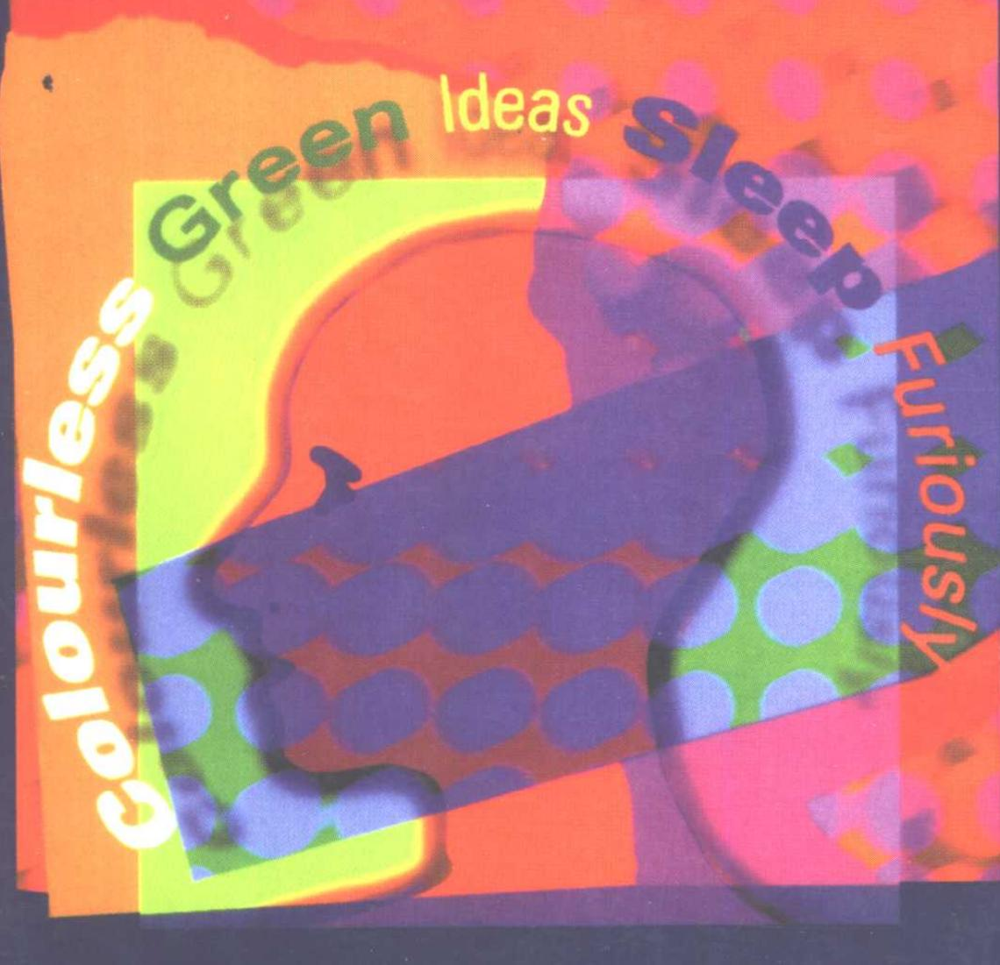
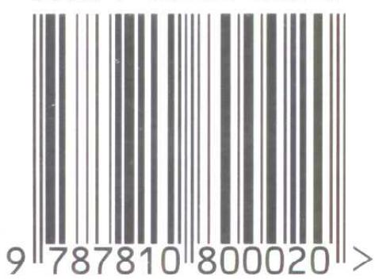
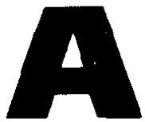
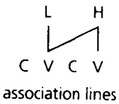
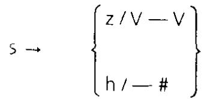
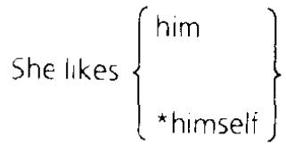
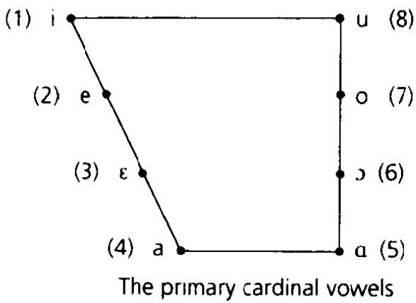
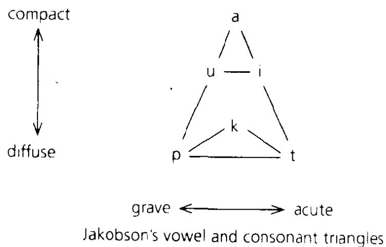
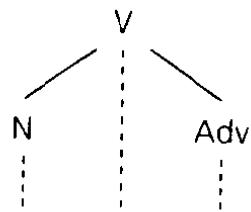

# OxfordCONCISE DICTIONARY OFLINGUISTICS牛津语言学词典

## 牛津语言学词典

牛津英语百科分类词典系列

Reference books from Oxford are renowned the world over for their quality, authority, and reliability.

本词典是最新、最权威的语言学词典之一，由剑桥大学语言学教授PeterMatthews编写。本词典收词全面，涵盖了整个语言学领域，释义准确精炼，是所有对语言和语言研究感兴趣的读者所必备的一部理想和实用的词典。

收录语音学、形式语义学等各领域中的3000多个词条

涉及英语语法术语和其他语言中的语法范畴

包括世界各语系和主要语言

涵盖语言理论及语言历史

介绍语言学界重要人物及其思想

ISBN 7-81080-002-7

定价:17.50元

# Oxford Concise Dictionary ofLinguistics牛津语言学词典

P. H. MATTHEWS

# Oxford Concise Dictionary of Linguistics

P. H. MATTHEWS

## 图书在版编目（CIP）数据

牛津语言学词典：英文/（英）马修斯（Matthews，P. H. ）

编．—上海：上海外语教育出版社，2000

(牛津英语百科分类词典系列)

书名原文：Oxford Concise Dictionary of Linguistics

ISBN 7-81080-002-7

I. 牛… ⅡI. 马… III. 语言学-词典-英文 Ⅳ. H0-61

中国版本图书馆CIP数据核字（2000）第74404号

图字：09-1999-311号

出版发行：上海外语教育出版社

（上海外国话大学内）邮编：200083

电 话：021-65425300（总机），65422031（发行部）

电子邮箱：bookinfo@sflep.com.cn

网 址：http://www.sflep.com.cnhttp://www.sflep.com

责任编辑：梁泉胜

印 刷：常熟市印刷八厂

经 销：新华书店上海发行所

开 本：850×10921/32 印张13.25字数454千字

版 次：2000年12月第1版2000年12月第1次印刷

印 数：3000册

书 号：ISBN7-81080-002-7/H·002

定 价：17.50元

本版图书如有印装质量问题，可向本社调换

Oxford University Press, Great Clarendon Street, Oxford OX2 6DP Oxford New York

Oxford is à registeréd trade mark of Oxford University Press

Published in the United States by Oxford University Prtess Inc., New York

© Oxford University Press 1997

All rights reserved. No part of this publication may be reproduced,   
stored in a retrieval system, or transmitted, in any form or by any means, without the prior permission in writing of Oxford Üniversity Press.   
Within the ÚK, exceptions are allowed in respect of any fair dealing for the purpose of research or private study, or criticism or review, as permitted under the Copyright, Designs and Patents Act, 1988, or in the case of reprographic reproduction in accordance with the terms of the licences issued by the Copyright Licensing Agency. Enquiries concerning   
reproduction outside these terms and in other countries should be   
sent to the Rights Department, Oxford University Press,   
at the address above.

This book is sold subject to the condition that it shall not, by way of trade or otherwise, be lent, re-sold, hired out or otherwise circulated without the publisher's prior consent in any form of binding or cover other than that in which it is published and without a similar condition including this condition being imposed on the subsequent purchaser

British Library Cataloguing in Publication Data Data available

Library of Congress Cataloging in Publication Data   
Matthews, P.H. (Peter Hugoe)   
The concise Oxford dictionary of linguistics / P. H. Matthews. (Oxford paperback reference)   
1. Linguistics—Dictionaries. I. Title.   
P29.M34 1997 410 '.3-dc2197-12848   
ISBN0-19-280008-6(pbk.)

Published by permission of the Oxford University Press

Licenced for sale in the People's Republic of China only, not for sale elsewhere.

本词典(重印本)由牛津大学出版社授权出版

仅供在中华人民共和国境内销售。

## 出版说明

随着改革开放的不断深入以及国际交流的日趋广泛，外语学习已经不仅仅局限于语言技能的培养。通过英语获取专业知识、提高专业水平、跟踪学科的最新发展已经成为时代的要求。因此，目前国内急需一批用英语编纂的专业词典。

牛津英语百科分类词典系列是由牛津大学出版社组织编纂的一套工具书。该系列涉及语言学、文学、文化、艺术、社会学、数学、物理学、化学、生物学、医学、食品与营养、计算机等社会科学和自然科学门类近百种，均由造诣很深、经验丰富的专家撰写。作为第一批，我们从中精选了52本，以满足国内读者的需要。词典用浅显的英语，精确地解释了常用的专业词汇，充分体现了牛津大学出版社在出版工具书方面严谨的传统。

该系列词典可作为大专院校各专业的学生以及专业技术人员学习专业知识、提高专业英语能力的参考书。

本社编辑部

## Introduction

This is a ‘concise dictionary' and it is ‘of linguistics'. What should such a book be like and what should it include?

Linguistics is defined in general dictionaries as ‘the science of language' or 'the scientific study of language'. In the more cautious wording of The New Shorter Oxford English Dictionary, it is 'the branch of knowledge that deals with language'. But although it is the only academic discipline that deals with language alone, and there are aspects of language that it alone is concerned with, its practitioners cannot claim a monopoly of the whole of their subject matter. A range of other disciplines, from the study of literature to computer science, deal with language in one way or another, and the boundaries between them and linguistics are not fixed. It would indeed be a pity if they were. How far into these should the entries in this dictionary go?

Let us start from the centre and work outwards. Everyone will agree that grammar, in a wider or narrower sense, is part of linguistics: in its widest sense, it includes both the study of the structure of words and of syntactic constructions, and that of sound systems. In the second half of the twentieth century these fields have seen an explosive development of technical theory, and a great deal of this dictionary is taken up with it. Everyone will agree that linguistics is concerned with the lexical and grammatical categories of individual languages, with differences between one type of language and another, and with historical relations within families of languages. These are potentially bottomless pits, and strict limitations are needed to avoid falling into them; but I hope I have included what users will judge to be important. Many languages are both spoken and written, and although the nature and history of writing systems are not always covered in university courses in linguistics, it is hard to see in what other dictionary one might expect to look them up. Apart from the details of individual systems and the technicalities of their description, there are also issues of general theory that belong to linguistics alone: that of change in language is one of them. But beyond this there are problems, and it has to be acknowledged that in a number of cases, involving both single entries and classes of entry, I could have decided differently.

Should I, for example, have included entries for parsing strategies in computational linguistics? The name of this field suggests that it is a branch of linguistics and certainly, once upon a time, it was. But it has increasingly become a part of computer science, addressing problems of its own that do not bear, and quite properly are no longer claimed to bear, on the nature of language as such. I have therefore asked myself whether someone whose interests are centred on the topics that linguists must know about is any poorer, as a linguist, for not

knowing this field as well, and, after some soul-searching, have drawn in my net accordingly. The same test has been applied to other aspects of language or speech processing, and to much of, for example, the traditional terminology of rhetoric. It also applies to the study of methods in language teaching, which, as part of what is conventionally called 'applied linguistics', again appears, at first sight, to belong to our subject. But we are past the days when this was seen as literally an application of linguistics, and linguists in general do not still expect to gain many insights from it. A further test wás whether, in drafting an entry, the terms on which a definition would rest are themselves terms in linguistics or in à field that is clearly separate. A dictionary of linguistics cannot systematically include things that belong to computer science in general, or to acoustics, or to anatomy or physiology, or to general psychology or the social sciences, even when, as terms in neighbouring subjects, they are used by linguists in some branches of their own. But it would frustrate the reader if other entries were then to take them for granted. In some cases this has forced me to cut corners: something must be in and, even if its explanation has to be less precise than a technical definition would be, it may at least be possible for readers who need the relevant entry to get some help from it. In other cases even circumlocution has failed and, where the term is marginal, I have judged it safer to leave it out

The need to cut corners was most pressing in some areas of phonetics and of semantics. Acoustics is not in general part of linguistics; nor, at least as I conceive it, are topics such as the anatomy of the larynx. But some specific terms in acoustics are, and the distinctions between different types of phonation, which is à hard enough topic in our present state of knowledge, might be made more precise if anatomical detail could be assumed. Philosophy and logic are not part of linguistics either, but the literature on semantics is full of terms that derive from them. Many have a long history and are not univocal; sometimes their use by linguists reflects this only in part; sometimes, as linguists have borrowed them, their senses have slid yet further. But since they do belong to another discipline, a dictionary of linguistics sometimes cannot do more than pick up a fag end. It is perhaps in this area that I feel least happy with the solutions I have at times been driven to.

In the centre of the subject it is, of course, much easier both to lay down principles and to apply them. Since this is a dictionary, it does not include entries that are purely encyclopaedic. Since it is a concise dictionary, my aim has been to explain as many things as possible and as briefly as possible, not, as might be done in another kind of dictionary, to cover less but cover it more expansively. But some things have to be left out. There must, for example, be entries for some individual languages: those that have speakers safely into the millions, those that are important in the history of scholarship, those that, quite simply, the majority of those who wili buy this book will feel

they should be able to look up. But most languages meet none of these criteria and, however one counts, they are well in the thousands. There should, I believe, be notes on individual scholars, some of them still living. But which? I have tried to limit such entries to people who are cited for their contribution to general linguistics, as opposed to the study of a particular language or family. But if I had relaxed that test the list could have gone on and on. There must also be entries for schools, or for the competing models of syntax, phonology, and so on that tend to define schools. Where these are more than one-man bands they are, I hope, in. But both schools and individual scholars also tend to develop specialized terminology, both new terms and altered senses of old ones. These sometimes pass into general currency and then, of course, they must be included. But where they remain peculiar to a specific model, and are not needed in the entry that explains the model itself, I have had to leave them out. If I had not, the dictionary would again have been much larger.

There must also be limits on what certain classes of entry contain. Under the headings for individual languages, I have said at the least where they are spoken and what family, if any, they are known to belong to. But I have not in general said how many people speak them, and in most cases I do not think this information can be given without reference to surveys at specific dates and the specific evidence and criteria that they used. That is more than a concise dictionary can or should do. I have also refrained from saying anything about their structure: it would, for a start, take more space than can be spared. In the entries for grammatical categories, I have given concrete illustrations where they can be drawn from languages with which a substantial body of readers will be familiar. These naturally tend to be European. Where this cannot be done the illustrations are schematic. I had not at first intended that they should be and, in failing to decorate some entries in this way, I still feel rather as my wife would if she were forced to go to town without make-up. But decoration is, in reality, all it would be. A monograph or textbook must, of course, supply specific evidence that a category exists. But a dictionary need not and cannot. Its job is simply to make clear how the term is used, and a concrete illustration will at best get in the way if it comes from a language which few readers know and whose general structure is unfamiliar. At worst, there was a danger that I would misunderstand my source or use one that was itself wrong and, without references, no one might know what it was. I would like to feel that, if there are mistakes, they are unequivocally my own.

The rest is mainly a matter of style. In line with other Oxford dictionaries, I have used an asterisk to point to related entries: although its uses in linguistics are for other purposes, I do not think that, in practice, this will cause confusion. Where I refer to scholars for whom there are also entries, I have used their surname without initials, with a first name in brackets where necessary: thus 'Chomsky'

## Introduction

or '(Daniel) Jones'. Where an abbreviation is common I have given an entry for it, unless it immediately precedes the term it abbreviates: thus 'ABs = absolutive'. The abbreviation 'cf.' means, as usual,

compare'; I have also used an ad hoc abbreviation ‘opp.' to indicate a term which is the opposite of the one defined: thus bound . . . Opp. free'. Where a term is used in two or more related senses I have distinguished them within an entry: thus substratum. 1... . 2. . . But where senses are effectively unrelated I have separated the entries: thus 'head (1)' and 'head (2)'. When a definition begins with words in round brackets, they generally indicate what an adjective or the like is used of: thus 'consecutive. (Clause, etc.) indicating . . .'. In giving examples, I have indicated stress or emphasis, where necessary, by putting a syllable in small capitals; thus 'I need the HAmmer' (not e.g. the screwdriver). These are often preceded by an accent which gives a rough indication of the intonation: thus He's coming' (with the pitch falling from ‘co' onwards), 'He's not ‘coming' (with the pitch rising). 'Is he "coming?' (fall followed by a rise). Other conventions, e.g. in the use of italics, follow what is now general practice.

Finally, I have included pronunciations (in the IPA transcription used in The New Shorter Oxford English Dictionary) only when I thought that readers might be in doubt. For a dictionary of this kind to include them throughout did seem otiose.

## Acknowledgements

A book like this can only be written by one person. If I had had to plan it as an editor, I would have allotted too much space to some entries and too little to others, and individual contributors might in any case have overshot my instructions, even when I was right. But one person cannot be a specialist in the whole of linguistics and, in the fields one thinks one knows, one can make strange mistakes. I am therefore very grateful to all those who have helped me: in particular, at the beginning of the project, to Francis Nolan, Stephen Levinson, and Nigel Vincent, who vetted my original list of headwords, and, at the very end, to Nigel Vincent once more and to Jim McCawley, who read through a complete draft. McCawley especially supplied comments and corrections with a thoroughness and understanding quite beyond the call of duty.

I am grateful to Angus Phillips of the Oxford University Press, for his advice and patience. I have also been fortunate in my copy-editor, Margaret Aherne, who has done extremely well a job that requires many kinds of vigilance simultaneously. My wife, Lucienne Schleich, has commented from a user's viewpoint on the wording of many entries, and has helped me very much to develop the right style. She has also had to put up with my tantrums when, at times, the project has been driving me round the bend: without her love and encouragement I would not have finished it.

December 1996

P.H.M.

## Directory of Symbols

Symbols and other forms of notation are explained in entries headed by their names: for example, for the uses of ‘[]', see the entry for square brackets'. The complete list is as follows.

<table><tr><td>FOR</td><td>SEE</td><td>FOR</td><td>SEE</td></tr><tr><td></td><td>acute</td><td>a, b, ...</td><td>italics</td></tr><tr><td>&lt;&gt;</td><td>angled brackets</td><td>λ</td><td>lambda operator</td></tr><tr><td>→, ← ★</td><td>arrow</td><td>μ</td><td>mu</td></tr><tr><td></td><td>asterisk</td><td>十</td><td>plus sign</td></tr><tr><td>{}</td><td>bar, macron</td><td>?</td><td>question mark</td></tr><tr><td></td><td>braces</td><td>()</td><td>round brackets</td></tr><tr><td>Λ</td><td>breve</td><td>σ</td><td>sigma</td></tr><tr><td></td><td>circumflex</td><td>1</td><td>slash</td></tr><tr><td></td><td>dash</td><td>A, B, . . .</td><td>small capitals</td></tr><tr><td>#</td><td>double cross</td><td>11</td><td>square brackets</td></tr><tr><td>!</td><td>exclamation mark</td><td>&gt;, &lt;</td><td>tailless arrow</td></tr><tr><td>3</td><td>existential quantifier</td><td>, ~</td><td>tilde</td></tr><tr><td></td><td>grave</td><td>A</td><td>universal quantifier</td></tr><tr><td>α. β....</td><td>Greek letter variables</td><td>1 11</td><td>vertical line</td></tr><tr><td></td><td>hyphen</td><td>0</td><td>zero</td></tr></table>

## Contents

Introduction vii   
Acknowledgements xi   
Directory of Symbols xii

The Concise Oxford Dictionary

of Linguistics 1

A. 1. = adjective. 2. = agent (2); cf. P, S (3). 3. = argument, as \*A-bound.

abbreviated clause = reduced clause.

abbreviation. See acronym; blend; clipping.

abbreviatory convention. Any convention which allows a \*generative grammar to be shortened by collapsing two or more rules into one. E.g. a phrase-structure rule A' → A + Comp (a constituent within an adjective phrase can consist of an adjective plus a complement) can be combined with a rule A' → A into the single expression A' → A (Comp). By the relevant convention ‘A (Comp)' is understood as 'either A or A + Comp'.

The abbreviated expression is technically a \*rule schema.

abduction. Process of reasoning by which, e.g. from 'All dogs bark' and 'This animal barks', one draws the conclusion ‘This animal is a dog'.

Central, in one view, when people develop their native language. E.g. they may learn that if a noun has the ending -s it is plural: so, as one premiss, 'All noun forms in -s are plural'. They may then want to use some noun in the plural. Call the form required f: so, as a second premiss, 'f is plural'. By abduction, the conclusion will be 'f is a form in -s': therefore, all else being equal, a form in -s is what they will use. In this process of reasoning the conclusion does not necessarily follow: thus the noun in question might have a plural that does not end in -s. But as the result of it the language may change, with -s generalized to nouns that did not previously have it.

Abductive change is change due, it is claimed, to abduction. Abduction as a process of reasoning was distinguished by Peirce, who stressed its role in human life in general.

abessive. \*Case indicating that someone or something is absent: e.g. schematically, I came money-AßEss 'I came without money'. From Latin abesse ‘to be away, be absent'.

Abkhaz. North West \*Caucasian language, spoken between the west end of the Caucasus Mountains and the coast of the Black Sea.

ablative (abL). \*Case whose basic role, or one of whose basic roles, is to indicate movement away from some location: thus Latin cedit Romā ('departed Rome-ABLsG') 'He left Rome'.

ablative absolute. \*Absolute construction in Latin in which a participle and its subject are in the ablative case and are subordinated, with no other mark of linkage, to the rest of the sentence: e.g. in the sentence urbe capta '(the) city-ABLsG having-been-taken-ABLsG' Caesar recessit 'Caesar withdrew'.

ablaut. Morphological variation, in Germanic and other \*Indo-European languages, of a root vowel. E.g. in Ancient Greek the root of the verb 'to leave' appeared in three forms: leip- in the present; loip, in the perfect or in the adjective loipós 'left over'; lip-, in the aorist or as the first member of compounds. This illustrates the three original 'grades' of ablaut: the e grade, the o grade, and the zero or reduced grade, with neither e nor o.

Similarly, in English, of vowel variations in \*strong verbs (e.g. drive, drove, driven) or between verbs and nouns (sing, song), whether or not they derive directly from the Indo-European system.

A-bound. \*Bound (2) by an element in the normal syntactic position of a subject or other \*argument of a verb. E.g. in I saw myself, the reflexive myself is A-bound by its antecedent I.

A term in \*Government and Binding Theory, where it is claimed that some elements, like reflexives, must be A-bound. Other elements need not be: when they are bound by an antecedent not in such a position they are said to be ‘À-' or 'A'-bound'.

abrupt. \*Distinctive feature in the scheme proposed by \*Jakobson. Characterized acoustically by ‘a spread of energy over a wide frequency region': thus, in particular, a feature of oral stops as opposed to fricatives. Also called 'discontinuous' or 'interrupted': opp. continuant.

ABS = absolutive.

absolute. (Syntactic element) not accompanied by an element to which one might expect it to be linked. E.g. in This is bigger, bigger is an absolute comparative, not linked, as other comparatives are, to a standard of comparison (bigger than . . . ); in His is bigger, his is similarly an absolute possessive, not linked, as possessives in general are, to a noun (his garden, his kitchen. . . . ). An absolute case, e.g. in Turkish, is so called because it is realized by a root alone, unaccompanied by an affix.

An absolute construction is one in which a subordinate element is not linked by a conjunction or in any other specific way to the rest of a sentence. E.g. in We left, the wine having run out, the last five words stand in an absolute relation to we left: cf. We left because the wine had run out (with the conjunction because), or We left, having finished the wine (with a direct relation between having and we).

From Latin absolutus freed from linkage'

absolute neutralization. Term in \*Generative Phonology for the suppression in all contexts of an underlying difference between

elements. E.g. in a language with \*vowel harmony, a single open vowel might relate sometimes to front vowels and sometimes to back vowels: a distinction might therefore be established between a front ‘a' and a back ‘a', which undergoes absolute neutralization after the rules for harmony have applied.

absolute synonymy. See synonymy.

'absolute universal'. A \*linguistic universal that is genuinely universal: i.e. that holds for all languages, without exception. Opp. relative universal, statistical universal.

absolutive (ass). \*Case which identifies both the \*patient in a basic transitive construction and a single argument or valent in an intransitive. E.g. schematically, men bread-Aßs ate The men ate the bread'; bread-Aßs disappeared ‘The bread disappeared'. The \*agent in the transitive construction will then be \*ergative: bread-ABs ate men-ERG. The case is called ‘absolutive' because, in many languages, it is distinguished by the absence of an affix.

Thence in general of syntactic elements that unite the same roles, whether or not the language has cases

'absorption'. 1. Used variously of phonological changes or processes in which one element is seen as incorporated in another. Thus 'tonal absorption' is a process in some languages of West Africa by which the ending of a \*contour tone (rising , falling ) is ‘absorbed' by a following syllable whose tone is at the same level: rising  plus high → lowplus high ; falling  plus low→ high  plus low \`. Cf. fusion. 2. Process in which a case or case role is assigned to one element in a construction and can then no longer be assigned to another.

abstract. (Structure, representation) which differs from that which is most transparent. E.g. the representation of righteous as 'rixt-i-s', proposed at an underlying level in \*Generative Phonology at the end of the 1960s, is more abstract than one which corresponds closely to a phonetic transcription [raitfəs]. Similarly, a representation of the syntax of a sentence is more abstract the more the order in which the words are arranged and the units and categories to which they are assigned differ from their order and potential grouping in speech.

Since the end of the 1960s most linguists have tried to put restrictions on the degree of abstractness that their models will permit: e.g. to exclude representations such as rixt-i-əs'. But it has been hard to propose firm limits that all will accept; hence in phonology a long-standing abstractness controversy.

abstract noun. One which denotes an abstract state, property, etc.: e.g. love, happiness. Opp. concrete.

Acc = accusative.

## Accadian = Akkadian.

accent (1). A phonological unit realized by auditory prominence, especially within a word. E.g. in morning the first syllable is perceived as more prominent than the second: in phonetic transcription, ['m⊃:nın]. This distinguishes it as the accented syllable, or the one that carries the accent'. Originally of \*pitch accents in Ancient Greek; thence of \*stress accents, e.g. in English; thence also applied to peaks of prominence in larger units, such as sentences. E.g. in He'll talk to ‘ME ('to me, not someone else'), the ‘sentence accent', or \*sentence stress, falls on me.

The accents in writing, as in French père, bête, céder, originally distinguished pitches in Greek, the acute a high pitch, the circumflex a falling pitch, the grave a low pitch. But they have since been used for many other purposes, to distinguish length or quality of vowels, different consonants, homonyms, and so on, with others added in the spelling of various languages.

accent (2). A variety of speech differing phonetically from other varieties: thus, as in ordinary usage, ‘a Southern accent', 'Scottish accents'. Normally restricted by linguists to cases where the differences are at most in phonology: further differences, e.g. in syntax, are said to be between \*dialects.

acceptable. (Sentence, etc.) which native speakers will not see as contrary to usage. Often = grammatical (2), but many scholars insist on a distinction, drawn by Chomsky in the 1960s, between the acceptability of a sentence, taken as a datum, and its conformity to the rules of a specific grammar. Thus a sentence like The man the girl your son knew saw arrived may be unacceptable to speakers. But its structure conforms to general rules that may be posited for \*relative clauses: the man [the girl [your son knw] saw] . . . So, by hypothesis, it is grammatical, and its unacceptability must be explained by other factors, such as the difficulty of keeping track of it in short-term memory.

accessibility scale. A scale of elements or categories in order of diminishing applicability of some type or types of process. E.g. in English, a direct object (DO) can generally be made the subject of a passive: Harry saw them → They were seen by Harry. So can an indirect object (lO), but with more restrictions and exclusions. So too a locative (Loc), but with even more restrictions and exclusions. These elements can thus be said to form a scale: DO > IO > Loc, where x > y means that x is more open to the process.

Similar scales are oten formulated across languages: e.g. the \*NP accessibility hierarchy.

'accident'. Ancient term for a variable property of words belonging to a specific \*part of speech. Accidents included categories of inflection: e.g. \*number and \*case as variable features of nouns. They also included any other feature that might vary: e.g. the ‘quality' of nouns (lit. their 'what-sort-ness') was an accident initially distinguishing \*proper nouns from \*common nouns.

Later used especially of categories of inflection: hence accidence' is in effect an older term for \*inflectional morphology.

Accommodation Theory. Branch of \*sociolinguistics concerned with the adjustments made by speakers in adapting or 'accommodating' their speech in response to that of interlocutors who, e.g., are speakers of another dialect.

accusative (acc). \*Case whose basic role, or one of whose basic roles, is to mark a \*direct object. E.g. in Latin vidi Caesarem ‘I-saw Caesar', the object Caesarem has the accusative singular ending (e)m.

The term derives from a mistranslation into Latin of a Greek term that was already obscure. There is and was no connection with accusing.

accusative and infinitive. Construction in Latin in which an indirect statement was marked by a verb in the infinitive whose subject was in the accusative: e.g. in Díxít Caesarem venisse he-said Caesar-Accsc had-come-InF' (He said that Caesar had come'). Extended to formally similar constructions in other languages: e.g. in English (He told) me to come.

'accusative language'. One which has a \*nominative and an \*accusative case, or which distinguishes subjects and objects in an equivalent way. E.g. English: thus, in The boy saw her and The boy smiled, the role of the boy as subject is distinguished by its position from its role as object in She saw the boy.

Coined in opposition to ‘ergative language': see also active language.

Achinese. \*Austronesian language spoken at the northern end of Sumatra. Also 'Achehnese'.

'acoustic image'. See linguistic sign.

acoustic phonetics. The study of the physical properties of the sounds produced in speech. Opp. articulatory phonetics.

'acquired'. (Speech disorder) resulting from disease or injury to the brain, in someone who did not show it before. Thus \*aphasia is by definition ‘acquired'; \*dyslexia, as usually defined, is not ‘acquired'.

acrolect. Variety of a language which, of a series of varieties spoken predominantly at different social levels, has the highest prestige or is closest to a standard form. Especially in studies of \*creoles: e.g. of the varieties spoken in Jamaica the acrolect has the fewest creole features and is thus most similar to standard English elsewhere. Opp. basilect, mesolect.

acronym. A word formed from the initial letters of two or more successive words: e.g. ASH, phonetically [af], from ‘Action on Smoking and Health'. Sometimes taken to include abbreviations where the letters are spelled out: e.g. EU, pronounced [i: ju:].

ACr = active.

actants. Used by L. Tesnière, and thence occasionally in English, for the elements in a clause that identify the participants in a process, etc. referred to by a verb. Thus, in French or English, a subject, direct object, and indirect object.

action noun. A derived noun whose formation has the general meaning 'act or process of ... ': e.g. construction (from construct + -ion), with the basic meaning 'process of constructing'. Cf. agent noun.

active (1) (acr). (Construction, sentence) in which a verb has a \*subject which is characteristically the role filled by an \*agent rather than a \*patient. Thus the agent my wife is the subject in the active sentence My wife cut the grass. Also (and more traditionally) of the form of verb in such a construction. Thus cut is an active verb and, in e.g. the woman cutting the grass, cutting is an active participle.

Opp. passive. In older usage verbs were active' only if they had a corresponding passive. Thus cut would be active since there is a passive in e.g. The grass was cut. If a verb was active in form but had no corresponding passive it was called ‘neuter'. Thus a verb like appear is traditionally neuter.

active (2). (Vocabulary) that a speaker uses, as opposed to passive vocabulary, that is known but not used. Likewise active knowledge of a language is knowledge that enables one to speak it, as opposed to passive knowledge, which enables one to understand it.

active articulator. See articulator.

'active language'. One which has two basic \*intransitive constructions. In the first the noun is identified by its case or otherwise with the \*agent in a \*transitive construction: this might be so, in particular, when it is itself notionally an agent. In the second it is identified with the \*patient in a transitive construction. Thus, in the transitive, the agent and patient might be marked as nominative vs. accusative: schematically, Mary-Nom kissed Sarah-Acc 'Mary kissed Sarah'. An intransitive would then have variously the nominative or the accusative: e.g. Mary-Nom left, where Mary is an agent or is relatively animate in terms of an \*animacy hierarchy, but The tree-Acc fell, where the tree is not an agent or is minimally animate.

Also called ‘split intransitive'. Distinguished from an \*ergative language, in which the noun in the intransitive is identified throughout with a patient in the transitive construction, and an \*accusative language, in which it is identified throughout with an agent.

actor. Sometimes in a sense equivalent to \*agent (1). Alternatively, agents as linguistic elements may be distinguished from ‘actors' as the individuals in the world that they refer to.

'actualization' = realization.

actuation. The way in which changes in a language are initiated. The 'actuation problem'is accordingly that of explaining why a specific change began in a specific language or dialect at a specific time, and as such is distinguished, in many theories, from the problem of 'implementation', or transmission of the change across a community of speakers.

acute. 1. Diacritic () originally and still used, in descriptions of \*tone languages, to represent a high pitch: see accent (1). Also, in accounts of intonation, to represent a rise in pitch. 2. \*Distinctive feature of both consonants and vowels proposed by Jakobson in the 1950s: e.g. in English front vowels are acute, as are dental and alveolar consonants. Defined acoustically by a relative concentration of energy in higher frequencies. Opp. grave; see also compact.

adaptation. The process by which \*loan words are changed to fit the sound patterns of the language into which they are borrowed. Often progressive or otherwise a matter of degree: e.g. of the several pronunciations of garage, [gə'ra:z] is least adapted from its source in French, while ['garıdz] is fully adapted.

'additive bilingualism'. \*Bilingualism in which a \*second language is acquired without detriment to the first. Used e.g. of the learning of French by English speakers in Canada: that of German and French by speakers of Luxembourgish or of standard German by speakers of Swiss German also seem to fit the definition. Contrasted with \*subtractive bilingualism.

address. See forms of address.

addressee. The normal term for a person to whom someone else (the speaker) speaks or‘addresses' an \*utterance. Cf. hearer.

addressee-controlled honorific. See honorific; polite form

Adelung, Johann Christoph (1732-1806). Student of German, important in the history of general linguistics for his last project, Mithridates, which compiled information, including versions of the Lord's Prayer, on all languages then known to European scholarship.

## adequacy

Published by Adelung and J. S. Vater in four volumes (1806-17), with the contents arranged geographically: the final survey of its kind in the period before the triumph of \*comparative linguistics.

adequacy. See levels of adequacy.

adessive. \*Case indicating position adjacent to an object, etc. E.g. schematically, Book-ADess red cover ‘The book has (i.e. has adjacent to it) a red cover'.

adhortative = exhortative.

Adj = adjective.

adjacency. The usual term in linguistics for 'position next to'. Thus various forms of ‘adjacency principle' are principles by which elements that are syntactically related cannot be, or tend not to be, separated.

adjacency pair. Two successive utterances by different speakers, where the second is of a type required or expected by the first. E.g. a question followed by an answer; a greeting followed by a greeting in return.

adjective. A word of a class whose most characteristic role is as the modifier of a noun: e.g. in tall men, tall is an adjective modifying men. Hence typically understood as referring to properties (thus in this case that of being tall) not essential to whatever is denoted (in this case all possible men) by the noun. Adjectives were seen in antiquity as a distinct subclass of nouns, added or adjoined to (ad-') others; as such they were sometimes said to have a role parallel to that of adverbs in their relation to verbs. They were distinguished as a separate \*part of speech ('noun adjective' vs. noun \*substantive') in the later Middle Ages, and are often, in the modern period, seen either as sharing properties with verbs or as intermediate between verbs and nouns.

An adjectival element is one either associated with or having the role of adjectives: e.g. -less in clueless is an adjectival affix; English \*participial adjectives in -ed, such as interested in very interested, are sometimes called ‘adjectival passives'.

adjective clause = relative clause: i.e. its role in a noun phrase, like that of adjectives, is as a modifier of the noun.

adjective phrase. A \*phrase (1) whose \*head (1) is an adjective: e.g.   
very tall in [very tall] men, whoșe head is the adjective tall.

adjunct. 1. Any element in the structure of a clause which is not part of its \*nucleus (1) or core. E.g. in I will bring it on my bike tomorrow, the nucleus of the clause is I will bring it; the adjuncts are on my bike and tomorrow. Opp., e.g., complement (1). 2. Used by Quirk et al., \*CGE of a range of \*adverbials including those of manner, place, and time: e.g.

carelessly, in the dustbin, and yesterday are adjuncts in I put it carelessly in the dustbin yesterday. Different in part from adjuncts as defined in sense 1: e.g. in this last example, in the dustbin would be part of the nucleus.

The term was originally introduced by Jespersen, for the \*secondary element in a \*junction. But it is no longer in general use in that sense.

adjunction. 1. Any operation, especially in syntax, by which an element is added next to another. E.g. in who have you met?, who is sometimes seen as adjoined, by \*wh-movement, to the remainder of the sentence: [who [have you met]]. 2. Specifically, in terms of \*X-bar syntax, of an operation by which, when A is adjoined to B, the two together form a unit whose category is in turn that of B. E.g. if B is a \*CP, the adjunction of A will form a larger unit, {A [B] ]. which is also a CP. Adjunction in this sense is allowed in \*Government and Binding Theory only when B is a \*maximal projection (in this case of C); the structure that results is an adjunction structure.

\*Chomsky-adjunction and \*sister-adjunction are types distinguished in earlier transformational grammars.

adnominal. (Word, etc.) directly depending on a noun. Thus, in the girl singing, the participle singing depends on girl; a participle is accordingly, in some accounts, an adnominal form of a verb.

adposition. Cover term for \*prepositions and \*postpositions. The sense is that of an element positioned ‘next to' (ad-'), whether before ("pre-") or after ('post-’).

adstratum. A language which has influenced one spoken by a neighbouring population. Thus in the modern period French has been an adstratum in the development of English. Cf. substratum; superstratum.

Adv = adverb.

Advançed RP. See Received Pronunciation.

Advanced Tongue Root. A distinctive feature of vowels e.g. in many West African languages. Abbreviated [± ATR]: in the production of vowels that are [+ ATR] the tongue is drawn forward so that the space between the tongue root and the back of the throat is widened; in vowels that are [- ATR| the tongue is retracted so that this space is narrowed.

Often described as ‘tense'vs. 'lax' before the nature of the distinction was made clear.

advancement = promotion.

'advantage'. See dative of advantage.

adverb. A word of a class whose most characteristic role is traditionally that of modifying a verb or verb phrase: e.g. badly in He wrote it badly, where (in different accounts) it modifies either wrote or the phrase wrote it.

One of the \*parts of speech established in antiquity. In the grammar of English and many similar languages, an adverb is effectively a word that modifies anything other than a noun. Thus badly as above; certainly in Certainly I'll come, where it modifies I'll come; highly in highly inflammatory, where it modifies inflammatory; nearly in nearly there, where it modifies another adverb there. The reasons for lumping these roles together are (a) that they are often served by words of the same form (e.g. words in -ly), (b) that the same words often serve two or more of them.

adverbial. (Syntactic element) whose role is one served by adverbs. Thus on Monday is an adverbial phrase, or an adverbial, in I'll do it on Monday: cf. I'll do it tomorrow, with the single adverb tomorrow. Likewise when I'm ready is an adverbial clause in I'll do it when I'm ready.

adverb phrase. A \*phrase (1) whose \*head (1) is an adverb: e.g. very badly, headed by badly, in I sing very badly.

adversative. Usually of a form or construction marking an \*antithesis: e.g. but is an adversative conjunction in I'll try, but it may not work.

aerometry. The measurement of air flow, e.g. in the production of speech. The techniques used in phonetiçs involve the insertion at appropriate places in the vocal tract of instruments which measure a drop in air pressure across a resistance, which is directly related to the rate of flow.

affected object. The \*direct object of a verb denoting an action, etc. which affects individuals or things already in existence. Thus the silver is an affected object in I polished the silver, since silver exists before it is polished. Opp. effected object.

'affection'. Older term for the effect of one sound on another that precedes or follows: cf. assimilation; coarticulation.

affective. (Function, meaning) having to do with a speaker's feelings. E.g. one might say, as a neutral statement, 'I have finished it'; or one might say, with triumph or amazement, 'I have ‘Actually 'Finished it'. What is śaid is in other respects the same, but the utterances differ in āffeçtive meaning. Likewise intonations or words like actually have, or have at times, an affective function.

Also called ‘emotive', 'expressive'. Opposed variously to \*cognitive meaning, \*propositional meaning, or to the representational or referential \*function of language.

affirmative. (Sentence, form, construction) by which one asserts what is, as opposed to what is not, the case. Opp. negative; also, by implication, to interrogative, imperative, etc.

affix. Any element in the morphological structure of a word other than a \*root. E.g. unkinder consists of the root kind plus the affixes unand -er. Hence affixation, for the process of adding an affix. Also affixal: thus un- in unkind is an affixal element, and the formation of unkind is that of an ‘affixal negative'.

Affixes are traditionally divided into \*prefixes, which come before the form to which they are joined; \*suffixes, which come after; and \*infixes, which are inserted within it. Others commonly distinguished are \*circumfixes and \*superfixes.

'affix hopping'. Rule posited in \*transformational grammar in the 1950s by which elements realized by affixes of verbs in English are placed in affixal position. E.g. Jim left is assigned an underlying structure Jim PAst leave, where PAst is syntactically an auxiliary. To derive the actual or surface structure, PAst hops over' leave and is attached as a suffix to it: Jim leave-PAsT.

affricate. A \*stop consonant released with a \*fricative at the same place of articulation: e.g. [tf] (written ch) in chip.

African languages. Currently classified, for convenience or as a working hypothesis, into four main groups. \*Afro-Asiatic, across North Africa, the Sahara, and the adjacent Near East, includes, as its largest member, \*Arabic. A \*Khoisan group includes a minority towards the southern tip of the continent. The other two are much more speculative. 'Nilo-Saharan' is an attempt to group together \*Nilotic languages with others spoken between the upper Nile and the Congo. 'Niger-Congo' covers all the remainder, including \*Bantu and most of the languages of West Africa.

The classification derives in part from an application of \*mass comparison by Greenberg in the early 1960s.

Afrikaans. \*Germanic, derivative from Dutch, spoken in South Africa and elsewhere in Africa by emigration. Sometimes claimed to be a Dutch-based \*creole, a claim also strongly resisted.

Afro-Asiatic. Proposed family of languages including \*Semitic and \*Cushitic; also \*Berber, \*Egyptian, and the \*Chadic languages in sub-Saharan Africa. Previously called 'Hamito-Semitic', on the assumption that Semitic forms one major branch and the others thought to belong to it form another, called 'Hamitic'.

agent. 1. Noun phrase, etc. identifying an actor or actors performing some action. E.g. Mary is an agent in Mary went out or Mary made it. 2. A syntactic category which is characteristically that of agents as opposed to \*patients. Thus the subject of a transitive construction in English has the role of agent (A) in opposition to an object as patient: Mary (A) shut the door (P). 3. The element in a passive sentence which would correspond to a subject in the active, e.g. by Mary in The car was driven by Mary: cf. active Mary drove the car.

## agentive

agentive. 1. Having the semantic role of an \*agent (1): e.g. I is agentive in I did it. 2. (Case) = ergative. 3. (Noun) = agent noun: also of a process or affix by which such nouns are formed.

agentless passive. A passive without an \*agent (3): e.g. She was promoted, as compared with She was promoted by her company, with agent by her company. Cf. reduced passive.

agent noun. A derived noun whose formation has the general meaning someone who does . . .': e.g. builder, from build + er, meaning 'someone who builds'. Cf. action noun.

agglutinating. (Language, formation) in which words are easily divided into separate segments with separate grammatical functions. E.g. in Turkish, dişçilerimin ‘of my dentists' is transparently made up of a root (diş ‘tooth') and four suffixes: -i (agentive), -ler (plural), -im ‘my', and -in (genitive).

Opp. inflecting; isolating. Agglutination is likewise the process by which such structures or this type of structure is formed.

AGR {agr] or ['agə]. A syntactic category in Chomsky's \*Principles and Parameters Theory. Originally an element within \*INFL, comprising features of person, number, and gender as opposed to those of tense. Later an independent element, or two such elements, one relating to a subject and the other to an object.

Originally an abbreviation for ‘agreement': hence the first way in which it is pronounced.

agrammatism. Form of \*aphasia in which grammatical elements are lost. The resulting speech is often described as 'telegraphic', consisting mainly of lexical items and fixed expressions; also slow and hesitant.

agreement. Syntactic relation between words and phrases which are compatible, in à given construction, by virtue of inflections carried by at least one of them. E.g. these and carrots are compatible, in the construction of these carrots, because both are inflected as plural. Likewise, in the Italian sentence Maria e Luisa sono arrivate 'Mary and Louise have arrived', sono (lit. 'be-3RdpL') agrees in respect of plural number with arrivate (arrived-FEmpl') and both, or sono arrivate as a whole, agree with a subject, Maria e Luisa, which refers to more than one woman.

Also called concord. Distinctions are drawn between \*grammatical agreement and \*notional agreement; also between agreement and some similar relations of compatibility, such as the \*government (2) of cases by prepositions. But the last of these is often at best imprecise.

AGT = agent, agentive.

airstream mechanism. Any system by which a flow of air is generated in the production of speech. Types of mechanism are distinguished by two criteria: (a) as egressive or ingressive, according to the direction of flow; (b) as \*pulmonic, \*glottalic, or \*velaric, according to the way in which the flow is initiated.

The main mechanism, and in many languages the only one that is normally employed, is breathing out. This is (a) egressive, in that air flows outwards, and (b) pulmonic, in that air is pushed out from the lungs as their volume is reduced by the contraction of the chest muscles. For other mechanisms of particular importance in speech see click; ejective; implosive.

Akan. Group of dialects or closely related languages, spoken mainly in Ghana: separately named Asante, Fante, and Akuapem (or Twi).

Akkadian. Ancient \*Semitic language spoken especially in Assyria and Babylonia. Written in \*cuneiform from about 2500 BC and by the middle of the next millennium an international language throughout the Near East. It has no modern descendant.

Also spelled ‘Accadian'.

Aktionsart. The lexical class to which a verb belongs by virtue of the type of process, state, etc. that it denotes. E.g. walking is an activity; therefore walk is an ‘activity verb'. Knowing something is a state of mind; therefore know is lexically \*stative.

The German term means ‘kind of action'; sometimes replaced in English by ‘aspectual character', 'aspectual value'. or 'semantic value'. Aktionsart is linked to \*aspect, from which some scholars would argue that it is not separate.

Albanian. Attested from the 15th century AD, now spoken throughout Albania and in the neighbouring province of Kossovo; also in pockets in Greece and southern Italy. \*Indo-European, forming a separate branch within the family.

alethic [ə'li:θik]. (Modality) opposing in particular what must logically be true to what may be true in specific circumstances. Distinguished by logicians from \*epistemic modality; but not usually, if ever, a distinct category in languages.

From the Greek word for 'true.

Alexandrians. School of scholars and scientists associated with the library of Alexandria from the early 3rd century BC. Aristarchus (c.217-145 Bc) is especially important in the history of literary and textual scholarship, and it is within this tradition that earlier analyses of language, by the \*Stoics especially, developed into the discipline of grammar as it has been understood from the 1st century BC onwards. The details are uncertain, a particular problem being the authenticity of the grammar attributed to Aristarchus' pupil \*Dionysius Thrax.

alexia. Loss of a previously acquired ability to read in consequence of disease or injury to the brain. Distinguished as such from \*dyslexia.

Algonquian. Family of languages spoken or once spoken over a large part of North America, in Canada and, in the USA, especially in the Great Lakes region and the eastern seaboard. Varieties of \*Cree and \*Ojibwa now have the greatest numbers of speakers.

Also spelled 'Algonkian'.

algorithm. See heuristic.

alienable possession. Possessive construction in which the thing possessed is not an inherent part of the possessor: e.g. that of Bill's house, since a house exists independently of its owner. Opp. inalienable possession.

allative (all). \*Case whose basic role is to indicate movement to or towards some location: e.g. schematically, I-walked shop-All 'I walked to the shop'.

allegro form. A form as modified phonetically in rapid speech. E.g. I can't see him has, as one possible allegro form, [əkà'sı:m]. Likewise rapid speech is sometimes called allegro speech.

allo-. Prefix used for variant forms of any linguistic unit. Thus in general 'X-emes', e.g. \*phonemes or \*morphemes, are invariants, abstracted from and realized by alternative ‘allo-Xes', e.g. \*allophones or \*allomorphs.

allograph. A variant form of a \*grapheme: i.e. of a letter in writing seen as analogous to a \*phoneme.

allomorph. One of a set of forms which realize a morpheme: cf. morpheme (3). E.g. -[ən] in taken and -{d] in removed are among the allomorphs of the ‘past participle' morpheme.

allomorphy. \*Alternation in the forms that realize morphological or lexical units. E.g. in Latin rēgis 'king-GENsG' vs. domini 'master-GEnsG' there is allomorphy of the genitive singular ending (-is/-i); in ferō 'I carry' vs. tulī 'I carried' there is allomorphy in the root (fer-/tul-).

allophone. An audibly distinct variant of a \*phoneme. E.g. the [d] and [∂] of Spanish ['deðo] ‘finger' are allophones of the same phoneme, written d in the spelling dedo.

Thence allophonic, as in ‘allophonic variation', i.e. variation among allophones.

alpha (α). See Greek letter variables; move α.

alphabet. A writing system, strictly one in which consonants and vowels are represented equally by separate letters. Hence especially the \*Greek alphabet and its \*Roman and other derivatives; but also of \*consonantal alphabets of the \*Semitic type.

alpha-syllabic. (Writing system) in which successive characters sometimes represent a single consonant or vowel, as in an \*alphabet, and sometimes a syllable, as in a \*syllabary. The type is characteristic of systems in or derived from India, such as \*Devanagari.

Altaic. A proposed family of languages, including \*Turkic,

\*Mongolian, and \*Tungusic in east Siberia.

Alternating Stress Rule. A rule of English phonology proposed by Chomsky and Halle, \*SPE which assigns stress e.g. to the first syllable of hurricane. By the 'Main Stress Rule', which applies first, 'primary stress' is assigned to the final syllable: hurricáne. By the Alternating Stress Rule, the second syllable before a primary stress also receives primary stress: húrricáne. Then, by a rule applying later, that of the final syllable is reduced.

alternation. Variation in the forms that \*realize linguistic units; hence often = allomorphy. Also a specific instance of such variation: e.g. in taken vs. removed there is an alternation in the past participle ending.

Hence alternant, one of the forms that enter into an alternation.

alveolar. Articulated with the \*tip or \*blade of the tongue against the ridge behind the upper teeth: e.g. [t} and [d] are normally alveolar in English. The ridge is called the alveolar ridge from the ‘alveoli' or sockets for the teeth contained in it.

alveolo-palatal. A consonant articulated like a \*palatal consonant but in a more forward position.

ambient it. The it of e.g. It is snowing, where the sentence refers to no individual but simply to a state of the world in which this might be said.

ambiguous. (Sentence, etc.) having two or more meanings. Thus I filled the pen is ambiguous, since the pen might refer to a writing instrument or an enclosure for animals. Most accounts distinguish lexical ambiguity, as in this example, from grammatical or syntactic ambiguity. Cf. e.g. I like good food and wine, where good might bear a syntactic relation to both food and wine ('good food and good wine') or to food alone ('good food and any wine').

Many linguists will talk of ambiguity only when they see it as a property of \*sentences as opposed to \*utterances or as explained, as in these examples, by the \*language system. But such criteria are problematic as these notions are problematic.

'ambilingual'. \*Bilingual who has equally mastered both languages.

## ambisyllabic

ambisyllabic. Belonging to two syllables. E.g. single intervocalic consonants form a syllable, in one view, with the following and with the preceding vowel.

ameliorative. (Change) by which a word develops a more favourable sense. E.g. in the meaning of nice, originally borrowed from Old French in the 13th century with the meaning 'foolish, stupid'; or that of minister, as in Prime Minister, originally meaning 'servant'. Also called meliorative: opp. pejorative.

American Sign Language. See sign language.

'American structuralism'. The school or theory of linguistics dominant in the USA from the 1920s or 1930s until the end of the 1950s: especially, therefore, that of \*Bloomfield and the \*Post-Bloomfieldians.

'Amerind'. Conjectural \*phylum or grouping of families comprising all the indigenous languages of the Americas other than \*Eskimo-Aleut and \*Na-Dené. Proposed by Greenberg on the basis of \*mass comparison; hence valid or purely speculative, depending on one's assessment of his methods.

Amerindian. Cover term for the indigenous languages of the Americas. See Central American languages; North American languages; South American languages.

Ameslan. See sign language.

Amharic. South \*Semitic, the official language of Ethiopia and a second language, there and in Sudan, for many for whom it is not native. Written in a South Semitic alphabet, distinctive to it and neighbouring languages, such as \*Tigrinya.

'amplifier'. See intensifying.

anacoluthon [anəkp'lu:θən]. A sentence, etc. which switches from one construction to another. E.g. in He told me that he was desperate and could I please help the interrogative could I please help does not construe with the that of that he was desperate. From Greek, with the meaning 'not following'.

analogists vs. anomalists. Controversy regarding the basis for correct language, said by \*Varro to have raged in the 2nd to 1st centuries Bc. One side argued that irregular inflections should be regularized, as far as was reasonable, by a principle of \*analogy: this view is also known from other sources. The other argued that 'anomalies', in the sense of inflectional irregularities, should be retained: for that sense Varro, and others following him, are our only testimony.

analogy. Process by which a form a is either changed or created in such a way that its relation to another form b is like that of other pairs of forms whose relationship is similar in meaning. E.g. if a speaker says contácted instead of cóntacted, it is possibly by analogy with other verbs whose stress is on that syllable. Thus contáct (verb) is to cóntact (noun) as impórt is to ímport, dispúte to (for many speakers) díspute, and so on. If a speaker were to invent a verb 'locketize' (meaning to enclose in a locket) it might be by analogy with other formations in -ize: locketize is to locket as palletize is to pallet, and so on.

Thence generally of any changes in which similarity in meaning leads to formal similarity. E.g. in the history of English cows (plural) may be said to have replaced kine by a process in which a form analogous to that of other plurals (cow + -s) has replaced one which was irregular. But analogy is logically distinct from processes of \*regularization. E.g. in some dialects regular dived has been replaced by irregular dove, by analogy especially with drove vs. drive.

Thence analogical change, change explained by analogy.

analphabetic notation. \*Phonetic notation in which segments are represented not by single letters but by arrays of symbols that refer to individual \*articulators. E.g. one devised by Jespersen in the late 19th century, for which the term was invented.

'analysis by synthesis'. Any strategy in \*speech processing in which, given a set of rules that generate a set of speech forms, the structure of an input form is determined by the rules applied in a successful attempt to synthesize it. Proposed in the 1960s in the context of phonetics and phonology.

analytic (1). (Form, language) in which separate words realize grammatical distinctions that in other languages may be realized by inflections. Opp. synthetic (1).

Thus the perfect is realized analytically in English (has come) but by an inflection in e.g. Latin (veni 'I have come'). Likewise constructions with prepositions are analytic, as opposed to case forms.

analytic (2). (Proposition) which by definition cannot but be true. E.g. spinsters are by definition unmarried: therefore 'If Jane is a spinster, Jane is not married' is analytic or analytically true. Opp. synthetic (2). Analyticity is similarly the property of being analytic.

anaphor ['anəfo:]. 1. A pronoun or similar element that can only be understood in relation to an \*antecedent. Thus themselves is an anaphor whose referent, e.g. in They helped themselves, is the same as that of they, but which has no referent, and accordingly cannot be understood e.g. in Please help themselves. In \*Government and Binding Theory, anaphors are classed as [+ anaphoric] and [- pronominal] while pronouns such as he are [− anaphoric] and [+ pronominal]. 2. Any element standing in a relation of \*anaphora.

anaphora {ə'nafərə]. The relation between a pronoun and another element, in the same or in an earlier sentence, that supplies its referent. E.g. in Mary disguised herself, the reflexive pronoun herself is understood as anaphoric [anə'fprık] to Mary: that is, it refers to whoever Mary refers to. Likewise, e.g. in conversation, across sentence boundaries. Thus if A asks 'Where's Mary?' and B says 'She's in the garden', she in the sentence B utters is meant to be understood as anaphoric to earlier Mary.

Thence of similar relations involving elements other than pronouns: e.g. the idiot is anaphoric to John in I asked John but the idiot wouldn't tell me; do so is anaphoric to help in I wanted to help but I couldn't do so. Also to cases of 'anticipatory anaphora': e.g. she is anaphoric to Mary in When she read it Mary was delighted. But the term is the Greek for referring 'up': i.e. to something earlier. Hence anticipatory anaphora is often distinguished as \*cataphora (referring down’).

anaptyxis [anə'ptıksis]. Process or change in which successive consonants are separated by a vowel. E.g. the word for 'milk' has developed an anaptyctic vowel in Luxembourgish (mellëch) and some other Germanic dialects. The Greek term means 'unfolding'.

anastrophe [ə'nastrəfi]. Term in rhetoric for a \*figure of speech which departs from the usual order of words or other syntactic units

Anatolian. Branch of \*Indo-European, including \*Hittite and other languages attested in what is now Turkey in the 2nd to 1st millennia BC. Of the others Luwian is also early and is known from various sites in the west and south of the region.

ancestor language. An earlier language from which one or more later languages are descended: e.g. Proto-Germanic as the posited ancestor of the modern Germanic languages. The converse term is 'daughter language'.

angled brackets < >. Used: 1. To distinguish orthographic units and forms written in them. E.g. orthographic <ph> is one way of writing [f]. 2. By Chomsky and Halle, \*SPE in an abbreviatory convention by which, e.g. A <B> C <D> conflates a sequence AC, in which neither B nor D is present, with ABCD, where both are present. See tailless arrow for < or > used separately.

Anglo-Frisian. Traditional division of \*West Germanic which includes English and \*Frisian.

Anglo-Saxon = Old English.

'animacy hierarchy'. A proposed hierarchical ordering of noun phrases, etc. ranging from personal pronouns such as I as maximally 'animate' to forms referring to lifeless objects as minimally ‘animate'. Those at one end of the scale may differ in syntax from those at the

other: e.g. the construction characteristic of an \*accusative language may be found with those that are maximally animate, that of an \*ergative language with the remainder.

The scale reflects degrees of \*empathy: thus people empathize most with themselves and other people, least with stones, etc.

animate. 1. (Noun) denoting entities that can act, or are perceived as acting, of their own will: e.g. man, horse. Hence a feature involved in collocational or 'selectional' restrictions: e.g. a verb such as die typically takes an animate subject. 2. (\*Gender, \*noun class) characterized by nouns which are animate in that sense. Thus in the older Indo-European languages there are traces of a system in which nouns were initially classed as animate or inanimate. The inanimates are those described as \*neuter, and the animates were secondarily divided into \*masculine and \*feminine.

Annamite. An older name for \*Vietnamese.

'anomalist'. See analogists vs. anomalists.

anomia. Impaired ability to name things. Sometimes the main feature of \*aphasia, in which case called anomic aphasia.

antecedent. A phrase, etc. which supplies the interpretation of an \*anaphoric element. E.g. in Bill promised he would come, the referent of he is supplied, in one interpretation, by the antecedent Bill: accordingly he in turn refers to 'Bill'.

A \*relative pronoun is described in the classical tradition as anaphoric to a noun preceding it. Thus, in the people who came, people would be the antecedent of who.

antepenultimate. Third from the end: thus the accent of háppily is on the antepenultimate syllable, or antepenult.

anterior. Articulated by obstructing the airflow in a position forward from that of e.g. English [S]. English [p], [t], and [s] are therefore among the consonants so classed. A distinctive feature in the scheme of Chomsky and Halle, \*SPE: opp. non-anterior.

anthropological linguistics. Often simply of the study of lesserknown languages through field work. Also, more generally, of any work on language from an anthropological viewpoint: of the use of language in ritual, of vocabulary in relation to the use made of material objects, and so on.

anthroponym. A personal name: e.g. Bill or Walker.

anti-. Used in terms for categories, constructions, etc. which are in some precise or looser sense the opposites of others. Modelled on \*antipassive.

anticipatory anaphora = cataphora.

anticipatory assimilation = regressive assimilation

anticipatory coarticulation. \*Coarticulation in which the production of a following unit accompanies or affects that of the unit preceding: e.g. that resulting in a rounded [s] in sweet, where it is followed by [w].

anticipatory subject. An \*empty element that occupies the syntactic position of a subject when the subject itself is in a later position. E.g. what he does is the subject in what he does matters. It has the same role in relation to matters in It matters what he does; but in this construction it comes after the verb and the subject position is occupied by anticipatory it.

antipassive (anripass). (Construction) which stands to the basic transitive construction in an \*ergative language in a relation which is the reverse of that of a passive construction to a basic active.

In the basic construction, a patient is ‘absolutive' and an agent is 'ergative': thus schematically, with the verb as the initial element, kissed Jack-ABs Jill-ERG 'Jill (agent) kissed Jack (patient)'. In the corresponding antipassive, it is the agent that is absolutive, the verb is in a form that is also called ‘antipassive', and the patient, if indicated, is marked otherwise: schematically, kissed-ANTıPAss Jill-ABs (Jack-x). In this schema, 'x'might again be the ergative.

Thus, if we take the antipassive as a derived construction, Verb Patient-ABS Agent-ERG → Verb-ANTIPASs Agent-ABs (Patient-X). By contrast, if the relation of active to passive is represented at a similar level of abstraction, Verb Agent-Nom Patient-ACc → Verb-PAss Patient-NOM (Agent-x).

antithesis. The relation between successive units that are put in contrast; e.g. between me and you in It wasn't ME; it was You, or between the clauses that contain them.

antonymy. Relation in the lexicon between words that have opposite meanings; e.g. tall is in its basic sense an antonym of short. For types of oppositeness, which may or may not be classed as antonymy in particular treatments, see complementarity; converse terms; gradable antonymy.

aorist {'erərist] ['ε:rist). \*Aspect e.g. in Ancient Greek, used to refer to events that have taken place, without regard to their extension over time or to the state resulting from them. E.g. apéthane 'he died', 'his death (whether long drawn out or sudden) happened'.

The Greek term meant ‘indefinite', 'not delimited'.

'A-over-A condition'. An \*island condition proposed in the 1960s, by which a constituent of class A, if part of a larger constituent also of class A, could not be involved in operations which crossed the boundaries of that larger unit. A precursor of the principle of \*subjacency.

Apachean. A group of \*Athabaskan languages, including \*Navajo and those of the Apache themselves, spoken in the American Southwest and the extreme north of Mexico.

aperiodic. Not \*periodic (1).

aperture. Usually of the degree to which the mouth is open in the production of vowels; hence equivalent to \*tongue height Occasionally = stricture.

aphaeresis [ə'fiərəsıs] [ə'ferisis]. The loss of a vowel or syllable at the beginning of a word. The usual case is that of \*aphesis. Also, by extension, of the loss of an initial consonant, e.g. earlier [k] in knee. The Greek term means ‘taking away'.

aphasia. Loss or impairment of speech resulting from brain disease or physical damage to the brain. The term is used generally for both partial and complete loss; it also covers an impaired ability to understand speech, not just to produce it. Hence aphasic, suffering from aphasia.

aphesis ['afisis]. The loss of an initial unstressed vowel: e.g. squire is an aphetic form of esquire, from Old French esquier. Cf. aphaeresis.

apical. Articulated with the tip of the tongue. Likewise apico-: thus an apico-alveolar stop is one articulated with the tip of the tongue against the alveolar ridge.

apocope [ə'ppkəpi]. The loss of a sound or sounds at the end of a word; e.g. that of [d}, in some forms of English, after a nasal: [sen] (send). The Greek term means ‘cutting off'.

apodosis [ə'ppdəsis}. The main clause in a \*conditional sentence: e.g. I will in If she comes, I will. The Greek term has the sense of a 'response to' the \*protasis or ‘premiss'.

apo koinou l'apəu 'koinu:]. Construction in which the same element is described as having a role in both a preceding and a following clause: e.g. in There's a man wants you on the telephone, it might be argued that a man is related both to there's ( there's a man]) and to wants you on the telephone (a man wants . . . ]). Greek term meaning from a common (element)'.

Apollonius Dyscolus. Greek grammarian, working in Alexandria in the 2nd century AD. Three works survive in more than fragments, among them most of his treatment of syntax (in Latin De Constructione) This meant in antiquity the syntax of the individual \*parts of speech;

## apophony

hence, in particular, an account of \*solecism, or ungrammaticality, as arising from a mismatch in the semantic properties ofindividual words. Of the grammarians whose thought we can assess directly, Apollonius is the earliest in the west whose preoccupations were those of a linguist in the present-day sense, and the nature of some important categories, such as infinitives, seem to have been first clarified by him.

apophony [ə'ppfəni] = ablaut.

aposiopesis [apəsaiə'pi:sis]. Lapse into silence before the construction of a sentence is completed: 'And suppose that they . . . ?' (understood ‘don't agree', 'declare war on us', or whatever).

'apparent time'. An interval between different age-groups, seen as corresponding to an interval in real time. Thus it is argued by Labov and others that if the speech of younger members of a community differs from that of older members, this is possibly evidence of a change in progress between earlier and later states of the language.

appellative = common noun. The ancient term, now rare.

applicative. Construction in which an \*oblique element is \*promoted to the role of an object, with the verb inflected to show that it has that status. Also such an inflection.

Thus, schematically, I made it for Mary or I made it with a hammer → I made-AppL Mary it, I made-AppL a hammer it. The role of Mary or a hammer is then that of an object: hence, e.g. they may be further promoted to the subject of a passive. The applicative inflection (AppL) might be the same whatever element is promoted, or it might distinguish them e.g. as beneficiary (for' Mary), instrumental ('with'a hammer), and so on.

Coined with reference especially to \*Bantu languages, where verbs with an applicative inflection are often called ‘applied' or 'prepositional'.

applied linguistics. Strictly any application of linguistics. But often in practice of a discipline which applies the findings of linguistics, among others, in education: e.g. or especially to teaching English as a foreign or \*second language.

apposition. A syntactic relation in which an element is juxtaposed to another element of the same kind. Especially between noun phrases that do not have distinct referents: e.g. Lucienne is in apposition to my wife in Do you know my wife Lucienne? Thence of other cases where elements are seen as parallel but do not have distinct roles in a larger construction: e.g. Smith is seen as apposed to Captain in Do you know Captain Smith?

Distinguished from \*modification (1) (or attribution) in that there is no clear tendency for either element to qualify the other.

appositional. 1. Standing in a relation of \*apposition: e.g. the first president and George Washington are appositional noun phrases in the first president, George Washington. 2. Having a role like that of an element in apposition. Thus an appositional relative clause is one whose role is not as a qualifier: i.e. = non-restrictive relative clause.

appositive = appositional.

apprehensional. (Clause, etc.) with the meaning 'for fear that, lest that (such or such a thing should happen)'.

approximant. A speech sound whose function is that of a consonant but which is produced with \*open approximation of the relevant articulators: e.g. [r] in most pronunciations of red, [w] in wet. Opp. vowel, stop, fricative; cf. semivowel.

approximation. See close approximation; open approximation.

'aptote'. Obsolete term for a noun which, unlike others in the relevant language, is not inflected for case.

Arabic. \*Semitic language first attested by inscriptions in the Arabian peninsula from about the 5th century Bc. Carried by the expansion of Islam in the 7th and 8th centuries Ad to a large area across the southern Mediterranean and the Middle East, and thence, as a language of religion especially, much wider. Written in a North \*Semitic alphabet, in origin purely \*consonantal, but with marks for vowels added in the 8th century.

The language of the Koran is Classical Arabic, and modern Arabicspeaking communities are in the main \*diglossic, with a range of variation between 'Modern Standard Arabic', a form of Classical Arabic with a modernized vocabulary, and one of many national or local 'dialects'. At sufficient distances these dialects are mutually unintelligible.

Aramaic [arə'merık]. Branch of \*Semitic attested from the 10th century Bc, including languages in widespread use throughout the Middle East from around 700 BC, until progressively supplanted by \*Arabic after the expansion of Islam. 'Middle Aramaic' includes the spoken language of Palestine at the time of the New Testament; 'Late Aramaic' includes, in particular, \*Syriac

Araucanian. See South American languages.

Arawakan. Family of languages spoken in widely scattered parts of South and Central America, from the Mato Grosso in Brazil northwards to the coast of the Guyanas and westwards to Honduras and Guatemala. Black Carib, in Honduras and neighbouring countries, is its largest member.

arbitrariness. The property of language by which there is in general no natural relation between the form of a simple lexical unit and the things, etc. that it denotes. E.g. there is nothing in the nature of the sounds and meanings to explain why cat is the word for a cat and not, for example, a dog or a pencil, or why cats should not be referred to by, say, dog instead.

Thence of any similar features of or differences between languages. Thus the system of colour terms in English differs arbitrarily from that of Welsh, not just in the forms but also in the way the spectrum, e.g. in the region of blue and green, is divided. Opp. iconicity; motivation.

arbitrary (control, reference). See control.

arc. A line connecting two nodes in a graph: e.g. in a \*tree diagram.

archaism. Form or use of a form which is obsolete or belongs recognizably to an older stage of a language: e.g. the syntax of God Save the Queen! or the use of words like hereafter in legal documents.

archi-. Prefix used for units of any kind whose features are common to a set of more specific units. E.g. anímal is in some accounts an 'archilexeme', since its semantic features are those in common to all the more specific lexical units (rabbit, horse, etc.) in a \*semantic field that it defines.

archiphoneme. A phonological unit characterized by the \*distinctive features which are common to two or more \*phonemes whose opposition is \*neutralized. Thus in English there is no opposition between [t} and [d] after initial [s]: the unit written t in e.g. stop may therefore be identified as an archiphoneme which is neither specifically voiceless nor specifically voiced, but has only the features that these consonants share.

Arc Pair Grammar. System of formal syntax derived from \*Relational Grammar and published by D. E. Johnson and P. M. Postal in 1980. Sentences are represented by 'network graphs' in which e.g. the relation ‘subject of' is shown by an arc connecting a noun or nominal node to a clause node, and arcs are in turn related especially to show relations at different levels.

areal linguistics. Any branch of linguistics that studies the geographical distribution of variables. A term sometimes applied to \*dialect geography; also to the study of 'linguistic areas' (see Sprachbund) involving several languages.

argot ['a:gəu]. Special vocabulary used e.g. by criminals which is designedly unintelligible to outsiders.

argument. Any syntactic element seen as required by a verb: e.g. love takes two arguments, represented by she and me in She loves me. Thence generally of elements required by words of other categories: e.g. the adjective happy has the argument she in She is happy.

The term is borrowed from mathematical logic: e.g. in the expression P (x. y). the variables x and y are the arguments of a twoplace \*predicate P. The argument structure of a verb or other lexical unit is the range of arguments that it may or must take: cf. valency.

arhyzotonic. Having the accent elsewhere than on the root.

Aristarchus. See Alexandrians.

Aristotle (384-322 Bc). Greek philosopher, important in the early history of western linguistics both for his general contributions to logic, rhetoric, and poetics and for a specific classification of speech units. These included minimal sounds and syllables, both distinguished as units that do not in themselves have meanings; the sentence as a unit which is meaningful and has parts that are also meaningful; and the beginnings, though in a form hard to interpret, of the system of \*parts of speech developed later by the Stoics and others.

Many of the terms that are later used in grammars are in Aristotle's work, though not necessarily with the same sense. A specific analysis, which recurs at intervals throughout the history of logic and linguistics, is that of a finite verb, such as walks, into a participle linked to its subject by a \*copula: 'is (in a state of) walking'.

Armenian. First known from texts of the 5th century AD, though surviving in later copies; now spoken in the Armenian Republic, in Turkey, and by a diaspora in many countries. \*Indo-European, forming a branch distinct from Greek, \*Indo-Iranian, etc. Written in a distinct alphabet devised in the 5th century primarily by St Mesrop and St Sahak.

arrow (→). 1. Used in linguistics for a synchronic process or operation; e.g. s → z indicates a change of s to z. To be distinguished from the tailless arrow (>), used for a historical process. 2. See implication.

The use of the arrow in the notation of phrase structure rules derives from Chomsky's initial formulation in the 1950s, in which they were seen as \*rewrite rules.

ars. The Latin word for ‘art' or 'skill'; used in the title of grammars (ars grammatica or 'art of grammar'); hence often alone, e.g. in translation into other modern languages, in that sense.

article. A \*determiner whose basic role is to mark noun phrases as either \*definite or \*indefinite: e.g. definite the in the girl, indefinite a in a girl.

Articles are distinguished from other determiners for two reasons. Firstly, they cannot form phrases on their own: compare e.g. the demonstrative this in This is my sister. Secondly, the distinction they mark is obligatory. Delete, for example, the in I am looking for the girls; the object girls is then specifically indefinite, like the singular a girl in I am looking for a girl, and does not merely cease to be specifically definite.

articulation. 1. The production of speech sounds: thus \*manner of articulation, \* place of articulation. 2. The property of being analysable into \*discrete units standing in specific relationships: thus \*double articulation.

Sense 2 is the older. Thus in the classical tradition speech was distinguished as 'articulate' (lit. 'jointed') from cries, etc. that were 'inarticulate'.

articulator. Any vocal organ used to form specific speech sounds: e.g. the upper and lower lips, in the production of [p] in pít, or the blade of the tongue and the ridge behind the teeth, in that of [t] (t). \*Places of articulation are defined by the raising of a movable or active articulator, e.g. a part of the tongue, towards a fixed or passive articulator, e.g. a part of the roof of the mouth. For example, the \*labiodental place of articulation, which is that of fin fish, is defined by the placing of the lower lip ('labio-') in contact with the upper teeth ('dental').

articulatory gesture. See gesture.

articulatory phonetics. The study of the production of speech sounds. Opp. acoustic phonetics.

Articulatory Phonology. Model developed by C. P. Browman and L. Goldstein from the mid-1980s in which an utterance is represented at the phonological level by a temporally coordinated series of articulatory \*gestures. These form a gestural score', from which the actual movements of articulators are derived.

Compared by its authors to \*Autosegmental Phonology, in that gestures which are physically independent characterize different \*tiers of representation. But the units in Autosegmental Phonology are features, not gestures; and tiers in Autosegmental Phonology are defined by structural domains, which do not flow from the nature of the units themselves.

articulatory setting. A medium- to long-term disposition of the vocal tract, underlying the articulation of successive units. When permanent or virtually permanent, settings may identify the voice of an individual: e.g. that of some speakers is characteristically nasalized. They may also be characteristic of particular languages or accents; in the shorter term they may carry \*affective meaning, and so on.

articulatory target. See target.

'artificial language'. Any invented 'language', whether an \*auxiliary language such as \*Esperanto, or a formal system used e.g. in logic or in computer programming.

'artificial underlying form'. A \*basic form of a morpheme which is not identical to any of those by which it is realized. For ‘artificial' cf. abstract.

'Aryan'. See Indo-Aryan. 'Aryan' was sometimes used in the late 19th century in the sense of \*Indo-European.

ascension = raising (2).

ascriptive. (Sentence) which ascribes a property to some entity. E.g. in Zoe is beautiful, Zoe is ascribed the property of beauty, in Zoe is an undergraduate that of being an undergraduate. Also of the construction of such a sentence, if distinct from others. Cf. equational.

'ash'. The digraph ‘æ', devised originally in the spelling of Old English, for a vowel that was phonetically [a] or [æ].

.ASL. See sign language.

aspect. General term, originally of specialists in Slavic languages, for verbal categories that distinguish the status of events, etc. in relation to specific periods of time, as opposed to their simple location in the present, past, or future. E.g. I am reading your paper means that the reading is in progress over a period that includes the moment of speaking: am reading is therefore present in \*tense but \*progressive (or continuous) in aspect. I have read your paper means that, at the moment of speaking, the reading has been completed: it is therefore present in tense but \*perfect in aspect.

Aspectual categories are very varied, and since both tense and aspect are defined by reference to time, a clear distinction, where it exists, will usually be drawn by formal criteria. It is also hard to separate aspects marked by inflections or auxiliaries from the \*Aktionsart or inherent lexical properties of verbs. Hence the term is commonly extended to include these and, effectively, any distinction that does not clearly fall under tense or mood.

For other individual aspects see aorist; durative; habitual; imperfective; inchoative; iterative; punctual.

Aspects = Aspects of the Theory of Syntax, by Chomsky (1965). This expounded what was later called the \*Standard Theory of transformational grammar, also called 'Aspects-theory'.

aspectual character. See Aktionsart.

## aspirated

aspirated. (Plosive) whose release is followed audibly by a short period in which the vocal cords are not vibrating. Thus the t of English tea is usually aspirated: in phonetic notation [thi:] or [t‘i:]. For ‘voiced aspirates' see murmured.

Assamese. \*Indo-Aryan language of the valley of the Brahmaputra in north-east India; grouped with \*Bengali in all attempts to subdivide the family. Spoken in the Indian state of Assam and in Bangladesh

assertive. (Mood, verb, particle) by which speakers commit themselves, to a greater or lesser degree, to what they are saying. E.g. assure is an assertive verb in I assure you he is coming; \*indicatives are assertive in opposition to \*subjunctives.

assibilation. Change into a \*sibilant. Thus of a sound change in Old English by which e.g. \*fetjan > fe[tf]an 'to fetch'.

assimilation. Sound change or process by which features of one element change to match those of another that precedes or follows. E.g. Italian scritto 'written' derives from Latin scriptu(m) by the assimilation of a bilabial (p) to a following dental (t); English cats is described synchronically as deriving from an underlying [kat] + [z] by the assimilation of voiced [z] to voiceless [t].

Divided into \*progressive assimilation and \*regressive assimilation. Cf. coarticulation.

association line. A line drawn to represent a relation between elements at different levels or \*tiers of phonological representation. Originally from \*Autosegmental Phonology: thus, in the illustration, a low tone (L) is an autosegment associated with one syllable on a \*skeletal or ‘CV' tier; a high tone (H) with two successive syllables, of which the first might then have a rising contour.

autosegmental tier

skeletal tier

'associative relation'. Saussure's term for any relation between linguistic units which is not \*syntagmatic; e.g. between phonemes or words that can be substituted one for another, between forms of a word with different inflections, between words formed in the same way or with a sequence of sounds in common. Relations of the first type are those distinguished later (by Hjelmslev and Jakobson) as \*paradigmatic relations.

Assyria(n). See Akkadian.

asterisk (\*). Used: 1. In historical linguistics, to mark forms that are \*reconstructed, not directly attested: e.g. Germanic \*kuninga-(> English king, German könig, etc.). 2. In work on syntax since the 1950s, to mark forms judged to be ungrammatical: e.g. \*I yesterday did it, as opposed to I did it yesterday.

An asterisked form (or starred form) is one marked, in historical linguistics especially, with an asterisk.

asyndeton {a'sindətən). The joining together of syntactic units without a conjunction: e.g. in I'm tired, I'm hungry, or I'm exhausted, I've walked twenty miles. A sentence, etc. which has such a structure is asyndetic {asın'detık): the Greek term means 'not bound together'.

atelic. (Verb, etc.) that is not \*telic.

Athabaskan. Family of languages in the American South-west and in western Canada and Alaska; another group were formerly spoken on the Pacific coast, north and south of the border between California and Oregon. \*Navajo has by far the greatest number of speakers. Also spelled Athapaskan, Athabascan.

athematic. Not having a \*thematic vowel. E.g. Latin fertis 'you are carrying' is a relic of an athematic formation in Indo-European, in which the inflection (-tis) is added directly to the root (fer-)

Atlantic languages. See West Atlantic languages.

atonic. (Word, syllable, vowel) not accented.

ATR = Advanced Tongue Root.

attested form. One for which there is direct historical evidence, as opposed to one that is \*reconstructed. In historical linguistics only attested forms are cited without an \*asterisk.

attraction. Agreement of a word with an adjacent element to which it does not bear a direct syntactic relation. E.g. in Nobody but grammarians say that, the subject of say is or is headed by the singular nobody; but the verb agrees with the plural grammarians. See also case attraction.

attribution = modification (1); likewise attribute = modifier. An attributive adjective is one which modifies the head of a noun phrase, as opposed to one which is \*predicative.

auditory. Having to do with hearing. Thus auditory phonetics is concerned with the perception of speech sounds; \*pitch is one of the auditory properties of sound.

augment ·A verbal prefix (reconstructed \*e-) in Indo-European, marking finite forms with past time reference. E.g. in Greek é-graph-on 'I was writing'; compare gráph-ō 'I am writing'.

augmentative. (Affix, etc.) primarily indicating large or larger size. E.g. Italian cassone 'large case, chest, etc.' is an augmentative form of cassa 'box, case', with the augmentative ending -one. Opp. diminutive.

Austin, John Langshaw (1911-60). British philosopher, important in linguistics as the originator, in the 1950s, of the distinction between \*constative and \*performative utterances, and the definition of \*felicity as the requirement that the latter must meet. How to Do Things with Words (edited posthumously, 1962) is the first attempt to develop a general theory of \*speech acts, distinguishing in particular the \*locutionary, \*illocutionary, and \*perlocutionary aspects of utterances.

Australian languages. Estimated to have been about 200 before the English invasion. Languages in an area covering most of the continent are classed on \*typological grounds as ‘Pama-Nyungan'; the name derives from the word for ‘man'at the north-east and south-west extremes. Those not assigned to this group are or were spoken in the north of Western Australia and the Northern Territory, and are grouped as 'Non-Pama-Nyungan'.

A handful still have over 1,000 speakers.

Austro-Asiatic. Proposed family oflanguages with \*Mon-Khmer and \*Munda as its main branches.

Austronesian. Family of languages distributed over a large area, mainly islands, from Madagascar in the west to Hawaii and Easter Island. It includes the indigenous languages of Taiwan, of the Philippines, of Micronesia and Polynesia, and most of those in Indonesia, Malaysia, and Melanesia.

The name is from the words for 'south' in Latin (austro-) and ‘island' in Greek (nes-). The major subdivisions of the family are still partly in dispute, and with them the routes that led to much of this distribution.

auto-. From the Ancient Greek form for ‘-self'. Hence, e.g. a word is an 'autohyponym' if it has two senses one of which is included in the other. Cf. hyponymy.

automatic alternation. An \*alternation in morphology to which there are no exceptions. E.g. the regular plural suffix is always [ız} after sibilants (fish-es), [s] after other voiceless consonants (cat-s), and [z] elsewhere (dog-s, cow-s).

'autonomous'. (Linguistics, syntax, etc.) viewed as a discipline or object of study independent of others. E.g. linguistics as separate from, or as a separate part within, psychology; syntax as a level or component of language separate from semantics.

autosegment. See Autosegmental Phonology.

Autosegmental Phonology. Model of \*non-linear phonology developed in the 1970s by J. Goldsmith. The basic insight is that certain phonological features, such as \*tones or those involved in \*vowel harmony, may be realized variously in a single vowel or consonant, or in two or more such units, or, in effect, in only part of one. Thus, in Turkish eller 'hand-PL', the vowel of the plural suffix (-ler) is front in harmony with that of el ‘hand': it cannot be otherwise, and we may therefore speak of just one feature, 'front' or [+ front], which is realized in both syllables. In the case of tones, successive high and low tones might be realized sometimes on two separate syllables (CýC) and sometimes on a single syllable. The tone on that syllable will then be phonetically falling (C). Features like these are described as autosegments, and are represented at a structural level which is higher than that of the individual vowel or consonant segments. The ways in which they are realized in particular forms are then shown by \*association lines which relate the units at each structural level, or \*tier, to what is, in developed versions, no more than a CV skeleton (called the \*skeletal tier or CV tier).

AuX [:ks]. A syntactic unit proposed by Chomsky in the 1950s, basically comprising the inflections of a main verb with any \*auxiliaries accompanying it. E.g. in He left, the AUX consists of the past-tense inflection (-t); in He may be leaving, of the auxiliaries may and be plus the inflection of the participle (-ing). Cf. INFL.

auxiliary (Aux). A verb belonging to a small class which syntactically accompanies other verbs: opp. lexical verb, full verb. E.g. could and have are auxiliaries in He could have done it. The first belongs to a class of \*modal verbs used only with other verbs or in elliptical sentences where a verb is understood. The second is an auxiliary related to the past participle (done); distinguished as such from have as a full verb, e.g. in I have the answer.

Auxiliaries typically mark \*modality, \*tense, or \*aspect: e.g. the construction of have with a past participle marks the \*perfect. Hence the same term has been used of other \*grammatical words that mark such categories, whether or not they are verbs.

auxiliary language. A language such as \*Esperanto, invented as a subsidiary means of communication among people with different native languages.

aversive. (\*Case) indicating someone or something feared or avoided. Characteristic of Australian languages: e.g. in Yidiny (nort h Queensland), ('He hid') bama-yida ‘from, to avoid being seen by, the people', the aversive is marked by -yıda.

Avestan. Ancient \*Iranian language known from texts of uncertain date, but similar in form to those in \*Vedic. These are the oldest part of the Zoroastrian scriptures called the Avesta, compiled when the language was no longer spoken.

avoidance style. Style of speech that has to be used, in some communities, in talking in the presence of someone with whom close social contact is taboo. Widespread in Australian languages, where a part or almost the whole of the vocabulary must be replaced by special avoidance terms in the presence of certain relatives. Often called 'mother-in-law language', this relative being typically or specially taboo.

'axis'. Bloomfield's term for an element \*governed by a verb or preposition. E.g. me is the ‘axis' in the construction of to me or saw me.

Aymará. Spoken mainly in Bolivia, on the plateau south of Lake Titicaca. The main member of the Jaqí family, conjecturally but not securely related to \*Quechuan, spoken to the north and south.

Azerbaijani. \*Turkic language, closely related to \*Turkish, spoken mainly in Azerbaijan and, by a greater number, in the neighbouring provinces of Iran.

Both the speakers and the language are also called Azeri.

Aztec. See Nahuatl.

## B

babbling. The vocal sounds of very young children, especially involving repeated syllable-like forms, before the development of anything recognizable as speech.

Babylonian. See Akkadian.

'baby talk' = motherese.

'Bach-Peters sentence'. One in which each of two noun phrases includes a pronoun anaphoric to the other: e.g. in The girl who won it really deserves the prize she won, the first pronoun (it) might have the same referent as the prize she won, the second (she) the same referent as the girl who won it.

back. (Vowel) articulated with the highest point of the tongue towards the back of thė mouth. E.g. [u:] in moon. Opp. front; also central.

In the scheme of Chomsky and Halle, \*SPE [± back} is a distinctive feature of consonants as well as vowels. Of the consonants, \*velars, \*uvulars, and \*pharyngeals are {+ back]; \*palatals are [− back].

'back-channelling'. The use of any channel of communication seen as subsidiary to a main channel. Hence in particular, in \*Conversation Analysis, of any communication from a listener, who does not ‘have the floor' according to the turn-taking hypothesis, to the speaker whose turn is in progress. E.g. while A is speaking. B may express surprise, or grunt in agreement. But this does not count as a turn by B as, technically, a speaker. Instead it is treated as back-channelling, with B as a 'back-channeller'.

back-formation. The formation of a simple or simpler word from one understood as derived, e.g. gruntled from disgruntled.

'backgrounded'. Treated, presented, or marked as subsidiary. E.g. in a narrative, events are backgrounded if they are subsidiary to the main story; in the structure of a sentence subordinate clauses are backgrounded, or tend to present backgrounded information; and so on. By analogy with 'foregrounded'.

background knowledge. Knowledge of the world in general, or of the life of their specific society, that people can be assumed to share as a framework for talking to one another. E.g. if someone says ‘His dog kept me awake', tl.e person spoken to will share the knowledge that people own dogs, that dogs make a noise by barking, and so on.

backshifting. Change of tenses e.g. in \*indirect speech. Thus someone called Emma might say 'I am busy'; this might later be reported by Emma said she was busy, with the verb (was) backshifted into the past tense. Contrast Emma said she is busy, without backshifting.

backward anaphora = cataphora. Likewise 'backward \*pronominalization'.

Bahasa-Indonesia. See Malay-Indonesian.

bahuvrihi. Sanskrit term for compounds such as whitethroat, meaning not 'throat which is white' but 'something having a white throat'. Also called possessive or \*exocentric compounds.

Named after a representative of the type, bahuvrihi '(having) much-rice'.

Balinese. Spoken mainly in Bali; \*Austronesian, of the same branch as e.g. Javanese.

'Balkan languages'. Various languages of the Balkans, especially Albanian, Bulgarian, Greek, Macedonian, Rumanian, Serbo-Croat, and more peripherally Turkish, seen as a classic instance of a 'linguistic area' or \*Sprachbund.

ballistic. In the sense of 'broadly parabolic'. Thus a syllable may be seen as produced by a ballistic gesture of the vocal organs, whose peak corresponds to its vowel or nucleus.

Baltic. Branch of \*Indo-European, of which \*Latvian and \*Lithuanian are the surviving representatives. Closer to \*Slavic than to any other; hence \*Balto-Slavic.

Balto-Slavic. Hypothetical branch of \*Indo-European, subsuming \*Baltic and \*Slavic. Long proposed but never universally accepted.

Baluchi. \*Iranian language spoken mainly in the Baluchistan and neighbouring Sind provinces of Pakistan and in neighbouring parts of Afghanistan and south-eastern Iran.

Bambara. See Mande.

Bantoid. Term covering a large group of African languages which includes \*Bantu and others broadly from the Nigeria-Cameroon border eastwards.

Bantu. Family of languages covering most of southern Africa, broadly south of a line crossing Cameroon, north Zaire, Uganda, and Kenya, a few degrees. north of the equator. Its members are similar in structure, and in large areas form \*dialect continua, with many local varieties. The divisions between languages are in places conventional, and there is no single, universally accepted scheme of classification within the family.

The most important is \*Swahili; for the location of some others with speakers in the millions, either as a native language or as a lingua franca, see Bemba, Kikuyu, Kongo, Lingala, Luba, Luganda, Makua, Mbundu, Nyanja, Rwanda-Rundi, Shona, Sotho, Swati, Tsonga, Xhosa, and Zulu.

bar (-). 1. As a mark of negation: thus x = 'not x'. 2. As a \*macron, indicating a long vowel. 3. See X-bar syntax.

barbarism. The ancient term for an error in an individual word. Distinguished as such from a \*solecism, which involved a combination of words.

'bare infinitive'. An \*infinitive in English without to: e.g. jump in That made him jump.

barrier. Used in \*Government and Binding Theory for a boundary, or the category defining a boundary, across which \*government could not operate.

barytone. A word, originally one in Ancient Greek, that is not accented (and therefore had in ancient terms a low-pitched or ‘grave' accent) on the final syllable.

base. Any form to which a process applies. Especially in morphology: thus a singular noun in English (man, horse) is traditionally the base for the formation of the plural (→ men, horses). Where processes apply to units smaller than words, 'base' is sometimes used equivalently to \*root or \*stem.

base component. A component of a \*generative grammar which assigns an initial representation to each of a set of sentences. From this other representations may be derived by other components.

The term belongs particularly to the period 1965-75, when the level of structure to be represented by a base component was a central issue.

base-generated. (Element, construction) forming part of the structure assigned by the \*base component of a generative grammar. Thus it was an issue at one stage whether pronouns should be basegenerated or derived by later rules of \*pronominalization.

base language. The language from which a \*pidgin or \*creole has drawn the bulk of its vocabulary. E.g. the creole of Haiti is French-based'.

Basic English. A reduced English vocabulary devised by C. K. Ogden in the 1930s, with the intention that it should be used internationally.

basic form. A form of an affix or other morphological unit from which a range of alternating realizations is derived. Thus in most accounts the regular English plural ending has the basic form [z]. This is unchanged in ties or dogs; but it changes to [ız] in words like horses or houses, where the preceding forms themselves end in [s] or [z], and changes to [s} in words like cats, where the form which precedes it ends in a voiceless consonant.

Cf. underlying form.

basic-level terms. Lexical units belonging to a neutral level in a taxonomy. E.g. if one runs over a dog one will say 'I have run over a dog', not usually, unless perhaps one fails to recognize it as a dog, 'I have run over an animal', nor, unless perhaps one is collecting the names of breeds that one hits, 'I have run over a labrador'. In that sense dog belongs, with cat, horse, and others, to a neutral or basic level in comparison both with animal, which is more general, and with labrador, poodle, etc., which are more specific.

basic vocabulary. Any set of words or concepts assumed to be central: e.g. that which was taken as the basis for \*glottochronology.

basic word order. An order of words or phrases which is distinguished as the commonest, or because it is in other respects \*unmarked, or because others are derived from it. Thus in English the order adjective + noun is basic (a red book); in French it is the opposite (un livre rouge).

basilect. The variety of a language which, of a series predominantly spoken at different social levels, has the lowest prestige or is most distant from a standard form. Especially in studies of \*creoles, where the basilect is the variety with the most creole features. Opp. acrolect; mesolect.

Basque. Language of the western Pyrenees, spoken by bilingual coinmunities in Spain and France. The only language indigenous to western Europe that is not \*Indo-European; nor related plausibly to any other family.

Baudouin de Courtenay, Jan (1845-1929). Polish linguist, whose contribution to phonology, originally in collaboration with his shorter-lived pupil Mikolai Kruszewski (1850-87), was fundamental to the development of structural linguistics in Europe, especially by Saussure and in the work of the \*Prague School in the 1930s. The earliest to distinguish clearly between a \*phoneme, seen as the psychological equivalent of a speech sound and a unit of what he called ‘psychophonetics', and the speech sound itself; also remarkable for his study of \*alternations, and of the changes of status that an alternation may undergo from one stage of a language to another, which are the foundation for what was later called   
\*mornhonbonolom \*morphophonology.

Professor at Kazan' in Russia 1875-83; hence the leader of what is called the Kazan' School.

beat = ictus.

'Behaghel's Law'. Name sometimes given to the general principle, ascribed to work by O. Behaghel in the 1930s, by which syntactic elements that are closely related in meaning also tend to be next to each other in the sentence. Cf. iconicity.

behaviourism. Movement in psychology which sought to eliminate all reference to subjective concepts or experience. The data were accordingly restricted to the observable reactions of subjects to observable stimuli. Inaugurated by the American psychologist J. B. Watson just before the First World War; also developed by A. P. Weiss and, through him, a major influence on \*Bloomfield from the 1920s onwards. Developed further after the Second World War, especially by B. F. Skinner; arguably still, through Bloomfield, an influence on the \*Post-Bloomfieldians, but rapidly abandoned, in both psychology and linguistics, in the early 1960s.

Associated with the heyday of \*positivism in philosophy over the same period.

Belorussian. East \*Slavic, closely related to Russian, from which it has diverged only since the late Middle Ages.

Bemba. \*Bantu language spoken mainly in the north and in the Copperbelt region of Zambia.

benefactive. \*Case or \*case role of units that refer to individuals with an interest in an action, etc. who are not directly part of it. E.g. for the Red Cross is benefactive in They were collecting money for the Red Cross. The case role is also described as that of a beneficiary.

Bengali. \*Indo-Aryan, the national language of Bangladesh, with half as many speakers in the Indian state of West Bengal. Also spoken widely, through emigration, in Britain and elsewhere. Attested by texts from the early Middle Ages onwards; written in an \*Indian script that it shares with \*Assamese, to which it is also closely related within Indo-Aryan.

Benue-Congo. Term currently applied to a vast group of African languages, including \*Bantu and most of those to the south of \*Chadic in eastern West Africa.

Benveniste, Émile (1902-76). Indo-Europeanist and general linguist whose works on Indo-European include an elegant theory ofthe structure of thę root (1935), a subsequent account of agentive nouns and action nouns (1948), and two brilliant volumes (1969) on the nature of Indo-European society as revealed by inherited vocabulary, together with a long series of monographs and articles on Iranian languages especially. His contributions to general linguistics are reprinted in two collections (1966, 1974), and include important essays on the nature of communication and the act of utterance, on subjectivity in language, on \*deixis and the system of persons and tenses. Many of his ideas, especially on the centrality of the speaker ('sujet parlant'), have been as influential outside linguistics as within.

Berber. Generic name for a group of languages in North Africa and across the Saharan region, generally where Arabic is also spoken. Most speakers are in the north-west, in Morocco especially. Grouped with \*Semitic and others within \*Afro-Asiatic.

BEV. See Black English (Vernacular).

Bhojpuri. \*Indo-Aryan language spoken in the east of Uttar Pradesh and in west Bihar, including Varanasi (Benares). Largely unwritten.

bi-. From a Latin prefix related to the word for ‘two'. Thus a sentence is 'biclausal' if it contains two clauses; a syllable is bimoraic if it counts as two \*morae; processes, etc. are bidirectional if they operate in both directions. Cf. di-.

bidialectal. (Person, community) using two distinct dialects. Thence bidialectalism: cf. bilingual.

Bihari. Proposed branch of \*Indo-Aryan, including \*Maithili and Magahi (in Bihar to the south of the Ganges); also \*Bhojpuri and others.

bilabial. Articulated with the lower lip against the upper lip. E.g. p in pit [p] is a bilabial stop.

bilateral. 1. (Opposition) between terms distinguished by a single feature. Especially in phonology: e.g. [i:] in feel and [u:] in fool are distinguished by a single feature ( {± front| or front vs. back). Opp. multilateral opposition. 2. Two-sided: e.g. a dependency is bilateral if a depends on b and b also depends on a. Opp. unilateral.

bilingual. Having an effectively equal control of two native languages. Thus a minority of people in Wales are bilingual in Welsh and English; many in England are bilingual in English and e.g. Punjabi. A bilingual community, as in Welsh-speaking parts of Wales, is one in which bilingualism is normal.

Loosely or more generally, in some accounts, of people or communities that have two or more different languages, whether or not control is effectively equal and whether or not more than one is native. Bilinguals in the ordinary sense are then variously called 'ambilingual' or 'equilingual', or are qualified as 'full', 'true', 'ideal', or 'balanced' bilinguals.

binarism. Tendency in many schools of structural linguistics to reduce relations to binary distinctions. Thus the relations between three levels of vowel height (close, mid, open) are commonly analysed into \*binary features: [+ close, - open], {- close, – open], {– close, + open]. Similarly, the relations between three elements that make up a syllable (onset, nucleus, coda) is reduced to a pattern of \*binary branching: [onset [nucleus coda] ].

Jakobson was the earliest and most doctrinaire exponent; through his influence, directly or indirectly, such analyses were established in the 1960s at all levels of \*generative grammar, in \*Generative Phonology especially.

binary. (Feature, etc.) with two values. Usually of one whose values are positive and negative: e.g. [± voice] has the values [+ voice] (voiced) and [− voice] (voiceless), [± animate] the values [+ animate} (animate) and [− animate] (inanimate). Opp. multivalued.

Elements distinguished only by a binary feature are in a binary opposition (or binary contrast): e.g. [t} and [d], distinguished by the feature [± voice], in English.

binary branching. Any configuration in a \*phrase structure tree in which a node is connected directly to two lower nodes. Opp. multiple branching, which in some accounts is explicitly or effectively excluded.

binding. Relation in which an element is \*bound (2) by an \*antecedent. E.g. in They helped each other, the subject they binds each other. 'Binding Theory' is the part of \*Government and Binding Theory concerned with this relation.

binomial. A pair of words linked by a conjunction such as and. Called 'irreversible' when their order is fixed: e.g. (I'll put it in) black and white, not white and black.

binyan. Term in Hebrew grammar for a pattern of stem formation, characteristically involving the addition of vowels to a consonantal root, of the kind general in Semitic languages. Cf. pattern.

'bioprogram'. A set of genetically inherited rules of language for which, according to a hypothesis advanced by D. Bickerton in 1981, there is evidence e.g. when \*creoles develop from \*pidgins without influence from other languages.

biuniqueness. Constraint in phonology by which the phonetic and phonological representations of a form should each uniquely determine the other. Identified by critics as a restriction implicit in the theory of the \*phoneme current in the USA in the 1940s and 1950s.

bivalent. (Verb) having two \*valents. Thus, in particular, a \*transitive verb such as love or drink, whose valents are a subject and object.

'Black English'. Any distinct variety of English native to black, especially urban, populations in the USA and, by extension, in other societies whose members are predominantly white. Also referred to by the abbreviation BEV, for 'Black English Vernacular'.

blade. The upper surface of the tongue immediately behind the tip: e.g. in the articulation of [l] in leaf the blade is against the teeth ridge. Distinguished as an \*articulator from the tip and the \*dorsum: hence laminal or lamino- (‘with the blade') vs. apical or apico- ('with the tip') or dorsal (with the dorsum').

'bleaching'. Change by which the meaning of a word becomes increasingly unspecific. Typically, therefore, in instances of \*grammaticalization (2): e.g. the meaning of French pas (from Latin passus ‘step, pace') was ‘bleached' as it developed into a mark of negation: (ne ...) pas 'not'.

bleeding. Relation between rules which are \*ordered in such a way that the application of the earlier rule restricts the set of forms that the later will apply to. Especially in \*Generative Phonology: e.g. a rule by which vowels are deleted in unstressed syllables bleeds a later rule by which medial consonants are voiced when a vowel follows.

Opp. feeding; cf. counter-bleeding, counter-feeding.

blend. Word formed by joining the beginning of one form to the end of another. E.g. smog, formed in 1905 from smoke and fog.

blocking. The barring of a process. E.g. one of word-formation: thus the formation of a noun kingess, on the lines of princess, countess, etc. is seen as blocked by the existing word queen.

block language. The form oflanguage used in newspaper headlines, in cables, in notices, on labels of products, and so on. Distinguished by specific rules or patterns, which have developed in part independently of those in ordinary language.

Bloomfield, Leonard(1887-1949). American linguist and one of the most influential of the 20th century. Originally a Germanist, but famous for his general theory and for comparative and descriptive studies of \*Algonquian languages, especially Menomini. His first general work, An Introduction to the Study of Language (1914). was influenced by the psychology of W. Wundt; from the 1920s, however. he was committed to a ‘physicalist' philosophy of science in which all scientific statements are reducible to accounts of observable phenomena, and in his great work Language (1933) he sought to establish the foundations of linguistjcs, as an autonomous science, in a way that would be compatible with this view and specifically with \*behaviourism in psychology. This led, in particular, to an account of meaning in terms of the practical events' accompanying a speech signal, in which the meaning of a word, for example, is constituted by features of such ‘events', including events within a speaker's body, common to all the occasions on which it is uttered. Bloomfield's work was continued, partly in a new direction, by the \*Post-Bloomfieldians and still, in part, by their successors. Many ideas now current, especially in the theory of grammar, are therefore his in origin.

Boas, Franz (1858-1942). American anthropologist, the teacher of Sapir and other eminent scholars in both linguistics and anthropology and, more than any other before or since, the founder and organizer of linguistic field-work in the USA. His most important general contribution is his introduction to the Handbook of American Indian Languages (1911), which emphasizes, in particular, the structural diversity of languages and the need to describe them in terms independent, where necessary, of the grammatical categories inherited in the European tradition.

'body language'. Popular term which lumps together some conventional forms of \*non-verbal communication with other states or dispositions of a human body, voluntary or involuntary, identifiable as some kind of 'sign' to other people.

Bokmål. See Norwegian.

borrowing. Conventional term for the introduction into language a of specific words, constructions, or morphological elements of language b. Thus table and marble are among the many \*loan words borrowed into English from Old French in the period after the Norman conquest. 'Dialect borrowing' is a similar transference of features from one dialect to another, often posited to explain the lack of consistent divisions between them.

bottom-up. (Procedure) which determines the structure of a sentence, etc. by working from smaller units to larger. Opp. top-down, e.g. as alternative strategies in \*parsing (2).

bound (1). (\*Morpheme) which cannot stand as a word on its own.   
Thus un- in unkind is a bound form, since there is no word 'un'. Opp.   
free (1): cf. minimal free form.

bound (2). (Pronoun, etc.) linked syntactically to an \*antecedent. E.g. in He saw himself, the reflexive himself would (according to most views of the scope of syntax) be 'bound by' he. The syntactic relation between such an element and its antecedent is one of bound \*anaphora.

Opp. free (2). The sense is derived from use in logic, where a variable is 'bound' if it is within the scope of an operator and therefore does not need to be assigned a value for the expression to be meaningful.

boundary marker. Any unit or feature of speech which is associated with a boundary between larger units. E.g. a glottal stop in German appears when a word begins with a vowel, and is therefore said to mark the boundary between that word and the one preceding. Translation of German 'Grenzsignal'.

## boundary symbols

boundary symbols. Symbols representing the boundaries between different kinds of unit. E.g. in # the # goven + ment #, ‘'#' is used for a boundary between words, '+' for one within words.

Cf. juncture.

boundary tone. A \*tone serving as a \*boundary marker.

bounded. (Rule, relation) restricted to a specific syntactic domain. Cf.   
local; unbounded.

'Bounding Theory'. Part of \*Government and Binding Theory specifying the boundaries of units within which syntactic operations can apply. Cf. subjacency.

boustrophedon. A way of writing, especially in early Greek, in which alternant lines are from left to right and from right to left. From an adverb meaning 'like an ox turning': i.e. as a field is ploughed.

braces {}. Mainly used to conflate rules and examples that are partly identical. E.g. the rules s - z / V—V (s is voiced between vowels) and s  h /—# (s becomes h at the end of a word) may be conflated thus:

Similarly, the examples She likes him and \*She likes himself may be displayed thus:

Also used at one time in representing \*morphemes (3): e.g. children as a sequence of morphemes {child} + {plural}. Also, as in mathematics, to list the members of a set: e.g. {a, b, c} is the set whose members are a, b, and c.

'bracketing paradox'. Applied to various cases in which a \*constituent structure suggested by formal criteria is at variance with that suggested by meaning. E.g. in hundred and eleventh, the suffix -th is formally attached to eleven: thus [hundred and [eleventh]]. But in meaning it goes with the whole: [[hundred and eleven) th].

brackets. See angled brackets, round brackets, square brackets; also braces ( = 'curly brackets')

Brahmi. Script developed in India by the middle of the 1st millennium Bc, and attested widely from the 3rd century; the direct or indirect source, from the early 1st millennium AD, of later \*Indian scripts, including those of \*Thai and other languages in Southeast

Asia. Supposedly modelled on a \*Semitic alphabet, but no precise source is certain.

branch. 1. A group of languages within a language \*family that are more closely related among themselves than to any others. E.g. the \*Indo-Aryan languages form a branch of \*Indo-Iranian, which is in turn one of the main branches of the \*Indo-European family. 2. A branch in any form of \*tree diagram.

branching node. A \*node in a \*phrase structure tree which is connected directly to two or more lower nodes.

'breaking'. A sound change in the development of Old English by which front vowels were diphthongized by the addition of a close back vowel when they were followed by a velar or velarized consonant. E.g. in feohtan 'to fight' < \*fehtan, where h = {x]. Also used more generally by some specialists in Germanic, in referring to other specific cases of diphthongization.

Bréal, Michel (1832-1915). A pioneer of comparative linguistics in France, whose Essai de sémantique (1897) is a general introduction to grammatical and lexical theory, influential, in particular, for its treatment of changes in the meanings of words. The term ‘semantics' ('sémantique') was coined by Bréal in opposition to ‘phonetics' ('phonétique’), and defined, more widely than in usage since the mid-20th century, as a science concerned with the nature and relations of all meaningful units, as opposed to a science, again in the most general sense, of sounds.

breath group. A \*tone group, seen as a unit before or after which a speaker can in principle take in breath

breathy voice. See murmured.

Breton. \*Celtic language introduced into Brittany in France by emigration from south-west Britain in the 5th century AD. Increasingly restricted to the west of the province, most if not all speakers being bilingual in Breton and French.

breve (). Normally used to indicate that a vowel is short: e.g. Latin brēvis ‘short', phonetically [brεwis].

'brightening'. Used of sound changes in \*Germanic languages by which back vowels become front.

Brittonic = Brythonic.

Broad Romic. See Sweet.

broad transcription. A phonetic transcription omitting details that are judged to be inessential; hence identical with, or close to, a representation of \*phonemes. Opp. narrow transcription.

'Broca's area'. A part of the brain included in a massive area of damage suffered by an aphasic patient of P. Broca in the mid-19th century. 'Broca's aphasia' is a form characterized by \*agrammatism and associated in clinical lore with lesions in this area.

'broken plural'. Term in Arabic grammar for a plural formed by a pattern of vowels which is different from that of the singular, as opposed to one formed by suffixation. E.g. (Egyptian) {?aswa:q} ‘market-PL' vs. [su:q] 'market-sG', [kuba:r] 'big-PL' vs. [kibi:r] ‘big-sG'

Brugmann, Karl (1849-1919). Indo-Europeanist and one of the founders of the \*Neogrammarian movement. His great work is a handbook of Indo-European comparative linguistics (Grundriss der vergleichenden Grammatik der indogermanischen Sprachen), 1st edn. (5 volumes) 1886-93.

Brythonic. Branch of \*Celtic which includes \*Welsh, \*Cornish, and \*Breton. Also spelled 'Brittonic'.

BSL. See sign language.

Bühler, Karl (1879-1963). Psychologist, professor at the University of Vienna 1922-38, where his views influenced the thinking of Trubetzkoy and other members of the \*Prague School. His Sprachtheorie (1934) presented a sign theory with particular emphasis on the \*functions of language, and a distinction between two fields' which form the context in which a sign is used. The 'symbolic field' (Symbolfeld) is formed by the other signs that make up an utterance; the ‘deictic field' (Zeigfeld) is formed by the context in which it is uttered and is the origin of modern conceptions of \*deixis.

Bühler emigrated to the USA in 1939, practising as a clinical psychologist from 1945.

Bulgarian. South \*Slavic, the official language of Bulgaria, where it is mainly spoken: written in \*Cyrillic. 'Old Bulgarian' = Old Church Slavonic.

bunched. Articulated with the tongue tip drawn back into the body of the tongue. Used e.g. of a bunched continuant 'r' in some forms of American English.

'bundle'. See feature; isogloss.

Burmese. The official language of Myanmar (Burma), and native to about two-thirds of its people: the standard form is that of the valley of the Irrawaddy. Attested by inscriptions from the 11th century Ad; written in an Indian script adapted from that of the Mons, whom the Burmese had conquered. \*Sino-Tibetan, of the \*Lolo-Burmese branch of \*Tibeto-Burman.

C = COMP.

CA = componential analysis; Conversation Analysis.

cacuminal. An old term for \*retroflex.

Caddoan. Family oflanguages in North America, spoken or formerly spoken in part of the central plains in the USA.

caesura [sı'zjuərə]. A metrical division in a line of verse. Hence available as a term for similar rhythmical or intonational divisions in speech.

calque. A word or expression which has been formed by translation of a corresponding word or expression in another language. E.g. French gratte-ciel 'skyscraper' (lit. 'scratch-sky') is a calque on English skyscraper. Also called a loan translation.

Cambodian = Khmer.

cancellable (inference). See defeasible.

canonical. Usually in the sense of 'typical' or 'characteristic'. E.g. the canonical form of words, syllables, etc. is a phonological pattern to which they tend, in some particular language or group of languages, to conform. Cf. template.

Cantonese. See Chinese.

cardinal numeral. One which indicates the number of individuals in a set, e.g. three, as opposed to an \*ordinal numeral, e.g. third.

cardinal vowels. A set of vowels established and recorded by (Daniel) Jones, to serve as fixed reference points for the description of vowels in any language. Together they define the limits of a space within which vowels can be articulated, and within which a phonetician who has been trained to do so can place any particular vowel that is heard.

The space is represented as a quadrilateral, shown in the illustration overleaf in its most schematic form. Of the vowels that delimit it, cardinal 1 (in phonetic notation [i}) is articulated with the tongue as far forward and as high in the mouth as is possible without audible friction; cardinal 5 (la]) is articulated with the tongue as far back and as low in the mouth as possible. Cardinals 2, 3, and 4 ([e, ε, a) are \*front vowels on the limits of the space and auditorily equidistant between 1 and 5; cardinals 6, 7, and 8 ([5, o, u]) correspondingly define the limits of the space for \*back vowels.

Other points of reference are defined by relation to these. In particular, the 'secondary' cardinal vowels are articulated in the same way as the primary except that rounding or spreading of the lips is reversed. E.g. to primary [i}, in which in addition the lips are spread, corresponds secondary [y], with lips rounded; to primary [u], with lips rounded, secondary [w], with lips spread.

'caretaker speech' = motherese but with recognition that not only mothers use it. Also 'caregiver speech'.

Cariban. Family of languages in the northern part of South America, represented at intervals mainly from the mouth of the Amazon across to northern Colombia.

'Cartesian linguistics'. The study of grammar in the tradition of \*Port Royal, interpreted by Chomsky in a book with that title (1966) as specifically in the spirit of Descartes.

case. Inflectional category, basically of nouns, which typically marks their role in relation to other parts of the sentence. E.g. in Latin vidi puellam 'I saw a girl', puellam '(a) girl' has the ending of the \*accusative case (puella-m) and this marks it as the object of the verb (vidi ‘I-saw').

Thence of 'abstract cases', conceived as corresponding categories at an underlying level. E.g. the girl in I saw the girl is also described as, in a more abstract sense, 'accusative'. But in English this is realized by the position of a noun phrase in the sentence, not by a case ending. Also of, at a still more abstract level, the specific semantic roles (or \*case roles) of such units.

case attraction. Agreement of a relative pronoun with the case of the noun on which its clause depends. Common especially in Ancient Greek. E.g. in tôn póleōn hôn ékhei 'of the cities which he holds', the relative pronoun is the object of its clause. Therefore one might expect it to be accusative: hās ékhei 'which-AccPL he-holds'. But the noun to which it relates is genitive: tôn póleōn 'the-GENPL city-GENPL'. Hence, by attraction, it too is genitive: hôn 'which-GENpL'.

Also called 'case assimilation'.

Case Filter. See Case Theory.

'case frame'. See Case Grammar.

Case Grammar. Variant of transformational grammar developed by C. J. Fillmore in the late 1960s. The central idea was that in any clause each noun phrase has, as one element at an underlying level, a ‘case' which represents its semantic role or \*case role. E.g. in I opened the door with the key, the cases of I, the door, and with the key were respectively \*agent, \*patient, and \*instrumental. An underlying case may correspond to varying roles or forms in \*surface structure: e.g. instrumental corresponds in this example to an adverbial, and is marked by with. But in The key opened the door the same element is represented by the subject (the key).

In the lexicon, verbs were classed by 'case frames': that is, by the arrays of underlying 'cases' with which each can be combined. E.g. open can combine with an agent, a patient, and an instrumental; also with a patient alone (The door opened); also with a patient and an instrumental (The key opened the door, or The door opened with the key).

case role. A semantic role of the kind that in many languages is marked by \*cases. E.g. in Open it with the knife, it has the role of \*goal in relation to open and with the knife the role of \*instrumental. In English these are marked by the order of words and the use of the preposition with; but in Latin, for example, both would be marked by case endings.

For theories of case roles see Case Grammar; concrete case; grammatical case; localism.

case stacking. Pattern in which a single word has two or more successive \*case inflections. E.g. in Australian languages: thus, schematically, in Bill-GEN-DAT wife-DAT 'to Bill's wife', the dependent noun (Bill) is marked as genitive through its relation to the head noun wife, and also as dative in agreement with it.

Hence 'double case', referring to instances in which, as here, two cases are so 'stacked'.

case syncretism. Strictly, of the \*syncretism, in some paradigms or at some points in a paradigm, of \*cases distinguished elsewhere. E.g. in Latin and other older Indo-European languages, a distinction between nominative and accusative was drawn in masculines and feminines but syncretized in neuters.

Also, loosely or more generally, of the realization by the same case of two or more different \*case roles. E.g. the semantic role of 'movement from' is conflated, in the Latin \*ablative, with that of an \*instrumental: Roma ('Rome-ABLsG') 'from Rome'; hasta ('spear-ABLsG') 'with a spear'.

'Case Theory'. Part of \*Government and Binding Theory concerned with the assignment of abstract \*case on the basis of relations of

## Cassubian

\*government. The main principle was a 'Case Filter', by which any non-empty noun phrase (i.e. one which is not an \*'empty category') must be assigned such a case.

Cassubian. See Polish.

Castilian. See Spanish.

catachresis [katə'kri:sis]. Ancient term for the incorrect use of words: e.g. the use of the term ‘universal' is catachrestic when it refers to features of language known not to be universal. From Greek: abuse and 'abusive' are from the corresponding terms in Latin.

Catalan. \*Romance language, spoken in north-east Spain, including Barcelona. The language of medieval Aragon, with its earliest literature of that period.

cataphora [kə'tafərə]. The relation between an \*anaphoric expression and an 'antecedent' that comes later. E.g. in When he had finished, Jones was exhausted, the referent of he might be Jones; if so, it is a cataphoric element, whose ‘antecedent' is the later phrase Jones. Also called ‘anticipatory anaphora' or 'backward anaphora'.

categorial component. The \*base component of a \*transformational grammar: i.e. one whose rules, called 'categorial rules', deal with relations among syntactic categories.

categorial grammar. A type of formal grammar, originally devised by the logician K. Ajdukiewicz in the 1930s. Its basis is a lexicon, in which words are assigned to categories of greater or lesser complexity: if a string of words is well-formed, these will combine, by a repeated operation of cancellation, to a designated simple category. E.g. run is a word with which a preceding noun (N) can form a sentence (S): men run. So, assign run to a complex category N\S, indicating precisely that. By the operation of cancellation, X followed by X\Y reduces to Y; hence N (men) plus N\S (run) reduces to, and is thus assigned as a whole to, a sentence category S. An adjective such as young can combine similarly, but in the opposite order, with a following noun. So, assign young to a complex category N/N. By the operation of cancellation, Y/X followed by X also reduces to Y. So, for the string young men run, the reduction will be in two stages. First, N/N (young) plus N (men) reduces to N: i.e. the form as a whole is also of this category. Then N (young men) plus N\S (run) will again reduce to S.

Categorial grammars have the same \*weak generative capacity as \*context-free phrase structure grammars. For the operation of cancellation compare later concepts of \*unification.

'categorical rule'. See rule (2).

category. Any class or system of grammatical or lexical units distinguished at some level in the structure of a language. 'Noun phrase', for example, is a \*syntactic category. 'Case' and 'tense' are inflectional or \*morphosyntactic categories. Colour terms or terms for kinship might be said to form a 'lexical category', and so on.

category-neutral. (Rule, principle, etc.) which applies regardless of the category to which a unit is assigned: thus regardless, especially, of any of the syntactic categories noun, verb, etc.

catenative. A verb such as need in I need to stop, seen as a link between the subject (I) and the following infinitive (to stop). Named from the Latin word for chain' (catena): e.g. like and promise form part of a chain in I would like to promise to do it tomorrow.

Caucasian. Cover term for languages whose families are indigenous to the Caucasus. South Caucasian ('Kartvelian') includes \*Georgian, and is for many though not all scholars a family with no plausible relationship to the others. North West Caucasian includes \*Abkhaz, West Circassian (Adyghe), and East Circassian (Kabardian), and is separated by Ossetic, which is \*Iranian, from North Central Caucasian (\*Chechen, Ingush) and North East Caucasian (in terms of geography, east), of which Avar (north-east Dagestan) and Lezgi (south Dagestan and north Azerbaijan) are the largest. The North Central and North East groups arguably represent a larger family, possibly with the North West also.

cAus = causative.

causal. (Clause, etc.) indicating a cause or reason; e.g. because I am busy in I can't see you because I am busy. The subordinator because is in turn a causal conjunction.

causative (caus). (Construction, verb, affix) used in saying who or what causes something to happen. E.g., schematically, I eat-Caus-PAsT the baby 'I fed the baby': i.e. 'I caused the baby to eat'.

A verb derived in this way will take a further argument, referring to the causer'; thus, schematically, non-causative Y (Z) verb (transitive or intransitive) → causative X Y (Z) verb. Similarly when the causative element is itself a verb: English he ate (the apple) → I made him eat (the apple). Hence extensions of the term, common in the 1970s, to e.g. English feed (with two arguments) vs. eat (with one argument), where there is no ‘explicit' causative element.

cavity. See nasal, oral. Cavity features, in the scheme of Chomsky and Halle, \*SPE, are ones involving primary and secondary \*places of articulation.

c-command. A relation of \*command (2), variously defined in detail which obtains e.g. between the subject of a sentence and an anaphoric element in its predicate. For example, in John's father hurt himself, the reflexive himself is c-commanded by its antecedent John's father. But it

is not c-commanded by John, and it is for that reason, it has been proposed, that this cannot mean 'John's father hurt John'.

CD. See Functional Sentence Perspective.

Cebuano. A language of the Philippines, spoken in Negros and other smaller islands and in parts of Mindanao. \*Austronesian, of the same branch as \*Tagalog.

Celtiberian. See Celtic.

Celtic. Branch of \*Indo-European, conventionally divided into 'Continental Celtic', extinct by or soon after AD 500, and 'Insular Celtic', spoken in (or in the case of \*Breton originating in) the British Isles. Continental Celtic is attested only by inscriptions and placenames, and by references in Latin authors, but forms of it were spoken widely in the area of north Italy (Lepontic), France (Gaulish), and parts of Spain (Celtiberian) before the Roman expansion; also in ancient Galatia (now part of Turkey). Insular Celtic is divided into Brythonic or Brittonic (Welsh, Breton, Cornish) and Goidelic (Gaelic).

Within Indo-European, Celtic shares features with \*Italic especially: hence an old conjecture, never generally accepted, that they might at a higher level form a single 'Italo-Celtic' branch.

ceneme. Hjelmslev's term for a unit of \*expression. A'cenemic' system of writing is one which represents phonological units as opposed to units of the lexicon or grammar: i.e. an \*alphabet or \*alpha-syllabic system or a \*syllabary.

From the Greek word for 'empty': opp. plereme, 'pleremic'.

central. (Vowel) intermediate between \*front and \*back. For example, [ə] in [batə] (butter) is a mid central vowel; u in Welsh du 'black' is a close central vowel ([t]) in northern dialects.

Central American languages. The indigenous languages of the geographical area, now dominated in most parts by Spanish. Those described as Meso-American form a linguistic area or \*Sprachbund, broadly between a line across the centre of Mexico (from the state of Nayarit to northern Veracruz) and another east of Guatemala: they include, in particular, the \*Mayan family to the east, with the \*Oto-Manguean and languages of the Nahuan or Aztecan branch of \*Uto-Aztecan to the west; also smaller families (Mixe-Zoquean, centred on the Tehuantepec Isthmus, and Totonacan, in the north-east of the area), and individual languages, especially Tarascan (in the state of Michoacán), Huave, and Tequistlatec (both in Oaxaca), not belonging to any of these. Oaxaca and adjacent parts of neighbouring states form the region of greatest linguistic diversity.

Outside the Meso-American area, languages of the Sonoran branch of Uto-Aztecan are spoken in north-west Mexico; to the east of the area, mostly ones of families also represented in South America.

centralized. 1. (Vowel) whose quality is more central than that of one of the \*cardinal vowels: e.g. {[ä], as one both closer and more back than cardinal [a]. 2. (Vowel) resulting from a sound-change or other process by which its quality becomes central or more central.

centre-embedding. The inclusion of a syntactic unit within another which is of the same category. E.g. in the girl [who the man [who you met] likedļ the smaller relative clause (b) is included in this way within the larger (a).

Distinguished, in accounts of \*recursive processes in \*phrase structure grammar, from \*left-branching and \*right-branching.

centrifugal vs. centripetal. (Languages) in which \*heads (1) come before vs. after their dependents: i.e. the movement in the phrase is, respectively, 'away from' or 'towards' its syntactic centre.

Distinguished by L. Tesnière in the 1950s and divided further into languages markedly of one type or the other (‘accusées') vs. those less markedly so ('mitigées'). Cf. Head Parameter.

'centum language'. \*Indo-European language of any branch in which a velar stop, as in Latin centum ‘hundred', did not change to a sibilant fricative or affricate. Opp. satəm language.

Cercle Linguistique de Prague. See Prague School.

cerebral. An old term for \*retroflex

CF. For 'context-free'. Thus CF-grammar or CF-PSG = context-free (phrase structure) grammar.

CGE = A Comprehensive Grammar of the English Language, by R. Quirk, S.   
Greenbaum, G. Leech, and J. Svartvik (1985).

Chadic. Family of languages in sub-Saharan Africa, spoken to the east, south, and west of Lake Chad: \*Hausa is by far the largest. Grouped with others in \*Afro-Asiatic.

chain. 1. Relation between elements forming a sequence: cf.   
syntagmatic. 2. = movement chain: see movement rule.

chain shift. A series of two or more sound changes, by which sound a > sound b, sound b > sound c, and so on. E.g. in the Greek dialect of ancient Athens, by which [u:| > [y:| and {o:| in turn > [u:}. Divided in principle into drag chains and push chains. E.g. in the example cited the fronting of [u:] might be seen as having 'dragged' [o:] after it into the phonetic space so vacated; alternatively, the raising of {o:} to {u:} might have pushed' the existing (u:] out of it.

change. Any change that takes place, for whatever reason or at whatever level, in the history of a language. Thus phonological change is change in \*phonology, morphological change change in \*morphology, syntactic change change in \*syntax, and so on.

'change in progress'. See apparent time.

'charm'. See Government Phonology.

Chechén. North Central \*Caucasian language, spoken north of the Caucasus Mountains, with Ingush, in the former autonomous region of the Soviet Union named after them.

checked. Feature distinguishing glottalized consonants (= ejectives) in \*Jakobson's system. A checked tone is a \*tone whose realization ends in a \*glottal stop.

chereme. See -eme.

Cherokee. See Iroquoian.

chest (voice, register). See phonation.

chiasmus. \*Figure of speech in which the order of elements in one clause or sentence is reversed in one which follows. E.g. if I see her I am a fool (conditional clause + main clause) and I am a worse fool if I don't (main clause + conditional clause)

Chibchan. Group of languages spoken in scattered places mainly in Colombia and neighbouring parts ofVenezuela, and westwards in Panama and Costa Rica.

Chichewa = Nyanja.

Chinese. Branch of \*Sino-Tibetan. The most important member (conventionally 'dialect') is Mandarin, native in most of China roughly north and west of a line from south Jiangsu to west Guangxi; the regional variety of Beijing is the basis for Chinese as an official language in China, Taiwan, and (with others) Singapore. Other major 'dialects', running broadly from north to south and east to west, are: Wu (Zhejiang and to the north, including Shanghai); Northern Min (north Fujian to south of the River Min); southern Min or Hokkien (south Fujian and the coast southwards, also in Taiwan and Hainan); Kejia or Hakka (mainly north-east Guangdong); Xiang or Hunanese (in Hunan); Yue or Cantonese (most of Guangdong, including Hong Kong, and most of Guangxi). Of these, Cantonese and Hokkien especially are widely spoken through emigration in many other countries.

'Old Chinese' is the form spoken from the 5th century BC to the end of the Han dynasty in the 3rd century AD, and the form from which Classical Chinese, as a written language, derives. The \*Chinese writing system is attested earlier, from the second half of the 2nd millennium Bc. \*Pinyin is now the standard Roman spelling.

Chinese writing system. Developed, independently on all available evidence, in at the latest the first half of the 2nd millennium Bc. First attested by inscriptions on bone and tortoiseshell used in divination

(oracle bones') dating from the 14th century. The characters now used developèd essentially from the late 3rd century BC (Qin and Han dynasties).

Each character represents a minimal grammatical element or \*morpheme, realized phonetically by a single syllable. Some characters are simple, often pictographic in origin: e.g. the precursor of the one which represents the morpheme meaning water' was made up of wavy lines. But the vast majority are 'compound' characters, in which, in particular, a character taken to represent a syllable as a phonetic unit has been combined with one which represents a morpheme with a related meaning. E.g. the compound character for a morpheme meaning ‘sea' has as its ‘semantic' element the radical of the character for the 'water' morpheme, and, as its phonetic' element, one which also represents a homonymous form for ‘sheep' (yáng).

Characters of Chinese origin are used for \*Japanese, partly in a very different way; also in writing \*Korean.

choice vs. chain. Effectively = paradigmatic (1) vs. syntagmatic. In the terminology of Halliday especially, there is 'choice' among the alternatives which form a \*system; a 'chain'is formed by elements in a \*structure.

chômeur. An element in \*Relational Grammar that has been 'demoted', by a syntactic operation, from the \*nucleus of a clause to its \*periphery. Thus in the passive construction an \*agent (3) would be a chômeur demoted from the nuclear role of subject: nucteusla wall blocked my path] → mucteus[my path was blockd] by a wall.

From the French word for ‘unemployed'

Chomsky, Avram Noam (1928- ). American linguist whose theories have revolutionized much of the subject in the second half of the 20th century. In Syntactic Structures (1957), his first book and for many still his most important single work, he overturned the strategy of analysis developed by the \*Post-Bloomfieldians and replaced it with a formal theory of \*generative grammars and the concept of an \*evaluation procedure as a means of justifying them. In his next major book, Aspects of the Theory of Syntax (1965), he proposed a theory of \*levels which included, in particular, the distinction between \*deep structure and \*surface structure; he also introduced the notion, in the long run far more important, that much of the structure oflanguage in general is innate' or genetically inherited. From the end of the 1960s Chomsky's work has been directed above all to the development of a theory of \*universal grammar (2), conceived as an account of what is so inherited, and, by implication, to confirming that such a universal grammar does exist. A succession of works in the 1970s led by the end of the decade to a \*Principles and Parameters Theory, embodied and developed further in the 1980s in what is called by his followers \*Government and Binding Theory: see in particular Reflections on

## 'Chomsky-adjunction'

Language (1975), Lectures on Government and Binding (1981), Knowledge of Language (1986), and, at a more popular level, Language and Problems of Knowledge (1988). The latest versions are those developed in his programme of \*minimalism from the early 1990s.

'Chomsky-adjunction'. Any operation on a \*phrase structure tree in which an element is added to a constituent of class A in such a way that both become part of a larger constituent, also of class A. E.g. if horse has the structure [horse], the addition of -s by Chomskyadjunction would yield the structure I [horse] s]. Cf. sister-adjunction.

'Chomsky-hierarchy'. A ranking of \*finite state grammars, \*context-free and \*context-sensitive phrase structure grammars, and \*unrestricted rewrite systems, in respect of increasing \*power or \*weak generative capacity. The term refers to work by Chomsky in the mid-1950s.

'chroneme'. (Daniel) Jones's term for a phonological unit of duration: e.g. long and short as chronemes distinguishing vowels in some forms of English. Likewise 'chrone', for any phonetic degree of duration.

## Chrysippus. See Stoics.

Chukotko-Kamchatkan. Small family of languages, of which Chukchi is the most important, spoken on the Chukotka and Kamchatka Peninsulas in Siberia.

Circassian. Alternative name oftwo North West \*Caucasian languages, Adyghe (West Circassian) and Kabardian or Kabardo-Cherkess (East Circassian).

circumfix. A combined \*prefix and \*suffix, treated as a single unit. E.g. in German gefragt ‘asked', the forms which mark the participle, ge- and -t, might be seen as a circumfix (ge . . . t) enclosing the root frag-. Cf. parasynthetic (2).

circumflex (^). In origin a sign invented for Ancient Greek to represent an \*accent (1) realized by a falling pitch. Used in linguistics either for a falling \*tone in tone languages or for a rise followed by a fall in intonation.

circumstantial. (Adverb, adverbial) which indicates the external setting, in space and time especially, of an event, etc. E.g. both in Chicago and yesterday are circumstantial elements in We met her in Chicago yesterday. From French, where circonstant' or 'complément circonstanciel' would be variously applied to these and other \*adjuncts forming the \*periphery (1) of a clause.

citation form. The form used to refer to a lexical unit. The choice is a matter of convenience and is often arbitrary. E.g. in French a verb is referred to by the infinitive: manger'to eat'. But in Latin it is referred to by the first-person singular of the present indicative: edo 'I eat'.

classeme. A semantic feature characterizing a class of lexical units similar in grammar as well as meaning, which cuts across the organization of the lexicon into semantic fields: e.g. animate vs. inanimate. More usual in French or German accounts of word meaning ('classème', 'Klassem') than in English-speaking countries

classifier. Used, in accounts of Chinese especially, of a form which marks a noun of a specific semantic class and which has to accompany e.g. a numeral. Thus in Chinese yí-ge rén 'one man' ge is a classifier, originally from a word for ‘bamboo stalk', which has to follow the numeral (yí ‘one') when it modifies any of a large class of nouns, including rén ‘man'. Often called a 'numeral classifier', though e.g. a classifier is also required in Chinese by a demonstrative (schematically 'that-ge man').

clause. Any syntactic unit whose structure is, or is seen as reduced from, that of a sentence. Thus, in particular, one which includes a verb and the elements that accompany it.

The smaller unit who you introduced me to is accordingly a clause in I liked the girl who you introduced me to. So, in many accounts, is meeting her in I liked meeting her or to meet her in I want to meet her, or even, in some, a single word or phrase like in his cups in He sang hymns (sc. when he was) in his cups. So, in current usage, is each of these sentences as a whole.

clause chaining. Used of a variety of constructions in which clauses or elements seen as clauses are linked in ways unlike those characteristic of European languages. Hence, in particular, of constructions with \*switch-reference; also, in some accounts, of \*serial verb constructions; also of ones in which only one verb in the sequence has a full set of inflections; also of ones in which relations between clauses are marked by verb endings and not by conjunctions.

clausemate. The relation between two syntactic elements that are part of a single clause. E.g. in Jane promised [she would visit her], she and her are clausemates; therefore, by a rule which distinguishes them as such, they must be understood to refer to different people.

clause union. Syntactic process, distinguished by this term in \*Relational Grammar, by which a main clause and a subordinate clause become one. Applied especially to constructions with an infinitive in Romance languages: e.g. in Italian, La farò venire (lit. 'her I-will-make to-come') is treated as a single clause derived from a main clause with a causative verb ('I will make') with, at an underlying level, a second clause as its complement (‘she to come’).

'clear l'. See dark 1.

cleft. (Construction) of e.g. It was my sister (who/that) he married. In cleft sentences the copula (was) is preceded by it and followed by a noun phrase (my sister) and a relative clause: distinguished as such from \*pseudo-clefts (e.g. what he did was marry my sister).

cliché. In the ordinary sense: hence some \*idioms and set \*expressions are clichés; also some other expressions involving habitual \*collocations.

click. Sound produced by suction of the tongue against the roof of the mouth. A body of air is trapped between the back of the tongue, which is in contact with the velum, and a second closure further forward. The space enclosed is then enlarged, the air within it is rarefied, the second closure is released, and air flows inwards.

Clicks are an important part of the consonant system in \*Khoisan and neighbouring \*Bantu languages in South Africa; elsewhere mainly in sounds outside the system of phonemes, e.g. the one written 'tut! tut!' in English. Defined by phoneticians as a sound produced by an ingressive velaric \*airstream mechanism. But this is perhaps misleading, since the movement of air is not in reality initiated by the velum.

cline = gradience.

clipping. Process of word-formation in which an existing form is abbreviated. E.g. fan 'devotee, enthusiast' was formed in the late 19th century by shortening fanatic, hi-fi in the mid-20th century by shortening high fidelity.

ditic. A grammatical element treated as an independent word in syntax but forming a phonological unit with the word that precedes or follows it. E.g. Ancient Greek tis is a clitic in nêsós tis ‘a (certain) island': it is inflected independently (in this case as nominative singular) but accentually it forms a unit with the word for island' (basically nêsos) that precedes it.

From the Greek word for 'leaning': thus unaccented tis leans on nêsos. ‘Enclitics' are clitics linked phonologically, as here, to the word preceding, \*proclitics those linked to the word following. The distinction between clitics and \*affixes is naturally fluid: e.g. English -n't in haven't or aren't is a clitic by some criteria but has been claimed as an affix by others. So too is the boundary between clitics and full words: e.g. unstressed to is a clitic, by some relevant criteria, in I have to [haftə] go.

clitic climbing. Syntactic process, e.g. in Italian, in which a \*clitic pronoun or another similar element forms a unit not with the verb to which it bears a direct syntactic relation but with one to which that verb is subordinate. E.g. in lo faccio venire 'I make him come', lo 'him' is the subject of the infinitive venire 'to come', but 'climbs' to form a unit with faccio 'make'. Cf. raising (2); also described in terms of \*clause union.

'clitic doubling'. The use of a \*clitic pronoun with the same referent and in the same syntactic function as another element in its clause. E.g. in Spanish le vi a Juan 'I saw John', le ‘him' is a clitic parallel to a Juan '(to) John'. One case of what Bloomfield called \*cross-reference.

cliticization. Syntactic process or historical change by which a word becomes a \*clitic.

clitic pronoun. A pronoun which is a \*clitic: e.g. in Modern Greek ton simpathí (lit. 'him likes') the verb has as its object a clitic (hence unaccented) pronoun ton. Such pronouns are often seen as moved from a basic position of an object or other element; hence clitic movement'.

close. (Vowel) produced with the body of the tongue close to the roof of the mouth: e.g. those of heat or hoot. 'Close' is opposed to ‘open' in the classification of \*cardinal vowels; in other schemes close vowels are 'high'.

## close approximation. Narrowing of the space between

\*articulators sufficient to cause turbulence in a flow of air: e.g. of the lower lip and upper teeth in the articulation of [f] or [v]. Distinguished as a degree of stricture from \*open approximation and \*closure.

closed class. A class of words or morphemes whose membership is fixed and can be listed. E.g. there is a closed class of determiners (the, this, etc.). Opp. open class.

closed syllable. One which ends in a consonant: e.g. the first syllable, [as], of aster. Opp. open syllable.

close juncture. The normal linkage between successive sounds within a word. Cf. juncture.

close-mid (vowel) = half-close.

close transition. Linkage between sounds characterized by \*coarticulation. Opp. open transition: cf. close vs. open juncture

closing diphthong. One which changes from relatively open to relatively close: e.g. [au] in how.

closure. Contact between \*articulators by which a flow of air is completely blocked: e.g. between the lips in the articulation of [p} or [m]. Distinguished as a degree of stricture from \*close approximation and \*open approximation.

cloze test. A test in which pupils or subjects are instructed to supply words, etc., that are missing from text presented to them.

cluster. A sequence of consonants before, after, or between vowels.   
E.g. |str] is a medial consonant cluster in words like astray.

## coalescence

coalescence = fusion.

coarticulation. The simultaneous or overlapping articulation of two successive phonological units. E.g. in a normal pronunciation of sweet [swi:t} the lips are rounded in the articulation of [s]; i.e. there is coarticulation of [s] and the [w] which follows. In one normal pronunciation of [kp} in duckpond {dakppnd], the contact of the back of the tongue with the soft palate (for [k]) does not end before the closure of the lips (for [p]): i.e. there is a period of coarticulation of both consonants.

To be distinguished from \*double articulation (2) in that the sounds are separate phonological units. Coarticulation is classed as anticipatory, where the articulation of a following unit is anticipated, vs. perseverative, where that of a preceding unit continues. Compare the distinction between \*regressive (= anticipatory) and \*progressive (= perseverative) assimilation.

coda. The part of a \*syllable, if any, that comes after the nucleus; e.g.   
[st] in [best] (best).

'code mixing'. See code switching. Also used by some sociolinguists for what is generally called \*borrowing.

code switching. Switching from one language, dialect, etc. to another. E.g. two business associates meet and chat in one language; the meeting becomes formal and they switch to another. Sometimes distinguished, and then by no means consistently, from 'code mixing' E.g. in 'code switching' the switch is made, as in this example, because the nature or the subject of the conversation changes; in ‘code mixing' speakers switch to and fro, for no specific external reason, at frequent intervals.

'Code' itself is used by some sociolinguists effectively of any distinct variety of a language. Also by others of varieties and languages generally, whether or not they are believed to be 'codes' (like the morse code or a code of morals) in any illuminating sense.

cognate. (Languages, words, etc.) that have developed from a common ancestor. E.g. English is cognate with German; likewise English beam is cognate with German Baum 'tree'.

cognate object. An object in syntax whose head noun parallels and repeats the meaning of the verb. E.g. life parallels lived in She lived her life in Berlin, or She lived a full life.

Cognitive Linguistics. Movement in linguistics, nascent from the late 1980s, emphasizing the continuity of language with the workings of the mind in general and seeking to ground a theory of language in accounts of cognition. Thus opposed especially to structuralist schools, including that of Chomsky, which stress the autonomy of linguistics.

Leading proponents include R. W. Langacker and G. P. Lakoff, both advocates, in their early cáreers, of \*Generative Semantics.

'cognitive meaning'. The meaning of a sentence considered in abstraction from \*affective or emotive meaning, stylistic nuances, the meaning of word order in specific contexts, and whatever else is deemed or assumed to be irrelevant to it. E.g. Harry kissed her (in an amazed whisper) might be said to have the same cognitive meaning as Harry kissEd her (shouted at the top of one's voice), or HARry kissed her, or She was kissed by Harry, and so on. Often therefore, in practice, what is said to be preserved in paraphrase.

coherence. Used semi-technically of the way in which the content of connected speech or text hangs together, or is interpreted as hanging together, as distinct from that of random assemblages of sentences. Especially in studies of conversation: e.g. it is by a principle of coherence that, if one speaker asks a question, the other is expected to answer. Cf. cohesion.

cohesion. 1. The connection between successive sentences in texts, conversations, etc., in so far as it can be described in terms of specific syntactic units. E.g. A says 'Peter came' and B replies ‘But he was very late': in this interchange the role of but as a conjunction and the link betwen the pronoun he and its antecedent Peter are both aspects of cohesion. 2. The property of syntactic units which are not interrupted by elements that do not belong to them. Thus words are generally cohesive: i.e. they are not interrupted by other words or elements that belong to other words.

cohort model. Model for the perception of spoken words proposed by W. Marslen-Wilson in the mid-1980s. It assumes a 'recognition lexicon' in which each word is represented by a full and independent 'recognition element'. When the system receives the beginning of a relevant acoustic signal, all elements matching it are fully activated, and, as more of the signal is received, the system tries to match it independently with each of them. Wherever it fails the element is deactivated; this process continues until only one remains active.

co-hyponym. See hyponymy.

co-indexing. The linking, by subscript \*indices, of elements which have the same referent.

collapsing (of rules). Their conflation by means of an \*abbreviatory convention.

collective noun. One used to refer to individuals as a group: e.g. clergy, meaning 'clergymen in general'. Also of a noun or form of a noun which distinguishes a kind from individuals of that kind: e.g. in Egyptian Arabic, [xo:x| ‘peaches as a kind' in opposition to [xo:xa] (an

## colligation

individual peach) or the plural [xo:xat] (three or more individual peaches).

colligation. Firth's term for the general relation between elements in a construction, as opposed to a \*collocation or relation between individual words. Thus the collocation e.g. of heavy and smoker in She's a heavy smoker instances the colligation of an adjective with an agent noun, or with a noun generally.

collocation. A relation within a syntactic unit between individual lexical elements; e.g. computer collocates with hate in My computer hates me. Used especially where words specifically or habitually go together: e.g. blond collocates with hair in blond hair or Their hair is blond; drunk with lord in as drunk as a lord; run with riot in run riot. Hence of \*idioms: e.g. blow and top are part of a ‘special collocation' in She blew her top.

A collocational restriction is any restriction on the collocability of one individual word with another. Cf. selectional restriction (1).

combinatory variants. Variant realizations, especially of a phoneme, which are in \*complementary distribution.

combining form. A form of a word, or a form related to or in meaning like a word, used only as an element in compounds: e.g. Anglo- in Anglo-American or socio- in socioeconomic; also retro- in retrovirus or bio- in biotechnology. Common in English, where in some putative compounds, such as autocrat or technocrat, both members would be combining forms.

comitative. \*Case or \*case role with the meaning 'together with, accompanied by': e.g. with my husband, or the preposition with, is comitative in He went to town with my husband.

command (1). An utterance which constitutes an order: e.g. 'Get out!' as an order to someone to leave the room. An indirect command is a clause representing a command in \*indirect speech: e.g. in I ordered [it to be sold] or We directed [that they should be rewarded]. Cf. imperative.

command (2). Cover term for various relations defined over nodes in a \*phrase structure tree. In the most general case, a \*node A on one branch commands' a node B on another branch if (a) both are \*dominated by the same node C and (b) C is the lowest \*branching node that dominates A.

The relation most widely invoked is \*c-command, where C, as above, may be any branching node. In other relations it is one of a specific type: e.g. it must represent a \*maximal projection of some category ('m-command'), or it must be a cyclic node as defined by a principle of \*subjacency ('k-command’).

comment. A syntactic element which forms a basic sentence construction with a \*topic (3). Hence the equivalent, in such a 'topic-comment' construction, of the \*predicate (1) in a subject-predicate construction.

Also, more generally, of the parts of a sentence other than a topic, whether or not they are seen as forming a single syntactic unit. E.g. in The beer you can, of course, drink, the comment is everything after the topic the beer.

comment clause. Used by Quirk et al., \*CGE to cover various clauses seen as expressing a comment, etc. which is in meaning, at least, parenthetical. E.g. ones like I think in Nothing, I think, happened or as you know in As you know, nothing happened; also, e.g. one like what is odd in What is odd, she had her husband with her.

commissive. A type of \*speech act by which speakers e.g. commit themselves to doing something: thus especially a promise.

'common core'. The core of a language as defined by units, constructions, etc. that distinguish all its dialects. Thus the order of subject and verb might belong to a common core of English; the inflection e.g. of the verb 'to be' does not.

common gender. 1. Traditionally of the gender of nouns with which either masculine or feminine forms can agree: e.g. in French le ministre 'the-MAsc minister', la ministre 'the-FEM minister'. Cf. epicene. 2. Also of the use of a masculine, as a neutral gender, when reference is indifferently to male and female.

common noun. One whose application is not restricted to arbitrarily distinguished members of a class. E.g. girl is a common noun that may be used in reference to any individual characterizable in general as a girl. Opp. proper noun.

communicative competence. A speaker's knowledge of the total set of rules, conventions, etc. governing the skilled use of language in a society. Distinguished by D. Hymes in the late 1960s from Chomsky's concept of \*competence, in the restricted sense of knowledge of a grammar.

communicative dynamism. See Functional Sentence Perspective.

communicative language teaching. Method of teaching a foreign language which aims to develop \*communicative competence, as opposed to simple knowledge of grammatical and similar structures.

commutation test. \*Hjelmslev's term for the basic test which distinguishes one unit of a language from another. Strictly, the replacement of one unit by another on the level of \*expression (crudely a change in form) must entail a replacement at the level of \*content (crudely a change in meaning) and vice versa. But often, especially in practice or in later usage, of a test involving the exchange of expression units only.

Comp. See X-bar syntax. For complement', but not always a \*complement in any other sense.

CoMP (C). Category posited in Chomsky's \*Principles and Parameters Theory whose realizations include \*complementizers. E.g. in He asked if I made them, the subordinate clause is a ‘COMP phrase' (CP) headed by if.

compact. \*Distinctive feature in the scheme proposed by \*Jakobson Characterized acoustically by a concentration of energy in a narrow part of the spectrum: thus with reference to, in particular, the \*formants (1) of \*open vowels. Opp. diffuse.

The opposition of compact and diffuse is one of two that were taken by Jakobson to define both a triangle of vowels and a triangle of consonants parallel to it. In the illustration. [a] is maximally compact, [p] and [t} are maximally diffuse; on the horizontal axis, {p] is maximally \*grave and [t] is maximally \*acute. This scheme was abandoned by Chomsky and Halle in \*SPE, but remains the most important achievement of Jakobson's binary method.

comparative. (Construction, inflection, etc.) by which individuals, etc. are compared, in respect of some property, with others. Originally of inflected forms with the meaning 'more (than)': e.g. taller, with a comparative suffix er, in He is taller than me. As such a term in the category of degree or grade. Thence of constructions. whether or not they are marked by inflections: e.g. in He is more fortunate than me; also; with less . . . than, in He is less fortunate than me.

Cf. equative; superlative.

comparative linguistics. 1. The comparison of languages by the \*comparative method. 2. The comparison of languages for whatever purpose, whether e.g. for \*genetic classification or for \*typological classification.

comparative method. The method of comparing languages to determine whether and how they have developed from a common ancestor. The items compared are lexical and grammatical units, and the aim is to discover correspondences relating sounds in two or more different languages, which are so numerous and so regular, across sets of units with similar meanings, that no other explanation is reasonable.

Three points are worth underlining. (a) The argument does not rest on mere similarities. Since sounds change over time, the older the ancestor the more likely it is that correspondences will be between sounds that are not similar: e.g. initial k- in one language might correspond to v- in another and to s- in a third. Likewise the greater the danger that similarities as such will be misleading. (b) The argument cannot safely rest on two or more correspondences. E.g. an s in language A might correspond quite frequently to an s in language B, not because the words in question have been inherited from a common ancestor but because they have been \*borrowed, e.g. from B into A, in the not too distant past. (c) It is a matter of judgement how far other explanations, such as borrowing or chance, can be excluded. But the more remote the postulated ancestor the more likely it is that judgement will have to be suspended, and the hypothesis will remain a conjecture.

comparative philology. The study of a \*family of languages, especially the \*Indo-European family, by the \*comparative method.

compensatory lengthening. Any change or process by which a vowel is lengthened as an element is lost: e.g. that in morphology by which Ancient Greek melan- 'black' + -s (NoM sG) → melās.

competence. Chomsky's term in the 1960s for a 'speaker-hearer's knowledge of his language', as represented by a \*generative grammar. Opp. performance: cf. I-language; also communicative competence.

complement. A syntactic element seen as 'completing' the construction of another element. Thus, in particular: 1. Of elements other than a subject which are within the \*valency of a verb or other lexical unit. E.g. in He put it on the floor, both it and on the floor are complements of put and, within on the floor, the floor is the complement of on. 2. Specifically of such elements when they are clauses: thus that he came is a complement clause in They said that he came or the news that he came. 3. Specifically of \*subject complements and \*object complements: e.g. happy in He seems happy or That will make him hannv

The term is originally from French ('complément'). But French and English usage no longer match: in particular, the 'compléments' of a verb include all other elements of the predicate, whether or not they are complements in any of the senses above.

complementarity. Relation between lexical units whose meanings are mutually exclusive. E.g. between male and female: what is male is thereby not female, and vice versa. Words which stand in such a relation are complementary terms (or complementaries).

Distinguished in typologies of \*sense relations from other relations broadly between opposites: cf. gradable antonymy especially.

complementary distribution. Relation between sounds or forms whose \*distributions do not overlap. Thus in southern British English (\*RP), an unaspirated {p] appears after an initial [s], e.g. in [spın] (spin); an aspirated [p] e.g. initially in [phın]; but there is no context in which both would be normal. Therefore they are in complementary distribution, and therefore, in part, they are described as \*allophones of the same \*phoneme.

Cf. contrast for contrastive distribution: also free variation

complementation. 1. A set or series of \*complements that a verb, etc. may or must take. E.g. verbs such as read have as their complementation a direct object (I read a newspaper); that of put includes both a direct object and a locative (I put it on the floor); that of be, if described in a similar way, might be a predicative adjective (I am cold), noun phrase (I am a nervous wreck), or locative (I am in the kitchen). Equivalent, therefore, to \*valency (or \*argument structure) minus the subject. 2. The general relation in which complements stand: thus distinguished, in particular, from that of \*modification (1).

complementizer. A word, etc. which marks a \*complement clause: e.g. that in She said [that she would]. Cf. COMP.

complementizer phrase = CP.

complete reduplication. See reduplication.

complete sentence. One in which no element in its construction requires another element that is missing. Cf. ellipsis: thus I can't help is one of many complete sentences that would correspond to an elliptical I can't.

Traditionally one which, in particular, lacks neither a subject nor a predicate: hence one said to express a complete thought'.

## completive. See perfective.

complex. 1. (Sentence, clause, noun phrase) which includes one or more \*subordinate clauses: e.g. I know [he is there] or the fact [that he is there]. 2. (Preposition, subordinator, etc.) which consists of more than one word: e.g. on top of or provided that, seen as having the same syntax as above or if. Distinguished from \*compounds (e.g. throughout or whenever) in that the words remain separate. 3. (Word) whose form is derived by the addition of a \*derivational affix: e.g. maker, derived by the addition of -er to make. 4. (Coordination) in which the forms that are joined are not single syntactic units, e.g. in {I was] and [she wasn't] coming]: cf. I [was coming], She [wasn't coming].

complex NP constraint. Proposed principle by which an element in a clause which is in turn an element in a noun phrase cannot be related to one in any larger construction. Designed to exclude e.g. What did you appreciate the fact that he had done?, with what construed as the object of a verb (had done) whose clause is within the noun phrase the fact that he had done.

Cf. island. Formulated in the late 1960s as a constraint on movement: thus what could not be extracted by \*wh-movement from its position in you appreciated [the fact [that he had done what]]. Subsumed in the 1970s under a principle of \*subjacency.

complex nucleus. A nucleus of a \*syllable which includes more than one unit: e.g. [baun] in bounty has a complex nucleus [au]

'complex symbol'. Chomsky's term in the mid-1960s for the syntactic class of a word as represented by a set of component features.

complex tone. An intonational contour in which the pitch changes in two or more successive directions on a single \*tonic syllable. E.g. the fall-rise (") in southern British English: When will he be coming?

complex transitive. Used by Quirk et al., \*CGE of both the verb and its \*complementation in constructions with both an object and some complement other than an object: e.g. those of That drove him mad, They made me their leader, He threw it on the fire, I heard him singing. Opp. monotransitive; ditransitive.

component. 1. A semantic feature: see componential analysis. 2. A subset of rules within a \*generative grammar, which is distinguished either by assigning a specific kind of representation to sentences, or by relating one such representation to another. E.g. the \*base component of a transformational grammar, which in the model of Chomsky's \*Aspects assigned the representations called deep structures, or the transformational component, which related deep structures to surface structures.

componential analysis. A treatment of lexical meaning in which the sense of each unit is distinguished from those of others by a set of semantic features or components. E.g. the basic sense of bull might be analysed into three components: 'bovine', distinguishing it from those of stallion, ram, etc.; 'fully adult', distinguishing it from that of calf or bullock; and 'specifically male', distinguishing it from that of cow.

Several versions of componential analysis were developed independently from the 1930s onwards. In English-speaking countries the best known was that of J. J. Katz and J. A. Fodor, proposed in 1963 within the framework of a generative grammar. This assumed, in addition, that components such as ‘bovine' (or [+ bovine]), ‘adult' ( + adult]), or 'male' (|+ male)) were \*substantive universals.

composition. The process of forming \*compounds.

compositional meaning. The meaning of a syntactic unit seen as derivable from those of the smaller units of which it is composed and the constructions in which they stand: e.g. that of tall girls as derived from the meanings of tall as one lexical unit, of girls as the plural of another lexical unit, and of a syntactic construction in which girls is head and tall a modifier.

According to the principle of compositionality the meanings of sentences are compositional if considered in abstraction from particular occasions on which they are uttered. Often adopted as a hypothesis, or implicitly by definition, in theories that insist on a division between semantics and \*pragmatics.

compound. A word formed from two or more units that are themselves words: e.g. blackboard from black and board, or German Schreibmaschine 'typewriter' from schreiben 'write' and Maschine 'machine'. Compounding and composition are alternative terms for the process of forming compounds.

compound bilingualism. Bilingualism in which the speaker's knowledge of the structure of one language is hypothetically integrated with that of the other. Opp. coordinate bilingualism.

compound letter. Two or more successive letters which represent a single phonological unit: e.g. sh in English or sch in German, both representing [S]. Cf. digraph. Likewise a compound logogram (or 'ideogram') is a \*logogram which represents a single lexical or grammatical unit but can be analysed into parts that correspond to other separate logograms.

compound sentence. One formed by the \*coordination of two or more smaller sentences: e.g. He sat down and she moved over.

'compound stress'. Stress in English on the first member of a compound: e.g. in bláckbird as opposed to (a) black bírd. Common and taken by some as a defining feature. The compound rule', or 'Compound Stress Rule', is the one in Chomsky and Halle, \*SPE, which places stress in that position.

compound tense. A form with an \*auxiliary seen as forming part of the system of tenses. From French: e.g. the compound past ('passé composé’), as (j’)ai tué 'I killed'.

compound tone. A unit of \*intonation in which two successive \*tones are associated with a single \*tone group: e.g. a fall-plus-rise' (falling tone followed by rising tone) in I \`THiNk it may snow.

conative. (\*Function of language) in trying to get an addressee to do, think, etc. what the speaker wishes. From the Latin word for 'to try' (infinitive conari); defined by Jakobson in 1960 in terms of orientation towards an addressee, as opposed to orientation towards the world

(the \*referential function) or orientation towards the speaker (the \*emotive function).

Also of verb inflections with the meaning 'try to'.

concatenation. The mathematical operation of juxtaposing units to form \*strings.

## conceptual field. See semantic field.

concessive. (Clause, etc.) indicating something conceded but not detracting from what is said: e.g. the clause introduced by although, and although as the subordinator, in Although I am old, I am not stupid.

concord = agreement.

concrete case. A \*case whose main role is to distinguish different meanings of adverbials. E.g. an \*instrumental or a \*locative: schematically, cut knife-insTR kitchen-Loc 'cut with a knife in the kitchen'. Opp. grammatical case.

concrete noun. One denoting a range of concrete objects or individuals: e.g. cat, table. Opp. abstract.

condition. 1, = constraint. 2. The circumstances, or a statement of the circumstances, under which a \*rule (2) or a subrule applies. Thus a rule for German might introduce a glottal stop under the 'condition' # - V: i.e. at the beginning of a word (# -) before a vowel (− V).

conditional. (\*Mood) characteristically marking either a \*conditional clause or, as implied by the use of the term in accounts of French and other Romance languages, a main clause accompanied by one.

conditional clause. One which expresses a condition: e.g. provided he is sober, if he can stay sober, unless he is drunk. For types see remote.

conditional sentence. One which consists of a main clause and a \*conditional clause. The conditional clause is traditionally the \*protasis, the main clause the \*apodosis: e.g. If you can come (protasis) I would be delighted (apodosis).

conditioned. (Sound change) explained by the phonetic context or the position in a word in which it takes place: e.g. the voicing of consonants between vowels, or a reduction of vowels in unstressed syllables. Opp. spontaneous; unconditioned.

conditioned variation. Variation in the realization of a unit under specific conditions. Especially of units in phonology: thus the [m] of comfort can be described as a conditioned variant, in the position before a labiodentaľ fricative, of the unit realized by another variant, [m], e.g. in bumper.

'configurational language'. One in which syntactic units stand in a \*fixed (2) order. Effectively one, like English, for which it is easy to draw \*phrase structure trees, in which configurations' of categories form configurational structures'. Opp. non-configurational.

confirmative. (Particle, etc.) indicating that a statement is about something directly witnessed.

congruence. The property by which words come together in a construction. E.g. these is a demonstrative and can combine with a following noun; people is a noun; in addition, both are plural. As such, they are congruent in the sense required to form a larger unit these people.

An ancient concept, going back at least to \*Apollonius Dyscolus, and central, whatever the term used for it, in any theory in which the combinability of units is primary: see especially unification; Word Grammar.

conjoin. Used by Quirk et al., \*CGE, for a phrase, etc. linked to another by \*coordination: i.e. what other grammarians call a \*conjunct.

conjugation. The inflection of verbs; also a class of verbs which share a pattern of inflection. Thus verbs of the first conjugation' in Latin followed a pattern which differed in various ways from those of the ‘second conjugation'. They had an -a- in most forms where those of the second conjugation had an -e-: e.g. am-a-re to love' (first) but mone-re 'to advise' (second). They also had e.g. a present subjunctive in -e- (third singular am-e-t) where the second and other conjugations had -a-.

A conjugation marker is a form which simply distinguishes one conjugation from another: thus the -a- and -e- of amare vs. monere are conjugation vowels, with no specific grammatical meaning.

conjunct. 1. Any phrase, etc. linked to another by \*coordination: cf conjunction (2). 2. Used by Quirk et al., \*CGE, of an adverbial indicating a connection between its clause or sentence and what precedes: e.g. however in We, however, could not, or then in If not, then burn it. Cf. adjunct; disjunct; subjunct.

conjunction (1). A word, etc. which joins two syntactic units. Especially in \*coordination: e.g. and and but are conjunctions in {He did] and [he didn't] or He [[came] but [didn't stay]]. But also, especially in older uses, of words like when in He arrived when I left, or that in He said that he did, seen as linking the \*subordinate clause to the unit it is subordinate to. Hence a distinction between subordinating conjunctions (= subordinators) and coordinating conjunctions (= coordinators).

Distinguished as a \*part of speech since antiquity.

conjunction (2). Logicians' term for a proposition of the form p & q which is true if and only if both p is true and q is true. Hence of

\*coordination with e.g. English and; thence, in some usage, other cases of coordination.

'Conjunction reduction' is or was a rule of transformational grammar by which 'conjoined' phrases, such as you and your sister in I saw you and your sister, are reduced from conjoined sentences: in this case, from I saw you and I saw your sister.

conjunctive. The ancient term for \*subjunctive, as German Konjunktiv'.

conjunctive order. Relation between \*ordered rules each of which can apply, in sequence, to the same form. Opp. disjunctive order.

conjunctive pronoun. Term for unstressed or \*clitic pronouns in the Romance languages: e.g. Italian lo in lo mangio (it eat-1sG') 'I am eating it'. Opp. disjunctive pronoun.

connectionism. Model of mental processing inspired by the physical connections among brain cells, in which operations of different kinds are carried out in parallel by a network of different processing units, linked in such a way that each can either excite or inhibit others. Also described as a model of Parallel Distributed Processing (or PDP), and contrasted with that of serial processing, in which operations of different kinds are carried out in sequence, each having access only to the results of those that have gone before.

connotation. Used variously to refer to differences in meaning that cannot be reduced to differences in \*denotation. E.g. queer, when applied to male homosexuals, has a connotation different from those of gay or homosexual. The usual implication is that denotations are primary and connotations secondary.

consecutive. (Clause, etc.) indicating a consequence or result: e.g. the that-clause in I was so tired {that I slept for ten hours].

consistent. (Language) seen as conforming in every respect to a proposed structural \*type. Thus a consistent' \*VO language would have all the properties associated, in a specific theory of types, with verb-object order.

consonant. Originally a sound or \*letter that had to be accompanied by a vowel: hence the term (Latin consonans sounding with'). Now generally of phonological units which form parts of a syllable other than its \*nucleus (2), or whose primary role, at least, is to do so. E.g. [n) is a consonant in English, whose primary roles are as the onset of a \*syllable (e.g. in no) or as its coda (e.g. in on): its role as a nucleus (e.g. in ridden ('rıdn]) can be seen as secondary.

In phonetic terms, most consonants are sounds in whose production the flow of air is obstructed at some point in the mouth, throat, or larynx, at least sufficiently to cause audible friction: i.e. they are

## consonantal

produced with a degree of \*stricture greater than \*open approximation. But no phonetic definition will quite match the phonology of all languages; hence a distinction, in many accounts, between consonants as units in phonology, and \*contoids.

consonantal. \*Distinctive feature in the schemes of \*Jakobson and of Chomsky and Halle, \*SPE. That of all consonants except \*glides, which are defined as both non-consonantal and non-\*vocalic.

consonantal alphabet. One in which the characters represent consonants, with vowels either not indicated or indicated by subsidiary marks. The original North \*Semitic alphabet was purely consonantal; in later derivatives marks for vowels may remain optional.

## consonant cluster. See cluster.

consonant harmony. Agreement in respect of one or more features between consonants that are not adjacent to one another: cf. vowel harmony, which is more varied and more widespread.

'conspiracy'. Used in \*Generative Phonology in the early 1970s, to refer to rules which the model required one to formulate separately, but which in effect contributed to a single pattern. E.g. a pattern in which all syllables were open (CV) might be achieved by rules which conspired' variously to delete consonants (CVCCV → CVCV) or insert vowels (CVCCV → CVCVCV).

constant opposition. An opposition between phonemes that is not subject to \*neutralization.

constative. An utterance by which a speaker expresses a proposition which may be true or false. Opp. performative.

constituency. Relation, especially in syntax, between a unit which is part of a larger unit and the whole of which it is part. E.g. the adjective phrase very friendly is a constituent of the noun phrase very friendly people. The immediate constituents of a unit are the largest such parts. E.g. the immediate constituents of meeting very friendly people are meeting and very friendly people; those of this second constituent are in turn very friendly and people. Constituency is usually shown by a \*tree diagram or by square brackets: thus [meeting {[very friendly] peoplel l.

The analysis of sentences into constituents is ‘immediate constituent analysis' (or IC analysis): developed especially by the \*Post-Bloomfieldians, whose underlying aim was to establish divisions that would allow the simplest account of the \*distributions of units.

## constituent sentence. See embedding.

constituent structure. A representation of relations of \*constituency: thus a \*phrase structure tree is, alternatively, a 'constituent structure tree'.

constraint. Any restriction either on the application of a rule or process or on the well-formedness of a \*representation. Thus, if Which have you seen? is derived from You have seen which? (see wh-movement), this process might be constrained, by a general principle, from deriving e.g. \*Which were you always asleep when you have seen? from You were always asleep when you have seen which?, where which is within an \*island formed by an adverbial clause. Alternatively, the constraint might be interpreted as a \*filter by which, at a specific level of representation, the structure of such a sentence is ill-formed.

A model of grammar is \*declarative (2) to the extent that specific constraints on the well-formedness of representations replace rules which specify a process by which representations are derived.

constructio ad sensum. Process by which word a is taken to be syntactically related to word b supposedly 'by meaning' (Latin ad sensum) although they do not conform to some proposed rule. E.g. \*notional agreement, if seen in this way.

construction. 1. The grammatical structure of a sentence or any smaller unit, represented by a set of elements and relations between elements. Thus His family hunts has a construction with two elements: a noun or noun phrase, (his) family, as subject and a verb, hunts, as predicate. The relation between them is one of sequence, or specifically one in which, e.g. one element depends on the other. 2. Also, informally, of the individual units within a sentence that are described as having constructions. E.g. his family is a smaller construction (= phrase) within His family hunts.

Constructions as units are central to some models of syntax. Thus, in particular, that of Bloomfield, who included them in his concept of a \*tagmeme: see also Construction Grammar.

constructional homonymy = grammatical ambiguity.

Construction Grammar. Concept of syntax developed in the 1990s by C. J. Fillmore, G. P. Lakoff, and others, in which, in contrast to those dominant in the USA and elsewhere since the 1940s, constructions and their meanings, sentence types, etc. are basic.

construct state. Used in accounts of \*Semitic languages for the form taken by a noun that is modified by another noun. Thus, in a phrase which means '(a) man's coat', the relation between the nouns for 'man' and ‘coat' is marked on the latter: schematically, man cOat-CONSTR.

construe. To determine what word, etc. is syntactically related to what. Hence of the relation between such units: e.g. in I'll try it on next week, on 'construes with' try and not directly with either of the units (it, next week) adjacent to it.

No longer usual in technical accounts of syntax. But in Chomsky's terminology rules e.g. for \*control or \*binding were called 'rules of construal' at one stage in the 1970s.

consuetudinal = habitual.

contact language. Any language used systematically in contacts between speakers whose native languages are different. This could be a language native to one participant: e.g. French might be described as a contact language' for speakers of English after the Norman conquest; also for a linguist in the 20th century, either French-speaking or not, beginning an investigation e.g. of an African language.

Likewise 'contact dialect'.

contamination. The influence of one form on the historical development of another form to which it is related in meaning. E.g. Old French femelle, borrowed into English in the 14th century, > female by contamination from male.

content. Level in \*Hjelmslev's model of language whose \*substance is that of meaning. Defined formally by its opposition to the level of \*expression.

content word. A word with \*lexical meaning: hence = lexical word.   
Also called '(a) contentive'.

context. Any relevant features of the setting in which a form appears or might appear. Suppose, e.g. that one person shouts to another 'Let's get out of here!' Within the sentence uttered, get is in a 'context' formed by the surrounding words Let's – out of here! The surroundings in which it was uttered might, e.g. have been in a room full of noisy machinery: that is an aspect of the context' that explains why it was shouted. Of its elements, let's is appropriate tò a 'context' in which one person proposes joint action to another; the place referred to by here is identified in the context' of where they are situated; and so on.

The term \*co-text is sometimes used of linguistic context as distinct from thè wider setting. To contextualize' is to put a form into a context in which it might be said: e.g. My sister will be a dormouse can be contextualized in a conversation about a dramatic performance of Alice in Wonderland.

context-free grammar. A form of \*phrase structure grammar in which each rule holds for a specific category regardless of context: hence, more fully, context-free phrase structure grammar.

As originally formulated in the 1950s, a phrase structure rule was a \*rewrite rule by which a single element in a string (A) is replaced by a string of one or more elements (Z). Each rule had in general the form XAY → XZY, where X and Y are further strings of elements, and the form of grammar was context-free if it met the restriction that, in any such rule, both X and Y are null: i.e. the replacement of A with Z applies regardless of context. A form of grammar not subject to this restriction was defined as context-sensitive.

A 'context-free language' is a \*formal language that can be generated by a context-free grammar.

context of situation. Used by Firth to cover all the relevant circumstances in which a specific act of speech takes place. E.g. when a specific person says on a specific occasion 'Well played!', it might be part of the context of situation that the speaker is sitting. with others, watching a cricket match, that a batsman has driven for four through covers, that the speaker is from a certain social background, and so on. In the analysis of a language, features recurring in individual utterances (considered again as specific acts of speech) will be related to specific types of situation and to specific features in them.

The term was originally that of the anthropologist B. Malinowski.

context-sensitive grammar. A form of \*phrase structure grammar which is not subject to the restriction that defines a \*context-free grammar: hence, more fully, context-sensitive phrase structure grammar. A context-sensitive language is a \*formal language that can be generated by a context-sensitive grammar.

continuant. (Consonant) that can be articulated continuously: thus the r in many forms of English is described as a frictionless continuant. Also a \*distinctive feature in the scheme proposed by \*Jakobson, characterized negatively as not \*abrupt.

continuous (1). See discrete.

continuous (2) (cont) = progressive.

contoid. A consonant defined phonetically, by the way it is produced, as distinguished from a consonant in a phonological sense, defined by its role in the structure of words and syllables. Thus a syllabic nasal, as in the second syllable of button ['batņ], is a contoid even if, in phonology, it were treated as vocalic.

Cf. vocoid: both terms were introduced by Pike in the 1940s.

contour. A pattern of successive levels of pitch. E.g. in intonation: thus the question What is it? will often be marked by a contour in which the pitch falls from the second word onwards (What \`is it?).

contour tone. A tone in some \*tone languages, such as Chinese, which is characterized by a movement or potential movement in pitch as opposed to a specific pitch level. Distinguished as such from a \*register tone: note, however, that in many tone languages a phonetic contour may be characterized in phonology as a sequence of two or more specific levels (falling = high + low, rising = low + high, and so on).

## contraction

contraction = fusion. E.g. in accounts of Ancient Greek, where 'contracted verbs' are ones whose stem ends in a vowel which fuses with the vowel of a following suffix.

contradictory. (Propositions, etc.) of which only one can be true and only one can be false: e.g. 'Mary is married' and 'Mary is single'. Distinguished in logic from contrary propositions of which only one can be true though both may be false: e.g. 'Mary is tall' and 'Mary is short'.

Thence of lexical units: e.g. married and single are specifically contradictory terms.

contrast. The relation between sounds or forms which have or distinguish different meanings in a specific context. E.g. [t} and [d] contrast at the beginnings of words in German: i.e. words with different meanings, such as Tank 'tank' and Dank 'thanks', can be distinguished by them. But they do not contrast at the ends of words.

Sounds, etc. contrasting in at least some contexts are in contrastive distribution: opp. complementary distribution.

contrastive linguistics. Any investigation in which the structures of two languages are compared. A contrastive grammar establishes point-by-point relations between their respective systems, with the aim e.g. of explaining, and thereby possibly helping teachers to remedy, errors made by speakers of one in learning the other.

contrastive stress. 1. Stress as part of a system of phonological contrasts. 2. A \*sentence stress whose function is to draw a contrast: e.g. that of Our team LosT (as opposed to winning) or ouR team lost (as opposed to someone else's). Cf. emphatic (2).

control. Relation or principle by which, in a language like English, an element in a larger clause supplies the subject of a non-finite verb subordinate to it. E.g. in I promised [to leave], the subject of to leave is supplied by I as the subject of the main clause; in I asked Mary [to leave], by its object Mary.

In \*Government and Binding Theory the relation is mediated by \*PRO: I promised [PRO to leave], with PRO linked to I; I asked Mary [PRO to leave], where it is linked to Mary. The term 'control' is therefore extended to the interpretation of PRO in general. E.g. in [PRO to give] is better than [PRO to receive] no noun phrases control it; accordingly it has 'arbitrary reference'and is said to exhibit ‘arbitrary control'.

'Control Theory'. Part of \*Government and Binding Theory concerned with relations of \*control; hence generally with the syntax of \*PRO.

control verb. A verb which takes a dependent verb whose subject is determined by a relation of \*control: e.g. want in I want to see her. Cf. catenative; equi verb.

conventional. Having no natural explanation. Thus the meaning of cat is purely conventional, in that there is no natural relation between the phonetic form [kat] and any feature of the animals that it denotes. Cf. arbitrariness.

conventional implicature. An aspect of the meaning of a sentence which reflects that of a specific word but is not part of its \*truth conditions. The stock example involves the meaning of but in He was poor but honest. Plainly this sentence does not mean the same as He was poor and honest. But they have the same truth conditions: therefore, if we assume that semantics is limited to an account of such conditions, the meaning of but, over and above that of and, must be ascribed to an \*implicature.

Distinguished as conventional in that, unlike \*conversational implicatures, it cannot be explained by general \*maxims of conversation.

converb. A reduced form of a verb which, unlike full forms, does not distinguish tenses. Used in some languages in the first of a sequence of two clauses: e.g., schematically, I see (converb) it I ran (full form) 'I saw it and ran away'.

convergence. Historical process by which languages in contact become more similar in structure. E.g. Ancient Greek and Latin converged in antiquity, and Modern Greek and Italian have continued to converge since. On a larger scale convergence results in a linguistic area' distinguished by a \*Sprachbund.

To be distinguished from the sense ofconvergence' in evolutionary biology, by which species independently develop similar characters in similar external conditions.

conversational implicature. Any meaning implied by or understood from the utterance of a sentence which goes beyond what is strictly said or entailed. E.g. It is raining might, in specific contexts, implicate (alternatively, whoever says it might implicate) 'We can't go for a picnic', 'We had better close the windows', and so on.

Sometimes divided into particularized implicatures holding, like these, only on a specific occasion when a sentence is uttered, and generalized implicatures that will hold, in principle, whenever it is uttered. E.g. I like quite a lot of professors has the generalized implicature 'I don't like all professors'. Cf. conventional implicature; also maxims of conversation for the cooperative principle' from which implicatures arise.

conversational maxims. See maxims of conversation.

'Conversation Analysis'. Treatment of conversation developed by sociologists in the early 1970s which concentrates on relations between successive \*turns and on the operation of a hypothetical turn-taking system'. This system ensures (according to the

hypothesis) that at any moment a specific speaker will 'have the floor', and that when their turn ends that of the next speaker will follow smoothly without (according to those proposing the hypothesis) an appreciable overlap, or intervening period of silence, or confusion as to who, in a conversation with several participants, it will be. Hence attempts to identify \*'transition relevance places', specific devices by which one speaker 'selects' the next, etc.

converse terms. Lexical units whose meanings are opposed in such a way that sentences in which they appear can be interchangeable if words, etc. to which they are syntactically related are distributed differently across a range of similar syntactic roles. E.g. husband and wife: thus John is Mary's husband, where John is subject and Mary is possessive, implies and is implied by Mary is John's wife, where Mary is subject and John is possessive. Also sell and buy: compare John sold a car to Mary; Mary bought a car from John.

Converseness is the \*sense relation in which such units stand.

conversion. A process by which a lexical unit which is primarily of one syntactic class also belongs secondarily to another. E.g. cook is a transitive verb in I am cooking dinner. In Dinner is cooking it is converted, in one account, to an intransitive, with a secondary sense derived from its primary sense in the transitive.

Often equivalent to \*zero derivation: e.g. the noun cook is likewise said to be converted from the verb cook. But a distinction can be drawn in principle between a single unit in the lexicon which has both a primary and a secondary role in syntax, and the derivation of a different lexical unit by a process like, or of, word-formation.

cooccurrence restriction = selectional restriction.

Cooperative Principle. See maxims of conversation.

coordinate. (Clause, etc.) standing in a relation of \*coordination.

coordinate bilingualism. Bilingualism in which mastery of one language is hypothetically separate in the bilingual's mind from mastery of the other. Opp. compound bilingualism.

coordinate structure constraint. Principle by which forms joined by \*coordination form an \*island with respect to syntactic processes or relations. E.g. one cannot say \*What did you see and 'King LEAR', with one element in the coordination questioned (what) and the other ('King Lear') not.

coordinating conjunction= coordinator.

coordination. Relation between two or more separate and syntactically equivalent parts of a sentence: e.g. between the parts enclosed by brackets in [John] and [his sister] met me; [I looked| but I could not see them]; I bought [a blue] plus [a black} handbag.

Opp. subordination (= dependency); cf. apposition. A construction relating such parts is a coordinating or coordinative construction; an element linking them, such as and, but, or plus, is a \*coordinator or coordinating conjunction.

coordinative compound = copulative compound.

coordinator. A word, etc. which links syntactic units standing in a relation of \*coordination. E.g. or in You can see me or my secretary ({ [me] or [my secretary]]); also e.g. the \*clitic -que and' in Latin di omnes deaeque ‘all gods and goddesses' (lit. gods all goddesses-and’). Equally called a coordinating conjunction; cf. subordinator or subordinating conjunction.

'Copenhagen School'. \*Hjelmslev and his associates, including some by no means in complete agreement with him.

coproduction (of consonants, etc.) = coarticulation.

Coptic. \*Egyptian as written alphabetically from the 4th century AD, after the adoption of Christianity. Progressively replaced by Arabic from the 9th century but surviving in Christian liturgy. The script was derived from the Greek alphabet, with additional letters, for sounds with no Greek equivalent, adapted from the Demotic script, derived ultimately from Hieroglyphic, used previously.

copula. The verb 'be' and its equivalent in other languages, seen simply as a link or mark of relationship between one element and another. E.g. am is a copula in I am cold or I am a doctor, where it links the subject (I) and the predicative element (cold, a doctor). Distinguished from, in particular, the \*existential use of ‘be', e.g. in There is a solution ('A solution exists').

copular. Containing or having the character of a \*copula. Thus the construction of They are happy is a copular construction; a copular verb is one like seem in They seem happy, whose syntax is like that of a copula.

Likewise copulative

copulative compound. One in which the relation between members is like one of \*coordination: e.g. actor-manager ‘actor and manager', silly-clever ‘silly and clever'. Also called by the Sanskrit term \*dvandva; also, less usually though more perspicuously, a 'coordinative compound'.

copying. Technical process in generative grammars by which features, etc. of one unit are reproduced on another. Thus in an account of \*agreement widespread in the 1960s, the relevant features or affixes e.g. of a head noun were seen as added, by a copying rule', e.g. to a modifying adjective.

core (of clause). See nucleus (1)

coreference. The relation between noun phrases, etc. which have the same \*reference. E.g. in Mary promised she would come, Mary and she are coreferential if the promise is that Mary herself will come. Often shown informally by subscript indices: thus Mary, promised she, will come (coreferential); Mary, promised she, would come (not coreferential).

core grammar. That part of a person's \*internalized grammar of a language which, in Chomsky's hypothesis, derives directly from \*universal grammar (2) by the setting of \*parameters. Opp. periphery.

Also called 'core language': i.e. the core of \*I-language. The definition is that of work published in the 1980s; the term itself dates from the mid-1970s, when its precise sense within Chomsky's theory was less clear.

'core vocabulary'. Any part of the lexicon of a language judged to be more basic in some respect than others: e.g. as representing concepts for which old words are supposedly less likely to be supplanted by new, for which such replacements supposedly take place at a fixed rate, for which they are supposedly less likely to result from borrowing, and so on.

Cornish. \*Celtic, similar to Welsh, spoken in Cornwall until the 1800s. Revived in the mid-20th century in an attempt to establish it as a second language.

coronal. Articulated with the blade of the tongue raised from its neutral position in the mouth. Hence of any \*dental, \*alveolar, or \*palato-alveolar consonant: defined as a \*distinctive feature with that scope in the scheme of Chomsky and Halle, \*SPE.

corpus. Any systematic collection of speech or writing in a language or variety of a language. Since the 1960s they have been developed largely by projects such as that of the \*Survey of English Usage: they are often large and diverse, can be classified according to contexts or styles, tagged and indexed for specific features, and so on. 'Corpus linguistics' (or ‘corpus-based linguistics’) aims to base accounts of languages on corpora derived from systematic recordings of real conversations and real discourse of other kinds, as opposed to examples obtained by introspection, by the judgement of grammarians, or by haphazard observation.

correlation. In the ordinary sense; also specifically, in \*Trubetzkoy's account of phonological systems, of a set of oppositions characterized by the presence or absence of the same feature. Thus [b] is distinguished from [p] by the presence or absence of voice; likewise [d] from lt]. [g] from [k], and so on. Such pairs will accordingly form a correlation ‘of voicing'.

correlative. (Construction) in which clauses or other syntactic units are linked by a pair of parallel adverbs, pronouns, etc.; e.g. that of As you sow, so shall you reap, where the first clause (as you sow) is linked to the second (so shall you reap) by the parallel elements as and so.

Also of the linking elements themselves. Thus in the Latin phrase tam moribus quam doctrina ‘as (in) behaviour so (in) learning', tam ‘as' and quam ‘so' are two of a set of correlative adverbs, etc., each pairing a form in t- with another in qu-, that form such constructions.

correption. An older term for the shortening of vowels

correspondence fallacy. The assumption that different criteria which are relevant to the analysis of a language will necessarily lead to the same result. E.g. that a set of morphemes identified solely by their \*distributions will be the same as one identified by reference to meaning; that, if this is not so, only one of these criteria must be truly relevant; and so on. Identified, named, and attacked by C. E. Bazell in the 1950s.

'correspondence hypothesis'. The assumption, rife among psycholinguists from the 1960s onwards, that structures to be investigated in the minds of speakers will correspond, in some more or less precise way, with the rules of a language as established independently in grammars.

correspondence theory. Concept of truth by which a proposition is true if there is a correspondence between it and a state of the world that it describes. Thus, in a stock example derived from work by the philosopher A. Tarski, the proposition 'Snow is white' is true if and only if snow is in fact white.

corrigible. Capable of being corrected: e.g. a form I today have done it, which is contrary to a rule for the position of adverbs, can be corrected to I have done it today. A test for a \*rule (1), or rule in the strict sense, is thus the corrigibility of forms that would break it.

Coseriu, Eugenio (1921- ). Rumanian linguist, finally based in Germany, whose early work, written in Montevideo in the 1950s, brought an important clarification to the structuralist concept of a \*language system and the explanation of change in language. The system is an abstraction from the usual patterns of speech in a community, and it is the \*norm which is constituted by these patterns, not the system, which directly constrains a speaker. The norm is in turn an abstraction from individual acts of speech on individual occasions; but, on the basis of these, may over time shift gradually in such a way that the system itself becomes in part unstable. If so, it will change to a new system, in which stability is restored.

In later work, Coseriu distinguishes the overall character of a language (German 'Sprachtypus') as a still more abstract construct. At the lowest level of abstraction, the norm can change easily; the system is more resistant, but can undergo saltatory changes in consequence; the overall character, as an inflecting language, or one with a certain tendency in word order, is the most resistant but may in the end change also.

cost. The contribution of a \*rule (2) to the complexity of a grammar as measured, or measurable, by an \*evaluation procedure.

co-text. The relevant text or discourse of which a sentence, etc. is part: e.g. the co-text of Why wouldst thou be a breeder of sinners? (Hamlet, I11. 1) is that speech of Hamlet's (Get thee to a nunnery . . . ), or the dialogue in that scene between Ophelia and Hamlet, or whatever longer text is relevant to some specific inquiry. Sometimes defined as part of \*context in a wider sense; sometimes as opposed to it.

countable. (Noun) whose syntax is that of ones denoting individuals that can be counted; thus, in English, one such as sparrow that distinguishes singular and plural (the sparrow, the sparrows), that can take a numeral (three sparrows) or the indefinite article (a sparrow), etc.

Opp. uncountable; alternatively ‘count nouns' (such as sparrow) are opposed to 'non-count' or 'mass nouns' (such as poultry). But the distinction is not absolute. Many nouns, such as chicken, are variously countable and uncountable: three chickens but also, e.g. the price of chicken. Some are intermediate: e.g. a hundred cattle, but not a cattle. Many basically of one class may have the syntax of the other on occasion: e.g. I'm not going to eat sparrow.

counter-bleeding. Relation between \*ordered rules whose order is designed to avoid an effect of \*bleeding; i.e. if one does not want rule a to remove the whole or part of the input to rule b, one orders a after b.

counter-example. Any example which is taken to show that a proposed rule, etc. is wrong or must be qualified. E.g. examples like 'She was sure that he would never fall in love with herself' (Trollope) are potentially or arguably counter-examples to a proposed universal principle by which a reflexive in a finite clause (he would never fall in love with herself) cannot have an antecedent (she) outside that clause.

counterfactual. (\*Conditional clause) expressing a condition not in fact met: e.g. if she had been there . . . (but she wasn't). Cf. remote.

counter-feeding. Relation between \*ordered rules whose order is designed to avoid an effect of \*feeding; i.e. if onedoes not want the output of rule a to become part of the input to rule b, one orders a after b.

'counter-intuitive'. (Analysis, etc.) variously contrary to a native speaker's feel for their language, or to an experienced linguist's judgement of what is right.

## count noun = countable.

covert. (Category) relevant to the grammar of a language but not overtly marked. Thus gender is coyert in English but overt e.g. in Spanish.

'covert prestige'. The value implicitly attached by members of a speech community to forms or variants which they use quite normally but claim to avoid. Thus, in particular, that of local or non-standard forms which are overtly proscribed but which reflect the solidarity of each member with the others.

Sometimes contrasted with 'overt prestige', e.g. of the corresponding standard forms.

'covert pronoun'. One realized only by a verbal ending, seen as in agreement with it: e.g. in Spanish Vamos 'Let's go', the form of the verb ('go-1PL') would be related to a zero pronoun whose properties are in other respects the same as those of the 'overt' nosotros ‘we'. Cf. pro in Government and Binding Theory.

CP. A phrase (P) headed by a C (= COMP). Thus, in accounts which follow versions of \*X-bar syntax developed in the 1980s, when I saw him would represent a CP which has within it an ‘IP' (I saw him) headed by I (= INFL).

'cranberry morpheme'. One like cran- in cranberry, which is found in one combination only.

crasis. Term in Greek grammar for the \*fusion of vowels across a word boundary: from the word for 'mixing'.

creak. Slow vibration of the vocal cords, typically at least at the front end. Creaky voice is \*voice (1) accompanied by creak: often a distinct \*voice quality, and also exploited in the phonology of some languages. E.g. a creaky tone is a tone distinguished, in part or wholly, by creaky vs. normal voice.

'creativity'. In its usual sense. Also used by Chomsky in his early days, specifically of the ability of speakers to produce and understand sentences they have not heard before. A \*generative grammar was presented as explaining this ability.

Cree. \*Algonquian language spoken widely across northern Canada, from the Gulf of St Lawrence to the Rocky Mountains. The different varieties form a \*dialect continuum.

creole. Defined by specialists as, in a strict sense, a language that has developed historically from a \*pidgin. In the beginning the pidgin develops from trade or other contacts; it has no native speakers, its range of use is limited, and its structure is simplified. Later it becomes the only form of speech that is common to a community; it is learned increasingly as a native language, it is used for all purposes, and its structure and vocabulary are enlarged.

Thence to languages seen as being like creoles, but where there is no evidence that a pidgin existed. E.g. Middle English was a creole, according to one theory.

'creole continuum'. A continuous range of variation, found in particular in many creole-speaking communities, between the forms used at the lowest social levels, predominantly those of the variety called the \*basilect, and those used at the highest, predominantly those of the \*acrolect. The phenomenon was first described in these terms by D. Bickerton in the 1970s, for the English creole in Guyana.

Also called a 'post-creole continuum', since it reflects a process of 'decreolization', or progressive assimilation of a creole to a standard language.

creolization. The historical process by which a \*creole, in the strict sense, develops from a \*pidgin.

'creoloid'. (Language) which is not a \*creole but which has structural features deemed to be significantly like those ascribed, in general, to creoles.

Croce, Benedetto (1866-1952). Italian philosopher, whose treatise on Estetica (1902) develops aesthetics as a science of expression with which, in a final chapter, general linguistic theory is identified. Language is perpetual creation', like other forms of aesthetic activity: the mechanisms of grammar, the parts of speech, divisions into words and syllables, and so on belong in contrast to a discipline concerned with nothing more than practical classification.

cross-categorization. Assignment of words, etc. to classes that intersect. E.g. the noun despair is on one dimension uncountable as opposed to countable, and on another abstract as opposed to concrete: by contrast, butter is uncountable and concrete, theory countable and abstract, tree countable and concrete.

crossed dependency. Any case in which a dependent a is separated from its head b by an element c whose own relationship, either as dependent or head, is to an element separated from it, in turn, by either a or b. Dependencies not 'crossed' in that way are 'nested'.

cross-linguistic. (Investigation, etc.) across languages. Thus any attempt to identify a category in different languages is cross-linguistic; likewise any attempt to establish it as a \*linguistic universal, or to develop a typology of categories which involves it.

cross-over principle. Principle proposed by P. M. Postal in the 1970s, by which a syntactic process could not move a pronoun, etc. across a phrase which has the same reference. E.g. in I do admire myself the reflexive (myself) has the same referent as I: i.e. both refer to the speaker. Hence, if the cross-over principle were to apply, myself could not be moved over I by a process of topicalization: Myself I do admire.

cross-reference. Bloomfield's term for the agreement of a pronoun or verb form with an optional noun phrase that supplies its referent. E.g. in Spanish Los muchachos cantarán (lit. 'the boys they-will-sing') the third plural ending of the verb (-n) ‘cross-refers' to the subject los muchachos. Likewise in French Marie est-elle venue? (lit. 'Mary is-she come?’), elle ‘she' cross-refers to Marie. For a similar case see ‘clitic doubling'.

cryptotype. Term used by B. L. Whorf in the 1930s for a \*covert category revealed only when forms are combined with some specific overt form. One of his examples is a group of verbs with similar meanings (close, fasten, wrap, . . . ) that combine productively with un-(unclose, unfasten, unwrap, . .. ).

CS. For 'context-sensitive'. Thus CS-grammar or CS-PSG = contextsensitive (phrase structure) grammar.

c-selection. Chomsky's term in the mid-1980s for \*valency or \*argument structure seen as determined by a syntactic category, such as transitive or intransitive, that a verb or other word belongs to. For ‘categorial selection': opp. s-selection.

c-structure. One of two levels of syntax in \*Lexical-Functional Grammar.

cue. Psychologists' term for a specific feature seen as an aid to the perception e.g. of some larger structure. Thus intonation is thought of as a cue for the construction of a sentence; a \*boundary marker is a cue for e.g. the beginning of a word; \*Conversation Analysis seeks among other things to discover cues for the ends of 'turns'.

'culminative'. (Accent) seen as no more than a phonetic peak of prominence on the syllable that carries it. E.g. of the accent in French that falls on the last syllable of a phrase: la plume de ma tánte.

cultural transmission. Transmission from one generation to the next through membership of a society as opposed to genetic inheritance. One of the set of \*design features of language proposed in the 1950s.

cumulation. The joint realization of two or more distinct inflectional categories. E.g. case and number are realized cumulatively, or have cumulative exponents, in languages like Russian or Latin: Latin puella-m 'girl-AcCsG', puellae ‘girl-GENsG', and so on.

cuneiform. Form of writing first developed for \*Sumerian from the beginning of the 3rd millennium BC; later adapted to \*Akkadian (from the second half of the 3rd millennium) and later still to other languages of the ancient Near East, including \*Elamite, \*Hittite, and Old \*Persian. Last used in the 1st century AD. The name means 'wedgeshaped', the signs being formed by patterns of triangular marks normally impressed in clay.

## curly brackets { }

The signs were used in various ways, often representing words as wholes and often syllables; they could also serve as \*determinatives, indicating either the semantic class or the phonetic form of a word otherwise represented ambiguously. These functions are found in differing degrees in different systems, that of Akkadian being particularly complex, while that devised for Old Persian in the 6th century Bc comes nearest to a pure syllabary. Cuneiform signs were also used in the \*Ugaritic alphabet.

curly brackets { }. See braces.

cursive. (Script) in which, in writing a word or other sequence of characters, the writing instrument is not in principle raised from the medium. Hence the characters are linked, not separate.

Cushitic. Group of genetically related languages, including \*Somali and Oromo, spoken in parts of East Africa from the coastal area of Sudan to northern Tanzania. Traditionally and by most still seen as a smaller family within what is now called \*Afro-Asiatic.

CV tier = skeletal tier.

cyclic(al) principle. Principle in generative grammar by which a se of rules applies first to the smallest constituents which are of a given type or types, then to the next largest such constituents, and so on. Introduced in transformational grammars in the 1960s, when a specific set of \*transformations were said to apply to successively larger units of the clause or sentence category 'S'. Transformations not part of this set were accordingly either ‘pre-cyclic(al)' or 'post-cyclic(al)'.

The same principle was applied to successively larger units in \*Generative Phonology.

## cyclic node. See subjacency.

Cyrillic. Alphabet devised for Slavic, according to tradition by St Cyril, a missionary from Thessalonica, in the 9th century AD. Used for Russian and other Slavic languages where the Orthodox Church predominates: also for others, including many that are not Slavic, in the former Soviet Union.

Based on contemporary forms of the Greek alphabet. Its relation to \*Glagolitic, also used for Slavic from the early Middle Ages and possibly the alphabet in fact devised by St Cyril, is not wholly clear

Czech. West \*Slavic, attested in writing from the 13th century, spoken mainly in the Czech Republic. Closely related to \*Slovak, with which there is for the most part mutual intelligibility.

DA = Discourse Analysis.

Daco-Romance. Branch of \*Romance of which \*Rumanian is the main representative. From the name of the Roman province of Dacia.

dangling participle. A participle which does not depend on any other individual element of a clause: e.g. walking in Walking back, it snowed. The term is the one by which the construction is traditionally proscribed; alternatively, it is \*absolute.

Danish. North \*Germanic, spoken mainly in Denmark and with official status there and in The Faeroes and Greenland; there are also some speakers across the border with Germany and, through emigration, in North America. A distinct language from the late Middle Ages; a standard form developed from the translation of the Bible in the 16th century.

Dari. See Persian.

dark I. One which is accompanied by \*velarization: e.g. that of tell [tεł in many forms of English. A clear l' is one that is not velarized: e.g. again in many forms of English, that of leave [li:v].

dash (—). Used to mark the position in a context or environment in which a form appears or a process takes place. E.g. the appears before words such as house: i.e. in such environments as ‘- house'. Consonants might be voiced between vowels: i.e. in the context 'V-V'.

dative (par). \*Case whose basic role, or one of whose basic roles, is to distinguish the recipient of something given, transferred, etc.: e.g. in Latin librum ('book') dedit ('he-gave') Mariae ('Mary-DAT') ‘He gave a book to Mary'. Also extended to phrases in which this semantic role is marked differently: e.g. to Mary would often be described as ‘dative' in English, or as marked by to in the role of a ‘dative' preposition.

dative movement. Syntactic process relating e.g. I lent my copy to Jim, where to is traditionally said to mark the \*dative, to I lent Jim my copy. Also called 'dative shift'.

In the first construction to Jim is an \*indirect object; also, in most accounts, Jim in the second. In an alternative view, the effect of 'dative movement' is to \*promote an indirect object to the status of a \*direct object: I lent my copy to Jim (IO) → I lent Jim (DO) my copy. It is for that reason, it is claimed, that e.g. it can correspond to the subject of a passive (Jim was lent my copy).

dative of advantage. Use of the \*dative, e.g. in Latin, as a \*benefactive. Also of equivalents in other languages: e.g. for you in I did it for you. A dative ‘of disadvantage' is a similar element referring e.g. to someone who suffers rather than benefits.

dative subject. A noun, etc. which is morphologically in the \*dative case, but which syntactically has some of the characteristics of, and is therefore described as being, a subject. E.g., schematically, cats-DAr love milk-nom, where the word for 'cats', though dative, is subject e.g. on the grounds that the verb agrees with it (love-3PL) and not with the nominative 'milk'.

daughter. 1. Any of the later languages that develop separately from a single earlier language. E.g. French and Spanish are 'daughter languages' in relation to Latin. Opp. ancestor language. 2. Also of \*nodes in a \*phrase structure tree. Thus a node X is the 'daughter' of node Y if Y immediately dominates (is the ‘mother' of) X.

Daughter-Dependency Grammar. A precursor in the 1970s of what was to become \*Word Grammar.

deadjectival. (Process) by which words of other classes are derived from adjectives. Also of the words so derived: e.g. happiness (← happy) is a deadjectival noun.

dead language. One that is no longer the native language of any community. Such languages may remain in use, like \*Latin or \*Sanskrit, as \*second or \*learned (e.g. as liturgical) languages.

decidable. Capable of demonstration by some formal procedure. Mathematicians' term used in the study of \*formal languages: e.g. it is undecidable (i.e. there is no guaranteed way of determining) whether a language which is \*context-sensitive is also \*context-free.

'decision procedure'. Used by Chomsky in the 1950s of a procedure which would determine that a given \*generative grammar g is the best for a given language l. Distinguished from a \*discovery procedure and an \*evaluation procedure.

declaration. Defined by J. R. Searle as a \*speech act which formally changes some state of affairs. E.g. 'You are fired', said by an employer in appropriate circumstances, makes someone unemployed.

declarative (1). (Sentence, construction) whose primary role is in making statements. Thus David has come is a declarative sentence, or 'a declarative', in opposition to the \*interrogative Has David come?

Declaratives can in principle be distinguished from statements made by them. E.g. You must stop at once has the construction of a declarative; but when uttered it will often constitute an order rather than a statement.

declarative (2). (Model of grammar, etc.) in which the wellformedness of an expression is determined by a set of constraints on \*representations at a given level, as opposed to a set of rules by which e.g. a representation at one level is derived from that at another. Hence, in particular, of 'constraint-based' models of phonology, as opposed to \*Generative Phonology and its immediate successors.

declension. The inflection of nouns and other words whose categories are similar. Also of a class of nouns, etc. which share a characteristic formal pattern of inflection. E.g. a 'third declension' noun in Latin is one of a class whose genitive singular is in -is, dative and ablative plural in -íbus, and so on.

declination. Progressive lowering of pitch, or of successive high pitches in particular, over the course of an utterance. Often equivalent to \*downdrift.

decline. To inflect, said of nouns and other words traditionally assigned to \*declensions. E.g. a noun like Latin puella ‘girl' declines or is declined in one way, ones like dominus ‘master' or civis 'citizen' in others.

'decoding'. Used sometimes of the process of understanding a sentence. The assumption is that this is like recovering a message (the thought expressed by the speaker) from its coded' form. Cf. encoding.

decontextualized. (Sentence, etc.) abstracted from any context in which it might be uttered. E.g. it is an issue whether a decontextualized form can properly, or safely, be judged either grammatical or ungrammatical.

'decreolization'. Historical process by which a \*creole is progressively assimilated to a standard language: e.g. the assimilation of English creoles in the West Indies to standard English. Not evidently different, in reality, from processes often affecting regional dialects.

de dicto vs. de re. Philosophers' distinction between belief in the truth of a proposition (de dicto or ‘about what is said') and belief about an individual (de re ‘about a thing'). Thus I believe his wife is rich can be seen as expressing either a belief (de dicto) in the proposition that he is married to a rich woman or a belief (de re) concerning an individual, his wife, that she is rich.

Uses in linguistics reflect or extend this sometimes more and sometimes less faithfully.

deduction. Process of reasoning which moves from the general to the particular. E.g. from the general proposition that all trees have leaves and the further proposition that oaks are trees one may draw the deductive inference that oaks have leaves. Opp. induction; see also hypothetico-deductive method.

In deductive reasoning the conclusion follows logically: contrasted in this respect with \*induction; also with \*abduction

deep case = case role. Such roles were at one time represented by case-like elements in \*deep structure, with \*cases proper, in languages that have them, seen as belonging to \*surface structure.

deep structure. A representation of the syntax of a sentence distinguished by varying criteria from its \*surface structure. E.g. in the surface structure of Children are hard to please, the subject is children and the infinitive to please is the complement of hard. But in its deep structure, as it was understood especially in the early 1970s, is hard would have as its subject a subordinate sentence in which children is the object of please: thus, in outline, [please children} is hard.

Initially defined in \*Aspects and in other work by Chomsky in the mid-1960s, as the part of the syntactic description of a sentence that 'determines its semantic interpretation'; as such a \*phrase marker specified by the \*base component of a generative grammar. Later said to determine the semantic representation only in part, and later still, by the mid-1970s, to have no role in determining it. Renamed \*D-structure in the late 1970s and as such the second of three levels of syntax in \*Government and Binding Theory, until undermined by Chomsky's programme of \*minimalism in the early 1990s.

DEF = definite.

default. (Rule, class, etc.) taken to be operative if no other is specified. Thus a lexicon of English must specify that certain plurals are irregular: man → men, child → children. But any other will be assumed to follow the regular pattern: singular → singular + (e)s. That rule is therefore the 'default rule' and the class of regular plurals the 'default category'.

Likewise at other levels. E.g. it might be assumed in syntax that all verbs have a passive unless, in their lexical entries, it is made clear that they do not; [+ passivizable] would then be the default value' of a feature [± passivizable]. Hence default' is often the equivalent of one sense of \*unmarked.

defeasible. Capable of being cancelled or overridden. E.g. if someone says 'I have got two eggs', one might infer, all else being equal, that they have no more than two eggs. In the theory of \*maxims of conversation, this is represented by an \*implicature that follows from the maxim of quantity. But the inference might be rendered invalid by specific contexts. E.g. the speaker is checking ingredients for a recipe; it calls for two eggs; so, what matters is that there should be at least two eggs, not two only. Alternatively, the speaker might go on to say 'Indeed I may have got a dozen'.

A term in law originally. It is a property of such implicatures that they are defeasible; of \*entailments that they are not.

defective. (Lexical unit) whose paradigm is incomplete in comparison with others of the major class that it belongs to. E.g. Latin aio was a defective verb for ‘to say' found only in some . tenses and for only some persons.

deferential form = polite form.

'deficit theory'. The view once held by some educationalists that 'working-class' children are 'linguistically deprived' or handicapped by a 'language deficit'; hence, it was claimed, they are at a disadvantage in lessons designed for ‘middleclass' children who are not so handicapped.

In the theory of B. Bernstein such children have mastered only a 'restricted code', whose structure is limited in comparison with the 'elaborated code' of others.

defining (relative clause) = restrictive.

definite. Referring to, or characteristically indicating reference to, an identifiable individual or set of individuals. Thus Mary or the woman is a definite noun phrase, referring to a specific person or set of persons that can be identified in context by someone spoken to. Likewise she is a definite pronoun, the in the woman or the girls a \*definite article, and so on. Opp. indefinite: cf. also indefinite reference.

definite article. A \*determiner which characteristically marks a \*definite noun phrase: e.g. the in the boy, French le in le garcon. Distinguished from a \*demonstrative in that it does not, in addition, indicate a referent or referents through \*deixis.

definite description. Philosophers' term used in effect of any \*definite noun phrase, such as the man over there, which has a common noun as its \*head.

degemination. Change or process by which a \*geminate is reduced to a single consonant.

degree = grade (1): thus the category of degree in English distinguishes \*positive (2), \*comparative, and \*superlative.

degree of grammaticalness. Chomsky's term in the 1950s for the degree to which a form which contravenes a rule of grammar comes close to being grammatical. E.g. Sincerity admires John, which was seen as contravening a \*selectional restriction, came closer than Admires John sincerity?, which contravenes a major rule of word order.

degree Ø learnability. See learnability.

deixis ['daiksıs]. The way in which the reference of certain elements in a sentence is determined in relation to a specific speaker and addressee and a specific time and place of utterance. E.g. in I came yesterday, the reference of I will be to whoever is speaking on some

specific occasion, and the time reference of yesterday will be to the day before the one on which they are doing so.

Hence deictic, of any element or category whose reference is determined deictically. Thus I and you are deictic elements, as opposed to potentially \*anaphoric pronouns such as he or she. So are here as opposed to there (location in space in relation to a speaker), now as opposed to then (location in time in relation to the time of speaking), or come and go (direction of movement basically in relation to a speaker). Tense is similarly a deictic category (present, past, or future in relation to the time of speaking). For further extensions, which start to stretch the sense beyond coherent definition, see discourse deixis, social deixis.

The Greek term is from a verb 'to show' or 'to point out'. Applied in antiquity to pronouns, including demonstratives (= 'deictics') such as this and that. The modern sense has its origin in work by Bühler in the 1930s.

delayed release. Term of Chomsky and Halle, \*SPE, for the slow release of a \*stop consonant, causing audible turbulence in the air flow. Hence a feature of \*affricates: e.g. ltf] in ketchup. Opp. instantaneous release.

deletion. Usually of deletion, by a syntactic or other process, at some level of representation. E.g., by a rule of \*Generative Phonology, [t] might optionally be deleted from the phonological representation of pants [pants], to derive a phonetic representation [pans].

'Deletion under identity' is the deletion of an element in one position when it is identical to one in another position: e.g. by the classic transformational process of \*equi NP deletion.

deliberative. (Form, construction, inflection) used in considering a decision. Thus shall has a deliberative force, or is used deliberatively, in What shall I do?; likewise the \*subjunctive in Latin quid agam? ('What do-SUBJ-1SG').

delicacy. Halliday's term for greater or lesser detail in grammatical description. E.g. a distinction between masculine, feminine, and neuter pronouns (he, she, it) is made in English only in the third-person singular. It is therefore more delicate than those between singular and plural, or between third person and first or second.

delimitative = demarcative.

delocutive. Benveniste's term (French 'délocutif') for a verb derived from the use of a linguistic expression: e.g. French tutoyerto use tu and toi'.

demarcative. Serving as a \*boundary marker. Thus an accent demarcates words if it always falls e.g. on the first syllable after a boundary between them.

demonstrative. A word whose basic role is to locate a referent in relation to a speaker, an addressee, or some other person, etc. referred to: e.g. \*proximal this (physically and thence subjectively closer to the speaker) and \*distal that (physically or subjectively more remote from the speaker). Demonstratives are a classic instance of \*deixis.

Demotic (1). \*Cursive script, derived ultimately from \*Hieroglyphic, used for \*Egyptian from the 7th century BC to the 4th century AD.

Demotic (2). Variety of Modern Greek formerly identified as the 'Low' form in a case of \*diglossia. Opp. Katharevusa (officially suppressed in the 1980s) as the 'High' form.

demotion. The opposite of advancement or \*promotion

denasalization. Change or process by which a sound is no longer \*nasal or nasalized.

denominal. (Process) by which words of other classes are formed from nouns. Also of the words so formed: e.g. beautiful (← beauty) is a denominal adjective.

denotation. The relation between a lexical unit and whatever objects, etc. it is used to refer to. E.g. bull denotes (in one account of its meaning) a class of animals, brown a property of individuals or objects, etc. The second term in the relation is the denotatum.

Distinguished in theory, though not always necessarily in practice, from both \*reference, seen as a relation between a specific expression and e.g. a specific individual, and \*sense, defined by Lyons and others as the network of relations between a lexical unit and other such units. See also connotation.

dense (network). See social network.

dental. Articulated with the tip or blade of the tongue against the upper teeth: e.g. t [t} in Italian, where the diacritic () distinguishes dentals from alveolars.

denti-alveolar. 1. Articulated at the junction of the upper teeth and the teeth-ridge. 2. Cover term for \*dental and \*alveolar.

deontic [dı'pntik]. Expressing the presence or absence of an obligation, recommendation, prohibition, etc. E.g. the modal must is deontic, or used deontically, in They told me I must Finish it tomorrow; likewise ought (to) in You ought to take more exercise, can or can't in The children can't play here, or may in She may if she likes.

From the participle of a Greek word for ‘ought to': opp. epistemic as one of two major categories of \*modality.

dependency. Any relation in which one element (the dependent) is taken to imply the other. Thus a \*modifier, such as big in big men, implies the presence of the element it modifies; a \*complement, such as men in I like men, implies that of the element whose construction it 'completes'. Also in fields other than syntax: thus in the structure of \*syllables a consonant as onset or coda depends on (i.e. it serves as onset or coda by virtue of there being) a nucleus; in a word such as party the unstressed syllable (-ty), or the vowel in the unstressed syllable ([i]), depends on the one that is stressed (par-, [a:]).

The element to which a dependent relates is variously called the 'head' or governor': thus in party [pa:} is the head of the rhythmical unit; in big men the noun governs the adjective. But cf. head (1). government for more restricted senses of both terms.

dependency grammar. A \*generative grammar by which the structures of sentences are represented by \*dependency trees. Thence generally of other grammars that assign dependency relations, whether or not the structures are restricted to that form.

Dependency Phonology. Model of phonology developed by J. M. Anderson and others from the 1970s. Its name derives from a form of representation in which segments stand in a relation of \*dependency within the syllable and other larger and smaller units. E.g. an unstressed vowel depends on a stressed vowel; consonants depend. both within the syllable and within the \*rhyme of a syllable, on vowels; within a diphthong one vowel depends on the other. Within vowels and consonants in turn, there are further relations of dependency among feature-like components.

The dependencies form a structure more complex than a \*dependency tree. In particular, many consonants are \*ambisyllabic: i.e. they depend on both a preceding and a following vowel.

dependency tree. A \*tree diagram which assigns each of a series of elements to a class and shows relations of dependency among them. In the illustration, the successive words are assigned to the classes noun (N), verb (V), and adverb (Adv). The root node labelled V is connected to the two lower nodes labelled N and Adv: that is, both the noun (boys) and adverb (well) depend, in the analysis assumed, on the verb (play).

Compare the \*phrase structure tree for the same sentence.

  
boys play well  
A dependency tree

dependent clause = subordinate clause.

dependent marking. Marking of syntactic relations on a subordinate or dependent element. E.g. in their house the possessive construction is marked bv the form of the dependent their. Opp. head marking.

deponent. Class of verbs in Latin, intransitive or active in syntax but with inflections that usually mark passives.

de re. See de dícto vs. de re.

derivation. 1. Any series of changes in which a form or structure is altered by successive processes. E.g. the derivation of cellists from cello might involve the stages ['tfeləu} → l't∫εləu + Ist} (suffixation) → ['t∫εlist] (fusion) → ['tʃεlist + z} (plural formation) → ['tfεlrsts] (devoicing of {z]). 2. = derivational morphology.

derivational constraint. Any rule of grammar interpreted as a restriction on two or more different stages of a \*derivation; especially one which links stages that do not immediately succeed one another.

Introduced into syntax by G. P. Lakoff in the early 1970s; in Lakoff's account, a \*transformation, which was at the time seen as a rule relating two successive stages in the derivation of \*surface structures, was a special instance of a derivational constraint, which could relate any such stages whatever.

derivational morphology. Branch of \*morphology concerned with the derivation of one word in the lexicon from another: e.g. that of hanger from hang, or of countess from count. In these examples, -er and ess are derivational affixes, and the processes of which they are part are derivational formations.

Traditionally distinguished from \*inflectional morphology; also from the formation of \*compounds.

derived. Resulting from some lexical or syntactic process. E.g. establishment is a derived noun ( establish); in early transformational grammars a passive was a derived sentence (I was bowled over by her ← She bowled me over).

derogative = pejorative.

descent. Continuity of transmission from an \*ancestor language to later languages that have evolved from it. Thus English is hypothetically one of the many descendants of an \*Indo-European \*protolanguage.

descriptive (1). Used in the 1940s and 1950s in opposition to 'historical'. 'Descriptive linguistics' was therefore another term, especially in the USA, for \*synchronic linguistics, and 'descriptivists' are scholars in the USA who saw that branch as primary. Also opposed to \*prescriptive and, rarely at that time but commonly in later attacks on the 'descriptivists', to 'theoretical' or 'explanatory'.

## descriptive (2)

descriptive (2). (modifier, relative clause) = non-restrictive

descriptive (3). (\*Function of language) in describing events in or states of the world. Cf. referential; representational

descriptive adequacy. See levels of adequacy.

'descriptive order'. The relation between processes which are ordered in the description of a language, as opposed to the historical order e.g. of sound changes. Cf. ordered rules.

descriptor. Used by Quirk et al., \*CGE of a noun combined with proper nouns to form complex names: e.g. miss in names like Miss Schleich or road in names like Hills Road.

desiderative. (Inflection, etc.) indicating a desire to do something. Originally of a set of derived verbs in Latin: e.g. es-uri-o ('eat-DEsıd-1sG’) 'I feel hungry'.

designate. To distinguish from other members of a set. E.g. in the formulation of phrase structure grammar as a system of \*rewrite rules the element S was designated as the only one from which a derivation could begin. 2. = denote, mean, etc.

design features. Concept introduced by C. F. Hockett in the 1960s of a set of key properties of language not shared or not known to be shared, as a set, with systems of communication in any other species. Their number and names vary from one account to another; but all include, as among the most important, the properties of duality (= \*double articulation (1)), \*arbitrariness, and \*productivity.

desinence. An older term for an inflectional ending. E.g. -s in books is the plural desinence.

Det = determiner.

determinative. A sign used in writing to resolve an ambiguity in some other sign. A semantic determinative is one which indicates the relevant field of meaning, a phonetic determinative one which represents some sound or sequence of sounds.

Suppose, e.g. that in a system in which words are represented as wholes, the word for ‘hare' is written with a sign <X>. Suppose then that, as in English, the word for 'hair' has the same sound; accordingly it too might be represented by <X>. But <X> is then ambiguous. So, to remove potential confusion, <A> and <B>, which usually represent the words for ‘animal' and 'head', are added as semantic determinatives: <AX> 'hare', <BX> 'hair'.

Suppose, alternatively, that the same sign <Y> has been used for both the word for ‘hare', which begins as in English with [h], and the word for 'rabbit', which again begins with [r]. To distinguish them, two signs <H> and <R>, each representing other words that begin with

these consonants, might be added as phonetic determinatives: <YH> 'hare', <YR> 'rabbit'.

Systems then evolve in which some signs are used only as determinatives.

determinative compound. Any compound whose members are joined in a relation resembling that of a modifier and a head: e.g paperback or funny face (both of the subtype called ‘possessive' or \*bahuvrihi), blackbird or watercress (attributive'), car-crazy, punch-drunk, and so on.

determiner. Any of a class of grammatical units characterized by ones that are seen as limiting the potential referent of a noun phrase. Thus, in English, of a class which in any account will include the \*definite article the (limiting reference to individuals, etc. that an addressee can identify), \*demonstratives such as this (limiting reference to individuals standing in a relation to the speaker), with others, such as the \*indefinite article a and the \*possessives my, your, etc., used in opposition to these. Divided by Quirk et al., \*CGE into predeterminers' (e.g. all in all those three people), central determiners' (e.g. those), and 'postdeterminers' (e.g. three).

determiner phrase. A noun phrase according to an analysis popular from the mid-1980s, in which it is seen as having a \*determiner as its \*head. Thus the old man would be a determiner phrase headed by the, with old man, headed in turn by man, as its dependent.

Devanagari. Script used for many modern and older languages of India, including \*Hindi and \*Sanskrit. Developed in an evolved form by the 7th-8th century AD.

Of its 48 characters, 34 represent a consonant followed, unless shown otherwise, by a: thus ka, ta, and so on. Where the same consonant is followed by a vowel other than a, a character representing that vowel is added: thus ki, for instance, is represented by the character for ka plus a character for i. Where no vowel follows, a stroke is added instead: thus the character for ka plus the stroke represents k. The system is typical of \*Indian scripts in general. In typologies of writing systems it is described as ‘alpha-syllabic': i.e. its characters sometimes represent a single consonant or vowel, as in an \*alphabet, and sometimes a syliable, as in a \*syllabary.

'developmental dysphasia'. See dysphasia.

## 'developmental psycholinguistics'. See psycholinguistics.

deverbal. (Process) by which words of other classes are derived from verbs. Also of the words so formed: e.g. action and actor (← act) are deverbal nouns.

'deviant'. Not conforming to a rule, or what is conceived as being a rule, of grammar. A sentence judged to be deviant in that sense will often be perfectly acceptable: e.g. much poetic usage, whether or not traditionally covered by poetic licence', was described in the 1960s and 1970s as ‘deviant'.

devoicing. Process or change by which \*voice (1) is lost or restricted. Common e.g. at the ends of sentences in French: thus [1] is regularly devoiced in that position in words such as peuple ‘people', phonetically ipœp!].

DF = distinctive feature; likewise DF-matrix = distinctive feature matrix.

di-. From the Greek word for twice'. Thus a disyllabic word, or disyllable, has two syllables, a \*ditransitive verb has two objects, and so on. Opp. mono-, tri-: cf. bi- in e.g. 'bivalent'.

diachronic. Having to do with changes over time. Thus a diachronic account of a language deals with its history, a diachronic theory deals with the nature of historical change in general, and so on. Opp. synchronic; also panchronic.

diacritic. Any mark in writing additional to a letter or other basic element: e.g. the tilde () distinguishing ñ from n in Spanish; the umlaut (") distinguishing å ö ü from a o u in German, or, in phonetic transcription, to indicate that a vowel is \*centralized.

diacritic feature. A feature in \*Generative Phonology which distinguishes units that are exceptions to a rule or follow a rule that is itself exceptional. E.g., in the account of Chomsky and Halle, \*SPE, a form such as sang or rang was derived from sing or ring by a rule applying only to words to which a specific diacritic feature had been assigned.

Features such as this are, in effect, instructions to apply the rule in question. In that sense they 'trigger' the rule, and are also called 'rule features'.

diaeresis [dar'iərəsis] [dar'εrəsis]. Mark in writing ( ) used to show that successive vowels belong to different syllables: thus Zoë ['zəui]. Also to show that a letter is not ‘silent': e.g. the ü [w] of Spanish lingüística 'linguistics'.

diagrammatic. Having the property of \*iconicity.

dialect. Any distinct variety of a language, especially one spoken in a specific part of a country or other geographical area.

The criterion for distinguishing 'dialects' from 'languages' is taken, in principle, to be that of mutual intelligibility. E.g. speakers of Dutch cannot understand English unless they have learned it, and vice versa; therefore Dutch and English are different languages. But a speaker

from Amsterdam can understand one from Antwerp: therefore they speak different dialects of the same language. But (a) this is a matter of degree. and (b) ordinary usage often contradicts it. E.g. Italian ‘dialects' (dialetti') are so called though many from the north and south are not mutually intelligible. By contrast Danish and Norwegian are called 'languages'though speakers understand each other reasonably well. There are also conventions among linguists themselves: e.g. the dialects' of \*Indo-European are the original branches of the family: \*Germanic, \*Italic, etc.

Cf. accent (2).

dialect atlas. An atlas of a geographical region showing the distribution of forms, etc. which vary from one dialect of a language to another. This may be shown by points on a map at which e.g. recordings have been made, by drawing \*isoglosses, and so on.

dialect continuum. A progressive shift from one form of speech to another across a territory, such that adjacent varieties are mutually intelligible, but those at the extremes are not. Thus it is likely that, a century ago, someone who spoke a dialect of rural Devon would not have understood a speaker from Glasgow; but, between these, each individual shift from dialect to dialect would have been minor.

dialect geography. The study of differences in speech from one place to another within the area in which a language is spoken. Thus including, in particular, the preparation of \*dialect atlases.

'dialect mixture'. The presence in some form of speech of features linking it to two or more different neighbouring dialects.

Usually invoked as a factor which obscures the \*Neogrammarian principle of regularity in sound change. E.g. in the Tuscan dialect which forms the basis of standard Italian, intervocalic stops which were voiceless in Latin are voiced in some words (as more generally in dialects to the north) but voiceless in others. If the change had proceeded mechanically they should all be voiced or all be voiceless: that they are not is accordingly attributed to the influence on this dialect of others adjacent to it.

dialectology. The study of geographical dialects: e.g., in the preparation of a \*dialect atlas, or of dialect grammars or dialect dictionaries of specific varieties.

dialectometry. The quantitative comparison of forms from different dialects, to determine how close one is to another. Developed by the French dialectologist J. Séguy in the 1950s.

diaphone. A phonological unit established across accents or dialects: e.g. one which subsumes both the rounded vowel of [putļ in the dialect of some British speakers with the unrounded, lower, and more central vowel in that of others.

## diastratic

diastratic. (Variation, study of variation) across different classes, or strata, in a society. Opp. diatopic; cf. social dialect.

diasystem. A phonological or other system established as an abstraction covering dialects whose individual systems differ. Thus the vowels of Scottish and Southern British English differ in that distinctions of quality in one correspond to differences of length, etc. in the other. But both might be covered by a diasystem in which series of vowels are distinguished neutrally. Cf. diaphone.

diathesis {dar'aθəsis]. From the term in Ancient Greek for \*voice (2): the sense is that of the role or 'placing' of a subject, e.g. as agent in relation to an active verb, or as patient or 'undergoer' in relation to a passive.

Not usual in English, but available as a term for voice-like categories in general.

diatopic. (Variation, study of variation) from one part to another of the area covered by a speech community. Opp. diastratic.

dictionary. In the ordinary sense: e.g. a 'dictionary word' is a word that would be entered in a dictionary. For related terms and concepts see citation form; lexeme; lexicology; lexicon.

diffuse. The feature opposed to \*compact in \*Jakobson's system of \*distinctive features.

diffusion. The gradual spread of words, sound changes, etc. from one person or community to another. Central to the \*wave model in historical linguistics: see also lexical diffusion.

diglossia. The case in which a community uses two distinct forms of the same language, one acquired through education and appropriate to one range of contexts, the other acquired before formal education and appropriate to another. Thus German-speaking Switzerland is described as a diglossic community where the distinct varieties are Standard German and the local forms of Swiss German.

Thence extended to communities in which two different languages are in a similar relationship: e.g. in Paraguay, where the diglossia is between Spanish and \*Guaraní. In accounts of diglossia a variety learned formally and used in a range of more formal contexts is the High form (often abbreviated H), one learned naturally and used in a range of less formal contexts is the Low form (L). E.g. in Paraguay, Spanish is H and Guaraní is L.

digraph. A sequence of two letters corresponding, in application to a given language, to one phoneme: e.g. sh in shin, representing the single phoneme [S]. Cf. compound letter

diminutive. (Word, etc.) basically indicating small size; e.g. piglet is a diminutive of pig, formed with the diminutive suffix -let. Opp. augmentative.

## Diogenes of Babylon. See Stoics.

Dionysius Thrax (c.170-c.90 BC). Scholar in the \*Alexandrian tradition, taught by Aristarchus and later established in Rhodes. A short grammar of Greek has come down in his name, and from late antiquity had the same influence in the eastern Roman empire and beyond as those of \*Donatus in the west. But it is not clear how much of it he actually wrote. An initial definition of the parts of grammar is known from other testimony to be his. But later sections, dealing especially with the \*parts of speech and their \*accidents, differ in places from what Dionysius is known from other sources to have said, and are more consistent with a date some four centuries later.

diphthong. A vowel whose quality changes perceptibly in one direction within a single syllable: e.g. [au] in house, whose articulation changes from relatively open to relatively close and back. Diphthongs are \*falling or \*rising according to which phase is more prominent.

A distinction might be drawn in principle between a phonetic diphthong and a diphthong in phonology, which would consist of a sequence of two vowel phonemes. Thus the [au) of house is phonetically diphthongal, but different phonologists have described it variously as a single phoneme, as a vowel plus another vowel, or as a vowel plus a semivowel. Cf. monophthong; triphthong.

diphthongization. Change or process by which a \*monophthong becomes a \*diphthong.

'direct case'. Traditionally of the nominative in e.g. Latin as opposed to the \*oblique cases.

directional. (Phrase, preposition, case) indicating movement to a location. Thus to New York is a directional phrase in We flew to New York.

directionality. Issue regarding the direction of derivation among parts of a \*generative grammar. Specifically as part of a controversy between \*Generative Semantics and \*Interpretive Semantics in the early 1970s: i.e. should syntactic representations of sentences be derived from their semantic representations, or vice versa?

directive. 1. Bloomfieldian term for constructions in which a verb or preposition (the director) governs what Bloomfield called an \*axis: e.g. those of visits me, from her, and while I was there, where the directors are visits, from, and while and the axes me, her, and I was there. 2. \*Speech act by which speakers direct or elicit action by others. Thus an order; also e.g. a question, since it invites an answer. 3. = directional.

direct method. Method of teaching a language in which learners are exposed to it without translation into or any formal explanation in any language they already know. A reaction to conventional teaching of grammar, once very fashionable.

direct object (Do). An \*object traditionally seen as identifying someone or something directly involved in an action or process: e.g. my books in I might leave my books to the library, where it is distinguished from the \*indirect object to the library. Hence, in particular, the object typically next to the verb in English, one marked by the accusative case in German, and so on.

director. See directive (1).

direct speech. The direct quotation of something said, thought, etc.: e.g. Where am I? is an example of (or is ‘in’) direct speech in He asked Where am I?' Opp. indirect speech.

disambiguate. To resolve an ambiguity. Thus Woods are expensive is ambiguous, since woods might refer to stands of trees or a type of golf club. But its meaning will usually be clear in context: i.e. the context 'disambiguates' it.

disconnection model. Model proposed for some forms of \*aphasia, in which the symptoms hypothetically result from damage to connections between different parts of the brain, concerned e.g. with auditory analysis vs. production of speech.

discontinuous. Not realized in an unbroken sequence. E.g. the constituents of blow it up are, in most accounts, a \*phrasal verb (blow .. . up) and its object (it): blow . . . up is accordingly a discontinuous constituent. In some accounts of agreement, a phrase like those girls is said to realize three morphemes: a demonstrative ('that') realized by th-, a noun ('girl’) realized by girl, and a single plural' morpheme, realized by -ose in the first word and -s in the second. 'Plural' would accordingly be a discontinuous morpheme.

discourse. Any coherent succession of sentences, spoken or (in most usage) written. Thus this entry in the dictionary is an example of discourse; likewise a novel; likewise a speech by a politician or a lecture to students; likewise an interview or any other series of speech events in which successive sentences or utterances hang together. Often equivalent to \*text.

The term in French ('discours') is often restricted, following Benveniste, to speech directed by a specific speaker (an 'I') to a specific audience or addressee (a ‘you’). Distinguished by Benveniste from a narration (e.g. an historical narrative) or ‘récit'.

Discourse Analysis. The attempt by various linguists to extend the methods of analysiș developed for the description of words and sentences to the study of larger structures in, or involved in the production of, connected \*discourse. Term first used in the 1950s by (Zellig) Harris: \*textlinguistics is a similar extension many years later.

'discourse deixis'. All forms of \*anaphora and \*exophora in discourse: i.e. of relations in fact distinguished from \*deixis proper.

discourse marker. Any of a variety of units whose function is within a larger \*discourse rather than an individual sentence or clause: e.g. but then in But then he might be late or well in Well what if he is?

Discourse Representation Theory. A formal account of the meaning of a discourse, developed by H. Kamp and others, in which a semantic representation, called a Discourse Representation Structure, is derived cumulatively, sentence by sentence, by rules operating on representations of their syntax. Conceived as an idealized model of the way in which people in practice understand passages of connected speech.

## 'discourse topic'. See topic.

discovery procedure. A mechanical procedure for deriving a grammar of a language from a corpus, or sample, of sentences. Term introduced by Chomsky in the 1950s, with reference to the aims of (Zellig) Harris and other \*Post-Bloomfieldians. Cf. evaluation procedure.

discrete. (Unit, etc.) which has an identity sharply distinguished from that of others. E.g. I love cider is analysed into the discrete units I, love, and cider; [lav] (love) is in turn analysed into the discrete units [1], [a], and [v]. Opp. continuous: e.g. it may be disputed whether differences in \*intonation reflect distinctions between discrete units, or variation along continuous parameters.

Cf. also non-discrete; fuzzy.

disjunct. Used by Quirk et al., \*CGE, of an adverbial such as perhaps in Perhaps he is there or honestly in Honestly, I can't do it, seen as an element belonging to the \*periphery of its clause and e.g. qualifying. commenting on, or giving authority for the remainder. For the second example compare honestly as an \*adjunct in I can't do it honestly; see also conjunct (2); subjunct.

disjunction. \*Coordination that distinguishes alternatives: e.g. in She will come by bike or she will take a bus. A coordinator such as or is a disjunctive conjunction, a question such as Will you go or will you stay? is a disjunctive question, and so on.

A term from logic, where a disjunctive operator (v) is defined as connecting propositions at least one of which is thereby represented as true. Thus p ∨ q = Either p is true or q is true or both'. Opp. conjunction (2).

disjunctive order. Relation between \*ordered rules of which only one will apply to a given form. Opp. conjunctive order.

disjunctive pronoun. A full as opposed to a reduced or \*clitic pronoun in, or especially in, the Romance languages: e.g. French moi 'I, me', Italian io 'I'. Opp. conjunctive pronoun.

## dislocation

dislocation. See left dislocation; right dislocation.

displaced speech. Speech referring to objects, etc. which are not part of its immediate setting in space and time. A normal property of communication in man, but not demonstrated in any other species; hence displacement is often included in accounts of \*design features.

displacement. 1. See displaced speech. 2. Otherwise of any movement of a tone, accent, word, etc. from its basic or usual position.

dissective. (Verb, form of verb) referring to a state or activity constant over a period of time. E.g. if someone walks for three hours then at any moment within that time span they are walking: therefore walk, as a lexical unit, is dissective, as is walked in I walked for three hours.

dissimilation. Change or process by which two sounds in a sequence become less like each other. E.g. French pèlerin ‘pilgrim' is from Latin peregrin(us) 'foreigner' by, among other things, dissimilation to l of the first of two r's.

Often sporadic: see Grassmann's Law for a more regular instance.

distal. (Demonstrative, etc.) which basically identifies someone or something as distanced from, rather than close to, a speaker. E.g. that in that side of the road is distal as opposed to ‘proximal' this in this side of the road.

distinctive. Making a distinction or distinctions between units. Especially in phonology: thus the phonetic difference between [d] and [ð] is distinctive in English, since e.g. den [dεn] and then [aεn] are two different words. Similar sounds are found in Spanish: e.g. in dedo 'finger', phonetically [deəo]. But there the difference is not distinctive, since no words differ in just that way.

Contrastive' is used with the same sense: see also opposition.

distinctive feature. 1. A phonetic \*feature which distinguishes one phonological unit, especially one \*phoneme, from another. Thus \*voice (1) is a distinctive feature in English since e.g. voiced [b] (as in bit) is a phoneme distinct from voiceless [p] (as in pit). 2. One of a set of features which hypothetically characterize all such phonological distinctions in all languages: e.g. voice considered as a \*linguistic universal, instanced in English by voice as a feature of [b] in bit, in German by voice as a feature of [b] in Bitte, and so on. According to the hypothesis, not every distinctive feature in this sense is distinctive in every individual language: thus there are many languages, e.g. in Australia, in which voice is not. But no language will have distinctions that no member of the set covers.

distinctive feature matrix. Strictly, a \*feature matrix which shows only \*distinctive features. Also loosely of any feature matrix.

'distinguisher'. See semantic marker.

distributed. (Consonant) articulated with a maximal degree of stricture extending for a distance along the direction of air flow. A feature in the scheme of Chomsky and Halle. \*SPE, distinguishing e.g. \*laminals as [+ distributed} from \*apicals as - distributed]

distribution. The set of contexts within sentences in which a unit or class of units can appear. E.g. the distribution of hair in written English is the set of contexts I combed my —, Give me the — spray, My — is too long, etc., in any of which the blank (-) can be filled by it.

The distribution mode of a unit is defined by Pike in terms of its distribution in this sense. Distributionalism is the doctrine, developed especially by leading \*Post-Bloomfieldians, that the formal distribution of units should be studied in abstraction from, and before one goes on to study, their meanings.

distributive. Indicating reference to each individual member of a set. E.g. a language might contrast a distributive plural and a collective plural: schematically, girls-DistR brought present ‘The girls each brought a present' vs. girls-coLl brought present ‘The girls as a group brought a present'.

ditransitive. Taking or including two \*objects, e.g. the construction of They taught us arithmetic or They taught arithmetic to us; also the verb teach, in taking such a construction. Opp. monotransitive; cf. also complex transitive.

divalent = bivalent.

divergence. Usually of the increasing differentiation of languages as they develop from a common ancestor, as opposed to the \*convergence of languages which may be genetically unrelated

DO = direct object.

domain. The range or extent of forms to which some rule, etc. applies. E.g. in many languages the word is the domain of \*vowel harmony: i.e. the application of the rule does not extend beyond words. A class of verbs like sing, sink, or drink might also be described as the domain of a rule by which i in the present tense is changed to a in the past.

domal. An old term for \*retroflex.

dominance. 1. Relation defined by a \*phrase structure tree between a \*node X and any lower node Y that is on a branch originating from X. 2. Relation, again defined by a \*phrase structure tree, between a node X and a constituent assigned to that category.

Recently in sense 1, but ‘'dominate' was once common in sense 2.

Donatus (4th century Ad). Roman grammarian, author in particular of a compendium of Latin grammar (the Ars maior or 'larger \*ars') and a catechism on the \*parts of speech and their \*accidents (the Ars minor or ‘smaller ars'), which were to have an immense influence, directly and through their role as a model for other grammars, throughout the medieval and into the modern period.

Dong. See Kam-Sui.

'donkey sentence'. A sentence of the type Every farmer who owns a donkey beats it, or If a farmer owns a donkey he beats it, seen as problematic in their logical structure through the relation of anaphora between it and a donkey. Named after work by P. T. Geach which used these examples.

dorsal. Articulated with the convex upper surface of the tongue: e.g. a \*velar such as [k] in cap, produced with closure of this part of the tongue (the dorsum) against the soft palate. Also of a \*back vowel such as [u:] in coop, in which the dorsum is again raised.

Likewise dorso-; cf. apical, laminal, radical (3).

'do-support'. Rule in transformational grammar by which do is used as a \*dummy auxiliary. Thus do would be added by do-support in the negative I don't know or the interrogative Don't they know?

double accusative. Construction, e.g. in Latin, with two nouns both in the \*accusative case. Compare what are sometimes described as 'double object' constructions in English: e.g. both him and my coat have the form they would have as a direct object in I lent him my coat.

double articulation (1). The property of being composed of discrete units at two levels. Thus, at one level, the sentence You go to sleep is composed of the words you, go, to, and sleep, and, at another level, it or the successive words are composed of the phonological units [j]. [u:], [g), etc.

Cf. articulation. Also called 'duality', and claimed as one of the most important of the \*design features that distinguish language from systems of communication in other species. In a leading formulation by Martinet, the articulation of words or other meaningful units is the primary articulation, that of phonological units within words the secondary articulation.

double articulation (2). Production of a sound at two equal \*places of articulation. E.g. [kp], in many African languages, is a single consonant produced with partly simultaneous closures ofthe tongue against the soft palate and of the lower lip against the uppet lip.

double bar (, X"). See X-bar syntax.

double-base transformation = generalized transformation.

'double case' See case stacking.

double cross (#). Used as a \*boundary symbol. In the conventions established in \*Generative Phonology, a double ## marks a boundary between words in syntax; a single # a boundary between words that are parts of a larger word; a plus sign (+) a boundary between smaller units, such as stems and affixes. Thus e.g. large ## wood # pigeon + s.

double negative. Construction in which a single negation is marked by two elements each of which, in the same or another construction, can indicate it independently. E.g. in Spanish: No he visto nada (lit. 'not I-have seen nothing') 'I haven't seen anything'. Proscribed in English, on the grounds that sentences like I haven't seen nothing ought to mean 'It is not the case (first negative) that I have not seen (second negative) anything'.

double object. See double accusative.

doublet. Two words in a language which are historically from the same source, but with different intervening stages. E.g. frail and fragile are both from Latin fragilis; but frail was borrowed into English in the Middle Ages from the form that had developed from it in Old French, while fragile was borrowed in the 17th century, directly from Latin as a learned language or via a similar borrowing in contemporary French.

downdrift. Gradual lowering of pitch over a sentence or some other unit. Especially in some \*tone languages, where successive high tones are progressively lowered, often to a level phonetically below that of low tones earlier in the unit.

Cf. declination. 'Downdrift' is usual when the lowering of pitch is governed by the phonology of a particular language; declination' can be used of a purely phonetic effect, due to the progressive lowering of air pressure from the lungs. Cf. also downstep.

downgrading. Process by which a larger syntactic unit, such as a sentence, has a function like that of a smaller unit, such as a word or phrase. Hence of regular processes of \*embedding: e.g. he was alive is downgraded to an element of a phrase in the news that he was alive. Also of sporadic processes: e.g. the phrasal verb cut up is downgraded to the level of a stem in This meat is un-cut-up-able.

'downstairs clause'= subordinate clause. Likewise 'downstairs subject', etc. = subject, etc. in a subordinate clause.

downstep ('). A phonological unit in some \*tone languages which is realized by a lowering of the second of two successive high or mid tones. Thus, in a language with a high and a low tone, this will distinguish three possibilities: (a) H L (high followed by low); (b) H H (high followed by high without downstep); (c) H'H (high followed by high with downstep). The pitch of the tone following the downstep in case (c) is intermediate between that of the low tone in case (a) and that of the second high tone in case (b).

Distinguished from \*downdrift in that the pitch is lowered by specific units, whereas in downdrift all high tones are in principle affected equally. Languages with downstep, in particular, are described as having terraced-level systems.

downtoner. See intensifying.

DP = determiner phrase.

drag chain. See chain shift.

Dravidian. Family of languages historically limited to the south of the Indian subcontinent and scattered areas to the north. \*Kannada, \*Malayalam, \*Tamil, and \*Telugu all have speakers in the tens of millions.

drift. Pattern of change in which the structure of a language shifts in a determinate direction. Described as such by Sapir in the 1920s, with reference to various individual changes in the history of English, interpreted collectively as 'symptoms of larger tendencies at work in the language'. Interpreted in the 1970s, by W. P. Lehmann and others, as reflecting a tendency for languages to conform to a specific structural type: hence for languages which are structurally similar to change similarly

D-structure. Level of syntactic representation in \*Government and Binding Theory, more abstract than \*S-structure and less abstract than \*Logical Form. In the history of Chomsky's theories, D-structure derived from the \*deep structure of the 1960s and early 1970s; therefore in origin an initial structure from which structures at other levels were derived.

dual (ou). 1. Term in the category of \*number which distinguishes two individuals as opposed to one or to more than two. E.g. in Sanskrit: pitárau 'father-nomdu' as opposed to singular pit 'father', plural pitárah'more than two fathers'. 2. See inclusive.

duality = double articulation (1).

dubitative. (Inflection, particle) indicating a doubt as to the reliability of what is said. E.g., schematically, I come-DuBIt 'I might perhaps come'.

dummy. A syntactic element which fills a place in a construction that would otherwise be unfilled. Thus, to form an interrogative, the order of a subject and an auxiliary is inverted: They can ski → Can they ski? But in They ski there is no auxiliary: so, in Do they ski?, do is a dummy that, in effect, supplies one. Similarly in the negative They don't ski it supplies an auxiliary to which n't is attached (compare They can't ski), and in the emphatic They po ski one which carries the intonation

(compare They CAN ski). Another dummy in English is the it of It is snowing or (again of the weather) It is pouring. In e.g. It is falling, the reference of it is to something that falls. But with the weather verbs' there is no reference to a ‘snower' or a ‘pourer'. Therefore it is seen as a dummy whose role is to fill the syntactic position of a subject when no other element does so.

Also called a prop or prop-word.

duration. The physical length of sounds, etc. as measured on a time scale. Opp. 'length' as a feature in phonology: e.g. the duration of [a] of sad is appreciably greater, for many speakers, than that of {ı in hid, but in terms of the phonological system they are equally 'short'.

durational. (Adverb, adverbial) indicating a period of time: e.g. all night in I sat up all night is durational, or is an adverbial of duration.

durative. (\*Aspect) indicating a process, etc. seen as continuing for an appreciable time. Thus the use of the past tense might be described as durative in I worked in Paris for five years. Opp. punctual; cf. progressive.

Dutch. West \*Germanic, spoken in Holland; also in Belgium and the extreme north-east of France, roughly from a line broadly south of Brussels to the North Sea. Related within Germanic to Low \*German, but separated from it, with effect on its development and status, by a political boundary that has been constant in the modern period.

dvandva. Sanskrit term for a compound in which the relation between members is like that of \*coordination: e.g. fighter-bomber 'fighter and bomber'. The word means pair' or 'couple'; also called a 'copulative compound'.

Dyirbal. Australian language of north Queensland; the subject of a grammar in 1972 by R. M. W. Dixon which had a major influence on theories of \*ergative languages.

dynamic. (Verb) denoting an action, process, etc. as opposed to a state. E.g. buy is dynamic; own, which denotes the resulting state, is \*stative. Also of \*aspects: e.g. a verb meaning 'sit' might, in a dynamic form, be used of the action of sitting down.

dynamic passive. One referring to an action or process, as opposed to a ‘statal passive'. E.g. (is) opened is dynamic in It is easily opened with a penknife (what is easy is the action of opening), but statal in It is already opened (already in the opened state).

dynamic tone = contour tone.

dys-. Greek prefix used in medical terms for malfunctions of one sort or another. Hence in describing speech disorders: dysphemia (stammering), 'dyssyntaxia' (errors in syntax), etc.

## dyslexia

dyslexia. Condition in which, for no independent reason, such as lack of education, someone has serious difficulty in reading. Hence dyslexic, of someone in that condition.

dysphasia. lmpaired or less than normal ability to speak. Sometimes of milder cases of \*aphasia; also of 'developmental dysphasia', in which the development of language in a child is delayed or otherwise " abnormal, for no independent physical or psychological reason.

Dyula. See Mande.

##

e. General notation for \*empty categories.

ear-training. The training of students of linguistics to identify by ear the full range of sounds that the human vocal tract can produce.

ease of articulation. See principle of least effort; cf. euphony.

East Germanic = Gothic.

'echolalia'. Mechanical repetition of the words just uttered by another speaker, when symptomatic of a speech or other mental disorder.

echo question. A form such as 'You've bought wHat?', partly echoing a statement such as 'I've bought a concrete mixer'.

echo-word. A compound whose second member repeats the first with an initial consonant or syllable altered. Widespread in languages of the Indian subcontinent, with the general meaning '. . . and the like': e.g. Hindi pānī - pānī-vānī 'water and such-like', by a systematic process in which an initial consonant is changed to v.

ECM = exceptional case marking.

ECP. See empty category.

-ed form. An English verb form in -ed: e.g. walked. Also of the past tense in English generally, whether marked by -ed or not; cf. -en form, for \*past participle (2).

effected object. The \*object of a verb which denotes an action, etc. that brings things or individuals into existence: e.g. a book in I wrote a book, where the book would exist as the effect of the speaker writing it. Opp. affected object.

Efik. Native to the area of Calabar but used more widely as a literary language in south-east Nigeria. The Cross River languages, of which Efik and Ibibio are the most important, are grouped with many others under \*Benue-Congo.

EFL. Abbreviation for 'English as a foreign language'.

egocentrism. Property of language in being centred on the 'here' and ‘now' of the indiyidual 'I' (Latin ‘ego') who is speaking. Fundamental, in particular, to \*deixis.

egressive. (Air stream, \*airstream mechanism) in which the direction of flow is outwards. Opp. ingressive.

## Egyptian

Egyptian. The language of ancient Egypt, progressively replaced by Arabic after the Muslim conquest. Seen as a branch of \*Afro-Asiatic, related most closely, perhaps, to \*Semitic and \*Berber.

Written in \*Hieroglyphic from the beginning of the 3rd millennium ac; from the middle of the millennium, for ordinary purposes, in \*Hieratic; from the 7th century BC, again for ordinary purposes, in \*Demotic. Subsequently, from the 4th century AD, in the \*Coptic alphabet.

ejective. (Consonant) produced on a flow of air initiated by an upward movement of the larynx. Distinguished in phonetic transcription by the diacritic [']; the \*airstream mechanism is classed as ‘glottalic egressive'.

In the production e.g. of ejective [p’], the lips are closed and the velum raised, as in non-ejective [p]. The vocal cords are also closed and, as the larynx is raised, the air pressure within the mouth is increased. Air then flows outwards when the closure at the lips is released.

elaborated code. See deficit theory

Elamite. Ancient language of south-west Iran, written from the late 3rd millennium Bc in a \*cuneiform script, largely a syllabary but with some signs representing words as wholes. It has no certain genetic relation to any other language and is not wholly understood.

E-language. Chomsky's term in the mid-1980s for a language conceived as a system of events or utterances or other units external to or as externalized by the individual speaker. Applied, in effect, to all conceptions of language other than as \*I-language.

elative. 1. \*Case which basically indicates movement 'out of': e.g. schematically, ran room-ELAr 'ran from the room'. 2. An intensified form of an adjective or adverb. E.g. a \*superlative with that sense: He's the greatest, meaning ‘very, really great'.

electromyography. A technique for investigating muscular contractions, e.g. those of the chest muscles and others in the production of speech, by inserting electrodes which register the firing of individual fibres.

electropalatography. A technique for recording points of contact between the tongue and the hard palate; hence, in particular, for investigating \*coarticulation in this area. The subject is fitted with a thin artificial palate which has an array of electrical contacts. A weak current is passed through the body, so that when the tongue touches any of these contacts a circuit is completed and a signal can be registered. The technique has tended to replace earlier methods of \*palatography since the late 1970s.

element. 1. A basic or indivisible unit at some level of analysis or representation. Thus the elementary units at the level of syntax

are words or, in some accounts, \*morphemes: those of phonology are phonemes, or individual features, articulatory \*gestures, etc. 2. A term, position, or role in a construction. E.g. a subjectpredicate construction has two elements, subject and predicate; correspondingly, in e.g. My wife left yesterday the specific elements are the subject my wife and the predicate left yesterday. Likewise of syntagmatic structures at other levels: e.g. in phonology the structure of an open syllable, (C)V, has as its elements an optional consonantal onset, '(C)', followed by an obligatory vocalic nucleus, 'V'.

elicit. To obtain or draw out from an informant. Thus one might try to elicit from speakers of English, either by asking or by some indirect means of testing, whether they would say or find acceptable a form whose status was uncertain: e.g. in a study of auxiliary verbs, ones like I didn't use to or I didn't ought to.

elision. 1. Process by which a vowel at the end of a word is lost, or elided, before another vowel at the beginning of a word that follows. Cf. prodelision. 2. =, in some uses, ellipsis.

ellipsis. The omission of one or more elements from a construction, especially when they are supplied by the context. E.g. if A asks 'Have you seen my glasses?', B might answer elliptically 'I'm afraid I haven't', with the remainder of the construction ('seen your glasses') to be understood from the question.

The scope of ellipsis depends in part on how the elements of the sentence are described. Thus in John Did one might again say that a part of the construction is missing: cf. John DiD see them. But where the stress is on John one might be tempted to argue that there is no ellipsis: Joín did, but not, with a similar expansion, joín did see them. Instead did might be described as a \*pro-form which itself forms the entire predicate.

'elsewhere' rule. A rule in a \*generative grammar that applies whenever the conditions for more specific rules are not met: hence = default rule. The condition attached to such a rule is similarly the elsewhere condition'.

ELT. Abbreviation for 'English language teaching'.

embedding. The inclusion of one \*clause or sentence in another. E.g. who you mean is a sentence (S) embedded within a larger sentence in s[I know s[who you mean]].

In early \*transformational grammar an embedding transformation was a \*generalized or 'double-base' transformation by which the whole or part of a phrase structure tree assigned to one sentence (called the 'constituent sentence') was inserted into that assigned to another (called the 'matrix sentence'). Distinguished as such from \*singulary transformations and those dealing with coordination.

-eme. Used in terms for basic linguistic units. Thus \*phoneme, for a basic unit of phonology; \*morpheme, for a basic unit of morphology; \*lexeme, for the basic unit of the lexicon. For others see e.g. moneme; morphophoneme; sememe.

Thence, by analogy with the phoneme, to units other than those of speech: e.g. 'chereme' (from the Greek word for hand') for the basic unit of sign language; 'proxeme' (see proxemics) for a distinctive unit of distance, etc. between speakers; 'narreme', for a unit in the literary analysis of narrations.

emergence. Process by which a structure, change, etc. is created by the separate behaviour of many individuals. Hence, in one view, in the case of language: e.g. a sound change is a phenomenon emerging from the repeated articulatory movements of many individual speakers; the meaning of a word arises by a process of emergence from its repeated use by individual speakers in individual contexts; a \*language system as a whole is a structure generated by innumerable individual acts of speech in a community.

## EMG = electromyography.

emic. Involving, or having the status of, a unit in \*-eme. A term of Pike's in particular: thus an analysis of sounds which aims to establish phonemes is an emic, as opposed to an \*etic, analysis.

emotive. (Meaning, \*function of language) having to do with the feelings of the speaker. Cf. affective.

empathy. Identification with another. Hence empathetic deixis is \*deixis, e.g. in \*free indirect style, that reflects the viewpoint of someone other than the speaker or writer. Scales of empathy, ranging from a speaker at one end to objects with which speakers can empathize least, play a role e.g. in direct vs. \*inverse constructions.

emphasizer. Used by Quirk et al., \*CGE, of adverbs or adverbials with a broadly emphasizing role: e.g. actually in It actually worked; frankly in I frankly detest him.

emphatic (1). Term for dental consonants, especially in Arabic, in which the body of the tongue is broad and flat in the mouth and with the front part lowered. Thus † in Egyptian Arabic țiin 'mud' as opposed to non-emphatic t, with the front part of the tongue more narrow and pointed. Usually explained by phonologists as an effect of \*pharyngealization.

emphatic (2). Marking, or marking among other things, emphasis: thus ‘emphatic stress' (But I 'CAn'T do it), emphatic word order, and so on. An ‘emphatic pronoun' is a full form (e.g. moi 'I, me' in French) as opposed to a reduced or \*clitic form (e.g. je).

'Emphasis' and 'contrast' can in principle be distinguished but, since their realizations tend to be the same, \*contrastive especially is often used for both.

empirical principle. Hjelmslev's term for a principle by which accounts of a language system should (a) be free of internal contradictions; (b) cover the relevant data exhaustively; (c) be as simple as possible. The subprinciples have priority in that order: i.e. self-consistency should not be sacrificed to exhaustiveness, nor either self-consistency or exhaustiveness to simplicity.

empiricism. Any of a range of doctrines in philosophy which hold that knowledge is derived from sense experience. Traditionally opposed to \*nativism.

empty. 1. Having or described as having no meaning: e.g. a \*dummy. 2. Having no phonetic or other realization: thus especially an \*empty category as posited by Chomsky and others.

Confusion might be avoided if ‘empty' were reserved for sense 1 and ‘null' or ‘zero' used consistently for sense 2.

'empty category'. An element in Chomsky's \*Principles and Parameters Theory which occupies a syntactic position but has no phonetic realization: see pro, PRO, trace. Seen as subject to a universal principle (the Empty Category Principle or ECP) which rests on Chomsky's definition, in the early 1980s, of \*government.

Strictly an element rather than a category.

empty morph. A \*morph which does not directly realize a \*morpheme (3). E.g. in children [tfıldrən], a morph {tfild] realizes the morpheme child' and a morph [ən], as also in oxen, may be said to realize the morpheme plural'; the intervening [r] is then an empty morph which is not assigned specifically to either. Cf. empty (1).

'empty word'. A word seen as 'empty' in that its meaning is \*grammatical rather than \*lexical. Hence = form word, function word grammatical word.

enantiosemy. A case of \*polysemy in which one sense is in some respect the opposite of another. E.g. that of dust in I dusted the mantelpiece, meaning that something is removed, vs. I dusted the cake with sugar, meaning that something is added.

From Greek enantio-'opposite': modelled by G. C. Lepschy on German 'Gegensinn'.

encapsulation. The inclusion in the sense of word a of that of another word b with which a could potentially collocate. Usually of cases where the collocation would be pleonastic: e.g. female wife, where the sense of wife includes that of female.

For 'informationally encapsulated' see modular.

enclitic. A \*clitic attached phonologically to the word which precedes: e.g. Latin -que in arma virumque (lit. 'arms man-and’) 'arms and the man'.

'encoding'. Used of a supposed mental process by which pre-existing thoughts are encoded as sentences; also of any relation of \*realization, whether or not in the belief that it is part of such a mental process. Opp. decoding.

'encyclopaedic knowledge'. Knowledge of the world as distinguished from knowledge of the \*language system. Thus in many accounts a word like cat might have a semantic \*feature [+ mammal] or [+ viviparous]: to know that it has this feature and others that distinguish it from other units in the lexicon is to know its meaning in the language. But it would then be a matter of ‘encyclopaedic knowledge' that the young of cats are born blind, that the period of gestation in the domestic cat is about 65 days, and so on.

ending. lnformal term for any \*suffix or combination of suffixes at the end of a word. Cf. termination.

endocentric. Bloomfield's term for a construction in which at least one element is of the same syntactic class as the whole. E.g. that of raw meat, whose role in larger constructions is like that of its second element meat; also that of meat and fish, whose role could be filled by either meat or fish. Opp. exocentric. Also used of compounds: e.g. blackbird is endocentric since, to put it in later terminology, it is a \*hyponym of bird, while blackcap (another species of songbird) is not, since it is not a hyponym of cap.

endophora [εn'dpfərə]. Sometimes used to subsume \*anaphora and \*cataphora, seen as relations within (endo’) what is said or written, as opposed to \*exophora.

-en form. See past participle (2).

English. West \*Germanic. Old English ('Anglo-Saxon') is attested from the 7th century AD, with an extensive literature before the Norman conquest in the 11th century. After the conquest, Middle English was heavily influenced by French, most noticeably in large and central areas of vocabulary. A standard form, based mainly on eastern dialects spoken in London, developed increasingly from the end of the Middle Ages.

The expansion of English to other continents began in earnest in the 17th century, with the successful colonization of the eastern seaboard of North America. Subsequently spread by colonization both directly from Britain and from the USA and existing colonies, across North America, in Australia and New Zealand, in southern Africa, and elsewhere. Also promoted as a \*second language throughout most of the British Empire and in countries similarly occupied by the USA;

hence an official language in, e.g. India or Nigeria. As a second language it has several regional varieties (Indian English, West African English, etc.); also dominant as an international language, increasingly in forms based on American English, since the mid-20th century.

English for Special Purposes. Programme of teaching English for use in specific applications, e.g. in air traffic control.

entailment. Relation between propositions one of which necessarily follows from the other: e.g. 'Mary is running' entails, among other things, 'Mary is not standing still'. Cf. implication.

Thence of propositions entailed by sentences: thus ‘Mary is not standing still' is entailed by Mary is running. Distinguished from \*implicatures, often similarly described as propositions implicated by sentences, in that entailments are not \*defeasible: i.e. they cannot be overridden in a specific context.

environment. A context within a word or sentence in which a change or process takes place. E.g. [n] → [m] 'in the environment'— [+ bilabial]: i.e. when a bilabial consonant, such as [b] or [p], follows.

epenthesis [ə'penθəsis}. Process or change in which successive sounds are separated by an intervening segment. E.g. the [b] of thimble developed between an adjacent [m] and [l]: cf. Old English þýmel. Likewise of processes in morphology or morphophonology: e.g. [ı] in horses can be described as an epenthetic vowel inserted between [s} and [z] in underlying [hə:s] + [z].

From the Greek for insertion'

EPG = electropalatography, electropalatographic.

epicene ['εpisi:n]. (Noun) used to refer to individuals of either sex. Traditionally of one whose grammatical gender is the same in either case: e.g. French (la) grive '(the-FEm) male or female thrush'. Cf. common gender.

epiglottal. Articulated with or, more loosely, in the region of the epiglottis. The epiglottis is a flap of cartilage at the base of the throat whose function is to cover the larynx while swallowing.

epigraphy. The study of inscriptions.

epiphenomenon. A by-product or secondary phenomenon. Thus in accounts of syntax that became standard in the 1960s it is the individual rules that are primary; constructions, as they have usually been conceived, were by implication secondary or epiphenomenal.

episememe. Bloomfield's term for the meaning of a construction or other grammatical pattern (in his terms a \*tagmeme)

epistemic. Indicating factual necessity, probability, possibility, etc. E.g. the modal must is epistemic, or is used epistemically, in He must surely be there by now; likewise may in It may have been lost, or might in The train might be late.

From a Greek word for ‘knowledge, understanding'. Opp. deontic as one of two major categories of \*modality: see also alethic.

epistrophe. Term in rhetoric for the repetition of a word at the end of successive clauses or sentences: e.g. 'This house is mine; this car is mine; you are mine'.

epithet. Usually of an adjective, etc. conventionally associated with a noun or with whatever or whoever it denotes: in origin the term in Greek for \*adjective or ‘adjective noun' in general.

eponym. An individual name from which a common noun is derived: e.g. that of 'the eponymous' Lord Sandwich as the source for sandwich. Eponymy is the relation between them.

EPP = extended projection principle.

equational. (Sentence, construction) by which one asserts that two referents are identical: e.g. Jim's daughter is Harry's wife, by which one asserts that the daughter of someone called Jim is the same person as the wife of someone called Harry. Thence of other sentences and constructions that are formally similar.

Also called ‘equative'; cf. ascriptive.

equative. 1. (Construction) by which two individuals, etc. are equated with respect to some property: e.g. the as . . . as construction in John is as clever as me. 2. (Case) marking a \*predicative noun or noun phrase: e.g., schematically, He is father-EQUAT ‘He is the father'. Cf. equational; also essive. 3. = equational.

equi NP deletion. A syntactic operation in early \*transformational grammars which deleted one of two identical noun phrases. Thus in most accounts in the 1960s and 1970s a sentence like I asked Mary to come was derived from an underlying l asked Mary [Mary come] with deletion of the second Mary.

Often abbreviated 'Equi': a verb such as ask was similarly an ‘Equi verb' as opposed to a \*raising verb. Cf. control; control verb.

equipollent. Opposition between phonemes neither of which is \*marked in relation to the other: e.g. between English [p] and [t]. Opp. privative (1).

equivalent. Technically, e.g. of grammars having the same \*generative capacity.

equi verb. See equi NP deletion.

equivocal = ambiguous: opp. univocal.

ERG = ergative (1).

ergative. 1. \*Case which identifies the \*agent in a basic transitive construction when the \*patient is \*absolutive. The latter identifies the patient with the single argument or valent in an intransitive construction: e.g., schematically, intransitive collapsed wall-Aßs ‘The wall collapsed'; transitive Bill built wall-Aßs 'Bill built the wall'. The ergative then distinguishes the agent: thus, more fully, Bill-ERG built wall-ABs. The same terms are extended to other constructions in which an agent is similarly distinguished, but by e.g. word order instead of case. 2. Also used sporadically, from the early 1960s, of the relation between e.g. We sank the ship, where the ship is object, and The ship sank, where, though now the subject, its semantic relation to sank is similar. Hence, in some accounts, sink is an 'ergative verb', as distinct from both a straightforward transitive and a straightforward intransitive.

Sense 2 seems to have arisen, partly at least, from a misunderstanding of sense 1. It could perhaps with benefit be avoided.

'ergative language'. One which has an \*ergative (1) vs. \*absolutive case, or which distinguishes semantic roles, e.g. by word order, in an equivalent way. Languages either partly or wholly of this type are said to illustrate a phenomenon of 'ergativity'. Cf. accusative language; active language.

'erosion'. The progressive reduction of the phonetic forms of words by sound change. 'Eroded' words are often replaced: thus a classic study by Gilliéron showed how the forms derived from Latin apis ‘bee', when reduced by sound changes in French to a monosyllable, were widely replaced by longer forms derived by suffixation (French abeille < diminutive apí-culu-s) or by others.

erotetic [εra'ti:tık]. From the Greek word for 'to question'; e.g. an erotetic logic is a logic of questioning.

error analysis. The analysis, for practical but also potentially for scientific ends, of errors made by students learning another language.

Erse = Irish \*Gaelic.

Eskimo-Aleut. Family of languages whose branches are Aleut, spoken by a minority in the Aleutian and neighbouring islands, and Eskimo, spoken over a large area from Greenland to Siberia. The main branches of Eskimo are Yupik, in south and south-west Alaska and across the Bering Strait, and \*Inuit.

esophagus = oesophagus.

Esperanto. Artificial language first promoted by L. L. Zamenhof in 1887, as a neutral \*auxiliary language for people whose native languages were different. It combines elements of various European languages, but with a morphological structure designed to be clear and regular.

## essive

essive. \*Case indicating a state or mode of existence: e.g., schematically, He cook-Ess 'He is a cook'; Cook-Ess he good 'As a cook he is good'.

EST = Extended Standard Theory.

established. (Form, etc.) accepted as normal in a community. E.g. courage is an established word in English; couragiousness, though it follows the rules of word-formation and might well be used on occasion, is not.

Estonian. Official language of, and spoken mainly in, Estonia.   
\*Finno-Ugric, closely related to \*Finnish.

état de langue. A stage in the history of a language, considered in abstraction from anything earlier or later. From Saussure: also, in translation, 'language state' or ‘state of a language'.

ethic. (\*Dative) used in referring to someone with an interest in or indirectly affected by an action, etc. Also ‘ethical': cf. dative of advantage.

ethno-. From the Greek word for a people or nation. Thus ethnolinguistics can have the sense of \*anthropological linguistics; ethnobotany is concerned with the ways in which specific societies name and classify plants, ethnopoetics with their literature, and so on.

ethnography of speaking. Term introduced by D. H. Hymes in the early 1960s for the study of the uses and patterns of speaking in a society, as distinct from an account of the \*language system. Thus in some communities ritual utterances are a central feature of ceremonial; in others they are not. In some, close friends will tend to greet each other with formal insults; in some, verbosity in speech is appreciated; in some, requests will tend to be made directly rather than indirectly; and so on. The domain of the ethnography of speaking covered features such as these which were seen as falling between the usual scope of linguistics, and that of ethnography in general.

Cf. communicative competence.

ethnomethodology. Movement in sociology that sought to study social interaction in terms of categories, etc. empirically valid for members of a society, not assumed a priori. Relevant to linguistics as the source, in the early 1970s, of \*Conversation Analysis.

ethology. Branch of science concerned with animal behaviour: hence with, among other things, modes of communication in species other than man.

etic. Not \*emic. Thus for Pike an etic account of the sounds of language would describe them impressionistically as sounds (i.e. as 'phon-etic' units) in advance of an analysis assigning them to phonemic (i.e. ‘-emic') units.

Etruscan. Ancient language of Tuscany in Italy, with no demonstrated genetic relation to any other. Written in an alphabet derived from that of Greek and itself one source of the Roman.

'etymological fallacy'. The notion that the 'true' meaning of a word is the one to be expected from its \*etymology. E.g. literature is from the word in Latin for a letter of the alphabet (litera): therefore, a pedant might argue, it is incorrect to apply it to compositions transmitted orally and not written.

etymology. The study of the historical relation between a word and the earlier form or forms from which it has, or has hypothetically, developed. Thus the etymology of sheep relates it, with German Schaf and others, to a reconstructed Common Germanic \*skāpa; that of street relates it, through Old English strāt, to a borrowing into Germanic of Latin (via) strata ‘paved road'.

Loosely described as a study of the ‘origins of words'; but if this expression is taken too literally it can be misleading.

etymon. A form at an earlier stage of history or prehistory from which one or more later forms are derived. E.g. a root \*g"o- is reconstructed as the Indo-European etymon of English cow, French boeuf'ox', etc. These are in turn its \*reflexes.

euphemism. Word, etc. used in place of one avoided as e.g. offensive, indecent, or alarming. E.g. a word for ‘girl' used of prostitutes in place of the specific word for 'prostitute'.

euphony. Literally the property of 'sounding well'. But commonly at one time of a principle equivalent to that of ‘ease of articulation': thus it was for reasons of ‘euphony' that one consonant undergoes \*assimilation to another, or that successive syllables are matched in \*vowel harmony.

'eurhythmy'. Maximal conformity to the rhythmical pattern normal in a given language: defined in \*Metrical Phonology in terms of an ideal 'metrical grid' to be approximated as far as possible.

European structuralism. \*Structural linguistics as developed especially in continental Europe. \*Baudouin de Courtenay was an important pioneer, followed in the early 20th century by \*Saussure. In the 1920s and 1930s their ideas were developed especially by members of the \*Prague School, notably \*Trubetzkoy and \*Jakobson; from the late 1930s by \*Hjelmslev and \*Martinet among others; also, though his basic assumptions were in part different, by \*Firth. Among later scholars, \*Coseriu and, from the 1960s, \*Lyons are among those whose ideas, despite many differences, stand clearly in the structuralist tradition.

## evaluation procedure

'Structuralism' in literary studies developed especially in France in the 1960s, inspired largely by readings or misreadings of Saussure.

evaluation procedure. A mechanical procedure for comparing two \*generative grammars, of the same format and generating the same language, to determine, e.g. by a measure of simplicity, which is the better. Proposed by Chomsky in the 1950s, as a goal for linguistic theory weaker than that of a \*discovery procedure.

An evaluation measure is a metric employed in such a procedure.

evaluative. Indicating a speaker's attitude to some real or potential event, etc. Thus an evaluative particle might indicate e.g. surprise: schematically, He suRPRisE didn't 'Amazingly he didn't'. Likewise the sentence Why on earth put it in the dustbin? is likely to be said not as a question which invites an answer, but as an evaluative utterance commenting on what someone has done or proposes to do.

evidential. (Particle, inflection) which is one of a set that make clear the source or reliability of the evidence on which a statement is based. Thus in a given language they might formally distinguish statements based on direct observation from ones based e.g. on inference (cf. inferential), or on what someone else has told the speaker (cf. quotative), or e.g. on guesswork.

evolution. Used both in the biologist's sense and of the development over time of individual languages. Thus 'the evolution of language' refers in one sense to the issue of, as it is traditionally called, 'the origin of language'. In another it refers to the history of languages without any implication that the principles of evolution, as biologists understand them, will apply.

exaptation. Introduced by R. Lass in the early 1990s for the development, in the history of a language, of a new semantic role for differences of form that have lost whatever role they may have had earlier. Suppose, e.g. that the distinction of gender is lost in French: le mur 'the wall': also ‘le' (now la) maison 'the house'. Accompanying variations in the forms of adjectives (grand/grande ‘big') would then have no rationale; but, by a process of exaptation, they might develop a new one, e.g. in distinguishing attributive adjectives ('le maison grand instead of present la maison grande) from predicative ('le maison est grande' instead of present la maison est grande).

exception. A form, etc. that does not follow a rule applying generally to those of its class: e.g. past tense forms in English generally end in -ed: wait-ed, talked, etc. Forms such as ran or broke, or run and break as lexical units, are therefore exceptions to this.

Cf. regular. As there are degrees of regularity so, conversely, a form may be an exception to a more general rule which covers forms that are themselves exceptions to one still more general.

'exceptional case marking'. That of e.g. her in I believe her to be right. Its form is that of the object in e.g. I believe her; therefore, in many accounts, it too is an object. But in that of e.g. \*Government and Binding Theory it is not. Instead it is the subject of a subordinate clause (I believe {her to be right]); therefore its case marking (realized by her instead of she) is ‘exceptional'.

exclamation. Sentence whose construction is characteristically used in emotional reactions, as opposed to questions, statements, requests, etc.: e.g. How wonderful that would be! or What a filthy mess!

A distinction could in principle be drawn between ‘exclamations' as a type of speech act and constructions that are specifically 'exclamative'. The examples given would then be both exclamative and exclamations; but a sentence such as How the hell do I know? might be uttered as an exclamation, although its construction is not exclamative but \*interrogative.

exclamation mark (!). Used, in citing an example, to indicate that although it is grammatical, it is not so in the sense that is relevant. E.g. in a discussion of idioms one might write !The fat was being chewed by the committee for three hours, meaning that, although a passive is possible in the literal sense, in the sense of the idiom chew the fat' it is not.

exclusive. (First person) specifically excluding reference to an addressee. See inclusive.

excrescent. Older term used of a consonant, etc. historically added to a word. E.g. -d is excrescent in sound 'noise', which had no -d (cf. French son) before the 15th century.

exhaustiveness. Property of a description, grammar, etc. that covers all the relevant data: cf. empirical principle. The crux, of course, lies in the criteria for relevance.

exhortative. (Particle, etc.) used in enjoining or encouraging an action by a group that includes the speaker: e.g. let or let's in Let's go.

existential. (Sentence, construction) indicating what does or does not exist: e.g. the construction with there in There's a wasp in your hair, There are no white crocodiles.

existential quantifier (3). Operator in logic used in expressions interpreted as asserting existence. E.g. (∃ x)((boy (x)) & (dance (x))) ‘There exists some x such that x is a boy and x dances': i.e. 'At least one boy dances'.

exocentric. Bloomfield's term for a construction in which no element is of the same syntactic class as the whole: e.g. those of in Washington or wrote books.

## exophora

Opp. endocentric. Also used of compounds: e.g. pickpocket and hardback are exocentric compounds since, to put it in later terms, they are not \*hyponyms of either pick or pocket, or either hard or back.

exophora [εk'sofərə]. The interpretation of a pronoun, etc. when it is supplied from 'outside' ('exo-’) what is immediately said or written: e.g. of she in shE's coming, uttered by a speaker who points to the 'she' in question, or for a hearer who can guess who is meant. Opp. anaphora; also endophora.

'expanded pidgin'. A \*pidgin whose form has in time become less simplified but which is still not judged to meet, or to meet sufficiently, the definition of a \*creole. Also called an 'extended pidgin'; \*Tok Pisin is one case sometimes so described.

expansion. In its ordinary sense: e.g. the ‘expansion of English' in the last few centuries. Also specifically, in American structural linguistics, of an operation designed to establish that shorter and longer sequences of words belong to the same class. E.g., in She came, she can be replaced by the ‘expanded' forms a man, the people next door, the book which I ordered, and so on. Accordingly all these are classed as, in the usual term, noun phrases.

experiencer. The semantic role of e.g. I in I felt cold or Jane in Jane saw it. Seen as one of a set of universal cases' or case roles in e.g. \*Case Grammar.

experimental psycholinguistics. See psycholinguistics.

expiratory. In or for breathing out. E.g. 'expiratory pressure' is pressure of air being breathed out.

explanatory adequacy. See levels of adequacy.

expletive. From a Latin verb meaning 'to fill out'. Hence e.g. of 5. VI \*dummies or ‘prop-words': thus it is expletive in It's obvious that he wil \*dummies or ‘prop-words': thus it is expletive in It's obvious that he will.

Also, as in ordinary use, of swear words seen as padding which add nothing to the sense. Thence of swear words generally, and of \*minor sentences (Damn and blast!, Bugger it!) that contain them. Cf. imprecative.

explicature. A proposition explicitly expressed, as opposed to an \*implicature. E.g. Mary is ill will, when uttered, communicate the explicature 'Mary is ill'. It might also in a specific context implicate, say, 'Mary won't be in today'.

explicit performative. See performative.

exponence. Any relation between a linguistic unit, structure, etc. and its realization in speech. E.g. the exponents of \*stress, as a phonological unit, might be variously the lengthening of a syllable, a difference in vowel quality, a significant pitch movement, and so on.

Hence of any relation of \*realization by which this is mediated; e.g. in morphology, an affix such as -en in taken is an exponent of a feature or unit 'past participle'.

expression. 1. Any form of words which constitutes a unit of meaning. Rarely an explicit technical term, but cf. referring expression; also e.g. fixed expression. 2. Level in \*Hjelmslev's theory whose \*substance is that of sounds or their equivalent as opposed to that of meaning. Defined formally by its opposition to that of \*content.

expressive. Type of \*speech act seen as giving expression to a psychological state of the speaker: e.g. an apology, or an expression of thanks or congratulation. 2. (Meaning, \*function of language) having to do with the state of mind of the speaker. Cf. affective; emotive; interjection.

extended exponence. The realization of a single morphological category in two or more different parts of a word. E.g. in swollen the past participle is realized by both a suffix (-en) and the vowel [əu] in swoll-.

'extended projection principle'. A principle in \*Government and Binding Theory, whose substance is that all sentences must have a subject, seen as supplementing the \*projection principle.

'Extended Standard Theory'. Version of Chomsky's model of \*transformational grammar current in the mid-1970s, distinguished from the so-called \*Standard Theory mainly in that \*semantic representations of sentences, in so far as they belonged to an account of grammar, were said to be determined either wholly or in part by \*surface structures rather than by \*deep structures.

extension. 1. In the ordinary sense. Thus analogical extension is an extension in the range of words formed in a particular way, seen as by \*analogy with those already so formed. 'Extension of meaning' is used for the development of a new sense of a lexical unit: thus, in particular, a figurative extension which involves a \*metaphor or other \*figure of speech. It is also used of the widening of an existing sense: cf. widening of meaning. 2. Philosophers' term for the range of individuals, etc. to which e.g. a term applies: e.g. the extension of computer is the set of all computers. Hence, in particular, an extensional definition of a class or set is a specification one by one of its members. Opp., in this sense, intension, intensional.

'extensive'. (Verb, complementation) that is not \*intensive.

external. Not belonging to, or not conceived as directly relevant to, a \*language system. Hence \*external history deals with everything except the way such a system changes; 'external causes' of change are factors, such as the influence of another language, seen as lying outside the system of a language whose changes are the object of study; 'external evidence', e.g. of \*psychological reality, is evidence other than that on which an account of a language system is explicitly based.

'external argument'. An \*argument of a verb external to the \*predicate (1) or \*verb phrase: i.e. in particular, a subject.

external history. The history of a language as the means of communication in a community, as opposed to the \*internal history of a language system. E.g. it is part of the external history of English that it was brought to Britain by immigration in the Dark Ages, that it came to be written in a version of the Roman alphabet, that many people spoke both English and French in the Middle Ages, that it was spread to North America in the 17th century, and so on.

'externalized language' = E-language.

external sandhi. Processes of phonological modification (\*sandhi) that take place at or across word boundaries. Thus, by one common process of external sandhi in English, an initial [s} in words like steak is assimilated to an [S] in e.g. fish steak.

extraction. Any syntactic process by which something is moved from within a clause or other unit to a position outside it. E.g. in You said [who was there], who is an element within the subordinate clause; in Who did you say |was there]?, it is seen as extracted from that position to become an element in the main clause.

extrametrical. (Syllable, etc.) seen, originally in \*Metrical Phonology, as irrelevant to the definition of a metrical structure. E.g. in Latin, the position of the accent depended on the quantity or weight of the next to last syllable in a word. But that of the final syllable did not matter: therefore, in establishing the structure to which the rule of accentuation applied, the final syllable is 'extrametrical'.

extraposition. Construction of e.g. It's wonderful [to see you], It amazes me [that you have done it so fast], It was odd [meeting her in New York]. By implication, the unit enclosed in brackets is ‘extraposed' from a formally basic, though often in practice far less usual, position at the beginning: [To see you] is wonderful, and so on.

Also of constructions in which an element is detached e.g. from a head noun. Thus the relative clause who wanted to see you would be ‘extraposed', in some accounts, in The man is here who wanted to see you.

extrinsic allophone. One which is not \*intrinsic.

extrinsic ordering. See ordered rules.

Fo = fundamental frequency.

F1 F2. See formant (1).

'face'. Developed as a technical term in explaining ways of being polite. If one is ordered about by other people one will, in the ordinary sense, 'lose face': one's self-respect and freedom of action will be diminished. Hence a tendency for people not to give direct orders; instead a request will be put in the form of a question ('Could you come and hold this?'), making clear its slightness and that it is just a request (Could you perhaps come and hold this for a second?'), and so on. In an account by P. Brown and S. C. Levinson in the late 1970s, face is defined as a basic want' of individuals, and analysed into negative face (the want that one's freedom of action should not be impeded by others) and positive face (the want that one's own wants should be desirable to others also). The basic strategy of politeness is to minimize the threat to an addressee's ‘negative face' and enhance their positive face' as much as possible.

factitive. (Verb) denoting an action or process that leads to a result. E.g. kill or make: to kill someone or something is to produce the result that they are dead; to make something or to make someone happy has the result that the thing exists or the person is happy.

factive. (Verb, etc.) whose use commits a speaker to the truth of a subordinate proposition. E.g. know or realize: to say She doesn't know (or She hasn't realized) that it has stopped raining is to commit oneself to the truth of 'It has stopped raining'. Think, by contrast, is non-factive: one makes no such commitment if one says She thinks it has stopped raining.

facultative = optional.

'fading' (of meaning) = bleaching.

Faeroese. North \*Germanic, spoken in the Faeroe Islands in the north Atlantic.

falling. 1. (Diphthong) of which the first part or element is the more prominent: e.g. [5i] in boy as opposed to [jo:] or [1:] in your. 2. (\*Tone, intonation) in which the pitch falls from relatively high to relatively low. Opp. rising in both senses.

fall-rise. Intonational contour in which there is a fall followed by a rise on the same tonic or nucleus: e.g. in southern British English, in questions such as When will dinner be "REady?

## 'false friend'

'false friend'. A word in one language which sounds like one in another and may be taken by mistake as having the same meaning E.g. English cold and German kalt mean 'cold'; therefore one misunderstands Italian or Spanish caldo 'hot' as also meaning 'cold'

falsetto. \*Voice quality in which voiced sounds are produced with the vocal cords stretched and therefore thinner. Hence with a higher range of \*fundamental frequency, perceived as a higher pitch range.

familiar form. Pronoun, form of verb, etc. used in addressing, among others, close friends: e.g. German du or French tu (familiar second-person singular) as opposed to Sie or vous. Cf. polite form; such oppositions are also described, from the forms in French, as holding between ‘T’ and 'V' forms.

family. A group oflanguages that have developed from a single ancestor: e.g. \*Indo-European, of which English is one of many members.

Cf. branch; phylum; stock. Some linguists have tried to apply such terms to different levels in a hierarchy, on the analogy of 'genus', 'order', etc. in biology. E.g. Indo-European is a 'family'; any groups above it would be variously or successively 'superfamilies', 'macrofamilies', 'stocks', 'superstocks', or 'phyla'; those below it will be ‘subfamilies', in turn divided into 'branches', 'groups', etc. But such distinctions are not established consistently, and generally imply more than we do or can know. A safer alternative is to speak of a family whenever a common origin can be accepted as certain (thus Indo-European or e.g. \*Austronesian), and of branches, larger or smaller, within it (e.g. \*Indo-Iranian and, within that, \*Iranian). When a common origin is speculative or less firmly supported, one may simply talk of a 'conjectural family' (e.g. \*'Nostratic'), a proposed family' (e.g. \* Austro-Asiatic), or a probable family'.

'family resemblance'. Wittgenstein's description of the links between different uses of a word. E.g. point may be used of the tip of a dagger or a needle, of a point of land sticking into the sea, of a mark on paper made by a point, of a point on a scale, and so on. There is no single property that these and only these have in common, but there are similarities, as among people in a family, that link each of them to the others.

Taken up by linguists especially in the 1980s; often associated, and occasionally confused, with ideas in \*prototype theory.

'family tree'. See genetic classification; Stammbaum model

Fanagalo. See Zulu.

Farsi. See Persian.

favourite sentence-forms. Bloomfield's term for the sentence constructions predominant in a given language: e.g. in Erglish, the constructions of subject and predicate, or ofimperatives without subjects. Opposed at the other extreme to those of \*minor sentences such as Ouch! or Thank you.

feature. Any property of or assigned to a unit. Originally in phonology, where often restricted to \*distinctive features. Thus [i:] in beat is phonetically and phonologically a front vowel: that is, it has the feature 'front'. Thence to other types of unit: e.g. in a \*componential analysis of word meaning, woman has the features adult' and ‘female'. that is, it denotes people who are both adult and female.

Often formulated as a variable. Thus [front] or ± front] represents a variable feature with the values [+ front (front) and [– front] (not front; i.e. back). Units themselves are often described as bundles of features: thus the vowel in beat would be constituted as a phonological unit precisely by the bundle of features which distinguish it from others: vocalic' (or [+ vocalic}), 'front' (or [+ front]), and so on.

feature matrix. A two-dimensional display of the phonetic features characterizing each of a sequence of phonological segments. In the illustration, the features on the left are those proposed by \*Jakobson in the 1950s: each has two values, the positive (e.g. vocalic or [+ vocalic]) first, the negative second. In the table the value of each is shown, where applicable, for each of the successive units of pin. Thus, in the first column, [p] has a negative value for the feature ‘vocalic/non-vocalic' and a positive value for ‘consonantal/non-consonantal'; these values are those of every consonant in English except [r] and [1]. In the third row, [p] has the negative value 'diffuse' for the feature compact/diffuse', and so on. Where the distinction does not apply the space is blank.

A distinctive feature matrix (or DF-matrix) is strictly one, like this, displaying \*distinctive features only.

<table><tr><td></td><td>p</td><td></td><td>n</td></tr><tr><td>Vocalic/non-vocalic</td><td></td><td>+</td><td></td></tr><tr><td>consonantal/non-consonantal</td><td>+</td><td></td><td>+</td></tr><tr><td>compact/dffuse</td><td></td><td></td><td></td></tr><tr><td>grave/acute nasal/oral</td><td>+</td><td></td><td></td></tr><tr><td>tense/lax</td><td></td><td></td><td>十</td></tr><tr><td>continuant/interrupted</td><td>+</td><td></td><td></td></tr><tr><td></td><td></td><td></td><td></td></tr><tr><td></td><td></td><td>A feature matrix</td><td></td></tr></table>

feature spreading. Term in \*Autosegmental Phonology for the extension of a feature, e.g. of tone, to an adjacent element not already associated with such a feature.

feeding. The relation between rules which are \*ordered in such a way that the application of the earlier rule enlarges the set of forms that the later will apply to. Especially in \*Generative Phonology: e.g. a rule by which a front vowel is inserted between two consonants might feed a later rule by which velars are palatalized before a front vowel.

Opp. bleeding; cf. counter-feeding, counter-bleeding.

felicity conditions. The conditions that a \*performative must meet if it is to be appropriate or successful. E.g. the performative 'I pronounce you man and wife' will be effective in marrying people only under the conditions that the person uttering it is qualified to solemnize marriages, that it forms part of a marriage ceremony, that the couple have agreed to marry, and so on.

Introduced by Austin on the model of \*truth conditions: elaborated by J. R. Searle for \*speech acts generally.

feminine (Fem). \*Gender (1) of words characterized as a class by nouns denoting females. Thus French femme 'woman' is a feminine noun; in la femme 'the woman' la 'the-FEm' is the feminine form of the article; in English, by extension, she is a feminine pronoun.

field. Generally of a network of \*paradigmatic relations that units of a language enter into, or of a conceptual or other area that such a network covers. Hence especially of \*semantic fields: also e.g. in the distinction by \*Pike between a field view of language and a particle or a 'wave' view.

figurative. (Sense, use) which is an extension of a basic or literal meaning. E.g. blossom has a figurative sense, or is used figuratively, in She is really blossoming, the basic sense being of plants rather than people.

From the traditional concept of \*figures of speech. 'Figurative language' refers similarly to a style employing ‘figures'.

figure of speech. Ancient term for any form of expression in which the normal use of language is manipulated, stretched, or altered for rhetorical effect. E.g. in \*metaphor, a word which is normally used with reference to one domain is extended to another; in a figure such as \*chiasmus, words are placed in a deliberately striking order.

Many individual figures, such as these, are distinguished in traditional western rhetoric. Some, like metaphor, have been taken over directly into linguistics, e.g. in typologies of semantic change.

Fijian. \*Austronesian, of the \*Polynesian branch; spoken by the indigenous people of Fiji.

'filled pause'. A period in which a speaker is uttering a \*hesitation form (English [ə:], [əmm], etc.).

filler. Any unit or class of units seen as occupying a \*slot in a construction or similar structure: e.g. it fills the object slot (i.e. it has the role or function of object) in I cooked it, and is one of a class of pronouns (her, them, etc.) that is in general one of its fillers.

filter. A rule, principle, etc., formulated as an output condition on structures at some level of representation. Filters may be very specific (e.g. the proposed \*that-trace filter) or very general. Thus in terms of \*Government and Binding Theory a form like Mary loves themselves contains an \*anaphor (themselves) which is not \*bound (2) by an antecedent; it will therefore be 'filtered out' by an output cor.dition which requires that anaphors should be so bound.

final. 1. In the ordinary sense: e.g. in Portuguese, vowels are lost or reduced in final unstressed syllables. 2. = purposive. Thus, in Latin grammar, a final clause is one translatable by in order to': i.e. one which indicates a purpose or ‘end' (finis).

finite dause. A clause one of whose elements is a \*finite verb: e.g. the subordinate clause in Accept that it has broken, as opposed e.g. to the construction with an \*infinitive in Expect it to break. Cf. tensed.

finite state grammar. A form of grammar in which sentences are characterized in terms of the transitions of an automaton from one state to another. E.g. for The man left, the machine is first in an initial state; in changing to a second state it writes the; in changing to a third it writes man; in changing to a fourth it writes left. A grammar will therefore specify all the sequences of states that the automaton may successively be in, and what word must be written in each transition from each state in a specific sequence to the next. It follows that what can be written at each stage depends solely on the state the automaton is in at that point and the transitions that are possible from it.

Formulated by Chomsky in the 1950s in order to make clear its inadequacy.

finite state Markov process = finite state gramiar.

finite verb. Traditionally a verb, e.g. in Latin or Greek, inflected for \*person and \*number. Now more generally of any verb whose form is such that it can stand in a simple declarative sentence: e.g. Latin veni ('came-1sc') 'I came'; English came in I came or was (standing) as in He was standing. Opp. non-finite, infinitive; cf. tensed.

Finnic. See Finno-Ugric.

Finnish. \*Finno-Ugric, spoken largely in Finland. The standard language is based mainly on the dialect of the extreme south-west, attested in writing from the early 16th century.

Finno-Ugric. Family of languages. generally subsumed with \*Samoyedic under Uralic. Traditionally divided into Ugric, of which the main representative is \*Hungarian, and Finno-Permic: this in turn includes Finnic (\*Finnish, Estonian, and others in the Baltic region), \*Sami (Lappish), Permic (in the region of the Urals), and others in the former Soviet Union.

The term is also used of Uralic as a whole.

'First Grammarian'. The anonymous author of the First Grammatical Treatise' of Old \*Icelandic.

first language. The language someone acquires first. Often, therefore, in a sense equivalent to \*native language; also of the language mainly used by an individual or a community. Cf. second language.

first person (ist). See person. For first-person inclusive vs. exclusive see inclusive, exclusive.

'First Sound Shift'. See Grimm's Law.

Firth, John Rupert (1890-1960). From 1944 the first professor of general linguistics in Britain. Distinguished from other theorists of his generation by his insistence that language should be studied as part of a social process. A linguist's data were for him events embedded in specific contexts, and linguistics in general was concerned with the techniques by which they are handled across a spectrum of varying levels of abstraction. Hence, in particular, an emphasis on context at all points, and a profound disagreement with the prevailing view of Saussure and his followers, in which the object of study was an integrated \*language system seen as a reality underlying speech.

\*Prosodic Phonology was developed by Firth and others from the late 1940s, and reflects the \*polysystemic principle by which systems of contrasting elements are established at specific points, within a contextual framework at an appropriate level of abstraction, and not, again, as part of a single overall system independent of the data.

fixed (1). (Accent) whose position is determined by a phonological rule. E.g. Latin had a fixed stress accent, whose position in a word was determined by its syllabic structure. Opp. free (3).

fixed (2). (Order of elements) wholly or largely determined by rules, e.g. that of subject and verb in English: Jane arrived, not Arrived Jane. Opp. free (4).

A language with 'fixed word order' is one in which the order both of phrases and of words within phrases is fixed in this sense.

fixed expression. Any expression which offers a ready-made way of saying something. E.g. 'nurse back to health' in He nursed her back to health: cf. nursed her into health, nursed her out of illness, or helped her back to health, which are not ready-made and which one is much less likely to say.

Distinctions between 'fixed' or 'set' expressions, \*frozen expressions, \*idioms, \*formulae, etc. are at best variably and hazily drawn.

flap. Consonant in which one \*articulator strikes the other with a sliding motion: e.g. the r of Spanish pero [pero]. Distinguishable at least in principle from a \*tap, in which there is no sliding motion.

flat. \*Distinctive feature in the scheme proposed by \*Jakobson.   
\*Retroflex and \*pharyngealized consonants, in particular, are flat;   
dentals or alveolars with which these contrast are non-flat or \*plain.

'flat structure'. One represented by a \*phrase structure tree with few \*branching nodes. Languages said to have 'flat structures' are effectively those called \*non-configurational languages.

flectional = inflecting.

Flemish. \*Dutch spoken in Belgium.

floating quantifier. A \*quantifier (2) detached from a noun phrase by \*quantifier floating.

floating tone. A \*tone in a tone language which is not associated, at an underlying level of representation, with a syllable or other segment. Posited, especially in some African languages, to explain an effect on neighbouring tones: e.g. in a form with two syllables (σ σ), a pattern of high tone plus falling tone (ó ô) might derive from an underlying pattern of high plus floating high plus low (ó à).

'floor apportionment'. Term in \*Conversation Analysis for the division of time, in accordance with a hypothetical 'turn-taking system', among different speakers. Likewise 'yielding the floor' or 'holding the floor', respectively for being replaced by another speaker and for continuing to speak.

flout. Technically, in pragmatics, of the conscious non-observance of a \*maxim of conversation. E.g. A might ask B 'How much did you pay for your house?' B replies 'What a beautiful tie you are wearing'. In this way B flouts a maxim by which contributions to an interchange should be relevant; but the failure to observe it indicates to A that the question is not one that is going to be answered.

focal area. An area within a geographical region from which changes in language tend to spread, in accordance with a \*wave model, to peripheral areas.

focus. An element or part of a sentence given prominence by intonational or other means. Usually where there is contràst or emphasis, or a distinction of new vs. \*given: e.g. certainly in I 'certainly can or can in I certainly 'CAN; was in the \*pseudo-cleft It \`wAs me who did it, or me in It was ME who did it. Other means include, in particular, \*clitics or other \*particles marking focused elements.

Also used in a sense like that of \*comment.

focused interrogative. An \*interrogative in which questioning is focused on a specific element in the construction. E.g. in Who is coming? it is focused on the subject (who), in Whose coat is this? on a possessive modifier (whose), in How did they do it? on an adverbial, and so on.

## focusing subjunct

Often called a \*wh-interrogative or'wh-question'; \*x-question has also been suggested. Opp. polar interrogative.

focusing subjunct. Used by Quirk et al., \*CGE, of adverbs such as only or also in He only visited Mary or He also visited Mary. Thus in the first example the \*focus might be Mary (Mary was the only person he visited'), or visited Mary ("The only thing he did was visit Mary'), or just visited (He only visited Mary). Cf. subjunct.

folk etymology = popular etymology.

folk taxonomy. A taxonomy implicit in the \*sense relations between lexical units, as opposed to one developed for scientific purposes. Thus a tomato is, in scientific terms, à fruit. But in the lexicon of English the word tomato is a \*hyponym not of fruit but of vegetable: this implies a folk taxonomy which, in that respect at least, is different.

foot. A rhythmical unit in speech consisting of one or more syllables grouped together e.g. with respect to their stress pattern. Thus a foot in English is often defined as a stressed syllable plus any following unstressed syllables that intervene before the next stress. Alternatively if the boundaries of feet can be defined independently, the patterns of stress may be seen as in part determined by them. An important unit, accordingly, in some versions of \*Metrical Phonology.

Originally of a rhythmical unit in verse whose type was defined in Ancient Greek or Latin by a pattern of \*heavy and \*light (traditionally 'long' and 'short') syllables. But the divisions conventionally made in English verse do not coincide with those of the phonological unit. E.g. the first line of Paradise Lost traditionally has five feet each in principle of two syllables. But in a natural reading four syllables might be stressed, and the divisions between phonological feet would, by the definition given, be: Of | MAN's | FIRST diso  BEdience and the | FRUIT.

foregrounded. The opposite of \*backgrounded.

'foreigner talk'. Simplified or supposedly simplified forms used by speakers of a language to foreigners presumed to have a poor understanding of it: e.g. No put there as a simplification of Don't put it there. Historically an important factor in the development of \*pidgins.

form. 1. A realization of a combination of units in a language: e.g. Come away is as a whole a form, which includes a form away, which in turn includes a form a-. 2. A structure of relations among linguistic units, considered in abstraction, as especially in the account of \*Hjelmslev, from any corresponding \*substance.

formal. 1. Based on form rather than meaning. Thus a formal definition of a word class might refer to the \*distributions of its members, while a semantic or \*notional definition might refer to a type of process, entity, etc. that they denote. 2. Developed as a mathematical system. Thus a formal grammar is a set of rules that precisely specifies a set e.g. of \*strings formed by an operation of \*concatenation; a formal language is a set so specified.

The earliest \*generative grammars were formal in both senses. By extension from the second, the term has often been used to mean no more than 'explicit', 'cast in quasi-mathematical notation', etc.

formal vs. informal style. Defined by a relation between aspects of the forms and structures employed and a range of contexts or situations in which they are appropriate. E.g. in the formal style of a scholarly paper or legal document, words will be longer and constructions will be more complex and without \*ellipsis: in a casual conversation, the opposite. A broad distinction of degree: details are best referred to the descriptions of specific \*registers (1).

\*Polite forms or \*honorifics are described as ‘formal' in a similar sense.

formalization. An account or formulation that is \*formal (2): especially, in linguistics, of a model of grammar or some part of grammar.

formal semantics. Branch of philosophy concerned with the assigning of precise interpretations to expressions in artificial systems of mathematics or logic. Thus especially, in the philosophy of science in the mid-20th century, in accounts of scientific theories, conceived as calculi interpreted with respect to some empirical domain. Thence, in linguistics, of a similar interpretation of languages, on the assumption, due originally to \*Montague Grammar in particular, that it is illuminating to represent them, at a sufficient level of abstraction from the phenomena of speech, as systems of the same kind.

formal universal. Chomsky's term in the mid-1960s for an abstract condition on the form that, hypothetically, the \*generative grammar of any language may take. Thus it might be an abstract condition on rules and representations in phonology that all features should be binary, or, in syntax, that, at a certain level, all rules are \*phrase structure rules.

Opp. substantive universal. But as Chomsky's theory developed the distinction became increasingly artificial. E.g. if the format of rules in \*X-bar syntax is universal, do 'Spec' or 'Comp' represent formal conditions on them, or substantive categories or relations?

formant (1). A peak of acoustic energy centred on one point in the range of frequencies covered by the spectrum of a vowel. Vowels have several formants, but the distinctions as perceived between them lie, in particular, in the three lowest. In e.g. [i), the lowest or first formant (F1) is centred on a frequency below 300 Hz, while the second (F2) and third are high, around 2,000 and 2,500 Hz. In [a], by contrast, they are spaced more evenly over a marginally narrower range.

## formant (2)

Changes in the frequencies of formants can be displayed by a sound \*spectrogram. A formant chart is a plotting of one formant against another (typically F, against F2). When a vowel is preceded or followed by a consonant, changes in the shape of the vocal tract are reflected by rapid shifts in formant frequencies: the direction of such formant transitions is the main acoustic feature distinguishing stops such as [p}, [t], and [k].

formant (2) = formative.

formation. Any specific process by which a unit is formed from one or more other units. Thus an inflectional formation by which present participles in English are formed by the addition of -ing: sing → singing. Also a compound formation by which e.g. ballpoint is formed from ball and point.

formative. An \*affix or other element within a word which is introduced by a morphological process. E.g. in destroyers, er and -s are formatives introduced by successive processes of suffixation: destroy → destroy + er → destroyer + s. 2. Also used, e.g. by Chomsky in the mid-1960s, of a minimal unit of syntax equivalent to the \*morpheme.

form class. Bloomfield's term for a \*syntactic category

Formosan. The indigenous languages of Taiwan, which form a branch of \*Austronesian.

forms of address. Any of the distinct forms that speakers must or will normally use to addressees who are e.g. of different social standing or with whom their personal relationships are different. Thus addresseecontrolled \*honorifics, \*familiar forms vs. \*polite forms, forenames or surnames, and so on.

formula. A specific form of words used in a specific context: thus especially in ritual (e.g. recital of a Christian creed), or in other ritualized activities (e.g. 'Return to Manchester, please' in buying a train ticket). Thence to other ready-made forms: e.g. those used by oral poets or story-tellers as building blocks in composition, or \*fixed expressions generally.

'Formulaic discourse' or 'formulaic language' has a structure built on formulae, especially in stricter senses.

form word. A word which has \*grammatical meaning. E.g. a is a form word (or grammatical word or function word) in a cow.

fortis. (Consonant) articulated, or claimed to be articulated, with higher muscular tension. Traditionally of voiceless consonants as opposed to voiced.

From Latin fortis ‘strong'. Opp. lenis: cf. tense (2) vs. lax.

fortition. Any change or process by which a sound is, or is conceived as being, 'strengthened'; e.g. a sound change by which [t] > [tt], where a longer closure is seen as requiring greater effort of articulation. Opp. and modelled on, lenition.

fossilized. (Form, construction) no longer used freely. Thus the hue of hue and cry is a fossilized form used only in that phrase or, possibly, in allusion to it; a sentence like The devil take the hindmost! has a fossilized construction in which subjects, verbs, etc. cannot be freely combined.

'fourth person'. Usually = obviative.

fragment. See sentence fragment.

frame. Any representation of a context, within a sentence, etc., in which linguistic units can appear. E.g. adjectives, such as happy or helpful, are among the units that can fill the blank (—) in the frame the – people.

Originally as a tool in the analysis of distributions: see substitution frame. Subsequently as a representation in the lexicon of constructions in which units can be used: see Case Grammar (for case frames), subcategorization (for subcategorization frames).

Franco-Provencal. Philologists' term for the \*Romance dialects spoken or once spoken in an area including the west of Switzerland, the Val d'Aosta in north-west Italy, and in adjoining areas of France as far as a point west of Lyons.

free (1). (\*Morpheme) which can stand as a word on its own: thus kind in unkind is a free form, whereas un-, since it is not a word on its own, is a bound form.

free (2). (Pronoun, etc.) that is not linked syntactically to an antecedent: e.g. he is free in the domain formed by the sentence I knew he would come.

Opp. bound (2). The sense is derived from use in logic, where a variable is free' if it must be assigned a value for the expression which contains it to be meaningful.

free (3). (Accent) which can fall in principle on any syllable. E.g. Italian has a virtually free stress accent, falling in some words on the final syllable, in others on the penultimate, and so on.

free (4). (Word order) which is not determined by a rule of syntax: opp. fixed (2). A language with 'free word order' is accordingly one in which the order of syntactic elements varies according to the context in which someone is speaking, for rhetorical effect, and so on.

Many languages have, to a greater or lesser degree, a free phrase order. E.g. in Italian a subject and a verb might be in either order: Il mio amico (lit. 'the my friend') è arrivato (lit. 'is arrived’), or, with verb first, È arrivato il mio amico 'My friend has arrived'. But within these phrases the order of words cannot vary. Other languages, such as Latin or Ancient Greek, have free word order' in a stricter sense: i.e. in many constructions words which stand in a close syntactic relation may be separated, e.g. in a specific context or for rhetorical effect, by others to which neither, or only one, relates directly. Thus in Latin an adjective could easily be separated from the noun it modifies, by a preposition (paucis post diebus ‘(a) few after days'), by a verb, or by a succession of words in various relationships.

free indirect style. Style of e.g. literary narrative in which events, etc. are presented from the viewpoint of a character as well as that of the narrator. In Plainly she was going to ask him tomorrow', the past tense (was) and third person pronoun (him) are appropriate to the present' time of the narration and the 'I' of the narrator: cf., in \*indirect speech, He thought she was going to ask him the day after. But the adverb of time (tomorrow) refers to the future as seen by a character who thinks the other character (‘she') will do this: cf., in \*direct speech, He thought 'She is going to ask me tomorrow'.

From French ('style indirect libre’): see also empathy.

free relative clause. A clause whose structure is or is like that of a \*relative clause but whose role in a larger construction is that of a noun phrase; e.g. whatever she wants in Whatever she wants she gets, or the archaic who dares in Who dares wins. Also called a nominal relative clause.

'free ride'. The derivation of a form by means of a rule already posited for some other purpose. Thus a rule was posited, in terms of \*Generative Phonology, by which e.g. [dı'vΛin] (divine) was derived from underlying [divīn]: the purpose of this was to explain its alternation with [divın] (in divinity). But then, by a 'free ride' on the same rule, the [aı] ofe.g. fine, which was involved in no alternation, could also be derived from underlying [ī].

The derivation was free' in the sense that the measure in the proposed \*evaluation procedure was of rules alone. The perceived advantage was that [aı] could then be eliminated as an element in underlying forms.

free variation. The relation between sounds or forms which have similar or partly similar distributions but are not described as being in contrast. E.g. for some speakers of English. a flapped r {r} may be in free variation with a continuant [].

In a strict sense, free variation might be defined as variation which does not correlate with any other variable, e.g. context in a word or sentence, or the style of speech or social background of a speaker. But its use will normally reflect the criteria for contrast in a given investigation. E.g. [dri:md] and [drempt| (both written dreamed) might be treated as free variants in a study of morphology, but not in stylistics or sociolinguistics.

French. \*Romance, spoken mainly in France; also in south Belgium, west Switzerland, and elsewhere through colonization, both as a native language (notably Québecois in Canada) and as a second language, e.g. in Africa. The standard language is in origin the dialect of the Ile de France, which includes Paris.

Attested in a form distinct from Latin from the 9th century, and with an extensive literature from the 11th; Old French refers to the language of north France and originally of the ruling class in England and in the Crusader and other kingdoms in the Mediterranean, by convention until the mid-14th century.

frequentative. (Inflection, etc.) indicating frequent repetition: thus, schematically, She telephone-FREQ 'She keeps on telephoning'. Cf. iterative.

fricative ['frikətiv]. Consonant in which the space between \*articulators is constricted to the point at which an air flow passes through with audible turbulence. E.g. [f] in feel or [v] in veal are \*labiodental fricatives, with turbulence originating at the point where air flows outwards through a channel constricted by the \*close approximation of the lower lip and upper teeth.

frictionless continuant. See continuant.

Frisian. \*Germanic language most clearly related, within \*West Germanic, to English; spoken mainly in the Dutch province of Friesland, where it is losing speakers to Dutch, and, in different forms, in parts of north-west Germany.

Friulan. \*Rhaeto-Romance dialect spoken in the extreme north-east of Italy, in an area centred on Udine. Important regionally, with speakers still in six figures.

front. (Vowel) articulated with the highest point of the tongue towards the front of the mouth: e.g. [i:] in seen. Opp. back; also central.

Hence [± front] as a \*distinctive feature in phonology.

fronting. Any syntactic process by which elements are moved to a \*marked position at the beginning of a sentence. E.g. the object (that problem) is fronted in That problem I can't solve; a verb and its complement (climb that) in Climb THAT I \`CAN'T.

frozen expression. Often = fixed expression. But it could in principle be restricted e.g. to one which includes a \*fossilized word that is normal in that combination only: e.g. spick and span, go berserk.

FSP = Functional Sentence Perspective.

f-structure. One of two levels of syntax in \*Lexical-Functional Grammar.

Fula. African language whose speakers are distributed over much of the northern part of West Africa, from the interior of Senegal and Guinea to northern Cameroon. Major dialects are especially in the west of this range, and in the region of Sokoto and elsewhere in northern Nigeria. Grouped with Wolof and others as \*West Atlantic.

full sentence. Bloomfield's term for a sentence that is not a \*minor sentence: defined as an instance of a \*favourite sentence-form.

full word. One whose meaning is \*lexical rather than \*grammatical. Thus, in particular, a full verb, such as come in could have come, as opposed to the \*auxiliaries could and have.

function. 1. Used very widely of the part that a unit plays in a larger structure. E.g. in I met my brother, the phrase my brother has the function or role' of \*direct object: i.e. it plays the part of direct object in a larger construction of which that is one element. Following the question ‘Can you come?', the utterance 'Yes' would function as an answer: i.e. it plays that part in a larger question-answer interchange. The formula 'Let us pray' has a function, with other elements such as kneeling, in a larger ceremony of worship, and so on. Cf. functional linguistics; functional syntax; functions of language; syntactic function. 2. Other uses reflect a mathematician's sense of functions as dependencies between variables: hence especially, as in other disciplines, (the value of) x may vary ‘as a function of' (that of) y.

Functional Grammar. Model of \*functional syntax developed since the late 1970s by S. C. Dik and his followers. Basically an account of clause structure in which functions are distinguished separately on three levels: e.g., in Bill left yesterday, Bill has the syntactic function of subject and the semantic function of \*agent; it might also have the pragmatic function of \*theme. Semantic functions are associated with \*predicates (2) in the lexicon (e.g. agent with leave), and the \*nucleus (1) of a clause (e.g. that represented by Bill left) may also be extended by \*satellites (e.g. that represented by yesterday in Bill left yesterday); syntactic functions are then assigned to its elements; then pragmatic functions. A clear distinction is drawn between the rules by which this functional structure is established, and the 'expression rules' which specify the ways in which it is realized, by order, intonation, cases or prepositions, the voice of the verb, and so on. Of these, the order of elements in particular is determined, as far as the structure of a given language allows, by a universal principle.

functional linguistics. Label adopted by various schools of linguists who wish to emphasize the attention given in their theories to the functions of language in general, or to those of specific features in

particular textual or other contexts. E.g. the 'functionalism' of the \*Prague School, of \*Martinet, etc. seen in opposition to forms of \*structuralism in which the system of a language is explicitly studied in abstraction from its functions.

Functional Sentence Perspective. A model of the \*information structure of sentences, developed in the early 1960s by J. Firbas and others in the tradition of the pre-war \*Prague School. Parts of a sentence representing \*given information are said to have the lowest degree of communicative dynamism (or CD): i.e. the amount that, in context, they communicate to addressees is the least. These form the theme: cf. theme (1). Parts representing new information have the highest degree: these form the rheme. Parts which have an intermediate degree are sometimes said to form a transition between theme and rheme.

Suppose e.g. that A asks 'Who bought it?'. B might reply Joín bought it', with (in this context) bought it as theme and john as rheme. In languages such as Czech, where the order of elements is more \*free (4) than in English, parts with the lowest degree of communicative dynamism tend to come first in the sentence and parts with the highest to come last: schematically, in the same context, bought-3sg it John. By a general principle this is taken to be, if all else is equal, the natural order.

functional syntax. 1. A treatment of syntax in which \*syntactic functions, such as subject and object, are primitive or at least central. 2. A treatment of syntax in which aspects of the construction of sentences are explained by, or related to, the functions that they play in communication.

Some accounts are 'functional' primarily in sense 1, others primarily in sénse 2. But there is a widespread implication that, at some deeper level, the senses are the same.

functional yield. The number of \*minimal pairs distinguished by a given opposition between phonemes. E.g. there is a distinction for some speakers of English between voiceless [m] (in which, when, whin) and voiced [w] (in witch, wen, win). But pairs such as these are few; therefore its functional yield is low. By contrast, that of {p] vs. [k] is very high.

Also called 'functional load'. A low value has often been seen as a factor in the loss of oppositions: e.g. the loss, for many other speakers, of [m] vs. [w].

functions of language. Any of the kinds of things that can be done in, or through the use of, language. Thus an utterance may give information, show that the speaker is angry, try to get someone to do something, and so on.

Two influential typologies are those of Bühler in the 1930s and Jakobson in 1960. Bühler's distinguishes the Darstellung

'representation' function (that of representing states of the world) from the Ausdruck 'expression' function (in reflecting states of mind of the speaker) and the Appell (lit. ‘appeal') function, in being directed towards a hearer. In Jakobson's scheme, these are mirrored in large part by the referential, emotive, and \*conative functions, to which are added three others: the \*phatic function (of simply maintaining contact between people), the metalingual or \*metalinguistic (of elucidating the language itself that is being used), and the \*poetic, defined by attention to the form, as such, of what is said. Among later schemes, that of Lyons in the 1970s distinguishes the descriptive function (corresponding to Bühler's representational or Jakobson's referential) from the social and expressive functions, together classed as \*interpersonal.

function word. One with \*grammatical meaning as opposed to \*lexical meaning: e.g. the and of are function words (or grammatical words or form words) in the top of Everest.

fundamental frequency. The frequency with which e.g. a vibrating string vibrates as a whole. Thus, in speech, the fundamental frequency in the production of a vowel is the frequency, as measured in hertz (Hz) = cycles per second, at which the vocal cords are so vibrating.

fusion. Any process by which units, etc. that are separate at one \*level of representation are realized by a form in which there is no corresponding boundary. Thus in morphology: e.g. flyer is made up of fly [flaı] and -er [ə], but in some varieties of English [aı} and {ə] are fused to a single long vowel (roughly [fla:]). The morphological units fly and er may then be said to have fused exponents.

fusional. (Language) in which there is no clear boundary within the word between one morphological unit and another. Cf. inflecting.

futhark. See Runic alphabet.

future. See tense.

future perfect. Form of verb used of a future action or event, seen as prior to some moment of time which is itself still later in the future: thus, in Latin, venero 'I will have come' (will have come by e.g. the day after tomorrow) as opposed to the ‘simple future' veniam 'I will come'. Thence, in English, of forms like will have come. Cf. perfect.

fuzzy. Without definite boundaries. Thus a fuzzy set is one whose membership is not determined absolutely; fuzzy logic deals in degrees of truth, instead of an absolute distinction between true and false.

Gaelic. \*Celtic. Dialects of Irish Gaelic (or Erse) are the native language of parts of west Ireland: a standardized form is taught as a national language in schools in the Irish Republic. Scottish Gaelic has native speakers in parts of north-west Scotland.

First attested by inscriptions in \*Oghams from the early 1st millennium AD, and by texts in Old Irish (conventionally from the 7th to the 9th century) in Roman spelling. Carried from Ireland to Scotland by emigration in the Dark Ages.

Galician. \*Romance, closely related to \*Portuguese; an official regional language in north-west Spain.

Gallo-Romance. The forms of \*Romance (e.g. French) that developed in what is now France.

gap. See lexical gap; parasitic gap.

gapping. The deletion of a verb, with or without other elements, from the middle of the second and any subsequent clauses in a sequence related by \*coordination. E.g. in I liked everything, Jane <> nothing, and her mother < > only some things gapping, shown here by angled brackets, applies to the single element liked; in I will be giving her some help on Monday and Bill < > on Tuesday the elements gapped' are both the verb and its objects (will be giving her some help)

Cf. stripping.

'garden path sentence'. One whose beginning suggests that it has a construction which by the end it clearly does not have. The stock example is The horse raced past the barn fell: raced will be taken at first to be the past tense (cf. The horse rode past the barn), but the whole makes sense only if it is a participle (cf. The horse ridden past the barn fell).

Gaulish. The form of Continental \*Celtic spoken in what is now France.

GB = Government and Binding Theory.

Gê. See South American languages.

Ge'ez. South \*Semitic: formerly spoken in Ethiopia, Geez is still a language of Christian liturgy.

geminate. Doubled: e.g. the consonant in Italian [at:o] ‘act' (written atto) is analysed as a geminate, in opposition to a single, consonant. Hence gemination, a change or process by which consonants are doubled.

gender (1). Grammatical category dividing nouns into classes basically characterizable by reference to sex. The division is therefore between \*masculine (characterized by nouns denoting males) and \*feminine (characterized by nouns denoting females), with \*neuter as the term for a third class characterized by neither. Also extended, in some modern usage, to categories of \*noun class generally.

Often specifically called grammatical gender, to distinguish it as a \*grammatical category from 'natural gender' as defined by the \*notional categories partly corresponding to it. Thus girls are 'naturally' female, but German Mädchen ‘girl' is grammatically neuter.

'gender' (2). General term imported from the social sciences for the sex or sexuality of human beings. Thus a difference in speech between men and women is a ‘gender difference'.

General American. Accent of the majority of speakers of English in the USA, not specific to or strikingly indicative of a particular region, such as the Southern States or New England.

general grammar = universal grammar (1).

Generalized Phrase Structure Grammar. Formal model of syntax developed by G. J. M. Gazdar, and subsequently by others, from the end of the 1970s. Basically a \*phrase structure grammar, but with additional devices, in particular the use of \*metarules and \*slash categories, that removed the need, assumed in most theories of generative grammar at the time, for \*transformations. A passive sentence, for example, is characterized by phrase structure rules derived in part, by a higher-level rule, from those that characterize an active; hence there is no need for a transformation that relates such sentences directly. In an interrogative like Who can you see?, who is related, by a phrase structure rule, to a phrase that must contain a null noun phrase: [can you see rl ]]. This removes the need for a transformation (e.g. \*move α) which would move who from the object position.

The main applications are in computational linguistics, where parsing with phrase structure systems is simple and well understood. Usually linked to a system of semantic interpretation, derived from \*Montague Grammar, in which semantic rules correspond one-to-one with those of syntax.

'generalized quantifier'. Logicians' term for an expression interpreted as representing a set of subsets. Adapted, in \*formal semantics, to represent the meaning of noun phrases: e.g. some people denotes the set of all subsets of individuals whose members are a subset of people; likewise, e.g. Matthews denotes the set of all subsets whose member is Matthews.

A sentence such as Some people like formal semantics is true if, in a given situation, a property denoted by the predicate (that of liking formal

semantics) holds of, in this case, some people. If noun phrases denote generalized quantifiers, a generalized quantifier can accordingly be represented as a function from a property (such as liking formal semantics) to a truth value (true or false in given circumstances).

generalized transformation. A \*transformation which combines two separate structures: e.g. one combining those of Mary asked (something) and Bill was happy to form that of Mary asked if Bill was happy. Also called a 'double-base' transformation.

Usual in early transformational grammars: the sense was that of transformations generalized beyond the special case of a \*singulary transformation.

## generate. See generative grammar.

generative capacity. The capacity of a given type of \*generative grammar both to generate a specific range of \*languages and to assign a specific range of structures. Thus the generative capacity of \*transformational grammars is greater on both counts than that of \*phrase structure grammars.

The set of languages that can be characterized defines the \*weak generative capacity; the set of analyses that can be assigned to their sentences the \*strong generative capacity.

generative dialectology. The application of \*Generative Phonology, in the early 1970s, to the description of dialects. Variants of the same form were assigned a common underlying representation in all dialects, with different realizations derived by different phonological rules, by the same rules ordered differently, and so on.

generative grammar. 1. A set of \*rules (2) which indicate precisely what can be and cannot be a sentence in a language. Formulated by Chomsky in the 1950s as an abstract device interpreted as generating, or producing, a set of \*strings or sequences of units: a 'sentence' was formally a string so generated, and a 'language' defined as a set of sentences. 2. Loosely, without the article, of schools or concepts of linguistics based at least historically on the construction of such grammars: thus especially the programme of Chomsky and his followers, the 'generativist' schools of Chomskyan origin, and so on.

\*Phrase structure grammars and \*transformational grammars were developed as specific types of generative grammar.

Generative Phonology. Treatment of phonology and morphology developed by \*Halle and others from the end of the 1950s. In its classic form, the \*surface structure of each sentence was a configuration of 'formatives' or \*morphemes, each represented in the \*lexicon by a single \*feature matrix. Such representations were the input to a set of \*ordered phonological rules, each conceived as an instruction to change, add, delete, or rearrange features in specific contexts. These

resulted in \*phonetic representations which were in turn feature matrices.

The classic account is that of Chomsky and Halle, \*SPE (1968). It was widely criticized from the early 1970s, especially for proposing \*underlying forms that were unjustifiably \*abstract.

Generative Semantics. Theory of \*transformational grammar developed from the late 1960s to the mid-1970s. The original proposal was that a \*base component of a grammar should directly generate \*semantic representations of sentences, which would be converted to \*surface structures with no intervening level of \*deep structure. This was associated in particular with the view that lexical items were units only at the surface level. But in the 1970s it became clear that the proposed semantic representations could not be assigned by rules of grammar independent of the knowledge, beliefs, etc. of individual speakers. Therefore the break with what was later called the \*Standard Theory of transformational grammar was in reality far more radical.

Leading proponents included G. P. Lakoff, J. D. McCawley, P. M. Postal, and J. R. Ross, of whom Lakoff has since become an advocate of \*Cognitive Linguistics.

generic reference. Reference to the entire class of individuals, events, etc. included in the meaning of an expression, as opposed to specific members of it. Thus grass snakes or the grass snake have generic reference in statements about the species: Grass snakes eat slugs, or The grass snake is not poisonous. By the same token these are generic statements, or express generic propositions. In contrast, the grass snake has non-generic or specific reference in, e.g. I just saw the grass snake.

genetic classification. The classification oflanguages according to their presumed development from common ancestors. E.g. French and Spanish are among those classed as \*Romance languages, since both have developed from Latin. They are also \*Indo-European languages, with the same hypothetical ancestor as many others across Eurasia. The method of genetic classification is the \*comparative method

Cf. typological classification. Genetic relations are commonly represented by tree diagrams, called 'family trees'. But the connection with families in the ordinary sense is metaphorical.

Geneva School. General name for linguists in Geneva either followers of or associated with \*Saussure. The work of C. Bally, on French stylistics in 1909 and later in his Linguistique générale et linguistique française (4th edn., 1965), is especially important.

genitive (gen). \*Case whose basic role is to mark nouns or noun phrases which are dependents of another noun. Thus, in German, Vaters 'father-GEn' in Vaters Buch ‘father's book'; or meines and Vaters ('my-GEN', 'father-GEN') in das Buch meines Vaters ‘my father's book'. Thence of similar constructions marked by other elements. Thus the construction marked by the \*clitic -'s in English (Daddy's book or the man next door's book) is also described as genitive; and, in older grammars, the construction with of (the top of the page).

Cf. possessive.

geographical linguistics = areal linguistics.

Georgian. The most important language of the South \*Caucasian (Kartvelian) family, spoken mainly in Georgia in the former Soviet Union. Attested by inscriptions from the 5th century Ad and by manuscripts from the 8th. Written in an alphabetic script, called 'Mkhedruli', one of two in use in earlier periods: the precise origins of both are uncertain.

German. West \*Germanic, spoken mainly in Germany and in Austria, and used with others, as an official language in Switzerland and Luxembourg and as a regional form in the Italian Tyrol and elsewhere. Divided historically into two main dialect areas, Low German, roughly north of a line from south of Magdeburg to the frontier with Belgium, and High German, to the south. The criterion is whether or not forms underwent the so-called 'Second Sound Shift', by which [t] > [ts], e.g. in the word for 'ten' (standard High German zehn), [p] > [pf], e.g. in the word for ‘apple' (Apfel), and so on.

Old High German is the language of the earliest texts (before the late 11th century). The rise and spread of the modern standard was a gradual process, from the early 16th century, when Luther translated the Bible into his own East Saxon dialect, to the 19th.

Germanic. Branch of \*Indo-European which includes \*German, \*Dutch, \*English, \*Danish, \*Norwegian, \*Swedish, and others living or extinct. The hypothetical common language, Proto-Germanic, is not directly attested.

Traditionally divided into East Germanic (\*Gothic), \*North Germanic (Scandinavian), and \*West Germanic; but prehistoric relationships are now seen as more complex.

gerund. A nominal form of verbs in Latin: e.g. pugnando ('fight-GERuND-ABLsG') 'by fighting'. Hence a term available for verb forms with a noun-like role in other languages: e.g. English fighting is traditionally a gerund in Fighting used to be fun, as opposed to the \*participle, also in -ing but with a different syntactic role, in people fighting.

gerundive. An adjectival form of verbs in Latin: e.g. in Delenda est Carthago ('destroy-GERUND-NoMsGFEM is Carthage') 'Carthage must be destroyed'.

## Gesamtbedeutung

Gesamtbedeutung. An 'overall meaning' seen as covering all the uses of a morphological or other element. E.g. that of a past tense might be described as one of 'distance from the reality of the present': this meaning would then be taken to cover reference to events both distanced in time (He came last week) and distanced from what is real or probable (If he came tomorrow . . . ).

gesture. Any voluntary movement of the body which is significant in a specific community or communities: e.g. raising one's hand in the street in casual greeting, moving one's head backwards as a sign of surprise. The study of gestures is sometimes called \*kinesics.

An articulatory gesture is a structured movement of the vocal organs which is directed towards a specific articulatory goal: e.g. any pattern of movement that achieves closure of the lips, any that achieves \*close approximation of the back of the tongue to the soft palate. In \*Articulatory Phonology gestures are the basic phonetic/phonological units and are seen as orchestrated by a gestural score derived by rule from representations at a higher level.

Gilliéron, Jules (1854-1926). A pioneer in dialect geography, whose first atlas, of the phonetics of the French-speaking Valais of his native Switzerland, appeared in 1881. Later associated with the phonetician P. Rousselot in the programme that led eventually to the publication, in 1902-10, of the Atlas linguistique de la France. The data for this had been obtained on the spot by his co-author, E. Edmont, who had been trained as a very acute observer of sounds.

As a theorist Gilliéron denied that dialects themselves had any objective reality. In monographs based on the atlas, he explored in particular changes in the lexicon, in response e.g. to \*homonymic clashes that result from sound change (word X, becoming homonymous with Y, is replaced by Z), or to phonetic \*erosion (word X, having become too short for clear communication, is replaced by Y or extended by an affix). The findings of the atlas have often been cited against the \*Neogrammarian regularity principle in sound change. But Gilliéron's own etymological studies seem rather to presuppose it.

given. Known to or recoverable by an addressee, etc. If parent A asks 'Where are the children?', parent B might answer Jane's gone to the hairdresser'. In the sentence uttered by B, the subject Jane corresponds to what is given: i.e. Jane is one of the children A has referred to. The remainder, (ha)s gone to the hairdresser, corresponds to what is new: i.e. what A does not know already.

Usually, as in this account, of given vs. new ‘information'. But also of the forms themselves: thus the sentence uttered by B has the \*information structure 'given Jane + new (ha)s gone to the hairdresser'.

Glagolitic. One of two alphabets devised specifically for Slavic languages. Once used widely, especially in the western Balkans, but supplanted by \*Roman and \*Cyrillic under pressure variously from the Roman Catholic and Orthodox Churches.

glide. Any audible transition from one sound to another. If described as a transition to a following sound it is an on-glide; if described as a transition from a preceding sound it is an off-glide.

Extended to sounds which are themselves seen as transitional or which phonetically resemble glides: e.g. \*semivowels such as [w] or {j] in will [wıl] or you [ju:].

'gliding vowel'. A \*diphthong or \*triphthong.

global rule. Defined by G. P. Lakoff in the early 1970s as the most general instance of a \*derivational constraint

gloss. Any explanation of the meaning of a word or expression. Especially of glosses added to texts: e.g. a translation into Old Irish in the margin of a manuscript in Latin. Thence to entries in glossaries or collections of glosses, or in dictionaries.

glossematics. The theory of linguistic structure developed by \*Hjelmslev in the 1930s and 1940s.

glossolalia. 'Speaking in tongues':i.e. uttering sounds under conditions of religious ecstasy that are believed, wrongly, to be in unknown languages.

glottal. (Consonant) articulated with the vocal cords. E.g. the glottal \*stop [?| before initial vowels in most forms of German: die Arbeit [di: ?arbait] 'the work'.

glottalic. 1. (\*Airstream mechanism) in which a flow of air is initiated by, or at least partly by, the larynx. See ejective; implosive. 2. (Consonant) = ejective.

'glottalic theory'. The hypothesis, advanced by G. Gamkrelidze and others, that the consonants of \*Indo-European languages have developed from a system that included \*ejectives: thus, for the dental series, the plosives would be [t’] (ejective), [t], and [d], where earlier reconstructions have [d]. [t], and [d"].

glottalized. Produced with a \*secondary articulation of the vocal cords: cf. glottal reinforcement. Also in the same sense as \*ejective. A glottalized tone is one realized by \*creaky voice.

glottal reinforcement. Closure of the vocal cords during or partly anticipating a closure at another place of articulation. Common in southern British English for final, or especially for final, [p], [t], and [k].

glottis. The space between the vocal cords. Thus the glottis is closed in the articulation of a \*glottal \*stop.

glottochronology. Method proposed by M. Swadesh in the 1950s, by which he hoped to determine the date at which genetically related languages diverged. He assumed that every language had a basic vocabulary (defined in practice by a list of 100 or of 200 concepts) whose members are replaced, by internal change or borrowing, at a constant rate. If that assumption is accepted, one can take a set of languages known to be related, and, by comparing their basic vocabularies, one can determine that some diverged more recently than others. If the rate itself is known, one can also determine the dates at which successive \*protolanguages were spoken.

The method is still trusted by some scholars, especially in disciplines other than linguistics.

glottophagie. See language murder.

GLOW = Generative Linguistics in the Old World, an organization promoting cooperation among Chomsky's followers in Éurope, Japan, etc.

gnomic ['nəumik]. Used in a timeless statement. E.g. the present tense (eat) is gnomic, or has a gnomic use, in Cows eat grass. Cf. generic reference.

goal. 1. = direct object: e.g. me is the goal in Watch me or She kissed me. Sometimes used with specific commitment to \*localism; often, e.g. by Bloomfield and his followers, without. 2. \*Case role, especially of syntactic elements identifying the end or goal of a movement: e.g. that of (to) Paris in They got to Paris or They were going to Paris.

'God's truth'. Coined by F. W. Householder in 1952, in reference to linguists who believed they were establishing units, categories, etc. with real existence in a language, as opposed to ‘hocus pocus' linguists, who did not.

Goidelic. Branch of \*Celtic principally represented by Irish and Scottish \*Gaelic.

Gothic. \*Germanic language attested mainly by a partial translation of the Bible dating from the second half of the 4th century AD. Traditionally classed as East Germanic, as opposed to \*North Germanic and \*West Ġermanic.

govern. See dependency; government.

'governing category'. Used in \*Government and Binding Theory in the 1980s of the smallest domain, as defined by categories labelling nodes in a phrase structure tree, within which a noun phrase is, in the specialized sense developed in that theory, governed. E.g. in The neighbours said s[the children hurt themselves]. the governing category of themseives is the subordinate clause (labelled 'S’). By a proposed general principle, \*anaphors such as themselves must have an \*antecedent

within their governing category: thus, in this case, the antecedent is the children.

government. 1. The relation between a \*head (1) and an \*object or other complement. Thus, in I saw her in Bristol, the object her is governed by the verb saw; likewise Bristol is the complement of, and governed by, the preposition in. 2. A relation between such a head and the \*case of an object. E.g. in Latin in Italiam contendere 'to hasten into Italy', the preposition in governs an accusative (lit. 'in(to) Italy-Accsc to-hasten'). 3. Developed in \*Government and Binding Theory into a general principle by which elements are assigned ‘cases' by other elements that \*c-command them. Detailed formulations have varied, but, in Mary saw John, the subject Mary is commanded by, and therefore 'governed' by, \*INFL, which labels it as 'nominative'. Likewise the object John is governed and labelled by the verb as ‘accusative'.

Government and Binding Theory. Version of Chomsky's theory of \*universal grammar (2) named after his Lectures on Government and Binding (1981). This proposed effectively three levels of syntax, \*Logical Form (LF), \*D-structure, and \*S-structure, related to each other by a single-movement rule (\*move α) and related to the lexicon of an individual language by the \*projection principle. The specific constraints of universal grammar were the topics of a set of interacting subtheories: \*Bounding Theory, \*Theta Theory, and so on.

The term is that of Chomsky's followers, not Chomsky's own. But it can conveniently be used of the specific model current in the 1980s, until superseded in part by the \*minimalist programme in the 1990s.

Government Phonology. Theory of phonology developed from the mid-1980s by J. D. Kaye and others. Essentially an account of syllabification based (a) on a requirement that successive constituents of a syllable should stand in a defined relationship of 'government'; (b) on a theory of the 'charm' of segments which determines what can enter into that relationship with what. Charm rests on an analysis of phonological features which is specific to this theory; the concept of \*government is modelled on that in Chomsky's \*Government and Binding Theory.

'Government Theory'. Part of \*Government and Binding Theory concerned with principles of \*government (3).

governor. Any element said to 'govern' another, in a relation either of \*dependency in general or specifically of \*government.

GPSG = Generalized Phrase Structure Grammar.

gradable antonymy. Relation of \*antonymy in which the opposition is one of degree. E.g. between large and small: although they are opposites, the same thing may be at once large by one standard and small by another, or larger than 'x' and yet smaller than ‘y'. In

such a relation one term is often neutral. Thus if one wants to know the size of something one will normally ask 'how large' it is. One will not, except in a specific context or for some specific reason, ask 'how small' it is. In that sense small is the \*marked term in the opposition, large the unmarked.

gradation. Usually of \*vowel gradation, e.g. or specifically \*ablaut.

grade. 1. The traditional term (more fully, 'grade of comparison') for the category in which simple or positive' forms of adjectives and adverbs (e.g. great) are opposed to \*comparatives (e.g. greater) and \*superlatives (e.g. greatest). 2. See ablaut.

gradience. A series of instances intermediate between two categories, constructions, etc. E.g. blackboard is, by all relevant criteria, a \*compound: it has stress on its first element (bláckboard), its precise meaning does not follow from those of black and board individually, and so on. Fine weather is equally, by all criteria, not a compound. But many other cases are less clear. Bond Street is in meaning as regular as Trafalgar Square, but stress is again on the first element. Able seaman has stress on its second element, but does not simply mean ‘seaman who is able'. White lie is likewise not in meaning 'lie which is white'; but it too has stress on its second element and, in addition, white might be separately modified (a very white lie). So, by such criteria, these form part of a gradience between compounds and non-compounds.

gradual opposition. An opposition between extremes with at least one intermediate term: e.g. in the English vowel system, between [r] (close) and [a] (open), with intermediate [ε] (mid).

grammar. Any systematic account of the structure of a language; the patterns that it describes; the branch of linguistics concerned with such patterns.

Often restricted to relations among units that have meaning. Hence opp. phonology: e.g. singing is a grammatical unit, as are sing and -ing, while [s] or the syllable [sı] are phonological. Also opposed, though again not always, to a dictionary or the \*lexicon. E.g. the meanings of sing belong to its entry in the lexicon; the role of -ing to grammar, where it is described for verbs in general. When limited in these ways, the study of grammar reduces to that of \*morphology and \*svntax.

Used by Chomsky in the 1960s of the knowledge of a language developed in the minds of its speakers. A grammar in the widest sense was thus at once a set of rules, etc. said to be \*internalized by members of a speech community, and an account, by a linguist, of such a grammar. This internalized grammar is effectively what is later called \*I-language.

grammatical. 1. Having to do with \*grammar: see entries following. 2. Specifically of sentences, etc. which conform to the rules of a given language: e.g. I like tea is grammatical in English, while I tea like is ungrammatical. Hence grammaticality or grammaticalness is variously a property either assigned to sentences by a specific grammar, or of sentences judged to be \*acceptable to speakers who hypothetically 'know' its grammar.

grammatical agreement. \*Agreement determined solely by the grammatical properties of the words or phrases involved. E.g. in The council has agreed, the subject is grammatically singular, and the form of the verb (has) agrees grammatically with it. Cf. The council have agreed, with \*notional agreement.

grammatical ambiguity. Ambiguity explained by differences in syntax. E.g. I read the book on the floor might mean that a book was on the floor and that was the one the speaker read: this would reflect a syntactic construction in which on the floor modifies book. Alternatively, it might mean that the speaker was on the floor while reading the book: this would reflect a construction in which on the floor modifies read or read the book.

Also called 'constructional homonymy'

grammatical case. A \*case whose main role is to indicate a construction in syntax. Thus \*genitive is a grammatical case which typically marks one noun or noun phrase as the dependent of another. Opp. concrete case.

grammatical category. A \*category of elements with \*grammatical meaning, as opposed especially to a \*lexical category; also one established in a specific grammar, as opposed to a \*notional category.

'grammatical competence'. See communicative competence.

grammaticalization. 1. The representation of \*notional distinctions in the grammar of a specific language. Thus many languages distinguish a \*dual from a \*plural: that is, the conceptual or notional distinction between two' and ‘three or more' is grammaticalized in these languages. 2. The process by which, in the history of a language, a unit with \*lexical meaning changes into one with \*grammatical meaning. E.g., in Italian ho mangiato 'I-have eaten', a form that was in Latin a full verb ('to have, possess’) has been grammaticalized as an \*auxiliary (ho). In mangerò 'I will eat', the same form, first combined as an auxiliary with an infinitive (lit. 'to-eat I-have'), has further changed to an inflectional ending (-ò).

grammatically conditioned. (\*Alternation) among forms or processes in different grammatical settings: e.g. between [sεl} in sell, sell-s, sell-ing and [səul] in the past tense or past participle sol-d. Cf. phonologically conditioned; lexically conditioned.

grammatical meaning. Any aspect of meaning described as part of the syntax and morphology of a language as distinct from its \*lexicon. Thus, in particular, the meanings of constructions; of inflections; of other units forming \*closed classes.

Thence 'grammatical word' or 'grammatical morpheme', for units whose meaning is so described: thus of in e.g. a wall of silence, seen as marking the syntactic relation between wall and silence; or the \*plural morpheme (-s) in the walls.

grammatical morpheme. A \*morpheme which has \*grammatical meaning.

'grammatical relation'. Strictly of any relation, or any \*syntagmatic relation, in grammar. Often specifically of syntactic relations such as 'subject of or ‘object of; cf. syntactic function terms.

'grammatical role'. Used variously of \*case roles or of \*syntactic functions.

grammatical subject. A subject in the usual sense (\*subject (1)) as opposed to a \*logical subject or \*psychological subject. Thus, in Yesterday I was delayed by fog, the ‘grammatical subject' is I: e.g. it is the element with which was agrees. But the psychological subject' would be yesterday (the sentence is about what happened yesterday) and the 'logical subject' would be fog (the fog was responsible for what happened).

grammatical word. 1. One which has \*grammatical meaning: e.g. to, seen as marking the infinitive, in I want to go out. 2. One established as a unit of syntax and morphology, as opposed to a \*phonological word.

grammatology. The study of the nature, history, etc. of writing systems.

Grantha script. See Indian scripts.

grapheme. A character in writing, considered as an abstract or invariant unit which has varying realizations. E.g. the grapheme <A> subsumes the variants or 'allographs' 'A' (Roman capital), 'a' (Roman minuscule), and so on.

graphic. (Medium, \*substance) involving written characters. Opp.   
phonic.

graphology. A study of the written forms of languages modelled on \*phonology as the study of their sound systems.

Grassmann's Law. \*Sound law in Indo-European by which an aspirated consonant became unaspirated when it was followed by a vowel which was followed by another aspirated consonant. E.g. in Ancient Greek té-t'ne:-ke 'has died', the first prefix is derived by \*reduplication of the first consonant of the root (tne:-); but, through Grassmann's Law, it is te-, with unaspirated t, not the-.

The change is of the type called \*dissimilation.

grave. 1. Diacritic (\`) originally used to mark low pitch: see accent (1). 2. \*Distinctive feature of consonants and vowels proposed by \*Jakobson in the 1950s. Characterized acoustically by a relative concentration of energy in lower frequencies: hence, in particular, back vowels are grave, also bilabial consonants. Opp. acute: cf. compact.

Great Vowel Shift. A series of changes in late Middle English, by which close long vowels became diphthongs and other long vowels shifted one step closer. Thus, in the front series, [a:] > [ε:], [ε:] > [e:}, [e:] > [i:], [i:] > [ar]; in the back series, [b:] > [o:], [o:] > [u:], [u:] > [au]. Often interpreted as a unitary phenomenon; hence as a classic example of a \*chain shift.

It is in consequence of these and other changes that [ei] in name (formerly (a:) is spelled a, or {ar} in shine (formerly [i:]) spelled i. They are also the main factor in the development of vowel alternations between long [ei] and short [a] (in sane/sanity), long [ar] and short [ı} (divine/divinity), and so on.

Greek. \*Indo-European, forming a separate branch within the family. First attested in records of the 15th century Bc, written in \*Linear B, and by a rich literature from early in the 1st millennium Bc. Spoken widely, in a koine or ‘common' language reflecting the Attic dialect of Athens, after the conquests of Alexander: later the official language throughout the eastern part of the Roman empire and its Byzantine successor. Now spoken mainly in Greece and Cyprus, and the national language of both.

The alphabet was developed around the beginning of the 1st millennium Bc. Derived from a North \*Semitic alphabet, but with the crucial feature that vowels are represented equally with consonants.

'Greek letter variables' (α, .. . ). Used in \*Generative Phonology as variables over ‘+' and ‘-' in phonological features. Thus, by a rule of assimilation, the value of the feature [± voice] (voiced vs. voiceless) might be reversed to match that of a segment following: [+ voice] [− voice] / - [− voice|; [− voice} → [+ voice] / − [+ voice]. Using α as a variable, we can write the rule in this form: {α voice}  }- α voice} / — [- α voice]. I.e. whatever value a segment has with respect to voice (α), that value is reversed (- α) when the next has the reverse value.

Greenberg, Joseph H. (1915- ). American linguist, originally an anthropologist. See African languages; Amerind; mass comparison: also a pioneer of \*linguistic universals in the field of word order.

## Grenzsignal

Grenzsignal. See boundary marker.

Grice, Herbert Paul (1913-88). Anglo-American philosopher whose work develops a theory of meaning in terms of the communicative intentions of speakers. His most substantial contribution was a series of lectures on 'Logic and Conversation', delivered in 1967, which proposed a theory of \*implicatures and \*maxims of conversation designed to account for discrepancies between the meanings of words such as and or some and the roles of corresponding operators in a system of logic. They were not published fully until the end of his life (in Studies in the Way of Words, 1989), but ideas taken from them have been influential in linguistics since the early 1970s.

Grimm, Jacob (1785-1863). Germanist, known to the world for the Märchen collected and published by him and his brother Wilhelm, to linguistics for his Deutsche Grammatik (1819-37) and in particular for the formulation of \*Grimm's Law, based on the insight of \*Rask, in the second edition (1822) of its first volume. At the end of their lives he and his brother worked together on the Deutsches Wörterbuch, published in parts from 1854 and finally completed over a century later.

Grimm's Law. \*Sound law or series of sound laws by which consonants in \*Germanic differ systematically in \*manner of articulation from those of cognate forms in other Indo-European languages. In a traditional account, 'voiced aspirated' stops (e.g. \*dh) change in Germanic to voiced ([d)); voiced stops (\*d) change in turn to voiceless ([t]); voiceless stops (\*t) change to fricatives ([θ]).

Called by Germanists the 'First Sound Shift'. The 'Second Sound Shift', by which e.g. Germanic \*t > ts, is peculiar to High \*German.

groove fricative = rill fricative.

'group' = phrase, or specifically phrase (2) or word group.

Guaraní. Spoken throughout Paraguay, and the only language, though Spanish also has official status, of many of its people. Paraguayan Guaraní is related to Classical Guaraní, now dead but recorded by early Jesuit missionaries, within a branch of \*Tupi-Guaraní that extends to neighbouring parts of Brazil, Bolivia, and Argentina.

Gujarati. \*Indo-Aryan language, spoken mainly in the Indian states of Gujarat, where it has official status, and Maharashtra; also widely, through emigration, in South and East Africa and elsewhere. Written in a script derived from \*Devanagari.

Gullah. English-based \*creole spoken along the coast of Georgia and South Carolina in the USA. The African elements in it were the subject of a pioneering study by a native speaker, L. D. Turner, in 1949.

guņa. Term in \*Sanskrit for a unit analysed as the combination of a simple vowel or resonant with a preceding a. Thus i is a simple vowel;

e is the guņa form resulting e.g. from a fusion of a and i across a word boundary. One of three degrees of 'strengthening': see vrddhi.

Gur. Family of languages in the Sahel region of West Africa, from south-eastern Mali and northern Ivory Coast across Burkina Faso and the north of Ghana, Togo, and Benin, into north-west Nigeria. Moré, spoken in an area which includes Ouagadougou, is the main indigenous language of Burkina Faso. The family is also called 'Voltaic'.

Gurmukhi. \*Indian script developed for \*Punjabi.

'guttural'. Older term for \*velar consonants and others produced in the back part of the vocal tract; no longer used in any technical sense.

Gypsy. See Romany.

H. See diglossia.

habitual. (Verb, \*aspect) indicating something done, etc. consistently or habitually. Thus the present tense has a habitual use in e.g. I exercise the dog on Sundays.

half-close. (Vowel) that is auditorily one-third of the way from \*close to \*open: thus [e] and [o] in the system of primary \*cardinal vowels. Also called close-mid.

half-open. (Vowel) that is auditorily one-third of the way from \*open to \*close: thus [ε] and [ə] in the system of primary \*cardinal vowels. Also called open-mid.

Halle, Morris (1923- ). American linguist, associated first with Jakobson and, from the mid-1950s, with Chomsky. Responsible especially for the development of \*Generative Phonology.

Halliday, Michael Alexander Kirkwood (1925- ). British linguist who retired in 1987 from a chair in Sydney. Originally a specialist in Chinese, whose earliest general theory was the model of grammar eventually called \*Systemic Grammar. In the late 1960s he applied this, in particular, in an analysis of English intonation and in a general account of the dimensions on which sentences are organized. The dimension of 'transitivity' concerns the relations of e.g. actor to action or action to goal; that of 'mood' their broadly \*interpersonal function (e.g. as interrogative or declarative); that of 'theme' the relations of \*theme to \*rheme or \*given to new. Halliday's general theory, especially as it emerged in the 1970s, is centred on an all-embracing concept of \*function, including both the functions of utterances and texts and those of individual units within their structure, and on the thesis that the nature of language as a semiotic system, and its development in each individual, must be studied in the context of the social roles that individuals play, and the ways in which these develop.

Originally a follower of \*Firth. Hence his own theories and followers, especially in the 1960s, were often called 'Neo-Firthian'.

Hamitic. See Afro-Asiatic.

hamza. Sign in Arabic writing used to represent a \*glottal stop.

hanging participle. See dangling participle.

Han'gul. The Korean alphabet, traditionally ascribed to King Sejong (1419-50). The characters representing consonants and vowels are in part composed of smaller elements, which represent phonetic features such as, in particular, a \*place of articulation. These basic characters are then in turn combined into larger units representing syllables. Han'gul is the only native alphabet designed for a language in the Far East, and is unique, among systems of writing in normal use, for the phonological insight that informed it.

hapax legomenon ['hapaks lr'goməndn]. A lexical unit found only once in the surviving records of a language. Greek ‘said once'; often shortened to hapax. Cf. nonce-word.

haplology. \*Sporadic change in which successive syllables, etc. which are similar in form are reduced to one. E.g. Late Latin idololatria 'worship (-latria) of idols' was reduced to forms such as French idôlatrie (> English idolatry).

Harappan script. That of the Harappan civilization, flourishing in the Indus valley in the 3rd-2nd millennia Bc. Undeciphered and not demonstrably connected to later Indian scripts.

'hard'. Used conventionally of \*velar plosives in Romance languages: thus 'hard' [k], [g] (spelled c, g) as opposed e.g. in Italian to 'soft' [tf], {d3} (also spelled c, g). Also more generally, in languages such as Russian which have palatalized consonants, of those that are not palatalized.

hard palate. The roof of the mouth between the back of the ridge behind the teeth and the fleshy part called the \*soft palate. \*Palatal consonants are articulated in this area.

harmonic. Any of a series of tones at higher intervals accompanying the fundamental tone produced by a vibrating body. The frequency of the fundamental tone is the \*fundamental frequency, the lowest harmonic the 'first harmonic', and so on.

harmony. See vowel harmony; consonant harmony.

Harris, James (1709-80). Author of an important philosophical grammar, Hermes: or, a Philosophical Inquiry Concerning Languuge and Universal Grammar (London, 1751). His work is grounded in the philosophy of Aristotle and includes an original analysis of word classes, in which ‘substantives' and ‘attributives' are opposed as principal parts of speech to ‘definitives' and 'conjunctives' as accessories. Substantives include nouns and pronouns; attributives verbs and participles with adjectives and adverbs; definitives are articles with other determiners; conjunctives include both conjunctions and prepositions.

Harris's grammar was widely read and published after his death in both German (1788) and French (1795).

Harris, Zellig Sabbatai (1909-92). The leading theorist of the \*Post-Bloomfieldian school in the USA. In Methods in Structural Linguístics (1951) he set out a series of formal procedures by which, on the basis of a corpus or sample of actual or potential utterances, a description of a language, in abstraction from the meanings of its units, could in principle be obtained in a mechanical and therefore replicable way, without reference to anything outside the corpus. This was perceived at the time as a method by which descriptions could be justified scientifically. In the course of the 1950s Harris developed, in concert with his pupil Chomsky, ideas which the latter was to make his own: in particular, those of a \*generative grammar and of syntactic \*transformations. But by the end of the decade their paths had separated, and Harris's later work, which deals especially with syntax, has had less influence. His thought is summed up in his last two books, A Theory of Language and Information (1991) and, at a more popular level, Language and Information (1988).

'hash mark' (#). See double cross.

Hausa. \*Chadic language, native to northern Nigeria (roughly from Kaduna northwards and some 200 km. east of Kano westwards) and neighbouring parts of Niger. Also widespread as a second language, there and elsewhere, and as a lingua franca across West Africa. Written in Arabic script before the 20th century, now largely in Roman.

Hawaiian. \*Polynesian, now spoken by a tiny minority of the native population of the Hawaiian islands.

head (1). A single element in a construction which characterizes or may stand for the construction as a whole.

There are two main definitions, one narrower and due largely to Bloomfield, the other wider and now more usual, following work by R. S. Jackendoff in the 1970s. 1. In the narrower definition, a phrase p has a head h if h alone can bear any syntactic function that p can bear. E.g. very cold can be replaced by cold in any construction: very cold water or cold water, I feel very cold or I feel cold. Therefore the adjective is its head and, by that token, the whole is an adjective phrase'.

2. In the wider definition, a phrase p has a head h if the presence of h determines the range of syntactic functions that p can bear. E.g. the constructions into which on the table can enter are determined by the presence of a preposition, on. Therefore the preposition is its head and, by that token, it is a prepositional phrase'. Similarly, in I feel cold, the predicate feel cold is a ‘verb phrase' whose construction, as a whole, with I is determined by its having as its head the verb feel. This second definition is central e.g. to \*X-bar syntax.

See also dependency.

head (2). The part of an intonation pattern that falls on syllables preceding the nuclear or \*tonic syllable: e.g. in I didn't see "HEr, the head falls on I didn't see. Cf. tail.

Head-Driven Phrase Structure Grammar. Formal model of syntax developed by C. Pollard and I. Sag in the late 1980s. In essence a variant of \*Generalized Phrase Structure Grammar in which the structure of syntactic units is constrained directly or indirectly by the properties of lexical units as \*heads (1). E.g. the head of Bill hates silence is (in this treatment) hates. The lexical properties of hates are such that it combines with a following noun phrase: [hates silence]. By a process of \*unification this is in turn a verb phrase, and, since hates is a verb in the third person singular, the phrase as a whole is one which, as a non-lexical head, combines, again by a process of unification, with a subject in the third person singular.

As in other models which extend the role of the \*lexicon, there are either no or few specific rules. As in Generalized Phrase Structure Grammar, there is no operation, as in earlier or contemporary versions of \*transformational grammar, by which units are moved.

'headline language'. The style of newspaper headlines, studied as a \*restricted language. Cf. block language.

head marking. Marking of syntactic relations on the \*head (1) as opposed to a subordinate or dependent element. E.g. in Semitic languages such as Hebrew, a \*possessive construction is marked by the form of the head noun (traditionally in the \*construct state). Opp. dependent marking: e.g. in Latin a possessive construction is marked instead by the genitive case of the noun that depends on the head.

Head Parameter. A proposed \*parameter in \*Principles and Parameters Theory distinguishing orders of syntactic units in which \*heads precede and those in which they follow. An unconscious revival of L. Tesnière's distinction of \*centrifugal vs. centripetal languages.

hearer. Strictly, anyone who hears an \*utterance, whether addressed to them (as an \*addressee) or not.

heavy. (Noun phrase, etc.) whose length or complexity affects the positions it can occupy in a sentence. E.g. one can say I gave John advice or I gave advice to John; but if John is replaced by the man you will remember meeting last week the second construction is at the very least more likely. One says I posted a letter to John rather than I posted to John a letter; but the second order is possible e.g. in I posted to John a letter which was sent here by mistake.

'Heavy noun phrase shift', or more generally 'heavy constituent shift', is a proposed syntactic process by which 'heavy' elements are moved to a position later in the sentence.

heavy syllable. One which counts rhythmically as two units rather than one. E.g. in Latin, one which ended in either a consonant or a long vowel: [lik] in [re'liktus} relictus left behind', [li:} in {re'li:kwi:} reliqui 'I left behind'. One which ended in a short vowel was light: e.g.

[li} in ('relik"i:] reliqui 'the rest'. In the last two examples this difference determines, in particular, the different positions of the stress accent.

Called, in the western tradition, 'long' (= heavy) as opposed to 'short' (= light). The distinction in terminology between the weight of syllables (heavy vs. light) and the length of vowels (long vs. short) is from the ancient grammarians of Sanskrit.

Hebrew. West \*Semitic, spoken in antiquity in the interior of Palestine; the language of the Jewish Bible (Old Testament), progressively influenced and replaced by \*Aramaic from the 8th century Bc. Last attested in the 2nd century AD; thereafter a written and liturgical language, until revived in its modern form, especially from the 1920s, as a prospective official language of Jewish settlers in what is now Israel. Written in a \*Semitic alphabet whose modern form (‘square Hebrew') can be traced back to the 3rd century AD.

hedge. Any linguistic device by which a speaker avoids being compromised by a statement that turns out to be wrong, a request that is not acceptable, and so on. Thus, instead of saying ‘This argument is convincing', one might use a hedge and say ‘As far as I can see this argument is convincing'; instead of simply giving an order Carry it into the kitchen!' one might use an interrogative as a hedge and say 'Could you perhaps carry it into the kitchen?'

height (of vowels). See vowel height.

heightened subglottal pressure. Posited as a \*distinctive feature by Chomsky and Halle, \*SPE, where seen as one property of consonants impressionistically called \*tense (2).

Hellenistic grammar. The study of grammar in the West in the period called 'Hellenistic', conventionally 323-31 Bc: the period of the early \*Stoics and \*Alexandrians, including \*Dionysius Thrax.

hendiadys [hen'daiədis]. Term in rhetoric for two words joined by a coordinator but seen as expressing a single complex idea: e.g. in These cushions are lovely and soft, meaning that they are lovely in being soft, not that they are separately lovely cushions and soft cushions. Lit. one (Greek hen) through (dia) two'.

hermeneutics. Movement in the philosophy of science, according to which the task of the human sciences is to elucidate the structure of the social institutions underlying behaviour. Thus the aim of linguistics, as one human (and therefore ‘hermeneutic') science, is to elucidate the rules oflanguage, seen as rules that constitute such an institution.

From a term that usually means 'interpretation' or 'exegesis'. The movement developed in Germany in the 1960s; its ideas have been applied in linguistics since the 1970s, in opposition especially to those of Chomsky.

hesitation form. Any sound used conventionally in a specific community to indicate that one is about to start or to continue speaking: e.g. English [ə:] (er).

hesternal. (Tense, form of verb) used or basically used in referring to events, etc. that have taken place on the day before the day of speaking. From Latin hesternus 'of yesterday': cf. hodiernal.

hetero-. From the Greek word for 'other'. E.g. a noun whose inflection follows something other than the regular pattern is traditionally 'heteroclite'; the head e.g. of a noun phrase is heterocategorial if it is itself something other than a noun; heteroglosses link speakers using different forms on either side of an \*isogloss. Often in implied or explicit opposition to \*homo- 'same': e.g. two successive consonants are heterorganic (as opposed to \*homorganic) if they have different \*places of articulation; a word is heteromorphemic if it is formed from two (i.e. two different) morphemes; successive sounds are heterosyllabic (as opposed to \*tautosyllabic) if they belong to different syllables.

heteronym. Used by various scholars for varying cases of \*homonymy. E.g. of words with the same meaning, such as pail and bucket, used by different speakers or in different dialects; also in the same sense as \*homograph.

heuristic. General term, e.g. in computing, for a procedure which is designed to solve a problem by exploring the most likely possibilities, as opposed to an algorithm, which mechanically examines every alternative.

hiatus [har'eitəs|. A division between vowels belonging to different words or syllables. E.g. [:] and [au] are in hiatus' in a pronunciation of draw out as ['drə: 'aut].

hierarchy. Any ordering of units or levels on a scale of size, abstraction, or subordination. E.g. a \*phrase structure tree assigns a hierarchical structure to sentences; \*levels of representation are often seen as forming a hierarchy from phonetics upwards; Jespersen's theory of \*ranks (1) proposes a hierarchy of primary, secondary, and tertiary.

Hieratic. \*Cursive form of \*Hieroglyphic used in writing \*Egyptian from the 26th century Bc. Replaced by \*Demotic, for ordinary purposes, from the 7th century Bc, but retained for religious texts; hence the name ('priestly').

Hieroglyphic. Writing system developed for \*Egyptian and used, mainly on or in monuments, from around 3000 Bc until the 3rd century AD. Replaced for ordinary purposes by \*cursive scripts (\*Hieratic, \*Demotic) derived from it.

The signs are basically pictures of objects, people, etc., but function variously as representations of words as wholes (\*logograms), as representations of consonants or successions of consonants (\*phonograms), and as \*determinatives added to phonograms to indicate the semantic class to which the word belongs. These functions are all found in the earliest texts.

high. 1. (Tone, intonation) with a pitch that is high within a speaker's range. 2. (Vowel) = close. In the scheme of Chomsky and Halle, \*SPE, the feature [+ high] is that of a sound produced by ‘raising the body of the tongue above the level that it occupies in the neutral position': hence also of \*palatal and \*velar consonants.

Opp. in both senses to low.

High (H). See diglossia.

High German. See German.

highlighting. Used by Quirk et al., \*CGE, of any linguistic device by which a phrase, etc. is put into focus; e.g. the placing of the \*nucleus (3) of an intonation, or the use of a \*cleft or \*pseudo-cleft construction.

Hindi-Urdu. \*Indo-Aryan, native to a large area centred on the valley of the upper Ganges, but spoken more widely across the north of the Indian subcontinent. The national language of Pakistan, where called Urdu and written in an Arabic script derived through Persian, and one of the national languages of India, where called Hindi and written by non-Muslims in \*Devanagari. Distinct from other modern Indo-Aryan languages since around AD 1000 and with a literature from the 12th century.

hiragana. One of two syllabic systems used in writing \*Japanese.

'hissing'. Used of dental or alveolar sibilants such as [s] in hiss, as opposed to palato-alveolar or ‘hushing' sibilants, such as [S] in hush.

historical linguistics. The study of change in individual languages and in language generally. Distinguished by most schools of \*structural linguistics as a branch of the subject concerned with \*diachronic relations among language systems, separate from and presupposing the findings of \*synchronic or \*descriptive linguistics.

historic present. A present tense used, especially with an effect of vividness or immediacy, in an account of past events. E.g. 'I was in Oxford Street yesterday and suddenly this man turns on me and grabs me by the arm and . . ..

history. In the ordinary sense in \*historical linguistics. Also metaphorically of the stages in a \*derivation: e.g. in a \*transformational grammar the 'transformational history' of a form or structure is the series of structures resulting from the transformations that have applied to it.

Hittite. \*Indo-European language attested by \*cuneiform texts of the 2nd millennium Bc, mainly from the capital of the Hittite empire (modern Boğazköy in north central Turkey). The main language of the Anatolian branch.

Hixkaryana. \*Cariban language in the state of Amazonas in Brazil. Famous in the history of \*typological classification as the first known \*OVS language.

Hjelmslev, Louis (1899-1965). Danish linguist and one of the major exponents of \*structural linguistics after \*Saussure. His most important theoretical work, Omkring Sprogteoriens Grundlæggelse ('On the Foundations of Linguistic Theory'), appeared in 1943: later in English, Prolegomena to a Theory of Language, trans. F. J. Whitfield (1953).

Hjelmslev's theory carried Saussure's concept of the linguistic sign to a logical conclusion. The sign itself is represented by a 'sign relation' (or 'sign function') between two 'planes' or levels: one of \*expression and one of \*content. By the \*commutation test, a difference between units at one level must entail a difference at the other. At each level, units are characterized by their \*syntagmatic and \*paradigmatic relations to other units, and these relations constitute a \*form (2), again at each level, independent of its projection onto distinctions of \*substance.

Hjelmslev called his theory 'glossematics' from 1935 onwards.

## Hmong-Mien. See Miao-Yao.

'hocus pocus'. Coined by F. W. Householder in 1952 in reference to linguists who did not ascribe any reality to the units, categories, etc. that they established, as opposed to ‘God's truth' linguists, who did.

hodiernal. (Tense, form of verb) characteristically used to refer to events, etc. that have taken place earlier on the day of speaking. From Latin hodiernus ‘of today': cf. hesternal.

Hokan. Proposed family of languages spoken or formerly spoken in various parts of western North America, from northern California to Baja California and Sonora; also in the south of Mexico, in parts of Oaxaca. Yana was a Hokan language studied by Sapir.

## Hokkien. See Chinese.

holophrase. A sentence or utterance consisting of a single word. Especially of single-word utterances by children at an early stage in their development of language: called accordingly the holophrastic stage.

homo-. From the Greek word for 'same': thus'homonyms (cf. -onym) are identical forms with different meanings, \*homonymy is a relation between such forms, and so on.

## homographs

homographs. Forms which differ phonetically but are spelled in the same way: e.g. tear [tiə] and tear [tεə]. Cf. homophones.

homonymic clash. A clash between two homonyms, either of which could be used in similar contexts. A classic example is a posited clash in parts of south-wes't France between a word gat ‘cat', derived from Latin cattus, and an identical form \*gat 'cock', predicted by regular processes of sound change from Latin gallus. In fact the second was replaced by other forms that changed or extended their meaning: faisan, historically pheasant', vicaire 'curate', and others. The explanation, proposed by \*Gilliéron, is that these replacements avoided the misunderstandings that the clash would often have caused.

homonymy. The relation between words whose forms are the same but whose meanings are different and cannot be connected: e.g. between pen ‘writing instrument' and pen 'enclosure'.

Distinguished from \*polysemy in that the meanings cannot be connected: therefore the words are treated as different lexical units. Also distinguished from cases of \*conversion: e.g. for either of these homonyms, that of pen (noun) to pen (verb). Also from \*syncretism, which is between forms of the same paradigm. Further distinctions can be drawn between homonymy of words as lexical units (e.g. the two lexical units pen) and e.g. identity of \*roots or other \*morphemes. Also between forms identical in both sound and spelling (such as the two words pen) and those that are the same in spelling only (\*homographs) or in sound regardless of spelling (\*homophones).

For 'constructional homonymy' see grammatical ambiguity.

homophones. Forms which are homonyms, at least phonetically.   
Often therefore of ones spelled differently: e.g. tier and tear [tiə|.

homorganic. (Consonant) which has the same \*place of articulation as one which precedes or follows. Especially of a phonological unit that must be so realized: thus a nasal consonant in e.g. Italian is always homorganic with one which follows: [n] before [t] or [d] (andare ‘to go’), [n] before [k] (cinque ‘five’) or [g], and so on.

honorific (non). Pronoun, form of verb, etc. used in expressing respect for someone, e.g. of higher social status. 1. In the characteristic use this is a person referred to. E.g. in a sentence in Japanese meaning ‘The professor helped him', the form for 'helped' might be marked to show respect for the professor who is referred to by its subject: this would be a subject honorific. In a sentence meaning ‘He helped the professor', it might be marked in a different way to show respect for the professor as referred to, in this case, by its object: this would be an object honorific. 2. Also, in some accounts, of \*polite forms. Such a form is then distinguished, as an addressee-controlled honorific, from subject or object honorifics, which are referent-controlled.

hortative. See exhortative.

host. Form to which e.g. a \*clitic attaches. Thus, if -n't is a clitic in He isn't there, it has the host is.

HPSG = Head-Driven Phrase Structure Grammar.

human. Semantic feature of nouns, etc. characteristically used in reference to people. Thus who is distinguished from which as human ( + human]) vs. non-human ({− human]); girl belongs to a class of human nouns. Hence the girl who came, not the girl which came.

Humboldt, Wilhelm von (1767-1835). Prussian statesman and scholar, whose book-length introduction to a study of Kawi (Old \*Javanese), published posthumously in 1836, was described by Bloomfield, nearly a century later, as 'the first great book on general linguistics'. In this and other work that dates essentially from the 1820s, Humboldt stressed both the fundamental unity of language in general, and the diversity of the individual languages that were seen as shaping the intellectual life of different nations and societies. This implied a programme of inquiry in which Humboldt made important contributions on three fronts: as a comparativist, whose work on Javanese included the first comparative study of the \*Austronesian or Malayo-Polynesian family; as a descriptive linguist, also engaging with Basque among others: and in respect of the distinctions between types (\*inflecting, \*agglutinating, \*incorporating) that inform the grammars of specific languages.

Two particular ideas have been seized on by admirers and followers. One is Humboldt's emphasis on language not as an object or product (Greek ergon) but as an activity (energeia) constantly renewed in interchanges among speakers. The other, which appears rather rarely in his own work, is that of the inner form' of a specific language, interpreted as the formative principle or principles behind its individual grammar and lexicon. This is influential in the 20th century especially in Germany through the work of L. Weisgerber and other 'Neo-Humboldtians'.

Hungarian. \*Finno-Ugric, spoken in Hungary and by substantial minorities in Romania, Slovakia, and other adjoining countries. Attested from the Middle Ages, with increasing standardization from the 16th century.

The Ugric branch of Finno-Ugric includes Hungarian and two languages of the Urals called (after the river) 'Ob-Ugric'.

'hushing'. Used of palato-alveolar sibilants such as {∫| in hush, as opposed to dental or alveolar sibilants such as [s] in hiss.

## 'hybrid word'

'hybrid word'. One formed from elements that derive historically from different languages: e.g. amoral, with a negative prefix (a-) from Greek and the rest from Latin.

hydronym. A name for a river, lake, etc.: e.g. Danube, Bin Brook See -onym.

hypallage [haı'palədzi:]. \*Figure of speech in which a is syntactically related to b but belongs more naturally with c. Stock examples are of the type John's drunken speech, where drunken modifies speech but it is John who was drunk.

hyper-. From a Greek word meaning 'above' or ‘over'. Hence e.g. \*hypercorrection for ‘over-correction'. Opp. hypo- ('under'); hence e.g. \*hypernym, coined in opposition to \*hyponym (originally 'hyp(o) + \*-onym').

hyperbaton [haı'pə:bətən]. The ancient term for any departure from normal word order.

hyperbole. The term for 'exaggeration' in the ancient doctrine of \*figures of speech.

hypercorrection. 1. The use of an incorrect form by a speaker trying to avoid ones that are stigmatized. E.g. some English speakers have or used to have a dialect with no [h]. But 'dropping an h' is and was stigmatized; so, in trying to avoid the stigma, they might use [h] even when it is not there in the prestige form: e.g. [ha:mful] for armful, where it is hypercorrect, as well as for harmful. 2. In sociolinguistics, of the increased use of one form in avoiding another. E.g. a group of speakers do not consistently use [h| in words like harmful. But because the lack of [h] is stigmatized, they tend to use it more often than one might predict from other factors, e.g. their position on a scale of social classes or with respect to level of education.

hypernymy. The opposite of \*hyponymy. E.g. flower is a hypernym of tulip and of rose.

hyphen (-). Used to show divisions within words: e.g. disappointed has the morphological structure dis-appoint-ed. If an affix or other \*bound (1) form can end a word it is cited with a hyphen before it: thus -ed. If it can begin a word it is cited with a hyphen after it: thus dis-. If it can appear neither at the beginning nor at the end it is cited with hyphens before and after: e.g. in Latin, -ba- as a marker of the imperfect (canta-ba-t 'was singing').

hypo-. From a Greek word meaning 'under'. Hence e.g. \*hypotaxis 'ordering under'. Opp. hyper.

hypocoristic. (Word, formation) imitating or reflecting the speech of children: e.g. tummy, originally in nursery speech, from stomach. Often