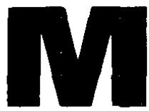
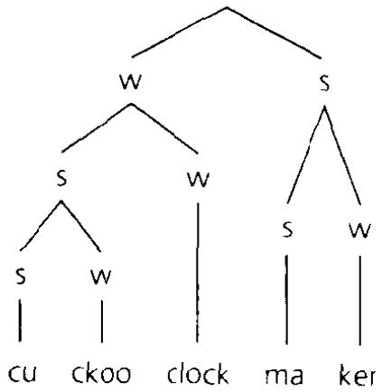
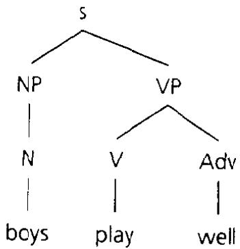
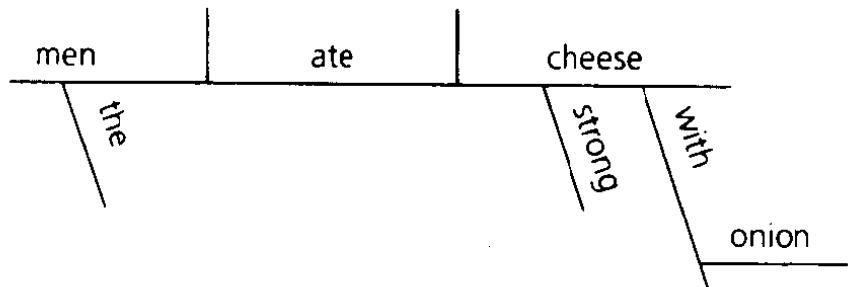
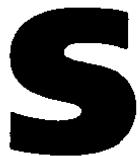
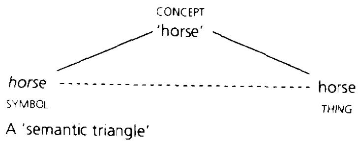
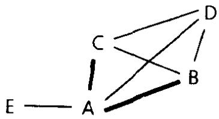

of formations that have become systematic: e.g. for first names in German (Stephanie → Steffi, Fritz → Fritzi, etc.).

hyponymy. The relation between two lexical units in which the meaning of the first is included in that of the second. E.g. any tulip and any rose is also a flower: therefore the words tulip and rose are both hyponyms, and together are 'co-hyponyms', of flower.

hypotaxis [haipə'taksıs]. Greek term for \*subordination, applied specifically to subordination of clauses or sentences. Opp. parataxis ('arrangement under' vs. ‘arrangement alongside') for their \*coordination. E.g. he came is hypotactic in [I said [he came]), but paratactic in [[1 promised] and [he came] ].

hypothetical (conditional). See remote.

hypothetico-deductive method. Scientific method in which propositions which follow from a general hypothesis are tested against experimental or other data to determine whether the hypothesis is confirmed or is false. Often applied in the 1960s and 1970s to the validation of a \*generative grammar. Thus the grammar is a hypothesis about the sentences of a language; from it one predicts that certain forms are grammatical and certain others are not; if these predictions accord with the judgements of speakers the grammar is to that extent confirmed; if not, it must in some respect be wrong.

The value of this method in linguistics is debated, in this and other applications.

hysteron proteron. Rhetorical term from Ancient Greek for putting first ('proteron') what should logically be later ('hysteron’): e.g. in a recipe which says that the oven should be preheated to 200°C after it tells you to put the food in.

I. Syntactic category posited by Chomsky in the early 1980s, heading a phrase (IP or I-phrase) which is effectively a clause minus a \*complementizer. E.g. she married him would realize an IP within a \*CP or complementizer phrase since she married him: since she married him|). Within this I itself would be realized by the tense of the verb (-ed).

I' is short for original 'INFL', itself for inflection'.

IA = ltem and Arrangement.

iambic. (\*Foot) consisting of a light syllable followed by a \*heavy syllable. Borrowed into \*Metrical Phonology from the definition of an iamb in verse.

Ibero-Romance. The forms of \*Romance, including Spanish, Portuguese, and Catalan, that developed in the Iberian peninsula.

IC-analysis. See constituency.

Icelandic. North \*Germanic, attested from the Middle Ages by literature in a form described as Old Norse, at a time when the differentiation of North Germanic into separate languages was still at an early stage. The spelling of Old Norse devised in the mid-12th century, which is set out and justified in the anonymous ‘First Grammatical Treatise', is remarkable as an early application of the phonemic method.

iconicity. Principle by which semantic relations are reflected in the formal patterns by which they are realized. Thus a \*direct object is a \*complement of a verb while an \*adverbial such as today is not: in that sense the semantic relation of verb to object is closer. In the order of words in English, direct objects are also closer to the verbs: I saw John today or Today I saw John, not I saw today John. In this way there is an iconic correspondence between the linear order of elements and their semantic pattern.

The term is from \*Peirce's theory of signs, of which ‘icons' were one kind. But linguists' usage is now largely independent.

ictus. Traditionally of a rhythmical beat in a line of verse: thus in Latin verse a stressed syllable is seen as coinciding or not coinciding with the ictus of the relevant foot.

idealization. The process by which, e.g. the elements and rules of a language are established as a system underlying the phenomena of speech. Likewise of the elements so established: e.g. a phoneme seen as an ideal sound which underlies a shifting range of real sounds and real mechanisms by which they are produced.

ideational. (Meaning, \*function of language) involving the representation of ideas. Cf. cognitive meaning; also descriptive (3) referential, representational.

ideogram. A character in writing seen as representing an idea in abstraction from words. E.g. in '15', the number itself is represented independently of the relevant word in English (fifteen), or in French (quinze), and so on.

Also ideograph': sometimes used, especially in older treatments, for what is now more usually called a \*logogram.

ideophone. Used by Africanists of a distinct class of forms characterized by phonological structuręs that tend to be peculiar to them: e.g. by patterns of \*sound symbolism, reduplicative structures. or distinct patterns of tones.

idiolect. The speech or 'dialect' of a single individual. Hence idiolectal variation is variation within a language between one speaker and another.

idiom. A set expression in which two or more words are syntactically related, but with a meaning like that of a single lexical unit: e.g. 'spill the beans' in Someone has spilled the beans about the bank raid, or put one's foot in it' in He can never make a speech without putting his foot in it.

Not usual, as a technical term, in any other sense. For others current in ordinary usage cf. accent (2); dialect.

'idiom chunk'. A part of an idiom separated from the rest by a syntactic process. E.g. in The beans were by then pretty well spilled (meaning that some secret was out) the beans is a detached chunk of the idiom 'spill the beans'.

idiophone. See interjection.

IE = Indo-European.

iff. For 'if and only if'.

Igbo. The official language in south-east Nigeria, native to an area from Port Harcourt northwards, including Onitsha, Enugu, and Afikpo. Variously classed, with others in the south of Nigeria, either as Eastern \*Kwa or as \*Benue-Congo.

'I-language'. Chomsky's term from the mid-1980s for the knowledge of language \*internalized ('I') by individual speakers. Opp. E-language or ‘externalized language'.

illative (ill). \*Case whose basic role is to indicate movement into something: e.g. schematically, I walked house-IlL 'I walked into the house'.

ill-formed. Not \*well-formed.

illocutionary. Applied in the theory of \*speech acts to the force that an expression of some specific form will have when it is uttered. E.g. a speaker might stop someone and say 'Please, can you help me?' By virtue of its form (interrogative preceded by please) this would have the illocutionary force of a request for assistance.

Cf. locutionary; perlocutionary. In the theory developed by Austin and his successors, the simple act of uttering this sentence is a locutionary act; the illocutionary act is that of uttering it as a request; the perlocutionary act is what is accomplished by uttering it (e.g. the addressee might ignore the request, or might in fact help). But what is 'illocutionary' and what is 'perlocutionary' plainly depends on how much is judged to flow conventionally from the form of an utterance. E.g. if the chairman of a meeting says 'This meeting is now closed', this may be seen as a formula which has the illocutionary force of closing it. But its form is more generally that of a statement, and, as made by the chairman, it might instead be claimed to have that as its perlocutionary effect.

llocano. \*Austronesian language, native to the north-west of Luzon in the Philippines.

'image schema'. Used informally by G. P. Lakoff and others of a general concept that structures our perception of the world: e.g. the concept of 'a container', or of 'movement up and down', or of 'a long thin object'. Patterns of \*metaphor (2) can be seen as transformations relating one image schema to another.

immanent. Inherent. Thus one view of a \*language system is that it is a structure immanent, i.e. inherent, in the phenomena studied. Traditionally the opposite of 'transcendent'.

immediate. Used where a relation has no intermediate term. Thus, in accounts of \*constituency, the immediate constituents of a unit are the smaller units into which it is directly analysed; in a \*phrase structure tree, a node A immediately dominates another node B if they are connected with no other node intervening.

imparisyllabic. Not \*parisyllabic.

imperative (imp). (Construction, form of verb) whose primary role is in giving orders. E.g. Get out! is an imperative sentence; in Latin, i ‘go!' is an imperative form of the verb.

Sometimes used simply in the sense of ‘order'. E.g. in Latin, a subjunctive such as eat ‘go-suBj-3sg' can be what is traditionally a \*third-person imperative ('May such or such a person go'). But, like \*declarative and \*interrogative, it is in principle a term in grammar, the role of ‘order' being one that constructions, etc., including ones other than imperative, have in context.

imperfect (impr). Traditional term for forms of a verb that are past \*progressive as opposed to \*perfect: e.g. Latin vivebat ('live-ImPF-3sG’) 'was living, was alive', as opposed to vixit 'lived, has lived, is no longer alive'. Hence, e.g. of forms such as English was living.

imperfective (imperF). Not \*perfective: i.e. of forms used to refer to actions, etc. conceived as extending over a period of time, continuously or at intervals.

Cf. progressive. In a notional analysis of \*aspect the progressive in English or the \*imperfect in Latin or the Romance languages can be described as imperfective, while the simple past or ‘preterite' is perfective. E.g. ‘imperfective' is courting our daughter, was seeing her every weekend; 'perfective' met her last weekend.

impersonal (impers). (Verb) which does not take a subject: e.g. Latin oportet 'ought' in quid me oportet facere? 'What should I do?' (lit. 'what-Acc me-Acc ought to-do'). Thence of the construction taken by such a verb, and generally of constructions that are similar. E.g. It is nice to relax is impersonal since, although there is a subject (it), it is a \*dummy which does not refer to a specific individual or person'.

The term originates in the description oflanguages like Latin which have subjects in the strictest sense: see subject (1). But it could in principle be extended to any in which some element is similarly distinguished.

impersonal passive. An \*impersonal construction in which the verb is passive in form. Thus in German Es wurde getanzt ‘There was dancing', wurde getanzt is passive (lit. 'was danced'); at the same time es is a \*dummy, as in e.g. Es schneit ‘It is snowing', which does not refer to something that was being danced.

Also of other impersonal constructions in which the verb can be seen as in some way like a passive. E.g. in Spanish Se venden casas Houses for sale', the construction with se is described as impersonal except that the verb venden ('sell-3PL') agrees with casas ('house-PL'). Although venden is active, its relation to casas is taken to be like that of a passive to its subject; so this sentence too is a passive impersonal'.

implication. Relation in logic such that, if p is true, then q is also true. Commonly written p → q: e.g. 'girl (x) → female (x)' ('If x is a girl then x is female'). Mutual implication, written p ↔ q, is the case where each proposition implies the other.

implicational scale. Any scale in which a feature associated with a given point implies the presence of those associated with all lower points. E.g. a scale in which points correspond to dialects, such that. at the lowest point, dialect A has undergone a sound change s,; at the next highest dialect B has, in addition to s,, undergone s₂; at the next highest dialect C has, in addition to s, and s,, undergone s3, and so on:

i.e. the operation of sound change s, implies that of all changes s, where j < i. Also, e.g. in cases of \*gradience: thus form A might satisfy one criterion; form B both that and another, form C both those and another, and so on.

\*Accessibility scales in syntax reduce to the same model.

implicational universal. A \*linguistic universal of the form ‘if a then b'. E.g. if a language has phonetically nasal vowels, it also has oral vowels.

implicature. 1. Any meaning that a sentence may have that goes beyond an account of its meaning in terms of \*truth conditions. This includes both \*conversational implicatures, defined initially as one kind of implicature within that definition, and \*conventional implicatures. 2. Also, loosely, in the sense of conversational implicature.

implosive. A \*stop produced by an \*airstream mechanism in which air is initially rarefied above the larynx. In the simplest case, the glottis is closed and a stop is articulated at some place of articulation forward of it; the larynx is then lowered, so that, when the forward closure is released, air is drawn inwards into the space behind it. The mechanism is, on this basis, classed as \*glottalic and \*ingressive. But the drop in air pressure above the larynx also causes air to pass periodically upwards through the glottis: hence stops of this kind usually have an effect of voicing. A bilabial implosive [6} and dental/alveolar implosive [d] are widespread e.g. in West African languages.

The terms 'implosif' and ‘implosion' have a different sense in French. E.g. in acteur 'actor' the c [k], which ends a syllable, is 'implosive'; the following t [t], which begins one, is ‘explosive'.

imprecative. A sentence, especially a \*minor sentence, which includes a swear word or some other form used in abuse. Hence of some, like Damn you!, which are indeed, in origin, imprecations. Cf. expletive.

impressionistic transcription. A \*phonetic transcription of speech done by ear without, or as a prelude to, a phonological analysis; alternatively, one done by ear without the aid of instruments.

inalienable possession. Possessive relation in which the thing possessed is an inherent part of the possessor: e.g. in Mary's eyes, referring to the eyes that are part of Mary's own body. Opp. alienable possession, the two being distinguished in some languages.

inanimate. Not \*animate.

inceptive = inchoative.

inchoative [in'kəuətiv]. (Verb, \*aspect) indicating the initiation of some process or action. E.g. Latin senescere ‘to grow old' or maturescere to ripen' are traditionally called inchoative verbs, and -esc-, by which they are formed from the words for 'old person' and 'ripe', an 'inchoative suffix'. Also called 'inceptive'.

'incidence'. The range of individual forms in which e.g. a particular sound unit is found. Differences of 'incidence' have been distinguished in dialectology from differences in e.g. the system of sound units itself

inclusion. Technically of a relation between sets in which all members of a set A are also members of a set B. If so A is included in B; it is properly included if, in addition, at least one member of B is not a member of A.

inclusive. (Person, pronoun) used in referring to the speaker plus at least one addressee: e.g. Tagalog kata ‘you and I’, tayo you and I and at least one other'.

An inclusive form used to refer to a single speaker and a single addressee is often called 'dual'. One which refers or can refer to more than these is generally called ‘first plural inclusive' (we' including the addressee) in opposition to ‘first plural exclusive' ('we' excluding the addressee). But a form referring to both speaker and addressee is logically as much a ‘you' form as a ‘we' form. Hence a language may in principle oppose an inclusive person (speaker and addressee) to, on the one hand, a first person (speaker but not addressee) and, on the other hand, a second person (addressee but not speaker). A language may also in principle distinguish a second plural inclusive (you' plus the speaker) and a second plural exclusive (‘you' without the speaker), both opposed to a first plural.

incompatibility. (\*Sense relation) among words that are mutually exclusive. E.g. between black and white: if something is black it cannot be white and if something is white it cannot be black.

incorporation. A regular process by which lexical units which are syntactically \*complements of verbs can also be realized as elements within the verb itself: e.g., schematically, hunt-rabbit-PRoG-3sG 'He is hunting rabbits, is rabbit-hunting'. Also of a pattern in which forms appearing only as affixes have meanings which correspond to those of forms appearing only as distinct words. E.g., schematically, hunt-RABBIT-PROG-3SG, where 'RABBIT' is a suffix different from, but linked semantically to, a lexical unit also meaning rabbit'.

An incorporating language is one in which such patterns are systematic: ones of the second type, e.g. in Eskimo, were the earliest known.

indeclinable. (Noun, etc.) which, exceptionally for the language in question, does not have distinct inflections.

## indefinite

indefinite. Not referring to, or indicating reference to, an identifiable individual or set of individuals. E.g. in I have to see a student, the phrase a student does not indicate specifically which student the speaker has to see: it is accordingly an indefinite noun phrase. By the same token, a in a student is an indefinite article, someone in I have to see someone is an indefinite pronoun, and so on. Opp. definite.

indefinite reference. \*Reference to a specific individual or set of individuals not necessarily identifiable by an addressee. E.g. if I say to someone 'I have lost a hammer' I myself have a specific hammer in mind; but, to understand me, they do not have to know which it is. Contrast a hammer in 'I must buy a hammer', where there is no specific reference, or the hammer in 'I have lost the hammer', where the referent is one that the speaker can in turn identify.

independent clause. A \*clause which forms a sentence on its own: hence often equivalent to \*main clause.

'independent motivation'. Support for an analysis based on independent, or allegedly independent, evidence. Thus an analysis of a phonological system might be supported by evidence both of sound changes and of the progressive loss of distinctions in aphasia.

Common in the 1960s and 1970s in the style of argument employed by advocates of transformations. E.g. in They expected me to leave, me has the form this pronoun has when it is an object: cf. They saw me. Therefore, in one analysis, it is on its own the object of expected: They expected me [to leave], not They expected [me to leave]. In addition, it corresponds to the subject of a passive: I was expected [to leave]. In that respect it resembles other elements analysed as objects: therefore this evidence might be claimed as 'independent motivation' for treating it as one.

indeterminacy. Strictly, perhaps, of cases where a division or distinction cannot be precisely drawn. E.g. in a normal pronunciation of a word like seeing there is no way of determining exactly and indisputably where the realization of see- ends and that of the ending -ing begins. Also, however, of cases where a decision will be made differently by different criteria. Many classic problems, e.g. of \*gradience, or in distinguishing \*homonymy from \*polysemy, involve indeterminacies of both kinds.

indexical. Term in philosophy for an expression whose \*extension is relative to a specific context, with a specific speaker, addressee, location in space, etc. E.g. here is an indexical expression, as in Mary lives here. Cf. deixis.

Indian languages. Those of the Indian subcontinent: specifically of the \*Indo-Aryan branch of \*Indo-European, covering part of Sri Lanka and most of the area from the Indian states of Maharashtra and Orissa northwards; of the \*Dravidian family mainly in south India and the north of Sri Lanka; and of the \*Munda family, in scattered parts of central and eastern India. Among others, English is used widely as a \*second language, and also has native speakers.

Indian scripts. Writing systems derived directly or indirectly from the \*Brahmi script, attested in ancient India from the second half of the 1st millennium Bc. Modern forms include \*Devanagari, used in particular for Hindi, and the separate scripts, often with characters of very different shapes, that have developed for other major \*Indo-Aryan and for the \*Dravidian languages: in addition, those of \*Tibetan, and of most languages in South-east Asia, including \*Burmese, \*Khmer, \*Lao, and \*Thai. Earlier forms were used still more widely, in Central Asia with the spread of Buddhism and e.g. for \*Javanese before the Muslim conquest.

The basic type is \*alpha-syllabic, as \*Devanagari. The precise historical links, both within and outside India, are still partly uncertain: but for those in South-east Asia, the Mon script, attested in Burma (Myanmar) from the 11th to the 12th century AD, and before it the Grantha script, used in the coastal area of Tamil Nadu from the 5th century AD, were major intermediaries.

Indic = Indo-Aryan.

indicative (ıno). 1. (Form of verb, affix, etc.) which represents an \*unmarked \*mood in opposition to a \*subjunctive, \*imperative, etc. Hence that, in particular, of unqualified statements: thus Italian Entra Giovanni ('enter-IND-3sg John') 'John's coming in', as opposed e.g. to subjunctive Entri, signore (‘enter-suBJ-3sG, sir') 'Do come in, sir'. 2. (Sentence) = declarative.

indices. Commonly of subscripts or superscripts indicating whether phrases have the same or different referents: thus Mary, said she, would come, with the same index'i, is a sentence meaning 'Mary said she (Mary) would come'; Mary, said she, would come, with the different indices i and j, is one meaning ‘Mary said she (someone else) would come'.

'indirect anaphora'. A relation between a phrase and some earlier expression which, though not in a strict sense an antecedent, will effectively indicate, in the light of people's general knowledge, who or what it refers to. E.g. people know that bicycles have chains: therefore, in I was riding my bicycle but the chain came loose, the phrase the chain will be understood, all else being equal, as referring to that of the bicycle referred to by the earlier phrase the bicycle. If so there is said to be a relation of 'indirect anaphora' between them.

indirect object (lo). An object whose semantic role is characteristically that of a recipient, e.g. to your síster in He blew a kiss to your sister; also, in most accounts, your sister in He blew your sister a kiss. Opp. direct object.

## indirect question

The relation between these sentences is often described in terms of \*dative movement. It is in part because that relation is possible that to your sister is distinguished, as an object, from directional phrases such as e.g. to the seaside in He sent his family to the seaside.

indirect question. 1. A question as reported in \*indirect speech: e.g. where he was in I asked where he was. 2. An utterance with the force of a question which is not in an \*interrogative form. E.g. the \*declarative I would like to know his name might be uttered as an indirect question, with in part the same intention as 'What is his name?'

indirect speech. The reporting of something said, thought, etc. with \*deixis adapted to the viewpoint of the reporter. E.g. He said he would bring them might report a promise, originally 'I will bring them'. But the person who made the promise was someone other than the reporter: hence, in the reporting, original I is changed to he. Also the promise was earlier than the report; hence, in addition, will is changed to would. With these adaptations, he would bring them is an example of, and is said to be ‘in', indirect speech.

Opp. direct speech. E.g. in He said 'I will bring them', the promise is instead reported directly, with the deixis appropriate to when it was made.

indirect speech act. A \*speech act whose force differs from what is taken to be the literal meaning of the sentence uttered. Thus Could you close the window? has the form of an \*interrogative; therefore, in some accounts, it is literally a question. The act of uttering it as a request would then be indirect.

Cf. indirect question (2). Other instances were given blended names in the 1970s: see queclarative, whimperative.

Indo-. 'In India': e.g. \*Indo-Aryan. Also in names for groupings of language families which include \*Indo-European. Thus Indo-Semitic is a conjectural family including Indo-European and \*Semitic, Indo-Uralic one in which it is lumped with \*Uralic. Indo-Hittite = Indo-European, but on the view that \*Hittite and other \*Anatolian languages form one major branch and all the other branches (Greek, Italic, Celtic, etc.) are subdivisions of another.

Indo-Aryan. Branch, within \*Indo-European, of \*Indo-Iranian: first attested by texts in \*Vedic (\*Sanskrit) from the 2nd millennium Bc, and by inscriptions from the first.

The modern Indo-Aryan languages cover most of the north and centre of the Indian subcontinent, with outliers in Sri Lanka (Ceylon) and the Maldives. \*Hindi-Urdu and \*Bengali are by far the largest; of the remainder, \*Marathi, in the south of the main area, \*Gujarati in the south-west, \*Sindhi to the west, \*Punjabi in the north-west, \*Assamese in the east, \*Oriya in the south-east, and \*Sinhalese in Sri Lanka all have a current literary standard and are linked to major

political units. Others, such as \*Bhojpuri or \*Maithili, also have speakers in the tens of millions.

Across the main area, separate languages have arisen largely by divisions within a geographical continuum. Hence internal branches are still not definitively established.

Indo-European. Family of languages including, at historically its western limit, most of the languages spoken in Éurope and, at its eastern limit, those of all but the southern part of the Indian subcontinent. Usually divided into eleven main branches: in the order in which they are first attested, \*Anatolian (now extinct), \*Indo-Iranian, \*Greek, \*Italic (represented by the modern Romance languages), \*Celtic, \*Germanic (which includes English), \*Armenian, \*Tocharian (extinct), \*Slavic (Slavonic), \*Baltic (represented by Latvian and Lithuanian), and \*Albanian. Groupings larger than these are problematic to varying degrees: the safest hypothesis is that of a common \*Balto-Slavic.

The \*comparative method has its origin in the intensive study of Indo-European, especially in German-speaking universities, from the early 19th century. The size and complexity of the family, in comparison with many others that can be established with the same certainty, reflects in part the early date at which the forms in several branches can be compared.

Indo-Iranian. Branch of \*Indo-European divided in turn into \*Indo-Aryan and \*Iranian.

Indonesian. See Malay-Indonesian.

induction. Process of reasoning which moves from the particular to the general. E.g. from a series of observations of individual professors, all of whom work very hard, one might draw the inductive inference that all professors work very hard.

Opp. deduction: see also abduction.

inessive. \*Case whose basic role is to indicate position within something: thus, schematically, I-sit study-ınEss 'I am sitting in a study'

INF = infinitive.

infection. Older term for the influence of one vowel on another, e.g.   
in \*metaphony or \*vowel harmony.

infectum. Term in Latin grammar for forms of a verb that are not marked as \*perfect (2). E.g. Latin regit ‘rules' or regebat ‘was ruling' are forms of, and based on the stem (reg-) of, the infectum; rexit ‘ruled, has ruled' and rexerat ‘had ruled', based on the stem rex-, are corresponding forms of the perfectum'.

infelicitous. (Speech act) not meeting the required \*felicity conditions.

## inference

inference. Any conclusion drawn from a set of propositions, from something someone has said, and so on. This includes things that follow logically: cf. implication, entailment. It also includes things that, while not following logically, are implied, in an ordinary sense, e.g. in a specific context: cf. e.g. conversational implicature.

inferential. (Particle, inflection) indicating that what is said is based on inference and not on direct observation. E.g. schematically, They INFERENTIAL are indoors ‘They must be indoors' (because their door is open, because they are not visible outside, and so on). Opposed to other \*evidential elements.

infinitive (ine). A non-\*finite form of a verb characteristically used in clauses and in other constructions subordinate to another verb: e.g., in English, the 'bare infinitive' do in I made him do it, and the infinitive with to, as it is usually described, in I forced him to do it. An infinitive clause, or infinitival clause, is one whose verb is in the infinitive form: thus in these examples, if clause boundaries are established after made and forced, both him do it and him to do it.

Originally of forms in e.g. Latin that also regularly headed noun phrases: thus, more marginally in English, To buy caviar is expensive.

infix. An \*affix or \*bound (1) morpheme which is inserted within another form. Thus in Latin rumpo 'I break' the root is rup-: cf. rup-t-us 'broken'. The stem rump- then consists of the root with, in included position, an infix -m-.

Infixation is the process of inserting an infix; a form is infixal if, like rump-, it is formed with an infix or, like -m-, it is in the position of one.

INFL l'inful]. Name for the verbal inflection of a clause in \*Government and Binding Theory, later generalized as \*I.

inflecting. (Language, formation) in which words distinguish grammatical categories whose realizations cannot or cannot easily be separated. E.g. in Russian, nouns distinguish case and number; but a.specific case and a specific number are never realized by distinct endings. Likewise verbs distinguish e.g. a perfective from an imperfective, commonly realized by a variation within their stems.

Opp. agglutinating, isolating, in a typology dating from the 19th century.

inflection. Any form or change of form which distinguishes different grammatical forms of the same lexical unit. E.g. plural books is distinguished from singular book by the inflection -s, which is by that token a plural inflection.

The term originally meant ‘modification' (lit. 'bending'): thus book is modified, by the addition of -s, to books.

inflectional class. A class of words or morphemes which have the same inflection or inflections. Thus sing is of the same inflectional class as sink or drink: as sing is distinguished from sang and sung, so sink is distinguished from sank and sunk, and drink from drank and drunk.

Major inflectional classes are often described as \*conjugations (of verbs) or \*declensions (of nouns).

inflectional morphology. Branch of \*morphology concerned with \*inflections: hence especially with both the semantic and the formal structure of \*paradigms. An inflectional affix is similarly an affix described as an inflection, a process by which e.g. such an affix is added is an inflectional formation, and so on.

Opp. derivational morphology. But the distinction has often been challenged, e.g. in \*Lexical Morphology.

informant. Any speaker of a language acting as a source for statements that a linguist makes about it. For their own language, linguists are often their own informants; in investigating one that they do not know or that is not theirs, they may work regularly with a single native speaker or group of speakers.

Sometimes replaced by 'consultant' or 'language consultant', especially in the USA, where informant' has developed the sense of ‘informer'.

## 'informationally encapsulated'. See modular.

information structure. The structure of a sentence or larger unit viewed as a means of communicating information to an addressee. Described in terms of \*given vs. new, \*theme (1) vs. \*rheme, \*topic (2) vs. \*comment, \*focus, etc.

information theory. Mathematical theory developed in the 1950s in which the quantity of 'information' carried by a channel of communication is defined in terms of the probability with which specific units may be transmitted. Suppose that messages may consist of any letter of the alphabet in any order: then the probability with which at any stage in the sequence any particular letter will be transmitted is constant. But suppose instead that messages consist of written words in English: then after e.g. initial f the probability that t or another f will follow is very low, that u will follow is relatively high, that r or a will follow even higher. In the second case the quantity of 'information' carried by the channel would be less.

Important in linguistics as a basis for one measure of \*redundancy.

-ing form. A verb form in English such as sleeping in those sleeping, We were sleeping, I like sleeping, Sleeping was impossible. Often so called because no term inherited from the grammatical tradition, such as \*present participle or \*gerund, is appropriate to all these uses.

## ingressive

ingressive. (Air stream or \*airstream mechanism) in which the direction of flow is inwards. Opp. egressive: for specific mechanisms see click, implosive.

Ingvaeonic = Anglo-Frisian.

inherent feature. One which characterizes a word, etc. in the lexicon as opposed to one assigned to it by a specific construction. E.g in German a noun is inherently masculine, feminine, or neuter; in specific constructions it will be contingently singular or plural, or nominative singular, accusative singular, and so on.

inheritance. Transfer of properties under an operation. E.g. inquiry is a noun derived from inquire, by an operation under which it inherits the property of taking a prepositional phrase with into: They inquired [into his expenses], likewise their inquiry [into his expenses]. Also of the copying of features from a higher to a lower level of constituency. E.g. a sentence is passive; therefore a verb phrase and a verb within it are also passive. For this second sense cf. percolation.

initial phrase marker. Term in \*transformational grammar for a phrase structure tree derived by rules of a \*base component only, which is then subject to transformations.

initial symbol. See rewrite rule.

Initial Teaching Alphabet. A way of writing English proposed as a compromise between a phonetic transcription and the conventional spelling; devised by J. Pitman and promoted in several schools in Britain in the 1960s and 1970s on the theory that children would learn the spelling more easily if they learned this system first.

initiator. Used of whatever initiates a flow of air in the production of speech. Thus in the pulmonic \*airstream mechanism an airflow is initiated by the organs that control breathing.

injunctive. Term in \*Indo-European linguistics for the use of forms based on the stem of the indicative in orders and prohibitions. Attested mainly in \*Indo-Iranian.

'innate'. Usual in linguistics since the 1960s in the loose sense of ‘in part at least determined by genetic inheritance'. Hence, in particular, the 'innateness hypothesis', with reference to Chomsky's theory of \*universal grammar.

inner form. See Humboldt.

innovation. Any change by which a language diverges from others historically related to it. E.g. the order of words in Clearly I have lost represents an innovation in English as compared with the

\*verb-second order of Old English and other Germanic languages. When two members of a family share an innovation, that is prima facie evidence that they are more closely related than either is to the others.

in pausa. At the end of, or before a break in, an utterance. E.g., in many forms of English, a word like beer ends in [ıə] before a consonant or 'in pausa', but has a \*linking [r] before a vowel.

instantaneous release. Chomsky and Halle's term in \*SPE for the rapid release of a \*stop consonant, in which the resulting flow of air is not audibly turbulent. Hence a feature distinguishing e.g. [p} or [t] from \*affricates such as German pf or tsch [tf]. Opp. delayed release.

institutionalized = established.

instrumental (1). \*Case or \*case role of elements indicating an instrument used for some purpose. Thus with a fork has an instrumental role in I dug it with a fork; also, in accounts following that of \*Case Grammar, a fork in A fork would dig it easily or I used a fork to dig it.

instrumental (2). (\*Function of language) in achieving some practical end. Cf. conative.

instrumentalism. Philosophical theory, developed in the late 19th century by J. Dewey, which holds that beliefs, hypotheses, etc. are instruments with which we engage with the world in which we live, and are therefore justified simply to the extent that they are successful and fruitful.

integration. Process by which a word, etc. borrowed from another language becomes part of the native system. Thus the [3l of rouge or mirage, both in origin \*loan words from French, is not fully integrated into English phonology, since its distribution, within the syllable and in relation to the vowels that it follows, is more restricted than that of [S] (sh) and others to which it is most directly opposed. Likewise the words as wholes are not fully integrated, unlike words in [∫| such as push or brush, themselves much earlier borrowings from French, which are.

intensifying. (Word, intonation, inflection) which in any way adds emphasis to a sentence or some element within it. Thus, schematically, He did-ıNTENs it might mean ‘He really did it'.

'Intensifier' is used by Quirk et al., \*CGE, of a class of adverbial elements (in their terms a class of \*subjuncts) with an intensifying role that is either positive or negative. The positive ones are amplifiers and include, as amplifiers of the strongest degree, maximizers such as completely or utterly; the negative are downtoners and include, at the other end of a scale, minimizers such as hardly or scarcely

intension. The properties that define a word or concept. An intensional definition of a class will correspondingly specify the properties that something must have to be a member of it. Opp. extension, extensional.

An intensional logic is one in which the validity of arguments depends on identity or difference in intension, opposed again to extension.

intensity. The physical correlate of perceived loudness, usually measured in decibels.

intensive. (Verb) which takes a \*predicative adjective or noun phrase: e.g. those of She is angry, He seemed a nice man. Also of the pattern of \*complementation associated with it: thus angry and a nice man are described as 'intensive complements'.

Cf. copular, predicative, both of which are used more widely.

interchangeability. The property of language by which the roles of speaker and addressee are interchangeable. Thus any sentence one might utter one would also understand if said by someone else and, in principle, vice versa. Defined as one of the proposed \*design features of language.

interdental. (Consonant) articulated with the tip of the tongue protruded between the teeth: e.g. in one pronunciation of (th) [θ] in thing.

interference. The influence that knowledge of one language has on the way one speaks another: e.g. in the speech of bilinguals, or as a cause of errors by someone learning a new language.

interfix. A morphological element serving simply as a link between other elements. E.g. -i- in Latin particeps 'participant' or aquifolia 'holly', seen as linking two members of a compound (part-i-ceps, aqu-i-folia).

interjection. Traditionally of forms that express 'states of mind' and do not enter into specific syntactic relations with other words: e.g. Wow, Yuk, Phew. Some, such as phew [φ:|, are also idiophones, with phonetic features peculiar to them.

A \*part of speech in ancient Roman accounts of Latin. Extended by some recent writers to a larger and more indeterminate category of which the traditional interjections are only part.

interlanguage. 1. A language, or an artificial system like a language, used as an intermediary, e.g. in translation, between two others. 2. A system of rules said to develop, in the mind of someone learning a foreign language, which is intermediate between that of their native language and that of the one being learned.

inter-level. A \*level of description defined as a link between two others: e.g. phonology defined, as by Halliday in the early 1960s, as one linking grammar and phonetics.

internal argument. One not external to a \*predicate (1) or \*verb phrase: thus specifically an object as opposed to a subject.

internal causes. Causes of change seen as internal to a language or to the community that speaks it. Thus an internal cause of sound change might be an increase in the \*coarticulation of adjacent consonants, or the pressure to maintain an audible difference between vowels; an external cause might be contact with the system of a neighbouring language.

internal history. The history of changes in the structure of a language, as opposed to its \*external history. E.g. it is part of the internal history of English that rules of word order changed over the early Middle Ages; part of its external history that e.g. Shakespeare wrote in it.

'internalize'. Used by Chomsky from the late 1950s for the process of constructing representations in the mind. Thus, in learning a native language, a child was seen as ‘internalizing' its grammar. Hence, in Chomsky's terminology in the 1980s, 'internalized language' or \*I-language.

internal reconstruction. The attempted \*reconstruction of earlier stages of a language on the evidence of that language alone. Thus there are alternations in English between e.g. [aı] and [1]: wise vs. wisdom, vice vs. vicious, etc. On that evidence alone, one might argue, first, that either or both vowels must show the effect of sound change, and, secondly, that the most plausible changes would derive wis(e) and vic(e) from reconstructed \*[wi:z], \*[vi:s].

internal sandhi. Processes of phonological modification (\*sandhi) found within words, at or across the boundaries of roots or affixes.

internal syntax. The relations, rules, etc. that apply within a syntactic unit, as opposed to those into which it enters, as a whole, within larger units.

international language. One used internationally; specifically, one recognized officially as a language of international meetings, diplomacy, etc.

International Phonetic Alphabet. The system of phonetic transcription developed and promoted by the \*International Phonetic Association. Consonants are classified by \*place and \*manner of articulation, with boxes in the resulting grid filled, where there is no appropriate letter in the Roman alphabet, with special letters partly resembling them. \*Secondary articulations, and some manners of articulation not distinguished by the Roman alphabet, are shown by diacritics. The transcription of vowels is according to the \*cardinal vowel system.

The increasing adoption of this system is without doubt one of the most important practical achievements oflinguistics in the 20th century.

International Phonetic Association. Society founded in France in 1886 by Passy and called by this name since 1897. Its original aim was to promote the use of phonetic script in teaching modern European languages, and its journal, Le Maître Phonétique ('The Phonetic Teacher'), published articles in the \*International Phonetic Alphabet which it devised. In the course of the 20th century its interests have become increasingly academic, with its centre shifted to Britain. Its present journal, the Journal of the International Phonetic Association, replaced Le Maître Phonétique in 1970.

Passy and his pupil (Daniel) Jones were leading figures for much of its history.

interpersonal. (Meaning, \*function of language) in developing and maintaining social relations between people. Alternatively, that is said to be the social function: the interpersonal then includes both that and the \*expressive (affective, emotive) function.

interpretant. Peirce's term for the effect that a sign has on someone who interprets or understands it. Hence \*pragmatics was originally defined by the relation that signs have to interpretants.

interpreted. (Logical calculus, etc.) assigned an interpretation in some system of \*formal semantics.

'Interpretive Semantics'. Applied in the early 1970s to any model of \*transformational grammar in which \*semantic representations of sentences are derived from what are seen as purely formal representations of their syntax. The rules by which they were derived had been described by Chomsky in \*Aspects as purely interpretive'. Such models included both the \*Standard Theory of Aspects and the modifications of it leading to the \*Extended Standard Theory.

Opp. Generative Semantics.

interrogative. (Construction, etc.) whose primary role is in asking questions: e.g. that of Is he here? as distinguished from the \*declarative He is here. An interrogative particle or interrogative inflection is one which marks an interrogative: e.g. in the equivalent sentence in Latin, a \*clitic -ne (adestne? 'be-present-3SG-INTERRoG'). An interrogative pronoun, adverb, etc. is one that represents a focus of questioning: e.g. who or what in Who did this?, What have they done?; where in Where are they taking us?

The terms ‘question' and 'interrogative' are often interchanged. E.g. Is he here? is a question or is an interrogative sentence or ‘an interrogative'. But a distinction can and sometimes must be made.

Thus Can't you shut up? has the construction of an interrogative, but its usual role would not be as a question but as a request or order. Cf. declarative; imperative.

interrogative tag. A \*tag in the form of an \*interrogative: e.g. has he? in He hasn't left, has he?

interrupted (consonant) = abrupt.

intersection. Technically of an operation on sets by which the intersection (or product) of sets A and B is the set of all elements, possibly none, which are members of both. Cf. union (1).

intervocalic. Appearing between vowels. E.g. [p} is an intervocalic consonant in kipper ['kıpə].

intonation. A distinctive pattern of \*tones over a stretch of speech in principle longer than a word. Thus there is a difference in intonation between e.g. That's IT ('I'm finished') and That's IT? ('Is that all?’).

A description of intonation usually has three main aspects. First, the relevant stretches of speech must be identified: in that way sentences or utterances are divided into successive intonational units or \*tone groups. Secondly, a syllable or series of syllables within each will be described as nuclear or \*tonic: this will be a position of prominence, identified e.g. by a rapid change of pitch. Thirdly, a specific pattern of tones will be distinguished: this might be described as an overall tune or \*contour (rising, falling, falling and then rising, etc.) or might alternatively be divided into a sequence of smaller components, each with its own pitch level. Descriptions in terms of contours are usual e.g. in British treatments; the alternative treatment derives in particular from American accounts in the 1940s and 1950s, in which patterns of intonation were described as \*pitch morphemes composed of successive pitch phonemes.

intonation group = tone group.

intransitive. Construction in which a verb is related to a single noun or its equivalent: e.g. that of They vanished. An intransitive verb, or an intransitive sense of a verb, is one that takes such a construction: e.g. vanish, or dry with the sense it has in It will dry. Opp. transitive.

intransitive preposition. A word such as away in He walked away, seen as a preposition which takes no complement. Traditionally classed as an adverb, since, in the ancient account of \*parts of speech, prepositions were defined as preposed to a noun or some other element.

intransitivizer. Affix, etc. marking a verb as intransitive rather than transitive. E.g., schematically, Vase shattered-INTRAns 'The vase shattered'.

## intrinsic allophone

intrinsic allophone. A variant of a \*phoneme which can be explained by the phonetic context, without invoking a specific phonological rule: e.g. one which is an effect of \*coarticulation. Opp. extrinsic allophone; but the validity of the distinction depends in part at least on how the relation between phonetics and phonology is in general perceived.

intrinsic ordering. See ordered rules.

intrinsic pitch. The pitch of a vowel in abstraction from the vibration of the vocal cords. Thus [i] has a higher intrinsic pitch, in terms of the underlying resonance of the vocal tract, than [a]

intrusive r. See linking r.

intuition. Variously of the intuitive grasp that people have or may have of the structure of their own language, and of the intuitive feeling that a linguist may have in investigating it. Likewise 'counter-intuitive'.

Inuit. Often = Eskimo. Specifically of a branch of Eskimo within \*Eskimo-Aleut, spoken from the Norton Sound in Alaska across the Arctic to Greenland and Labrador.

invariable word. One which does not have two or more forms with different grammatical meanings. E.g. but or never, as compared e.g. with woman, which distinguishes singular woman and plural women.

invariant. Not changing. E.g. in the classic theory of the \*phoneme the \*distinctive features that characterize each unit are invariant; the features with which it is realized in different positions or in different combinations vary. The aim of phonological analysis is accordingly to discover invariants that underlie surface variation.

inverse. (Form of verb, affix) indicating, e.g. in Algonquian languages, that of two elements in a clause that differ on some scale of \*empathy, it is the one lower on the scale that is the \*agent.

Opp. direct. Thus, if third person forms are lower on the scale than first persons, a sentence meaning 'I kissed the sister' will be marked as direct: schematically, with the persons marked respectively by a prefix and a suffix, 1sT-kissed-DiR-3RD sister. A sentence meaning ‘The sister kissed me' will instead be marked as inverse. Thus, with the persons marked in the same way in the same positions, 1st-kissed-ınv-3RD sister.

inversion. Any operation by which the order x + y is changed to y + x. E.g. an interrogative in English (Is he here?) is related to a corresponding declarative (He is here) by inversion of the subject (he) and a verb (in this case is).

inverted commas. Used variously for things other than individual forms considered in abstraction, Thus for glosses or translations: e.g.

French arbre 'tree', Elle vient 'She is coming'. Also for propositions seen as expressed by sentences: e.g. both French Elle vient and English She is coming express the proposition ‘She is coming'’. Also for units represented at a higher level of abstraction: e.g. coming is a form of the verb 'to come'. Also of a form as uttered on a specific occasion: thus 'She's coming' would represent an utterance of She's coming.

'invisible hand' theory. Model of change in language in which change in a given direction emerges, as if directed ‘by an invisible hand', from the separate behaviour of individual speakers, directed in itself to strictly individual ends. An application to linguistics by R. Keller of an account by Adam Smith in economics.

IO = indirect object.

IP. 1. = Item and Process. 2. A phrase (P) in Chomsky's \*Principles and Parameters Theory headed by \*I (= INFL).

IPA = International Phonetic Alphabet, International Phonetic Association.

Iranian. Branch, within \*Indo-European, of \*Indo-Iranian, first attested by religious texts in \*Avestan and inscriptions in Old Persian from the reign of Darius I (522-486 Bc). The modern languages are spoken mainly in a continuous area from eastern Turkey through Iran to Afghanistan and Tajikistan: \*Persian, \*Pashto, \*Kurdish, and \*Baluchi are in order of size the most important.

irony. Traditionally of a \*figure of speech in which one thing is said but the opposite is meant: e.g. 'That's just what I needed!', said as the tool one is using comes apart in one's hands. Usage in pragmatics or linguistics generally tends to reflect this, but others are also current, in literary studies especially.

Iroquoian. Family of languages spoken or formerly spoken in parts of eastern North America. The main group were and in part are in the Great Lakes region from Lake Huron eastwards: this includes Mohawk. Others include Cherokee, displaced to Oklahoma by ethnic cleansing in the 19th century.

irrealis [ırer'a:lis]. (Form of verb) used to refer to something that has not happened or is unlikely to happen. E.g. had got is ‘an irrealis' in the \*remote or unreal conditional if you had got there on time; likewise were in I was hoping you were in town tomorrow. Especially of past tenses used in this way.

## irregular. See regular.

irreversible binomial. A pair of words in a fixed and parallel relation: e.g. (It is raining) cats and dogs, not dogs and cats; ( just a few) odds and ends, not ends and odds.

island. A syntactic unit whose boundaries form a barrier to specific syntactic relations or processes. For an example see coordinate structure constraint: cf. complex NP constraint, wh-island constraint. An island constraint or condition is any such principle by which an island is defined.

isochrony. Principle by which phonological units tend to be equally spaced in time: e.g. syllables in languages that are \*syllable-timed, stresses in those that are \*stress-timed.

isogloss. A line on a map dividing areas whose dialects differ in some specific respect: e.g. between dialects in which a consonant is in principle voiced and those in which the corresponding consonant is voiceless, or those in which a certain thing is normally called x and those in which it is normally called y.

Major divisions between dialects are characterized by bundles of isoglosses, in which many such lines tend to run together.

isolated opposition. An opposition, especially in \*Prague School phonology, characterized by a unique pair of features: e.g. in Spanish, between trilled [r] (rr) in perro ‘dog' and flapped [r} (r) in pero 'but'. Distinguished as such from members of a \*correlation.

isolating. (Language) in which each grammatical category is represented by a separate word. Opp. agglutinating; inflecting.

Early Chinese is a classic example. E.g. the sentence wǒ qiě xián zhī yòng 'I will employ the worthy' is made up of five words, each of which is grammatically indivisible: 'I (wǒ) future (qiě) worthy (xián) them (zhī) employ (yòng)'.

isomorphism. Strictly, a term in mathematics for an exact correspondence between both the elements of two sets and the relations defined by operations on these elements. Used in linguistics, from the late 1940s, for a general principle by which the structuring of one \*level parallels or is made to parallel that of another. E.g. the relation of \*morpheme to \*allomorph was modelled on that of \*phoneme to \*allophone; a binary division of the syllable, into \*onset. and \*rhyme, parallels that of the sentence into subject and predicate; semantic features, e.g. in \*componential analysis, parallel \*distinctive features in phonology.

The term was introduced in this sense by J. Kurytowicz, commenting on the work of Hjelmslev.

Italian. \*Romance language whose standard form, increasingly dominant since the political unification of Italy in the 19th century, has its ultimate source in the Tuscan dialect of Florence, developed as a literary language from the Middle Ages by Dante and others. Many of the regional varieties called 'dialects' differ from it, in the south especially, to a degree that in other external circumstances would

count as a difference between languages; hence their speakers are in effect bilingual.

Attested in a form distinct from Latin from the 10th century AD.

Italic. Branch of \*Indo-European which includes \*Latin; also Oscan and Umbrian, attested by ancient inscriptions respectively from Pompeii and elsewhere in south Italy and from Gubbio in the Appennines.

italics. Usual for citing words and other forms in abstraction from their use. E.g. in saying 'I must go home', one utters the sentence I must go home, which includes, among others, the word home.

Italo-Celtic. See Celtic.

Item and Arrangement. One of three models of morphology distinguished in the 1950s by C. F. Hockett. The items' are \*morphemes (3); each morpheme is realized by one or more alternating \*morphs, and larger units, such as words, consist of 'arrangements' of morphemes. typically (at least) in sequence. E.g. duchesses will be represented as a sequence of three morphemes 'duke', whose \*allomorph in this context is [datf], followed by '-ess', realized by a second morph [is], followed by the plural morpheme, realized by [ız].

Contrasted by Hockett with \*Item and Process, \*Word and Paradigm.

Item and Process. One of three models of morphology originally distinguished by C. F. Hockett in the 1950s. Contrasted with \*Item and Arrangement, \*Word and Paradigm.

The term is usually applied to models in which an initially simple element (traditionally the \*root) undergoes successive processes of internal change, affixation, etc. E.g. unsung [ansan| might be derived from the root sing [sın] by an internal change of [ı] to [a]. which forms the past participle, followed by the addition of the prefix un- [anļ, which forms a negative.

iterative. (Inflection, etc.) indicating repetition. E.g., schematically, They write-PAsT-ITERAT Wednesday They used to write on Wednesdays'. Cf. frequentative.

Jacaltec. \*Mayan language spoken in the interior of southern Guatemala, in an area close to the border with Mexico.

Jakobson, Roman (1896-1982). Structural linguist, Russian in origin, in Brno before the Second World War and a leading member of the \*Prague School; in the USA from the 1940s. The driving principle in his work was that of a binary relation: in particular, the opposition of a positive or \*marked term to a negative or \*unmarked. In the 1930s he pioneered the concept of markedness in morphology, and developed with Trubetzkoy a theory of phonological systems that led, in the 1950s, to a proposal in which any such system is reduced to combinations of at most twelve universal features, each with a positive and a negative value. Through Halle, who was Jakobson's pupil and collaborator, this set of features was incorporated into \*Generative Phonology until the late 1960s, when it was replaced by that of Chomsky and Halle. \*SPE.

Jakobson's ideas have had a wide influence outside linguistics, through his own work, especially on formal structures in poetry, and his contacts with others, e.g. in the 1940s with the French anthropologist C. Lévi-Strauss. For other aspects of his thought see functions of language; also compact, for his vowel and consonant triangle.

Japanese. Spoken throughout Japan, and by emigration elsewhere. Attested from the 8th century Ad in Chinese characters, some used on the basis of meaning and others for their phonetic value; subsequently written in a mixture of Chinese characters (kanji) and two forms of \*syllabary (kana) that evolved from characters used phonetically: katakana (lit. 'partial kana’), derived by omitting parts of one set of characters, and hiragana ('plain kana'), derived from cursive forms of another. In normal practice, kanji is now used primarily for lexical words; hiragana for inflectional endings and words with grammatical meaning; katakana for western names and loan words from western languages; with, in addition, Roman letters e.g. for acronyms from western languages.

Ryukyuan, in the Okinawan islands in the south-west, is treated as either a group of dialects of japanese, or a group of languages related to it. Beyond this, Japanese has no secure genetic relationship in any wider family.

Jaqí. See Aymará.

Javanese. \*Austronesian, spoken in central Java and by colonization elsewhere in Indonesia. Old Javanese (= Kawi '(language of) poetry') is attested by inscriptions from the late 8th century AD and by literature from the 10th; ‘Middle Javanese' refers to the period after the Islamic conquest of Java in the late 15th century. Written until the Dutch occupation in a script derived from southern India which survives, with older forms of the language, for learned and ceremonial purposes; now ordinarily replaced by Roman.

jer. One of two letters in the \*Cyrillic alphabet, one indicating that a preceding consonant is palatalized, the other, no longer in use for Russian, that it is not.

Jespersen, Otto (1860-1943). Danish linguist whose most enduring work is in the theory of grammar and the grammar of English. The theory is set out especially in The Philosophy of Grammar (1924), and is founded on the intersecting concepts of \*ranks (1) as successive levels of subordination and of \*nexus (predication) vs. \*junction. In Analytical Syntax (1938) he developed a linear notation for these and other constructions. His major work on English is the Modern English Grammar on Historical Principles (7 vols., 1909-49), as rich throughout in insight as in examples. Before this he had made an important contribution to phonetics, in Lehrbuch der Phonetik (1904) and earlier work, including an attempt to develop an \*analphabetic notation for speech sounds. He is also remembered for his account of the evolution of languages, in Progress in Language (1894) and in the final part of Language (1920), in which he argued, against Schleicher especially, that the changes leading e.g. from the older to the modern Indo-European languages should be seen as improvements, not as decay.

Jespersen had a passionate interest in the applications of linguistics, playing a strong role in the movement for an international \*auxiliary language and in promoting new methods of teaching foreign languages.

Jones, Daniel (1881-1967). English phonetician, a pupil of Passy and closely involved in the work of the \*International Phonetic Association. Jones established the system of \*cardinal vowels, and his work on the phonetics of Southern British RP or ‘Received Pronunciation', embodied both in his Outline of English Phonetics (first published in 1914) and in a widely used pronouncing dictionary, is fundamental. He also made a significant contribution, in the tradition of Sweet, to the theory of the phoneme.

Jones, William (1746-94). Orientalist, working as a lawyer and a judge in Calcutta from 1783. Cited in histories of linguistics for an address in 1786 to the Bengal Asiatic Society, which he founded, in the course of which he remarked as selfevident that Sanskrit, Greek, and Latin, among others, must have descended from a common ancestor.

Judaeo-. From the Latin word for 'Jew(ish)'. Judaeo-Spanish refers to forms of Spanish spoken in parts of the Ottoman empire by the

## junction (1)

descendants of Sephardic Jews expelled from Spain by Roman Catholics in the 15th century; Judaeo-German = Yiddish.

junction (1). Jespersen's term for constructions that involve subordination (= dependency) without predication: e.g. that of dreadfully tiresome meetings, where dreadfully is subordinate to tiresome, and tiresome in turn subordinate to meetings. In Jespersen's theory of \*ranks, meetings is the 'primary', tiresome the 'secondary', dreadfully the 'tertiary'.

Opp. nexus.

## junction (2) = sandhi.

juncture. The degree of linkage between successive sounds in speech. Thus, in a stock example, the [t] and [r, of nitrate are in \*close juncture; hence, in many speakers, the [t} is released as an affricate with the onset of voicing delayed. But the [t] and [r] of night-rate, where there is a boundary between two members of a compound, are in \*open juncture.

A juncture phoneme is a juncture conceived of as a unit at the level of phonemes. G. L. Trager and other \*Post-Bloomfieldians distinguished four such phonemes in English, some of which were to survive as \*boundary symbols in \*Generative Phonology.

## Junggrammatiker. See Neogrammarians.

jussive. (Verb form, etc.) used in commands. Thus, in Let them be freed, the obsolescent use of let has jussive force in English. Cf. imperative: it is not clear that both terms are needed.

juxtaposition. Relation of sequence between,adjacent units. Hence especially where a construction is realized by adjacency alone: thus in many languages the role of a possessive is marked by juxtaposition (schematically 'Peter book' or 'book Peter') without an inflection, etc. on either. Also available for a relation in which no specific construction is posited: thus successive sentences, if taken to be the largest unit of grammar, are then, from a grammarian's viewpoint, merely juxtaposed.

Kabardian. See Circassian.

Kadai. Family of languages in southern China and the neighbouring part of Vietnam. Grouped with \*Tai and \*Kam-Sui under 'Tai-Kadai'.

Kam-Sui. Family oflanguages in southern China: Kam (or Dong), in adjacent parts of the provinces of Guizhou, Hunan, and Guangxi, is the most important. Grouped with \*Tai and \*Kadai under ‘Tai-Kadai'.

kanji. See Japanese.

Kannada. \*Dravidian language, spoken in the Indian state of Karnataka (Mysore). Attested by literary texts from the 9th century AD, and earlier by inscriptions; written in a South \*Indian script very close to that of Telugu.

Karen. Group of languages spoken mainly in east Myanmar (Burma) at the latitude of the Irrawaddy delta; also in the extreme west of Thailand and southward along the boundary between Thailand and Myanmar. Either a branch of \*Tibeto-Burman or a separate branch, alongside Tibeto-Burman, within \*Sino-Tibetan.

Kartvelian. Family of languages, including \*Georgian, spoken to the south of the Caucasus mountains. Also called 'South Caucasian'.

Kashmiri. \*Indo-Aryan, spoken in the Vale of Kashmir in the north of India.

Kashubian. See Polish.

katakana. One of two syllabaries used for writing \*Japanese.

Katharevusa. Variety of Modern Greek formerly opposed to \*Demotic (2) as the 'High' form in a relation of \*diglossia. Now said, officially, to be suppressed.

'Katz-Postal hypothesis'. Principle advanced by J. J. Katz and P. M. Postal in 1964, according to which the \*transformations by which a sentence was derived in the current model of transformational grammar had no relevance to its meaning. Translated in Chomsky's \*Standard Theory into the principle that meanings are determined by deep structures alone.

Kazakh. See Turkic.

Kazan' School. School oflinguists centred on \*Baudouin de Courtenay, who taught in Kazan'in Russia from 1875 to 1883, and his pupil M. Kruszewski.

k-command. See command (2).

kernel sentence. Term introduced by Chomsky and (Zellig) Harris in the 1950s for one of an irreducible set of simple sentences, to whose structures the remaining sentences of a language, simple and complex, were related by successive \*transformations. Thus the complex sentence The cake which Harry baked is nice can be related, by transformations which combine two separate structures, to the kernel sentences The cake is nice and Harry baked the cake. The simple passive The tart was bought by Mary can likewise be related, by a transformation operating on a single structure, to the active kernel sentence Mary bought the tart.

The notion of kernel sentences played a central role in Chomsky's theory of \*transformational grammar until the mid-1960s, when transformations combining separate sentences were rejected in favour of rules which derived corresponding structures in a \*base component. Cf. generalized transformation.

'key'. 1. Used in studies of intonation for a distinction in an intonational unit between relatively narrow variation in pitch and variation which extends higher: e.g. between l'd be de LiGíted said without emotional involvement and with a relatively low pitch at the beginning of \`LiGh, and the same said enthusiastically, with a relatively high pitch instead. 2. Also, in the \*ethnography of speaking, of the manner (e.g. hurried or calm) in which speech is delivered.

key word. A word or concept characteristic of the thought of a particular community in a particular period. E.g. ‘raison' (reason) is a key word of the French Enlightenment; rigo(u)r' a key word for American linguists in the 1940s and 1950s.

Khmer. The national language of Cambodia (also called ‘Cambodian') A member of the \*Mon-Khmer family, attested from at least the 7th century Ap, originally in a South \*Indian script which has evolved into the present writing system.

Khoisan. Group of languages in southern Africa, spoken mainly in the Kalahari region in Namibia and Botswana: those, in particular, of the peoples collectively called Bushman. Two non-Bantu languages of Tanzania have also been included in it.

Kikuyu. \*Bantu, spoken in Central Province, Kenya.

kinesics. The study of meaningful gestures and other body movements in communication. Originally of a treatment modelled on

American linguistics in the 1950s, with e.g. 'kinemes' as the smallest gestural units.

kinetic tone = contour tone.

kinship terms. Words identifying the relationship of other members of a person's family: e.g. sister or grandson. A kinship system is the system of oppositions among such terms in a given language or culture.

Kiowa-Tanoan. A small family oflanguages in the American Southwest, primarily in Mexico and Oklahoma. Conjecturally related to \*Uto-Aztecan.

Kirghiz. See Turkic.

Kiswahili = Swahili.

koiné. 1. The form of Greek that became general in the eastern Mediterranean after the conquests of Alexander in the 4th century Bc. From a word meaning '(in) common'. 2. Generalized in sociolinguistics to any varieties of a language that arise historically by evening out differences among dialects. Thus \*standard languages may sometimes develop by a process of 'koinéization'.

Komi. The main \*Finno-Ugric language in the region of the Urals;   
also called 'Zyryan'. The branch it belongs to is called 'Permic'.

Kongo. \*Bantu, spoken in Congo, Zaire, and Angola, north and south of the River Congo from Brazzaville to the sea.

Konkani. The southernmost \*Indo-Aryan language, historically of Goa and a surrounding area, but also spoken through emigration elsewhere in south India, in parts of the states of Karnataka and Kerala.

Kordofanian. A group of languages centred on the Nuba Mountains in the south of Kordofan province, Sudan.

Korean. Limited historically to the Korean peninsula, and at best conjecturally related to any other language. Originally written in Chinese characters, which are still not wholly supplanted: more generally, however, and in North Korea especially, in an alphabet (see Han'gul) which in its modern form has twenty-four basic letters.

Kru. Family of languages in the south of Liberia and south-west Ivory Coast.

Kurdish. \*Iranian language spoken in various countries from western Turkey across north-east Iraq to the north-east of the Persian Gulf. There is a major division between northern and southern dialects, roughly at the level of Mosul.

## Kwa

Kwa. Group of languages in West Africa, including \*Akan in Ghana and, in accounts formerly at least accepted, Nigerian languages such as \*Yoruba and \*Igbo.

Kwakiutl. See Wakashan.

kymograph. An early instrument, in use in phonetics until the 1960s, which mechanically recorded e.g. muscular movements or changes of air pressure by traces on paper.

L. See diglossia.

L,, L₂ = first language, second language. Especially in discussion of language teaching, where L2 is the 'target language', or language to be learned.

labelled bracketing. Notation in which the constituents of a syntactic or other unit are enclosed in square brackets which are labelled, by subscripts, for the categories to which they belong. Thus in npł [tall] [men]], tall is assigned to the category ‘adjective' (A), men to the category 'noun' (N), and the whole is a constituent assigned to the class 'noun phrase' (NP).

The labels for categories are variously written before the opening brackets, as here, or after them: [p [tall] [men]]. Occasionally they are subscripted to both the opening and the closing brackets: NP| [tall], N[men|N |NP.

labial. 1. Cover term for \*bilabial and \*labiodental. 2. = bilabial in cases of \*double articulation (2). Thus [gb| is a labial velar; {ib| or [d3b] a labial palatal.

labialization. Lip rounding as a \*secondary articulation. E.g. {S] in shoe is phonetically labialized; in many languages, e.g. in the Caucasus, labialized or 'rounded' velars (k", etc.) contrast with non-labialized.

labiodental. Articulated with the lower lip against the upper teeth: e.g. [f] in fin or [v] in veal.

labiovelar. 1. A velar consonant accompanied by distinctive \*labialization: usually written k", g", and so on. 2. = labial velar.

Labov, William (1927- ). A pioneer in sociolinguistics from the mid-1960s, whose early work on class-based variation in the speech of New York and elsewhere led the field, both as a model of research and as the subject of theoretical and other criticism and refinement, into the 1980s. He has consistently advocated the application both of the findings of sociolinguistics and of sociolinguistic models of a speech community to the study of change in languages.

LAD. For 'Language Acquisition Device': posited by Chomsky in the 1960s as a device effectively present in the minds of children by which a \*grammar of their native language is constructed.

lag. See voice onset time; also progressive assimilation.

LAGB = Linguistics Association of Great Britain.

Lakota. See Siouan.

lambda operator (λ). Logical operator by which an expression which denotes a set is derived from one which represents a property, etc. by which the set is defined. Thus λx (clever (x))' is a lambda expression denoting the set of all individuals who are clever, derived from a predication ‘clever (x)' which includes x as a variable.

The operation is said to ‘abstract on' the variable: hence 'lambda abstraction'. An expression such as ‘λx (clever (x)) (Bill)' (an individual Bill is a member of the set of all individuals who are clever) reduces, by what is called 'lambda conversion', to clever (Bill)' (Bill is clever).

laminal. Articulated with the \*blade of the tongue. A laminoalveolar consonant, such as [t] in tip, is articulated with the blade against the ridge behind the upper teeth; a lamino-dental with the blade against the teeth themselves. Also called 'laminar'.

'landing site'. Informally, in \*Government and Binding Theory, of a position into which some element is, or can be, moved.

langage. The phenomenon of language in general: = language (2). Term from French used especially in opposition to \*langue (= language (1) or \*language system) and \*parole.

language. 1. A language in the ordinary sense: e.g. English or Japanese. Opp. dialect, also as in ordinary usage. 2. The phenomenon of vocal and written communication among human beings generally, again as in ordinary usage. Thus the subject-matter of linguistics includes both language as a general property of our species (sense 2) and particular languages (sense 1).

'Language' in sense 2 is often extended to cover other forms of communication; hence, in particular, 'animal language' for communicative behaviour in other species. 'A language' in sense 1 is defined more precisely in different ways according to different theories. For some it is a \*language system underlying the speech of a community: thus especially a \*langue as defined by Saussure. Alternatively, it is a system in the mind of an individual: thus especially \*I-language as defined by Chomsky in the mid-1980s. Others have conceived it as the set of sentences potentially observable in a speech community: thus especially a definition by Bloomfield in the 1920s. Alternatively, it is the set of sentences characterized or to be characterized by a \*generative grammar: thus Chomsky in the 1950s. A \*formal language is accordingly defined, by extension, in a way that is taken to apply not only to so-called \*natural languages (2), or languages in the ordinary sense 1, but also to artificial systems in logic, computing, etc.

'language acquisition'. Usually, if not qualified e.g. as 'second language acquisition', of the development of language in children. For 'Language Acquisition Device' see LAD.

'language consultant' = informant.

'language death'. The disappearance of a language whose speakers progressively switch to using another or others, e.g. of many languages in North America once spoken by people whose descendants speak only English.

Cf. dead language. But a language may become 'dead' in other ways: by a historical break in identity, as with Latin, or, as with others in North America and elsewhere, by physical extermination of their speakers.

'language deficit'. See deficit theory.

language faculty. Faculty of the mind, in the traditional sense, controlling language. Used by Chomsky in the 1960s: hence the domain of \*universal grammar (2) and of \*I-language within a \*modular theory of the mind in general.

language family. See family.

Language for Special Purposes. Any programme directed towards the teaching of a foreign language for use in some specific context: thus English e.g. for air to ground communication with airports.

language isolate. A language that cannot to our knowledge be assigned to any larger \*family. Basque is a classic example.

'language murder'. \*Language death represented as the killing off of a language by another whose speakers are e.g. politically dominant French 'glottophagie' is perhaps less seriously tendentious.

language planning. Any attempt by a government, etc. to favour one language, or one form of a language, over another. This includes, e.g., the choice of an official language for a country or province; the official development of a standard form; the promotion by an academy or other body of native terms to be used in place of loan words.

language sign. See linguistic sign

'language specific'. (Rules, etc.) specific to a particular language: e.g. rules in English for the position of adverbs (I have often done it, not I often have done it) are, in part at least, peculiar to it. Opposed especially to principles, etc. that are hypothetically part of \*universal grammar, in that they hold whatever the language.

'language suicide'. Process by which the speech of a community is assimilated to that of a larger community, to the point at which it loses its separate identity. Conceived as a form of voluntary 'language death', as opposed to \*language murder.

Cf. decreolization.

language system. The system of a specific language at a specific time, seen in abstraction from its history; from its use on specific occasions and by specific individuals; from other systems of culture, knowledge, etc.

The scope and status of language systems have been debated, under one name or another, throughout the 20th century. For some they are at best constructs, to be posited to the extent that they are useful. For others they are a real object of description, though conceived in varying ways. Cf. language.

language universal = linguistic universal.

langue = language system. French term borrowed from Saussure, for whom 'la langue' was a social reality (‘fait social') constraining each speaker. Opposed in that sense to 'langage' (the phenomenon of language in general) and to individual speech performance or \*parole.

langue véhiculaire. French term for a language used in communication between members of societies whose own languages are different: e.g. French itself in much of West and Central Africa.

Lao. Language of the \*Tai family, spoken in the valley of the River Mekong, in northern Laos and downstream in both Laos and Thailand into Cambodia. Official in Laos; the script is derived from that of \*Khmer (Cambodian).

## Lappish. See Sami.

laryngeal. 1. = glottal: thus [h} is sometimes called a laryngeal fricative. 2. One of a set of consonants established in the \*reconstruction of an Indo-European \*protolanguage to explain, in particular, what are otherwise aberrant alternations and correspondences of vowels. The 'laryngeal theory' is the hypothesis, now generally accepted, that such consonants existed: they are presumed to have been \*pharyngeal fricatives or others articulated towards the back of the vocal tract, but the only direct evidence, found after they had been first proposed, is in \*Anatolian.

laryngealized. Accompanied by \*creak: thus a laryngealized vowel is one produced with creaky voice.

laryngoscopy. Any of the successive techniques that have been used to study the action of the \*vocal cords.

lateral. Articulated in such a way that air flows past one or both sides of the tongue. E.g. [l] in leaf is a lateral \*resonant; Welsh ll in e.g. Llanelli is a voiceless lateral \*fricative ( [ła'netij). Lateral plosion is the \*release of a \*plosive consonant by lowering the sides of the tongue: thus distinctively in \*affricates in some languages; also of a [t} or {d} in words like bottle [bptl] or muddle [madl].

Latin. \*Italic, originally the language of Rome, where first attested by inscriptions from before the 3rd century Bc; subsequently of the whole of the western part of the Roman empire, and the ancestor of the \*Romance languages. A \*learned language from the early Middle Ages, linked especially with the Roman branch of Christianity, in whose liturgy it was obligatory until the 1960s.

Written in the \*Roman alphabet.

Latinate. (Word, construction, style) deriving from, or,influenced by, Latin. Hence of a large set of forms in English, many though not all adapted directly from Latin, which have a distinct morphology and morphophonology. E.g: -ation in detestation is a Latinate suffix: it carries stress (-l'eifn]) in a way that reflects its origin in Latin, and is almost always attached to forms, such as detest, that are themselves directly or ultimately from Latin.

Latvian. \*Indo-European, related to Lithuanian within the \*Baltic branch. Attested from the 16th century; now spoken by a little more than half the population of Latvia.

law. Sometimes in a strict sense, as e.g. of a \*sound law. Also, more generally, of laws that may hold only as broad tendencies. Cf. linguistic universal; principle; rule.

lax. Articulated, or claimed to be articulated, with lesser effort in the muscles of the vocal tract. Opp. tense (2).

'Lax' and 'tense' are applied both to overall \*articulatory settings, and to specific consonants or vowels. E.g. vowels with a broad or \*wide posture of the tongue have often been described as ‘lax'; also those with a retracted as opposed to \*advanced tongue root.

layering. Nesting of one unit within another. Hence in various specific cases in syntax: thus phrases or clauses show layering if they have smaller phrases or clauses within them; the structure of a clause is layered if the verb is seen as related e.g. to a direct object at one level of constituency, to an indirect object at a higher level, to a locative adverbial at a third higher level, and so on.

lead. See voice onset time.

learnability. 1. Identified as a \*design feature of language, by which any individual language can, in principle, be acquired equally well by any member of our species. 2. Property of \*formal languages defined by a procedure which is designed to construct a grammar from successive sentences presented to it. A language is learnable if, after a sufficient number of sentences have been presented, a grammar can be constructed which does not have to be amended to cope with others. It is said to have ‘degree-ø learnability' if it is learnable on the basis of input which includes no \*embedded sentences: to have 'degree-1

learnability' if the input need include no sentence with more than one layer of enbedding; and so on.

For sense 2 cf. discovery procedure. The mathematical theory of learnability is called 'learnability theory'.

learned language ['lə:nıd]. One whose only status is as a language taught to an educated élite: e.g. Latin as spoken or written in Europe from the early Middle Ages. Learned forms or learned formations are characteristically those perceived by speakers as belonging to or derived from a learned language: e.g. English rictus ‘grin' is a learned form transparently from Latin.

'least effort'. See principle of least effort.

'lect'. Any distinct variety of a language: e.g. a regional dialect (‘dia-lect'), or one used at a specific social level ('socio-lect’). 'Lectal' variation is accordingly variation between such varieties.

left-branching. (Structure) in which \*dependents successively precede their \*heads. E.g. in very tightly controlled policy, controlled depends on and precedes the head noun policy, tightly in turn depends on and precedes controlled, and very depends on and precedes tightly.

So called from the configuration of branches in a \*phrase structure tree: e.g. that represented by the bracketing [{[very tightly] controlled] policy|. Languages may accordingly be called 'left-branching languages'if their constructions are predominantly of this type: cf. centrifugal vs. centripetal, Head Parameter.

left dislocation. The construction of e.g. This next man, have I got to see him? Distinguished from simple \*fronting (This next man have I got to see?) by a pronoun (him) or other anaphoric element in the normal position of the dislocated element. Cf. right dislocation.

length. Phonetic or phonological feature, especially of vowels. E.g. in Latin the vowel of rosa (nominative singular of the word for rose') was short ( (rosal); that of rosū (ablative singular of the same word) was long (rosa:|). A phonological distinction may be realized, in part or entirely, by differences other than physical duration. E.g. the 'long' vowels of Dutch, in words like laat 'late' or leeg ‘empty', differ systematically in quality and tongue posture from the short' vowels of e.g. lam 'lamb' or lek 'leak'.

For long vs. short syllables see heavy syllable. Phonetically long consonants tend to be described as \*geminate.

lenis ('li:nts). (Consonant) articulated, or thought to be articulated, with lower muscular tension; hence traditionally of voiced consonants as opposed to voiceless. From Latin lenis ‘gentle, weak'. Opp. fortis: cf. lax vs. tense.

lenition. Any process by which a sound is, or is conceived as being. 'weakened'. E.g. that by which, in the history of Spanish, a voiced stop ({b} {d} {g) became a fricative ({β] {∂] ly]) between vowels, seen as one which reduced the effort of articulation. Opp. fortition

## Lepontic. See Celtic.

letter. Originally of a unit of speech having both a written form and a phonetic value. Thus, in ancient accounts, the letter (Latin litera) was the smallest unit into which utterances, defined as movements of air that are representable in writing, were analysed. Now, as in everyday usage, of a character in writing only, especially in an alphabetic system.

## Lëtzebuergesch = Luxembourgish.

level. The usual term since the 1940s for a distinct phase in the description of a language at which specific types of element and the relations between them are represented or investigated. Thus at the level of \*phonology one studies the sound structure of a language: words or larger units are represented as configurations of units (such as phonemes or syllables) that are specific to that level, and generalizations are stated about relations among them. At the level of \*syntax, sentences are represented as configurations of words or morphemes standíng in specific constructions in relation to other such units. Each level is treated in at least partial abstraction from the others. Thus the phonological structure of a word is in general not relevant to its role in syntax; the precise construction in which a word stands is equally not relevant, in general, to its phonology.

Theories of levels, whether of analysis or of representation, are an important part of \*structural linguistics, especially in the middle decades of the 20th century. Some distinguish ordered series of procedures, in which one phase of analysis must precede another: thus, in particular, that of(Zellig) Harris and other \*Post-Bloomfieldians. Others present a hierarchy of supposedly greater or lesser degrees of abstraction, ranging from \*phonetics as the 'lowest' level to \*semantics as the 'highest'. In many of these, levels are defined by the different \*components (2) of an integrated generative grammar

Cf. plane; stratum.

levelling. Historical process by which e.g. a morphological formation becomes regular for all relevant instances.

level ordering. Grouping of processes into successive blocks, such that all those of block a must apply before any of those of block b. Argued, in particular, for processes of affixation. E.g. dis- in disloyal or -ic in graphic can be assigned to an inner group of affixes: call this group 'class 1'. But un- in unhappy or -ness in happiness are among those that can be assigned to an outer group: call this 'class 2'. In the model of level ordering all processes that add a class 1 affix would apply before any adding a class 2 affix: hence, it would be argued, it is

## level-skipping

possible to form words such as un-dis-loyal or graph-ic-ness (class 2 affixation following class 1 affixation), but there are no words in dis-un- or -ness-ic (class 1 affixation following class 2 affixation).

Level ordering is central to \*Lexical Phonology.

level-skipping. Term in e.g. \*Tagmemics for a case in which a unit of one rank in a hierarchy of size-levels functions directly in the construction of one at least two ranks above. Thus the levels of word and phrase are ‘skipped' if a morpheme is seen as entering directly, as a morpheme, into the structure of a clause.

levels of adequacy. Different levels of success that a description of a language or a general theory of language can achieve. In Chomsky's account in the 1960s, a \*generative grammar is observationally adequate if it generates the sentences of a language correctly, and is descriptively adequate if, in addition, it describes their structure correctly. A theory of grammar is explanatorily adequate if it explains how speakers can arrive at a descriptively adequate knowledge of their language.

level tone. A \*tone which is perceived as having the same pitch throughout; hence in phonology = register tone. Opp. contour tone or 'kinetic tone'.

lexeme. 1. A word considered as a lexical unit, in abstraction from the specific forms it takes in specific constructions: e.g. the verb ‘sing' or 'to sing', in abstraction from the various \*word forms sing, sings, sang, sung, singing. 2. Any other unit, e.g. a \*morpheme, seen as having \*lexical rather than \*grammatical meaning.

lexical. Belonging to, or involving units that belong to, the \*lexicon. E.g. a lexical entry is an entry in the lexicon; a lexical item or lexical unit is a word, etc. which has such an entry; rules are lexically governed if they apply only to structures including certain lexical units.

lexical ambiguity. Ambiguity explained by reference to lexical meanings: e.g. that of I saw a bat, where a bat might refer to an animal or, among others, a table tennis bat. Cf. grammatical ambiguity.

lexical category. A class of units which have \*lexical meaning or are, in general, treated in the \*lexicon: e.g. noun as a category of words or morphemes such as tree or sky.

Used in \*Government and Binding Theory specifically of the syntactic categories noun (N), adjective (A), verb (V), and preposition (P), which in applications of \*X-bar syntax are the lexical categories opposed to the non-lexical \*I (INFL), etc.

lexical decomposition. The analysis of word meanings into smaller units which are seen as standing to one another in constructions like those of syntax. E.g. of the meaning of die into the units BEcomE, NOT, and ALivE, seen as standing in constructions like those that the words become, not, and alive would bear in He became not alive: {BECOME [NOT ALIVE]}

Mooted by Chomsky in the 1960s but developed especially by J. D McCawley and other proponents of \*Generative Semantics.

lexical diffusion. The gradual spread of a phonetic or other change across the vocabulary of a language or across a speech community: e.g. the spread of {k} > {∫| (in chat, chanter, etc.) across north-west France, attested at the beginning of the 20th century by the survey for the Atlas linguistique de la France.

In the ideal case, the spread would be simultaneously in both respects. So, at a given moment, (a) some words will have changed, or will be used more often in the changed form, while others will not have changed, or will be used less often in a changed form; (b) some speakers will use changed forms, or will use changed forms more often, while others will not use them, or will use them less often. This would lead, again in the ideal case, to smooth variation on both dimensions.

Usual in this sense. But the term could also be used of the \*diffusion of individual lexical units.

lexical field. See semantic field.

Lexical-Functional Grammar. Model of syntax developed by J. Bresnan and R. Kaplan, subsequently with others, from the end of the 1970s. The original insight was that relations between, for example, an active and a passive can be treated just as well by rules that systematically relate entries in a lexicon (e.g. that of actives such as take to passives such as (be) taken) as by \*transformations that systematically relate the constructions of sentences (e.g. that of active John took it to that of passive It was taken by John). This idea was married to an account of \*predicates and \*arguments which, like that of \*Relational Grammar, takes syntactic functions or relations (subject, object, etc.) as primitive. In the developed model, sentences are represented in syntax on two levels, those of c-structure (i.e. constituency or phrase structure) and f-structure, which assigns the corresponding functions. Principles that are handled in terms of phrase structure in Chomsky's \*Principles and Parameters Theory (e.g. those of \*control or of \*command) are then reformulated in terms of functions.

lexical gap. A point within a system of \*sense relations at which a word might be expected but none exists. Thus in the system of words for a person's relations parent and child subsume both father and son (male) and mother and daughter (female); from this an analysis of the system might predict a similar term subsuming e.g. uncle and aunt. Then, since there is none, it might be described as having a gap at that point.

'Lexicalist Hypothesis'. See Strong Lexicalist Hypothesis.

lexicalization. The representation of \*notional distinctions in the lexicon of individual languages. E.g. the distinction between an animal and the meat of an animal is often lexicalized (e.g. pig vs. pork, deer vs. venison) in English where it is not lexicalized in French.

The term could also be used, in principle, of a historical process by which, e.g. a former suffix becomes an independent lexical unit. Cf. grammaticalization (2).

lexically conditioned. (\*Alternation) among forms or processes in the context of different lexical units: e.g. between the vowel change in ring → rang (past tense of ring 'ring a bell, etc.') and the suffix in ringed (past tense of ring 'put a ring on’), or between the plural suffix of boys and that of children. Cf. grammatically conditioned; phonologically conditioned.

texical meaning. Any aspect of meaning that is explained as part of a lexical entry for an individual unit: e.g. that of 'to run' in He ran out as opposed to that of 'to walk' in He walked out. A lexical word or lexical morpheme is one which has a lexical as opposed to a \*grammatical meaning.

Lexical Morphology. View of morphology current especially in the USA, within a broadly generative framework. The basic unit is the morpheme; words have a constituency structure of which morphemes are the minimal elements; and, in the extreme version, the entire construction of words, including those aspects that are traditionally called inflectional, belongs to an account of the \*lexicon. The belief that this version is correct is the \*Strong (or Strict) Lexicalist Hypothesis.

Lexical Phonology. Model of morphology and phonology developed in the 1980s in a partial reaction to classical \*Generative Phonology. The derivation of words is separate from, and in the organization of a generative grammar forms a component operating ahead of, their insertion into syntactic constructions: cf., in that respect, the general concept of \*Lexical Morphology. Within this component, phonological processes are sensitive to processes of affixation: e.g. in words like photógraphy (← phótograph), the placing of the accent and the associated distribution of vowel qualities are sensitive to the suffixation of -y and a boundary (photograph-y) specifically deriving from it. Processes are further divided into blocks by the principle of \*level ordering. Thus a morphological process like the suffixation of -y, with its attendant phonological processes, belongs to a set of rules applying, as a group, before the rules for suffixes such as -ness, which do not, among other things, entail a change of accent; before rules of compounding; before, in turn, any rules of phonology that reflect the combination of words in syntax.

lexical redundancy rule. Originally a ruie in \*Generative Phonology which allowed entries in a \*lexicon to be shortened by the removal of predictable features. Thus a redundancy rule in English would state that, if a word begins with three successive consonants, the first can only be s. Then, in the entries for words like string or spring, there is no need to set out all the features that distinguish s from other consonants. One need simply indicate that the initial segment is consonantal; and, since the next two are also consonantal, the other features follow automatically.

Later \*lexical rules, sometimes also called 'redundancy rules', are an extension of the same technique.

lexical rule. Any rule that expresses a generalization over sets of entries in a \*lexicon. Thus a form of \*metarule, though not usually so presented.

One widespread application is in \*derivational morphology. E.g. if there are entries in a lexicon for adjectives such as happy or black, a lexical rule can state that, if there is an entry for X, where X is an adjective, there is also, barring exceptions, an entry for X + -ness, where the whole is an abstract noun with a meaning corresponding to it. Hence happiness or blackness. Another application is in \*Lexical-Functional Grammar, where syntactic processes deriving e.g. passives are replaced by lexical rules deriving lexical units that take such constructions.

The term was also used by Chomsky in the 1960s of a general operation inserting lexical units into phrase structure trees.

lexical stress. Stress inherent in a lexical unit: see word stress.

lexical word. One with \*lexical meaning as opposed to \*grammatical meaning: thus, in this book, book is a lexical word, this a grammatical word.

Lexicase. A form of \*dependency grammar incorporating elements of \*Case Grammar, developed by S. Starosta from the 1970s.

lexicography. The writing of dictionaries, for practical use or for any other purpose; distinguishable as such from \*lexicology.

lexicology. Branch of linguistics concerned with the semantic structure of the lexicon: hence e.g. with \*semantic fields and \*sense relations. Treatments are often inspired by practice in \*lexicography, which in turn is sometimes presented, especially in continental Europe,as an application of it.

lexicon. That aspect of a language, or of a linguist's account of a language, that is centred on individual words or similar units. Its scope varies enormously from one theory to another: in some a simple subcomponent of a generative grammar; in others the basis, in itself, for most if not all specific grammatical patterns; in some seen as an unstructured list; in others as an elaborate network of entries related by \*lexical rules and by features shared at various levels.

Usually distinguished, as a theoretical concept, from a dictionary, as part of a practical description: hence e.g. a posited \*mental lexicon, not 'mental dictionary'. Cf. lexicology vs. lexicography.

lexicostatistics. The statistical study of vocabulary; sometimes applied specifically to \*glottochronology.

lexis. 1. Used generally of the vocabulary of a language. 2. Distinguished by Halliday in the early 1960s as an account of \*collocations across open classes of words, as opposed to that of closed systems within what was to become \*Systemic Grammar.

LF. Abbreviation for Chomsky's level of \*Logical Form.

LFG = Lexical-Functional Grammar.

liaison. Term in French grammar for a pattern by which many words end in a consonant when, but only when, they appear before a vowel in certain syntactic contexts. E.g. les 'the-pL' has a final {z] when it appears ‘in liaison' in les enfants 'the children'; it does not when it appears before a consonant in les chats 'the cats'. Seen traditionally as a phenomenon of 'tying together'.

'license'. To allow. Thus a lexical unit 'licenses' the elements that can accompany it; a syntactic element is 'licensed' under certain general conditions, or by a specific rule, and so on. An increasingly informal term especially among followers of Chomsky's Principles and Parameters Theory.

light syllable. One which counts rhythmically as one unit: see heavy syllable.

light verb. A verb such as make in make a turn or take in take a look, whose contribution to the meaning of the whole is less specific than in e.g. make a table or take a sandwich.

Linear B. \*Syllabary used to write a form of Greek (called 'Mycenaean') in the 15th to 13th centuries Bc: the subject of a famous decipherment by M. Ventris in 1952. One of two non-pictographic scripts first discovered at the site of Knossos in Crete; the other, Linear A, has not been deciphered.

linearization. A syntactic process by which words and phrases are realized in a specific sequence. Thus, at one level, the construction of white and table in (a) white table might be described, without representation of sequence, as identical to that of blanche and table in its French equivalent (une) table blanche. But, by processes of

linearization, the adjective and noun would be realized in two different orders.

Hence linearization rule, \*linear precedence rule, etc. Cf. order for 'linear order' vs. 'structural order'.

linear order. See order.

linear precedence rule. A rule by which a syntactic element of one type precedes one of another: e.g. in English, by which a subject comes before a verb. Cf. linearization.

Lingala. \*Bantu, and an important lingua franca along the middle Congo and its tributaries (the Sangha and Oubangi) to the north. The name means 'language of the river'; based historically on the language of one small area.

lingua franca. Any language used for communication between groups who have no other language in common: e.g. \*Swahili in much of East and Central Africa where it is not native. Cf. langue véhiculaire, also pidgin; in reference to Africa, in particular, these categories are not always easily distinguished.

lingual. Articulated with the tongue: usually of a lingual \*trill (e.g.   
Spanish rolled rr) as opposed to a \*uvular tríll.

linguist. Usually, in linguistics, of someone who professes or practises the subject.

linguistic area. See Sprachbund.

'linguistic insecurity'. Term in sociolinguistics for a hypothetical state of mind seen as giving rise to \*hypercorrection.

Linguistic Institutes. See Linguistic Society of America.

linguistic palaeontology. The attempt to relate the vocabulary of a prehistoric language, as reconstructed from descendants that are historically attested, to the time and place or other circumstances in which it may have been spoken. E.g. there are cognate words for 'horse' in Greek (híppos), Sanskrit (áśva), Latin (equus), and other \*Indo-European languages. From this and other evidence a stem for 'horse' (\*ek"o-) is reconstructed for the prehistoric Indo-European \*protolanguage. One may then look at archaeological evidence of the distribution and domestication of the horse as part of an attempt to relate the protolanguage to the cultures of prehistoric peoples who may have spoken it.

linguistic philosophy. See ordinary language philosophy.

linguistic relativism. See Sapir-Whorf hypothesis.

linguistics. See the Introduction.

Linguistics Association of Great Britain (LAGB). Founded at the end of the 1950s; the Journal of Linguistics, published for it, first appeared in 1965. A society concerned mainly with \*synchronic linguistic theory, especially its more technical side.

linguistic sign. A word, morpheme, or other unit of a language system, seen as the union of an invariant form with an invariant meaning. Thus, in particular, the 'sign' as constituted, in the account of Saussure, by a relation of mutual dependence between a concept that is ‘signified' (French signifié) and an ‘acoustic image' of the form that 'signifies' it (French signifiant).

Also called a language sign'. Sign theories, or theories based on such a notion of linguistic signs, are characteristic especially of European \*structural linguistics, above all in the half-century from 1920 onwards.

Linguistic Society of America (LSA). Founded late in 1924, and the publisher from 1925 of the quarterly Language. The Society's Linguistic Institutes, organized each summer in different places, were in earlier years one of the main ways in which students were taught linguistics, and have had a major role in disseminating ideas.

linguistic universal. Strictly, a property that all languages have, or a statement that holds for all languages. Thus, trivially, the statement that all languages have elements that are phonetically vowels, or the property of having such elements. Loosely, and more commonly, of properties or statements that hold at least for a majority of languages: hence a subsidiary distinction between \*absolute universals and \*relative or \*statistical universals.

For further distinctions see formal universal; implicational universal; substantive universal; see also universal grammar.

linguistic variable. Usually = sociolinguistic variable.

linguo-labial. (Consonant) articulated with the blade of the tongue in contact with the upper lip.

linking r. The [r] of e.g. [kliərı] (clearing) or [klıər əut] (clear out), in a variety of English in which there is no [r] in forms such as [klıəz] (clears). Sometimes limited, at least as an obligatory element, to words where there is an r in the spelling. Where there is no r in the spelling it is often called an 'intrusive r': e.g. in [drə:rın] (drawing) or [kəulər ədvə:tismənt] (Cola advertisement).

lip rounding. See labialization; rounded.

liquid. Cover term for 'r's and 'I's, especially in languages where their roles in phonology are similar. Used originally of these consonants in Ancient Greek, where both were variable (or ‘wet') with respect to rules of syllabification and the weight of syllables.

'literal meaning'. The meaning of a sentence or other expression as determined solely by those ascribed to the separate words, etc. of which it is composed and to the syntactic relations in which they stand. Cf. compositional meaning.

Lithuanian. \*Indo-European, related to Latvian within the \*Baltic branch. Attested from the 16th century; spoken by a large majority of the population of Lithuania.

litotes [lar'təuti:z]. Term in rhetoric for understatement, especially by 'ironic' use of a negative: e.g. 'That wasn't at all a bad dinner', meaning it was a very good one.

I-marked. Term in \*Government and Binding Theory for a \*complement of an 'l', where 'l' is one of the \*lexical categories N, A, V, or P.

loan. Anything introduced into a language by \*borrowing from another language. Hence \*loan word: also loan translation (= calque), loan shift (change of meaning under influence from another language), loan concept or semantic loan (concept introduced by borrowing), loan blend (\*blend of which one element is foreign), and so on.

loan word. A word imported by \*borrowing from another language. E.g. English chamber is one of many loan words introduced from Old French in the Middle Ages; karma a borrowing from Sanskrit in the 19th century; blitz one from German in the 1940s.

Sometimes \*adapted directly to fit the sound patterns of the borrowing language: thus, strikingly, for most English loan words into Japanese. But often adapted gradually or only in part: e.g. among educated speakers of British English in the case of perceived borrowings from French. Hence in many languages there are phonological elements specific to loan words. or a 'loan word phonology' whose patterns can be described as separate from those of the main body of vocabulary.

Loc = locative.

local (1). (Rule, relation, etc.) restricted to the domain defined by a single node in a \*phrase structure tree. E.g. in They said he had hurt hímself the relation of himself to he is local, since it holds only within a clause as defined by a node labelled S: They said s[he had hurt himself]. Cf. bounded; unbounded.

local (2). (\*Case) whose primary role is to indicate positions or movements in space: thus a \*locative, \*allative, \*illative, etc.

localism. Theory in which a range of semantic categories, including \*case roles and those reflecting differences in time or duration, are reduced to concepts of location and movement in space. E.g. an action like cooking originates in an agent and is directed to whatever is cooked. So, in He cooked the vegetables, there is metaphorically movement from the subject, with the case role of \*agent, to the object with the case role of goal or \*patient. In He died in an armchair the dying is literally located in space; in He died on Sunday it is metaphorically located in time.

Localist theories have been developed especially by Hjelmslev in the 1930s and more generally, from the 1970s, by J. Anderson.

locational. Indicating location. E.g. 'locational cases' are one subtype of \*local cases, indicating position as opposed to direction, etc. of movement.

locative (Loc). (\*Case) whose primary role is in relating a referent to some point or location in space: e.g., schematically, Mary lives London-Loc 'Mary lives in London', Peter is office-Loc 'Peter is at the office'. Often distinguished from cases which indicate a more specific location: e.g. an \*inessive (indicating position inside something), or a superessive (indicating position above or on top of something).

Also of prepositions, phrases, etc. Thus at is locative, or has a locative use in e.g. He is at his office; in the same example, at his office is a locative phrase, or locative expression.

locus. Place: thus a 'locus of change' is a place where change occurs, 'locus of articulation' = place of articulation, and so on.

locutionary. Applied in the theory of \*speech acts to the simple act of saying something. E.g. if one says 'I need a drink' one performs the locutionary act of uttering the sentence I need a drink. Cf. illocutionary; perlocutionary.

logical. 1. In, or in some system of, logic: e.g. '&', as defined in the \*propositional calculus, is a 'logical connective'. 2. Concerned with aspects of meaning representable in such a system. Thus, in particular, the logical form of a sentence or proposition is a representation of its structure in terms of units or elements relevant to logical relations, to the calculus of truth values, etc. Cf. logical relations; also Logical Form as originally conceived by Chomsky in the 1970s.

Logical Form (LF). The most abstract representation of a sentence in Chomsky's \*Principles and Parameters Theory. Opp. Phonetic Form, as the least abstract.

Originally defined, in the mid-1970s, as a representation of the semantic structure of a sentence in so far as it is determined solely by rules of grammar. Later, in \*Government and Binding Theory in the 1980s, explicitly a level of syntax, seen as interfacing with conceptual and other cognitive systems.

logical positivism. See positivism.

logical relations. Semantic relations among the parts of a sentence as opposed, especially by grammarians of the late 19th and early 20th centuries, to 'grammatical relations' of agreement, government of cases, etc. E.g. in A majority of criminals is stupid, majority would be 'grammatically' the head noun and is would be in \*grammatical agreement with it. But 'logically' a majority of qualifies criminals, like most in most criminals.

'logical subject'. 1. An element seen as a 'subject' in that, like the subject in many basic transitive constructions, it identifies who or what is responsible for an action or process. E.g. (of) lung cancer would be the logical subject of Smokers die of lung cancer. 2. Also applied, in transformational grammar in the 1960s, to subjects in \*deep structure as opposed to surface structure.

Opp. grammatical subject; psychological subject.

logogram. A character in writing which represents a word as a whole. Distinguished especially from a \*phonogram, which represents a sound or group of sounds; also from a \*pictogram or an \*ideogram, which represent an object or idea independently of words.

logophoric. (Pronoun, etc.) used in \*indirect speech to refer to the person whose speech is being reported: thus, schematically, Jane said that LoGophoric would come 'Jane said that she (Jane) would come', as opposed to Jane said that she (someone else) would come.

Lolo-Burmese. Branch of \*Tibeto-Burman, branching in turn into a group which includes \*Burmese, and a Lolo group of which the most important is Yi, in the Chinese province of Sichuan.

'London School'. The group of linguists centred on, or felt by commentators to be linked to, \*Firth.

long (vowel, consonant). See length. For 'long syllable' see heavy syllable.

long-distance. (\*Anaphora) not constrained within a defined syntactic domain. Thus, if we accept the constraints proposed in \*Government and Binding Theory, herself is an instance of 'longdistance reflexivization' in Miss Bingley was left to all the satisfaction of having forced him to say what gave no one any pain but herself. Cf. unbounded.

longitudinal. (Survey, etc.) comparing data obtained from the same or similar individuals at different points in time. E.g. a study of the speech of a group of children as it develops between the ages of two and five, or of a dialect community as it is now compared to how it was a generation ago.

loudness. The auditory property of sounds which corresponds in part to their acoustic amplitude or intensity. Measured in decibels.

low. 1. (Tone, intonation) distinguished by relatively low pitch. 2. (Vowel) = open. In the scheme of Chomsky and Halle, \*SPE, the feature [+ low} is that of a sound 'produced by lowering the body of the tongue below the level that it occupies in the neutral position': hence also a feature of \*pharyngeal consonants.

Opp. in both senses to \*high.

Low (L). See diglossia.

lowering. Change or process by which a vowel becomes more \*open. E.g. that of hid is lowered, to the point at which it is identical with that of head, in some forms of American English. Opp. raising.

Low German. See German.

LSA = Linguistic Society of America.

Luba. \*Bantu language spoken widely in eastern Zaire (Kasai Occidental, Kasai Oriental, and Katanga provinces).

Luganda. \*Bantu language, spoken in south-east Uganda between Lake Victoria and Lake Kyogo.

Luo. See Nilotic.

Luxembourgish. West \*Germanic, spoken mainly by the native population of Luxembourg, where it is, since the mid-1980s, an official language with French and German.

Lyons, John (1932- ). British linguist, originally a Classicist, whose first book, Structural Semantics (1963), is a study of part of the vocabulary of Plato. Two later and much longer works, Introduction to Theoretical Linguistics (1968) and Semantics (2 vols., 1977), have had a profound influence, often on scholars who, having read the first as a textbook, have not appreciated how original it was. A theorist whose work is centred on semantics in a broad sense, Lyons is a leading exponent of \*structural linguistics in the late 20th century, notable both for scope of synthesis and for extreme care in detail, especially in distinguishing concepts and in a scrupulous use of terminology. His work on the classification of \*sense relations is fundamental.

Macedonian. South \*Slavic, spoken mainly in the former Yugoslav province of Macedonia. Written in \*Cyrillic.

macro-. In its ordinary sense, as 'macroeconomics' or 'macromolecule'. Also used specifically in names for enlarged or hypothetically enlarged \*families of languages: e.g. 'Macro-Arawakan' consists of \*Arawakan plus other groups classed, in one current conjecture, with it. See family for 'macrofamily' in general.

macrolinguistics. Defined by G. L. Trager in the late 1940s as the study of language in all aspects, as distinct from ‘microlinguistics', which dealt solely with the formal aspect of language systems.

macron (). Traditional sign for a long vowel: thus Latin rēgēs 'kings' was phonetically [re:ge:s]. See also X-bar syntax.

Madurese. \*Austronesian, spoken in Madura and other islands of the north-east of Java.

main clause. A \*clause which bears no relation, or no relation other than \*coordination, to any other or larger clause. Thus the sentence I saíd I wouldn't is as a whole a single main clause; in He came but I had to leave two main clauses are linked in coordination by but. Opp. subordinate clause: cf. independent clause, superordinate clause.

main verb. 1. The verb in a \*main clause: e.g. asked is the main verb in They asked why we left, as opposed to left as a subordinate verb, or verb in a \*subordinate clause. 2. One with \*lexical meaning as opposed to an \*auxiliary.

Maithili. An \*Indo-Aryan language, with its own literary tradition, spoken north of the Ganges in Bihar and southern Nepal.

'major class features'. Cover term in Chomsky and Halle, \*SPE, for distinctive features defined by degrees of \*stricture. Opp. cavity features', involving \*place of articulation, and \*manner of articulation features.

major sentence. See minor sentence.

major word class. 1. One which is not part of a larger word class. Thus the \*parts of speech were in origin an attempt to establish the major word classes, or major \*syntactic categories, of Ancient Greek. 2. One which is large or \*open, or whose members have \*lexical rather than \*grammatical meaning: e.g. that of nouns as opposed to that of articles.

## majuscule

majuscule. Term in palaeography for large letters, such as capitals, or scripts in which all letters have the same height. Opp. minuscule.

Makua. A \*Bantu language of north central Mozambique.

Malagasy. \*Austronesian language. spoken throughout Madagascar, where it is an official language.

malapropism. Use of a word in error in place of one that sounds like it: e.g. in 'It's a strange receptacle', for 'It's a strange spectacle'. From the character Mrs Malaprop in Sheridan's play The Rivals.

Malayalam. \*Dravidian language spoken in the Indian state of Kerala. Written in a South \*Indian script; the language itself is closely related to \*Tamil, from which it had diverged before the earliest literary texts, in the 13th century AD.

Malay-Indonesian. \*Austrcnesian language, commonly referred to as Malay, standardized in an official form both in Indonesia (Indonesian or Bahasa Indonesia 'language (of) Indonesia’) and in Brunei, Singapore, and Malaysia (Bahasa Malaysia). Native to an area including, in particular, the Malay Peninsula and east Sumatra; hence straddling a major trade route through the Malacca Straits and carried thence from the colonial period, in a pidginized form now called 'Bazaar Malay', as a lingua franca elsewhere. A language with a written literature after the adoption of Islam in the 15th century: formerly in the Arabic, now generally in the Roman alphabet.

Malayo-Polynesian = Austronesian; alternatively, the largest group within Austronesian, covering all except \*Formosan.

Maltese. \*Semitic; basically a variety of Arabic but heavily influenced, in vocabulary and grammar, by Italian and Sicilian. Written in the Roman alphabet and a literary language independent, through religion, of Classical \*Arabic.

mand. An utterance by which a speaker tries to get an addressee to do something: thus a command, demand, request, etc.

Mandarin. See Chinese.

Mande. Family of languages in West Africa, centred on the west of Guinea and adjoining parts of Mali, Ivory Coast, Liberia, and Sierra Leone. Bambara, Maninka, and Dyula are closely related members, spoken in the north of this area.

manifestation = exponence. The manifestation mode of a linguistic unit is defined by Pike in terms of the varying \*etic units that may realize it.

Maninka. See Mande.

manner. (Adverb, adverbial) of a type which characteristically qualifies the sense of a verb: e.g. well is a manner adverb or adverb of manner in He wrote it well; with care is a similar adverbial in He wrote it with care.

For the 'maxim of manner' see maxims of conversation.

manner of articulation. Cover term for any factor in the production of a consonant other than its \*place of articulation. E.g. bot h [p, and [b} are \*bilabial, but in their manner of articulation one is \*voiceless and the other \*voiced; both [b] and [m] are also bilabial, but in their manner of articulation one is an \*oral stop and the other nasal; both [t∫) in chop and {∫] in shop are \*palato-alveolar, but in their manner of articulation one is an \*affricate and the other a \*fricative.

Manx. Formerly native in the Isle of Man, between England and Ireland. \*Celtic, of the same branch as Irish and Scottish Gaelic.

Maori. \*Polynesian, once spoken throughout New Zealand, now restricted to an area in the north-east of North Island

mapping. Term in mathematics for a function which associates each member of a set A with a member of another set B. The function is said to map A into B; it maps A onto B if, in addition, there is no member of B that is not associated with at least one member of A.

Marathi. \*Indo-Aryan, the official language of the Indian state of Maharashtra. Written in \*Devanagari; with other major Indo-Aryan languages, such as \*Hindi-Urdu to the north, it was distinct from around AD 1000.

margin. Anything not assigned to a nucleus: thus the \*periphery (1) of a clause, or the onset and coda of a \*syllable.

marginal area. One whose dialect is relatively unexposed, in terms of a \*wave model, to changes initiated elsewhere; hence often geographically peripheral.

mark. Term in \*Prague School phonology for a feature seen as present in a \*marked member of an opposition but absent in the unmarked. E.g. in an opposition between [p] and [b|, [b] is distinguished by the 'mark' of voicing. Central, in particular, to accounts of \*correlations: thus in [p] vs. [b], [t] vs. [d], etc. voice is the 'mark of' a correlation that is thereby one 'of voice'.

marked. 1. Having a feature, or the positive value of a feature, as opposed to lacking it or having the negative value. E.g. a nasalized vowel in French is marked, as specifically ‘nasal' or [+ nasal], in opposition to an oral vowel, characterized negatively as ‘not nasal or [- nasalj. Likewise, in many accounts, a past tense in English is marked, as [+ past| or as used specifically in referring to past time, while the present is distinguished negatively as 'not specifically past' or {- past]. 2. Having a feature or a value of a feature which is not that predicted or expected, by some general principle, e.g. from other features. Thus a back vowel which is produced with the lips spread is marked in terms of a general principle by which, unless there is a specific statement to the contrary, back vowels are rounded. 3. Thence, in general, of any unit, construction, etc. which is in any way a special case, or which is simply rarer. E.g. the order of words in ‘You I wILl see ('you though not anyone else') is marked as opposed to that of I will see you.

Opp. unmarked; cf. default.

markedness reversal. Any shift, over time or e.g. between dialects, in what is marked and what is unmarked. E.g. the construction of Nor had he vanished, with the verb in second position, is \*marked (3) in Modern English; that of Then he had vanished is unmarked. But the former derives from the unmarked order in Old English.

marker. Any unit or feature conceived (a) as the realization of a unit, etc. at a more abstract level of representation, or (b) as indicating something to a potential addressee. Thus a case marker' or 'tense marker' is an inflection, etc. which realizes a \*case or a \*tense; a \*boundary marker indicates a boundary e.g. between words; a \*social marker gives an indication of the status of a speaker in society.

Sometimes used, without qualification, of a unit seen as marking a syntactic construction: e.g. of in the roof of our house is a marker' of the relation between the roof and our house. See also discourse marker; semantic marker.

marking convention. Term in Chomsky and Halle, \*SPE, for one of a set of general principles seen as specifying the \*marked (2) vs. unmarked values of phonological features. Thus, by one such convention, the feature [± nasal] has [+ nasal] as its marked value and [- nasal] as its unmarked: i.e. a consonant or vowel is implicitly oral (or non-nasal) unless it is stated explicitly to be nasal.

Markov process. See finite state grammar.

Martinet, André (1907- ). Structural linguist, influenced especially by the ideas and specific theories of the pre-war \*Prague School. His earlier work, done partly in New York during and after the Second World War, developed Prague School phonology and, in particular, a structuralist account of sound change as arising, in part, from internal pressures within a phonological system. This was developed most fully in Économie des changements phonétiques (1955), published after his return to Europe. Of his later writings, Éléments de linguistique générale (1960) is a brief introduction to \*structural (or \*functional) linguistics which has had a major influence in France and beyond.

Martin of Dacia. See Modistae.

Marwari. See Rajasthani.

masculine (masc). \*Gender of words characterized as a class by nouns denoting males. Thus French garcon 'boy' is a masculine noun; in le garçon 'the boy', le 'the-Masc' is a masculine form of the article; in English, by extension, he is a masculine pronoun.

'mass comparison'. The comparison of sets of languages in terms of similarities of individual units across any subset. Seen by Greenberg and his followers as a method of \*genetic classification which validly extends, or even replaces, the \*comparative method; certainly one which creates vastly larger groupings.

Also called, more recently, 'multilateral comparison'.

mass noun = uncountable.

'matched guize'. Experimental method in which subjects hear separate recordings of the same speaker, using e.g. different accents or different vocabulary. Its purpose is to exclude from the experiment any factor, other than those that are under investigation, which, if different speakers were used, might interfere with subjects'reactions.

mate. See clausemate.

mathematical linguistics. Usually of the theory of grammars as \*formal (2) systems. Thus a theorem might relate e.g. the \*weak generative capacity of two types of grammar.

matrix. Usually of a two-dimensional display: e.g. a \*feature matrix.   
For'matrix sentence' see embedding.

maximal projection. Any category in \*X-bar syntax which has the highest level of barring. A maximal projection of, e.g. N is, in notation, NP or, assuming two levels of barring, N" . The sense of 'projection' derives from that of the \*projection principle.

maximizer. See intensifying.

maxims of conversation. A set of principles advanced by Grice, as part of his account of \*implicatures. Thus, to illustrate, a speaker might say ‘Bill has two cars'. This would be true, in a strict sense, even if Bill had e.g. five cars. But by a maxim ‘of quantity' speakers are not expected to give less information than is appropriate; therefore it carries the implicature (strictly, the speaker implicates) that Bill has no more than two cars.

The underlying assumption is that communication requires cooperation between speakers and people spoken to. Together, therefore, the maxims are special cases of what Grice in general called the Cooperative Principle. By a maxim of quality, speakers are not expected to say anything they believe to be false or for which they lack adequate evidence. By the maxim of quantity, as above, they are not expected to give either less or more information than is needed. By a maxim of 'relation' they are not expected to say things that are irrelevant. By a maxim of manner they are expected to be brief and orderly, and to avoid obscurity or ambiguity. In Grice's account, implicatures arise both from speakers observing such maxims, as in the example given, and when they deliberately \*flout them. E.g. a speaker might be asked a question and in reply say something quite irrelevant: the person asking the question might then gather that it was thought improper and that no answer will be given.

Mayan. Family oflanguages in Central America, spoken in the Yucatán Peninsula and to the south and west, in parts of Guatemala and the Mexican states of Chiapas and Tabasco. Yucatec, in the Mexican part of the peninsula and the north of Belize, has the greatest number of speakers.

The Mayan script is found in three manuscripts that survived the Spanish conquest, and in earlier inscriptions. Now increasingly deciphered, it included \*logograms, often combined on the \*rebus principle, and phonetic \*determinatives derived from them. Apparently developed by speakers of the Cholan branch of Mayan (now mainly in the states of Chiapas and Tabasco) and transmitted to the branch that includes Yucatec.

Mbundu. \*Bantu language spoken in north-west Angola, in the province that includes Luanda.

m-command. See command (2).

ME = Middle English.

meaning. Traditionally of something said to be 'expressed by' a sentence. E.g. I hate parsnips would express the thought, judgement, or proposition 'I hate parsnips'. Forms that express something are meaningful, ones that do not are meaningless. Thence also of the words, constructions, etc. that make up a sentence: e.g. parsnip means ‘parsnip'.

Modern theories are often elaborations of this. Thus, in one view that is widespread in linguistics: (a) There is a distinction between the meaning of a \*sentence, independent of any context, and the meaning that it will have as an \*utterance on a particular occasion. (b) Sentence meanings are part of the \*language system, and form a \*level of \*semantic representation independent of other levels. (c) Representations at that level are derivable from representations at the levėl of \*syntax, given a \*lexicon which specifies the meanings of words and a set of semantic \*rules (2) associated with constructions. (d) The meanings of utterances, as intended by the speaker or as understood by a hearer, follow from separate principles that are in the domain of \*pragmatics. In the extreme case, this leads to a division in which pragmatics is concerned with everything that does not fall under a system of \*formal semantics.

Other theories may, for a start, reject (a). Therefore the meanings of sentences are not part of a language system, though, for some, the meanings of words and individual syntactic constructions are. Others may reject that also: hence, in particular, an account of word meaning based on the uses of words in specific \*contexts, both within an utterance and in terms of a \*context of situation. In what is again the extreme view, neither words nor sentences can be assigned meanings independently of situations in which they are uttered.

'meaning-changing'. Not \*meaning-preserving.

meaning postulate. A representation of a \*sense relation between two lexical units which takes the form of an implication between general propositions that include them. Thus the relation of \*hyponymy between daisy and flower is represented by the meaning postulate ‘daisy (x) → flower (x)': ‘if x is a daisy x is also a flower'. Likewise the relation between the \*converse terms buy and sell may be represented by a postulate ‘buy (x, y, z) ↔ sell (z, y, x)': 'If x buys y from z then z sells y to x, and vice versa’.

'meaning-preserving'. (\*Rule (2) of syntax) whose application is deemed not to affect the meaning of a sentence: e.g. a rule of transformational grammar by which I took off my coat → I took my coat off. A rule which does not 'preserve meaning' is 'meaning-changing': e.g. one, as formulated in early transformational grammar, by which declarative He is here → interrogative Is he here?

'mean length of utterance' (MLU). Measure proposed, in studies of children's language, of the average number of grammatical units in what are deemed to be separate ‘utterances'. Taken to be an index of a child's linguistic development.

measure phrase. Any noun phrase indicating quantity, size, distance, etc.: e.g. a few pounds in I've put on a few pounds or in a few pounds of apples.

'mechanism'. Bloomfield's term for the view that processes traditionally called mental are purely physical and no different in principle from other workings of the human body. Opp. mentalism, and identified by him with a physicalist view of science generally.

mediae. Ancient term for \*voiced plosives, such as Latin b, seen as 'middle' in relation to a \*tenuis or voiceless plosive, such as p, and an aspirate', such as ph.

medial. 1. Neither initial nor final. E.g. in created stress falls on a medial syllable: [kri:'ertıd]. 2. (Clause, form of verb) that can only appear as the dependent of another in a system of \*clause chaining.

medio-passive. (Form, etc.) whose role is variously \*middle or \*passive.

## meditative = deliberative.

medium. Physical means by which language is transmitted. Thus speech is transmitted through the phonic medium or medium of sound, written language through the graphic medium, \*sign language through the medium of hand gestures.

Meillet, Antoine (1866-1936). French Indo-Europeanist, an early pupil of Saussure, whose Introduction à l’étude comparative des langues indo-européennes (1st edn. 1912), with works on Armenian and other branches, is still indispensable. Important as an organizer of French linguistics in the first part of the 20th century: also as a general linguist many of whose ideas have later been developed by others. Thus he is the acknowledged source for Bloomfield's and through him many current definitions of the sentence; also for the notion of \*grammaticalization (2), identified by him but developed particularly since the early 1980s.

Melanesia. Group of islands in the south-west Pacific running from New Guinea in the west to Fiji in the east. The languages of New Guinea are mainly grouped as \*Papuan, with some in smaller islands to the west and east. The other languages of Melanesia are \*Austronesian, mainly \*Oceanic.

meliorative = ameliorative.

mellow. Jakobson's term for a \*distinctive feature that is the opposite of \*strident.

melody units. Originally of phonological features assigned in \*Autosegmental Phonology to the \*segmental tier: cf. skeletal tier.

Menomini. \*Algonquian language of the peninsula between Lake Michigan and Lake Superior, studied in detail by Bloomfield.

mentalism. Applied by Bloomfield to the traditional view that the mind is a non-physical entity controlling but distinct from the body; opposed by him to \*mechanism or physicalism. Later applied, especially by linguists who attacked Bloomfield and his followers, merely to the view that the mind is a legitimate object of study.

mental lexicon. A \*lexicon as assumed by psycholinguists to be represented in the minds of speakers.

mention. The use of a word, etc. to refer to itself. Opp. use: e.g. cat is 'mentioned' in What is the definition of 'cat'?; it is ‘used' in The cat is in the garden.

merger. Change by which two units, etc. that were once distinct become one. Especially in phonology: e.g. voiceless [m] in white [mait] or which {mitf] has merged, for many speakers, with voiced [w] in wight [wait] or witch [witf]. Opp. split.

Meroitic. Ancient language of north Sudan, attested by inscriptions from the early 1st millennium AD. The writing system is derived from that of Egyptian, but virtually alphabetic.

meronymy. Relation between lexical units where the objects, etc. denoted by one are parts of those denoted by the other: e.g. sleeve is a meronym of coat, dress, or blouse. Cf. synecdoche.

Meso-American. See Central American languages.

mesolect. Variety of a language intermediate between an \*acrolect and a \*basilect. From Greek mesos ‘middle'.

meta-. Prefix used in terms for constructs or investigations on a higher plane or of a higher order of abstraction. Thus a \*metalanguage is a 'language' of a higher order than its object language; a \*metarule is a higher-order rule; a set of metarules can be said to form a metagrammar.

Some terms are specific to linguistics, others more general. If a grammar is a theory about a language, a theory of grammar is correspondingly a metatheory. A study of the character of a science, e.g. linguistics, is a 'metascience'. A higher-order explanation of the principles of syntax might be called a 'metasyntax', and so on.

metalanguage. A language used to make statements about a language. The language about which they are made is correspondingly the object language.

Typically of artificially constructed systems. E.g. in the programme of \*generative grammar as conceived by Chomsky in the 1950s, a theory of grammar can be said to specify a formal metalanguage in which rules which form the grammar of a specific object language (English, French, etc.) are written. But languages in the ordinary sense are also used 'metalinguistically'. Thus a Spanish grammar of English uses Spanish, or a variety of Spanish, as a metalanguage for the description of English; in an English grammar written in English, the same language is both metalanguage and object language; if someone says, e.g. that cough is pronounced [kpf] they too are making a 'metalinguistic' statement about that word.

metalinguistic. \*Function of language in referring to itself; cf.   
metalanguage. Called by Jakobson the 'metalingual' function.

metalinguistics. See microlinguistics.

metanalysis. Change in the position of a word boundary. E.g. ewt became newt by a shift of the boundary in an ewt, napron became apron by the opposite shift in a napron.

metaphony [mε'tafəni). Sound change in which one or more phonetic features of a vowel come to match those of a vowel in an adjacent syllable: thence of phonological processes that result from it or are formally similar. \*Umlaut is one of the commonest; see also vowel harmony.

metaphor. 1. \*Figure of speech in which a word or expression normally used of one kind of object, action, etc. is extended to another. This may lead to metaphoric change in meaning: thus what is now the normal sense of lousy is in origin a metaphorical extension from the basic sense ‘full of lice'. 2. Used by G. P. Lakoff in the 1980s of a general pattern in which one domain is systematically conceived and spoken of in terms of another. E.g. terms directly applicable to war, as one domain, are systematically applied to that of courtship: She was besieged by suitors, I have lost count of her conquests, and so on. Cf. image schema.

metaplasm. Ancient term for any alteration in the form of a word, e.g. to make it fit a line of verse.

metarule. A higher-order rule expressing a generalization over a set of lower-order \*rules (2). Central especially to \*Generalized Phrase Structure Grammar. For example, a set of phrase structure rules will specify the structure of the verb phrase in active sentences. Another set might specify that of verb phrases in the passive. But there are systematic correspondences between them; accordingly they can be related by a metarule which, in effect, derives the rules for the passive from those for the active.

Cf. rule schema. \*Lexical rules are also a form of metarule, often used for similar ends.

metathesis [me'taθəsis]. Change or process by which the order of successive sounds is changed. E.g. wasp derives from a metathesized form, with s before p, of a word attested in Old English both as wæsp and as wæps or wæfs.

metonymy [mε'tpnımi]. \*Figure of speech in which a word or expression normally or strictly used of one thing is used of something physically or otherwise associated with it: e.g. the Pentagon (strictly a building) when used of the military inhabiting it. This may lead to metonymic change of meaning: e.g. the sense of bureau changed successively from ‘cloth used to cover desks', first to 'desk' itself, then to ‘agency, etc. (working from a desk)'.

Defined in the most general sense as any figure based on 'contiguity': as such often taken to include e.g. \*synecdoche: opposed in this sense to \*metaphor as a figure based on ‘similarity'.

metrical grid. See Metrical Phonology.

Metrical Phonology. Model developed by various scholars from the late 1970s, in which accentuation in English and other languages is explained in terms of a hierarchy of strong and weak units. In the illustration, the first syllable of maker is strong (s), the second weak (w); in addition, maker as a whole is strong in relation to cuckoo clock. Therefore ma- is the most prominent syllable of the phrase. Within cuckoo clock, cuckoo and cu- are in turn strong in relation to clock and -ckoo. Therefore cu- is the next most prominent syllable.

Distinguished from earlier accounts in \*Generative Phonology by an insistence that stress is a matter of relative prominence, not a \*distinctive feature with absolute values. In early accounts the pattern is shown by a 'metrical grid', in effect a bar chart representing a sequence of syllables in time on the horizontal dimension and their relative prominence by the height of bars on the vertical dimension.

  
A tree structure in Metrical Phonology

metrics. The study of metre in poetry, in part as it reflects the phonological structure of syllables and words in relevant languages.

Miao-Yao. Family of languages in south China and the north of Indochina. Hmong or Miao is the largest and belongs to one branch; Mien or Yao is the main member of the other. Also called 'Hmong-Mien'.

microlinguistics. The study of \*language systems in abstraction from whatever is seen as lying outside them. Coined by G. L. Trager in the late 1940s, and defined as excluding the study of meaning: that belonged instead to a separate field of 'metalinguistics', seen as relating the formal system of language to other cultural systems'. Later redefined by other criteria, e.g. as the study of language systems in distinction from that of \*paralanguage.

Micronesia. Area in the west Pacific including the Gilbert and Marshall Islands, the Caroline Islands, and the Marianas. The languages are \*Austronesian, mostly of the \*Oceanic branch.

mid. (Vowel) intermediate between \*open (or low) and \*close (or high). E.g. in the production of [ε] in pet the position of the lower jaw and the body of the tongue is between those for [a] in pat (open, low) and for [ı} in pit (close, high).

middle. Originally of forms of verbs in Ancient Greek whose sense was broadly reflexive: e.g., schematically, I bought-MıdDLE house 'I bought myself a house'. Called 'middle' because seen as intermediate between active and passive.

Thence of similar \*reflexive forms in other languages. Also of verbs in \*intransitive constructions that are understood reflexively: e.g. shaved in I shaved, meaning 'I shaved myself'. Also of intransitives with a passive-like relation to their subject: e.g. cuts in This stone cuts easily, meaning 'can be cut easily'.

Middle English (ME). Conventional term for the period in the history of English between the Norman conquest (1066) and the accession of Henry VII (1485).

mid-sagittal. (Plane) dividing the body into equal left and right halves. Hence the plane on which the vocal tract is represented by a diagram from front to back.

mimesis. Imitation: e.g. forms of words are mimetic in cases of \*onomatopoeia.

Minimal Attachment Principle. Principle in psychological theories of speech processing, by which, in parsing a sentence, successive words are construed in ways which lead to minimal additions to already established levels of phrase structure. An explanation, it has been claimed, for the phenomenon of \*garden path sentences.

minimal free form. A \*word as defined by Bloomfield in the 1930s. E.g. singing is \*free (1) in that it can form an utterance on its own: A. 'What are you doing?' B. 'Singing.' So is sing: 'Sing!' But -ing is not: therefore singing is a minimal free form, in that it cannot be analysed exhaustively into smaller units each of which is itself free.

'minimalism'. Programme for \*Principles and Parameters Theory proposed by Chomsky in the early 1990s, which initially assumed no more than a necessary minimum of types of statement and levels of representation. Specifically, there has to be some level (call it \*Logical Form) at which an \*internalized language interfaces with systems of meaning seen as lying outside it. There has to be another level (call it \*Phonetic Form) at which it interfaces with phonetic systems also lying outside it. There has to be a \*lexicon, from which many of the properties both of Logical Forms and of Phonetic Forms will flow. There will be further conditions, expressed as output conditions or

\*filters, on representations at each level. But it was then an empirical question, to be investigated in this programme, whether and what other forms of statement, or levels of representation, are needed.

Increasingly, by the mid-1990s, a label for current formulations of Principles and Parameters Theory, much as 'Government and Binding Theory' was used as a general label in the 1980s.

minimal pair. A pair of words distinguished by a single phoneme: e.g. tip [tip} and pip [pip}. A pair test is a test in which speakers of a language are presented with possible minimal pairs and asked whether they are the same forms or different.

minimizer. See intensifying.

minor rule. One restricted to a small class of units: thus especially to a class of \*exceptions.

minor sentence. Any sentence in whose construction words are limited to specific combinations: e.g. an exclamation like God help us!, whose construction, with 'subjunctive' help, is restricted in normal use to this and a few other fixed expressions. Major sentences are of types which are not so limited, e.g. a declarative like God helps us: cf. Jane helps us, Jane rescues us, God rescues us, and so on.

minor word class. A word class which is \*closed, or whose members are seen as having \*grammatical meaning as opposed to lexical meaning. E.g. articles belong to a minor word class, or a minor \*syntactic category; prepositions form a minor class in some accounts but a major in others.

minuscule. Not \*majuscule.

MIT = Massachusetts Institute of Technology: hence in reference to the school of Chomsky, who has worked there since the 1950s.

mixed language. 1. One which could be classed genetically, with equal plausibility, in more than one way. Often in the assertion that no language is in fact mixed in this sense. 2. One whose vocabulary is historically from one source, but whose grammatical structure is from another. The extreme case is again more hypothetical than demonstrated.

## Mixe-Zoquean. See Central American languages.

'mixing of levels'. The use of results obtained in one phase of the analysis of a language as the basis for a phase of analysis held to precede it. Proscribed by many \*Post-Bloomfieldians in the 1950s, in the interests of exact method: thus, if phonological analysis precedes grammatical analysis, a phonologist cannot, without mixing levels, refer e.g. to word boundaries.

MLU = mean length of utterance.

modal. (Particle, etc.) indicating \*modality: e.g. possibly and probably might be described as modal adverbs.

Specifically of a class of modal verbs in English, whose uses are typically \*deontic or \*epistemic. E.g. can or must: compare deontic You can come in (permission) with You must come in (obligation); epistemic She could have arrived already (possibility) with She must have arrived already (necessity). Thence of verbs in other languages, whether a distinct syntactic class or not, whose meanings are similar.

modality. Category covering indications either of a kind of \*speech act or of the degree of certainty with which something is said. Thus He left at once (\*declarative) differs in modality from Leave at once! (\*imperative); He can't have left (\*epistemic) from You can't leave now (\*deontic); You must leave (obligation) from You can leave if you like (permission); He has perhaps left (with a qualifier perhaps) from He has definitely left.

Cf. mood. Ideally mood might be defined as a grammatical category in specific languages and modality as a \*notional category which subsumes it. But it is not clear that, as a notional term, it would be univocal.

modal logic. Any system of logic with operators that distinguish \*modality. E.g. in which N and P are operators corresponding to necessity and possibility: N p 'it is necessary that p'; P p 'It is possible that p'.

modal voice. Normal vibration of the vocal cords in the production of speech, as opposed e.g. to \*falsetto.

model. Often of a general way of conceiving or describing some aspect of one's subject-matter. Thus a model of sound change is a view of how, in general, such change takes place; hence, in addition, a way in which particular changes may be described. A model of syntax is similarly a general view of the relations in which words stand, of the rules that govern these relations, etc.; hence, again, a pattern that may be followed in describing the syntax of particular languages. 'Model', in this sense, is often harmlessly interchangeable with 'theorv'.

Also in the sense of e.g. a computer model. Thus a system for \*parsing in computational linguistics might be seen as ‘modelling', or be presented as a model of, one aspect of the process by which speech is perceived. Distinguished, in this case, from a theory: thus it would not follow, and might not be claimed, that such a model was part of a correct view of perception.

model-theoretic semantics. An account of meaning in which sentences are interpreted in terms of a model of, or abstract formal structure representing, an actual or possible state of the world: cf.

possible world. Usually, at least, an account of \*truth conditions; i.e.   
sentences are interpreted as true or false in such a model.

Cf. Montague Grammar.

modes of signifying. See Modistae.

modification (1). Type of syntactic construction in which a \*head is accompanied by an element typically not required by it. E.g. nouns do not in general require an accompanying adjective: therefore, in I like white chocolate, the construction of the object, white chocolate, is one in which white modifies chocolate.

Also called ‘attribution'; the accompanying element (in this example white) is a modifier (or ‘attribute'). Cf. complement, complementation.

modification (2). Morphological process by which a part or parts of a form are altered: e.g. that by which sing or ring → past tense sang or rang.

modifier. See modification (1).

Modistae. School of grammarians centred on Paris in the second half of the 13th century. Named after a tripartite theory of 'modes', of being, of understanding, and of signifying, in terms of which the different \*parts of speech, in the system inherited from antiquity. were seen as representing reality in different ways. E.g. a verb was conceived as signifying 'through the mode of' existence independent of specific substance. The account of parts of speech and of their \*accidents, based in detail on the same underlying philosophy, leads to a theory of syntax in which different types of construction are distinguished by the relation between depending and 'terminating' elements. E.g. in the sentence John's brother likes tall girls, the verb (likes) would depend on girls in a \*transitive construction: in ancient terms, there is a crossing over' to another person'. It would also depend on brother in an intransitive construction, both these being constructions 'of acts': i.e. concerned with processes. Brother would then depend on John's, again transitively, and tall on girls, again intransitively. These would be constructions of persons', concerned with participants, not 'of acts'.

The theory was developed by Martin of Dacia and others in the mid-13th century, though best known from a systematization by Thomas of Erfurt some decades later. Abandoned in the 14th century, when its philosophical basis was destroyed by \*nominalism.

modular. (Theory) which assumes that the mind is structured into separate modules or components, each governed by its own principles and operating independently of others. Hence, in linguistics, of any theory which assumes that \*internalized languages are separate from other cognitive structures, or any model of such languages, e.g. that of \*Government and Binding Theory, which is in turn composed of smaller modules.

Often applied specifically to a theory proposed by J. A. Fodor in the 1980s, in which speech processing, to a level of'logical form', is an 'input' system comparable e.g. to the processing of information from the eyes. Such input systems are seen as informationally encapsulated', in the sense that processes internal to them have no direct access to information from the 'central processes' with which, as wholes, they connect.

modulation. Bloomfield's term for grammatical features of stress and intonation. Hence She's coming might be said to have different modulations in sHE's coming and She's coming. Also used to refer to differences in \*paralanguage.

modus ponens. Term in logic for the form of reasoning by which, if q follows from p, and p is true, then q is also true. Modus tollens is the form by which, if q follows from p, and q is false, then p is also false.

Latin for 'method of affirming' and 'method of denying'

Mohawk. See lroquoian.

Mon. See Mon-Khmer.

moneme. Martinet's term (French 'monème') for a minimal \*linguistic sign: e.g. French travaillons ‘(we) are working' can be analysed into monemes travaill-'work' and -ons. For the general sense cf. morpheme (2). ‘Monèmes' are divided into ‘lexèmes' such as travailland ‘morphèmes' such as -ons: cf. lexeme (2), morpheme (1).

Mongolian. Family of languages spoken mainly in the Mongolian Republic and an adjacent part of China: the language also called 'Mongolian' is its main member. A proposed branch of \*Altaic.

Classical Mongolian is the language of the Mongols in the Middle Ages, attested from the 13th century in a script derived ultimately from the \*Semitic alphabet used for \*Aramaic.

Mon-Khmer. Family oflanguages in South-east Asia. \*Khmer and \*Vietnamese àre the most important; Mon, though now with far fewer speakers, was the language of the people dominant in the delta area of Burma (Myanmar) from, in particular, the 6th to 11th centuries AD, and was written in one of the earliest \*Indian scripts in the region. uic icgn

The family has been grouped with \*Munda in \*Austro-Asiatic.

mono-. Prefix from the Greek word for 'alone' or 'single'. Thus a monosyllabic word, or monosyllable, consists of a single syllable; a monomorphemic word or phrase consists of a single morpheme; a \*monotransitive verb takes just one object. Commonly opp. di-/bi-, tri-, poly-/multi-.

monogenesis. Single origin, e.g. of languages. Thus distinguishing especially the theory, held e.g. by those who believe that they can establish etymons in \*Proto-World, that language originally evolved in a single population. Opp. polygenesis.

monolingual. Not \*bilingual or \*multilingual. Thus, in a strict sense, having a single native language.

monophthong. A vowel which is not part of a \*diphthong or \*triphthong: e.g. [a] in cat [kat].

Cf. pure vowel. But a unit may often be described as monophthongal in phonology when the vowel by which it is realized either is not, or is not consistently, pure: e.g. that of more, realized variously as [ə:] or {əə].

monostratal. Having a single \*level of representation, e.g. of an account or model of syntax. Opp. multistratal.

monosystemic. Firth's term for analyses which establish single overall systems, e.g. an overall system of consonants, as opposed to one which is \*polysystemic, which he advocated.

monotransitive. Taking or including a single \*object: e.g. of the construction of He broke a plate, or of the verb break, in taking that construction.

monovalent. (Verb) whose \*valency has just one element: e.g. the intransitive die in He died.

Montague Grammar. Treatment of syntax and semantics developing work by R. Montague before his death in the early 1970s. Based on the belief that the techniques of \*formal semantics, familiar in application to artificial systems of logic, were equally appropriate to languages in the ordinary sense. Hence for any language (a) a set of syntactically well-formed expressions had to be specified by a formal system of syntax; (b) these expressions had to be assigned interpretations in an appropriate system of logic. In Montague's account, the syntactic categories were those of a \*categorial grammar, the form of rules combining categories being, however, essentially unconstrained. In addition, each syntactic rule was associated with a semantic rule that derived the semantic interpretation of its output from the semantic interpretations of its inputs. In later work, both the application of formal semantics and this \*rule to rule hypothesis have been associated with more restricted systems of syntax, especially in \*Generalized Phrase Structure Grammar.

mood. Grammatical category distinguishing \*modality. Originally of an inflectional category of verbs in Greek and Latin, opposing in particular \*indicative and \*subjunctive: thence of other systems of modality marked by verbs, of distinctions in modality between constructions, and so on. 'Modality' and 'mood' are therefore used in the same sense, by different scholars, in some contexts.

mora. A unit of syllable weight applicable to languages in which long or \*heavy syllables are distinguished from short or light syllables. Different measures have been proposed; but e.g. a syllable ending in a short vowel might have one mora and one which ends in a long vowel or a consonant two morae.

## Moré. See Gur.

morph. The smallest sequence of phonological units into which words are divided in an analysis of morphemes. Thus the form [anstretft] (unstretched) will be divided into the morphs [an], realizing a negative morpheme, [stretf], realizing the root morpheme 'stretch', and [t), realizing e.g. the past-tense morpheme.

morpheme. A unit of grammar smaller than the word. E.g. distasteful is composed of morphemes realized by dis-, taste, and -ful.

The term was introduced in the late 19th century, and has had three main senses. 1. A unit smaller than the word which has \*grammatical as opposed to lexical meaning. The original sense, still current in French: opp., in French, 'lexème' (earlier ‘sémantème'); cf. moneme. 2. Any configuration of phonological units within a word which has either grammatical or lexical meaning: thus, in distasteful, any of the sequences [dıs], [teist], and [fəl} or, in a \*basic form, [ful}. Cf. morph. 3. An invariant lexical or grammatical unit realized by one or more configurations of phonological units. E.g. [dis] in distasteful might be seen as one realization of a more abstract ‘negative' morpheme also realized, e.g. by [an] in unpleasant. Cf. allomorph.

Sense 1 is virtually obsolete in English-speaking countries, where usage has tended to hover between sense 2 and sense 3.

morpheme-structure rule. Used in the 1960s of a form of \*lexical redundancy rule by which features were added to \*underspecified representations, in the lexicon, of the phonological forms of morphemes. A morpheme-structure condition was a \*filter that could apply equivalently to representations that were fully specified.

morphemics. \*Morphology, conceived as a branch of linguistics which takes the morpheme as its basic unit.

morpholexical rule. A rule for \*allomorphy stated over the lexical entries for individual morphemes, ahead of rules which specify phonological processes.

morphological process. Any of the formal processes or operations by which the forms of words are derived from \*stems or \*roots. E.g. reran is derived from the root run by two morphological processes, one adding re- (run → rerun), the other changing u to a (rerun • reran). For types of morphological process see affix; compound; modification (2); reduplication; subtraction; suppletion.

morphologization. Process of \*grammaticalization (2) which results specifically in what was formerly a word becoming an element within a word.

morphology. The study of the grammatical structure of words and the categories realized by them. Thus a morphological analysis will divide girls into girl and -s, which realizes ‘plural'; singer into sing and -er, which marks it as a noun denoting an agent.

A category is 'morphological' if it is realized within words. Thus morphological case is \*case as realized by different elements within nouns or words of other classes, as opposed to \*case roles realized by independent words or word order; a morphological causative is a \*causative form of a verb as opposed to a causative construction, and so on.

morphoneme = morphophoneme; likewise morphonemics, morphonology = morphophonemics, morphophonology.

morphophoneme. Unit posited in the 1930s to account for alternations in morphology which are \*recurrent but not \*automatic. E.g. knives or loaves has a [v] ( [naıv], [ləuv]) where knife or loaf has an [f]. The alternation is recurrent, since it is found in more than one word. But it is not automatic, since it is not found e.g. in oaf and oafs, both of which have [f], or in hive and hives, both of which have [v]. To account for it, forms such as knife and loaf are said to end in a morphophoneme 'F’, identical to [f] except that, when the plural ending follows, it is realized by [v]. Thus, in terms of processes, [naıF] + plural -→ [naiv]-. but [əuf] (oaf) + plural is unchanged.

Usually written, as here, with a capital letter. But, like phonemes, morphophonemes can be analysed into features. E.g. 'F' might have the same phonetic features as [f] plus a \*diacritic feature which may be said to 'trigger' the alternation. The same diacritic feature might also distinguish a morphophoneme 'S' in house (plural [hauziz) or ‘Θ' in wreath (plural [ri:∂z]).

morphophonemics. See morphophonology.

morphophonemic script. See phonemic script.

morphophonology. Branch of linguistics concerned with rules or alternations intermediate between \*morphology and \*phonology. Called 'morphophonemics' by most linguists in the USA, and defined by C. F. Hockett in the 1950s in a sense that covered the entire relation between representations of sentences in terms of \*morphemes (3) and their representations in terms of \*phonemes. Usual definitions are less wide: thus, in particular, a morphophonological rule or alternation is one which (a) applies to phonological elements, but (b) applies only under certain morphological conditions. E.g. in capacious vs. capacity, [eı] (in cap[eı]cious) alternates with {a] (in cap[a]city). The alternation is

not restricted to this pair of forms: compare ver[er]cious and ver[a]city, or loqu[eı]cious and loqu[a]city. Thus (a) it concerns the vowels [eı] and [a], not the form capac- as a whole. But (b) it applies to words with a certain morphological structure, basically derived from that of Latin. Therefore, in many accounts, it is morphophonological, not simply phonological.

Cf. morphophoneme.

morphosyntactic. (Category, feature) distinguishing forms within an inflectional \*paradigm. Thus the paradigms of nouns in Latin, Russian, and many other languages have two dimensions, formed by the morphosyntactic categories of number (singular or plural) and case (nominative, accusative, etc.).

Called 'morphosyntactic' from the role such categories play in both morphology and syntax. The term 'category' is traditionally used both of the feature that distinguishes the dimension in general (e.g. number or case) and the specific terms or values (e.g. singular or nominative) along it. Alternatively, the former is a 'morphosyntactic category', while the latter are specific 'morphosyntactic features' (or 'morphosyntactic properties’). E.g. Latin puellam ‘girl-Accsg' is characterized by the morphosyntactic features accusative (Acc) and singular (sG), which are terms respectively in the morphosyntactic categories of case and number. Alternatively, again, a category as a whole may be represented as a variable \*feature which has two or more values: e.g. number in Latin as the binary feature {± plural).

morphosyntactic word. A representation of a word in terms of its grammatical properties, as opposed to a phonetic or written \*word form. E.g. 'the past tense of run' or 'run-PAsT' is the morphosyntactic word realized by the word form ran.

morphotactics. The study of relations of sequence, etc. among \*morphemes. Thus it is an aspect of the morphotactics of English that e.g. the prefix un- (in unkind or unhinge) comes before the form to which it is added. Usually of the arrangement of morphemes within words, but also of their relations within sentences, if morphemes are taken to be the smallest syntactic units.

morphotonemics. \*Morphophonology or morphophonemics involving alternations of tones in \*tone languages.

'mother'. Relation of a \*node in a \*phrase structure tree to any 'daughter' node that it immediately \*dominates.

motherese. Form of speech used especially by mothers in talking to very young children: also called 'baby-talk', 'caregiver speech', ‘caretaker speech'.

'mother-in-law language'. See avoidance style.

'mother tongue' = native language.

motivation. The opposite of \*arbitrariness. Thus the relation between form and meaning is motivated, or partly motivated, in a case of \*onomatopoeia; also e.g. where forms are derived by a semantically regular process of \*word-formation. See also iconicity.

Motu. \*Austronesian language in the region of Port Moresby; Hiri Motu or 'Police Motu' is a simplified or pidginized form still spoken widely in Papua New Guinea.

move α. A principle in \*Principles and Parameters Theory by which any element can be moved to another syntactic position, subject to restrictions imposed either by other principles or parameters or in specific instances.

movement rule. Any \*rule (2) formulated as a process by which a unit is moved: e.g. one of \*wh-movement. A movement chain is formed, in \*Government and Binding Theory, by the linkages between a unit and successive \*traces left in positions from which it is moved.

mu (μ). Symbol for a \*mora.

multi-. From the Latin word for 'many': cf. poly-.

multilateral comparison = mass comparison.

multilateral opposition. One between terms distinguished by more than one feature. Especially of phonemes: e.g. [p] and {s] in English are in a multilateral opposition, since they are distinguished within the consonant system by both place and manner of articulation. Opp. bilateral.

multilingual. 1. (Person) having equal control of more than two native languages. 2. (Community) in which more than two languages are native. Thence loosely, as \*bilingual, e.g. of someone who has some command of more than two languages.

multiplex. See social network.

multistratal. Having a series of \*levels of representation. E.g. \*Government and Binding Theory in the 1980s assumed a multistratal model of syntax. Opp. monostratal.

multivalued. Not \*binary. Thus a multivalued feature is one whose values are not simply ‘+' and ‘-': e.g. that of vowel height if it is seen as involving a \*gradual opposition. Likewise a multivalued logic is one in which propositions may be other than just true or false.

Munda. Family of languages spoken in scattered areas of central and eastern India: a proposed branch of \*Austro-Asiatic.

murmured. Articulated with breathy voice: i.e. with the vocal cords vibrating but in a position that allows an airflow greater than in \*voiced sounds. The h in ahead is typically murmured: phonetically {ə'hεd}. Murmur is distinctive for stops in e.g. Hindi-Urdu, where those called 'voiced aspirates' are murmured [b], [dⁿ], etc.

Muskogean. A small family of languages native to parts of the south-eastern USA, from Texas to Florida. Choctaw (Mississippi) is the least moribund.

mutation. Generally, of sound changes that lead to alternations between phonemes. Specifically, in Celtic, of grammatically conditioned alternations of consonants, especially at the beginnings of words. E.g. basic [k} in Welsh cath 'cat' [ka:θ] → {g} in y gath 'the cat [ə ga:θ]; [nh] in fy nghath i 'my cat' [ən gha:θ i]; [x] in ei chath hi 'her cat' [i xa:θ hi]. These are instances of, respectively, 'soft mutation', 'nasal mutation', and 'spirant mutation'.

mute. An old term for an \*oral stop. Defined in antiquity as one that could not be uttered without an accompanying vowel: hence, in itself, 'silent'.

mutual knowledge. The knowledge that a speaker and addressee are seen as jointly taking for granted at a given point in an interchange. E.g. if A says to B 'Jones is coming', one condition for successful communication is that A and B should share the knowledge of who Jones is: specifically, B knows who A means by Jones', A knows that B knows this, B knows that A knows that, and so on. Often in accounts which argue that complete success in communication is possible if but only if all relevant knowledge is shared, in this sense, completely.

Also called 'shared knowledge'; cf. background knowledge.

mutually intelligible. (Dialects, languages) each of which can be understood, or understood sufficiently for ordinary purposes, by speakers of the other: e.g. Danish and Norwegian or, to a lesser degree, Danish and Swedish. Often seen as a necessary property of \*dialects.

Mycenaean. Form of Greek attested in the 2nd millennium BC, on the site of Mycenae and elsewhere, by records in \*Linear B.

N. 1. = noun. 2. = nasal.

Na-Dené. Conjectural family linking \*Athabaskan with three other North American languages (in ascending order Eyak, Tlingit, Haida). Proposed by Sapir; still contested.

Nahuatl. \*Uto-Aztecan language, spoken in various parts of central Mexico. The language of the Aztecs; important also as a second language before and after the Spanish conquest. Written at the time of the conquest in a script derived from the \*Mayan.

narratology. The formal analysis of narrative texts, on lines inspired by or seen as similar to European structural linguistics.

Narrow Bantu = Bantu.

Narrow Romic. See Sweet.

narrow transcription. A phonetic transcription which is detailed down to the level at which features can be distinguished. Thus a narrow transcription of one pronunciation of stray might be expected to indicate that the stop is released by a fricative, that the place of articulation of [s] is slightly backer than in say, that in all three consonants the lips are rounded, and so on. Opp. broad transcription.

narrow vowel. One in whose production the tongue is bunched towards the centre so that its upper surface is relatively convex in cross-section. A possible factor in distinguishing e.g. [i:] from [1] in English, or in similar distinctions in other northern European languages. Opp. wide vowel.

nasal. Produced with lowering of the soft palate, so that air may pass through the nose. Thus [m| and [n| in man [man] are nasal \*stops or, if not classed as stops, are nasals; the vowel of French saint, conventionally [ē|, is a nasal vowel.

Opp. oral. The nasal cavity is the additional resonating chamber formed by the passages through the nose when the soft palate is lowered.

nasal assimilation. Usually of a process by which nasal consonants have the same place of articulation as adjacent oral consonants. E.g. the n of unkind tends to be either velar ((g)), or to be realized with overlapping [n} and [ņł, by \*assimilation to the velar plosive that follows.

nasalization. Change or process by which vowels or consonants become nasal. Thus, in the history of French, the vowel of Latin unus 'one' or manus ‘hand' will have been nasalized, in the context of a following nasal consonant, before, at a later stage, that consonant was lost: thus Modern French un (conservatively [|), main ([m]).

Also of the lowering of the velum seen as comparable to a \*secondary articulation. Thus 'nasalized vowel' = nasal vowel.

nasal release. The \*release of a closure by lowering of the soft palate, so that air passes outwards through the nose: e.g. that of the [t] in [batn] (button). Also called 'nasal plosion'.

nationat language. One which is a source or sign of identity for a nation. Potentially distinguished from an official language: e.g. until the mid-1980s Luxembourg had two official languages (French and German), but the national language was then, as it is now, Luxembourgish.

native. (Form, word, etc.) which is not historically a result of \*borrowing. E.g. cow, which has cognates in other Germanic languages, is native to English; beef, which derives from a form borrowed from Old French, is not.

native language. A language that people have acquired naturally as children, as opposed to one learned later, e.g. through formal education. By the same token they are native speakers.

nativism. The theory that specific properties of the mind are inherited, not acquired. Hence especially, in linguistics, of Chomsky's theory of the development of language in children from genetically inherited principles of \*universal grammar.

\*Empiricism is the philosophical doctrine traditionally opposed to nativism.

nativized. (Form, etc.) which is historically a loan but is no different, nor perceived as different, from those that are native. E.g. cheer, from the word for ‘face' in Old French, is nativized in English; rouge is not.

natural class. Any class, of sounds especially, whose members share some property that distinguishes it from others. E.g. in English [m], [n], and [η] form a natural class; [n] and, say, [h] do not.

'natural gender'. See gender (1).

Natural Generative Phonology. Model developed by J. B. Hooper and others in the 1970s and early 1980s, in reaction to \*Generative Phonology as developed by Halle. Distinguished by a strict division between phonology and \*morphophonology, and by attempts to constrain either phonological rules or the forms on which they operate by conditions which exclude \*abstract representations. These include a condition by which rules are \*ordered only intrinsically.

natural language. 1. An imagined or invented system similar to a language except that the relation between forms and meanings is natural rather than \*arbitrary: e.g. one in which, say, all the words for animals begin with b, all those for mammals with ba, all those for primates with bac, and so on. 2. A language in the ordinary sense, which is or has been learned and spoken naturally by a community, as opposed to an artificial system resembling a language in one or more respects.

Attempts to develop 'languages' which would be natural in sense 1 are characteristic of the \*Universal Language Movement from the mid-17th century. But these were not, of course, natural in sense 2. Conversely, languages which are gratuitously described as natural in sense 2 are not ‘natural' in sense 1.

Natural Morphology. A broad approach to morphology, developed especially in Germany and Austria from the early 1980s, in which both the structural tendencies of languages in general, and the specific processes of change in individual languages, are explained in part by the operation of hypothetically universal laws of \*naturalness. Thus it is easier to understand words if their morphological structure is transparent: hence, in particular, if categories are realized by affixes (English bake-d or hen-s) rather than e.g. by vowel change (English took or men). In that sense affixation is more natural: hence, in languages generally, it is the commonest process and, as specific languages change, the tendency, all else being equal, is for its scope to increase. E.g. in the history of English, plurals with affixes, like cows, have tended to replace ones that are less transparent, like kine. By other proposed laws, it is natural e.g. that a plural, which is \*marked (1) in opposition to a singular, should be realized by the presence rather than the absence of an affix: plural hen-s vs. singular hen, not plural hen vs. singular hen-s. Hence, again, this pattern is found more widely across languages, and, again, specific changes will tend towards it.

Laws such as these reduce to a general principle of \*iconicity. But one law may conflict with another, and conflicts may be resolved in different ways in different types of language. Moreover, any law may conflict with structures inherent in a specific system. Hence all apply, as above, ‘all else being equal'.

naturalness. The property of rules, relations, principles, etc. that are in some degree explicable by factors lying outside language or outside the domain of a \*language system. Thus a bird name such as chiffchaff or peewit is natural to the extent that it reflects the song or call of the bird itself; a process by which a velar consonant is palatalized between front vowels is natural in terms of the movements that the tongue must make in articulating it; a principle in syntax by which words linked in meaning also tend to be next to each other is natural in so far as it makes a sentence easier to produce or to understand.

Opp. arbitrariness, in cases like the first especially.

## Natural Phonology

Natural Phonology. Theory developed by D. Stampe at the end of the 1960s, which proposed a universal set of phonetically 'natural' processes. These were seen as genetically inherited by any child, but variously confirmed or inhibited as a specific language is acquired.

Natural Serialization Principle. Principle proposed by T. Vennemann in the 1970s, by which the order of verbs and their complements, conceived as a relation between an ‘operand' and 'operators', tends to be paralleled by that of other elements seen as standing in a similar relation in other constructions. Thus if, in a given language, verbs precede their complements that language will also tend to have prepositions (operands) which precede their own complements (operators); if verbs follow their complements it will tend instead to have \*postpositions. Cf. VO vs. OV languages.

Navajo. \*Athabaskan language spoken in the American South-west, in an area from east of the Grand Canyon into north-west New Mexico: also spelled 'Navaho'. With speakers in six figures, it is now by far the largest indigenous language of North America.

negative. (Sentence, construction, form) whose basic role is in asserting that something is not the case. E.g. He is not coming is a negative sentence, marked as such by the negative particle not. Also of similar elements or processes within words: e.g. unhappy is a negative adjective, whose sense negates that of happy. Opp. affirmative; positive.

'negative face'. See face.

negative polarity item. A word, etc. whose sense is possible in negative sentences but not or not normally in positive sentences: e.g. any in the negative I didn't buy any, with a sense that it does not have in the positive (I bought Any). Cf. positive polarity item.

negative raising. The \*raising (2) of a negative element. E.g., in I don't think he's coming, n't is part of the main clause: [l don't think [he's coming) ). But the sense is like that of I think he isn't coming; therefore it is seen as raised from the subordinate clause. Also called, at one time, 'negative transportation'.

'negative transfer' = interference.

negator. Any negative element: e.g. never in English, (ne) . .. pas in French.

Neo-Bloomfieldians = Post-Bloomfieldians.

'neoclassical'. Term proposed by L. Bauer for formations such as those of astronaut or Russophile, in which forms not found as independent words are combined in a pattern derived from or reflecting those of compounds in Greek or Latin.

Neo-Firthians. School of linguists following Halliday.

Neogrammarians (German Junggrammatiker). School of linguists originating in Leipzig in the 1870s. The tenet for which they are most often cited is the 'Regularity Principle', according to which changes in sounds, to the extent that they operate mechanically, develop according to laws that admit no exception. Such mechanical changes, whose causes were seen as physical, were contrasted with other forms of change, including \*borrowing and change explained by \*analogy. whose causes were psychological.

The Regularity Principle was made explicit by A. Leskien in 1876 and by Brugmann in 1878. Neogrammarian ideas in general are best represented by \*Paul's Prinzipien der Sprachgeschichte, first published in 1880; the movement has been seen by many in the 20th century as the start of scientific linguistics.

Neo-Humboldtians. School of theorists in Germany, founded between the wars by L. Weisgerber, which developed in particular the concept of a language as a force that shapes the life of, and the perception of reality in, a society or nation. Ċf. Humboldt.

Neolinguistics. Movement in Italy in the first half of the 20th century, led by M. G. Bartoli under the influence of Croce's philosophy of language. Influential mainly in the field of \*areal linguistics ('linguistica spaziale'), especially for the insight that, where different words with a similar meaning are distributed across related languages over a large area, those in peripheral regions are likely to be older and those in the centre to be innovations.

neologism. Any new word which is introduced into a language, by whatever process. E.g. Eurocracy, for the bureaucracy of the European Union, would be a possible neologism in English, either derived from Eurocrat or by a direct process of blending.

Nepali. \*Indo-Aryan, spoken in Nepal, where it is the official language, in Sikkim, and in the north of West Bengal. Written in \*Devanagari, in which it is attested from the 13th to the 14th century AD.

nesting. The inclusion of one syntactic unit within another.   
Cf. layering; also self-embedding.

networks. See connectionism; social networks.

neurolinguistics. Branch of neurology or linguistics concerned in principle with the physical representation of language or linguistic processes in the brain.

neustic. See phrastic.

neuter (neur). \*Gender (1) distinguished as an \*unmarked term opposed to the animate genders masculine and feminine. Hence characterized by, or at least tending to include, nouns denoting material substances and inanimate objects. E.g. in German the words for 'water' and the substance 'wood' are among a large subset of such words that are neuter (das Wasser 'the-NEUT water', das Holz 'the-NEUT wood').

The term is from the Latin word for 'neither': i.e. neither masculine nor feminine.

'neuter verb'. See active (1).

neutral. Usually in the sense of'intermediate between extremes': hence \*neutral vowel. The 'neutral position' of the tongue is its position at rest when it is not being used e.g. in speaking.

neutralizable. (Opposition, contrast) that undergoes \*neutralization: opp. constant opposition.

neutralization. The suppression in one position in a word or syllable of an opposition between phonemes operative in other positions. E.g. It] in German contrasts with [d} in most positions (Torf ‘peat' vs. Dorf 'village'; Leiter 'leader' vs. leider 'unfortunately'), but not at the end of a word: despite the spelling, Hut ‘hat' and Tod ‘death' end identically ([hu:t], [to:tj). In the classic account by Trubetzkoy the opposition is described as neutralized in this position (called the 'position of neutralization'): the (t] of Hut or Tod then represents an \*archiphoneme, defined by the distinctive features that [t] and [d] have in common.

Later extended to other cases where a distinction between units is suppressed: thus, in particular, \*absolute neutralization. Also e.g. in morphology, for systematic patterns of \*syncretism: thus, in German again, the distinctions between cases (nominative, genitive, dative, accusative) are said to be ‘neutralized' in the plural.

neutral vowel. A vowel such as [ə] in e.g. fatality [fə'taliti], which is neither close nor open, neither back nor front, with the lips neither rounded nor spread. Often so called because, in addition, it can be seen as neutralizing differences between other vowels: thus the [ə] of fatality corresponds to {ei] in fatal, that of ph[ə|tography to [əu] in photograph, and so on.

new. See given.

New Guinea. See Melanesia.

'next-speaker selection'. The selection, by what is said by one participant in a conversation, of another participant as the one who is meant to speak next. Thus, if A asks 'Can you come, John?', A intends that a participant called John should reply. See Conversation Analysis for the notion of a 'turn-taking' system in which such 'turns' are said to be regulated.

nexus. Jespersen's term for any construction involving predication: e.g. the independent nexus in The door creaks or the 'dependent' nexus in (I heard) the door creaking.

A nexus substantive is a noun whose construction is like one of predication: e.g. analysis or happíness in their analysis of the problem (cf. They analysed the problem) or his happiness (cf. He is happy). 'Nexus negation' has been suggested by Lyons for negation of a predication (e.g. by (could)n't in He couldn't have not seen her) as opposed to predicate negation' or negation of a predicate, as in (I) have not seen her.

Ngala. \*Bantu, important as a second language in part of the extreme north of Zaire and into the Central African Republic

NGP = Natural Generative Phonology.

Nguni. Group of closely similar languages or dialects of the \*Bantu family in the extreme south of its range: they include \*Xhosa and \*Zulu.

'NICE' properties. Acronym originally proposed by R. D. Huddleston for four properties by which \*auxiliary verbs in English are distinguished from full verbs. Auxiliaries have negative forms (N): hadn't, can't, and so on. The order of subject and auxiliary can be inverted (l): Can he?, Had he left? They can be used in elliptical or 'coded' utterances (C) that can only be understood in context: he can (understand 'sing', 'come tomorrow', . . .), She had. They can be stressed in emphatic confirmation (E) of a statement: She CAN do it, He HAD left.

'Niger-Congo'. See African languages.

'Nilo-Saharan'. See African languages.

Nilotic. A group of languages in East Africa, from the limits of Arabic and other Semitic and Cushitic languages southwards. Luo, spoken mainly in Nyanza Province, Kenya, is the largest.

NLP = Natural Language Processing: i.e. any processing by computer of sentences, texts, etc. in \*natural languages (2).

'No Alternation Condition'. Proposed in the early 1970s as a constraint which would eliminate the use or misuse of \*free rides in Generative Phonology: i.e. a rule could apply only to forms which were involved in a relevant alternation.

node. Any of the points connected by lines (arcs) in e.g. a \*tree diagram.

node admissibility condition. Any condition on e.g. \*phrase structure trees by which a specific configuration of nodes and arcs is well-formed. Thus a phrase structure rule X → Y + Z can be interpreted as a node admissibility condition by which a well-formed tree can include a node X which immediately dominates (i.e. is connected by arcs to) two successive nodes Y and Z.

noise. A sound or component of sounds that is not \*periodic: thus in speech of, e.g. \*fricatives, such as [f] and [s} in farce, as opposed to vowels. Also, as generally in models of communication, of extraneous sound that interferes with or obscures a signal.

Nom = nominative, nominal.

nomen actionis = action noun.

nomen agentis = agent noun.

'nomenclature'. A collection of names: thus it is sometimes stressed that a language, or its lexicon, are not a mere nomenclature'.

nominal. Of or belonging to nouns (Latin 'nomina'). Thus child in childish is a nominal root or nominal stem; he and the party are noun phrases and so nominal constituents of He loved the party. In the system of \*parts of speech nouns originally included adjectives: hence, in particular, a nominal sentence or clause is one in which the \*predicative element is an adjective or noun phrase without a \*copula. Thus, exceptionally in English, Nothing easier! In some modern accounts, the categories noun and adjective are likewise said to share a feature [+ nominal], in opposition to verbs and prepositions, which are [- nominal].

'nominal aphasia'. Aphasia characterized by \*anomia: also called 'anomic aphasia'.

nominalism. The doctrine in philosophy that \*universals are merely names (Latin ‘nomina') to which nothing corresponds in reality except the individual entities referred to. William of Ockham, in the early 14th century, was an important advocate, often cited out of context for the dictum known as ‘Ockham's razor', that ‘entities should not be multiplied beyond necessity'.

Opp. realism.

nominalization. Any process by which either a noun or a syntactic unit functioning as a noun phrase is derived from any other kind of unit. E.g. the nouns sadness and government are nominalizations of the adjective sad and the verb govern; their handling of the problem, in many accounts, of the sentence They handled the problem.

nominal relative clause = free relative clause.

nominative (nom). \*Case whose basic role, or one of whose basic roles, is to indicate a \*subject (1) of all classes of verb. Thus, in Latin, miles portas claudit ('soldier-Nom gates closes') 'A soldier is closing the gates', where the verb is transitive; miles venit (soldier-Nom has-come') A soldier has come', where it is intransitive.

## 'nominative-accusative language' = accusative language.

non-. As a straightforward negative: e.g. non-distinctive features are those that are not \*distinctive; non-terminal nodes in tree diagrams are ones that are not \*terminal; non-canonical forms are ones that do not conform to a pattern usual, or \*canonical, in a language. Also specifically of \*unmarked terms in oppositions: e.g. the present sing is 'non-past', or [– past], in opposition to past, or [+ past], sang.

non-anterior. Not \*anterior. E.g. vowels are 'non-anterior'; also any consonant whose place of articulation is no further forward than the back of the alveolar ridge: [S], [k], [q], etc.

Non-Catenative Morphology. Account of morphology developed by J. J. McCarthy in the early 1980s by analogy with \*Autosegmental Phonology. Basically a technique for representing systems such as that of Arabic, in which, e.g. the word for 'book' (Egyptian Arabic [kita:b]) and the word for 'he wrote' [katab] have the same consonantal root (k . . . t . . . b) but two different patterns of vowels. In the representation proposed the root is assigned to one tier, analogous to those of Autosegmental Phonology, and the vowel pattern to another; both units will then be realized discontinuously.

nonce-word. A word coined on a specific occasion. Thus there is no established word bananaphobia; but it might be invented as a nonceword, e.g. for the condition of some person who refuses to have bananas in the house. Hence of a word attested only once in the textual record of a language or some earlier stage of a language: = hapax legomenon.

non-configurational language. One that is not \*configurational: i.e. one in which the order of individual words is \*free (4), and whose sentences have a structure that it is hard or unilluminating to represent by phrase structure trees. Hence 'non-configurational structure', of the structure of such sentences or of such a language generally.

non-count (noun) = uncountable.

non-discrete. Having no precise bound. Thus a non-discrete language is one where the distinction between \*grammatical (2) and ungrammatical is conceived explicitly as one of degree; a non-discrete category is one whose membership is similarly not absolute; a non-discrete grammar is one which includes such categories, or otherwise characterizes such a language. Cf. discrete; fuzzy; gradience.

## non-finite

non-finite. (Verb, verb form) which is not \*finite: thus an infinitve participle, or any other form whose role is nominal or adjectival. If a clause has such a form as its central element it is in turn a non-finite clause.

non-linear phonology. Any school or model of phonology which establishes basic units over a domain larger than that of an individual consonant or vowel. Especially those developed since the 1970s in reaction to the segmental \*feature matrices of classic \*Generative Phonology.

See, in particular, Autosegmental Phonology, Metrical Phonology; also Prosodic Phonology, Articulatory Phonology.

non-nuclear (argument, valent). See nucleus (1).

non-restrictive. (Modifier) which does not restrict the reference of a phrase to which or to whose head it relates. In My father, who is very sorry, can't come, the noun phrase my father will refer to the speaker's father, and will do so regardless of the presence or absence of the relative clause (who is very sorry) that follows; therefore who is very sorry is a non-restrictive (also called an appositional) relative clause. The adjective poor is likewise non-restrictive in My poor FAther can't comE; with or without it, the same person will again be referred to.

'non-sentence'. Usually of a sequence of words that is not grammatical (2): e.g. in the case of English, Out it put as compared with grammatical Put it out.

'non-verbal communication'. Strictly, perhaps, of communication by means other than words. Typically, however, of communication in human beings by non-vocal gestures, and of so-called 'body language' generally, if it is taken to be communication'.

'no ordering condition'. Proposed constraint, e.g. on \*Generative Phonology, that rules should not be \*ordered except by the application of general principles.

Nootka. See Wakashan.

norm. A set of patterns in speech which are usual across a community, but are not seen as constrained by a \*language system. Thus a front open vowel [a] might be distinguished, in a language system, from a front mid vowel, a back open vowel, and so on. But within the range of phonetic realizations that this implies, a particular quality might be the norm, or the norm e.g in informal speech as opposed to formal, or e.g. for men as opposed to women. A language system might include no rule for the order, say, of verbs and objects. Nevertheless one order might be the norm, or might be the norm except in special circumstances.

The distinction between system and norm is central e.g. to \*Coseriu's account of change in language.

normative. (Grammar, rule) seeking to establish or prescribe usage: e.g. one which recommends a choice between alternative constructions, or chooses between forms in different dialects, or proposes standardizations in spelling.

Norse. See Old Norse.

North American languages. The indigenous languages of America north of Mexico, now largely extinguished by the use of English especially. Genetically of many different families, some still tentative, and at best conjecturally or speculatively assigned to larger groupings.

The most northerly is \*Eskimo-Aleut, from Greenland westwards to Siberia; to its south, across Canada as far as the Rockies and in much of the eastern USA, the majority of languages are or were \*Algonquian. In the east of the continent \*Iroquoian, centred in the area of Lake Erie, is another established family; also \*Muskogean, in parts of an area of much greater fragmentation in the south-east. \*Caddoan and \*Siouan languages are or again were spoken in the central plains; these are tentatively, but only tentatively, grouped with Iroquoian. To the west, the two most widespread families are \*Uto-Aztecan, which extends into parts of northern and central Mexico, and \*Athabaskan, in both the states of the American South-west and in western Canada and Alaska. But the South-west is a fragmented area which includes e.g. \*Kiowa-Tanoan as one smaller grouping. The Pacific area is in places even more so, with \*Salishan and \*Wakashan to the north, but languages tentatively classed as \*Hokan and \*Penutian scattered, with others, in the centre.

North Germanic. Division of \*Germanic whicn includes the Germanic languages of Scandinavia (Danish, Norwegian, Swedish), Faeroese, and Icelandic. Traditionally distinguished from East Germanic (\*Gothic) and \*West Germanic.

Norwegian. Either of the two main varieties of \*North Germanic spoken in Norway: Bokmål, derived from the written form of Danish used before political independence in the early 19th century, and Nynorsk, developed after independence on the basis of rural dialects. Bokmål is used more widely, especially in writing; tension between them is not yet resolved.

'Nostratic'. Conjectural family of languages whose branches are usually said to include at least \*Indo-European, \*Afro-Asiatic, \*Altaic, \*Dravidian, \*Kartvelian, and \*Uralic. Divers others are added by divers enthusiasts.

From Latin nostras of our part of the world'. An old conjecture, but despite continuing attempts to give substance to it, still the kind of hypothesis one believes to the extent that one believes in that kind of hypothesis.

notation. Any device or convention falling within the ordinary meaning of this term. Thus the representation of back as [bak] is an example of phonetic notation; X-Y is the notational convention for 'between X and Y'.

'notational variant'. Rarely in any precise sense. Usually of a model of grammar, etc. argued to be in some relevant respect essentially the same as another, at least superficially different, model.

notional. (Category, distinction) defined by our perception of the world in which acts of speech take place, independently of the structure of a specific language. Thus time is a notional category: for any act of speech, there is a time when the words are uttered, there are other times preceding it and others that are to come. It may be represented, in a particular language, by the \*grammatical category of \*tense. But time and tense are of a different order; and, although the basic role of tenses is to indicate time, they commonly have other roles as well. Equally, time is commonly indicated in ways other than by tense: e.g. by adverbs such as today or yesterday.

For similar distinctions between notional and grammatical categories cf. e.g. modality and mood; participants vs. persons.

notional agreement. \*Agreement determined, contrary to a pattern of \*grammatical agreement, by the meaning of a word or phrase involved. E.g. in The council have agreed, the subject is grammatically singular; therefore, by the rule of grammar that applies in general, the verb might be expected to be has. But it refers to a body with several members: therefore have (as in The members have agreed) is also, notionally rather than grammatically, compatible with it.

notional syllabus. Strategy for teaching a language based on and organized by the functions that utterances can have and the notional categories that their elements relate to. E.g. expressions of time might form a single topic, not parts of disparate topics, such as adverbs, tenses, prepositions.

noun (N). One of a class of words whose characteristic role is as an \*argument of a verb and which is characteristically that of words denoting concrete entities. E.g. dog or tree; also words such as music or anger which, though not denoting concrete entities, have the same or similar roles in syntax. Nouns and verbs have been seen since antiquity as two principal' \*parts of speech, without which a sentence could not be \*complete. For similar reasons they are widely seen as \*substantive universals.

noun class. Usually in reference to systems in which a class to which a noun is assigned is reflected in the forms that are taken by other elements syntactically related to it. Thus the system of \*gender (1) in many European languages: e.g. in German das Mädchen ‘the girl', the

form of the article ('the-NEuT') reflects the membership of Mädchen ‘girl' in the class of neuter nouns.

Often synonymous with ‘gender' (itself from a word in Latin meaning, in this context, 'class' or 'kind’). But in many such systems the number of classes is much larger, and the semantic divisions, to the extent that semantic principles operate, are not based on sex.

noun classification. 1. The classification of nouns, e.g. into \*noun classes distinguished by properties such as gender. 2. Specifically of their classification by systems of \*classifiers.

noun clause. A clause whose syntactic role is seen as like that of a noun or noun phrase: thus, in particular, a ‘subject clause' such as what happened in What happened is unclear, or 'object clause' such as that I would help in I said that I would help.

noun-complement. A \*complement of a noun, as opposed to that of a verb or adjective: e.g. that they were married as complement of news in the news that they were married.

noun incorporation. See incorporation.

noun phrase (NP). A phrase whose \*head (1) is a noun: e.g. a young girl or the girl that you knew, both headed by girl. Thence, in many accounts, of any unit whose place in a construction is seen as shared with such a phrase: e.g. she in She was coming, where its role as subject is like that of the girl in The girl was coming, or the clause that she was coming in Mary told us that she was coming, where its role is like that of the news in Mary told us the news.

NP= noun phrase.

NP accessibility hierarchy. An \*accessibility scale proposed in the 1970s with respect to the formation of \*relative clauses. It takes for granted that all languages distinguish subjects (S), direct objects (DO), indirect objects (IO), and \*oblique elements (Obl). The scale can then be written thus: S > DO > IO > Obl. I.e., in some languages, relative pronouns or their equivalent may only have the role of S. In others, they may only have the role of S or DO, in others only those of S, DO, or IO. But in none can they have a role that is lower on the scale without having all those that are higher.

NP-trace. A \*trace left, in terms of \*Government and Binding Theory, when a noun phrase is moved into the position of a subject: e.g. in Jill seems [t to be pleased], where t is left by the movement of Jill, in what is correspondingly described as 'NP-movement', from a subordinate to a larger clause.

The process is usually defined more widely, but limited in its effect to movement into subject position.

n-tuple. Any ordered set of n elements. Usually enclosed in round or angled brackets: thus, with n = 3, the triple (a, b, c) or <a, b, c>.

Nubian. Language or family of languages in Sudan and south Egypt, mainly in the region of Lake Nasser, attested by manuscripts of the late 1st and early 2nd millennia AD. Written in an alphabet largely derived from that of \*Coptic.

nuclear argument. An \*argument within a \*nucleus (1). I.e. = argument, unless the definition of either 'nucleus' or ‘argument' is such that some arguments are non-nuclear.

nuclear predication = nucleus (1).

nuclear stress. \*Stress falling on the \*nucleus (3) of a unit of intonation. The 'Nuclear Stress Rule' is a rule of English, according to Chomsky and Halle, \*SPE, by which the normal or default position of the nucleus is on the last word in such a unit.

nucleus (1). A part of a clause consisting, in the usual definition, of a verb plus any elements that are obligatory \*arguments or are otherwise within its \*valency. E.g. in I sent it to London on Sunday, the verb (sent or ‘to send’) is one that requires both a subject and an object (I, it) and specifically one that allows directional phrases (to London). But the remaining element, on Sunday, can appear freely and optionally with any verb whatever. Therefore, by this definition, the elements I, sent, it, and to London form the nucleus, with on Sunday non-nuclear, or forming a \*periphery (1) in relation to it.

By another definition, the nucleus in this example might consist of the verb and its obligatory valents alone: I, sent, it. As an optional element, to London would then be a non-nuclear argument or valent which, with on Sunday, would be part of the periphery. In alternative terminology, the nucleus (in either definition) is the core': in that case, 'nucleus' is sometimes reserved for the role filled by the verb, as in turn its central element. Such concepts are central in e.g. \*Role and Reference Grammar, where the nucleus is explicitly a unit in the constituency of clauses.

nucleus (2). The central element in a \*syllable, usually a vowel or diphthong: e.g. [aı] in the first syllable (min-) of [maində] (minder). Opp. onset; coda.

nucleus (3). The \*tonic syllable in an intonational unit. Thus in BILL helped ('Well, certainly Bill did') the nucleus or nuclear syllable is Bill.

null. Having no phonetic or other realization. Cf. zero: e.g. in many accounts, the relative clause in someone you saw has a zero, i.e. null, relative pronoun. \*Empty (2) is used equivalently.

null-subject parameter. Parameter in Chomsky's \*Principles and Parameters Theory distinguishing languages in which verbs must have an overt subject from those in which they need not. English is one in which such a subject is obligatory: Mary has come, but not simply Has come. But in e.g. Italian it is not needed: Maria è venuta 'Mary (lit.) is come' or simply È venuta '(She) is come'. Italian is, in that sense, a null-subject language'.

Also (and originally) called the 'pro-drop parameter'; thus Italian is in the same sense a 'pro-drop language'. When Chomsky introduced this parameter in the early 1980s, the distinction was seen as linked, in \*universal grammar (2), to several others. E.g. Italian, hypothetically by virtue of being a pro-drop language, also has a construction in which a subject follows the verb: È venuta Maria (lit.) ‘is come Mary'. English, once more, does not: Mary has come, but not Has come Mary.

number. Inflectional category basically distinguishing reference to one individual from reference to more than one. The simplest distinction is between \*singular (one) and \*plural (any number larger than one): e.g., in English, singular woman vs. plural women. But many languages also distinguish, in particular, a \*dual (two).

numeral. One of a set of words or other expressions indicating precise numbers: e.g. three or forty-nine; also the \*ordinal numerals third or forty-ninth.

numeral classifier. See classifier.

numerative. Another term for a numeral \*classifier.

Nyanja. \*Bantu language, spoken in central and southern Malawi and in parts of neighbouring countries (Zambia, Mozambique, Zimbabwe); also called Chichewa.

Nynorsk. See Norwegian.

##

0 = object.

Obj = object.

object (0). 1. An element in the basic sentence construction of a language such as English which characteristically represents someone or something, other than that represented by the \*subject (1), that is involved in an action, process, etc. referred to. E.g. him in I met him; both her and a flower (respectively the \*indirect object and the \*direct object) in I will give her a flower; also, on the assumption that it is syntactically the same element, that I did in I said that I did. 2. An element standing in a similar relation of \*government or \*complementation to a preposition: e.g. Washington in from Washington. 3. Any element, in any type of language, which characteristically includes the semantic role of \*patient. Cf. subject (3): thus, in typological studies, a language may be classified as an \*SVO language simply because that is the commonest order, in texts, of agent, verb, and patient.

object clause. One which is a \*complement or object of a verb: e.g. who it was in I asked who it was, or that I could not come in I explained to them that I could not come.

object complement. An adjective, noun, or noun phrase which directly completes the construction of a verb and an object: e.g. their chairman in They elected her their chairman, or larger in I need them larger. Also called an 'objective complement'.

object control. Relation of \*control in which the subject of a nonfinite verb is supplied by the object of a main clause. E.g. in I asked him to leave, the subject of to leave is supplied by him as the object of asked.

object honorific. See honorific.

objective. \*Case which is that of, among others, an object. E.g. me is the objective form of the first-person pronoun, as in Kiss me. Opp. subjective: these terms are more likely to be used, instead of \*nominative and \*accusative, when a language has no other contrast of cases.

objective complement = object complement.

objective genitive. A noun, etc. in the \*genitive case, or its equivalent, whose semantic relation to a head noun is like that of an object to a transitive verb. E.g. my in my acquittal: cf. (They) acquitted me. Opp. subjective genitive.

object language. See metalanguage.

object of result. A direct object such as a fence in I put up a fence: i.e. the fence exists as a result of being put up. Also called an ‘effected object', as opposed to an \*affected object.

object raising. \*Raising (2) of an object; hence an alternative term for \*tough-movement.

obligatory. 1. (Element) that cannot be deleted from a syntactic or other structure. E.g. in She left quickly, neither the subject (She) nor the verb (left) can be removed from the construction: cf. She quickly, Left quickly. Therefore both are obligatory. But She left is complete without quickly: therefore the adverb is optional. 2. (\*Rule (2) ) that must apply wherever it can apply. Cf. optional (2).

Obligatory Contour Principle. Principle in phonology, originally proposed for \*tones, by which identical units are not associated independently with two successive positions on a \*skeletal tier. Since extended to units of other kinds.

obligatory valent. See valency.

oblique (/). See slash.

oblique. 1. (\*Case) in e.g. Latin other than the nominative and (where it is distinct) the vocative. In an ancient account the nominative is the 'direct' or ‘upright' case (Latin ‘casus rectus') and the other cases ‘slant off' from it. 2. Any syntactic element accompanying a verb which is not a subject or object, or the equivalent. E.g. in I took the painting to London by train, both to London and by train are oblique.

observational adequacy. See levels of adequacy.

'observer's paradox'. The problem, faced by sociolinguists in particular, that, in observing or interviewing people to find out about their habits of speech, investigators will, by their own presence and participation, tend to influence the forms that are used. First described in these terms by Labov in the late 1960s.

obsolescent. Disappearing. E.g. wireless is an obsolescent form in British English, still used at times by some older speakers, but very largely replaced by radio; Scottish Gaelic is to all appearances an obsolescent language, being replaced more and more by English.

obstruent. Consonant produced with an obstruction of the air flow above the larynx. Thus a \*stop or an \*affricate, in which it is obstructed completely, or a \*fricative, in which it is obstructed sufficiently to cause audible turbulence. Opp. approximant; resonant; sonorant.

Ob-Ugric. See Hungarian.

obviative (osv). A distinct third-person form used to refer to an individual, etc. other than that or those on which reference is already focused in a given sentence or series of sentences. Opp. proximative.

Suppose e.g. that a speaker is already talking about a person Bill. For 'he (Bill)' the form used will be proximative (schematically, he-prox). If someone else is then referred to the form will be obviative. E.g. with subscript \*indices to show identity of reference: Bill also asked Charles, but he,-OBV told him,-PROx that he.-PROx couldn't. He.-OBv didn't sound pleased.

Occitan. \*Romance language broadly of the southern half of France: the dialects included in it stretch from Gascony and Limousin eastwards. with the exclusion of those assigned to \*Franco-Provencal. Now very widely supplanted by French. The term 'Occitan' replaces earlier 'Provencal', now tending to be used of the dialect of Provence specifically.

## occlusion = closure.

Oceanic. Branch of \*Austronesian which includes \*Polynesian: also most of the other languages of Micronesia and most of the Austronesian languages of Melanesia.

'Ockham's razor'. See nominalism.

OCP = Obligatory Contour Principle.

OE = Old English; likewise OF = Old \*French, OHG = Old High \*German, oN = Old Norse, and so on.

OED = The Oxford English Dictionary, originally edited by Sir James Murray (1st edn. 1933).

oesophagus. Canal through which food is carried from the throat to the stomach. Oesophageal voice' is a substitute for normal \*voice (1), in effect a controlled belching, traditionally taught to people whose larynx had been removed by surgery.

off-glide. See glide.

official language. One recognized or approved for use in the administration of a country or some other political unit. E.g. the official languages of the European Union are German, English, French, etc.

OFoM = one form one meaning.

Oghams. Alphabet attested by inscriptions in the British Isles from the centuries after the collapse of the Roman empire. The letters are formed by groups of one or more lines inscribed horizontally to the left or right of or diagonally across, a vertical line or the edge of e.g. a stone. The precise origins both of the system and of its name are uncertain.

Ojibwa. \*Algonquian language centred in the north of the Great Lakes Region of Canada.

old (information) = given.

Old Church Slavonic. The earliest known \*Slavic language, attested by texts composed from the 9th century AD; surviving into the modern period in the liturgy of the Orthodox Churches.

Old English (OE). Conventional term for the period in the history of English that ended with the Norman conquest in 1066.

Old French. See French.

Old High German. See German.

Old Irish. See Gaelic.

Old Norse. Traditional name for Old \*Icelandic, in which there are texts from the 11th century AD.

Omotic. Family of languages in the south of Ethiopia, traditionally seen as a branch within \*Cushitic.

-on. Introduced in \*Stratificational Grammar to distinguish the minimal units at each lével of representation. At the phonological level, the minimal constituents of phonemes were distinctive features: i.e. 'phonons'. At the morphological level, morphemes were in turn composed of units realized by phonemes: i.e. 'morphons'. At the level of syntax or 'lexology' the minimal unit was the word: i.e. the 'lexon'. In semantics or ‘semology' it was in turn the ‘semon'.

'one form one meaning'. Principle by which forms and meanings tend to correspond one-to-one. Invoked especially in historical morphology: i.e. it is claimed that languages change, or there is pressure on them to change, in ways that maximize conformitv to it.

On a strict analysis, this should subsume four subprinciples. (a) The same form should not have different meanings in different contexts. E.g. -s should not, ideally, mark the plural in cats but a form of a verb in eats. (b) The same meaning should not be carried by different forms. E.g. if the past participle is marked by -ed in waited, it should not. ideally, be marked by en in taken. (c) A single form should not have separate meanings simultaneously. E.g. in Latin, -m in puella-m ‘girl-AccsG' should not, ideally, mark both case and number. (d) A single meaning should not be carried by two or more forms in succession. E.g. in German ge-komm-en '(has) come', the past participle should not, ideally, be marked by both ge- and -en. But what is usually meant is simply case (b): i.e. the principle is invoked to explain the replacement, by \*analogy, of (in general) irregular alternants by regular.

one-place. (\*Predicate (2)) taking only one argument: e.g. the verb 'disappear' in The butterflies disappeared, or the adjective, if adjectives are so described, in The water is cold.

## on-glide

on-glide. See glide.

onomasiology. The study of vocabulary from the viewpoint of the things or concepts denoted: e.g. of the words for a group of plants in a specific area, or of words for colours across languages. Originally seen in opposition to \*semasiology.

onomastics. The study of personal names, e.g. Mary or Smith.   
Alternatively, that of both personal names and place-names.

onomatopoeia. A word or process of forming words whose phonetic form is perceived as imitating a sound, or sound associated with something, that they denote. E.g. peewit or Dutch kievit are onomatopoeic words for a lapwing, whose cry they mimic.

onset. The part of a syllable, if any, that comes before its vowel or \*nucleus: e.g. [st} in [sti:m] (steam)

ontogeny. Biologists' term for the origin and development of an individual organism. The ontogeny of language is therefore its development in children, as opposed to its ‘phylogeny', which is its evolution in our species. Thence 'ontogenetic': opp. phylogenetic.

ontology. Branch of philosophy concerned with the nature of existence. The question whether and in what sense a \*language system or its elements exist is therefore an ontological question, or concerns the ontology of' language.

-onym. From the Greek word for 'name', used: 1. In terms for relations among words: e.g. \*antonym 'opposite-name', \*hyponym 'under-name'. 2. In terms invented by analogy with \*toponym 'place-name'. Thus \*hydronym 'water-name', phytonym 'plant-name', oronym ‘mountain-name', and so on, for scholars who expect their readers to know Greek, ad lib.

opacity. The degree to which a more \*abstract representation differs from a less abstract. Especially of the correspondence between levels of representation in syntax: e.g. an underlying structure in which tenses are seen as forming the predicate of a higher clause (s[he vr[PAsT [he rlgo]]]]) is more opaque than one in which, as on the surface, there is only one clause (s[he vılgo-PAst]]). Opp. transparencv.

See also referentially opaque. The term 'opacity' was briefly used by Chomsky, at the end of the 1970s, for a principle soon recast in \*Government and Binding Theory.

\*articulators which is not enough to cause a turbulence in the flow of air through the mouth: e.g. in the articulation of both [i:] and [l} in [i:l (eel). Defined as the least of three degrees of \*stricture.

open dass. A class of words or morphemes to which new members can readily be added. E.g. one can list all the determiners in English (the, this, etc.); therefore that class is closed'. But one cannot list all the nouns since, however long an attempted list may be, it will always be possible for speakers to coin ones that are new or to borrow them from another language. Therefore the class of nouns is open.

open conditional. See remote.

open juncture. A degree of linkage between successive sounds characteristic of boundaries between words. Thus in seal in [si:l ın] there is open juncture between {l] and the following [ı]; hence, in most varieties of English, the l is to some degree ‘dark' or velarized. In see Lyn [si: lın} there is open juncture between [l] and the preceding [i:]; hence, in most varieties, it is clear' and, in addition, the [i:} may be longer.

Opp. close juncture as the normal degree of linkage within simple words.

open-mid (vowel) = half-open.

open syllable. One which ends with a vowel: e.g. the first syllable, [fi:], of feeling. Opp. closed.

open transition. Linkage between sounds not characterized by \*coarticulation. Opp. close; cf. open vs. close juncture.

open vowel. One produced with the mouth wide open, so that the body of the tongue is lowered: e.g. those of hat and heart. Opp. close: alternatively, open vowels are 'low' and close vowels are 'high'See cardinal vowels.

open vs. pivot. See pivot (1).

operand. Whatever undergoes an operation: e.g. sing as the form that undergoes a morphological process by which sing → sang.

operant-conditioning. Theory of learning developed by B. F. Skinner in the context of \*behaviourism, in which specific items of behaviour (called ‘operants') were seen as positively or negatively reinforced' (i.e. encouraged or discouraged) by their consequences (e.g. rewards or punishment) for the learner. Progressively abandoned with behaviourism in general, after the 1950s.

operation. Usually of a \*process established within a grammar. Thus the rule in English by which plural nouns have the ending -s can be formulated, in part, as an operation by which e.g. cat (singular noun or root) is changed, by the addition of -s, to cats. In notation, cat → cats.

operator. Term in logic and mathematics for a sign which represents an operation: e.g. ‘+' as a sign for addition. Hence, in linguistics, of syntactic elements seen as corresponding to an operator in some

standard system of logic: e.g. \*quantifiers (2). Also generally of elements seen as relating others: e.g. in Jack and Jill, the conjunction (and) as one relating Jack and Jill; in Jack loves Jill, the \*predicate (2) or predicator (love) as one that relates Jack and Jill as its arguments.

Sometimes restricted arbitrarily to a particular element. E.g. for Quirk et al., \*CGE, an operator is a first or only \*auxiliary, seen as linking a subject (he in He has been seeing her) to a predication' (been seeing her).

opposite terms. See antonymy.

opposition. Any \*paradigmatic relation between units, etc. that are distinct in a given language. E.g. [t] and [d] are distinct phonemes in English; therefore there is an opposition, specifically in this case a \*bilateral opposition, between them. At another level woman contrasts with, and therefore stands in an opposition to, girl, or man, or baby, or cat, or, still less directly, table, and so on.

optative. (Inflection, etc.) characteristic of wishes: thus, schematically, She marry-opt me 'I wish she would marry me'. Ancient Greek distinguished optatives from subjunctives: hence a term in the traditional category of \*mood.

Optimality Theory. Theory of \*constraints in phonology, floated in the early to mid-1990s, in which any universal constraint on the form that units can take is capable, in principle, of being broken; in any particular case, however, the constraints will be arranged in a hierarchy from least readily to most readily broken, and their optimal application to forms in a particular language can be computed from this.

optional. 1. (Element) that can be deleted from a syntactic or other structure. E.g. the object (a newspaper) is optional in the construction of I was reading a newspaper: cf. I was reading. 2. (\* Rule (2) ) that may or may not apply. Thus a grammar might include an optional rule by which e.g. away in I threw away the bottle might be moved after the object: I threw the bottle away.

Opp. obligatory.

## optional valent. See valency.

oral. (Sound) produced with the soft palate (or velum) raised, so that air does not pass through the nose. Opp. nasal: e.g. [t] in toe is an oral stop, in contrast to the nasal \*stop in no; the vowel of French va 'goes' is an oral vowel, in contrast to the nasal vowel of vin 'wine'. wme

The oral cavity is the resonating chamber formed by the mouth, as opposed to the pharynx (throat) or to the nasal cavity, formed by the passages through the nose.

orality. Used to distinguish the character of a society in which spoken language has the roles associated, in literate societies e.g. in Europe, with writing: thus, in particular, that of having an oral rather than a written literature.

oratio obliqua. Latin for \*indirect speech. Opp. oratio recta = direct speech.

order. In the literal sense of sequence: e.g. Harry comes before left in Harry left. Also, in European structural linguistics, of relationship in some abstract structure. Thus red comes before box in a red box, and, in its French translation, une boîte rouge, rouge red' comes after boîte 'box'. In that way their 'linear order' is different. But both red and rouge are adjectives whıch modify nouns (box, boîte); in that way their syntactic relationship or structural order' are the same.

ordered rules. Rules in a \*generative grammar that must.apply in a specified order. E.g. in one account of a plural such as knives, a rule by which the final consonant of knife is voiced must apply in advance of one by which the ending -s would be devoiced. Thus [naif] + [z] [narvz], whereas, if the order of rules were reversed, it would be changed to [naifs]: cf., in cliffs, {klıf] + [z] → [klıfs].

A distinction has been drawn between extrinsic ordering and intrinsic ordering. In a case of extrinsic ordering a grammar must stipulate explicitly that rule a precedes rule b. In a case of intrinsic ordering it need not. Thus rule b may not in practice be applicable unless rule a has applied first. Alternatively, their order may follow from some general principle, Thus, in the case of knives, the rule by which [f] is voiced deals with an irregularity. and it is taken to be a general principle that rules for irregularities apply before ones that are more regular.

ordering paradox. Any case in \*Generative Phonology in which, if rule a is \*ordered before rule b, one set of forms will be derived wrongly and, if b is ordered before a, another set will be.

ordinal numeral. One which indicates an ordered position in a series: e.g. third or twenty-first. Distinguished from a \*cardinal numeral.

ordinary language philosophy. Movement in philosophy, centred on Oxford in the 1950s, which sought to analyse the uses of words in ordinary language as a means of resolving or removing problems that were created when they were used as philosophical terms. E.g. meaning is a countable noun (This word has three meanings, etc.); such nouns characteristically denote self-standing entities (cf. tree or child); hence, in philosophy, problems arise as to the nature ofmeanings', seen as objects of description existing independently of the forms that ‘have' them.

The later work of Wittgenstein is now the most influential in this vein.

Oriya. \*Indo-Aryan language, spoken in east central India, mainly in Orissa, where it has official status.

oropharyngeal. (Cavity) formed by the mouth ('oro') and the throat ('pharynge-').

orthoepy. Older term used from the 17th century for the study of pronunciation: strictly of correct pronunciation (ortho' as in 'orthodoxy').

Oscan. See Italic.

Ossetic. \*Iranian language spoken in an area in and to the north of the Caucasus Mountains.

ostension. Pointing out. An ostensive definition is one which points to individual instances: e.g. of chair by pointing out one or more individual chairs, or of cut by performing the action of cutting.

OSV language. One in which an \*object (3), \*subject (3), and verb are at least basically or most commonly in that order. Opp. SVO language, etc.

'other-initiated' ('repair'). See repair.

'other-repair'. See repair.

Oto-Manguean. A family of languages in Mexico. Those of a branch called ‘Oto-Pamean' are spoken mainly in the state of México; others in or mainly in the state of Oaxaca.

output condition. See filter.

overcorrection. See hypercorrection.

overdifferentiation. The failure, in acquiring a second or foreign language, to suppress distinctions that are made in one's first or native language. Thus [d] and [ð] realize the same phoneme (written d) in Spanish; sounds similar to these realize different phonemes in English; therefore, in learning Spanish, a speaker of English may continue to differentiate them.

overextension. Extension of a word, rule, etc. beyond its usual domain of application. Especially in reference to the speech of young children: e.g. doggie might at first be applied not just to a dog, but to cats and other small animals, a fur hat, etc.

'overgeneration'. The generation by one part of a \*generative grammar of forms that are then excluded by another. The strategy is common especially in accounts of \*derivational morphology and \*compounding. E.g. there is a process by which compounds can be formed from an adjective and a noun: black + leg → blackleg. If this

applies to any combination it will overgenerate: e.g. white + wrist → whitewrist. But let it do so: forms like whitewrist are then implicitly excluded by a lexicon which will have entries only for the words that actually exist.

overlap. In the ordinary sense. E.g. in accounts from the 1940s and 1950s two phonemes are described as overlapping if one has among its \*allophones at least one sound that is also, possibly in other contexts, an allophone of the other.

over-long. Phonological feature of vowels standing in a three-way contrast of duration: e.g. [a] is short, a distinct [a'] would be 'long', [a:| would be 'over-long'.

overt. Not \*null; not \*covert.

OV language. One in which a verb (V) follows, or basically or usually follows, its object (O): e.g. Japanese. Defined in some typologies by this and a set of associated patterns: see VO vs. OV languages.

OVs language. One in which an \*object (3), verb, and \*subject (3) are at least basically or most commonly in that order. Opp. SVO language, etc.

oxymoron [pksi'mə:rpn]. Term in rhetoric for the deliberate coupling of words that are strictly contradictory: e.g. in a devout atheist, or I am relaxing strenuously.

oxytone. A word, originally one in Ancient Greek, that has an (acute) accent on the last syllable: opp. barytone.

## P

P. 1. = preposition, postposition. 2. = predicator, predicate (2). E.g. I saw him has the elements SPO (subject, predicator, object). 3. See patient.

Pahlavi. Middle \*Persian.

pair test. See minimal pair.

palaeography. The study of ancient documents and forms of writing.

palaeontology. See linguistic palaeontology.

'Palaeosiberian'. See Siberian languages.

palatal. Articulated with the front of the tongue against the \*hard palate: e.g. the palatal nasal ([n]) in Spanish niño ['ninoļ 'child' or French baigner [bene] 'to bathe'. Often extended to include \*palatoalveolars (e.g. [S} in French chanter [Sāte] 'to sing’).

palatalization. 1. Change or process resulting in a sound articulated broadly in the \*palatal or \*palato-alveolar region. E.g. the [tfl of Italian amici 'friends' [a'mitfi} represents the palatalization of an earlier [k] in Latin [a'mi:ki:]. 2. \*Secondary articulation in which a stop or fricative articulated elsewhere is accompanied by approximation of the tongue towards the hard palate: e.g. in Russian, where 'soft' consonants, such as the [t’] of the infinitive ending, are palatalized.

palato-alveolar. Articulated with the \*blade of the tongue against the back of the \*alveolar ridge, e.g. English [f] in ship.

palatography. Any technique for recording contact between the tongue and the roof of the mouth in the articulation of speech sounds. The record is a palatogram: e.g. a photograph showing where a substance sprayed on the palate has been wiped off. A record over time is obtained by \*electropalatography.

palilalia. Speech disorder described as the involuntary repetition of words or larger units.

Pama-Nyungan. See Australian languages.

'panchronic'. (Study, phenomenon) not restricted to specific points in time. Thus, variously, of universal properties of language, of patterns of change recurring across languages, of features of a specific language that are constant over long periods, etc. Opp. diachronic; synchronic.

Pāpini. Ancient Indian grammarian (probably c.500 BC), whose rules for \*Sanskrit, under the title Așādhyāyī ('eight chapters'), eclipsed the work of his predecessors and became the foundation of linguistics in India. They include a detailed account of morphology and \*morphophonology, in which the basic structure of the word is clearly set out, and which was to become a model, in the early 19th century, for the comparative analysis of Indo-European by Western scholars. In the 20th century Pāņini's descriptive devices, which included the use of \*ordered rules and \*zero elements, have had a direct influence on Bloomfield and, through him, on generative grammar and \*Generative Phonology especially.

panlectal. (Grammar, etc.) embracing all varieties (or 'lects’) of a language.

Panoan. See South American languages.

Papuan. Cover term for the indigenous languages of New Guinea, excepting a minority that is \*Austronesian; also a few in parts of neighbouring islands. On present knowledge they are of up to 60 families, with no firm reason to believe that they are all genetically related.

para-. From the Ancient Greek for 'by the side of': hence e.g. \*parataxis ‘arrangement alongside'; \*paralanguage 'behaviour accompanying language'. Also freely in the jargon for language disorders: \*paragrammatism; 'paraphasia' (wrong choice of words), 'paralexia' (error in reading), and so on.

paradigm. The forms of a given noun, verb, etc. arranged systematically according to their grammatical features. In the illustration below, those of the Latin word for 'table' (mensa) are arranged in two dimensions, one defined by features of case (nominative, vocative, etc.) and the other by number (singular, plural).

In the teaching tradition, paradigms such as that of mensa are learned as models (the original meaning of the Greek word from which paradigm' comes) from which a pupil can deduce the corresponding forms of other words belonging to the same \*inflectional class. In a current account, this is one form of \*Word and Paradigm morphology.

<table><tr><td>SG</td><td>PL</td></tr><tr><td>NOM</td><td>mensa mensae</td></tr><tr><td>VOC mensa</td><td>mensae</td></tr><tr><td>ACC</td><td>mensam mensãs</td></tr><tr><td>GEN mensae</td><td>mensārum</td></tr><tr><td>DAT mensae</td><td>mensīs</td></tr><tr><td>ABL</td><td>mensā mensis</td></tr></table>

## paradigmatic

paradigmatic. (Relation) 1. Specifically between an individual unit and others that can replace it in a given sequence: e.g. between cat and any other unit (dog, house, etc.) that can replace it in the sequence I saw the cat, or between {p] in spear [spıə] and [t] in steer [stıə]. 2. Generally between contrasting units, whether or not they so replace each other: e.g. between sing and any other form of 'to sing' (sings, singing, sang, sung).

Opp. syntagmatic. Distinguished in sense 1 in the 1930s: cf. associative relation.

paradigm economy. Principle by which the number of major \*inflectional classes of nouns, verbs, etc. is always smaller than it would be if the numbers of alternative inflections at individual places in a paradigm were multiplied together. Thus in Latin there were at least two endings of the nominative singular, at least two of the genitive singular, perhaps three of the ablative singular, and so on. So, if these alternations were independent, the number of inflectional classes for nouns in general would already be greater than twelve. But in fact they are interdependent: nouns with ending -e in the ablative can only have ending.-is in the genitive, and so on. Therefore the number of \*paradigms, in the original sense of models for inflectional classes, is actually quite small.

Formulated as an absolute \*constraint, under this name, by A. Carstairs in the 1980s.

paragoge [parə'gəudzi]. The development of an additional sound or sounds at the end of a word: e.g. the [t] of pheasant (compare French faisan). The loss of sounds in this position is \*apocope.

'paragrammatism'. A grammatical error in the speech of someone suffering from \*aphasia, seen as an instance of a disorder also called 'paragrammatism'.

paralanguage. Any aspect of vocal behaviour which can be seen as meaningful but is not described as part of the \*language system. Thus, in particular, aspects of voice quality; of the speed, loudness, and overall pitch of speech; of the use of hesitation; of intonation to the extent that it is not covered by an account of phonology.

By the nature of this definition, the boundaries of paralanguage are (unavoidably) imprecise.

paralinguistics. The study of \*paralanguage.

Parallel Distributed Processing. See connectionism.

parallelism. The use for stylistic effect of sentences or other units that are parallel in form: e.g. My wife is gone; my children are drug addicts; my house is falling down; . .. What can I do? Constructions linking similar members can likewise be called 'parallel constructions': thus \*coordination (cf. parataxis) or \*correlative constructions.

parameter. 1. A limited range of values of some characteristic property. E.g. the realization of a vowel may vary within certain parameters, defined by a range of vowel heights, or of formant frequencies, and so on. 2. A principle in Chomsky's theory of \*universal grammar which specifies a finite set of alternatives. E.g. the \*null-subject or pro-drop' parameter specifies that a language either may or may not allow the subject of a sentence to be null. As a child acquires a language, parameters are said to be ‘set' according to experience. E.g. children acquiring English will develop a grammar in which the null-subject parameter is set negatively; hence Énglish speakers cannot say e.g. Are coming for They are coming. But for children learning Italian it will be set positively; hence Italian speakers can say Vengono '(They) are coming'

parasitic gap. A null syntactic element, as seen from a viewpoint such as that of \*Government and Binding Theory, which can be null only because it is related to another gap left by an element that has been moved. E.g. the object of reading is seen as a null element (0) in Which did you mark without reading Ø properly? But this is not possible when mark is followed by its own object (I marked these without reading properly). Therefore the ‘gap' (Ø) is said to be parasitic on a \*trace left by \*wh-movement: Which did you mark t . . .?

In ordinary terms, which is related as direct object to both mark and reading, or, at least arguably, to the whole of mark without reading properly. Cf., with coordination, Which did you mark and not read properly?

parasynthetic. 1. (Compound) one of whose members includes an affix which is related in meaning to the whole: e.g. red-lipped = [red lip] -ed 'having (-ed) red lips'. Cf. bracketing paradox. 2. Also, especially in French ('parasynthétique’), of a derived verb formed by the addition of both a prefix and a suffix: e.g. re-juven-ate.

parataxis. 1. The ancient term for \*coordination, applied especially to that of clauses or sentences. Opp. hypotaxis. 2. A syntactic relation between successive units marked only by intonation: e.g. in I am tired, I am hungry, said with the same intonation as I am tired and I am hungry. Sense 1 is the original, the term being simply the Greek for 'coordination'. Sense 2 is that of Bloomfield.

Thence paratactic, also in both senses.

'paratone'. A postulated sequence of units in speech, defined as such by their intonation, thought to constitute a larger unit like a paragraph' in writing.

parentheses (). See round brackets.

parenthesis. A syntactic unit which interrupts a larger unit: e.g. in Bill—let's face it—is too young, the parenthesis let's face it interrupts the clause Bill is too young. Defined by Bloomfield and others as a form of \*parataxis (2): i.e. the relation of the parenthesis to the unit that encloses it is seen as marked in speech only by the intonation.

parenthetical verb. A verb such as think that can be used in a \*parenthesis like He comes, I think, tomorrow.

parent language. An earlier language from which one or more later languages (the daughter languages') are immediately descended. Cf. ancestor language.

parisyllabic. 'Having equal syllables'. Traditionally of Latin or Greek nouns which have the same number of syllables in all cases in the singular.

parole. Defined by Saussure as the 'executive' aspect of language, comprising the combination of signs in the mind of a speaker and the psycho-physical' mechanisms by which they are externalized. Thence also of the utterances so produced.

Opp. langue; cf. langage.

paronomasia. Play on words of similar sound: e.g. in Pope Gregory's 'Not Angles but angels' (Latin non Angli sed angeli). Thence = pun in general.

paronyms. Words which are linked by a similarity of form. Hence paronymic attraction = popular etymology.

paroxytone. A word, originally one in Ancient Greek, which has an (acute) accent on the second syllable from the end. Cf. oxytone.

parsing. The task of assigning words to \*parts of speech with their appropriate \*accidents, traditionally set e.g. to pupils learning Latin grammar. Thence generally of the assignment of syntactic structures to sentences, especially by parsing programmes, or parsers, in computational linguistics or, by analogy, in psychological theories of speech processing.

Part., PArr. Variously = participle, particle. partitive.

partial assimilation. \*Assimilation in respect of some but not all features.

partial reduplication. See reduplication.

partial suppletion. See suppletion.

'partial synonymy'. See synonymy.

participants. 1. Those involved directly in an act, or series of acts, of speech: thus a speaker, a person or persons spoken to, and any others taking part in a conversation, etc. 2. An individual, etc. involved in an event or process: e.g. John hugged Susan describes an event in which the participants are someone called John and someone called Susan.

Thence of the phrases, and the semantic roles of the phrases, by which they are referred to. Thus in this sentence the participants are John, with the semantic role of \*agent, and Susan, with the role of \*patient; alternatively, John and Susan have the participant roles' of agent and patient.

Cf. person: for sense 2, actants; also case role.

participial adjective. An adjective whose form is that of a participle: e.g. interested in I was interested, or interesting in a very interesting book.

'participial relative clause'. A form with a participle whose role is like that of a relative clause: e.g. coming tomorrow in the people coming tomorrow; compare the people who are coming tomorrow.

participle. Term for a \* part of speech, originally applied to adjectival forms of verbs in Ancient Greek. Described as a ‘sharing' element (Greek metokhē) because such forms were inflected systematically both for tense and aspect, seen as a defining property of verbs, and for case, seen as a defining property of nouns. Thence of forms of verbs in other languages whose syntax is at least basically or in part similar: thus English forms in -ing, which have an adjective-like use in e.g. the man sitting over there, or forms in -ed, such as invited in the people invited to the wedding.

Participles in -ing are often distinguished in English gtammar from \*gerunds, also in -ing, on the grounds that only the former have an adjective-like role.

particle. Used of divers classes of uninflected words in divers languages. Usually of words that are short, sometimes though not always \*clitic, and generally not falling easily under any of the traditional \*parts of speech. A typical example is the enclitic ge in Ancient Greek, basically a marker of emphasis: keînós ge . . . 'THAT (man) . . .', or THAT (man) at least . . .'.

Used by e.g. C. F. Hockett in the 1950s of all forms that do not take inflections. Also by Jespersen of all the elements, e.g. in English, traditionally called adverbs, prepositions, conjunctions, and interjections. Thence, specifically in English, of the second element of a \*phrasal verb: e.g. up in I picked it up.

particle movement. Posited movement of the 'particle' in a \*phrasal verb from its position in e.g. I will back up Charles to that of I will back Charles up

partitive (parr). (\*Case, construction, etc.) by which reference is made to some part of a whole. Thus, schematically, I ate bread-PART 'I ate some but not all of the bread'. Hence, more loosely or more generally, of any form or use of a form which can be translated by 'some': e.g. de (of) as partitive in French J'ai mangé du pain 'I ate some (lit. 'of the') bread'.

parts of speech. A system of word classes, developed first for Ancient Greek and for Latin; thence extended, with modifications, to many other languages. The parts of speech canonical in Latin grammars were (in the order e.g. of \*Donatus) \*noun, \*pronoun, \*verb, \*participle, \*conjunction, \*preposition, \*interjection. The system canonical in Greek grammars included the \*article.

The ancient term (Lat. partes orationis) means, more precisely, parts of the sentence'. A 'part' was thus an element of syntax necessarily or potentially related to other ‘parts' (noun to verb, adverb to verb, preposition to noun, and so on).

Pashto. \*Iranian language, spoken across north-central Afghanistan and in the North-West Frontier province of Pakistan; also the extreme north-east of Iran. Official with Dari (\*Persian) in Afghanistan; the writing system is derived from Arabic through Persian.

passive (1) (pass). (Construction, sentence, etc.) in which a \*marked form of a verb has a subject which is characteristically a \*patient. Thus The countryside is destroyed by motorways is a passive sentence in which the subject, the countryside, refers to what is suffering destruction, and the verb has the marked form of a participle (destroyed) linked to an auxiliary (is).

Also (and more traditionally) of the form of verb in such a construction. E.g. in this example, destroyed is a passive participle; alternatively, is destroyed as a whole is the passive corresponding to destroy in Motorways destroy the countryside.

Opp. active (1).

passive (2) (knowledge, vocabulary). See active (2).

passive articulator. See articulator.

passive participle. 1. Any \*participle which is \*passive (1). 2. Specifically of forms in English such as painted in It is being painted or the part already painted: distinguished as such from a \*past participle (2) such as painted in I have painted it.

Passy, Paul (1859-1940). French phonetician and founder of the \*International Phonetic Association.

past. See tense (1).

past anterior. Form of verb used in referring to an event prior to another event itself prior to the time of speaking. Cf. past \*perfect.

past participle. 1. Any \*participle which is past in \*tense (1). 2. Conventionally of forms such as English painted in has painted. Distinguished, in some accounts, from the same form as a \*passive participle (2); alternatively, both are ‘-en forms', from the ending in e.g. taken.

## past perfect. See perfect.

path. Any route in e.g. a \*tree diagram from one \*node to another;   
any sequence of links between successive stages in a \*derivation (1).

patient (P). 1. Noun phrase or the equivalent that identifies an individual, etc. undergoing some process or targeted by some action. E.g. the house is a patient in I painted the house; Mary in I kissed Mary. 2. Thence of a syntactic role which is characteristically that of a patient. E.g. a direct object in English tends to be a patient, especially a patient rather than an \*agent. Therefore direct objects and elements in other languages which are in this respect equivalent to them may be called, in general, patients.

The sense is that of Latin patiens, 'suffering' or ‘undergoing'. Abbreviated to P especially in cross-linguistic studies, where opp. A for \*agent (2); also opp. S (3).

patronymic. Name derived from that of a father or ancestor: e.g.   
Johnson, originally ‘son of John'. Thence of family names generally.

pattern. Used in accounts of Arabic and other Semitic languages of a pattern of syllable-forming elements that combine with a consonantal root. E.g. the root ktb combines with one pattern, or pattern morpheme, in katab 'he wrote', with another in yi-ktib 'he writes', with another in kita:b 'book'.

pattern congruity. Criterion in phonology which appeals to regularities in patterning. E.g. [tʃ] in church might in principle realize two successive consonants or one. But words in English do not generally begin with sequences of stop plus fricative: the putative exceptions are precisely [tf] and [dz]. So, to regularize the pattern, these too should be seen as realizing single consonants.

paucal. Inflection, etc. used in referring to a small as opposed to a large number of individuals: e.g. as a term in the category of \*number, in opposition to \*plural.

Paul, Hermann (1846-1921). Germanist and general linguist, whose Prinzipien der Sprachgeschichte (‘Principles of Language History'), only one of the massive array of his publications, went through five substantive editions from 1880 to 1920. Its treatment is based on a view of language as a historical or cultural phenomenon, grounded in the psychology of the individual speaker: in a discussion of dialect Paul remarks that, strictly speaking, there are as many languages as there are speakers. The study of language is necessarily historical: apparent exceptions either are not real exceptions or are simply restricted by lack of data. In the processes that lead to change in language, both physical and psychological factors operate. The latter include, in particular, the operation of \*analogy, in the learhing of word forms by children and as an explanation for morphological change, and in syntax, where it explains the constant production by speakers of new sentences that they have neither said nor heard previously.

Paul's Prinzipien was the most important theoretical work within the \*Neogrammarian movement, and the most admired book on general linguistics of its day. Its influence on later theorists, notably Bloomfield, is far greater than is sometimes recognized.

pause. Any interval in speaking between words or parts of words, whether of silence (hence ‘silent pause') or ‘filled' by a \*hesitation form. Thence, in practice, of e.g. the prolongation of a word or part of a word, without pause in a strict sense, if seen as having a similar function.

P-Celtic. Branch of \*Celtic so called from a sound-change by which Indo-European \*k" became p. Represented in the modern period by the 'Brythonic' languages (\*Welsh, \*Breton, \*Cornish).

PDP. See connectionism.

peak (of syllable) = nucleus (2).

Peirce, Charles Sanders (1839-1914). American philosopher, referred to in linguistics mainly (1) for his definition of \*abduction as a process of practical reasoning; (2) for a threefold typology of signs according to the relation between the signal carrying the sign and the object. The relation is iconic if the signal bears a physical resemblance to some aspect of the object: e.g. outside language, a diagram or map, or, in language, an example of \*onomatopoeia. It is indexical if the signal is directly connected with the object: e.g. smoke as a signal of fire or, it is argued, an \*indexical such as here. It is symbolic if the relation is simply a matter of convention: e.g. a green light as a signal to traffic, or, in language, any word with the property of \*arbitrariness.

Peirce and Saussure are seen as the joint founders of a general theory of signs (Peirce's ‘semiotic').

pejorative. Used to refer to someone or something unfavourably. Thus the earlier sense of beast large animal' has been virtually replaced by the pejorative ense, e.g. in The beast hit me. Also of a change by which a word, etc. comes to be used in such a way: e.g. it is possible that animal might in the future undergo a similar pejorative change. ∩nn 1n

Opp. (a)meliorative.

pental. (Numeral system) based on five, as opposed to a decimal system based on ten.

'Penthouse Principle'. Principle which alleges that any syntactic process applying to subordinate (i.e. lower) clauses can also apply to main (i.e. topmost) clauses.

penultimate. Second from the end. E.g. the accent of computer [kəm'pju:tə] is on the penultimate syllable or vowel, or on the penult.

Penutian. Proposed family of languages, spoken or formerly spoken in various parts of western North America, from central California to the north of British Columbia. Takelma, now extinct, was the subject of a classic description by Sapir.

percolation. Copying of features typically from a lower to a higher level of constituency. Especially in \*Lexical Morphology, where features of morphemes ‘percolate' upwards to the level of the word. E.g. in excitement the suffix, -ment, is one that forms nouns; that is, it has the feature {+ Noun]. From there the feature percolates to the word as a whole. Therefore excitement itself is [+ Noun|; that is, it is a noun. Similarly, the ending -s in horses has a feature [+ Plural]; by percolation, horses as a whole is {+ Plural}.

The category of the word is thus seen as determined by the affix. So, by one definition, the affix is the \*head (1) of the word.

\*Unification, in essence, is a similar process in syntax.

perfect (pF). 1. Traditional term for a past tense used of an action, etc. considered as a completed whole: opposed e.g. in Latin to \*imperfect and \*pluperfect. 2. Thence of any verb form used of actions, etc. seen as prior to a specific or implicit moment in time. Thus in I had worked in Oxford for three years the form had worked is past perfect: i.e. working in Oxford was over a period before some moment of time which is itself in the past. In I have worked in Oxford for three years or I have finished already, the forms have worked, have finished are similarly present perfect: the reference is to working or finishing up to or before the moment of speaking. In I will have worked there for three years, or I will have finished by Friday, the working or finishing is prior to a moment in the future: hence these are often described as \*future perfect.

Also abbreviated ‘pERF'; but this might usefully be reserved for \*perfective.

perfective (per). Verb form, etc. used of actions or processes conceived as simple events located at an undivided moment of time. Opp. imperfective; also e.g. progressive, durative, habitual, iterative.

Thus, schematically, perfective go-PAst-PERF-I to London 'I went to London' vs. imperfective go-PAsT-ımPeRF-l to London 'I was on my way to London'; perfective open-PREs-PERF-I the parcel 'I open, have this moment opened the parcel' vs. imperfective open-PREs-IMpERF-I the parcel 'I am engaged in opening the parcel'. Widespread as an opposition between related verbs in Russian and other Slavic languages: hence central in many general accounts of \*aspect.

perfectum. Term in Latin grammar for forms of the verb based on, or on the stem of, the tense traditionally called 'past perfect'. Cf. infectum.

'performance'. Defined by Chomsky in the 1960s as 'the actual use of language in concrete situations': opp. competence. Used subsequently in wider senses, of the utterances as such that speakers produce, of mental processes thought to be involved in the production and understanding of speech, and so on. Cf. parole.

performative. An utterance by which a speaker does something, as opposed to a \*constative, by which a speaker makes a statement which may be true or false. E.g. if one says 'I surrender' that is itself an act of surrender; if one says 'I'll do it tonight' one thereby makes a promise. An explicit performative is one in which a specific verb is used to make the nature of the act clear: e.g. 'I promise you I'll do it tonight', or 'I invite you to come tomorrow'. A verb such as promise or invite is in turn a performative verb, or is 'used performatively', in such utterances.

'performative hypothesis'. The notion, fashionable in the early 1970s, that every sentence has a \*performative verb as part of its underlying syntactic structure. E.g. Prices slumped derives from a structure like I say to you [prices slumped]; Did prices slump? from one like I ask you [prices slumped], and so on.

periodic (1). (Sound) characterized by regular recurrence of an identical wave form. Thence periodicity, as the property of such sounds. Opp. aperiodic.

periodic (2). Term in rhetoric for a sentence, passage, or style which includes large numbers of subordinate clauses. A 'period' is traditionally any complete sentence: thence of such sentences in particular.

periphery. 1. The elements of a clause other than its \*nucleus or 'core'. E.g. in I sent it to London last Tuesday the adverbial last Tuesday is a peripheral element accompanying the nucleus I sent it to London. A peripheral \*case or \*case role is likewise one associated with peripheral elements. 2. Those aspects of a grammar which, according to Chomsky, do not belong to \*core grammar.

periphrastic. (Form, construction) in which independent words are described as having the same roles as inflections. E.g. more beautiful is a periphrastic form of the \*comparative, in which the role of more is the same as that of -er in prettier. Likewise the present \*perfect have written is one of a set of periphrastic forms seen as forming part of the same semantic system as the simple present (write) or past (wrote).

perispomenon [peris'pəumınən]. The Greek word for the circumflex accent.

perlative. \*Case whose basic role is to indicate the course of, or a location intermediate in, a movement. Thus, schematically, walks door-PERt 'walks through the door'.

perlocutionary. Term applied in the theory of \*speech acts to the effect brought about by an utterance in the particular circumstances in which it is uttered. Cf. locutionary, illocutionary.

E.g. a wife might say to her husband 'Have you remembered to mend the steps?' The perlocutionary effect might be that perhaps intended, that he goes and mends them. Or it might be that he loses his temper, or simply replies 'Yes, dear'.

permansive. (\*Tense, \*aspect) indicating that a state, etc. is persistent or permanent. Cf. durative.

permissive. (\*Mood, \*modality) indicating permission. E.g. can is permissive in You can show it to me if you like; let in They let us leave is in some accounts a permissive' \*causative, in opposition to make in They made us leave.

perseveration. Term in psychology for repetition or continuation. A 'perseveration error' is a slip of the tongue in which a sound, etc. in one word is repeated in one that follows: e.g. cold curkey for cold turkey. Perseverative coarticulation is \*coarticulation in which the articulation of a preceding unit accompanies or overlaps that of the unit following. E.g. in boot the lip rounding of [u:), with raising of the back of the tongue towards the soft palate, may persevere' in the articulation of [t). Hence perseverative assimilation = progressive assimilation.

The opposite of anticipation; cf. anticipatory.

Persian. \*Iranian, spoken mainly in Iran, where called Farsi and native to about half the population; also forming a continuum with Dari, spoken mainly in parts of Afghanistan, and Tajiki, centred in Tajikistan. Written in the Arabic alphabet, with minor adaptations.

Modern Persian evolved from Middle Persian after the Muslim conquest of the Sassanid empire in the 7th to 8th centuries AD. Old Persian is an earlier form attested by inscriptions of the Achaemenid empire before its conquest by Alexander.

person. Grammatical category distinguishing speakers and addressees from each other and from other individuals, etc. referred to. Traditionally, a form referring to (or including reference to) the speaker is first person: e.g. the pronouns I and we. One referring to (or including reference to) one or more addressees is second person: e.g. you. One which involves reference to neither is third person: e.g. he, she, it, they. Some languages also distinguish an \*inclusive person, referring to or necessarily including reference to both the speaker and the addressee or addressees.

## 'personal infinitive'

The term is from Latin persona character in a play' and its sense is therefore like that of \*participant (1). But it is helpful to distinguish participants as a \*notional category from person as the grammatical category corresponding to it. Thus a specific language may have a form identifying that the speaker is involved in some way in an event referred to: its meaning might thus be represented, in terms of participants, by a feature {+ speakerļ. But it might not be opposed directly, within a single system, to other 'persons'.

'personal infinitive'. A form, e.g. in Portuguese, which is classed as an infinitive on grounds of syntax but is inflected for \*person. E.g., schematically, I-heard the neighbours to-shut-3PL the door 'I heard the neighbours shut the door'.

personal pronoun. One of a set of pronouns that distinguish \*persons: e.g. !, we, you, he, she, it, they. Often used of a set distinguishing reference to speakers and addressees only, reference to other participants being indicated by forms whose grammar is different.

person deixis. \*Deixis depending on the identity of speakers, addressees, and others. E.g. that of I: if Bill Bloggs is the speaker it refers to him, if Mary Tonks to her, and so on.

personification. Reference to something general or abstract as if it were an individual: e.g. love is personified in Love conquers all.

Peters-Ritchie theorem. A theorem proved by P. S. Peters and R. W. Ritchie in the late 1960s, establishing that any \*formal language that can in general be characterized by a \*generative grammar can be generated by a \*transformational grammar of a kind that Chomsky's \*Standard Theory allowed. At the time this put paid to the hope that the \*weak generative capacity of such grammars could be or had been restricted.

PF = Phonetic Form.

PF = perfect.

pharyngeal. (Consonant) articulated with the root of the tongue or the epiglottis against or approximated to the back wall of the pharynx. E.g. in Arabic the word for ‘eye' (Egyptian Arabic {fe:n]) begins with a \*voiced pharyngeal \*fricative.

pharyngealization. \*Secondary articulation in which the root of the tongue is drawn back so that the pharynx (throat) is narrowed. The \*emphatic consonants in Arabic are described as pharyngealized, though their effect on neighbouring vowels is not like that of the consonants whose primary articulation is \*pharyngeal.

phase. Used by F. R. Palmer and others for the opposition between \*perfect and non-perfect in English. Thus see and saw (non-perfect) differ in phase from has seen (present perfect) and had seen (past perfect) while differing in \*aspect from is seeing and was seeing.

phatic. (\*Function of language) in maintaining or developing relations between speakers. Phatic communion was defined by the anthropologist B. Malinowski in the 1920s as ‘a type of speech in which ties of union are created by a mere exchange of words'. The phatic function was defined by Jakobson in 1960 in terms of orientation towards the physical and psychological contact between speaker and addressee, as opposed to orientation towards either individually, or towards the state of the world, etc.

philology. Used in English both of the scholarly study of literary texts (e.g. 'classical philology', ‘modern philology') and in the same sense as ‘historical linguistics' (see comparative philology), or 'linguistics' in general. The Philological Society is a linguistic society founded in London in 1842, and its journal, the Transactions of the Philological Society, is the oldest in the field.

philosophical grammar. A study of grammar based on philosophical principles conceived as underlying all languages; cf. universal grammar (1). Applied particularly to a tradition dominant in the 17th and 18th centuries, of which the grammars of \*Port Royal and of (James) Harris are outstanding examples.

Phoenician. Ancient \*Semitic language, originally of what is now Lebanon, spread by trade and migration to Carthage and elsewhere across the Mediterranean. Attested from the 11th century Bc, in a \*Semitic alphabet believed to be the specific forerunner of that of \*Greek.

phonaesthesis = sound symbolism. A phonaestheme is a sound or group of sounds, e.g. the sibilants of hiss, fizz, buzz, etc., that enters into a pattern of sound symbolism.

phonation. The specific action of the \*vocal cords in the production of speech. Phonation types include in particular \*voice (1), in which the vocal cords vibrate, vs. voicelessness, in which they are open; also \*creak, \*falsetto, \*whisper. Normal or 'modal' voice is also distinguished from breathy voice or \*murmur; and, in some accounts, from \*slack voice and \*stiff voice.

The distinction in singing between 'head voice' and 'chest' (= normal or modal) voice may be wholly or largely one of phonation, but the physiology of head voice is less clear.

phonatory setting. An \*articulatory setting which involves a persistent feature of \*phonation: e.g. persistent creaky voice or falsetto.

## phone

phone. A speech sound which is identified as the realization of a single \*phoneme: e.g. [t∫], [ı], and [p] are phones which realize successive phonemes in [tfipl (chip). \*Allophones are different phones by which an identical phoneme can be realized.

phonematic. Of or involving \*phonemes or other similar elements. In \*Prosodic Phonology a phonematic unit is one associated with a single position in a linear structure, as opposed to a \*prosody, whose domain is (at least potentially) larger.

phoneme. The smallest distinct sound unit in a given language: e.g. [tip] in English realizes three successive phonemes represented in spelling by the letters t, i, and p.

Detailed definitions vary from one theory to another. But, in general, two words are composed of different phonemes only if they differ phonetically in ways that are found to make a difference in meaning. Thus in English, {ı} and [a} are different phonemes since, for example, [tıp] does not mean the same as [tap], nor [pit] the same as [pat]. The individual phonemes are then the smallest units in each word that distinguish meanings and, in addition, are realized over distinct time spans. By the second criterion [ı] and [a] are single phonemes since they cannot be analysed into smaller units meeting the criterion, each with its own distinct time span.

Thence phonemic; e.g. a phonemic transcription of a word, etc. is its \*representation as a sequence or other combination of phonemes. Also phonemics, for the branch of linguistics in which phonemes are identified.

phonemic script. One in which the characters correspond, or tend to correspond, to \*phonemes. Sometimes called ‘phonetic': e.g. the spelling of Welsh is 'phonetic' in the sense that, though the phonemes of Welsh are not represented unambiguously, the correspondences between particular letters and particular phonemes is consistent.

Distinguished in principle from a morphophonemic script, in which the letters tend to correspond, as partly in the spelling of English, to \*morphophonemes.

phonetic determinative. See determinative.

'Phonetic Form' (PF). The least abstract representation of a sentence in Chomsky's theory of grammar since the early 1980s. Both Phonetic and \*Logical Form are conceived as representations which interface with other systems, respectively phonetic and semantic. 111a1

Occasionally glossed by the earlier term \*surface structure.

phonetic naturalness. Property of rules in phonology or \*morphophonology that correspond in some degree to phonetic effects explicable by the movements and structure of the vocal organs. E.g., in articulating a sequence such as [ata], the voicing of [a] may

continue during part of the production of [t]: this can be explained as an effect of \*coarticulation. A rule by which a voiceless stop is changed to a voiced stop between vowels is to that extent phonetically natural, or more natural than one by which e.g. it becomes an ejective.

Often, therefore, ascribed to rules that correspond to widely attested sound-changes, on the assumption that they have phonetic causes.

phonetic notation. Any system of representing sounds in a \*phonetic transcription.

'phonetic representation'. A representation of the sounds that make up a sentence, seen as one level of representation in Chomsky's theory of grammar in the 1960s.

phonetics. The study of the nature, production, and perception of sounds of speech, in abstraction from the \*phonology of any specific language. Variously divided into acoustic phonetics, articulatory phonetics, etc. according to the specific aspects investigated.

The relation of phonetics to phonology is problematic. In one view the physical and other mechanisms can and should be studied without reference to their conceivable exploitation in speech. This can lead to the conclusion that phonetics is not part of linguistics. In another view, phonetic distinctions can only be those exploited in one language or another.

phonetic similarity. Advanced as one criterion in the identification of \*phonemes. Thus the English clear and \*dark l are sufficiently alike to be treated as variant realizations of the same phoneme; but a non-contrasting [h] and [n], for example, would not be.

phonetic transcription. Any written representation of successive speech sounds, in a notation, such as the alphabet of the \*International Phonetic Association, designed to be used universally for this purpose. Conventionally enclosed in square brackets: e.g. {sr'ga:} is a phonetic transcription, in one version of this alphabet in use for English, of cigar.

Phonetic transcriptions may show varying degrees of detail: see broad transcription, narrow transcription. They have therefore been seen variously as distinct from or equivalent to representations of \*phonemes.

phonic. (Medium, \*substance) consisting of sounds. E.g. speech is opposed as a phonic medium'for language to writing as an orthographic or \*graphic medium.

phonogram. A symbol in writing which represents a sound or sequence of sounds: opposed especially to a \*logogram, which represents a semantic unit.

phonologically conditioned. (\*Alternation) among forms appropriate to different phonological contexts: e.g. in English, between different realizations of the regular plural ending: [iz] after [s], [z], [S], or {3} (e.g. in horses): {s} after other consonants if voiceless (e.g. in cats); [z| after vowels and other consonants if voiced (e.g. in cows or dogs). Opp. grammatically conditioned; lexically conditioned.

phonological system. The sound system of a language in general. Specifically, in the terminology of the \*Prague School, of a structure of \*oppositions among phonemes defined by the phonetic features that distinguish them. Hence vowel system, of a system formed by vowel phonemes, consonant system, and so on.

In the illustration, six short vowels in Southern British English are displayed as a system within the phonological space defined by the distinctive features Front ( {i}, {ε], {a]) vs. Back ( {υ], {p], [a}) on one dimension, Close ( [ī], [v]) vs. Mid ([ε], [p]) vs. Open ([a], [a]) on the other.

<table><tr><td></td><td>Front</td><td>Back</td></tr><tr><td>Close</td><td>I</td><td>U</td></tr><tr><td>Mid</td><td>ε</td><td>D</td></tr><tr><td>Open</td><td>a</td><td>A</td></tr><tr><td></td><td>A vowel system</td><td></td></tr></table>

phonological word. A word distinguished as a unit of phonology. Sometimes different from a word in syntax: e.g. I've in I've done it is a singie phonological word, but in syntax it is two words. Likewise a 'phonological phrase' or 'phonological clause', delimited e.g. by intonation.

phonologization. Historical process by which a phonetic difference becomes a difference between \*phonemes. Thus a distinction between \*allophones of'c' in Latin was phonologized in the history of the Romance languages: e.g. Latin cadit ‘falls' > Italian cade [kade], but celat 'conceals' > cela [tfεla}.

phonology. The study of the sound systems of individual languages and of the nature of such systems generally. Distinguished as such from \*phonetics; other distinctions, between phonology and \*morphophonology, phonology and \*morphology, etc., vary among schools.

In many accounts, and most accounts before 1960, the central unit of phonology is the \*phoneme. For specific theories, including some that are based on radically different units, see Articulatory Phonology, Autosegmental Phonology, Dependency Phonology, Generative Phonology, Government Phonology, Lexical Phonology, Metrical Phonology, Natural Generative Phonology, Optimality Theory, Prosodic Phonology. Jakobson, Sapir, and Trubetzkoy were pioneers of the subject in the period before the Second World War.

phonotactics. The relations of sequence, etc. in which \*phonemes or other phonological units stand. Thus it is an aspect of the phonotactics of English that words can begin with a sequence of consonants such as [str] (string) but not e.g. [sfl].

phrasal. Involving a \*phrase or phrases. Thus \*phrasal verbs are phrases (2) seen as equivalent to single verbs; of the song in the end of the song is a 'phrasal genitive'; more efficient is a ‘phrasal comparative', and so on. A phrasal category (e.g. \*noun phrase) is a category of phrases as opposed to one of words or morphemes.

phrasal coordination. \*Coordination of phrases that cannot be seen as reduced from coordination of sentences. E.g. in John and my sister met at last, the coordination of John and my sister cannot be reduced to a coordination of John met at last and My sister met at last.

Opp. sentential coordination. E.g. John and my sister were there can be treated as a reduction ofJohn was there and my sister was there.

phrasal verb. 1. Any combination of two or more words that is treated as, or as equivalent to, a verb: e.g. take pictures of' in They took pictures of me might be seen as a phrasal verb equivalent to photograph in They photographed me. 2. Specifically of a unit in English which is formed from a verb with the addition of a preposition or adverb which can variously precede or follow an object: e.g. take up in I'll take up your offer, He took my offer up. The second element is usually called a \*particle; hence particle movement' or 'particle shift' is a syntactic process moving e.g. up from (hypothetically) a position before the object to a position after.

A phrasal verb in sense 2 is usually distinguished from a \*prepositional verb by, among other things, the possibility of 'particle movement'.

phrase. 1. A syntactic unit that is not a \*clause. Hence, in particular. the largest unit which has some word of a specific category as its \*head. E.g. in the government in Moscow the whole is a phrase whose head (2) is government; within this in Moscow is a phrase headed by in; within that Moscow is the head of a phrase of which it is the only element. 2. Any syntactic unit which includes more than one word and is not an entire sentence. E.g. in They [said {they [liked cheese]]] all the units bracketed are (on this analysis) phrases.

Sense 1 is now the usual technical sense, though precise definitions vary. Sense 2 was Bloomfield's, and the apparent source ofphrase structure' in e.g. \*phrase structure grammar. For specific kinds of phrase, basically though not always exclusively in sense 1, see especially noun phrase; prepositional phrase; verb phrase.

phrase marker. The term originally used by Chomsky for the structure assigned to a string of elements by a \*phrase structure grammar. Hence equivalent to \*phrase structure tree. Abbreviated to P-marker; cf. T-marker.

phrase order. See word order.

phrase structure grammar. Any form of \*generative grammar consisting only of \*phrase structure rules. Hence any grammar which assigns to sentences a type of structure that can be represented by a single \*phrase structure tree.

For varying formulations see context-free grammar; context-sensitive grammar; Generalized Phrase Structure Grammar; Head-Driven Phrase Structure Grammar; X-bar syntax. In its classic form a \*transformational grammar has a phrase structure grammar as its \*base component.

phrase structure rule. A rule which states that a phrase of a specific category may have one or more constituents, each in turn of a specific category. E.g. a rule S → NP + VP, which was standard in the 1960s, states that a sentence (S) may or must consist of a noun phrase (NP) followed by a verb phrase (VP).

The notation derives from Chomsky's formulation in the 1950s, in which phrase structure rules were conceived as \*rewrite rules.

phrase structure tree. A \*tree diagram which shows the division of a form into successively smaller \*constituents and labels each as belonging to one or more categories. In the illustration, a sentence (S) is divided into two constituents: boys, which is assigned to the categories noun (N) and noun phrase (NP), and play well, which is assigned to the category verb phrase (VP). The latter in turn is divided into play, which is a verb (V), and well, which is an adverb (Adv).

  
A phrase structure tree

phrastic. Term introduced in philosophy by R. M. Hare for whatever in a sentence is neutral between command, statement, etc. E.g. 'your shutting the door in the immediate future' is said to be the phrastic of both Shut the door and You are going to shut the door. The aspect that differentiates these sentences is the 'neustic'.

Cf. proposition for the notion of‘propositional content' phylogeny. Biologists' term for the evolution of a species or other group of organisms. Theories of the phylogeny of language are similarly theories about what is traditionally called the 'origin of language'. Thence 'phylogenetic': opp. ontogeny, ontogenetic.

'phylum'. A group of language families among which deeper \*genetic relationships have been posited. See family; also stock. Where 'stocks' and 'phyla' are distinguished 'phyla' are usually the larger.

Piaget, Jean (1896-1980). Swiss psychologist, whose studies of the cognitive development of children have had wide influence. These distinguish successively higher levels of intelligence, from the 'sensorimotor' to the 'formal operational', and successive stages in which a child passes from one to another, building on and in part reorganizing what has been learned earlier.

pictogram. A symbol in a writing system, or in a precursor of writing, which represents an object, etc. by a picture of it; also called a 'pictograph'. Cf. ideogram; logogram.

pidgin. A simplified form of speech developed as a medium of trade, or through other extended but limited contact, between groups of speakers who have no other language in common: e.g. the simplified forms of English, French, or Dutch which are assumed to be the origin of \*creoles in the West Indies. Pidginization (sc. of a \*base language such as English) is the process by which a pidgin is formed; creolization is in turn the process by which they are seen as developing into creoles.

PIE. For 'Proto-Indo-European': see protolanguage.

pied piping. Syntactic process in which a movement of one element is accompanied by that of others related to it. E.g., in the film which we saw the end of, which is seen as moved from a position as complement of of: the film [we saw [the end of which]]. In the film of which we saw the end, of, by pied piping, moves with it; in the film the end of which we saw, the whole of the end of.

Pike, Kenneth Lee (1912- ). American linguist, for much of his career director of the \*Summer Institute of Linguistics. His earliest major work is in phonetics and phonology and includes important studies of \*tone languages in Central America. In Language in Relation to a Unified Theory of the Structure of Human Behavior, published in its definitive form in 1967, Pike described a language as structured on three interpenetrating \*levels, of phonology, grammar, and lexicon, and distinguished three 'modes' of any structural unit: the feature mode, defined by its opposition to other units; the manifestation mode, defined by its realization in speech; and the distribution mode, defined by its roles in larger units. In a similar spirit, he has contrasted a 'particle' view of language, which is focused on the individual unit, with a 'wave' view and a ‘field' view, focused respectively on linear relations among units in speech and the structure of relations within the overall system.

See Tagmemics for Pike's model of grammar. This has been widely applied to languages studied by members of the Summer Institute of Linguistics.

Pilipino. See Tagalog.

Pinyin. Roman alphabet for Mandarin \*Chinese, authorized by the Chinese government since the late 1950s, and increasingly replacing earlier systems. Tones are shown by accents: e.g. the name of the system itself is pīnyīn, with two high-level tones; that of the city formerly written in English as ‘Peking' is Běijīng, where the tone on the first syllable is basically a low rise.

pitch. The property of sounds as perceived by a hearer that corresponds to the physical property of frequency. Thus a vowel which from the viewpoint of \*articulatory phonetics is produced with more rapid vibration of the \*vocal cords will, from an \*acoustic viewpoint, have a higher \*fundamental frequency and, from an \*auditory viewpoint, be perceived as having higher pitch.

pitch accent. An \*accent (1) which is primarily realized by differences of pitch between accented and unaccented syllables. E.g. that of Ancient Greek, where, for instance, the accented syllable of ánthro:pos 'man' was distinguished by a relatively high pitch; that of anthrô:pu: 'of (a) man' by an initially high pitch which then fell.

See stress for the contrasting term stress accent'. See also tone; tone language. In the strictest usage a tone language is one in which all syllables are distinguished equally: in languages with an accent one particular syllable, such as the an- of ánthro:pos, is prominent. But the distinction is often confused in practice.

pitch morpheme. An intonational \*tone or contour, seen as a \*morpheme consisting of a sequence of \*pitch phonemes. Thus the sentence They love me would consist of four morphemes, the 'segmental' units they, love, and me, and a \*suprasegmental morpheme that, in a notation current in the 1950s, might be the sequence 2 3 1: mid to low pitch ('2’) on they, mid to high pitch (‘3') on love, low pitch (1') on me.

pitch phoneme. A phonological unit of pitch in \*tone languages; cf. toneme. Also a minimal component, in some analyses of intonation, of a \*pitch morpheme.

pivot. 1. Used by M. D. S. Braine in the 1960s, in an analysis of the speech of very young children. An utterance like 'Me hungry', 'Me happy', or ‘Me banana' was seen as relating a pivot (me), which is

one of a small class of words that recur frequently, to a member of an 'open' class (hungry, happy, banana, .. . ). 2. Used by R. M. W. Dixon of a syntactic element which, like a \*subject (1) in e.g. English, can be related to verbs or predicates in several successive clauses. Thus, in Mary came to meet us and drive us home, the subject Mary is a pivot related successively to came, to the infinitive to meet us, and to drive us home.

PL = plural.

place. (Adverb, adverbial) indicating location. E.g. in the garden is an adverbial of place (or a place or \*locative adverbial) in I was sitting in the garden.

place of articulation. A position in the mouth by which a consonant is classified, defined by the point of maximal contact or near contact between an active and a passive \*articulator. In kick, for example, the place of articulation of both consonants is \*velar: in phonetic notation, [kıkļ. That is, the position of maximal contact (in this instance \*closure) is between the back of the tongue and the velum or soft part of the palate.

Opp. manner of articulation. For the main places of articulation, starting from the front of the mouth, see bilabial, labiodental, dental, alveolar, palato-alveolar, retroflex, palatal, velar, uvular, pharyngeal, glottal.

plain. Used in Jakobson's scheme of \*distinctive features in the sense of non-\*flat or non-\*sharp.

plane. Used by Hjelmslev and others in the sense of \*level. Thus, in particular, the \*content plane vs. the \*expression plane.

Plato (429-347 Bc). Ancient Greek philosopher, one of whose shorter dialogues, the Cratylus, is the earliest discussion in the Western tradition of the relations between words and things. The main character, Socrates, is represented as disputing first the view that the relations are justified by convention only, and then the view that, interfering factors apart, they are systematic and natural. The main conclusion is that words cannot be taken as a guide to reality. Several other dialogues also deal in passing with problems of language. In particular, a passage in the Sophist makes clear the distinction, in the sentence, between what are later called a subject (e.g. Theaetetus in Theaetetus is flying) and a predicate (is flying). Only when both are present—when a subject is identified and something is said about it— can a linguistic expression be seen as true (Theaetetus is indeed flying) or as false.

A central idea in Plato's philosophy is the doctrine of ideal forms (traditionally translated ideas') that underlie the world as we perceive it. Thus an ideal 'horse' underlies the varying forms of individual horses, an ideal ‘goodness' different concrete forms of goodness, and so on. As one form of \*realism this remains influential: e.g. a language is an ideal entity that underlies the varying concrete manifestations of speech.

## Plattdeutsch = Low \*German.

pleonasm. Term in rhetoric for repetition or superfluous expression. Hence, in grammar; a category is sometimes said to be represented pleonastically if it is realized by more than one affix, word, etc.

plereme. Hjelmslev's term for a unit of \*content. A pleremic system of writing is accordingly one which represents lexical or grammatical units as opposed to sounds or syllables: e.g. that of Chinese.

From the Greek word for 'full': opp. ceneme, cenemic.

plosive. A \*stop produced with air flowing outwards from the lungs: e.g. [t] in tea or [d] in do. Distinguished as such from stops in which the \*airstream mechanism is different or more complex, such as \*ejectives or \*implosives.

'pluperfect'. Traditionally of a verb form in Latin whose basic use was as a past \*perfect: e.g. venerat ‘had come', i.e. had come by some moment of time before the moment of speaking. Thence e.g. of forms such as had come in English. The ancient term was ‘morethan-perfect' (plusquamperfectum): opposed to perfect' and \*imperfect ('not perfect' or 'less than perfect').

plural (PL). Semantic feature of forms used in referring to more than one, or more than some small number of individuals. Often a term in the category of \*number: e.g. plural rooms ('room-pL’) in opposition to room, or -s itself as a plural ending. But it may also be the meaning of an independent particle, or a derivational affix.

pluralia tantum. Latin plurals only': i.e. nouns, like oats or trousers, which appear only in a plural form.

plus sign (+). Used in three main ways: 1. To mark sequence: e.g. a phrase structure rule X → Y + Z says that an X consists or may consist of a Y followed by a Z. 2. As a symbol specifically for a boundary between morphemes: e.g. [kat + s] (cats). Cf. double cross (#). 3. To mark a positive value for a feature: e.g. a front vowel has the feature [+ Front].

## P-marker = phrase marker.

'poetic'. (\*Function of language) defined by Jakobson in terms of orientation towards, or focus on, 'the message for its own sake'. Thus, in ordinary speech, it is by virtue of the poetic function that, e.g. in coordination, one will tend to put shorter phrases first: I remember especially the wine and the view from the terrace, rather than, although in terms of other functions they are equivalent, . . . the view from the terrace and the wine.

point of articulation = place of articulation.

polar interrogative. An \*interrogative sentence or construction whose primary use is in asking questions to be answered 'yes' or ‘no': e.g. Are you ready?

Also polar question, yes-no question: opp. wh-interrogative, focused interrogative, x-interrogative.

polarity. The opposition between positive (e.g. yes or I will come) and negative (e.g. no or I will not come). See tag for ‘reversed polarity'.

'polarity item'. See negative polarity item; positive polarity item.

Polish. West \*Slavic; most speakers are in Poland, with the next largest group in the USA. Attested by continuous texts from the 14th century AD, though evidence of names in Polish is found earlier: for most of its recorded history it has been in close contact with forms of German especially.

Cassubian or Kashubian, on the Baltic coast, is usually treated as a dialect of Polish, though more strikingly differentiated than others.

polite form. A form used to show deference to an addressee: e.g. Japanese ki-masi-ta 'come-poLITE-PAsT' as opposed to unmarked ki-ta 'come-PAst' ('came’). Also e.g. of the pronoun and the verb form in French vous venez you are coming', when said to one person. But it might be better to regard the ‘vous'-forms simply as the unmarked forms of the second person in general, as opposed to marked singular \*familiar forms in e.g. tu viens.

Often linked, as in Japanese, with a more general system of \*honorifics.

poly-. Involving many rather than either one or two. E.g. a 'polyglossic' community is like one that is \*diglossic except that more than two languages or varieties are involved; apolylectal' grammar is one covering several (dia)lects; polysyndeton is \*coordination in which several successive members are all linked by conjunctions; a polysyllabic word (or polysyllable) is one with many, e.g. more than two, syllables.

Cf. multi-.

polygenesis. Multiple origin, e.g. of language. Opp. monogenesis.

Polynesian. Branch of \*Austronesian which includes all the languages of the Polynesian triangle (New Zealand-Hawaii—Easter Island) and a few in Micronesia and Melanesia.

polysemy (pp'lisimi| [pplı'si:mi|]. The case of a single word having two or more related senses. Thus the noun screen is polysemous [pplr'si:məs], since it is used variously of a fire screen, a cinema screen, a television screen, and so on.

Cf. homonymy. The difference, in principle, is that in cases of homonymy the senses are quite unconnected; therefore they are not treated as belonging to the same word. But there are inevitably cases that are indeterminate.

'polysynthetic'. (Type of language) in which there is a pattern of \*incorporation or in which, in general, affixes realize à range of semantic categories beyond those of \*synthetic (1) languages in e.g. Europe.

polysystemic. (Analysis) in which the \*system of contrasts established at each point in a linear or other structure is treated independently of those established elsewhere. E.g. though will realize one term in a system operative in the structure of subordinate clauses (He came though he was late); others will be realized by since, because, etc. In He came, though it will realize a term in a quite different system; compare however, nevertheless, etc.

Opp. monosystemic. The principle involved is central to \*Prosodic Phonology, and in \*Firth's work generally.

popular etymology. The process by which a form is reshaped to resemble another form, or sequence of forms, already in the language. E.g. French beaupré 'bowsprit' was derived historically by the reshaping of Dutch boegspriet, or a similar loan from another Germanic language, into a compound apparently formed from beau ‘beautiful' and pré 'meadow'.

Also called 'folk etymology'; cf. paronym for 'paronymic attraction'.

'portmanteau morph'. A \*morph which is said to realize two or more successive morphemes. E.g. in French au théátre ‘to the theatre', au is a single morph ([o]) which simultaneously realizes a preposition (elsewhere à) and the definite article (elsewhere le).

Port Royal. Religious and educational centre in 17th-century France, whose works on logic and grammar included a learner's manual of Latin (1st edn., by C. Lancelot, 1644) and a Grammaire générale et raisonnée (by Lancelot and A. Arnauld, 1660) of great influence, in France and beyond, over the next hundred aņd more years. A purportedly universal grammar (hence ‘générale'), based on principles of human reason and thought (hence 'raisonnée'), its technique of analysis stands in the Post-Renaissance tradition initiated by \*Sanctius, and is sometimes re- or misinterpreted, following a reading by Chomsky in the 1960s, as drawing distinctions like those then current between \*deep structure and \*surface structure. E.g. an expression such as an invisible God ('Dieu invisible') is described in terms of a proposition or judgement' God is invisible; a finite verb, such as comes, is analysed, following Aristotle, into a copula (is) which links the subject to a participle ((in a state of) comíng); a form such as to in I gave it to jane realizes the same category of case as a dative in e.g. Latin.

Portuguese. \*Romance, spoken mainly in Brazil and Portugal but also as a second language, with official status, in Angola, Mozambique, and other former Portuguese colonies. Historically related to Galician in north-west Spain; a national language after the independence of Portugal in the 12th century; carried to Brazil, Africa, and the Far East by trade and colonization in the 16th. European and Brazilian Portuguese are now distinct varieties of what is still a common language.

position. Used both of position in a literal sense (e.g. the is the first word in The plumber rang) and of position in an abstract structure established by analysis: e.g. the plumber occupies the position of subject in the same sentence. Cf. order.

A positional variant of a phoneme is its realization in a specific position: e.g. unaspirated [p] in spin is a variant of this phoneme in a position after [s]. Likewise ‘positional allophone'.

position of neutralization. See neutralization.

positive. 1. = affirmative: e.g. I am coming is a positive sentence, in contrast to the \*negative I am not coming. 2. (Adjective or adverb) not marked for a \*grade of comparison: e.g. happy is positive, in contrast to happier or happiest.

'positive face'. See face.

positive polarity item. A word, etc. whose sense is possible in positive sentences but not, or not normally, in negative sentences: e.g. pretty in It's pretty expensive, where a simple negátion (It isn't pretty expEnsive) would be unlikely. Cf. negative polarity item.

positivism. Philosophical system developed in the 19th century by A Comte which starts from the assumption that all knowledge is based on positive and observable facts, and therefore, directly or indirectly, on the findings of the physical sciences. Hence, in particular, a system that rejected metaphysics and other a priori speculation.

Logical positivism was a development in Vienna in the 1920s and 1930s whose central doctrine was a ‘verification principle', by which the meaning of any statement is the method by which it can be verified through the senses. Hence statements which could not be so verified were strictly meaningless. Positivist ideas were developed in linguistics by Bloomfield especially; they were succeeded, in the Vienna school and, during the 1960s, in linguistics, by a different philosophy of science developed by K. Popper, in which the basic criterion for a scientific statement is not that it should be verifiable but simply that it should have empirical content and, if wrong. should be falsifiable.

possessive (poss). (Case, preposition, etc.) whose basic use, or one of whose basic uses, is to indicate the relation between someone who possesses something and the thing that they possess. E.g. -'s marks the possessive construction in Mary's coat; my is a possessive pronoun in my coat; Mary's and mine are likewise independent possessives in That coat is Mary's, or That coat is mine.

Cf. genitive. Where the terms are distinguished it is usually in one of two ways. In the first, ‘genitive' is used of a case, etc. marking in general a noun which modifies another noun. 'Possessive' is then used when the semantic relation is specifically one of possession. Alternatively, 'genitive' may be used specifically of constructions, etc. where the 'possessor' (Mary's, etc.) is marked, while, in 'possessive' constructions in other languages, the 'possessed' element (in Latin, possessum) is often marked instead.

## possessive compound = bahuvrihi.

'possessor ascension'. Syntactic process proposed for some languages by which an element indicating a possessor is moved from a noun phrase into the structure of a clause containing it: e.g. schematically, [My leg] hurt → I leg hurt 'My leg is hurt'.

'possible world'. Any state in which the world could be: a proposition, e.g. as expressed by a sentence, may accordingly be true in some 'possible worlds' and false in others.

Cf. truth conditions; model-theoretic semantics.

poss-ing construction. That of e.g. John's driving in John's driving is terrible, jointly marked by \*possessive -'s (poss) and the -ing of driving. Distinguished from that of e.g. John driving is terrible, where john is not possessive.

post-. After or behind. E.g. a post-vocalic consonant is one preceded by a vowel; a \*postalveolar has a place of articulation behind that of an alveolar; a post-lexical rule applies at a stage in a derivation after lexical units have been introduced.

postalveolar. Articulated towards the back of the ridge behind the upper teeth: i.e. with the tongue in a position between that of an \*alveolar, as in too [tu:], and a \*palato-alveolar, as in chew [tfu:].

Post-Bloomfieldians. School of linguistic theoreticians dominant in the USA in the 1940s and 1950s: leading members included (Zellig) Harris, C. F. Hockett, and G. L. Trager. They developed ideas derived from Bloomfield's in an extreme form, especially the principle that the \*distributions of forms should be analysed independently and in advance of their meanings, and the notion that a description of a language could be justified by following a rigid hierarchy of procedures. Such procedures were later characterized by Chomsky as \*discovery procedures.

Chomsky's earliest work was heavily influenced, both in its philosophy and in detail, by Harris and other Post-Bloomfieldians. But after 1960 he derided them as representatives of \*structural or \*taxonomic linguistics, and within a few years both the school and its direct influence diminished sharply.

'post-creole continuum'. See creole continuum.

post-cyclic(al). See cyclic(al) principle.

postdeterminer. Used of an element seen as last in a possible sequence of determiners. E.g. in those people, the \*determiner is those. In those three people or those few people, it is followed by a postdeterminer three or few. In all those three people it is also preceded by a 'predeterminer' all.

Also, at least potentially, of any determiner that comes after the element it 'determines'.

postmodifier. In principle, any modifier that follows its head. Specifically of an element in English which modifies and follows a noun: e.g. over there in the man over there, or who watch television in children who watch television. Cf. premodifier.

postposition. An element, e.g. in Japanese, related to a noun phrase in the same way as a \*preposition, except that it comes after instead of before. Thus, schematically, 'of' would be a postposition in [red house) OF ‘of the red house'; likewise 'on' in [{[red house] oF] roof] oN ‘on the roof of the red house'. Though not usually so treated, the clitic -'s could be seen as a postposition in e.g. my friend's daughter, my friend in Washington's daughter.

A postpositional phrase is likewise the equivalent, with a postposition, of a \* prepositional phrase.

potential. (Mood, particle, etc.) indicating possibility or ability. E.g.   
schematically, You think-PoTENTIAL that ... 'You might think that . . .'.

power = weak generative capacity. E.g. \*context-free grammars are more powerful than \*finite state grammars since any language that can be generated by a grammar of the latter type can also be generated by one of the former, but not vice versa.

Also, loosely, of rules. E.g. transformational rules are informally said to be ‘more powerful' than phrase structure rules, or to be 'too powerful'. That is, more or too many kinds of operation can be accomplished by them.

PP = prepositional phrase, postpositional phrase.

pragmatic. Treated as belonging to \*pragmatics. Thus a 'pragmatic presupposition'is a \*presupposition that does not fall under some restricted conception of semantics; pragmatic ambiguity is ambiguity that does not have to do with e.g. \*truth conditions.

pragmatics. Usually conceived as a branch of \*semantics concerned with the meanings that sentences have in particular contexts in which they are uttered. E.g. There's a car coming is seen as, out of context, a statement that a car is coming. But in a particular context it might be a warning to a pedestrian not to step onto a road, an expression of hope that people invited to a dinner are at last arriving, and so on. Hence, in particular, pragmatics is seen as the study of \*implicatures as opposed to literal meanings' or \*truth conditions of sentences.

Invented by C. W. Morris in the 1930s, for a branch of \*semiotics opposed to syntax', seen as concerned with relations among signs, and 'semantics', seen as concerned with relations between signs and their denotata. The field of pragmatics was in turn the relations between signs and their \*interpretants. Its use in linguistics dates from the 1970s and often depends, in practice, on the definition of a narrower field of meaning, e.g. one restricted to truth conditions, whose study pragmatics is then seen as supplementing.

Prague School. School of linguistics centred on the Prague Linguistic Circle. Recognizable as such from the late 1920s: its journal, Travaux du Cercle Linguistique de Prague, was published from 1929 until the Second World War. Leading figures included two Russian émigrés, Trubetzkoy (in Vienna) and Jakobson (then in Brno), with Czechs of whom V. Mathesius was the senior.

United among structural linguists by an emphasis on the \*function of units: e.g. in phonology, on the role of phonemes in distinguishing and demarcating words; in syntax, on the role of sentence structure in context. Important in the 1930s above all for phonology, where ideas originating in this period are the source for later work especially by Jakobson and Martinet. A functional view of the sentence, fostered by Mathesius, was to lead in the 1950s to the theory of \*Functional Sentence Perspective.

Prakrit. See Sanskrit.

pre-. Before in time or position. E.g. a prevocalic consonant is one that comes before a vowel; a preterminal node in a tree diagram is one that immediately dominates a \*terminal node; the prelinguistic stage in a child's development is one which precedes the appearance of identifiable linguistic units.

preaspiration. The end of \*voice (1) in e.g. a vowel before the articulation of a following voiceless consonant. Thus [t} is preaspirated in e.g. [ate] (where [a] is a voiceless continuation of [a]) or [ahte]: common e.g. in Scottish Gaelic or Icelandic.

precative. Indicating or constituting a direct request. Thus Please leave the room is precative in one classification of \*modality.

pre-cyclic(al). See cyclic(al) principle.

predeterminer. Used of an element seen as the first of a possible sequence of determiners. E.g. in her children the \*determiner is her. In both her children or all her children it is preceded by a predeterminer both or all. In all her many children it is also followed by a postdeterminer' many.

Also, at least potentially, of any determiner that comes before the element it 'determines'.

predicate. 1. A part of a clause or sentence traditionally seen as representing what is said of, or predicated of, the subject. E.g. in My wife bought a coat in London, the subject my wife refers to someone of whom it is said, in the predicate, that she bought a coat in London. 2. A verb or other unit which takes a set of \*arguments within a sentence. Thus, in the same example, 'buy' is a two-place predicate whose arguments are represented by my wife and a coat.

The senses are respectively from ancient and from modern logic. For sense (1) cf. verb phrase, but that is sometimes used of a smaller unit within the predicate. For sense (2) cf. predicator. But that is often used of the specific word in the construction (e.g. bought); moreover it is not used by logicians.

predicate calculus. Branch of mathematical logic which deals with .expressions containing predicates, arguments, and quantifiers. For quantifiers see existential quantifier, universal quantifier; for predicates and arguments cf. argument, predicate (2).

predicate nominal. A \*predicative noun or noun phrase: e.g. a friend in She is just a friend.

predication. The relation of either a \*predicate (1) to its subject, or of a \*predicate (2) to its arguments.

'predication theory'. Usually of an account of \*predicates (2).

predicative. (Adjective, etc.) which forms part of a \*predicate (1) and has a direct semantic relation to the subject: e.g. angry is predicative in He is angry, the noun phrase a fool is predicative in He is a fool.

Predicative adjectives are distinguished from those standing in a relation of \*attribution. Thus angry is used predicatively in He is angry, but is attributive, or is used attributively, in e.g. angry customers.

predicator. An element in a clause that determines, wholly or in part, the other elements that its construction may or must have. Characteristically a \*verb: thus in I bought a present for Zoé the verb ('buy') is one that must have both a subject (l) and a direct object (a present), and allows a \*benefactive (for Zoé). Also, in many accounts, of \*predictive adjectives: e.g. mad is the predicator in She was mad at me. Cf. predicate (2).

predictive. (lnflection, particle, etc.) marking a prediction. Thus is going to might be described as predictive in It's going to fall any minute.

prefix. An \*affix which comes before the form to which it is joined: e.g. un- in unkind. Prefixation is the process of adding a prefix, and a prefixal form is one either derived by prefixation or occupying the position of a prefix. Thus, in the first sense, unkind is a 'prefixal negative'.

premodifier. In principle, any modifier that precedes its head. Specifically, an element in English which modifies and precedes a noun: e.g. good in good people, broken in a broken reed, or pond in pond life. Cf. postmodifier.

prenasalized. (Phonological unit) consisting of an \*oral consonant briefly preceded by the corresponding \*nasal. E.g. in the consonant written 'nd' in Swahili, the soft palate is initially lowered, with the back of the tongue in contact with it. After a brief interval the soft palate is raised: thus, with voicing, [nd]. Prenasalized \*stops, such as [nd], are common in sub-Saharan Africa and elsewhere; the term is also applied to phonologically single units in which a nasal briefly precedes a \*fricative.

preparatory conditions. One kind of \*felicity condition that a \*speech act has to meet if it is to be appropriate or successful. E.g. if A asks B to open the door the preparatory conditions are (a) that B is able to open it, and (b) that B is not going to open it of his own accord. Distinguished especially from \*sincerity conditions: e.g. it is a sincerity condition, in the same case, that A wants B to open the door.

prepose. To place before: sometimes, therefore, specifically of the \*fronting of elements in syntax.

preposition. A word or other syntactic element of a class whose members typically come before a noun phrase and which is characterized by ones which basically indicate spatial relations: e.g. on in on the mat, behind in behind the sofa, throughout in throughout Asia. Also on in e.g. on Saturday, on receipt, or on my honour, where the temporal and other senses are secondary. Also e.g. during in during August, although the temporal sense is basic.

One of the \*parts of speech, traditionally defined by its position. Hence \*postposition, of elements which are similar except that they come after a noun or noun phrase; also ‘adposition', as a term which covers both.

prepositional phrase (PP). A phrase consisting of a preposition or sequence of prepositions followed by a noun phrase or the equivalent: e.g. by Monday, out of the kitchen. In recent accounts, the preposition is the \*head (2) of the phrase, and the noun, etc. its \*complement or \*object.

The precise application of this term depends on what is classed as a preposition and what as the equivalent of a noun phrase. E.g. after breakfast is a prepositional phrase; so, in some accounts, are after eating breakfast, since eating breakfast, or after I had eaten breakfast. Alternatively, the last in particular is a clause introduced by after in the role of a conjunction.

prepositional verb. A unit in English which is formed from a verb and a preposition or two prepositions which directly follow it: thus 'care for' in I didn't care for the soup, or put up with' in I put up with it for too long. Distinguished from \*phrasal verbs (2) e.g. because the verb and preposition cannot be separated: They backed the neighbours up, with the phrasal verb 'back up'; but not They didn't care the neighbours for.

preposition stranding. Syntactic process by which a preposition in English is left without a following complement: e.g. to is stranded in the address (which) I sent it to.

The term ‘stranding' could, in principle, be used more generally: i.e. preposition stranding would be merely one instance.

prescriptive (1). (Grammar, rule) which aims to 'prescribe' what is judged to be correct rather than to 'describe' actual usage. Hence, in practice, one that may defy usage: e.g. a rule in English by which it is incorrect to say It's him that will suffer, with ‘accusative' him, instead of It's he that will suffer, with the 'nominative'.

Opposed to one sense of \*descriptive (1).

prescriptive (2). (Inflection, etc.) indicating e.g. some arrangement that has been made. Thus, schematically, sit-PREscR-3PL-here ‘They are to sit here' or, in a question, sit-PREsCR-1sG? 'Should I sit?'

present. See tense (1).

presentational. (Construction, particle, etc.) which introduces a topic or new topic of discourse. Thus the construction with there has a presentational role in e.g. There was a man who was following me yesterday. Also of forms such as French voici in the presentation e.g. of an individual: Voici mon ami 'Here is my friend'.

present participle. 1. A \*participle which is present in \*tense. 2. Conventionally of forms such as English walking or running, or, in English, such forms when they are not \*gerunds. Cf. -ing form.

present perfect. See perfect.

presequence. Used in \*Conversation Analysis for a 'turn', or sequence of 'turns', seen as preliminary to some interchange. E.g. 'Excuse me' (said to a stranger in the street); 'Morning' (said to a shopkeeper); 'Morning: what can I do for you today?' (said by the shopkeeper in return).

prestige. In the ordinary sense, of languages, dialects, forms, etc. E.g. Standard English has greater prestige in England than a Midlands dialect; aren't I? or am I not? are prestige fornıs as compared with ain't I?

'Overt' prestige is often contrasted with \*'covert prestige', by which a form overtly seen as less prestigious is the one in practice used or favoured.

presupposition. Relation between propositions by which a presupposes b if, for a to have a truth-value, b must be true. Thus, in one analysis, ‘The King of France is bald' is neither true nor false unless the presupposed ‘There is a King of France' is true. Term developed in philosophy by P. F. Strawson; thence into linguistics in the late 1960s, where used in ways increasingly closer to its ordinary sense, of sentences and of utterances instancing them. E.g. I'm sorry John is not here presupposes ‘John is not here'; also that this is known to an addressee or addressees. I apologize for calling you a communist presupposes that (in the belief of the speaker or the addressee or both) being a communist is bad, and so on.

Distinctions were commonly drawn between 'semantic presuppositions', e.g. of ‘The King of France is bald' or of the sentence The King of France is bald, and 'pragmatic presuppositions' which either held in particular contexts or otherwise fell outside a restricted definition of \*semantics. In \*Generative Semantics the presuppositions of sentences were an important part of their \*semantic representations.

preterite = past \*tense. Usually used to distinguish the simple past in Modern European languages (e.g. took) from periphrastic forms such as the present perfect (e.g. has taken) or past imperfect (was taking).

pretheoretical. (Term, etc.) not or not yet defined in a specific theoretical system. E.g. one might refer to the number of languages spoken in Europe, or identify a sentence in a text, using 'language' and ‘sentence' in pretheoretical senses which do not rest, or have to rest, on formal explications of what languages or sentences are. A pretheoretical observation is similarly one which is made ahead of any theory which is proposed e.g. to account for it.

prevarication. Deviation from what is correct: hence, as a term for a proposed \*design feature of language, of the potential for speakers to tell lies; cf. displacement.

preverb. An element which comes before the root of a verb and forms a lexical unit with it. E.g. re-in remake, pre- in precook; Latin de- in desino 'I desist'; German ein- in einlassen ‘to let in'.

Typically of elements like these that are not straightforward prefixes. Thus re- and pre- have levels of stress ([,ri:'meık], [pri:'kuk]) higher than those in e.g. recall or precede. De- in Latin is effectively a preposition (de 'down from’) forming the first member of a compound. Forms like ein- in German are attached to the verb in some constructions and separated from it in others. It is perhaps for this last case that the term is most useful.

primary (in syntax). See ranks (1).

primary articulation. 1. See secondary articulation (1).   
2. See double articulation (1).

primary cardinal vowels. See cardinal vowels.

'primary linguistic data'. Used by Chomsky in the 1960s of the utterances heard by and of other external sources of information available to a child as a basis for the development of language.

primary stress ('). The main stress in a word, as opposed to any subsidiary or \*secondary stress. E.g. in characteristic the primary stress is on -ris-; there is also a secondary stress on cha-: in phonetic notation [,karəktə'rıstık].

primitive. (Unit, etc.) from which others are derived but which is itself underived. E.g. words like fish or man are traditionally primitive words, while fishy or manliness are derived words. Often = element (1): e.g. the morpheme is the primitive unit, or is a primitive, in many accounts of grammar; a semantic feature is primitive in many accounts of meaning: i.e. neither is derived from simpler elements at the same level of representation.

In formal systems, primitives are a set of undefined terms on the basis of which all other terms are defined.

principal parts. A small set of forms within a large \*paradigm, chosen in such a way that all the others can be predicted from them. Thus, in Latin, the principal parts of a verb are traditionally the first-person singular of the present indicative (e.g. capio 'I take'), the corresponding infinitive (capere 'to take'), the first-person singular of the perfect indicative (cepi 'I took'), and the supine (captum); from the last one can predict the past and the future participles, from the third all other perfect forms, from the first two all the remainder.

principle. Usually of a general principle of language, grammar, etc. which is hypothetically valid for all languages, as opposed to a \*rule which is formulated for a particular language. Hence in any theory of \*universal grammar specific rules (e.g. a rule for reflexives in English) are reduced to general principles (e.g. a principle applying to reflexives in any language) as far as possible.

principle of least effort. Principle by which, it is claimed, speakers do not exert themselves more than is necessary for successful communication. Hence, in particular, a principle of ease of articulation: thus if voiceless consonants change to voiced between vowels, the reason, it is argued, is that in articulating the sequence greater effort would be required to alter the posture of the vocal cords. Also invoked e.g. in pragmatics: thus if a speaker says 'I haven't', leaving the rest to be understood from the context, it is because, it is argued, the ellipsis is more economical.

Principles and Parameters Theory. The theory of \*universal grammar (2) developed by Chomsky from the early 1980s onwards. The version which was current in the 1980s is generally known as \*Government and Binding Theory.

Priscian (5th-6th century AD). Grammarian of Latin, working in Constantinople. Heavily influenced by \*Apollonius Dyscolus, whose scholarship he praised. His main work, the Institutiones Grammaticae or 'Principles of Grammar', is a large-scale survey of the properties and inflections of the individual \*parts of speech followed by two parts (traditionally called the 'Priscianus minor') on syntax. It had a major influence on linguistic thought in medieval Europe.

private verb. A verb such as think or see, which refers to a mental activity or sensation of which an external observer will not be directly aware. Partly distinguished in English by their grammar: e.g. verbs like see will normally be used with can (I can see it) where others might be progressive or simple present (I am reading it, I read it).

privative. 1. (Opposition) between \*marked and \*unmarked phonemes which are distinguished by the presence or absence of some phonetic feature: e.g. between a voiced consonant or a long vowel, seen as having the feature of \*voice (1) or of length, and a voiceless consonant or a short vowel, seen as lacking it. Opp. equipollent. 2. = negative. Thus a negative prefix a(n)- is called ‘privative' in Ancient Greek: e.g. in an-áxios 'un-worthy'.

privilege of occurrence. Used by Bloomfield and others of the \*distribution of a syntactic unit relative to larger constructions. E.g. the privilege of occurrence of him includes those of following a preposition like to in the construction of a prepositional phrase, of following a verb like saw in that of a verb phrase, and so on.

pro [prəu]. A phonetically \*null element present, according to \*Government and Binding Theory, whenever a finite verb has no apparent subject. E.g. Italian Vengono ‘They are coming' has 'pro' as its subject: pro vengono.

One of a set of so-called \*empty categories: called 'little pro' to distinguish it from \*PRO.

PRO [prəu]. A phonetically \*null element posited by \*Government and Binding Theory in constructions where a non-finite verb has no overt subject. E.g. in She wanted to leave, PRO is said to be the subject of to leave: She wanted [PRO to leave]. Likewise e.g. of eating in [PRO eating people| is wrong.

One of a set of so-called \*empty categories: called ‘big PRO' to distinguish it from \*pro.

pro-. See pro-form.

process. In its general sense: also specifically of any operation established in the grammar of a language by which a form a, as represented at a particular level of description, is derived from another form b, also at that level. Thus, in many accounts, a representation of a passive sentence is derived by a \*syntactic process, or process at the level of syntax, from that of a corresponding active. Similarly, the past tense sang may be derived, by a \*morphological process, from sing.

Hence a distinction in particular between historical processes (in the general sense) e.g. of sound-change and \*synchronic processes (in the specific sense) by which phonological or other elements are seen as interchanged within the language system as established at a specific stage.

proclitic. A \*clitic attached phonologically to the word which follows: e.g. lo 'it' in Italian lo faccio 'I'm doing it' (phonologically [lo'fattfo]). Opp. enclitic.

prodelision. Process by which a vowel at the beginning of a word is lost after a vowel at the end of the word preceding. The reverse of \*elision.

'pro-drop'. See null-subject parameter.

productivity. The property of permitting novel combinations of elements. Often referred to as a \*design feature of language in general: thus it is possible for any speaker to combine words into a sentence that they have neither spoken nor heard before. Also of specific rules, formations, or constructions: e.g. the formation of adjectives in -able is productive in that speakers can readily create new ones (Is it climb-upable?, It's not vacuum-able, etc.).

pro-form. Any form, such as a \*pronoun, that is treated as 'standing for' another form whose meaning can be understood. In She came, who she refers to will be understood from the context in which it is uttered: in that sense, it ‘stands for' a form that would be more explicit (Jane, the girl in the red dress, etc.). Similarly, in Jane wants a red one, a pro-form one stands for' a noun (a red dress, or a red car); in Jane said so, a pro-form so 'stands for' a form like that she would come.

Generalized from ‘pro-noun'. A form like so in Jane said so, since it stands for an \*embedded sentence, may likewise be described as a pro-sentence, one 'standing for' a verb phrase a ‘pro-vP', and so on.

progressive (proc). Feature of verbal forms used to refer to actions, etc. seen as in progress without necessary time limits. E.g. am reading is present progressive in I am reading your book, was reading past progressive in I was reading your book. More generally, the progressive in English is marked by a construction in which a form of the auxiliary 'be' (am, was, etc.) is linked to an -ing form.

Also called 'continuous'. The distinction between progressive and non-progressive (I am readíng vs. I read) is one of \*aspect.

progressive.assimilation. \*Assimilation in which elements are changed to match features of elements that precede them. E.g. the ending -s is voiced [z] in words like sees [si:z], but in writes or weeps it is assimilated to the preceding voiceless consonant ([raits], [wi:ps]).

Opp. regressive assimilation. The sense is that of features, such as voicelessness, being projected forwards or persisting: hence also called 'perseverative', as in corresponding accounts of \*coarticulation; also referred to as a lag', again in the sense that a feature does not shut off instantly.

prohibitive. (Inflection, particle, etc.) indicating a prohibition: e.g. Latin ne is prohibitive in ne metuas (PRoHIB fear-PREssUBJ-2sG) 'Don't be afraid'. Often described as 'negative imperative'.

projection of X. Phrase headed by an X. E.g. in [the [book on the table]], if so analysed, the phrases within brackets are headed by a noun (N) and so are projections of N. The largest projection of X is the \*maximal projection.

projection principle. Principle in \*Government and Binding Theory by which the range of elements with which a lexical unit combines are projected from the lexicon as restrictions on syntactic structures that contain it. E.g. put takes an object noun phrase and a locative phrase: put [the book] {on the shelf]. These requirements will be specified by its entry in a lexicon. So, by the projection principle, any syntactic structure in which put appears must, at whatever level, have elements that satisfy them.

Just as a lexical unit restricts the structures that can contain it, so a structure itself is possible only if there are lexical units that allow (or \*license) it. E.g. the construction with an object and a locative (put the book on the shelf) exists precisely because there are verbs such as put that take it. Therefore there is no need to specify it or other such constructions independently of the individual entries in the lexicon

See also extended projection principle.

'projection rules'. Rules proposed by J. J. Katz and colleagues in the 1960s by which the \*semantic representations of sentences were derived from the representations of words by a repeated process of amalgamation.

prolepsis [prəu'li:psis]. Any construction in which a phrase, etc. is construed with an element earlier than the one to which it is logically related. E.g. -n't might be described as proleptic in I didn't think he would come; compare I thought he would not come.

Usually of Latin or Ancient Greek. E.g. me me' is a proleptic accusative in Scis me ('You-know me-Acc’) in quíbus sim gaudiis ('how happy I am').

prominent. Standing out for whatever reason. Thus especially of accented syllables which may stand out e.g. in their pitch, in their duration, in vowel guality, in loudness, or in any combination of these.

Hence prominence sometimes = accent (1) or stress.

promissive. Indicating or constituting a promise: thus will can be promissive e.g. in I will certainly help.

promotion. Syntactic process by which the role of an element is changed to one that is seen as higher on some scale or hierarchy of functions. E.g. the role of subject is seen as higher than that of a direct object; cf. NP accessibility hierarchy. Accordingly, a change of active to passive will promote a direct object (this letter in Mary wrote this letter) to the subject position (this letter in This letter was written by Mary).

Also called ‘advancement'. The opposite process is demotion or 'retreat'. Thus, in the same example, the subject of the active construction (Mary) is demoted to an \*oblique element (by Mary) in the passive.

pronominal. Of or belonging to the class of \*pronouns (Latin pronomina). Both pronoun' and the feature [+ pronominal] are used in \*Government and Binding Theory of \*noun phrases, including some pronouns in the usual sense, that cannot have an \*antecedent within a specified syntactic domain.

pronominalization. The replacement of a noun phrase by a pronoun, conceived as a syntactic process. Thus in \*transformational grammars John hurt himself was at first seen as derived from John hurt John, with the replacement of the second John by himself. 'Backward pronominalization' is the case in which the pronoun then stands in a relation of \*cataphora.

pronominal verb = reflexive verb.

pronoun (Pron). An element of a class whose members typically form noun phrases whose meaning is minimally specified. E.g. she is a pronoun which, ofitself, does no more than identify its referent as a single person or thing which is or is classed or conceived as female.

Traditionally said to 'stand for'nouns or noun phrases. E.g. in She came, the pronoun stands for any of the more specific expressions Lucienne, Marilyn Monroe, the girl in the corner, etc. Hence defined, partly but not wholly by that criterion, as one of the ancient \*parts of speech Cf. pro-form: but N.B. (a) that term tends to be used only of elements that are \*anaphoric; (b) a noun phrase may be anaphoric (e.g. the idiot in I signalled to Bill but the idiot didn't see me), but not thereby a pronoun.

proparoxytone [prəupa'rpksitən]. A word, originally one in Ancient Greek, which has an (acute) accent on the third syllable from the end. Cf. oxytone; paroxytone.

proper. In a strict or true sense. E.g. a \*proper noun is traditionally a ‘proper name', or name in the strict sense; proper inclusion is \*inclusion in the true sense, as opposed to identity; if by a definition of \*constituency each phrase is a constituent of itself, any smaller unit is a ‘proper constituent'; if each node in a tree diagram is defined as dominating itself, the relation between it and any genuinely lower node is one of ‘proper \*dominance'.

proper noun. Noun which is the name of a specific individual or of a set of individuals distinguished only by their having that name: e.g. the name Mary as applied to specific girls, or London as applied to one or more specific cities. Opp. common noun.

proportional analogy. Any pattern in which a differs in form and meaning from b as c differs from d: in notation, a : b = c : d. The creation of such proportions is one factor in \*analogy as a process of language change.

'Proportion' is in origin the Latin word that corresponded to Greek analogía.

proportional opposition. One which is paralleled by others. E.g. within a \*correlation of voicing, an opposition between [t] and [d] is proportional to similar oppositions between [p] and [b], [k} and [g}, etc. Opp. isolated opposition.

proposition. Whatever is seen as expressed by a sentence which makes a statement. Hence, for example, the same proposition might be said to be expressed by both I understand French and, in Italian, Capisco il francese. It is a property of propositions that they have truth values. Thus this proposition would have the value 'true' if the speaker did understand French and the value 'false' if the speaker did not.

The 'propositional content' of a sentence is that part of its meaning which is seen, in some accounts, as reducible to a proposition. E.g. The porters had shut the gates, The gates had been shut by the porters, Had the porters shut the gates?, If only the porters had shut the gates! would be said to have the same propositional content, though in other respects their meanings differ.

propositional calculus. Branch of mathematical logic in which propositions are treated as unanalysed wholes. E.g. let p be one proposition and q be another: by the definition of an operator &, p & q is true if and only if both p is true and q is true.

Propositions are analysed in the \*predicate calculus.

prop-word = dummy.

proscribe. To condemn as e.g. contrary to a rule. Thus \*prescriptive grammars of English tend to proscribe the use of like in He did it like I did it, on the grounds that like is an adjective and not a conjunction.

pro-sentence. See pro-form.

prosodic features. Stress, pitch, and length, seen as phonetic features e.g. in the scheme of Chomsky and Halle, \*SPE.

Prosodic Phonology. Account of phonology developed by Firth and his followers, and distinguished from others by two main features. One is the \*polysystemic principle, by which the system of contrasts at one point in a syllabic or other structure is established independently of those obtaining at others. E.g. in a CVC structure (consonant + vowel + consonant), one system is said to operate at the first ‘C’ position, another at the second. The other is the role of \*prosodies in accounting for interdependencies between successive places in a structure. E.g. in a VC structure a single prosodic contrast might be realized by a longer vowel plus a partly voiced consonant (e.g. -ag in lag) vs. a shorter vowel with the consonant voiceless (e.g. -ack in lack). In the final analysis, the linear structure can itself be seen as an aspect of realization: thus the C in a VC structure is there precisely because there are contrasting units wholly or partly realized in that way.

Prosodic Phonology did not develop further after Firth's death in 1960, and later theories of \*non-linear phonology were at first conceived independently.

prosody. Traditionally, the study of metres in verse. Usually, in linguistics, of rhythm and intonation in speech: e.g. the \*contour of an intonation, as falling, rising, etc., is a prosodic contour.

In \*Prosodic Phonology, a prosody is an abstract unit which is realized, or potentially realized, at two or more different places in a linear structure. Thus in some dialects of Spanish a final [h] is associated e.g. with a relative lowering of an unstressed back vowel: ['liβrəh] (libros) ‘books' vs. ['lißru] (libro) 'book'. Hence both features may be said to realize a single prosodic contrast, between say an ‘H' prosody, in libros, and a 'non-H' prosody, in libro.

prospective. (\*Aspect, etc.) indicating something that is about to happen. E.g., schematically, explode-pRosp-it 'It will explode any second'

protasis ['prptəsis]. The \*conditional clause in a conditional sentence: e.g. if I had money in If I had money, I would buy it. The term was also the word in Ancient Greek for a premiss.

prothetic [prə'θεtik]. (Vowel, etc.) that has developed historically at the beginning of a word. E.g. the e of establish is in origin a prothetic vowel in Old French establir, from Latin stabilire.

protoform. A form reconstructed as belonging to a \*protolanguage.   
Cf. etymon.

protolanguage. An unattested language from which a group of attested languages are taken to be historically derived. Thus

Proto-Indo-European is the protolanguage posited as a source for all the \*Indo-European languages, Proto-Germanic the source for English and the other \*Germanic languages, and so on.

prototype theory. Theory of word meaning according to which meanings are identified, in part at least, by characteristic instances of whatever class of objects, etc. a word denotes. E.g. people think of songbirds, such as a robin, as having more of the central character of a bird than others, such as ducks, falcons, or ostriches. In that sense, a robin or the like is a prototypical instance, or prototype, of a bird. But birds are the denotation of bird. So, it is argued, the meaning of bird should in turn be identified by its prototype: 'robins and the like in the first instance, plus other species that, to varying degrees, share some of their character'.

Prototype theories are often linked with the view that denotations have no precise limits: e.g. bats are merely less 'robin-like' than ducks, and so on. A notion of prototypes has also been applied to other aspects of language. E.g. green is a ‘prototypical' adjective, while asleep, with its more restricted syntax, is marginal; the 'prototypical' meaning of the interrogative construction is in asking questions; and so on.

'Proto-World'. Conjectural \*protolanguage from which, according to some applications of \*mass comparison, all later languages have developed.

Provençal. See Occitan.

pro-verb. A \*pro-form standing for a verb or verb phrase: e.g. did so in When I was asked to help I did so, seen as standing for (I) did help.

'proxemics'. Term invented in the 1950s for the study of the role played in communication by the degree of physical distance between speakers.

proximal. (Demonstrative, etc.) whose basic role is to identify someone or something as closer to, rather than remote from, the speaker: e.g. this in this side of the street as opposed to \*distal that in that side of the street.

Proximate' and 'proximative' are used in the same sense

proximative (prox). See obviative.

Prt = particle.

'pruning'. A process by which specific nodes were eliminated from a \*phrase structure tree if, by another process, branches originating from them had been removed or deleted. In vogue especially in the late 1960s.

pseudo-. As \*pseudo-cleft: i.e. like a cleft but not one. Thus an adjective to which elements such as pronouns can be related has been described as a ‘pseudo-adjective': e.g. British in the British argument that they (i.e. the British) are neutral. The construction of e.g. John is reading, where read is a verb that can also take an object, has been described as 'pseudo-intransitive'; a passive like It has not been sat in, where it does not correspond to an object in the active, as ‘pseudo-passive'; the apparent relative clause in There is someone who wants to see you as an example of a ‘pseudo-relative clause', and so on.

pseudo-cleft. (Construction) of e.g. What I want is my supper: cf. cleft. Typically of sentences in which the subject of the copula (is) is a free relative clause (What I want). But also, in some usage, of others similar in form and function: e.g. All I want is my supper, The reason is that I am hungry. A 'reversed pseudo-cleft' is e.g. My supper is what I want.

Examples like the first are also described as wh-clefts.

PSG = phrase structure grammar.

PS-rule = phrase structure rule.

psycholinguistics. Any study of language in or from the viewpoint of psychology. Applied since the 1960s to two main fields: the empirical study of the development of language in children ('developmental psycholinguistics'); and the investigation through experiments of the psychological miechanisms for the production and understanding of speech ('experimental psycholinguistics').

'psychological reality'. The reality of a grammar, etc. as a purported account of structures represented in the mind of a speaker. Often opposed, in discussion of the merits of alternative grammars, to criteria of simplicity, elegance, and internal consistency.

psychological subject. An element seen as a 'subject' in that, like many \*subjects in the usual sense, it identifies who or what a sentence is about. E.g. on Monday in On Monday it will be my birthday, seen as a statement about Monday.

Opp. grammatical subject, logical subject. A term from the late 19th century: cf. theme (1) or topic (2), which have effectively replaced it.

pulmonic. (Air stream or \*airstream mechanism) in which a flow is initiated by a change in the volume of the lungs. Most normal speech is produced by such an air stream, specifically by a pulmonic egressive air stream, in which air flows outwards as the volume of the lungs is reduced.

punctual. (\*Aspect) marking an action, etc. taking place at an undivided moment of time: e.g. that of woke in I woke up at 5.00 this morning.

## Punic

Punic. The form of \*Phoenician spoken in ancient Carthage

Punjabi. \*Indo-Aryan, spoken in the Punjab provinces of Pakistan and India; also through emigration in Britain and elsewhere. Like \*Hindi-Urdu, it is written differently by adherents of different religions: by Muslims in an Arabic script derived from that of Persian; by Sikhs in Gurmukhi, developed from other Indian scripts as a vehicle for the Sikh scriptures; by Hindus in Gurmukhi or \*Devanagari. A distinct literary language from the 11th century.

pure vowel. A vowel with no perceptible change in quality from beginning to end: e.g. the [i:] of meat in the pronunciation of some English speakers, as distinct from [ri], etc. in others. Cf. monophthong.

purism. Any movement, etc. to protect the supposed 'purity' of a language, e.g. by seeking to remove or prevent the introduction of \*loan words, or to prevent the spread of internal changes or stylistic tendencies judged to be 'corruptions'. French attitudes to Franglais' illustrate one classic pattern.

'purport'. \*Hjelmslev's term in English (Danish mening) for factors common to the \*substance, of content or of expression, in all languages: e.g. in his example, the 'thought' common to English I do not know, French je ne sais pas, Danish jeg véd det ikke, etc.

purposive. (Construction, etc.) used to indicate an aim or purpose: e.g. to see my mother is purposive in I went home to see my mother. Cf. final, telic; but ‘purposive' is now more usual.

push chain. See chain shift.

##

Q-Celtic. Branch of \*Celtic that did not undergo the change by which, in \*P-Celtic, Indo-European \*k" became p. Represented in the modern period by the 'Goidelic' languages (Irish and Scottish \*Gaelic).

quadrisyllabic. Having four syllables. A word such as dictatorship is thus a quadrisyllable.

qualifier. The semantic role characteristic of an element that in syntax stands in a relation of \*modification (1): e.g. in heavy furniture the modifier heavy qualifies furniture; in sang sweetly the modifier sweetly qualifies sang. Hence also = modifier.

quality. 1. See vowel quality. 2. See maxims of conversation. 3. Ancient term (Latin qualitas) for the property of being of one sort rather than another. Thus the traditional 'qualities' or sorts of nouns are \*proper nouns, \*common nouns, etc.

quantal. Characterized by distinct steps as opposed to continuous variation. Applied to the acoustics of speech in work by K. N. Stevens from the early 1970s: thus, in particular, [i] [u] [a] are quantal vowels, in whose production precise and distinct acoustic signals, as described by the patterning of \*formants (1), can be achieved by variations in the size of the corresponding resonating chambers that are themselves imprecise.

quantified. (Noun phrase, pronoun) which includes a \*quantifier (2): e.g. all people, everyone.

quantifier. 1. Any word or expression which gives a relative or indefinite indication of quantity. E.g. many in many children or few in the few children who came: distinguished as such from a \*numeral, which gives a precise and absolute indication of quantity, e.g. in the three children who came. Applied by Quirk et al., \*CGE, specifically to elements, such as many or few, that, with numerals, have the position in a noun phrase of a \*postdeterminer. 2. An operator in logic such as the \*existential quantifier (3) and the \*universal quantifier (V). Thence, in linguistics, of a class of \*determiners such as some, no, all, or most, characterized by ones whose meaning can be represented by expressions containing such an operator. E.g. that of all in All birds fly can be shown by the universal quantifier in an expression (∀x) (bird (x) → fly (x)) 'For all x, if x is a bird, then x flies'; that of no in No snakes fly with the existential quantifier in \~(∃x) (snake (x) & fly (x)) ‘There exists no x, such that x is a snake and x flies'.

Sense 2 is now more usual, at least in theoretical work. But confusion can arise quite easily. See also generalized quantifier.

quantifier floating. Proposed syntactic process by which a \*quantifier (2) is detached from its phrase. E.g. in Birds can all fly, the quantifier all is seen as having ‘floated' from its position as a determiner in All birds can fly.

'quantifier raising'. Proposed movement, in \*Government and Binding Theory, of an expression with a \*quantifier (2) into a position in \*Logical Form outside the sentence unit to which it belongs in \*D-structure. E.g. of someone in I love someone to its position in [someone [l love t] j, from which it then 'binds' its \*trace (t).

quantity. 1. Variously of the \*length of vowels and of the distinction between \*heavy syllables and light syllables, especially with reference to their role in verse in Latin and other older Indo-European languages. 2. See maxims of conversation.

Quechua(n). Language (Quechua) or family of closely related languages (Quechuan) spoken in large parts of the Andes, from the south of Colombia to the north of Argentina. Widespread over the Inca empire when it was conquered in the 16th century and, though losing some speakers to Spanish, still expanding at the expense of other indigenous languages. Not securely assigned to any larger family.

'queclarative'. An utterance which has the form of an \*interrogative (or ‘question') but the force of a statement (or 'declarative'): e.g. 'What use is that?', meaning that it is no use.

question. See interrogative. A question marker is e.g. a particle that distinguishes a sentence as interrogative, a syntactic process which forms an interrogative construction is one of question formation, and so on.

question mark (?). Used e.g. to register doubt as to whether a form is grammatical: thus ?It has been being built for ages (if the grammarian's judgement is that this is not fully acceptable); ?\*It has been being built for ages (if judged to be even more doubtful).

Quirk, Charles Randolph (1920- ). Grammarian of English, founder of the \*Survey of English Usage and the leading author, with S. Greenbaum, G. Leech, and J. Svartyik, of two influential grammars, A Grammar of Contemporary English (1972) and its successor, A Comprehensive Grammar of the English Language (\*CGE), in 1985.

quotative. (Particle, inflection) indicating that what is said has been heard from someone else and is not based on direct observation: e.g., schematically, he Quot is rich 'It is said, I have been told that he is rich'. Opposed to other \*evidential elements.

quotes (' '). See inverted commas.

radical. 1. Of, in, etc. a \*root (1). 2. One of a set of smaller elements, corresponding to semantic categories, into which characters in Chinese writing are analysed and by which they are classified and grouped in dictionaries. 3. (Sound) articulated with the root or 'radix' of the tongue: i.e. with the back as opposed to the upper surface. Also taken to include sounds articulated with the epiglottis.

raising (1). Change or process by which a vowel is articulated with the tongue closer to the roof of the mouth. Thus, in the history of English, the vowel of beet was raised, as part of the \*Great Vowel Shift, from [e:] to [i:]. Opp. lowering.

raising (2). A syntactic process by which a noun phrase or other element is moved from a subordinate clause into the structure of the larger clause that includes it. E.g. in I believe him to be honest what is believed is ‘He is honest'; therefore, at one level, him is claimed to be the subject of a clause marked by the infinitive: I believe him to be honest]. But its form is that of an object, as in the simple sentence I believe him. Therefore, it is claimed, the pronoun must be raised to that position in the main clause: I believe him [to be honest].

The example given is one of ‘raising to object': i.e. of a postulated raising to object position. 'Raising to subject' is posited, for partly similar reasons, in e.g. He seems to be honest (from It seems [he is honest} or [He is honest] seems). For other instances see negative raising, toughmovement; cf. also clause union, clitic climbing. The term 'raising' is often used even by those who believe that this treatment itself is wrong, especially in distinguishing raising to object' and 'raising to subject', with \*raising verbs, from constructions said to involve relations of \*control.

raising verb. One which takes the kind of construction for which \*raising (2) is posited: e.g. believe in I believe him to be honest, or seem in He seems to be honest, as opposed, in particular, to a \*control verb (or ‘Equi verb') such as ask in I asked him to be honest or want in He wants to be honest.

Rajasthani. A group of \*Indo-Aryan languages of which Marwari, centred in the Indian state of Rajasthan, is the most important. Also = Marwari specifically.

ranks. 1. Jespersen's term for successive levels of subordination or dependency. E.g. in the \*junction very cold water, water has the highest rank and is a primary; cold has the next highest and is a secondary;

very has the lowest and is a tertiary. Jespersen emphasized that the hierarchy of ranks is independent of word classes or \*parts of speech. E.g. a substantive (noun) is primary in this example, but in silk dresses a substantive is secondary; in the poor the adjective poor is primary, and so on. The ranks are also distinguished in a predication (Jespersen's \*nexus): e.g. He (primary) writes (secondary) dreadfully (tertiary).

2. Halliday's term for successively larger grammatical units. E.g. in My brother came on Saturday, the successive words are units of one rank; the successive phrases (in Halliday's account my brother, came, and on Saturday) are units of the rank above that; above that, in turn, the whoie is a clause; above that, it is also a sentence. Rank-shifting is the process by which a unit may form part of a larger unit either of its own or of a lower rank: e.g. in the dance on Saturday, on Saturday is a rank-shifted phrase which is part of a larger phrase; in the dance which you promised, which you promised is similarly a rank-shifted clause. Also called, more specifically, 'downward rank-shifting'.

rapid speech. Usually of speech distinguished by phonetic modifications not found or found to a lesser degree in slower or more careful speech. The forms resulting are \*allegro forms.

Rask, Rasmus (1787-1832). Danish linguist, the author of several grammars, whose work on the comparative phonology and morphology of European languages stands at the threshold of the development of the comparative grammar of \*Indo-European. Notable especially for an early formulation of what was to become known, with less justice, as \*Grimm's Law.

rate. Used technically of the speed, measured e.g. in syllables per second, with which speech is produced. Also called 'tempo'.

rationalism. The philosophical doctrine that knowledge is based on reason rather than on the experience of the senses: opposed in that sense to \*empiricism. Invoked by Chomsky in the 1960s in arguing for specific factors other than the input from sense experience in a child's acquisition of language.

'reading'. Used in the 1960s of one way of understanding an ambiguous expression. E.g. I cooked his goose has two 'readings', one when understood literally, the other as an idiom.

readjustment rule. Any of a series of rules of various sorts introduced into the theory of \*transformational grammar by Chomsky and Halle, \*SPE. According to the theory, the \*surface structures derived by syntactic transformations were given a phonetic interpretation by rules of phonology. But they were not in all respects interpretable directly: e.g. some boundaries between syntactic units did not correspond to those of phonological units. Therefore rules were required toreadjust' them.

ready-made. (Sentence) seen as a \*fixed expression, as opposed to one created freely by speakers on specific occasions. Hence of many more or less ritual utterances: Have a nice day!, Mind your backs!, The more the merrier, and so on.

real. Occasionally as the opposite of 'unreal': e.g. if he comes is or expresses a real' condition, as opposed to the 'unreal' or \*remote condition in if he came. Latin 'realis' has been used similarly in opposition to \*irrealis.

realism. The doctrine in philosophy that \*universals have a real existence, over and above the individual entities that they subsume. \*Plato's theory of forms or 'ideas' is characteristic. Distinguished in the Middle Ages from the opposite doctrine of \*nominalism.

realistic. In its ordinary sense: hence used e.g. of a grammar claimed to satisfy criteria of \*psychological reality.

realization. The relation between the representation of a form at one \*level of abstraction and its representation at another more abstract level. E.g. the word children might be represented at one level by the grammatical units ‘child' and 'plural'; at a lower or less abstract level, these would be realized by the phonetic form ['tfildrən].

reanalysis = restructuring. Used especially of a posited change in syntax by which forms are reassigned to different constituents or to different categories. Thus, in one account, the construction of I said [that he left], where that is a conjunction introducing a subordinate clause, is said to derive from an earlier construction in which that was a pronoun to which a subordinate sentence was juxtaposed: I said that [he left].

reason. (Adverbial, clause, conjunction) indicating a reason: e.g.   
because or because he was happy in He smiled because he was happy.

rebus principle. The principle by which, in some systems of writing, symbols representing one or more words are combined to represent another word which is similar in sound. Suppose that English eye [aı] were represented by a single character <eye>, and deer [dıə] by a single character <deer>; then, by the rebus principle, idea |aıdıə] might be represented by the combination <eye><deer>.

'Received Pronunciation' (RP). An accent of English identified by (Daniel) Jones as characteristic of educated speakers in the south of Britain. Still one form of Southern British English: a variety reflecting changes since the period in which Jones described it is sometimes called 'Advanced Received Pronunciation'or 'Advanced RP'.

recessive. (Accent) which falls as early (i.e. as far back in a unit) as possible. Thus, in the structure of the word in Ancient Greek, the

accent could in principle fall on any of the last three syllables. In a verb form such as eléipomen 'we were leaving' it is 'thrown back' to the earliest position that it is allowed.

recipient. Semantic role of a word or phrase which identifies an individual or individuals receiving something: e.g. that of me in They gave me a ticket, or of I in I received a ticket.

Usually distinguished as a notional \*case role from the \*dative as a morphological \*case partly corresponding to it.

reciprocal. (Pronoun, inflection, etc.) indicating that an action or process is reciprocated by participants. E.g. each other is reciprocal, or a reciprocal, in Mary and Jane like each other: i.e. Mary likes Jane and Jane likes Mary.

reconstruction. The formulation of hypotheses about the form that words or other units had in a period earlier than that in which they are attested. E.g. English have and German hab- (in habcn) are derived from the same form in the \*protolanguage common to languages of the \*Germanic family. Neither it nor any other word of the protolanguage is known from direct evidence. But by inference from the findings of the \*comparative method it can be reconstructed as a protoform \*Xaß-.

Reconstructed forms are distinguished, as in this illustration, by an asterisk.

recoverability condition. A proposed condition on syntactic processes by which, if a unit is deleted, it must still be possible to determine what that unit was. If this is accepted, there could not e.g. be a general rule by which an object is deleted in a sentence such as I was reading. For the specific object involved (a letter, your book, the Koran, etc.) would not be recoverable from subsequent representations of its structure.

## rection = government.

recurrent. Instanced in more than one unit. Thus the \*alternation between [i:] in obsc[i:]ne and [ε] in obsc[ε]nity is a recurrent alternation since it is also found e.g. in serene and serenity.

recursive. (\*Rule) that can reapply to a form or construction that is itself partly or wholly derived by it. Thus, by a rule of syntax, a noun phrase (NP) can include a modifying prepositional phrase (PP): se[the fish plin the pool] ]. This in turn includes a noun phrase (xe[the fish r[in r[the pool] ]]); that in turn can include a further prepositional phrase (nrthe fish [in p|the pool pin the garden|||), and so on.

In this construction both 'noun phrase' and 'prepositional phrase are recursive categories. The pattern or phenomenon in general is recursion.

recursive language. A \*formal language for which there is a procedure which will determine, in a finite number of steps, whether or not a given string is a member of it. A recursively enumerable language is one for which there is a procedure which can similarly determine that a given string is a member, but none which can determine that it is not a member.

reduced clause. A unit derived from a \*finite clause by the omission of a subject and a copula or auxiliary: e.g. while driving in We talked while driving can be seen as reduced from while we were driving. Thence of other units seen as clauses shortened from their full form: e.g. Bill happy would for many grammarians be a clause, reduced by the omission of a copula (to be), in She made Bill happy.

reduced passive. An \*agentless passive seen as derived by a process of reduction from the structure of a full passive with an \*agent (3): e.g. I was rescued as opposed to I was rescued by the police.

reduced vowel. A vowel which is shortened or centralized. especially one which is merged with others, by some phonological or morphological process: e.g. the [ə]s of ph[ə]togrləlphy, as compared with the corresponding unreduced vowels of ph[əuļtogr[a:]ph.

redundancy. The property of having more structure than is minimally necessary. A bridge, for example, needs a certain number of components if it is to stand up. In practice, however, the structure of bridges is redundant; hence, if one component were to fail, the others would still be enough to ensure that it remained standing. Similarly, in languages, a certain number of elements are needed to distinguish each word or sentence from others. But the structures in which these elements are combined are redundant, so that if e.g. an individual element is indistinct the whole may still be correctly understood.

Suppose, by contrast, that every combination of phonemes formed a word and, in addition, every combination of words formed a sentence. Then, if a single phoneme were mispronounced or misheard, an entire sentence could in principle be mistaken for another. But in fact the structures at both levels are highly redundant. E.g. if a word in English begins with r only a vowel can follow; if a sentence begins with the it cannot be followed by an element that is syntactically a finite verb; if a subject is plural the verb must normally agree with it. In that sense every element is to some degree predictable from those that accompany it, and the dangers of misunderstanding are effectively removed.

redundancy rule. See lexical redundancy rule.

reduplication. 1. A morphological process by which all or part of a form is repeated. E.g. the Latin stem momord- (in momordi 'I bit') is derived from a root mord- by reduplication of the initial consonant and vowel: mord- → mo-mord-. This is a case of partial reduplication;

in complete reduplication the whole form is repeated. 2. Any syntactic pattern in which words are repeated: e.g. very is reduplicated in This cake is very very good. Often systematic: e.g., in Afrikaans, Die ongeluk ('the accident') het hier-hier gebeur (lit. 'has here-here happened'), meaning ‘The accident happened right here'.

reduplicative compound. One whose second member is derived by repetition of the whole or part of the first; cf. echo-word. Also generally, in Quirk et al., \*CGE, of compounds whose members rhyme: e.g. walkie-talkie, busy lizzy.

'Reed and Kellogg diagrams'. Representations of the syntactic structure of sentences, named after their formulation by A. Reed and B. Kellogg in the late 19th century and taught in schools in the USA for several generations. A line is drawn with the relations between the main words in the sentence shown above it: thus, in the illustration, subject men, verb ate, object cheese. The roles of words directly or indirectly subordinate to them are shown successively underneath: thus, in the illustration, the is subordinate to men; strong and, in succession, with and onion to cheese.

  
A Reed and Kellogg diagram

reference. 'The relation between a part of an utterance and an individual or set of individuals that it identifies. Thus one might say, on some specific occasion, 'That man is my brothér': the noun phrase that man is thereby used as a referring expression whose referent is a specific man whose identity the addressee must either know or be able to determine.

Distinguished by philosophers from \*sense (2), and by Lyons especially from \*denotation. E.g. the man is a phrase that, in such an utterance, is used to refer to a man; the noun man, as a lexical unit, denotes a class of individuals that are thereby called 'men', and has a sense distinguished, in a network of \*sense relations, from those of woman, boy, elephant, etc. But these distinctions are not needed for all purposes, and actual usage, as in many entries in this dictionary, is more fluid.

reference grammar. A grammar, in the ordinary sense, designed as a book for reference rather than, e.g., for working through in teaching. Quirk et al., \*CGE, is one such grammar for English.

reference tracking. Keeping track of the individuals referred to at successive points in a sentence, conversation, etc. E.g. in Sarah promised Mary that she would see her tomorrow if she had time, the person spoken to must keep track of who the pronouns she and her refer to: thus, as it would most likely be meant, . . . she (Sarah) would see her (Mary) if she (Sarah) had time.

For relations and categories involved in reference tracking see especially anaphora; switch-reference.

referent-controlled honorific. See honorific.

referential. (Meaning, \*function of language) involving reference to entities, events, states of affairs, etc. Cf. descriptive; ideational; representational.

referential indices. See indices.

referentially opaque. (Context) in which one cannot validly draw an inference by replacing one expression with another whose reference is identical. E.g. if Bill's murderer is Jill's brother, it follows from 'John lives next door to Bill's murderer' that John lives next door to Jill's brother, but from ‘The police have identified Smith's murderer it does not follow that the police have identified Jill's brother.

referring expression. See reference.

reflectiveness = reflexivity.

reflex. A later form which is derived by direct transmission from one postulated or attested earlier. E.g. both English cow and French boeuf are reflexes of the same word in Indo-European (reconstructed in the nominative singular as \*g" ou-s).

reflexive (rerL). (Pronoun) characteristically interpreted as \*anaphoric to an element elsewhere in the sentence. E.g. in Mary chose hersELF, herself is a reflexive referring to the same person (Mary) as the subject Mary. Also of a suffix, etc. indicating that a second participant in a process or action is the same as the first: schematically, Mary chose-REFL (Mary chose herself) vs. Mary chose her, Mary chose-3sG (Mary chose someone else). Cf. middle. Also e.g. of any distinct construction that includes a reflexive.

reflexive passive. An \*impersonal passive in e.g. Spanish if analysed as a reflexive. E.g. Se venden casas, analysed as se 'themselves venden ‘sell-3PL' casas ‘house-PL' (hence 'Houses for sale').

reflexive verb. A verb containing or accompanied by a reflexive element. Especially one in which the two together are treated as a lexical unit.

The latter case is common in descriptions of Romance languages. E.g. French s’asseoir 'sit down' is a reflexive verb in which asseoir ‘seat,

## reflexivity

set down' is obligatorily accompanied by a reflexive (s(e), etc.) matching its subject. The term is not usual in accounts of English: but compare e.g. the sense of ‘kick oneself' in I could kick myself for forgetting it.

reflexivity. The property of language by which it can be used to talk about language itself. A proposed \*design feature; cf. metalanguage, metalinguistic.

reflexivization. A syntactic process, posited in early \*transformational grammars, by which reflexives, where appropriate, replaced noun phrases. Cf. pronominalization.

regimen. Used by Jespersen of the element governed by a preposition: e.g. Cambridge in to Cambridge.

register. 1. A set of features of speech or writing characteristic of a particular type of linguistic activity or a particular group when engaging in it. E.g. journalese is a register different from that in which sermons are delivered, or in which smutty stories are told. 2. A feature of \*phonation distinguishing different series of vowels or syllables: e.g. of 'clear' or normal voice vs. breathy voice or \*murmur in several Mon-Khmer languages. 3. A set of tones, e.g. in Wu \*Chinese, distinguished as a set by a high or a low pitch range.

register tone. \*Tone distinguished from others solely by a relative level of pitch within a speaker's pitch range: e.g. a high tone vs. a low tone. Opp. contour tone; cf. register (3).

regressive assimilation. \*Assimilation in which elements are changed to match features of elements that follow them. E.g. the {k] of Latin [le:k-s] 'law-Nomsc' (written lex) is voiceless in contact with the suffix -[s] which follows; cf. [le:g-is] (legis) 'law-GENsG'.

Opp. progressive assimilation. The sense is that of features, such as voicelessness, being thrown back or anticipated: hence also called 'anticipatory', as in corresponding accounts of \*coarticulation.

regular. (Form) which conforms to a rule whose application is predicted by some general property of a unit. E.g. the unit table is a noun; from this it is predicted, by a \*default rule, that its plural is in -s; therefore tables, which is formed according to that rule, is regular or is a regular plural. Men, by contrast, is an \*exception to the rule and is irregular.

Regularity is often relative to specific classes of units. E.g. in Latin, the default rule for the stem of the passive participle was to add -tafter the stem or conjugation vowel: am-a- 'love', with conjugation vowel -a-, → am-a-t- 'loved'. Such forms are therefore regular for verbs in general. But for verbs whose conjugation vowel was e- the default rule was to add -it- to the root: mon-e- warn', but mon-it- ‘warned'. Accordingly such forms were regular for that class in particular.

regularity principle. See Neogrammarians.

reify. To treat an abstract concept or construct as if it were something having physical reality. E.g. the 'mental lexicon'seen by psycholinguists as represented in the brains of speakers is arguably no more than a reification of the concepts underlying the writing of dictionaries.

'reinforcement'. See operant-conditioning.

related. (Languages) which belong to the same \*family in a \*genetic classification. E.g. English and French are related within \*Indo-European. Cf. cognate.

relation. Any linkage established among elements. Thus, in sea {si:], [s] and [i:] are related as onset and nucleus of a \*syllable; in They vanished, they is related as subject to the verb vanished. These are instances of \*syntagmatic relations. In the phonology of English, [s] is related as a voiceless consonant to [z] as the corresponding voiced consonant; in its grammar, they as plural is related to he, she, and it as the corresponding singulars. These are instances of \*paradigmatic relations. Also of any other linkage: e.g. in some accounts of meaning, a representation of the syntax of a sentence is paired with, i.e. is related to, a \*semantic representation.

Formally interchangeable with the concept of an \*operation: thus x → y expresses a relation between x and y. Often interchanged in practice, especially in specific collocations, with that of a role or \*function. E.g. in They vanished, they stands in the relation of'subject of' to vanished; alternatively, it has the \*syntactic function (or ‘grammatical role', etc.) of subject.

relational adjective. An adjective derived from a noun whose role is in effect to relate that noun to a noun that it qualifies. E.g. routière in French police routière ‘traffic police': lit. 'police' (police) to do with the 'road' (route).

Relational Grammar. Theory of syntax developed by D. M. Perlmutter, P. M. Postal, and others in the 1970s, in opposition to the account of syntactic functions or relations (subject, object, etc.) proposed by Chomsky in the 1960s. For Chomsky these were derived notions: e.g. a subject was defined as a noun phrase (NP) directly dominated, in a phrase structure tree, by a sentence node (S). In Relational Grammar they were taken as primitive. E.g. in the construction of Bill visited Mary, Bill and Mary are 'terms' which bear distinct .'term relations' (subject of, direct object of) to the verb. In the corresponding passive (Mary was visited by Bill), the object term (Mary) is \*promoted to subject, and so on.

Many accounts of \*functional syntax have their origin, in part, in Relational Grammar. \*Arc Pair Grammar, from the late 1970s, was a more direct offshoot.

relational hierarchy. Version, in Relational Grammar, of the \*NP accessibility hierarchy.

relational noun. A noun whose meaning involves a relationship between one entity and another: e.g. husband 'man in a relation of marriage to a wife'.

relative chronology. One in which events are ordered in time, but without specific dates. E.g. one can deduce from the evidence of Sanskrit that a sound-change by which {k) > [t∫] before front vowels preceded one by which the front vowel [e] > [a): but both are prehistoric and the times over which they took place are unknown.

relative clause. A clause which modifies the head of a noun phrase and typically includes a pronoun or other element whose referènce is linked to it. E.g. in the man who came, a relative clause who came modifies man: cf. modification (1). Within this clause, who is a relative pronoun (traditionally seen as \*anaphoric to man) which does not have an independent referent.

Thence to clauses with a similar element that are not modifiers: e.g. who dares is a \*free relative clause in Who dares wins. Also to modifying clauses in which a relative pronoun is seen as \*null or deleted. Thus you saw, or, with a null element, Ø you saw, is a relative clause in That is the man you saw.

relative pronoun. See relative clause.

relative superlative. A \*superlative which indicates pre-eminence within a set, as opposed to an \*elative (2). E.g. tallest in the tallest person I know indicates pre-eminence in height among the specific set of people that the speaker knows.

'relative universal'. A property or statement that holds for most languages but not for all. E.g. the property of having phonologically distinct bilabial consonants: though almost every language has them, some do or did not.

Cf. statistical universal. A \*linguistic universal that is genuinely universal is described by contrast as an ‘absolute univérsal'

relativism. See Sapir-Whorf hypothesis.

relativization. The formation of \*relative clauses: specifically, the process by which one element is represented by a relative pronoun or its equivalent. E.g. the subject is relativized in the people who came; a locative in the place where we live.

release. The ending of closure in the articulation of a \*plosive consonant. In some languages consonants are said to be 'unreleased' in various positions: i.e. their release is inaudible, either because the air pressure before and behind the closure has been equalized, or

because it occurs during the articulation of another consonant that follows. Thus the [k} of French acteur is typically ‘released' while that of English actor is not.

Relevance Theory. Theory of pragmatics developed in the 1980s by D. Sperber and D. M. S. Wilson. Öften seen as a consolidation of Grice's theory of \*maxims of conversation, but distinguished from others by a technical concept of 'relevance', defined as a property that any utterance, or a proposition that it communicates, must, in the nature of communication, necessarily have. Relevance is relative to a set of existing ‘assumptions' that constitute the context, or ongoing 'cognitive environment', in which an act of speech takes place, and the ‘assumptions' that it adds to this set, though necessarily 'relevant', will be relevant to it in varying degrees.

Often applied, with other theories that make distinctions effectively between semantics and pragmatics, in reducing the former to the scope which is conventionally that of a \*language system.

relevant. Used technically or semi-technically: 1. Of data or findings taken to bear on some phase or aspect of linguistic analysis. Thus information about sounds is relevant to phonological analysis, but it was long disputed whether, or how far, information about grammar should be. 2. Of whatever bears on the meaning of an utterance. Thus if someone says ‘Come in!' it may be relevant that they are in their office, that there has been a knock on the door, etc.: it may not be relevant that e.g. they have brown eyes or that their carpet is dirty. The context of an utterance might accordingly be defined as the features of the total environment that are relevant to its production or interpretation. 3. Of an utterance said on a specific occasion. Thus, in the theory of \*maxims of conversation, speakers are expected, by a maxim of 'relation', to make their contribution to an interchange relevant rather than irrelevant. Cf. Relevance Theory.

'relexification'. The replacement of the vocabulary of one language by that of another. Thus, in an extreme case, language A might be described as a 'relexification of' language B: i.e. the words or morphemes are different, but their structures are in other respects essentially the same.

The 'relexification hypothesis' is the theory that \*pidgins, e.g. in West Africa and the West Indies, developed from a single original form by successive changes of the 'base language'. Thus a pidgin whose vocabulary was based on French might be 'relexified' to form a new one based on English, that in turn ‘relexified' to form one based on Dutch, and so on.

'relic form'. A form preserved only in the dialect of a specific area. A 'relic area' is likewise one in whose dialect such forms have tended to persist.

remote. (\*Conditional clause) expressing a condition either not met or less likely to have been or to be met. E.g. If Bill had only tried to see her .. . (implying that he did not); If she could find a way to get to Paris in two hours . . . (implying that it is unlikely that she could)

Cf. counterfactual. These and other terms are often used equivalently: e.g. the condition in If he had seen her . . . is counterfactual (= remote, = unreal, = hypothetical), as opposed to the 'open condition in If he saw her . . . But (a) a condition in the future is always in a strict sense ‘open'; (b) the distinction drawn in languages is often between remote and non-remote (If I had seen her I would certainly have told her, If I saw her I certainly told her) rather than, in a strict sense, contrary to vs. possibly in accordance with fact.

renewal of connection. Firth's term for the relation re-established, by statements of \*exponence, between an abstract unit, structure, etc. and the data from which the abstraction has been made.

reordering of rules. See rule ordering.

'repair'. Used in \*Conversation Analysis of any instance in which speakers correct themselves, or correct what other speakers have said, or query it, or clarify what they or someone else has said, and so on. A 'repair sequence' is a \*turn, or any part of a 'turn', or any succession of 'turns', by which any of these things is done. C

'Repairs' are variously classed as ‘self-repair' (corrections, etc. made by speakers themselves responsible) vs. 'other-repair' (made by their interlocutors); as ‘self-initiated' (made by a speaker without querying or prompting) vs. 'other-initiated' (made in response to querying or prompting).

repertoire. Used semi-technically e.g. of the range of styles or varieties of a language available to or mastered by a speaker or writer.

replacive. A process of morphological \*modification (2) treated, in some accounts, as an allomorph of a \*morpheme. E.g. in sang vs. sing, [r] [a| is a ‘replacive' or ‘replacive morph' seen as an allomorph of the morpheme past'.

reported speech. One utterance as reported by another: e.g. a promise by a speaker to mend something as reported, by a subordinate clause, in a later utterance 'He promised he would mend it'. Strictly including cases of both \*indirect speech, as in this example, and \*direct speech; often, however, used of indirect speech specifically.

representation. The structure assigned to a form at any \*level of description or analysis. E.g. a \*phonetic transcription is one kind of representation at a phonetic level; a \*phrase structure tree is a common form of representation at the level of syntax; a \*semantic representation is a description of a sentence or other unit at a separate level of meaning.

representational. (\*Function of language) in representing or describing events, states of affairs, etc. Cf. descriptive; ideational; referential.

representative. Type of \*speech act by which a speaker represents a state of affairs: thus especially a statement. Cf. representational.

resonance. The physical effect in which a vibrating body, e.g. the body of air within the vocal tract, selectively reinforces or prolongs a sound produced by the vibration of another, e.g. of the vocal cords. Thus \*resonants are speech sounds, or one kind of speech sound, in which the vocal tract above the larynx acts solely as a resonating chamber.

resonant. A speech sound in whose production air flows smoothly through the \*vocal tract, without audible turbulence. Hence specifically of consonants that are neither \*stops nor \*fricatives: e.g. [1]. Opp. obstruent; cf. approximant, sonorant.

respect. 1. In the sense of 'with respect to'. Thus a dative of respect indicates e.g. someone with respect to whom a statement holds: schematically, You-DAt ('so far as you are concerned') that is all. 2. In the sense of 'showing respect to': thus pronouns 'of respect' are \*honorifics.

REST = Revised Extended Standard Theory.

'restricted code'. See deficit theory.

restricted language. Firth's term for the subset of vocabulary, constructions, etc. used in some very specific situation or for some very specific purpose: e.g. the language of heraldic blazons, or the language used in nautical weather forecasts.

restriction of meaning. Change by which the meaning of a word is narrowed by the addition of a feature or features that were not previously part of it: e.g. that by which deer, formerly a word for ‘animal' in general, came to denote one specific kind of animal. Cf. extension.

restrictive. (Modifier) which restricts the potential reference of the phrase of which it is part: e.g. cheap in cheap wine (meaning not wine in general but specifically wine that is cheap). Likewise in wine that is cheap the modifying clause that is cheap is a restrictive \*relative clause.

Restrictive relative clauses are also called 'defining relative clauses'. Opp. non-restrictive; also appositional.

restructuring. 1. A syntactic or other process by which the structure. assigned to a form is changed without change to the form itself. E.g. in It was made safe, made safe might be treated as a complex verbal unit (v[made safe]) derived by restructuring from a verb plus a reduced underlying sentence ([made] s[safe}). Typically of this and similar cases of \*clause union. 2. A change at an underlying level posited in the history of a language. E.g. in phonology, a form might for one generation of speakers have a diphthong or triphthong: thus English {taiə] (tyre). In terms of \*Generative Phonology that is both its underlying and its phonetic representation. Then, for a later generation of speakers, its phonetic realization might become progressively monophthongal: phonetic [ta:] but, in terms of a general hypothesis developed by Generative Phonologists in the late 1960s, still [taiə] at the underlying level. Finally, a later generation descended from these, who hear only the phonetic form [ta:ļ, might 'restructure' the underlying representation in turn: underlying [ta:] = phonetic [ta:].

Also called \*reanalysis.

result. See object of result; resultative.

resultative. Used of verbal compounds, e.g. in Chinese, of which the second member indicates a result of what is indicated by the first: schematically, hit-kill, find-possess, and so on. Also of elements in a clause referring to the result of an action or process: e.g. solid in The lake froze solid. Also of e.g. an \*aspect indicating a result: thus are destroyed might be described as resultative in All my plans are now destroyed.

Cf. factitive.

resumptive. (Pronoun, etc.) seen as duplicating the role of a phrase which has the same reference. Common with \*clitic pronouns in some Romance languages: e.g. schematically, Peter him-see-isG 'I can see Peter', where him ‘resumes' Peter.

A pronoun such as he is also 'resumptive', in a different sense, in e.g. John's the only one who I don't know if he has had it.

retracted. (Speech sound) in whose production the tongue or part of the tongue is drawn back in contrast to another. E.g. the vowel in hid [hıd] is both retracted and lowered in relation to the \*cardinal vowel [i].

'Retracted Tongue Root' is the opposite of \*Advanced Tongue Root.

retreat. See promotion.

retroflex. Articulated with the tip of the tongue or the underside of the tip against the back of the alveolar ridge. Distinctive e.g. in Indian languages such as Hindi-Urdu, where retroflex [t], [d], etc. contrast with dentals.

reverential = honorific.

reversal of rules. See rule inversion.

reversed polarity. See tag.

'reversed pseudo-cleft'. See pseudo-cleft.

Revised Extended Standard Theory. Used in the late 1970s to label the version then current of Chomsky's \*Extended Standard Theory. Rapidly superseded by \*Government and Binding Theory.

rewrite rule. A \*rule (2) which is interpreted as an instruction to replace one \*string of elements with another. Thus, given the string a b c, a rule b → x y is an instruction to rewrite it as a x y c.

In Chomsky's initial formulation a \*generative grammar was a series of rewrite rules. A string consisting of an initial symbol S was first successively rewritten by phrase structure rules. E.g. a rule S → NP + VP would be interpreted as an instruction to rewrite S as NP VP; a rule NP → Det + N as an instruction to rewrite that as Det N VP; a rule N → horse, man, . . . as an instruction to rewrite that in turn as one of Det horse VP, Det man VP, and so ón. The resulting strings might then be rewritten further, e.g. in a \*transformational grammar, by successive transformations.

R-expression. Term in \*Government and Binding Theory for a noun phrase whose reference is never determined by a relation of \*anaphora to an antecedent: e.g. Bill as opposed to he or himself.

RG = Relational Grammar.

Rhaeto-Romance. Group of \*Romance dialects which includes \*Romansch in south-east Switzerland; Ladin, in parts of the South Tyrol in Italy; and Friulan, in the area of Italy bordering Slovenia.

rheme. A part of a sentence communicating information relative to whatever is indicated by the \*theme (1). E.g. in The problem is that it is so cold, the theme might be the problem: i.e. that there is a problem is known or anticipated, and the point of the sentence is to explain what it is. The rheme would then be is that it is so cold.

The division between theme and rheme is often seen as one of degree. E.g. in The problem is that it is so cold at NiGíT, the problem might be maximally thematic, while at night (with the intonational stress on night) is maximally rhematic. The intervening part would then be transitional (or a transition) between them.

'Rhenish fan'. A transitional area between High \*German and Low German or Dutch, defined by the divergence of a series of \*isoglosses from an area east of Cologne westwards. A famous finding of dialectology at the close of the 19th century.

rhetoric. Traditionally a discipline concerned with the effective use of language, to persuade, give pleasure, and so on. Distinguished from grammar in the ancient Western system of education; from grammar and dialectic or logic as one of three elementary subjects (called in Latin the 'trivium') in a scheme inherited by the Middle Ages. Rhetoric tended, in the nature of things, to overlap grammar, and many topics once claimed for it are now claimed instead for sundry branches of, or on the borders of, linguistics: especially for parts of syntax, pragmatics, stylistics, and sociolinguistics.

rhetorical question. Traditional term for a question which does not invite a reply: e.g. How can I climb that?, if implying 'I can't climb it'

rhotacism. Replacement by r. Thus, in the history of Latin, a single s, as in the infinitive suffix -se, was generally rhotacized between vowels: e.g. \*rege-se 'to rule' > regere (cf., with a preceding consonant, es-se 'to be').

rhotic {'rptik]. Having an r. E.g. dialects spoken in the south-west of England are 'rhotic', since they retain an [r] in words like tower or turn, which have phonetically no [r] in 'non-rhotic' dialects. Also as a general term for 'r'-sounds: a class of rhotics will thus include a lingual [r], \*uvular [r], \*retroflex [t], and so on.

From the Greek name of the letter 'r': thence 'rhoticization' or \*rhotacism for the introduction of r or a change resulting in r.

rhyme. The nucleus and coda of a \*syllable, taken as a unit in opposition to the onset. E.g. {kri:mļ (cream) has the structure {kr} (onset) plus [i:m] (rhyme).

rhyzotonic. (Word) having its accent on the root: e.g. happiness, with stress on the root happy, as contrasted with arhyzotonic sensation, with stress on the suffix -ation.

right-branching. (Structure) in which \*heads successively precede their \*dependents. E.g. in people living in London, the last element London is the dependent of in, these in turn depend on living, that in turn depends on people.

From the configuration of branches in a \*phrase structure tree: e.g. that represented by the equivalent bracketing (people fliving [in London|}. Right-branching languages are those in which such structures predominate: cf. centrifugal vs. centripetal; also Head Parameter.

right dislocation. Construction of e.g. They are far too tight, these trousers you bought. As in \*left dislocation, the element ‘dislocated' (in right dislocation to the end of the sentence) is related to a pronoun (in this example they) in its normal position.

'right node raising'. The construction of e.g. I posted and I faxed an answer, seen as deriving from the coordination of I posted an answer and I faxed an answer, with fusion of the identical objects into a single phrase whose dominating node, in terms of a \*phrase structure tree, is raised' to form a new branch: [l posted and I faxed} an answer].

rill fricative. One in which air flows through a narrowed channel at the centre of the place of articulation: thus a \*sibilant such as [s] in sin or [S] in shin. Also called a ‘groove fricative': opp. slit fricative.

rising. 1. (\*Diphthong) of which the second part or element is prominent: e.g. [jε} or [iε] in Italian viene (accented viéne) ‘is coming'. 2. (\*Tone or intonation) in which the pitch rises from relatively low to relatively high.

Opp. falling in both senses.

RNR = right node raising.

role. See function.

Role and Reference Grammar. Approach to syntax so named by W. A. Foley and R. D. Van Valin, who have developed it since the mid-1980s. Broadly \*functional in that the treatment of constructions is in principle integrated with an account of their use in communication: distinguished from others especially by an analysis of \*layering in clauses in which the verb is the centre and the \*nucleus (1), consisting of the verb and all its arguments or valents, forms an inner constituent within an outer constituent that includes its peripheral elements. Influenced in this and other respects by languages whose structure is not like that of English: but, e.g. in English, [yesterday nucleus[everybody v[played] music] all morning].

rolled. (Consonant) articulated with a \*trill: e.g. the rolled [r], written rr, in Spanish perro ‘dog'.

Roman alphabet. First developed in the 7th century Bc, on the model of that of \*Etruscan. Originally very local; carried from the 1st century Bc throughout what became the western Roman Empire, and from the late 15th century AD, by the political expansion of western Europe, worldwide. The original alphabet had twenty-one letters; in its standard ancient form it had twenty-three, of which two (Y and Z) were introduced in words transparently borrowed from Greek. J. V, and W were not distinguished from I and U until the Middle Ages.

Romance. Branch of \*Indo-European consisting of the languages that have developed historically from Latin. Originally spoken mainly in the south and west of continental Europe, where \*French, \*Italian, \*Portuguese, and \*Spanish are national languages imposed on what was earlier, in large part, a \*dialect continuum; thence, through colonization, in the Americas and elsewhere. The family also includes \*Rumanian; other important languages and dialects include \*Catalan. \*Friulan, \*Franco-Provencal, \*Galician, \*Occitan (Provencal), \*Romansch, \*Sardinian.

Romanian. See Rumanian.

## Romanization

Romanization. The replacement of an earlier writing system with one based on the \*Roman alphabet.

Romansch. \*Rhaeto-Romance dialect with official status in Switzerland; spoken in the canton of Graubünden (Grisons), though losing ground extensively to German.

Romany. \*Indo-Aryan, with a variety of dialects spoken by populations of Gypsies in Europe and beyond, now mainly concentrated in the Balkans. Local varieties tend to be infuenced strongly by other languages in the communities with which Gypsies are in contact.

Romic. (Narrow vs. Broad). See Sweet.

root. 1. A form from which words or parts of words are derived and which is not itself derivable from any smaller or simpler form: e.g. carefully is derived from careful which is in turn derived from the root care. Likewise in etymology: e.g. care is from an Indo-European root reconstructed as \*gar-. 2. A node in a \*phrase structure tree or other branching structure which no other node dominates.

'root compound'. One which does not parallel a verbal construction: e.g. fish-hook as opposed to a so-called ‘synthetic compound such as salmon-fisher.

'root modality'. Any \*modality other than \*epistemic: thus can would be a ‘root modal' (whether indicating ability or permission) in You can do it.

root transformation. One whose application is restricted to \*main clauses. Claimed in the late 1970s to be the only kind that could derive structures unlike those derivable by rules of a \*base component.

round brackets (). Used specifically to show that an element may or may not be present. E.g. a rule u → o /—(C) # states that u becomes o before a word boundary (—#), whether or not a consonant (C) intervenes. Likewise in citing examples. Thus the (sleeping) man is a conflation of the sleeping man and the man; the (\*asleep) girl of \*the asleep girl and the girl, with the asterisk showing that the first is ungrammatical.

rounded. (Vowel, consonant) produced with rounding of the lips: e.g [u:] in you [ju:]. Opp. spread, unrounded, neutral; cf. labialization.

RP = Received Pronunciation.

rule. 1. In the ordinary sense: e.g. it is a rule in English, barring specific exceptions, that a modifying adjective comes before a noun that it modifies (good books) and not after (books good). The main test for a rule is that when it is broken it is clear how the form would be corrected; e.g. in Girt with many a baron bold (Gray), the words baron bold, in which the adjective comes after the noun by poetic licence, could in principle be corrected to bold baron. 2. Any of the formal expressions that constitute a \*generative grammar: e.g. the \*phrase structure rule PP → P + NP (prepositional phrases consist of a preposition followed by a noun’), seen as one of a set that together determine what may and may not be a sentence of the language.

An individual rule in sense 2 is not necessarily in itself a rule in sense 1. Hence, in particular, a distinction drawn by some psycholinguists and sociolinguists at the end of the 1960s, between a categorical rule, which if not applied is broken, and a variable rule, which may at will be applied or not applied, or applies in n per cent of cases, and so on.

## rule feature. See diacritic feature.

'rule inversion'. Pattern of language change in which a rule posited at one stage is in effect replaced, at a later stage, by one whose operation is the reverse. E.g., in some dialects of English, [r] was lost when it was not followed by a vowel: thus earlier [bi:r] (beer) > [biə]. Since it remained in words like beery, it might be posited that at that stage the basic form of beer retained an underlying r which was deleted, where appropriate, by a corresponding synchronic rule. But at a later stage it may be argued that such words no longer have an underlying r. Hence no rule deletes it; instead it is inserted when, as in words like beery, a vowel follows.

Also called rule reversal'. The change in the underlying form can also be seen as one case of \*restructuring.

rule ordering. See ordered rules. Rule reordering is a hypothetical pattern of language change in which the relative order of two or more rules, as posited in the \*grammars internalized by one generation of speakers, changes in those posited for a later generation. E.g. rule a might at an earlier stage \*bleed rule b; at a later, a might follow b instead. So, all else being equal, b would then apply more generally.

rule reversal = rule inversion.

rule schema. Any expression in a \*generative grammar which is formally a combination of two or more rules under an \*abbreviatory convention.

'rules of construal'. See construe.

'rule to rule hypothesis'. Principle by which each rule of syntax is paired with a corresponding rule of semantics. Introduced through \*Montague Grammar in particular, and widely assumed in theories of semantics based on the notion of \*compositional meaning.

## Rumanian

Rumanian. \*Romance, spoken mainly in Romania and Moldavia. Attested in the \*Cyrillic alphabet from the late 15th century; written in the Roman alphabet only since independence in the late 19th century. The standard language is based on that of the former principality ofWallachia, which included Bucharest

Arumanian, spoken especially in parts of Albania and northern Greece, is one of three other forms of 'Rumanian', in a wide sense, collectively called 'Daco-Romance'.

Rundi. See Rwanda-Rundi.

Runic alphabet. Used for \*Germanic languages, especially North Germanic, in what is now Sweden and elsewhere, from the 3rd to the 5th century Ad until supplanted, with the spread of Latin Christianity from the early Middle Ages. by the Roman alphabet. Derived from one or other of the alphabets in use in the Mediterranean: whether Greek, Etruscan, or Roman has been long debated. Called 'futhark' from the successive phonetic values of the first six letters.

Russian. \*Slavic, related within East Slavic to Ukrainian and Belorussian, from which it has diverged since the late 11th century AD. Written in \*Cyrillic; the first language of more than half the population of the former Soviet Union and a second language for many more.

Rwanda-Rundi. \*Bantu: Rwanda, spoken mainly in the state of Rwanda, and Rundi, spoken mainly in Burundi, can alternatively be classed as different languages each to some degree intelligible to speakers of the other.

S. 1. = sentence. 2. = subject. 3. The single \*argument which forms the \*valency of the verb in an intransitive construction, as opposed to the \*agent (A) and \*patient (P) in a transitive.

For S or S’ see S-bar.

sagittal. (Plane) dividing the body from front to back: often = mid-sagittal.

'salient' = prominent.

Salishan. Family oflanguages, now extinct or moribund, in the north-west USA and British Columbia.

Sami. \*Finno-Ugric language spoken in northern Norway and adjacent parts of neighbouring countries. Traditionally called 'Lappish'.

Samoyedic. Group of languages spoken mainly in Siberia, classed with \*Finno-Ugric under Uralic. Only Nenets or Yurak, between the Mezen' and the Yenisei, has speakers in five figures.

Sanctius. Latinized name of Francisco Sánchez de las Brozas (1523-1600), professor at Salamanca, whose theoretical work on Latin grammar, Minerva: seu de causis linguae latinae, appeared in its definitive form in 1587. In the context of the 16th century, it is remarkable for the space devoted to syntax: of its four books, the second and third deal with nominal and with verbal constructions respectively. For recent commentators, its interest has lain above all in the use of \*ellipsis, with other \*figures, in relating actual forms and constructions to expanded representations of their logical structure. Sanctius took this much further than earlier grammarians, and his work was an acknowledged source for similar procedures in the grammars of \*Port Royal.

sandhi. Ancient Indian term for the modification and fusion of sounds at or across the boundaries of grammatical units. E.g. short -a + i- fused in Sanskrit, both within vowels and across word boundaries, to e-. Introduced into the terminology of 20th-century linguistics by Bloomfield especially.

Sango. See Ubangi.

Sanskrit. \*Indo-Aryan language of ancient India, first attested, in the form called \*Vedic, by religious chants transmitted orally but thought to date from the 2nd millennium Bc. Classical Sanskrit is the form

which became standard after the middle of the first millennium Bc, by which time the spoken language was progressively evolving into vernacular forms (called Prakrits). Thereafter a learned language with a rich literature, written and spoken throughout India until the present.

Written in various scripts, now mainly in \*Devanagari. The earliest inscriptions in the Indian subcontinent are from the second half of the 1st millennium Bc. Western encounters with Sanskrit, from the latter part of the 18th century, were decisive in the recognition of \*Indo-European and the development of the \*comparative method.

Sapir, Edward (1884-1939). American linguist and anthropologist, trained by Boas and the leading authority in his lifetime on North American languages, many of which he studied directly, at levels ranging from the superficial to the detailed and profound. From 1910 to 1925 the chief ethnologist at the Geological Survey of Canada; subsequently professor at the University of Chicago and at Yale.

Language (1921) develops many ideas that are central to \*structural linguistics, and was remarkable, in particular, both for its emphasis on the diversity of languages, for which Sapir drew extensively on his own studies in North America, and for a new and penetrating scheme of \*typological classification. In later work he made important contributions to the theory of the phoneme and, though disregarded by his immediate successors, to the descriptive account of word meaning.

Often contrasted with Bloomfield as a \*mentalist: i.e. with most others of their generation, he did not share Bloomfield's physicalist or mechanist psychology. A majority of the American linguists who became prominent in the late 1930s and 1940s are Sapir's pupils.

'Sapir-Whorf hypothesis'. The notion, currently associated in the English-speaking world with work by the American scholar B. L. Whorf and programmatic statements by Sapir, that the semantic structure of the language which a person speaks either determines or limits the ways in which they are able to form conceptions of the world in which they live.

Also called the hypothesis of 'linguistic relativism' or, in an extreme form, of 'linguistic determinism'. The history of this and related ideas is in fact much longer, stretching back through Humboldt and his followers to the 18th century.

Sardinian. \*Romance language, distinct from Italian. Also called 'Sard': the main dialect, in central Sardinia, is Logudorese.

satellite. An element which belongs to the \*periphery of a clause as opposed to its \*nucleus. E.g. in I can't come tomorrow or I can't come because I am busy, a nucleus I can't come has as its satellite tomorrow or because I am busy.

satəm language. An \*Indo-European language belonging to any branch in which a velar stop, attested in other branches, changed to a sibilant fricative or affricate. From the word for 'hundred'in \*Avestan, in which this change has taken place: opp. 'centum language', from the cognate form in Latin, in which it has not.

Saussure, Ferdinand de (1857-1913). Swiss linguist whose Cours de linguistique générale was published in 1916 after his death on the basis of notes taken by students at successive courses of lectures. This work has been much interpreted and reinterpreted, but its most important single contribution, in the context of the early 20th century, was the doctrine that the \*synchronic study of a particular ‘state' of a language should be separate from, and seen às logically prior to, the \*diachronic study of changes from one state to another. This stands in sharp contrast to ideas held generally at the end of the 19th century, and was to become a defining feature of \*structural linguistics, common to all schools. But other ideas have also had a wide influence. One is an analysis of the phenomenon of language in general (French 'langage') into an ‘executive' side ('parole') concerned with the production, transmission, and reception of speech, and an underlying \*language system (langue'), seen as having objective reality in a specific society. Though less accepted in English-speaking countries (and rejected explicitly e.g. by Firth), this has been central to much European structuralism, and can be linked with Chomsky's contrast, in the 1960s, between \*competence and \*performance. Another basic doctrine is that the language system (langue') is no more than a network of values or functions (French 'valeurs'), in which individual units are constituted simply by the relations that they bear to other units. This was to be the germ, in particular, of Hjelmslev's theory of form and substance. A third idea, again less influential among Englishspeaking linguists, is Saussure's concept of the \*linguistic sign, formed by an indissoluble link between a 'signifiant', or phonetic 'signifier', and a ‘signifié' or concept signified. Linguistics itself he then saw as one branch of a larger science ('sémiologie' or \*semiotics) concerned with systems of signs in general.

'S-bar' (Š, S'). Symbol introduced by Chomsky in the late 1970s as an informal label for a clause including its \*complementizer. Opp. 'S' without bar, for a clause minus its complementizer: e.g. I said [that [I would come]}.

Later described more systematically as a complementizer phrase (\*CP).

## SC. See transformation.

scalar. Forming, or forming one point on, a scale. E.g. many and few are scalar expressions', intermediate on a scale from none to all. According to the theory of \*maxims of conversation, the use of an expression lower on such a scale carries the \*implicature that, if any higher expression were used, the proposition would be false: e.g. if one says Few people came, one implicates that both ‘Many people came' and 'All the people came' are false. Such implicatures have accordingly been called 'scalar implicatures'.

Likewise a scalar feature is a variable feature with at least one intermediate value. E.g. if close, mid, and open vowels were terms in a \*gradual opposition, vowel height would be a scalar feature: say [close], with the values {1 close} (= open), {2 close} (= mid), {3. close} (= close).

Scale and Category Grammar. See Systemic Grammar.

Scandinavian = North \*Germanic; also of the languages of Scandinavia in general, including the \*Finno-Ugric languages \*Finnish and \*Sami.

schema. See rule schema.

schizophasia. Quasi-medical term covering rare disorders in the speech of some psychotic patients.

Schleicher, August (1821-68). Indo-Europeanist and theorist of language, whose Compendium der vergleichenden Grammatik der indogermanischen Sprachen (1st edn. 1861-2) played a central role, in the decade before the \*Neogrammarians, in clarifying aspects of the \*comparative method: in particular, the technique of reconstruction based on the postulate of sound laws, and the model of a family tree in which ancestor languages are related to their descendants. As a general linguist, Schleicher identified the method of linguistics with that of the natural sciences, and developed a general view of language as part of the natural history of our species into a specific model in which individual languages were compared to specific organisms, in which they compete with one another, and in which they have a life-cycle of birth, growth, and subsequent decay. This was developed particularly in his reaction to Darwin's The Origin of Species (1859), which itself referred to comparative linguistics as a model, and was allied to an interpretation of the typology of languages in which the \*inflecting type represented a stage of perfection which resulted from a prehistoric period of growth, followed by a historical decay into the \*analytic (1) type that developed in Europe and elsewhere from the classical and other earlier Indo-European languages.

In assessing these ideas one should perhaps note that when Schleicher died he was still in his forties.

scholasticism. General term for the schools of philosophy in western Europe in the high Middle Ages. Important in the history of linguistics for the development of \*speculative grammar, especially by Petrus Helias in the early 12th century, leading to the work of the \*Modistae in the second half of the 13th.

Schuchardt, Hugo (1842-1927). In origin a Romance linguist, who also published extensively on Basque and on many other languages, including pidgins and creoles. In his general ideas, a radical critic of the \*Neogrammarians (also of \*Saussure), laying emphasis both on the individuality of speakers and on the continuity of usage, both within and across the boundaries of conventional dialects and languages; hence on the diversity of paths by which changes pass from one individual to another, and the existence, at all levels, of mixing of features from different historical sources. These ideas are most accessible in an anthology of his papers (Hugo Schuchardt-Brevier) edited in 1922 (by L. Spitzer) for his eightieth birthday.

schwa. The mid-central vowel of e.g. the second syllable of matter: in phonetic notation [ə] ( [matə]). Also spelled ‘shwa'.

scope. The part of a sentence with which a \*quantifier (2), negative, etc. combines in meaning. E.g. in I didn't say he visited Mary the scope of -n't might be the main clause ('I didn't say it'). But in I don't think he visited Mary it might, in one interpretation, be the subordinate clause ('I think he didn't visit Mary').

The term originates in logic, and its use by linguists variously reflects the extent to which they start from language, or start from translations in language of expressions in some logical system.

'scrambling'. Syntactic process by which the order of words or phrases can optionally vary. Originally proposed in transformational grammar by linguists familiar with languages like English, in which their order is largely fixed, as a solution for ones in which it is predominantly free. Now more usual in treating alternative orders within a clause construction: e.g. within the basic 'verb-second' frame in Dutch or German.

S-curve. A graph which rises steeply in the middle, but is flatter at the beginning and end. Claimed to be standard when the progress of \*lexical diffusion is plotted vertically against a horizontal time scale. At first few words are affected; hence a flat beginning. Then it rises more and more steeply until, when roughly half the relevant words are affected, it again begins to flatten.

SD. See transformation.

secondary (in syntax). See ranks (1).

secondary articulation (1). A subsidiary articulation of a speech sound accompanying its primary articulation elsewhere. The primary articulation is the one with a greater degree of \*stricture.

Thus the sh of English ship or shoe is a fricative whose primary articulation is as a \*palato-alveolar: in phonetic notation [∫]. But for many speakers it is accompanied by a secondary articulation of \*labialization or lip rounding.

secondary articulation (2). See double articulation (1).

secondary cardinal vowels. See cardinal vowels.

'secondary response'. Bloomfield's term for a statement, especially an ill-informed statement, about language: e.g. 'Working-class children know only a few hundred words'. He then described as a 'tertiary response' the typical reaction of someone who has made such a statement and is told that it is wrong.

'secondary speech community'. A community defined by common use of a \*second language (2): e.g. that of speakers of English as an international language.

secondary stress (). A distinguishable level of \*stress on a syllable other than one which carries a \*primary stress. E.g. examination has a secondary stress on the second syllable ([1g,zamı'neisn]), while characteristic, also with five syllables and primary stress on the fourth, has a secondary stress on the first ([, karəktə'ristik]).

second-instance sentence. Any utterance whose intonation or wording reflects its relationship to a sentence uttered previously: e.g. 'The \`NEigíbours left it', in response to, say, 'Someone has left a van in our entrance'.

second language. 1. The second language that a person acquires. Thus especially of \*bilinguals: e.g. a speaker of Welsh may have learned or begun to learn it, as a first language, before learning English, as a second language. 2. A language which is not native to a community but has an established role, for certain purposes or at a certain social level, within it. Thus especially in collocations such as 'Teaching English as a Second Language' (TESL).

second-order nominal. Lyons's term for a nominal expression which characteristically refers to events, processes, etc. as opposed to physical objects: e.g. his birth, his decision to leave. Cf. third-order nominal.

second person (znd). See person.

'Second Sound Shift'. See German.

segment. Any unit, at any level of representation, which is described as forming sequences with others. Thus \*phonemes are in general segments; also \*morphemes. Segmentation is likewise any process, in descriptive analysis or in speech processing, by which a form of representation at one level is divided into a succession of discrete units at another: e.g. one which splits a representation of continuous speech into successive phonemes.

segmental tier. A \*tier in phonological representation at which features are associated with single consonants and vowels. E.g. in the representation of end a feature of nasality might be associated only with a segment realized by n, and a feature 'plosive' only with one realized by d.

selection. Bloomfield's term for the feature of a construction by which certain individual words or morphemes enter into it. E.g. the construction of these apples 'selects' a determiner and a noun, and a plural morpheme in these is 'selected' in agreement with one in apples.

Thence of 'selection' by rule, etc. generally: cf. selectional restriction; also c-selection, s-selection.

selectional restriction. 1. A restriction on the choice of individual lexical units in construction with other lexical units. E.g. breathe will typically ‘select' an animate subject (The girl was still breathing, Fish breathe through gills), not an abstract or an inanimate (Theories must breathe, The table was breathing). Cf. collocation. 2. A restriction imposed on the potential referents of a phrase, etc. related to it: e.g. pregnànt will typically ‘select' a subject referring to someone or some animal that is female.

Sense 1 is that of Chomsky in the 1950s. In the earliest generative grammars such restrictions were seen as subject to rules, called selectional rules'.

selective listening. Selective attention to an individual speaker, e.g.   
in a crowded room where many people are talking.

self-embedding. The inclusion of a syntactic unit in another which is of the same class: e.g. one that-clause is part of another in the news [that he had said [that he was coming]]. Also specifically of \*centreembedding.

self-initiated ('repair'). See repair.

'self-repair'. See repair.

semanteme. Adaptation to English of a French term ('sémantème') originally used of a linguistic sign with \*lexical meaning, as opposed to a \*morpheme ('morphème') with grammatical meaning.

semantic. Having to do with \*semantics, in whatever way that may be defined. E.g. a semantic feature is a \*feature by which the meaning of a word is distinguished from that of others; a semantic component of a \*generative grammar is a distinct set of semantic rules that assign representations of meaning to sentences; semantic criteria in linguistic analysis are criteria that make reference to meaning, seen as distinct from 'formal criteria', that do not; a semantic definition, e.g. of a word class, will refer to types of meaning that characterize it.

semantic change. Usually of change in the meanings of words. Types include \*extension or \*widening of meaning and \*restriction of meaning, \*ameliorative and \*pejorative changes; also \*figurative changes which involve a \*metaphor or some other of the traditional \*figures of speech.

semantic determinative. See determinative.

semantic extension. See extension; widening of meaning.

semantic field. A distinct part of the lexicon defined by some general term or concept. E.g. in English the semantic field of colour includes words such as black and red that distinguish colours, or are \*hyponyms of the more general term colour.

A distinction can usefully be drawn between a lexical field, as part of the vocabulary of a specific language at a specific stage in its history, and a conceptual field, postulated either as a linguistic universal or established across a range of languages or stages in the history of a language. E.g. a conceptual field of kinship was represented in Latin by a lexical field which is different from any of those representing the same conceptual field in French or the other modern Romance languages.

semanticity. The property of language by which words may be used to refer to specific entities in a speaker's physical environment. Distinguished as such in discussions of \*design features.

semantic loan. See loan.

semantic marker. Any semantic \*feature seen as systematic in a given language: e.g. in words like man vs. boy, woman vs. girl, horse vs. foal, a marker ‘Adult' (or {+ Adult}) is systematically opposed to 'Nonadult' (or [– Adult|). In an account by J. J. Katz and J. A. Fodor in the early 1960s. features which were not seen as systematic were 'distinguishers'.

semantic representation. A representation of the meaning of a sentence; especially one claimed to be assignable by a \*generative grammar independently of any context in which the sentence might be uttered.

semantic restriction. See restriction of meaning.

semantic role. Usually of the roles of nouns, etc. in relation to a verb: e.g. in I can feel it in my chest the semantic roles ofI, it, and in my chest might (in one account) be those of \*experiencer, \*theme (3), and \*locative. Cf. case role; theta role.

semantics. The study of meaning. Seen by Bréal, in the late 19th century, as an emerging science (French ‘sémantique') opposed to phonetics ('phonétique') as a science of sounds: similarly, for Bloonmfield in the 1930s, it was a field covering both grammar, as one account of meaningful forms, and the \*lexicon. Also seen more narrowly, in a tradition lasting into the 1960s, as the study of meaning in the lexicon alone, including changes in word meaning. Later, in accounts in which the study of forms was sêparated from that of meanings, opposed either to grammar in general or, within grammar and especially within a \*generative grammar, to \*syntax specifically. Of the uses current at the end of the 20th century, some are very wide: thus semantics will include, in particular, both word meaning (lexical semantics') and the meaning of utterances as studied in \*pragmatics. But others are very narrow: thus one handbook of 'contemporary semantic theory' deals almost solely with problems in \*formal semantics, even lexical meaning being excluded.

'semantic triangle'. Model of meaning in which a symbol and the thing it symbolizes are related indirectly via a thought or concept. Thus, in the illustration, the word horse is related, on one side of a triangle, to the concept ‘horse'; this in turn is related, on a second side, to the animal itself; the broken line which forms the third side shows the merely derivative relation between the animal and the word. The form of diagram was introduced by C. K. Ogden and I. A. Richards in the 1920s.

semantic valency. The \*valency of verbs, or of verbs in particular, in terms of semantic roles or \*case roles. Thus eat and see both take a subject and an object; in that sense they have the same syntactic valency. But in I am eating it the subject of eat is an \*agent, while in I can see it that of see is an \*experiencer. Therefore these verbs have different semantic valencies.

semasiology. The study of vocabulary starting specifically from forms rather than meanings. Opp. onomasiology.

seme. See sememe.

semelfactive. (Verb, form of verb, etc.) used in reference to an event that happens just once: e.g. the past tense is semelfactive in He fell over yesterday, as compared with was falling in He was always falling over.

sememe. Term used by various scholars for a basic unit of meaning. Thus for Bloomfield a sememe was the meaning of a morpheme: e.g. in the fishes the plural morpheme -s has as its meaning a sememe ‘more

than one'. Also in European versions of \*componential analysis, where the meaning of a lexical unit is a sememe (French ‘sémème' or its equivalent) composed of semantic features or semes (French 'sèmes')

semi-deponent. Traditionally of a class of verbs in Latin whose forms were like those of passives in perfect tenses but like those of actives in others. Hence 'partly \*deponent'.

semiology. See semiotics.

semiotics. A general science of 'signs', of which, according to many scholars in the 20th century, linguistics is part. Thus words and morphemes are 'signs', specifically \*linguistic signs. So are traffic lights, or gestures, or Christmas presents, or architectural features like a spire or pointed arch, or anything else that in the broadest sense 'has meaning'.

The notion is due especially to Peirce and Saussure. 'Semiotics' (originally ‘semiotic') is the term in the Peircean tradition for what Saussure and the tradition following him call semiology (French 'sémiologie').

semi-productive. (Process, formation) permitting new combinations of elements, but not with complete freedom. Used especially of processes of \*word-formation: e.g. it is possible, in principle, to form new nouns like authoress from author or deaconess from deacon, but many potential forms, such as writeress or minist(e)ress, are not used and may not be immediately clear or acceptable.

Semitic. Family of languages which includes \*Arabic and several others of the Near East and Ethiopia, among them \*Amharic, \*Tigrinya, and \*Hebrew. Others were important in antiquity, especially \*Akkadian, \*Aramaic, and \*Phoenician. Divided into three main branches: East Semitic (= Akkadian); West Semitic (including Arabic and Hebrew); South Semitic (including Amharic and others in Ethiopia and Eritrea; also ancient and some modern languages in south Arabia).

Seen as a branch of \*Afro-Asiatic (formerly 'Hamito-Semitic')

Semitic alphabets. Alphabets of a \*consonantal type originally developed for \*Semitic languages. Thus, among others, that of \*Arabic, subsequently adapted to non-Semitic languages, among them Persian and thence Urdu, with the spread of Islam.

The earliest alphabet for which we have evidence is that of \*Ugaritic, which used \*cuneiform characters. Others are divided into South Semitic forms, attested mainly in the Arabian peninsula from the early 1st millennium BC, and North Semitic, attested in Syria and Palestine from the later 2nd millennium Bc. South Semitic is the source of the alphabets now used for \*Amharic and other languages of Ethiopia; North Semitic for the remainder, and, from early in the

1st millennium Bc, for the Greek alphabet and its Roman and other offshoots. The earliest form attested is that of \*Phoenician; a related branch, called Canaanite, is found e.g. in early Hebrew inscriptions and survives in the liturgical script of the Samaritans; all other Semitic alphabets, including that of Arabic, derive from the form developed for \*Aramaic at the beginning of the 1st millennium Bc.

semivowel. A unit of sound which is phonetically like a \*vowel but whose place in syllable structure is characteristically that of a consonant: e.g. [j} in [jεs] (yes), phonetically a close front vowel, or [w) in [wi:] (we), phonetically a close back vowel. Cf. glide.

sense. 1. A meaning of a lexical unit distinguished, e.g. in a dictionary, from other meanings. Thus chair has one sense when it is used to refer to a piece of furniture and another when used to refer to someone chairing a meeting. Cf. use for distinct meanings in grammar. 2. The place of a lexical unit within the semantic system of a language: e.g. that of chair is defined by the relations that distinguish it from furniture, from armchair, from table, and so on. 3. The meaning of an expression as distinct from its \*reference. Thus, in a famous example of the philosopher G. Frege, the morning star and the evening star have the same referent (the planet Venus) but differ in sense.

sense relation. Any relation between lexical units within the semantic system of a language; cf. sense (2). For types of sense relation see antonymy; complementarity; converse terms; hyponymy; incompatibility; synonymy.

sensorimotor. (Activity, etc.) involving coordination of movement with input from the senses. Especially with reference to the lowest and earliest of Piaget's proposed stages of cognitive development.

sentence. Usually conceived, explicitly or implicitly, as the largest unit of grammar, or the largest unit over which a rule of grammar can operate. E.g. in the sentence Come here! the order of come and here is subject to rule; but no rule governs a similar relation between it as a whole and any other sentence that might precede or follow it in speech.

Seen by many as a unit of the \*language system. Thus Come here! is a sentence in English in the same sense that come is a word in English, and one aim of a grammar of English is to delimit a set of well-formed or \*grammatical (2) combinations of words that includes it. Hence, in particular, a widespread distinction between 'sentences' as abstract entities or constructs, whose status is as units of the language system, and \*utterances or parts of utterances that correspond to or are instances of them. E.g. in the utterance 'Come here! I love you', 'Come here!' and 'I love you' instantiate, in the speech of a specific person at a specific time, the sentences (conventionally represented in italics) Come here! and I love you.

Also in two extended senses. 1. Of any unit structured like a sentence. E.g. in He said he was coming the clause he was coming is a smaller sentence (German 'Nebensatz' or ‘subordinate sentence') within a larger. 2. Of analogous units in formal systems. Thus a \*formal 'language' is in mathematical terms any set of \*strings, and a 'sentence' is correspondingly any member of such a set. E.g. the language' {ab, abc} has as its members the ‘sentences' ab and abc. Cf. generative grammar.

sentence adverb. An adverb whose semantic relation is to a whole sentence or clause, not just to a verb or verb phrase within it: e.g. obviously in Obviously, he didn't do it. Also called a 'sentential adverb'.

sentence fragment. Usually of a sentence reduced by \*ellipsis to an incomplete form: e.g. My brother, uttered in answer to a question such as 'Who sent it?'.

sentence grammar. A grammar that takes the sentence as its largest unit: i.e. one of the usual kind, as opposed e.g. to a 'discourse grammar' or a 'text grammar' in \*textlinguistics.

sentence meaning. Usually of meanings ascribed to \*sentences in the abstract, as opposed to those of \*utterances. Cf. semantic representation.

sentence stress. Any feature by which a syllable or sequence of syllables within a sentence is made more prominent than the rest. Thus there is a difference in sentence stress between I left hER out, with emphasis on her, and I left her ouτ. Opp. word stress; cf. tonic.

'sentence topic'. See topic.

'sentence type'. Usually of statements, questions, etc. seen as distinguished by \*declarative, \*interrogative, and other constructions. Thus He has gone represents one sentence type, Has he gone? another.

sentence word. Bloomfield's term for a word which in itself completes a major sentence construction: e.g. Spanish salgo 'I am going out' completes the construction of a subject with a predicate.

sentential. Of, related to, or consisting of, sentences. Sentential coordination is \*coordination of, or reduced from that of, sentences: cf. phrasal coordination. A sentential relative clause is one in which a relative pronoun relates to a predication rather than a noun phrase: e.g. which was rather silly in I said yes, which was rather silly. A sentential complement is a \*complement consisting of a sentence or clause: e.g. I was pleased as the complement of said in I said I was pleased. A sentential adverb is a \*sentence adverb, and so on.

sequence. See order.

sequence of tenses. Pattern in which the tense of the verb in a subordinate clause reflects that of a verb to which it is subordinated. E.g. in He finished so he could be here tomorrow, the auxiliary could reflects the past tense of finished; cf. He is finishing so he can be here tomorrow.

Serbo-Croat. South \*Slavic, spoken throughout Bosnia, Croatia, and Serbia and, as a native or second language, in other former Yugoslav republics. Written since the Middle Ages in precisely matching \*Roman and \*Cyrillic alphabets, reflecting a division between Roman Catholic and Greek Orthodox religion.

serial construction. Used e.g. by Bloomfield as an alternative term for \*coordination.

serial verb construction. One in which two or more successive verbs are joined together with no connecting particle. clitic, etc.: e.g. in English, that of go and see in Well go see. Also called verb serialization; common or systematic in many languages, e.g. in East Asia or West Africa, often with tense, etc. marked in the first or last of the series only.

series. Trubetzkoy's term for a set of consonants which have the same or a phonologically equivalent \*place of articulation. E.g. a labial series in English comprises the bilabials [p], [b], and [m] and the labiodentals [f ] and [ν].

setting. See articulatory setting. For setting of parameters see parameter (2).

sG = singular.

shallow structure. Used from the late 1970s of a level of representation in \*transformational grammars nearer to \*surface structure than to \*deep structure. Superseded in one of its forms by '\*S-structure'.

'shared knowledge'. = background knowledge, mutual knowledge.

sharp. \*Distinctive feature in the scheme proposed by Jakobson. Palatalized consonants, e.g. in Russian, are sharp: those which are not are non-sharp or \*plain.

shifter. Jakobson's term for words like I, you, and others whose interpretation involves \*person deixis.

Shona. \*Bantu, spoken mainly in eastern Zimbabwe; promoted as a lingua franca in the regior since the 1920s.

short. See length. For 'short syllable' see heavy syllable.

short-term memory. Effectively of the information that is kept in mind at any moment in ongoing psychological processes. Estimated, in the case of language, as a span of roughly seven words: hence, in particular, we have difficulty in understanding a stretch of speech whose structure is not clear within such a limit.

Shoshonean. See Uto-Aztecan.

shwa = schwa.

Siamese = Thai.

Siberian languages. Historically Uralic (\*Finno-Ugric, \*Samoyedic), \*Turkic, \*Tungusic (hypothetically grouped with Turkic under \*Altaic), plus other groups and languages not genetically related but described collectively as Palaeo-Siberian. These include \*Chukotko-Kamchatkan. Eskimo is also spoken, in a small area nearest Alaska; also Russian, which increasingly dominates the whole region.

sibilant. Fricative characterized by turbulence that produces noise at a high pitch: e.g. [s] and [z] in sin and zip, or [S] and [3] in ship and rouge [ru:3].

sigma (o). Usually the symbol for a \*syllable.

sigmatic. Formed with an s: e.g. in Ancient Greek a form such as élusa 'I let loose' is a 'sigmatic aorist' (é-lu-s-a). From the name for s in the Greek alphabet.

sign. See linguistic sign; semiotics.

signifiant vs. signifié. Saussure's terms, sometimes rendered into English as ‘signifier' and '(the) signified', for the two sides of a \*linguistic sign.

sign language. A system of human communication whose character is like that of a spoken language, except that it is through gestures instead of sound. Thus the systems used especially by the deaf, such as British Sign Language (BSL), or American Sign Language (ASL or Ameslan).

To be distinguished, as productive systems with their own rules and structures, from gestural transcriptions of spoken languages, e.g. in semaphore, or limited systems of hand signals, as used e.g. in directing traffic.

'silent pause'. A pause in speaking in which the speaker is silent, as opposed to a pause ‘filled' by a \*hesitation form.

similative. (Compound) of the form [x] [y], with the general meaning ‘y like/as (an) x': e.g. snow-white, ice-cold.

simple. 1. (Clause, sentence) which does not include another: e.g. I saw him. Cf. I saw he had left, which is \*complex; I saw him but he left, which is \*compound. 2. (Word) not derived from another or others by a process of \*word-formation: e.g. cook. Cf. complex cooker and compound cookhouse.

simple clitic. A \*clitic whose position, before or after other syntactic elements, is the one that is normal for words with its syntactic role. E.g. in What's that?, the reduced form -'s is a simple clitic in the same position as the full form is in What is that? Opp. special clitic.

simple future. An inflected or unmarked future as opposed especially to a \*periphrastic or \*marked \*future perfect.

simplicity metric. See evaluation procedure.

sincerity conditions. One kind of \*felicity condition that a \*speech act has to meet if it is to be appropriate or successful. E.g. if A telis B that his lecture will be at 10.00 on Monday the sincerity condition is that A should believe that that is when the lecture will be. Distinguished especially from \*preparatory conditions.

Sindhi. \*Indo-Aryan language, spoken in the Sindh province of Pakistan and an adjoining part of India. Written, like \*Hindi-Urdu, in \*Devanagari by Hindus but by Muslims in an Arabic script derived through Persian.

sine wave. A simple wave form, whose shape is specified completely by its frequency and amplitude. Complex wave forms, as of vowels in speech, can be analysed, by the process of 'Fourier analysis', into combinations of two or more different sine waves.

single-base (transformation) = singulary transformation.

'single mother condition'. Condition by which, in representations of constituency, a unit cannot belong to two larger units that overlap. E.g., for I saw him leave, this would exclude the possibility that, at a single level of representation, him can be both the object of saw within a larger constituent I saw him, and the subject of leave within a larger constituent him leave.

singular (sg). Term in the category of \*number, at least one of whose roles is in referring to one individual as opposed to more than one. E.g. cat is singular as opposed to plural cats.

singularia tantum. Latin 'singulars only': hence occasionally of nouns that only have a singular form.

singulary transformation. A \*transformation which operates on a single structure: e.g. one converting the structure of an active sentence into that of a passive. Distinguished in early transformational grammars from a 'double-base' or \*generalized transformation.

Sinhalese. \*Indo-Aryan, though influenced by neighbouring \*Dravidian languages. Spoken by the majority population in Sri

Lanka and an official language with Tamil and English. Attested by inscriptions from the 3rd century Bc and by literature from the 9th century AD; the script is primarily from a north Indian form used especially in Buddhist texts.

Sinitic. The Chinese branch of \*Sino-Tibetan.

Sino-Tibetan. Family of languages of which \*Chinese and \*Tibeto-Burman are two genetically and typologically distinct branches.

Siouan. Family of languages in North America, mainly spoken or formerly spoken in the central plains, from southern Canada southwards to the lower Mississippi. Dakotan (or Sioux) forms a \*dialect continuum in which e.g. Lakota is one member.

'sister'. The relation in a tree diagram between two or more nodes that are connected directly to the same parent' node. Thus Dutch and German are sisters, or sister languages, within the 'family tree' of Germanic or Indo-European; noun phrase (NP) and verb phrase (VP) are sisters, in some accounts, in \*phrase structure trees.

sister-adjunction. Any operation on a \*phrase structure tree by which an added element becomes the \*sister of an existing unit. E.g. if horse has the structure «[horse], the addition of plural -s by sisteradjunction would yield the structure [horse + s], where horse and -s are sisters within N. Cf. Chomsky-adjunction.

situation. See context of situation.

Situation Semantics. Account of meaning developed by J. Barwise and J. Perry in the early 1980s, in terms of the relation between utterances and 'situations' seen as relevant abstractions from states of the world obtaining when they are uttered. An early reaction to \*model-theoretic semantics as developed especially in \*Montague Grammar.

size-levels = ranks (2); see Tagmemics.

skeletal tier. A \*tier in \*Autosegmental Phonology at which is specified no more than a sequence of structural positions. These are usually the positions of consonants and vowels: hence also CV tier'.

Features specified on other tiers are linked by \*association lines to different parts of this ‘skeleton'. By analogy with music, the skeletal tier gives the 'timing'; the \*segmental tier, in particular, the specific units that are played'. Hence such specific units, again of the segmental tier in particular, are called 'melody' or melodic' units.

slack voice. Type of \*phonation in which the vocal cords vibrate more slowly, with a slightly higher flow of air, than in normal or modal voice. Cf. stiff voice.

'slang'. Used especially of vocabulary specific e.g. to a particular generation of younger speakers; also, as in ordinary usage, specific to a group or profession (e.g. ‘army slang'), to colloquial style, etc.

slant line (/). See slash.

slash (/). Used: 1. To mark a condition under which a rule or operation applies. Thus a rule in phonology 's → z / V-V' means 's is changed to z when it is between vowels'. 2. Especially in the mid-20th century, to distinguish a representation of phonemes from a phonetic transcription: e.g. English [cu:) (hue or Hugh) seen as phonemically /hju:/ or /hjuw/. 3. As in ordinary usage, in representing alternatives. E.g. He saw him/himself conflates the alternatives He saw him and He saw himself; I saw him/\*himself conflates I saw him (grammatical) and \*I saw himself (ungrammatical).

'slash category'. Category assigned in \*Generalized Phrase Structure Grammar to a unit seen as including a smaller unit that is null or empty. Named from the original notation: e.g. VP/NP was the category assigned to a verb phrase (VP), such as that of the interrogative Which will she choose?, seen as including an empty noun phrase: vp[ v[choose Np[ ]}].

Slavic. Branch of \*Indo-European spoken from across Central Europe eastwards. Divided into three branches: East Slavic, including \*Russian and \*Ukrainian; West Slavic, including \*Polish, \*Czech, \*Slovak, and \*Sorbian; South Slavic, including \*Bulgarian, \*Macedonian, \*Serbo-Croat, and \*Slovenian. Closer within Indo-European to Baltic than to other branches: hence \*Balto-Slavic.

## Slavonic = Slavic.

slip of the tongue. Any accidental error in speech: e.g. chapel harlot for apple charlotte, or Greek statue for Greek statute. Distinguished as accidental from errors attributable to a speech disorder, or to inadequate command of a language.

slit fricative. One in which air flows through a wide slit rather than a narrow channel: e.g. the non-sibilant [θ] in thin or {c} in German {milç} milch ‘milk' as opposed to the \*sibilants [s] in sin or {S] in German [fif] fisch ‘fish'. Opp. rill fricative, groove fricative.

sloppy identity. Relation in which elements understood in an elliptical construction are not precisely the same, in form or in reference, as those from which they are recovered: e.g. in I grow my own vegetables and John does too, between an understood his own vegetables and preceding my own vegetables.

slot. A position or role within a construction or other similar structure. E.g. it fills the subject slot in It blossomed, the the determiner slot in the girls.

Slovak. West \*Slavic, closely related to Czech, though they are not mutually intelligible in all forms. Official in the Slovak Republic.

Slovenian. South \*Slavic, spoken mainly as the national language in Slovenia.

'sluicing'. Term proposed for a syntactic process deleting all but a questioned element in a dependent interrogative: e.g. in I don't know who: i.e. who <she saw>, who <is meeting us>, and so on.

small capitals. Used especially for three purposes: 1. To mark a \*tonic or nuclear syllable: e.g. chea- in You cheated! 2. To distinguish \*lexemes from word-forms: e.g. sing is the lexical unit ‘(to) sing' as distinct from the specific forms sing or sang. 3. In abbreviations for specific grammatical categories: e.g. ABL for \*ablative.

small clause. An object plus an \*object complement, if treated as a \*reduced clause: e.g. it excellent in I found it excellent. Also of other reduced clauses.

social (meaning, \*function of language). See interpersonal.

'social deixis'. The use of forms which reflect the social status of a speaker in relation either to the addressee or to someone else referred to: cf. familiar form, polite form, honorific. Seen by some as falling under an extended concept of \*deixis.

social dialect. Form of speech associated with a social class or similar group within a society, as opposed to a dialect in the ordinary sense, associated with a geographical place or region.

social marker. Any feature of a person's speech seen as reflecting their status in a society: e.g. in British English, the use of Mummy or Granny as opposed to Mum or Gran, or an [a:] in words such as grass as opposed to a vowel which is shorter and fronter. Called a \*marker because such features are seen as potentially indicating social status to an addressee.

A social network

social network. A representation of the extent of contact among some set of individuals. Thus, in the illustration, A is shown by a thicker line as in extensive contact with both B and C; also, by a thinner line, as having a lesser degree of contact with D and E. A

network is dense to the extent that every individual is related to every other: thus, in the illustration, the part linking A, B, C, and D. Contact between individuals is uniplex if it is in only one kind of situation: e.g. they might talk to each other only at and in connection with their work. It is multiplex if the range of situations is wider: e.g. they also chat at work, they have a drink afterwards, they and their families see each other in the evenings and at weekends.

Société de Linguistique de Paris. The senior linguistic society in France, founded formally in 1866; usually referred to simply as the 'Société de Linguistique'. Its annual Bulletin has been published since 1869.

sociolect = social dialect.

sociolinguistics. Any study of language in relation to society. Commonly, from the late 1960s, of studies of variation in language by Labov and his followers. In that sense, sociolinguistics might be defined as the study of correlations between linguistic variables (e.g. the precise phonetic quality of a vowel, or the presence or absence of a certain element in a construction) and non-linguistic variables such as the social class of speakers, their age, sex, etc. Increasingly, from the end of the 1970s, of a range of loosely connected investigations, including \*Conversation Analysis as conducted especially by sociologists, the study of relations in general between language and ideology or language and power, linguistic aspects of social psychology, etc.

sociolinguistic variable. Any variable investigated by sociolinguists in the tradition of Labov. Thus, in studying [r) after vowels in speakers of English whose usage is not consistent, one might establish a variable, conventionally labelled (r), whose values are + r ([r) present) and - r (no [r]). The incidence of these may then be related to other variables, linguistic or social.

'soft'. Used conventionally for voiced consonants in Welsh (hence 'soft' \*mutation), for palatalized reflexes of former velars e.g. in Italian (soft g' [d3] vs. 'hard g' [g)), for phonologically palatalized consonants such as {t'] (Tb) in e.g. Russian, and so on.

soft palate. The back part of the roof of the mouth, which is soft or fleshy in comparison with the bony or hard palate to the front. Also called the velum.

solecism. Ancient term for an error in syntax arising from a mismatch between words. E.g. those page would be a solecism since plural those does not match, or is not ‘congruent' with, singular page. Opposed in ancient accounts to \*barbarism.

The extension to errors other than of language is modern.

## solidarity

solidarity. Hjelmslev's term for a relation in which each term presupposes the other. Thus e.g. the levels of \*content and \*expression are ‘solidary': there cannot be an expression without something that is expressed and there cannot be content that is not that of an expression.

solidus (/). See slash. 'Solidus' is the traditional term in printing

Somali. \*Cushitic, spoken in Somalia, in Djibouti, and in neighbouring parts of Kenya and Ethiopia. The official language of Somalia, written in the Roman alphabet.

Sonagraph. Trade name of the earliest sound spectrograph. Hence 'sonagram' for the displays it produced.

sonant. Indo-Europeanists' term for a set of phonological elements, whose reflexes are predominantly \*resonants, seen as forming either the nucleus or the margin of a syllable. Thus in reconstructed \*nōmn 'name' ( > Latin nomen), a sonant \*n is marginal in the first syllable (nō-) but nuclear or syllabic in the second (in the conventional notation, -mn).

Sonoran. See Uto-Aztecan.

sonorant. A speech sound in which air flows smoothly through the vocal tract, without audible turbulence. Cf. resonant: both terms are used variously, by different writers, either of vowels and of consonants which meet this definition, or of consonants only. See also approximant; opp. obstruent.

The feature [+ sonorant} is defined by Chomsky and Halle, \*SPE, as that of a sound 'produced with a vocal tract configuration in which spontaneous voicing is possible'.

sonority. The inherent loudness of a sound. E.g. if pitch, stress, and length are equal, the vowel of barn is more sonorous than that of bean, and either is more sonorous than the n and the b. In phonetic accounts of the syllable, the \*nucleus (e.g. [a:| in barn) is represented as a peak of sonority.

Sorbian. West \*Slavic language, spoken in Germany in the region of Cottbus and Bautzen, towards Poland and the Czech Republic. Also called Wendish.

sortal. Reflecting or indicating a sort or kind of entity. Thus a system of noun classes might be described as sortal if, e.g. words for animals are of one class, words for plants in another, words for hard inanimate objects in a third, and so on.

Sotho. \*Bantu; the name is usually applied both to Northern Sotho, in the south and centre of the Transvaal in South Africa, and to Southern Sotho, which has official status in Lesotho.