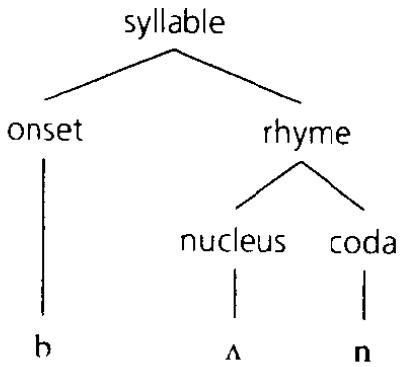
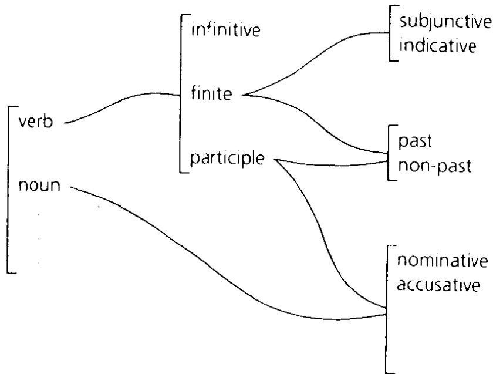
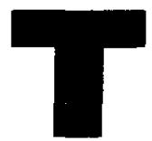
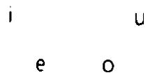
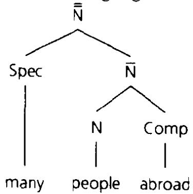
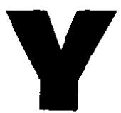

sound law. A phonological \*change claimed or assumed to have taken place in all forms that met the relevant conditions: \*Grimm's Law is an archetypal example. A term from the 19th century, linked to the programme of the \*Neogrammarians.

sound symbolism. The use of specific sounds or features of sounds in a partly systematic relation to meanings or categories of meaning. Generally taken to include: 1. The use of forms traditionally called \*onomatopoeic: e.g. chiffchaff (warbler whose song alternates a higher and a lower note). 2. Partial resemblances in form among words whose meanings are similar: e.g. among slip, slide, or slither, all with initial [sl}. In the second case the correspondence may be partly explicable by the nature of the sounds and meanings involved: e.g. the least sonorous vowel, [i), is often associated, in the vocabulary and in the minds of speakers, with concepts of smallness. But in other cases it is a feature simply of a specific language.

sound system. See phonological system.

source. \*Case role of e.g. the room in I left the room or from Sydney in I hitchhiked from Sydney to Canberra.

'source feature'. Used by Chomsky and Halle, \*SPE, of phonetic features of \*voice, \*stridency, and \*heightened subglottal pressure. The classification of features into source features, \*major class features, etc. was said at the time to have 'little theoretical basis'.

source language. One from which a translation is made. E.g. if a poem is translated from German into English, German is the source language and English the 'target language'.

South American languages. The indigenous languages of effectively three main regions. Those surviving in the south of the continent (roughly present-day Chile and Argentina) belong to a few small families: Araucanian, in south-central Chile and a neighbouring part of Argentina, has the largest number of speakers. Those of the central Andes (roughly from southern Colombia to south of Bolivia) include \*Quechua(n), spread originally under the Incas, and \*Aymará. Those of the rest of the continent are genetically very diverse, some belonging to small families, others to larger ones distributed at intervals over wide areas. The most important south of the Amazon is \*Tupi-Guaranı, of which \*Guaraní is, with Spanish, an official language of Paraguay. Gê, or a hypothetical enlargement 'Macro-Gê', is another in the central area of Brazil. To the north and west the most important groupings are Panoan, in the headwaters of the Amazon, \*Arawakan, \*Cariban, and \*Chibchan; the last group extends into the neighbouring part of Central America.

South Asian languages. The languages of the Indian subcontinent: see Indian languages.

## South Caucasian

South Caucasian. See Kartvelian.

South-east Asian languages. Variously classed as \*Mon-Khmer, which includes \*Khmer (Cambodian) and \*Vietnamese; \*Tai, which includes \*Thai and \*Lao; \*Tibeto-Burman, which includes \*Burmese; also, among the many smaller languages, some belonging to \*Austronesian, \*Kadai (grouped with Tai as Tai-Kadai), and \*Miao-Yao (= Hmong-Mien). The geopolitical area is part of a wider \*Sprachbund, from the eastern Himalayas across to southern China, which includes other related languages.

SOV language. One in which a \*subject (3), \*object (3), and verb are at least basically or most commonly in that order. E.g., in the usual account, Latin: thus Caesar (S) bellum (O) gessit (V) ‘Caesar waged war'. Opp. SVO language, VSO language, etc.

Spanish. \*Romance, the official language of Spain and of several countries in Central and South America, from Mexico to Chile and Argentina, that were once part of the Spanish empire. There are also some millions of native speakers in the USA.

Originally the dialect of Castile in north Spain, and a literary language, in poetry and prose, from the Middle Ages; carried southwards as the Moors were progressively driven from the peninsula, and overseas, by missionaries and colonists, after the European discovery of America. The term 'Castilian' is now used of European Spanish, as opposed to Latin American; also, within Spain, to \*Catalan or \*Galician.

spatial. Indicating or involving location in space. Thus here and there are opposed in a system of spatial \*deixis; under is a spatial (= locative) preposition in under the table.

SPE = The Sound Pattern of English, by Chomsky and Halle (1968). The classic account of \*Generative Phonology; also the source for one widely used taxonomy of phonetic features.

speaker recognition. The recognition of the voice of an individual speaker, either by other people or automatically by a machine.

Spec. See X-bar syntax.

special clitic. One whose position in a sequence of elements is peculiar to it, or to it and to other clitics, and is not that which might be expected from its role in the construction. Thus especially one which appears in second position following \*Wackernagel's Law.

Opp. simple clitic. But the possibilities are more complex than this dichotomy implies.

specialization. 1. Narrowing e.g. of word meaning; cf. restriction of meaning. 2. Proposed \*design feature of language: speech is

‘specialized' in that there is no natural connection between its physical character and its consequences in the behaviour of speakers.

Specified Subject Condition. A precursor, in the 1970s, of Chomsky's proposed constraints on \*bound (2) elements in \*Government and Binding Theory.

Specifier (Spec). See X-bar syntax.

spectrogram. A display of acoustic energy across a range of frequencies. In the form most helpful for the study of speech, changes in the distribution of energy over time are shown on the horizontal dimension; frequency (typically from 1 to 4,000 Hz or cycles per second) on the vertical; and levels of energy, above a set threshold, by a trace that intensifies as they increase.

speculative grammar. Style of philosophical grammar in the Middle Ages, in which the structure oflanguage, seen as in essence universal, is explained as mirroring that of reality. 'Speculative' is from Latin speculum 'mirror'.

speech act. An utterance conceived as an act by which the speaker does something. Originally of \*performatives: e.g. by saying 'I name this ship the Queen Elizabeth' a speaker will, in the appropriate circumstances, perform the act of naming it. Thence of utterances generally. E.g. in saying 'I will be there tomorrow' one makes a promise or a prediction: i.e. one performs an act of promising or predicting. If one says ‘Stephen is my brother' the act is that of making a statement, if 'ls Stephen your brother?' that of asking a question, and so on.

A theory of speech acts was developed by J. R. Searle at the end of the 1960s, on the basis of work by Austin. It included, among other things, a division of such acts into \*representatives, \*directives, \*commissives, \*expressives, and \*declarations.

speech community. Any group of people whose language or use of language can be taken as a coherent object of study. Speakers of English in general might be treated as such a community; also, e.g. speakers of a distinct variety that one might call ‘Birmingham English', spoken or usually spoken by part of the population of Birmingham. So might any other population that meets some test of coherence, whether large or small, bilingual or monolingual, in a single place or scattered.

speech error. An accidental error in speech: cf. slip of the tongue.

speech island. A small speech community occupying an area surrounded by speakers of another language.

speech processing. General term covering processes posited in the minds of both speakers (in speech production) and hearers (in speech recognition). Thence of superficially equivalent processing by computers.

speech synthesis. Any artificial simulation of speech, e.g. as a research tool in controlling stimuli for phonetic or psychological experiments, or in practical applications.

spelling pronunciation. A pronunciation of a word which is derived from or influenced by its spelling. E.g. earlier ['fprıd] forehead has been widely supplanted by the spelling pronunciation ['f:hed].

'spell out'. To supply a \*realization: e.g. a specific rule for English might spell out a plural morpheme in its regular basic form (-(e)s).

spirant. An older term for a \*fricative. Spirantization is a historical process by which a stop consonant becomes a fricative.

split. Change by which two distinct units, constructions, etc. develop from what was formerly one. Especially in phonology: e.g. Italian [k] and [tS] (in amico ‘friend' vs. amici 'friends') are distinct phonemes which have derived by a split, in Late Latin, from what had been a single phoneme [k} (written c). Opp. merger.

'split antecedent'. Two or more units which together supply the antecedent of a single \*anaphoric element: e.g. Roger and his wife as the antecedent(s) of they in Roger told his wife they (Roger and his wife) were broke.

split ergative. (Language) in which agents and patients are sometimes distinguished as in an \*ergative and sometimes as in an \*accusative language. E.g. the 'ergative' pattern is found only when the verb is past or perfect, or the ‘accusative' only when the agent and patient are pronouns.

split infinitive. A form in English in which to and an uninflected verb, together seen as constituting an \*infinitive, are separated by e.g. an adverb. Thus to and rid are ‘split' by systematically in to systematically rid this town of layabouts. Traditionally proscribed under this name.

split intransitive. The pattern exemplified in an \*active language, in which the single argument or valent of an \*intransitive construction is identified in some conditions with the agent in a transitive construction and in others with the patient.

'split morphology hypothesis'. The view, held widely but challenged within \*Lexical Morphology, that inflectional and derivational morphology are in principle separate.

'spontaneous'. (Sound-change) not explained by the phonetic context or the position in a word in which it takes place: e.g. the merger, in Southern British forms of English, of the vowel of moor and poor with that of more and pour. Also described as unconditioned'; but there is no implication, at least in current theories, that such changes may not be explained, or seen as 'conditioned', by other factors.

spoonerism. Slip of the tongue in which parts of successive words are interchanged. Classic examples make sense in their turn: e.g. our dear old queen' transposed to ‘our queer old dean’.

sporadic. (Sound-change) attested in some forms but not in others: hence an exception, at first sight if no more, to the \*Neogrammarian ‘regularity principle'.

Sprachbund. A group of languages, often of different historical origin, which are spoken in the same part of the world and have developed similar structures. Classic examples include the \*Balkan languages and those of the Indian subcontinent; those of Southeast Asia or of the Meso-American group of \*Central American languages are other striking instances involving members of several different families.

The area where such a group oflanguages is spoken is a linguistic area; the historical process by which they develop similar structures is that of \*convergence.

Sprachgefühl. A linguist's intuitive feel for a language; cf. intuition.

spread. (Lips) distended as in a smile: e.g. in the articulation of {i] in Italian (dico or Dino). Opp. rounded.

spreading. The extension of a phonetic feature intrinsic to one element to other adjacent elements. Thus in a word like maim the feature 'nasal', intrinsic to the consonants, spreads to the intervening vowel.

square brackets []. Mainly used: 1. To enclose phonetic transcriptions: e.g. fish is phonetically [fif]. 2. To enclose syntactic or other \*constituents: e.g. wcnt into the garden can be analysed into the constituents [went [into [the garden]]}. Cf. labelled bracketing. 3. In representing phonological or other \*features. Thus the vowel in scream has the feature [Front} or [+ Front], among others.

squish. J. R. Ross's term for an instance of \*gradience.

s-selection. Introduced by Chomsky in the 1980s for \*valency or \*argument structure seen as determined by the meaning of an individual word. Opp. c-selection.

S-structure. The least abstract level of syntactic structure in \*Government and Binding Theory. Derived by successive modifications from the notion of \*surface structure in transformational grammars of the 1960s and 1970s; effectively jettisoned, with a similar relic of \*deep structure, in Chomsky's \*minimalist programme in the 1990s.

## stacking

stacking. Any pattern in which two or more units of a kind are independently related to the same element. E.g. in the man you saw who kissed her who was here yesterday, three successive relative clauses are stacked in relation to the single noun man.

See also case stacking.

Stammbaum model. The model adopted especially by \*Schleicher in the mid-19th century, in which historical relations among languages are seen as like those between generations in a family tree (German 'Stammbaum'). Thus \*Indo-European is represented as a parent language from which e.g. \*Italic developed as one independent daughter language. Latin in turn is one independent daughter of Italic, and the \*Romance languages independent daughters of Latin. Contrasted later in the century with the \*wave model.

standard. (Form, variety) which is learned and accepted as correct across a community or set of communities in which others are also used: e.g. Standard English, as used especially in writing, vs. regional dialects, creoles based on English, etc.

Standardization is the process, often in part at least deliberate, by which standard forms of a language are established. Forms and varieties which are not standard are simply 'non-standard'.

'Standard Average European'. B. L. Whorf's term for a group of European languages including English, German, and French, distinguished by a set of common categories of time, space, etc. from many others. An aspect, in effect, of a European \*Sprachbund.

'Standard Theory'. The theory of transformational grammar proposed by Chomsky in the mid-1960s. The main feature distinguishing it from the proposal that immediately replaced it was that the \*semantic representation of a sentence was determined solely on the basis of its \*deep structure.

The term dates from the 1970s. Also called 'Aspects-theory' or ‘Aspectsmodel', from Chomsky's Aspects of the Theory of Syntax (1965).

starred form. See asterisk

statal = stative. Thus (was) flattened is a 'statal passive' if it simply describes the flattened state an object is in, as opposed to a 'dynamic passive' which refers to the action of flattening.

statement. See declarative.

static tone = register tone: opp. dynamic or contour tone.

'statistical universal' = relative universal, but with the added assumption or implication that languages form a population of individuals that can be studied by statistical methods.

stative. Referring to a persisting state or situation. E.g. stand and sleep are stative verbs; (is) destroyed is stative if it means ‘in the state of having been destroyed'. Opp. dynamic.

stem. A form from which a word or series of words is derived by the addition of one or more \*affixes. Especially one which is common to all the words that make up a definable part of a paradigm: e.g. French chanter- is a 'future stem' or ‘stem of' the future, in that it is common to all the forms of the verb that are of this tense (chanter-ai '(I) will sing' chanter-as '(you) will sing', etc.).

stem compound. A \*compound formed from elements that are not complete word forms: e.g. Latin signifer'standard bearer', from sign(i)- (nominative signum ‘sign, standard') and fer- (cf. fer-t ‘carries').

stem vowel. A vowel which is \*thematic (2).

stereotype semantics. Model of word meanings in which each includes a stereotype of whatever a word denotes. Cf. prototype theory.

stiff voice. Type of \*phonation in which the vocal cords are held more stiffly, with a slightly lower flow of air, than in normal or modal voice. Cf. slack voice.

stigmatized. (Form, etc.) seen as objectionable by some or all members of a speech community. E.g. ain't, though widely used, is stigmatized in American English.

stimulus-response model. Model of communication in which a stimulus (S) acting on a speaker gives rise to speech as a linguistic response (r); this in turn acts as a linguistic stimulus (s) which in turn gives rise to a response (R), e.g. a visible action, in a hearer. Thus, schematically, S → r . . . s → R.

Introduced into linguistics by Bloomfield in the 1920s, on the basis of current theories of \*behaviourism, and the foundation for his account of meaning.

'stock'. Used by some historical linguists variously of a \*family or of a hypothetical grouping of two or more established families into a larger family. In the latter sense sometimes equivalent to and sometimes seen as smaller than a \*phylum.

Stoics. School of philosophers, founded in Athens c.300 BC. The early Stoics divided philosophy into three parts, of which a 'logical' part was in turn divided into the study of the meanings of expressions (what is 'said' or ‘signified') and that of the expressions themselves (that which 'signifies’). The work of Chrysippus (280-207 BC) and his pupil Diogenes of Babylon (c.240-152 Bc) is particularly important in the development of the system of \*parts of speech; also of case, tense, and other semantic categories.

## stop

The writings of the early Stoics have not survived, but their ideas are known, in part fragmentarily, from later sources.

stop. Consonant in whose articulation a flow of air is temporarily blocked: e.g. {p| and t} in pit. Usually of consonants, such as these, in which the flow is blocked through both the mouth and the nose; but some definitions include those in which it is blocked through the mouth only: thus \*nasals such as [m} and [n] in man.

'stranding'. See preposition stranding.

Stratal Uniqueness Law. See term.

'strategy'. Informally in various contexts of a broad way of achieving an end. To use an interrogative as a request ('Can you help me?’, 'Could they possibly be kept on the leash?') might thus be said to be one strategy for influencing the actions of an addressee, or one strategy for politeness; a model of language processing will adopt a strategy for e.g. parsing; and so on.

Stratificational Grammar. Model of grammar developed by S. M. Lamb from the early 1960s. Forms were represented at each of a series of levels, called 'strata', of which the lowest dealt with phonetics and the highest with meaning. Each stratum was characterized by one basic unit: e.g. at one level, the phoneme. This was composed of minimal elements labelled by a term in ‘-on': e.g. 'phonons' were distinctive features of phonemes. Each stratum specified the ways in which its basic unit could be arranged: this constituted a '-tactics', e.g. phonotactics. Finally, each was connected to the next higher or next lower stratum by a relation of realization: e.g. phonemes realized morphons', which were the minimal elements of a higher stratum whose basic unit was the morpheme.

Interest in the model had dwindled by the mid-1970s.

stratum. A level of \*representation, generally (as in \*Stratificational Grammar) or within a specific structure. Thus in \*Relational Grammar a sentence such as Mary was seen by Bill has a structure that distinguishes two strata, one in which Mary and Bill have the roles they have in the corresponding active, and another in which they have undergone respective \*promotion and demotion, to their roles in the passive.

'strength'. Used in phonology of any scale or hierarchy in which units are distinguished as stronger or weaker with respect to some phonetic property or properties. Thus stop consonants may be seen as stronger, with respect to the degree of \*stricture, than fricatives; voiceless as stronger than voiced; and so on. \*Fortition (or strengthening) and \*lenition (or weakening) can be defined as processes by which units at one point on such a scale are replaced by others either higher or lower.

stress. Phonological feature by which a syllable is heard as more prominent than others. E.g. in below the second syllable is stressed [br'ləu], in billow the first ['biləu]. Also of \*sentence stress and prominence within larger units generally. Thus in He did stress might fall on either word: HE did 'It was him who did' (stress on he), or He DıD.

The phonetic correlates vary: in auditory terms, a difference in length, in perceived loudness, in vowel quality, in pitch, or in a combination of any of these. As a feature of words, \*accents (1) are divided generally into stress accents, in which the differences reflect or are thought to reflect greater muscular energy in the production of an accented syllable, and \*pitch accents. The accent in English, as in below and billow, is a stress accent.

stress accent. See stress.

stress group. A sequence of syllables of which one bears a \*primary stress, seen as a rhythmical unit. Cf. foot: e.g. in one analysis, easy solution would be divided into the stress groups [EAsy so] and [Lution].

stress-timed. (Language) in which thé intervals between stressed syllables in speech are either equal or at least more nearly equal than the intervals between the nucleus of each successive syllable and the next. Thus English, to the extent that, e.g. in a phrase such as incrédible explanátions, the interval in time between the two stressed syllables, [krε] and [neı}, will tend, despite the number of intervening unstressed syllables, to equal that in phrases such as absúrd théories, where stressed [sə:d} and [θıə] are adjacent. Opp. syllable-timed.

'strict subcategorization'. Introduced by Chomsky in the 1960s for the assignment of a lexical unit to a syntactically defined subclass of its major word class: e.g. that of make to the subclass of verbs that can be followed by an object noun phrase.

Cf. c-selection; also valency. ‘Strict' as opposed to subclassification by \*selectional restrictions (1).

stricture. Any constriction of part of the vocal tract in the articulation of a speech sound. Degrees of stricture range from closure, in \*stops such as [p in pea, through \*close approximation, in \*fricatives such as [s] in sea, to \*open approximation, e.g. in vowels.

strident = sibilant. A \*distinctive feature in the schemes proposed by Jakobson and by Chomsky and Halle, \*SPE, where characterized acoustically by a higher intensity of noise. Thus [s] in sin is strident in opposition to [θ] in thin; also, in SPE, a labiodental {f] in opposition to a bilabial [φ].

string. Mathematical term for a linear array of elements. E.g. given the set A = {a, b, c}, a, baa, bcbac, . .. are strings over' (that is, composed of elements of) A. Hence used by linguists in a sense equivalent to ‘sequence'

## stripping

stripping. The reduction of a clause to a single unit by which it differs from an earlier clause to which it is related by \*coordination: e.g. in I sent a letter to her parents and < > some flowers < >: sc. and I sent some flowers to her parents'. Cf. gapping.

strong (1). (Verb, formation, etc.) in Germanic languages distinguished by \*ablaut as opposed to suffixing. Thus in English sing is a strong verb (past tense sang, participle sung) while talk is a weak verb (past tense and participle talked).

strong (2) (syllable, etc.). See Metrical Phonology.

'strong crossover'. Sometimes invoked in excluding the possibility that, e.g. in Who did she visit?, both pronouns (who and she) might be taken as having the same referent. If seen in terms of \*wh-movement this would involve the second of two coreferential elements 'crossing over' the first.

strong generative capacity. The range of structures that a specific type of \*generative grammar can assign to the sentences of a language. Thus grammars of type A might be capable of generating the same sets of sentences as grammars of type B: in that sense they would have the same \*weak generative capacity. But those of type A might be able to assign alternative structures to sentences for which those of type B could assign one structure only. If so then, all else being equal, the strong generative capacity of grammars of type A would be greater.

'Strong Lexicalist Hypothesis'. The view that, firstly, there is no distinction in principle between inflectional and derivational morphology and, secondly, they both belong, in a generative grammar, to the lexicon and not to syntax. Distinguished from the 'Weak Lexicalist Hypothesis', by which derivation belongs to the lexicon but inflection does not.

strongly equivalent. (Grammars, types of grammar) having the same \*strong generative capacity.

structural ambiguity = grammatical ambiguity.

structural dialectology. Treatment developed in the 1950s by U. Weinreich and others, in which dialects were compared within the framework of a common \*diasystem. Thus, in their phonology, they could be seen as differing variously in the ‘inventory' of units at some point in the system, in general patterns of \*distribution of such units, or in the ‘incidence' of units in sets of cognate words.

structural linguistics. Any school or theory in which language is conceived as a self-regulating system, whose elements are defined by their relationship to other elements.

Structuralism originated above all in the posthumous work of Saussure, and by the mid-20th century was not only dominant

in linguistics but was having an increasing influence on other disciplines, including anthropology and literary criticism. The term itself was in general use before the Second World War, with reference to a discipline in which the study of a \*language system was abstracted from the spoken and written use oflanguages and from their history: hence a growing divide between structuralism and the older branches of \*philology. But since 1960 usage has become in part confused. In particular, Chomsky and his followers identified structural linguistics with the local \*Post-Bloomfieldian school to which they were reacting in the USA; since they rejected Post-Bloomfieldian methods, they themselves were not 'structuralists'. But in a wider conception, Chomsky's account of a \*generative grammar was clearly structuralist.

See European structuralism for leading scholars in that tradition.

structural order. See order.

structure. Used by Firth and others specifically of \*syntagmatic structures. Opp. system.

structure-dependency. Principle by which syntactic processes respect the organization of sentences into phrases. The stock illustration is that of inversion in interrogatives in English: e.g. in The man who was there is coming it is possible to invert the man who was there and is (Is the man who was there coming?), but not the man who and was (\*Was the man who there is coming?), since the man who does not form a subject phrase.

'Sturtevant's paradox'. The paradox by which sound-change is regular but creates irregularity while analogical change is irregular but creates regularity. Thus a sound-change may give rise to an irregular inflection; an analogical change may replace it with the one that is usual.

Formulated as a paradox by E. H. Sturtevant in the 1940s.

stylistics. The study of style in language: traditionally, of variations in usage among literary and other texts; now, more generally, of any systematic variation, in either writing or speech, which relates to the type of discourse or its context rather than to differences of dialect. Thus there is a style appropriate to public lectures, different from that of casual conversation among friends; the style of prayers in church includes the intonation, etc. with which they are recited: and so on

Hence 'literary stylistics', as the study of relevant differences, other than in the dialect or language used, among individual writers, periods, or genres.

sub-. From the Latin word for 'under'. Hence \*subordination 'ordering or ranking under', or \*subjacency, of a principle involving elements 'lying under' nodes in a tree structure. Also in the terminology for \*local cases: subessive, indicating position 'under', sublative, indicating movement to a position 'under', and so on.

## subapical

subapical. (Consonant) articulated with the underside of the tongue tip in contact with the top of the mouth: one form of \*retroflex articulation, normal in Dravidian languages.

subcategorization. The assignment of a lexical item to a subclass of its part of speech, especially with respect to the syntactic elements with which it can combine. Cf. strict subcategorization.

In a notation introduced by Chomsky in the 1960s, verbs were assigned to subcategorization frames which identified their potential positions in phrase structure trees. Thus a \*transitive verb, such as make, was assigned a feature [+ —NP]: i.e. it can appear (+) in the frame ‘-NP', or before a noun phrase.

subfamily. See family.

subglottal. (Air, air pressure) below the vocal cords.

Subj = subject.

subjacency. Principle of syntax, as formulated by Chomsky in the late 1970s, by which the movement of a unit is blocked if it crosses the boundaries of two or more designated classes of constituent. Thus, in this account, the reason why one cannot say Who did you hear the news that he had killed? is that who would have to be moved, by \*wh-movement, across the boundary of both a subordinate sentence (he had killed <who>) and a noun phrase (the news that he had killed <who>) in which it is included.

Movements were seen as following the \*cyclic(al) principle: hence the nodes in a phrase structure tree which dominated the constituents within which they could operate were cyclic nodes. Constructions in which, apparently contrary to the principle of subjacency, a unit moved across the boundaries defined by more than one such node were explained as cases of \*successive cyclicity.

subject (5). 1. A syntactic element in e.g. English which is traditionally seen as representing someone or something of which something is said or \*predicated, and which, in addition, includes the \*agent in a basic \*transitive construction. E.g. John in John came, John helped me, John was freed, John is my friend, and so on; also, on the assumption that they have the same syntactic role, knowing hím in Knowing him helped me, or that he is worried in That he is worried is obvious

Thence extended to elements in other types of language that are similar in one or the other respect. 2. Sometimes, though less usually, of noun phrases, etc. serving as a \*topic (3) or \*pivot (2). 3. Commonly, especially in studies across languages, of any syntactic element which characteristically includes the semantic role of agent. E.g. an \*ergative case will be said to mark the subject in one type of language, as the \*nominative does in another.

subject clause. A clause which has the role of subject: e.g. when it happened in When it happened isn't known, or that it happened in That it happened isn't certain.

subject complement. An adjective or noun or noun phrase which is linked to a subject by a \*copula or \*copular verb: e.g. angry in She was angry (with copula was), or traitor in He turned traitor (with copular verb turned). Cf. predicative.

subject control. Relation of \*control in which the subject of a non-finite verb is supplied by the subject of a main clause: e.g. in I wanted to leave the subject of to leave is supplied by that of the main verb, I.

## subject honorific. See honorific.

subjective. \*Case which is that of, among others, a subject: e.g. I is the subjective form of the pronoun, as in I did. Opp. objective: more usual, instead of \*nominative, in describing languages with no other distinction of cases.

subjective genitive. Construction in which a noun, etc. in the \*genitive case, or its equivalent, has a semantic relation to a head noun like that of a subject to a verb. E.g. John's in John's departure: compare John departed. Opp. objective genitive.

subjectivity. In the ordinary sense. Also, following Benveniste in the 1950s, of the property of language by which utterances reflect the standpoint of the speaker. Thus, in \*deixis, pronouns such as I are used by speakers to refer to themselves; a \*performative such as I promise to be there constitutes an act of promise by the speaker; and so on.

subjectivization. Process of change by which words develop a subjective in place of or alongside an objective sense: e.g. villein, in the objective sense of 'feudal serf', > villain, in the subjective (and in this case \*pejorative) sense of someone perceived as base or wicked.

subject-prominent. (Language) in which the basic syntactic elements of a sentence are a \*subject and a \*predicate. Opp. topicprominent; but whether this division is either exhaustive or revealing depends on how 'subject', in particular, is defined.

subject pronoun. A pronoun with the syntactic role of subject. Thus, in I left, I is a subject pronoun in the appropriate \*subjective form.

subject raising. \*Raising (2) of a subject. Hence, in particular, of the postulated raising of the subject of a subordinate verb to the subject position of a main clause: e.g. Mary in Mary seems to be there (seen as from an underlying It seems [Mary is there] or [Mary is there] it seems).

subjunct. Used by Quirk et al., \*CGE, of a range of adverbials which would include e.g. morally in It is morally wrong, or pretty well in They pretty well wrecked it. Said to have to a greater or lesser degree, a subordinate role . . . in comparison with other clause elements'. Cf. adjunct; conjunct (2); disjunct.

subjunctive (suss). \*Mood, especially in European languages, whose central role is to mark a clause as expressing something other than a statement of what is certain. Thus, in Latin, faciat (do-suBj-3sG) 'Let him/her do (it)' as opposed to \*indicative facit ‘He/she is doing it'. Usually with a range of loosely related uses: in particular, the subjunctive is often required in some types of subordinate (= 'subjoined') clause, or in clauses introduced by specific subordinators or subordinating conjunctions.

Forms such as be in I ask that he be told, or were in If he were here he would help are traditionally called 'subjunctive' in English,

subordinate clause. A \*clause which is a syntactic element within or of a larger clause: e.g. I like as the modifier of people in the larger clause I want people I like, or what I like as the complement of know in I know what I like.

Opp. independent clause; main clause; superordinate clause: thus a subordinate (or 'lower') clause is an element within the structure of a superordinate (or 'higher') clause. Also called a 'subordinate \*sentence'. The verb of a subordinate clause is a subordinate verb, its subject a subordinate subject, and so on.

subordinating conjunction = subordinator.

subordination. 1. = dependency. 2. = modification (1). The first sense is usual and traditional: thus subordination or 'hypotaxis' (respectively the Latin and the Greek for 'ordering under') is opposed to \*coordination or 'parataxis' ('ordering beside'). The second sense is that of, among others, Bloomfield.

subordinator. A word, etc. which marks a clause as \*subordinate: e.g. after in He came [after we left], or that in He said [that we had left]. Traditionally a 'subordinating conjunction'; cf. coordinator.

Sometimes restricted to subordinators in \*adverbial clauses. E.g after is a subordinator; that, by contrast, is a \*complementizer.

substance. The projection of a set of abstract relations among units on to anything concrete corresponding to them. E.g. 'p' in English is opposed to 'b': that, in the theory of Hjelmslev in particular, is simply a statement about a difference within an abstract \*language system. But the difference may be realized, in a \*phonic medium, by the sound [p| as opposed to the sound [b] or, in the medium of writing, by the letter 
 as opposed to the letter <b>. These are accordingly projections of a relation between units that are in themselves neither sounds nor letters on to units of, respectively, 'phonic substance' and '(ortho)graphic substance'. Similarly, 'pin' in English is distinct from 'bin'; that, again in Hjelmslev's theory, is another abstract distinction in the language system. But it is seen as projected, on to a substance of 'thought', as a distinction between corresponding concepts.

The abstract relations are those of \*form (2); see also purport. The germ of this idea is in the work of Saussure, but Hjelmslev elaborated and clarified it.

substandard. (Form, variety) which is not \*standard. Usually of ones proscribed in relation to a standard: e.g. double negatives, as in I don't know nothing, are proscribed as 'substandard' in English.

substantive ['sabstəntiv) = noun. Originally 'noun substantive', from Latin nomen substantivum (roughly ‘independent noun') as opposed to nomen adiectivum 'noun adjective' (roughly 'dependent noun’). These were divisions within a class of 'nouns' which was seen in antiquity as including \*adjectives as well as nouns as they are defined nowadays.

substantive universal [səb'stantiv]. Chomsky's term in the 1960s for any specific category, etc. established as part of a general linguistic theory: thus e.g. a phonetic feature such as voice, a semantic feature such as abstract vs. concrete, a syntactic category such as noun and verb. Also of specific rules: thus, in one such theory, of a syntactic rule by which a sentence in any language must have, as its basic elements, a subject and a predicate.

Opp. formal universal.

substitute form = pro-form.

substitution. The replacement, in the process of analysing a language, of one unit or sequence of units by another. Thus, in establishing its phonemes, one procedure is to interchange sounds to determine whether the substitution makes a difference of meaning. Cf. commutation test.

A substitution frame is the rest of a sequence in which substitutions are made. E.g. in the frame The – have left, a word such as men (The men have left) can be replaced by any of elephants, young people, workers next door, and so on.

substratum. 1. A language formerly spoken by some population which has influenced their acquisition of a language spoken later. E.g., under the Roman empire, languages such as Gaulish or Iberian were replaced by Latin. But it has often been argued that, in learning Latin, speakers of these languages carried over certain phonetic and other features, and that these are reflected in modern Romance dialects.

2. A language spoken by some population which has influenced that of a group by which they were dominated. Thus English as a possible influence on the evolution of Anglo-French after the Norman

## subtraction

conquest; also any of several West African languages as a factor in the formation of \*pidgins spoken in the West Indies.

Cf. adstratum; superstratum.

subtraction. Morphological process by which part of a form is deleted. Thus, in one account, French grand [grã] 'big' (masculine) is phonetically derived from grande grād] by the subtraction of the final consonant.

Implicitly distinguished, as a systematic process, from lexical abbreviation or \*clipping.

'subtractive bilingualism'. The acquisition of a \*second language at the expense, or ultimately at the expense, of the first, e.g. that of English by many immigrant communities in North America or Britain. Contrasted, though the facts are hardly so clear-cut, with \*additive bilingualism.

'successive cyclicity'. Term for cases where, according to \*Government and Binding Theory, a syntactic process applies to the same element in two or more cycles as defined under the principle of \*subjacency. E.g. in Who did you say you saw?, who is claimed to move, by \*wh-moven ent, in two stages: first to the head of the subordinate clause (who you saw), then to the head of the main clause.

suction. Defined by Chomsky and Halle, \*SPE, as a feature of both \*clicks and \*implosives, in both of which the \*airstream mechanism is ingressive.

suffix. An affix that comes after the form to which it is added: e.g. -ness in sadness. Hence suffixation, for the process of adding a suffix. Also suffixal: thus -ness is in suffixal position, and the formation of nouns in -ness a suffixal formation.

sulcal. Grooved: thus the tongue is in a sulcal' position if e.g. the sides are raised but there is a groove in the centre.

Sumerian. Ancient language of southern Mesopotamia, not securely related to any other. Written in \*cuneiform, which evolved from a set of \*pictograms used, in the late 4th millennium BC, for mnemonic labelling, to a full representation of sentences, with both \*logograms and syllabic characters, by the late 3rd millennium. Increasingly supplanted by \*Akkadian from the early 2nd millennium.

summative. Used by Quirk et al., \*CGE, of adverbs or adverbials that introduce a summing up of what precedes: e.g. all in all in So, all in all, it was a success.

Summer Institute of Linguistics. Scholarly organization whose work complements that of the Wycliffe Bible translators. Founded in the USA in 1934 to train missionaries in linguistic fieldwork; \*Pike is its most important member and his theories have informed much of its work.

Sundanese. \*Austronesian; a major language of Java, with several million speakers in the western third of the island.

super-. From the Latin word for 'over'. Hence, in the terminology for \*local cases, superessive, indicating position above or over; superlative [su:pə'leitiv], indicating movement to a position above or over. Likewise \*superordinate, in opposition to subordinate; \*superfix, for a morphological element realized 'over' others; and so on.

## superfamily. See family.

superfix. A morphological element, especially of accent or tone, whose realization is simultaneous with the whole or part of the form to which it is joined. E.g. in récord ['rεkə:d} vs. recórd [rı'kə:d] the accentual patterns might be treated as contrasting superfixes ('− and −').

superlative. (Construction, inflection, etc.) by which persons, things, etc. are singled out as having some property to the greatest or to an extreme degree. Originally of inflected forms of adjectives or adverbs: e.g. lousiest in It's the lousiest film I've seen is the superlative form of lousy.

\*Positive, \*comparative, and superlative are traditionally three terms in the category of‘grade'. Some languages distinguish a superlative, by which individuals are singled out from a specific set, from an \*elative (2), whose role is simply that of an intensifier.

superordinate clause. A clause seen in relation to a \*subordinate clause within it. E.g. I expect he will come is a superordinate or ‘higher' clause in relation to the subordinate or ‘lower' clause he will come, which is contained within it. Cf. main clause.

superstock. See family.

superstratum. A language spoken by a dominant group which has influenced that of a population subordinate to it. E.g. speakers of English were dominated after the Norman conquest by speakers whose native language was Anglo-French; hence Anglo-French became a superstratum that has influenced the history of English.

Cf. substratum; adstratum.

supine. Term in Latin grammar for a nominal form of a verb with the same stem as the passive participle. Hence available for forms in other languages which are like participles in some respects but different in others.

supplementive. Used by Quirk et al., \*CGE, of an adjectival or other unit whose construction is as a supplement to a clause rather than an element in it. E.g. too embarrassed for words is supplementive in Too embarrassed for words, I rose to my feet.

## suppletion

suppletion. Morphological process or alternation in which one form wholly replaces another. Thus in went either the whole form, or a stem wen-, is in a suppletive relationship to go.

In partial suppletion only a part of the form is replaced. E.g. in thought (or though-t), the th- of think is unchanged and only -ink is affected.

suprafix = superfix.

supraglottal. Above the vocal cords or \*glottis. E.g. a plosive such as [t} or [k] is articulated with a ‘supraglottal closure'.

suprasegmental. (Unit, feature, etc.) whose domain extends over more than one successive minimal element. Thus \*stress is a suprasegmental feature whose domain is a syllable, not an individual consonant or vowel within it.

surd. An older term for \*voiceless.

'surface'. Usually in a sense derived from that of \*surface structure. Thus a surface filter is a \*filter that applies to representations of sentences at that level; likewise treatments may invoke surface (or 'surface structure') \*constraints, conditions, etc.

surface structure. A representation of the syntax of a sentence seen as deriving, by one or more \*transformations, from an underlying \*deep structure. Defined by Chomsky in the mid-1960s as the part of the syntactic description of a sentence that determines its phonetic representation; therefore a structure in which, in particular, all elements are in the order in which the corresponding phonetic forms are spoken. Later, by the mid-1970s, said to determine the \*semantic representation also, and subsequently replaced by a more a stract structure renamed, from the late 1970s. S-structure. As such the least abstract of three levels of syntax in \*Government and Binding Theory, until the early 1990s, when Chomsky's \*minimalist programme no longer took it for granted.

Cf. Phonetic Form; shallow structure.

Survey of English Usage. Founded by Quirk in 1960, at University College London; the repository of a major corpus of educated British English, written and spoken.

svarabhakti. Sanskrit term for \*anaptyxis.

Svo language. One in which a \*subject (3), verb, and \*object (3) are at least bąsically or most commonly in that order. E.g. English: They (S) helped (V) us (O). Opp. SOV language, VSO language, etc

'Swadesh list'. A list of concepts supposedly basic in the vocabulary of all languages, proposed by M. Swadesh in the 1950s for use in studies of \*glottochronology.

Swahili. \*Bantu, in origin native to a very small area, spread by migration along the coast of East Africa and much later, from the 19th century, as a lingua franca and in pidginized forms, into the interior. Standard Swahili is based on the dialect of Zanzibar, though not identical to it: widespread as a second language in Kenya and Tanzania, where it has official status, in Uganda and into eastern Zaire; also increasingly, in cities, as a first language.

Also called 'Kiswahili', with the noun class prefix appropriate for names oflanguages.

Swati. \*Bantu, spoken in South Africa and in Swaziland; related to \*Xhosa/\*Zulu within a group called 'Nguni'.

Swedish. North \*Germanic, spoken in Sweden and as a minority language in Finland, where it also has official status. The standard form dates from the translation of the Bible in the 16th century.

Sweet, Henry (1845-1912). British grammarian, phonetician, and Anglicist, whose contributions to phonetics and to our knowledge of the early history of English are both fundamental. Phonetics was for Sweet 'the indispensable foundation of all language study, whether practical or scientific': his description and classification of vowels, in particular, was brilliant, and his advocacy of transcriptions based on the Roman alphabet, as opposed to \*Visible Speech or other \*analphabetic systems, was decisive in the period leading to the foundation of the \*International Phonetic Association. He distinguished separate systems for \*broad and \*narrow transcription ('Broad Romic' and ‘Narrow Romic'), of which the former was in principle phonological: i.e. it made only the practically necessary distinctions of sound in each language', omitting 'all that is superfluous'.

switch-reference. (Grammatical system) in which a marker indicates whether a subject or other argument of a following verb has or has not the same referent as that of the verb preceding. E.g. schematically, John entered-sAME sat down, where sAME indicates 'same referent', means 'John came in and he (John) sat down', while John entered-DIFFERENT sat down, where DIFFERENT indicates 'different referent', means ‘John came in and he (someone other than John) sat down'.

syllabary. Writing system in which each character represents a syllable, typically consisting either of a vowel or a consonant plus a vowel: e.g. the 'katakana' and 'hiragana' systems used in writing \*Japanese.

Syllabaries are less satisfactory than alphabets for many languages, especially those which have consonants at the end as well as the beginning of syllables. An intermediate \*alpha-syllabic type is exemplified by Indian systems such as \*Devanagari.

syllabic. Forming the \*nucleus of a \*syllable: e.g. vowels are typically syllabic, and are accordingly said to have the \*feature [+ syllabic}. Syllabic consonants include e.g. the nasal [n] in [neiS) (nation), or a syllabic s in rapid pronunciations of words like Manchester ([mantSștə]).

## syllabic script = syllabary

syllable. A phonological unit consisting of a vowel or other unit that can be produced in isolation, either alone or accompanied by one or more less sonorous units. E.g. [ban] and [tın] are successive syllables in bunting. The vowel or other central unit forms the nucleus: the illustration, for [ban], shows other terms used for other proposed divisions. For types of syllable see closed syllable and open syllable, heavy syllable (vs. light); also Metrical Phonology for strong vs. weak syllables.

Theories of the syllable have been variously based on \*distribution or on phonetics. In a distributional theory, syllables are established with the aim of simplifying an account of possible sequences of phonemes, patterns of accentuation, and so on. In a phonetic theory, divisions between syllables reflect the way in which the production of consonants and vowels is or is believed to be organized. These different approaches can lead to an effective distinction, with discrepancies in some cases, between 'phonological syllables' and 'phonetic syllables'.

  
An example of syllable structure

syllable-timed. (Language) in which the timing of syllables tends to be equal: e.g. Spanish. Opp. stress-timed.

syllepsis [sı'lεpsıs] [sı'li:psıs]. Traditionally of constructions in which coordinated elements have different roles in syntax or in semantics. E.g. in He read me the letter and a warning afterwards, read has its literal sense in relation to the letter but a figurative sense in relation to a warning. The Greek term means 'taking together'; often conflated with \*zeugma.

symbol. Restricted in Peirce's theory of signs to those whose relation to their object is wholly conventional: e.g. the majority of words in any language.

synaeresis [sı'niərisis]. The contraction of two or more syllables into one: e.g. in English, of [aı] + [ə] (as in liar) into a monosyllable with a triphthong or a single long vowel. The opposite process is 'diaeresis'.

synaesthesia. The stimulation of one sense by another: e.g. the association of different colours with the perception of different sounds. Hence one factor in patterns of phonaesthesis or \*sound symbolism.

syncategorematic: (Word) seen as meaningful only in relation to other elements. E.g., in boys and girls, the nouns have meanings that can be described independently of the construction; but and has meaning only as a coordinator that links them. Cf. grammatical meaning.

synchronic. At a single moment in time. A synchronic description of a language is accordingly an account of its structure either at present or at some specific moment in the past, considered in abstraction from its history. Opp. diachronic; see also panchronic.

syncope ['sınkəpi]. The loss of unstressed vowels in the middle of a word. E.g. in secretary, of the vowel in the next to last syllable: thus ['sεkrətri]. Cf. apocope; also aphaeresis, aphesis.

syncretism. The relation between words which have different \*morphosyntactic features but are identical in form. Thus the distinction in English between a past tense (such as spoke) and a past participle' (such as spoken) is syncretized in regular forms such as talked.

Used especially when the identity is regular across all paradigms. Thus in Latin the distinction between dative and ablative, which was made in the singular in forms such as puellae 'girl-DATsG' and puella 'girl-ABLsG', was syncretized throughout in the plural: e.g. puellis 'girl-DATPL/ABLPL'. 'Neutralization' has often been used in the same sense; see also case syncretism.

syndeton ['sinditən]. The opposite of \*asyndeton. Thus a style, construction, etc. is syndetic if clauses are joined by conjunctions.

synecdoche [sı'nεkdəki]. \*Figure of speech in which an expression denoting a part is used to refer to a whole: also, in the traditional definition, vice versa. Hence a term in typologies of semantic change: e.g. flower has by synecdoche the sense plant bearing flowers'. Often treated as a special case of \*metonymy.

synesis. An older term for \*notional agreement.

synonymy. The relation between two lexical units with a shared meaning. 'Absolute' synonyms, if they exist, have meanings identical in all respects and in all contexts. 'Partial' synonyms have meanings identical in some contexts, or identical only e.g. in that replacing one with the other does not change the \*truth conditions of a sentence.

## syntactic category

Thus paper is a partial though not an absolute synonym of article: compare I got my paper published, I got my article published.

syntactic category. Any class of units distinguished in the syntax of a language. Hence specifically those that label nodes in a \*phrase structure tree: sentence (S), noun phrase (NP), verb (V), and so on.

syntactic function. A role that a word or other unit fills in relation to other elements in its construction. Thus the construction of My brother saw her relates the syntactic roles of subject and predicate, or subject, predicator, and direct object. That of subject is filled by my brother, that of e.g. predicate by saw her.

syntactic process. Any process formulated in accounts of syntax by which one form, structure, or construction is changed into another. E.g. a representation of Something held me up might be derived by a syntactic process from that of Something held up me; as an active construction that might be changed to a passive (I was held up by something); that might in turn be changed, by a further process, to the structure of an interrogative (Was I held up by something?).

The usual formulation of syntactic processes is as \*transformations.

syntactic valency. See semantic valency.

syntagm ['sintam] = phrase (1).

syntagmatic. (Relation) between elements that form part of the same form, sequence, construction, etc.: e.g. between s, p, and r in a form such as spring, or between a subject and a verb in constructions such as Bill hunts.

Defined by Saussure as a relation ‘in praesentia': i.e. between units present in the same sequence. Opp. associative; later, from the 1930s, opp. paradigmatic.

syntagmeme. See Tagmemics.

syntax. The study of grammatical relations between words and other units within the sentence.

Usually distinguished from \*morphology. E.g. in the phrase these books, the relations between the words belongs to syntax: thus these modifies or is a determiner of books; it comes before it, they agree in respect of number. The internal structure of the words belongs to morphology: thus books and these are each plural, books has the ending -s. Distinguished in many accounts from \*semantics: e.g. the order of these and books belongs to syntax, as does the rule which formally excludes this books or these book. But anything to do with the meaning of the phrase (that these is a deictic element, that it qualifies books, that the expression is used to refer to more than one book) belongs to semantics. Also distinguished, in itself or as part of \*grammar, from the \*lexicon: thus the role of these in relation to books belongs to

syntax, but the properties of book as an individual unit belong to an individual lexical entry

The term itself is univocal: where detailed definitions vary they reflect varying theories of the structure or nature of language generally.

synthetic (1). (Form, language) in which grammatical distinctions are realized by inflections. Opp. analytic (1): e.g. a possessive construction is realized analytically in Italian (la casa di Cesare, lit. 'the house of Caesar'), but was realized synthetically, with a \*genitive inflection, in Latin domus Caesaris 'house-NomsG Caesar-GEnsg'.

synthetic (2). (Proposition) whose truth depends on a specific state of affairs: e.g. Jane has red hair' is true if but only if Jane in fact has red hair. Opp. analytic (2).

'synthetic compound'. One which parallels a verbal construction: e.g. earth-mover, parallel to moves earth. Cf. root compound: neither term reflects a usual sense of 'root' or 'synthesis'.

Syriac. \*Aramaic language, first attested in the 1st century AD, and that of the Syrian church, with a rich literature, after the establishment of Christianity in the 4th century. Still in use as a liturgical language.

system. Often used, especially by Firth, Halliday, and their followers, to refer to sets of \*paradigmatic relations. Opp. structure: e.g. in a word in English with the ‘structure' (C)V (zero or more consonants plus vowel), the 'system' that applies or 'operates' at the V position includes [a:] (as in car), [i:] (as in see), and so on.

See Systemic Grammar; system network.

'systematic phonemic'. Used by Chomsky and Halle, \*SPE. of the level of \*underlying forms in Generative Phonology; the corresponding level of phonetic representation was called systematic phonetic'

system congruity. Conformity to the pattern general or usual in a specific language. Adduced as a factor in explaining directions of language change: see also pattern congruity as a criterion in phonology.

Systemic Grammar. Model of \*functional syntax developed by Halliday from the late 1950s. The basic idea is that any act of communication realizes a set of choices: thus e.g. the utterance of She went out realizes, among others, the choice of a declarative structure. Each choice is at a certain level in a hierarchy of \*ranks (2): e.g. the choice of declarative is at clause level. It is also related to other choices on a scale of \*delicacy or detail: e.g. the choice of interrogative instead of declarative would entail a further choice between \*polar

interrogative and \*wh-interrogative. Each individual set of choices forms a \*system: thus polar interrogative and wh-interrogative form one system, declarative and interrogative form or are part of another. A grammar will accordingly describe the systems of a language, the relations between them, and the ways in which they are realized, to a level of detail at which all remaining choices are between open sets of lexical units.

Originally called Scale and Category Grammar. The 'scale'was that of the successive ranks at which systems operate: e.g. morpheme, word, phrase, and upwards.

system network. A network of relations among different \*systems of oppositions, in which the applicability of one system depends on the choice of a particular term or terms within another or others. Thus, in the illustration, an opposition in verbs between subjunctive and indicative is shown as depending on the verb being finite, an opposition of tense as depending on it being either finite or a participle, and so on.

Devised in, and central to. \*Systemic Grammar

  
A system network

system sentence. Lyons's term for a sentence postulated as a unit in the \*language system, as opposed to a ‘text sentence' uttered or otherwise instantiated in a text or discourse.

T. Used as a cover term for \*familiar forms. From the t of French tu;   
opp. V from French vous.

t. See trace.

taboo word. A word known to speakers but avoided in some, most, or all forms or contexts of speech, for reasons of religion, decorum, politeness, etc. Thus in some societies the word for ‘death is taboo, and is accordingly replaced in most forms of speech by a metaphor, \*euphemism, or some other figurative or roundabout expression.

'tacit knowledge'. Knowledge which people have but of which they are unable to give any account. Thus knowledge of a language (\*I-language) as conceived by Chomsky and others following him.

(-)tactic. Concerned with the arrangement of units. E.g. \*phonotactics is concerned with the possible arrangements of, or 'tactics' of, phonemes.

tag. A reduced form such as will you? in You will be there, will you? or hasn't she? in Jane has arrived, hasn't she? These are, more precisely, \*interrogative tags or tag questions.

Tags in English are usually linked to declaratives (You will be there, Jane has arrived), but may also follow e.g. an imperative (Put it on the table, will you?). Many show reversed polarity: i.e. their \*polarity is negative when what precedes is positive, and positive when it is negative. Thus Jane has arrived, hasn't she? (positive + negative); Jane hasn't arrived, has she? (negative + positive).

Tagalog. The official and main language of the Philippines. \*Austronesian, of a branch which includes the other indigenous languages of the Philippines: native to south Luzon, which includes Manila, but a second language, in the standard form called Pilipino, throughout the other islands.

tagmeme. 1. Bloomfield's term for any unit of grammatical patterning: e.g. the actor-action' or subject-predicate construction is a tagmeme. 2. See Tagmemics.

Tagmemics. Model of \*functional syntax developed by Pike, R. E. Longacre, and others from the 1950s. The central concept is the tagmeme, defined by the relation between a syntactic 'slot' or function, such as subject or object, and a class of units, such as noun phrase or pronoun, that can 'fill' it. Constructions, or syntagmemes, are accordingly characterized by sequences of obligatory and optional tagmemes: e.g. that of The people were leaving by one in which there is an obligatory subject slot, filled by the noun phrase, followed by an obligatory predicate slot, filled by a verb phrase. Each syntagmeme is of a specific size-level': thus this example is of a clause-level syntagmeme, while those which would represent the constructions of the people and were leaving are at phrase level. Size-levels in turn are linked by potentially recursive relations among syntagmemes, functions, and classes. E.g. the structure of the people is that of a noun phrase; this can function as subject in a structure which is that of a certain class of clause; that in turn might function e.g. as the object in a larger clause (They said { [the people] were leaving]).

Pike was the first to develop clearly a model of this type. The earliest version of \*Systemic Grammar was to have much in common with it; so too the \*Functional Grammar of S. C. Dik and his colleagues.

Tai. Family of languages in South-east Asia, spoken extensively in Laos and Thailand (see Lao, Thai), in north Burma and Vietnam, and across the borders of these countries with China and India.

Tai-Kadai is a larger grouping, proposed but not securely established, in which Tai is linked with \*Kadai and \*Kam-Sui.

tail. The part of an intonation pattern that falls on syllables following the nuclear or \*tonic syllable: e.g. in They could do it, with tonic they, the tail is could do it. Cf. head (2).

tailless arrow (>, <). Used to represent a change in the history or postulated prehistory of a language: e.g. Old English hūs 'house' > modern house; likewise ū, in this and other forms, > [au].

Tajiki. See Persian.

Takelma. See Penutian.

Tamil. \*Dravidian, spoken in the Indian state of Tamil Nadu and in northern Sri Lanka, and by historical migrations in many other places in the former British Empire. Attested by inscriptions in \*Brahmi c.200 BC and by literature from soon afterwards; the present South \*Indian script has been standard since the late medieval period.

tap. A consonant articulated with the shortest possible contact between articulators: e.g. the t in butter as pronounced by many speakers of American English. Cf. flap.

target. An ideal sound or articulation which a speaker hypothetically aims at in the production of a phoneme. Central to the account of (Daniel) Jones, and reflected in studies of \*coarticulation. Thus the articulatory target for [t] in English is an alveolar stop; that of [0} is an interdental fricative: taken together, these lead to coarticulation in the production of {tθ} in eighth.

target language. That which one aims to teach, learn, translate into, etc. Opp. source language.

Tatar. See Turkic.

tatpurusha. Term from Sanskrit for a \*determinative compound.   
Named after a representative example: tatpurusa 'his-man'.

tautology. Term in logic for a proposition that cannot but be true: e.g. 'If it is white it is white'. Cf. analytic (2).

tautosyllabic. Forming part of the same syllable. Thus a phonological \*diphthong is analysed into a sequence of two tautosyllabic (opp. 'heterosyllabic') vowels.

'taxonomic linguistics'. Term of abuse used by Chomsky in the 1960s, to characterize schools of structural linguistics that, as he saw them, were interested only in procedures for the segmentation and classification of data.

TEFL. For 'teaching English as a foreign language'

'telegraphic speech'. Used impressionistically e.g. of the speech of young children, at the stage when they first begin to join words together. Sometimes with the implication that such speech is elliptical: thus, if a child says 'Mummy cup', it might be claimed to stand for e.g. 'Mummy is holding a cup'.

teleological. (Explanation) which appeals to a goal or a result. Thus a teleological explanation for a sound-change might be that it resulted in a greater auditory difference between phonemes, or that it led to a phonological system which was more symmetrical; for a change of syntax that it resulted in a more coherent pattern of word order.

telic ['tεlık] = purposive. Formerly of clauses or conjunctions introducing them: cf. final. Now mainly in accounts of the meanings of verbs: e.g. make is inherently telic, since making something is behaviour with a specific end in view. From Greek telos 'purpose, end'.

Telugu. \*Dravidian, spoken mainly in the Indian state of Andhra Pradesh. Attested by literature from the 11th century AD; the script is very close to that of \*Kannada.

template. Any structural pattern which a set of forms fits or on the basis of which its members can be specified. Thus, in German, main clauses might be said to fit a template in which a finite verb takes second position, with other elements linked to it, e.g. a participle in ge- or a preverb such as auf, in a position at the end. Likewise in phonology: thus, in a given language, prepositions might have to fit a syllabic template heavy + light. E.g. there could be a preposition fentu (fen + tu) but not fetu. It might also be found that, in the history of the language, forms which have initially not fitted this template, e.g. a preposition borrowed from another language, tend to be adapted to it. Cf. canonical.

tempo. An alternative term for the \*rate of speech.

temporal. Indicating or involving a time or times. Thus yesterday is a temporal adverb, and as a deictic element is involved in temporal \*deixis. On Tuesdays or in April is likewise a temporal adverbial; when I get home is a temporal clause in I will ring when I get home; in the same clause when is a temporal conjunction.

tendency. A pattern, process, etc. which falls short of a law or rule. E.g. there is a tendency, exemplified to varying degrees in many languages, for a vowel before a nasal consonant to be itself nasalized; but there is no law by which it must be. There is a tendency, e.g. in English, for the longer of two coordinated phrases to come second: I saw Mary and your friends from New Zealand, not .. . your friends from New Zealand and Mary. But there is no rule of syntax by which the latter is excluded.

tense (1). Inflectional category whose basic role is to indicate the time of an event, etc. in relation to the moment of speaking. Divided notionally into present (at the moment of speaking), past (earlier than the moment of speaking), and future (later than the moment of speaking). Thence extended to any forms distinguishing these, whether or not they are inflectional: e.g. English has an inflectional distinction between past (loved) and present (love), but in addition the auxiliary will is often said to mark a future tense (will love).

The division between tense and \*aspect is partly fluid. E.g. in I have done it, have and the past participle (done) form a present \*perfect: the difference between this and the corresponding non-perfect (do) is accordingly one of aspect, or more specifically \*phase. But by the same token it identifies the event as prior to the moment of speaking: hence a common change by which a present perfect replaces, e.g. in modern spoken French, a simple past. The boundary with \*mood is also fluid. E.g. the past tense in English, though basically indicating time, is also used e.g. in \*remote conditionals (if I saw her as opposed to if I see her) with a role like that of a \*subjunctive. It is therefore not surprising that inflections marking aspect, tense, and mood are not always separate, or that the term 'tense' has traditionally been used for distinctions involving all three: thus the 'tenses' of, say, Spanish are the present indicative, present subjunctive, imperfect indicative, etc. Abbreviations such as 'TMA' (for tense-mood-aspect) or ‘TM' are now used similarly.

tense (2). Articulated, or claimed to be articulated, with greater effort of the relevant muscles. Opp. lax.

'Tense' and 'lax' are applied both to overall \*articulatory settings and to specific consonants and vowels. E.g. vowels with a narrow posture of the tongue have often been described as tense'; also those with an \*advanced tongue root.

tensed. (Verb, clause) with an inflectional or other indication of \*tense (1). Cf. finite clause, finite verb; but the terms are not equivalent since e.g. a language may have infinitives which are also inflected for tense.

tension. Phonetic feature opposing \*tense (2) and \*lax, or \*fortis and \*lenis.

'tenuis'. Ancient term for a voiceless, or voiceless unaspirated, stop.   
From the Latin word for 'slender'.

'term'. Name given in \*Relational Grammar to elements within the \*nucleus (1) of a clause. Such elements bear 'term relations' (e.g. 'subject of', 'direct object of') to the verb. The 'Stratal Uniqueness Law' is a principle by which no term relation can be borne by more than one such element on any given \*stratum.

terminal node. A node in a \*tree diagram which is not connected to a lower node. A terminal string is, in early formulations of \*phrase structure grammar, a string to which no further \*rewrite rules apply; hence, in effect, the sequence that can be read off from the bottom of a tree diagram.

termination. The ending of a word inflected by suffixes, distinguished from either the \*root or a \*stem derived from the root. Thus in Italian -o is a first-person-singular termination, added e.g. in mandavo 'I was sending' to the stem (mandav(a)-) of the imperfect indicative.

Sometimes of a final suffix only. But also, informally, of an inflectional ending as a whole: thus, in this example, -vo or -avo.

terraced-level. (\*Tone language) in which successive stretches of speech are distinguished by progressive lowering of the pitch of high tones. Thus, in particular, one with \*downstep.

tertiary (in syntax). See ranks (1).

'tertiary response'. See secondary response.

TESL. For 'teaching English as a \*second language'.

TEsoL. For 'teaching English to speakers of other languages'.

tessitura. The pitch range normal in the speech of some specific individual.

tetra-. From the Greek word for 'four'. E.g. a tetrasyllable is a word with four syllables.

## 'Teutonic'

'Teutonic'. An older term for \*Germanic.

text. Strictly, a written text in the usual sense. Extended by some linguists to cover a coherent stretch of speech, including a conversation or other interchange involving two or more participants, as well as stretches of writing. Hence often equivalent to \*discourse, itself extended from similar motives.

textlinguistics. The linguistic analysis and description of extended \*texts, either written or spoken. Originally in German ('Textlinguistik') and involving, in particular, the concept of a 'text grammar', or generative grammar for texts, analogous to a grammar generating sentences. Cf. Discourse Analysis.

text sentence. Lyons's term for a sentence that may be uttered or written as part of a \*text, as opposed to a 'system sentence' established as a unit in the \*language system.

text-to-speech processing. Mechanical synthesis of speech from written input: e.g. in a projected 'reading machine' for blind people.

'textuality'. The property by which successive sentences form a coherent \*text, as opposed to a random sequence. Cf. coherence; also cohesion (1).

TG = transformational grammar

Thai. The official language of Thailand, native to Bangkok and the central third of the country. A member of the \*Tai family.

The writing system was developed in or by the late 13th century AD, directly or indirectly from a South \*Indian script. But several major sound-changes have intervened, and the relation between spoken and written units is now indirect, with \*tones, in particular, distinguished in a variety of different ways.

that-clause. A \*declarative clause introduced by that and serving as the subject, object, or complement of a verb or other element: e.g. that you will in Promise me that you will, or that she can, as complement of the adjective sure, in I am sure that she can. Distinguished from \*relative clauses also beginning with that (e.g. in the man that you saw).

that-trace filter. A rule which excludes e.g. Who did you say that came. expressed as a \*filter applying to the \*complementizer that followed by a \*trace (that t came). Also, since there are parallels in languages other than English, the 'Comp(lementizer}trace' filter.

thematic. 1. Having the role of \*theme (1). 2. (Vowel) which forms a stem to which inflections are added. Especially in accounts of Indo-European languages: e.g. in Ancient Greek the e- and -o of lú-e-te you are untying' and lú-o-men 'we are untying' derive from a thematic vowel \*e/o reconstructed as present in some verbs (called 'thematic verbs' and belonging to 'thematic conjugations') but not in others. Cf. theme (2): verbs, etc. that are not thematic are ‘athematic'. 3. See theta roles.

theme. 1. A part of a sentence seen as corresponding to what the sentence as a whole, when uttered in a particular context, is about. E.g. on Sunday might be the theme (or be thematic) in On Sunday I have to visit my uncle: i.e. the sentence as uttered would be about what the speaker is doing on Sunday. Cf. topic (2): opp. rheme, e.g. in the theory of \*Functional Sentence Perspective. 2. = stem: the usual term e.g. in French ('thème'), now less usual in English. 3. Used by Chomsky and his followers from the 1970s for the \*case role e.g. of the rock in The rock rolled away or I lifted the rock. Introduced by J. S. Gruber in the 1960s and definable, in such examples, as that of a noun phrase referring to something 'undergoing motion'. But also used, originally and later, of a variety of other roles as well.

Also, as in ordinary or literary usage, of the theme or \*topic (1) of a conversation, text, etc.

'theta roles'. Term in \*Government and Binding Theory for semantic roles such as \*agent or \*patient: cf. case roles. Also written 'θ-roles': the theta stands for earlier 'thematic', itself derived from \*theme (3) for no principled reason.

'Theta Theory'. Part of \*Government and Binding Theory that deals with the assignment of \*theta roles. The main principle is the 'theta criterion', which requires that every \*argument of a verb should be assigned one and only one such role.

third-order nominal. Lyons's term for a nominal expression seen as characteristically referring to an abstract proposition, property, etc.: e.g. her intelligence in I have always admired her intelligence. Cf. second-order nominal

third person (3rd). See person.

third-person imperative. Construction, inflection, etc. used in giving orders or instructions but with the verb in the third person or a subject traditionally called third person: e.g. the construction, now marginal in English, of Let no one move.

Thomas of Erfurt. See Modistae.

Tibetan. Spoken mainly in Tibet; also in Nepal and other adjoining areas. Attested from the 7th century AD, when the writing system, based on an \*Indian script, was developed. Classed as \*Sino-Tibetan; related within the \*Tibeto-Burman branch to many smaller languages of the Himalayan region.

Tibeto-Burman. Branch of \*Sino-Tibetan distributed over an area from the Himalayas eastwards to north-west Thailand, Laos, and

Vietnam. \*Burmese has by far the greatest number of speakers: see also Tibetan, Karen, Lolo-Burmese.

tier. Any of a series of associated levels over which, in models such as that of \*Autosegmental Phonology, the phonological representation of a form is distributed. Thus the general structure of words and syllables might be represented at one level: see skeletal tier. Specific consonantal and vocalic features might be represented at another, tones or other prosodic features at a third, and so on. \*Association lines relate each tier to the others.

Tigrinya. South \*Semitic language, spoken in northern Ethiopia and Eritrea. Written in a South \*Semitic alphabet also used for \*Amharic.

tilde (). Used in the International Phonetic Alphabet to represent \*nasalization: thus French [b5] (bon). A similar symbol, written on the line, is used in logic as one way of representing negation: thus \~ p 'It is not the case that p'.

timbre. The auditory properties of sounds other than those of pitch and loudness: hence sometimes, in phonetics, in the sense of \*vowel quality.

time. (Adverb, deixis) = temporal.

time depth. The distance from the present at which, e.g. two languages that have a common ancestor became separate. Thus, within Indo-European, the time depth for the divergence of any two Romance languages is much less than for either of these and Modern Greek. \*Glottochronology is or was a method designed to establish time depths both relatively and absolutely.

timeless. (Proposition, etc.) which makes no reference to a specific time or times for which it holds: e.g. 'Iron melts at 1539°C’, as opposed to ‘The iron melted (sc. at some specific time) in the heat'.

tip. The point of the tongue, distinguished as an \*articulator from the blade, defined as the upper surface immediately behind it. Hence \*apical or apico- ('with the tip') vs. \*laminal, lamino- ('with the blade').

TMA. \*Tense (T), \*mood (M), and \*aspect (A), especially when marked together. Likewise TM, TA.

T-marker. A representation, in early transformational grammar, of the \*transformational history of a sentence. For 'transformation marker' cf. phrase marker.

tmesis ['tmi:sis]. Construction in which the members of what is elsewhere a compound are separated by other syntactic elements. Originally, in application to e.g. Ancient Greek, of forms involving a verb and a preposition or adverb.

Tocharian. Name given to two languages, forming a separate branch of \*Indo-European, attested by documents from Chinese Turkestan of the 6th to 8th centuries AD.

token. An instance of a unit, as distinct from the unit that is instanced. E.g. in fluffy there are three tokens of the letter f' and one each of l', 'u', and ‘y'. Opp. type: thus in the same word six successive letter tokens are instances of four types ('f', 'I', 'u', and 'y').

Tok Pisin. Language spoken widely in Papua New Guinea. In origin a \*pidgin based on English, and now the commonest medium of commerce with, in towns, a growing number of native speakers.

tone. A phonetic or phonological unit belonging to a set distinguished or primarily distinguished by levels of or by changes in pitch. E.g. in Ngbaka (spoken mainly in the Central African Republic), mà ‘magic', mā 'I', and má ‘to me' are distinguished phonologically by a low tone ("), a mid tone ("), and a high tone ( ´). Used: 1. As in this example, of units typically associated with a syllable in \*tone languages. 2. Also of units distinguished by variations of pitch in systems of \*intonation. E.g. in English, He's 'DRunk (surprised exclamation) is distinguished by a rising tone () from He's DRuNK (expressing disgust), with a falling tone (').

tone group. A stretch of speech identified as the domain of a unit of intonation. E.g. Ill do it, but Ill need some help would normally have two tone groups: Ill Do it / but Ill need some HELp. The division is shown by ' and might or might not be marked by a \*pause. Do is \*tonic (shown by small capitals) in the first group, help in the second.

Also called a breath group, intonation group, intonational phrase, etc.

tone language. One in which each syllable is characterized phonologically by a distinct \*tone or sequence of tones: e.g. Chinese. Thence, more generally, of ones in which most syllables are so characterized, or most units of the lexicon, or in which contrasts of pitch have some lexical or morphological role. Thus, at the limit, Norwegian is also conventionally called a 'tone language'. Cf. pitch accent.

toneme. A unit of pitch, especially in \*tone languages, treated as or analogously to a \*phoneme.

tone sandhi. Phonetic modification of \*tones, e.g. in Chinese, in the context of those on preceding or following syllables.

tongue-body. (Features, etc.) distinguished by the position of the mass of the tongue within the mouth. E.g. front vs. back, \*close or high vs. open or low.

tongue height. See vowel height.

tongue root. The part of the tongue opposite the back wall of the throat. Sounds articulated with the tongue root are called radical': e.g. a \*pharyngeal fricative as opposed to a velar or a uvular, which are \*dorsal or articulated with the dorsum.

tonic. (Syllable) which is prominent in a pattern of intonation. E.g. in Peter will finish any of Pe-, will, or fi- might be tonic: thus, with a tone that falls and then rises in pitch (), Peter will finish ('It's Peter who will do it’), Peter "will finish ('He's definitely going to'), Peter will "Finish ('He won't give up before it's done’). In each case the tonic syllable, distinguished by small capitals, carries the main movement of pitch, and may also be longer.

Also called the nucleus (or nuclear syllable): opp. atonic, nonnuclear. A difference in the position of the tonic syllable, as in these examples, is one oftonicity.

tonogenesis. The historical process by which \*tone languages develop from languages without tones. Thus, in one form of tonogenesis, the pitch of a vowel might be lowered before a certain class of consonants; these consonants are later lost, and from then on the pitch distinguishes these syllables from others.

top-down. (Procedure) which determines the structure of sentences, etc. by working from larger units to smaller. Opp. bottom-up, e.g. as alternative strategies for \*parsing (2) systems, or as techniques for analysing an unfamiliar language.

topic. 1. Whatever a conversation, text, etc. is about. This might be identified explicitly (e.g. one speaker says 'I want to talk about x') or it might not. 2. A part of a sentence seen as corresponding to what the sentence as a whole is about: e.g. the topic of You can't buy clothes at the supermarket might, in a specific context and with appropriate intonation, be at the supermarket (‘One thing you can't do at the supermarket is buy clothes'). 3. A specific syntactic element whose role is characteristically that of a topic (2); thus, in English, the phrase which stands first in the construction of Cheap vodka you should never drink or At the supermarket it might be cheaper.

Topics (1) are sometimes distinguished as 'discourse topics' as opposed to 'sentence topics'. For topic (2) cf. theme (1). In a language like English, topics (3) and subjects are distinct syntactic elements: topic[cheap vodka] subject[you] should never drink. But in languages of another type, e.g. in Tagalog and others in the Philippines, the term 'topic' is used in preference to ‘subject' of an element that has some but not all of the characteristics of a \*subject (1) in the traditional European sense. In such cases, in particular, the remainder of the sentence is called the \*comment.

topicalization. The process of forming a derived construction in which one element is a \*topic (3): e.g. that of Beer I see as a necessity, with topic beer, from that of the 'untopicalized'I see beer as a necessity.

'topic-prominent'. (Language) in which the basic syntactic elements of a sentence are a \*topic (3) and a \*comment. Opp. subject-prominent.

toponym. A place name: e.g. London.

'total accountability'. Principle by which, in an ordered series of \*levels, all elements represented at a lower level must be related to elements at higher levels. E.g. each phoneme (at the level of phonology) must be a realization, or part of the realization, of at least one word or morpheme at the level of grammar.

'tough-movement'. The postulated \*raising (2) of an object from an infinitive construction that depends on an adjective such as tough. E.g. that of these conditions in These conditions are tough to meet: compare, with the object unraised, It is tough to meet these conditions.

trace. A phonetically \*null element said by Chomsky and his followers to occupy the position from which a syntactic element has been moved. E.g. in Mary I really love t, t is the trace left by a movement of Mary from its position in I really love Mary. Cf. empty category.

trachea. Anatomical term for the windpipe.

'trade language'. A \*pidgin, \*lingua franca, or other language, used in commerce among people whose native languages are different.

'trading relation'. Used with reference to the balance between different levels of description or different components of a grammar. Thus there are trading relations by which e.g. if the rules of phonology cover less the rules of morphology may in compensation have to cover more, or, by extending the scope of semantics, one may reduce that of syntax.

'traditional grammar'. Usually of grammar as it was before the advent of \*structural linguistics, conceived as standing in a unified tradition going back to ancient times, with grammar in the 20th century conceived as breaking away from it. Both conceptions are at best qualifiable.

transcription. Often in the sense of \*representation. E.g. a phonemic transcription' is a representation of a form as a sequence of phonemes.

transderivational constraint. A restriction on a class of syntactic derivations which refers to some factor outside those derivations: e.g. to the possible role of a sentence in \*speech acts. Proposed in the context of \*Generative Semantics in the early 1970s.

transferred meaning. A sense of a word or other unit which is derived by a shift from its basic field of reference to another. E.g. cold basically refers to physical temperature; but it has a transferred

## transfix

meaning in My reception was rather cold or She gave me a cold look. Cf.   
figurative.

transfix. A pattern of vowels or consonants seen as a non-continuous affix interleaved with a root or stem that is in turn not continuous: e.g. the \*patterns or pattern morphemes in Semitic languages.

transform. A sentence, structure, etc. derived by a \*transformation: e.g. a passive sentence represented as a 'transform of’ an active.

transformation. An operation relating one set of structures, especially syntactic structures, to another. Thus, in many accounts, the structures assigned to \*declaratives such as She is here or You can help me are related by a transformation to those of the corresponding \*interrogatives (Is she here?, Can you help me?).

Transformations were developed by (Zellig) Harris in the 1950s as operations relating one set of forms (e.g. phrases or sentences) to another. Also in parallel by Chomsky as operations on \*phrase structure trees deriving other phrase structure trees. In a standard account a transformational rule (or T-rule) had two parts: a structural description or SD, which analysed the structures that could undergo the operation into two or more successive elements, and a structural change or SC. which specified a derived structure resulting from it. Thus the structure assigned to You can help me would be divided into three parts: an initial noun phrase (you), an auxiliary verb (can), and the remainder (help me). In the derived structure of the corresponding interrogative the position of the first two would then be reversed: you can . .. → can you . . . In other cases transformations might or might also involve the deletion of elements, or the addition of new ones, or \*restructuring.

transformational grammar (TG). Any grammar in which different syntactic structures are related by \*transformations. Thence commonly, from the 1960s, of the theories of Chomsky, or of Chomsky's school, in general.

In a transformational grammar as Chomsky first proposed it, the main role of transformations was to relate the sentences of a language as a whole to a small set of \*kernel sentences. Its classic form dates from a reformulation by Chomsky in the mid-1960s. In this, a \*base component of a grammar generated a \*deep structure for each sentence. These structures were the input to a transformational component, which was an ordered series of transformational rules; its output in turn was a set of \*surface structures. The deep and surface structures of a sentence formed its 'syntactic description', which was 'interpreted' by further rules that supplied its \*semantic representation and \*phonetic representation.

For varying forms of such a grammar see Standard Theory, Extended Standard Theory, Generative Semantics; cf. Government and Binding Theory.

transformational history. The sequence of transformations by which a sentence is derived in a \*transformational grammar. Represented in the 1950s by a 'transformation marker' or \*T-marker.

transition. 1. Usually of transitions between successive speech sounds. Thus transitional \*formants' are found e.g. in transitions between stops and vowels; 'transitional probabilities' concern the probability of one sound, or of one letter, following another. Sometimes in a specific sense like that of \*juncture: thus ‘close transition', 'open transition'. 2. See rheme.

'transition relevance place'. Term in \*Conversation Analysis for any point in a speaker's \*turn, e.g. the end of a sentence, seen as a natural point at which another participant in a conversation might start speaking, or 'take the floor', instead.

transitive. (Construction) in which a verb is related to at least two nouns or their equivalent, whose semantic roles are characteristically those of an \*agent and a \*patient: e.g. that of She (agent) carried him (patient). A transitive verb is one which takes or can take such a construction: thus carry, or carry in its basic sense.

From Latin transitivus 'going across'. The original sense was that of a 'transition' from a noun referring to one person' or participant (Latin persona) to another. Opp. intransitive.

transitive preposition. A preposition in the traditional sense: i.e.   
one such as in which is followed by a complement (in Melbourne). Cf.   
intransitive preposition.

transitivizer. An affix, etc. by which a transitive verb is derived from an intransitive. E.g., schematically, cup fell "The cup fell over'; I fell-TRAns cup 'I knocked over the cup'.

'translation'. Introduced into French linguistics by L. Tesnière for the process by which a unit that is basically of one syntactic class is transferred to a role that is basically that of another. Thus cool is basically an adjective, and in and out are basically prepositions. But in the cool of the night or the ins and outs they are 'translated' to the role of nouns. A grammatical element is 'translative' if it is seen as marking a 'translation': e.g. the is translative in both these examples.

Cf. transposition (2).

transparency. The degree to which a more \*abstract representation corresponds to one that is less abstract. Opp. opacity.

A Transparency Principle was proposed by D. W. Lightfoot in the late 1970s, as a factor explaining rapid change in syntax. In each generation, speakers were seen as \*internalizing a grammar which, according to Chomsky's \*Extended Standard Theory, included rules for both \*deep (more abstract) and \*surface (less abstract) structures of sentences. Over several generations, surface structures might

change gradually, through stylistic shifts, contacts with other languages, etc., while deep structures remained constant. But at some stage a required degree of transparency would be violated, and, to restore it, the next generation would restructure them.

transposition. 1. Change of sequence: cf. metathesis. 2. Sometimes of processes that change the class of a unit: e.g. the formation of happiness is one in which an adjective (happy) is ‘transposed' to a noun. Cf. translation.

tree diagram. Any branching diagram in which different branches are connected only at a point of origin, and all are connected, directly or indirectly, to one node which is the origin of the whole: e.g. a 'family tree' which displays the \*genetic classification of languages, a \*phrase structure tree, a \*dependency tree.

A 'tree' is technically one type of 'graph' defined in the branch of mathematics called ‘graph theory'.

tri-. Prefix derived from the Greek word for 'three'. Thus a trisyllabic word, or trisyllable, is one which has three syllables; a trigraph, such as German 'sch' for [S], is a sequence of three letters representing a single phoneme. Opp. mono, di- or bi-, tetra-, etc.

trial. Inflection, etc. used in referring to precisely three individuals: cf. dual, paucal.

triangular. (Vowel system) in which a single open vowel is opposed to closer vowels both front and back. Conventionally displayed on the sides of a triangle, as illustrated e.g. for Spanish.

A triangular vowel system

trigger. Any feature, etc. whose presence at some stage in a \*derivation ensures that a given rule will apply. E.g. in the classic account of \*Generative Phonology the rule by which sing is changed to sang was triggered by a \*diacritic feature attached to it, for that purpose, by a rule applying earlier.

## trigraph. See tri-.

trill. A consonant produced with one articulator held close to another so that a flow of air sets up a regular vibration. E.g. the rr' of Spanish hurro ‘donkey' is a lingual trill, with vibration of the tip of the tongue, or specifically a dental trill, articulated in the \*dental position of articulation. \*Uvular trills, with vibration of the uvula against the

back of the tongue, are possible, though not usual, for the 'r' in French.

triphthong. A vowel whose quality changes in two successive directions within a single syllable: e.g. [aiə] in many pronunciations of English tire, where the quality changes from relatively open to relatively close and front, and then from relatively front to central. Cf. diphthong, monophthong.

trivalent. (Verb) whose \*valency includes three arguments or valents: e.g. send, in I sent her a present, whose valency includes a subject (I) and two objects (her, a present).

trochaic. (\*Foot) consisting of a \*heavy syllable followed by a light syllable. Borrowed into \*Metrical Phonology from the definition of a trochee in verse.

trope. A \*figure of speech, especially one involving a \*figurative extension of the meaning of a word or other expression.

TRP = transition relevance place.

Trubetzkoy, Nikolai Sergevitsch (1890-1938). Russian linguist, from 1922 Professor of Slavic Philology in Vienna and usually referred to by the Germanized form of his name. A pioneer in structuralist phonology and morphophonology and, with Jakobson, a leading figure in the pre-war \*Prague School. His great work, Grundzüge der Phonologie, published in 1939 after his death, sets out the foundation for the structuralist theory of the phoneme, of phonological systems and distinctive features, and of phonology generally (English translation, Principles of Phonology, 1969).

T-rule. See transformation.

truth conditions. The conditions under which a sentence, or a proposition expressed by it, is true: e.g. I have red hair is true under the condition that the speaker has, in fact, red hair. Truth-conditional semantics is an account of the truth conditions of sentences, often one in which the meaning of a sentence is equated with them.

Tsonga. \*Bantu language, spoken in an area divided between southern Mozambique and the Transvaal in South Africa.

Tswana. \*Bantu language spoken mainly in South Africa and Botswana.

tune = contour.

Tungusic. Family of languages in east Siberia, including Evenki or Tungus, spoken mainly on Sakhalin Island. A proposed branch of \*Altaic.

## Tupi-Guaraní

Tupi-Guaraní. Family of languages in South America. Tupinambá, now extinct, was spoken along a large part of the coast of Brazil and documented after the Portuguese conquest. Of the other members Guaraní, centred on Paraguay, is by far the most important; the remainder are scattered across the area to the south of the Amazon, with others classed more generally as Tupian.

Turing machine. A device, conceived in the abstract by the mathematician A. Turing in the 1930s, capable of performing any finite computation; hence e.g. of producing or processing sentences in any \*formal language.

Turkic. Family of languages, in part forming what is in effect a \*dialect continuum, which extends from the Balkans, across much of Central Asia, into Siberia. \*Turkish is the largest; others, roughly in declining order of size, include \*Uzbek, \*Azerbaijani, Uighur (mainly in the north of Xinjiang in China), Kazakh (mainly in Kazakhstan), Tatar (in the Tatar region of Russia), Turkmen (east of the Caspian mainly in Turkmenistan), Kirghiz (mainly again in Kirghizia); also Yakut, detached from other members in the region of the River Lena in north Siberia.

A proposed branch of \*Altaic.

Turkish. \*Turkic, the official language of Turkey, where it is native to the vast majority; also spoken by minorities in Cyprus and the Balkans, and elsewhere in Europe through immigration. Closely related within Turkic to Azerbaijani, from which it is geographically separated by Armenian, and Turkmen.

Attested from the 13th century AD, and written in Arabic script until the Roman alphabet, supplemented by diacritics, was adopted at the end of the 1920s. As a literary and administrative language Turkish was heavily influenced, especially from the late Middle Ages, by both Arabic and Persian.

Turkmen. See Turkic.

'turn'. A proposed unit of conversation, seen as something said by one speaker and preceded, followed, or both by a 'turn' of some other speaker. Speakers 'take turns', according to the theory of \*Conversation Analysis, in a way that is regulated by a specific 'turn-taking' system.

two-place. (\*Predicate (2)) taking two arguments: e.g. see in I saw Bill (with arguments I and Bill), or angry in I was angry with Bill. Cf. bivalent.

type. 1. Any set of languages seen as sharing, to a greater or lesser degree, some structural characteristic or set of characteristics. A language which entirely meets the definition of a type is said to be 'consistent': thus, in particular, of \*VO vs. OV languages. 2. See token.

typological classification. The classification of languages into \*types (1), especially by sets of similarities seen as logically or otherwise connected. For examples see ergative language vs. accusative language; agglutinating, inflecting, isolating; VO vs. OV languages. Opp. genetic classification.

Tzotzil. \*Mayan language spoken in an area in the west of the state of Chiapas in Mexico.

Ubangi. A group of languages spoken across the Central African Republic and in adjacent parts of Cameroon, Zaire, and Sudan. Sango is an Ubangi language based on Ngbandi (from northern Zaire), with official status and used increasingly as a second language in the Central African Republic.

UG = universal grammar (2).

Ugaritic. Alphabet, with \*cuneiform symbols, used for the Semitic language of ancient Ugarit (at a site now in north Syria) between the 15th and 14th centuries BC. Three different vowels were distinguished as well as consonants. The order of letters is known and corresponds to that of the North \*Semitic alphabets.

Ugric. Branch of \*Finno-Ugric which includes Hungarian.

Uighur. See Turkic.

Ukrainian. East \*Slavic, becoming distinct from \*Russian by the late 14th century. Written in \*Cyrillic; spoken by a majority of the population of the Ukraine and in the neighbouring part of Poland, and by emigration elsewhere.

ultimate constituents. The smallest units in an analysis of the \*constituency of a sentence. Often taken to be \*morphemes: thus the ultimate constituents of The children like eating might be the, child, -ren, like, eat, and -ing.

Umbrian. See Italic.

Umgangssprache. German for 'colloquial language'.

umlaut. Used of various sound changes, especially in Germanic languages, in which a back vowel becomes front in the context of another front vowel. E.g. the front vowel of feet (Old English fēt) is explained by the fronting of ō (Old English fōt) before a reconstructed plural suffix -i (\*fōt-i). Similar changes in other languages are also called \*metaphony.

The umlaut in writing (") is used in some phonetic transcriptions for rounded front vowels: thus {ü], as German ü, = [y].

unaccusative. Used of a verb in an intransitive construction which is seen as taking an underlying object rather than a subject. E.g. die or arrive: thus, according to what is called the 'unaccusative hypothesis', she is initially an object in She died and She arrived. Other intransitives are 'unergative': thus sleep is an unergative verb, and she is not at an underlying level an object, in She slept.

First proposed in \*Relational Grammar, and claimed to be the basis for a variety of formal distinctions in various languages. E.g., in Italian, verbs that take the auxiliary 'to be' are claimed to be unaccusative: È arrivata Maria (lit. 'is arrived-FEm Mary') 'Mary has arrived'. Those said to be unergative take 'to have': Ha dormito Maria (lit. 'has slept Mary') 'Mary has slept'.

unaspirated. (\*Voiceless \*Plosive) in which there is no audible delay between the \*release of the closure and the onset of \*voice in a sound that follows: e.g. the [t] and [p] of Italian tempo 'time', in contrast to the \*aspirated [th] and [ph] in many pronunciations of tempo in English.

unbounded. (Relation, etc.) between syntactic elements that is not subject to a restriction on the complexity of intervening structures. Thus in sentences like Who has he seen? the relation between who and seen is not restricted by the depth at which the verb can be subordinated: Who does he say he has seen?, Who do you think he says he has seen?, and so on. Opp. bounded; cf. local.

unconditioned. Not \*conditioned; see also spontaneous.

uncountable. (Noun) whose syntax is characteristic of a class whose members do not denote individuals that can be counted. Thus, in English, one that has a singular form with expressions like less or a lot of (less poultry, a lot of architecture), that does not take a numeral or the indefinite article, and so on.

Opp. countable; alternatively 'mass nouns' (such as poultry or architecture) are opposed to ‘count nouns'.

underdifferentiation. Failure, in acquiring a second or foreign language, to distinguish units that are not matched by corresponding distinctions in the first or native language. E.g. [t] and [th] are separate consonants in Hindi; in English they are not; therefore an English speaker trying to learn Hindi might perceive them as the same unit and fail to distinguish words that contain them.

underextension. Use of a word, etc. with less than its usual range of denotation. E.g. a young child might at one stage call the family's own cat ‘pussy', but not use the word of cats in general.

## undergoer = patient.

underlying form. Form of a word or other unit as posited at a more \*abstract level of representation. E.g. in the classic account of \*Generative Phonology, both [dıvaın] (divine) and [dıvın| (in divinity) are assigned an underlying form 'divīn'. At a less abstract level 'i' is realized by either [aı] or [1].

Likewise a \*deep structure underlies a \*surface structure. Thus, in the classic account of transformational grammar, the surface structure of a passive is derived from an underlying structure like that of the corresponding active.

## underspecified

underspecified. (Representation) in which elements that can be predicted are not specified. Especially of representations in phonology that specify no more than the minimum of features: e.g. only those that have a \*marked (2) value. Hence 'Underspecification Theory', of a model of phonology that postulates such representations.

'understood'. (Words, etc.) recoverable in cases of \*ellipsis. E.g. in I won't be going tonight, the construction might be said to include an understood adverbial of place: I won't be going <sc. to the party>, <sc. to the meeting>, and so on.

unergative. See unaccusative.

'unfilled pause'. An interval of silence in speech: i.e. a \*pause not 'filled' by a \*hesitation form.

ungrammatical. Not \*grammatical (2).

unification. Process in formal models of syntax by which the set of features that characterize a larger unit is derived from those of its separate constituents. E.g. these is a determiner and is plural: thus it has the features [Det, PL]. Books is a noun, is plural, and, as a head of a noun phrase, can take a determiner: [N, PL, + Det]. By virtue of these features these can combine with books to form a larger unit: these books. By the process of unification this will in turn have the features [N, PL]: i.e. it is in turn a plural noun phrase.

Cf. percolation. Unification-based models, such as \*Head-Driven Phrase Structure Grammar, are those in which such a process is central.

uniformitarian principle. The assumption that the general properties of language and of processes of change in language have been the same throughout human history and prehistory. Invoked e.g. to exclude \*reconstructions positing forms or systems contrary to principles, etc. thought to constrain existing languages.

Modelled, tendentiously in one view, on the uniformitarian principle in 19th-century geology.

unilateral. One-sided: e.g. in a unilateral dependency a depends on b but b does not depend on a. Opp. bilateral.

union. 1. Technically of an operation on sets by which the union (or sum) of sets A and B is the set of all elements which are members of at least one of them. Cf. intersection. 2. See clause union.

uniplex. See social network.

unit. Anything that is treated as a whole at some level of analysis or description. Thus in phonology the initial {[f} of fiendish is a unit; likewise the first syllable [fi:n], seen as a whole in relation to the second syllable [dıf). In grammar both the root fiend and the suffix

-ish are units; also fiendish itself, seen as a whole in potential relation e.g. to a following noun. With such a noun it may in turn form a larger unit, and so on.

universal. Traditionally of a general term or concept, e.g. man or man', and, in one view, of an aspect of reality corresponding to it. Cf. nominalism; realism. More usual in linguistics in the sense of \*linguistic universal.

universal base hypothesis. The notion, common in theories of \*transformational grammar from the mid-1960s, that the grammar of every language had a \*base component which included the same, or essentially the same, set of syntactic rules. Hence the differences between languages lay in their \*surface, not in their underlying or \*deep structures.

universal grammar. 1. Any system of grammar, or set of statements about grammar, which by hypothesis holds for all languages. 2. A set of principles and \*parameters of grammar which, according to Chomsky, is inherited genetically by all human beings. In Chomsky's account, universal grammar is represented as an idealized initial stage in language acquisition, at which a child is conceived as having no knowledge of a particular language. Such knowledge is then conceived as developing from universal grammar, partly by the 'setting' of parameters and partly by the addition of specific rules, individual features of the lexicon, and so on.

Universal Language Movement. Movement aiming to establish a single written language for scientific or philosophical purposes, important in England in the 17th century, especially in the first decade (1660-) of the Royal Society, and in France and Europe generally from the 17th to the end of the 18th. The motives were different from those which inspired the later development of Esperanto and other international \*auxiliary languages.

universal of language. See linguistic universal.

universal quantifier (). Operator in logic used in expressions interpretable as asserting universality. E.g. (∀ x) (human, x → dance, x) 'For all x, if x is human then x dances': i.e. All people dance'.

univocal. Interpretable in only one way. Opp. ambiguous and, in the philosophical tradition, 'equivocal'.

unmarked. Not \*marked. E.g. voiceless [t] in German is unmarked ( [− voice]) in opposition to voiced [d] ([+ voice] ); singular book is unmarked ([− plural]) in opposition to plural books ([+ plural]); the order of words in I never did it is unmarked in opposition to the marked order of I did it NEver.

## unordered

unordered. 1. (Rules) that are not \*ordered rules. 2. (Form of representation) that does not indicate any sequencing of units.

unproductive. (Formation) restricted to a closed set of forms. E.g. the formation of awake or asleep, with prefix a-, cannot be extended to form adoze, aslumber, and so on.

unreal (conditional). See remote.

'unreleased'. See release.

unrestricted rewrite system. A system of \*rewrite rules, each of the form X → Y, where both X and Y are strings of whatever length. A phrase structure grammar formulated as a rewrite system is by contrast restricted in that (a) each rule rewrites one element only, (b) the string by which it is rewritten cannot be null.

unrounded. (Vowel, consonant) produced either without rounding of the lips or specifically with the lips spread: e.g. the [b] and [i] of bin, as opposed to both the [b] and the [u] of book.

untensed. (Verb, clause) without an inflectional or other indication of \*tense (1). Opp. tensed.

unvoiced = voiceless, especially as the result of \*devoicing.

'upstairs clause' = superordinate clause. Likewise 'upstairs subject' etc. = subject, etc. of a superordinate clause.

upstep. Raising of the pitch of a high tone preceded by another high tone. Cf. downstep.

ur-. German prefix meaning 'original' or primitive'. E.g. an 'Ursprache' is a \*protolanguage; the 'Urheimat' of the peoples speaking Indo-European is the home territory from which, hypothetically, they migrated across Europe and Asia.

'Ural-Altaic'. Conjectural family of languages, of which \*Uralic and \*Altaic are the proposed branches.

Uralic. Family of languages subsuming \*Finno-Ugric and \*Samoyedic.

'urban dialectology'. Usually of sociolinguistic investigations in cities in the broad tradition of Labov and his followers.

Urdu. See Hindi-Urdu.

usage. Traditionally of the way a language is customarily spoken or written, as opposed to the rules laid down by grammarians. Thus, in particular, forms or constructions may be justified by usage' even though a rule apparently proscribes them. A grammar which is descriptive rather than \*prescriptive will therefore purport to describe usage consistently.

use. A specific meaning of a grammatical word, inflection, etc. distinguished in a grammar from other meanings. E.g. an \*-ing form in English has one use in the men standing up and another in Standing up is painful; the basic use of a past tense is in reference to past time (He came yesterday), but its use in a \*remote condition is often in reference to the future (It would be nice if he came tomorrow).

Compare a sense' (1) of a lexical unit.

use vs. mention. See mention.

Uto-Aztecan. Family oflanguages either spoken or formerly spoken in various parts of Central America and the western USA. An Aztecan branch includes \*Nahuatl with others scattered eastwards to El Salvador and Honduras. Another group (Sonoran) are spoken mainly in north-east Mexico; the northernmost (Shoshonean) includes Comanche and Hopi among others.

utterance. Anything spoken on a specific occasion. Often opposed to 'sentence': e.g. the words ‘Come here!', spoken by a specific speaker at a specific time, form an utterance which is one instance of a \*sentence Come here!

Hence utterance meaning, as the meaning of something as spoken on a specific occasion, vs. sentence meaning, as the meaning that a sentence is said to have independently of any such occasion.

uvular. Articulated with the back of the tongue against the fleshy appendage (or uvula) at the back of the soft palate. E.g. the ‘r' in French is variously a uvular \*trill or, more usually, a uvular fricative.

Uzbek. \*Turkic language, spoken in Central Asia in an area centred on Tashkent, and with official status in Uzbekistan. Another Turkic language, also called 'Uzbek', is spoken mainly in Afghanistan.

V. 1. = verb. 2. = vowel. 3. As a cover term for forms such as French vous, Dutch U, or Spanish usted(es), all polite forms for ‘you', as opposed to the corresponding \*familiar, or ‘T’, forms.

V2 order = verb-second order.

valency. The range of syntactic elements either required or specifically permitted by a verb or other lexical unit. Thus the valency of eat includes a subject (I in I am eating) and an object (cheese in I am eating cheese). An element which is required is an obligatory valent; one which is specifically permitted but is not required is an optionat valent. Thus eat must be explicitly associated with an object, since there are other verbs with which an object is not possible; but it is an optional valent since, in e.g. I am eating, it can be omitted.

Cf. argument for ‘argument structure'. 'Valency' and 'valence' are alternative translations of the term in French or German ('valence', 'Valenz'), introduced by L. Tesnière by analogy with the chemistry of atoms. A valency dictionary is a dictionary whose purpose is to describe the valency of units; valency grammar is a partial model of grammar, developed especially in Germany in the early 1970s, in which the syntactic and semantic roles of valents are described within a framework of \*dependency relations, again developed by Tesnière, in which, in I am eating cheese, both I and cheese are governed by the verb whose valents they represent. Cf. semantic valency vs. syntactic valency.

value. 1. Of a variable: e.g. a \*feature such as [Animateļ is a variable with the values (+ Animate] (animate) and (- Animate} (inanimate). 2. = French 'valeur', used by Saussure of the place or function of an element within a network of relations.

variable. In the ordinary sense: thus variable \*feature, \*sociolinguistic variable. For ‘variable rules' see rule.

variant. Usually of the alternative \*realizations of a unit: e.g. an aspirated [t"] in top and unaspirated [t] in stop are \*conditioned variants of this phoneme.

variety. Any form of a language seen as systematically distinct from others: thus the dialect of a specific region (e.g. Cornwall), any more general form distinguished as a whole by speakers (e.g. American English or British English), a \*social dialect, one of the forms distinguished in \*diglossia, a dialect used in a specific genre of literature, and so on

variphone. Used by (Daniel) Jones for a sound whose pronunciation varies perceptibly in ways independent of phonetic or other context. Cf. free variation.

Varro, Marcus Terentius (116-27 BC). Roman polymath, whose work De lingua latina ('On the Latin language') is partly extant. Of the books wholly or largely surviving, three are the last of a series on the origins of words, and the remainder the first of a series on what would now be called morphology. A third series, on syntax, is lost. Varro's treatment has flashes of insight, whether his own or from a Greek original, not found in the later grammatical tradition, and his account of the grammatical controversies in his time (see analogists vs. anomalists) is widely reflected in histories of linguistics.

Vedic. Ancient language of the north-west of the Indian subcontinent, the earliest form of what is later called \*Sanskrit. Attested by collections of religious formulae and hymns transmitted orally (the 'Vedas') of which the most archaic linguistically is the Rgveda or 'Rigveda', datable to the second millennium BC.

'vehicular language' = langue véhiculaire.

velar. Articulated with the back of the tongue against the soft palate (or velum). E.g. [k| in [kat] (cat) is a velar \*stop; [x} in some pronunciations of loch ( [lpx]) a velar \*fricative.

'velaric' (\*Airstream mechanism) involving suction of the tongue against the roof of the mouth; hence with the closure of part of the tongue against the velum or soft palate. Used in the production of \*clicks. 'Lingual', suggested by J. Laver, would be a more appropriate term.

velarization. \*Secondary articulation (1) in which the back of the tongue is raised towards the soft palate (velum). E.g. an 'I' at the end of a word is velarized ([t) in many forms of English.

velic closure. Raising of the soft palate (velum) so that air cannot pass in or out through the nose. Velic release of a stop consonant is release by lowering the velum: e.g. of [t] in [batņ] (button).

velum. The soft or fleshy part of the roof of the mouth; = soft palate.

verb (V). One of a class of lexical units whose characteristic syntactic role is as a \*predicate (2) or \*predicator and which is characteristically that of words denoting actions or processes: e.g. run, make, melt. Verbs and nouns were distinguished in antiquity as twoprincipal' \*parts of speech without which a complete sentence could not be formed; often taken, for similar reasons, to be \*substantive universals.

verbal. 1. Pertaining to or involving verbs or a verb. Thus sing- in sings or singer is a verbal root or stem; -s in sings is a verbal ending or suffix;

He sings it is a verbal, as opposed to a \*nominal, sentence. 2. Consisting of words: e.g. he, sings, and it form the verbal component, as distinct e.g. from an intonational component, of a sentence or utterance 'He SINGS it'.

verbal noun. Typically of forms which derive systematically from verbs but whose syntax is like that of nouns: e.g. building in the reckless building of freeways. Cf. deverbal.

verb phrase (VP). A \*phrase whose \*head (1) is a \*verb. In some analyses equivalent to \*predicate (1): thus e.g. I vr[will see him tomorrow]. In others consisting of a verb plus its \*complements or \*arguments: I will vp[see him] tomorrow, or, if the auxiliary is treated differently, I vp[will see him] tomorrow. In others consisting of a verb with any auxiliaries: I vp[will see] him tomorrow. Also, in some versions of \*X-bar syntax, the predicate (1) plus a subject: vr[I will see him tomorrow].

In all cases the verb is seen as the head of the unit. The variation, therefore, is not in the definition, but in its application to different accounts of \*constituency and of the categories that constituents are assigned to. .

verb raising. \*Clause union, seen as a process of \*raising (2) ipy which a verb is moved from a subordinate clause.

verb-second order. The order of elements e.g. in main clauses in German, in which a verb, either lexical or auxiliary, is in second position: Vielleicht weisst du das nicht (lit. ‘Perhaps know you that not'), Das habe ich nicht gesagt (‘That have I not said'), and so on.

verb serialization. See serial verb construction.

vernacular. (Language) native to a given community, as opposed to a learned or other second language: e.g. the native languages of Catholic Europe in the Middle Ages and later, in opposition to Latin. Thence generally of languages that are not standardized, of non-standard varieties of those that are, of forms used locally or characteristic of non-dominant groups or classes.

A 'vernacular form' is similarly, in the strict sense, a form which belongs to the speech that is native to a community.

Verner's Law. The explanation by K. Verner of a set of exceptions to \*Grimm's Law in which the Germanic reflex of a Proto-Indo-European voiceless stop was not, as predicted, a voiceless fricative. In words where it was, the accent in Proto-Indo-European, as attested by other languages such as \*Vedic, had fallen on the preceding syllable: Gothic brōþar (-[θ]-), Vedic bhrátar- ‘brother'. Where it was not, the accent had fallen elsewhere: Old English fæder, Vedic pitár ‘father'.

The explanation was published in 1876, and played an important role in confirming the \*Neogrammarian 'Regularity Principle'.

vertical line (',). Used to mark \*primary (') and \*secondary () stress on the syllable following: e.g. ['batə] (butter) has stress on the first

syllable, [rı'bat] (rebut) has stress on the second. " is also used to represent \*downstep in tone languages; also',', under a letter, to mark a syllabic consonant.

Vietnamese. \*Mon-Khmer, native in the lowland areas of Vietnam: sometimes cited as a paradigm instance of an \*isolating language. Formeriy written in Chinese characters or in characters derived from Chinese; now in a Roman script developed by European missionaries in the 17th century, in which, in particular, tones and associated voice qualities are represented by diacritics.

vigesimal. (Numeral system) based on twenty, as opposed to a decimal system based on ten.

Visible Speech. System of phonetic notation published by A. M. Bell in the 1860s, in which letter-like characters represent specific positions, etc. of the vocal organs.

vocal cords. Parallel folds of mucous membrane in the larynx, running from front to back and capable of being closed or opened, from the back, to varying degrees. In normal breathing they are open; likewise in producing speech sounds that are \*voiceless. In the production of \*voice they are close together and vibrate as air passes periodically between them. In the production of \*ejectives, for example, they are closed completely.

Also called 'vocal folds'. The space between the vocal cords is the glottis.

'vocal fry' = creak.

vocal gesture = articulatory \*gesture.

vocalic. 1. Consisting of or pertaining to a vowel or vowels. 2. \*Distinctive feature in the schemes of Jakobson and of Chomsky and Halle, \*SPE. Voiced vowels and \*liquids are [+ vocalic], all others [- vocalic}. Cf. consonantal.

vocalized. (Text) written in a \*consonantal alphabet, to which indications of vowels have been added.

vocal organs. Any of the organs involved in the production of speech, from the chest muscles, by which air is expelled or drawn into the lungs, upwards.

vocal tract. The passages above the larynx through which air passes in the production of speech: thus, more particularly, the throat, the mouth (or oral tract), and the passages in the nose (or nasal tract). Also of the oral tract alone.

vocative. Form traditionally characterized by use in calling someone or in getting their attention. Thus the archaic O of We beseech thee, 0 Lord is a vocative particle; Bill has a vocative role in Bill, where are you?; in e.g. Latin, nouns with a similar role were in the vocative \*case.

vocoid. A vowel defined phonetically, by the way it is produced, as distinguished from a vowel in a phonological sense, defined by its role in the structure of words and syllables. Thus, in English, the \*semivowels [j} (as in yes) and [w] (as in wed) are vocoids, though phonologically consonants.

Cf. contoid: both terms were introduced by Pike in the 1940s.

voice (1). Vibration of the \*vocal cords in the production of speech. voiced sounds are those produced with voice or distinguished by a greater element of voice from those classed as voiceless. E.g. in the production of [bıl) (bill) the vowel and final consonant are voiced throughout; the initial consonant is distinguished by an earlier \*voice onset time from the voiceless [p] of [pıl] (pill).

Normal or modal voice is distinguished, in accounts of \*phonation or \*voice quality. from \*creak or creaky voice, or \*falsetto. For 'whispery voice' see whisper.

voice (2). Used conventionally from the late Middle Ages for a grammatical category by which forms of verbs are opposed as \*active or \*passive, or as active, passive, or \*middle. Thus in Everyone admired Margaret the verb admired is in the active voice; in Margaret was admired by everyone, was admired or the participle admired is in the passive voice.

Thence of any grammatical opposition in which different verb forms are associated with changes in the syntactic roles of units related to them. Thus in Everyone admired Margaret, Margaret is the object; in Margaret was admired or Margaret was admired by everyone it is instead the subject. Similarly, in an \*antipassive, what would otherwise have the syntactic role marked by the ergative has instead that of the absolutive. Therefore antipassive is a voice just as passive is a voice.

voiced aspirate. Used of \*murmured consonants in various Indo-Aryan languages. Thus, in the phonology of \*Sanskrit, voiceless and voiced stops without aspiration (e.g. t, d) were opposed to voiceless aspirates (th) and voiced aspirates (dh).

Thence of a set of reconstructed consonants in Proto-Indo-European, which, in an account disputed but still widely accepted, opposed voiceless stops (\*t) to. on the one hand, voiced (\*d) and, on the other hand, 'voiced aspirate' = murmured (\*d").

voice dynamics. Features of the production of speech which do not distinguish individual phonological units and which are not those of \*voice quality. Thus variation in the rate of speech, in pitch, in loudness, rhythm, and so on.

voiceless. Produced without vibration of the vocal cords: e.g. in ['fisə] (fisher) the [f] and [S] are voiceless while the vowels are voiced, or produced with \*voice (1).

voice onset time (VOT). The timing of an onset of \*voice (1) in relation to the \*release of a \*plosive consonant. Thus in pea there tends to be a lag or delay between the release of the initial [p] and the onset of voice in the following {i:]; in bee there is either no delay or a lead in which the onset of voice precedes the release of [b]. The difference in voice onset time is the main factor distinguishing such consonants.

'voiceprint'. A \*spectrogram of a stretch of speech, in a form claimed by its inventors to enable an individual speaker to be identified.

voice quality. The features that habitually or permanently characterize an individual speaker's voice. Thus, in particular, those involving a fixed \*articulatory setting: a nasalized quality, with incomplete raising of the soft palate, a faletto quality, and so on.

volitive. (\*Modality) of forms expressing wishes. E.g. that of an explicit wish like I wish you were here; also of an \*optative inflection. Also called 'volitional'.

Voltaic = Gur.

Vos language. One in which a verb, \*object (3), and \*subject (3) are at least basically or most commonly in that order. Opp. VSO language, SVO language, etc.

VOT = voice onset time.

VO vs. OV languages. Ones in which a verb (V) precedes, or basically or usually precedes, an object (O), opposed to ones in which it follows: e.g. English (VO), Japanese (OV).

Thence of a distinction between \*types (1) of languages defined by this and by a number of other structural characteristics seen, especially in work of the late 1970s, as linked to it. E.g. a \*consistent language of the VO type will also have prepositions in the sense of \*adpositions that precede their complements; a consistent OV language will instead have \*postpositions that follow them.

vowel. Originally, in ancient accounts of Greek and Latin, of a minimal unit of speech that could be produced on its own and could, on its own, form a syllable: e.g. [i:} in Latin could form the one-syllable word i ‘go!'. Now, more generally or more precisely, of one that is produced with \*open approximation and that characteristically forms the \*nucleus (2) of a syllable: e.g. [a| in bat [bat], [i:] in bee [bi:], [a:] in are {a:]. Distinguished as such from \*syllabic consonants: e.g. [l} as, uncharacteristically, a nucleus in battle ['batl]. Also from \*semivowels, e.g. [w] as the onset of a syllable in we [wi:}, or \*approximants.

See vocoid for a proposed distinction between à unit defined in purely phonetic terms and one defined phonologically. Cf. vocalic (2) as a distinctive feature {± vocalic} combining with [± consonantal]; also, in some accounts, with [± syllabic}.

## vowel gradation

vowel gradation. Differences between vowels which carry morphological contrasts: specifically the system of \*ablaut in Indo-European languages.

vowel harmony. Agreement among vowels in successive syllables in respect of one or more features. E.g., in Turkish, köy 'village' has a front vowel (ö) while son ‘end' has a back vowel; in harmony with these the plural suffix has a front vowel (e) in köyler (köy-ler) ‘villages', but a back vowel (a) in sonlar (son-lar) ‘ends'.

vowel height. One of the main parameters in the classification of vowels. In the system of \*cardinal vowels a close vowel is described as one produced with the highest point of the tongue as close as possible to the roof of the mouth. An open vowel is one produced with the highest point of the tongue as far away as possible from the roof of the mouth; close-mid (or half-close) and open-mid (or half-open) represent intermediate points, perceived as auditorily equidistant, between these. Alternatively, close vowels are 'high', open vowels are 'low', and a vowel at an intermediate point is 'mid'.

vowel quadrilateral. See cardinal vowels.

vowel quality. The auditory character of a vowel as determined by the posture of the vocal organs above the larynx. Thus the quality of {a] remains the same, whether it is produced loudly or softly, or with a high pitch or a low pitch. But its quality is different from that of [i]. which is produced with the lower jaw and tongue much closer to the roof of the mouth, or that of nasal [ā], in which the passages through the nose are open. See formant for acoustic correlates.

VP = verb phrase.

vrddhi. Term in Sanskrit grammar for a unit analysed as the combination of a simple vowel or resonant with a preceding double a. One of three degrees of 'strengthening': e.g. i is simple or unstrengthened; e (← a + i) is the \*guna form in which it is strengthened by a single a; ai (← ā + i) is the vrddhi form resulting from a further strengthening.

Vso language. One in which a verb, \*subject (3), and \*object (3) are at least basically or most commonly in that order. Opp. SVO language, etc.

Vulgar Latin. The spoken language of the western Roman empire, from which the \*Romance languages developed, as opposed to Latin as written in its standardized form. 'Vulgar' simply means 'of the people' (Latin 'vulgus').

Wackernagel's Law. Rule of Indo-European syntax, identified by J. Wackernagel in the 1890s, by which a series of particles and other clitic elements occupied a position in the clause after the first accented element. Cf., in Ancient Greek, the position of one word for 'but' in e.g. nûn dè pôs légeis 'But how do you say now?' (lit. 'now but how you-say?').

Claimed now to be an instance of a more general principle; hence the second position in a clause or sentence is often called the 'Wackernagel position'.

Wakashan. Family of languages spoken or formerly spoken on the Pacific coast of North America, in British Columbia and south of the Canadian border. Nootka and Kwakiutl (also 'Kwakwala', etc.) have been cited extensively by American scholars from Boas and Sapir onwards.

'wanna-contraction'. The reduction in American English of forms like want to or going to in I want to (wanna) do it or I'm going to (gonna) do it.

Warlpiri. Australian language spoken in an area around Yuendumu in the Northern Territory.

wave model. Model proposed by J. Schmidt in the 1870s in which the historical relations within Indo-European and other families of languages are seen in terms of the intersection of individual changes, each originating in a specific group of speakers and spreading to others with progressively weaker effect. The image is that of the waves caused by stones dropped into different places in a pool.

German Wellentheorie, proposed in opposition to the Stammbaumtheorie or \*Stammbaum model.

weak. 1. (Verb, formation, etc.) in Germanic languages distinguished by the addition of suffixes as opposed to \*ablaut. Thus, in English, talk is a weak verb (past tense and participle talk-ed) while sing is a strong verb (sang, sung). 2. (Syllable, etc.) See Metrical Phonology. 3. Also of reduced forms e.g. of \*auxiliaries: thus -'ve in I've finished or -'d in I'd love one are weak forms of have and would.

weak generative capacity. The range of languages, in the sense of sets of strings of units, that can be generated by a specific type of generative grammar. Thus any 'language' in this sense that can be generated by a \*finite state grammar can also be generated by a \*context-free grammar, but not vice versa. Accordingly, the weak

generative capacity of context-free grammars is greater than that of finite state grammars. Cf. power; also strong generative capacity.

'Weak Lexicalist Hypothesis'. See Strong Lexicalist Hypothesis.

weakly equivalent. (Grammars, types of grammar) that generate the same set of sentences or have the same \*weak generative capacity.

'weather verb'. A verb such as English rain or snow which in its basic sense takes, according to many accounts, no more than a \*dummy subject. Thus it is a dummy in It is raining; in e.g. Italian Piove (lit. 'rain-3sG') the equivalent verb has no subject. Cf. zero-valent.

weight. The property by which \*heavy or 'long' syllables are distinguished from light or 'short' syllables, or syllables counting e.g. as two \*morae from those counting as one mora.

Wellentheorie. See wave model.

well-formed. In accordance with a given system of rules; hence often = grammatical (2). Opp. ill-formed.

Welsh. \*Celtic, related within the Brythonic branch to \*Breton and \*Cornish. Spoken by a minority of the population of Wales, mainly in the north-western counties of Gwynedd and Dyfed; attested by literary texts from the 6th century AD.

Wendish = Sorbian.

'Wernicke's aphasia'. A form of \*aphasia characterized by fluent but meaningless speech: 'Wernicke's area'is a part of the brain where lesions have been diagnosed as giving rise to it.

West African languages. Historically fragmented: larger genetic relationships have been and are still in dispute. For specific groupings see Benue-Congo; Chadic; Gur; Kru; Kwa; Mande; West Atlantic languages.

The administrative and other use of English or French largely coincides with boundaries between former colonies. The distribution of indigenous languages, even when one is dominant in a political unit, for the most part does not.

West Atlantic languages. A group of languages spoken mainly along the Atlantic coast of Africa, from Senegal to west Liberia, but also including \*Fula. Wolof, spoken in Senegal and Gambia, is another important member. Also called 'Atlantic'.

West Germanic. Conventional division of\*Germanic which includes German (both High \*German and Low \*German), Dutch, and English. Traditionally distinguished from East Germanic (\*Gothic) and \*North Germanic.

WFR. A rule (R) of word-formation (WF): e.g. that by which happiness or sadness are formed from happy and sad.

wh-cleft. See pseudo-cleft.

wh-form. Any of a class of words in English that typically begin with wh-: e.g. who, which, why. Also of phrases that begin with such words: e.g. which book, what people.

Thence extended, by linguists whose native language is English, to forms that play similar syntactic roles in other languages.

'whimperative'. An interrogative with the force of an order or instruction: e.g. Why don't you shut up?, meaning 'Shut up!'.

wh-interrogative. An \*interrogative formed with a \*wh-form: e.g. Who is coming?, What will she do? Also called a wh-question'; alternatively, since the category is not peculiar to English, 'focused interrogative', 'x-interrogative', or ‘x-question'.

wh-island constraint. Proposed principle by which an element in a clause introduced by a \*wh-form cannot bear a direct syntactic relation to an element outside it. E.g. one does not say Whose book did he say where he stole?: the reason, according to this principle, is that whose book would be directly related as the object of a verb (stole) which is within a clause (where he stole) introduced by the wh-word where. Cf., on the assumption that how is not a wh-word, Whose book did he sav how he stole?

Cf. island. Formulated in the late 1960s as a constraint on movement: thus in an underlying he said [where he stole whose book], whose book could not be moved from the bracketed clause by \*wh-movement.

whisper. Technically of a type of \*phonation in which air passes with turbulence through a small opening at the back of the glottis. In whispering, in the ordinary sense, sounds that are normally voiced are produced with whisper instead.

In whispery voice the vocal cords are close enough to vibrate but air also passes continuously through them.

wh-movement. Proposed movement of \*wh-forms to the beginning of a clause or sentence: e.g. in Who can you see?, the movement of who from an underlying position as the object of see (you can see who). Hence of this type of construction in general, even when a process of movement from an underlying position is rejected.

wh-question. See wh-interrogative.

'wh-raising'. Process peculiar to \*Government and Binding Theory by which in e.g. Who does what? the second \*wh-form (what) is moved at the level of \*Logical Form to a position in which, like the first, it is an element in a larger structure.

## 'wh-trace'

'wh-trace'. A \*trace hypothetically left by \*wh-movement: thus the trace t in Who can you see t?, seen as derived from you can see who. Distinguished in \*Government and Binding Theory from an \*NP-trace.

widening of meaning. Enlargement of the class of entities that a word denotes: e.g. the meaning of bird, formerly 'young bird', was extended, in the early history of English, to mean ‘bird' in general. Also called 'extension of meaning': but extensions that involve the simple loss of a restriction (like the restriction to birds that are young) might usefully be distinguished from those where the extension adds a new sense.

wide vowel. One in whose production the tongue is relaxed and flattened in cross-section. A possible factor in distinguishing e.g. [u] from [u:] in English, or in similar distinctions in other Germanic languages. Opp. narrow vowel.

wish. See optative; volitive.

Wittgenstein, Ludwig (1889-1951). Austrian philosopher whose career lay mainly in England. Influential in linguistics especially through his posthumous Philosophische Untersuchungen (English translation Philosophical Investigations (1953)), which, in sharp contrast to his earlier Tractatus Logico-Philosophicus (1921), sought to replace conventional theories of meaning with a theory based simply on the ways in which words are, in specific situations, used. Often cited, in particular, for a passage illustrated with the uses of the word game, in which he shows that a definition of its meaning, in the strict sense of a set of precise conditions which something must meet to be a game, is not possible. Cf. family resemblance; ordinary language philosophy.

Wolof. See West Atlantic languages.

word. Traditionally the smallest of the units that make up a sentence, and marked as such in writing. In practice, words are established by various criteria. They are generally the smallest units that can form an utterance on their own: in Bloomfield's terminology, they are \*minimal free forms. There are often restrictions on their phonetic make-up: e.g. words in English cannot begin with [g] (-ng-) or [3]. The position of a stress or other accent is often \*fixed (1): i.e. it is determined by the boundaries of words or their syllabic structure. Elements within them show greater \*cohesion (2) than larger units: thus \*stems and \*affixes cannot be separated except by other affixes. Nor does the order of their elements tend to vary. These criteria sometimes conflict, but no other unit shows such near agreement in such different respects.

Distinctions are often drawn: 1. Between a \*phonological word or word as seen from the viewpoint of phonology, and a \*grammatical word (2), established by grammatical criteria only; 2. Between \*lexemes as words distinguished in the lexicon (e.g. the verb 'to sing') and the individual \*word forms that they subsume (past tense sang, present participle singing, etc.).

Word and Paradigm. One of three models of morphology first distinguished by C. F. Hockett in the 1950s. Usually conceived as any account in which the primary focus is on the oppositions between words as wholes within a \*paradigm, rather than their internal structure. E.g., in Italian, cantavo 'I was singing' is characterized as a whole by its oppositions, as first person, to the second and third persons cantavi, cantava; as singular, to the plural cantavamo 'we were singing'; as imperfect, to the present canto 'I am singing'; as indicative, to the subjunctive cantassi. Any division of the word into smaller elements (say, cant-a-v-o) is secondary.

Distinguished by Hockett from \*Item and Arrangement, \*Item and Process.

word class. Any class of word established by similarities in syntax or in grammar generally. Often specifically of \*major word classes, such as the \*parts of speech.

word form. The form of a specific word, either phonetic or orthographic. Distinguished as such from the word as a lexical unit or \*lexeme: e.g. ran or [ran} is one of a set of word forms (run, runs, ran, running) each of which is a 'form of' the lexeme '(to) run'. Also distinguished from a \*morphosyntactic word or word as characterized by grammatical categories: e.g. ran or [ran] realizes a unit that is morphosyntactically the past tense of '(to) run'; run or [ran] either one that is morphosyntactically its past participle (in It has run out) or one that is present or infinitive (in They run fast or Make them run).

word-formation. 1. The formation of words in general

2. Specifically of the formation of words as lexical units, subsuming \*compounding and \*derivational morphology. 3. = derivational morphology.

Word Grammar. Model of grammar developed in the 1980s by R. A. Hudson. Basically an integrated account of syntax and the lexicon, in which all syntactic relations other than coordination are reduced to ordered \*dependencies of one word on another. E.g., in Sensible people ride bicycles, sensible depends on and precedes people, people depends on and precedes ride, bicycles depends on and follows ride. Dependencies are determined by the interaction of the lexical properties of individual words (e.g. ride is a finite or ‘tensed' verb, people a plural noun) with general rules that state e.g. that finite verbs take a subject, that a subject precedes and depends on a verb, and so on. Similarly ride, as an individual word, can take an object, which, by a general rule, will depend on and typically follow it.

## word-group

One of various models whose origins lie in a reaction against \*transformational grammars in the late 1970s. With others, such as \*Generalized Phrase Structure Grammar, it proposes a single level of syntactic structure; but no other treatment has rejected the concept of constituency, or developed those of dependency and of a syntax grounded in the lexicon, with such thoroughness.

word-group = phrase (2).

'word order'. Used widely of the order of elements within the sentence, whether words or, more commonly, phrases. E.g. the 'basic word order' in English is 'SVO': i.e. a subject phrase S, whether one word or many, precedes the verb (V), and an object phrase O, again whether one word or many, follows it. Hence 'free word order' often means, more strictly, free order of phrases: see free (4), as opposed to fixed (2).

word stress. \*Stress that is intrinsic to a word, as opposed to \*sentence stress. The term 'lexical stress' may be used of stress associated with a unit of the lexicon, as opposed to 'morphological stress' determined e.g. by a specific affix. E.g. in Italian, an infinitive such as indicare 'to point out' has a morphological stress on the syllable before the infinitive suffix: indic-á-re. But this overrides a lexical stress on the first syllable of the root: cf. índic-o (with stress on in-) 'I indicate'.

Wörter und Sachen. German 'words and things': name given to a movement in the early 20th century (and to the journal founded by it) which insisted that the etymology of words and their distribution across dialects should be studied in close association with that of the artefacts, etc. that they denoted.

WP = Word and Paradigm.

X. Variable, in \*X-bar syntax, ranging over N, V, and other syntactic categories.

X-bar syntax. Model of \*phrase structure grammar developed largely by R. S. Jackendoff in the 1970s and incorporated into \*Government and Binding Theory in the 1980s.

Essentially a theory of syntactic categories, according to which, for any category X, there is a fixed hierarchy of units. In the original notation these were distinguished by successive levels of barring: thus; in the illustration, X = N (for noun); the noun itself is labelled as an 'N' with no bar, and the units labelled with one bar (N) and with two bars (Ñ) are successive phrases of which it is the \*head (1). Comp (for 'Complement') is a cover term for anything that combines with an X to form an X; Spec (for ‘Specifier') a similar term for anything that combines with an X to form an X.

In later usage X is increasingly written X" or XP; in terms of Government and Binding Theory this is the \*maximal projection of the category. X is correspondingly written X'. In a standard account the values of X include the major syntactic categories N (noun), V (verb), A (adjective), and P (preposition), with the maximal projection of a verb (V" or VP) often seen as including a subject noun phrase as its specifier. The system was extended in Government and Binding Theory to include non-lexical categories such as C (\*COMP) or I (\*INFL); it was also abstracted, as a theory of categories hypothetically forming part of \*universal grammar (2), from parameters (e.g. a proposed \*Head Parameter) distinguishing the orders in which they are realized in particular languages.

  
A structure in X-bar syntax

Xhosa. \*Bantu language, spoken in Cape Province and Transkei (South Africa) and distinguished by political divisions, within a group called \*Nguni, from Zulu. The name is pronounced in English with initial [k]. x-question. Proposed as an alternative to wh-question or \*wh-interrogative. Cf. focused interrogative.

Yana. See Hokan.

'yes-no question'. See polar interrogative.

Yi. See Lolo-Burmese.

Yiddish. West \*Germanic, historically a variety of German influenced heavily by Hebrew and spoken by Jewish communities over a wide area of central and eastern Europe; also described for that reason as 'Judaeo-German'. Since the massacre of Jews in the Second World War the largest body of speakers has been in the USA.

yod. The sound {j), written as y e.g. in English yet {jεt). Hence yodization (also ‘yoticization', etc.) is a sound-change or other process resulting in [j}.

Yoruba. The official language in south-west Nigeria; spoken over a large area which includes Lagos; also across the border in parts of Benin. Yoruba and others closely related to it are among a large group of languages variously classified either as within \*Kwa or as within \*Benue-Congo.

Young Grammarians. See Neogrammarians.

Yucatec. See Mayan.

zero (Ø). Usually of an element which is posited at some level of representation but whose realization is \*null. Thus a noun phrase such as women, in which there is no overt determiner, is often said to have a zero determiner (Ø women) in opposition to those of the women or a woman. \*Relative clauses such as I saw in the men I saw are similarly said to have a zero relative pronoun: the men [0 I saw], like the men [who I saw].

zero anaphora. Relation in which a phonetically \*null element is seen as linked by \*anaphora to an antecedent.

Thus, in English, an element such as he may be linked by anaphora to a preceding noun phrase: John says he (i.e. John) is coming. In a similar construction in Spanish there is usually no corresponding element: Dice Juan que viene (lit. ‘says John that comes'). But in many accounts the subject of viene comes' would be described as a null element: e.g. in \*Government and Binding Theory, a phonetically null \*pro. Like he in English, this could then be anaphoric to Juan: thus, with the relation shown by subscript \*indices, Juan, dice que pro, viene.

zero derivation. A process of \*word-formation in which there is no change to the form that undergoes it: e.g. that by which the verb fish, seen as one lexical unit, is derived from the noun fish, seen as another lexical unit. Cf. conversion.

zero morph. A \*null element hypostatized as an \*allomorph of a morpheme when no allomorph is in fact present. E.g. in (three) sheep the noun is plural, but, unlike cats or horses, it has no plural ending. The plural morpheme is accordingly said to be realized by a zero morph: sheep-0.

zero-valent. (Verb, etc.) whose \*valency or set of \*arguments is null Thus verbs in Italian generally take a subject and e.g. an object, but piovere ‘to rain' is a zero-valent verb that takes neither: Piove (lit. 'rains') 'It is raining'. ‘To rain' in English has also been described as zerovalent, on the assumption that the it of It is raining is a \*dummy.

zeugma. Traditionally of cases of coordination in which one element would not form a construction on its own. E.g. one cannot say They said that so what; therefore there is a zeugma in They said that [ they were coming] and [so what] ]. Often extended to include \*syllepsis.

Zipf's Law. Statistical law proposed by G. K. Zipf in the 1940s which relates the freqúency (f) with which a word occurs in a text to its rank (r) in an order of frequency. According to the law, the product f × r is, or is within limits, constant.

## zoonym

zoonym. A word for a kind of animal, e.g. fox.

zoosemiotics. Term coined in the 1960s for the study of systems of communication in species other than man. The implication is that, with linguistics, this is a branch of \*semiotics.

Zulu. \*Bantu, spoken mainly in northern Natal (South Africa) and distinguished from Xhosa, by political divisions, within a closely related group called \*Nguni. Fanagalo is a pidginized form of Zulu/Xhosa, used especially in mining regions in South Africa and beyond.

Zuni. A genetically unclassified language of New Mexico in the USA.   
Zyryan = Komi.

Document generated by Anna's Archive around 2023-2024 as part of the DuXiu collection

Images have been losslessly embedded. Information about the original file can be found in PDF attachments. Some stats (more in the PDF attachments):

"filename": "44CK54mb5rSI6K+t6KiA5a2m6K+N5YW477ya6lux5paH44CLXzEwNDMyNzMyLnppcA==",

"md5": "4f93b6dc3794ee0b4cb481cc9f83e52a",

"sha1": "746f09322103f52e5dbc88e4ccb26ee4940adf8e",

"header\_md5": "523926928d117f6f8ecc68cbda599174",

"sha256": "be475a9deb41a86e71787184fb8c593b55694b2c687129f5f39226253f1fea6b",

"uncompressed\_size": 27164044,

"pdg\_dir\_name": "\u300a\u725b\u6d25\u8bed\u8a00\u5b66\u8bcd\u5178\uff1a\u82f1\u6587\u300b\_10432732",

"pdg\_main\_pages\_found": 410,

"pdg\_main\_pages\_max": 410,

"total\_pages": 424,

"total\_pixels": 1659869184,

"pdf\_generation\_missing\_pages": false